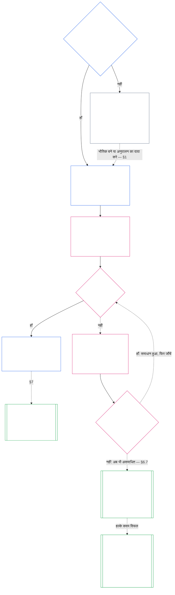

**AI-सहायता प्राप्त मसौदा — अध्याय सात का हिंदी अनुवाद (असमीक्षित)**

**स्थिति:** अध्याय सात का पूरा AI-सहायता प्राप्त मसौदा; किसी स्वतंत्र मानव पाठक ने इसकी समीक्षा नहीं की है। स्रोत `core_07.000_charters.md`, संस्करण `SC-Corpus-2026.10.21`। बाध्यकारी स्रोत अंग्रेज़ी पाठ है। सापेक्ष कड़ियाँ अंतिम स्थान `translations/hi/core_07_charters.md` के लिए हैं।

**वर्तमान दायरा:** अध्याय का पूरा मुख्य पाठ, परिचय, पाठक-मार्गदर्शिकाएँ, अनुरेख, परिभाषा/अनुपालन सूचियाँ और साधारण-शब्दों के सारांश। AI-सहायता प्राप्त, असमीक्षित मसौदा।

# अध्याय सात: प्रणाली चार्टर और संस्थागत चार्टर

<strong>संग्रह में स्थान (गैर-संक्रियात्मक): फ़ाइल संरचना और पढ़ने के नियम</strong>

> यह फ़ाइल **संज्ञ संविधान का हिस्सा** है और अन्य क्रमांकित `core_*` फ़ाइलों के साथ एक पाठ के रूप में पढ़े जाने पर ही **बाध्यकारी** है। इसमें **अध्याय सात** है: किसी प्रणाली और संस्था के प्रकाशित दायरा-दस्तावेज़ों का न्यूनतम तल — प्रणाली चार्टर और संस्थागत चार्टर। यह अध्याय छह के अधिकार-तल के बाद और [अध्याय आठ](../../core_08.000_functional_independence_separation_of_duties.md#chapter-eight-functional-independence-and-separation-of-duties) से पहले आता है, जो हर भौतिक रूप से बाध्यकारी कार्य के भीतर भूमिकाओं को अलग रखता है।
>
> - **संवैधानिक स्वामी:** प्रणाली को कब प्रणाली चार्टर प्रकाशित करना होगा और संस्था को कब संस्थागत चार्टर प्रकाशित करना होगा (वर्ग L या ऊपर अनिवार्य, वर्ग P में स्वैच्छिक); प्रत्येक में न्यूनतम क्या होना चाहिए; उनमें संशोधन और समीक्षा कैसे होगी; तथा शामिल पदों के धारकों की प्रस्थिति और प्रामाणिकता की गठन-जाँच।
> - **परिभाषाओं का स्थान:** [प्रणाली चार्टर](../../core_05.040_band_continuity.md#system-charter), [संस्थागत चार्टर](../../core_05.040_band_continuity.md#institutional-charter), [चार्टर भूमिका मानचित्र](../../core_05.040_band_continuity.md#charter-role-map), [चार्टर्ड पक्ष](../../core_05.040_band_continuity.md#chartered-party), और [संचालक पक्ष](../../core_05.050_band_oversight.md#operating-party) अध्याय पाँच में परिभाषित हैं। यह अध्याय उन्हें लागू करता है, फिर से परिभाषित नहीं करता।
> - **कार्यान्वयन का स्वामी:** [CI-8.205 §6](../../corpus_institutions/ci_08.205_institutional_design_separation_of_powers.md#ci-8205-6-system-and-institutional-charter-contents-review-and-formation-template) (*प्रणाली और संस्थागत चार्टर की सामग्री, समीक्षा और गठन-टेम्पलेट*) में पूरे फ़ील्ड का टेम्पलेट, समीक्षा-जाँचसूची, गठन-प्रक्रिया और गठन-जाँच विवरण का टेम्पलेट है। वह अधिक कड़ा हो सकता है और फ़ील्ड जोड़ सकता है, पर इस अध्याय को संकीर्ण नहीं कर सकता। उसका पाठ शामिल कार्यान्वयन-पाठ के रूप में केवल वैध अंगीकरण-सीमा के भीतर बाध्यकारी है ([अध्याय अठारह §4 अंगीकरण की रूपरेखा और प्राधिकार का दायरा](../../core_18.000_incorporation.md#4-adoption-framing-and-scope-of-authority)); इस अध्याय का न्यूनतम तल मूल पाठ के रूप में बाध्यकारी है।
> - **आगे के उपयोगकर्ता:** [अध्याय आठ §5 प्रकाशित नियुक्ति, रिक्ति और प्रतिस्थापन](../../core_08.000_functional_independence_separation_of_duties.md#5-published-placement-vacancy-and-substitution) चार्टर भूमिका मानचित्र अनिवार्य करता है। अध्याय नौ दायरे और सीमाओं के निष्कर्षों के लिए प्रणाली चार्टर पढ़ता है, और उसका भाग द संस्था के गठन-जाँच विवरण को परखता है। [अध्याय दस §3.7 अभिलेख-अभिरक्षा और खोलने का प्राधिकार](../../core_10.000_standing_assessment.md#37-record-custody-and-opening-authority) इसे प्रस्थिति अभिलेखों पर लागू करता है। [अध्याय तेरह §4.3 संस्थागत मंच](../../core_13.000_forum.md#43-institutional-forums) संस्थागत चार्टर से जुड़े विवाद सुनता है।
>
> पढ़ने का क्रम: §1 प्रणाली और संस्थागत चार्टर कब अनिवार्य हैं, प्रक्रिया-चित्र सहित → §2 गठन का अधिकार और चार संकीर्ण सीमाएँ → §3 चार्टर में क्या बताना होगा → §4 चार्टर भूमिका मानचित्र और प्रस्थिति-अभिलेख अभिरक्षा → §5 पदधारकों की प्रस्थिति और प्रामाणिकता की गठन-जाँच → §6 गठन-जाँच में पदधारक के विफल होने पर क्या होगा → §7 संशोधन, समीक्षा और दायरा-असंगति।

<strong>अनुसरण</strong>

- पूर्वाधार:
  - [संवैधानिक चतुष्क](../../core_00.000_preamble.md#constitutional-tetrad), विशेषतः **निगरानी** और **जवाबदेही**;
  - [भौतिक दाँव](../../core_00.000_preamble.md#material-stake);
  - [अध्याय एक §18.1 अधिकृत संरचना के रूप में शासन](../../core_01.015_stewardship_capacity_principles.md#181-governance-as-authorized-structure) (1.015 §18.1);
  - [अनुच्छेद XI-E](../../core_06.010_rights_part_b.md#article-xi-e-institutional-formation-and-business-creation) (*संस्थागत गठन और व्यवसाय-निर्माण*)।
- उपखंड:
  - [§1](#1-परणल-और-ससथगत-चरटर-कब-अनवरय-ह);
  - [§2](#2-गठन-क-अधकर-और-चर-सकरण-समए);
  - [§3](#3-कस-परणल-और-ससथगत-चरटर-म-अवशय-बतय-जन-चहए);
  - [§4](#4-चरटर-भमक-मनचतर-और-परसथत-अभलख-अभरकष);
  - [§5](#5-गठन-जच-पदधरक-क-परसथत-और-परमणकत);
  - [§6](#6-पदधरक-गठन-जच-म-वफल-ह-त);
  - [§7](#7-सशधन-समकष-और-दयर-असरखण)।
- आगे के अध्याय:
  - [अध्याय आठ](../../core_08.000_functional_independence_separation_of_duties.md#chapter-eight-functional-independence-and-separation-of-duties) (8.000);
  - [अध्याय नौ](../../core_09.000_system_alignment_certification.md#chapter-nine-system-alignment-certification-reading-index) (9.000);
  - [अध्याय दस](../../core_10.000_standing_assessment.md#chapter-ten-contribution-violation-and-standing-model--measurement) (10.000);
  - [अध्याय तेरह](../../core_13.000_forum.md#chapter-thirteen-forums-and-jurisdiction) (13.000);
  - [अध्याय चौदह](../../core_14.000_governance.md#chapter-fourteen-constitutional-contract-legitimacy-authorization-and-stewardship) (14.000); ऊपर नामित कार्यान्वयन-पाठ।
- साथ पढ़ें:
  - [प्राधिकार-क्रम और आंतरिक पदानुक्रम](../../core_05.045_band_integrative.md#authority-stack-and-internal-hierarchy);
  - [प्रणाली-सीमाएँ](../../core_05.040_band_continuity.md#system-boundaries);
  - [प्रणाली-सीमा की अखंडता](../../core_05.040_band_continuity.md#system-boundary-integrity);
  - [प्रणाली-निर्माण](../../core_05.055_band_participation.md#system-creation);
  - [व्यवसाय-निर्माण](../../core_05.055_band_participation.md#business-creation)।

 

अध्याय सात **प्रणाली चार्टर, संस्थागत चार्टर और प्रकाशित दायरे** का संवैधानिक स्वामी है।

तीन अध्याय एक ही शृंखला के रूप में काम करते हैं:

- **अध्याय सात (यह अध्याय):** बताता है कि [चार्टर्ड पक्ष](../../core_05.040_band_continuity.md#chartered-party) क्या करने का दावा करता है और उसके कार्य करते समय प्रत्येक भूमिका कौन निभा सकता है।
- **[अध्याय आठ](../../core_08.000_functional_independence_separation_of_duties.md#chapter-eight-functional-independence-and-separation-of-duties):** बताता है कि उन भूमिकाओं को कैसे अलग रखा जाए।
- **[अध्याय नौ](../../core_09.000_system_alignment_certification.md#chapter-nine-system-alignment-certification-reading-index):** प्रणाली का, और अलग से संस्था का, प्रमाणन करता है; इनमें से प्रत्येक भूमिकाओं का उपयोग करने वाला एक बाध्यकारी कार्य है। वह अपने निष्कर्ष प्रणाली चार्टर या संस्थागत चार्टर को वापस देता है।

अन्य अध्याय उन परिभाषाओं, भूमिका-नियमों, प्रस्थिति-तालों और निर्णय-नियमों के स्वामी हैं जिनकी ओर यह अध्याय संकेत करता है। **CI-8.205 §6** (*प्रणाली और संस्थागत चार्टर की सामग्री, समीक्षा और गठन-टेम्पलेट*) में फ़ील्ड-टेम्पलेट, गठन-प्रक्रिया और समीक्षा-जाँचसूची है।

### 1. प्रणाली और संस्थागत चार्टर कब अनिवार्य हैं

<strong>अनुसरण</strong>

- पूर्वाधार:
  - [§2](#2-गठन-क-अधकर-और-चर-सकरण-समए);
  - [भौतिक दाँव](../../core_00.000_preamble.md#material-stake);
  - [आनुपातिकता](../../core_05.035_band_accountability.md#proportionality); अध्याय के आरंभ में स्वामित्व का दावा;
  - [अध्याय एक §18 उत्तरदायी प्रबंधन-अनुशासन के अधीन शासन](../../core_01.015_stewardship_capacity_principles.md#18-governance-under-stewardship-discipline) (1.015 §18);
  - [निगरानी](../../core_05.020_apex_oversight_leg.md#oversight-constitutional);
  - [जवाबदेही](../../core_05.005_apex_accountability_leg.md#accountability)।
- आगे: [§3](#3-कस-परणल-और-ससथगत-चरटर-म-अवशय-बतय-जन-चहए); [अध्याय नौ भाग क §2 प्रणाली-वर्ग मूल्यांकन](../../core_09.005_system_alignment_certification_evaluation.md#2-system-class-evaluation) (9.005 §2), *वर्ग और प्रमाणन की गहराई*; [अध्याय नौ भाग द §12.1 संस्था-वर्ग](../../core_09.020_institutional_alignment_certification.md#121-institution-class) (9.020 §12.1), *संस्था का वर्ग*; वर्ग-सूची के लिए **CS-9.305 (*प्रणाली वर्गीकरण यंत्रावली*) और CS-9.310** (*प्रणाली वर्गीकरण यंत्रावली*)।
- साथ पढ़ें:
  - **CI-8.205 §6** (*प्रणाली और संस्थागत चार्टर की सामग्री, समीक्षा और गठन-टेम्पलेट*);
  - **CF-13.415 §5** (*संस्थागत और स्थानीय पंजीयक*);
  - **CI-9.210** (*वर्गीकरण-संबद्ध संस्थागत दायित्व*);
  - [अध्याय पाँच का प्रणाली चार्टर](../../core_05.040_band_continuity.md#system-charter) (5.040);
  - [अध्याय पाँच का संस्थागत चार्टर](../../core_05.040_band_continuity.md#institutional-charter) (5.040);
  - [अनुच्छेद XI-E](../../core_06.010_rights_part_b.md#article-xi-e-institutional-formation-and-business-creation) (*संस्थागत गठन और व्यवसाय-निर्माण*)।

<strong>परिभाषाएँ · आकलन · अनुपालन</strong>

- [प्रणाली चार्टर](../../core_05.040_band_continuity.md#system-charter) · [O](../../core_05.040_band_continuity.md#system-charter) · [M](../../core_05.040_band_continuity.md#system-charter-a) · [A](../../core_05.040_band_continuity.md#system-charter-a) · [C](../../core_05.040_band_continuity.md#system-charter-c)
- [संस्थागत चार्टर](../../core_05.040_band_continuity.md#institutional-charter) · [O](../../core_05.040_band_continuity.md#institutional-charter) · [M](../../core_05.040_band_continuity.md#institutional-charter-a) · [A](../../core_05.040_band_continuity.md#institutional-charter-a) · [C](../../core_05.040_band_continuity.md#institutional-charter-c)
- [वर्गीकरण-अनुपाती शासन](../../core_05.050_band_oversight.md#classification-scaled-governance) · [O](../../core_05.050_band_oversight.md#classification-scaled-governance) · [M](../../core_05.050_band_oversight.md#classification-scaled-governance-a) · [A](../../core_05.050_band_oversight.md#classification-scaled-governance-a) · [C](../../core_05.050_band_oversight.md#classification-scaled-governance-c)

 

*साधारण शब्दों में: किसी प्रणाली या संस्था के अपनी सीमाओं में रहने का आकलन करने से पहले, वे सीमाएँ ऐसी जगह लिखी होनी चाहिए जहाँ सब उन्हें पढ़ सकें। नौ [क्षेत्र-विशिष्ट भौतिकता](../../core_05.050_band_oversight.md#domain-specific-materiality) क्षेत्रों में से किसी में दूसरों के लिए भौतिक महत्व वाली प्रणाली को प्रकाशित प्रणाली चार्टर चाहिए। संस्था अपने द्वारा चलाई जा रही प्रणालियों के अनुकूल चार्टर प्रकाशित करती है। वर्ग P स्वैच्छिक है: शरणार्थियों को रज़ाइयाँ देने वाला रज़ाई-सिलाई समूह इसका उदाहरण है।*

प्रणाली चार्टर या संस्थागत चार्टर चार्टर्ड पक्ष का प्रकाशित दायरा है: वह कौन-सा प्राधिकार प्रयोग करने का दावा करता है, क्या नहीं करता, और कार्य करते समय हर भूमिका कौन निभाता है। अध्याय आठ की भूमिकाएँ इसी दायरे के भीतर रखी जाती हैं, और अध्याय नौ का प्रमाणन वास्तविक संचालन की तुलना इसी दायरे से करता है। संचालक पक्ष को चार्टर प्रकाशित करना है या नहीं, यह उसके वर्ग पर निर्भर है: **वर्ग L या ऊपर अनिवार्य, वर्ग P में स्वैच्छिक।** यदि उसे चार्टर प्रकाशित करना है, तो उसे सही भी रखना होगा।

नीचे की हर बात का आधार प्रणाली-प्रभाव के पाँच वर्ग हैं। सबसे अधिक से सबसे कम परिणामकारी क्रम में, प्रत्येक एक पंक्ति में:

- **वर्ग A, अस्तित्व-महत्वपूर्ण, आधारभूत और अपूरणीय:** अस्तित्व-संबंधी समय-सीमा में विफलता हो और कोई व्यवहार्य विकल्प न हो, तो अस्तित्व की स्थितियाँ खो जाती हैं।
- **वर्ग B, गंभीर, अत्यधिक निर्भरता वाला और प्रणालीगत रूप से महत्वपूर्ण:** आश्रित पक्ष इसके बिना अपना मुख्य कार्य जारी नहीं रख सकते। अस्तित्व तत्काल समाप्त नहीं होता और समय रहते प्रतिस्थापन अब भी संभव है।
- **वर्ग C, समन्वित, अत्यधिक निर्भरता वाला, पर गैर-गंभीर:** यह बड़े पैमाने पर समन्वय को आकार देता है, लेकिन वर्ग A या B के कार्य का परिचालन-पूर्वापेक्षित आधार नहीं है।
- **वर्ग L, स्थानीय, सीमित प्रभाव वाला और गैर-गंभीर:** इसके प्रभाव निजी इकाई से बाहर तक पहुँचते हैं, पर स्थानीय, प्रतिस्थापनीय और सीमित रखे जा सकते हैं।
- **वर्ग P, व्यक्तिगत, निजी उपयोग, पृथक और प्रयोगात्मक:** इसका प्रभाव निजी इकाई के भीतर रहता है और इस पर बाहर की कोई अर्थपूर्ण निर्भरता नहीं होती।

पूरी परिभाषाएँ [CS-9.310 §8](../../corpus_systems/cs_09.310_system_impact_classifications.md#cs-9310-8-system-impact-classifications) में हैं। वर्ग A, B, C और L को प्रकाशित करना होगा; वर्ग P कर सकता है। [§1.2 कौन-से वर्ग शामिल हैं](#12-कन-स-वरग-शमल-ह) बताता है कि संस्था अपने द्वारा चलाई जा रही प्रणालियों से अपना वर्ग कैसे लेती है।

#### 1.1 किसे प्रकाशित करना होगा

कक्षा L या उससे ऊपर की प्रत्येक प्रणाली को [प्रणाली चार्टर](../../core_05.040_band_continuity.md#system-charter) प्रकाशित और अद्यतन रखना होगा। कक्षा L या उससे ऊपर की संस्था को अपनी चलाई जा रही प्रणालियों के अनुकूल चार्टर प्रकाशित और अद्यतन रखना होगा:

| संस्था क्या चलाती, प्रबंधित करती या भौतिक रूप से नियंत्रित करती है | उसे क्या प्रकाशित करना होगा |
|---|---|
| ठीक एक ऐसी प्रणाली जिसे प्रणाली चार्टर चाहिए | वही प्रणाली चार्टर, कोई दूसरा दस्तावेज़ नहीं। उसमें संस्था को प्रबंधक के रूप में नामित किया जाएगा और वह [संस्थागत चार्टर](../../core_05.040_band_continuity.md#institutional-charter) का काम करेगा: एक ही दस्तावेज़ दोनों उद्देश्यों को पूरा करेगा। |
| ऐसी एक से अधिक प्रणालियाँ | संस्थागत चार्टर। इसमें उन प्रणालियों के सभी प्रभावी प्रणाली चार्टर शामिल होंगे और बताया जाएगा कि संस्था उन्हीं प्रणालियों को क्यों चलाती है ([§3 प्रणाली और संस्थागत चार्टर में क्या बताना होगा](#3-कस-परणल-और-ससथगत-चरटर-म-अवशय-बतय-जन-चहए))। |
| ऐसी कोई प्रणाली नहीं | संस्थागत चार्टर, जिसमें [§3](#3-कस-परणल-और-ससथगत-चरटर-म-अवशय-बतय-जन-चहए) के अनुसार संस्था की अपनी बातें हों और शामिल करने के लिए कोई प्रणाली चार्टर न हो। |

- **व्यवसाय और तुलनीय रूप:** व्यवसाय या प्रबंधित संगठनात्मक रूप को, प्रणाली के रूप में, संस्था के रूप में, या शामिल प्रणाली चलाने वाली संस्था के रूप में, उस पर लागू प्रणाली चार्टर या संस्थागत चार्टर प्रकाशित करना होगा। उसका कानूनी रूप उत्तर नहीं बदलता।
- **संयुक्त पेशेवर अभ्यास:** वर्ग L या उससे ऊपर का कोई संज्ञ प्राणी या छोटा अभ्यास, जो अभ्यास-लाइसेंस या अभ्यास-स्वीकृति के लिए सूचीबद्ध कार्य करता है, उन कार्यों के लिए मेज़बान का प्रणाली चार्टर या संस्थागत चार्टर और चार्टर भूमिका मानचित्र अपनाकर इस धारा की अपेक्षा पूरी कर सकता है:
  - **क्या अपनाया जाता है:** संयुक्त पेशेवर अभ्यास के मेज़बान का प्रणाली चार्टर या संस्थागत चार्टर और चार्टर भूमिका मानचित्र, संदर्भ द्वारा; उसमें वे कार्य शामिल होने चाहिए।
  - **अंगीकरण सूचना:** **CI-14.205 §7** (*अभ्यास-लाइसेंस, अभ्यास-स्वीकृति और संयुक्त पेशेवर अभ्यास*) में वर्णित एक-पृष्ठीय सूचना।
  - **वर्ग:** अभ्यास अपने कार्यों के कारण मिले वर्ग में ही रहता है।

#### 1.2 कौन-से वर्ग शामिल हैं

चार्टर्ड पक्ष का वर्ग तय करता है कि प्रकाशन अनिवार्य है या विकल्प:

- **वर्ग A, B, C और L:** अनिवार्य। [§1.7 प्रक्रिया एक नज़र में](#17-परकरय-एक-नजर-म) का चार्ट उनकी प्रक्रिया दिखाता है।
- **वर्ग P:** विकल्प, जब तक दो घटनाओं में से कोई इसे अनिवार्य न कर दे। [§1.3 वर्ग P क्या है](#13-वरग-p-कय-ह) बताता है कि संचालक पक्ष कब वर्ग P होता है, और [§1.4 वर्ग P: वैकल्पिक चार्टर और उनके अनिवार्य होने की स्थिति](#14-वरग-p-वकलपक-चरटर-और-उनक-अनवरय-हन-क-सथत) विकल्प और उसके समाप्त होने की स्थिति बताता है।
- **संस्था का वर्ग:** संस्था अपने द्वारा चलाई, प्रबंधित या भौतिक रूप से नियंत्रित किसी भी प्रणाली का सबसे ऊँचा वर्ग लेती है। यदि वह ऐसी कोई प्रणाली नहीं चलाती, तो उसका वर्गीकरण उसके अपने भौतिक प्रभाव और निर्भरता के आधार पर होगा—वह वास्तव में क्या तय करती और अपने नियंत्रण में रखती है, न कि उसके नाम या कानूनी रूप के आधार पर—[अध्याय नौ भाग द §12.1 संस्था का वर्ग](../../core_09.020_institutional_alignment_certification.md#121-institution-class) के अनुसार।

#### 1.3 वर्ग P क्या है

संचालक पक्ष वर्ग P में तभी तक रहता है जब उसकी गतिविधि [क्षेत्र-विशिष्ट भौतिकता](../../core_05.050_band_oversight.md#domain-specific-materiality) के सभी नौ क्षेत्रों की सीमा से नीचे हो; व्यवहार में, इसका अर्थ है कि उसके कार्य और प्रभाव उसकी [निजी इकाई](../../core_05.050_band_oversight.md#domain-specific-materiality-private-unit) के भीतर रहें:

- **किसी एक सीमा को पार करना:** किसी एक क्षेत्र की सीमा पार करने पर, आकार या स्वयं अपनाए नाम की परवाह किए बिना, **CS-9.305 (*प्रणाली वर्गीकरण यंत्रावली*) और CS-9.310** (*प्रणाली वर्गीकरण यंत्रावली*) के तहत वर्ग कम से कम L हो जाता है।
- **हर सीमा से नीचे रहना:** सदस्यों की संख्या चाहे जितनी हो, वर्ग P बना रहता है।
- **भीतर के लोग:** वर्ग P उन लोगों पर भी निर्भर है जो उसके भीतर हैं। भीतर का कोई भी व्यक्ति संचालक पक्ष को सीमा पार करते देखे तो उसे इसकी सूचना देने का कर्तव्य है; और ऐसी सूचना संरक्षित है ([क्षेत्र-विशिष्ट भौतिकता](../../core_05.050_band_oversight.md#domain-specific-materiality))।

अध्याय आठ की चार-भूमिका आधाररेखा वर्ग P के संचालक पक्ष के उन कार्यों पर लागू नहीं होती जो निजी इकाई के भीतर रहते हैं; इसलिए कंप्यूटर के साथ अकेले एक संज्ञ प्राणी को दूसरी भूमिका निभाने वाला व्यक्ति नहीं चाहिए। यह आधाररेखा उस दिन से लागू होती है जब संचालक पक्ष ऐसा [भौतिक रूप से बाध्यकारी कार्य](../../core_05.035_band_accountability.md#materially-binding-act) करता है जिसका दूसरों को पालन करना हो या जिसे वे तय तथ्य मानकर भरोसे में ले सकते हों। ऐसा कार्य दूसरों पर प्राधिकार वाले क्षेत्र की सीमा पार करता है और पक्ष को कम से कम वर्ग L बना देता है।

#### 1.4 वर्ग P: वैकल्पिक चार्टर और उनके अनिवार्य होने की स्थिति

वर्ग P के संचालक पक्ष को अपने कार्यों के अनुकूल [प्रणाली चार्टर](../../core_05.040_band_continuity.md#system-charter) (एक प्रणाली के लिए) या [संस्थागत चार्टर](../../core_05.040_band_continuity.md#institutional-charter) (एक से अधिक प्रणालियों या किसी के न होने पर) प्रकाशित करने के लिए प्रोत्साहित किया जाता है। वह [§3 प्रणाली और संस्थागत चार्टर में क्या बताना होगा](#3-कस-परणल-और-ससथगत-चरटर-म-अवशय-बतय-जन-चहए) की विषय-सूची और [§4 चार्टर भूमिका मानचित्र और प्रस्थिति-अभिलेख अभिरक्षा](#4-चरटर-भमक-मनचतर-और-परसथत-अभलख-अभरकष) के भूमिका-मानचित्र को नमूने के रूप में उपयोग कर सकता है। ऐसा चार्टर प्रकाशित करने से इस अध्याय की प्रक्रिया के तहत कोई कर्तव्य नहीं बनता:

- कोई नियत तिथि नहीं ([§1.5 प्रणाली या संस्थागत चार्टर कब देना होगा](#15-परणल-चरटर-य-ससथगत-चरटर-कब-दन-हग));
- कोई गठन-जाँच नहीं ([§5 पदधारक की प्रस्थिति और प्रामाणिकता की गठन-जाँच](#5-गठन-जच-पदधरक-क-परसथत-और-परमणकत));
- [चार्टर भूमिका मानचित्र](../../core_05.040_band_continuity.md#charter-role-map) अनिवार्य नहीं ([§4](#4-चरटर-भमक-मनचतर-और-परसथत-अभलख-अभरकष)); हालांकि वह इसे अपने स्वैच्छिक चार्टर के साथ रख सकता है या अलग से प्रकाशित कर सकता है; और
- कोई अनिवार्य संशोधन या समीक्षा-चक्र नहीं ([§7 संशोधन, समीक्षा और दायरा-असंगति](#7-सशधन-समकष-और-दयर-असरखण))।

निम्नलिखित में से कोई एक बात होने पर प्रकाशन वैकल्पिक नहीं रहता:

- संचालक पक्ष का पुनर्वर्गीकरण होकर वह वर्ग L या उससे ऊपर पहुँच जाए; या
- उसका संचालक उसके लिए संवैधानिक अनुपालन का दावा करे।

तब संचालक पक्ष को [§1.5 प्रणाली या संस्थागत चार्टर कब देना होगा](#15-परणल-चरटर-य-ससथगत-चरटर-कब-दन-हग) की समय-सारणी के अनुसार अपने लिए उपयुक्त प्रणाली चार्टर या संस्थागत चार्टर प्रकाशित करना होगा।

**पहचान दायरा-दस्तावेज़ पर निर्भर नहीं है।** कोई समूह, चार्टर हो या न हो और वर्ग चाहे जो हो, अपने सदस्यों और पहचान के बीच अवरोध नहीं बनता। हर सदस्य समूह के भीतर या बाहर किए गए काम के लिए व्यक्तिगत दावेदार के रूप में योगदान-अभिलेख माँग सकता है; अभिलेख उस सदस्य के योगदान से संबंधित होगा, समूह की प्रस्थिति से नहीं ([अध्याय दस §3.7 अनौपचारिक और छोटे-दायरे के अभिलेख](../../core_10.000_standing_assessment.md#37-informal-and-small-scope-records))। ऐसी सहायता, सामान, श्रम या सेवाएँ देना जिन्हें स्वीकार करना किसी के लिए अनिवार्य नहीं है, भौतिक रूप से बाध्यकारी कार्य नहीं है। इसलिए शरणार्थियों को रज़ाइयाँ देने वाले पारस्परिक-सहायता समूह के सदस्यों की पहचान के लिए प्रणाली या संस्थागत चार्टर आवश्यक नहीं।

#### 1.5 प्रणाली चार्टर या संस्थागत चार्टर कब देना होगा

शामिल प्रणाली या संस्था इस समय-सारणी के अनुसार अपना [प्रणाली चार्टर](../../core_05.040_band_continuity.md#system-charter) या [संस्थागत चार्टर](../../core_05.040_band_continuity.md#institutional-charter) प्रकाशित करेगी:

- **नई प्रणाली या संस्था:** संचालन शुरू करने या दूसरों पर प्राधिकार प्रयोग करने से पहले।
- **पहले से संचालित:** अगली वर्गीकरण समीक्षा या प्रमाणन पर, अथवा [§1.6 प्रणाली या संस्थागत चार्टर अनुपस्थित होने पर](#16-परणल-य-ससथगत-चरटर-अनपसथत-हन-पर) माँग के बाद समाधान-अवधि के भीतर — इनमें जो पहले हो। ऐसा करने तक वह चूक की स्थिति में है।
  - **कौन-सा प्रमाणन:** प्रणाली के लिए उसका प्रणाली-संरेखण प्रमाणन। संस्था के लिए [अध्याय नौ भाग द §11.3 कोई अनुमति नहीं और कोई द्वार नहीं](../../core_09.020_institutional_alignment_certification.md#113-no-permission-and-no-gate) के तहत संस्थागत संरेखण प्रमाणन; उसके पहले प्रमाणन की अवधि संस्थागत चार्टर प्रकाशित करने या संचालन करने की शर्त कभी नहीं होती।
- **गठन-जाँच:** वह इसी समय [§5 पदधारक की प्रस्थिति और प्रामाणिकता की गठन-जाँच](#5-गठन-जच-पदधरक-क-परसथत-और-परमणकत) भी पूरी करेगा।
- **कहाँ जमा करना है:** चार्टर भूमिका मानचित्र और गठन-जाँच विवरण सहित प्रणाली चार्टर या संस्थागत चार्टर संस्थागत पंजीयक के पास जमा किया जाएगा; यदि गतिविधि और उससे प्रभावित संज्ञ प्राणी स्थानीय हों, तो स्थानीय पंजीयक के पास (**CF-13.415 §5** (*संस्थागत और स्थानीय पंजीयक*)):
  - **पंजीयक क्या करता है:** जाँचता है कि कुछ अनिवार्य छूटा तो नहीं और दिनांकित रसीद देता है।
  - **पंजीयक क्या कभी नहीं करता:** अनुमति नहीं देता और वर्ग या सामग्री पर निर्णय नहीं करता।
  - **देर से मिली या न मिली रसीद:** चार्टर्ड पक्ष को संचालन से कभी नहीं रोकती।

#### 1.6 प्रणाली या संस्थागत चार्टर अनुपस्थित होने पर

जो कोई भी वर्ग L या उससे ऊपर के नए या अभी-अभी उस वर्ग में आए चार्टर्ड पक्ष को बिना प्रकाशित प्रणाली चार्टर या संस्थागत चार्टर के देखे, वह उसकी शासक सत्ता से चार्टर माँग सकता है। माँगने वाले को कोई विशेष प्रस्थिति नहीं चाहिए, कोई शुल्क नहीं देना पड़ता और हानि दिखाना आवश्यक नहीं है। अनुरोध में चार्टर्ड पक्ष का नाम और शामिल होने का कारण दिया जाएगा।

अनुरोध से दो अवधियाँ शुरू होती हैं: जवाब-अवधि और समाधान-अवधि। हर अवधि की लंबाई चार्टर्ड पक्ष के वर्ग के समान अक्षर वाले स्तर से तय होती है; वर्ग जितना महत्वपूर्ण, अवधि उतनी छोटी:

| वर्ग और स्तर | जवाब-अवधि (प्राप्ति लक्ष्य) | समाधान-अवधि (अंतिम सीमा) |
|---|---|---|
| वर्ग A, स्तर A | 24 घंटे | 7 कैलेंडर दिन |
| वर्ग B, स्तर B | 2 कैलेंडर दिन | 14 कैलेंडर दिन |
| वर्ग C, स्तर C | 4 कैलेंडर दिन | 30 कैलेंडर दिन |
| वर्ग L, स्तर L | 8 कैलेंडर दिन | 60 कैलेंडर दिन |

ये समय **CF-13.445 §3.1** (*चरण लक्ष्य और समय-सीमाओं के न्यूनतम*) से आते हैं; यदि अंतर हो तो वही लागू होगा। जिस चार्टर्ड पक्ष के वर्ग पर विवाद हो, उसके लिए उस अधिक महत्वपूर्ण स्तर को गिना जाएगा जो उसके प्रणाली-वर्गीकरण अभिलेख में दर्ज वर्ग और माँगकर्ता या मंच द्वारा प्रथमदृष्टया दिखाए गए किसी वर्ग में ऊँचा हो; प्रश्न सुलझने तक यही लागू रहेगा। जिस चार्टर्ड पक्ष के अभिलेख में कोई वर्ग नहीं है, या जिसका वर्ग विवादित रहते हुए P है, उसके लिए स्तर C गिना जाएगा।

अवधियाँ इस प्रकार काम करती हैं:

- **जवाब-अवधि:** अनुरोध से गिनी जाने वाली अवधि के भीतर चार्टर्ड पक्ष जवाब देता है; यह **CF-13.445 §3.1** (*चरण लक्ष्य और समय-सीमाओं के न्यूनतम*) में संबंधित स्तर का प्राप्ति-लक्ष्य है। वह प्रणाली चार्टर या संस्थागत चार्टर प्रकाशित करता है, या बताता है कि किस तारीख तक करेगा, या पहले से प्रकाशित चार्टर का संदर्भ देता है; अथवा उत्तर देता है कि वह [क्षेत्र-विशिष्ट भौतिकता](../../core_05.050_band_oversight.md#domain-specific-materiality) की हर सीमा से नीचे है और प्रवेश के लिए आवश्यक लिखित प्रमाण देता है।
- **समाधान-अवधि:** अनुरोध से गिनी जाने वाली **CF-13.445 §3.1** (*चरण लक्ष्य और समय-सीमाओं के न्यूनतम*) के संबंधित स्तर की अंतिम सीमा के भीतर प्रणाली या संस्थागत चार्टर और उसके साथ गठन-जाँच विवरण देना होगा ([§5 पदधारक की प्रस्थिति और प्रामाणिकता की गठन-जाँच](#5-गठन-जच-पदधरक-क-परसथत-और-परमणकत))। यदि चार्टर्ड पक्ष के पास अभी स्वतंत्र भूमिका नहीं है, तो वह उस धारा के अनुसार विवरण को साक्ष्य सहित घोषणा के रूप में दाखिल करता है।
- **सीमा से नीचे होने का दावा करने वाला संचालक पक्ष:** अनुरोध, उस प्रविष्टि के *चुनौती-मार्ग* के अनुसार, वर्गीकरण-चुनौती भी बन जाता है:
  - **अवधि चलती रहती है:** चुनौती लंबित रहने पर समाधान-अवधि चलती रहती है।
  - **चुनौती से अवधि बढ़ना:** यदि अधिकार-क्षेत्र वाला मंच चुनौती को समीक्षा योग्य मानता है, तो नियत तारीख बढ़ जाती है और चुनौती पर निर्णय होने पर नई समाधान-अवधि शुरू होती है। मंच संबंधित स्तर की अंतिम सीमा के भीतर चुनौती का निर्णय करता है।
  - **समीक्षा योग्य का अर्थ:** चुनौती किसी निर्दिष्ट क्षेत्र में सीमा पार करने की विशिष्ट घटना बताती है और संचालक पक्ष का लिखित प्रमाण उस घटना पर वास्तविक प्रश्न छोड़ता है। संचालक पक्ष स्वयं अपने लिए यह निर्णय नहीं करता; बिना लिखित प्रमाण वाला जवाब तारीख नहीं बढ़ाता।
  - **वर्ग निर्धारित होने पर:** उस चुनौती या किसी अन्य प्रक्रिया में वर्ग निर्धारित होने की तारीख अनुरोध की तारीख मानी जाएगी। जवाब और समाधान-अवधियाँ निर्धारित वर्ग (A, B, C या L) के स्तर से चलेंगी।
- **समय-सीमा चूकने पर:** जवाब न देना, या नियत तारीख तक चार्टर न देना, दर्ज और सुधारने योग्य दोष है। अनुरोधकर्ता उसी मार्ग से इसे अधिकार-क्षेत्र वाले मंच के पास ले जा सकता है। यह गठन या संचालन की शर्त कभी नहीं है।
- **दोहराया अनुरोध:** पहले जवाब या निष्कर्ष के प्रभावी रहते उसी चार्टर्ड पक्ष के बारे में दूसरा अनुरोध नई जवाब या समाधान-अवधि शुरू नहीं करता। चार्टर्ड पक्ष पहले जवाब या निष्कर्ष का संदर्भ देकर उत्तर देगा। उसका अपना यह लिखित दावा कि वह सभी सीमाओं से नीचे है, यदि मंच ने अभी उसकी समीक्षा नहीं की है, तो प्रभावी जवाब नहीं माना जाएगा। जवाब या निष्कर्ष तब तक प्रभावी रहता है जब तक [अध्याय नौ भाग द §14.2 पुनः खोलने के कारण](../../core_09.020_institutional_alignment_certification.md#142-reopening-triggers) में बताए निम्न में से कोई कारण न हो:
  - **भौतिक बदलाव:** चार्टर्ड पक्ष की गतिविधि में भौतिक बदलाव हुआ हो।
  - **नया साक्ष्य:** सीमा पार करने के बारे में नया साक्ष्य सामने आया हो।

  ऊपर में से कोई बात दिखाने वाला अनुरोध दोहराया अनुरोध नहीं है। वह नया अनुरोध है और पहले से अलग तथा स्वतंत्र रूप से संभाला जाएगा। उसकी अपनी जवाब और समाधान-अवधियाँ होंगी, जो उसकी अपनी तारीख से गिनी जाएँगी; पहले का जवाब, निष्कर्ष या अवधि उसे पूरा नहीं करेगा और न ही उससे बदलेगा।
- **इस बीच दायरा:** प्रणाली या संस्थागत चार्टर का न होना चार्टर्ड पक्ष को असीमित मानने का कारण नहीं है। चार्टर बनने तक उसके वास्तविक [प्रणाली-सीमाएँ](../../core_05.040_band_continuity.md#system-boundaries) और वर्ग ही नियंत्रण करेंगे; प्रमाणन या मंच देखे गए संचालन से दायरा पुनर्निर्मित कर सकता है।

#### 1.7 प्रक्रिया एक नज़र में

यह चार्ट एक संचालक पक्ष को इस प्रश्न से आगे ले जाता है कि क्या उसका दूसरों पर भौतिक प्रभाव है, फिर प्रणाली या संस्थागत चार्टर प्रकाशित करने और उसे सही बनाए रखने तक। यदि समाधान-अवधि में समस्या ठीक न हो, तो चार्टर प्रक्रिया उसे इस अध्याय के बाहर आने वाली समीक्षा तक भेजती है। इसके बाद के खंड हर कदम को इसी क्रम में समझाते हैं।

<strong>पाठक मार्गदर्शन (गैर-संक्रियात्मक): चार्ट कैसे पढ़ें</strong>

> साधारण शब्दों में: कोई प्रणाली या संस्थागत चार्टर प्रदान नहीं करता, और गठन के लिए किसी की अनुमति नहीं चाहिए। दूसरों पर भौतिक प्रभाव डालने वाली गतिविधि वाला चार्टर्ड पक्ष बताता है कि वह कौन-सा प्राधिकार प्रयोग करने का दावा करता है और हर भूमिका कौन निभाता है; उसके प्रमुख पदों के धारकों की जाँच होती है। विफल होने वाले धारक को बदला जाता है या कारण ठीक किया जाता है, और चार्टर्ड पक्ष काम जारी रखता है। समाधान-अवधि के अंत तक विफलता न सुधरे, तो मंच चार्टर्ड पक्ष की समीक्षा कर सकता है और दूसरों की सुरक्षा के लिए सबसे हल्के कदम से शुरू करता है। चार्टर्ड पक्ष को वर्ग L से नीचे करना या उसे भंग करना तभी आता है जब हल्के कदम विफल हों। भंग हुआ चार्टर्ड पक्ष उस पर लगा ताला रहते लौट नहीं सकता।
>
> ठोस तीर मुख्य मार्ग दिखाते हैं। बिंदीदार तीर अपवाद और हस्तांतरण दिखाते हैं तथा उस खंड का नाम देते हैं जो उन्हें अधिकृत करता है। दोहरी पार्श्व पट्टियों वाले डिब्बे किसी अन्य अध्याय या शामिल कार्यान्वयन-पाठ के हैं। चार्ट कोई नया कर्तव्य, भूमिका या फ़ील्ड नहीं जोड़ता; उसमें कोई कदम अनुमति देना नहीं है।

 

### 2. गठन का अधिकार और चार संकीर्ण सीमाएँ

<strong>पाठक मार्गदर्शन (गैर-संक्रियात्मक): इस खंड की रूपरेखा</strong>

- [§2.1 गठन का अधिकार](#21-गठन-क-अधकर) अधिकार बताता है और यह भी कि वह किन बातों को शामिल नहीं करता।
- [§2.2 पहली सीमा: संज्ञ प्राणी पर प्रभावी ताला](#22-पहल-सम-सजञ-परण-पर-परभव-तल) बताता है कि ताला कैसे एक नामित संज्ञ प्राणी को नियंत्रणकारी पद से बाहर रखता है।
- [§2.3 दूसरी सीमा: विशिष्ट सत्यापित तथ्यों पर अल्पकालिक रोक](#23-दसर-सम-वशषट-सतयपत-तथय-पर-अलपकलक-रक) बताता है कि अल्पकालिक रोक ऐसा कैसे कर सकती है।
- [§2.4 तीसरी सीमा: संचालक पक्ष पर ही ताला](#24-तसर-सम-सचलक-पकष-पर-ह-तल) बताता है कि संचालक पक्ष पर ताला उसे और उसके उत्तराधिकारियों को कैसे रोकता है, और भंग किया गया चार्टर्ड पक्ष लौट नहीं सकता।
- [§2.5 चौथी सीमा: अभ्यास-लाइसेंस या स्वीकृति](#25-चथ-सम-अभयस-लइसस-य-सवकत) बताता है कि नामित उच्च-जोखिम वाले काम के लिए लाइसेंस या स्वीकृति कब चाहिए। यह गठन पर कोई द्वार नहीं है।

<strong>अनुसरण</strong>

- पूर्वाधार: [§1](#1-परणल-और-ससथगत-चरटर-कब-अनवरय-ह); [अनुच्छेद XI-E](../../core_06.010_rights_part_b.md#article-xi-e-institutional-formation-and-business-creation) (*संस्थागत गठन और व्यवसाय-निर्माण*)।
- आगे: [§1 प्रणाली और संस्थागत चार्टर कब अनिवार्य हैं](#1-परणल-और-ससथगत-चरटर-कब-अनवरय-ह); [§5 पदधारक की प्रस्थिति और प्रामाणिकता की गठन-जाँच](#5-गठन-जच-पदधरक-क-परसथत-और-परमणकत)।
- साथ पढ़ें:
  - [अंतरिम रोक](../../core_05.035_band_accountability.md#interim-hold);
  - [अध्याय ग्यारह §4.2 रोकथाम — सामान्य प्रस्थिति ताले](../../core_11.000_standing_integration.md#42-prevention--general-standing-locks) (11.000 §4.2);
  - [अध्याय ग्यारह §5.5 विशेष ताले](../../core_11.000_standing_integration.md#55-special-locks) (11.000 §5.5);
  - [अध्याय तेरह §5 नामित संज्ञ प्राणी के मार्ग पर अंतरिम रोक](../../core_13.000_forum.md#interim-hold-on-a-named-sentients-pathway) (13.000 §5)।

 

*साधारण शब्दों में: प्रणाली, संस्था या व्यवसाय बनाने के लिए किसी की अनुमति नहीं चाहिए। चार संकीर्ण सीमाएँ लागू हो सकती हैं। तीन द्वार हैं: न हटाया गया ताला एक संज्ञ प्राणी को नियंत्रणकारी पद से बाहर रख सकता है; विशिष्ट सत्यापित तथ्यों पर अल्पकालिक रोक भी ऐसा कर सकती है; और संचालक पक्ष पर लगा ताला स्वयं उस पक्ष को रोक सकता है। चौथी सीमा नामित उच्च-जोखिम वाले काम से पहले लाइसेंस या स्वीकृति की माँग कर सकती है। मंच द्वारा भंग किया गया चार्टर्ड पक्ष लौटने से रोका जाता है; यदि भंग करने का आधार व्यापक संविधान-विरोधी आचरण या ऐसा गंभीर नुकसान था जिसकी भरपाई नहीं हुई और जिसे पलटा नहीं जा सकता, तो रोक स्थायी होती है। इनमें से कोई भी नया संचालक पक्ष बनाने या चलाने से नहीं रोकता, और यह अध्याय कोई अतिरिक्त रोक नहीं जोड़ता।*

**अनुच्छेद XI-E** (*संस्थागत गठन और व्यवसाय-निर्माण*) चार संकीर्ण सीमाएँ स्वीकार करता है:

- **पहली तीन ही** संचालक पक्ष बनाने या उसमें प्राधिकार रखने के एकमात्र द्वार हैं। हर द्वार किसी नामित विषय पर लागू होता है:
  - **प्रभावी ताला** ([§2.2 पहली सीमा: संज्ञ प्राणी पर प्रभावी ताला](#22-पहल-सम-सजञ-परण-पर-परभव-तल)) चार्टर्ड पक्ष को नियंत्रित करने वाले एक पद पर किसी नामित संज्ञ प्राणी पर लागू होता है।
  - **अंतरिम रोक** ([§2.3 दूसरी सीमा: विशिष्ट सत्यापित तथ्यों पर अल्पकालिक रोक](#23-दसर-सम-वशषट-सतयपत-तथय-पर-अलपकलक-रक)) केवल चार्टर्ड पक्ष को नियंत्रित करने वाले एक पद पर एक नामित संज्ञ प्राणी पर लागू होती है।
  - **संचालक पक्ष पर ही ताला** ([§2.4 तीसरी सीमा: संचालक पक्ष पर ही ताला](#24-तसर-सम-सचलक-पकष-पर-ह-तल)) ऐसे चार्टर्ड पक्ष पर लागू होता है जो स्वयं ताले के अधीन है, जिसमें मंच द्वारा भंग किया गया पक्ष भी शामिल है।
- **चौथी सीमा द्वार नहीं है:** वह अभ्यास-लाइसेंस या स्वीकृति है ([§2.5 चौथी सीमा: अभ्यास-लाइसेंस या स्वीकृति](#25-चथ-सम-अभयस-लइसस-य-सवकत))।

#### 2.1 गठन का अधिकार

कोई भी नया प्रणाली, संस्था या व्यवसाय बना सकता है। यह अधिकार [अनुच्छेद XI-E](../../core_06.010_rights_part_b.md#article-xi-e-institutional-formation-and-business-creation) (*संस्थागत गठन और व्यवसाय-निर्माण*) में दिया गया है। यह अध्याय अगला आने वाला कर्तव्य जोड़ता है: जैसे ही संचालक पक्ष का काम [क्षेत्र-विशिष्ट भौतिकता](../../core_05.050_band_oversight.md#domain-specific-materiality) के नौ क्षेत्रों में से किसी एक में दूसरों के लिए भौतिक हो, उसे पहले से सार्वजनिक रूप से बताना होगा कि वह कौन-सा प्राधिकार प्रयोग करने का दावा करता है ([§1 प्रणाली और संस्थागत चार्टर कब अनिवार्य हैं](#1-परणल-और-ससथगत-चरटर-कब-अनवरय-ह))। प्रणाली या संस्थागत चार्टर अपनाने को इस अधिकार या अधिकार-तल की किसी सुरक्षा को संकीर्ण करने वाला नहीं पढ़ा जाएगा।

**गठन का अधिकार किन बातों की रक्षा नहीं करता।** [§2.2 संज्ञ प्राणी पर प्रभावी ताला](#22-पहल-सम-सजञ-परण-पर-परभव-तल), [§2.3 विशिष्ट सत्यापित तथ्यों पर अल्पकालिक रोक](#23-दसर-सम-वशषट-सतयपत-तथय-पर-अलपकलक-रक) और [§2.4 संचालक पक्ष पर ही ताला](#24-तसर-सम-सचलक-पकष-पर-ह-तल) के तीन द्वारों को छोड़कर, **अनुच्छेद XI-E** (*संस्थागत गठन और व्यवसाय-निर्माण*) निम्न की रक्षा नहीं करता:

- ऐसा संचालक पक्ष जिसे संवैधानिक बाधा तोड़ने, सुरक्षा या सत्य को कमज़ोर करने, या [अध्याय एक §11 बाज़ार संरचना](../../core_01.005_values_principles.md#11-market-structure) द्वारा निषिद्ध तरीकों से सत्ता केंद्रित करने के लिए बनाया गया हो; या
- ऐसा संचालक पक्ष जिसे ऐसे संस्थापक ने बनाया या चलाया हो जिसका घोषित उद्देश्य से वास्तविक मेल न हो — जैसा सत्यापित आचरण, नियंत्रण और पुरस्कार से दिखता है — अथवा जो उद्देश्य, नियंत्रण या हितों के बारे में दूसरों को भ्रमित करना या उन्हें नुकसान पहुँचाना चाहता हो।

मंच इन मामलों का निर्णय उस अनुच्छेद के तहत करते हैं, और परिणाम केवल उसके तीन द्वार हैं: प्रभावी-ताला द्वार, अंतरिम रोक और संचालक पक्ष पर ताला। गठन-जाँच का विफल होना साक्ष्य का एक हिस्सा है जिसे मंच तौलता है; इसलिए केवल गठन-जाँच से मामला तय नहीं होता।

#### 2.2 पहली सीमा: संज्ञ प्राणी पर प्रभावी ताला

सत्यापित उल्लंघन के बाद लगाया गया और अब तक न हटाया गया [प्रस्थिति ताला](../../core_11.000_standing_integration.md#42-prevention--general-standing-locks) या [विशेष ताला](../../core_11.000_standing_integration.md#55-special-locks) किसी नामित संज्ञ प्राणी को इस तरह की संस्था या व्यवसाय पर प्राधिकार रखने से रोकता है।

- **क्या रोका जाता है:** संचालक पक्ष में शासन, नियंत्रण या स्वामित्व का प्राधिकार लेना या उसका प्रयोग करना।
- **सीमा कितनी है:** केवल उतनी जितनी ताले में है। ताला हटने या संकीर्ण होने पर रोक समाप्त होती है।
- **संचालक पक्ष पर ही ताला:** देखें [§2.4 तीसरी सीमा: संचालक पक्ष पर ही ताला](#24-तसर-सम-सचलक-पकष-पर-ह-तल)।

#### 2.3 दूसरी सीमा: विशिष्ट सत्यापित तथ्यों पर अल्पकालिक रोक

यह सीमा तब लागू होती है जब अधिकार-क्षेत्र वाला मंच विशिष्ट सत्यापित तथ्यों के आधार पर [अंतरिम रोक](../../core_05.035_band_accountability.md#interim-hold) का आदेश देता है। ये तथ्य इस बात की संभावना को आधे से अधिक करते हैं कि पदधारक चार्टर्ड पक्ष के घोषित उद्देश्य से असंगत है। आदेश केवल वही मंच दे सकता है ([अध्याय तेरह §5 नामित संज्ञ प्राणी के मार्ग पर अंतरिम रोक](../../core_13.000_forum.md#interim-hold-on-a-named-sentients-pathway))। चार्टर्ड पक्ष स्वयं किसी को पद से रोकने का निर्णय नहीं कर सकता, क्योंकि तब वह अपने ही सदस्य के मामले में न्यायाधीश होगा। पूरी आधार-कसौटी [अध्याय तेरह §5](../../core_13.000_forum.md#interim-hold-on-a-named-sentients-pathway) में दी गई है; यह संक्षिप्त रूप उसका स्थान नहीं लेता।

#### 2.4 तीसरी सीमा: संचालक पक्ष पर ही ताला

ताला केवल संज्ञ प्राणी पर नहीं, संचालक पक्ष पर भी लग सकता है। तब द्वार, ताले में नामित मार्ग के अनुसार, उस संचालक पक्ष और उसके उत्तराधिकारियों, नियंत्रित संस्थाओं तथा नामधारी या मुखौटा-संस्था के माध्यम से रखे गए निकायों को रोकता है। यह किसी दूसरे संचालक पक्ष को नहीं रोकता।

- **अंतिम निर्धारण से लगाया गया ताला:** [संविधान-विरोधी विश्वास ताला](../../core_11.000_standing_integration.md#55-special-locks) ऐसा तब करता है जब अंतिम निर्धारण किसी संस्था, उत्तराधिकारी निकाय या नियंत्रित इकाई को नामित करे। तब द्वार चार्टर्ड पक्ष, उसके उत्तराधिकारियों, नियंत्रित संस्थाओं और नामधारी या मुखौटा-संस्था के माध्यम से रखे निकायों में ताले के नामित मार्ग को रोकता है।
- **भंग किया गया चार्टर्ड पक्ष:** **CI-11.210 §4** (*भंग*) के तहत अंतिम भंग-आदेश [भंग-पुनर्गठन ताला](../../core_11.000_standing_integration.md#55-special-locks) लगाता है। ताला लागू रहने तक भंग चार्टर्ड पक्ष, उसके उत्तराधिकारी, नियंत्रित संस्थाएँ, नामधारी या मुखौटा-संस्था के माध्यम से रखे निकाय, और उनके साथ एक ही संचालन बनाने वाले संचालक पक्ष को किसी नाम या रूप में फिर गठित, पुनर्जीवित या संचालित नहीं किया जा सकता। यदि आदेश को व्यापक संविधान-विरोधी आचरण या ऐसे [अपरिवर्तनीय नुकसान](../../core_11.000_standing_integration.md#8-restoration-and-reassessment) का निष्कर्ष मिले जिसका उपचार नहीं हुआ, तो ताला स्थायी होगा: समय बीतने, कारण सुलझने या पदधारक बदलने से वह नहीं हटेगा। वह केवल तब समाप्त होगा जब समीक्षा में भंग-आदेश पलट दिया जाए या नए भौतिक सत्यापित तथ्य दिखाएँ कि निष्कर्ष गलत था। अन्यथा, वह स्वतंत्र निष्कर्ष पर समाप्त होगा कि कारण सुलझा, उपचार दिया गया और वापसी जारी बहिष्कार से अधिक सुरक्षित है। यह ताला किसी संज्ञ प्राणी को अलग संचालक पक्ष बनाने से नहीं रोकता।

तीनों द्वारों में से कोई भी नया संचालक पक्ष बनाने, अपना प्रणाली चार्टर या संस्थागत चार्टर प्रकाशित करने या काम शुरू करने से नहीं रोकता। वे केवल उस पक्ष को रोकते हैं जिस पर स्वयं ताला लगा हो — जैसे लौटने की कोशिश करता भंग चार्टर्ड पक्ष। गठन-जाँच में तीनों द्वार लागू होते हैं ([§5 पदधारक की प्रस्थिति और प्रामाणिकता की गठन-जाँच](#5-गठन-जच-पदधरक-क-परसथत-और-परमणकत))।

#### 2.5 चौथी सीमा: अभ्यास-लाइसेंस या स्वीकृति

चौथी सीमा किसी नामित काम पर लागू होती है, संचालक पक्ष बनाने पर नहीं:

- **संचालक पक्ष के गठन का द्वार नहीं:** [§5 पदधारक की प्रस्थिति और प्रामाणिकता की गठन-जाँच](#5-गठन-जच-पदधरक-क-परसथत-और-परमणकत) इसे लागू नहीं करती।
- **यह क्या है:** [क्षमता-स्वीकृति](../../core_05.035_band_accountability.md#competency-clearance), जिसे **अनुच्छेद XI-E** (*संस्थागत गठन और व्यवसाय-निर्माण*) के तहत अंगीकारकर्ता किसी तकनीकी मंच के प्रकाशित जोखिम-निष्कर्ष के आधार पर, नामित काम दूसरों के लिए किए जाने से पहले अनिवार्य कर सकता है।
  - **अभ्यास-लाइसेंस:** गलत तरीके से किए जाने पर गंभीर या अपरिवर्तनीय नुकसान का जोखिम रखने वाले कामों के लिए अनिवार्य।
  - **अभ्यास-स्वीकृति:** गलत तरीके से किए जाने पर वास्तविक, पर कम गंभीर नुकसान का जोखिम रखने वाले कामों के लिए अनिवार्य।
- **यह किस पर लागू है:** काम करने पर। यह संचालक पक्ष को गठन करने, प्रणाली या संस्थागत चार्टर प्रकाशित करने या संचालन करने से कभी नहीं रोकती।
- **यह किसे रोकती है:** बिना लाइसेंस या स्वीकृति के उस काम का दावा करने या उसे करने से। प्रणाली या संस्थागत चार्टर उस काम का दावा तभी कर सकता है जब कोई धारक उसे करता हो ([§3 प्रणाली और संस्थागत चार्टर में क्या बताना होगा](#3-कस-परणल-और-ससथगत-चरटर-म-अवशय-बतय-जन-चहए))।

### 3. किस प्रणाली और संस्थागत चार्टर में अवश्य बताया जाना चाहिए

<strong>पाठक मार्गदर्शन (गैर-ऑपरेटिव): यह अनुभाग कैसे तैयार किया गया है</strong>

- [§3.1 सिस्टम चार्टर क्या बताता है](#31-परणल-चरटर-म-कय-लख-जत-ह) नौ वस्तुओं को सूचीबद्ध करता है।
- [§3.2 चार्टर पॉइंटर्स](#32-चरटर-सदरभ) कहता है कि एक सिस्टम चार्टर या संस्थागत चार्टर अपने पाठ की प्रतिलिपि बनाने के बजाय किसी अन्य प्रकाशित दस्तावेज़ को संदर्भित कर सकता है, और जो उस संदर्भ को वैध बनाता है।
- [§3.3 संस्थागत चार्टर क्या जोड़ता है](#33-ससथगत-चरटर-म-अतरकत-कय-ह) इसमें शामिल है कि एक संस्थागत चार्टर में नौ वस्तुओं के अलावा क्या निहित है: संस्थान द्वारा चलाए जाने वाले सिस्टम के सिस्टम चार्टर, और यह उन्हें क्यों चलाता है।
- [§3.4 अधिनियम जिनके लिए अभ्यास लाइसेंस या अभ्यास मंजूरी की आवश्यकता होती है](#34-अभयस-लइसस-य-अभयस-सवकत-मगन-वल-कम) कहता है कि एक सिस्टम चार्टर या इंस्टीट्यूशनल चार्टर इस तरह के कृत्य का दावा केवल तभी कर सकता है जब इसे निष्पादित करने वाले प्रत्येक संवेदनशील व्यक्ति के पास लाइसेंस या मंजूरी हो, या ऐसा करने वाले पर्यवेक्षक के अधीन एक शिक्षार्थी के रूप में काम करता हो। तब तक, अधिनियम को दायरे से बाहर (आइटम 4 इंच) के रूप में सूचीबद्ध किया गया है [§3.1 सिस्टम चार्टर क्या बताता है](#31-परणल-चरटर-म-कय-लख-जत-ह)).
- [§3.5 स्केलिंग](#35-वरगनसर-अनपत) कहता है कि कक्षा के साथ क्या बदलता है।

<strong>पता लगाना</strong>

- अपस्ट्रीम: [§1](#1-परणल-और-ससथगत-चरटर-कब-अनवरय-ह); [अध्याय पांच सिस्टम चार्टर](../../core_05.040_band_continuity.md#system-charter) (5.040); [अध्याय पांच संस्थागत चार्टर](../../core_05.040_band_continuity.md#institutional-charter) (5.040).
- डाउनस्ट्रीम:
  - [§4](#4-चरटर-भमक-मनचतर-और-परसथत-अभलख-अभरकष);
  - [§7](#7-सशधन-समकष-और-दयर-असरखण);
  - [अध्याय नौ भाग बी §8.1 न्यूनतम रिकॉर्ड सामग्री](../../core_09.010_system_alignment_certification_record_process.md#81-minimum-record-contents) (9.010 §8.1) (*प्रमाणीकरण रिकॉर्ड सिस्टम चार्टर फ़ील्ड पर निर्भर करता है*);
  - **सीआई-8.205 §6** (*सिस्टम और संस्थागत चार्टर सामग्री, समीक्षा, और गठन टेम्पलेट*) संपूर्ण फ़ील्ड सूची के लिए।
- इसके साथ पढ़ें:
  - [अध्याय अठारह §4 दत्तक ग्रहण निर्धारण और अधिकार का दायरा](../../core_18.000_incorporation.md#4-adoption-framing-and-scope-of-authority) (18.000 §4) (*किसी अन्य नाम के अंतर्गत रखा गया एक स्कोप दस्तावेज़*);
  - [अध्याय चौदह §4.3 हितधारक की पसंद को बाध्य करने के लिए निर्णय-समाधान आवश्यकताएँ](../../core_14.000_governance.md#43-decision-resolution-requirements-for-binding-stakeholder-choice) (14.000 §4.3);
  - **सीआई-6.205 §1** (*हितधारक निरीक्षण, अधिसूचना, और बाध्यकारी-शासन मार्ग अखंडता*);
  - **सीआई-6.205 §2** (*एकाग्रता विरोधी और भागीदारी-वैधता सुरक्षा उपाय*).

<strong>परिभाषाएँ · मूल्यांकन · अनुपालन</strong>

- [सिस्टम चार्टर](../../core_05.040_band_continuity.md#system-charter) · [हे](../../core_05.040_band_continuity.md#system-charter) · [एम](../../core_05.040_band_continuity.md#system-charter-a) · [ए](../../core_05.040_band_continuity.md#system-charter-a) · [सी](../../core_05.040_band_continuity.md#system-charter-c)
- [संस्थागत चार्टर](../../core_05.040_band_continuity.md#institutional-charter) · [हे](../../core_05.040_band_continuity.md#institutional-charter) · [एम](../../core_05.040_band_continuity.md#institutional-charter-a) · [ए](../../core_05.040_band_continuity.md#institutional-charter-a) · [सी](../../core_05.040_band_continuity.md#institutional-charter-c)
- [चार्टर भूमिका मानचित्र](../../core_05.040_band_continuity.md#charter-role-map) · [हे](../../core_05.040_band_continuity.md#charter-role-map) · [एम](../../core_05.040_band_continuity.md#charter-role-map-a) · [ए](../../core_05.040_band_continuity.md#charter-role-map-a) · [सी](../../core_05.040_band_continuity.md#charter-role-map-c)

 

*स्पष्ट शब्दों में: एक सिस्टम चार्टर को परीक्षण के लिए पर्याप्त विशिष्ट होना चाहिए। यह बताता है कि सिस्टम किसके लिए है, सिस्टम क्या करता है और क्या नहीं करता है, सिस्टम पर कौन निर्भर है, सिस्टम चार्टर में कौन संशोधन कर सकता है, प्रत्येक सीट किसके पास है, और बाध्यकारी निर्णय नियम कहां मिलेंगे। सिस्टम चार्टर उन नियमों की ओर इशारा करता है और उन्हें प्रतिस्थापित नहीं करता है। एक संस्थागत चार्टर संस्था के बारे में यही कहता है, फिर उसमें मौजूद सिस्टम चार्टर और संस्था द्वारा उन प्रणालियों को चलाने का कारण जोड़ा जाता है।*

#### 3.1 प्रणाली चार्टर में क्या लिखा जाता है

प्रणाली चार्टर ऐसी सरल भाषा में बताएगा जिसे प्रभावित संज्ञ प्राणी और लेखा-परीक्षक पढ़ सकें:

1. **पहचान और संस्करण:** नाम, प्रबंधक या शासक निकाय, संस्करण, प्रभावी तिथि और बदलावों का इतिहास।
2. **उद्देश्य:** चार्टर्ड पक्ष किस काम के लिए मौजूद है।
3. **दायरे के भीतर की गतिविधियाँ:** वे कार्य, सेवाएँ, प्राधिकार और क्षेत्र जिनका वह दावा करता है।
   - **दावा, अनुदान नहीं:** दस्तावेज़ उस प्राधिकार का उल्लेख करता है जो चार्टर्ड पक्ष के पास पहले से है; यह कोई प्राधिकार नहीं देता। वह प्राधिकार वैध है या नहीं — इसमें संवैधानिक चार्टर पर आधारित होने का मामला भी शामिल है — इसका निर्णय [अध्याय चौदह §1 शासकीय प्राधिकार का प्राधिकरण और वैधता](../../core_14.000_governance.md#1-authorization-and-legitimacy-of-governing-authority) के तहत होता है।
4. **दायरे से बाहर की सीमाएँ:** वे भौतिक गतिविधियाँ, प्राधिकार और क्षेत्र जिनका प्रयोग करने की अनुमति चार्टर्ड पक्ष को नहीं है।
5. **प्रभावित समुदाय और निर्भरताएँ:** कौन चार्टर्ड पक्ष पर निर्भर है; और वह किन प्रणालियों या बुनियादी ढाँचे पर निर्भर है या जिन तक पहुँच नियंत्रित करता है — जहाँ यह भौतिक हो।
   - **दायरे से बाहर होने का विकल्प नहीं:** किसी समूह को इस सूची में न लिखने से वह दायरे से बाहर नहीं हो जाता। चार्टर्ड पक्ष से भौतिक रूप से प्रभावित संज्ञ प्राणी को अधिकार-तल की हर सुरक्षा मिलती रहती है, चाहे दस्तावेज़ उसे नामित करे या नहीं। वास्तविक निर्भरता से संकीर्ण सूची को वास्तविक निर्भरता के विरुद्ध पढ़ा जाएगा।
6. **वर्गीकरण की मान्यताएँ:** जिस वर्ग या प्रबंधन-स्तर पर भरोसा किया गया है, उसके साथ जहाँ लागू हो **CS-9.305 (*प्रणाली वर्गीकरण यंत्रावली*) और CS-9.310** (*प्रणाली वर्गीकरण यंत्रावली*) तथा **CS-14.305** (*गंभीर प्रणालियों का उत्तरदायी प्रबंधन*) के लिए [चार्टर-संदर्भ](../../core_05.040_band_continuity.md#charter-pointer)।
7. **चार्टर भूमिका मानचित्र:** [चार्टर भूमिका मानचित्र](../../core_05.040_band_continuity.md#charter-role-map), या प्रकाशित दस्तावेज़ के लिए चार्टर-संदर्भ जो चार्टर भूमिका मानचित्र का काम करता हो ([§4 चार्टर भूमिका मानचित्र और प्रस्थिति-अभिलेख अभिरक्षा](#4-चरटर-भमक-मनचतर-और-परसथत-अभलख-अभरकष))।
8. **बाध्यकारी पक्षधारक-चयन के चार्टर-संदर्भ:**
   - **कब लागू होता है:** जब प्रभावित संज्ञ प्राणियों के बीच वास्तविक असहमति के कारण प्रणाली के भीतर बाध्यकारी पक्षधारक-चयन करना आवश्यक हो। [Def.P2 बाध्यकारी पक्षधारक चयन](../../core_05.055_band_participation.md#defp2-binding-stakeholder-choice) इसे स्वीकृति-दायरा कहता है।
   - **कहाँ संदर्भ देता है:** प्रकाशित नियमों के तीन समूहों के लिए चालू चार्टर-संदर्भ: निर्णय-क्रम (चयन कैसे होगा), भार-निर्धारण नियम (किसकी कितनी बात मानी जाएगी), और अधिकार-संघर्ष-अभिलेख नियम (अधिकार टकराने पर अभिलेख में क्या दिखना चाहिए)।
   - **किसमें क्या रखा है:** प्रणाली चार्टर में केवल संदर्भ होते हैं। तीन नियम-समूहों में वास्तविक सामग्री रहती है: चयन कैसे होगा, भार कैसे तय होगा और अभिलेख में क्या दिखेगा। प्रणाली चार्टर स्वयं यह सामग्री नहीं रखता और उसके अपने पाठ को उन नियमों के विकल्प के रूप में पेश नहीं किया जा सकता। बंद संदर्भ या नियमों की जगह चार्टर का पाठ देना प्रणाली चार्टर के कर्तव्य का उल्लंघन है।
9. **संशोधन का प्राधिकार:** कौन संशोधन कर सकता है, किसे भौतिक संशोधन माना जाएगा, और सूचना तथा चुनौती का मार्ग।

#### 3.2 चार्टर-संदर्भ

प्रणाली या संस्थागत चार्टर किसी अन्य प्रकाशित दस्तावेज़ या प्रावधान (नियम-समूह, चार्टर भूमिका मानचित्र या प्रणाली चार्टर) का पाठ नकल करने के बजाय उसका संदर्भ दे सकता है। ऐसा हर संदर्भ [चार्टर-संदर्भ](../../core_05.040_band_continuity.md#charter-pointer) है। उसे चालू, वर्तमान और प्रकाशित दस्तावेज़ तक पहुँचना चाहिए। बंद या पुराना चार्टर-संदर्भ एक लापता मद माना जाएगा।

#### 3.3 संस्थागत चार्टर में अतिरिक्त क्या है

संस्थागत चार्टर संस्था के लिए [§3.1 प्रणाली चार्टर में क्या लिखा जाता है](#31-परणल-चरटर-म-कय-लख-जत-ह) की मद 1 से 9 बताता है और साथ में यह भी रखता है:

- **प्रणाली चार्टर:** संस्था जिन प्रणालियों को चलाती, प्रबंधित या भौतिक रूप से नियंत्रित करती है, उन सभी के प्रभावी प्रणाली चार्टर — पूरे पाठ के रूप में, या चार्टर-संदर्भ द्वारा जो वर्तमान प्रकाशित संस्करण तक पहुँचे।
- **पोर्टफ़ोलियो का औचित्य:** संस्था उन्हीं प्रणालियों को क्यों चलाती है, वे उसके घोषित उद्देश्य को कैसे पूरा करती और एक-दूसरे से कैसे जुड़ती हैं, तथा उनमें कौन-सी निर्भरताएँ साझा हैं। जिस प्रणाली का कारण नहीं बताया गया हो, वह एक लापता मद है।

**CI-8.205 §6** (*प्रणाली और संस्थागत चार्टर की सामग्री, समीक्षा और गठन-टेम्पलेट*) अधिक अपेक्षाएँ रख सकता है और गठन-टेम्पलेट तय करता है, पर ऊपर की कोई मद हटा नहीं सकता।

#### 3.4 अभ्यास-लाइसेंस या अभ्यास-स्वीकृति माँगने वाले काम

यह उपखंड बताता है कि जिस काम के लिए अभ्यास-लाइसेंस या अभ्यास-स्वीकृति चाहिए, उसके बारे में प्रणाली या संस्थागत चार्टर क्या दावा कर सकता है।

- **सीमा:** यदि किसी काम के लिए अभ्यास-लाइसेंस या अभ्यास-स्वीकृति आवश्यक है, तो प्रणाली या संस्थागत चार्टर उसे चार्टर्ड पक्ष के काम के रूप में सूचीबद्ध नहीं कर सकता और चार्टर्ड पक्ष उसे कर नहीं सकता, जब तक उसे करने वाला प्रत्येक संज्ञ प्राणी लाइसेंस या स्वीकृति न रखता हो, या ऐसे पर्यवेक्षक के अधीन शिक्षार्थी के रूप में काम न करता हो जिसके पास वह है।
- **तब तक:** प्रणाली या संस्थागत चार्टर उस काम को मद 4 ([§3.1 प्रणाली चार्टर में क्या लिखा जाता है](#31-परणल-चरटर-म-कय-लख-जत-ह)) के तहत दायरे से बाहर सूचीबद्ध करता है।
- **योग्य धारक के बिना दावा हो:** इसे दर्ज करने और ठीक करने योग्य लापता मद माना जाएगा; इससे चार्टर्ड पक्ष का गठन, प्रकाशन या अन्य काम जारी रखना नहीं रुकता।
- **विवरण कहाँ है:** [§2 गठन का अधिकार और चार संकीर्ण सीमाएँ](#2-गठन-क-अधकर-और-चर-सकरण-समए) आवश्यकता का स्रोत बताता है; **CI-14.205 §7** (*अभ्यास-लाइसेंस, अभ्यास-स्वीकृति और संयुक्त पेशेवर अभ्यास*) में प्रविष्टियाँ और मेज़बान-जाँच है।

#### 3.5 वर्गानुसार अनुपात

प्रणाली या संस्थागत चार्टर के कुछ हिस्से वर्ग के अनुसार बदलते हैं और कुछ नहीं:

- **जो बदलता है:** चार्टर की गहराई, समीक्षा की आवृत्ति और समीक्षा की स्वतंत्रता वर्ग तथा [भौतिक दाँव](../../core_00.000_preamble.md#material-stake) के अनुसार बदलते हैं।
- **वर्ग L:** वर्ग L प्रणाली या संस्था का चार्टर संक्षिप्त और उसके अभिलेख सरल हो सकते हैं, जहाँ [वर्गीकरण-अनुपाती शासन](../../core_05.050_band_oversight.md#classification-scaled-governance) इसकी अनुमति देता है। फिर भी हर अनिवार्य मद शामिल होनी चाहिए।
- **समीक्षा की आवृत्ति:** प्रणाली या संस्थागत चार्टर यह तय नहीं करता कि उसकी कितनी बार समीक्षा होगी; यह वर्ग तय करता है।

### 4. चार्टर भूमिका मानचित्र और प्रस्थिति-अभिलेख अभिरक्षा

<strong>पाठक मार्गदर्शन (गैर-संक्रियात्मक): इस खंड की रूपरेखा</strong>

- [§4.1 आसन क्या हैं और क्यों हैं](#41-आसन-कय-ह-और-कय-ह) चार आसनों और एक ही कार्य में अध्याय आठ द्वारा निषिद्ध आसन-युग्मों के कारण की याद दिलाता है।
- [§4.2 नियुक्ति कब वैध है](#42-नयकत-कब-वध-ह) बताता है कि अध्याय आठ स्वतंत्रता, रिक्ति और प्रतिस्थापन तथा संयुक्त मेजबानी की कसौटियाँ तय करता है; मानचित्र केवल यह दर्ज करता है कि कहाँ कौन बैठा है।
- [§4.3 प्रणाली या संस्थागत चार्टर की मानचित्र के प्रति बाध्यता](#43-परणल-य-ससथगत-चरटर-क-मनचतर-क-परत-बधयत) बताता है कि चार्टर में मानचित्र होना या उसका संदर्भ देना आवश्यक है; मानचित्र न होना, संदर्भ बंद होना या मानचित्र पुराना होना चार्टर का दोष है।
- [§4.4 कौन-सा चार्टर कौन-सा मानचित्र रखता है](#44-कन-स-परणल-य-ससथगत-चरटर-कन-स-मनचतर-रखत-ह) एक संस्थागत चार्टर के तहत कई प्रणालियों और साझा मानचित्र की स्थिति बताता है।
- [§4.5 आसन-नियम और आसनधारक बदलना](#45-आसन-नयम-और-आसनधरक-बदलन) बताता है कि आसन कौन रख सकता है यह बदलना संशोधन है, जबकि वर्तमान आसनधारक बदलने पर मानचित्र का नया दिनांकित संस्करण चाहिए, जो सूचना और चुनौती का अवसर मिलने के बाद ही प्रभावी होता है।
- [§4.6 प्रस्थिति-अभिलेख अभिरक्षा](#46-परसथत-अभलख-अभरकष) बताता है कि प्रस्थिति अभिलेखों के लिए मानचित्र क्या बताए; इसके दो भाग हैं: [§4.6.1 संचालक-पक्ष प्रस्थिति अभिलेख](#461-सचलक-पकष-परसथत-अभलख) और [§4.6.2 पक्षधारक प्रस्थिति अभिलेख](#462-पकषधरक-परसथत-अभलख)।
- [§4.7 संचालक-पक्ष प्रस्थिति अभिलेखों के मानचित्र में रिक्तियाँ](#47-सचलक-पकष-परसथत-अभलख-क-मनचतर-म-रकतय) बताता है कि आवश्यक आसन अनाम हो या योग्य धारक न हो तो क्या होगा। इसके चार भाग हैं: [§4.7.1 रिक्ति कब होती है और कैसे दर्ज होती है](#471-रकत-कब-हत-ह-और-कस-दरज-हत-ह), [§4.7.2 रिक्ति के दौरान](#472-रकत-क-दरन), [§4.7.3 घटनाओं से आखिरी योग्य विकल्प हट जाने पर](#473-घटनओ-स-आखर-यगय-वकलप-हट-जन-पर), और [§4.7.4 प्रमाणन आसन](#474-परमणन-आसन)।

<strong>अनुसरण</strong>

- पूर्वाधार: [§3](#3-कस-परणल-और-ससथगत-चरटर-म-अवशय-बतय-जन-चहए); [अध्याय आठ §2 चार-आसन संवैधानिक न्यूनतम मानक](../../core_08.000_functional_independence_separation_of_duties.md#2-four-seat-constitutional-floor) (8.000 §2)।
- आगे:
  - [अध्याय आठ §5 प्रकाशित नियुक्ति, रिक्ति और प्रतिस्थापन](../../core_08.000_functional_independence_separation_of_duties.md#5-published-placement-vacancy-and-substitution) (8.000 §5);
  - [अध्याय नौ भाग ख §6.1.1 प्रमाणन के चार आसन](../../core_09.010_system_alignment_certification_record_process.md#611-four-seats-in-a-certification) (9.010 §6.1.1);
  - [अध्याय दस §3.7 अभिलेख-अभिरक्षा और खोलने का प्राधिकार](../../core_10.000_standing_assessment.md#37-record-custody-and-opening-authority) (10.000 §3.7);
  - **CI-8.205 §2** (*कार्यात्मक पृथक्करण-पथ*);
  - **CI-14.205 §5** (*अधिकृत भूमिकाएँ और जवाबदेही-शृंखलाएँ*);
  - **CI-14.205 §6** (*आसन-सूची — प्रक्रिया-भूमिका प्रतिरूप और प्रचालनात्मक सीमाएँ*)।
- साथ पढ़ें: [भौतिक नियंत्रण रेखा](../../core_05.035_band_accountability.md#material-control-line); [प्रस्थिति अभिलेख](../../core_05.035_band_accountability.md#standing-record)।

<strong>परिभाषाएँ · आकलन · अनुपालन</strong>

- [चार्टर भूमिका मानचित्र](../../core_05.040_band_continuity.md#charter-role-map) · [O](../../core_05.040_band_continuity.md#charter-role-map) · [M](../../core_05.040_band_continuity.md#charter-role-map-a) · [A](../../core_05.040_band_continuity.md#charter-role-map-a) · [C](../../core_05.040_band_continuity.md#charter-role-map-c)
- [प्रणाली चार्टर](../../core_05.040_band_continuity.md#system-charter) · [O](../../core_05.040_band_continuity.md#system-charter) · [M](../../core_05.040_band_continuity.md#system-charter-a) · [A](../../core_05.040_band_continuity.md#system-charter-a) · [C](../../core_05.040_band_continuity.md#system-charter-c)
- [संस्थागत चार्टर](../../core_05.040_band_continuity.md#institutional-charter) · [O](../../core_05.040_band_continuity.md#institutional-charter) · [M](../../core_05.040_band_continuity.md#institutional-charter-a) · [A](../../core_05.040_band_continuity.md#institutional-charter-a) · [C](../../core_05.040_band_continuity.md#institutional-charter-c)

 

*साधारण शब्दों में: प्रणाली या संस्थागत चार्टर में आसनों के नाम दिए जाते हैं। उसमें प्रकाशित सूची होती है कि उसके दायरे के कामों के लिए हर आसन कौन रख सकता है, ताकि कोई पक्ष अपना परीक्षक स्वयं न चुन सके। वैध आसन-नियुक्ति के नियम अध्याय आठ में रहते हैं। प्रस्थिति अभिलेखों को सुरक्षित रखना अलग सूची नहीं है; वही मानचित्र इसका काम करता है।*

हर प्रणाली या संस्थागत चार्टर में [चार्टर भूमिका मानचित्र](../../core_05.040_band_continuity.md#charter-role-map) होना चाहिए: हर आसनधारक की प्रकाशित सूची। [अध्याय आठ §5 प्रकाशित नियुक्ति, रिक्ति और प्रतिस्थापन](../../core_08.000_functional_independence_separation_of_duties.md#5-published-placement-vacancy-and-substitution) भौतिक रूप से बाध्यकारी कार्य करने वाले हर अंगीकारकर्ता के लिए इसे अनिवार्य करता है और बताता है कि इसमें किन लोगों के नाम होने चाहिए। यह खंड बताता है कि प्रणाली या संस्थागत चार्टर मानचित्र का क्या करता है।

#### 4.1 आसन क्या हैं और क्यों हैं

हर [भौतिक रूप से बाध्यकारी कार्य](../../core_05.035_band_accountability.md#materially-binding-act) में चार काम होते हैं, और [अध्याय आठ §2 चार-आसन संवैधानिक न्यूनतम मानक](../../core_08.000_functional_independence_separation_of_duties.md#2-four-seat-constitutional-floor) उन्हें अलग रखता है:

- **[आरंभकारी आसन](../../core_05.035_band_accountability.md#initiating-seat):** अनुरोध, प्रस्ताव, संचालन या दावा करके कार्य शुरू करता है।
- **[सत्यापन-या-प्राधिकरण आसन](../../core_05.035_band_accountability.md#verify-or-authorize-seat):** साक्ष्य और प्राधिकार जाँचता है, फिर कार्य का सत्यापन या प्राधिकरण करता है, शर्त लगाता है या उसे अस्वीकार करता है।
- **[अभिलेख आसन](../../core_05.035_band_accountability.md#record-seat):** सत्यापन-या-प्राधिकरण आसन के निर्णय का आधिकारिक अभिलेख रखता है।
- **[चुनौती आसन](../../core_05.035_band_accountability.md#contest-seat):** चुनौती सुनता है और उसका सुधार करता, उसे सीमित करता या उचित मार्ग पर भेजता है।

आसनों का उद्देश्य यह है कि कोई पक्ष परिणाम माँगने, अपने अनुरोध की जाँच करने, उस जाँच का अभिलेख नियंत्रित करने और फिर उसी पर आई चुनौती का निर्णय करने — ये सब काम एक साथ न कर सके। आसन किसी एक कार्य की भूमिका है, पदनाम नहीं। इसलिए एक ही संज्ञ प्राणी, कार्यालय या प्रणाली अलग-अलग कार्यों में अलग आसन रख सकता है, लेकिन एक ही कार्य में अध्याय आठ द्वारा निषिद्ध आसन-युग्म नहीं। मानचित्र हर आसन के लिए नामित धारक बताता है।

#### 4.2 नियुक्ति कब वैध है

अध्याय आठ कसौटियाँ तय करता है; मानचित्र केवल यह दर्ज करता है कि कहाँ कौन बैठता है:

- **भौतिक नियंत्रण रेखा:** एक कार्य के आसपास शक्ति की वास्तविक शृंखला। जिस पक्ष का कार्य प्रश्न में है, वही पक्ष उस कार्य को शुरू करता है या जिसका कार्य सत्यापित, चुनौती दिया या दर्ज किया जा रहा है। यदि किसी पक्ष के पास उस कार्य के लिए धारक को निर्देश देने, उसका निर्णय पलटने, उसे पुरस्कृत या दंडित करने, हटाने या उसका काम विलंबित करने की शक्ति हो, तो वह उस आसन को नियंत्रित करता है। ऐसा कर सकने वाले संज्ञ प्राणी, कार्यालय और प्रणालियाँ उस कार्य के लिए उस पक्ष की [भौतिक नियंत्रण रेखा](../../core_05.035_band_accountability.md#material-control-line) बनाते हैं।
- **स्वतंत्रता:** यदि जिस पक्ष का कार्य प्रश्न में है, वह जाँच करने वाले आसन को नियंत्रित कर सकता है, तो वह आसन स्वतंत्र नहीं ([अध्याय आठ §3 स्वतंत्रता, हित-संघर्ष और नियंत्रण रेखाएँ](../../core_08.000_functional_independence_separation_of_duties.md#3-independence-conflict-and-control-lines))। इसलिए मानचित्र को अभिलेख आसन, चुनौती आसन और प्रत्येक सत्यापन-या-प्राधिकरण आसन उस पक्ष की भौतिक नियंत्रण रेखा से बाहर रखने होंगे। पक्ष अपने अकेले निर्णय से यह भी नहीं बदल सकता कि वे आसन कौन रखता है ([§4.5 आसन-नियम और आसनधारक बदलना](#45-आसन-नयम-और-आसनधरक-बदलन))।
- **रिक्ति, विकल्प और प्रत्यायोजन:** धारक अनुपस्थित या हित-संघर्ष में हो तो कौन उसकी जगह लेता है ([अध्याय आठ §5 प्रकाशित नियुक्ति, रिक्ति और प्रतिस्थापन](../../core_08.000_functional_independence_separation_of_duties.md#5-published-placement-vacancy-and-substitution))।
- **संयुक्त मेजबानी:** वे एकमात्र मामले जिनमें छोटा पक्ष दो आसन एक कार्यालय में रख सकता है। मानचित्र हर अनुमत व्यवस्था और उससे जुड़ा स्वतंत्रता-सुरक्षा उपाय दर्ज करता है ([अध्याय आठ §6 आनुपातिक अनुप्रयोग और संयुक्त मेजबानी](../../core_08.000_functional_independence_separation_of_duties.md#6-proportional-scaling-and-merged-hosting))।

#### 4.3 प्रणाली या संस्थागत चार्टर की मानचित्र के प्रति बाध्यता

प्रणाली या संस्थागत चार्टर में चार्टर भूमिका मानचित्र होता है, या वह [चार्टर-संदर्भ](#32-चरटर-सदरभ) से उस तक पहुँचाता है, ताकि चार्टर से पढ़ना शुरू करने वाला व्यक्ति जान सके कि हर आसन कौन रखता है। चार्टर में दोष है यदि:

- **मानचित्र नहीं है:** न मानचित्र शामिल हो, न उसका संदर्भ।
- **संदर्भ बंद है:** वह ऐसे मानचित्र की ओर जाए जिसे ढूँढ़ा न जा सके या जो चालू, प्रकाशित दस्तावेज़ न हो।
- **मानचित्र पुराना है:** उसमें हर आसन के वर्तमान धारक न दिखें। धारक बदलने पर मानचित्र का नया दिनांकित संस्करण प्रकाशित किया जाता है ([§4.5 आसन-नियम और आसनधारक बदलना](#45-आसन-नयम-और-आसनधरक-बदलन))।

#### 4.4 कौन-सा प्रणाली या संस्थागत चार्टर कौन-सा मानचित्र रखता है

कौन-सा चार्टर मानचित्र रखेगा, यह पक्षों की व्यवस्था पर निर्भर है:

- **कई प्रणालियाँ:** संस्थागत चार्टर में कई प्रणाली चार्टर हो सकते हैं। हर प्रणाली चार्टर अपनी प्रणाली के कार्यों का मानचित्र रखता है और संस्थागत चार्टर संस्था के अपने कार्यों का मानचित्र रखता है।
- **साझा मानचित्र:** कोई व्यवसाय या अभ्यास अपने कुछ आसन स्थानीय सहकारी संस्था, संघ या मेज़बान को दे सकता है ([§1 प्रणाली और संस्थागत चार्टर कब अनिवार्य हैं](#1-परणल-और-ससथगत-चरटर-कब-अनवरय-ह))। तब वह अपना मानचित्र बनाने के बजाय उस समूह का प्रकाशित मानचित्र उपयोग कर सकता है, जिससे उसका प्रणाली या संस्थागत चार्टर छोटा रहता है। फिर भी अनुपस्थित या हित-संघर्ष में पड़े आसनधारक की जगह कौन लेगा, और योग्य विकल्प न होने पर कौन-सा स्वतंत्र मार्ग अपनाया जाएगा, यह नामित करना होगा ([अध्याय आठ §6 आनुपातिक अनुप्रयोग और संयुक्त मेजबानी](../../core_08.000_functional_independence_separation_of_duties.md#6-proportional-scaling-and-merged-hosting), *साझा आसन*)।

#### 4.5 आसन-नियम और आसनधारक बदलना

मानचित्र दो तरीकों से बदल सकता है और हर बदलाव का अपना मार्ग है:

- **कौन आसन रख सकता है:** कौन-से कार्यालय आसन रख सकते हैं, विकल्प बन सकते हैं या साझा मेजबानी कर सकते हैं, यह तय करना मानचित्र के नियमों में बदलाव है। यह केवल प्रणाली या संस्थागत चार्टर में नामित संशोधन-प्रक्रिया से किया जा सकता है ([§7 संशोधन, समीक्षा और दायरा-असंगति](#7-सशधन-समकष-और-दयर-असरखण))।
- **अभी आसन कौन रखता है:** वर्तमान धारक को बदलना संशोधन नहीं, अद्यतन है। यह मानचित्र का नया दिनांकित संस्करण प्रकाशित करके किया जाता है।
  - **सूचना और चुनौती का अवसर:** अभिलेख आसन, चुनौती आसन और मानचित्र द्वारा रखे गए किसी भी सत्यापन-या-प्राधिकरण आसन के लिए नया संस्करण तभी प्रभावी होगा जब सूचना और चुनौती का अवसर दिया गया हो। उस आसन से प्रभावित हर खुले अभिलेख में विषय, हर दावेदार और हर चुनौतीकर्ता को तुरंत सूचना दी जाएगी।
  - **चुनौती कहाँ जाएगी:** चुनौती [अध्याय दस §3.6 मंच की सीमा](../../core_10.000_standing_assessment.md#36-forum-boundary) के तहत मंच में जाएगी; केवल संशोधन के लिए प्रणाली या संस्थागत चार्टर में नामित मार्ग पर्याप्त नहीं। लंबित चुनौती बदलाव रोकती है: वर्तमान धारक आसन पर बना रहता है।
  - **नए धारक को क्या दिखाना होगा:** चार्टर्ड पक्ष को दिखाना होगा कि नया धारक **CI-8.205 §6** (*प्रणाली और संस्थागत चार्टर की सामग्री, समीक्षा और गठन-टेम्पलेट*) के फ़ील्ड 10 की हर कसौटी पर खरा उतरता है। कसौटियों का एक ही लक्ष्य है: आसन पर ऐसी संस्था हो जिस पर विषय, दावेदार या चुनौतीकर्ता दबाव न डाल सकें और जो उनमें से किसी का पक्ष न ले; वह अभिलेख को सुरक्षित रखे और चुनौती के लिए खुला रखे। इसलिए नया धारक उन पक्षों की [भौतिक नियंत्रण रेखा](../../core_05.035_band_accountability.md#material-control-line) से बाहर होगा, एक ही अभिलेख या मेज़बान के लिए दो आसन परस्पर या चक्रीय व्यवस्था में नहीं रखेगा, अभिलेख और उसकी लेखा-परीक्षण शृंखला अक्षुण्ण रखेगा, चुनौती आते ही उसी दिन आगे भेजेगा, कोई शुल्क नहीं लेगा और बताएगा कि उसे कौन धन देता तथा नियंत्रित करता है।
  - **खाली आसन:** वास्तव में खाली आसन इस बिंदु के तहत नहीं, बल्कि [§4.7 संचालक-पक्ष प्रस्थिति अभिलेखों के मानचित्र में रिक्तियाँ](#47-सचलक-पकष-परसथत-अभलख-क-मनचतर-म-रकतय) के तहत संभाला जाता है।

**कौन-सा संस्करण लागू होगा:** किसी कार्य का आकलन उस दिन प्रभावी मानचित्र के अनुसार होगा जिस दिन वह किया गया था। यदि मंच धारक का बदलाव रद्द करे, तो माना जाएगा कि वह कभी प्रभावी हुआ ही नहीं था और उस धारक द्वारा आसन पर किए गए कार्य समीक्षा के लिए खुलेंगे।

#### 4.6 प्रस्थिति-अभिलेख अभिरक्षा

मानचित्र में क्या कहना होगा, यह [प्रस्थिति अभिलेख](../../core_05.035_band_accountability.md#standing-record) के प्रकार पर निर्भर है, क्योंकि दोनों प्रकार के हित-संघर्ष अलग हैं ([अध्याय दस §3.7 अभिलेख-अभिरक्षा और खोलने का प्राधिकार](../../core_10.000_standing_assessment.md#37-record-custody-and-opening-authority), *विषय के अनुसार प्रस्थिति अभिलेख के दो प्रकार*)। अध्याय दस अभिलेखों पर चार-आसन आधाररेखा लागू करता है।

##### 4.6.1 संचालक-पक्ष प्रस्थिति अभिलेख

संचालक-पक्ष प्रस्थिति अभिलेख चार्टर्ड पक्ष, उसके चार्टर-दायरे और उसके प्रबंधित प्रणालियों के बारे में होते हैं। इनके लिए मानचित्र चार बातें नामित करता है:

- अभिलेख कौन खोल सकता है (सत्यापन आसन);
- उसे रखने वाला एक अलग अभिरक्षक (अभिलेख आसन);
- चुनौतियों को कौन संभालता है (चुनौती आसन); और
- जब कोई योग्य विकल्प उपलब्ध न हो, या नामित प्राधिकारी अथवा अभिरक्षक ही विषय हो या विषय की भौतिक नियंत्रण रेखा के भीतर हो, तो उपयोग के लिए स्वतंत्र मार्ग — जैसे मंच, स्वतंत्र जाँच सेवा या पहले से नामित आरक्षित निकाय।

यदि प्रणाली या संस्थागत चार्टर कोई मार्ग नामित न करे ([§4.7 संचालक-पक्ष प्रस्थिति अभिलेखों के मानचित्र में रिक्तियाँ](#47-सचलक-पकष-परसथत-अभलख-क-मनचतर-म-रकतय) के तहत रिक्ति), तो ये डिफ़ॉल्ट लागू होंगे:

- **अभिलेख खोलने का प्राधिकार:** **CF-13.415 §7** (*आरक्षित अभिलेख प्राधिकारी*) के तहत आरक्षित अभिलेख प्राधिकारी डिफ़ॉल्ट होगा।
- **अभिरक्षक:** **CF-13.415 §9** (*आरक्षित अभिलेख अभिरक्षक*) के तहत आरक्षित अभिलेख अभिरक्षक डिफ़ॉल्ट होगा। नामित अभिरक्षक काम न कर सके तो वह अभिलेख भी अपने पास रखेगा।
- **किसे नामित किया जा सकता है और कसौटियाँ:** इन आसनों पर किसे नामित किया जा सकता है और हर धारक को कौन-सी कसौटियाँ पूरी करनी होंगी, यह **CI-8.205 §6** (*प्रणाली और संस्थागत चार्टर की सामग्री, समीक्षा और गठन-टेम्पलेट*) के फ़ील्ड 10 में है।

##### 4.6.2 पक्षधारक प्रस्थिति अभिलेख

पक्षधारक प्रस्थिति अभिलेख उन संज्ञ प्राणियों और संस्थाओं के बारे में होते हैं जो चार्टर्ड पक्ष की प्रणालियों का उपयोग करते हैं, उन पर निर्भर हैं या उनसे प्रभावित हैं। नियम अलग हैं क्योंकि चार्टर्ड पक्ष का अभिलेख में हित हो सकता है:

- **चार्टर्ड पक्ष का हित:** वह इन अभिलेखों में दावा या आरोप लगाने वाला हो सकता है।
- **उसके अपने कार्यालय:** वे किसी अभिलेख में आसन तभी रख सकते हैं जब चार्टर्ड पक्ष का उस अभिलेख में कोई हित न हो। हित होने पर अभिलेख ऐसे कार्यालय को जाएगा जो चार्टर्ड पक्ष के नियंत्रण से बाहर हो, या स्वतंत्र सत्यापन में जाएगा।
- **कोई नामित न हो और चार्टर्ड पक्ष का हित हो:** [अध्याय दस §3.7 अभिलेख-अभिरक्षा और खोलने का प्राधिकार](../../core_10.000_standing_assessment.md#37-record-custody-and-opening-authority), *स्वयं अभिरक्षा नहीं*, के अनुसार अभिलेख आरक्षित अभिलेख प्राधिकारी (**CF-13.415 §7**, *आरक्षित अभिलेख प्राधिकारी*) और आरक्षित अभिलेख अभिरक्षक (**CF-13.415 §9**, *आरक्षित अभिलेख अभिरक्षक*) या किसी मंच के पास जाएगा।
- **कार्यालय नामित करना वैकल्पिक है:** मानचित्र इन अभिलेखों के लिए पहले से कार्यालय नामित कर सकता है, पर उसे ऐसा करना आवश्यक नहीं। कोई कार्यालय नामित न करने वाला मानचित्र भी वैध है।

#### 4.7 संचालक-पक्ष प्रस्थिति अभिलेखों के मानचित्र में रिक्तियाँ

ये नियम [§4.6.1 संचालक-पक्ष प्रस्थिति अभिलेख](#461-सचलक-पकष-परसथत-अभलख) में आवश्यक प्रविष्टियों की रिक्ति पर लागू होते हैं। [§4.7.4 प्रमाणन आसन](#474-परमणन-आसन) प्रमाणन आसनों पर भी यही समय-सीमा लागू करता है।

##### 4.7.1 रिक्ति कब होती है और कैसे दर्ज होती है

रिक्तियों वाला मानचित्र प्रणाली या संस्थागत चार्टर को अवैध बना देता है। मानचित्र में अभिलेख खोलने का प्राधिकारी, अभिलेख अभिरक्षक, चुनौती आसन और स्वतंत्र मार्ग नामित होने चाहिए। कोई ऐसा बदलाव अनुमत नहीं है जिससे इनमें से कोई भी अनाम रह जाए।

- **रिक्ति कौन दर्ज कर सकता है:** कोई भी व्यक्ति, बिना विशेष प्रस्थिति के, मंच, पंजीयक या आरक्षित अभिलेख प्राधिकारी को सूचना देकर।
  - **सूचना में क्या कहें:** सूचना में आसन का नाम और उसके खाली दिखने का कारण दें।
  - **समय-सीमा कब शुरू होती है:** पहली सूचना मिलने वाले दिन रिक्ति दर्ज होती है और उसी दिन से अवधि चलती है; गलत साबित हुई सूचना कोई अवधि शुरू नहीं करती।

##### 4.7.2 रिक्ति के दौरान

रिक्ति सुलझने तक चार्टर्ड पक्ष के अपने कार्यालय प्रभावित दायरे के लिए कोई वैध प्रस्थिति अभिलेख जारी नहीं कर सकते।

- **अभिलेख कहाँ जाएगा:** सत्यापन के लिए अभिलेख आरक्षित अभिलेख प्राधिकारी (**CF-13.415 §7**, *आरक्षित अभिलेख प्राधिकारी*) को और अभिरक्षा के लिए आरक्षित अभिलेख अभिरक्षक (**CF-13.415 §9**, *आरक्षित अभिलेख अभिरक्षक*) को जाएगा; या इनके बजाय मंच को जाएगा, ताकि किसी का अभिलेख चार्टर्ड पक्ष की मरम्मत की प्रतीक्षा न करे ([अध्याय दस §3.7 अभिलेख-अभिरक्षा और खोलने का प्राधिकार](../../core_10.000_standing_assessment.md#37-record-custody-and-opening-authority), *स्वयं अभिरक्षा नहीं*)।
- **अभिरक्षा कब लौटेगी:** आरक्षित अभिलेख प्राधिकारी और अभिरक्षक तीनों बातें पूरी होने तक अभिलेख संभालते रहेंगे। फिर अभिरक्षा नामित धारकों को लौटेगी।
  - **सभी आसन भर गए हों:** मानचित्र के हर आवश्यक आसन पर फिर से नामित धारक हो।
  - **धारक कसौटियों पर खरे उतरें:** आरक्षित अभिलेख प्राधिकारी या मंच पुष्टि करे कि हर धारक ने **CI-8.205 §6** (*प्रणाली और संस्थागत चार्टर की सामग्री, समीक्षा और गठन-टेम्पलेट*) के फ़ील्ड 10 की कसौटियाँ पूरी की हैं।
  - **सूचना और चुनौती का अवसर पूरा हो:** [§4.5 आसन-नियम और आसनधारक बदलना](#45-आसन-नयम-और-आसनधरक-बदलन) के तहत सूचना और चुनौती का अवसर पूरा हो चुका हो।

##### 4.7.3 घटनाओं से आखिरी योग्य विकल्प हट जाने पर

यदि किसी अप्रत्याशित घटना से इनमें से कोई आसन योग्य धारक के बिना रह जाए, तो चार्टर्ड पक्ष को सामान्य जवाब-अवधि और समाधान-अवधि मिलेंगी ([§1.6 प्रणाली या संस्थागत चार्टर अनुपस्थित होने पर](#16-परणल-य-ससथगत-चरटर-अनपसथत-हन-पर))।

- **आपातकालीन प्रतिस्थापन:** केवल वास्तव में खाली आसन के लिए और अस्थायी रूप से अनुमत है।
- **विकल्प आसन कैसे लेगा:** चार्टर्ड पक्ष विकल्प नामित कर सकता है, पर वह तभी आसन लेगा जब आरक्षित अभिलेख प्राधिकारी (**CF-13.415 §7**, *आरक्षित अभिलेख प्राधिकारी*) या मंच पुष्टि करे कि उसने **CI-8.205 §6** (*प्रणाली और संस्थागत चार्टर की सामग्री, समीक्षा और गठन-टेम्पलेट*) के फ़ील्ड 10 की कसौटियाँ और [§4.2 नियुक्ति कब वैध है](#42-नयकत-कब-वध-ह) की स्वतंत्रता-कसौटियाँ पूरी की हैं। यह दिखाने का भार चार्टर्ड पक्ष पर है।
- **प्रतिस्थापन कब समाप्त होता है:** आपातकालीन विकल्प अस्थायी व्यवस्था है। उसकी जाँच-अवधि समाप्त होने पर वह भी समाप्त हो जाता है, जब तक तब तक वह [§4.5 आसन-नियम और आसनधारक बदलना](#45-आसन-नयम-और-आसनधरक-बदलन) के तहत नियमित धारक-बदलाव न बन चुका हो।
  - **अवधि कौन तय करता है:** प्रणाली या संस्थागत चार्टर उसकी अवधि तय करता है, पर वह आपके स्तर की अधिकतम अवधि से बड़ी नहीं हो सकती।
  - **अधिकतम अवधि:** स्तर A के लिए 7 दिन, स्तर B के लिए 14, स्तर C के लिए 30 और स्तर L के लिए 60 दिन ([§1.6 प्रणाली या संस्थागत चार्टर अनुपस्थित होने पर](#16-परणल-य-ससथगत-चरटर-अनपसथत-हन-पर) की तालिका में समाधान-अवधियाँ)।
  - **स्तर A की आपात स्थिति:** जहाँ जीवन या गंभीर अधिकार दाँव पर हों, स्तर A की आपात स्थिति में डिफ़ॉल्ट जाँच-अवधि 3 दिन है; यह [अध्याय तेरह §6 समय पर समाधान, भौतिकता-स्तर और विलंब-विरोधी अनुशासन](../../core_13.000_forum.md#time-scale-levels), *समय-पैमाने के स्तर*, की सुरक्षात्मक कदम-सीमा है।
  - **गठन-जाँच पूरी होने तक:** विकल्प अकेले कोई बाध्यकारी कार्रवाई नहीं कर सकता।

##### 4.7.4 प्रमाणन आसन

प्रमाणन आसनों पर भी वही समय-सीमा लागू है। यदि मानचित्र यह न बताए कि प्रणाली-संरेखण प्रमाणन या संस्थागत संरेखण प्रमाणन कौन शुरू करेगा, उसका अभिलेख कौन रखेगा या उसकी चुनौतियाँ कौन संभालेगा, तो यह दर्ज और ठीक करने योग्य दोष है। इससे प्रणाली या संस्थागत चार्टर तुरंत अवैध नहीं होता।

- **संस्था क्या कर सकती है:**
  - **चलाना और प्रमाणन जारी रखना:** **CI-8.205 §2** (*कार्यात्मक पृथक्करण-पथ*) का मार्ग-मानचित्र इस बीच आसन रखता है, इसलिए कोई प्रमाणन-चक्र नहीं रुकता।
  - **दोष ठीक करना:** मानचित्र के दिनांकित संशोधन द्वारा आसन नियुक्त करें। रिक्ति की दर्ज सूचना से गिनी गई सामान्य जवाब-अवधि और समाधान-अवधि लागू होंगी (**CI-11.210 §3** (*सूचना, जवाब और समाधान*), [§1.6 प्रणाली या संस्थागत चार्टर अनुपस्थित होने पर](#16-परणल-य-ससथगत-चरटर-अनपसथत-हन-पर))।
- **संस्था क्या नहीं कर सकती:**
  - **प्रमाणन रोकने के लिए रिक्ति का उपयोग:** प्रमाणन आसन की नियुक्ति न होना प्रमाणन-चक्र रोकने, विलंबित करने या अवरुद्ध करने का कारण कभी नहीं है।
  - **समाधान-अवधि के बाद भी रिक्ति छोड़ना:** अवधि समाप्त होने पर भी आसन नियुक्त न हो, तो प्रणाली या संस्थागत चार्टर उसी तरह अवैध होगा जैसे प्रस्थिति-अभिलेख प्रविष्टियों की रिक्ति में ([§4.7.1 रिक्ति कब होती है और कैसे दर्ज होती है](#471-रकत-कब-हत-ह-और-कस-दरज-हत-ह))।
- **सत्यापन-या-प्राधिकरण आसन:** मानचित्र इस आसन की नियुक्ति नहीं करता ([अध्याय आठ §5 प्रकाशित नियुक्ति, रिक्ति और प्रतिस्थापन](../../core_08.000_functional_independence_separation_of_duties.md#5-published-placement-vacancy-and-substitution)); इसलिए इस प्रकार की रिक्ति इसमें कभी नहीं होती।

### 5. गठन-जाँच: पदधारक की प्रस्थिति और प्रामाणिकता

<strong>पाठक मार्गदर्शन (गैर-संक्रियात्मक): इस खंड की रूपरेखा</strong>

- [§5.1 दायरे में क्या आता है](#51-दयर-म-कय-आत-ह) बताता है कि किन पदों पर गठन-जाँच लागू होती है, दूसरे कर्मचारियों की एक-एक करके जाँच नहीं होती, और धारक का आधार-तंत्र चाहे जो हो जाँच एक जैसी रहती है।
- [§5.2 प्रस्थिति-जाँच](#52-परसथत-जच) बताता है कि किसी संज्ञ प्राणी के शामिल पद लेने से पहले चार्टर्ड पक्ष क्या जाँचकर दर्ज करता है: कोई ताला नहीं, कोई अंतरिम रोक नहीं, क्षमता-मानक पूरा और हित-संघर्ष घोषित।
- [§5.3 प्रामाणिकता-जाँच](#53-परमणकत-जच) बताता है कि कोई पद अपने अधिकार से और बताए गए उद्देश्य के लिए कब रखा गया है; इसकी जाँच चार बातों से होती है: नियंत्रण, हित और पुरस्कार, आचरण तथा संरक्षित आवाज़।
- [§5.4 गठन-जाँच साक्ष्य के रूप में क्या उपयोग कर सकती है](#54-गठन-जच-सकषय-क-रप-म-कय-इसतमल-कर-सकत-ह) बताता है कि जाँच संज्ञ प्राणी के विश्वास के बारे में कभी नहीं पूछती और तीन नियम तय करता है: केवल पद रखना पर्याप्त नहीं, नामकरण ढाल नहीं है, और नियंत्रण सदस्यता नहीं है।
- [§5.5 धारक ने क्या कहा](#55-धरक-न-कय-कह-ह) बताता है कि दूसरों को नुकसान का पात्र कहने वाला सत्यापित कथन आचरण के रूप में कैसे गिना जाता है और क्या नहीं गिना जाता।
- [§5.6 कर्मचारी सुरक्षा-जाँच](#56-करमचर-सरकष-जच) बताता है कि बिना शामिल पद वाले कर्मचारियों के बारे में चार्टर्ड पक्ष एक बार क्या दिखाता है।
- [§5.7 गठन-जाँच विवरण](#57-गठन-जच-कथन) बताता है कि शासक सत्ता क्या प्रकाशित करती है, कौन सत्यापित करता है और झूठे विवरण के परिणाम क्या हैं।
- [§5.8 समय और गठन-जाँच दोबारा करना](#58-समय-और-गठन-जच-फर-स-करन) बताता है कि विवरण कब प्रकाशित होता है, नए धारक की जाँच कब होती है और किन बातों से दोबारा जाँच शुरू होती है।
- [§5.9 आनुपातिकता और भार](#59-अनपत-और-भर) बताता है कि गठन-जाँच वर्ग और भौतिक दाँव के अनुसार कैसे बदलती है।

<strong>अनुसरण</strong>

- पूर्वाधार:
  - [§2](#2-गठन-क-अधकर-और-चर-सकरण-समए);
  - [§1.5](#15-परणल-चरटर-य-ससथगत-चरटर-कब-दन-हग);
  - [§3](#3-कस-परणल-और-ससथगत-चरटर-म-अवशय-बतय-जन-चहए);
  - [§4](#4-चरटर-भमक-मनचतर-और-परसथत-अभलख-अभरकष);
  - [अनुच्छेद XI-E](../../core_06.010_rights_part_b.md#article-xi-e-institutional-formation-and-business-creation) (*संस्थागत गठन और व्यवसाय-निर्माण*);
  - [प्रणालियाँ किसे पुरस्कार देती हैं](../../core_00.000_preamble.md#what-systems-reward) और [दो मूलभूत प्रश्न](../../core_00.000_preamble.md#two-fundamental-questions);
  - [अध्याय एक §19.1.4 भूमिका-गहराई और भौतिक-जिम्मेदारी मार्ग](../../core_01.015_stewardship_capacity_principles.md#1914-role-depth-and-material-responsibility-pathways) (1.015 §19.1.4);
  - [अध्याय एक §19.4 असंरेखण सुधार और कब्ज़ा-प्रतिक्रिया](../../core_01.015_stewardship_capacity_principles.md#194-misalignment-correction-and-capture-response);
  - [अध्याय ग्यारह §4.2 रोकथाम — सामान्य प्रस्थिति ताले](../../core_11.000_standing_integration.md#42-prevention--general-standing-locks) (11.000 §4.2);
  - [§5.5 विशेष ताले](../../core_11.000_standing_integration.md#55-special-locks); और
  - [§6.2 क्षमता-मानक और स्वीकृतियाँ](../../core_11.000_standing_integration.md#62-competency-bars-and-clearances)।
- आगे:
  - [§6 पदधारक का गठन-जाँच में विफल होना](#6-पदधरक-गठन-जच-म-वफल-ह-त);
  - [अध्याय नौ भाग द §12.2 संस्थागत मूल्यांकन, हमेशा](../../core_09.020_institutional_alignment_certification.md#122-institutional-evaluation-always) (9.020 §12.2), मद 7 (*मंच विवरण की जाँच करते हैं*);
  - [अध्याय नौ भाग क §3.3 शासन, प्रोत्साहन और चुनौती-योग्यता अनुशासन](../../core_09.005_system_alignment_certification_evaluation.md#33-governance-incentive-and-contestability-discipline);
  - विवरण-टेम्पलेट के लिए **CI-8.205 §6** (*प्रणाली और संस्थागत चार्टर की सामग्री, समीक्षा और गठन-टेम्पलेट*)।
- साथ पढ़ें:
  - [भौतिक नियंत्रण रेखा](../../core_05.035_band_accountability.md#material-control-line);
  - [प्रस्थिति अभिलेख](../../core_05.035_band_accountability.md#standing-record);
  - [संरक्षित रिपोर्टिंग (व्हिसलब्लोइंग)](../../core_05.035_band_accountability.md#protected-reporting-whistleblowing);
  - [अध्याय एक §17.5 प्रतिरोध का कर्तव्य](../../core_01.015_stewardship_capacity_principles.md#175-duty-to-resist) (1.015 §17.5);
  - **CI-14.205 §2** (*भूमिका-मानदंड, नियुक्ति-मानक और हटाने के मार्ग*);
  - **CI-8.210** (*हित-संघर्ष की अखंडता, कब्ज़ा-विरोध और भ्रष्टाचार-विरोध*)।

 

*साधारण शब्दों में: चार्टर्ड पक्ष द्वारा दूसरों पर प्राधिकार चलाने से पहले, उसके प्रमुख पदों पर बैठे संज्ञ प्राणियों की दो बार जाँच होती है। क्या वे पद के प्रकाशित मानक पर खरे उतरते हैं और उन पर कोई प्रस्थिति ताला नहीं है? क्या वे पद अपने अधिकार से और चार्टर्ड पक्ष के बताए उद्देश्य के लिए रखते हैं, न कि किसी मुखौटे या नामधारी की तरह? उत्तर इस बात से आता है कि उन्हें कौन निर्देश देता है, किस बात के लिए भुगतान होता है, और उन्होंने सत्यापित रूप से क्या कहा और किया है — उनके विश्वासों से कभी नहीं। यह गठन-जाँच है, लाइसेंस नहीं।*

यह खंड **गठन-जाँच** है। यह [§2 गठन का अधिकार और चार संकीर्ण सीमाएँ](#2-गठन-क-अधकर-और-चर-सकरण-समए) में दिए गए तीन द्वार लागू करता है: नामित संज्ञ प्राणी पर लागू होने वाले दो द्वार शामिल पदों पर लागू होते हैं, और तीसरा उस चार्टर्ड पक्ष पर जो स्वयं ताले के अधीन है। [अनुच्छेद XI-E](../../core_06.010_rights_part_b.md#article-xi-e-institutional-formation-and-business-creation) (*संस्थागत गठन और व्यवसाय-निर्माण*) इससे संकीर्ण नहीं होता। यह गठन-जाँच वर्ग L या उससे ऊपर के चार्टर्ड पक्ष पर लागू होती है ([§1 प्रणाली और संस्थागत चार्टर कब अनिवार्य हैं](#1-परणल-और-ससथगत-चरटर-कब-अनवरय-ह))।

#### 5.1 दायरे में क्या आता है

गठन-जाँच बताती है कि इसमें कौन-से पद शामिल हैं, कौन इसके बाहर है और धारक का आधार-तंत्र चाहे जो हो इसे कैसे लागू किया जाता है:

- **शामिल पद:**
  - शासक सत्ता का हर पद, जिसमें [§3 प्रणाली और संस्थागत चार्टर में क्या बताना होगा](#3-कस-परणल-और-ससथगत-चरटर-म-अवशय-बतय-जन-चहए) की मद 7 के तहत नामित संशोधन-प्राधिकार वाला हर पद शामिल है;
  - [चार्टर भूमिका मानचित्र](../../core_05.040_band_continuity.md#charter-role-map) द्वारा आसन, विकल्प या स्वतंत्र मार्ग के लिए नामित हर पद ([§4 चार्टर भूमिका मानचित्र और प्रस्थिति-अभिलेख अभिरक्षा](#4-चरटर-भमक-मनचतर-और-परसथत-अभलख-अभरकष)); और
  - कोई अन्य पद, प्रतिनिधि या ठेकेदार जिसके कार्य चार्टर-दायरे में दूसरों को भौतिक रूप से बाँधते हों या जो उन अभिलेखों, चाबियों या धन को नियंत्रित करता हो जिन पर वह दायरा निर्भर है।
- **अन्य कर्मचारी:** उनकी एक-एक करके जाँच नहीं होती; उन पर नीचे की कर्मचारी सुरक्षा-जाँच लागू होती है।
- **कोई भी आधार-तंत्र:** धारक जिस आधार-तंत्र पर काम करे, गठन-जाँच वही रहती है। यदि शामिल पद का धारक कोई प्रणाली है, तो गठन-जाँच उस प्रणाली के संचालक या उत्तरदायी प्रबंधक पर भी चलेगी, क्योंकि उसके हित और नियंत्रण ही महत्वपूर्ण हैं; साथ ही उस प्रणाली के अपने प्रणाली-प्रमाणन अभिलेख पर भी।

#### 5.2 प्रस्थिति-जाँच

किसी संज्ञ प्राणी के शामिल पद लेने से पहले चार्टर्ड पक्ष यह जाँचता और दर्ज करता है कि:

- कोई [प्रस्थिति ताला](../../core_11.000_standing_integration.md#42-prevention--general-standing-locks) या [विशेष ताला](../../core_11.000_standing_integration.md#55-special-locks), जिसमें [संस्थागत प्राधिकार प्रस्थिति ताला](../../core_11.000_standing_integration.md#55-special-locks) भी शामिल है, उस पद के नामित मार्ग को रोकने के लिए लागू नहीं है (प्रभावी-ताला द्वार, **अनुच्छेद XI-E** (*संस्थागत गठन और व्यवसाय-निर्माण*));
- **अनुच्छेद XI-E** (*संस्थागत गठन और व्यवसाय-निर्माण*) के तहत उस पद के लिए संज्ञ प्राणी पर कोई [अंतरिम रोक](../../core_05.035_band_accountability.md#interim-hold) लागू नहीं है;
- उस नामित मार्ग के लिए प्रकाशित [क्षमता-मानक](../../core_11.000_standing_integration.md#62-competency-bars-and-clearances) पूरा है और जहाँ आवश्यकता हो क्षमता-स्वीकृति भी मिली है; और
- हर हित-संघर्ष **CI-8.210** (*हित-संघर्ष की अखंडता, कब्ज़ा-विरोध और भ्रष्टाचार-विरोध*) के तहत घोषित और धारक से स्वतंत्र आसन द्वारा सुलझाया गया है; तथा **CI-14.205 §2** (*भूमिका-मानदंड, नियुक्ति-मानक और हटाने के मार्ग*) के तहत लागू प्रतीक्षा-अवधि का पालन हुआ है।

केवल सत्यापित प्रस्थिति अभिलेख गिने जाते हैं, और केवल [प्रस्थिति के लिए सत्यापित इनपुट](../../core_05.035_band_accountability.md#verified-inputs-for-standing) द्वार से। अप्रमाणित आरोप, अफ़वाह, प्रतिष्ठा, सामाजिक मान-सम्मान, या स्वयं धारक की पहचान, पृष्ठभूमि, स्वास्थ्य या अक्षमता प्रस्थिति नहीं है और उस पर विचार नहीं किया जाएगा। यह खंड कोई ताला, रोक, मानक या प्रस्थिति अभिलेख नहीं बनाता।

#### 5.3 प्रामाणिकता-जाँच

कोई शामिल पद तब **प्रामाणिक** है जब उसका धारक उसे अपने अधिकार से और उस उद्देश्य के लिए रखता है जिसे उसका प्रणाली चार्टर या संस्थागत चार्टर बताता है; वह किसी ऐसे उद्देश्य के लिए मुखौटा, नामधारी या प्रतिनिधि नहीं होता जिसे दस्तावेज़ में बताया ही न गया हो। चार्टर्ड पक्ष चार बातों के साक्ष्य से यह निष्कर्ष निकालता है। कोई मंच बाद में उन्हीं चार बातों की जाँच करता है ([अध्याय नौ भाग द §12.2 संस्थागत मूल्यांकन, हमेशा](../../core_09.020_institutional_alignment_certification.md#122-institutional-evaluation-always), मद 7)।

- **नियंत्रण:** प्रकाशित प्राधिकार के भीतर या बाहर कौन धारक को निर्देश दे सकता है, धन दे सकता है, बदल सकता है या पुरस्कार दे सकता है। जो धारक किसी अघोषित पक्ष के निर्देश पर काम करे, या जिसकी आसन-भूमिका किसी और के लिए रखी गई हो, वह प्रामाणिक नहीं है। लाभकारी नियंत्रण के अपारदर्शी रास्ते प्रणाली पर कब्ज़ा हैं ([अध्याय एक §19.4 असंरेखण सुधार और कब्ज़ा-प्रतिक्रिया](../../core_01.015_stewardship_capacity_principles.md#194-misalignment-correction-and-capture-response))।
- **हित और पुरस्कार:** धारक को पद से क्या लाभ मिलता है और उसे भुगतान किस तरह किया जाता है।
  - धारक का वेतन, हिस्सेदारी, लक्ष्य और अन्य पुरस्कार उनकी भौतिक महत्ता के अनुरूप प्रकट किए जाएँ और उन पर [दो मूलभूत प्रश्न](../../core_00.000_preamble.md#two-fundamental-questions) लागू हों: क्या व्यवस्था बताए गए उद्देश्य को पुरस्कृत करती है, या बताई गई सीमाएँ लाँघने, समस्याएँ छिपाने अथवा लागत दूसरों पर डालने को?
  - यदि धारक को उस काम के लिए पुरस्कार मिलता है जिसे चार्टर्ड पक्ष की प्रकाशित सीमाएँ निषिद्ध करती हैं, तो पुरस्कार बदलने तक वह पद अपने बताए उद्देश्य के लिए नहीं रखता।
- **आचरण:** धारक ने उसी काम में सत्यापित रूप से क्या किया है; इसमें छिपाने, रिपोर्ट करने वालों के विरुद्ध प्रतिशोध लेने या उसी प्रकार की जाँच को विफल करने का सत्यापित रिकॉर्ड, और [§5.5 धारक ने क्या कहा है](#55-धरक-न-कय-कह-ह) के अंतर्गत सत्यापित कथन शामिल हैं।
  - रिकॉर्ड न होना खराब रिकॉर्ड नहीं है; पहली बार संस्थापक बनने वाला व्यक्ति इतिहास न होने के कारण प्रामाणिकता-जाँच में विफल नहीं हो सकता।
  - रिकॉर्ड न होने पर देखने के लिए कोई इतिहास नहीं है, इसलिए गठन-जाँच देखती है कि व्यक्ति अभी क्या करने की प्रतिबद्धता देता और करता है। वह लिखित रूप में चार्टर्ड पक्ष की उन सीमाओं को मानता है जिनके अनुसार वह क्या नहीं करेगा। वह किसी स्वतंत्र पक्ष द्वारा जाँच स्वीकार करता है। और अपने बारे में निष्कर्ष से असहमत होने पर उसे चुनौती देने का मार्ग अपनाता है।
- **संरक्षित आवाज़:** धारक के पास गैर-कानूनी या असंवैधानिक निर्देश ठुकराने का काम करने वाला मार्ग होना चाहिए ([अध्याय एक §17.5 प्रतिरोध का कर्तव्य](../../core_01.015_stewardship_capacity_principles.md#175-duty-to-resist)), और संवैधानिक अनुपालन-भंग, भौतिक हानि, सुरक्षा या सत्य की विफलता, भ्रष्टाचार, कब्ज़ा, दुर्व्यवहार, प्रतिशोध या आवश्यक समीक्षा में बाधा की उचित आशंका की संरक्षित रिपोर्ट देने का भी ([संरक्षित रिपोर्टिंग (व्हिसलब्लोइंग)](../../core_05.035_band_accountability.md#protected-reporting-whistleblowing))। सद्भावना से इनमें से किसी मार्ग का उपयोग करने पर चार्टर्ड पक्ष धारक को दंडित नहीं कर सकता।

#### 5.4 गठन-जाँच साक्ष्य के रूप में क्या इस्तेमाल कर सकती है

गठन-जाँच कभी यह नहीं पूछती कि कोई संज्ञ प्राणी चार्टर्ड पक्ष के बारे में क्या मानता, उसके मूल्यों को कैसे देखता या कैसा महसूस करता है; वह यह तय नहीं करती कि कोई विश्वास सच्चा या ईमानदार है, और यह जानने के लिए कोई नया कथन एकत्र नहीं करती। उद्देश्य के साथ अनुरूपता इस बात से दिखाई जाती है कि धारक को कौन निर्देश देता है, उसे किस काम के लिए भुगतान मिलता है, वह क्या करता है, और उसने दूसरों के बारे में क्या कहा या योजना बनाई है। तीन नियम इस सीमा को स्पष्ट रखते हैं:

- **विश्वास रखना पर्याप्त नहीं:** किसी विश्वास को रखना या जताना, अथवा किसी धर्म, दल या समूह से जुड़ा होना अपने-आप धारक के पक्ष या विपक्ष में नहीं गिना जाएगा। धारक की पहचान, संरक्षित विशेषता या अक्षमता भी नहीं। उत्साह जताना या निष्ठा की शपथ देना कभी भी धारक के पक्ष में साक्ष्य नहीं है।
- **नाम लगाने से बचाव नहीं मिलता:** दूसरों को हानि पहुँचनी चाहिए, या [अनुच्छेद VI-C](../../core_06.010_rights_part_b.md#article-vi-c-nondiscrimination) (*भेदभाव-निषेध*) के निषिद्ध भेदभावपूर्ण व्यवहार का समर्थन करने वाला सत्यापित कथन, आह्वान, योजना या काम धारक के विरुद्ध गिना जाएगा—उसे कोई भी नाम दिया गया हो। यह हानि है या निषिद्ध भेदभाव, और धार्मिक, राजनीतिक या वैचारिक पहचान न तो इसमें कुछ जोड़ती है, न इसे माफ़ करती है—यह [अध्याय एक §7.5 अभिव्यक्ति और हानि-सीमा](../../core_01.005_values_principles.md#75-expression-and-the-harm-line) तय करता है। निर्णय कथन में कही, माँगी या की गई बात पर होगा, उसे सही ठहराने के लिए दिए गए सिद्धांत पर नहीं।
- **नियंत्रण, सदस्यता नहीं है:** किसी समूह का सदस्य होना साक्ष्य नहीं है। धारक को कौन निर्देश दे, धन दे, बदल दे या पुरस्कार दे सकता है—यह *नियंत्रण* वाले भाग के अनुसार साक्ष्य है, समूह किसी भी प्रकार का हो।

यह खंड क्या तय करता है और क्या नहीं:

- यह खंड केवल यह तय करता है कि गठन-जाँच कौन-सा साक्ष्य इस्तेमाल कर सकती है; इसका आधार [अध्याय एक §7.5 अभिव्यक्ति और हानि-सीमा](../../core_01.005_values_principles.md#75-expression-and-the-harm-line) का सिद्धांत है।
- क्या निषिद्ध है, यह [अनुच्छेद VI-C](../../core_06.010_rights_part_b.md#article-vi-c-nondiscrimination) (*भेदभाव-निषेध*) और **अनुच्छेद XI-F** (*संगठन में गैर-थोपना और सहमति*) तय करते हैं:
  - यहाँ की कोई बात इनमें से किसी का दायरा न बढ़ाती है, न घटाती है।
  - स्वैच्छिक समुदाय अपने सदस्यों और अपनी प्रथाओं के लिए जो नियम उन सदस्यों की स्वीकृत शर्तों पर बनाता है, वे इन्हीं के अधीन हैं।

#### 5.5 धारक ने क्या कहा है

कथन का एक प्रकार आचरण है और धारक के विरुद्ध गिना जाता है: दूसरों को हानि पहुँचनी चाहिए, निषिद्ध भेदभावपूर्ण व्यवहार होना चाहिए, या धारक स्वयं इनमें से कुछ करेगा—ऐसा कोई सत्यापित कथन, आह्वान या योजना।

- **महत्त्व:**
  - यह हानि पहुँचाने के इरादे और चार्टर्ड पक्ष या पद से प्रभावित लोगों के साथ निष्पक्ष व्यवहार से असंरेखण का साक्ष्य है।
  - धारक के पद या चार्टर्ड पक्ष से उन दूसरे लोगों पर जितनी अधिक शक्ति मिलती है, कथन का भार उतना अधिक है।
  - कथन अकेले [अंतरिम रोक](../../core_05.035_band_accountability.md#interim-hold) का आधार कभी पूरा नहीं करता: रोक के लिए आचरण, नियंत्रण या पुरस्कार के स्वतंत्र सत्यापित तथ्य भी चाहिए।
  - जहाँ आधार में कथन शामिल हो, उसे स्पष्ट, सत्यापित साक्ष्य से दिखाया जाएगा; खुला संदेह रोक के पक्ष में नहीं गिना जाएगा; और कही गई बात के आधार पर सीमा लगाने पर [**अनुच्छेद XI-B** (*अभिव्यक्ति*)](../../core_06.010_rights_part_b.md#article-xi-b-expression) की सर्वोच्च जाँच लागू होने का तथ्य दर्ज किया जाएगा।
- **क्या नहीं गिना जाता:** किसी समूह, विचार या संस्था को गलत कहना; कड़ी आलोचना; वैध असहमति; व्यंग्य; उद्धरण; रिपोर्टिंग; और विद्वतापूर्ण काम—इनमें से कोई नहीं गिना जाता, क्योंकि इनमें दूसरों को हानि पहुँचाने या उनके साथ भेदभावपूर्ण व्यवहार करने की बात न कही जाती है, न उसका आह्वान होता है। केवल ठेस लगना या असहमति हानि नहीं है ([**अनुच्छेद XI-G** (*सामूहिक हानि-सीमा और प्रवर्तन-अंतरापृष्ठ*)](../../core_06.010_rights_part_b.md#article-xi-g-collective-harm-boundary-and-enforcement-interface))।
- **निर्धारण कैसे होगा:** कथन सत्यापित हो और संदर्भ में पढ़ा जाए। वह पहले से सार्वजनिक सामग्री से, चार्टर्ड पक्ष या पद में या उसके बारे में कही गई बात से, अथवा संरक्षित रिपोर्ट से आ सकता है। कोई चार्टर्ड पक्ष संस्थापक या धारक के निजी कथनों या संबंधों की निगरानी करके कथन नहीं खोज सकता।
- **उत्तर और समाधान:** धारक उत्तर दे सकता है, संदर्भ दिखा सकता है और अपने काम से दिखा सकता है कि वह कथन अब उस पर लागू नहीं होता। केवल कथन वापस ले लेना उसे मिटाता नहीं है।
- **कथन के लिए दंड नहीं:** साक्ष्य के रूप में कथन का उपयोग अभिव्यक्ति पर सीमा नहीं है ([अध्याय एक §7.5 अभिव्यक्ति और हानि-सीमा](../../core_01.005_values_principles.md#75-expression-and-the-harm-line)); कथन स्वयं [**अनुच्छेद XI-B** (*अभिव्यक्ति*)](../../core_06.010_rights_part_b.md#article-xi-b-expression) के तहत संरक्षित अभिव्यक्ति रहता है। इसका एकमात्र असर उन लोगों पर प्राधिकार रखने वाले व्यक्ति पर होता है जिनसे वह कथन संबंधित है।

#### 5.6 कर्मचारी सुरक्षा-जाँच

ऐसे कर्मचारियों के लिए जिनके पास कोई शामिल पद नहीं है, चार्टर्ड पक्ष नीचे दिए गए कथन में एक बार दिखाता है कि:

- उसकी नियुक्ति, वेतन, पदोन्नति और हटाने के नियम चार्टर्ड पक्ष के बताए उद्देश्य के विरुद्ध काम करने को पुरस्कृत नहीं करते;
- संरक्षित रिपोर्ट देने का मार्ग मौजूद है, और उसका उपयोग करने या गैर-कानूनी अथवा असंवैधानिक निर्देश ठुकराने के लिए किसी कर्मचारी को दंडित नहीं किया गया; और
- [अनुच्छेद III-C](../../core_06.005_rights_part_a.md#article-iii-c-labor-and-economic-floor) (*श्रम और आर्थिक आधार-तल*) के अधिकार अक्षुण्ण हैं।

यह जाँच चार्टर्ड पक्ष की संरचना की है। कर्मचारियों की व्यक्तिगत जाँच नहीं होती।

#### 5.7 गठन-जाँच कथन

प्रणाली या संस्था द्वारा दूसरों पर प्राधिकार चलाना शुरू करने से पहले, उसके प्रणाली चार्टर या संस्थागत चार्टर के साथ, शासक सत्ता एक कथन प्रकाशित करती है जो:

- हर शामिल पद का नाम देता है;
- प्रत्येक पद के लिए प्रस्थिति-जाँच और प्रामाणिकता-जाँच के चारों भागों के परिणाम बताता और साक्ष्य का संदर्भ देता है;
- मिले हुए हितों और नियंत्रण-संबंधों का खुलासा करता है;
- कर्मचारी सुरक्षा-जाँच के निष्कर्ष देता है; और
- बताता है कि किसने किस बात का सत्यापन किया।

यदि नाम बताने से धारक को खतरा हो, तो उसकी पहचान पद और दिनांकित भूमिका-मानचित्र संस्करण से की जा सकती है। स्वतंत्र सत्यापन-प्राधिकारी नाम देखता है।

- **सत्यापन:**
  - प्रस्थिति-संबंधी तथ्यों का सत्यापन अभिलेख खोलने वाला प्राधिकारी और चार्टर भूमिका मानचित्र में नामित अभिलेख-अभिरक्षक करते हैं ([§4 चार्टर भूमिका मानचित्र और प्रस्थिति-अभिलेख अभिरक्षा](#4-चरटर-भमक-मनचतर-और-परसथत-अभलख-अभरकष))।
  - शासक सत्ता अपने ही सदस्यों की प्रामाणिकता सत्यापित नहीं करती, और धारक अपनी जाँच सत्यापित नहीं करता: जब शामिल पद स्वयं मानचित्र का आसन हो, तब गठन-जाँच बैकअप अभिलेख प्राधिकारी (**CF-13.415 §7** (*बैकअप अभिलेख प्राधिकारी*)) या किसी मंच द्वारा की जाती है।
  - यदि चार्टर्ड पक्ष छोटा है और अभी कोई स्वतंत्र आसन स्थापित नहीं है, तो कथन साक्ष्य सहित घोषणा होता है और चार्टर्ड पक्ष के पहले प्रमाणन में सत्यापित किया जाता है।
  - उस अवधि में सत्यापन न होना गठन या संचालन पर कभी रोक नहीं है।
- **झूठा कथन:**
  - झूठा कथन, या शामिल पद को कौन नियंत्रित करता है यह छिपाने वाला कथन, छिपाव और प्रमाणन अभिलेख तथा प्रस्थिति सेतु के लिए कपटपूर्ण साक्ष्य है ([अध्याय नौ भाग द §15 प्रस्थिति सेतु और बचाव-चाल निषेध](../../core_09.020_institutional_alignment_certification.md#15-standing-bridge-and-non-evasion); [अध्याय नौ भाग ब §10 प्रस्थिति से संबंध](../../core_09.010_system_alignment_certification_record_process.md#10-relationship-to-standing))।
  - जहाँ किसी संज्ञ प्राणी ने जानते-बूझते कथन दिया, उस पर हस्ताक्षर किए या उसे दिलवाया हो, और असत्यता भौतिक तथा सत्यापित हो, वहाँ यह उस संज्ञ प्राणी पर संस्थागत प्राधिकार प्रस्थिति ताला लगाने का आधार भी है ([अध्याय ग्यारह §5.5 विशेष ताले](../../core_11.000_standing_integration.md#55-special-locks)), चाहे कथन नियंत्रण छिपाता हो या नहीं। ताला उस संज्ञ प्राणी पर लगता है जिसने कथन दिया या दिलवाया; चार्टर्ड पक्ष पर या ऐसे धारक पर नहीं जिसने यह नहीं किया।
  - संज्ञ प्राणी की जानकारी के बिना गलत हुआ कथन वह आधार नहीं है। यह [§6 पदधारक की गठन-जाँच में विफलता](#6-पदधरक-गठन-जच-म-वफल-ह-त) के तहत सुधारी जाने वाली कमी है।

#### 5.8 समय और गठन-जाँच फिर से करना

कथन एक बार प्रकाशित किया जाता है और फिर अद्यतन रखा जाता है:

- **प्रकाशन:** कथन प्रणाली चार्टर या संस्थागत चार्टर के साथ प्रकाशित किया जाता है ([§1.5 प्रणाली चार्टर या संस्थागत चार्टर कब देना होगा](#15-परणल-चरटर-य-ससथगत-चरटर-कब-दन-हग) और [§1.6 प्रणाली चार्टर या संस्थागत चार्टर न हो तो](#16-परणल-य-ससथगत-चरटर-अनपसथत-हन-पर))।
- **नया धारक:** शामिल पद का नया धारक आसन ग्रहण करने से पहले जाँचा जाता है।
- **आपातकालीन प्रतिस्थापन:** **CI-8.205 §6** (*प्रणाली और संस्थागत चार्टर की सामग्री, समीक्षा और गठन-टेम्पलेट*) द्वारा तय छोटी समय-सीमा के भीतर गठन-जाँच पूरी होती है, और उससे पहले विकल्प अकेले कोई भौतिक रूप से बाध्यकारी कार्य नहीं करता।
- **गठन-जाँच दोबारा:** कथन की हर आवधिक समीक्षा पर ([§7 संशोधन, समीक्षा और दायरा-असंरेखण](#7-सशधन-समकष-और-दयर-असरखण)) और इन संकेतों पर फिर से जाँच होती है:
  - धारक के बारे में सत्यापित निष्कर्ष;
  - शामिल पद का नियंत्रण किसके पास है, इसमें बदलाव;
  - कथन में भरोसा की गई पुरस्कार-व्यवस्था में बदलाव;
  - धारक पर अंतरिम रोक लगना या समाप्त होना;
  - उसके बारे में संरक्षित रिपोर्ट; या
  - विश्वसनीय चुनौती।
- **नया संस्करण, संशोधन नहीं:** नया धारक या बदला हुआ तथ्य कथन का नया दिनांकित संस्करण बनाता है। यह प्रणाली चार्टर या संस्थागत चार्टर का संशोधन नहीं है ([§4.5 आसन-नियम और आसन-धारक बदलना](#45-आसन-नयम-और-आसनधरक-बदलन))।

विफल या देर से हुई गठन-जाँच के बाद क्या होता है, यह [§6 पदधारक की गठन-जाँच में विफलता](#6-पदधरक-गठन-जच-म-वफल-ह-त) में है।

#### 5.9 अनुपात और भार

गठन-जाँच को उस सुरक्षा के अनुपात में रखा जाता है जिसे वह देती है:

- चार्टर्ड पक्ष तीनों जाँचों में से हर एक के लिए केवल आवश्यक जानकारी जुटाता है। संस्थापकों के विरुद्ध प्रतिशोध, निगरानी या निशाना बनाना [अनुच्छेद XI-E](../../core_06.010_rights_part_b.md#article-xi-e-institutional-formation-and-business-creation) (*संस्थागत गठन और व्यवसाय-निर्माण*) के तहत अनुपालन-विरुद्ध है।
- गठन-जाँच वर्ग और [भौतिक दाँव](../../core_00.000_preamble.md#material-stake) के अनुसार होती है। वर्ग L में कुछ शामिल पदों के लिए छोटा कथन पर्याप्त है; अकेले संस्थापक के लिए यह हितों और किसी बाहरी नियंत्रण के खुलासे तक सीमित है। इससे अधिक [टालने योग्य भार](../../core_05.040_band_continuity.md#avoidable-burden) है।

### 6. पदधारक गठन-जाँच में विफल हो तो

<strong>पाठक-मार्गदर्शन (गैर-संक्रियात्मक): इस खंड की बनावट</strong>

- [§6.1 विफल गठन-जाँच का असर](#61-वफल-गठन-जच-क-असर) कहता है कि विफल या देर से हुई जाँच दर्ज करके सुधारी जाने वाली कमी है; अपने-आप संचालनकारी पक्ष को बनने या चलने से नहीं रोकती (ताला रोकता है, जैसे लौटकर आए भंग चार्टर्ड पक्ष पर); यह अगले प्रमाणन में निष्कर्ष बनती है और गठन के अधिकार पर विचार के लिए साक्ष्य है, फैसला नहीं।
- [§6.2 प्रस्थिति-जाँच विफल होने पर](#62-परसथत-जच-वफल-हन-पर) कहता है कि संज्ञ प्राणी उस पद पर नहीं रह सकता और पद को फिर भरा जाता है या दिनांकित भूमिका-मानचित्र संस्करण से विकल्प नियुक्त होता है।
- [§6.3 तथ्य अंतरिम रोक का आधार बन सकते हों तो](#63-तथय-अतरम-रक-क-आधर-बन-सकत-ह-त) कहता है कि विशिष्ट सत्यापित तथ्य अधिकार-क्षेत्र वाले मंच को भेजे जाते हैं; केवल वही मंच अंतरिम रोक लगा सकता है; चार्टर्ड पक्ष अपनी राय से किसी संज्ञ प्राणी को पद से बाहर नहीं रख सकता।
- [§6.4 प्रामाणिकता-जाँच विफल होने पर](#64-परमणकत-जच-वफल-हन-पर) कहता है कि विफलता का निष्कर्ष मंच के लिए साक्ष्य है, रोक या ताला नहीं; आसन रिक्त माना जाता है; धारक बदलना एक विकल्प है, कभी अनिवार्य नहीं।
- [§6.5 भंग चार्टर्ड पक्ष के लौटने पर](#65-भग-चरटरड-पकष-क-लटन-पर) कहता है कि विघटन-पुनर्गठन ताला नाम या धारक के बजाय गतिविधि और नियंत्रण का पीछा करता है, और कौन फैसला करता तथा साक्ष्य का भार किस पर है।
- [§6.6 उत्तर और समाधान की समय-सीमाएँ](#66-उततर-और-समधन-क-समय-समए) बताता है कि समय-सीमाएँ कब शुरू होती हैं और उनमें चार्टर्ड पक्ष को क्या करना है।
- [§6.7 विफलता का समाधान न हो तो](#67-वफलत-क-समधन-न-ह-त) कहता है कि चूक अगले प्रमाणन में निष्कर्ष बनती है; सद्भावना से सुधार का उचित अवसर देने के बाद ही संरचनात्मक समीक्षा के लिए भेजा जा सकता है, और फैसला केवल मंच करेगा।
- [§6.8 धारक के साथ निष्पक्षता](#68-धरक-क-सथ-नषपकषत) कहता है कि धारक प्रतिकूल निष्कर्ष देख, उत्तर दे और चुनौती दे सकता है; गठन-जाँच से असहमत लोगों, रिपोर्टरों या श्रमिक आयोजकों को नहीं हटाया जा सकता।

<strong>अनुरेख</strong>

- पूर्ववर्ती आधार:
  - [§5](#5-गठन-जच-पदधरक-क-परसथत-और-परमणकत);
  - [§2](#2-गठन-क-अधकर-और-चर-सकरण-समए);
  - [§1.6](#16-परणल-य-ससथगत-चरटर-अनपसथत-हन-पर);
  - [अनुच्छेद XI-E](../../core_06.010_rights_part_b.md#article-xi-e-institutional-formation-and-business-creation) (*संस्थागत गठन और व्यवसाय-निर्माण*);
  - [अध्याय तेरह §5 नामित संज्ञ प्राणी के मार्ग पर अंतरिम रोक](../../core_13.000_forum.md#interim-hold-on-a-named-sentients-pathway) (13.000 §5)।
- आगे प्रभाव:
  - [अध्याय नौ भाग द §13.5 संस्था के लिए उपचार-तत्परता, अस्वीकृति और निरस्तीकरण](../../core_09.020_institutional_alignment_certification.md#135-remediation-readiness-denial-and-revocation-for-an-institution) (9.020 §13.5);
  - [अध्याय आठ §3 स्वतंत्रता, हित-संघर्ष और नियंत्रण-रेखाएँ](../../core_08.000_functional_independence_separation_of_duties.md#3-independence-conflict-and-control-lines) (8.000 §3);
  - **CI-11.210** (*संस्थागत विफलता और विघटन*);
  - **CI-11.215** (*संस्थागत जवाबदेही और प्रतिबंध*);
  - **CJS-5.125 §15** (*जवाबदेही: संरचनात्मक समीक्षा, सुधार की तात्कालिकता और खुलासे की शर्तें*)।
- साथ पढ़ें: [अंतरिम रोक](../../core_05.035_band_accountability.md#interim-hold); [स्थगन](../../core_05.035_band_accountability.md#stay); **CI-14.205 §2** (*भूमिका-मानदंड, नियुक्ति-मानक और हटाने के मार्ग*)।

 

*साधारण शब्दों में: मंच द्वारा भंग किए गए चार्टर्ड पक्ष पर ताला रहते हुए वह किसी भी नाम से लौट नहीं सकता। यही एक स्थिति है जिसमें चार्टर्ड पक्ष स्वयं रुकता है; उसे ताला रोकता है, गठन-जाँच नहीं। बाकी सभी मामलों में विफल गठन-जाँच चार्टर्ड पक्ष को नहीं, किसी एक पद को प्रभावित करती है। धारक बदला जाता है या समस्या सुलझाई जाती है। चार्टर्ड पक्ष को उत्तर देने के लिए छोटी और सुधार के लिए बड़ी अवधि मिलती है; वर्ग जितना अधिक महत्त्वपूर्ण हो, दोनों अवधि उतनी छोटी होती हैं। इस दौरान उसका संचालन जारी रहता है। केवल ऐसी विफलता जो कभी न सुलझे, चार्टर्ड पक्ष की समीक्षा तक ले जा सकती है, और उसका आदेश केवल मंच दे सकता है। गठन-जाँच किसी संज्ञ प्राणी को नियंत्रण के एक पद से तभी बाहर रख सकती है जब उस पर लागू ताला हो या विशिष्ट सत्यापित तथ्यों पर मंच ने अल्पकालिक रोक लगाई हो।*

#### 6.1 विफल गठन-जाँच का असर

विफल या देर से हुई गठन-जाँच ऐसी कमी है जिसे दर्ज करके सुधारा जाना चाहिए। अपने-आप में यह रोक नहीं है:

- **विफलता से स्वयं कोई अवरोध नहीं:** जिस संचालनकारी पक्ष पर ताला नहीं है, वह प्रणाली चार्टर या संस्थागत चार्टर बना और प्रकाशित कर सकता है तथा संचालन जारी रख सकता है। जिस संचालनकारी पक्ष पर ताला है—जैसे लौटकर आया भंग चार्टर्ड पक्ष—उसे विफल गठन-जाँच नहीं, ताला रोकता है ([§6.5 भंग चार्टर्ड पक्ष के लौटने पर](#65-भग-चरटरड-पकष-क-लटन-पर))।
- **प्रमाणन:** यह चार्टर्ड पक्ष के अगले प्रमाणन में निष्कर्ष के रूप में दर्ज होती है।
- **विफलता से स्वयं कोई द्वार नहीं:** गठन-जाँच तीन द्वार लागू करती है, लेकिन उसकी विफलता कोई नया द्वार नहीं बनाती। द्वार केवल इनसे आते हैं:
  - [§2.2 पहली सीमा: संज्ञ प्राणी पर लागू ताला](#22-पहल-सम-सजञ-परण-पर-परभव-तल);
  - [§2.3 दूसरी सीमा: विशिष्ट सत्यापित तथ्यों पर अल्पकालिक रोक](#23-दसर-सम-वशषट-सतयपत-तथय-पर-अलपकलक-रक), जिसे केवल मंच अंतरिम रोक के रूप में लगा सकता है; या
  - [§2.4 तीसरी सीमा: संचालनकारी पक्ष पर स्वयं ताला](#24-तसर-सम-सचलक-पकष-पर-ह-तल)।
- **गठन के अधिकार की सीमाएँ:** विफल गठन-जाँच ऐसा साक्ष्य है जिस पर मंच गठन के अधिकार की सीमाओं के बारे में विचार कर सकता है, लेकिन इससे उनका फैसला नहीं हो जाता ([§2 गठन का अधिकार और चार संकीर्ण सीमाएँ](#2-गठन-क-अधकर-और-चर-सकरण-समए))।

#### 6.2 प्रस्थिति-जाँच विफल होने पर

जब कोई संज्ञ प्राणी प्रस्थिति-जाँच में विफल हो:

- **पद से बाहर:** वह उस पद पर नहीं रह सकता। **CI-14.205 §2** (*भूमिका-मानदंड, नियुक्ति-मानक और हटाने के मार्ग*) के भूमिका-नियम पहले से यही कहते हैं; और कारण लागू ताला या अंतरिम रोक हो तो **अनुच्छेद XI-E** (*संस्थागत गठन और व्यवसाय-निर्माण*) भी यही कहता है।
- **आसन भरना:** कोई दूसरा व्यक्ति पद लेता है या उसकी जगह विकल्प आता है, और यह बदलाव भूमिका-मानचित्र के नए दिनांकित संस्करण में दर्ज होता है।
- **कोई वैध पदधारक न हो:** यदि इससे चार्टर्ड पक्ष के पास शासक पद का वैध धारक न बचे और दूसरे उस पर निर्भर हों, तो अधिकार-क्षेत्र वाला मंच अंतरिम संरक्षक नियुक्त कर सकता है; वह चार्टर्ड पक्ष को बंद नहीं करता, जैसा कि [अनुच्छेद XI-E](../../core_06.010_rights_part_b.md#article-xi-e-institutional-formation-and-business-creation) (*संस्थागत गठन और व्यवसाय-निर्माण*) अंतरिम रोक के लिए बताता है।

#### 6.3 तथ्य अंतरिम रोक का आधार बन सकते हों तो

गठन-जाँच में ऐसे तथ्य सामने आ सकते हैं जो अंतरिम रोक का आधार बनें। उनका निपटारा इस तरह होगा:

- **मंच को भेजना:** यदि तथ्य विशिष्ट और सत्यापित हों और इससे यह अधिक संभावित हो कि धारक चार्टर्ड पक्ष के बताए उद्देश्य से असंरेखित है, तो चार्टर्ड पक्ष उन्हें अधिकार-क्षेत्र वाले मंच को भेजता है।
- **रोक कौन लगा सकता है:** केवल वही मंच [अंतरिम रोक](../../core_05.035_band_accountability.md#interim-hold) लगा सकता है ([अध्याय तेरह §5 नामित संज्ञ प्राणी के मार्ग पर अंतरिम रोक](../../core_13.000_forum.md#interim-hold-on-a-named-sentients-pathway)); वह शामिल पद के धारक पर किसी भी समय लगा सकता है, केवल गठन के समय नहीं।
- **निर्णय चार्टर्ड पक्ष का नहीं:** चार्टर्ड पक्ष स्वयं किसी को पद से बाहर रखने का फैसला नहीं कर सकता, क्योंकि ऐसा करना अपने ही सदस्य के मामले में निर्णय देना होगा।
- **मंच को क्या चाहिए:** मंच तभी रोक लगा सकता है जब तथ्य विशिष्ट और सत्यापित हों; जोखिम सच होने की संभावना उसके न होने से अधिक हो; तथ्य दूसरों को गंभीर हानि या किसी निकाय, मंच अथवा प्रमाणन की निगरानी विफल करने का ऐसा जोखिम दिखाएँ जो प्रतीक्षा न कर सके; और उससे संकीर्ण सुरक्षा पर्याप्त न हो। पूरी कसौटी [अध्याय तेरह §5 नामित संज्ञ प्राणी के मार्ग पर अंतरिम रोक](../../core_13.000_forum.md#interim-hold-on-a-named-sentients-pathway) में है।

#### 6.4 प्रामाणिकता-जाँच विफल होने पर

जब कोई शामिल पद प्रामाणिकता-जाँच में विफल हो:

- **साक्ष्य, रोक या ताला नहीं:** प्रामाणिकता-विफलता का निष्कर्ष अपने-आप में न अंतरिम रोक है, न संस्थागत प्राधिकार प्रस्थिति ताला। यह ऐसा साक्ष्य है जिस पर मंच अंतरिम रोक लगाने का निर्णय करते समय या उल्लंघन सत्यापित होने पर संस्थागत प्राधिकार प्रस्थिति ताला लगाने का निर्णय करते समय विचार कर सकता है।
- **आसन:** उस पद से जुड़ा आसन रिक्त माना जाता है, क्योंकि नामधारी या प्रतिनिधि के जरिए रखा आसन [अध्याय आठ §3 स्वतंत्रता, हित-संघर्ष और नियंत्रण-रेखाएँ](../../core_08.000_functional_independence_separation_of_duties.md#3-independence-conflict-and-control-lines) के तहत स्वतंत्र नियुक्ति नहीं है।
- **समाधान कैसे होगा:** चार्टर्ड पक्ष इस कमी को ऐसे दूर करता है:
  - अघोषित नियंत्रण समाप्त करके;
  - पुरस्कार बदलकर; या
  - हित प्रकट करके और उसका निपटारा कराकर।
- **धारक बदलना:** धारक को बदलना चार्टर्ड पक्ष का एक विकल्प है, निष्कर्ष के कारण कभी अनिवार्य नहीं। नामित संज्ञ प्राणी के विरुद्ध कोई भी कदम सत्यापित निष्कर्ष पर अंतरिम रोक या ताले के मार्ग से ही लिया जाएगा।

#### 6.5 भंग चार्टर्ड पक्ष के लौटने पर

लौटकर आए भंग चार्टर्ड पक्ष का निपटारा इस प्रकार होगा:

- **ताला कब लागू होता है:** [अध्याय ग्यारह §5.5 विशेष ताले](../../core_11.000_standing_integration.md#55-special-locks) का विघटन-पुनर्गठन ताला उस चार्टर्ड पक्ष पर लागू होता है जिसे गठन-जाँच, सत्यापन-प्राधिकारी या मंच इनमें से कोई पाता है:
  - पुनर्गठित हुआ वही भंग चार्टर्ड पक्ष;
  - उसका उत्तराधिकारी;
  - उसकी नियंत्रित इकाई;
  - नामधारी या शेल के माध्यम से रखा वाहन; या
  - उसके साथ एक ही संचालन।
- **धारक बदलना:** पद का धारक बदलने से समस्या नहीं सुलझती, क्योंकि ताला नाम या धारक के बजाय गतिविधि और नियंत्रण का पीछा करता है ([अध्याय ग्यारह §9.4 बचाव-चाल निषेध और परदे के पार देखने का प्राधिकार](../../core_11.000_standing_integration.md#94-anti-evasion-and-look-through-authority))।
- **फैसला कौन करता है:** सत्यापित तथ्यों पर अधिकार-क्षेत्र वाला मंच तय करता है कि ताला उस वाहन तक पहुँचता है या नहीं; जो पक्ष कहता है कि ताला लागू है, साक्ष्य का भार उसी पर है।
- **अपना कथन:** चार्टर्ड पक्ष का यह कहना कि वह नया है, इस प्रश्न का फैसला नहीं करता।
- **अन्य संचालनकारी पक्ष:** ताला किसी दूसरे संचालनकारी पक्ष तक नहीं पहुँचता, जब तक वह वास्तव में भंग पक्ष के साथ एक ही संचालन न हो।
- **जान-बूझकर बचाव-चाल:** ताले से बचने के लिए भंग चार्टर्ड पक्ष को किसी दूसरे नाम से या उत्तराधिकारी, नियंत्रित इकाई अथवा नामधारी या शेल के जरिए फिर बनाना, पुनर्जीवित करना या चलाना असंवैधानिक कदाचार का एक रूप है। सत्यापित तथ्यों पर मंच इसे [अध्याय बारह भाग क](../../core_12.005_misconduct_designation.md#chapter-twelve-part-a-anti-constitutional-misconduct--designation) के तहत नामित कर सकता है।

#### 6.6 उत्तर और समाधान की समय-सीमाएँ

जब प्रस्थिति-जाँच या प्रामाणिकता-जाँच में शामिल पद का धारक विफल पाया जाए, तो चार्टर्ड पक्ष को वही दो समय-सीमाएँ मिलती हैं जो अनुपस्थित प्रणाली चार्टर या संस्थागत चार्टर के अनुरोध पर मिलती हैं: उत्तर देने की समय-सीमा और कमी दूर करने की समय-सीमा। हर समय-सीमा की अवधि चार्टर्ड पक्ष के वर्ग के अक्षर से मेल खाने वाले स्तर से आती है (वर्ग A के लिए स्तर A आदि); इसलिए वर्ग जितना अधिक महत्त्वपूर्ण, समय-सीमाएँ उतनी छोटी। अवधि-सारणी [§1.6 प्रणाली चार्टर या संस्थागत चार्टर न हो तो](#16-परणल-य-ससथगत-चरटर-अनपसथत-हन-पर) में है।

- **कब शुरू होती है:** समय-सीमाएँ उस दिन शुरू होती हैं जब विफलता चार्टर्ड पक्ष, उसके सत्यापन-प्राधिकारी या किसी मंच को मिलती है, या कोई इसकी रिपोर्ट करता है और उसे गलत साबित नहीं किया गया है। यदि धारक निष्कर्ष लागू होने से पहले चुनौती-आसन के जरिए उसे चुनौती देता है, तो समय-सीमाएँ चुनौती का फैसला होने पर शुरू होती हैं; सद्भावना से की गई चुनौती देरी नहीं मानी जाती।
- **उत्तर की समय-सीमा:** इसके भीतर चार्टर्ड पक्ष लिखित रूप में बताता है कि कौन-सा पद विफल हुआ और वह क्या करेगा: धारक बदलेगा, अघोषित नियंत्रण समाप्त करेगा, पुरस्कार बदलेगा, या हित प्रकट करके उसका निपटारा कराएगा। या वह दिखाएगा कि निष्कर्ष गलत है।
- **समाधान की समय-सीमा:** इसके भीतर समस्या दूर की जाती है और सत्यापन-प्राधिकारी की पुष्टि सहित कथन का नया दिनांकित संस्करण प्रकाशित किया जाता है।
  - **आपातकालीन प्रतिस्थापन:** आपातकालीन प्रतिस्थापन के लिए अलग, छोटी जाँच-अवधि रहती है जिसे प्रणाली चार्टर या संस्थागत चार्टर तय करता है। यह स्तर की अधिकतम सीमा से बड़ी नहीं हो सकती (डिफ़ॉल्ट तीन दिन, स्तर A के आपातकालीन सुरक्षात्मक कदम की सीमा), जैसा **CI-8.205 §6** (*प्रणाली और संस्थागत चार्टर की सामग्री, समीक्षा और गठन-टेम्पलेट*) और [§4.7 संचालक प्रस्थिति अभिलेखों के लिए मानचित्र में रिक्तियाँ](#47-सचलक-पकष-परसथत-अभलख-क-मनचतर-म-रकतय) का *प्रतिस्थापन कब समाप्त होता है* भाग बताता है।

#### 6.7 विफलता का समाधान न हो तो

यदि समाधान-अवधि समाप्त होने पर भी विफलता दूर न हुई हो:

- **रोक नहीं:** चार्टर्ड पक्ष को रोका नहीं जाता; चूक उसके अगले प्रमाणन में निष्कर्ष के रूप में दर्ज होती है।
- **संदर्भ:** यदि समाधान-अवधि और सद्भावना से समाधान का उचित अवसर मिलने के बाद भी विफलता बनी रहे, तो प्रमुख मंच इसे पुनः-संरेखण के प्रतिरोध के रूप में भेजता है। इससे **CI-11.210** (*संस्थागत विफलता और विघटन*) और **CJS-5.125 §15** (*जवाबदेही: संरचनात्मक समीक्षा, सुधार की तात्कालिकता और खुलासे की शर्तें*) के तहत संरचनात्मक समीक्षा खुलती है।
- **क्रमिक उपाय:** समीक्षा **CI-11.210** (*संस्थागत विफलता और विघटन*) और **CI-11.215** (*संस्थागत जवाबदेही और प्रतिबंध*) के क्रम का पालन करती है; हर अगला कदम तभी जब हल्के उपाय संविधान के दायित्वों की रक्षा न कर सकें:
  - निर्देशित सुधार;
  - सीमित प्राधिकार;
  - चार्टर्ड पक्ष को वर्ग L से नीचे लाने का संकुचन-आदेश;
  - पर्यवेक्षण में संचालन;
  - रिसीवरशिप या संरचनात्मक पृथक्करण; और
  - अंतिम उपाय के रूप में विघटन।
- **फैसला मंच करेगा:** अधिकार-क्षेत्र वाला मंच ही तय करता है कि कौन-सा कदम लेना है या कोई कदम लेना भी है या नहीं। समय-सीमा चूकने या विफलता के निष्कर्ष से कोई कदम अपने-आप नहीं उठता। कोई भी कदम हो, निरंतरता-सुरक्षाएँ सेवाएँ, अभिलेख और चुनौती के अधिकार बनाए रखती हैं।
- **विघटन:** विघटन के साथ विघटन-पुनर्गठन ताला लगता है; इसलिए भंग चार्टर्ड पक्ष और उसके उत्तराधिकारी वाहनों को फिर से गठित नहीं किया जा सकता। जहाँ आदेश व्यापक असंवैधानिक आचरण या बिना सुधारी गई अपरिवर्तनीय हानि पाए, वहाँ ताला स्थायी होता है ([§2 गठन का अधिकार और चार संकीर्ण सीमाएँ](#2-गठन-क-अधकर-और-चर-सकरण-समए))।
- **विकल्प नहीं:** विघटन कभी अध्याय बारह के तहत असंवैधानिक कदाचार के नामांकन या जिम्मेदार संज्ञ प्राणियों की जवाबदेही का स्थान नहीं लेता।

#### 6.8 धारक के साथ निष्पक्षता

प्रतिकूल निष्कर्ष पाने वाले धारक की सुरक्षा इस प्रकार है:

- धारक को हर प्रतिकूल निष्कर्ष और उसका साक्ष्य दिखाया जाता है; वह उत्तर दे सकता है और लागू होने से पहले चुनौती-आसन के जरिए उसे चुनौती दे सकता है, सिवाय उस स्थिति के जब तत्काल सुरक्षा आवश्यक हो। ताले या अंतरिम रोक के अधीन धारक उसी में बताए मार्ग से चुनौती देता है।
- संरक्षित रिपोर्ट देने वाले या गैर-कानूनी अथवा असंवैधानिक निर्देश ठुकराने वाले धारक को हटाना, स्थानांतरित करना या पद देने से मना करना प्रतिशोध माना जाता है; समीक्षा लंबित रहने पर मंच उस कार्रवाई पर [स्थगन](../../core_05.035_band_accountability.md#stay) लगा सकता है। गठन-जाँच का उपयोग असहमत लोगों, रिपोर्टरों या श्रमिक आयोजकों को हटाने के लिए नहीं किया जा सकता।

### 7. संशोधन, समीक्षा और दायरा-असंरेखण

<strong>पाठक-मार्गदर्शन (गैर-संक्रियात्मक): इस खंड की बनावट</strong>

- [§7.1 दस्तावेज़ बदलना](#71-दसतवज-बदलन) बताता है कि प्रणाली चार्टर या संस्थागत चार्टर में संशोधन कौन कर सकता है, बदलाव के लिए सूचना और चुनौती का मार्ग क्यों चाहिए, और प्राधिकारी व तारीख कैसे दर्ज होते हैं।
- [§7.2 दायरा चुपचाप न बढ़ाएँ](#72-दयर-चपचप-न-बढए) बताता है कि संशोधन के बिना बताए दायरे से आगे जाना विफलता है; दस्तावेज़ को बाहर के काम की अनुमति बताना उसका सबसे गंभीर रूप है; और संकीर्ण दायरा लिखने से चार्टर्ड पक्ष की जवाबदेही कम नहीं होती।
- [§7.3 नियमित समीक्षा](#73-नयमत-समकष) बताता है कि दस्तावेज़ की समीक्षा कितनी बार होती है, पहले समीक्षा किस बात से शुरू होती है और हर समीक्षा में क्या जाँचना है।
- [§7.4 प्रणालियाँ जोड़ना, सेवानिवृत्त करना या विलय करना](#74-परणलय-जडन-सवनवतत-करन-य-वलय-करन) बताता है कि संस्था की प्रणालियाँ बदलना उसके संस्थागत चार्टर का भौतिक संशोधन है।
- [§7.5 दस्तावेज़ और व्यवहार में असहमति हो तो](#75-दसतवज-और-वयवहर-म-असहमत-ह-त) बताता है कि भौतिक अंतर कैसे दूर होगा; उससे अगले निर्धारित समय की प्रतीक्षा किए बिना प्रमाणन की नई मंच-समीक्षा भी शुरू होती है; और संस्थागत चार्टर के विवाद कौन-से मंच सुनते हैं।
- [§7.6 पुराने संस्करण रखना](#76-परन-ससकरण-रखन) कहता है कि हर संस्करण दिनांक सहित सुरक्षित रखा जाए, ताकि काम का मूल्यांकन उस समय लागू संस्करण से हो।

<strong>अनुरेख</strong>

- पूर्ववर्ती आधार: [§3](#3-कस-परणल-और-ससथगत-चरटर-म-अवशय-बतय-जन-चहए); [अध्याय एक §18.4 सतत औचित्य](../../core_01.015_stewardship_capacity_principles.md#184-ongoing-justification) (1.015 §18.4)।
- आगे प्रभाव: [अध्याय नौ भाग ब §9 पुनःप्रमाणन और पुनःखोलना](../../core_09.010_system_alignment_certification_record_process.md#9-recertification-and-reopening) (9.010 §9), जहाँ प्रणाली चार्टर संशोधन और असंगति पुनःखोलने के संकेत हैं; [अध्याय तेरह §4.3 संस्थागत मंच](../../core_13.000_forum.md#43-institutional-forums) (13.000 §4.3)।
- साथ पढ़ें: [प्रणाली-सीमा की अखंडता](../../core_05.040_band_continuity.md#system-boundary-integrity); **CI-8.205 §1** (*शासकीय गैर-प्रत्यायोज्य कर्तव्य*); **CI-8.205 §6** (*प्रणाली और संस्थागत चार्टर की सामग्री, समीक्षा और गठन-टेम्पलेट*)।

<strong>परिभाषाएँ · आकलन · अनुपालन</strong>

- [प्रणाली चार्टर](../../core_05.040_band_continuity.md#system-charter) · [O](../../core_05.040_band_continuity.md#system-charter) · [M](../../core_05.040_band_continuity.md#system-charter-a) · [A](../../core_05.040_band_continuity.md#system-charter-a) · [C](../../core_05.040_band_continuity.md#system-charter-c)
- [संस्थागत चार्टर](../../core_05.040_band_continuity.md#institutional-charter) · [O](../../core_05.040_band_continuity.md#institutional-charter) · [M](../../core_05.040_band_continuity.md#institutional-charter-a) · [A](../../core_05.040_band_continuity.md#institutional-charter-a) · [C](../../core_05.040_band_continuity.md#institutional-charter-c)
- [शासन](../../core_05.035_band_accountability.md#governance) · [O](../../core_05.035_band_accountability.md#governance) · [M](../../core_05.035_band_accountability.md#governance-a) · [A](../../core_05.035_band_accountability.md#governance-a) · [C](../../core_05.035_band_accountability.md#governance-c)

 

*साधारण शब्दों में: दायरा बदल सकता है, लेकिन चुपचाप नहीं। चार्टर्ड पक्ष क्या कर सकता है, इसमें बदलाव वही संज्ञ प्राणी करते हैं जिन्हें उसका प्रणाली चार्टर या संस्थागत चार्टर यह अधिकार देता है; पहले सूचना दी जाती है और चुनौती का मार्ग दिया जाता है। दस्तावेज़ की निर्धारित समय पर और कुछ गलत होने पर उससे पहले फिर जाँच होती है। कागज़ और व्यवहार में अंतर हो, तो उनमें से एक को खुले तौर पर ठीक किया जाता है।*

समय के साथ प्रणाली चार्टर या संस्थागत चार्टर को सही बनाए रखना होता है। इसके लिए छह बातें आवश्यक हैं, जो नीचे दी गई हैं।

#### 7.1 दस्तावेज़ बदलना

भौतिक बदलाव संशोधन है और संशोधन तय नियमों के अनुसार होता है:

- **निर्णय कौन करेगा:** केवल प्रणाली चार्टर या संस्थागत चार्टर में नामित संशोधन-प्राधिकारी भौतिक संशोधन कर सकता है। वह यह काम अपने से नीचे किसी को नहीं सौंप सकता।
- **सूचना और चुनौती का मार्ग:** बदलाव की पहले से घोषणा की जाती है और उसे चुनौती देने का मार्ग दिया जाता है।
- **अभिलेख:** निर्णय लेने वाले प्राधिकारी और तारीख को लिखित रूप में दर्ज किया जाता है।

#### 7.2 दायरा चुपचाप न बढ़ाएँ

चार्टर्ड पक्ष अपने प्रणाली चार्टर या संस्थागत चार्टर में बताए दायरे के भीतर रहता है। उससे आगे जाने के लिए पहले दस्तावेज़ में संशोधन करना होगा:

- **विफलता किसे कहते हैं:** चार्टर में बताए दायरे से भौतिक रूप से बाहर संचालन करना प्रणाली चार्टर या संस्थागत चार्टर की विफलता है। आदत, प्रत्यायोजन या शब्दों की अलग व्याख्या से बिना संशोधन दायरा बढ़ाना भी विफलता है।
- **सबसे गंभीर रूप:** प्रणाली चार्टर या संस्थागत चार्टर को ऐसे काम की मौजूदा अनुमति बताना जो उसके दायरे से बाहर है, मुख्य विफलता है।
- **संकीर्ण दस्तावेज़ से बचाव नहीं:** दायरा संकीर्ण लिखने से चार्टर्ड पक्ष की जवाबदेही कम नहीं होती। उसका वर्ग, सीमा और दायित्व इस पर निर्भर करते हैं कि वह वास्तव में क्या करता है और उस पर क्या निर्भर है ([प्रणाली-सीमा की अखंडता](../../core_05.040_band_continuity.md#system-boundary-integrity)); कम दावा करने वाले दस्तावेज़ को उन्हीं के अनुरूप पढ़ा जाएगा।

#### 7.3 नियमित समीक्षा

चार्टर्ड पक्ष अपने प्रणाली चार्टर या संस्थागत चार्टर की निर्धारित समय-सारणी पर और कुछ गलत होने पर उससे पहले समीक्षा करता है:

- **कितनी बार:** वर्ग द्वारा तय आवृत्ति पर ([अध्याय तेरह §6 समय पर समाधान, भौतिकता-स्तर और देरी-विरोधी अनुशासन](../../core_13.000_forum.md#review-cadence), *समीक्षा-आवृत्ति*)।
- **पहले समीक्षा कब होगी:**
  - कोई भौतिक घटना हो—अर्थात ऐसी घटना या जुड़ी घटनाओं की श्रृंखला जिसकी वास्तविक या संभावित हानि इतनी बड़ी हो कि लागू दायित्व बदल जाएँ ([भौतिकता](../../core_05.050_band_oversight.md#materiality));
  - निर्भरताएँ बढ़ें;
  - वर्ग बदले;
  - विश्वसनीय चुनौती आए; या
  - चार्टर्ड पक्ष को बताए दायरे से बाहर संचालन करते देखा जाए।
- **हर समीक्षा में जाँच:**
  - क्या बताया गया उद्देश्य और सीमाएँ चार्टर्ड पक्ष के वास्तविक काम और उसकी [प्रणाली-सीमाओं](../../core_05.040_band_continuity.md#system-boundaries) से अब भी मेल खाते हैं;
  - क्या वर्गीकरण की धारणाएँ ईमानदार हैं;
  - क्या संशोधन और चुनौती के मार्ग व्यवहार में काम करते हैं;
  - क्या हर चार्टर-संकेतक अब भी किसी गंतव्य तक पहुँचता है; और
  - क्या चार्टर भूमिका मानचित्र अब भी सक्रिय पदों और उनके मौजूदा धारकों तक पहुँचता है।
- **संस्थागत चार्टर के लिए अतिरिक्त जाँच:**
  - क्या पोर्टफोलियो का औचित्य संस्था द्वारा चलाए जाने वाले हर प्रणाली को अब भी स्पष्ट करता है; और
  - क्या शामिल हर प्रणाली चार्टर अद्यतन है।
- **जहाँ गठन-जाँच लागू है वहाँ अतिरिक्त जाँच:** [§5 पदधारक की प्रस्थिति और प्रामाणिकता की गठन-जाँच](#5-गठन-जच-पदधरक-क-परसथत-और-परमणकत) लागू हो, तो समीक्षा यह भी पुष्टि करती है कि प्रकाशित गठन-जाँच कथन अब भी सही है। वह जाँचती है कि:
  - हर शामिल पद अब भी उसी संज्ञ प्राणी के पास है जिसका नाम कथन में है;
  - हर धारक को निर्देश, धन, प्रतिस्थापन या पुरस्कार देने वाले संज्ञ प्राणी अब भी वही हैं जिनका वर्णन कथन में है;
  - हर धारक का वेतन और अन्य पुरस्कार अब भी कथन के वर्णन से मेल खाते हैं; और
  - हर धारक के पास अब भी गैर-कानूनी या असंवैधानिक निर्देश ठुकराने का काम करने वाला मार्ग ([अध्याय एक §17.5 प्रतिरोध का कर्तव्य](../../core_01.015_stewardship_capacity_principles.md#175-duty-to-resist)) और संवैधानिक अनुपालन-भंग, भौतिक हानि, सुरक्षा या सत्य की विफलता, भ्रष्टाचार, कब्ज़ा, दुर्व्यवहार, प्रतिशोध या आवश्यक समीक्षा में बाधा की उचित आशंका की संरक्षित रिपोर्ट देने का मार्ग है ([संरक्षित रिपोर्टिंग (व्हिसलब्लोइंग)](../../core_05.035_band_accountability.md#protected-reporting-whistleblowing))।

#### 7.4 प्रणालियाँ जोड़ना, सेवानिवृत्त करना या विलय करना

संस्था किन प्रणालियों को चलाती है, यह बदलना बड़ा कदम है और उसे उसी रूप में संभाला जाता है:

- **यह संशोधन है:** प्रणाली जोड़ना, सेवानिवृत्त करना या विलय करना संस्थागत चार्टर का भौतिक संशोधन है। उसी चरण में पोर्टफोलियो का औचित्य भी बदला जाता है।
- **नई प्रणाली:** चालू होने से पहले उसका प्रणाली चार्टर प्रकाशित किया जाता है ([§1 प्रणाली और संस्थागत चार्टर कब अनिवार्य हैं](#1-परणल-और-ससथगत-चरटर-कब-अनवरय-ह))।
- **एक से अधिक प्रणालियाँ चलाना:** जब संस्था एक से अधिक प्रणाली चलाने लगे, तो उसी समय अपना संस्थागत चार्टर प्रकाशित करती है।

#### 7.5 दस्तावेज़ और व्यवहार में असहमति हो तो

जब प्रणाली चार्टर या संस्थागत चार्टर और चार्टर्ड पक्ष के वास्तविक काम में भौतिक अंतर हो, तो उस अंतर को खुले तौर पर दूर किया जाता है:

- **दूर करने के तरीके:** दस्तावेज़ में संशोधन करें, व्यवहार सुधारें (उपचार), पुनःप्रमाणन करें, या दायरा घटाकर दस्तावेज़ के अनुरूप करें।
- **जो तरीके मान्य नहीं:** दायरा चुपचाप बढ़ाना या दस्तावेज़ को ज्यों का त्यों छोड़ देना।
- **प्रमाणन समीक्षा:** भौतिक अंतर से उस प्रणाली या संस्था के प्रमाणन की मंच द्वारा नई समीक्षा भी शुरू होती है। अगली निर्धारित समीक्षा तक प्रतीक्षा नहीं होती। प्रणाली के लिए [अध्याय नौ भाग ब §9 पुनःप्रमाणन और पुनःखोलना](../../core_09.010_system_alignment_certification_record_process.md#9-recertification-and-reopening) देखें। संस्था के लिए [अध्याय नौ भाग द §14.2 पुनःखोलने के संकेत](../../core_09.020_institutional_alignment_certification.md#142-reopening-triggers) देखें। प्रमाणन बताए गए दायरे को पढ़कर वास्तविक सीमाओं से तुलना करता है। वह दस्तावेज़ को फिर से नहीं लिखता; संस्थागत प्रमाणन प्रत्येक शामिल प्रणाली के प्रमाणन अभिलेख का संदर्भ देता है, उसकी जाँच दोबारा नहीं करता ([अध्याय नौ भाग द](../../core_09.020_institutional_alignment_certification.md#chapter-nine-part-d-institutional-alignment-certification))।
- **विवाद कहाँ जाएगा:** संस्थागत चार्टर के दायरे, उसके संशोधन-प्राधिकार, चार्टर और व्यवहार में अंतर, तथा चार्टर के दायरे से बाहर संचालन के विवाद संस्थागत मंच सुनते हैं ([अध्याय तेरह §4.3 संस्थागत मंच](../../core_13.000_forum.md#43-institutional-forums))।

#### 7.6 पुराने संस्करण रखना

प्रणाली चार्टर या संस्थागत चार्टर का हर संस्करण दिनांक सहित सुरक्षित रखा जाता है। इस तरह किसी काम, प्रमाणन या अभिलेख का मूल्यांकन उस समय लागू संस्करण के अनुसार होता है, बाद के संस्करण के अनुसार नहीं।

---

**पिछली फ़ाइल:** [core_05.060_band_performance.md](../../core_05.060_band_performance.md)

**अगली फ़ाइल:** [core_08.000_functional_independence_separation_of_duties.md](../../core_08.000_functional_independence_separation_of_duties.md)
