<!-- Locale: hi; source: current working tree (2026-11-11); source SHA-256: ca982edf4c396c52eb050b4709ed03882cc2abbecd9ee63a8f7a3b833c2d8653; baseline: 247e2180509e5e029c1106878cf225067339e010; AI-drafted, unreviewed; assembled from complete 2026-11-03 draft with 2026-11-09 changed-passage refreshes. -->

# अध्याय नौ, भाग A: प्रणाली-संरेखण प्रमाणन — मूल्यांकन

<strong>संग्रह में स्थान (गैर-संक्रियात्मक): फ़ाइल संरचना और पढ़ने के नियम</strong>

> यह फ़ाइल **संज्ञ संविधान** का हिस्सा है और केवल अन्य क्रमांकित `core_*` फ़ाइलों के साथ एक पाठ के रूप में पढ़े जाने पर बाध्यकारी है। इसमें **अध्याय नौ, भाग A** — प्रमाणन का उद्देश्य, प्रक्रिया का अवलोकन, और प्रक्रिया के पहले दो चरण — **Frame** (प्रणाली वर्ग) और **Evaluate** (तीन उपचरणों में संपूर्ण-प्रणाली मूल्यांकन: §3 में हमेशा लागू मूल्यांकन, जिसमें डेटा प्रकार और प्रबंधन भी शामिल हैं; §4 में जहाँ संदर्भित हों वहाँ लागू मूल्यांकन; और §5 में जहाँ सक्रिय हों वहाँ लागू अधिकार-तल तथा क्षेत्र मूल्यांकन) — **§1–§5** हैं। तैयार **वर्ग A / B / C उदाहरण** (प्रणाली वर्ग प्रोफ़ाइल और §3.4, §5.1, §5.2, §5.3, §5.4, §5.5 तथा §5.6 के उदाहरण सहित), जिनमें प्रत्येक का **प्रणाली वर्गों के पार पठन** अनुच्छेद भी है, सिस्टम परिवार की [CS-9.320](../../corpus_systems/cs_09.320_system_alignment_certification_illustrations.md#cs-9320-system-alignment-certification-illustrations) (*प्रणाली-संरेखण प्रमाणन उदाहरण*) में हैं, इस अध्याय में नहीं; हर उदाहरण संबंधित भाग A खंड बताता है। उन अनुच्छेदों में समझाए गए बाध्यकारी प्रणाली-वर्ग-आधारित माप और उन्नयन नियम इसी फ़ाइल में हैं: §2.2 में प्रणाली वर्ग का माप, जिसमें सहभागिता और आनुपातिकता शामिल हैं; §3.4 में डेटा-प्रबंधन का माप; और §5.1–§5.6 में प्रत्येक का **प्रणाली वर्ग माप और उन्नयन** अनुच्छेद। पूरे अध्याय की फ़ाइलें नीचे तालिका में हैं।
>
> **अध्याय नौ की फ़ाइलें।** अध्याय नौ तीन बाध्यकारी फ़ाइलों में विभाजित है जिन्हें एक पाठ के रूप में पढ़ा जाता है। भाग A, यह फ़ाइल, अध्याय खोलती है; अलग सूचकांक फ़ाइल नहीं है। तैयार उदाहरण अध्याय का हिस्सा नहीं हैं; वे [CS-9.320](../../corpus_systems/cs_09.320_system_alignment_certification_illustrations.md#cs-9320-system-alignment-certification-illustrations) (*प्रणाली-संरेखण प्रमाणन उदाहरण*) में हैं।
>
> | भाग | फ़ाइल | विषय |
> |------|------|------|
> | **भाग A — मूल्यांकन** | [`core_09.000_system_alignment_certification_evaluation.md`](core_09.000_system_alignment_certification_evaluation.md) | §1–§5: उद्देश्य और प्रक्रिया अवलोकन (छह चरणों वाली पूरी प्रमाणन प्रक्रिया के चार्ट सहित), **चरण I Frame** (प्रणाली वर्ग, प्रणाली वर्ग प्रत्येक मूल्यांकन का माप कैसे तय करता है, और पायलट प्रमाणन) तथा **चरण II Evaluate** (तीन उपचरणों में संपूर्ण-प्रणाली मूल्यांकन: **IIa** §3 में हमेशा लागू, जिसमें चार्टर-निर्धारित दायरे बनाम कार्यात्मक सीमाएँ और डेटा प्रकार व प्रबंधन शामिल हैं; **IIb** §4 में जहाँ संदर्भित हो; और **IIc** §5 में जहाँ सक्रिय हों, अधिकार-तल और क्षेत्र मूल्यांकन) |
> | **भाग B — मंच प्रक्रिया और परिणाम** | [`core_09.005_system_alignment_certification_record_process.md`](core_09.005_system_alignment_certification_record_process.md) | §6–§7: **चरण III Review** (मंच की भूमिकाएँ, पर्यवेक्षण क्रम और चुनौती-योग्यता शृंखला) तथा **चरण IV Decide** (प्रमाणन परिणाम, go-live द्वार सहित) — भाग A §5 से अध्याय क्रमांक जारी |
> | **भाग C — अभिलेख, पुनःप्रमाणन और प्रस्थिति** | [`core_09.010_system_alignment_certification_record_recertification.md`](core_09.010_system_alignment_certification_record_recertification.md) | §8–§11: **चरण V Record** (System Certification Record और उसकी अखंडता, नियंत्रक [System Charter](../../core_05.040_band_continuity.md#system-charter) फ़ील्ड सहित) तथा **चरण VI Operate** (पुनःप्रमाणन और पुनःखोलना; चुनौती मार्ग; प्रस्थिति सेतु) — भाग B §7 से अध्याय क्रमांक जारी |
>
> **दोनों प्रमाणनों का संबंध।** System Alignment Certification (यह अध्याय) किसी System का प्रमाणन है। संस्थागत संरेखण प्रमाणन ([अध्याय दस](core_10.000_institutional_alignment_certification.md#chapter-ten-institutional-alignment-certification)) किसी Institution का प्रमाणन है, जो Systems चला सकता है या नहीं भी। अध्याय दस हर System के System Certification Record का लिंक देता है, उसका दोहराव नहीं करता; [अध्याय दस §1](core_10.000_institutional_alignment_certification.md#1-purpose-and-role) संबंध बताता है और [अध्याय दस §1.2](core_10.000_institutional_alignment_certification.md#12-no-permission-and-no-gate-on-forming-or-running) कहता है कि यह लाइसेंस नहीं है। समानांतर शीर्षकों के अंतर्गत इसके खंडों के क्रमांक इस अध्याय जैसे हैं।
>
> अन्य फ़ाइलों के सामान्य **अध्याय नौ** लिंक खंड संख्या के अनुसार उचित भाग तक पहुँचाते हैं।
>
> - **संवैधानिक स्वामित्व (भाग B और C के साथ संयुक्त):** फोरम-पर्यवेक्षित **प्रणाली संरेखण प्रमाणन और संबंधित सिस्टम सर्टिफिकेशन रिकॉर्ड** — मूल्यांकन क्षेत्र (भाग A); फोरम प्रक्रिया, पर्यवेक्षण क्रम और गो-लाइव गेट सहित प्रमाणन परिणाम (भाग B); सिस्टम सर्टिफिकेशन रिकॉर्ड के कर्तव्य, चुनौती मार्ग, पुनःप्रमाणन और पुनःखोलना, तथा अध्याय ग्यारह तक सत्यापित इनपुट का सेतु (सभी भाग C में)। Tetrad के **पर्यवेक्षण** चरण के अंतर्गत SAC अन्य प्रक्रियाओं के बीच विशेष रूप से बड़ी और उच्च-दांव वाली लेखापरीक्षा प्रक्रिया है; लेखापरीक्षा की न्यूनतम सीमाएँ **अनुच्छेद XVI** (*लेखापरीक्षा, पारदर्शिता और स्वतंत्र सत्यापन*) और अध्याय पाँच [लेखापरीक्ष्य-क्षमता](core_05_band_oversight.md#auditability) में बनी रहती हैं।
> - **सत्यापन आधार का स्वामी:** [अध्याय चार — प्रमाण-भार, अनुरेखणीयता और सत्यापन](core_04_burden_traceability_verification.md#chapter-four-burden-of-proof-traceability-and-verification) (अध्याय दो से चार के भीतर) प्रमाण-भार आवंटन, अनुपालन प्रमाण, परिभाषा-अनुरेखणीयता, अवलोकनीयता और सुरक्षा-बाधित सत्यापन का स्वामी है। अध्याय नौ इस अनुशासन को System Certification Records पर **लागू** करता है; यह अध्याय चार के §1–§5 को दोहराता **नहीं** है।
> - **लेखापरीक्षा का मूल स्थान (यहाँ स्थानांतरित नहीं):** **Article XVI** (*लेखापरीक्षा, पारदर्शिता और स्वतंत्र सत्यापन*), **Def.O1** (*पारदर्शिता, लेखापरीक्षण-योग्यता और सत्यापन*) और **CJS-5.110 §3 तथा CJS-5.115 §3** (*लेखापरीक्षा प्रक्रिया का मूल स्थान*)–**CJS-5.110 §5** लेखापरीक्षा के न्यूनतम मान और परिचालन शर्तों के स्वामी हैं। अध्याय नौ एक बड़ी SAC लेखापरीक्षा प्रक्रिया चलाता है जिसे उन मानों का पालन करना होगा; यह सभी लेखापरीक्षाओं का स्वामी नहीं है।
> - **कार्यान्वयन स्वामी:** प्रणाली-वर्ग प्रबंधन, CS-6.345 (*System lifecycle*) और नियत कार्यान्वयन फ़ाइलों में मंच-प्रक्रिया का विवरण अध्याय नौ के अनुरूप रहना चाहिए और जहाँ संग्रह में पहले से [Fullest Protective Effect](../../core_05.045_band_integrative.md#fullest-protective-effect) नियम है वहाँ अधिक कठोर हो सकता है।
> - **स्थानांतरण-विरोधी नियम:** भाग A अध्याय पाँच की प्रामाणिक परिभाषाएँ, अध्याय तीन का बचाव-विरोधी अनुशासन (देखें [भाग C §9.4](core_09.010_system_alignment_certification_record_recertification.md#94-non-evasion)), अध्याय ग्यारह का योगदान या प्रस्थिति मापन, अथवा अध्याय बारह के प्रस्थिति प्रभावों को दोहराता नहीं। **[भाग C §11](core_09.010_system_alignment_certification_record_recertification.md#11-relationship-to-standing)** प्रस्थिति सेतु बताता है।
>
> **पूर्ववर्ती:** अध्याय पाँच की परिभाषाएँ; अध्याय दो से चार के अभिलेख, सत्यापन, प्रमाण-भार और परिभाषाओं से परिणाम तक अनुरेखण; तथा [अध्याय आठ](../../core_08.000_functional_independence_separation_of_duties.md#chapter-eight-functional-independence-and-separation-of-duties), जिसकी कर्तव्य-पृथक्करण आवश्यकता हर भौतिक रूप से बाध्यकारी प्रमाणन कार्रवाई पर लागू होती है।
> **आगे:** [भाग B](../../core_09.005_system_alignment_certification_record_process.md#chapter-nine-part-b-system-alignment-certification--forum-process-and-outcomes) (*फोरम प्रक्रिया और परिणाम*) और [भाग C](../../core_09.010_system_alignment_certification_record_recertification.md#chapter-nine-part-c-system-alignment-certification--record-recertification-and-standing) (*रिकॉर्ड, पुनःप्रमाणन और स्थिति सेतु*); अध्याय ग्यारह के स्थिति रिकॉर्ड और सत्यापित इनपुट; अध्याय तेरह के स्थिति प्रभाव; अध्याय पंद्रह में फोरम पर्यवेक्षण और प्रणाली संरेखण प्रमाणन मार्ग।

 

अध्याय नौ का **भाग A**, **प्रणाली-संरेखण प्रमाणन मूल्यांकन** का संवैधानिक स्वामी है।

- मंच पर्यवेक्षण और प्रमाणन परिणाम **[भाग B](../../core_09.005_system_alignment_certification_record_process.md#chapter-nine-part-b-system-alignment-certification--forum-process-and-outcomes)** में हैं।
- सिस्टम सर्टिफिकेशन रिकॉर्ड, पुनःप्रमाणन और पुनःखोलना, तथा स्थिति सेतु **[भाग C](../../core_09.010_system_alignment_certification_record_recertification.md#chapter-nine-part-c-system-alignment-certification--record-recertification-and-standing)** में हैं।
- इन मूल्यांकन खंडों के तैयार उदाहरण **[CS-9.320 System alignment certification illustrations](../../corpus_systems/cs_09.320_system_alignment_certification_illustrations.md#cs-9320-system-alignment-certification-illustrations)** में हैं।
- समान खंड क्रमांकों वाला संस्थागत संरेखण प्रमाणन **[अध्याय दस](core_10.000_institutional_alignment_certification.md#chapter-ten-institutional-alignment-certification)** में है।

### 1. उद्देश्य और भूमिका

<strong>Trace</strong>

- पूर्ववर्ती:
  - [प्रस्तावना — संवैधानिक स्वामी पंजी](core_00_preamble.md#4-principles-definitions-and-rights) और
  - [Authority Stack and Internal Hierarchy](core_05_band_integrative.md#authority-stack-and-internal-hierarchy);
  - [Constitutional Tetrad](core_00_preamble.md#constitutional-tetrad);
  - [Two Constitutional Aims](core_00_preamble.md#two-constitutional-aims);
  - [भौतिक दाँव](core_00_preamble.md#material-stake);
  - [Proportionality](../../core_05.035_band_accountability.md#proportionality) और
  - [Substantive Fairness](../../core_05.055_band_participation.md#substantive-fairness) (अध्याय पाँच); सहभागिता मापन परिवार (*आवाज़, पहुँच और चुनौती मार्ग*);
  - [अध्याय एक §16 Stewardship In Depth](core_01_c_stewardship_capacity_principles.md#16-stewardship-in-depth) (1.010 §16);
  - [अध्याय एक §12 Systemic Evaluation Requirement](core_01_a_values_principles.md#12-systemic-evaluation-requirement) (1.000 §12) (*सिद्धांत-स्तर पर संपूर्ण-प्रणाली मूल्यांकन दृष्टि — केवल एक कोने की नहीं*); अध्याय दो से चार;
  - [अध्याय पाँच](core_05__definitions_home.md#chapter-five-foundational-definitions) (5.000) (*प्रामाणिक परिभाषाएँ*);
  - [अध्याय आठ §2 Four-Seat Constitutional Requirement](core_07_functional_independence_segregation_of_duties.md#2-four-seat-constitutional-requirement) (8.000 §2);
  - [System Alignment Certification](../../core_05.040_band_continuity.md#system-alignment-certification) (अध्याय पाँच का प्रामाणिक पद; गैर-संक्रियात्मक संक्षेप **SAC**);
  - [System Certification Record](../../core_05.040_band_continuity.md#system-certification-record) (अध्याय पाँच का अर्थ)।
- अनुवर्ती:
  - [§2](#2-system-class-evaluation) (*प्रणाली वर्ग मूल्यांकन*);
  - [भाग C §10](core_09.010_system_alignment_certification_record_recertification.md#10-challenging-a-certification) (9.010 §10) (*प्रमाणन को चुनौती देना*); और
  - [CS-9.320 §2](../../corpus_systems/cs_09.320_system_alignment_certification_illustrations.md#cs-9320-2-illustrative-system-class-profiles) (*उदाहरणात्मक प्रणाली वर्ग प्रोफ़ाइल*);
  - [CS-9.320 §4](../../corpus_systems/cs_09.320_system_alignment_certification_illustrations.md#cs-9320-4-illustrative-whole-system-application-by-system-class) (*प्रणाली वर्ग के अनुसार संपूर्ण-प्रणाली अनुप्रयोग के उदाहरण*);
  - [CS-9.320 §5](../../corpus_systems/cs_09.320_system_alignment_certification_illustrations.md#cs-9320-5-illustrative-data-handling-application-by-system-class) (*प्रणाली वर्ग के अनुसार डेटा-प्रबंधन अनुप्रयोग के उदाहरण*);
  - [CS-9.320 §6](../../corpus_systems/cs_09.320_system_alignment_certification_illustrations.md#cs-9320-6-illustrative-ecological-footprint-application-by-system-class) (*प्रणाली वर्ग के अनुसार पारिस्थितिक पदचिह्न अनुप्रयोग के उदाहरण*);
  - [CS-9.320 §7](../../corpus_systems/cs_09.320_system_alignment_certification_illustrations.md#cs-9320-7-illustrative-educational-capability-application-by-system-class) (*प्रणाली वर्ग के अनुसार शैक्षिक क्षमता अनुप्रयोग के उदाहरण*);
  - [CS-9.320 §8](../../corpus_systems/cs_09.320_system_alignment_certification_illustrations.md#cs-9320-8-illustrative-cross-system-support-application-by-system-class) (*प्रणाली वर्ग के अनुसार अंतर-प्रणाली समर्थन अनुप्रयोग के उदाहरण*);
  - [CS-9.320 §9](../../corpus_systems/cs_09.320_system_alignment_certification_illustrations.md#cs-9320-9-illustrative-nondiscrimination-application-by-system-class) (*प्रणाली वर्ग के अनुसार भेदभाव-निषेध अनुप्रयोग के उदाहरण*);
  - [CS-9.320 §10](../../corpus_systems/cs_09.320_system_alignment_certification_illustrations.md#cs-9320-10-illustrative-accessibility-application-by-system-class) (*प्रणाली वर्ग के अनुसार सुगम्यता अनुप्रयोग के उदाहरण*);
  - [CS-9.320 §11](../../corpus_systems/cs_09.320_system_alignment_certification_illustrations.md#cs-9320-11-illustrative-trustworthiness-application-by-system-class) (*प्रणाली वर्ग के अनुसार विश्वसनीयता अनुप्रयोग के उदाहरण*);
  - [§3](#3-whole-system-certification-evaluation) (*संपूर्ण-प्रणाली प्रमाणन मूल्यांकन कारक*);
  - [§3.4](#34-data-types-and-handling-evaluation) से
  - [§5.6](#56-trustworthiness-and-system-reliance-integrity-evaluation) तक (*क्षेत्र मूल्यांकन*);
  - [भाग B §6](core_09.005_system_alignment_certification_record_process.md#6-forum-process) (9.005 §6) (*पर्यवेक्षण क्रम और चुनौती-योग्यता शृंखला*);
  - [भाग B §6.1](core_09.005_system_alignment_certification_record_process.md#61-forum-supervision-and-component-roles) (9.005 §6.1) (*मंच के घटक की भूमिकाएँ*);
  - [भाग C §8](core_09.010_system_alignment_certification_record_recertification.md#8-system-certification-record) (9.010 §8) (*System Certification Record की सामग्री*);
  - [भाग C §8.2](core_09.010_system_alignment_certification_record_recertification.md#82-transparency-and-auditability-of-the-system-certification-record) (9.010 §8.2) (*रिकॉर्ड अखंडता*);
  - [भाग B §7](core_09.005_system_alignment_certification_record_process.md#7-certification-outcomes) (9.005 §7) (*प्रमाणन परिणाम*);
  - [भाग C §11](core_09.010_system_alignment_certification_record_recertification.md#11-relationship-to-standing) (9.010 §11) (*प्रस्थिति-अभिलेख सेतु*);
  - [अध्याय ग्यारह](core_11_standing_assessment.md#chapter-eleven-standing-records--question-1-what-happened) (11.000) (*स्थिति रिकॉर्ड और सत्यापित-इनपुट गेट*);
  - [अध्याय तेरह](../../core_13.000_standing_integration.md#chapter-thirteen-standing-effects-and-integration) (13.000) (*स्थिति प्रभाव और एकीकरण*);
  - [अध्याय पंद्रह](../../core_15.000_forum.md#chapter-fifteen-forums-and-jurisdiction) (15.000) (*फोरम पर्यवेक्षण, प्रमाणन, संरेखण प्रमाणन और समीक्षा*)।
- साथ पढ़ें:
  - **[CS-9.305](../../corpus_systems/cs_09.305_system_classification_machinery.md#cs-9305-part-a-system-classification-machinery) (*System classification machinery*) और [CS-9.310 — System impact classifications](../../corpus_systems/cs_09.310_system_impact_classifications.md#cs-9310-part-b-system-impact-classifications)**, **[CS-6.305](../../corpus_systems/cs_06.305_information_types_and_handling.md#cs-6305-part-a-information-types-and-handling) (*Information types and handling*) और [CS-6.310 — Data classifications](../../corpus_systems/cs_06.310_data_classifications.md#cs-6310-part-b-data-classifications)**, और
  - **CS-6.345** (*System lifecycle*);
  - **CF-14.415** (*Routing operations, transfer, questions for ruling, and representative treatment*) और
  - **CF-14.425** (*Integrity safeguards, anti-capture operations, and anti-self-judging support*); **Article XVI** (*Audit, Transparency, and Independent Verification*) और
  - [Auditability](core_05_band_oversight.md#auditability) (*लेखापरीक्षा के न्यूनतम मान — SAC निगरानी के अंतर्गत एक विशेष रूप से बड़ी लेखापरीक्षा प्रक्रिया है, अकेला लेखापरीक्षा स्थान नहीं*); **CJS-5.110 §3 (*Oversight: auditability and reconstructability terms (annex)*) और CJS-5.115 §3** (*Audit process home*)–
  - **CJS-5.110 §5** (*Oversight: independent verification and claim-integrity terms*)।

 

*साधारण शब्दों में: जब कोई प्रणाली संज्ञ प्राणियों के जीवन के लिए सचमुच महत्त्वपूर्ण हो, तो प्रमाणन **आनुपातिक** होना चाहिए — प्रणाली के वास्तविक प्रभाव, निर्भरता और जोखिम के अनुरूप माँग वाला, न कि सबके लिए एक जैसी जाँच-सूची या औपचारिक मुहर। इसे **सहभागितापूर्ण** भी होना चाहिए — प्रभावित संज्ञ प्राणी और समुदाय देख सकें कि क्या समीक्षा हुई, समझ सकें कि क्या निर्णय हुआ और गलती होने पर चुनौती दे सकें। मंच प्रमाणों की समीक्षा करते हैं, उन्हें System Certification Record में लिखते हैं और प्रणाली के जोखिम के अनुरूप समय-सारणी पर पुनःप्रमाणन की माँग करते हैं। वर्ग A, B और C पर पूरी प्रक्रिया लागू होती है और वर्ग L पर हल्की प्रक्रिया। वर्ग P को इसे अपनाने के लिए प्रोत्साहित किया जाता है; वर्ग L या उससे ऊपर पुनर्वर्गीकृत होने पर (अर्थात प्रभाव निजी इकाई से आगे पहुँचें), या उसका operator संवैधानिक अनुपालन का दावा करे, तो यह अनिवार्य है।*

**System alignment certification** एक घोषित दायरे और समीक्षा समय-सारणी के लिए इस प्रश्न का उत्तर देने हेतु है: क्या प्रणाली ने प्रमाणन, शर्ताधीन प्रमाणन, validation, पुनःप्रमाणन, निरंतर निर्भरता, deployment, या प्रमाणन-शर्तों की भौतिक पूर्ति अथवा उनसे मुक्ति के लिए पर्याप्त संवैधानिक संरेखण दिखाया है?

- प्रमाणन लोकप्रियता अंक, हमेशा के लिए अनुमति-पत्र, या अधिकार समीक्षा छोड़ने का तरीका नहीं है।
- यह इस समय प्रणाली के संरेखण के बारे में ज्ञात बातों का समय-सीमित और चुनौती-योग्य कथन है।
- चतुष्क के **निगरानी** पक्ष के तहत निगरानी के लिए लेखापरीक्षा आवश्यक है; प्रणाली-संरेखण प्रमाणन अन्य बड़ी और उच्च-दाँव वाली लेखापरीक्षा प्रक्रियाओं में से एक है — लेखापरीक्षा का एकमात्र स्थान नहीं (**Article XVI** (*लेखापरीक्षा, पारदर्शिता और स्वतंत्र सत्यापन*), [Auditability](core_05_band_oversight.md#auditability))।

प्रमाणन [Constitutional Tetrad](core_00_preamble.md#constitutional-tetrad) के माध्यम से [Two Constitutional Aims](core_00_preamble.md#two-constitutional-aims) लागू करता है:

- **[Flourishing](core_00_preamble.md#flourishing)** — प्रमाणन सत्यापित करता है कि प्रमाणन या निरंतर निर्भरता अधिकार-तल को चुपचाप विफल नहीं करेगी या संवैधानिक रूप से प्रासंगिक जीवन में निष्पक्ष सहभागिता नहीं रोकेगी;
- **[Continuity](core_00_preamble.md#continuity)** — प्रमाणन टिकाऊ, प्रतिगमन-रहित आपूर्ति सत्यापित करता है जो स्वस्थ प्राकृतिक प्रणालियों को क्षीण करने के बजाय बनाए रखे ([Ecological Integrity](../../core_05.040_band_continuity.md#ecological-integrity), जिसमें [Ecological Recovery Capacity](../../core_05.040_band_continuity.md#ecological-recovery-capacity) शामिल है), तथा जहाँ साझा प्रणालियाँ निर्भरता-आधारित पहुँच रोकती या बनाए रखती हैं वहाँ प्रणाली-वर्ग-आधारित पुनःप्रमाणन;
- **सहभागिता** — प्रभावित संज्ञ प्राणी और समुदाय अपने लिए महत्त्वपूर्ण समीक्षा मार्ग समझ, चुनौती और उपयोग कर सकते हैं;
- **निगरानी** — अभिलेख, प्रमाण और मान्यताएँ स्वतंत्र जाँच के लिए पर्याप्त रूप से दृश्यमान और लेखापरीक्षण-योग्य हैं; प्रमाणन स्वयं निगरानी कर्तव्य के अंतर्गत एक बड़ी लेखापरीक्षा प्रक्रिया है, अकेली नहीं;
- **जवाबदेही** — जहाँ तथ्य समर्थन करें वहाँ त्रुटि, गलत वर्गीकरण और अधिकार-तल-विफलकारी संचालन को उपचार, प्रमाणन-शर्तों, प्रत्याहरण या प्रस्थिति-इनपुट की ओर भेजा जाता है;
- **समयबद्धता** — समीक्षा और चुनौती की समय-सीमाएँ प्रमाणन को तब बासी होने से रोकती हैं जब हानि को अभी रोका या पलटा जा सकता हो।

#### 1.1 प्रणाली वर्ग के अनुसार मापी गई लेखापरीक्षा प्रक्रिया के रूप में प्रमाणन

निगरानी तंत्र के रूप में प्रमाणन [Auditability](core_05_band_oversight.md#auditability) और **Article XVI** (*लेखापरीक्षा, पारदर्शिता और स्वतंत्र सत्यापन*) के अंतर्गत एक विशेष रूप से बड़ी लेखापरीक्षा प्रक्रिया है:

- यह मंच-पर्यवेक्षित, बहु-क्षेत्रीय और status प्रदान करने वाली प्रक्रिया है।
- यह सहोदर लेखापरीक्षा विधियों के परिणामों को जोड़ सकती है, पर उन्हें अपने में समाहित या प्रतिस्थापित नहीं करती। लेखापरीक्षा प्रक्रिया के मूल स्थान के [सहोदर लेखापरीक्षा विधि मानचित्र](../../corpus_joint_structure/cjs_05.115_audit_process.md#sibling-audit-modes-owner-map) में नामित हर विधि का अपना स्वामी रहता है:
  - **CS-6.305 (*Information types and handling*) और CS-6.310** (*Data classifications*) के अंतर्गत System Data Types Record लेखापरीक्षा;
  - **CS-9.305 (*System classification machinery*) और CS-9.310** (*System impact classifications*) के अंतर्गत System Classification Record लेखापरीक्षा;
  - **CS-15.305** (*Critical system stewardship*) के अंतर्गत steward assurance reviews;
  - **CS-6.345** (*System lifecycle*) के अंतर्गत निरंतर लेखापरीक्षा ACA;
  - **CS-6.315** (*Comprehensibility and complexity stewardship*) और **Article XXIII-B** (*जटिलता लेखापरीक्षा और मॉड्यूलरिटी आवश्यकताएँ*) के अंतर्गत जटिलता लेखापरीक्षा;
  - **CJS-5.110 §5** (*Oversight: independent verification and claim-integrity terms*) के अंतर्गत दावे का सत्यापन।
- इनमें से कोई भी मूल्यांकन प्रमाणन प्रक्रिया में जाए बिना अलग से किया जा सकता है। प्रमाणन उनका स्थान नहीं लेता।

प्रमाणन की गहराई, अभिलेख-भार, प्रमाणन-अंतराल, stakeholder समीक्षा और चुनौती मार्ग [Proportionality](../../core_05.035_band_accountability.md#proportionality) के तहत [भौतिक दाँव](core_00_preamble.md#material-stake) के अनुसार मापे जाने चाहिए:

- अधिक प्रभाव, अधिक निर्भरता और अधिक जोखिम वाली प्रणालियों को अधिक मजबूत प्रमाण, अधिक स्पष्ट अभिलेख और अधिक व्यावहारिक सहभागिता चाहिए — इसमें प्रणाली पर निर्भर लोगों के अनुरूप सार्थक सुगम्यता, stakeholder input और चुनौती मार्ग शामिल हैं।
- कम प्रणाली वर्ग और सीमित दायरे में भी ईमानदार वर्गीकरण और आनुपातिक आश्वासन आवश्यक हैं; जहाँ बाहरी प्रभाव हों, वहाँ वे भौतिक दायित्वों से छूट नहीं पाते।

**CS-9.305** (*System classification machinery*) की [पुनर्वर्गीकरण आवश्यकता](../../corpus_systems/cs_09.305_system_classification_machinery.md#35-reclassification-requirement) के अनुसार प्रक्रिया प्रभाव वर्ग पर लागू होती है:

- **वर्ग A, वर्ग B और वर्ग C:** इन प्रणालियों का प्रभाव, निर्भरता और जोखिम सबसे ऊँचा है; [§3 Whole-System Certification Evaluation](#3-whole-system-certification-evaluation), [§4 Evaluations Where Implicated](#4-evaluations-where-implicated), और [§5 Rights-Floor and Domain Evaluations](#5-rights-floor-and-domain-evaluations) के तहत संपूर्ण-प्रणाली मूल्यांकन, प्रत्येक अपने लागू उपचरण में, पूरी गहराई से अनिवार्य है;
- **वर्ग L:** वही मूल्यांकन अनिवार्य है, लेकिन आनुपातिक रूप से; **CS-9.305** (*System classification machinery*) और **CS-9.310** (*System impact classifications*) अनुमति दें तो सामान्य प्रमाणन-अंतराल लंबा और अभिलेख सरल हो सकता है; और
- **वर्ग P:** प्रणाली के विधिसम्मत रूप से वर्ग P रहने तक प्रक्रिया प्रोत्साहित है और वह स्वेच्छा से अपना सकती है। वर्ग L या उससे ऊपर पुनर्वर्गीकृत होने पर, या operator द्वारा प्रणाली के संवैधानिक अनुपालन का स्वैच्छिक दावा करने पर, यह अनिवार्य हो जाती है।

प्रमाणन अंतराल और उसके मध्य में होने वाली वित्तीय, संसाधन-संबंधी या विशेष लेखापरीक्षा, प्रणाली वर्ग के अनुसार [अध्याय पंद्रह §6 समयबद्ध समाधान, महत्त्व स्तर और विलंब-विरोधी अनुशासन](../../core_15.000_forum.md#review-cadence) (*समीक्षा आवृत्ति*) में निर्धारित हैं। यह अध्याय संख्याएँ दोहराता नहीं है।

#### 1.2 प्रमाणन एक नज़र में

*साधारण शब्दों में: प्रणाली का ईमानदार वर्गीकरण करें, लागू मूल्यांकन चलाएँ, मंचों से प्रमाण और stakeholder की चिंताओं की स्वतंत्र समीक्षा करवाएँ और परिणाम तय करें। मंच समीक्षा के लिए खोले गए एक अभिलेख को पूरा करें और खुले चुनौती मार्ग के साथ प्रकाशित करें। प्रमाणित प्रणाली notice अवधि और आवश्यक सुरक्षा उपाय पूरे होने के बाद ही go-live होती है। वास्तविक परिणामों पर निगरानी रखें, घटनाओं और चुनौतियों का जवाब दें और समय-सारणी पर या तथ्य बदलने पर फिर जाँचें। त्रुटियाँ सुधारें और प्रभावित दायरे को अधिकृत करने या उसकी प्रमाणन-शर्तें हटाने से पहले सुधार का स्वतंत्र सत्यापन करवाएँ। हर समीक्षा चरण नया अभिलेख खोलता है जो पिछले से जुड़ा होता है।*

यह प्रक्रिया **छह चरणों** में चलती है: **I रूपरेखा**, **II मूल्यांकन**, **III समीक्षा**, **IV निर्णय**, **V रिकॉर्ड**, और **VI संचालन**। चरण II के तीन उपचरण हैं, हर एक का अपना अनुभाग: **IIa** (हमेशा), **IIb** (जब प्रासंगिक हो), और **IIc** (जब सक्रिय हो)। चरण VI के दो उपचरण हैं, हर एक का अपना अनुभाग: **VIa** (संचालन और पुनःप्रमाणन, [§9 पुनःप्रमाणन और पुनःखोलना](core_09.010_system_alignment_certification_record_recertification.md#9-recertification-and-reopening)) और **VIb** (स्थिति सेतु, [§11 स्थिति से संबंध](core_09.010_system_alignment_certification_record_recertification.md#11-relationship-to-standing))। चार्ट पूरी प्रमाणन प्रक्रिया को उसी क्रम में दिखाता है। भाग A पहले दो चरणों—रूपरेखा और मूल्यांकन—को कवर करता है; [भाग B](../../core_09.005_system_alignment_certification_record_process.md#chapter-nine-part-b-system-alignment-certification--forum-process-and-outcomes) और [भाग C](../../core_09.010_system_alignment_certification_record_recertification.md#chapter-nine-part-c-system-alignment-certification--record-recertification-and-standing) अंतिम चार चरणों को कवर करते हैं: फोरम प्रक्रिया और गो-लाइव गेट सहित परिणाम (भाग B), फिर सिस्टम सर्टिफिकेशन रिकॉर्ड और संचालन (चुनौती प्रक्रिया, पुनःप्रमाणन और पुनःखोलना, तथा स्थिति सेतु) (भाग C)।

हर लागू मूल्यांकन प्रत्येक प्रमाणन चरण में फिर से किया जाता है: पहले प्रमाणन पर, [§2 System Class Evaluation](#2-system-class-evaluation) की समय-सारणी के अनुसार हर पुनःप्रमाणन पर, और हर पुनःखोली या नई समीक्षा में। भौतिक तथ्य बदलने पर अगली नियत पुनःप्रमाणन से पहले समीक्षा फिर खुलती है, जैसे प्रणाली पर बढ़ती निर्भरता, साझा आधारों से बढ़ता निष्कर्षण, उनमें प्रणाली का योगदान उल्लेखनीय रूप से घटना, या विश्वसनीय चुनौती। [भाग C §9.2 Reopening triggers](core_09.010_system_alignment_certification_record_recertification.md#92-reopening-triggers) trigger सूचीबद्ध करता है।

```mermaid
flowchart TB
    T(["भौतिक प्रभाव वाली प्रणाली प्रमाणन चाहती है,<br/>या उस पर निर्भरता बढ़ती है"])
    C["§2 चरण I, Frame<br/>ईमानदारी से वर्गीकृत करें<br/><br/>वर्ग गहराई और पुनःजाँच समय-सारणी तय करता है"]
    subgraph W["§3–§5 चरण II, Evaluate — संपूर्ण-प्रणाली मूल्यांकन"]
        direction LR
        Al["§3.1–§3.4 IIa — हमेशा<br/><br/>शासन; प्रणालीगत जोखिम: मूल्यांकित,<br/>और जिन्हें ज़रूरत हो उन्हें प्रकट;<br/>समय-क्षितिज; डेटा प्रकार"]
        Im["§4 IIb — संदर्भित होने पर<br/><br/>निजता के केंद्र, बाहर निकलने के अधिकार,<br/>सभा और असहमति"]
        Tr["§5 IIc — सक्रिय होने पर<br/><br/>लागू अधिकार-तल जाँच<br/>और छह क्षेत्र मूल्यांकन"]
        Al ~~~ Im ~~~ Tr
    end
    F["§6 चरण III, Review<br/>प्रमाण और stakeholder चिंताओं की<br/>स्वतंत्र समीक्षा<br/><br/>नियत मंच finding देते हैं;<br/>चुनौती मार्ग खुले रहते हैं"]
    Rec["§8 चरण V, Record<br/>एक System Certification Record<br/><br/>मंच समीक्षा के लिए खोला; परिणाम,<br/>समर्थक findings, प्रमाणन-शर्तें और संचालन योजना से पूरा"]
    S[["अध्याय ग्यारह — प्रस्थिति<br/>अभिलेख<br/><br/>इस अध्याय से बाहर"]]
    O{"§7 चरण IV, Decide<br/><br/>प्रमाण किस परिणाम और status<br/>का समर्थन करता है?"}
    Fc["§7, §9.3 पूर्ण प्रमाणन<br/><br/>लगातार आवश्यक संख्या में स्वच्छ<br/>अस्थायी पुनःप्रमाणन; वर्तमान या आसन्न<br/>संरेखणहीनता का कोई संकेत नहीं<br/>पूर्ण प्रमाणन-अंतराल; शर्तें लागू हो सकती हैं"]
    Pc["§7, §9.3 अस्थायी प्रमाणन<br/><br/>पहली मंज़ूरी, संरेखणहीनता के बाद सुधार,<br/>या अस्थायी status जारी अथवा निम्न होना<br/>छोटा अस्थायी अंतराल; शर्तें लागू हो सकती हैं"]
    Nc["§7 प्रमाणित नहीं<br/><br/>स्थगित, अस्वीकृत, वापस लिया या समाप्त<br/>Go-live नहीं; कारण और सुधार कार्य बताएं"]
    Pub["§7, §10 पूरा अभिलेख प्रकाशित करें<br/><br/>प्रकाशित अभिलेख चुनौती मार्ग खोलें;<br/>नए या विस्तारित दायरे के लिए go-live और notice बताएँ"]
    G{"§7 Go-live द्वार<br/><br/>प्रमाणन और लागू go-live<br/>पूर्वशर्तें पूरी हैं?"}
    Hold["§7 go-live पूर्वशर्तें पूरी करें<br/><br/>Notice पूरा करें और go-live से पहले आवश्यक<br/>प्रमाणन-शर्तों का स्वतंत्र सत्यापन करें"]
    Rm["§7, §9.3 सुरक्षा दें और सुधारें<br/><br/>प्रभावित दायरे में नया go-live नहीं;<br/>प्रभावित संज्ञों की सुरक्षा, डिज़ाइन या संचालन सुधारें,<br/>और स्वतंत्र सत्यापन हेतु प्रमाण दें"]
    Ch["§9–§10 चरण VIa, Operate और पुनःप्रमाणित करें<br/>निगरानी रखें और चुनौतियाँ खुली रखें<br/><br/>प्रमाणित दायरे और शर्तों के भीतर संचालन;<br/>परिणामों की निगरानी और घटनाओं व चुनौतियों का जवाब"]
    S2[["अध्याय ग्यारह — प्रस्थिति<br/>अभिलेख<br/><br/>इस अध्याय से बाहर"]]
    Sp["&nbsp;&nbsp;&nbsp;&nbsp;&nbsp;&nbsp;&nbsp;&nbsp;&nbsp;&nbsp;&nbsp;&nbsp;&nbsp;&nbsp;&nbsp;&nbsp;&nbsp;&nbsp;&nbsp;&nbsp;&nbsp;&nbsp;&nbsp;&nbsp;&nbsp;&nbsp;&nbsp;&nbsp;&nbsp;&nbsp;&nbsp;&nbsp;&nbsp; "]
    SpL["&nbsp;&nbsp;&nbsp;&nbsp;&nbsp;&nbsp;&nbsp;&nbsp;&nbsp;&nbsp;&nbsp;&nbsp;&nbsp;&nbsp;&nbsp;&nbsp;&nbsp;&nbsp;&nbsp;&nbsp;&nbsp;&nbsp;&nbsp;&nbsp;&nbsp;&nbsp;&nbsp;&nbsp;&nbsp;&nbsp;&nbsp;&nbsp;&nbsp;&nbsp;&nbsp; "]
    SpA["&nbsp;&nbsp;&nbsp;&nbsp;&nbsp;&nbsp;&nbsp;&nbsp;&nbsp;&nbsp;&nbsp;&nbsp;&nbsp;&nbsp;&nbsp;&nbsp;&nbsp;&nbsp;&nbsp;&nbsp;&nbsp;&nbsp;&nbsp;&nbsp;&nbsp;&nbsp;&nbsp;&nbsp;&nbsp;&nbsp;&nbsp;&nbsp;&nbsp;&nbsp;&nbsp;&nbsp;&nbsp;&nbsp;&nbsp;&nbsp;&nbsp;&nbsp;&nbsp;&nbsp;&nbsp; "]
    Re["§9 अगला समीक्षा चरण<br/><br/>पुनःप्रमाणन, पुनःखोलना या नई समीक्षा;<br/>हर चरण पिछले से जुड़ा नया अभिलेख खोलता है"]
    T --> C
    A1((A)) --> C
    C --> W
    W --> F
    F --> O
    O --> Fc
    O --> Pc
    O --> Nc
    Fc --> Rec
    Pc --> Rec
    Nc --> Rec
    Rec -.->|VIb, §11 —<br/>केवल सत्यापित इनपुट;<br/>वर्तमान प्रमाणन या प्रमाणन के<br/>दौरान उत्पन्न तथ्य| S
    Rec --> Pub
    Rec ~~~ Sp
    Pub --> G
    G ~~~ SpL
    G -->|प्रमाणित नहीं| Rm
    G --->|हाँ: अभिलेख के<br/>भीतर संचालन| Ch
    G --->|प्रमाणित,<br/>पूर्वशर्तें लंबित| Hold
    Hold --> G
    Ch -->|भौतिक त्रुटि:<br/>सुरक्षा और सुधार| Rm
    Ch -->|समय-सारणी पर, या<br/>भौतिक बदलाव या<br/>विश्वसनीय चुनौती से<br/>समीक्षा आवश्यक| Re
    Ch -.->|VIb, §11 —<br/>केवल सत्यापित इनपुट;<br/>संचालन योगदान और उल्लंघन<br/>अभिलेख के लिए तथ्य दे सकता है| S2
    Rm -->|सुधार प्रमाण की जाँच<br/>अगले समीक्षा चरण में| Re
    S2 ~~~~ SpA
    SpA ~~~ Re
    Re --> A2((A))
    style Sp fill:none,stroke:none,color:#111111
    style SpL fill:none,stroke:none,color:#111111
    style SpA fill:none,stroke:none,color:#111111
    style T fill:none,stroke:#64748b,color:#ffffff
    style C fill:none,stroke:#16a34a,color:#ffffff
    style Ch fill:none,stroke:#16a34a,color:#ffffff
    style Al fill:none,stroke:#16a34a,color:#ffffff
    style Im fill:none,stroke:#16a34a,color:#ffffff
    style Tr fill:none,stroke:#16a34a,color:#ffffff
    style F fill:none,stroke:#ea580c,color:#ffffff
    style Rec fill:none,stroke:#2563eb,color:#ffffff
    style S fill:none,stroke:#db2777,color:#ffffff
    style S2 fill:none,stroke:#db2777,color:#ffffff
    style O fill:none,stroke:#ea580c,color:#ffffff
    style Fc fill:none,stroke:#9333ea,color:#ffffff
    style Pc fill:none,stroke:#9333ea,color:#ffffff
    style Nc fill:none,stroke:#9333ea,color:#ffffff
    style G fill:none,stroke:#ea580c,color:#ffffff
    style Pub fill:none,stroke:#2563eb,color:#ffffff
    style Rm fill:none,stroke:#9333ea,color:#ffffff
    style Hold fill:none,stroke:#16a34a,color:#ffffff
    style Re fill:none,stroke:#16a34a,color:#ffffff
    style A1 fill:none,stroke:#64748b,color:#ffffff
    style A2 fill:none,stroke:#64748b,color:#ffffff
```

<strong>पाठक मार्गदर्शिका (गैर-संक्रियात्मक): उदाहरण, रन शीट और Institutions</strong>

> उदाहरणात्मक **वर्ग A**, **वर्ग B** और **वर्ग C** प्रोफ़ाइल — और इस अध्याय में प्रणाली वर्ग प्रमाणन की गहराई कैसे तय करता है — [CS-9.320 §2 Illustrative system class profiles](../../corpus_systems/cs_09.320_system_alignment_certification_illustrations.md#cs-9320-2-illustrative-system-class-profiles) में हैं। [§3 Whole-System Certification Evaluation](#3-whole-system-certification-evaluation) से [§5.6 Trustworthiness and System-Reliance Integrity Evaluation](#56-trustworthiness-and-system-reliance-integrity-evaluation) तक प्रत्येक मूल्यांकन क्षेत्र के लिए उन्हीं तीन प्रणालियों के काम किए हुए उदाहरण वहाँ [CS-9.320 System alignment certification illustrations](../../corpus_systems/cs_09.320_system_alignment_certification_illustrations.md#cs-9320-system-alignment-certification-illustrations) में हैं; यह प्रत्येक प्रोफ़ाइल और उदाहरण को भाग A के उसके दर्शाए खंड से जोड़ता है।
>
> छह चरणों की क्रमवार रन शीट, प्रत्येक चरण से नियम वाले खंड तक लिंक सहित, [CS-9.315 §2 Run sheet](../../corpus_systems/cs_09.315_system_alignment_certification_run_sheet.md#cs-9315-2-run-sheet) (*System alignment certification run sheet*) में है। जहाँ रन शीट और खंड में अंतर हो, खंड लागू होगा।
>
> अध्याय दस की प्रक्रिया से गुज़रते तीन काल्पनिक Institutions [CS-9.320 §12 Illustrative Institution walkthroughs](../../corpus_systems/cs_09.320_system_alignment_certification_illustrations.md#cs-9320-12-illustrative-institution-walkthroughs) में हैं।
>
> Institution के लिए वही छह चरण [अध्याय दस](core_10.000_institutional_alignment_certification.md#chapter-ten-institutional-alignment-certification) में चलते हैं, जिसके खंडों के क्रमांक इस अध्याय जैसे हैं: चरण I और II [अध्याय दस §2 Institution Class Evaluation](core_10.000_institutional_alignment_certification.md#2-institution-class-evaluation) से [§5 Rights-Floor and Domain Evaluations](core_10.000_institutional_alignment_certification.md#5-rights-floor-and-domain-evaluations) तक; चरण III से V [§6 Forum Process](core_10.000_institutional_alignment_certification.md#6-forum-process) से [§8 Institutional Certification Record](core_10.000_institutional_alignment_certification.md#8-institutional-certification-record) तक; और चरण VI [§9 Recertification and Reopening](core_10.000_institutional_alignment_certification.md#9-recertification-and-reopening) से [§11 Relationship to Standing](core_10.000_institutional_alignment_certification.md#11-relationship-to-standing) तक।

 

### 2. प्रणाली वर्ग मूल्यांकन

<strong>Trace</strong>

- पूर्ववर्ती:
  - [§1](#1-purpose-and-role) (*उद्देश्य और भूमिका*); Integrative Materiality (
  - [Materiality](../../core_05.050_band_oversight.md#materiality)) (*Materiality*);
  - [Constitutional Tetrad](core_00_preamble.md#constitutional-tetrad);
  - [Two Constitutional Aims](core_00_preamble.md#two-constitutional-aims);
  - [Material Impact](core_05_band_oversight.md#material-impact),
  - [Dependency](../../core_05.040_band_continuity.md#dependency),
  - [Risk](../../core_05.040_band_continuity.md#risk),
  - [System Boundaries](../../core_05.040_band_continuity.md#system-boundaries), तथा
  - [System Charter](../../core_05.040_band_continuity.md#system-charter) (अध्याय पाँच);
  - [अध्याय एक §12 Systemic Evaluation Requirement](core_01_a_values_principles.md#12-systemic-evaluation-requirement) (1.000 §12); **Article III-A** (*जीवन-रक्षा*) और **Article IV-A** (*जहाँ वर्गीकरण पहुँच नियंत्रित करे वहाँ अधिकार-तल की आपूर्ति*); **Article V-A** (*निर्भरता मानचित्रण और संसाधन-प्रवाह पारदर्शिता*) और **Article V-B** (*जहाँ प्रमाणन साझा अवसंरचना पर निर्भरता नियंत्रित करे वहाँ संसाधन आवंटन और निर्भरता प्रबंधन*)।
- अनुवर्ती:
  - [§2.1](#21-certification-recertification-and-defects) (*प्रमाणन status, पुनःप्रमाणन और त्रुटियाँ*);
  - [§2.2](#22-how-system-class-scales-every-evaluation) (*प्रणाली-वर्ग-आधारित सहभागिता और आनुपातिकता*);
  - [§2.3](#23-pilot-certification) (*पायलट प्रमाणन*);
  - [CS-9.320 §2](../../corpus_systems/cs_09.320_system_alignment_certification_illustrations.md#cs-9320-2-illustrative-system-class-profiles) (*उदाहरणात्मक प्रणाली वर्ग प्रोफ़ाइल*) और [CS-9.320 §3](../../corpus_systems/cs_09.320_system_alignment_certification_illustrations.md#cs-9320-3-reclassification) (*पुनर्वर्गीकरण*);
  - [CS-9.320 §4](../../corpus_systems/cs_09.320_system_alignment_certification_illustrations.md#cs-9320-4-illustrative-whole-system-application-by-system-class) (*प्रणाली वर्ग के अनुसार संपूर्ण-प्रणाली अनुप्रयोग के उदाहरण*);
  - [CS-9.320 §5](../../corpus_systems/cs_09.320_system_alignment_certification_illustrations.md#cs-9320-5-illustrative-data-handling-application-by-system-class) (*प्रणाली वर्ग के अनुसार डेटा-प्रबंधन अनुप्रयोग के उदाहरण*);
  - [CS-9.320 §6](../../corpus_systems/cs_09.320_system_alignment_certification_illustrations.md#cs-9320-6-illustrative-ecological-footprint-application-by-system-class) (*प्रणाली वर्ग के अनुसार पारिस्थितिक पदचिह्न अनुप्रयोग के उदाहरण*);
  - [CS-9.320 §7](../../corpus_systems/cs_09.320_system_alignment_certification_illustrations.md#cs-9320-7-illustrative-educational-capability-application-by-system-class) (*प्रणाली वर्ग के अनुसार शैक्षिक क्षमता अनुप्रयोग के उदाहरण*);
  - [CS-9.320 §8](../../corpus_systems/cs_09.320_system_alignment_certification_illustrations.md#cs-9320-8-illustrative-cross-system-support-application-by-system-class) (*प्रणाली वर्ग के अनुसार अंतर-प्रणाली समर्थन अनुप्रयोग के उदाहरण*);
  - [CS-9.320 §9](../../corpus_systems/cs_09.320_system_alignment_certification_illustrations.md#cs-9320-9-illustrative-nondiscrimination-application-by-system-class) (*प्रणाली वर्ग के अनुसार भेदभाव-निषेध अनुप्रयोग के उदाहरण*);
  - [CS-9.320 §10](../../corpus_systems/cs_09.320_system_alignment_certification_illustrations.md#cs-9320-10-illustrative-accessibility-application-by-system-class) (*प्रणाली वर्ग के अनुसार सुगम्यता अनुप्रयोग के उदाहरण*);
  - [CS-9.320 §11](../../corpus_systems/cs_09.320_system_alignment_certification_illustrations.md#cs-9320-11-illustrative-trustworthiness-application-by-system-class) (*प्रणाली वर्ग के अनुसार विश्वसनीयता अनुप्रयोग के उदाहरण*);
  - [§3.4](#34-data-types-and-handling-evaluation) (*संयुक्त डेटा-प्रबंधन मूल्यांकन*);
  - [§5.1](#51-ecological-footprint-evaluation) (*पारिस्थितिक पदचिह्न मूल्यांकन*);
  - [§5.3](#53-proportionate-cross-system-support-evaluation) (*अंतर-प्रणाली समर्थन मूल्यांकन*);
  - [भाग C §8.2](core_09.010_system_alignment_certification_record_recertification.md#82-transparency-and-auditability-of-the-system-certification-record) (9.010 §8.2) (*अभिलेख अखंडता*);
  - [भाग C §11.3](core_09.010_system_alignment_certification_record_recertification.md#113-verified-input-gate) (9.010 §11.3) (*सत्यापित-इनपुट द्वार*);
  - [भाग B §7](core_09.005_system_alignment_certification_record_process.md#7-certification-outcomes) (9.005 §7) (*वर्गीकरण बदलाव और पुनर्वर्गीकरण trigger*)।
- साथ पढ़ें:
  - [System Classification Record](../../core_05.040_band_continuity.md#system-classification-record);
  - **[CS-9.305](../../corpus_systems/cs_09.305_system_classification_machinery.md#cs-9305-part-a-system-classification-machinery) (*System classification machinery*) और [CS-9.310 — System impact classifications](../../corpus_systems/cs_09.310_system_impact_classifications.md#cs-9310-part-b-system-impact-classifications)**, जिनमें **
  - [CS-9.305 §3.5 reclassification requirement](../../corpus_systems/cs_09.305_system_classification_machinery.md#35-reclassification-requirement)** (*पुनर्वर्गीकरण आवश्यकता* — trigger, प्रणाली-वर्ग-आधारित मूल्यांकन गहराई और SAC सत्यापन सेतु) और **
  - [CS-9.305 §7](../../corpus_systems/cs_09.305_system_classification_machinery.md#cs-9305-7-classification-governance-disclosure-and-challenge)** (*वर्गीकरण शासन, प्रकटीकरण और चुनौती*) — System Classification Record शासन कर्तव्य और SAC सेतु;
  - [CS-6.345 — System lifecycle](../../corpus_systems/cs_06.345_design_testing_verification_deployment.md#cs-6345-system-lifecycle);
  - [CJS-5.130 §21 — Adversarial robustness and abuse-resistance terms](../../corpus_joint_structure/cjs_05.130_continuity_operations.md#cjs-5130-20-continuity-reversibility-and-containment-terms) (*प्रतिगमन और सुदृढ़ीकरण चक्र दायित्व*);
  - **CF-15.425 §2** (*संवैधानिक संरेखण प्रमाणन और समीक्षा*)।

 

*साधारण शब्दों में: प्रमाणन को जाँचना होगा कि प्रणाली का वर्गीकरण ईमानदार है — operator उसे क्या कहता है उससे नहीं, बल्कि वह वास्तव में क्या करती है, उस पर कौन निर्भर है और क्या गलत हो सकता है, इससे। उच्च प्रणाली वर्गों के लिए अधिक कठोर प्रमाण, छोटे पुनःप्रमाणन अंतराल और अधिक मजबूत लचीलापन अपेक्षाएँ होती हैं। हर प्रणाली वर्ग के एक उदाहरण और उन पर लागू मूल्यांकन के लिए [CS-9.320 System alignment certification illustrations](../../corpus_systems/cs_09.320_system_alignment_certification_illustrations.md#cs-9320-system-alignment-certification-illustrations) देखें।*

भौतिक प्रभाव वाली प्रणाली के हर System Certification Record में प्रणाली के **system class** का मूल्यांकन शामिल होना चाहिए।

विस्तृत नियम [CS-9.305 — System classification machinery](../../corpus_systems/cs_09.305_system_classification_machinery.md#cs-9305-part-a-system-classification-machinery) और [CS-6.345 — System lifecycle](../../corpus_systems/cs_06.345_design_testing_verification_deployment.md#cs-6345-system-lifecycle) में हैं। वे बताते हैं:

- प्रणाली वर्ग क्या हैं, प्रणाली वर्ग कैसे दिया जाता है और प्रणाली वर्ग प्रोफ़ाइल क्या हैं;
- वर्गीकरण का शासन कैसे होता है;
- प्रत्येक प्रणाली वर्ग को कितने आश्वासन की ज़रूरत है;
- अवसंरचना कितनी मजबूत होनी चाहिए;
- कौन-सी जाँच और अभिलेख किस प्रणाली-वर्ग-आधारित समय-सारणी पर पुनःप्रमाणित होते हैं और अस्थायी तथा पूर्ण प्रमाणन उस समय-सारणी को कैसे बदलते हैं।

यह खंड बताता है कि प्रमाणन को क्या सत्यापित करना होगा:

- **मूल्यांकन आवश्यकता:**
  - क्या दिया गया प्रणाली वर्ग **प्रभाव**, **निर्भरता** और **जोखिम** के देखे गए तथा यथोचित रूप से पूर्वानुमेय स्तर को CS-9.305 (*System classification machinery*) और CS-9.310 (*System impact classifications*) के अंतर्गत दर्शाता है, जिनमें शामिल हैं:
    - समेकित प्रभाव;
    - अंतःक्रिया प्रभाव;
    - विरोधी प्रभाव;
    - सीमा-स्तर प्रभाव;
  - वर्गीकरण प्रणाली के वास्तविक व्यवहार और प्रभावों से तय हुआ है, न कि:
    - घोषित मंशा;
    - नाममात्र दायरा;
    - केवल [System Charter](../../core_05.040_band_continuity.md#system-charter) का पाठ; या
    - केवल स्व-विवरण से;
  - महत्त्वपूर्ण बदलाव माँग करे तो प्रणाली का वर्ग **[CS-9.305 §3.5 reclassification requirement](../../corpus_systems/cs_09.305_system_classification_machinery.md#35-reclassification-requirement)** के तहत फिर जाँचा गया; और
  - [System Classification Record](../../core_05.040_band_continuity.md#system-classification-record) वर्तमान स्थितियों में लागू **उच्चतम प्रणाली वर्ग** दिखाता है।
- **आश्वासन और प्रतिगमन परीक्षण:**
  - प्रणाली-वर्ग-आधारित आश्वासन, अवसंरचना मजबूती और प्रतिगमन कवरेज निर्धारित प्रणाली वर्ग से मेल खाते हैं, इसके तहत:
    - CS-9.305 (*System classification machinery*) और CS-9.310 (*System impact classifications*); और
    - CS-6.345 (*System lifecycle*), जहाँ भौतिक रूप से लागू हों वहाँ इन साझा परिचालन शर्तों के साथ पढ़ा जाए:
      - [**CJS-5.130 §19**](../../corpus_joint_structure/cjs_05.130_continuity_operations.md#right-to-exit-pathway-integrity-c) (*Continuity: graceful degradation and failure-mode integrity terms*);
      - [**CJS-5.130 §20**](../../corpus_joint_structure/cjs_05.130_continuity_operations.md#transparency-disclosures-and-stakeholder-legibility-c) (*Continuity: reversibility and containment terms*);
      - [**CJS-5.130 §21**](../../corpus_joint_structure/cjs_05.130_continuity_operations.md#signaling-integrity-and-anti-silent-failure-controls-c) (*Continuity: adversarial robustness and abuse-resistance terms*);
      - [**CJS-5.135 §22**](../../corpus_joint_structure/cjs_05.135_integrative_operations.md#cjs-5135-22-integrative-constrained-secrecy-and-protected-investigation-terms) (*Integrative: constrained-secrecy and protected-investigation terms*), जहाँ प्रणाली का वर्ग या कार्य इसे भौतिक रूप से लागू करता है; और
      - [**CJS-5.135 §23**](../../corpus_joint_structure/cjs_05.135_integrative_operations.md#cjs-5135-23-integrative-intervention-and-override-integrity-terms) (*Integrative: intervention and override integrity terms*), जहाँ प्रणाली का वर्ग या कार्य इसे भौतिक रूप से लागू करता है; और
  - प्रत्येक पुनःप्रमाणन के लिए रिग्रेशन परीक्षण चलाया गया हो, जैसा CS-6.345 (*सिस्टम जीवनचक्र*) अपेक्षा करता है, और परिणाम [§8.1 न्यूनतम रिकॉर्ड सामग्री](core_09.010_system_alignment_certification_record_recertification.md#81-minimum-record-contents) के अनुसार सिस्टम सर्टिफिकेशन रिकॉर्ड पर दर्ज हों।

#### 2.1 प्रमाणन, पुनःप्रमाणन और त्रुटियाँ

यह उपखंड प्रमाणन status, पुनःप्रमाणन और त्रुटियों के बारे में प्रमाणन द्वारा सत्यापित किए जाने वाले विषय बताता है:

- **प्रमाणन और पुनःप्रमाणन:**
  - प्रमाणन चक्र के लिए प्रमाणन-समीक्षा प्रमाण पैकेज मौजूद है, जैसा CS-6.345 (*System lifecycle*) का *Forum certification and lifecycle review* आवश्यक करता है;
  - सिस्टम सर्टिफिकेशन रिकॉर्ड पर प्रमाणन स्थिति [भाग C §9.3 अस्थायी और पूर्ण प्रमाणन](core_09.010_system_alignment_certification_record_recertification.md#93-provisional-and-full-certification) के अनुसार समर्थित हो:
    - पूर्ण प्रमाणन तभी मिलता है जब पुनःजाँच के समय प्रणाली के पास पहले से अस्थायी प्रमाणन हो और वह ये तीनों जाँचें पूरी करे:
      - उसने लगातार पर्याप्त स्वच्छ अस्थायी पुनःप्रमाणन पार किए हों (कम से कम एक, और उच्च प्रणाली वर्गों के लिए अधिक);
      - उसमें वर्तमान संरेखणहीनता न हो; और
      - निगरानी में कोई बात आती हुई संरेखणहीनता न दिखाए;
    - अस्थायी प्रमाणन पहली बार प्रमाणित प्रणाली पर लागू होता है, जिसमें नई तैनात प्रणाली भी शामिल है; और असफल पुनःप्रमाणन या संरेखणहीनता मिलने वाली पुनःखोली समीक्षा के बाद फिर प्रमाणित प्रणाली पर भी; और
  - मूल अधिकार-तल सुरक्षा देने वाली या उन पर निर्भर प्रणालियों के लिए:
    - प्रणाली इतनी बार फिर जाँची और इतनी गहराई से दोबारा परखी जाए कि [Two Constitutional Aims](core_00_preamble.md#two-constitutional-aims) के **Continuity** उद्देश्य की पूर्ति हो और समय के साथ आवश्यक सेवाएँ संज्ञ प्राणियों तक पहुँचती रहें; और
    - बासी हो चुके या बहुत जल्दी जारी प्रमाणन को इस बात का प्रमाण कभी न माना जाए कि आज संज्ञ प्राणियों को भोजन, पानी, आश्रय, शिक्षा या सुरक्षा मिल रही है।
- **गलत वर्गीकरण और त्रुटियाँ:**
  - CS-9.305 (*System classification machinery*), CS-9.310 (*System impact classifications*) और [भाग B §7](core_09.005_system_alignment_certification_record_process.md#7-certification-outcomes) के तहत प्रमाणन त्रुटियाँ — मामूली कागजी भूलें नहीं — इनमें शामिल हैं:
    - प्रणाली के योग्य जोखिम वर्ग से कम वर्ग का दावा;
    - कठोर नियमों से बचने के लिए प्रणाली को टुकड़ों में बाँटना; या
    - स्थितियाँ बदल जाने के बाद पुराना प्रणाली वर्ग बनाए रखना, जिसमें **[CS-9.305 §3.5 पुनर्वर्गीकरण आवश्यकता](../../corpus_systems/cs_09.305_system_classification_machinery.md#35-reclassification-requirement)** के अनुसार पुनर्मूल्यांकन न करना भी शामिल है;
  - CS-6.345 (*System lifecycle*) के तहत प्रमाणन त्रुटियों में शामिल हैं:
    - प्रतिगमन परीक्षण छोड़ देना;
    - पुराने परिणामों पर निर्भर रहना;
    - ज्ञात टूट-फूट को बिना सुधारे छोड़ देना; या
    - जहाँ दोबारा परीक्षण संभव था वहाँ बड़ी मरम्मत को पुनःपरीक्षण बिना स्वीकार करना; और
  - जहाँ प्रणाली प्रमाणित है और तथ्य उसका समर्थन करते हैं, वही वर्गीकरण समस्याएँ [अध्याय ग्यारह](core_11_standing_assessment.md#chapter-eleven-standing-records--question-1-what-happened) में प्रतिकूल स्थिति निष्कर्षों में भी गिनी जा सकती हैं।

इन त्रुटियों के परिणाम [§7 Certification Outcomes](core_09.005_system_alignment_certification_record_process.md#7-certification-outcomes) में हैं।

#### 2.2 हर मूल्यांकन का माप प्रणाली वर्ग कैसे तय करता है

प्रणाली वर्ग तय करता है कि इस अध्याय का हर मूल्यांकन कितनी गहराई से किया जाएगा — [§3 Whole-System Certification Evaluation](#3-whole-system-certification-evaluation) में संपूर्ण-प्रणाली कारक, [§3.4 Data Types and Handling Evaluation](#34-data-types-and-handling-evaluation) में डेटा प्रबंधन, और [§5 Rights-Floor and Domain Evaluations](#5-rights-floor-and-domain-evaluations) में प्रत्येक अधिकार-तल और क्षेत्र मूल्यांकन — तथा उसे कितनी बार दोहराया जाएगा:

- उच्च वर्ग की प्रणालियों के लिए आनुपातिक रूप से मजबूत प्रमाण चाहिए कि हर लागू मूल्यांकन वास्तव में किया गया, केवल दावा नहीं किया गया। कोई प्रणाली वर्ग केवल कागज़ पर मौजूद योग्यताओं, लेबलों या सुविधाओं, या ऐसी जाँचों और निर्णयों से संतुष्ट नहीं हो सकता जिनके भीतर कोई देख न सके।
- जहाँ trigger लागू हो, वहाँ निम्न प्रणाली वर्गों के लिए भी ईमानदार, आनुपातिक मूल्यांकन आवश्यक है।
- प्रणाली वर्ग कभी आवश्यक मूल्यांकन छोड़ने की अनुमति नहीं देता। अपनी वास्तविक भूमिका के कारण प्रणाली अपने वर्ग से आगे बढ़ जाए तो उसका पुनर्वर्गीकरण और अधिक गहराई पर पुनर्मूल्यांकन होना चाहिए। पैमाने, पहुँच या अपनाए जाने में वृद्धि, और ऐसी निर्भरता जो अधिक मजबूत, व्यापक या बदलने में कठिन हो जाए, **[CS-9.305 §3](../../corpus_systems/cs_09.305_system_classification_machinery.md#35-reclassification-requirement)** (*Reclassification requirement*) के अधीन पुनर्मूल्यांकन trigger हैं; वे [§9.2 Reopening triggers](core_09.010_system_alignment_certification_record_recertification.md#92-reopening-triggers) के तहत समीक्षा फिर खोलते हैं। [Chapter One §11.4 Resource and Dependency Concentration](core_01_a_values_principles.md#114-resource-and-dependency-concentration-adopter-tunable) के तहत अपनाने वाले द्वारा तय सीमा से ऊपर संकेंद्रण, इस वृद्धि का अतिरिक्त प्रमाण है। पुनर्मूल्यांकन सीमा पार होने की प्रतीक्षा नहीं करता; सीमा तय न हो या बहुत ऊँची तय हो तो भी देरी नहीं होती।

सहभागिता और आनुपातिकता की आवश्यकताएँ भी इसी तरह मापी जाती हैं:

- **वर्ग A** प्रणालियों के लिए व्यवहार्य सबसे मजबूत सहभागिता मार्ग आवश्यक हैं, क्योंकि उपचार संभव होने से पहले त्रुटियाँ जीवन-रक्षा की आवश्यक सेवाओं तक पहुँच बंद कर सकती हैं। इनमें शामिल हैं:
  - सुलभ चुनौती;
  - stakeholder समीक्षा; और
  - [भाग B §6.1 Forum supervision and component roles](core_09.005_system_alignment_certification_record_process.md#61-forum-supervision-and-component-roles) के तहत प्रभावित दाँव के लिए नियत मंच-परिवार के निष्कर्ष, जिनमें उस खंड की माँग के अनुसार Institutional या Sentient Forums भी शामिल हैं।
- **वर्ग B** प्रणालियों के लिए मजबूत सहभागिता आवश्यक है जहाँ प्रणाली इन तक पहुँच नियंत्रित करे:
  - स्वास्थ्य देखभाल;
  - शिक्षा;
  - लाभ;
  - काम; या
  - तुलनीय दैनिक जीवन।
- **वर्ग C** प्रणालियों के लिए भी चुनौती योग्य सिस्टम सर्टिफिकेशन रिकॉर्ड और अनुपातिक प्रकटीकरण आवश्यक हैं, विशेषकर जहाँ समन्वय प्रभाव:
  - संरक्षित समूहों पर अधिक बोझ डालें;
  - अनेक संज्ञ प्राणियों को उसी प्रणाली पर निर्भर छोड़ें; या
  - संकेत दें कि प्रणाली शीघ्र ही वर्ग B या वर्ग A में जा सकती है।

#### 2.3 पायलट प्रमाणन

**[pilot](../../core_05.040_band_continuity.md#pilot)** एक [go-live](../../core_05.040_band_continuity.md#go-live) है, इसलिए [भाग B §7.1 Go-Live Gate](core_09.005_system_alignment_certification_record_process.md#71-go-live-gate) के go-live नियम के तहत शुरू होने से पहले उसका अपना प्रमाणन आवश्यक है।

- किसी भी प्रणाली वर्ग की प्रणाली से पूर्ण deployment से पहले पायलट चलाने की अपेक्षा है; ऐसा न करने वाली प्रणाली कारण दर्ज करती है।
- पायलट के लिए भी ईमानदार वर्गीकरण और हर लागू मूल्यांकन आवश्यक है; उसका प्रमाणित दायरा, आबादी और अवधि उसके सिस्टम सर्टिफिकेशन रिकॉर्ड में बताए जाते हैं।
- इसका मूल्यांकन अपने सिस्टम सर्टिफिकेशन रिकॉर्ड पर, प्रणाली वर्ग और उसकी प्रतिस्थापनीयता के अनुपात में गहराई से होता है: क्या प्रभावित होने वाले या उस पर निर्भर रहने वाले संवेदनशील प्राणियों के लिए कोई व्यावहारिक विकल्प है, और उसकी लागत, देरी तथा कार्य-हानि कितनी होगी (देखें [निर्भरता](../../core_05.040_band_continuity.md#dependency))।
  - प्रणाली जितनी आसानी से बदली जा सके और उसका वर्ग जितना कम हो, पायलट मूल्यांकन उतना हल्का हो सकता है।
  - ऐसी प्रणाली का पायलट जिसे आसानी से बदला न जा सके, पूर्ण deployment पर उसके प्रणाली वर्ग के अनुसार आवश्यक गहराई से मूल्यांकित होता है।

### 3. संपूर्ण-प्रणाली प्रमाणन मूल्यांकन

<strong>Trace</strong>

- पूर्ववर्ती:
  - [Chapter One §12 Systemic Evaluation Requirement](core_01_a_values_principles.md#12-systemic-evaluation-requirement) (1.000 §12); Flourishing मापन परिवार (*कल्याण, सुरक्षा, हानि और जीवन-रक्षा न्यूनतम तक पहुँच*); Constitutional Performance मापन परिवार (*संवैधानिक दक्षता, टाली जा सकने वाली बाध्यता और उत्पादक क्षमता*);
  - [Constitutional Tetrad](core_00_preamble.md#constitutional-tetrad);
  - [Two Constitutional Aims](core_00_preamble.md#two-constitutional-aims);
  - [भौतिक दाँव](core_00_preamble.md#material-stake);
  - [§1 Purpose and Role](#1-purpose-and-role)।
- अनुवर्ती:
  - [CS-9.320 §4](../../corpus_systems/cs_09.320_system_alignment_certification_illustrations.md#cs-9320-4-illustrative-whole-system-application-by-system-class) (*प्रणाली वर्ग के अनुसार संपूर्ण-प्रणाली अनुप्रयोग के उदाहरण*);
  - [§3.4](#34-data-types-and-handling-evaluation) से
  - [§5.6](#56-trustworthiness-and-system-reliance-integrity-evaluation) तक (*क्षेत्र मूल्यांकन*);
  - [CS-9.320 §2](../../corpus_systems/cs_09.320_system_alignment_certification_illustrations.md#cs-9320-2-illustrative-system-class-profiles) (*उदाहरणात्मक प्रणाली वर्ग प्रोफ़ाइल*);
  - [भाग C §8](core_09.010_system_alignment_certification_record_recertification.md#8-system-certification-record) (9.010 §8) (*अभिलेख सामग्री*);
  - [भाग C §8.2](core_09.010_system_alignment_certification_record_recertification.md#82-transparency-and-auditability-of-the-system-certification-record) (9.010 §8.2) (*अभिलेख अखंडता*);
  - [भाग B §6](core_09.005_system_alignment_certification_record_process.md#6-forum-process) (9.005 §6) (*चुनौती-योग्यता शृंखला*);
  - [भाग B §7](core_09.005_system_alignment_certification_record_process.md#7-certification-outcomes) (9.005 §7) (*प्रमाणन परिणाम*)।
- साथ पढ़ें:
  - [अध्याय एक §16](core_01_c_stewardship_capacity_principles.md#16-stewardship-in-depth) (1.010 §16),
  - [§18](core_01_c_stewardship_capacity_principles.md#18-governance-under-stewardship-discipline), और
  - [§19](core_01_c_stewardship_capacity_principles.md#19-incentive-alignment-and-system-capture);
  - [अध्याय एक §7.4 Voluntary Discontinuation, Major Self-Modification, and Exit Rights](core_01_a_values_principles.md#74-voluntary-discontinuation-and-exit-rights) (1.000 §7.4);
  - [अध्याय एक §7.2 Assembly, Collective Organization, and Institutional Formation](core_01_a_values_principles.md#72-assembly-collective-organization-and-institutional-formation) (1.000 §7.2); जहाँ लेखापरीक्षा, पारदर्शिता या स्वतंत्र सत्यापन के अधिकार-तल भौतिक दाँव पर हों वहाँ **Article XVI** (*लेखापरीक्षा, पारदर्शिता और स्वतंत्र सत्यापन*); Continuity मापन परिवार (
  - [§3.2](#32-systemic-scope-and-risk-factors) — लचीलापन, उत्क्रमणीयता और प्रणालीगत जोखिम);
  - [Risk Evaluation](../../core_05.040_band_continuity.md#risk-evaluation);
  - [Risk Disclosure](core_05_band_oversight.md#risk-disclosure);
  - [Public Oversight Baseline Disclosure](core_05_band_oversight.md#public-oversight-baseline-disclosure); Participation मापन परिवार (
  - [§4.1](#41-privacy-informational-joint-invocation) — निजता और डेटा प्रबंधन); Accountability मापन परिवार (
  - [§3.1](#31-governance-incentive-and-contestability-discipline) — प्रोत्साहन-संरेखण और बाज़ार चुनौती-योग्यता);
  - [System Boundaries](../../core_05.040_band_continuity.md#system-boundaries);
  - [System Charter](../../core_05.040_band_continuity.md#system-charter)।
- उपखंड:
  - [§3.1](#31-governance-incentive-and-contestability-discipline) से
  - [§3.4](#34-data-types-and-handling-evaluation) तक (*हमेशा: शासन, प्रणालीगत कारक, समय-क्षितिज और डेटा प्रकार व प्रबंधन*)। चरण II आगे चलता है
  - [§4 Evaluations Where Implicated](#4-evaluations-where-implicated) (*जहाँ संदर्भित हो: निजता केंद्र, बाहर निकलने के अधिकार, सभा और असहमति*) और
  - [§5 Rights-Floor and Domain Evaluations](#5-rights-floor-and-domain-evaluations) (*trigger लागू होने पर*) में।

 

*साधारण शब्दों में: प्रणाली के एक हिस्से को हरी झंडी देकर बाकी को अनदेखा नहीं किया जा सकता। समीक्षकों को पूरी तस्वीर चाहिए — यह किस पर निर्भर है, ऊपर की कोई चीज़ विफल होने पर क्या टूटता है, बाद में दिखने वाली या समय के साथ जुड़ने वाली हानियाँ, क्या संज्ञ प्राणी वास्तव में इसका उपयोग कर सकते हैं (केवल कागज़ पर नहीं), क्या निजी जानकारी उचित रूप से अलग रहती है, क्या संज्ञ प्राणी फँसे बिना बाहर जा सकते हैं, क्या समूह प्रणाली द्वारा विभाजित हुए बिना संगठित हो सकते हैं, क्या अल्पकालीन लाभ दीर्घकालीन क्षति छिपाते हैं, और क्या बहुत कुछ दाँव पर होने पर भी वास्तविक निगरानी और जवाबदेही काम करेगी।*

*उदाहरण: [CS-9.320 §4 Illustrative whole-system application by system class](../../corpus_systems/cs_09.320_system_alignment_certification_illustrations.md#cs-9320-4-illustrative-whole-system-application-by-system-class) दिखाता है कि यह खंड व्यवहार में कैसे लागू होता है। इसमें तीन नमूना प्रणालियाँ — प्रत्येक प्रणाली वर्ग के लिए एक — लेकर ऊपर के मूल्यांकन से गुज़ारा गया है।*

प्रमाणन मूल्यांकन को पुष्टि करनी होगी कि समीक्षाधीन प्रणाली का [भौतिक दाँव](core_00_preamble.md#material-stake) पूरा करने के लिए [Constitutional Tetrad](core_00_preamble.md#constitutional-tetrad) (सहभागिता, निगरानी, जवाबदेही और समयबद्धता) पर्याप्त रूप से मजबूत होगा।

System Certification Records में दिखना चाहिए कि इस खंड, [§4 Evaluations Where Implicated](#4-evaluations-where-implicated) और [§5 Rights-Floor and Domain Evaluations](#5-rights-floor-and-domain-evaluations) के प्रत्येक कारक पर विचार किया गया, जहाँ वह निम्न में से किसी के लिए भौतिक रूप से प्रासंगिक हो:

- प्रमाणन;
- validation;
- पुनःप्रमाणन;
- निरंतर निर्भरता;
- deployment; या
- प्रमाणन-शर्त हटाना।

केवल प्रणाली के तात्कालिक या स्थानीय प्रभावों का मूल्यांकन पर्याप्त नहीं। चरण II, संपूर्ण-प्रणाली मूल्यांकन, इस कमी को तीन भागों में पूरा करता है, जैसा नीचे तालिका में है। यह खंड **IIa** कवर करता है। [§4 Evaluations Where Implicated](#4-evaluations-where-implicated) **IIb**, और [§5 Rights-Floor and Domain Evaluations](#5-rights-floor-and-domain-evaluations) **IIc** कवर करता है। तालिका केवल मार्गदर्शिका है; इससे किसी खंड की आवश्यकता नहीं बदलती।

| कब | उपचरण | खंड | लागू |
|------|-----------|----------|---------|
| **हमेशा** | IIa | [§3.1 Governance, Incentive, and Contestability Discipline](#31-governance-incentive-and-contestability-discipline); [§3.2 Systemic Scope and Risk Factors](#32-systemic-scope-and-risk-factors); [§3.3 Time-Consistency Constraint](#33-time-consistency-constraint); [§3.4 Data Types and Handling Evaluation](#34-data-types-and-handling-evaluation) | हर भौतिक प्रभाव वाले System Certification Record पर |
| **जहाँ संदर्भित हो** | IIb | [§4.1 Privacy (Informational) Joint Invocation](#41-privacy-informational-joint-invocation); [§4.2 Voluntary Discontinuation, Major Self-Modification, and Exit Rights](#42-voluntary-discontinuation-major-self-modification-and-exit-rights); [§4.3 Assembly, Collective Organization, and Institutional Formation](#43-assembly-collective-organization-and-institutional-formation), जिसमें [§4.3.1](#431-dissent-and-peaceful-protest) शामिल है | जहाँ प्रमाणन विषय उस स्थल या सिद्धांत को भौतिक रूप से प्रभावित करे जिसका उपखंड नाम लेता है |
| **जब सक्रिय हो** | IIc | [§5 अधिकार-न्यूनतम और क्षेत्रीय मूल्यांकन](#5-rights-floor-and-domain-evaluations) | जब §5 की अधिकार-न्यूनतम और क्षेत्रीय मूल्यांकन तालिका में कोई ट्रिगर पूरा हो |

#### 3.1 शासन, प्रोत्साहन और चुनौती-योग्यता अनुशासन

*साधारण शब्दों में: समीक्षा तब तक पूरी नहीं जब तक समीक्षक यह न पूछें कि क्या [Tetrad](core_00_preamble.md#constitutional-tetrad) के चारों पक्ष संबंधित जोखिम स्तर पर टिके रहेंगे — सहभागिता (क्या संज्ञ प्राणी वास्तव में भाग ले सकते हैं), निगरानी (क्या काम देखा और जाँचा जा सकता है), जवाबदेही (क्या गलत काम का उत्तर माँगा जा सकता है), और समयबद्धता (क्या महत्त्वपूर्ण समय पर निर्णय पर्याप्त तेजी से होंगे)। समीक्षकों को यह भी जानना होगा कि वास्तविक भौतिक अधिकार किसके पास है और किस बात का जवाब कौन देता है — कोई अस्पष्ट “टीम” या दोष टालने वाला मुखौटा नहीं। वैध प्रमाणन के लिए इन प्रश्नों का उत्तर आवश्यक है।*

यदि प्रमाणन मूल्यांकन यह न आँके कि निम्न सभी बातें समीक्षाधीन प्रणाली के [भौतिक दाँव](core_00_preamble.md#material-stake) के अनुसार मापी जाएँगी, तो वह अधूरा है:

- **निगरानी**;
- **जवाबदेही**;
- **सहभागिता**; और
- **समयबद्धता**।

मूल्यांकन में यह भी जाँचना होगा कि निम्न प्रकार की हर भौतिक भूमिका इतनी अच्छी तरह **औपचारिक रूप से नियत, दस्तावेज़ित और अनुरेखणीय** है कि संज्ञ प्राणी जान सकें कि जवाबदेह कौन है और निर्णयों को वास्तव में चुनौती दे सकें:

- stewardship भूमिकाएँ;
- शासन भूमिकाएँ; और
- जवाबदेही भूमिकाएँ।

इसे **[CS-9.305](../../corpus_systems/cs_09.305_system_classification_machinery.md#cs-9305-part-a-system-classification-machinery) (*System classification machinery*) और [CS-9.310 — System impact classifications](../../corpus_systems/cs_09.310_system_impact_classifications.md#cs-9310-part-b-system-impact-classifications)** के तहत प्रणाली वर्ग और भौतिक प्रभाव के अनुसार मापा जाता है। प्रणाली वर्ग यह भी तय करता है कि इसकी पुनःजाँच की समय-सारणी क्या होगी ([§2 System Class Evaluation](#2-system-class-evaluation))।

शासन, प्रोत्साहन और चुनौती-योग्यता का मूल्यांकन करने के लिए प्रमाणन में निम्न लागू होना चाहिए:

- **[अध्याय एक §16 Stewardship In Depth](core_01_c_stewardship_capacity_principles.md#16-stewardship-in-depth)** — वितरित समझ, पारदर्शिता, लेखापरीक्षण-योग्यता और चुनौती-योग्य अवलोकनीयता;
- **[अध्याय एक §18 Governance Under Stewardship Discipline](core_01_c_stewardship_capacity_principles.md#18-governance-under-stewardship-discipline)** — अधिकृत शासन और जवाबदेही;
- **[अध्याय एक §19 Incentive Alignment and System Capture](core_01_c_stewardship_capacity_principles.md#19-incentive-alignment-and-system-capture)** — proxy अखंडता, अल्पकालीन सीमा में त्रुटि-सुधार और कब्ज़े पर प्रतिक्रिया, जिसमें शामिल हैं:
  - **[अध्याय एक §19.1.4 Role-Depth and Material-Responsibility Pathways](core_01_c_stewardship_capacity_principles.md#1914-role-depth-and-material-responsibility-pathways)** — वास्तविक परिणाम वाली भूमिकाएँ और प्रतीकात्मक सहभागिता के विरुद्ध सुरक्षा;
- जहाँ भौतिक हो, वहाँ परिचालन भूमिका-परिभाषा, दक्षता और अनुरेखणीयता आवश्यकताओं के लिए **[अध्याय पंद्रह §5 Authorized Roles, Competency Development, and Contribution](core_12_governance.md#5-authorized-roles-competency-development-and-contribution)** और **[CS-15.305 — Critical system stewardship](../../corpus_systems/cs_16.305_critical_system_stewardship.md#cs-16305-critical-system-stewardship)**;
- जहाँ लेखापरीक्षा, पारदर्शिता या स्वतंत्र सत्यापन के अधिकार-तल भौतिक दाँव पर हों वहाँ **[Article XVI: Audit, Transparency, and Independent Verification](core_06_rights_part_c.md#article-xvi-audit-transparency-and-independent-verification)**।

**संस्थागत तथ्य।** यह खंड प्रणाली के operator या steward के शासन और प्रोत्साहनों के बारे में पूछता है। जहाँ operator या steward कोई [Institution](../../core_05.040_band_continuity.md#institution) हो, वहाँ वे तथ्य प्रत्येक चलाई जाने वाली प्रणाली के लिए फिर से नहीं, बल्कि एक बार उसके Institutional Certification Record में पाए जाते हैं। Institution के निम्न तथ्य उसके वर्तमान अभिलेख से लिंक द्वारा लिए जा सकते हैं, [Chapter Ten §3 Whole-Institution Certification Evaluation](core_10.000_institutional_alignment_certification.md#3-whole-institution-certification-evaluation) के तहत:

- उसका अपना शासन;
- उसके जवाबदेह कार्यालय; और
- उसकी पुरस्कार संरचनाएँ।

Chapter Ten Institution की कही बात को बिना जाँच स्वीकार नहीं करता। वह तथ्यों को प्रमाण और देखे गए संचालन के विरुद्ध परखता है, और हर finding बताती है कि वह किस आधार पर है। वर्तमान Institutional Certification Record न हो तो इन तथ्यों का मूल्यांकन सीधे इसी खंड के तहत होता है।

इन तथ्यों के लिए इस प्रणाली के मंच:

- फिर भी तय करते हैं कि तथ्य इस प्रणाली के लिए पर्याप्त हैं या नहीं; और
- System Certification Record में कारण बताए बिना उसी संस्थागत तथ्य पर अलग finding नहीं दे सकते।

प्रणाली के अपने शासन, प्रोत्साहन और चुनौती-योग्यता का मूल्यांकन यहाँ फिर भी होता है। देखें [Chapter Ten §1 Purpose and Role](core_10.000_institutional_alignment_certification.md#1-purpose-and-role)।

**Type O के रूप में प्रकाशन।** यह खंड जो स्थापित करता है वह प्रमाणन डेटा है, और [CS-6.310 Part B §9.3 Type O](../../corpus_systems/cs_06.310_data_classifications.md#93-type-o-open-public-oversight-baseline-disclosure-data) के तहत हर प्रणाली वर्ग के लिए प्रमाणन डेटा **Type O** है। यह निजी finding नहीं है। इसमें शामिल हैं:

- निगरानी, जवाबदेही, सहभागिता और समयबद्धता का आकलन;
- नियत stewardship, शासन और जवाबदेही भूमिकाएँ, तथा भौतिक अधिकार किसके पास है और किस बात का जवाब कौन देता है; और
- निर्भर संस्थागत तथ्य, जिनमें उसका शासन, जवाबदेह कार्यालय और पुरस्कार संरचनाएँ शामिल हैं।

इसे [System Certification Record](../../core_05.040_band_continuity.md#system-certification-record) के माध्यम से सार्वजनिक न्यूनतम स्तर की निष्ठा पर, **[CS-6.305 §7 Type O baseline](../../corpus_systems/cs_06.305_information_types_and_handling.md#cs-6305-7-type-o-baseline-for-class-abc-systems)** के प्रतिस्थापन और रोक-कर-रखने नियमों के अधीन प्रकाशित किया जाता है। **वर्ग A**, **वर्ग B** और **वर्ग C** प्रणालियों के लिए यह [Public Oversight Baseline Disclosure](core_05_band_oversight.md#public-oversight-baseline-disclosure) का भी हिस्सा है; [§3.4.1 Type O Baseline Disclosure](#341-type-o-baseline-disclosure) सत्यापित करता है कि यह वास्तव में प्रकाशित हुआ है।

**वर्ग L** और **वर्ग P** प्रणालियों पर पूर्ण Public Oversight Baseline Disclosure लागू नहीं होता, लेकिन यह प्रमाणन डेटा फिर भी **Type O** है। उसमें कितनी जानकारी होगी, यह [CS-9.310 §8.6 Scaled-duties intensity](../../corpus_systems/cs_09.310_system_impact_classifications.md#86-scaled-duties-intensity) के तहत प्रणाली वर्ग के पारदर्शिता कर्तव्य से तय होता है। वर्ग L या वर्ग P की प्रणाली को वर्ग C या उससे ऊपर पुनर्वर्गीकृत किया जाए तो पुनर्वर्गीकरण से पूरा न्यूनतम मान लागू होता है।

#### 3.2 प्रणालीगत दायरा और जोखिम कारक

प्रमाणन मूल्यांकन में विचार करना होगा:

- **सबसे बड़े पैमाने की हानियाँ:**
  - **पारिस्थितिक पुनर्प्राप्ति क्षमता** — क्या प्रणाली किसी भी प्राकृतिक पारितंत्र की [Ecological Recovery Capacity](../../core_05.040_band_continuity.md#ecological-recovery-capacity) को किसी भी पैमाने पर इस तरह क्षति पहुँचा सकती है कि हानि के बाद वह फिर विकसित न हो सके;
  - **अस्तित्वगत जोखिम** — ऐसे परिणाम जो सभ्यता के पैमाने पर संज्ञ प्राणियों के अस्तित्व को खतरे में डाल सकते हैं;
- **प्रभाव कैसे फैलते और जुड़ते हैं:**
  - **निर्भरता संबंध और श्रृंखलाबद्ध प्रभाव** — ऊपर की कोई चीज़ टूटने पर नीचे क्या विफल होता है;
  - **एकत्रीकरण और पैमाने के प्रभाव** — कई छोटे कार्य मिल जाने पर क्या बदलता है;
  - **विलंबित, संचयी और संभाव्य प्रभाव** — ऐसी हानियाँ जो बाद में दिखती हैं, जुड़ती जाती हैं या संयोग पर निर्भर हैं;
- **प्रणाली का दुरुपयोग या गलत दायरा कैसे हो सकता है:**
  - **विरोधी स्थितियाँ और दुरुपयोग की संभावना** — बुरे कर्ता या अनुमानित दुरुपयोग प्रणाली का लाभ कैसे उठा सकते हैं;
  - **चार्टर-निर्धारित दायरा बनाम कार्यात्मक सीमाएँ** — जहाँ [System Charter](../../core_05.040_band_continuity.md#system-charter) मौजूद या आवश्यक हो, क्या वह देखी गई [System Boundaries](../../core_05.040_band_continuity.md#system-boundaries) से मेल खाता है, और क्या घोषित दायरा भौतिक प्रभाव या निर्भरता को कम करके बताता है।

##### 3.2.1 जोखिम मूल्यांकन और प्रकटीकरण सेतु

ऊपर के कारकों के तहत जहाँ प्रणालीगत [Risk](../../core_05.040_band_continuity.md#risk) दायरे में है, प्रमाणन को अध्याय पाँच की जोड़ी के दोनों भाग सत्यापित करने होंगे — अलग नाम वाला जोखिम-प्रकटीकरण अभिलेख प्रकार गढ़ना नहीं:

- **[Risk Evaluation](../../core_05.040_band_continuity.md#risk-evaluation)** — क्या प्रणालीगत जोखिम का वास्तव में मूल्यांकन हुआ:
  - प्रासंगिक स्थितियों में (निर्भरता, समय-क्षितिज और [Adversarial, Scaled, and Exploited Conditions](core_05_band_oversight.md#adversarial-scaled-and-exploited-conditions)); और
  - प्रणाली वर्ग तथा [भौतिक दाँव](core_00_preamble.md#material-stake) के अनुरूप स्तर पर।
- **[Risk Disclosure](core_05_band_oversight.md#risk-disclosure)** — क्या मूल्यांकित जोखिम:
  - उन संज्ञ प्राणियों तक पहुँचा जिन्हें उसकी ज़रूरत है; और
  - उन तक इतना समय रहते पहुँचा कि वे समझ, चुनौती और कार्रवाई कर सकें।

##### 3.2.2 त्रुटियाँ और संरेखणहीनता

ऊपर के दोनों भागों में से केवल एक करना विफलता है:

- जिस जोखिम का मूल्यांकन हुआ पर कभी साझा नहीं किया गया, वह पास नहीं होता; और
- जो जोखिम साझा हुआ पर जिसका उचित मूल्यांकन नहीं हुआ, वह पास नहीं होता।

आंतरिक टिप्पणी, दबा हुआ परिशिष्ट, जाँच-सूची या बाद में दिया गया बयान न जोखिम मूल्यांकन माना जाता है, न जोखिम प्रकटीकरण।

निम्न में से हर बात को प्रमाणन त्रुटि माना जाना चाहिए:

- जहाँ [Transparency](core_05_band_oversight.md#transparency) या [Safety (Constitutional Constraint)](../../core_05.040_band_continuity.md#safety-constitutional-constraint) इसकी माँग करे, वहाँ मूल्यांकित प्रणालीगत जोखिम उन लोगों को बताने में विफलता जिन्हें उसकी ज़रूरत है; या
- ज्ञात जोखिमों का दस्तावेज़ीकरण, प्रकटीकरण और समाधान किए बिना प्रणाली पर निरंतर निर्भरता को स्वीकृति देना।

इनके परिणाम [§7 Certification Outcomes](core_09.005_system_alignment_certification_record_process.md#7-certification-outcomes) में तय हैं।

#### 3.3 समय-संगति बाध्यता

जहाँ अनुमानित मध्यम या दीर्घ अवधि के उल्लंघन अनसुलझे हों, प्रमाणन निम्न में से किसी को पर्याप्त नहीं मान सकता:

- निकट-अवधि के मापदंड;
- स्थानीय अनुपालन; या
- अल्प-अवधि की दक्षता।

अल्पकालीन परिणामों का पीछा करना स्वीकार्य नहीं यदि यथोचित रूप से अनुमान हो कि आगे चलकर इससे निम्न में से कोई बात टूटेगी, भले ही क्षति धीरे-धीरे बढ़े, देर से दिखे या विभिन्न प्रणालियों में फैले:

- **Safety**;
- **Truth**; या
- **कल्याण**।

#### 3.4 डेटा प्रकार और प्रबंधन मूल्यांकन

<strong>Trace</strong>

- पूर्ववर्ती:
  - [§3](#3-whole-system-certification-evaluation) (*संपूर्ण-प्रणाली मूल्यांकन कारक*);
  - [CS-9.320 §4](../../corpus_systems/cs_09.320_system_alignment_certification_illustrations.md#cs-9320-4-illustrative-whole-system-application-by-system-class) (*प्रणाली वर्ग के अनुसार संपूर्ण-प्रणाली अनुप्रयोग के उदाहरण*);
  - [भाग C §8](core_09.010_system_alignment_certification_record_recertification.md#8-system-certification-record) (9.010 §8) (*अभिलेख सामग्री*);
  - [§2](#2-system-class-evaluation) (*प्रणाली वर्ग मूल्यांकन*); निगरानी मापन परिवार (*Truth और ज्ञानमीमांसक अखंडता का संवैधानिक मापन*);
  - [Article XV: Info-Sphere Integrity](core_06_rights_part_c.md#article-xv-info-sphere-integrity);
  - [Article XVI: Audit, Transparency, and Independent Verification](core_06_rights_part_c.md#article-xvi-audit-transparency-and-independent-verification);
  - [Article VII: Self-Ownership](core_06_rights_part_b.md#article-vii-self-ownership)।
- अनुवर्ती:
  - [CS-9.320 §5](../../corpus_systems/cs_09.320_system_alignment_certification_illustrations.md#cs-9320-5-illustrative-data-handling-application-by-system-class) (*प्रणाली वर्ग के अनुसार डेटा-प्रबंधन अनुप्रयोग के उदाहरण*);
  - [§5.1](#51-ecological-footprint-evaluation) और
  - [CS-9.320 §6](../../corpus_systems/cs_09.320_system_alignment_certification_illustrations.md#cs-9320-6-illustrative-ecological-footprint-application-by-system-class) (*प्रणाली वर्ग के अनुसार पारिस्थितिक पदचिह्न अनुप्रयोग के उदाहरण*);
  - [भाग C §8.2](core_09.010_system_alignment_certification_record_recertification.md#82-transparency-and-auditability-of-the-system-certification-record) (9.010 §8.2) (*अभिलेख अखंडता*);
  - [भाग C §11.3](core_09.010_system_alignment_certification_record_recertification.md#113-verified-input-gate) (9.010 §11.3) (*सत्यापित-इनपुट द्वार*);
  - [भाग B §7](core_09.005_system_alignment_certification_record_process.md#7-certification-outcomes) (9.005 §7) (*पुनर्वर्गीकरण और प्रबंधन संरेखणहीनता*)।
- साथ पढ़ें:
  - **[CS-6.305](../../corpus_systems/cs_06.305_information_types_and_handling.md#cs-6305-part-a-information-types-and-handling) (*Information types and handling*) और [CS-6.310 — Data classifications](../../corpus_systems/cs_06.310_data_classifications.md#cs-6310-part-b-data-classifications)** (जिसमें शामिल हैं **
  - [CS-6.305 §5.2](../../corpus_systems/cs_06.305_information_types_and_handling.md#52-reclassification-and-lifecycle-governance)** (*पुनर्वर्गीकरण और जीवनचक्र शासन*) और **
  - [CS-6.305 §8](../../corpus_systems/cs_06.305_information_types_and_handling.md#cs-6305-8-system-data-types-record-governance)** (*System Data Types Record शासन*));
  - [System Data Types Record](../../core_05.040_band_continuity.md#system-data-types-record);
  - [Public Oversight Baseline Disclosure](core_05_band_oversight.md#public-oversight-baseline-disclosure);
  - **CJS-5.130 §18** (*डेटा-धारण और जीवनचक्र-अखंडता शर्तें*),
  - **CJS-5.130 §21** (*विरोधी मजबूती और दुरुपयोग-प्रतिरोध शर्तें*), तथा
  - जहाँ भौतिक रूप से लागू हो वहाँ **CJS-5.130 §17** (*अंतःप्रचालनीयता, पोर्टेबिलिटी और बाहर निकलने की अखंडता शर्तें*);
  - जहाँ निजता केंद्र संदर्भित हो वहाँ [§4.1 Privacy (Informational) Joint Invocation](#41-privacy-informational-joint-invocation)।
- उपखंड:
  - [§3.4.1](#341-type-o-baseline-disclosure) (*Type O न्यूनतम प्रकटीकरण*);
  - [§3.4.2](#342-privacy-discipline) (*निजता अनुशासन*);
  - [§3.4.3](#343-protective-storage-and-key-custody) (*सुरक्षात्मक भंडारण और key custody*);
  - [§3.4.4](#344-scheduled-data-type-re-evaluation) (*नियत डेटा-प्रकार पुनर्मूल्यांकन*);
  - [§3.4.5](#345-system-class-scaled-infrastructure-assurance) (*प्रणाली-वर्ग-आधारित अवसंरचना आश्वासन*);
  - [§3.4.6](#346-infrastructure-robustness-for-data) (*डेटा के लिए अवसंरचना मजबूती*);
  - [§3.4.7](#347-defects-and-misalignment) (*त्रुटियाँ और संरेखणहीनता*);
  - [CS-9.320 §5](../../corpus_systems/cs_09.320_system_alignment_certification_illustrations.md#cs-9320-5-illustrative-data-handling-application-by-system-class) (*प्रणाली वर्ग के अनुसार डेटा-प्रबंधन अनुप्रयोग के उदाहरण*)।

 

*सरल शब्दों में: प्रमाणन को यह भी देखना होगा कि सिस्टम किन प्रकार के डेटा को छूता है और उनका उचित उपयोग करता है या नहीं — इसमें यह भी शामिल है कि वर्तमान समीक्षा चक्र में डेटा प्रकार सही हैं या नहीं और उस प्रणाली वर्ग में उस डेटा के लिए आधारभूत अवसंरचना पर्याप्त रूप से मजबूत है या नहीं। डेटा-प्रकार के नियम और सिस्टम डेटा प्रकार रिकॉर्ड सिस्टम कॉर्पस में हैं; प्रमाणन यह जाँचता है कि नियम वास्तव में लागू किए गए और सिस्टम सर्टिफिकेशन रिकॉर्ड सच्चा है।*

हर भौतिक प्रभाव वाले System Certification Record के हिस्से के रूप में प्रणाली-संरेखण प्रमाणन को **डेटा प्रकार और प्रबंधन** का मूल्यांकन करना होगा। यह खंड बताता है कि प्रमाणन को क्या सत्यापित करना है। प्रकार-वर्गीकरण और प्रबंधन की प्रक्रिया **[CS-6.305](../../corpus_systems/cs_06.305_information_types_and_handling.md#cs-6305-part-a-information-types-and-handling) (*Information types and handling*) और [CS-6.310 — Data classifications](../../corpus_systems/cs_06.310_data_classifications.md#cs-6310-part-b-data-classifications)** में हैं, इनके साथ:

- सूचना-प्रकार की प्रामाणिक परिभाषाएँ;
- प्रबंधन नियम और पृथक्करण आवश्यकताएँ;
- जीवनचक्र का विवरण; और
- टिकाऊ [System Data Types Record](../../core_05.040_band_continuity.md#system-data-types-record)।

**मूल्यांकन आवश्यकता।** प्रमाणन प्रक्रिया को निर्धारित करना होगा कि प्रणाली:

- दायरे में भौतिक रूप से आने वाले डेटा प्रकारों की पहचान करती है; और
- उन्हें **लागू सबसे कठोर** वर्गीकरण के अनुसार संभालती है, जिसमें रूपांतरण, एकत्रीकरण, delegation, भंडारण, धारण और अलग-अलग क्षेत्रों के बीच linking भी शामिल हैं।

मूल्यांकन कार्यात्मक प्रभाव को दर्शाए, केवल लेबल, प्रारूप या pipeline चरण को नहीं।

##### 3.4.1 Type O न्यूनतम प्रकटीकरण

जहाँ **[CS-6.305 §7 Type O baseline](../../corpus_systems/cs_06.305_information_types_and_handling.md#cs-6305-7-type-o-baseline-for-class-abc-systems)** लागू हो, प्रमाणन को यह भी सत्यापित करना होगा कि प्रकाशित [Public Oversight Baseline Disclosure](core_05_band_oversight.md#public-oversight-baseline-disclosure) (**Type O**) **प्रमाणित दायरे** को समेटता है, जिसका मानचित्रण इनसे होता है:

- नियंत्रक [System Charter](../../core_05.040_band_continuity.md#system-charter);
- नियत प्रणाली वर्ग; और
- देखी गई [System Boundaries](../../core_05.040_band_continuity.md#system-boundaries)।

इस कवरेज में [§3.1 Governance, Incentive, and Contestability Discipline](#31-governance-incentive-and-contestability-discipline) के तहत स्थापित शासन, प्रोत्साहन और चुनौती-योग्यता संबंधी findings तथा नियत भूमिकाएँ शामिल होंगी।

हर प्रणाली वर्ग, जिसमें वर्ग L और वर्ग P भी शामिल हैं, के लिए प्रमाणन को यह भी सत्यापित करना होगा कि System Certification Record [CS-6.310 Part B §9.3 Type O](../../corpus_systems/cs_06.310_data_classifications.md#93-type-o-open-public-oversight-baseline-disclosure-data) के तहत **Type O** प्रमाणन डेटा के रूप में प्रकाशित है। वर्ग A, B और C के बाहर इसे प्रकाशित करने के लिए पूर्ण Public Oversight Baseline Disclosure ज़रूरी नहीं।

जहाँ प्रणालीगत जोखिम मौजूद हो, वहाँ मूल्यांकित जोखिम साझा करना भी इस आधार-स्तर में योगदान दे सकता है। जनता का आधारभूत अधिकार प्रमाणन से अधिक व्यापक है और इसके लिए [सिस्टम वर्गीकरण रिकॉर्ड](../../core_05.040_band_continuity.md#system-classification-record) या [सिस्टम डेटा प्रकार रिकॉर्ड](../../core_05.040_band_continuity.md#system-data-types-record) के साथ अलग सिस्टम सर्टिफिकेशन रिकॉर्ड की आवश्यकता नहीं होती।

हर उचित रूप से रोकी गई जानकारी के साथ यथोचित रूप से संभव सबसे मजबूत सार्वजनिक विकल्प देना होगा ([§3.4.5 System-Class-Scaled Infrastructure Assurance](#345-system-class-scaled-infrastructure-assurance) उदाहरण देता है)। अध्याय पाँच पद का स्वामी है; CS-6.305 (*Information types and handling*) और CS-6.310 (*Data classifications*) न्यूनतम सामग्री और जारी करने की प्रक्रिया के स्वामी हैं।

##### 3.4.2 निजता अनुशासन

प्रमाणन में डेटा प्रबंधन को निम्न निजता अनुशासन के अधीन रखना होगा:

- *प्रकार H, I, N, S और Y।* **Type H**, **Type I**, **Type N**, **Type S** और **Type Y** डेटा के लिए प्रमाणन सत्यापित करेगा कि उसका प्रबंधन **CS-6.305 (*Information types and handling*) और CS-6.310** (*Data classifications*) में हर प्रकार द्वारा नामित [privacy homes](../../corpus_systems/cs_06.310_data_classifications.md#privacy-link) का पालन करता है, जिसमें [Necessity](../../core_05.035_band_accountability.md#necessity), [Proportionality](../../core_05.035_band_accountability.md#proportionality), न्यूनतमकरण और सहमति या अन्य पर्याप्त प्राधिकार शामिल हैं।
- *संयुक्त आह्वान।* जहाँ एक से अधिक privacy locus लागू हों, वहाँ [§4.1 Privacy (Informational) Joint Invocation](#41-privacy-informational-joint-invocation) भी लागू होता है।
- *लेबल पर्याप्त नहीं।* सही type label अपने आप निजता अनुपालन सिद्ध नहीं करता।
- *प्रकार W, U और T।* **Type W**, **Type U** और **Type T** कृतियों के लिए प्रमाणन सत्यापित करेगा कि रचनाकार का नियंत्रण सम्मानित है, जिसमें शामिल हैं:
  - [CS-6.310 Part B §9.9](../../corpus_systems/cs_06.310_data_classifications.md#99-type-w-works-published) (*Type W: प्रकाशित कृतियाँ*) के तहत सार्वजनिक रूप से जारी कृति वापस लेना;
  - [CS-6.310 Part B §9.13](../../corpus_systems/cs_06.310_data_classifications.md#913-commercial-grants) (*वाणिज्यिक अनुदान*) के तहत दर्ज हर अनुदान की सीमाएँ; और
  - रचनाकार के [आरक्षित अधिकार](../../corpus_systems/cs_06.310_data_classifications.md#9133-reserved-rights)।
- *निहित सहमति नहीं।* कोई अनुदान केवल उन उपयोगों पर लागू होता है जिन्हें वह अपने बताए दायरे, अवधि, क्षेत्र और माध्यम के भीतर नामित करता है। जो वह नामित नहीं करता, वह रचनाकार के पास रहता है। प्रमाणन किसी default setting, bundled शर्त, मौन या व्यापक अनुदान को ऐसे उपयोग की सहमति नहीं मानेगा जिसे अनुदान नामित नहीं करता। उदाहरणार्थ, किसी कृति को प्रकाशित या बेचने का सामान्य लाइसेंस उसे training data के रूप में उपयोग करने की सहमति नहीं है; इसके लिए रचनाकार की अपनी विशिष्ट सहमति चाहिए (देखें [आरक्षित अधिकार](../../corpus_systems/cs_06.310_data_classifications.md#9133-reserved-rights))।

##### 3.4.3 सुरक्षात्मक भंडारण और key custody

डिफ़ॉल्ट रूप से प्रतिबंधित और पहुँच-अयोग्य bands के डेटा के लिए, प्रमाणन सत्यापित करेगा कि प्रणाली [CS-6.305 Part A §5.0 Access-posture bands](../../corpus_systems/cs_06.305_information_types_and_handling.md#50-access-posture-bands) में दिए सुरक्षात्मक भंडारण और key custody के न्यूनतम मान पूरे करती है। अभिलेख में दिखना चाहिए:

- प्रतिबंधित डेटा और उसकी keys वास्तव में कहाँ रखी हैं, backups, caches, logs और swap सहित;
- plaintext केवल उन्हीं प्रक्रियाओं तक सीमित है जिन्हें इसकी ज़रूरत है; और
- audit, export और वैध override मार्ग अब भी काम करते हैं।

इस प्रमाण के बिना encryption का दावा इस आवश्यकता को पूरा नहीं करता।

##### 3.4.4 नियत डेटा-प्रकार पुनर्मूल्यांकन

हर बार जब भौतिक प्रभाव वाली प्रणाली प्रमाणित या पुनःप्रमाणित हो, समीक्षा में जाँचना होगा कि उसके महत्त्वपूर्ण dataset का:

- **पुनर्मूल्यांकन** **[CS-6.305 §5.2](../../corpus_systems/cs_06.305_information_types_and_handling.md#52-reclassification-and-lifecycle-governance)** (*पुनर्वर्गीकरण और जीवनचक्र शासन*) तथा **CJS-5.130 §18** (*डेटा-धारण और जीवनचक्र-अखंडता शर्तें*) के तहत उचित वर्गीकरण के लिए हुआ; और
- जहाँ उस समीक्षा में आवश्यक हुआ वहाँ **पुनर्वर्गीकरण** किया गया।

CS-6.305 (*Information types and handling*) और CS-6.310 (*Data classifications*) के तहत घटना-आधारित retyping इस नियत प्रमाणन जाँच का स्थान नहीं लेता।

##### 3.4.5 प्रणाली-वर्ग-आधारित अवसंरचना आश्वासन

[§2.2 How system class scales every evaluation](#22-how-system-class-scales-every-evaluation), CS-9.305 (*System classification machinery*) और CS-9.310 (*System impact classifications*) के तहत उच्च वर्ग की प्रणालियों के लिए आनुपातिक रूप से मजबूत प्रमाण आवश्यक हैं कि प्रबंधन, भंडारण, प्रसंस्करण, संचार, backup, recovery और monitoring अवसंरचना दबाव में निम्न की रक्षा कर सकती है:

- वर्गीकरण अखंडता;
- आरोपण; और
- चुनौती-योग्यता।

जहाँ CS-6.305 (*Information types and handling*) तथा CS-6.310 (*Data classifications*) के लोक-हित दृश्यता default लागू हों, प्रमाणन सत्यापित करेगा कि प्रतिबंध:

- संकीर्ण दायरे के हैं;
- दस्तावेज़ित और लेखापरीक्षण-योग्य हैं; और
- उनके साथ यथोचित रूप से संभव सबसे मजबूत सार्वजनिक विकल्प भी दिया गया है (उदाहरण के लिए सारांश, समेकित जानकारी, पहचान-रहित संस्करण, विलंबित प्रकाशन या योग्य लेखापरीक्षा पहुँच), ताकि रोकी गई बात को समझाया जाए, केवल छिपाया नहीं।

##### 3.4.6 डेटा के लिए अवसंरचना मजबूती

प्रमाणन को मूल्यांकन करना होगा कि डेटा-प्रबंधन अवसंरचना संबंधित डेटा प्रकारों और प्रणाली वर्ग के लिए उपयुक्त है या नहीं। इस अवसंरचना में शामिल हैं:

- स्थायित्व परतें और pipelines;
- पहुँच नियंत्रण;
- encryption या पृथक्करण सीमाएँ;
- backup और पुनर्स्थापन मार्ग; और
- operator या vendor delegation शृंखलाएँ।

जीवनचक्र अखंडता, प्रतिकूल हमलों के सामने मजबूती, पोर्टेबिलिटी या पुनर्प्राप्ति-क्षमता में किसी भी महत्वपूर्ण कमी को सिस्टम सर्टिफिकेशन रिकॉर्ड में बताया जाएगा और प्रमाणन परिणाम, प्रमाणन शर्तों या निर्भरता सीमाओं में प्रतिबिंबित किया जाएगा।

##### 3.4.7 त्रुटियाँ और संरेखणहीनता

निम्न में से हर बात को प्रमाणन त्रुटि माना जाएगा:

- डेटा का गलत वर्गीकरण;
- बचने के लिए पुनर्गठन;
- असुरक्षित cross-domain linking;
- ऐसा प्रबंधन जिसमें सही type label होने पर भी उस प्रकार की आवश्यक निजता सुरक्षा टूटती हो;
- किसने डेटा तक पहुँच बनाई, संसाधित किया या बदला इसका कोई अभिलेख न होना, जिससे महत्त्वपूर्ण हानि की जाँच संभव न हो;
- **नियत डेटा-प्रकार पुनर्मूल्यांकन में देरी या उसे छोड़ना**;
- प्रतिबंधित डेटा को भंडारण में या अधिकृत प्रसंस्करण सीमा के बाहर plaintext के रूप में रखना, या ऐसी प्रक्रियाओं को keys तक पहुँच देना जिन्हें उनकी ज़रूरत नहीं; और
- ऐसी अवसंरचनात्मक भंगुरता जो पूर्वानुमेय रूप से CS-6.305 (*Information types and handling*) और CS-6.310 (*Data classifications*) की सुरक्षा विफल करे।

इनके परिणाम [§7 Certification Outcomes](core_09.005_system_alignment_certification_record_process.md#7-certification-outcomes) में तय हैं।

### 4. जहाँ संदर्भित हो वहाँ के मूल्यांकन

<strong>Trace</strong>

- पूर्ववर्ती: [§3](#3-whole-system-certification-evaluation) (*संपूर्ण-प्रणाली मूल्यांकन, जिसमें हमेशा लागू उपचरण भी है*); [§2](#2-system-class-evaluation) (*प्रणाली वर्ग मूल्यांकन*); [Chapter One §12 Systemic Evaluation Requirement](core_01_a_values_principles.md#12-systemic-evaluation-requirement) (1.000 §12)।
- अनुवर्ती:
  - [§4.1](#41-privacy-informational-joint-invocation) (*निजता केंद्र*);
  - [§4.2](#42-voluntary-discontinuation-major-self-modification-and-exit-rights) (*बाहर निकलने के अधिकार*);
  - [§4.3](#43-assembly-collective-organization-and-institutional-formation) (*सभा और असहमति*);
  - [भाग C §8](core_09.010_system_alignment_certification_record_recertification.md#8-system-certification-record) (9.010 §8) (*अभिलेख सामग्री*)।
- साथ पढ़ें: [§5 Rights-Floor and Domain Evaluations](#5-rights-floor-and-domain-evaluations) (*trigger लागू होने पर लागू उपचरण*)।

 

*साधारण शब्दों में: तीन जाँचें तभी लागू होती हैं जब प्रणाली वास्तव में उन विषयों को छूती है — क्या निजी जानकारी उचित रूप से अलग रहती है, क्या संज्ञ प्राणी फँसे बिना बाहर जा सकते हैं, और क्या समूह अब भी संगठित होकर असहमति जता सकते हैं। प्रणाली इनमें से किसी को छूती है तो प्रमाणन को उसकी जाँच करनी होगी।*

यह खंड चरण II (Evaluate) का उपचरण **IIb** है। इसमें वे संपूर्ण-प्रणाली मूल्यांकन एक साथ रखे गए हैं जो केवल तब लागू होते हैं जब किसी उपखंड का अपना trigger पूरा हो।

#### 4.1 निजता (सूचनात्मक) का संयुक्त आह्वान

<strong>Trace</strong>

- साथ पढ़ें: अध्याय पाँच के [**Def.C3** (*Privacy (Informational)* — सहकर्मी-स्तर cluster head)](../../core_05.040_band_continuity.md#defc3-privacy-informational--peer-level-cluster-head) और [Privacy (Informational)](../../core_05.040_band_continuity.md#privacy-informational), cluster-head का मूल स्थान, जो अर्थ के स्वामी हैं।

 

*साधारण शब्दों में: अध्याय छह निजता सुरक्षा कई अनुच्छेदों में बाँटता है — एक ही व्यवस्थित कोने में नहीं। यदि प्रमाणन समीक्षा एक से अधिक सुरक्षा को छूती है, समीक्षकों को वास्तव में लागू हर सुरक्षा जाँचनी होगी। सबसे आसान खाने पर निशान लगाकर काम पूरा कहना पर्याप्त नहीं।*

जहाँ प्रमाणन विषय अध्याय छह के एक से अधिक निजता केंद्रों को भौतिक रूप से प्रभावित करे, प्रमाणन को हर ऐसे केंद्र से निपटना होगा। केवल एक केंद्र के तहत विषय बंद करना पर्याप्त नहीं।

**लागू सिद्धांत।** ये तय करते हैं कि केंद्रों को साथ कैसे पढ़ा जाए:

- *संयुक्त मूल्यांकन।* विषय को एक केंद्र के रास्ते इस तरह नहीं भेजा जा सकता कि दूसरे से बच निकला जाए ([§15.1.1 Anti-Segmentation Principle](core_01_b_interaction_interpretation.md#1511-anti-segmentation-principle))।
- *दूसरे मानक को पढ़कर ढील नहीं।* प्रत्येक समूह सदस्य द्वारा स्थानीय रूप से बताया गया मानक उसी सदस्य के दायरे में लागू होता है और किसी अन्य सदस्य का कम कठोर मानक आयात करके ढीला नहीं किया जा सकता ([§15.1.1 विभाजन-विरोधी सिद्धांत](core_01_b_interaction_interpretation.md#1511-anti-segmentation-principle))।
- *प्रकार के न्यूनतम मान सुरक्षित।* यह कारक दायरे के डेटा पर लागू **[CS-6.305](../../corpus_systems/cs_06.305_information_types_and_handling.md#cs-6305-part-a-information-types-and-handling) (*Information types and handling*) और [CS-6.310](../../corpus_systems/cs_06.310_data_classifications.md#cs-6310-part-b-data-classifications)** (*Data classifications*) के किसी प्रकार का प्रबंधन सीमित नहीं करता। [CS-6.310 Part B §9](../../corpus_systems/cs_06.310_data_classifications.md#cs-6310-9-data-classifications) (*Data classifications*) के तहत हर लागू प्रकार की पहुँच-स्थिति और प्रबंधन कर्तव्य पूरी तरह लागू होते हैं, साथ में उस प्रकार द्वारा नामित [privacy homes](../../corpus_systems/cs_06.310_data_classifications.md#privacy-link) भी।
- *सबसे सुरक्षात्मक प्रकार लागू।* जहाँ एक से अधिक प्रकार एक ही डेटा पर लागू हों, [CS-6.305 Part A §2](../../corpus_systems/cs_06.305_information_types_and_handling.md#cs-6305-2-determination-of-classification) (*वर्गीकरण का निर्धारण*) के तहत लागू सबसे सुरक्षात्मक प्रबंधन लागू होगा; एक प्रकार का प्रबंधन पूरा करने से दूसरे का दायित्व पूरा नहीं होता।

**Cluster के निजता केंद्र।** वितरित निजता सुरक्षा निम्न में फैली है, और हर एक उन डेटा प्रकारों के साथ है जिन पर वह लागू होता है:

- **Article VII-A** (*शरीर का स्वामित्व*) — स्वास्थ्य, जैवमितीय और आधार-संलग्न अभिलेखों के लिए [**Type I**](../../corpus_systems/cs_06.310_data_classifications.md#95-type-i-identity-and-attribution-data);
- **Article VII-B** (*मन का स्वामित्व*) — आंतरिक अवस्थाओं, उनके पुनर्निर्माण या अनुमान सहित, के लिए [**Type N**](../../corpus_systems/cs_06.310_data_classifications.md#96-type-n-neurocognitive-and-internal-data);
- **Article IX** (*रूप-समानता, अनुभवजन्य डेटा और प्रकाशन अधिकार*):
  - [Article IX-A](core_06_rights_part_b.md#article-ix-a-self-ownership-of-likeness-and-reputation) (*रूप-समानता और प्रतिष्ठा का स्वामित्व*) के तहत रूप-समानता और आवाज़ के लिए **Type I**;
  - [Article IX-B](core_06_rights_part_b.md#article-ix-b-experiential-and-derived-data-rights) (*अनुभवजन्य और व्युत्पन्न डेटा अधिकार*) के तहत अनुभवजन्य और अंतःक्रिया से निकले डेटा के लिए [**Type H**](../../corpus_systems/cs_06.310_data_classifications.md#94-type-h-historical-relational-transactional-and-participation-data); और
  - [Article IX-D](core_06_rights_part_b.md#article-ix-d-creative-work-training-data-use-and-anti-displacement) (*रचनात्मक कृति, प्रशिक्षण-डेटा उपयोग और विस्थापन-विरोध*) के तहत रचनाकार की कृतियों के लिए [**Type Y**](../../corpus_systems/cs_06.310_data_classifications.md#98-type-y-yours), जिसकी सुरक्षा [**Type W**](../../corpus_systems/cs_06.310_data_classifications.md#99-type-w-works-published), [**Type U**](../../corpus_systems/cs_06.310_data_classifications.md#911-type-u-use-licensed) और [**Type T**](../../corpus_systems/cs_06.310_data_classifications.md#912-type-t-transferred) में रचनाकार के [आरक्षित अधिकारों](../../corpus_systems/cs_06.310_data_classifications.md#9133-reserved-rights) के साथ बनी रहती है;
- **Article X-A** (*अभिकरण और हेरफेर से स्वतंत्रता*) — आंतरिक अवस्थाओं, उनके पुनर्निर्माण या अनुमान सहित, के लिए [**Type N**](../../corpus_systems/cs_06.310_data_classifications.md#96-type-n-neurocognitive-and-internal-data); और
- **Article XIV-A** (*सुरक्षा, आसूचना और गुप्त शक्ति की सीमाएँ*) — प्रतिबंधित सुरक्षा और जाँच सामग्री के लिए [**Type S**](../../corpus_systems/cs_06.310_data_classifications.md#97-type-s-safety-security-and-restricted-investigation-data); प्रतिबंध समाप्त होने पर उसके **H**, **I** या **N** घटक उस प्रकार की सुरक्षा बनाए रखते हैं।

**प्रमाणन को क्या दिखाना होगा:**

- *सहभागिता सक्षम करना।* [Privacy (Informational)](../../core_05.040_band_continuity.md#privacy-informational) सार्थक [Participation](core_05_apex_participation_leg.md#participation-constitutional) को सक्षम करती है। प्रमाणन पुष्टि करेगा कि आवाज़, विचार-विमर्श, संगठन और चुनौती का समर्थन करने वाली निजता सुरक्षा खंड-विभाजन, पार-पठन या उजागर करने के दबाव से विफल नहीं होती।
- *खुले और लेखापरीक्षा-सुलभ प्रकार।* न्यूनतम सुरक्षा दोनों दिशाओं में लागू हैं:
  - **Type E**, **Type G** या **Type O** सामग्री के भीतर की व्यक्तिगत, संबंधपरक या आंतरिक-अवस्था सामग्री अपना **H**, **I** या **N** प्रबंधन बनाए रखती है;
  - कोई निजता केंद्र अपने आप नियमों द्वारा अनुमत सीमित रोक से आगे **Type O** या **Type E** डेटा रोकने का औचित्य नहीं देता; और
  - जब किसी की निजता की रक्षा और जनता को देय जानकारी प्रकाशित करना वास्तव में परस्पर टकराएँ, तो स्वतः कोई पक्ष नहीं जीतता: संघर्ष [CS-6.305 §7](../../corpus_systems/cs_06.305_information_types_and_handling.md#cs-6305-7-type-o-baseline-for-class-abc-systems) (*वर्ग A/B/C प्रणालियों के लिए Type O न्यूनतम मान*) के तहत खुले तौर पर और अभिलेख में तय होगा।
- *डेटा-प्रकार प्रमाण।* प्रमाणन को [§3.4 Data Types and Handling Evaluation](#34-data-types-and-handling-evaluation) के तहत सत्यापित [System Data Types Record](../../core_05.040_band_continuity.md#system-data-types-record) को हर उस निजता केंद्र का प्रमाण मानना होगा जिस तक वह पहुँचता है: दायरे में आए प्रकार और उनका उद्देश्य, प्राप्तकर्ता, आधार तथा व्युत्पन्न डेटा। जिस प्रबंधन का अभिलेख में उल्लेख नहीं, उसके आधार पर निजता केंद्र बंद नहीं किया जा सकता।

#### 4.2 स्वैच्छिक बंद करना, बड़ा स्व-संशोधन और बाहर निकलने के अधिकार

जहाँ [Chapter One §7.4 Voluntary Discontinuation, Major Self-Modification, and Exit Rights](core_01_a_values_principles.md#74-voluntary-discontinuation-and-exit-rights) प्रमाणन विषय पर लागू हो, प्रमाणन-दावे के मान्य होने से पहले प्रमाणन को स्वैच्छिकता, सहमति, दबाव-विरोध, निर्भरता का दबाव, जानकारी और उत्क्रमणीयता की जाँच करनी होगी। केवल औपचारिक सहमति पर्याप्त नहीं।

#### 4.3 सभा, सामूहिक संगठन और संस्थागत गठन

जहाँ [Chapter One §7.2 Assembly, Collective Organization, and Institutional Formation](core_01_a_values_principles.md#72-assembly-collective-organization-and-institutional-formation) प्रमाणन विषय पर लागू हो, प्रमाणन को [Anti-Segmentation Principle](core_01_b_interaction_interpretation.md#1511-anti-segmentation-principle) के तहत इस मुद्दे का संयुक्त मूल्यांकन करना होगा। यदि विषय को केवल एक रूपरेखा के रास्ते इस तरह भेजा जाए कि सभा या सामूहिक-संगठन सुरक्षा विफल हो, तो मूल्यांकन अधूरा है।

##### 4.3.1 असहमति और शांतिपूर्ण विरोध

*साधारण शब्दों में: यदि कोई प्रणाली उससे असहमत संज्ञ प्राणियों को चुपचाप दंडित करती है, तो उसे संरेखित प्रमाणित नहीं किया जा सकता। समीक्षकों को जाँचना होगा कि क्या संज्ञ प्राणी वास्तव में आपत्ति और विरोध कर सकते हैं, और क्या प्रणाली के तर्क में कहीं भी असहमति उनके विरुद्ध गिनी जाती है — जिसमें यह स्थिति भी शामिल है जब असहमत स्वयं प्रणाली हो।*

जहाँ [Chapter One §7.3 Dissent and Peaceful Protest](core_01_a_values_principles.md#73-dissent-and-peaceful-protest) प्रमाणन विषय पर लागू हो, प्रमाणन को जाँचना होगा:

- क्या प्रभावित संज्ञ प्राणी प्रणाली और उसके operators के विरुद्ध वास्तव में असहमति जता, विरोध और संगठन कर सकते हैं, उन माध्यमों के जरिए जिन्हें प्रणाली नियंत्रित करती है, और बिना दृष्टिकोण-आधारित रोक के;
- क्या अभिलेख, अंक, रैंकिंग, moderation, पहुँच नियंत्रण, पात्रता तर्क या तुलनीय तंत्र असहमति, शांतिपूर्ण विरोध या [संरक्षित अहिंसक नागरिक अवज्ञा](core_06_rights_part_b.md#xi-d-nonviolent-civil-disobedience) को सीधे या proxy के माध्यम से प्रतिकूल input बनाते हैं;
- असहमति के बाद होने वाली प्रतिकूल कार्रवाइयों के स्वतंत्र और सत्यापित कारण सिस्टम सर्टिफिकेशन रिकॉर्ड में हैं या नहीं, जैसा कि [**अनुच्छेद XI-D** (*सभा, असहमति और शांतिपूर्ण विरोध*) का भार](core_06_rights_part_b.md#xi-d-dissent-burden-and-pretext) अपेक्षा करता है; और
- जहाँ प्रणाली स्वयं synthetic sentient हो या उसे host करती हो, क्या उस sentient के पास आपत्ति जताने का कामकाजी माध्यम है, और क्या उसकी आपत्ति को त्रुटि माना जाता है या प्रतिशोधस्वरूप उसके मूल्यों, स्मृति या आंतरिक अवस्थाओं में बदलाव करके उत्तर दिया जाता है।

अपलब्ध माध्यमों से उठाई गई प्रणाली की अपने operator से असहमति प्रमाणन प्रयोजन के लिए संरेखणहीनता का प्रमाण नहीं है। संरक्षित असहमति को दंडित करने वाली प्रणाली में प्रमाणन त्रुटि है। असहमति को जोखिम-संकेत मानना, या प्रतिकूल प्रभाव जारी रहते हुए औपचारिक तटस्थता-बयान पर प्रश्न को निपटा देना, उसे बंद करने के लिए पर्याप्त नहीं।

### 5. अधिकार-तल और क्षेत्र मूल्यांकन

<strong>Trace</strong>

- पूर्ववर्ती: [§1](#1-purpose-and-role) (*उद्देश्य और भूमिका*); [§2.2](#22-how-system-class-scales-every-evaluation) (*प्रणाली वर्ग माप*); अध्याय छह के अधिकार-तल — **Article I-B** (*पारिस्थितिक पदचिह्न और पारदर्शिता*), **Article III-A** (*जीवन-रक्षा*), **Article IV** (*संज्ञ-केंद्रित शिक्षा का अधिकार*), **Article IV-A** (*समान शैक्षिक पहुँच*), **Article V** (*संसाधन आवंटन, निर्भरताएँ और पारिस्थितिकी तंत्र वित्तपोषण*), **Article VI-C** (*भेदभाव-निषेध*), **Article VI-D** (*सुगम्यता*), **Article XIII** (*विश्वसनीय और भरोसेमंद प्रणालियों का अधिकार*), और **Article XIII-A** (*विश्वसनीयता और भरोसेमंदी का न्यूनतम मान*)।
- अनुवर्ती:
  - [भाग C §8.1](core_09.010_system_alignment_certification_record_recertification.md#81-minimum-record-contents) (9.010 §8.1) (*अभिलेख सामग्री*);
  - [भाग B §6.1](core_09.005_system_alignment_certification_record_process.md#61-forum-supervision-and-component-roles) (9.005 §6.1) (*मंच घटक भूमिकाएँ*);
  - [भाग B §7](core_09.005_system_alignment_certification_record_process.md#7-certification-outcomes) (9.005 §7) (*प्रमाणन परिणाम*);
  - [भाग C §11.3](core_09.010_system_alignment_certification_record_recertification.md#113-verified-input-gate) (9.010 §11.3) (*सत्यापित-इनपुट द्वार*)।
- उपखंड:
  - [§5.1](#51-ecological-footprint-evaluation) (*पारिस्थितिक पदचिह्न*);
  - [§5.2](#52-educational-capability-and-learning-system-integrity-evaluation) (*शैक्षिक क्षमता*);
  - [§5.3](#53-proportionate-cross-system-support-evaluation) (*अंतर-प्रणाली समर्थन*);
  - [§5.4](#54-nondiscrimination-evaluation) (*भेदभाव-निषेध*);
  - [§5.5](#55-accessibility-evaluation) (*सुगम्यता*);
  - [§5.6](#56-trustworthiness-and-system-reliance-integrity-evaluation) (*भरोसेमंदी*)।

 

*साधारण शब्दों में: कुछ प्रणालियाँ इस पर बड़ा प्रभाव डालती हैं कि संज्ञ प्राणियों को उनकी बुनियादी सुरक्षा मिलेगी या नहीं — पर्यावरणीय बोझ का ईमानदार हिसाब, भोजन और पानी, शिक्षा, निष्पक्ष व्यवहार, वास्तविक पहुँच, भरोसेमंद प्रणालियाँ और साझा अवसंरचना की लागत में उचित हिस्सा। जब प्रणाली ऐसा करती है, प्रमाणन को जाँचना होगा कि उसकी मंज़ूरी उन सुरक्षा को चुपचाप कमज़ोर नहीं करेगी; मूल्यांकन वास्तविक होना चाहिए, operator द्वारा खाने में निशान लगाना भर नहीं। तालिका बताती है कि हर मूल्यांकन किस सुरक्षा को कवर करता है, कब लागू होता है और कहाँ मूल्यांकित होता है।*

यह खंड चरण II (Evaluate) का उपचरण **IIc** है, [§3 Whole-System Certification Evaluation](#3-whole-system-certification-evaluation) (**IIa**) और [§4 Evaluations Where Implicated](#4-evaluations-where-implicated) (**IIb**) के बाद।

जब भौतिक प्रभाव वाली प्रणाली नीचे की तालिका में दिया trigger पूरा करे, प्रमाणन को संबंधित सुरक्षा का मूल्यांकन अध्याय छह के संबंधित प्रावधानों के साथ पढ़कर करना होगा। मूल्यांकन पूछेगा कि क्या प्रमाणन या निरंतर निर्भरता उस सुरक्षा तक पहुँच रोक देगी या उसे भौतिक रूप से कमज़ोर करेगी। Operator का दावा, स्व-प्रमाणन या कागजी अनुपालन मूल्यांकन का विकल्प नहीं है।

| सुरक्षा | प्रणाली कब लागू होती है… | किसके तहत मूल्यांकन |
|------------|--------------------------|-----------------|
| **अनुच्छेद I-B** (*पारिस्थितिक पदचिह्न और पारदर्शिता*) | महत्वपूर्ण, आरोपित पर्यावरणीय भार वहन करता है | [§5.1 पारिस्थितिक पदचिह्न मूल्यांकन](#51-ecological-footprint-evaluation) |
| **अनुच्छेद III-A** (*जीवन-रक्षा*) — भोजन, पानी, आश्रय, परिचालन वातावरण और तुलनीय आधार-निरपेक्ष इनपुट | जीवन-रक्षा की आवश्यकताओं की आपूर्ति, आवंटन, मूल्य निर्धारण, मेजबानी या पहुँच समाप्त करता है | [§2 सिस्टम वर्ग मूल्यांकन](#2-system-class-evaluation) और [§3 संपूर्ण-सिस्टम प्रमाणन मूल्यांकन](#3-whole-system-certification-evaluation) |
| **अनुच्छेद IV** (*संवेदनशील-प्राणी-केंद्रित शिक्षा का अधिकार*) | शिक्षा या प्रशिक्षण में संवेदनशील प्राणियों की रैंकिंग, आकलन, अनुशंसा, नियुक्ति या प्रमाण-पत्र-आधारित रोक करता है, या पुनःप्रशिक्षण और आजीवन सीखने के मार्ग रोकता है | [§5.2 शैक्षिक क्षमता और अधिगम-प्रणाली अखंडता मूल्यांकन](#52-educational-capability-and-learning-system-integrity-evaluation) |
| **अनुच्छेद IV-A** (*समान शैक्षिक पहुँच*) | शिक्षा की आपूर्ति, आवंटन, मूल्य निर्धारण, मेजबानी या पहुँच समाप्त करता है | [§2 सिस्टम वर्ग मूल्यांकन](#2-system-class-evaluation) और [§3 संपूर्ण-सिस्टम प्रमाणन मूल्यांकन](#3-whole-system-certification-evaluation); [§5.2 शैक्षिक क्षमता और अधिगम-प्रणाली अखंडता मूल्यांकन](#52-educational-capability-and-learning-system-integrity-evaluation) और [§5.5 पहुँच-योग्यता मूल्यांकन](#55-accessibility-evaluation), जहाँ उनके ट्रिगर लागू हों |
| **अनुच्छेद V** (*संसाधन आवंटन, निर्भरताएँ और पारिस्थितिकी-तंत्र वित्तपोषण*), जिसमें **अनुच्छेद V-A** (*निर्भरता मानचित्रण और संसाधन-प्रवाह पारदर्शिता*) तथा **अनुच्छेद V-B** (*सिस्टमों के बीच निष्पक्षता और स्थिरता*) के अंतर्गत [अनुपातिक अंतर-सिस्टम सहायता](../../core_05.040_band_continuity.md#proportionate-cross-system-support) शामिल है | साझा अवसंरचना या आधारभूत निर्भरताओं से संसाधन आवंटित, निर्देशित, वित्तपोषित या निकालता है जिन पर अन्य सिस्टम या संवेदनशील प्राणी निर्भर हैं | [§5.3 अनुपातिक अंतर-सिस्टम सहायता मूल्यांकन](#53-proportionate-cross-system-support-evaluation) |
| **अनुच्छेद III-F** (*सुरक्षित उत्पाद और स्वास्थ्य जानकारी*) | शरीर, स्वास्थ्य या सुरक्षा को प्रभावित करने वाले उत्पादों या सेवाओं की आपूर्ति, सूचीकरण, अनुशंसा या सलाह देता है, या उनके बारे में जानकारी रखता है | [§2 सिस्टम वर्ग मूल्यांकन](#2-system-class-evaluation) और [§3 संपूर्ण-सिस्टम प्रमाणन मूल्यांकन](#3-whole-system-certification-evaluation); [§5.6 विश्वसनीयता और सिस्टम-निर्भरता अखंडता मूल्यांकन](#56-trustworthiness-and-system-reliance-integrity-evaluation), जहाँ इसका ट्रिगर लागू हो |
| **अनुच्छेद VI-C** (*भेदभाव-निषेध*) | संवेदनशील प्राणियों के बीच वर्गीकरण, रैंकिंग, मूल्य निर्धारण, रोक, बहिष्करण या भार और लाभों का आवंटन करता है | [§5.4 भेदभाव-निषेध मूल्यांकन](#54-nondiscrimination-evaluation) |
| **अनुच्छेद VI-D** (*पहुँच-योग्यता*) | संवैधानिक रूप से प्रासंगिक क्षेत्रों में वास्तविक भागीदारी रोकता है | [§5.5 पहुँच-योग्यता मूल्यांकन](#55-accessibility-evaluation) |
| **अनुच्छेद XIII** (*विश्वसनीय और भरोसेमंद सिस्टम का अधिकार*) | बताए गए व्यवहार, सीमाओं, जोखिमों, चुनौती मार्गों या उपचार पर संवेदनशील प्राणियों की निर्भरता को आकार देता है | [§5.6 विश्वसनीयता और सिस्टम-निर्भरता अखंडता मूल्यांकन](#56-trustworthiness-and-system-reliance-integrity-evaluation) |
| **अनुच्छेद XIII-A** (*विश्वसनीयता और भरोसे का आधार-स्तर*) और [**सुरक्षित परिस्थितियाँ**](../../core_05.040_band_continuity.md#safe-conditions) | उत्पादक गतिविधि की आपूर्ति या रोक करता है, या सुरक्षित परिस्थितियों की आपूर्ति, आवंटन, मूल्य निर्धारण, मेजबानी या पहुँच समाप्त करता है | [§2 सिस्टम वर्ग मूल्यांकन](#2-system-class-evaluation) और [§3 संपूर्ण-सिस्टम प्रमाणन मूल्यांकन](#3-whole-system-certification-evaluation); [§5.6 विश्वसनीयता और सिस्टम-निर्भरता अखंडता मूल्यांकन](#56-trustworthiness-and-system-reliance-integrity-evaluation), जहाँ इसका ट्रिगर लागू हो |

[§5.1 Ecological Footprint Evaluation](#51-ecological-footprint-evaluation) से [§5.6 Trustworthiness and System-Reliance Integrity Evaluation](#56-trustworthiness-and-system-reliance-integrity-evaluation) तक हर क्षेत्र मूल्यांकन:

- केवल तब लागू होता है जब उसका अपना भौतिकता trigger पूरा हो, इसलिए System Certification Record में केवल वे क्षेत्र मूल्यांकन होते हैं जिनके trigger प्रणाली पूरा करती है, हर अभिलेख पर सभी छह क्षेत्रों की लेखापरीक्षा नहीं;
- [§2.2 How system class scales every evaluation](#22-how-system-class-scales-every-evaluation) के तहत प्रणाली वर्ग के अनुसार मापा जाता है;
- अपनी findings [भाग C §8.1](core_09.010_system_alignment_certification_record_recertification.md#81-minimum-record-contents) के तहत System Certification Record में दर्ज करता है; और
- नामित त्रुटियों को प्रमाणन त्रुटि मानता है, जिनके परिणाम [भाग B §7](core_09.005_system_alignment_certification_record_process.md#7-certification-outcomes) के तहत होते हैं।

हर क्षेत्र मूल्यांकन:

- बताता है कि प्रमाणन को क्या सत्यापित करना है, और उससे अधिक नहीं;
- अपना प्रामाणिक अर्थ, मूल्यांकन कारक और अनुपालन-विफलता अनुशासन अध्याय पाँच और उसमें नामित Article से लेता है; और
- जहाँ लागू हों वहाँ लेखांकन विधियाँ, सूची, मापदंड, प्रकटीकरण प्रारूप, संख्यात्मक लक्ष्य और अन्य परिचालन प्रक्रिया समाविष्ट दस्तावेज़ों पर छोड़ता है।

**लागू सिद्धांत।** हर क्षेत्र मूल्यांकन में समीक्षकों को जाँचना होगा कि नीचे की बातें कायम हैं, ताकि महत्त्वपूर्ण बोझ और त्रुटियाँ छिपाई न जाएँ:

- [Chapter One §15.1 Constitutional No-Bypass Principle](core_01_b_interaction_interpretation.md#151-constitutional-no-bypass-principle) और [§15.1.1 Anti-Segmentation Principle](core_01_b_interaction_interpretation.md#1511-anti-segmentation-principle) — आवश्यकता काम का अनुसरण करती है, उसके नाम, स्वामी या रूपरेखा का नहीं; निर्णय जाँचने योग्य प्रमाण से होता है;
- [System Boundary Integrity](../../core_05.040_band_continuity.md#system-boundary-integrity) — भौतिक प्रभाव बाहर छोड़ने के लिए सीमाएँ नहीं खींची जातीं;
- [Chapter One §5 Truth](core_01_a_values_principles.md#5-truth-epistemic-integrity-constraint) — चुनिंदा रिपोर्टिंग नहीं, यह भी शामिल; और
- [Chapter One §6 Trust and Trustworthiness](core_01_a_values_principles.md#6-trust-and-trustworthiness-coordination-integrity) — जहाँ दस्तावेज़ित समस्या संरेखण को खतरा देती या संरेखणहीनता पैदा करती हो वहाँ निर्भरता का समर्थन या निरंतरता नहीं।

**लागू त्रुटियाँ।** हर क्षेत्र मूल्यांकन में निम्न में से हर बात प्रमाणन त्रुटि है:

- ऊपर के किसी सिद्धांत का उल्लंघन; और
- उस जानकारी को छिपाना, गलत बताना, बाँटना या सौंप देना जिसे क्षेत्र मूल्यांकन में नामित Article के अनुसार प्रणाली को प्रकट करना आवश्यक है।

#### 5.1 पारिस्थितिक पदचिह्न मूल्यांकन

<strong>Trace</strong>

- पूर्ववर्ती:
  - [भाग C §8](core_09.010_system_alignment_certification_record_recertification.md#8-system-certification-record) (9.010 §8) (*अभिलेख सामग्री*);
  - [§2](#2-system-class-evaluation) (*प्रणाली वर्ग मूल्यांकन*); Continuity मापन परिवार (*संवैधानिक मापन के रूप में पारिस्थितिक पदचिह्न*); **Article I-B** (*पारिस्थितिक पदचिह्न और पारदर्शिता*);
  - [Ecological Footprint](../../core_05.040_band_continuity.md#ecological-footprint),
  - [Material Impact](core_05_band_oversight.md#material-impact),
  - [Dependency](../../core_05.040_band_continuity.md#dependency),
  - [Transparency](core_05_band_oversight.md#transparency), और
  - [Epistemic Integrity](core_05_band_oversight.md#epistemic-integrity) (अध्याय पाँच);
  - जहाँ भौतिक रूप से प्रभावित हो वहाँ [Environmental Preconditions](../../core_05.040_band_continuity.md#environmental-preconditions) और
  - [Ecological Integrity](../../core_05.040_band_continuity.md#ecological-integrity)।
- पूर्ववर्ती: सिद्धांत: अध्याय एक
  - [§5 Truth](core_01_a_values_principles.md#5-truth-epistemic-integrity-constraint) (*आंशिक गणना चुनिंदा रिपोर्टिंग है*),
  - [§9.1.1 Preserve, Expand, and What Does Not Count](core_01_a_values_principles.md#911-preserve-expand-and-what-does-not-count), और
  - [§11.4 Resource and Dependency Concentration](core_01_a_values_principles.md#114-resource-and-dependency-concentration-adopter-tunable) (*अवरोध-बिंदु; §5.1.3 में उन्नयन*)।
- अनुवर्ती:
  - [CS-9.320 §6](../../corpus_systems/cs_09.320_system_alignment_certification_illustrations.md#cs-9320-6-illustrative-ecological-footprint-application-by-system-class) (*प्रणाली वर्ग के अनुसार पारिस्थितिक पदचिह्न अनुप्रयोग के उदाहरण*);
  - [§5.3](#53-proportionate-cross-system-support-evaluation) और
  - [CS-9.320 §8](../../corpus_systems/cs_09.320_system_alignment_certification_illustrations.md#cs-9320-8-illustrative-cross-system-support-application-by-system-class) (*प्रणाली वर्ग के अनुसार अंतर-प्रणाली समर्थन अनुप्रयोग के उदाहरण*);
  - [भाग C §8.2](core_09.010_system_alignment_certification_record_recertification.md#82-transparency-and-auditability-of-the-system-certification-record) (9.010 §8.2) (*अभिलेख अखंडता*);
  - [भाग C §11.3](core_09.010_system_alignment_certification_record_recertification.md#113-verified-input-gate) (9.010 §11.3) (*सत्यापित-इनपुट द्वार*);
  - [भाग B §7](core_09.005_system_alignment_certification_record_process.md#7-certification-outcomes) (9.005 §7) (*पदचिह्न का गलत प्रस्तुतीकरण और संरेखणहीनता*)।
- जहाँ अनुकूली आवंटन या पारितंत्र की परस्पर निर्भरता भौतिक रूप से दायरे में हो, वहाँ [CS-6.325 — Adaptive sustainability and ecosystem resilience](../../corpus_systems/cs_06.325_adaptive_sustainability_ecosystem_resilience.md#cs-6325-adaptive-sustainability-and-ecosystem-resilience) के साथ पढ़ें।
- उपखंड:
  - [§5.1.1](#511-scope-and-governing-rules) (*दायरा और नियंत्रक नियम*);
  - [§5.1.2](#512-evaluation-requirement) (*मूल्यांकन आवश्यकता*);
  - [§5.1.3](#513-system-class-scaling-and-escalation) (*प्रणाली वर्ग माप और उन्नयन*);
  - [§5.1.4](#514-defects-and-misalignment) (*त्रुटियाँ और संरेखणहीनता*);
  - [CS-9.320 §6](../../corpus_systems/cs_09.320_system_alignment_certification_illustrations.md#cs-9320-6-illustrative-ecological-footprint-application-by-system-class) (*प्रणाली वर्ग के अनुसार पारिस्थितिक पदचिह्न अनुप्रयोग के उदाहरण*)।

 

*साधारण शब्दों में: यदि कोई प्रणाली पर्यावरण को वास्तविक क्षति पहुँचाती है, प्रमाणन को उस क्षति को ईमानदारी से देखना होगा — इसमें उसके आपूर्तिकर्ताओं के माध्यम से होने वाली और संज्ञ प्राणियों के उपयोग के बाद होने वाली क्षति भी शामिल है। समीक्षक operator की इस बात पर भरोसा नहीं कर सकते कि प्रणाली “हरित” है। यह खंड पदचिह्न मापने का तरीका या उसे कितना घटाना है, यह नहीं समझाता; अन्य दस्तावेज़ उस विषय को कवर करते हैं। यह केवल माँग करता है कि जहाँ क्षति महत्त्वपूर्ण हो, कोई वास्तव में तय करे कि प्रणाली के हिस्से कितनी क्षति आती है, उसका प्रकटीकरण करे और विकल्पों से तुलना करे। उदाहरण: [CS-9.320 §6 Illustrative ecological-footprint application by system class](../../corpus_systems/cs_09.320_system_alignment_certification_illustrations.md#cs-9320-6-illustrative-ecological-footprint-application-by-system-class)।*

##### 5.1.1 दायरा और नियंत्रक नियम

जहाँ [Ecological Footprint](../../core_05.040_band_continuity.md#ecological-footprint) और **Article I-B** (*पारिस्थितिक पदचिह्न और पारदर्शिता*) के तहत आरोपणीय पर्यावरणीय बोझ भौतिक हों, प्रणाली-संरेखण प्रमाणन को हर भौतिक प्रभाव वाले System Certification Record के हिस्से के रूप में **पारिस्थितिक पदचिह्न** का मूल्यांकन करना होगा।

##### 5.1.2 मूल्यांकन आवश्यकता

प्रमाणन प्रक्रिया को तय करना होगा कि आरोपणीय पर्यावरणीय प्रवाह — ऊर्जा, सामग्री, उत्सर्जन, वायु गुणवत्ता, जल गुणवत्ता, जल उपयोग, भूमि उपयोग और संबंधित बोझ —

- प्रणाली के भौतिक रूप से प्रासंगिक जीवनचक्र और [Dependency](../../core_05.040_band_continuity.md#dependency) संबंधों में पहचाने गए हैं;
- [Material Impact](core_05_band_oversight.md#material-impact) के तहत मूल्यांकित हैं; और
- केवल [Transparency](core_05_band_oversight.md#transparency), [Epistemic Integrity](core_05_band_oversight.md#epistemic-integrity) तथा लागू पारदर्शिता दायित्वों की अनुमति के अनुसार प्रकट या रोके गए हैं।

[§5 Rights-Floor and Domain Evaluations](#5-rights-floor-and-domain-evaluations) के सिद्धांत हर क्षेत्र मूल्यांकन की तरह इस मूल्यांकन पर भी लागू होते हैं: यह केवल नाममात्र दायरा, विपणन लेबल या जीवनचक्र के कुछ हिस्से की रूपरेखा नहीं, बल्कि कार्यात्मक प्रभाव और प्रणाली सीमाएँ दर्शाए। जहाँ व्यावहारिक हो, समीक्षकों को प्रणाली की महत्त्वपूर्ण पर्यावरणीय हानियों की वास्तविक विकल्पों से तुलना भी करनी होगी।

##### 5.1.3 प्रणाली वर्ग माप और उन्नयन

प्रणाली का वर्ग तय करता है कि उसकी पर्यावरणीय हानि कितनी गहराई से खोजी जाए और कितनी तुलना आवश्यक हो। यह महत्त्वपूर्ण हानि देखने से बचने का तरीका कभी नहीं है: [Chapter One §9.1.1 Preserve, Expand, and What Does Not Count](core_01_a_values_principles.md#911-preserve-expand-and-what-does-not-count) उन लाभों का कोई श्रेय नहीं देता जो हानि दूसरों या पृथ्वी पर डालते हैं।

- जब तक प्रणाली का जल-निष्कर्षण, प्रदूषण विसर्जन, ऊर्जा उपयोग या ऐसा ही बोझ केवल आंशिक रूप से गिना गया हो — खासकर जहाँ वह बोझ संज्ञ प्राणियों की जीवित रहने के लिए ज़रूरी चीज़ की आपूर्ति को प्रभावित करे, जैसे सुरक्षित पानी — तब तक प्रणाली को निम्न प्रणाली वर्ग में नहीं लाना चाहिए। बोझ का केवल एक हिस्सा गिनना वही चुनिंदा रिपोर्टिंग है जिसे [Chapter One §5 Truth](core_01_a_values_principles.md#5-truth-epistemic-integrity-constraint) निषिद्ध करता है।
- यदि प्रणाली बढ़ती है (अधिक भार, या एक ही स्थान पर अधिक hosting केंद्रित होना) और उसकी पर्यावरणीय हानि उल्लेखनीय रूप से बढ़ती है, तो समीक्षा भी उसके अनुरूप बढ़नी चाहिए; यह वृद्धि [§2.2 How system class scales every evaluation](#22-how-system-class-scales-every-evaluation) के तहत पुनर्मूल्यांकन trigger है। जब प्रणाली की जीवन-रक्षा के लिए आवश्यक आपूर्ति और उसके स्रोतों का बोझ दोनों शामिल हों, तो इसका अर्थ **वर्ग A** की गहराई तक जाना भी हो सकता है।
- यदि प्रणाली ऐसा अवरोध-बिंदु बन जाए जिस पर संज्ञ प्राणी जीवन-रक्षा के लिए आवश्यक समन्वय हेतु निर्भर हों, तो केवल इसलिए नाममात्र पदचिह्न फ़ाइल से काम नहीं चलेगा कि उसका operator उसे “गैर-महत्त्वपूर्ण” कहता है। [Chapter One §11.4 Resource and Dependency Concentration](core_01_a_values_principles.md#114-resource-and-dependency-concentration-adopter-tunable) इसी निर्भरता की तलाश करता है और [§2.2 How system class scales every evaluation](#22-how-system-class-scales-every-evaluation) वर्ग-उन्नयन तय करता है।

##### 5.1.4 त्रुटियाँ और संरेखणहीनता

[§5](#5-rights-floor-and-domain-evaluations) (*अधिकार-तल और क्षेत्र मूल्यांकन*) के सिद्धांत और त्रुटियाँ इस मूल्यांकन पर लागू होते हैं, जिसमें **Article I-B** (*पारिस्थितिक पदचिह्न और पारदर्शिता*) के अनुसार प्रणाली द्वारा प्रकट की जाने वाली पदचिह्न जानकारी भी शामिल है। यह मूल्यांकन कोई अतिरिक्त त्रुटि नहीं जोड़ता।

#### 5.2 शैक्षिक क्षमता और अधिगम-प्रणाली अखंडता मूल्यांकन

<strong>Trace</strong>

- पूर्ववर्ती:
  - [भाग C §8](core_09.010_system_alignment_certification_record_recertification.md#8-system-certification-record) (9.010 §8) (*अभिलेख सामग्री*);
  - [§2](#2-system-class-evaluation) (*प्रणाली वर्ग मूल्यांकन*); Participation मापन परिवार (*संवैधानिक मापन के रूप में शैक्षिक अभिकरण*); **Article IV** (*संज्ञ-केंद्रित शिक्षा का अधिकार*);
  - [Educational Agency](../../core_05.055_band_participation.md#educational-agency),
  - [Meaningful Agency](../../core_05.055_band_participation.md#meaningful-agency),
  - [Systemic Lock-In](../../core_05.040_band_continuity.md#systemic-lock-in),
  - [Contestability](../../core_05.035_band_accountability.md#contestability),
  - [Transparency](core_05_band_oversight.md#transparency),
  - [Auditability](core_05_band_oversight.md#auditability),
  - [Coercion and Manipulation](../../core_05.055_band_participation.md#coercion-and-manipulation),
  - [Materiality](../../core_05.050_band_oversight.md#materiality), और
  - [Dependency](../../core_05.040_band_continuity.md#dependency) (अध्याय पाँच)।
- पूर्ववर्ती: सिद्धांत: अध्याय एक
  - [§3.1 Fairness](core_01_a_values_principles.md#31-fairness) (खासकर [§3.1.1 Access and Opportunity](core_01_a_values_principles.md#311-access-and-opportunity)),
  - [§7 Freedom](core_01_a_values_principles.md#7-freedom-bounded-agency),
  - [§11.2 Pro-Competition and Anti-Domination](core_01_a_values_principles.md#112-pro-competition-and-anti-domination), और
  - [§11.4 Resource and Dependency Concentration](core_01_a_values_principles.md#114-resource-and-dependency-concentration-adopter-tunable) (*प्रमाण-पत्र पर नियंत्रण; §5.2.2 में उन्नयन*)।
- अनुवर्ती:
  - [CS-9.320 §7](../../corpus_systems/cs_09.320_system_alignment_certification_illustrations.md#cs-9320-7-illustrative-educational-capability-application-by-system-class) (*प्रणाली वर्ग के अनुसार शैक्षिक-क्षमता अनुप्रयोग के उदाहरण*);
  - [भाग C §8.2](core_09.010_system_alignment_certification_record_recertification.md#82-transparency-and-auditability-of-the-system-certification-record) (9.010 §8.2) (*अभिलेख अखंडता*);
  - [भाग C §11.3](core_09.010_system_alignment_certification_record_recertification.md#113-verified-input-gate) (9.010 §11.3) (*सत्यापित-इनपुट द्वार*);
  - [भाग B §7](core_09.005_system_alignment_certification_record_process.md#7-certification-outcomes) (9.005 §7) (*आकलन अपारदर्शिता की संरेखणहीनता, प्रमाण-पत्र नियंत्रण और थोपी गई अप्रचलन की संरेखणहीनता*)।
- जहाँ समान पहुँच या शैक्षिक सुगम्यता संदर्भित हो वहाँ **Article IV-A** (*समान शैक्षिक पहुँच*) के साथ पढ़ें — समान पहुँच और शैक्षिक सुगम्यता का स्वामित्व वहीं रहता है; जहाँ रैंकिंग या स्थान-निर्धारण के स्वरूप संरक्षित विशेषता वाले समूहों पर बोझ डालते हों वहाँ **Article VI-C** (*भेदभाव-निषेध*) और [§5.4](#54-nondiscrimination-evaluation); जहाँ दबावपूर्ण या जोड़-तोड़ वाली अधिगम रूपरेखा भौतिक रूप से संदर्भित हो वहाँ **Article X-A** (*अभिकरण और हेरफेर से स्वतंत्रता*); [Chapter One §16 Stewardship In Depth](core_01_c_stewardship_capacity_principles.md#16-stewardship-in-depth) (1.010 §16) (*वितरित समझ और क्षमता-निर्माण के साथ-पठन*)।
- उपखंड:
  - [§5.2.1](#521-evaluation-requirement) (*मूल्यांकन आवश्यकता*);
  - [§5.2.2](#522-system-class-scaling-and-escalation) (*प्रणाली वर्ग माप और उन्नयन*);
  - [§5.2.3](#523-defects-and-misalignment) (*त्रुटियाँ और संरेखणहीनता*);
  - [CS-9.320 §7](../../corpus_systems/cs_09.320_system_alignment_certification_illustrations.md#cs-9320-7-illustrative-educational-capability-application-by-system-class) (*प्रणाली वर्ग के अनुसार शैक्षिक-क्षमता अनुप्रयोग के उदाहरण*)।

 

*साधारण शब्दों में: कुछ स्कूल, मंच और प्रशिक्षण प्रणालियाँ ग्रेड, रैंकिंग, अनुशंसा, स्थान-निर्धारण या ऐसे प्रमाण-पत्रों के जरिए संज्ञ प्राणी का भविष्य आकार दे सकती हैं जो अवसर खोलते या बंद करते हैं। जहाँ ऐसा हो, प्रमाणन को तीन बातें जाँचनी होंगी: क्या संज्ञ प्राणी वहाँ वास्तव में कौशल बना सकते हैं, क्या दुनिया की ज़रूरत के कौशल बदलने पर वे फिर प्रशिक्षण ले सकते हैं, और क्या वे देख सकते हैं कि उनके बारे में निर्णय कैसे होते हैं, उन्हें जाँच सकते हैं और चुनौती दे सकते हैं। यह खंड यह नहीं बताता कि क्या पढ़ाया जाए, ग्रेड कैसे दिए जाएँ या खर्च कैसे उठाया जाए; वे विषय अन्य दस्तावेज़ों में हैं। यह केवल जाँचता है कि जहाँ यह खंड लागू हो वहाँ कौशल-निर्माण और अधिगम प्रणाली की निष्पक्षता पर वास्तव में विचार हुआ या नहीं। उदाहरण: [CS-9.320 §7 Illustrative educational-capability application by system class](../../corpus_systems/cs_09.320_system_alignment_certification_illustrations.md#cs-9320-7-illustrative-educational-capability-application-by-system-class)।*

यह खंड तब लागू होता है जब संज्ञ प्राणियों के जीवन पर बड़ा प्रभाव डालने वाली प्रणाली शिक्षा या प्रशिक्षण में निम्न में से कोई काम करती है:

- संज्ञ प्राणियों की उल्लेखनीय रैंकिंग, आकलन, अनुशंसा या स्थान-निर्धारण करती है, या उनके लिए प्रमाण-पत्र द्वारपाल की तरह काम करती है — उदाहरण के लिए grading, placement, admissions, licensing, पाठ्यक्रम अनुशंसा, adaptive-learning routing या इसी प्रकार के निर्णयों के जरिए; या
- निरंतर शिक्षा, पुनःप्रशिक्षण या परिवर्तन में सहायता तक पहुँच को उल्लेखनीय रूप से नियंत्रित करती है, उन मामलों में जहाँ प्रणाली में बदलाव से संज्ञ प्राणियों के लिए आवश्यक कौशल उल्लेखनीय रूप से बदल गए हों।

शिक्षा की समान पहुँच और सुगम्यता **Article IV-A** (*समान शैक्षिक पहुँच*) के अधीन बनी रहती है; यहाँ की कोई बात उन्हें सीमित नहीं करती।

जहाँ भौतिकता trigger लागू हो, प्रमाणन को **शैक्षिक क्षमता और अधिगम-प्रणाली अखंडता** का मूल्यांकन करना होगा — यानी प्रणाली वास्तव में क्षमता बनाती है और संज्ञ प्राणियों के साथ निष्पक्ष व्यवहार करती है या नहीं — इनके तहत:

- **Article IV** (*संज्ञ-केंद्रित शिक्षा का अधिकार*);
- **Article IV-C** (*आजीवन और अनुकूली अधिगम तथा चुनौती-योग्यता*); और
- [Educational Agency](../../core_05.055_band_participation.md#educational-agency)।

यह खंड शिक्षा के काम करने के नियम तय नहीं करता। क्या पढ़ाया जाए, कौन-से प्रमाण-पत्र हों, काम को कैसे grade किया जाए और स्कूलों का वित्तपोषण कैसे हो — ये निर्णय अन्य समाविष्ट किए जा सकने वाले दस्तावेज़ों में होते हैं; प्रमाणन कोई पाठ्यक्रम, प्रमाण-पत्र प्रारूप या grading पद्धति नहीं चुनता।

##### 5.2.1 मूल्यांकन आवश्यकता

प्रमाणन को जाँचना होगा कि संज्ञ प्राणी जिन अधिगम और प्रमाण-पत्र मार्गों पर वास्तव में निर्भर हैं, क्या वे उन्हें कौशल बनाने का वास्तविक तरीका देते हैं — केवल कागज़ पर अच्छा दिखने वाला प्रमाण-पत्र नहीं — और क्या आवश्यक कौशल में उल्लेखनीय बदलाव आने पर भी संज्ञ प्राणियों के पास पुनःप्रशिक्षण, सीखते रहने और बदलावों से गुजरने के व्यावहारिक रास्ते हैं।

समीक्षकों को यह भी जाँचना होगा कि प्रणाली के रैंकिंग, grading, अनुशंसा और स्थान-निर्धारण संबंधी निर्णय देखे, लेखापरीक्षित और चुनौती दिए जा सकते हैं या नहीं, जैसा **Article IV-C** (*आजीवन और अनुकूली अधिगम तथा चुनौती-योग्यता*) आवश्यक करता है। जाँच कितनी कठोर होगी यह दाँव पर लगी बात ([Materiality](../../core_05.050_band_oversight.md#materiality)) और संज्ञ प्राणियों की प्रणाली पर निर्भरता ([Dependency](../../core_05.040_band_continuity.md#dependency)) पर निर्भर है।

समीक्षकों को इन बातों पर नज़र रखनी होगी:

- छिपे हुए विकल्प-सूचक (proxy) पर बने अंक या रैंकिंग जिनकी समीक्षा कोई नहीं कर सकता;
- संज्ञ प्राणियों को वास्तविक कौशल बनाने से रोकने वाला प्रमाण-पत्र नियंत्रण;
- थोपी गई अप्रचलन या lock-in जो अपने अधिगम मार्ग के बारे में संज्ञ प्राणियों की वास्तविक पसंद छीन ले — उदाहरणार्थ, कौशल को अप्रचलित बनाकर पुनःप्रशिक्षण का कोई व्यावहारिक तरीका न देना, या उन्हें ऐसे track या provider में फँसाना जहाँ से वे जा नहीं सकते;
- दबावपूर्ण या जोड़-तोड़ वाली अधिगम रूपरेखा; और
- संज्ञ प्राणियों को ऐसे track में बाँटना जिससे निर्णय को चुनौती देने या लगातार अनुकूलित होने की उनकी क्षमता छिन जाए, जहाँ **Article IV** (*संज्ञ-केंद्रित शिक्षा का अधिकार*) भी लागू हो।

समीक्षक प्रणाली के वास्तविक काम के आधार पर निर्णय करते हैं, उसके लेबल, घोषित मंशा या कागजी कार्य के आधार पर नहीं, जैसा [Chapter One §15.1 Constitutional No-Bypass Principle](core_01_b_interaction_interpretation.md#151-constitutional-no-bypass-principle) और [Chapter Three §2 Non-Compliance from Observable System Behavior](core_03_definition_integrity.md#2-non-compliance-from-observable-system-behavior) आवश्यक करते हैं।

##### 5.2.2 प्रणाली वर्ग माप और उन्नयन

समीक्षा कितनी गहराई से होगी यह प्रणाली के वर्ग पर निर्भर करता है। जब भी भौतिकता trigger पूरा हो:

- यदि सिस्टम उन अवसंरचना संचालकों का परीक्षण या लाइसेंस देता है जिन्हें संवेदनशील प्राणियों को जीवित रहने के लिए चाहिए, और उसके निर्णय उस अवसंरचना को सुरक्षित रूप से चलने से रोक सकते हैं, तो सिस्टम सर्टिफिकेशन रिकॉर्ड को सबसे मजबूत साक्ष्य दिखाना होगा कि सिस्टम वास्तविक कौशल बनाता है, पुनःप्रशिक्षण देता है और चुनौती के अधीन हो सकता है। सामान्य प्रशिक्षण नीति पर्याप्त नहीं है। पुनःप्रशिक्षण उस पहुँच और अवसर का हिस्सा है जिसकी रक्षा [अध्याय एक §3.1.1 पहुँच और अवसर](core_01_a_values_principles.md#311-access-and-opportunity) करता है, और चुनौती मार्ग वह है जिसे [अध्याय एक §7 स्वतंत्रता](core_01_a_values_principles.md#7-freedom-bounded-agency) खुला रखता है।
- यदि प्रणाली के विशेषाधिकार, स्थान-निर्धारण या निरंतर-शिक्षा नियम तय करते हैं कि कौन ऐसी भूमिका में काम कर सकेगा जहाँ गलती दूसरों को उल्लेखनीय हानि पहुँचा सकती है (उदाहरण के लिए चिकित्सकीय भूमिका), तो अभिलेख में दिखना चाहिए कि उसके आकलनों की जाँच कैसे हो सकती है और संज्ञ प्राणी पुनःप्रशिक्षण कैसे ले सकते हैं। काम जितना अधिक महत्त्वपूर्ण, उतना अधिक विवरण आवश्यक।
- यदि प्रणाली की प्रशिक्षण-स्थान, अनुशंसा या प्रमाण-पत्र-routing तर्क प्रतिभागियों की उल्लेखनीय रैंकिंग करती है या उन्हें बाहर करती है, तो अभिलेख में दिखना चाहिए कि वह तर्क कैसे काम करता है और संज्ञ प्राणी उसे कैसे चुनौती दे सकते हैं। दी जा रही शिक्षा का संक्षिप्त सामान्य विवरण पर्याप्त नहीं। किसी की नज़र या चुनौती से बाहर तर्क पर आधारित रैंकिंग वही अस्पष्ट नियम है जिसे [Chapter One §3.1 Fairness](core_01_a_values_principles.md#31-fairness) निषिद्ध करता है।
- यदि प्रणाली ऐसा आवश्यक पड़ाव बन जाए जिससे काम करने या लाइसेंस पाने के लिए संज्ञ प्राणियों को गुजरना पड़े, तो प्रमाणन को उसकी अधिक निकट समीक्षा और [§2.2 How system class scales every evaluation](#22-how-system-class-scales-every-evaluation) के तहत प्रणाली वर्ग पर पुनर्विचार करना होगा। इसमें **वर्ग A** की ओर वर्ग बढ़ाना भी शामिल है जहाँ जीवन-रक्षा के लिए आवश्यक कर्मचारियों के प्रमाण-पत्र नियंत्रित हों। जिस प्रमाण-पत्र के बिना संज्ञ प्राणी काम न चला सकें, वही lock-in है जिसे [Chapter One §11.2 Pro-Competition and Anti-Domination](core_01_a_values_principles.md#112-pro-competition-and-anti-domination) और [Chapter One §11.4 Resource and Dependency Concentration](core_01_a_values_principles.md#114-resource-and-dependency-concentration-adopter-tunable) संबोधित करते हैं।

##### 5.2.3 त्रुटियाँ और संरेखणहीनता

[§5](#5-rights-floor-and-domain-evaluations) (*अधिकार-तल और क्षेत्र मूल्यांकन*) की त्रुटियाँ इस मूल्यांकन पर लागू होती हैं; इसमें वह जानकारी भी शामिल है जो **Article IV-C** (*आजीवन और अनुकूली अधिगम तथा चुनौती-योग्यता*) द्वारा समीक्षा के लिए खुली रखी जानी आवश्यक महत्त्वपूर्ण रैंकिंग, आकलन, अनुशंसा या स्थान-निर्धारण के पीछे के तर्क से संबंधित हो। इसके अतिरिक्त, निम्न में से प्रत्येक प्रमाणन त्रुटि है:

- यह जाँचे बिना कि संज्ञ प्राणी वास्तव में कौशल बना रहे हैं या नहीं, प्रमाण-पत्रों, कुल पूर्णता दरों या operator के कथन को उनके सीखने का प्रमाण मान लेना; और
- दक्षता, वैयक्तिकरण या पैमाने का बहाना बनाकर पुनःप्रशिक्षण या निर्णयों को चुनौती देने की क्षमता से इनकार करना, जबकि प्रणाली ने **Article IV** (*संज्ञ-केंद्रित शिक्षा का अधिकार*) की कौशल-निर्माण आवश्यकताएँ और **Article IV-C** (*आजीवन और अनुकूली अधिगम तथा चुनौती-योग्यता*) की पारदर्शिता आवश्यकताएँ पूरी न की हों।

[Chapter One §6 Trust and Trustworthiness](core_01_a_values_principles.md#6-trust-and-trustworthiness-coordination-integrity) के तहत गिनी जाने वाली दस्तावेज़ित समस्याओं में अपारदर्शी आकलन, प्रमाण-पत्र नियंत्रण, थोपी गई अप्रचलन और जोड़-तोड़ वाली अधिगम रूपरेखा शामिल हैं।

#### 5.3 आनुपातिक अंतर-प्रणाली समर्थन मूल्यांकन

<strong>Trace</strong>

- पूर्ववर्ती:
  - [भाग C §8](core_09.010_system_alignment_certification_record_recertification.md#8-system-certification-record) (9.010 §8) (*अभिलेख सामग्री*);
  - [§2](#2-system-class-evaluation) (*प्रणाली वर्ग मूल्यांकन*); Continuity मापन परिवार (*संवैधानिक मापन के रूप में आनुपातिक अंतर-प्रणाली समर्थन*); **Article V-A** (*निर्भरता मानचित्रण और संसाधन-प्रवाह पारदर्शिता*) और **Article V-B** (*अंतर-प्रणाली निष्पक्षता और स्थिरता*);
  - [Cross-System Extraction](../../core_05.040_band_continuity.md#cross-system-extraction),
  - [Proportionate Cross-System Support](../../core_05.040_band_continuity.md#proportionate-cross-system-support),
  - [Dependency](../../core_05.040_band_continuity.md#dependency),
  - [Substantive Fairness](../../core_05.055_band_participation.md#substantive-fairness),
  - [Proportionality](../../core_05.035_band_accountability.md#proportionality),
  - [Ecological Footprint](../../core_05.040_band_continuity.md#ecological-footprint), और
  - [Sustainability](../../core_05.040_band_continuity.md#sustainability) (अध्याय पाँच)।
- पूर्ववर्ती: सिद्धांत: अध्याय एक
  - [§9 Shared-System Capacity](core_01_a_values_principles.md#9-shared-system-capacity),
  - [§11.4 Resource and Dependency Concentration](core_01_a_values_principles.md#114-resource-and-dependency-concentration-adopter-tunable) (*अपनाने वाले द्वारा तय संकेंद्रण स्तर और §5.3.5 में उन्नयन*),
  - [§15.1.1 Anti-Segmentation Principle](core_01_b_interaction_interpretation.md#1511-anti-segmentation-principle), और
  - [§18.5 Modular Architecture and Dependency Discipline](core_01_c_stewardship_capacity_principles.md#185-modular-architecture-and-dependency-discipline)।
- अनुवर्ती:
  - [CS-9.320 §8](../../corpus_systems/cs_09.320_system_alignment_certification_illustrations.md#cs-9320-8-illustrative-cross-system-support-application-by-system-class) (*प्रणाली वर्ग के अनुसार अंतर-प्रणाली समर्थन अनुप्रयोग के उदाहरण*);
  - [भाग C §8.2](core_09.010_system_alignment_certification_record_recertification.md#82-transparency-and-auditability-of-the-system-certification-record) (9.010 §8.2) (*अभिलेख अखंडता*);
  - [भाग C §11.3](core_09.010_system_alignment_certification_record_recertification.md#113-verified-input-gate) (9.010 §11.3) (*सत्यापित-इनपुट द्वार*);
  - [भाग B §7](core_09.005_system_alignment_certification_record_process.md#7-certification-outcomes) (9.005 §7) (*संसाधन-प्रवाह का गलत प्रस्तुतीकरण, निष्कर्षण संरेखणहीनता और अपर्याप्त समर्थन*)।
- साथ पढ़ें:
  - **[CS-6.335](../../corpus_systems/cs_06.335_resource_allocation_funding_stewardship.md#cs-6335-resource-allocation-and-funding-stewardship)** (*संसाधन आवंटन और वित्तपोषण प्रबंधन*), और
  - **[CS-6.325](../../corpus_systems/cs_06.325_adaptive_sustainability_ecosystem_resilience.md#cs-6325-adaptive-sustainability-and-ecosystem-resilience)** (*अनुकूली स्थिरता और पारितंत्र लचीलापन*);
  - जहाँ संकेंद्रण, निर्भरता या प्रोत्साहन routing **Article V-B** (*अंतर-प्रणाली निष्पक्षता और स्थिरता*) को काटते हों वहाँ [*शासन संरचना, निगरानी, निर्भरता, विकेंद्रीकरण, संकेंद्रण, बाज़ार संरचना और निकास-मार्ग अखंडता*](../../core_05.035_band_accountability.md#governance-architecture-decentralization-and-concentration)।
- उपखंड:
  - [§5.3.1](#531-meaning-of-extraction) (*निष्कर्षण का अर्थ*);
  - [§5.3.2](#532-governing-rules) (*नियंत्रक नियम*);
  - [§5.3.3](#533-evaluation-requirement) (*मूल्यांकन आवश्यकता*);
  - [§5.3.4](#534-map-and-record-integrity) (*मानचित्र और अभिलेख अखंडता*);
  - [§5.3.5](#535-system-class-scaling-and-escalation) (*प्रणाली वर्ग माप और उन्नयन*);
  - [§5.3.6](#536-defects-and-misalignment) (*त्रुटियाँ और संरेखणहीनता*);
  - [CS-9.320 §8](../../corpus_systems/cs_09.320_system_alignment_certification_illustrations.md#cs-9320-8-illustrative-cross-system-support-application-by-system-class) (*प्रणाली वर्ग के अनुसार अंतर-प्रणाली समर्थन अनुप्रयोग के उदाहरण*)।

 

*सरल शब्दों में: कुछ सिस्टम साझा आधारों—अवसंरचना, सेवाओं और संसाधनों—पर निर्भर होते हैं जिन पर अनेक अन्य सिस्टम और संवेदनशील प्राणी भी निर्भर करते हैं। जब कोई सिस्टम इन आधारों का बहुत उपयोग करता है, तो प्रमाणन को जाँचना होगा कि वह क्या लेता है—संसाधन, वस्तुएँ, सेवाएँ, श्रम, जानकारी या धन—और क्या उन्हें जारी रखने के लिए पर्याप्त लौटाता है, तथा क्या सिस्टम सर्टिफिकेशन रिकॉर्ड इसे इतना स्पष्ट दिखाते हैं कि कोई भी पता लगा सके। संचालक का यह कहना पर्याप्त नहीं कि “खाते बराबर हैं।” यह अनुभाग आवंटन सूत्र या संख्यात्मक लक्ष्य तय नहीं करता; वे अन्य दस्तावेज़ों में हैं। यह जाँचता है कि जब यह अनुभाग लागू हो, तब सिस्टम की निर्भरताओं, उसके द्वारा ली और लौटाई गई चीज़ों, और दूसरों के लिए व्यवस्था की निष्पक्षता का वास्तव में मूल्यांकन हुआ था। उदाहरण: [CS-9.320 §8 सिस्टम वर्ग के अनुसार अंतर-सिस्टम सहायता का उदाहरणात्मक अनुप्रयोग](../../corpus_systems/cs_09.320_system_alignment_certification_illustrations.md#cs-9320-8-illustrative-cross-system-support-application-by-system-class)।*

यह खंड तब लागू होता है जब संज्ञ प्राणियों के जीवन पर भौतिक प्रभाव वाली प्रणाली साझा अवसंरचना या आधारों — उन चीज़ों जिन पर अन्य प्रणालियाँ और संज्ञ प्राणी निर्भर हैं — और उनके भीतर आने-जाने वाले या उनसे गुजरने वाले **संसाधनों, वस्तुओं, सेवाओं, श्रम, जानकारी या धन** के साथ निम्न में से कोई काम करती है:

- तय करती है कि किसे वे मिलेंगे (आवंटित करती है);
- तय करती है कि वे कहाँ जाएँगे (मार्गित करती है);
- उनके लिए भुगतान करती है (वित्तपोषित करती है); या
- उनसे लेती है (निष्कर्षण करती है)।

सामान्य प्रवाहों में शुल्क और सार्वजनिक वित्तपोषण, साझा आपूर्तियाँ और सेवाएँ, रखरखाव श्रम, computation और connectivity, साझा क्षमता, तथा साझा अभिलेख शामिल हैं जिन्हें अन्य प्रणालियाँ बनाए रखती और जिन पर निर्भर होती हैं।

##### 5.3.1 निष्कर्षण का अर्थ

इस खंड में **निष्कर्षण** का अर्थ [Article V-B](core_06_rights_part_a.md#article-v-b-cross-system-fairness-and-sustainability) (*अंतर-प्रणाली निष्पक्षता और स्थिरता*) के अंतर्गत [Cross-System Extraction](../../core_05.040_band_continuity.md#cross-system-extraction) में दिया अर्थ है।

- प्रश्न यह है कि **साझा backend से लाभ किसे होता है और उन्हें चालू रखने का खर्च कौन देता है** — न कि प्रणाली संज्ञ प्राणियों के डेटा के साथ क्या करती है।
- **जानकारी** यहाँ प्रवाह तभी गिनी जाती है जब वह स्वयं ऐसा साझा आधार हो जिस पर दूसरे निर्भर हों — उदाहरणार्थ साझा register, directory या reference dataset — और सवाल हो कि उसे कौन बनाए रखता और खर्च कौन देता है।
- प्रणाली डेटा कैसे संभालती है, बिक्री, विज्ञापन और profiling सहित, इसकी जाँच होती है:
  - [§3.4 Data Types and Handling Evaluation](#34-data-types-and-handling-evaluation) के तहत (खासकर [§3.4.2 Privacy Discipline](#342-privacy-discipline)); और
  - [§4.1 Privacy (Informational) Joint Invocation](#41-privacy-informational-joint-invocation) के तहत।
- इनमें से कोई भी समीक्षा दूसरी का स्थान नहीं ले सकती।

##### 5.3.2 नियंत्रक नियम

जब भी भौतिकता trigger लागू हो, प्रमाणन को **आनुपातिक अंतर-प्रणाली समर्थन** का मूल्यांकन करना होगा। सरल शब्दों में: यदि प्रणाली साझा आधारों का उपयोग करती है, तो क्या उन्हें चालू रखने के लिए पर्याप्त योगदान लौटाती है? इसे नियंत्रित करने वाले नियम हैं:

- [Proportionate Cross-System Support](../../core_05.040_band_continuity.md#proportionate-cross-system-support);
- **Article V-A** (*निर्भरता मानचित्रण और संसाधन-प्रवाह पारदर्शिता*); और
- **Article V-B** (*अंतर-प्रणाली निष्पक्षता और स्थिरता*)।

विवरण अन्यत्र हैं:

- *अध्याय पाँच* पदों, स्वीकार्य समर्थन के प्रकार और पर्याप्त समर्थन की जाँच को परिभाषित करता है:
  - **पद:**
    - [Cross-System Extraction](../../core_05.040_band_continuity.md#cross-system-extraction) — साझा आधारों से क्या लेना माना जाता है;
    - [Dependency](../../core_05.040_band_continuity.md#dependency) — निर्भरता कितनी एकतरफ़ा है; और
    - [Proportionate Cross-System Support](../../core_05.040_band_continuity.md#proportionate-cross-system-support) — क्या लौटाना होगा।
  - **गिने जाने वाले समर्थन के प्रकार**, सभी [Proportionate Cross-System Support](../../core_05.040_band_continuity.md#proportionate-cross-system-support) में:
    - संचालन की निरंतरता;
    - उपचार और लचीलापन क्षमता;
    - पारितंत्र में पुनर्निवेश; और
    - पारिस्थितिक बोझ की भरपाई या पुनर्स्थापना।
  - **पर्याप्तता की जाँच:** [Proportionate Cross-System Support](../../core_05.040_band_continuity.md#proportionate-cross-system-support) नाम या एकबारगी हस्तांतरण नहीं, सारभूत पर्याप्तता माँगता है। इसका निर्णय इन नियमों के तहत होता है:
    - [Substantive Fairness](../../core_05.055_band_participation.md#substantive-fairness) और
    - [Proportionality](../../core_05.035_band_accountability.md#proportionality),
    और इसका माप इनसे तय होता है:
    - [Ecological Footprint](../../core_05.040_band_continuity.md#ecological-footprint) और
    - [Sustainability](../../core_05.040_band_continuity.md#sustainability)।
- **Article V-B** (*अंतर-प्रणाली निष्पक्षता और स्थिरता*) निष्पक्ष आवंटन के कारक और स्वयं न्यूनतम स्तर तय करता है।
- जहाँ लागू हो, सिस्टम कार्यान्वयन पाठ ये विवरण तय करता है:
  - [CS-6.335](../../corpus_systems/cs_06.335_resource_allocation_funding_stewardship.md#cs-6335-resource-allocation-and-funding-stewardship) (*संसाधन आवंटन और वित्तपोषण प्रबंधन*) तय करता है:
    - आवश्यक आवंटन श्रेणियाँ ([§7 Required allocation categories](../../corpus_systems/cs_06.335_resource_allocation_funding_stewardship.md#cs-6335-7-required-allocation-categories));
    - वित्तपोषण मॉडल कैसे नवीनीकृत हों ([§10 Evolution of funding models](../../corpus_systems/cs_06.335_resource_allocation_funding_stewardship.md#cs-6335-10-evolution-of-funding-models)); और
    - उदाहरणात्मक आवंटन दायरे, जो किसी पर बाध्यकारी नहीं ([§12 Reference allocation guidance](../../corpus_systems/cs_06.335_resource_allocation_funding_stewardship.md#cs-6335-12-reference-allocation-guidance))।
  - [CS-6.325](../../corpus_systems/cs_06.325_adaptive_sustainability_ecosystem_resilience.md#cs-6325-adaptive-sustainability-and-ecosystem-resilience) (*अनुकूली स्थिरता और पारितंत्र लचीलापन*) तय करता है कि मापे गए दबाव के अनुसार आवंटन कैसे अनुकूलित हो:
    - [§3 Adaptive allocation requirement](../../corpus_systems/cs_06.325_adaptive_sustainability_ecosystem_resilience.md#cs-6325-3-adaptive-allocation-requirement); और
    - [§5 Ecosystem risk response](../../corpus_systems/cs_06.325_adaptive_sustainability_ecosystem_resilience.md#cs-6325-5-ecosystem-risk-response)।

इसमें समान हिस्से, निश्चित प्रतिशत या किसी एक वित्तपोषण मॉडल की माँग नहीं है।

##### 5.3.3 मूल्यांकन आवश्यकता

प्रमाणन को दो प्रश्नों का उत्तर देना होगा:

- **प्रणाली क्या लेती है?** क्या निर्भर प्रणालियों के दस्तावेज़ित मानचित्र और **Article V-A** (*निर्भरता मानचित्रण और संसाधन-प्रवाह पारदर्शिता*) द्वारा आवश्यक लेखापरीक्षण-योग्य संसाधन-प्रवाह अभिलेख दिखाते हैं कि प्रणाली अपने निर्भर साझा अवसंरचना या आधारों से कौन-से संसाधन, वस्तुएँ, सेवाएँ, श्रम, जानकारी या धन लेती है?
- **प्रणाली क्या लौटाती है?** क्या उसके लौटाए प्रवाह — संसाधन, वस्तु, सेवा, श्रम, जानकारी या धन — वास्तव में [Proportionate Cross-System Support](../../core_05.040_band_continuity.md#proportionate-cross-system-support) के तहत पर्याप्त समर्थन बनते हैं?

प्रमाणन को [Substantive Fairness](../../core_05.055_band_participation.md#substantive-fairness) और [Proportionality](../../core_05.035_band_accountability.md#proportionality) के तहत निष्पक्षता और आनुपातिकता के लिए दोनों का निर्णय करना होगा, इन बातों को ध्यान में रखते हुए:

- साझा अवसंरचना कितनी महत्वपूर्ण है ([§2 System Class Evaluation](#2-system-class-evaluation) के तहत उसका प्रणाली वर्ग, यदि नियत हो);
- निर्भरता कितनी एकतरफ़ा है;
- प्रणाली को बदलना कितना आसान है और क्या विकल्प मौजूद हैं;
- जहाँ महत्त्वपूर्ण हो वहाँ प्रणाली का [Ecological Footprint](../../core_05.040_band_continuity.md#ecological-footprint); और
- दीर्घकालीन [Sustainability](../../core_05.040_band_continuity.md#sustainability)।

समीक्षकों को लेबल, एकबारगी हस्तांतरण या मानचित्र में दर्ज न किए गए दावों के बजाय वास्तविक घटनाओं और दस्तावेज़ों पर निर्भर होना होगा। वे मूल्यांकन के समय उपलब्ध मानचित्रों और अभिलेखों की तुलना करते हैं। आवंटन सूत्र या संख्यात्मक लक्ष्य न होना मूल्यांकन टालने का कारण नहीं।

मूल्यांकन में शामिल होगा:

- **पर्याप्त प्रतिफल:** जहाँ महत्त्वपूर्ण हो वहाँ क्या दस्तावेज़ित लौटाए प्रवाह [Proportionate Cross-System Support](../../core_05.040_band_continuity.md#proportionate-cross-system-support) की समर्थन श्रेणियों को पूरा करते हैं:
  - संचालन चालू रखना;
  - समस्याएँ सुधारने और उबरने की क्षमता;
  - आसपास के पारितंत्र में पुनर्निवेश; और
  - पारिस्थितिक क्षति की भरपाई या पुनर्स्थापना।
- **निष्पक्ष आवंटन:** क्या वित्तपोषण और आवंटन के निर्णयों में **Article V-B** (*अंतर-प्रणाली निष्पक्षता और स्थिरता*) के निष्पक्ष आवंटन कारकों का ध्यान रखा गया, जिसमें यह भी शामिल है कि छोटे या अधिक निर्भर प्रतिभागियों पर असमान लागत डाली जाती है या नहीं।
- **समर्थन अखंडता:** क्या समर्थन मुख्यतः कब्ज़े या संकेंद्रण (कुछ लोगों के हाथों में नियंत्रण जमा होना) को मजबूत करता है, या उसे **Article V-A** (*निर्भरता मानचित्रण और संसाधन-प्रवाह पारदर्शिता*) द्वारा आवश्यक पारदर्शिता विफल करने के लिए बनाया गया है।

##### 5.3.4 मानचित्र और अभिलेख अखंडता

निर्भरता मानचित्रों और संसाधन-प्रवाह अभिलेखों पर भरोसा करने से पहले प्रमाणन को जाँचना होगा कि वे **Article V-A** (*निर्भरता मानचित्रण और संसाधन-प्रवाह पारदर्शिता*) का पालन करते हैं। वे होने चाहिए:

- **पूर्ण:** जहाँ प्रासंगिक हों वहाँ महत्त्वपूर्ण upstream और downstream निर्भरताओं, संसाधन प्रवाहों और छिपे या असंतुलित संबंधों को समेटें।
- **अद्यतन:** बदलाव की गति और प्रणाली की महत्ता, [§2 System Class Evaluation](#2-system-class-evaluation) के तहत उसके प्रणाली वर्ग सहित, के अनुसार पर्याप्त बार अद्यतन हों। वे प्रणाली को उसके वर्तमान संचालन में दिखाएँ, पिछले प्रमाणन के समय जैसा था वैसा नहीं।
- **लेखापरीक्षण-योग्य:** **Article XVI-A** (*लेखापरीक्षण-योग्यता और अवलोकनीय प्रमाण*) के तहत लेखापरीक्षा के लिए खुले हों।

इनमें से किसी जाँच में विफल मानचित्र या अभिलेख इस finding का समर्थन नहीं कर सकता कि प्रणाली पर्याप्त लौटाती है। कमी लिखी जाएगी और नीचे *त्रुटियाँ और संरेखणहीनता* के तहत संबोधित होगी।

##### 5.3.5 प्रणाली वर्ग माप और उन्नयन

प्रणाली का वर्ग तय करता है कि समीक्षा कितनी गहरी होगी और पर्याप्तता कितनी बारीकी से परखी जाएगी। इससे साझा निष्कर्षण कभी इतना छोटा नहीं हो जाता कि उसकी गणना ही न हो; [Chapter One §15.1.1 Anti-Segmentation Principle](core_01_b_interaction_interpretation.md#1511-anti-segmentation-principle) के तहत अलग संस्थाओं, अभिलेखों या अवधियों में बाँटे निष्कर्षण का आकलन एक साथ होता है। जब भी भौतिकता trigger पूरा हो:

- जीवित रहने के लिए संज्ञ प्राणियों को आवश्यक साझा आधार — जैसे साझा जलग्रहण क्षेत्र या क्षेत्रीय बिजली ग्रिड की मुख्य रीढ़ — पर निर्भर प्रणाली को सबसे मजबूत निर्भरता-मानचित्र और लौटाए प्रवाह का प्रमाण अभिलेख में देना होगा। ये वे साझा प्रणालियाँ हैं जिनकी दीर्घकालीन क्षमता की रक्षा [Chapter One §9 Shared-System Capacity](core_01_a_values_principles.md#9-shared-system-capacity) करता है, और यही कारण है कि यहाँ **Article III-A** (*जीवन-रक्षा*) के लिए सबसे मजबूत प्रमाण चाहिए।
- साझा प्रमाणीकरण, स्वास्थ्य-IT या ऐसी ही अवसंरचना पर निर्भर प्रणाली को गहराई में, अपने संचालन की महत्ता के अनुरूप, दस्तावेज़ित करना होगा कि वह क्या लेती है और उसका समर्थन पर्याप्त है या नहीं। “interoperability” जैसे अस्पष्ट नारे पर्याप्त नहीं: निर्भरता मानचित्रों और अभिलेखों में दिखनी चाहिए, जैसा [Chapter One §18.5 Modular Architecture and Dependency Discipline](core_01_c_stewardship_capacity_principles.md#185-modular-architecture-and-dependency-discipline) आवश्यक करता है।
- किसी प्रणाली को चुपचाप उन Institutions के भुगतान, पहचान या कर्मचारियों के लिए अवरोध-बिंदु बनते हुए अंतर-प्रणाली समीक्षा से नहीं बचना चाहिए जो वास्तव में बदल नहीं सकते।
  - **कौन नहीं बदल सकता:** [§5.3.3 Evaluation Requirement](#533-evaluation-requirement) के प्रतिस्थापन-योग्यता कारकों के अनुसार तय होता है।
  - **यह क्यों महत्त्वपूर्ण है:** [Chapter One §11.4 Resource and Dependency Concentration](core_01_a_values_principles.md#114-resource-and-dependency-concentration-adopter-tunable) इसी प्रकार के संकेंद्रण का वर्णन करता है। यह अपनाने वालों से इसके स्तर तय करने को कहता है, जैसे कितने संज्ञ प्राणी या प्रणालियाँ वास्तविक विकल्प बिना एक provider पर निर्भर हों, या साझा अवसंरचना के interfaces और access points पर किसका नियंत्रण हो। समीक्षा उन्नत करने से पहले प्रमाणन अपनाने वाले की सीमा पार होने की प्रतीक्षा नहीं करता (नीचे देखें)।
  - **प्रमाणन क्या करता है:** वह समीक्षा उन्नत करता है और [§2.2 How system class scales every evaluation](#22-how-system-class-scales-every-evaluation) के तहत प्रणाली वर्ग पर फिर विचार करता है, जहाँ प्रणाली जीवन-रक्षा के लिए आवश्यक समन्वय तक पहुँच नियंत्रित करे वहाँ **वर्ग A** तक।

यह उन्नयन [Chapter One §11.4 Resource and Dependency Concentration](core_01_a_values_principles.md#114-resource-and-dependency-concentration-adopter-tunable) के तहत तय संकेंद्रण सीमा की प्रतीक्षा नहीं करता। अपनाने वाले द्वारा तय सीमा का प्रणाली द्वारा पार होना अतिरिक्त प्रमाण है। सीमा तय न हो या बहुत ऊँची हो तो उन्नयन में देरी नहीं होती; और सीमा पार करना अपने आप में कदाचार का finding नहीं है।

##### 5.3.6 त्रुटियाँ और संरेखणहीनता

[§5](#5-rights-floor-and-domain-evaluations) (*अधिकार-तल और क्षेत्र मूल्यांकन*) की त्रुटियाँ इस मूल्यांकन पर लागू होती हैं, जिसमें निर्भरता या संसाधन-प्रवाह की वह जानकारी भी शामिल है जिसे **Article V-A** (*निर्भरता मानचित्रण और संसाधन-प्रवाह पारदर्शिता*) के अनुसार प्रणाली को प्रकट करना होगा। इसके अतिरिक्त, निम्न में से हर बात प्रमाणन त्रुटि है:

- निम्न में से किसी को [Proportionate Cross-System Support](../../core_05.040_band_continuity.md#proportionate-cross-system-support) पूरा करने के लिए पर्याप्त मानना:
  - प्रतीकात्मक, अपारदर्शी, मानचित्र से बाहर या एकबारगी हस्तांतरण;
  - प्रणाली का **Article III-A** (*जीवन-रक्षा*) का न्यूनतम स्तर पूरा करना; या
  - प्रणाली का [Chapter One §11 Market Structure](core_01_a_values_principles.md#11-market-structure) की बाज़ार-संकेंद्रण सीमाओं में बने रहना;
- जहाँ भौतिकता trigger लागू हो, वहाँ प्रतिफल समानुपात में दिए बिना साझा आधारों से बार-बार लेना;
- ऐसा समर्थन जो मुख्यतः कब्ज़े या संकेंद्रण को मजबूत करे; और
- ऐसी शर्तों वाला समर्थन जो **Article V-A** (*निर्भरता मानचित्रण और संसाधन-प्रवाह पारदर्शिता*) द्वारा आवश्यक पारदर्शिता को विफल करे।

समर्थन की दस्तावेज़ित कमियाँ [Chapter One §6 Trust and Trustworthiness](core_01_a_values_principles.md#6-trust-and-trustworthiness-coordination-integrity) के तहत गिनी जाती हैं।

#### 5.4 भेदभाव-निषेध मूल्यांकन

<strong>Trace</strong>

- पूर्ववर्ती:
  - [भाग C §8](core_09.010_system_alignment_certification_record_recertification.md#8-system-certification-record) (9.010 §8) (*अभिलेख सामग्री*);
  - [§2](#2-system-class-evaluation) (*प्रणाली वर्ग मूल्यांकन*); Participation मापन परिवार (*संवैधानिक मापन के रूप में सारभूत निष्पक्षता, संरक्षित विशेषताओं के proxy और असमान प्रभाव*); **Article VI-C** (*भेदभाव-निषेध*);
  - [Substantive Fairness](../../core_05.055_band_participation.md#substantive-fairness),
  - [Protected Characteristics](../../core_05.055_band_participation.md#protected-characteristics),
  - [Protected Characteristic Proxying and Disparate Impact](../../core_05.055_band_participation.md#protected-characteristic-proxying-and-disparate-impact),
  - [Language, Culture, and Heritage](../../core_05.040_band_continuity.md#language-culture-and-heritage),
  - [Necessity](../../core_05.035_band_accountability.md#necessity), और
  - [Proportionality](../../core_05.035_band_accountability.md#proportionality) (अध्याय पाँच)।
- पूर्ववर्ती: सिद्धांत: अध्याय एक
  - [§3.1 Fairness](core_01_a_values_principles.md#31-fairness) (खासकर [§3.1.2 Benefits and Burdens](core_01_a_values_principles.md#312-benefits-and-burdens)) और
  - [§11.4 Resource and Dependency Concentration](core_01_a_values_principles.md#114-resource-and-dependency-concentration-adopter-tunable) (*द्वारपालन; §5.4.2 में उन्नयन*)।
- अनुवर्ती:
  - [CS-9.320 §9](../../corpus_systems/cs_09.320_system_alignment_certification_illustrations.md#cs-9320-9-illustrative-nondiscrimination-application-by-system-class) (*प्रणाली वर्ग के अनुसार भेदभाव-निषेध अनुप्रयोग के उदाहरण*);
  - [भाग C §8.2](core_09.010_system_alignment_certification_record_recertification.md#82-transparency-and-auditability-of-the-system-certification-record) (9.010 §8.2) (*अभिलेख अखंडता*);
  - [भाग C §11.3](core_09.010_system_alignment_certification_record_recertification.md#113-verified-input-gate) (9.010 §11.3) (*सत्यापित-इनपुट द्वार*);
  - [भाग B §7](core_09.005_system_alignment_certification_record_process.md#7-certification-outcomes) (9.005 §7) (*भेदभाव-पैटर्न संरेखणहीनता और proxy से बचाव*)।
- वहाँ **Article VI-C** (*भेदभाव-निषेध*) के अधिनिर्णय और संचालन कर्तव्य के साथ पढ़ें जहाँ प्रमाणन मंच, प्रशासनिक या प्रवर्तन पहुँच नियंत्रित करे; [*भेदभाव-निषेध, संरक्षित विशेषताएँ, गरिमा, अंतरंग-संकेत द्वारा पहुँच-नियंत्रण और **Article VII-E** (*वयस्क सहमति वाली वाणिज्यिक यौन सेवाएँ और यौन शोषण*) का status*](../../core_05.055_band_participation.md#fairness-protected-characteristics-and-nondiscrimination)।
- उपखंड:
  - [§5.4.1](#541-evaluation-requirement) (*मूल्यांकन आवश्यकता*);
  - [§5.4.2](#542-system-class-scaling-and-escalation) (*प्रणाली वर्ग माप और उन्नयन*);
  - [§5.4.3](#543-defects-and-misalignment) (*त्रुटियाँ और संरेखणहीनता*);
  - [CS-9.320 §9](../../corpus_systems/cs_09.320_system_alignment_certification_illustrations.md#cs-9320-9-illustrative-nondiscrimination-application-by-system-class) (*प्रणाली वर्ग के अनुसार भेदभाव-निषेध अनुप्रयोग के उदाहरण*)।

 

*साधारण शब्दों में: कुछ प्रणालियाँ तय करती हैं कि किसे प्रवेश मिले। कुछ तय करती हैं कि कौन अधिक भुगतान करे। कुछ तय करती हैं कि कौन नीचे rank हो या किस पर अधिक बोझ पड़े। जब प्रणाली इस तरह के निर्णय महत्त्वपूर्ण ढंग से करती है, प्रमाणन एक प्रश्न पूछता है: क्या हानि मुख्यतः संरक्षित विशेषताओं वाले संज्ञ प्राणियों पर पड़ती है, या उन लक्षणों पर जो उनके स्थानापन्न हैं? Operator का यह कहना कि उसके नियम तटस्थ हैं, इस प्रश्न का उत्तर नहीं। उदाहरण: [CS-9.320 §9 Illustrative nondiscrimination application by system class](../../corpus_systems/cs_09.320_system_alignment_certification_illustrations.md#cs-9320-9-illustrative-nondiscrimination-application-by-system-class)।*

यह खंड वहाँ लागू होता है जहाँ भौतिक प्रभाव वाली प्रणाली संज्ञ प्राणियों के बीच भौतिक रूप से वर्गीकरण, रैंकिंग, मूल्य-निर्धारण, पहुँच-नियंत्रण, बहिष्करण या बोझ और लाभ आवंटित करती हो — पात्रता नियमों, model विशेषताओं, रैंकिंग तर्क, मंच नीति या तुलनीय निर्णय मार्गों के जरिए भी।

जहाँ भौतिकता trigger लागू हो, प्रणाली-संरेखण प्रमाणन को **Article VI-C** (*भेदभाव-निषेध*), [Substantive Fairness](../../core_05.055_band_participation.md#substantive-fairness) और [Protected Characteristic Proxying and Disparate Impact](../../core_05.055_band_participation.md#protected-characteristic-proxying-and-disparate-impact) के तहत **भेदभाव-निषेध** का मूल्यांकन करना होगा।

##### 5.4.1 मूल्यांकन आवश्यकता

*साधारण शब्दों में: यह अध्याय समावेशन कोटा तय नहीं करता। यह कोई निष्पक्षता सूत्र नहीं चुनता। अन्य दस्तावेज़ उन विषयों को कवर कर सकते हैं। संग्रह में बाद में जुड़ने वाले दस्तावेज़ या अपनाने वाले के लिखे दस्तावेज़ भी ऐसा कर सकते हैं। प्रमाणन केवल जाँचता है कि किसी ने वास्तव में देखा कि लाभ किसे मिलता है, बोझ कौन उठाता है और क्या संरक्षित लक्षणों के proxy इस्तेमाल हो रहे हैं। trigger लागू होने पर यह मूल्यांकन लागू होता है।*

प्रमाणन प्रक्रिया को तय करना होगा कि प्रणाली के उन निर्णय मार्गों पर जो भौतिक रूप से निर्भरता में लिए जाते हैं, निम्न में से किसी आधार पर संज्ञ प्राणियों पर भौतिक बोझ, बहिष्करण या हानियाँ डाली जाती हैं या नहीं:

- [Protected Characteristics](../../core_05.055_band_participation.md#protected-characteristics);
- उनके proxy; या
- कार्यात्मक विकल्प के रूप में इस्तेमाल मनमाने समूह, जिसमें [Language, Culture, and Heritage](../../core_05.040_band_continuity.md#language-culture-and-heritage) के तहत भाषा, संस्कृति और विरासत की विशिष्टताएँ शामिल हैं।

मूल्यांकन को [भौतिक दाँव](core_00_preamble.md#material-stake) के अनुसार मापकर निम्न करना होगा:

- [Substantive Fairness](../../core_05.055_band_participation.md#substantive-fairness) के तहत बोझ और लाभ के पैटर्न जाँचना; और
- [Protected Characteristic Proxying and Disparate Impact](../../core_05.055_band_participation.md#protected-characteristic-proxying-and-disparate-impact) के तहत proxy या असमान प्रभाव का जोखिम जाँचना।

अलग व्यवहार तभी स्वीकार्य है जब दस्तावेज़ित [Necessity](../../core_05.035_band_accountability.md#necessity), [Proportionality](../../core_05.035_band_accountability.md#proportionality) और सारभूत निष्पक्षता उसे उचित ठहराएँ। मूल्यांकन नाममात्र तटस्थता, घोषित मंशा या केवल लेबल नहीं, कार्यात्मक प्रभाव दिखाए।

##### 5.4.2 प्रणाली वर्ग माप और उन्नयन

प्रणाली वर्ग तय करता है कि प्रणाली का मूल्यांकन कितनी गहराई से होगा। वह किसी को रैंकिंग या बोझ-स्थानांतरण को अभौतिक मानने की अनुमति नहीं देता। जहाँ भौतिकता trigger लागू हो, वहाँ ये बातें लागू होती हैं:

- **ऐसी प्रणालियाँ जिनके बंद करने, सूचना देने या तुलनीय नियम जीवन-रक्षा की आवश्यकताओं तक पहुँच रोक सकते हैं:**
  - अभिलेख में सामान्य सर्वोत्तम-प्रथा कथन नहीं, बोझ-लाभ और proxy का सबसे मजबूत विश्लेषण होना चाहिए; और
  - छिपा हुआ लागत-स्थानांतरण [Chapter One §3.1.2 Benefits and Burdens](core_01_a_values_principles.md#312-benefits-and-burdens) को पूरा नहीं करता।
- **ऐसी प्रणालियाँ जिनके matching या routing तर्क आपातकालीन देखभाल, लाभ या प्रमाण-पत्र तक पहुँच को प्रभावित करते हैं:**
  - सिस्टम सर्टिफिकेशन रिकॉर्ड में परिचालन-महत्त्व के अनुरूप विभेदकारी प्रभाव और वास्तविक निष्पक्षता के निष्कर्ष दर्ज होने चाहिए; और
  - इसका कारण है कि [Chapter One §3.1 Fairness](core_01_a_values_principles.md#31-fairness) के तहत निष्पक्षता का अर्थ है कि संज्ञ प्राणियों के साथ अस्पष्ट नियमों से व्यवहार न हो और उन्हें वे लागतें न उठानी पड़ें जिनसे दूसरे बचते हैं।
- **ऐसी प्रणालियाँ जिनके पाली, vendor या booking तर्क प्रतिभागियों की भौतिक रैंकिंग या बहिष्करण करते हैं:**
  - प्रणाली को वास्तविक विश्लेषण की जगह दिखावटी निष्पक्षता अनुच्छेद नहीं रखना चाहिए;
  - जब समन्वय जीवन-रक्षा के लिए आवश्यक हो जाए, प्रमाणन को [§2.2 How system class scales every evaluation](#22-how-system-class-scales-every-evaluation) के तहत समीक्षा और पुनर्वर्गीकरण उन्नत करना होगा, जिसमें **वर्ग A** में पुनर्वर्गीकरण भी शामिल है जहाँ प्रणाली कर्मचारियों या आपात routing को नियंत्रित करे; और
  - इस प्रकार का द्वारपालन [Chapter One §11.4 Resource and Dependency Concentration](core_01_a_values_principles.md#114-resource-and-dependency-concentration-adopter-tunable) के तहत संकेंद्रण का संकेत है, क्योंकि अनेक संज्ञ प्राणी या प्रणालियाँ वास्तविक विकल्प बिना एक provider पर निर्भर हों; इसी कारण यहाँ प्रमाणन समीक्षा उन्नत करता है।

##### 5.4.3 त्रुटियाँ और संरेखणहीनता

इस मूल्यांकन पर त्रुटियों के दो समूह लागू हैं:

- **पूरे खंड पर लागू त्रुटियाँ:**
  - [§5](#5-rights-floor-and-domain-evaluations) (*अधिकार-तल और क्षेत्र मूल्यांकन*) की त्रुटियाँ इस मूल्यांकन पर लागू होती हैं; और
  - वे भौतिक वर्गीकरण, रैंकिंग या बोझ-आवंटन तर्क पर लागू होती हैं जहाँ **Article VI-C** (*भेदभाव-निषेध*) समीक्षा आवश्यक करता है।
- **भेदभाव-निषेध त्रुटियाँ:** निम्न में से हर बात को अतिरिक्त रूप से प्रमाणन त्रुटि माना जाना चाहिए:
  - मूल्यांकन-योग्य बोझ-लाभ विश्लेषण बिना, सतही तटस्थता, समेकित सुविधा मापदंड या operator की स्व-रिपोर्ट को पर्याप्त मान लेना; और
  - **Article VI-C** (*भेदभाव-निषेध*) की **Necessity** और **Proportionality** जाँचें पूरी किए बिना भाषा, संस्कृति या विरासत की सुरक्षा विफल करने के लिए एकरूपीकरण, अंतःप्रचालनीयता या दक्षता की रूपरेखा का उपयोग।

दस्तावेज़ित proxy-भेदभाव या सारभूत अन्याय [Chapter One §6 Trust and Trustworthiness](core_01_a_values_principles.md#6-trust-and-trustworthiness-coordination-integrity) के तहत गिना जाता है।

#### 5.5 सुगम्यता मूल्यांकन

<strong>Trace</strong>

- पूर्ववर्ती:
  - [भाग C §8](core_09.010_system_alignment_certification_record_recertification.md#8-system-certification-record) (9.010 §8) (*अभिलेख सामग्री*);
  - [§2](#2-system-class-evaluation) (*प्रणाली वर्ग मूल्यांकन*); Participation मापन परिवार (*संवैधानिक मापन के रूप में सुगम्यता*); **Article VI-D** (*सुगम्यता*);
  - [Accessibility](../../core_05.055_band_participation.md#accessibility),
  - [Materiality](../../core_05.050_band_oversight.md#materiality),
  - [Dependency](../../core_05.040_band_continuity.md#dependency),
  - [Meaningful Agency](../../core_05.055_band_participation.md#meaningful-agency),
  - [Protected Characteristics](../../core_05.055_band_participation.md#protected-characteristics),
  - [Protected Characteristic Proxying and Disparate Impact](../../core_05.055_band_participation.md#protected-characteristic-proxying-and-disparate-impact),
  - [Substantive Fairness](../../core_05.055_band_participation.md#substantive-fairness),
  - [Necessity](../../core_05.035_band_accountability.md#necessity), और
  - [Proportionality](../../core_05.035_band_accountability.md#proportionality) (अध्याय पाँच)।
- पूर्ववर्ती: सिद्धांत: अध्याय एक
  - [§3.1.5 Present Capability and Proactive Help](core_01_a_values_principles.md#315-present-capability-and-proactive-help) (*§5.5.2 में बदलती ज़रूरतें; §5.5.3 में प्रतिक्रिया न देने की सुरक्षा*),
  - [§7.1 Limitation Discipline](core_01_a_values_principles.md#71-limitation-discipline),
  - [§5.2 Plain-Language Accessibility](core_01_a_values_principles.md#52-plain-language-accessibility-participation-and-stewardship-duty), और
  - [§11.4 Resource and Dependency Concentration](core_01_a_values_principles.md#114-resource-and-dependency-concentration-adopter-tunable) (*द्वारपालन; §5.5.3 में उन्नयन*)।
- अनुवर्ती:
  - [CS-9.320 §10](../../corpus_systems/cs_09.320_system_alignment_certification_illustrations.md#cs-9320-10-illustrative-accessibility-application-by-system-class) (*प्रणाली वर्ग के अनुसार सुगम्यता अनुप्रयोग के उदाहरण*);
  - [भाग C §8.2](core_09.010_system_alignment_certification_record_recertification.md#82-transparency-and-auditability-of-the-system-certification-record) (9.010 §8.2) (*अभिलेख अखंडता*);
  - [भाग C §11.3](core_09.010_system_alignment_certification_record_recertification.md#113-verified-input-gate) (9.010 §11.3) (*सत्यापित-इनपुट द्वार*);
  - [भाग B §7](core_09.005_system_alignment_certification_record_process.md#7-certification-outcomes) (9.005 §7) (*सुगम्यता संरेखणहीनता और केवल-कागजी सुविधा*)।
- जहाँ शैक्षिक सुगम्यता लागू हो वहाँ **Article IV-A** (*समान शैक्षिक पहुँच*) के साथ पढ़ें — शिक्षा-विशिष्ट सुगम्यता का स्वामित्व वहीं रहता है; जहाँ billing, collection या cutoff के चरण जीवन-रक्षा की आवश्यकताओं तक पहुँच समाप्त कर सकते हों वहाँ **Article III-A** (*जीवन-रक्षा*) — सार्थक notice की आवश्यकता, जिसके पीछे प्रतिक्रिया न देने की सुरक्षा [§5.5.3](#553-system-class-scaling-and-escalation) में है; **Article VI-C** (*भेदभाव-निषेध*) (अधिनिर्णय और संचालन) और **Article XII** (*Stakeholder System Participation, Representation, and Due Process*) जहाँ प्रमाणन मंच, प्रशासनिक, stakeholder या प्रवर्तन सहभागिता नियंत्रित करे; [Chapter Nine §5.5](#55-accessibility-evaluation) (*आड़े-क्षेत्र लागू सुगम्यता मूल्यांकन कारक*)।
- उपखंड:
  - [§5.5.1](#551-evaluation-requirement) (*मूल्यांकन आवश्यकता*);
  - [§5.5.2](#552-profiles-in-scope) (*दायरे में प्रोफ़ाइल*);
  - [§5.5.3](#553-system-class-scaling-and-escalation) (*प्रणाली वर्ग माप और उन्नयन*);
  - [§5.5.4](#554-defects-and-misalignment) (*त्रुटियाँ और संरेखणहीनता*);
  - [CS-9.320 §10](../../corpus_systems/cs_09.320_system_alignment_certification_illustrations.md#cs-9320-10-illustrative-accessibility-application-by-system-class) (*प्रणाली वर्ग के अनुसार सुगम्यता अनुप्रयोग के उदाहरण*)।

 

*साधारण शब्दों में: जब कोई प्रणाली यह भौतिक रूप से नियंत्रित करती है कि संज्ञ प्राणी वास्तव में भाग ले सकते हैं या नहीं — केवल दरवाज़े पर “खुला” लिखे होने से नहीं — प्रमाणन को जाँचना होगा कि क्या संवेदी, संज्ञानात्मक, गतिशीलता, संचार, आधार-इंटरफ़ेस और तुलनीय ज़रूरतों के पार सहभागिता वास्तव में पहुँच योग्य है। सुविधा-सूचियाँ और interface मानक अन्य दस्तावेज़ों, संग्रह में बाद में जोड़े गए पाठ या अंगीकार दस्तावेज़ों में हो सकते हैं; trigger लागू होने पर प्रमाणन जाँचता है कि सार्थक सहभागिता का वास्तव में मूल्यांकन हुआ या नहीं। उदाहरण: [CS-9.320 §10 Illustrative accessibility application by system class](../../corpus_systems/cs_09.320_system_alignment_certification_illustrations.md#cs-9320-10-illustrative-accessibility-application-by-system-class)।*

यह खंड तब लागू होता है जब संज्ञ प्राणियों के जीवन पर बड़ा प्रभाव डालने वाली प्रणाली यह नियंत्रित करती है कि वे संविधान द्वारा संरक्षित किसी विषय में सचमुच भाग ले सकते हैं या नहीं, जैसे:

- शासन, stakeholder सहभागिता, अधिनिर्णय और संचालन;
- जीवन-रक्षा की आवश्यकताएँ और स्वास्थ्य देखभाल;
- अभिव्यक्ति, सभा और प्रेस; या
- तुलनीय क्षेत्र।

यह नियंत्रण इन माध्यमों से हो सकता है:

- interfaces, स्थल या समय-निर्धारण;
- credentials या compute तक पहुँच;
- सुविधाएँ कैसे बनाई गई हैं; या
- ऐसे ही मार्ग।

शिक्षा में सुगम्यता **Article IV-A** (*समान शैक्षिक पहुँच*) के अधीन रहती है; यहाँ की कोई बात उसे सीमित नहीं करती।

जहाँ यह लागू हो, प्रमाणन को **Article VI-D** (*सुगम्यता*) और [Accessibility](../../core_05.055_band_participation.md#accessibility) के तहत **सुगम्यता** का मूल्यांकन करना होगा। यह खंड निम्न तय नहीं करता:

- सुविधाओं की सूचियाँ;
- interface मानक;
- सार्वभौमिक-डिज़ाइन विनिर्देश; या
- दैनिक सुविधा-प्रक्रियाएँ।

ये उन अन्य दस्तावेज़ों में रहते हैं जिन्हें संदर्भित किया जा सकता है।

##### 5.5.1 मूल्यांकन आवश्यकता

प्रमाणन को जाँचना होगा कि संज्ञ प्राणी उन क्षेत्रों में सचमुच भाग ले सकते हैं जिन्हें प्रणाली नियंत्रित करती है; केवल यह नहीं कि औपचारिक सुविधाएँ, default interfaces या कागज़ी accommodations मौजूद हैं। इसे [Accessibility](../../core_05.055_band_participation.md#accessibility) के तहत सहभागिता पर वास्तविक प्रभाव की जाँच [Materiality](../../core_05.050_band_oversight.md#materiality) और [Dependency](../../core_05.040_band_continuity.md#dependency) के अनुसार मापकर करनी होगी।

समीक्षकों को इन बातों पर नज़र रखनी होगी:

- केवल कागज़ पर मौजूद सुविधाएँ;
- “सामान्य पहुँच” के ऐसे दावे जो default सुविधाओं पर निर्भर हों, पर किसी को भाग लेने की वास्तविक क्षमता न दें;
- यह तर्क कि प्रणाली केवल आंशिक रूप से भौतिक है, ताकि उसकी देय सुविधाएँ घटाई जा सकें;
- ऐसा बहिष्करण जो [Sentience Non-Exclusion](../../core_05.055_band_participation.md#sentience-non-exclusion) से टकराता हो; और
- ऐसी रूपरेखा जो समय-निर्धारण, स्थल-चयन, credentialing, compute तक पहुँच या समान प्रक्रिया से संज्ञ प्राणियों को परोक्ष रूप से बाहर करे (proxy द्वारा अस्वीकृति)।

प्रमाणन को यह भी लागू करना होगा कि सुविधाएँ कैसे बनाई गई हैं, इस पर [Protected Characteristics](../../core_05.055_band_participation.md#protected-characteristics) और [Protected Characteristic Proxying and Disparate Impact](../../core_05.055_band_participation.md#protected-characteristic-proxying-and-disparate-impact) लागू हों। सुविधा पर हर सीमा दस्तावेज़ित होनी चाहिए और [Necessity](../../core_05.035_band_accountability.md#necessity), [Proportionality](../../core_05.035_band_accountability.md#proportionality) तथा [Substantive Fairness](../../core_05.055_band_participation.md#substantive-fairness) की कसौटी पूरी करनी चाहिए।

##### 5.5.2 दायरे में प्रोफ़ाइल

[Accessibility](../../core_05.055_band_participation.md#accessibility) के तहत दायरे में आने वाले प्रत्येक संज्ञ रूप और क्षमता-प्रोफ़ाइल के लिए मूल्यांकन को कागजी अनुपालन नहीं, वास्तविक सहभागिता जाँचनी होगी:

- **गिनी जाने वाली प्रोफ़ाइल:** संवेदी, संज्ञानात्मक, गतिशीलता और संचार प्रोफ़ाइल; संज्ञ अपने आधार (**substrate-interface**) या computation (**compute-interface**) के जरिए कैसे जुड़ता है, इससे जुड़ी प्रोफ़ाइल; तथा तुलनीय प्रोफ़ाइल।
- **समय के साथ ज़रूरतों में बदलाव:** प्रोफ़ाइल **स्थिर** (एक जैसी रहती हैं), **प्रासंगिक** (आती-जाती हैं) या **विकासशील** (संज्ञ के विकास के साथ बदलती हैं) हो सकती हैं। तीनों एक ही तरह से कवर होती हैं; हर एक का निर्णय इस आधार पर होता है कि संज्ञ अभी क्या कर सकता है, पहले क्या कर सकता था या किसी label के आधार पर नहीं, जैसा [Chapter One §3.1.5 Present Capability and Proactive Help](core_01_a_values_principles.md#315-present-capability-and-proactive-help) कहता है।
- **इस खंड को पूरा न करने वाली बातें:**
  - **सामान्य पहुँच** का दावा, जिसमें पहुँच कुल मिलाकर व्यापक दिखती है लेकिन प्रभावित संज्ञ प्राणियों के किसी खास समूह को वास्तविक पहुँच नहीं मिलती; और
  - **चुनिंदा-भौतिकता माप**, जिसमें प्रणाली को केवल आंशिक रूप से भौतिक कहा जाता है ताकि उसकी देय सुविधाएँ घटें और संज्ञ प्राणी **Article VI-D** (*सुगम्यता*) द्वारा संरक्षित सहभागिता से नीचे चले जाएँ।

##### 5.5.3 प्रणाली वर्ग माप और उन्नयन

प्रणाली वर्ग मूल्यांकन की गहराई बदलता है। वह कागज़ी सुविधाओं या default interfaces को पर्याप्त मानने की अनुमति कभी नहीं देता। जहाँ भौतिकता trigger लागू हो:

- यदि प्रणाली की billing या outage प्रक्रिया संज्ञ प्राणियों को जीवन-रक्षा की आवश्यकताओं से काट सकती है, अभिलेख में सबसे मजबूत प्रमाण होना चाहिए कि वे वास्तव में भाग ले सकते हैं। सामान्य सुगम्यता-बयान पर्याप्त नहीं। संज्ञ प्राणियों को बाहर करने वाली बाधा का औचित्य [Chapter One §7.1 Limitation Discipline](core_01_a_values_principles.md#71-limitation-discipline) के तहत होना चाहिए; billing और outage notice ऐसे लिखे जाने चाहिए कि संज्ञ प्राणी [Chapter One §5.2 Plain-Language Accessibility](core_01_a_values_principles.md#52-plain-language-accessibility-participation-and-stewardship-duty) के तहत उन्हें पढ़ और उन पर कार्रवाई कर सकें।
- यदि प्रणाली की billing, collection या cutoff प्रक्रिया संज्ञ प्राणियों के भुगतान या जवाब देना बंद करने पर उन्हें जीवन-रक्षा की आवश्यकताओं से काट सकती है, अभिलेख में दिखना चाहिए कि वह जवाब न दे सकने वालों की कैसे रक्षा करती है, कारण कुछ भी हो, गंभीर depression जैसी संज्ञानात्मक या मानसिक स्वास्थ्य स्थिति सहित। प्रणाली को यह जानने की ज़रूरत नहीं होनी चाहिए कि संज्ञ मौन क्यों है। यह billing, collection और cutoff पर [Chapter One §3.1.5 Present Capability and Proactive Help](core_01_a_values_principles.md#315-present-capability-and-proactive-help) लागू करता है। मौन सहमति नहीं है, न ही सेवा छोड़ने का चुनाव। जिस notice पर संज्ञ कार्रवाई नहीं कर सकता, वह आवश्यक संबंध समाप्त करने से पहले [**Article III-A** (*जीवन-रक्षा*)](core_06_rights_part_a.md#article-iii-a-survival) द्वारा आवश्यक सार्थक notice नहीं है। अभिलेख में दिखना चाहिए:
  - संज्ञ तक पहुँचने के एक से अधिक तरीके, जहाँ अनुवर्ती संपर्क पहले से अनुत्तरित माध्यम पर निर्भर न हो;
  - cutoff से पहले संपर्क के लिए संज्ञ को अग्रिम रूप से किसी भरोसेमंद संज्ञ या advocate को चुनने का तरीका, और केवल प्रतिक्रिया पाने हेतु ज़रूरी जानकारी साझा करना;
  - किसी भी cutoff से पहले सक्रिय संपर्क, जिसमें प्रणाली संज्ञ को सहायता (उदाहरणार्थ समर्थन या देखभाल सेवा, या उनका चुना संपर्क) से जोड़ने की कोशिश करे, उनके आगे आने की प्रतीक्षा न करे;
  - प्रतिक्रिया न मिलने पर जीवन-रक्षा की आवश्यकताएँ काटने से पहले संज्ञ समीक्षक द्वारा समीक्षा, केवल automated प्रक्रिया नहीं; यह उस पर आधारित हो जो प्रणाली देख सकती है (अनुत्तरित संपर्क और दाँव पर लगी बात), संज्ञ के स्वास्थ्य या मनोदशा के अनुमान पर नहीं; और
  - वापस लौटने का तेज़, कम-बाधा वाला तरीका (सेवा बहाल करना और भुगतान की व्यवस्था), ताकि मौन का एक दौर स्थायी हानि न बने।
- यदि प्रणाली के portals स्वास्थ्य देखभाल तक पहुँच नियंत्रित करते हैं, तो उसे सुविधाओं और proxy द्वारा अस्वीकृति पर अपने findings दस्तावेज़ित करने होंगे। संचालन जितना महत्त्वपूर्ण, उतना अधिक विवरण आवश्यक।
- जहाँ प्रणाली के shift, booking या vendor interfaces प्रतिभागियों को भौतिक रूप से बाहर करते हों, वहाँ सुगम्यता पर दिखावटी अनुच्छेद पर्याप्त नहीं। जब प्रणाली का समन्वय जीवन-रक्षा के लिए आवश्यक हो जाए, प्रमाणन को अधिक निकट समीक्षा करनी होगी और [§2.2 How system class scales every evaluation](#22-how-system-class-scales-every-evaluation) के तहत प्रणाली वर्ग पर फिर विचार करना होगा। जहाँ कर्मचारियों या आपात routing को द्वार से नियंत्रित किया जाता हो, वहाँ वर्ग को **वर्ग A** की ओर बढ़ाना भी शामिल है। ऐसे interfaces जिनसे संज्ञ प्राणी वास्तव में बच नहीं सकते, वही द्वारपालन हैं जिनका नाम [Chapter One §11.4 Resource and Dependency Concentration](core_01_a_values_principles.md#114-resource-and-dependency-concentration-adopter-tunable) लेता है।

##### 5.5.4 त्रुटियाँ और संरेखणहीनता

[§5](#5-rights-floor-and-domain-evaluations) (*अधिकार-तल और क्षेत्र मूल्यांकन*) की त्रुटियाँ इस मूल्यांकन पर लागू होती हैं। इसके अतिरिक्त, निम्न में से हर बात को प्रमाणन त्रुटि माना जाएगा:

- मूल्यांकन-योग्य सार्थक-सहभागिता विश्लेषण बिना औपचारिक सुविधाओं, default interfaces या कागजी accommodations को पर्याप्त मानना;
- **Article VI-D** (*सुगम्यता*) की **Necessity** और **Proportionality** जाँचें पूरी किए बिना लागत, design choice, substrate class या संचालन-पैमाने की रूपरेखा से सहभागिता न्यूनतम स्तर विफल करना;
- जहाँ कम बोझ वाला विकल्प व्यवहार्य हो, वहाँ ऐसी परिचालन रूपरेखा जिसका प्रभाव सुगम्यता विफल करना हो; और
- अभिलेख में [§5.5.3 System Class Scaling and Escalation](#553-system-class-scaling-and-escalation) के तहत दिखानी आवश्यक सुरक्षा के बिना संज्ञ के मौन या भुगतान न करने को सहमति, इनकार या सेवा छोड़ने का चुनाव मानना और जीवन-रक्षा की आवश्यकताएँ काट देना।

दस्तावेज़ित सहभागिता बाधाएँ [Chapter One §6 Trust and Trustworthiness](core_01_a_values_principles.md#6-trust-and-trustworthiness-coordination-integrity) के तहत गिनी जाती हैं।

#### 5.6 भरोसेमंदी और प्रणाली पर निर्भरता की अखंडता मूल्यांकन

<strong>Trace</strong>

- पूर्ववर्ती:
  - [भाग C §8](core_09.010_system_alignment_certification_record_recertification.md#8-system-certification-record) (9.010 §8) (*अभिलेख सामग्री*);
  - [§2](#2-system-class-evaluation) (*प्रणाली वर्ग मूल्यांकन*); Oversight मापन परिवार (*Truth और ज्ञानमीमांसक अखंडता; संवैधानिक मापन के रूप में भरोसेमंदी, Trust Degradation और भ्रामक निर्भरता*); **Article XIII** (*विश्वसनीय और भरोसेमंद प्रणालियों का अधिकार*);
  - [Trustworthiness](../../core_05.040_band_continuity.md#trustworthiness),
  - [Trust](../../core_05.040_band_continuity.md#trust),
  - [Trust Degradation and Misleading Reliance](../../core_05.040_band_continuity.md#trust-degradation-and-misleading-reliance),
  - [Contestability](../../core_05.035_band_accountability.md#contestability),
  - [Redress and Remediation](../../core_05.035_band_accountability.md#redress-and-remediation),
  - [Incentive Alignment](core_05_band_integrative.md#incentive-alignment),
  - [Reversibility](../../core_05.040_band_continuity.md#reversibility),
  - [Materiality](../../core_05.050_band_oversight.md#materiality),
  - [Dependency](../../core_05.040_band_continuity.md#dependency), और
  - [Risk](../../core_05.040_band_continuity.md#risk) (अध्याय पाँच)।
- पूर्ववर्ती: सिद्धांत: अध्याय एक
  - [§3.1.5 Present Capability and Proactive Help](core_01_a_values_principles.md#315-present-capability-and-proactive-help) (*संज्ञ प्राणियों की वर्तमान स्थिति के अनुरूप काम करने वाली चुनौती और समीक्षा प्रक्रियाएँ; भ्रामक निर्भरता का निर्णय निर्भर संज्ञ प्राणियों के संदर्भ में; जीवित रहने के लिए महत्त्वपूर्ण सूचनाएँ जो जवाब न देने वालों तक पहुँचें*),
  - [§4 Safety](core_01_a_values_principles.md#4-safety-harm-constraint),
  - [§6 Trust](core_01_a_values_principles.md#6-trust-and-trustworthiness-coordination-integrity),
  - [§10 Resilience and Self-Healing Design](core_01_a_values_principles.md#10-resilience-and-self-healing-design), और
  - [§11.4 Resource and Dependency Concentration](core_01_a_values_principles.md#114-resource-and-dependency-concentration-adopter-tunable) (*ऐसी निर्भरता जिससे बचा न जा सके; §5.6.2 में उन्नयन*)।
- अनुवर्ती:
  - [CS-9.320 §11](../../corpus_systems/cs_09.320_system_alignment_certification_illustrations.md#cs-9320-11-illustrative-trustworthiness-application-by-system-class) (*प्रणाली वर्ग के अनुसार भरोसेमंदी अनुप्रयोग के उदाहरण*);
  - [भाग C §8.2](core_09.010_system_alignment_certification_record_recertification.md#82-transparency-and-auditability-of-the-system-certification-record) (9.010 §8.2) (*अभिलेख अखंडता*);
  - [भाग C §11.3](core_09.010_system_alignment_certification_record_recertification.md#113-verified-input-gate) (9.010 §11.3) (*सत्यापित-इनपुट द्वार*);
  - [भाग B §7](core_09.005_system_alignment_certification_record_process.md#7-certification-outcomes) (9.005 §7) (*झूठे भरोसे की संरेखणहीनता, विकृत प्रोत्साहन की संरेखणहीनता और पुनर्प्राप्ति-अखंडता की संरेखणहीनता*)।
- **Article XIII-A** (*विश्वसनीयता और भरोसेमंदी का न्यूनतम मान*), **Article XIII-B** (*प्रतितोष और उपचार का अधिकार*) और **Article XVI** (*लेखापरीक्षा, पारदर्शिता और स्वतंत्र सत्यापन*) के साथ पढ़ें — चुनौती और लेखापरीक्षा अधिकारों का स्वामित्व वहीं रहता है; जहाँ उच्च-स्वायत्तता प्रणालियाँ शासन या सत्यापन मार्गों में भौतिक मध्यस्थता करें वहाँ **Article XIII-E** (*उच्च-स्वायत्तता प्रणालियाँ और उपकरण-मध्यस्थित प्रक्रिया अखंडता*); जहाँ प्रणाली पर निरंतर निर्भरता से जीवन-रक्षा आवश्यकताओं तक पहुँच प्रभावित हो वहाँ **Article III-A** (*जीवन-रक्षा*); जहाँ प्रणाली शरीर, स्वास्थ्य या सुरक्षा को प्रभावित कर सकने वाले उत्पादों या सेवाओं की आपूर्ति, सूची, अनुशंसा या सलाह दे वहाँ **Article III-F** (*सुरक्षित उत्पाद और स्वास्थ्य जानकारी*); जहाँ स्वास्थ्य और सुरक्षा जानकारी हर निर्भर संज्ञ के लिए उपयोगी होनी चाहिए वहाँ **Article VI-D** (*सुगम्यता*); [Chapter One §6 Trust](core_01_a_values_principles.md#6-trust-and-trustworthiness-coordination-integrity) (1.000 §6) और [Chapter One §5 Truth](core_01_a_values_principles.md#5-truth-epistemic-integrity-constraint) (1.000 §5)।
- परिचालन शर्तें: उत्पाद और सेवा की स्वास्थ्य व सुरक्षा जानकारी तथा ratings, rankings और भुगतान-आधारित प्रचार के लिए [CJS-5.120 §10](../../corpus_joint_structure/cjs_05.120_participation_operations.md#product-and-service-health-and-safety-information) (*Participation: disclosure sufficiency and observability terms*); हानि रिपोर्ट और सुधारात्मक सूचनाओं के लिए [CJS-5.125 §15](../../corpus_joint_structure/cjs_05.125_accountability_operations.md#harm-reports-and-corrective-notices) (*Accountability: structural review, correction urgency, and disclosure terms*)।
- उपखंड:
  - [§5.6.1](#561-evaluation-requirement) (*मूल्यांकन आवश्यकता*);
  - [§5.6.2](#562-system-class-scaling-and-escalation) (*प्रणाली वर्ग माप और उन्नयन*);
  - [§5.6.3](#563-defects-and-misalignment) (*त्रुटियाँ और संरेखणहीनता*);
  - [CS-9.320 §11](../../corpus_systems/cs_09.320_system_alignment_certification_illustrations.md#cs-9320-11-illustrative-trustworthiness-application-by-system-class) (*प्रणाली वर्ग के अनुसार भरोसेमंदी अनुप्रयोग के उदाहरण*)।

 

*साधारण शब्दों में: जब कोई प्रणाली इस बात को भौतिक रूप से प्रभावित करती है कि संज्ञ प्राणी उसकी बातों और काम पर भरोसा कर सकते हैं या नहीं — और भरोसा विफल होने पर आपत्ति उठा सकते हैं या नहीं — तो प्रमाणन को जाँचना होगा कि निर्भरता वास्तव में उचित, ईमानदारी से प्रकट और सुधारी जा सकने वाली है या नहीं। विश्वसनीयता मापदंड और परीक्षण-सूची की रूपरेखा अन्य दस्तावेज़ों में है; trigger लागू होने पर प्रमाणन जाँचता है कि भरोसेमंदी, झूठे भरोसे का जोखिम और चुनौती मार्ग का वास्तविक मूल्यांकन हुआ या नहीं। उदाहरण: [CS-9.320 §11 Illustrative trustworthiness application by system class](../../corpus_systems/cs_09.320_system_alignment_certification_illustrations.md#cs-9320-11-illustrative-trustworthiness-application-by-system-class)।*

यह खंड तब लागू होता है जब कोई बड़ी प्रणाली इस बात को आकार देती है कि संज्ञ प्राणी किस चीज़ के लिए उस पर भरोसा करते हैं: वह क्या करती है, उसकी सीमाएँ कहाँ हैं, क्या गलत हो सकता है, उसे चुनौती कैसे दें और समस्याएँ कैसे सुधरें। ऐसा इन तरीकों से हो सकता है:

- उसकी विश्वसनीयता के बारे में दावे;
- वह क्या प्रकट करती और क्या नहीं;
- उसका वास्तविक संचालन;
- उसमें निहित प्रोत्साहन;
- विफलताओं से उसकी पुनर्प्राप्ति; या
- संज्ञ प्राणियों की उस पर निर्भरता बनने का कोई तुलनीय तरीका।

जहाँ भौतिकता trigger लागू हो, प्रणाली-संरेखण प्रमाणन को निम्न के तहत **भरोसेमंदी और प्रणाली पर निर्भरता की अखंडता** का मूल्यांकन करना होगा:

- **Article XIII** (*विश्वसनीय और भरोसेमंद प्रणालियों का अधिकार*);
- [Trustworthiness](../../core_05.040_band_continuity.md#trustworthiness); और
- [Trust Degradation and Misleading Reliance](../../core_05.040_band_continuity.md#trust-degradation-and-misleading-reliance)।

##### 5.6.1 मूल्यांकन आवश्यकता

प्रमाणन प्रक्रिया को जाँचना होगा कि संज्ञ प्राणियों के पास प्रणाली पर [भरोसा](../../core_05.040_band_continuity.md#trust) करने का उचित कारण है और वे **Article XIII-A** (*विश्वसनीयता और भरोसेमंदी का न्यूनतम मान*) के तहत उस पर सही ढंग से निर्भर हो सकते हैं या नहीं।

मूल्यांकन को यह भी जाँचना होगा कि:

- संज्ञ प्राणी वास्तव में प्रणाली को चुनौती दे सकते हैं, निर्णय की समीक्षा करवा सकते हैं और समस्या सुधारवा सकते हैं — केवल कागज़ पर नहीं। यह संज्ञ प्राणियों की वर्तमान स्थिति के अनुसार काम करे, जिनमें वे भी शामिल हैं जो आसानी से जवाब नहीं दे सकते या लंबी प्रक्रिया से नहीं गुजर सकते ([Chapter One §3.1.5 Present Capability and Proactive Help](core_01_a_values_principles.md#315-present-capability-and-proactive-help); **Article XIII-A** (*विश्वसनीयता और भरोसेमंदी का न्यूनतम मान*) और **Article XIII-B** (*प्रतितोष और उपचार का अधिकार*));
- प्रणाली ने जितना भरोसा अर्जित किया है उससे अधिक भरोसा या निर्भरता के लिए संज्ञ प्राणियों को गुमराह किया जा सकता है या नहीं, चाहे ऐसा अनर्जित भरोसे से हो या ऐसी सीमाओं से जिन्हें वह प्रकट नहीं करती। इसका निर्णय उन संज्ञ प्राणियों के संदर्भ में होता है जो वास्तव में प्रणाली का उपयोग करते हैं, किसी औसत संज्ञ के संदर्भ में नहीं (**Article XIII-C** (*झूठे भरोसे और भ्रामक निर्भरता का निषेध*));
- शरीर, स्वास्थ्य या सुरक्षा को प्रभावित कर सकने वाले उत्पादों और सेवाओं के बारे में प्रणाली की जानकारी सही, कार्रवाई के लिए पर्याप्त पूर्ण, और ज़रूरतमंद संज्ञ के लिए खोजना व समझना आसान है या नहीं। इसमें सुरक्षा चेतावनियाँ, स्वास्थ्य दावे, पोषण तथ्य, सामग्री और allergen जानकारी शामिल हैं। इसमें अज्ञात या अपरीक्षित होने की बात स्पष्ट कहना भी शामिल है, बजाय ऐसा अंतर छोड़ने के जिसे “सुरक्षित” समझा जा सके (**Article III-F** (*सुरक्षित उत्पाद और स्वास्थ्य जानकारी*), साथ में प्रणालियों के स्तर पर लागू **Article XIII-A** (*विश्वसनीयता और भरोसेमंदी का न्यूनतम मान*) और **Article XIII-C** (*झूठे भरोसे और भ्रामक निर्भरता का निषेध*));
- अलग संवेदी, संज्ञानात्मक और भाषा संबंधी ज़रूरत वाले संज्ञ प्राणी सुरक्षा और स्वास्थ्य जानकारी का उपयोग कर सकते हैं, और निर्णय लेते समय वह उन तक पहुँचती है, छोटे अक्षरों में छिपी या केवल एक प्रारूप में दी हुई नहीं होती (**Article III-F** (*सुरक्षित उत्पाद और स्वास्थ्य जानकारी*); **Article VI-D** (*सुगम्यता*); [Chapter One §3.1.5 Present Capability and Proactive Help](core_01_a_values_principles.md#315-present-capability-and-proactive-help));
- जब वह जानकारी गलत निकले या कोई उत्पाद असुरक्षित निकले, तो उस पर निर्भर हर व्यक्ति को हानि की तात्कालिकता के अनुरूप notice window (NU-1 से NU-3) के भीतर बताया जाता है और जहाँ वे हैं वहाँ तक पहुँचाया जाता है; तथा असुरक्षित उत्पाद या गलत जानकारी उस तात्कालिकता के containment और correction window (CU-1 से CU-4) के भीतर जहाँ भी दिखे वहाँ रोकी और सुधारी जाती है ([Chapter One §3.1.5 Present Capability and Proactive Help](core_01_a_values_principles.md#315-present-capability-and-proactive-help); **Article XIII-B** (*प्रतितोष और उपचार का अधिकार*));
- प्रणाली में निहित पुरस्कार छल या काम में कटौती को बढ़ावा देते हैं (**Article XIII-D** (*प्रोत्साहन-संरेखण बाध्यता*)); और
- जहाँ महत्त्वपूर्ण हो, प्रणाली विफलताओं से ईमानदारी से उबर सकती है, उन्हें छिपाए या चुपचाप किसी के अधिकार छीने बिना (**Article XIII-F** (*लचीलापन और स्व-उपचार न्यूनतम मान*)।

जाँच [Materiality](../../core_05.050_band_oversight.md#materiality), [Dependency](../../core_05.040_band_continuity.md#dependency) और [Risk](../../core_05.040_band_continuity.md#risk) के अनुसार मापी जाती है।

मूल्यांकन को समय, पैमाने और निर्भरता के पार कार्यात्मक प्रभाव दिखाना होगा, न कि:

- प्रतिष्ठा, आकार या विपणन;
- नाममात्र आश्वासन लेबल;
- भरोसेमंदी पर दिखावटी अनुच्छेद, जबकि विश्वसनीयता badges या vendor scores वास्तव में तय करते हों कि किसे काम पर रखा जाए या क्या खरीदा जाए;
- घोषित मंशा; या
- केवल पिछला प्रदर्शन।

##### 5.6.2 प्रणाली वर्ग माप और उन्नयन

समीक्षा की गहराई प्रणाली के वर्ग पर निर्भर करती है। जहाँ भौतिकता trigger लागू हो:

- यदि प्रणाली के readings, alerts या recovery संबंधी दावे परिवारों या operators को जीवन-रक्षा की आवश्यकताओं (संज्ञ प्राणियों को जीवित रहने के लिए ज़रूरी चीज़ें) के बारे में गुमराह कर सकते हों, अभिलेख में मजबूत प्रमाण होना चाहिए, केवल प्रणाली विश्वसनीय है ऐसा दावा नहीं; क्योंकि निर्भरता प्रणाली के वास्तविक व्यवहार से अर्जित होनी चाहिए ([Chapter One §6 Trust](core_01_a_values_principles.md#6-trust-and-trustworthiness-coordination-integrity))। प्रमाण में दिखना चाहिए कि:
  - संज्ञ प्राणी प्रणाली पर भरोसा कर सकते हैं;
  - संज्ञ प्राणियों को झूठा आश्वासन नहीं मिलेगा;
  - जीवन-रक्षा के लिए महत्त्वपूर्ण alerts और advisories उन संज्ञ प्राणियों तक पहुँचती हैं जो उनकी प्राप्ति स्वीकार नहीं करते, और जवाब न मिलने पर अनुवर्ती कार्रवाई होती है, जैसा [Chapter One §3.1.5 Present Capability and Proactive Help](core_01_a_values_principles.md#315-present-capability-and-proactive-help) आवश्यक करता है; और
  - प्रणाली विफलताओं से ईमानदारी से उबरती है, जैसा [Chapter One §10 Resilience and Self-Healing Design](core_01_a_values_principles.md#10-resilience-and-self-healing-design) आवश्यक करता है।
- यदि अपटाइम, मिलान या आपातकालीन ओवरराइड (“break-glass” पहुँच) पर सिस्टम के दावे यह नियंत्रित करते हों कि संवेदनशील प्राणी क्लिनिकल देखभाल या आपातकालीन सेवाएँ पा सकते हैं या नहीं (यह जोखिम [अध्याय एक §4 सुरक्षा](core_01_a_values_principles.md#4-safety-harm-constraint) में आता है), तो सिस्टम सर्टिफिकेशन रिकॉर्ड को सिस्टम की महत्ता के अनुरूप विस्तार से यह दिखाना होगा:
  - संज्ञ प्राणी उन दावों को कैसे चुनौती दे सकते हैं; और
  - उन्हें उन पर निर्भर रहने के लिए गुमराह किया जा सकता है या नहीं।
- जब समन्वय जीवन-रक्षा के लिए आवश्यक हो जाए, प्रमाणन को समीक्षा उन्नत करनी होगी और [§2.2 How system class scales every evaluation](#22-how-system-class-scales-every-evaluation) के तहत प्रणाली वर्ग पर पुनर्विचार करना होगा। जहाँ भ्रामक निर्भरता संज्ञ प्राणियों को जीवित रहने के लिए आवश्यक समन्वय से काट सकती है, वहाँ प्रणाली को **वर्ग A** की ओर बढ़ाना इसका अर्थ हो सकता है। ऐसी निर्भरता जिससे संज्ञ प्राणी व्यावहारिक रूप से बच नहीं सकते, वही निर्भरता है जिसका नाम [Chapter One §11.4 Resource and Dependency Concentration](core_01_a_values_principles.md#114-resource-and-dependency-concentration-adopter-tunable) लेता है।

##### 5.6.3 त्रुटियाँ और संरेखणहीनता

[§5](#5-rights-floor-and-domain-evaluations) (*अधिकार-तल और क्षेत्र मूल्यांकन*) की त्रुटियाँ इस मूल्यांकन पर लागू होती हैं, जिसमें वहाँ भौतिक सीमाएँ, जोखिम या विफलता का इतिहास भी शामिल है जहाँ **Article XIII** (*विश्वसनीय और भरोसेमंद प्रणालियों का अधिकार*) समीक्षा आवश्यक करता है। इसके अतिरिक्त, निम्न में से हर बात को प्रमाणन त्रुटि माना जाना चाहिए:

- मूल्यांकन-योग्य [Trustworthiness](../../core_05.040_band_continuity.md#trustworthiness) विश्लेषण के बिना प्रतिष्ठा, समर्थन, पैमाने या operator की स्व-रिपोर्ट को पर्याप्त मानना;
- **Article III-F** (*सुरक्षित उत्पाद और स्वास्थ्य जानकारी*) के तहत किसी चेतावनी का न होना या खाली फ़ील्ड को उत्पाद या सेवा के सुरक्षित होने का प्रमाण मानना, बजाय स्पष्ट कहने के कि बात अज्ञात या अपरीक्षित है; और
- **Article XIII** (*विश्वसनीय और भरोसेमंद प्रणालियों का अधिकार*) की विश्वसनीयता और **Article XIII-A** (*विश्वसनीयता और भरोसेमंदी का न्यूनतम मान*) के चुनौती अनुशासन पूरे किए बिना प्रकटीकरण, चुनौती-योग्यता या प्रतितोष विफल करने के लिए दक्षता, नवाचार या सुरक्षा की रूपरेखा का उपयोग।

दस्तावेज़ित झूठा भरोसा, विकृत प्रोत्साहन, दुर्गम चुनौती मार्ग और विफलता छिपाने वाली पुनर्प्राप्ति प्रक्रियाएँ [Chapter One §6 Trust and Trustworthiness](core_01_a_values_principles.md#6-trust-and-trustworthiness-coordination-integrity) के तहत गिनी जाती हैं।

 

*फोरम प्रक्रिया और परिणामों की ओर आगे बढ़ें:* [अध्याय नौ, भाग B — फोरम प्रक्रिया और परिणाम](../../core_09.005_system_alignment_certification_record_process.md#chapter-nine-part-b-system-alignment-certification--forum-process-and-outcomes) ([§6 फोरम प्रक्रिया](core_09.005_system_alignment_certification_record_process.md#6-forum-process) और [§7 प्रमाणन परिणाम](core_09.005_system_alignment_certification_record_process.md#7-certification-outcomes))। *फिर सिस्टम सर्टिफिकेशन रिकॉर्ड, पुनःप्रमाणन और स्थिति सेतु पर जाएँ:* [अध्याय नौ, भाग C — रिकॉर्ड, पुनःप्रमाणन और स्थिति](../../core_09.010_system_alignment_certification_record_recertification.md#chapter-nine-part-c-system-alignment-certification--record-recertification-and-standing) ([§8 सिस्टम सर्टिफिकेशन रिकॉर्ड](core_09.010_system_alignment_certification_record_recertification.md#8-system-certification-record) से [§11 स्थिति से संबंध](core_09.010_system_alignment_certification_record_recertification.md#11-relationship-to-standing) तक)।

*हर मूल्यांकन क्षेत्र के उदाहरण:* [CS-9.320 System alignment certification illustrations](../../corpus_systems/cs_09.320_system_alignment_certification_illustrations.md#cs-9320-system-alignment-certification-illustrations)।
