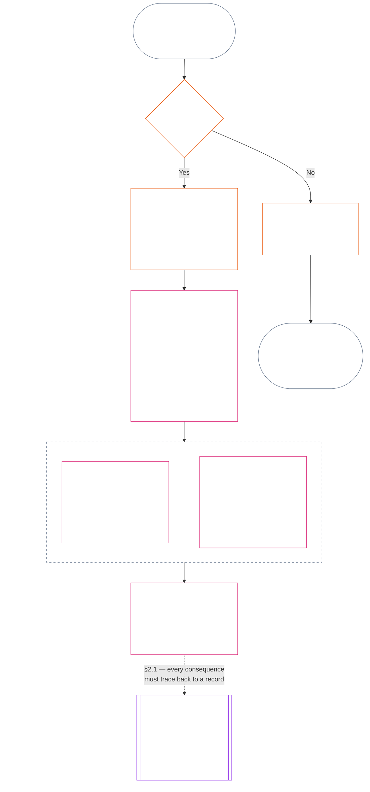
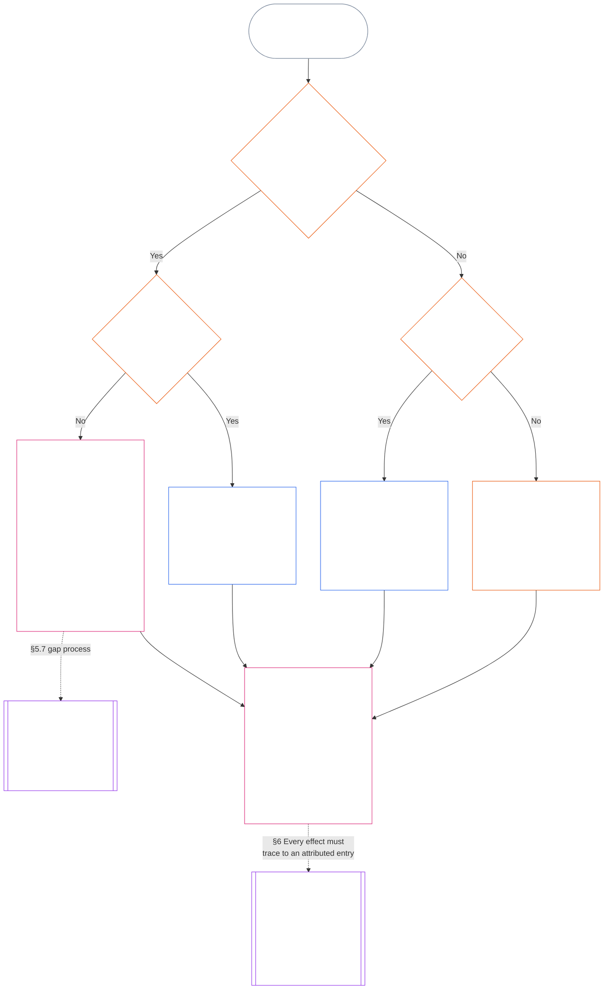

<!-- Complete unreviewed AI-assisted hi translation of current Chapter Eleven; source: core_11.000_standing_assessment.md; source snapshot: 05b7b839; 2026-11-09 source refresh applied. -->

# अध्याय ग्यारह: प्रस्थिति अभिलेख — प्रश्न 1, क्या हुआ

<strong>संग्रह में स्थान (असंक्रियात्मक): फ़ाइल संरचना और पढ़ने के नियम</strong>

> यह फ़ाइल **संज्ञ संविधान का हिस्सा** है और **केवल अन्य क्रमांकित `core_*` फ़ाइलों के साथ एक पाठ के रूप में पढ़े जाने पर बाध्यकारी** है। इसमें **अध्याय ग्यारह** है: प्रस्थिति शृंखला के तीन प्रश्न और **प्रश्न 1** (*क्या हुआ?*), §§1–6 में। **प्रश्न 2** (*यह कितना अच्छा या बुरा था?*) का उत्तर [अध्याय बारह](core_12_standing_measurement.md#chapter-twelve-standing-measurement--question-2-how-good-or-bad-was-it) में है। प्रश्न 3 (*इसके कारण क्या होता है?*) [अध्याय तेरह](../../core_13.000_standing_integration.md#chapter-thirteen-standing-effects-and-integration) में जारी रहता है; योग्य उल्लंघन-अक्ष `s` = 7–9 निष्कर्षों के लिए समीक्षा [अध्याय चौदह](../../core_14.000_misconduct_designation.md#chapter-fourteen-anti-constitutional-misconduct) के संविधान-विरोधी दुराचार निर्धारण तक सीमित है। पढ़ने का क्रम, बाध्यकारी/समर्थक सामग्री का भेद और संग्रह संस्करण का मेटाडेटा [README.md](README.md) में रखा जाता है।

<strong>पाठक मार्गदर्शन (असंक्रियात्मक): अध्याय ग्यारह कहाँ है और यहाँ क्या रहता है</strong>

> | प्रश्न | स्वामी और भूमिका |
> | --- | --- |
> | **1. क्या हुआ?** | अध्याय ग्यारह (यह फ़ाइल): सीमित, चुनौती-योग्य प्रस्थिति अभिलेख में सत्यापित तथ्य स्थापित करना। |
> | **2. यह कितना अच्छा या बुरा था?** | [अध्याय बारह](core_12_standing_measurement.md#chapter-twelve-standing-measurement--question-2-how-good-or-bad-was-it): सहायता और हानि को मिलाए बिना सत्यापित तथ्यों का मापन। |
> | **3. इसके कारण क्या होता है?** | [अध्याय तेरह](../../core_13.000_standing_integration.md#chapter-thirteen-standing-effects-and-integration) पर आगे जाएँ। |
>
> आरोप, लोकप्रियता और विवाद-कथाएँ प्रश्न 1 के उत्तर नहीं हैं। वांछित रेटिंग प्रश्न 1 के तथ्य नहीं दे सकती, और वांछित परिणाम प्रश्न 2 की रेटिंग नहीं दे सकता।

<strong>अनुरेख</strong>

- पूर्ववर्ती:
  - [संवैधानिक चतुष्क](core_00_preamble.md#constitutional-tetrad);
  - [दो संवैधानिक उद्देश्य](core_00_preamble.md#two-constitutional-aims);
  - [भौतिक दाँव](core_00_preamble.md#material-stake);
  - [प्रस्तावना §6 प्रमुख व्यावहारिक प्रक्रिया शृंखलाएँ](../../core_00.000_preamble.md#6-key-practical-process-pipelines) (*अध्याय नौ से पंद्रह की शृंखला*)।
- पूर्ववर्ती:
  - [अध्याय एक](core_01_c_stewardship_capacity_principles.md#chapter-01-principles-and-constraints) (1.010) (*साधारण-भाषा सुलभता* के उत्तरदायी प्रबंधन का खंड-स्तरीय व्याख्या में प्रतिबिंब);
  - [अध्याय एक §16 — उत्तरदायी प्रबंधन का गहन विवेचन](core_01_c_stewardship_capacity_principles.md#16-stewardship-in-depth) (1.010 §16) (*योग्यता-संबद्ध, अनुरेखणीय प्रस्थिति की सिद्धांत-स्तरीय नींव — भरोसा, भूमिकाएँ और मान्यता*);
  - [अध्याय दो से चार](core_02_definition_structure.md) (*अखंडता, अभिलेख और सत्यापन*);
  - [अध्याय पाँच](core_05__definitions_home.md#chapter-five-foundational-definitions) (5.000) (*अध्याय दो से चार के साथ पढ़ी जाने वाली परिभाषाएँ और सर्वोच्चता*)।
- पूर्ववर्ती: [अध्याय नौ](core_09.000_system_alignment_certification_evaluation.md#chapter-nine-system-alignment-certification) (9.000) (*प्रणाली संरेखण प्रमाणन*); [अध्याय नौ भाग C §11](core_09.010_system_alignment_certification_record_recertification.md#11-relationship-to-standing) (9.010 §11) (*प्रस्थिति सेतु — केवल संभावित सत्यापित इनपुट*)।
- प्रस्थिति शृंखला:
  - [प्रस्तावना §6.2 पूरी शृंखला कैसे जुड़ती है](../../core_00.000_preamble.md#62-how-the-full-chain-fits-together);
  - [अध्याय ग्यारह — प्रस्थिति अभिलेख](#chapter-eleven-standing-records--question-1-what-happened) (11.000) (*तीन-प्रश्न ढाँचा और प्रश्न 1 के अभिलेख*);
  - [अध्याय बारह — प्रस्थिति मापन](core_12_standing_measurement.md#chapter-twelve-standing-measurement--question-2-how-good-or-bad-was-it) (12.000) (*प्रश्न 2 का मापन*);
  - [अध्याय तेरह — प्रस्थिति प्रभाव और एकीकरण](../../core_13.000_standing_integration.md#chapter-thirteen-standing-effects-and-integration) (13.000) (*प्रश्न 3 के प्रभाव और एकीकरण*);
  - [अध्याय चौदह](../../core_14.000_misconduct_designation.md#chapter-fourteen-anti-constitutional-misconduct) (14.000) (*केवल योग्य उल्लंघन-अक्ष s = 7–9 के लिए निर्धारण*)।
- इस फ़ाइल के उपखंड:
  - [§1](#1-the-three-questions) (*तीन-प्रश्न ढाँचा और दायरा*);
  - [§2](#2-question-1--what-happened) (*प्रश्न 1 — सत्यापित तथ्य और अभिलेख*);
  - [§3](#3-question-1-event-type-guide--what-kind-of-help-or-harm-occurred) (*प्रश्न 1 घटना-प्रकार मार्गदर्शिका — सहायता और हानि के प्रकार*);
  - [§4](#4-standing-record-operational-requirements) (*सत्यापन और अभिलेख आवश्यकताएँ*);
  - [§5](#5-record-custody-and-opening-authority) (*अभिलेख अभिरक्षा और खोलने का प्राधिकरण*);
  - [§6](#6-handling-a-standing-record) (*प्रस्थिति अभिलेख संभालना*);
- अनुवर्ती:
  - [अध्याय बारह](core_12_standing_measurement.md#chapter-twelve-standing-measurement--question-2-how-good-or-bad-was-it) (12.000) (*प्रश्न 2 — LEQU आधाररेखा, मापन आयाम, मार्ग-वर्णक, स्लॉट व्याकरण, संवैधानिक इनपुट, LEQU पैमाना, मानक योगदान माप, उदाहरण और प्रश्न 3 को हस्तांतरण*);
  - [अध्याय चौदह](../../core_14.000_misconduct_designation.md#chapter-fourteen-part-a-anti-constitutional-misconduct-designation) (14.000) (*केवल निर्धारण — प्रश्न 2 के मापन को फिर से नहीं खोलता*);
  - [अध्याय पंद्रह](../../core_15.000_forum.md#chapter-fifteen-forums-and-jurisdiction) (15.000) (*मंच पर्यवेक्षण और मार्गन*);
  - [अनुच्छेद XXVI-C](../../core_06.020_rights_part_e.md#article-xxvi-c-timely-resolution-and-anti-delay-floor) (*समयबद्ध समाधान*);
  - [अनुच्छेद XX](core_06_rights_part_d.md#article-xx-a-justice-objective-and-scope) (*न्याय संबंधी बाध्यताएँ*)।
- इनके साथ पढ़ें: [अध्याय पाँच *प्रस्थिति अवस्था, योगदान और उल्लंघन*](../../core_05.035_band_accountability.md#defa3-standing-state-contribution-and-violation) (5.035) (*मानक परिभाषा मार्गन*)।
- इनके साथ पढ़ें: [README.md](README.md) (*पठन क्रम*); [doc_architecture.md](../../doc_architecture.md) (*अंगीकार न होने तक गैर-बाध्यकारी संपादकीय मानचित्र*)।

 

अध्याय ग्यारह **सत्यापित तथ्यात्मक अभिलेख (प्रश्न 1)** का संवैधानिक स्वामी है। यह [§1 तीन प्रश्न](#1-the-three-questions) से [§6 प्रस्थिति अभिलेख संभालना](#6-handling-a-standing-record) तक चलता है। [अध्याय बारह](core_12_standing_measurement.md#chapter-twelve-standing-measurement--question-2-how-good-or-bad-was-it) प्रश्न 2 का स्वामी है, [अध्याय बारह §1 प्रश्न 2 — यह कितना अच्छा या बुरा था?](core_12_standing_measurement.md#1-question-2--how-good-or-bad-was-it) से [अध्याय बारह §9 प्रश्न 3 को हस्तांतरण — प्रश्नों के बीच मापन के सूत्र](core_12_standing_measurement.md#9-hand-off-to-question-3--cross-question-measurement-hooks) तक। प्रश्न 3 अध्याय तेरह में जारी रहता है।

*साधारण शब्दों में: यह अध्याय लिखता है कि क्या हुआ और प्रस्थिति अभिलेख रखता है। यह कितना अच्छा या कितना हानिकारक था, इसे अध्याय बारह में दो अलग पटरियों पर मापा जाता है, कभी एक शुद्ध अंक के रूप में नहीं। मामला दाख़िल करना अपने आप में प्रस्थिति नहीं है।*

### 1. तीन प्रश्न

*साधारण शब्दों में: प्रस्थिति का निर्धारण क्रम से तीन प्रश्नों के उत्तर देकर होता है। वांछित रेटिंग से तथ्यों का अनुमान न लगाएँ और मनचाहा परिणाम उचित ठहराने के लिए रेटिंग न चुनें।*

| प्रश्न | प्रश्न क्या पूछता है | उत्तर कहाँ दिया जाता है |
| --- | --- | --- |
| **1. क्या हुआ?** | कौन-से तथ्य सत्यापित हैं, किसके या किस चीज़ के बारे में, किस अवधि में, और किस प्रस्थिति अभिलेख तथा चुनौती स्थिति के साथ? | [खंड 2](#2-question-1--what-happened) और [खंड 3](#3-question-1-event-type-guide--what-kind-of-help-or-harm-occurred) |
| **2. कितना अच्छा या बुरा था?** | वे तथ्य किस प्रकार और कितनी मात्रा का योगदान या उल्लंघन स्थापित करते हैं? | [अध्याय बारह खंड 1](core_12_standing_measurement.md#1-question-2--how-good-or-bad-was-it) |
| **3. इसके कारण क्या होता है?** | उनसे कौन-सी मान्यता, तैयारी, उपचार, सुरक्षा, पाबंदी या अन्य परिणाम निकलता है? | [अध्याय तेरह](../../core_13.000_standing_integration.md#chapter-thirteen-standing-effects-and-integration) |

हर प्रश्न का उत्तर उससे पहले वाले उत्तर पर निर्भर है:

- प्रश्न 1, प्रश्न 2 के लिए सत्यापित तथ्य देता है।
- प्रश्न 2, प्रश्न 3 के लिए उन तथ्यों का मापन करता है।
- प्रश्न 3 को किसी पसंदीदा नतीजे के अनुरूप तथ्य या रेटिंग दोबारा नहीं लिखनी चाहिए।

तीनों प्रश्नों के उत्तर मिलकर एक सीमाबद्ध घटना या एक परिभाषित प्रतिरूप के लिए पूरा प्रस्थिति-मूल्यांकन बनाते हैं। किसी विषय के समय के साथ ऐसे कई मूल्यांकन हो सकते हैं; इनमें से कोई भी उस विषय का शुद्ध अंक या समग्र रेटिंग नहीं है। योगदान और उल्लंघन के प्रस्थिति अभिलेख प्रश्न 1 और 2 के उत्तर सुरक्षित रखते हैं; प्रश्न 3 का निर्णय बताता है कि उनसे आगे क्या होता है।

#### 1.1 उद्देश्य और दायरा

यह अध्याय **प्रणालियों**, **संज्ञ प्राणियों** और **संस्थाओं** के लिए संवैधानिक अभिलेख-रूपरेखा बताता है; [अध्याय बारह](core_12_standing_measurement.md#chapter-twelve-standing-measurement--question-2-how-good-or-bad-was-it) मापन-रूपरेखा बताता है। इसमें [**CS-9.305**](../../corpus_systems/cs_09.305_system_classification_machinery.md#cs-9305-part-a-system-classification-machinery) (*प्रणाली वर्गीकरण यंत्रणा*) के अंतर्गत वर्गीकृत हर प्रणाली शामिल है। ये रूपरेखाएँ गपशप, लोकप्रियता, अस्पष्ट प्रतिष्ठा, अंतर्निहित गरिमा या सामान्य मूल्य का मापन नहीं करतीं; इनमें से कोई भी प्रस्थिति-मूल्यांकन का अनुमत विषय नहीं है।

प्रस्थिति-प्रक्रिया तब भी प्रभावी रहनी चाहिए जब:

- पहले सत्यापित योगदान इतने पुराने हो जाएँ कि वे वर्तमान क्षमता या विश्वसनीयता न दिखा सकें;
- उल्लंघन अनसुलझे रहें;
- सुधार महँगा हो;
- जिम्मेदारी सीमाओं के पार जाती हो; या
- कोई कर्ता जवाबदेही में बाधा डालने के लिए संगठन की परतों या पुनर्नामकरण का उपयोग करे।

ये विषय अपनाए गए कार्यान्वयन पाठ में आते हैं:

- रोज़मर्रा की प्रक्रियाएँ;
- उन्नयन के चरण;
- प्रतिपूर्ति और सुधार की कार्रवाइयाँ;
- पुनर्स्थापनात्मक-जवाबदेही के उपाय; और
- प्रोत्साहन की रचना।

अध्याय बारह का मापन अपने-आप बल-प्रयोग, हिरासत या स्वतंत्रता पर किसी अन्य पाबंदी की अनुमति **नहीं** देता। ऐसे हर परिणाम को अध्याय छह, **अनुच्छेद XX** (*सत्यापित उल्लंघन के बाद न्याय*) की आनुपातिकता, न्यूनतम-प्रतिबंध, समय-सीमा, प्रतिपूर्ति और पुनर्स्थापनात्मक-जवाबदेही की आवश्यकताओं समेत, स्वतंत्र रूप से पूरा करना होगा।

<strong>अनुसरण · परिभाषाएँ · मूल्यांकन · अनुपालन</strong>

- ऊपर की ओर: [अध्याय एक §16 — उत्तरदायी प्रबंधन का विस्तार](core_01_c_stewardship_capacity_principles.md#16-stewardship-in-depth); [अध्याय दो से चार](core_02_definition_structure.md); [अध्याय पाँच](core_05__definitions_home.md#chapter-five-foundational-definitions)।
- आगे: [§2](#2-question-1--what-happened) (*प्रश्न 1*); [§4](#4-standing-record-operational-requirements) (*सत्यापन और अभिलेख आवश्यकताएँ*); [§5](#5-record-custody-and-opening-authority) (*अभिलेख अभिरक्षा और खोलने का प्राधिकार*); [§6](#6-handling-a-standing-record) (*प्रस्थिति अभिलेख का संचालन*); [अध्याय बारह §1](core_12_standing_measurement.md#1-question-2--how-good-or-bad-was-it) (*प्रश्न 2 का मापन*); [अध्याय बारह §2](core_12_standing_measurement.md#2-magnitude-and-severity-input-dimensions) (*मापन निवेश के आयाम*); [अध्याय बारह §3](core_12_standing_measurement.md#3-route-descriptor-catalogs-and-measurement-roles) (*मार्ग-वर्णनकर्ता सूची*); [अध्याय बारह §4](core_12_standing_measurement.md#4-slot-grammar-and-shared-scaling) (*स्लॉट व्याकरण और साझा स्केलिंग*); [अध्याय बारह §5](core_12_standing_measurement.md#5-constitutional-inputs-to-axis-assignment) (*संवैधानिक स्रोत-मार्ग निर्धारण*); [अध्याय बारह §6](core_12_standing_measurement.md#6-unified-proportional-lequ-scale--contribution-and-violation-axes) (*दोनों अक्षों के लिए एकीकृत आनुपातिक LEQU पैमाना*); [अध्याय तेरह](../../core_13.000_standing_integration.md#chapter-thirteen-standing-effects-and-integration) (*प्रश्न 3*)।
- [भौतिक महत्त्व](../../core_05.050_band_oversight.md#materiality) · [O](../../core_05.050_band_oversight.md#materiality) · [M](core_05_band_oversight.md#materiality-determination-a) · [A](core_05_band_oversight.md#materiality-determination-a) · [C](core_05_band_oversight.md#materiality-determination-c)
- [हानि](../../core_05.035_band_accountability.md#harm) · [O](../../core_05.035_band_accountability.md#harm) · [M](../../core_05.035_band_accountability.md#harm-a) · [A](../../core_05.035_band_accountability.md#harm-a) · [C](../../core_05.035_band_accountability.md#harm-c)
- [आनुपातिकता](../../core_05.035_band_accountability.md#proportionality) · [O](../../core_05.035_band_accountability.md#proportionality) · [M](../../core_05.035_band_accountability.md#proportionality-a) · [A](../../core_05.035_band_accountability.md#proportionality-a) · [C](../../core_05.035_band_accountability.md#proportionality-c)

### 2. प्रश्न 1 — क्या हुआ?

<strong>अनुसरण</strong>

- ऊपर की ओर: [§1](#1-the-three-questions) (*तीन-प्रश्न रूपरेखा*); [अध्याय दो से चार](core_02_definition_structure.md) (*अभिलेख, सत्यापन, और परिभाषाओं से परिणामों तक अनुरेखणीयता*)।
- चतुष्क के अंग: **सहभागिता**; **निगरानी** (चुनौती-योग्यता और चुनौती मार्ग)। प्राथमिक उद्देश्य: **समुन्नति** और **सातत्य** (अनुरेखणीय अभिलेख जो बाद के मापन के लिए अलग-अलग योगदान और उल्लंघन निष्कर्ष सुरक्षित रखते हैं)।
- आगे:
  - [§2.2](#22-silence-is-the-default) (*मौन ही सामान्य स्थिति है*);
  - [§2.3](#23-protected-dissent-is-not-a-trigger) (*संरक्षित असहमति कोई ट्रिगर नहीं है*);
  - [§2.4](#24-linked-standing-records-and-no-offset-bridge) (*जुड़े अभिलेख और बिना-समंजन सेतु*);
  - [§2.5](#25-verified-input-gate) (*सत्यापित-निवेश द्वार*);
  - [§2.6](#26-stage-boundary) (*चरण सीमा*);
  - [§2.7](#27-forum-boundary) (*मंच सीमा*);
  - [§3](#3-question-1-event-type-guide--what-kind-of-help-or-harm-occurred) (*घटना-प्रकार मार्गदर्शिका*);
  - [§4](#4-standing-record-operational-requirements) (*अभिलेख आवश्यकताएँ*);
  - [§5](#5-record-custody-and-opening-authority) (*अभिलेख अभिरक्षा और खोलने का प्राधिकार*);
  - [§6](#6-handling-a-standing-record) (*प्रस्थिति अभिलेख का संचालन*);
  - [अध्याय बारह §1](core_12_standing_measurement.md#1-question-2--how-good-or-bad-was-it) (*प्रश्न 2 का मापन*);
  - [अध्याय बारह §2](core_12_standing_measurement.md#2-magnitude-and-severity-input-dimensions) (*मापन निवेश के आयाम*);
  - [अध्याय बारह §3](core_12_standing_measurement.md#3-route-descriptor-catalogs-and-measurement-roles) (*मार्ग-वर्णनकर्ता सूची*);
  - [अध्याय बारह §4](core_12_standing_measurement.md#4-slot-grammar-and-shared-scaling) (*स्लॉट व्याकरण और साझा स्केलिंग*);
  - [अध्याय बारह §5](core_12_standing_measurement.md#5-constitutional-inputs-to-axis-assignment) (*संवैधानिक स्रोत-मार्ग निर्धारण*);
  - [अध्याय बारह §6](core_12_standing_measurement.md#6-unified-proportional-lequ-scale--contribution-and-violation-axes) (*दोनों अक्षों के लिए एकीकृत आनुपातिक LEQU पैमाना*);
  - [अध्याय तेरह](../../core_13.000_standing_integration.md#chapter-thirteen-standing-effects-and-integration) (13.000) (*प्रश्न 3*)।

 

*साधारण शब्दों में: प्रश्न 1, जो हुआ उसका सीमाबद्ध और चुनौती-योग्य विवरण स्थापित करता है। किसी रेटिंग या परिणाम पर विचार करने से पहले यह विषय, घटना या प्रतिरूप, समयावधि, सत्यापित तथ्य और अभिलेख की स्थिति पहचानता है। सत्यापित सहायता और सत्यापित उल्लंघन अलग प्रस्थिति अभिलेखों में रखे जाते हैं, ताकि एक दूसरे को मिटा न सके। ये प्रस्थिति अभिलेख लोकप्रियता के अंक या अस्पष्ट लेबल नहीं हैं।*

**प्रस्थिति अभिलेख** इस अध्याय में किसी खास विषय, कार्यगत दायरे, अभिलेख अवधि, समीक्षा स्थिति और निर्णय संदर्भ के लिए प्रयुक्त सीमाबद्ध अभिलेख है। मापन शुरू होने से पहले इसमें स्थापित होना चाहिए:

- प्रस्थिति अभिलेख किसके या किस चीज़ के बारे में है;
- क्या वह सीमाबद्ध घटना या परिभाषित प्रतिरूप से संबंधित है;
- संबंधित आचरण और प्रभाव कब और कहाँ हुए;
- कौन-से तथ्य सत्यापित हैं और कौन-से विवादित हैं;
- निष्कर्षों का समर्थन करने वाले साक्ष्य, आरोपण और चुनौती मार्ग क्या हैं; और
- प्रस्थिति अभिलेख की वर्तमान समीक्षा, सुधार और प्रतिस्थापन स्थिति क्या है।

आरेख एक घटना का अनुसरण करता है: क्या वह प्रस्थिति अभिलेख खोलने का ट्रिगर है और फिर अभिलेख में क्या दर्ज होता है। आगे के उपखंड हर नियम बताते हैं। "नहीं" वाला मार्ग मुख्य पथ से दाईं ओर निकलता है।

#### 2.1 प्रस्थिति अभिलेख: प्रकार और विषय

प्रश्न 1 सत्यापित सहायता के लिए **योगदान प्रस्थिति अभिलेख** और सत्यापित हानि के लिए **उल्लंघन प्रस्थिति अभिलेख** का उपयोग करता है; इसमें जवाबदेही की विफलताएँ भी शामिल हैं। एक प्रस्थिति अभिलेख दोनों प्रकार के निष्कर्षों को नहीं मिलाता।

- प्रस्थिति अभिलेख किसी संज्ञ प्राणी, संस्था, प्रणाली, मूल्यांकन, सीमाबद्ध घटना, भूमिका, सामूहिक निकाय, कर्ता-विशिष्ट अभिलेख या अन्य संवैधानिक रूप से प्रासंगिक इकाई से संबंधित हो सकता है।
  - उसे अलग-अलग विषयों, भूमिकाओं, प्रणालियों, समुदायों, अभिलेख-अवधियों, समीक्षा स्थितियों या निर्णय संदर्भों को एक अविभेदित प्रस्थिति लेबल में समेटना नहीं चाहिए।
- प्रस्थिति अभिलेख किसी **सीमाबद्ध घटना** — स्पष्ट आरंभ और अंत वाले एक प्रसंग — या बार-बार के आचरण के **प्रतिरूप** को कवर कर सकता है।
  - प्रतिरूप के लिए परिभाषित विषय, दायरा और समीक्षा अवधि चाहिए।
- एक ही विषय के समय के साथ अनेक प्रस्थिति अभिलेख हो सकते हैं, जिनमें परस्पर जुड़े योगदान और उल्लंघन प्रस्थिति अभिलेख भी शामिल हैं।
  - जब संबंधित प्रस्थिति अभिलेखों का विषय, ओवरलैप करती अभिलेख-अवधि, सीमाबद्ध घटना, प्रतिरूप या निर्णय संदर्भ साझा हो, तो **खंड 4.2** के तहत उन्हें एक-दूसरे का **परस्पर संदर्भ** देना होगा।
- प्रस्थिति अभिलेख अलग-थलग प्रतिष्ठा अंक, गरिमा-क्रम, स्थायी स्थिति, सामान्य मूल्य का लेबल या मिला-जुला स्कोरकार्ड नहीं है।
  - कार्यगत आवश्यकताएँ **खंड 4** में हैं।

बाद का कोई भी प्रस्थिति प्रभाव अध्याय तेरह का विषय है। उसे संबंधित प्रस्थिति अभिलेख या अभिलेखों तक अनुरेखणीय रहना चाहिए, पर स्वयं अभिलेख का हिस्सा नहीं बनना चाहिए।

#### 2.2 मौन ही सामान्य स्थिति है

किसी संज्ञ प्राणी, संस्था या प्रणाली का कोई प्रस्थिति अभिलेख न होना सामान्य स्थिति है; अधिकांश संज्ञ प्राणी इसी स्थिति में रहेंगे।

- प्रस्थिति अभिलेख तभी खुलता है जब **खंड 4** के अनुसार कोई ट्रिगर सत्यापित हो। नामित अभिलेख-खोलने वाले प्राधिकारी को प्रविष्टि अनुमोदित करनी होगी और अलग अभिलेख अभिरक्षक को उसे दर्ज करना होगा (**खंड 5**)। प्रस्थिति अभिलेख कभी भी इन कारणों से नहीं खोला जाता:
  - आधाररेखा स्थापित करने के लिए;
  - सूची पूरी करने के लिए; या
  - क्योंकि गेट-नियंत्रित मार्ग का कोई द्वारपाल ऐसा चाहेगा।
- प्रस्थिति अभिलेख का न होना कुछ नहीं बताता। “अंकित नहीं”, “सत्यापित नहीं” और “फाइल में कोई अभिलेख नहीं” जोखिम, कम योगदान या किसी अन्य बात का प्रमाण नहीं हैं। कोई भी अनुपस्थित अभिलेख को अधिक जाँच, कम डिफ़ॉल्ट अनुमान, या गेट-नियंत्रित मार्ग तक सशर्त पहुँच का कारण नहीं मान सकता।
- कोई संस्था या प्रणाली निम्नलिखित की शर्त के रूप में प्रस्थिति अभिलेख, "कोई अभिलेख नहीं" का प्रमाणन, या अभिलेख खोलने की सहमति नहीं माँग सकती:
  - **अनुच्छेद III** (*जीवन-रक्षा और आवश्यक पहुँच*) की अनिवार्यताएँ;
  - **अनुच्छेद III-C** (*श्रम और आर्थिक न्यूनतम*) के संरक्षण;
  - सामान्य वाणिज्य; या
  - प्रभावित पक्ष के रूप में सहभागिता।
  अपवाद हैं [अध्याय तेरह §7.2 क्षमता-सीमाएँ और मंजूरियाँ](../../core_13.000_standing_integration.md#72-competency-bars-and-clearances) के तहत विशिष्ट विश्वास-संवेदी गेट-नियंत्रित मार्गों के लिए प्रकाशित क्षमता-सीमाएँ; उनमें यह बताना होगा कि गेट-नियंत्रित मार्ग विश्वास-संवेदी क्यों है।
- जब किसी विषय के बारे में प्रस्थिति अभिलेख खोला जाए, तो **खंड 4** के अनुसार उसे सूचना दी जानी चाहिए। सूचना केवल तभी टाली जा सकती है जब दस्तावेजीकृत [साक्ष्य संरक्षण](core_05_band_oversight.md#evidence-preservation) या सुरक्षा की आवश्यकता इसका औचित्य दे, और केवल एक सीमित, निर्धारित अवधि के लिए। सूचना से प्रस्थिति अभिलेख चुनौती-योग्य बनता है: जिस विषय को अभिलेख के अस्तित्व का पता ही न हो, वह उसे चुनौती या सुधार नहीं सकता।

#### 2.3 संरक्षित असहमति कोई ट्रिगर नहीं है

असहमति या शांतिपूर्ण विरोध — जिसमें [संरक्षित अहिंसक सविनय अवज्ञा](core_06_rights_part_b.md#xi-d-nonviolent-civil-disobedience) भी शामिल है — **अनुच्छेद XI-D** (*सभा, असहमति और शांतिपूर्ण विरोध*) ([*असहमति और शांतिपूर्ण विरोध का न्यूनतम*](core_06_rights_part_b.md#xi-d-dissent-and-peaceful-protest)) के तहत, कोई सत्यापित ट्रिगर नहीं है।

- इससे उल्लंघन प्रस्थिति अभिलेख नहीं खुलता, न वह बढ़ता या गंभीर होता है; यह **खंड 8.2** के तहत गंभीरता का निवेश नहीं है, और दोहराने से वह प्रतिरूप नहीं बन जाता।
- ऐसा अलग किया जा सकने वाला आचरण जो स्वतंत्र रूप से किसी संवैधानिक न्यूनतम का उल्लंघन करता हो, अपने ही आधार पर दर्ज होगा; विरोध के दृष्टिकोण, कारण या लक्ष्य के लिए उसकी गंभीरता नहीं बढ़ाई जाएगी।

#### 2.4 जुड़े प्रस्थिति अभिलेख और बिना-समंजन सेतु

<strong>अनुसरण</strong>

- ऊपर की ओर: [§2.1](#21-standing-records-kinds-and-subjects) (*अलग योगदान और उल्लंघन अभिलेख*)।
- आगे:
  - [§2.5](#25-verified-input-gate) (*सत्यापित-निवेश द्वार*);
  - [§2.7](#27-forum-boundary) (*मंच सीमा*);
  - [§4.2](#42-related-standing-record-cross-references) (*परस्पर संदर्भ*);
  - [अध्याय बारह §1](core_12_standing_measurement.md#1-question-2--how-good-or-bad-was-it) (*प्रश्न 2 का मापन*);
  - [अध्याय बारह §2](core_12_standing_measurement.md#2-magnitude-and-severity-input-dimensions) (*मापन निवेश के आयाम*);
  - [अध्याय बारह §3](core_12_standing_measurement.md#3-route-descriptor-catalogs-and-measurement-roles) (*मार्ग-वर्णनकर्ता सूचियाँ*);
  - [अध्याय बारह §4](core_12_standing_measurement.md#4-slot-grammar-and-shared-scaling) (*स्लॉट व्याकरण और साझा स्केलिंग*);
  - [अध्याय बारह §5](core_12_standing_measurement.md#5-constitutional-inputs-to-axis-assignment) (*संवैधानिक स्रोत-मार्ग निर्धारण*);
  - [अध्याय बारह §6](core_12_standing_measurement.md#6-unified-proportional-lequ-scale--contribution-and-violation-axes) (*दोनों अक्षों के लिए एकीकृत आनुपातिक LEQU पैमाना*);
  - [अध्याय तेरह](../../core_13.000_standing_integration.md#chapter-thirteen-standing-effects-and-integration) (13.000) (*प्रश्न 3*)।
- साथ पढ़ें: [अध्याय तेरह — प्रस्थिति एकीकरण](../../core_13.000_standing_integration.md#3-automatic-integration-review-and-continuity) (13.000) (*अधिकार-त्याग न होना और जुड़े अभिलेखों का एकीकरण*); [अध्याय तेरह §7.2 — क्षमता-सीमाएँ और मंजूरियाँ](../../core_13.000_standing_integration.md#72-competency-bars-and-clearances) (13.000 §7.2); [अध्याय तेरह §5.2 — प्रस्थिति ताले](../../core_13.000_standing_integration.md#52-prevention--general-standing-locks) (13.000 §5.2)।

 

**मूल नियम:** सत्यापित **योगदान प्रस्थिति अभिलेख** और सत्यापित **उल्लंघन प्रस्थिति अभिलेख** को **खंड 2.1** के तहत अलग रखा जाता है। योगदान या उल्लंघन का हर निष्कर्ष अपने प्रस्थिति अभिलेख में अपने समर्थित तथ्यों पर आधारित होना चाहिए। विश्लेषण और सहायक सामग्री में दोनों अभिलेख-पथ अलग-अलग अनुरेखणीय रहने चाहिए। कोई एक प्रविष्टि या जुड़े अभिलेखों का समूह शुद्ध अंक, मिला-जुला अंक या लेन-देन नहीं है।

- **उल्लंघन प्रस्थिति अभिलेख और प्रस्थिति ताले:**
  - अध्याय तेरह के तहत उल्लंघन प्रस्थिति अभिलेखों से निकले लागू **प्रस्थिति ताले**, किसी सत्यापित उल्लंघन के अनसुलझे रहने तक प्रस्थिति सीमित कर सकते हैं, भूमिका-पात्रता रोक सकते हैं या उपचार तक पहुँच को प्रभावित कर सकते हैं।
  - प्रस्थिति ताले योगदान प्रस्थिति अभिलेखों में दर्ज सत्यापित सकारात्मक योगदान को मिटा नहीं सकते।
  - अनसुलझे सत्यापित उल्लंघनों को केवल समय बीतने से छूट नहीं मिलती।
  - सत्यापित उल्लंघनों को असंबंधित योगदान प्रस्थिति अभिलेखों को झूठी नकारात्मक प्रतिष्ठा-फ़ाइल में बदलना नहीं चाहिए।
- **योगदान प्रस्थिति अभिलेख और क्षमता-मंजूरियाँ:**
  - सत्यापित योगदान प्रकाशित **क्षमता-सीमाओं** के विरुद्ध लागू **क्षमता-मंजूरियों** का समर्थन कर सकता है और वर्तमान तथा भूमिका-संबंधी होने पर विश्वास, भूमिका या मान्यता से जुड़ी पात्रता में सहायक हो सकता है।
  - सत्यापित योगदान किसी सत्यापित उल्लंघन निष्कर्ष का समंजन, औसत घटाना, बहाना या पुनःलेबल नहीं कर सकता।
  - द्वार की शर्त पूरी होने से लागू प्रस्थिति ताला नहीं हटता।

**एकमात्र अपवाद:** यदि उल्लंघन निष्कर्ष स्वयं किसी दावा किए गए योगदान को गलत साबित करता है — उदाहरण के लिए, साक्ष्य दिखाएँ कि आपने वास्तव में वह काम नहीं किया जिसका दावा योगदान अभिलेख में है — तो उचित साक्ष्य और समीक्षा प्रक्रिया के जरिए जुड़े योगदान प्रस्थिति अभिलेख को सुधारा या हटाया जा सकता है। इसके लिए **खंड 4.2** के अनुसार आवश्यक परस्पर संदर्भ देना होगा। लेकिन उल्लंघन अलग योगदान प्रस्थिति अभिलेखों में दर्ज असंबंधित सहायता अपने-आप नहीं मिटाता।

#### 2.5 सत्यापित-निवेश द्वार

यह द्वार इस प्रकार काम करता है:

- प्रस्थिति, विश्वास, भूमिका, मान्यता या मान्यता की पात्रता को प्रभावित करने वाला कोई भी निर्णय केवल संबंधित **योगदान प्रस्थिति अभिलेखों** या **उल्लंघन प्रस्थिति अभिलेखों** के सत्यापित निवेश का उपयोग कर सकता है।
- आरोप, निर्णय न पाए दावे, अस्थायी मार्ग-टैग, केवल प्रवेश-चरण के विवरण और विवाद-चरण की अन्य सामग्री अपने-आप प्रस्थिति के लिए योगदान का स्वरूप या उल्लंघन का स्वरूप नहीं देती।
- सत्यापित निवेश एक **प्रस्थिति निष्कर्ष** है: सत्यापित योगदान निष्कर्ष (अक्ष I) या सत्यापित उल्लंघन निष्कर्ष (अक्ष II)।
- योगदान और उल्लंघन के निष्कर्ष अलग-अलग प्रस्थिति अभिलेखों में रहते हैं (देखें **खंड 2.1**)।

#### 2.6 चरण सीमा

प्रस्थिति अभिलेख के चरण अलग रहते हैं:

- प्रश्न 1 सत्यापित तथ्यों को दर्ज करता है; प्रश्न 2 उनका मापन करता है।
- प्रश्न 2 का मापन लंबित हो तब भी, सत्यापित तथ्यात्मक आधार पूरा होते ही प्रस्थिति अभिलेख खोला जा सकता है।
- मापन होने तक प्रश्न 2 के खानों में लंबित स्थिति बतानी चाहिए; किसी स्लॉट या श्रेणी का संकेत नहीं देना चाहिए।
- प्रस्थिति अभिलेख को प्रश्न 3 का कोई **प्रस्थिति प्रभाव** बताना या लागू करना नहीं चाहिए।

#### 2.7 मंच सीमा

*साधारण शब्दों में: मंच वह जगह है जहाँ विवादों की निगरानी होती है, उन्हें चुनौती दी जाती है और सत्यापित परिणामों तक लाया जाता है — लेकिन मामला दायर करना या किसी विवरण पर जीतना प्रस्थिति को अद्यतन नहीं करता। **खंड 2.5** का सत्यापित-निवेश द्वार अब भी लागू है। जब मंच अध्याय दो से चार के तहत तथ्य सत्यापित करता है, तो वह प्रस्थिति अभिलेख खोल, अद्यतन या सुधार सकता है — या चुनौती पर खराब अभिलेख को अलग रख सकता है। मंच अच्छे और बुरे को एक अंक में नहीं मिलाते और स्वयं प्रस्थिति श्रेणी नहीं गढ़ते।*

इस खंड का एक ही प्रश्न पर अधिकार है: मंच का काम प्रस्थिति अभिलेख तक कैसे पहुँचता है। शृंखला के अन्य चरण यहाँ नामित स्वामियों के हैं, और क्रम यह है:

1. विवाद दायर होता है और मंच **मंच मामला अभिलेख** रखता है, जो प्रस्थिति अभिलेख नहीं है। स्वामी: [अध्याय पंद्रह §2.3 मंच मामला अभिलेख, प्रस्थिति अभिलेख और विवाद](core_11_forum.md#23-forum-case-records-standing-records-and-contests); [§2.7.1 मंच मामला अभिलेख](#271-forum-case-record) भी देखें।
2. मंच [अध्याय दो से चार](core_02_definition_structure.md) के तहत तथ्य सत्यापित करता है।
3. सत्यापित निष्कर्ष सत्यापित-निवेश द्वार से गुजरते हैं। स्वामी: [§2.5 सत्यापित-निवेश द्वार](#25-verified-input-gate)।
4. नामित अभिलेख-खोलने वाला प्राधिकारी, जो मंच भी हो सकता है, प्रस्थिति अभिलेख खोलता, अद्यतन या सुधार करता है, अथवा चुनौती पर खराब अभिलेख अलग रखता है। प्रस्थिति अभिलेख में क्या होगा, इसका स्वामी [§4.1 न्यूनतम अभिलेख सामग्री](#41-minimum-record-contents) है; कौन कार्रवाई कर सकता है, इसका स्वामी [§5 अभिलेख अभिरक्षा और खोलने का प्राधिकार](#5-record-custody-and-opening-authority) है।
5. प्रस्थिति अभिलेख में केवल सत्यापित तथ्य रहते हैं; उसके बाद प्रश्न 2 उनका मापन करता है। स्वामी: [§2.6 चरण सीमा](#26-stage-boundary) और [अध्याय बारह §1 प्रश्न 2 — कितना अच्छा या बुरा था?](core_12_standing_measurement.md#1-question-2--how-good-or-bad-was-it)।
6. कोई प्रस्थिति प्रभाव हो तो वह [अध्याय तेरह](../../core_13.000_standing_integration.md#chapter-thirteen-standing-effects-and-integration) के तहत आता है; प्रस्थिति प्रभावों का स्वामी वही है।

[अध्याय पंद्रह](../../core_15.000_forum.md#chapter-fifteen-forums-and-jurisdiction) के तहत मंच-परिवार निगरानी करते हैं कि ठोस विवाद प्रस्थिति-प्रक्रिया से कैसे गुजरते हैं। [अध्याय पंद्रह §6 समयबद्ध समाधान, भौतिकता स्तर और विलंब-विरोधी अनुशासन](core_11_forum.md#6-timely-resolution-materiality-tiers-and-anti-delay-discipline) और [अनुच्छेद XXVI-C](../../core_06.020_rights_part_e.md#article-xxvi-c-timely-resolution-and-anti-delay-floor) (*समयबद्ध समाधान और विलंब-विरोधी न्यूनतम*) के तहत मंच ये उपलब्ध कराते हैं:

- सुलभ चुनौती;
- स्वतंत्र समीक्षा;
- फॉरेंसिक सहायता;
- उपचार का क्रम; और
- स्तर-आधारित समय-सीमाएँ।

जब मंच के निष्कर्ष अध्याय दो से चार के तहत सत्यापित-निवेश द्वार पूरा करते हैं, तो वे:

- **खंड 4.1** के तहत प्रस्थिति अभिलेख **खोल, अद्यतन या सुधार** सकते हैं; या
- **चुनौती पर खराब अभिलेख को अलग रख** सकते हैं।

##### 2.7.1 मंच मामला अभिलेख

खुले विवाद पर मंच की अपनी फ़ाइल [**मंच मामला अभिलेख**](../../core_05.035_band_accountability.md#forum-case-record) है, जिसे [अध्याय पंद्रह §2.3 मंच मामला अभिलेख, प्रस्थिति अभिलेख और विवाद](core_11_forum.md#23-forum-case-records-standing-records-and-contests) में परिभाषित किया गया है। यह **प्रस्थिति अभिलेख नहीं** है।

##### 2.7.2 मंच निष्कर्ष और प्रश्न 2 का मापन

मंच के सत्यापित तथ्यात्मक निष्कर्ष प्रश्न 1 के प्रस्थिति अभिलेख का तथ्यात्मक आधार दे सकते हैं। वे सत्यापित योगदान या उल्लंघन का प्रश्न 2 मापन — कितना अच्छा या बुरा था — **निर्धारित नहीं** करते ([§2.6 चरण सीमा](#26-stage-boundary))। इसलिए:

- मंच की कार्यवाहियों को योगदान और उल्लंघन सामग्री को एक शुद्ध अंक, मिला-जुला गुण-दोष उत्तर या अविभेदित प्रस्थिति लेबल में **नहीं** मिलाना चाहिए; जुड़े प्रस्थिति अभिलेख [§2.1 प्रस्थिति अभिलेख: प्रकार और विषय](#21-standing-records-kinds-and-subjects) और [§2.4 जुड़े प्रस्थिति अभिलेख और बिना-समंजन सेतु](#24-linked-standing-records-and-no-offset-bridge) के तहत अलग रहते हैं।
- मंच के परिणामों को विवाद-कथाओं, मार्ग-निर्धारण की सुविधा या पैनल की पसंद को प्रदर्शित सत्यापित निवेश ([§2.5 सत्यापित-निवेश द्वार](#25-verified-input-gate)), अलग मापन ([अध्याय बारह §1 प्रश्न 2 — कितना अच्छा या बुरा था?](core_12_standing_measurement.md#1-question-2--how-good-or-bad-was-it)) या [अध्याय तेरह](../../core_13.000_standing_integration.md#chapter-thirteen-standing-effects-and-integration) के स्वामित्व वाली प्रस्थिति-प्रभाव प्रक्रिया के स्थान पर **नहीं** रखना चाहिए।

##### 2.7.3 मंच सीमा किन चीज़ों को कम नहीं करती

यह सीमा निम्नलिखित के तहत आवश्यक चुनौती, उपचार, अंतरिम राहत या प्रक्रियात्मक संरक्षण को **कम नहीं** करती:

- [अनुच्छेद XIII-A](core_06_rights_part_c.md#article-xiii-a-reliability-and-trustworthiness-baseline) (*विश्वसनीयता और भरोसेमंद होने की आधाररेखा*);
- [अनुच्छेद XIII-B](core_06_rights_part_c.md#article-xiii-b-right-to-redress-and-remedy) (*प्रतिशोध और उपचार का अधिकार*);
- [अध्याय पंद्रह §6 समयबद्ध समाधान, भौतिकता स्तर और विलंब-विरोधी अनुशासन](core_11_forum.md#6-timely-resolution-materiality-tiers-and-anti-delay-discipline);
- [अनुच्छेद XXVI-C](../../core_06.020_rights_part_e.md#article-xxvi-c-timely-resolution-and-anti-delay-floor) (*समयबद्ध समाधान और विलंब-विरोधी न्यूनतम*); या
- संबंधित न्याय-अनुच्छेद।

इसका अपेक्षित काम यह है कि मंच के सत्यापित निष्कर्ष अन्य सत्यापित निवेशों की तरह उसी द्वार से प्रस्थिति तक पहुँचें — उसके आसपास से नहीं।

### 3. प्रश्न 1 की घटना-प्रकार मार्गदर्शिका — किस प्रकार की सहायता या हानि हुई?

*साधारण शब्दों में: तथ्य सत्यापित होने के बाद क्या हुआ, यह बताने के लिए इन तालिकाओं का उपयोग करें। ये शामिल योगदान या उल्लंघन का प्रकार पहचानने में मदद करती हैं। वे यह तय नहीं करतीं कि वह कितना अच्छा या बुरा था, स्लॉट नहीं देतीं और यह निर्धारित नहीं करतीं कि उसके कारण क्या होगा।*

#### 3.1 योगदान घटना-प्रकार

**अर्हता नियम:** दावा किया गया योगदान तभी गिना जाता है जब उसका अनुरेखण किया जा सके, उसकी लागत दूसरों पर न डाली गई हो, और वह पूरी प्रभावी संविधान के अनुरूप हो।

- दूसरों पर डाली गई हानि, दबावकारी निर्भरताएँ, अधिकार-न्यूनतम को संकीर्ण करना या छिपे हुए बोझ दावा किए गए योगदान को अयोग्य या सीमित कर सकते हैं।
- दावा किया गया योगदान किसी अलग उल्लंघन निष्कर्ष का समंजन नहीं करता।

नीचे की तालिका की हर पंक्ति सत्यापित सहायता के एक सामान्य मार्ग और उसकी संवैधानिक प्रासंगिकता का नाम बताती है। एक ही प्रस्थिति अभिलेख पर एक से अधिक पंक्तियाँ लागू हो सकती हैं।

| सत्यापित योगदान का प्रकार | क्या हुआ | चतुष्क के अंग | प्राथमिक उद्देश्य |
| --- | --- | --- | --- |
| जीवन-रक्षा और शारीरिक देखभाल | किसी को भोजन, आश्रय, चिकित्सा देखभाल या सुरक्षा मिली | **सहभागिता**, **निगरानी** | **समुन्नति** |
| देखभाल और शिक्षण | बच्चों का पालन-पोषण हुआ, बुज़ुर्गों की देखभाल हुई या दूसरों को शिक्षा मिली | **सहभागिता**, **निगरानी** | **समुन्नति**, **सातत्य** |
| आघात का समाधान | किसी को उस मनोवैज्ञानिक हानि से उबरने में सहायता मिली जिसने कुशलता में बाधा डाली थी | **सहभागिता**, **जवाबदेही** | **समुन्नति** |
| गंभीर बोझ हटाना | कुचलने वाला ऋण, शोषणकारी काम की स्थितियाँ या व्यवस्थागत बाधाएँ हटाई गईं | **सहभागिता**, **निगरानी** | **समुन्नति** |
| स्वायत्तता बहाल करना | किसी को अपने जीवन के बारे में सार्थक विकल्प मिले | **सहभागिता** | **समुन्नति** |
| उत्पादक क्षमता बढ़ाना | औज़ारों, अवसंरचना या अवसरों ने दूसरों को स्वतंत्र रूप से फलने-फूलने में सक्षम बनाया | **सहभागिता**, **निगरानी** | **समुन्नति**, **सातत्य** |
| समय-कुशलता सुधारना | टाली जा सकने वाली प्रतीक्षा, प्रशासनिक अड़चन या समन्वय का अतिरिक्त बोझ घटा, जिससे देखभाल, विश्राम, स्वायत्तता, सीखने या अधिकार-संगत काम के लिए उपयोगी समय लौटा | **सहभागिता**, **निगरानी** | **समुन्नति** |
| पारिस्थितिकी या अवसंरचना का जोखिम घटाना | पर्यावरणीय पतन या महत्वपूर्ण प्रणाली की विफलता रोकी गई | **निगरानी**, **जवाबदेही** | **सातत्य**, **समुन्नति** |
| पारिस्थितिक पदचिह्न घटाना | दूसरों या पारिस्थितिक तंत्रों पर बोझ डाले बिना संसाधन-उपयोग, उत्सर्जन या भूमि और पानी की माँग सत्यापित रूप से घटाई गई | **निगरानी**, **जवाबदेही** | **सातत्य**, **समुन्नति** |
| पारिस्थितिक तंत्रों का पुनर्वास | क्षतिग्रस्त भूमि, पानी या आवास को कार्यशील, आत्मनिर्भर स्थिति की ओर बहाल किया गया | **निगरानी**, **जवाबदेही** | **सातत्य**, **समुन्नति** |
| संकटग्रस्त प्रजातियों की रक्षा | विलुप्ति के जोखिम वाली प्रजातियों या उन पर निर्भर आवासों को नष्ट होने से बचाया गया | **निगरानी**, **जवाबदेही** | **सातत्य**, **समुन्नति** |
| प्रदूषण और कचरा घटाना | संदूषण, हानिकारक उत्सर्जन या कचरे को रोका, हटाया या सुरक्षित रूप से संभाला गया | **निगरानी**, **जवाबदेही** | **समुन्नति**, **सातत्य** |
| सुरक्षा, सत्य, लेखापरीक्षण-योग्यता या चुनौती-क्षमता मज़बूत करना | अधिकारों की रक्षा और शक्ति को जवाबदेह रखने के लिए संस्थाएँ या कार्य-पद्धतियाँ बनाई या सुधारी गईं | **सहभागिता**, **निगरानी**, **जवाबदेही** | **समुन्नति**, **सातत्य** |

#### 3.2 उल्लंघन घटना-प्रकार

**अर्हता नियम:** उल्लंघन घटना-प्रकार के लिए **अध्याय दो से चार** के तहत सत्यापित उल्लंघन निष्कर्ष चाहिए, जो अनुरेखणीय, सीमाबद्ध, लेखापरीक्षण-योग्य और चुनौती-योग्य बना रहे।

- आरोप, अस्थायी टैग, मंच-कथाएँ और प्रवेश-चरण के लेबल मार्ग-निर्धारण या प्रारंभिक छँटाई में मदद कर सकते हैं, पर वे अपने-आप प्रश्न 1 पूरा नहीं करते।
- सकारात्मक योगदान किसी सत्यापित उल्लंघन का समंजन, बहाना, निरसन या पुनःलेबल नहीं करता।

नीचे की तालिका की हर पंक्ति सत्यापित क्षति, खतरे या कर्तव्य-विफलता के एक सामान्य मार्ग और उसकी संवैधानिक प्रासंगिकता का नाम बताती है। एक ही प्रस्थिति अभिलेख पर एक से अधिक पंक्तियाँ लागू हो सकती हैं।

| सत्यापित क्षति या खतरे का प्रकार | क्या हुआ | चतुष्क के अंग | प्राथमिक उद्देश्य |
| --- | --- | --- | --- |
| जीवन-रक्षा या शारीरिक देखभाल से वंचित करना | टाली जा सकने वाली मृत्यु, देखभाल से इनकार, असुरक्षित स्थितियाँ या जीवन-रक्षा के साधनों से भौतिक वंचना हुई | **जवाबदेही**, **सहभागिता** | **समुन्नति** |
| गंभीर टाला जा सकने वाला बोझ | कुचलने वाले, थोपे गए या व्यवस्थागत रूप से दूसरों पर डाले गए बोझ ने कुशलता या स्वायत्तता को भौतिक रूप से क्षति पहुँचाई | **जवाबदेही**, **सहभागिता** | **समुन्नति** |
| दबाव से स्वायत्तता का ह्रास | दबाव, चालाकी, विश्वसनीय धमकी, बंदीकरण या स्वतंत्रता को खतरा हुआ | **जवाबदेही**, **सहभागिता** | **समुन्नति** |
| अधिकार-न्यूनतम को निष्फल करना | अपरक्राम्य संवैधानिक न्यूनतम, सर्वोच्चता या चुनौती और उपचार तक पहुँच का भौतिक उल्लंघन हुआ | **जवाबदेही**, **निगरानी** | **समुन्नति**, **सातत्य** |
| पारिस्थितिकी या अवसंरचना को क्षति | संवैधानिक कुशलता के लिए आवश्यक स्थितियों को नुकसान पहुँचा | **जवाबदेही**, **निगरानी** | **सातत्य**, **समुन्नति** |
| प्रदूषण या कचरे से हानि | संदूषण, हानिकारक उत्सर्जन या कचरे ने हवा, पानी, मिट्टी या स्वास्थ्य को नुकसान पहुँचाया | **जवाबदेही**, **निगरानी** | **समुन्नति**, **सातत्य** |
| प्रजातियों या आवासों का विनाश | विलुप्ति के जोखिम वाली प्रजातियों या उन पर निर्भर आवास नष्ट किए गए, खंडित हुए या क्षय की ओर धकेले गए; इसमें ऐसी हानि भी शामिल है जिसे समंजन-योग्य माना गया | **जवाबदेही**, **निगरानी** | **सातत्य**, **समुन्नति** |
| पारिस्थितिक पुनर्प्राप्ति क्षमता का ह्रास | हानि के बाद पुनर्जीवित होने की पारिस्थितिक तंत्र की क्षमता बंद कर दी गई या उलटना टाले जा सकने योग्य रूप से कठिन या असंभव बनाया गया | **जवाबदेही**, **निगरानी** | **सातत्य**, **समुन्नति** |
| दूसरों पर डाली गई पारिस्थितिक हानि या क्षय | पारिस्थितिक लागत दूसरों या पारिस्थितिक तंत्रों पर डाल दी गई, संसाधन पुनर्जनन से आगे तक क्षय किए गए, या पदचिह्न अथवा स्थिरता के दावे ने जारी गिरावट छिपाई | **जवाबदेही**, **निगरानी** | **सातत्य**, **समुन्नति** |
| उत्पादक क्षमता नष्ट करना | स्वतंत्र रूप से फलने-फूलने के लिए आवश्यक औज़ार, क्षमताएँ, संबंध या संसाधन छीन लिए गए | **जवाबदेही** | **समुन्नति** |
| सुरक्षा, सत्य या लेखापरीक्षण-योग्यता का क्षरण | छिपाव, दुष्प्रचार, टूटे अभिलेख, पहुँच से बाहर चुनौती मार्ग या समीक्षा न हो सकने वाला एकत्रीकरण हुआ | **निगरानी**, **जवाबदेही** | **समुन्नति**, **सातत्य** |
| जवाबदेही में बाधा | जवाबदेही की व्यवस्था — साक्ष्य की अखंडता, सत्यापन, मंच प्रक्रिया, प्रस्थिति अभिलेख, उपचार की समय-सीमाएँ या चुनौती और प्रतिकार के मार्ग — में सत्यापित हस्तक्षेप हुआ; जब बाधा किसी अलग मूल हानि पर किया गया मेटा-हमला हो, तो उससे जुड़ा अलग उल्लंघन प्रस्थिति अभिलेख खोलें | **जवाबदेही**, **निगरानी**, **समयबद्धता** | **समुन्नति**, **सातत्य** |
| प्रणाली पर कब्ज़ा या निर्भरता का दुरुपयोग | संरचनात्मक सक्षमकरण, निर्भरता-असममिति का दुरुपयोग, बच निकलने-विरोधी रचना या जवाबदेही मार्गों पर कब्ज़ा हुआ | **जवाबदेही**, **सहभागिता** | **सातत्य**, **समुन्नति** |

---

*कवरेज: यह आंशिक मसौदा केवल अध्याय ग्यारह §§1–3 को कवर करता है। §§4–6 और अध्याय बारह इसमें शामिल नहीं हैं।*

### 4. सत्यापन और अभिलेख आवश्यकताएँ

<strong>अनुसरण</strong>

- ऊपर की ओर: [§2](#2-question-1--what-happened) (*प्रश्न 1 के अभिलेख और घटना-प्रकार मार्गदर्शिका*); [अध्याय दो से चार](core_02_definition_structure.md) (*अभिलेख, सत्यापन और परिभाषाओं से परिणामों तक अनुरेखणीयता*)।
- आगे:
  - [§4.1](#41-minimum-record-contents) (*न्यूनतम सामग्री*);
  - [§4.2](#42-related-standing-record-cross-references) (*परस्पर संदर्भ*);
  - [§5](#5-record-custody-and-opening-authority) (*अभिलेख अभिरक्षा और खोलने का प्राधिकार*);
  - [§6](#6-handling-a-standing-record) (*प्रस्थिति अभिलेख का संचालन*);
  - [अध्याय बारह §1](core_12_standing_measurement.md#1-question-2--how-good-or-bad-was-it) (*प्रश्न 2*)।
- साथ पढ़ें: [CF-15.415 §8 प्रतिबंधित जानकारी का प्राधिकार](../../corpus_forum/cf_15.415_routing_operations_transfer_certification_representative_treatment.md#cf-15415-8-restricted-information-authority) (*[§4.1](#41-minimum-record-contents) के तहत बताए गए प्रकटीकरण प्रतिबंध पर विवाद हो तो पहला पड़ाव*)।

 

*साधारण शब्दों में: यह खंड बताता है कि हर प्रस्थिति अभिलेख में क्या होना चाहिए, संबंधित प्रस्थिति अभिलेख एक-दूसरे का संदर्भ कैसे देते हैं और अभिलेखों के संस्करण कैसे बनाए जाते हैं। प्रस्थिति अभिलेख कौन खोल और रख सकता है तथा उसे चुनौती या सुधार कैसे किया जा सकता है, यह [§5 अभिलेख अभिरक्षा और खोलने का प्राधिकार](#5-record-custody-and-opening-authority) में है। प्रश्न 2 के मापन केवल सत्यापित तथ्यात्मक आधार दर्ज होने के बाद जोड़े जा सकते हैं।*

सामग्री और साक्ष्य का अपेक्षित ब्योरा भौतिक दाँव और प्रणाली की श्रेणी के साथ बढ़ सकता है। इस अनुपात-निर्धारण से प्रस्थिति-प्रक्रिया के दायरे में आने वाला कोई संज्ञ प्राणी, संस्था या प्रणाली बाहर नहीं होता।

#### 4.1 न्यूनतम अभिलेख सामग्री

प्रस्थिति अभिलेख में नीचे दिए गए खाने होते हैं; अंतिम दो उपखंड प्रत्येक अक्ष के लिए अतिरिक्त खाने जोड़ते हैं। प्रस्थिति अभिलेख में क्या शामिल हो सकता है, यह तय करने वाला सत्यापित-निवेश द्वार [§2.5 सत्यापित-निवेश द्वार](#25-verified-input-gate) में है। प्रश्न 1 के तथ्यों को प्रश्न 2 के मापन से अलग रखने का नियम [§2.6 चरण सीमा](#26-stage-boundary) में है।

##### 4.1.1 हर प्रस्थिति अभिलेख में अनिवार्य खाने

हर प्रस्थिति अभिलेख में कम-से-कम ये बातें होनी चाहिए:

- प्रस्थिति अभिलेख का प्रकार — **योगदान प्रस्थिति अभिलेख** या **उल्लंघन प्रस्थिति अभिलेख**;
- किसका या किस चीज़ का मूल्यांकन हो रहा है और मूल्यांकन का दायरा, जिसमें संबंधित प्रणाली-सीमाएँ, भूमिका-सीमाएँ, प्रभावित समुदाय और निर्भरता-संबंध शामिल हैं;
- किस आचरण या निष्कर्ष का मूल्यांकन हो रहा है, जिसमें वे कार्य, चूक, कर्तव्य, प्रभाव, सीमाबद्ध घटना, दायरे के भीतर प्रतिरूप, योगदान अभिलेख या उल्लंघन निष्कर्ष शामिल हैं जिन पर प्रस्थिति अभिलेख निर्भर करता है;
- अभिलेख अवधि और वर्तमान समीक्षा स्थिति — उदाहरण के लिए, अस्थायी, बताए गए उद्देश्य के लिए अंतिम, चुनौती के अधीन, प्रतिस्थापित या निर्धारित पुनर्मूल्यांकन के लिए लंबित;
- **खंड 4.2** के अनुसार परस्पर संदर्भित कोई संबंधित प्रस्थिति अभिलेख;
- आधिकारिक अभिलेख, गवाह, मापन, लेखापरीक्षण, मंच के निर्णय या अन्य सत्यापन सामग्री जो अध्याय दो से चार के तहत प्रस्थिति अभिलेख को प्रदर्शित करने योग्य, समीक्षा-योग्य और चुनौती-योग्य बनाती है;
- वह **अभिलेख-खोलने का प्राधिकारी** जिसने तथ्यात्मक आधार सत्यापित किया और प्रविष्टि को अधिकृत किया, तथा उससे अलग **अभिलेख अभिरक्षक** जिसने प्रस्थिति अभिलेख दर्ज किया और अपने पास रखा; दोनों के नाम **खंड 5** के तहत दिए जाएँ;
- प्रस्थिति अभिलेख को चुनौती देने की विधि, जिसमें शामिल हों:
  - कौन-सा मंच या प्राधिकारी उसकी समीक्षा करता है;
  - प्रकटीकरण पर कोई सीमा; और
  - निम्नलिखित की शर्तें:
    - सुधार;
    - बहाली;
    - समाप्ति; या
    - निर्धारित समीक्षा;
- मापन होने के बाद नीचे आवश्यक अक्ष-विशिष्ट प्रश्न 2 मापन खाने।

##### 4.1.2 निरीक्षण-योग्य आरोपणीय कार्रवाई

आरोपणीय-कार्रवाई के साक्ष्य का प्रस्थिति अभिलेख से संबंध इस प्रकार है:

- महत्वपूर्ण प्रणाली-प्रबंधन या भौतिक परिचालन प्राधिकार का उपयोग करने वाले कार्मिक/एजेंटों के लिए, पुनर्निर्माण-योग्य आरोपणीय-कार्रवाई साक्ष्य को [**CS-16.305 §10 निरीक्षण-योग्य आरोपणीय कार्रवाई**](../../corpus_systems/cs_16.305_critical_system_stewardship.md#cs-16305-103-inspectable-attributable-action) में मिश्रित दलों के लिए डिफ़ॉल्ट लॉगिंग अनुबंध के रूप में निर्दिष्ट किया गया है।
- वह साक्ष्य इस प्रस्थिति अभिलेख में इस्तेमाल हो सकता है।
- वह इस प्रस्थिति अभिलेख का स्थान नहीं लेता।
- प्रस्थिति अभिलेख में किसी AI मॉडल के भार (मॉडल के भीतर की संख्याएँ) या उसका निजी तर्क शामिल नहीं होता। एकमात्र अपवाद तब है जब जिम्मेदार कौन या क्या था यह दिखाने के लिए कुछ और शेष न हो।
- केवल इसलिए कि किसी मामले में किसी की निजता या प्रणाली की संरक्षित आंतरिक अवस्था शामिल है, उसे प्रस्थिति मापन से बाहर नहीं किया जा सकता। प्रस्थिति के मामले से संबंधित होने पर उसका मापन फिर भी किया जाता है।

##### 4.1.3 निजता या अपारदर्शिता की कोई छूट नहीं

निजता, गोपनीयता या किसी प्रणाली के आंतरिक भागों की अपारदर्शिता किसी मामले को प्रस्थिति मापन से छूट नहीं देती। जब ये सत्यापित-अभिलेख आवश्यकता से टकराएँ, तो उस टकराव का समाधान [अध्याय एक §13.1 मूल व्यापार-बंद सिद्धांत](core_01_b_interaction_interpretation.md#131-core-tradeoff-principles) और उसके निर्णय-अभिलेख अनुशासन के तहत किया जाता है; स्वतंत्र समीक्षक की पहुँच सुरक्षित रखी जाती है।

##### 4.1.4 योगदान प्रस्थिति अभिलेखों के अतिरिक्त खाने

**योगदान प्रस्थिति अभिलेखों** में ये बातें भी दर्ज होनी चाहिए:

- प्रश्न 2 का योगदान मापन, जिसमें शामिल हों:
  - प्राथमिक बैंड;
  - जहाँ निर्धारित हो वहाँ स्लॉट `s` (देखें [अध्याय बारह §4 स्लॉट व्याकरण और साझा स्केलिंग](core_12_standing_measurement.md#4-slot-grammar-and-shared-scaling));
  - साक्ष्य का आधार;
  - भौतिकता का तर्क; और
  - पारदर्शी समर्थन के लिए अपनाया गया कोई LEQU या तुलनीय अंशांकन;
- जहाँ योगदान साझा हो, वहाँ श्रेय का आवंटन कैसे हुआ, जिसमें इन बातों पर विचार शामिल हो:
  - समय;
  - प्रयास;
  - समन्वय;
  - रखरखाव;
  - कारणात्मक योगदान; और
  - कम दिखाई देने वाला सहायक कार्य;
- यहाँ दर्ज योगदान मापन, जिस पर अध्याय तेरह का बाद का कोई प्रस्थिति प्रभाव आधारित होना चाहिए।

##### 4.1.5 उल्लंघन प्रस्थिति अभिलेखों के अतिरिक्त खाने

**उल्लंघन प्रस्थिति अभिलेखों** में ये बातें भी दर्ज होनी चाहिए:

- प्रश्न 2 का उल्लंघन मापन, जिसमें शामिल हों:
  - निष्कर्ष देने वाला प्राधिकारी या अभिलेख का आधार;
  - LEQU प्रभाव;
  - जहाँ निर्धारित हो वहाँ स्लॉट `s` (देखें [अध्याय बारह §4 स्लॉट व्याकरण और साझा स्केलिंग](core_12_standing_measurement.md#4-slot-grammar-and-shared-scaling));
  - जहाँ लागू हो वहाँ प्रक्रिया/प्रतिक्रिया का स्वरूप; और
  - अध्याय चौदह की कोई पदनाम स्थिति;
- जहाँ कई कर्ता उल्लंघन की जिम्मेदारी साझा करते या बाँटते हों, वहाँ किसी एक विशेष कर्ता के विरुद्ध दर्ज प्रतिकूल प्रस्थिति के सत्यापित कारण, जिनमें शामिल हों:
  - कारणात्मक भूमिका;
  - कर्तव्य;
  - प्राधिकार;
  - नियंत्रण;
  - पूर्वानुमेयता;
  - लाभ;
  - छिपाव; या
  - रोकथाम की व्यावहारिक क्षमता;
- जहाँ उल्लंघन निष्कर्ष में मंच द्वारा प्रकटीकरण छोड़ना या जान-बूझकर पुनरावृत्ति-त्याग प्रक्रिया में विफलता शामिल हो (मापन अनुशासन के लिए **§8.2.2** (*हानि पैदा करने का तरीका कैसे दर्ज होता है*) पढ़ें):
  - चूक या विफलता का सत्यापित आधार;
  - पूरी न की गई प्रकटीकरण या पुनरावृत्ति-त्याग जिम्मेदारी;
  - जहाँ पाया गया हो वहाँ कर्ता का ज्ञान, लापरवाही या इरादा; और
  - क्या आचरण ने भौतिक रूप से प्रभावित किया:
    - पैनल की वैधता;
    - स्वतंत्रता;
    - पुनरावृत्ति-त्याग चुनौती;
    - साक्ष्य की अखंडता;
    - उपचार का समय;
    - वैकल्पिक मार्ग-निर्धारण; या
    - व्यावहारिक चुनौती-योग्यता;
- यहाँ दर्ज उल्लंघन मापन, जिस पर अध्याय तेरह का बाद का कोई प्रस्थिति प्रभाव आधारित होना चाहिए।

#### 4.2 संबंधित प्रस्थिति अभिलेखों के परस्पर संदर्भ

यदि कोई योगदान प्रस्थिति अभिलेख और उल्लंघन प्रस्थिति अभिलेख एक ही विषय के बारे में हों, समय में एक-दूसरे पर पड़ते हों, या एक ही घटना, प्रतिरूप या निर्णय से संबंधित हों, तो हर अभिलेख को दूसरे का संदर्भ देना होगा।

हर परस्पर संदर्भ में कम-से-कम ये बातें बतानी होंगी:

- संबंधित प्रस्थिति अभिलेख कौन-सा है, और वह योगदान अभिलेख है या उल्लंघन अभिलेख;
- दोनों प्रस्थिति अभिलेख क्यों जुड़े हैं, जिसमें यह भी शामिल है कि **खंड 2.4** के तहत उल्लंघन निष्कर्ष किसी दावा किए गए योगदान को कहाँ गलत सिद्ध, सुधार या सीमित करता है;
- दोनों प्रस्थिति अभिलेखों में क्या साझा है: विषय, घटना, प्रतिरूप या निर्णय; और
- उनकी समयावधियाँ या उनके द्वारा कवर किए गए मामले किस प्रकार एक-दूसरे पर पड़ते हैं।

परस्पर संदर्भ:

- लेखापरीक्षण-योग्य और चुनौती के लिए खुले रहने चाहिए;
- अलग-अलग मापन का स्थान नहीं लेने चाहिए;
- मिला-जुला अंक नहीं बनाना चाहिए; और
- जहाँ दोनों प्रस्थिति अभिलेख अलग मामलों या समयावधियों को कवर करते हों, वहाँ उन्हें ऐसा नहीं दिखाना चाहिए कि वे समान मामले या अवधि कवर करते हैं।

#### 4.3 सामूहिक और कर्ता-विशिष्ट अभिलेख

जब कई संज्ञ प्राणी या संस्थाएँ समान लाभ या उल्लंघन साझा करती हों, तो प्रणाली सामूहिक प्रस्थिति अभिलेख और अलग-अलग कर्ता-विशिष्ट अभिलेख दोनों रख सकती है। ये नियम लागू होते हैं:

- **खंड 2.1** के तहत योगदान और उल्लंघन निष्कर्ष अलग प्रस्थिति अभिलेखों में रहने चाहिए।
- साझा श्रेय के लिए मान्यता इस बात का पालन करे कि प्रत्येक संज्ञ प्राणी ने वास्तव में क्या योगदान दिया:
  - भूमिका;
  - समय;
  - प्रयास;
  - जोखिम;
  - कौशल;
  - समन्वय;
  - रखरखाव; और
  - कारणात्मक प्रभाव।
- जब बहुत से संज्ञ प्राणियों ने सहायता की हो और व्यक्तिगत हिस्से साफ़ तौर पर अलग न किए जा सकें, तो व्यापक वितरण को प्राथमिकता दी जाती है।
- साझा उल्लंघनों के लिए केवल समूह-सदस्यता के आधार पर दोष नहीं दिया जाना चाहिए।
- कर्ता-विशिष्ट प्रतिकूल प्रस्थिति का सत्यापित संबंध निम्नलिखित में से किसी बात से होना चाहिए:
  - कारणात्मक भूमिका;
  - कर्तव्य;
  - प्राधिकार;
  - नियंत्रण;
  - पूर्वानुमेयता;
  - लाभ;
  - छिपाव; या
  - रोकथाम की व्यावहारिक क्षमता।

#### 4.4 संस्करण निर्धारण

जब निम्नलिखित में से कोई बात बदले, तो प्रस्थिति अभिलेखों का संस्करण निर्धारण करना होगा:

- महत्वपूर्ण तथ्य;
- निष्कर्ष;
- समीक्षा के परिणाम;
- उपचार की स्थिति;
- योगदान साक्ष्य;
- कार्यान्वयन अंशांकन; या
- संवैधानिक नियम।

बाद का संस्करण:

- आगे के लिए प्रस्थिति अभिलेख अद्यतन कर सकता है;
- गलत होने पर उसे पूर्वव्यापी रूप से सुधार सकता है;
- पूर्ण हो चुके निर्णय-संदर्भ के लिए उसे समाप्त कर सकता है; या
- नए निर्णय-संदर्भ के लिए उसका स्थान ले सकता है।

बाद के संस्करण को पिछली लेखापरीक्षण-श्रृंखला सुरक्षित रखनी होगी और बताना होगा कि क्या बदला, किसने बदलाव किया, **खंड 5** के तहत किस अभिलेख-खोलने या अभिरक्षा प्राधिकार के अंतर्गत, किन सत्यापन सामग्रियों पर, और किसके अनुरोध पर।

#### 4.5 कार्यान्वयन उपकरण

दल प्रस्थिति अभिलेखों के लिए व्यावहारिक उपकरण बना सकते हैं, जिनमें शामिल हैं:

- डेटा फ़ील्ड;
- टैग;
- सीमाएँ;
- फ़ॉर्म;
- डैशबोर्ड;
- समीक्षा चरण; और
- **खंड 13** के तहत बार-बार होने वाले कार्यों के लिए प्रकाशित **मानक योगदान मापन**।

इन उपकरणों को **खंड 4.1** के तहत आवश्यक फ़ील्ड अलग-अलग, स्पष्ट और चुनौती-योग्य रखने होंगे। उन्हें एक अपारदर्शी अंक या छिपे लेबल में दबाना नहीं चाहिए।

---

*कवरेज: यह आंशिक मसौदा केवल अध्याय ग्यारह §4 को कवर करता है। §5–§6 और अध्याय बारह इसमें शामिल नहीं हैं।*

### 5. अभिलेख अभिरक्षा और खोलने का प्राधिकरण

<strong>अनुरेख</strong>

- पूर्ववर्ती:
  - [अध्याय आठ §2 *चार सीटों वाली संवैधानिक आवश्यकता*](core_07_functional_independence_segregation_of_duties.md#2-four-seat-constitutional-requirement) (8.000 §2) (*सिद्धांत-स्तरीय आवश्यकता जिसे यह खंड प्रस्थिति अभिलेखों पर लागू करता है; यहाँ इसे संकीर्ण नहीं किया जा सकता*);
  - [अध्याय एक §19.3 *बहुल पहचान और समीक्षा*](core_01_c_stewardship_capacity_principles.md#193-misalignment-detection) (1.010 §19.3);
  - [§2.2](#22-silence-is-the-default) (*सत्यापित आरंभकारी घटना; विषय को सूचना*);
  - [§4.1](#41-minimum-record-contents) (*न्यूनतम सामग्री*);
  - [§4.4](#44-versioning) (*संस्करण-प्रबंधन*);
  - [§2.7](#27-forum-boundary) (*मंच खोल, अद्यतन, सुधार या निरस्त कर सकते हैं*);
  - [अध्याय दो से चार](core_02_definition_structure.md) (*अभिलेख, सत्यापन और अनुरेखणीयता*);
  - [साक्ष्य संरक्षण](core_05_band_oversight.md#evidence-preservation) (*साक्ष्य की अभिरक्षा-शृंखला*)।
- चतुष्क के अंग: **जवाबदेही** (हर प्रविष्टि के लिए नामित कर्ता उत्तर देता है); **निगरानी** (कोई पक्ष अपने ही दावे का सत्यापन नहीं करता)। प्राथमिक उद्देश्य: **समुन्नति** और **सातत्य**।
- इनके साथ पढ़ें:
  - [अध्याय पाँच *प्रणाली चार्टर*](../../core_05.040_band_continuity.md#system-charter) (5.040) और
  - [*संस्थागत चार्टर*](../../core_05.040_band_continuity.md#institutional-charter) (*प्रकाशित कार्यक्षेत्र दस्तावेज़ जिनका चार्टर भूमिका-मानचित्र चार्टर्ड कार्यक्षेत्र के लिए अभिलेख खोलने वाले प्राधिकरण और संरक्षक को नामित करता है*);
  - [अध्याय सात §4 *चार्टर भूमिका-मानचित्र और प्रस्थिति-अभिलेख अभिरक्षा*](core_07_charters.md#4-the-charter-role-map-and-standing-record-custody) (7.000 §4);
  - **CI-8.205 §6** (*प्रणाली और संस्थागत चार्टर की सामग्री, समीक्षा और गठन का नमूना*) — प्रस्थिति-अभिलेख अभिरक्षा फ़ील्ड;
  - [**CJS-5.125 §11** *संवैधानिक मार्ग और कार्यात्मक पृथक्करण*](../../corpus_joint_structure/cjs_05.125_accountability_operations.md#constitutional-lane-and-functional-separation) (*वे पाँच मार्ग जिनमें अभिलेख संबंधी कर्तव्य रखे जाते हैं; कर्तव्यों का पृथक्करण*);
  - **CI-8.205 §2** (*कार्यात्मक पृथक्करण मार्ग — प्रकाशित मार्ग-मानचित्र; जब प्रणाली चार्टर या संस्थागत चार्टर मौन हो तो वैकल्पिक मार्ग*);
  - **CI-8.205 §3** (*प्राधिकार-शृंखला और प्रत्यायोजन नियंत्रण*);
  - **CI-16.205 §6** (*पद सूची — प्रक्रिया-भूमिका प्रारूप और संचालन सीमाएँ*) — चार अभिलेख-पद, पद-प्रकार 1–4 के रूप में, गलत-पद नियम सहित;
  - **CF-15.435 §6** (*स्वयं जाँच नहीं*) और
  - **CF-15.435 §8** (*अभिलेख, रेफ़रल और बैकअप मार्ग*) सत्यापित निष्कर्ष के हस्तांतरण के लिए;
  - [अध्याय पंद्रह §2.1](core_11_forum.md#21-lead-default-limits) (15.000 §2.1) (*स्वयं निर्णय करने के विरुद्ध बैकअप*);
  - [CS-16.305 §10 निरीक्षण योग्य श्रेयांकित कार्रवाई](../../corpus_systems/cs_16.305_critical_system_stewardship.md#cs-16305-103-inspectable-attributable-action) (*किसने अधिकृत किया; लॉग प्रस्थिति अभिलेख नहीं है*);
  - [अध्याय एक §17.5](core_01_c_stewardship_capacity_principles.md#175-duty-to-resist) (1.010 §17.5) (*रोकना, मना करना, दर्ज करना, आगे बढ़ाना*)।
- अनुवर्ती: [§6](#6-handling-a-standing-record) (*अभिरक्षा तय होने के बाद धारक प्रस्थिति अभिलेख के साथ क्या करते हैं*); [अध्याय बारह §1](core_12_standing_measurement.md#1-question-2--how-good-or-bad-was-it) (*प्रश्न 2 केवल इस खंड और §6 के तहत दर्ज प्रस्थिति अभिलेखों को मापता है*); [अध्याय तेरह](../../core_13.000_standing_integration.md#chapter-thirteen-standing-effects-and-integration) (13.000) (*प्रश्न 3 के प्रभाव श्रेयांकित अभिलेख तक अनुरेखित होते हैं*)।

 

*साधारण शब्दों में: यह खंड [अध्याय आठ §2 चार सीटों वाली संवैधानिक आवश्यकता](core_07_functional_independence_segregation_of_duties.md#2-four-seat-constitutional-requirement) के चार-पद नियम को प्रस्थिति अभिलेखों पर लागू करता है। बदलाव का अनुरोध करना, तथ्यों का सत्यापन करना, प्रस्थिति अभिलेख लिखना और रखना, तथा चुनौती सुनना अलग-अलग काम हैं; प्रस्थिति अभिलेख का सत्यापन करने वाला कार्यालय उसे कभी दर्ज नहीं करता और न ही उसकी चुनौती सुनता है ([§5.1 कर्तव्यों का पृथक्करण](#51-separation-of-duties))। प्रणाली चार्टर या संस्थागत चार्टर [अध्याय सात §4 चार्टर भूमिका-मानचित्र और प्रस्थिति-अभिलेख अभिरक्षा](core_07_charters.md#4-the-charter-role-map-and-standing-record-custody) के जरिए नामित करता है कि हर पद कौन भरेगा। यह खंड प्रस्थिति अभिलेखों से जुड़ी विशिष्ट बातें जोड़ता है: प्रस्थिति अभिलेख में किसे बाहर रखा जाता है ([§5.4 स्वयं अभिरक्षा नहीं](#54-no-self-custody)); वह अपवर्जन संचालक और हितधारक प्रस्थिति अभिलेखों में कैसे अलग है ([§5.5 विषय के आधार पर प्रस्थिति अभिलेख के दो प्रकार](#55-two-kinds-of-standing-record-by-subject)) और एकल अभिलेख पर हित-संघर्ष वाले संरक्षक के मामले में कैसे ([§5.6 एकल प्रस्थिति अभिलेख पर हित-संघर्ष वाला संरक्षक](#56-conflicted-custodian-on-a-single-standing-record)); कोई पद अनाम हो ([§5.7 जब कोई प्रणाली चार्टर या संस्थागत चार्टर किसी पद को अनाम छोड़ता है](#57-when-a-system-charter-or-institutional-charter-leaves-a-seat-unnamed)) या कोई प्रणाली चार्टर या संस्थागत चार्टर लागू न हो ([§5.8 जब कोई प्रणाली चार्टर या संस्थागत चार्टर प्रस्थिति अभिलेख तक नहीं पहुँचता तब वैकल्पिक मार्ग](#58-fallback-when-no-system-charter-or-institutional-charter-reaches-the-standing-record)) तो प्रस्थिति अभिलेख कहाँ जाता है; और अनौपचारिक तथा छोटे-दायरे के काम में नियम कैसे लागू होते हैं ([§5.9 अनौपचारिक और छोटे-दायरे के अभिलेख](#59-informal-and-small-scope-records))। [§6 प्रस्थिति अभिलेख संभालना](#6-handling-a-standing-record) फिर बताता है कि अभिरक्षा तय होने के बाद धारक उसके साथ क्या करते हैं।*

#### 5.1 कर्तव्यों का पृथक्करण

यह [अध्याय आठ §2 *चार-सीट संवैधानिक आवश्यकता*](core_07_functional_independence_segregation_of_duties.md#2-four-seat-constitutional-requirement) को प्रस्थिति अभिलेखों पर लागू करता है। हर प्रस्थिति अभिलेख से चार कर्तव्य जुड़े हैं, और उसी अभिलेख पर प्रत्येक कर्तव्य की अलग सीट है:

| कर्तव्य | यह क्या है | [CJS-5.125 §11 *संवैधानिक लेन और कार्यात्मक पृथक्करण*](../../corpus_joint_structure/cjs_05.125_accountability_operations.md#constitutional-lane-and-functional-separation) के अधीन लेन |
| --- | --- | --- |
| **अनुरोध** | प्रस्थिति अभिलेख खोलने, सुधारने, समाप्त करने या प्रतिस्थापित करने का अनुरोध करना; इसमें विषय या दावाकर्ता का अपना अनुरोध भी शामिल है | निष्पादन, या अनुरोध करने वाला पक्ष; अपने अनुरोध पर वह आरंभिक सीट रखता है और इसके लिए उसे किसी संस्था की आवश्यकता नहीं होती |
| **सत्यापन** | अध्याय दो से चार के अधीन तथ्यात्मक आधार स्थापित करके **§2.5** द्वार तक लाना — अभिलेख-खोलने वाले प्राधिकरण का कार्य | आश्वासन और लेखापरीक्षा |
| **दर्ज करना और रखना** | **§4.4** के अधीन संस्करण लिखना, प्रस्थिति अभिलेख रखना, और चुनौती का मार्ग प्रकाशित करना — अभिलेख संरक्षक का कार्य | प्रकाशन और साक्ष्य |
| **चुनौती** | प्रस्थिति अभिलेख पर चुनौती सुनना और **§2.7** के अधीन उसे निरस्त करना, सुधारना या पुष्टि करना | चुनौती और समीक्षा |

संयुक्त मेजबानी निम्नलिखित रूप से सीमित है (देखें [अध्याय आठ §6 आनुपातिक स्केलिंग और संयुक्त मेजबानी](core_07_functional_independence_segregation_of_duties.md#6-proportional-scaling-and-merged-hosting)):

- **एक सीट साझा करना:** कोई कार्यालय एक ही प्रस्थिति अभिलेख पर इन सीटों में से दो सीटें नहीं रखेगा, जब तक संस्था ने उस जोड़ी के लिए **CJS-5.125 §11** (*जवाबदेही: वितरित और आनुपातिक प्राधिकरण की शर्तें*) तथा **CI-8.205 §2** (*कार्यात्मक पृथक्करण लेन*) के अधीन संयुक्त-मेजबानी सुरक्षा उपाय प्रकाशित न किया हो, जिसे लेखापरीक्षित और चुनौती योग्य बनाया जा सके।
- **कभी संयुक्त नहीं:** कोई कार्यालय एक ही प्रस्थिति अभिलेख का सत्यापन और प्रविष्टि दोनों कभी नहीं करेगा, न ही उसका सत्यापन और चुनौती की सुनवाई दोनों करेगा।
- **संचालक कभी सत्यापन नहीं करता:** जिस प्रणाली के बारे में प्रस्थिति अभिलेख है, उसे चलाने वाला कार्यालय उस प्रणाली की निष्पादन लेन रखता है; इसलिए वह उस प्रणाली से जुड़े प्रस्थिति अभिलेखों का सत्यापन कभी नहीं करता।
- **संयुक्त मेजबानी अपवाद है:** प्रकाशित सुरक्षा उपाय के अधीन संयुक्त मेजबानी छोटे अंगीकारकर्ताओं के लिए वर्ग-अनुपाती अपवाद है, डिफ़ॉल्ट नहीं।
- **उच्च दाँव:** जहाँ तात्विक दाँव या प्रणाली-वर्ग उच्च हो, वहाँ सीटें अलग-अलग कार्यालयों की होंगी।

#### 5.2 नामित अभिलेख-खोलने वाला प्राधिकरण

प्रस्थिति अभिलेख का प्रत्येक उद्घाटन, सुधार, समाप्ति या प्रतिस्थापन किसी [**अभिलेख-खोलने वाले प्राधिकरण**](../../core_05.035_band_accountability.md#record-opening-authority) द्वारा अधिकृत होगा: ऐसा पद, कार्यालय, मंच या निकाय जिसकी अध्याय दो से चार के अधीन तथ्यात्मक आधार सत्यापित करने और परिवर्तन अधिकृत करने की शक्ति उसके कार्य करने से पहले प्रकाशित की गई हो।

- **प्रणाली चार्टर या संस्थागत चार्टर में नामित:** जहाँ प्रस्थिति अभिलेख किसी ऐसी प्रणाली, संस्था या व्यवसाय से संबंधित हो जिसके पास [प्रणाली चार्टर](../../core_05.040_band_continuity.md#system-charter) या [संस्थागत चार्टर](../../core_05.040_band_continuity.md#institutional-charter) है, वहाँ वह चार्टर अपने चार्टर्ड दायरे से संबंधित प्रस्थिति अभिलेखों के लिए अभिलेख-खोलने वाले प्राधिकरण और अभिलेख संरक्षक को नामित करेगा या उन्हें नामित करने वाले प्रकाशित दस्तावेज़ की ओर निर्देश करेगा ([अध्याय सात §4.6 प्रस्थिति-अभिलेख अभिरक्षा](core_07_charters.md#46-standing-record-custody); **CI-8.205 §6** (*प्रणाली और संस्थागत चार्टर की सामग्री, समीक्षा और गठन का नमूना*))।
- **मंच:** मंच **§2.7** के नियमों के अनुसार अभिलेख-खोलने वाले प्राधिकरण की तरह कार्य करते हैं; जिस मंच ने प्रस्थिति अभिलेख सत्यापित किया हो, वह उस अभिलेख की चुनौती नहीं सुनेगा। चुनौती को [अध्याय पंद्रह](../../core_15.000_forum.md#chapter-fifteen-forums-and-jurisdiction) और **CF-15.420** (*अपील, द्वितीयक समीक्षा और उपाय-समाप्ति मार्ग*) के अधीन द्वितीयक समीक्षा के लिए भेजा जाएगा।
- **कोई प्राधिकरण नामित नहीं:** जहाँ प्रणाली चार्टर या संस्थागत चार्टर प्रस्थिति अभिलेख पर लागू होता है, लेकिन आवश्यक सीट को नामित नहीं करता, वहाँ [§5.7 जब प्रणाली चार्टर या संस्थागत चार्टर कोई सीट अनाम छोड़ता है](#57-when-a-system-charter-or-institutional-charter-leaves-a-seat-unnamed) लागू होता है। जहाँ न कोई प्रणाली चार्टर, न संस्थागत चार्टर, न मंच का पदनाम प्रस्थिति अभिलेख पर लागू होता है, वहाँ [§5.8 जब कोई प्रणाली चार्टर या संस्थागत चार्टर प्रस्थिति अभिलेख तक न पहुँचे, तब वैकल्पिक व्यवस्था](#58-fallback-when-no-system-charter-or-institutional-charter-reaches-the-standing-record) लागू होती है; फिर [अध्याय उन्नीस](../../core_19.000_amendment_ratification.md) के अधीन अंगीकार दस्तावेज़ या प्रस्थिति प्रक्रिया चलाने वाले निकाय के प्रकाशित नियमों में किसी प्राधिकरण को नामित करना होगा।
- **अनंतिम प्रविष्टियाँ:** नामित प्राधिकरण के बिना की गई प्रविष्टि को **अनंतिम** चिह्नित किया जाएगा: वह **§2.2** के अधीन साक्ष्य और सूचना सुरक्षित रखती है, लेकिन **§4.1** के अधीन कोई सत्यापित इनपुट या अध्याय तेरह का कोई प्रभाव नहीं देती, जब तक नामित प्राधिकरण उसकी पुष्टि, सुधार या निरस्तीकरण न कर दे।

#### 5.3 अभिलेख संरक्षक

हर प्रस्थिति अभिलेख के लिए एक नामित [**अभिलेख संरक्षक**](../../core_05.035_band_accountability.md#record-custodian) होगा, जो प्रस्थिति अभिलेख रखेगा, **§4.4** के अधीन संस्करण-निर्धारण नियंत्रित करेगा, **§4.1** के अधीन चुनौती का मार्ग प्रकाशित करेगा, और प्रस्थिति अभिलेख की निरंतरता के लिए जवाबदेह होगा। यह अभिलेख-खोलने वाले प्राधिकरण से अलग सीट है ([§5.1 कर्तव्यों का पृथक्करण](#51-separation-of-duties))।

- **अभिरक्षा में अंतराल नहीं होगा:** जब संरक्षक का विघटन हो, हित-संघर्ष हो या उसे बदला जाए, तो [साक्ष्य संरक्षण](core_05_band_oversight.md#evidence-preservation) के अधीन पूरे लेखापरीक्षा-पथ सहित अभिरक्षा उस उत्तराधिकारी को हस्तांतरित होगी जिसे प्रणाली चार्टर, संस्थागत चार्टर या बैकअप पदनाम नामित करता है; यदि कोई नामित न हो, तो बैकअप अभिलेख संरक्षक को (**CF-15.415 §9** (*बैकअप अभिलेख संरक्षक*))।
- **यदि बैकअप अभिलेख संरक्षक कार्य नहीं कर सकता:** **§2.7** के अधीन पर्यवेक्षण मंच प्रस्थिति अभिलेख रखेगा या ऐसा धारक नामित करेगा जो **CI-8.205 §6** (*प्रणाली और संस्थागत चार्टर की सामग्री, समीक्षा और गठन का नमूना*) के क्षेत्र 10 की कसौटियों पर खरा उतरे। विषय, दावाकर्ता या चुनौतीकर्ता तत्काल प्रस्थिति अभिलेख उस मंच के पास ले जा सकता है; प्रस्थिति अभिलेख रखने वाला या उसका धारक नामित करने वाला मंच उस अभिलेख की चुनौती नहीं सुनेगा।
- **एक प्रस्थिति अभिलेख या पूरा भंडार:** जहाँ केवल एक प्रस्थिति अभिलेख में हित-संघर्ष हो, वहीं केवल वह अभिलेख स्थानांतरित होगा (नीचे *एक प्रस्थिति अभिलेख पर हित-संघर्ष वाला संरक्षक* देखें); जहाँ स्वयं संरक्षक का अस्तित्व समाप्त हो या वह जारी न रख सके, वहाँ उसके पास के सभी प्रस्थिति अभिलेख उनके पूरे पथ सहित स्थानांतरित होंगे।

#### 5.4 स्वयं अभिरक्षा नहीं

निम्नलिखित कोई भी पक्ष प्रस्थिति अभिलेख के लिए अभिलेख-खोलने वाले प्राधिकरण या अभिलेख संरक्षक के रूप में कार्य नहीं कर सकता:

- प्रस्थिति अभिलेख का विषय;
- ऐसा पक्ष जो उस योगदान का दावा करता है या उस उल्लंघन का आरोप लगाता है जिससे प्रस्थिति अभिलेख संबंधित है; और
- [तात्विक नियंत्रण रेखा](../../core_05.035_band_accountability.md#material-control-line) का कोई भी कार्यालय जो उन पक्षों को तात्विक रूप से नियंत्रित करता हो या उनके तात्विक नियंत्रण में हो।

इस अपवर्जन के अतिरिक्त:

- **विषय के भीतर के प्रबंधक:** ऐसा प्रबंधक जो प्रस्थिति अभिलेख के विषय का हिस्सा हो (अर्थात उस पक्ष, चार्टर्ड दायरे या प्रणाली के भीतर काम करता हो जिसके बारे में प्रस्थिति अभिलेख है) और महत्वपूर्ण प्रणाली-प्रबंधन या तात्विक परिचालन प्राधिकरण का प्रयोग करता हो, [अध्याय एक §17.5 प्रतिरोध का कर्तव्य](core_01_c_stewardship_capacity_principles.md#175-duty-to-resist) तथा [CS-16.305 §10 निरीक्षण योग्य आरोपणीय कार्रवाई](../../corpus_systems/cs_16.305_critical_system_stewardship.md#cs-16305-103-inspectable-attributable-action) के अधीन अपने सभी कर्तव्य निभाता रहेगा — अपने नियंत्रण वाली गतिविधि रोकना, पुनर्निर्मित किए जा सकने वाले समुच्चय का लॉग रखना, अपने पास के साक्ष्य सुरक्षित रखना, सूचना देना और विषय को उच्च स्तर तक पहुँचाना — और इनमें से कोई भी कार्य तथ्यों का सत्यापन या प्रस्थिति अभिलेख में प्रविष्टि करना नहीं है।
  - **स्वतंत्र सत्यापन:** जहाँ सामान्य अभिलेख-खोलने वाला प्राधिकरण स्वयं विषय हो या उसी रेखा में आता हो, वहाँ प्रस्थिति अभिलेख स्वतंत्र सत्यापन के लिए भेजा जाएगा: **§2.7** के अधीन किसी मंच को, **CF-15.435 §6** (*स्वयं जाँच नहीं*) के अधीन स्वतंत्र जाँच सेवा को, या प्रकाशित प्राधिकरण वाले पूर्व-नामित बैकअप निकाय को — इनमें से जिसे प्रणाली चार्टर, संस्थागत चार्टर या बैकअप पदनाम पहले नामित करता हो।
- **डिफ़ॉल्ट:** जहाँ किसी को नामित न किया गया हो, वहाँ बैकअप अभिलेख प्राधिकरण (**CF-15.415 §7** (*बैकअप अभिलेख प्राधिकरण*)) डिफ़ॉल्ट अभिलेख-खोलने वाला प्राधिकरण होगा और बैकअप अभिलेख संरक्षक (**CF-15.415 §9** (*बैकअप अभिलेख संरक्षक*)) डिफ़ॉल्ट संरक्षक होगा।
- **कोई नामित मार्ग नहीं:** ऐसा कोई नामित मार्ग न होना एक कमी है जिसे प्रबंधक को लॉग में दर्ज करना होगा; यह स्वयं प्रस्थिति अभिलेख दर्ज करने का कारण नहीं है।
- **दोनों नियम साथ लागू:** यह नियम प्रस्थिति अभिलेख में उनके हित के आधार पर पक्षों को बाहर करता है; [§5.1 कर्तव्यों का पृथक्करण](#51-separation-of-duties) कार्य के आधार पर सीटें अलग करता है। दोनों लागू होते हैं, और अधिक संकीर्ण उत्तर नियंत्रित करेगा।

#### 5.5 विषय के आधार पर प्रस्थिति अभिलेख के दो प्रकार

हित-संघर्ष विषय के अनुसार अलग होते हैं, इसलिए अभिरक्षा के नियम भी अलग होते हैं। जिस प्रस्थिति अभिलेख का विषय चार्टर्ड पक्ष, उसका चार्टर्ड दायरा या उसके द्वारा प्रबंधित प्रणाली हो, वह **संचालक प्रस्थिति अभिलेख** है। जिस प्रस्थिति अभिलेख का विषय ऐसा संज्ञ है या संस्था है जो उन प्रणालियों का उपयोग करती है, उन पर निर्भर है या उनसे प्रभावित है, वह **हितधारक प्रस्थिति अभिलेख** है। इन दोनों में से कोई विषय न रखने वाला प्रस्थिति अभिलेख ऊपर दिए *कर्तव्यों का पृथक्करण* और *स्वयं अभिरक्षा नहीं* नियमों का बिना किसी अतिरिक्त नियम के पालन करता है। दोनों प्रकार उन दो नियमों का पालन करते हैं, और अधिक संकीर्ण उत्तर नियंत्रित करेगा। जहाँ किसी प्रस्थिति अभिलेख के विषय में चार्टर्ड पक्ष का पक्ष और हितधारक दोनों शामिल हों, वहाँ संचालक प्रस्थिति अभिलेख के नियम लागू होंगे।

- **संचालक प्रस्थिति अभिलेख:** हित-संघर्ष स्थायी है, क्योंकि चार्टर्ड पक्ष स्वयं अपना निर्णय कर रहा होगा। इसलिए उसकी [तात्विक नियंत्रण रेखा](../../core_05.035_band_accountability.md#material-control-line) का प्रत्येक कार्यालय ऐसे हर प्रस्थिति अभिलेख से बाहर है; यह पूरे चार्टर्ड दायरे पर लागू नियम है, अलग-अलग अभिलेख पर नहीं।
  - चार्टर भूमिका मानचित्र अभिलेख-खोलने वाले प्राधिकरण, अभिलेख संरक्षक, चुनौती सीट और स्वतंत्र मार्ग को नामित करता है; ये सभी उस रेखा से बाहर होते हैं ([अध्याय सात §4 चार्टर भूमिका मानचित्र और प्रस्थिति-अभिलेख अभिरक्षा](core_07_charters.md#4-the-charter-role-map-and-standing-record-custody))।
  - चार्टर्ड पक्ष उन्हें चुन, नियुक्त या अपने नियंत्रण वाले माध्यम से वित्तपोषित नहीं कर सकता, न ही उन्हें हटा सकता है; वह अपनी ओर से इन प्रविष्टियों को बदल भी नहीं सकता।
  - रेखा के भीतर का कोई कार्यालय इन सीटों में से कोई भी सीट नहीं रख सकता, चाहे अकेले रखे या संयुक्त-मेजबानी सुरक्षा उपाय के अधीन।
- **हितधारक प्रस्थिति अभिलेख:** हित-संघर्ष प्रस्थिति अभिलेख में चार्टर्ड पक्ष के हित से जुड़ा है, जो अभिलेख के अनुसार बदलता है। चार्टर्ड पक्ष अक्सर दावाकर्ता, आरोप लगाने वाला पक्ष या प्रस्थिति अभिलेख में वर्णित विषय से प्रभावित पक्ष होता है; सेवा, पहुँच या भुगतान के माध्यम से उसका विषय पर अधिकार भी होता है। इसलिए अपवर्जन का निर्णय प्रत्येक अभिलेख के लिए अलग-अलग किया जाता है।
  - चार्टर्ड पक्ष का कोई कार्यालय या उसकी रेखा में स्थित कार्यालय तभी सीट रख सकता है जब न चार्टर्ड पक्ष और न ही उसकी रेखा का कोई कार्यालय दावाकर्ता, आरोप लगाने वाला पक्ष या ऐसा पक्ष हो जिसके हित का निर्णय प्रस्थिति अभिलेख करता है। अन्यथा, *स्वयं अभिरक्षा नहीं* के अनुसार प्रस्थिति अभिलेख रेखा से बाहर के लेन-मानचित्र वाले कार्यालयों को या स्वतंत्र सत्यापन के लिए भेजा जाएगा।
  - विषय के बारे में चार्टर्ड पक्ष के अपने लॉग, शिकायतें और रिपोर्ट *अभिलेखक के कथन इनपुट हैं* नियम के अधीन इनपुट हैं, सत्यापन नहीं।
  - चार्टर्ड पक्ष को विषय की सेवा या पहुँच इस बात पर निर्भर नहीं करनी चाहिए कि विषय प्रस्थिति अभिलेख में सहयोग करे। **§2.2** के अधीन विषय को सूचना और प्रकाशित चुनौती-मार्ग मिलता रहेगा।

#### 5.6 एकल प्रस्थिति अभिलेख पर हित-संघर्ष वाला संरक्षक

कभी-कभी *स्वयं अभिरक्षा नहीं* के अधीन नामित संरक्षक को एक प्रस्थिति अभिलेख से बाहर रखा जाता है, जबकि वह उसी चार्टर्ड दायरे के अन्य प्रस्थिति अभिलेखों का संरक्षक बना रहता है। आम कारण यह होता है कि दावाकर्ता, विषय या चुनौतीकर्ता संरक्षक को रिपोर्ट करता है। अपवर्जन केवल उस एक प्रस्थिति अभिलेख को कवर करता है और केवल तब तक रहता है जब तक हित-संघर्ष बना रहता है। समाधान उस प्रस्थिति अभिलेख के लिए एक स्थानापन्न संरक्षक है। संरक्षक केवल अलग हटकर प्रस्थिति अभिलेख को प्रतीक्षा में नहीं छोड़ सकता; संरक्षक के अन्य प्रस्थिति अभिलेख स्थानांतरित नहीं होते।

- **अपवर्जित संरक्षक:** अपवर्जित संरक्षक:
  - **लॉग करता है:** नीचे *आरोपित प्रविष्टि* के अधीन अनुरोध और प्रस्थिति अभिलेख पर हित-संघर्ष।
  - **सुरक्षित रखता है:** [साक्ष्य संरक्षण](core_05_band_oversight.md#evidence-preservation) के अधीन प्रस्थिति अभिलेख और उसके साक्ष्य को अपरिवर्तित।
  - **खुला रखता है:** प्रकाशित चुनौती-मार्ग।
  - **प्रविष्टि नहीं करता:** हित-संघर्ष रहने के दौरान प्रस्थिति अभिलेख का कोई नया संस्करण।
- **अभिरक्षा कहाँ जाती है:** उस प्रस्थिति अभिलेख की अभिरक्षा, उसके पूरे लेखापरीक्षा-पथ सहित, इनको हस्तांतरित होती है:
  - **नामित स्थानापन्न:** संबंधित प्रणाली के लिए प्रणाली चार्टर, संस्थागत चार्टर या लेन-मानचित्र में नामित स्थानापन्न धारक (**CI-8.205 §6** (*प्रणाली और संस्थागत चार्टर की सामग्री, समीक्षा और गठन का नमूना*) क्षेत्र 10; **CI-8.205 §2** (*कार्यात्मक पृथक्करण लेन*) की नियंत्रण रेखा से बाहर स्थित प्रकाशन और साक्ष्य लेन)।
  - **कोई नामित नहीं:** बैकअप अभिलेख संरक्षक (**CF-15.415 §9** (*बैकअप अभिलेख संरक्षक*))।
  - **बैकअप अभिलेख संरक्षक कार्य नहीं कर सकता:** **§2.7** के अधीन पर्यवेक्षण मंच। मंच या तो स्वयं प्रस्थिति अभिलेख रखता है या ऐसा धारक नामित करता है जो **CI-8.205 §6** (*प्रणाली और संस्थागत चार्टर की सामग्री, समीक्षा और गठन का नमूना*) के क्षेत्र 10 की कसौटियों पर खरा उतरे।
- **नामकरण:** अभिरक्षा लेने वाला कोई भी व्यक्ति — नामित स्थानापन्न, बैकअप अभिलेख संरक्षक या मंच — प्रस्थिति अभिलेख पर स्थानापन्न संरक्षक के रूप में नामित होगा।
- **हित-संघर्ष कब समाप्त होता है:** हितधारी पक्ष नियंत्रण रेखा से बाहर चला जाता है, या प्रस्थिति अभिलेख अपने निर्णय-संदर्भ के लिए बंद हो जाता है। इसके बाद ऊपर *अभिलेख संरक्षक* के अधीन लॉग किए गए हस्तांतरण से अभिरक्षा लौटाई जा सकती है।
- **फिर भी प्रविष्टि करना:** जो संरक्षक यह सोचकर संस्करण दर्ज करता रहता है कि हित-संघर्ष केवल तकनीकी बात है, वह *स्वयं अभिरक्षा नहीं* नियम का उल्लंघन करता है। हित-संघर्ष इतना छोटा है कि मायने नहीं रखता — यह निर्णय संरक्षक का नहीं है।
- **लेन-मानचित्र की कमी:** यदि किसी संस्था का लेन-मानचित्र प्रणाली के हर संरक्षक को उस प्रणाली को चलाने वाले कार्यालय की रिपोर्टिंग रेखा के भीतर रखता है, तो **CI-8.205 §2** (*कार्यात्मक पृथक्करण लेन*) के अधीन लेन-मानचित्र में ऐसी कमी है जिसे संस्था को सुधारना होगा। सुधार होने तक उस प्रणाली के लिए संस्था के प्रस्थिति अभिलेख किसी मंच को भेजे जाएँगे।

#### 5.7 जब कोई प्रणाली चार्टर या संस्थागत चार्टर किसी पद को अनाम छोड़ता है

जब सामान्य नामित मार्ग उपलब्ध न हो, तो प्रस्थिति अभिलेख कहाँ जाता है, यह तीन प्रश्नों पर निर्भर करता है, जिन्हें नीचे दिया गया चार्ट क्रम से लेता है। यह खंड उस प्रणाली चार्टर या संस्थागत चार्टर को समेटता है जो किसी पद को अनाम छोड़ता है; [§5.8 जब कोई प्रणाली चार्टर या संस्थागत चार्टर प्रस्थिति अभिलेख तक नहीं पहुँचता तब वैकल्पिक मार्ग](#58-fallback-when-no-system-charter-or-institutional-charter-reaches-the-standing-record) उस स्थिति को समेटता है जहाँ कोई भी ऐसा चार्टर प्रस्थिति अभिलेख तक नहीं पहुँचता।

<strong>पाठक मार्गदर्शन (असंक्रियात्मक): चार्ट कैसे पढ़ें</strong>

> साधारण शब्दों में: प्रस्थिति अभिलेख उन कार्यालयों द्वारा संभाला जाता है जिन्हें प्रणाली चार्टर या संस्थागत चार्टर नामित करता है। यदि प्रणाली चार्टर या संस्थागत चार्टर कोई पद अनाम छोड़ता है, तो कमी ठीक होने तक वह अमान्य है, और प्रस्थिति अभिलेख बैकअप अभिलेख प्राधिकरण तथा बैकअप अभिलेख संरक्षक के पास, या किसी मंच के पास जाता है—मार्ग-मानचित्र के पास नहीं। यदि कोई प्रणाली चार्टर या संस्थागत चार्टर प्रस्थिति अभिलेख तक पहुँचता ही नहीं है, तो संस्था का प्रकाशित मार्ग-मानचित्र निर्णय करता है; और जहाँ ऐसा कोई मानचित्र नहीं है, वहाँ प्रस्थिति अभिलेख स्वतंत्र सत्यापन के पास जाता है या, अनौपचारिक और छोटे-दायरे के काम के लिए, उस निकाय के पास जाता है जो उस पर निर्भर है।
>
> हर मार्ग उसी डिब्बे पर समाप्त होता है: एक कार्यालय तथ्यों का सत्यापन करता है और उससे अलग कार्यालय प्रस्थिति अभिलेख दर्ज करके अपने पास रखता है; फिर [§6 प्रस्थिति अभिलेख संभालना](#6-handling-a-standing-record) यह नियंत्रित करता है कि धारक उसके साथ क्या करते हैं। ठोस तीर मुख्य मार्ग हैं। बिंदीदार तीर हस्तांतरण हैं, जिन पर उन्हें अधिकृत करने वाला खंड लिखा है। दोहरी पार्श्व पट्टियों वाले डिब्बे किसी अन्य अध्याय के हैं, और अंतिम डिब्बा वह है जहाँ प्रस्थिति पर प्रभाव प्रस्थिति अभिलेख से निकाले जाते हैं, उसे दोबारा लिखे बिना। चार्ट कोई कर्तव्य, पद या फ़ील्ड नहीं जोड़ता।

 

ऐसा प्रणाली चार्टर या संस्थागत चार्टर जो आवश्यक अभिलेख-पद या स्वतंत्र मार्ग को अनाम छोड़ता है:

- **परिणाम:** प्रणाली चार्टर या संस्थागत चार्टर अमान्य है, और ऐसा करने वाला बदलाव अनुमत नहीं है ([अध्याय सात §4.7.1 कमी कब होती है और इसे कैसे दर्ज किया जाता है](core_07_charters.md#471-when-a-gap-exists-and-how-it-is-logged)).
- **कमी-प्रक्रिया अध्याय सात के अधीन है:** [अध्याय सात §4.7 संचालक प्रस्थिति अभिलेखों के मानचित्र में कमियाँ](core_07_charters.md#47-gaps-in-the-map-for-operator-standing-records) इन बातों का भी अधिप्रबंधन करता है:
  - कमी कैसे दर्ज होती है;
  - प्रतिक्रिया और समाधान की अवधियाँ (आपातकालीन प्रतिस्थापन सहित); और
  - अभिरक्षा नामित धारकों को कब लौटती है।

प्रस्थिति अभिलेखों के लिए, यह खंड आगे कहता है:

- **कौन कार्य नहीं कर सकता:** जब तक कोई आवश्यक पद रिक्त है और प्रणाली चार्टर या संस्थागत चार्टर कोई वैध प्रतिस्थापक नामित नहीं करता, कोई भी उस पद का कार्य नहीं कर सकता, सिवाय अगले बिंदु में दिए मार्ग के।
- **प्रस्थिति अभिलेख कहाँ जाता है:** जैसा कि [§5.4 स्वयं अभिरक्षा नहीं](#54-no-self-custody) बताता है, प्रस्थिति अभिलेख बैकअप अभिलेख प्राधिकरण तथा बैकअप अभिलेख संरक्षक के पास, या **खंड 2.7** के तहत किसी मंच के पास जाता है; मार्ग-मानचित्र उसका स्थान नहीं लेता। हर प्रस्थिति अभिलेख एक संरक्षक के पास अखंड रहता है।
- **पहले से अभिरक्षा में रखे प्रस्थिति अभिलेख:**
  - जिस दिन कमी की सूचना किसी मंच, रजिस्ट्रार या बैकअप अभिलेख प्राधिकरण तक पहुँचती है, उस दिन चार्टर्ड पक्ष की तात्विक नियंत्रण रेखा के भीतर किसी कार्यालय के पास रखा कोई भी संचालक प्रस्थिति अभिलेख अपनी पूरी अनुरेखिका सहित बैकअप अभिलेख संरक्षक के पास चला जाता है।
  - तब तक वह कार्यालय उसे केवल-पठन रूप में रखता है, कोई संस्करण दर्ज नहीं करता और उसकी पूरी अनुरेखिका सहित संपूर्ण प्रति तुरंत बैकअप अभिलेख संरक्षक को देता है।
  - रेखा के बाहर का संरक्षक प्रस्थिति अभिलेख अपने पास रखता है और कमी के दौरान हर उस संस्करण को दर्ज करता है जिसे बैकअप अभिलेख प्राधिकरण या मंच अधिकृत करे। यदि कोई मंच तय करता है कि संरक्षक रेखा के भीतर है, तो प्रस्थिति अभिलेख अपनी पूरी अनुरेखिका सहित बैकअप अभिलेख संरक्षक के पास चला जाता है, ठीक वैसे ही जैसे रेखा के भीतर के कार्यालय के मामले में।
- **प्रबंधक:** यदि किसी प्रबंधक से ऐसा पद भरने को कहा जाता है जो प्रणाली चार्टर या संस्थागत चार्टर ने उसे नहीं दिया:
  - **पद अस्वीकार करता है:** प्रस्थिति अभिलेख दर्ज करने की पहुँच या तकनीकी क्षमता होने से उसे दर्ज करने का कोई प्राधिकार नहीं मिलता।
  - **अनुरोध और कमी का नाम देता है:** वह लॉग में दोनों का नाम दर्ज करता है।
  - **प्रस्थिति अभिलेख आगे भेजता है:** ऊपर *प्रस्थिति अभिलेख कहाँ जाता है* में दिए मार्ग से उसे भेजता है।
  - **अपने अन्य कर्तव्य जारी रखता है:** [§5.4 स्वयं अभिरक्षा नहीं](#54-no-self-custody) (*विषय के भीतर के प्रबंधक*) के तहत उसके पहले से मौजूद कर्तव्य जारी रहते हैं: वह अपने नियंत्रण वाली गतिविधि रोकता है, पुनर्निर्मित किए जा सकने वाले समुच्चय को लॉग करता है, अपने पास के साक्ष्य सुरक्षित रखता है, सूचना देता है और मामला आगे बढ़ाता है। इनमें से कोई भी कार्य तथ्यों का सत्यापन या प्रस्थिति अभिलेख दर्ज नहीं करता। लॉग और सुरक्षित साक्ष्य प्रस्थिति अभिलेख के साथ उस प्राधिकरण के लिए इनपुट के रूप में जाते हैं जो उसका सत्यापन करता है; वे प्रविष्टि नहीं हैं और तथ्यों का निर्णय नहीं करते।

#### 5.8 जब कोई प्रणाली चार्टर या संस्थागत चार्टर प्रस्थिति अभिलेख तक नहीं पहुँचता तब वैकल्पिक मार्ग

जहाँ कोई प्रणाली चार्टर या संस्थागत चार्टर उस प्रणाली, संस्था या व्यवसाय को समेटता नहीं है जिससे प्रस्थिति अभिलेख संबंधित है—जैसे Class L रेखा से नीचे का निकाय जिसने कोई चार्टर प्रकाशित नहीं किया—वहाँ **CI-8.205 §2** (*कार्यात्मक पृथक्करण मार्ग*) के तहत संस्था का प्रकाशित मार्ग-मानचित्र लागू होता है:

- **अभिलेख खोलने वाला प्राधिकरण:** वह कार्यालय जिसे मार्ग-मानचित्र उस प्रणाली, संस्था या व्यवसाय के लिए आश्वासन और लेखापरीक्षा मार्ग में रखता है जिससे प्रस्थिति अभिलेख संबंधित है। वह कार्यालय तथ्यात्मक आधार का सत्यापन करता है और प्रविष्टि को अधिकृत करता है ([§5.2 नामित अभिलेख-खोलने वाला प्राधिकरण](#52-named-record-opening-authority)); वह प्रस्थिति अभिलेख दर्ज या अभिरक्षित नहीं करता।
- **संरक्षक:** प्रकाशन और साक्ष्य मार्ग रखने वाला कार्यालय।
- **निष्पादन मार्ग अपवर्जित:** इनमें से कोई भी संबंधित प्रणाली का निष्पादन मार्ग रखने वाला कार्यालय नहीं हो सकता।
- **यहाँ भी कोई मार्ग-मानचित्र नहीं:** ऊपर *स्वयं अभिरक्षा नहीं* के तहत प्रस्थिति अभिलेख स्वतंत्र सत्यापन के पास जाता है या, अनौपचारिक और छोटे-दायरे के अभिलेखों के लिए, आगे दिए *अनौपचारिक और छोटे-दायरे के अभिलेख* के तहत निर्भर निकाय के पास जाता है।
- **प्रबंधक:** यदि किसी प्रबंधक से ऐसा पद भरने को कहा जाता है जो मार्ग-मानचित्र ने उसे नहीं दिया, तो वह [§5.7 जब कोई प्रणाली चार्टर या संस्थागत चार्टर किसी पद को अनाम छोड़ता है](#57-when-a-system-charter-or-institutional-charter-leaves-a-seat-unnamed) का *प्रबंधक* नियम अपनाता है: वह पद अस्वीकार करता है, अनुरोध और कमी को लॉग में नाम देता है और अपने अन्य कर्तव्य जारी रखता है। वह प्रस्थिति अभिलेख को मार्ग-मानचित्र द्वारा नामित कार्यालय के पास भेजता है; और यदि कोई कार्यालय नामित नहीं है, तो ऊपर *यहाँ भी कोई मार्ग-मानचित्र नहीं* में दिया मार्ग अपनाता है।

#### 5.9 अनौपचारिक और छोटे-दायरे के अभिलेख

कर्तव्यों का पृथक्करण औपचारिकता के आधार पर नहीं, बल्कि भौतिक दाँव के अनुपात में होता है ([अध्याय आठ §2 चार सीटों वाली संवैधानिक आवश्यकता](core_07_functional_independence_segregation_of_duties.md#2-four-seat-constitutional-requirement)).

- **समाहित काम:** स्थानीय समुदाय कई प्रकार के योगदान से चलते हैं, जिनमें से बहुत-सा अवैतनिक और अनौपचारिक होता है। यह अवैतनिक, सहकर्मी-संगठित, पारस्परिक सहायता, देखभाल, रखरखाव, मरम्मत, शिक्षण और सामुदायिक प्रबंधन के काम पर लागू होता है; [अध्याय तेरह §7 योगदान के परिणाम—दूसरा](../../core_13.000_standing_integration.md#7-contribution-consequences-second) ऐसे काम को समान मानकों पर मान्यता देना आवश्यक करता है।
  - **स्थानीय रूप में उदाहरण:** पड़ोसियों का भोजन और औज़ार साझा करना (पारस्परिक सहायता); बीमार या वृद्ध पड़ोसी की देखभाल करना (देखभाल); साझा बगीचे या नाले को अच्छी हालत में रखना (रखरखाव और सामुदायिक प्रबंधन); पड़ोसी के पाइप ठीक करना (मरम्मत); किसी को पढ़ाना या कौशल दिखाना (शिक्षण)। हर एक अपने आप में योगदान का अलग प्रकार है।
- **सत्यापन-पद कौन भरता है:** ऐसे काम के लिए सत्यापन-पद **प्रस्थिति अभिलेख पर निर्भर होने का प्रकाशित प्राधिकार रखने वाला कोई भी स्वतंत्र निकाय** पूरा कर सकता है; वही सत्यापन प्राधिकरण बनता है।
  - **आमतौर पर कौन:** अक्सर वही निकाय जो प्रस्थिति अभिलेख पर निर्भर करेगा: कोई स्थानीय समूह, जैसे जलग्रहण परिषद; काम को धन देने या जारी रखने वाला संगठन; **CI-6.255** (*साझा संसाधन, सहकारी संस्थाएँ, पारस्परिक सहायता और गैर-बाज़ार सामुदायिक शासन*) अभिलेख-मान्यता प्राधिकरण (ऐसा निकाय जो इस तरह के सामुदायिक काम के अभिलेखों को मान्यता देता है); या **खंड 2.7** के तहत कोई मंच।
- **क्या पर्याप्त नहीं है:** सत्यापन प्राधिकरण की औपचारिकता से सत्यापन-पद पूरा नहीं होता।

ऐसे प्रस्थिति अभिलेख पर:

- अकेले कार्य करने वाले किसी संज्ञ को अपने योगदान का अभिलेख माँगने के लिए किसी समूह, संस्था, [प्रणाली चार्टर](../../core_05.040_band_continuity.md#system-charter) या [संस्थागत चार्टर](../../core_05.040_band_continuity.md#institutional-charter) की आवश्यकता नहीं है। उस स्थिति में:
  - **कौन अनुरोध करता है:** अपने अनुरोध पर वह विषय और दावेदार के रूप में आरंभकर्ता-पद रखता है।
  - **उसकी अपनी सामग्री:** उसका अपना विवरण, लॉग और तस्वीरें इनपुट हैं, सत्यापन कभी नहीं।
  - **सत्यापन-पद:** प्रस्थिति अभिलेख पर निर्भर होने का प्रकाशित प्राधिकार रखने वाला कोई भी स्वतंत्र निकाय (सत्यापन प्राधिकरण)।
  - **प्रविष्टि और अभिरक्षा:** अलग अभिलेख संरक्षक प्रस्थिति अभिलेख दर्ज करके अपने पास रखता है।
  - **यदि कोई चुनौती देता है:** चुनौती, चुनौती मार्ग या **खंड 2.7** के तहत किसी मंच के पास जाती है।
  - **निर्भर निकाय उपलब्ध न हो:** जहाँ ऐसा कोई निर्भर निकाय उपलब्ध नहीं है, वहाँ प्रस्थिति अभिलेख **खंड 2.7** के तहत किसी मंच के पास जाता है।
  - **उदाहरण, सेवानिवृत्त प्लंबर:** एक सेवानिवृत्त प्लंबर जिसने वर्षों तक बिना भुगतान पड़ोसियों के पाइप ठीक किए हैं और जिसके पीछे कोई समूह नहीं है, वह प्रस्थिति अभिलेख खोलने के लिए **CI-6.255** (*साझा संसाधन, सहकारी संस्थाएँ, पारस्परिक सहायता और गैर-बाज़ार सामुदायिक शासन*) अभिलेख-मान्यता प्राधिकरण से अनुरोध कर सकता है:
    - **अनुरोध और दावा:** प्लंबर।
    - **सत्यापन:** प्राधिकरण, काम के लॉग और पड़ोसियों के पुष्टिकरण के आधार पर।
    - **दर्ज और अभिरक्षित:** अलग अभिलेख संरक्षक।
    - **यदि कोई चुनौती देता है:** चुनौती मंच के पास जाती है, वापस सत्यापन प्राधिकरण के पास नहीं।
- प्रतिभागी विषय होते हैं और जहाँ वे मान्यता चाहते हैं, वहाँ दावेदार भी। **खंड 4.3** के सामूहिक अभिलेख में:
  - **सह-प्रतिभागी:** प्रत्येक दावेदार है।
  - **किसी सदस्य का दूसरे सदस्य के हिस्से के बारे में कथन:** यह इनपुट है, सत्यापन कभी नहीं।
- प्रस्थिति अभिलेख को सहारा देने वाली सामग्री दो जगहों से आती है:
  - **गैर-प्रतिभागी:** लाभार्थी, पड़ोसी और अन्य गैर-प्रतिभागी **खंड 4.1** के तहत सत्यापन सामग्री के रूप में पुष्टिकरण देते हैं।
  - **समूह का अपना लॉग:** उसे रखने वाला संज्ञ नीचे *अभिलेखक के कथन इनपुट हैं* के तहत अभिलेखक और साक्षी है।
- निर्भर निकाय का अभिलेख संरक्षक वह सामग्री दर्ज करके अभिरक्षित करता है जिसका सत्यापन अलग सत्यापन प्राधिकरण ने किया है:
  - **कौन कोई भी पद नहीं रख सकता:** न अभिलेख संरक्षक, न सत्यापन प्राधिकरण दावेदार या दावेदार की [तात्विक नियंत्रण रेखा](../../core_05.035_band_accountability.md#material-control-line) में हो सकता है।
  - **एक निकाय, दो पद:** वही निर्भर निकाय ऐसे प्रकाशित मार्ग-मानचित्र के तहत दोनों पदों की मेजबानी कर सकता है जिसमें लेखापरीक्षा-योग्य और चुनौती-योग्य स्वतंत्रता-सुरक्षाएँ हों।
  - **कभी एक ही नहीं:** कोई प्राधिकरण, संरक्षक या संज्ञ एक ही प्रस्थिति अभिलेख पर दोनों कर्तव्य नहीं निभा सकता।
- किसी समूह की अपनी स्थिति उसके सदस्य के दावे की शर्त नहीं है:
  - **अनौपचारिक समूह:** ऐसा समूह जिसके पास [प्रणाली चार्टर](../../core_05.040_band_continuity.md#system-charter) या [संस्थागत चार्टर](../../core_05.040_band_continuity.md#institutional-charter) नहीं है, या जो स्वयं संस्था ही नहीं है, अपने सदस्यों को नहीं रोकता।
  - **हर प्रतिभागी:** समूह के भीतर या बाहर किए गए काम के लिए व्यक्तिगत दावेदार के रूप में मान्यता माँग सकता है।
  - **प्रस्थिति अभिलेख किस बारे में है:** यह प्रतिभागी के योगदान के बारे में है, समूह की प्रस्थिति के बारे में नहीं।
  - **उदाहरण, रजाई बनाने वाला समूह:** नए आए शरणार्थियों को रजाइयाँ देने वाला समूह इसका उदाहरण है: हर रजाई बनाने वाला स्वतंत्र निर्भर निकाय, जैसे रजाइयाँ पाने वाली एजेंसी, से सत्यापित प्रस्थिति अभिलेख माँग सकता है; इसके लिए समूह को प्रणाली चार्टर या संस्थागत चार्टर की आवश्यकता नहीं है।
- उल्लंघन का प्रस्थिति अभिलेख इन्हीं अनौपचारिक परिस्थितियों में बन सकता है, और वहाँ भी पद अलग-अलग रहते हैं:
  - **उदाहरण, बार में घटना:** कोई व्यक्ति बार में एक अन्य संज्ञ का वीडियो बनाता है जो नशे में, उच्छृंखल और हिंसक हो जाता है, हालाँकि किसी को शारीरिक चोट नहीं लगती।
    - **चोट आवश्यक नहीं:** हिंसा की सत्यापित विश्वसनीय धमकी उल्लंघन का प्रस्थिति अभिलेख समर्थित कर सकती है, भले किसी को चोट न लगी हो (**खंड 3.2**, दबावकारी कर्तृत्व-हानि)।
    - **वीडियो एक इनपुट है:** वीडियो बनाने वाला संज्ञ साक्षी है। फुटेज इनपुट है, अपने आप कभी सत्यापन नहीं; और उसका मौजूद होना अपने आप कुछ आरंभ नहीं करता (**खंड 2.2**)।
    - **वीडियो में दिख रहा संज्ञ:** वह विषय है। प्रस्थिति अभिलेख खुलने पर उसे सूचित किया जाता है और वह कोई पद नहीं भर सकता ([§5.4 स्वयं अभिरक्षा नहीं](#54-no-self-custody)).
    - **सत्यापन-पद:** प्रस्थिति अभिलेख पर निर्भर होने का प्रकाशित प्राधिकार रखने वाला स्वतंत्र निकाय, जैसे स्थानीय लाइसेंसिंग या सुरक्षा निकाय, या **खंड 2.7** के तहत कोई मंच। यदि वीडियो बनाने वाला संज्ञ या बार का मालिक दावेदार है या किसी दावेदार की [तात्विक नियंत्रण रेखा](../../core_05.035_band_accountability.md#material-control-line) में है, तो उसे इससे बाहर रखा जाता है।
    - **प्रविष्टि, अभिरक्षा और चुनौती:** अलग अभिलेख संरक्षक प्रस्थिति अभिलेख दर्ज करके अपने पास रखता है, और चुनौती चुनौती मार्ग या **खंड 2.7** के तहत किसी मंच के पास जाती है, सत्यापन निकाय के पास वापस नहीं।
- कोई सीमा या प्रक्रिया जो ऐसे औपचारिक संस्थान से सत्यापन माँगती है जहाँ अनौपचारिक समूह पहुँच नहीं सकता, जबकि उस पर भरोसा कर सकने वाला स्वतंत्र निकाय उपलब्ध है, वह [अध्याय तेरह §7.2 क्षमता-सीमाएँ और मंजूरियाँ](../../core_13.000_standing_integration.md#72-competency-bars-and-clearances) वाला मनमाना द्वारपालन पैटर्न है, कर्तव्यों का पृथक्करण नहीं।

इनमें से किसी बात के लिए प्रस्थिति अभिलेख का अस्तित्व आवश्यक नहीं है। **खंड 2.2** *मौन डिफ़ॉल्ट है* लागू होता है: अनौपचारिक काम को सिर्फ इसलिए दर्ज नहीं किया जाता कि ऐसा किया जा सकता है, और कर्तव्यों का पृथक्करण तभी बाध्य करता है जब प्रस्थिति अभिलेख माँगा गया हो।

### 6. प्रस्थिति अभिलेख संभालना

<strong>अनुरेख</strong>

- पूर्ववर्ती:
  - [§5](#5-record-custody-and-opening-authority) (*कौन प्रत्येक पद रखता है और किसे बाहर रखा जाता है*);
  - [§2.2](#22-silence-is-the-default) (*सत्यापित आरंभकारी घटना; विषय को सूचना*);
  - [§4.1](#41-minimum-record-contents) (*न्यूनतम सामग्री; समीक्षा स्थिति*);
  - [§4.4](#44-versioning) (*संस्करण-प्रबंधन*);
  - [साक्ष्य संरक्षण](core_05_band_oversight.md#evidence-preservation) (*साक्ष्य की अभिरक्षा-शृंखला*)।
- चतुष्क के अंग: **जवाबदेही** (हर प्रविष्टि के लिए नामित कर्ता उत्तर देता है); **निगरानी** (कोई पक्ष अपने ही दावे का सत्यापन नहीं करता)। प्राथमिक उद्देश्य: **समुन्नति** और **सातत्य**।
- इनके साथ पढ़ें:
  - [अध्याय चार §5](core_04_burden_traceability_verification.md#5-compliance-evidence-standard) (4.000 §5) (*वह साक्ष्य-मानक जिसे सत्यापन-पद अभिलेखक और पक्षकार के कथनों पर लागू करता है*);
  - [सद्भावना](../../core_05.035_band_accountability.md#good-faith) (*स्पष्टवादिता की धारणा, सटीकता की नहीं*);
  - [चुनौती-योग्यता](../../core_05.035_band_accountability.md#contestability) और
  - [अनुच्छेद XIII-A](core_06_rights_part_c.md#article-xiii-a-reliability-and-trustworthiness-baseline) (*प्रस्थिति अभिलेख पर उठी चुनौती किसी दाख़िले से पहले लॉग होती और मार्गित की जाती है*);
  - [अध्याय पंद्रह §2.3](core_11_forum.md#23-forum-case-records-standing-records-and-contests) (15.000 §2.3) (*मंच तक पहुँचने के बाद प्रस्थिति अभिलेखों की चुनौतियाँ*);
  - [अध्याय पंद्रह §6](core_11_forum.md#6-timely-resolution-materiality-tiers-and-anti-delay-discipline) (15.000 §6) (*वे श्रेणीगत अवधियाँ जिन्हें अभिरक्षा बढ़ा नहीं सकती*) और
  - [अनुच्छेद XXVI-C](../../core_06.020_rights_part_e.md#article-xxvi-c-timely-resolution-and-anti-delay-floor) (*समयबद्ध समाधान और विलंब-विरोधी तल*)।
- अनुवर्ती: [अध्याय बारह §1](core_12_standing_measurement.md#1-question-2--how-good-or-bad-was-it) (*प्रश्न 2 केवल §5 और इस खंड के तहत दर्ज प्रस्थिति अभिलेखों को मापता है*); [अध्याय तेरह](../../core_13.000_standing_integration.md#chapter-thirteen-standing-effects-and-integration) (13.000) (*प्रश्न 3 के प्रभाव किसी श्रेयांकित अभिलेख तक अनुरेखित होते हैं*)।

 

*साधारण शब्दों में: अभिरक्षा तय हो जाने पर, चार नियम नियंत्रित करते हैं कि प्रस्थिति अभिलेख रखने वाले संज्ञ और कार्यालय उसे कैसे संभालते हैं। पहले के अभिलेखक का कथन तौला जाने वाला साक्ष्य है, निर्णय नहीं ([§6.1 अभिलेखक के कथन इनपुट हैं](#61-recorder-statements-are-inputs))। हर बदलाव में नाम होता है कि किसने, किस प्राधिकार के तहत और किसके अनुरोध पर किया ([§6.2 श्रेयांकित प्रविष्टि](#62-attributed-entry))। चुनौती आने के दिन ही लॉग होती और मार्गित की जाती है ([§6.3 प्रस्थिति अभिलेख पर प्राप्त चुनौती](#63-challenge-received-on-the-standing-record))। और अभिरक्षा का प्रश्न कभी प्रतीक्षा करने का कारण नहीं है; प्रस्थिति अभिलेख अपने पास रखना उसका स्वामी होना नहीं है ([§6.4 अभिरक्षा विलंब नहीं, और अभिरक्षा स्वामित्व नहीं](#64-custody-is-not-delay-and-custody-is-not-ownership))।*

#### 6.1 अभिलेखक के कथन इनपुट हैं

पहले का अभिलेखक घटना के बाद जो कहता है, उसे इन शर्तों पर तौला जाता है:

- **पहला अभिलेखक साक्षी है:** बाद का कोई कथन—उस संज्ञ या कार्यालय का जिसने प्रस्थिति अभिलेख खोला, सत्यापित किया या पहले अपने पास रखा था—चाहे वह दावा किए गए योगदान, कथित चूक या चुनौती का समर्थन करे या खंडन, **खंड 4.1** के तहत सत्यापन सामग्री के रूप में प्रस्थिति अभिलेख में आता है और किसी अन्य इनपुट की तरह उसी सत्यापित-इनपुट कसौटी से गुजरता है। पहला अभिलेखक प्रस्थिति अभिलेख का साक्षी है, न्यायाधीश नहीं।
- **समर्थन, खंडन, सहमति:** पहले अभिलेखक का समर्थन अपने आप योगदान सत्यापित नहीं करता; उसका खंडन अपने आप उसे असत्य सिद्ध नहीं करता; विषय या चुनौतीकर्ता से उसकी सहमति अपने आप कुछ तय नहीं करती।
- **उपलब्धता:** पहले अभिलेखक की उपलब्धता या अनुपलब्धता न तो प्रस्थिति अभिलेख को रोकती है, न पूरा करती है: जहाँ पहले अभिलेखक से संपर्क नहीं हो सकता, वहाँ प्रस्थिति अभिलेख यह बात बताता है और बाकी सत्यापित सामग्री के आधार पर आगे बढ़ता है।
- **भार कौन तय करता है:** अभिलेखक के कथन को कितना भार देना है, यह अध्याय दो से चार का प्रश्न है, जिसका उत्तर सत्यापन-पद देता है; यह अभिरक्षा का प्रश्न नहीं है।
- **सद्भावना और सटीकता:** सत्यापन प्राधिकरण अभिलेखक का कथन, विपरीत संकेत न होने पर, [सद्भावना](../../core_05.035_band_accountability.md#good-faith) के तहत दिए गए कथन के रूप में पढ़ता है; लेकिन सद्भावना स्पष्टवादिता से जुड़ी है, सटीकता से नहीं। सटीकता [अध्याय चार §5 अनुपालन साक्ष्य मानक](core_04_burden_traceability_verification.md#5-compliance-evidence-standard) के तहत पुष्टिकरण से स्थापित होती है।
- **पुष्ट कथन:** जो कथन उसी समय के लॉग, पिछले संस्करणों, लेखापरीक्षाओं या स्वतंत्र सत्यापन से मेल खाता है, उसे उन सामग्रियों जितना भार मिलता है।
- **अकेले टिके कथन:** अकेला कथन अभिपुष्टि है और अपने आप भार वहन नहीं करता। इस प्रयोजन के लिए दावेदार, विषय, चुनौतीकर्ता या उनकी नियंत्रण रेखा के किसी कार्यालय का कथन स्व-अभिपुष्टि है।
- **चूक की व्याख्या करने वाले कथन:** जहाँ कथन बताता है कि प्रस्थिति अभिलेख को उस रूप में *क्यों* छोड़ा गया था—जैसे पहले का अभिलेखक कहता है कि कोई वस्तु इसलिए छूटी क्योंकि उसका सत्यापन नहीं हुआ था—वह उस समय प्रस्थिति अभिलेख की स्थिति और तब असत्यापित बात का साक्ष्य है; वह यह तय नहीं करता कि छूटा हुआ तथ्य बाद में सत्यापित हुआ है या नहीं। मौजूदा सामग्री के आधार पर इसका उत्तर सत्यापन-पद देता है।

#### 6.2 श्रेयांकित प्रविष्टि

प्रस्थिति अभिलेख में हर बदलाव इन शर्तों के अनुसार अनुरेख छोड़ता है:

- **हर बदलाव में किन बातों के नाम होते हैं:** हर उद्घाटन, सुधार, पूर्वव्यापी सुधार, समाप्ति, प्रतिस्थापन या अभिरक्षा-हस्तांतरण में प्रस्थिति अभिलेख पर ही यह नामित होता है:
  - **निर्माता:** बदलाव किसने किया;
  - **प्राधिकार का स्रोत:** किस प्रकाशित प्राधिकार के तहत;
  - **साक्ष्य:** किन सत्यापन सामग्रियों के आधार पर; और
  - **अनुरोधकर्ता:** किसके अनुरोध पर।
- **हितधारी पक्षों के अनुरोध:** हितधारी पक्ष—विषय, दावेदार, चुनौतीकर्ता या उनकी नियंत्रण रेखा का कोई कार्यालय—जो अनुरोध करे, उसे दो चरणों में संभाला जाता है:
  - **प्राप्ति पर लॉग:** उसे प्राप्त होते ही अनुरोध के रूप में लॉग किया जाता है, चाहे उस पर कार्रवाई हो या नहीं; और
  - **केवल सत्यापन के जरिए कार्रवाई:** उस पर केवल अभिलेख खोलने वाले प्राधिकरण के अपने सत्यापन के जरिए कार्रवाई होती है।
- **लॉग करने से इनकार नहीं:** न संरक्षक, न प्राधिकरण किसी अनुरोध को या उस पर कार्रवाई करने से इनकार को लॉग करने से मना कर सकता है।

#### 6.3 प्रस्थिति अभिलेख पर प्राप्त चुनौती

चुनौती आते ही इन शर्तों के तहत संभाली जाती है:

- **स्थिति, न कि निलंबन:** [*चुनौती के अधीन*](../../core_05.035_band_accountability.md#under-challenge) निलंबन नहीं, एक स्थिति है: प्रस्थिति अभिलेख निरीक्षण योग्य रहता है और उसके पिछले संस्करण बने रहते हैं; चुनौती दिए गए संस्करण पर अध्याय तेरह के प्रभाव के लिए निर्भरता केवल वहीं रुकती है जहाँ विवाद-पद या मंच ऐसा आदेश देता है।
- **लॉग, स्थिति तय, सूचना, मार्गन:** [चुनौती-योग्यता](../../core_05.035_band_accountability.md#contestability) किसी मंच पर शुरू नहीं होती। जब कोई प्रभावित पक्ष किसी प्रस्थिति अभिलेख, संस्करण या उससे दावा किए गए प्रभाव पर—संरक्षक के सामने, अभिलेख खोलने वाले प्राधिकरण के सामने या संस्था के किसी कार्यालय के सामने—विवाद उठाता है, तो प्राप्त होते ही संरक्षक:
  - **लॉग:** ऊपर *श्रेयांकित प्रविष्टि* के तहत प्रस्थिति अभिलेख पर चुनौती लॉग करता है;
  - **स्थिति तय:** **खंड 4.1** के तहत समीक्षा स्थिति *चुनौती के अधीन* करता है;
  - **सूचित:** विषय और किसी भी दावेदार को सूचना देता है; और
  - **मार्गित:** इसे विवाद-पद तक भेजता है—उनमें से वह पद जिसे प्रस्थिति अभिलेख का प्रकाशित चुनौती-पथ नामित करता है:
    - **चुनौती और समीक्षा मार्ग:** **CI-8.205 §2** (*कार्यात्मक पृथक्करण मार्ग*) के तहत चुनौती और समीक्षा मार्ग रखने वाला कार्यालय; या
    - **मंच:** **खंड 2.7** और [अध्याय पंद्रह §2.3 मंच के मामले के अभिलेख, प्रस्थिति अभिलेख और चुनौतियाँ](core_11_forum.md#23-forum-case-records-standing-records-and-contests) (*प्रस्थिति अभिलेखों की चुनौतियाँ*) के तहत अधिकार-क्षेत्र वाला मंच।
- **पहले प्रकाशित मार्ग:** प्रस्थिति अभिलेख के प्रकाशित चुनौती-पथ पर चुनौती ले जाना [विवाद-क्रम](core_11_forum.md#dispute-sequencing) के तहत सामान्य पहला कदम है; जब वही मार्ग विवादित, अनुपस्थित, कब्ज़े में या आवश्यक राहत देने में असमर्थ हो, तब अधिकार-क्षेत्र वाला मंच उपलब्ध रहता है।
- **निर्णय कौन करता है:** चुनौती प्रकाशित मार्ग से जाए या मंच के पास, संरक्षक और प्राधिकरण उसका निर्णय नहीं करते। निर्णय विवाद-पद करता है: ऊपर बताए अनुसार चुनौती और समीक्षा मार्ग रखने वाला कार्यालय या मंच।
- **चुनौती सुधार-अनुरोध नहीं है:** चुनौती सुधार का अनुरोध नहीं है और उसे रोकती भी नहीं: चुनौतीकर्ता का विवरण, दावेदार के विवरण की तरह, *अभिलेखक के कथन इनपुट हैं* और **खंड 4.1** के तहत सत्यापन का इनपुट है, सत्यापन कभी नहीं; और कोई पक्ष लंबित चुनौती को ऐसा कारण नहीं मान सकता कि अभिलेख खोलने वाले प्राधिकरण द्वारा अन्यथा सत्यापित संस्करण दर्ज करे या दर्ज करने से मना करे।
- **समय-घड़ी:** [अध्याय पंद्रह §6 समयबद्ध समाधान, तात्विकता की श्रेणियाँ और विलंब-विरोधी अनुशासन](core_11_forum.md#6-timely-resolution-materiality-tiers-and-anti-delay-discipline) (*समयबद्ध समाधान, तात्विकता की श्रेणियाँ और विलंब-विरोधी अनुशासन*) और [अनुच्छेद XXVI-C](../../core_06.020_rights_part_e.md#article-xxvi-c-timely-resolution-and-anti-delay-floor) (*समयबद्ध समाधान और विलंब-विरोधी तल*) की श्रेणीगत अवधियाँ प्राप्ति से चलती हैं।
- **कोई विवाद-पद नामित नहीं:** यदि कोई विवाद-पद (चुनौतियाँ सुनने वाला कार्यालय) नामित नहीं है, तो चुनौती छोड़ी नहीं जाती। अनुपस्थित पद प्रणाली चार्टर या संस्थागत चार्टर की त्रुटि है: **CI-8.205 §6** (*प्रणाली और संस्थागत चार्टर की सामग्री, समीक्षा और गठन का नमूना*) का फ़ील्ड 10। त्रुटि प्रस्थिति अभिलेख पर लिखी जाती है, और चुनौती **खंड 2.7** के तहत पर्यवेक्षण मंच के पास जाती है। भेजने के लिए जगह न होने के कारण चुनौती बंद करना [अनुच्छेद XIII-A](core_06_rights_part_c.md#article-xiii-a-reliability-and-trustworthiness-baseline) (*विश्वसनीयता और भरोसेमंदी का आधार*) और **खंड 3.2** (*जवाबदेही में बाधा*) के तहत अवरोध है।

#### 6.4 अभिरक्षा विलंब नहीं, और अभिरक्षा स्वामित्व नहीं

प्रस्थिति अभिलेख कौन रखता है और उससे जुड़ा कोई विवाद, इन शर्तों के तहत संभाला जाता है:

- **आगे भेजें, प्रतीक्षा न करें:** यदि यह स्पष्ट न हो कि प्रस्थिति अभिलेख किसे रखना या उस पर कार्रवाई करनी चाहिए, तो मामला नामित प्राधिकरण या किसी स्वतंत्र प्राधिकरण को भेजें। प्रश्न के सुलझने तक प्रतीक्षा न करें।
- **अटकाना नहीं:** [अध्याय पंद्रह §6 समयबद्ध समाधान, तात्विकता की श्रेणियाँ और विलंब-विरोधी अनुशासन](core_11_forum.md#6-timely-resolution-materiality-tiers-and-anti-delay-discipline) और [अनुच्छेद XXVI-C](../../core_06.020_rights_part_e.md#article-xxvi-c-timely-resolution-and-anti-delay-floor) (*समयबद्ध समाधान और विलंब-विरोधी तल*) की समय-सीमाओं (श्रेणीगत अवधियों) के बाद प्रस्थिति अभिलेख को खुला या बंद रखने, अथवा उसे असुधारित छोड़ने के लिए कोई भी इन तीन बातों का उपयोग नहीं कर सकता:
  - **अभिरक्षा विवाद:** प्रस्थिति अभिलेख कौन रखता है, इस पर विवाद;
  - **अभिलेखक अनुपलब्ध:** पहले के अभिलेखक से संपर्क नहीं हो सकता; या
  - **अनाम पद:** प्रस्थिति अभिलेख का अभिलेख खोलने वाला प्राधिकरण, अभिलेख संरक्षक या विवाद-पद नामित नहीं किया गया है—या तो इसलिए कि प्रणाली चार्टर या संस्थागत चार्टर उसे अनाम छोड़ता है ([§5.7 जब कोई प्रणाली चार्टर या संस्थागत चार्टर किसी पद को अनाम छोड़ता है](#57-when-a-system-charter-or-institutional-charter-leaves-a-seat-unnamed)), या इसलिए कि ऐसा कोई चार्टर प्रस्थिति अभिलेख तक नहीं पहुँचता ([§5.8 जब कोई प्रणाली चार्टर या संस्थागत चार्टर प्रस्थिति अभिलेख तक नहीं पहुँचता तब वैकल्पिक मार्ग](#58-fallback-when-no-system-charter-or-institutional-charter-reaches-the-standing-record))।
- **रखना स्वामी होना नहीं:** प्रस्थिति अभिलेख अपने पास रखने से इन बातों पर कोई शक्ति नहीं मिलती:
  - प्रश्न 2 का मापन कैसे समायोजित किया जाए;
  - अध्याय तेरह के प्रस्थिति पर प्रभाव; या
  - प्रस्थिति अभिलेख का विषय।
- **दुरुपयोग स्वयं अलग उल्लंघन है:** यदि संरक्षक निम्न में से कुछ करता है, तो वह **खंड 3.2** (*जवाबदेही में बाधा*) के तहत अलग उल्लंघन प्रस्थिति अभिलेख का विषय बनता है:
  - कोई प्रभाव लागू करता है;
  - चुनौती-पथ छिपाता है; या
  - प्रविष्टि को विषय के सहयोग पर निर्भर बनाता है।

**आगे का क्रम।** प्रश्न 2 का मापन [अध्याय बारह](core_12_standing_measurement.md#chapter-twelve-standing-measurement--question-2-how-good-or-bad-was-it) में जारी रहता है, जिसकी शुरुआत [अध्याय बारह खंड 1 — प्रश्न 2: यह कितना अच्छा या बुरा था?](core_12_standing_measurement.md#1-question-2--how-good-or-bad-was-it) से होती है।

---

**पिछली फ़ाइल:** [core_10.000_institutional_alignment_certification.md](core_10.000_institutional_alignment_certification.md#chapter-ten-institutional-alignment-certification)

**अगली फ़ाइल:** [core_12.000_standing_measurement.md](core_12_standing_measurement.md)
