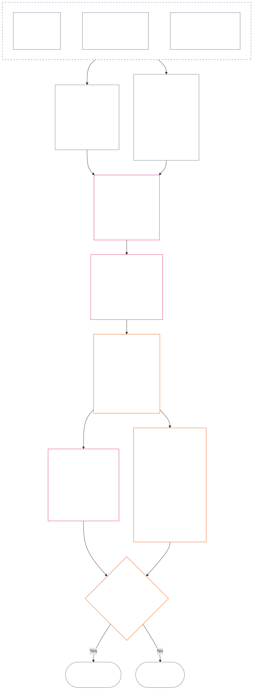

<!-- Complete unreviewed AI-assisted hi translation of current Chapter Twelve; source: core_12.000_standing_measurement.md; source snapshot: a9ad713c15de3c6ba565486590518aa07c7d62fa; source SHA-256: 7ae49781f558ad90db53cdd4469dd22d8227f0a17b0c7393c3a1d2168263f59d; 2026-11-09 source refresh and 2026-11-11 committed-main row update applied. -->

# अध्याय बारह: प्रस्थिति मापन — प्रश्न 2, यह कितना अच्छा या बुरा था?

<strong>संग्रह में स्थान (असंक्रियात्मक): फ़ाइल संरचना और पढ़ने के नियम</strong>

> यह फ़ाइल **संज्ञ संविधान का हिस्सा** है और **केवल अन्य क्रमांकित `core_*` फ़ाइलों के साथ एक पाठ के रूप में पढ़े जाने पर बाध्यकारी** है। इसमें **अध्याय बारह** — **प्रश्न 2** (*यह कितना अच्छा या बुरा था?*) है: LEQU आधाररेखा और उसकी सीमाएँ, मापन इनपुट आयाम, मार्ग-वर्णक सूची, स्लॉट व्याकरण और साझा मापन, अक्ष-निर्धारण के संवैधानिक इनपुट, एकीकृत आनुपातिक LEQU पैमाना, मानक योगदान माप, कार्य किए हुए उदाहरण और प्रश्न 3 को हस्तांतरण (**§§1–9**)। तीन-प्रश्न ढाँचा और **प्रश्न 1** (*क्या हुआ?*) — सत्यापित तथ्य, घटना प्रकार, अभिलेख आवश्यकताएँ, अभिलेख अभिरक्षा और अभिलेख संभालना — [अध्याय ग्यारह](core_11_standing_assessment.md#chapter-eleven-standing-records--question-1-what-happened) में हैं। प्रश्न 3 (*इसके कारण क्या होता है?*) [अध्याय तेरह](../../core_13.000_standing_integration.md#chapter-thirteen-standing-effects-and-integration) में जारी रहता है; योग्य उल्लंघन-अक्ष `s` = 7–9 निष्कर्षों के लिए समीक्षा [अध्याय चौदह](../../core_14.000_misconduct_designation.md#chapter-fourteen-anti-constitutional-misconduct) के संविधान-विरोधी दुराचार निर्धारण तक सीमित है। पढ़ने का क्रम, बाध्यकारी/समर्थक सामग्री का भेद और संग्रह संस्करण का मेटाडेटा [README.md](README.md) में रखा जाता है।

<strong>अनुरेख</strong>

- पूर्ववर्ती:
  - [अध्याय ग्यारह §1](core_11_standing_assessment.md#1-the-three-questions) (*तीन-प्रश्न ढाँचा*);
  - [अध्याय ग्यारह §2](core_11_standing_assessment.md#2-question-1--what-happened) से [अध्याय ग्यारह §6](core_11_standing_assessment.md#6-handling-a-standing-record) तक (*प्रश्न 1 — सत्यापित तथ्य, प्रस्थिति अभिलेख, अभिरक्षा और अभिलेख संभालना*);
  - [संवैधानिक चतुष्क](core_00_preamble.md#constitutional-tetrad);
  - [दो संवैधानिक उद्देश्य](core_00_preamble.md#two-constitutional-aims);
  - [प्रस्तावना §6 प्रमुख व्यावहारिक प्रक्रिया शृंखलाएँ](../../core_00.000_preamble.md#6-key-practical-process-pipelines) (*अध्याय नौ से पंद्रह की शृंखला*)।
- इस फ़ाइल के उपखंड:
  - [§1](#1-question-2--how-good-or-bad-was-it) (*प्रश्न 2 — LEQU आधाररेखा, स्थिति सेतु, सीमाएँ और दायरा*);
  - [§2](#2-magnitude-and-severity-input-dimensions) (*दोनों अक्षों के लिए मापन इनपुट आयाम*);
  - [§3](#3-route-descriptor-catalogs-and-measurement-roles) (*मार्ग-वर्णक सूची*);
  - [§4](#4-slot-grammar-and-shared-scaling) (*स्लॉट व्याकरण और साझा मापन*);
  - [§5](#5-constitutional-inputs-to-axis-assignment) (*संवैधानिक-स्रोत मार्गन*);
  - [§6](#6-unified-proportional-lequ-scale--contribution-and-violation-axes) (*दोनों अक्षों के लिए एकीकृत आनुपातिक LEQU पैमाना*);
  - [§7](#7-standard-contribution-measures) (*अंगीकर्ता द्वारा प्रकाशित मानक योगदान माप*);
  - [§8](#8-measurement-illustrations) (*कार्य किए हुए मापन उदाहरण*);
  - [§9](#9-hand-off-to-question-3--cross-question-measurement-hooks) (*प्रश्न 3 को हस्तांतरण*)।
- अनुवर्ती:
  - [अध्याय तेरह](../../core_13.000_standing_integration.md#chapter-thirteen-standing-effects-and-integration) (13.000) (*प्रश्न 3 के प्रभाव और एकीकरण*);
  - [अध्याय चौदह](../../core_14.000_misconduct_designation.md#chapter-fourteen-anti-constitutional-misconduct) (14.000) (*केवल निर्धारण — प्रश्न 2 के मापन को फिर से नहीं खोलता*)।
- इनके साथ पढ़ें: [अध्याय पाँच *प्रस्थिति अवस्था, योगदान और उल्लंघन*](../../core_05.035_band_accountability.md#defa3-standing-state-contribution-and-violation) (5.035) (*मानक परिभाषा मार्गन*)।

 

अध्याय बारह **प्रश्न 2** का संवैधानिक स्वामी है, जो [अध्याय ग्यारह](core_11_standing_assessment.md#chapter-eleven-standing-records--question-1-what-happened) द्वारा सत्यापित तथ्यों का मापन करता है। यह [§1 प्रश्न 2 — यह कितना अच्छा या बुरा था?](#1-question-2--how-good-or-bad-was-it) से शुरू होता है। [अध्याय ग्यारह](core_11_standing_assessment.md#chapter-eleven-standing-records--question-1-what-happened) तीन-प्रश्न ढाँचे, प्रश्न 1 और प्रस्थिति अभिलेख का स्वामी है; उसका अंत [अध्याय ग्यारह §6 प्रस्थिति अभिलेख संभालना](core_11_standing_assessment.md#6-handling-a-standing-record) पर होता है।

*साधारण शब्दों में: अध्याय ग्यारह तय करता है कि क्या हुआ और प्रस्थिति अभिलेख कौन रखता है। यह अध्याय उसका मापन करता है: योगदान कितना अच्छा था या उल्लंघन कितना बुरा था—दो अलग पैमानों पर जिन्हें कभी जोड़कर शुद्ध अंक नहीं बनाया जाता। मापन से आगे क्या होता है, यह अध्याय तेरह में है।*

### 1. प्रश्न 2 — यह कितना अच्छा या बुरा था?

<strong>अनुसरण</strong>

- पूर्ववर्ती: [अध्याय ग्यारह §2](core_11_standing_assessment.md#2-question-1--what-happened) (*प्रश्न 1 — प्रस्थिति अभिलेख और सत्यापित तथ्य*); [अध्याय ग्यारह §2.5](core_11_standing_assessment.md#25-verified-input-gate) (*सत्यापित-इनपुट द्वार*); [अध्याय ग्यारह §4](core_11_standing_assessment.md#4-standing-record-operational-requirements) (*अभिलेख आवश्यकताएँ*); [अध्याय ग्यारह §1](core_11_standing_assessment.md#1-the-three-questions) (*तीन-प्रश्न ढाँचा*).
- अनुवर्ती:
  - [§2](#2-magnitude-and-severity-input-dimensions) (*दोनों अक्षों के मापन इनपुट आयाम*);
  - [§3](#3-route-descriptor-catalogs-and-measurement-roles) (*मार्ग-वर्णक सूची*);
  - [§4](#4-slot-grammar-and-shared-scaling) (*स्लॉट व्याकरण और साझा मापन*);
  - [§5](#5-constitutional-inputs-to-axis-assignment) (*संवैधानिक स्रोत निर्धारण*);
  - [§6](#6-unified-proportional-lequ-scale--contribution-and-violation-axes) (*योगदान और उल्लंघन अक्षों का निर्धारण*);
  - [§7](#7-standard-contribution-measures) (*अपनाने वाले द्वारा प्रकाशित मानक योगदान मापन*);
  - [§8](#8-measurement-illustrations) (*मापन के उदाहरण*);
  - [§9](#9-hand-off-to-question-3--cross-question-measurement-hooks) (*प्रश्न 3 को हस्तांतरण*);
  - [अध्याय तेरह §7.2](../../core_13.000_standing_integration.md#72-competency-bars-and-clearances) (13.000 §7.2) (*योगदान का प्रश्न 3 — सुरक्षित प्रत्यायोजन*);
  - [अध्याय तेरह §5.2](../../core_13.000_standing_integration.md#52-prevention--general-standing-locks) (13.000 §5.2) (*रोकथाम ताले*);
  - [अध्याय तेरह §6](../../core_13.000_standing_integration.md#6-lock-design-and-enforcement) (13.000 §6) (*ताला-अभिकल्प और प्रवर्तन*).
- साथ पढ़ें: [अध्याय ग्यारह §4.1](core_11_standing_assessment.md#41-minimum-record-contents) (*सत्यापित प्रस्थिति अभिलेख के फ़ील्ड; अध्याय ग्यारह में कोई प्रस्थिति प्रभाव नहीं*).

 

*साधारण शब्दों में: प्रश्न 2, प्रश्न 1 के सत्यापित तथ्यों का मापन करता है। यह पूछता है कि **योगदान कितना अच्छा था?** या **उल्लंघन कितना बुरा था?** यहाँ यह अध्याय पहली बार दो औपचारिक मापन अक्ष प्रस्तुत करता है: सत्यापित सहायता के लिए **योगदान अक्ष** और सत्यापित हानि के लिए **उल्लंघन अक्ष**। दोनों अक्ष अलग रहते हैं; वे किसी निवल स्कोर के दो पक्ष नहीं हैं.*

यह तय करने के लिए कि किसी का योगदान या उल्लंघन किस स्लॉट में आता है, यह अध्याय **जीवनकाल समतुल्य इकाई (LEQU)** से प्रभाव मापता है। मोटे तौर पर एक LEQU, एक संज्ञ प्राणी के पूरे जीवनकाल के कल्याण को बचाने या नष्ट करने के बराबर है। यह शरीरों या डॉलर की गिनती नहीं है; प्रश्न यह है कि क्या किसी कार्रवाई ने संवैधानिक समुदाय के कल्याण को सार्थक रूप से बदला। यही इकाई किसी भी संज्ञ प्राणी, मानव या अन्य, पर लागू होती है।

#### 1.1 LEQU का आधार

**जीवनकाल समतुल्य इकाई** (**LEQU**) उस पूरे जीवन-समतुल्य संवैधानिक लाभ या हानि की संक्षिप्त इकाई है, जब अपनाया गया कार्यान्वयन संख्यात्मक अंशांकन चाहता है।

- यह इकाई किसी आधार-द्रव्य पर निर्भर नहीं है।
- वर्तमान अपनाने वाला जैविक-मानव संदर्भों में अंशांकन उदाहरण के रूप में सामान्य मानव जीवनकाल ले सकता है, पर बाध्यकारी आधार संज्ञ और संवैधानिक है, किसी प्रजाति तक सीमित नहीं।

**पूर्ण जीवन-समतुल्य संवैधानिक लाभ** का अर्थ है ऐसा सत्यापित लाभ जो किसी संज्ञ प्राणी के एक पूरे जीवनकाल के गैर-तुच्छ, अधिकार-संगत कल्याण को बनाए रखने, बहाल करने या मुक्त करने के तुल्य हो। **पूर्ण जीवन-समतुल्य संवैधानिक हानि** का अर्थ है सत्यापित हानि, अपव्यय, विनाश, विकल्प-बंदी, वंचना या जोखिम-साकार होना, जो एक पूर्ण जीवन-समतुल्य संवैधानिक लाभ को नष्ट करने, अनुचित रूप से खर्च करने या रोकने के तुल्य हो।

#### 1.2 LEQU के उपयोग की सीमाएँ

LEQU का उपयोग होने पर निम्नलिखित सीमाएँ लागू होती हैं।

- **निवल-स्कोर नियम नहीं:** योगदान से उल्लंघन “रद्द” नहीं होते, और न ही इसका उलटा। प्रत्येक अक्ष स्वतंत्र है।
- **मानव-जीवन का अनिवार्य माप नहीं:** LEQU संज्ञ-विशिष्ट है; यह केवल मनुष्यों पर नहीं, किसी भी सचेत प्राणी पर लागू होता है।
- **आरोप का माप नहीं:** आरोप, प्रवेश-टैग, मार्ग-निर्धारण निर्णय, प्रतिष्ठा, अप्रिय स्थिति या नैतिक नापसंदगी, **अध्याय ग्यारह §2.5** के सत्यापित इनपुट और **§6** के अंशांकन के बिना योगदान अक्ष का लाभ या उल्लंघन अक्ष की गंभीरता नहीं बनाते।
- **अधिकारों के व्यापार का लाइसेंस नहीं:** दक्षता, उत्पादक क्षमता, नवाचार, बोझ घटाने, सुरक्षा, प्रतिशोध, आपात प्रतिक्रिया या संस्थागत आवश्यकता के रूप में रखे गए दावों को घटाया या अस्वीकार किया जाना चाहिए जहाँ वे इन पर निर्भर हों:
  - दबाव;
  - भेदभावपूर्ण बोझ-स्थानांतरण;
  - पारिस्थितिक क्षय;
  - छिपा हुआ अवैतनिक काम;
  - टाली जा सकने वाली अपारदर्शिता;
  - अधिकार-तल को संकीर्ण करना;
  - कब्ज़ा;
  - भ्रामक प्रॉक्सी;
  - चुनौती-योग्यता का ह्रास; या
  - ऐसी समेकित गणना जिसकी समीक्षा न हो सके।

#### 1.3 केवल प्रश्न 2 — दायरा और मार्ग-निर्धारण

यह भाग केवल प्रश्न 2, अर्थात मापन चरण, को शामिल करता है। यह पहले से सत्यापित तथ्यों (प्रश्न 1) को लेकर पूछता है कि योगदान कितना अच्छा था या उल्लंघन कितना बुरा था।

- **अध्याय ग्यारह §2** के तहत पहले से सत्यापित और **अध्याय ग्यारह §4** के तहत प्रस्थिति अभिलेख में लिखे तथ्यों से शुरू करें, और **§2** के आयामों से उनका मापन करें।
- फिर सहायता या हानि के प्रत्येक प्रकार को सूची से उसका मानक नाम दें: सहायता के लिए **लाभ-मार्ग** सूची (**§3.1**) और हानि के लिए **हानि-मार्ग** सूची (**§3.2**)।
- प्रत्येक नाम यह भी बताता है कि सहायता या हानि का वह प्रकार *कितना अच्छा* या *कितना बुरा* माना जाता है।
- लाभ से आगे क्या होता है, इसके नियम [लाभ पक्ष](../../core_13.000_standing_integration.md#72-competency-bars-and-clearances) में हैं; हानि से आगे क्या होता है, इसके नियम [हानि पक्ष](../../core_13.000_standing_integration.md#52-prevention--general-standing-locks) में हैं।
- प्रश्न 3 तय करता है कि आगे क्या होगा। [अध्याय तेरह §4 वर्णक समेकन और संलग्नता सामान्यीकरण](../../core_13.000_standing_integration.md#4-descriptor-integration-and-attachment-normalization) से शुरू करें।

#### 1.4 संज्ञ-स्थिति सेतु

प्रस्थिति का मापन यह **निर्णय नहीं** करता कि कोई इकाई **संज्ञ** है या नहीं।

- स्थिति के विवाद [संज्ञ-स्थिति न्यायनिर्णयन](../../core_05.055_band_participation.md#sentience-status-adjudication) और [अनुच्छेद VI-B](core_06_rights_part_b.md#article-vi-b-sentience-status-adjudication-floor) (*संज्ञ-स्थिति न्यायनिर्णयन तल*) के अंतर्गत जाते हैं। वे LEQU स्कोर या वर्गीकरण अभिलेखों के अंतर्गत नहीं जाते।
- [विवादित-संज्ञ जीवन](../../core_05.055_band_participation.md#contested-sentient-life) के तहत स्थिति विवाद खुला रहने पर **अनुच्छेद VI-B** (*संज्ञ-स्थिति न्यायनिर्णयन तल*) डिफ़ॉल्ट रूप से उस इकाई को शामिल करता है: विवाद तय होने तक उसका मापन हो सकता है और वह प्रस्थिति अभिलेख दायर कर सकती है; संचालक केवल खुले विवाद को उसे प्रस्थिति से वंचित करने का कारण नहीं मानेंगे।
- यदि इकाई को [संज्ञ](../../core_05.055_band_participation.md#sentient) पाया जाता है, या समीक्षा योग्य निर्णय में न्यायनिर्णयन के बाद उसकी स्थिति संकीर्ण या बहाल होती है:
  - प्रस्थिति अभिलेख का विषय उस समय से अद्यतन किया जाता है; और
  - गलत बहिष्करण को पीछे की तारीख से लागू कर बीच की अवधि में इकाई की मापन-योग्यता मिटाई नहीं जा सकती, सिवाय [प्रतितोष और सुधार](../../core_05.035_band_accountability.md#redress-and-remediation) के माध्यम से।

### 2. परिमाण और गंभीरता के इनपुट आयाम

*साधारण शब्दों में: यह खंड बताता है कि प्रश्न 2 क्या उत्पन्न करता है (**§2.1**), फिर सत्यापित योगदान या सत्यापित उल्लंघन मापते समय किन बातों को देखना है (**§2.2**)। प्रत्येक अक्ष का मापन अलग होता है। साझा मापन नियम **§4.2** में हैं और स्लॉट **§6** के पैमाने से आता है.*

स्लॉट पैमाना संवैधानिक परिणाम का आकार और उसका प्रकार मापता है। इसमें केवल सत्यापित परिणाम गिने जाते हैं।

**पैमाना क्या गिनता है और इसका संविधान की मूल कसौटियों से संबंध:**

- **[दो संवैधानिक उद्देश्य](core_00_preamble.md#two-constitutional-aims):** दोनों अक्ष **समुन्नति** और **सातत्य** पर प्रभाव मापते हैं। योगदान अक्ष उन्हें आगे बढ़ाता है; उल्लंघन अक्ष पीछे धकेलता है।
- **[दो मूलभूत प्रश्न](core_00_preamble.md#two-fundamental-questions):** प्रत्येक अक्ष एक प्रश्न के लिए सत्यापित तथ्य देता है। एक का उत्तर दूसरे का उत्तर नहीं है, इसलिए दोनों अक्ष कभी निवल नहीं किए जाते।
  - **पहला प्रश्न:** योगदान अक्ष सत्यापित तथ्य देता है। क्या प्रणाली ऐसे आचरण को पुरस्कृत करती है जो संज्ञ प्राणियों को समुन्नत और टिकाऊ बनाता है, सच बताता है और हानि सुधारता है?
    - **गिना जाता है:** सत्यापित संवैधानिक लाभ, जिसमें सत्यापित जोखिम-घटाव शामिल है।
    - **नहीं गिना जाता:** कच्चा उत्पादन, प्रतिष्ठा, संपत्ति, किसी चीज़ के उपयोग की मात्रा, गति या संस्था का आकार।
  - **दूसरा प्रश्न:** उल्लंघन अक्ष सत्यापित तथ्य देता है। क्या प्रणाली ऐसे आचरण को पुरस्कृत करती है जो अनुचित रूप से हानि पहुँचाता, गुमराह करता, बहिष्कृत करता, विलंब करता, अपव्यय करता या लागत दूसरों पर डालता है?
    - **गिना जाता है:** सत्यापित संवैधानिक हानि, क्षति, अपव्यय, विकल्पों का बंद होना, खतरा या जोखिम-वृद्धि।
    - **अपने आप नहीं गिना जाता:** अप्रिय स्थिति, आरोप या नैतिक नापसंदगी।
- **[संवैधानिक चतुष्क](core_00_preamble.md#constitutional-tetrad):**
  - **निगरानी और जवाबदेही:** “सत्यापित” का अर्थ है कि नामित कर्ता निष्कर्ष के लिए जवाब देता है और कोई पक्ष अपने दावे को स्वयं सत्यापित नहीं करता।
  - **समयबद्धता:** टाला जा सकने वाला विलंब अलग तथ्य के रूप में दर्ज होता है, हानि के आकार में नहीं मिलाया जाता।

#### 2.1 प्रश्न 2 क्या उत्पन्न करता है

प्रश्न 2 प्रत्येक अक्ष के लिए ये बातें प्रस्थिति अभिलेख में लिखता है। ये मापन हैं, प्रस्थिति प्रभाव नहीं (परिणाम जिनका निर्णय प्रश्न 3 करता है):

| **क्या उत्पन्न होता है** | **योगदान अक्ष** | **उल्लंघन अक्ष** |
| --- | --- | --- |
| **कहाँ लिखा जाता है** | योगदान प्रस्थिति अभिलेख। | उल्लंघन प्रस्थिति अभिलेख। |
| **स्लॉट** | लागू होने वाला उच्चतम **योगदान अक्ष स्लॉट** (`s` = 1–9)। | लागू होने वाला उच्चतम **उल्लंघन अक्ष स्लॉट** (`s` = 1–9)। |
| **मार्ग-वर्णक** | लागू लाभ-मार्ग वर्णक, एक-दूसरे पर संचित। | लागू हानि-मार्ग वर्णक, एक-दूसरे पर संचित। |
| **प्रश्न 3 को दिए गए इनपुट** | [अध्याय तेरह §7 योगदान परिणाम पहले](../../core_13.000_standing_integration.md#7-contribution-consequences-second) के तहत योगदान की मान्यता का शुरुआती बिंदु तय करने वाले इनपुट। | [अध्याय तेरह §6 ताला-अभिकल्प और प्रवर्तन](../../core_13.000_standing_integration.md#6-lock-design-and-enforcement) के तहत डिफ़ॉल्ट ताला-बैंड (ताला कितना कठोर होगा इसका शुरुआती बिंदु) तय करने वाले इनपुट। |
| **कुल LEQU** | हर प्रासंगिक लाभ प्रकार (पारिस्थितिक, प्रणालीगत या संसाधन) का अलग आकलन करें, फिर पूरे योगदान का एक कुल LEQU दर्ज करें। | हर प्रासंगिक हानि प्रकार (पारिस्थितिक हानि, प्रणालीगत हानि या संसाधन-हानि) का अलग आकलन करें, फिर पूरे उल्लंघन का एक कुल LEQU दर्ज करें। |

स्मरण रहे: इनमें से कोई भी खुला उल्लंघन अभिलेख रद्द नहीं करता। बिना-समायोजन नियम [अध्याय ग्यारह §2.4 संबंधित प्रस्थिति अभिलेख और बिना-समायोजन सेतु](core_11_standing_assessment.md#24-linked-standing-records-and-no-offset-bridge) में है।

#### 2.2 योगदान-परिमाण और उल्लंघन-गंभीरता के इनपुट आयाम

**प्रश्न 2 — यह कितना अच्छा या बुरा था?** यह तय करने के लिए कि योगदान योगदान अक्ष पर कहाँ आता है, उल्लंघन उल्लंघन अक्ष पर कहाँ आता है (उसका **स्लॉट**, 1 से 9), और कौन से लाभ या हानि वर्णक लागू हैं, तीन भागों से गुजरें। कई वर्णक एक साथ लागू हो सकते हैं और संचित होते हैं। परिणाम संबंधित अक्ष के प्रस्थिति अभिलेख में लिखें, जैसा **§2.1** में दिया है। **§6** भाग 2 के लिए एकीकृत पैमाना देता है, जो लाभ और हानि दोनों के लिए समान है। यह कुल लाभ या हानि को LEQU (जीवनकाल समतुल्य इकाई, मोटे तौर पर एक पूरे जीवन का कल्याण) में अनुमानित करने और हर मात्रा के स्लॉट का तरीका बताता है। योगदान अक्ष के स्लॉट चार बैंडों में समूहित हैं।

**1. देखें कि यह कैसे उत्पन्न हुआ।** दोनों अक्ष इसका अलग-अलग उपचार करते हैं:

- **योगदान (आचरण की गुणवत्ता):** इससे गिने जाने वाले लाभ की मात्रा बढ़ या घट सकती है: क्या इसे खोजा जा सकता है, क्या दूसरों पर लागत डालने से बचा गया, क्या सावधानी से किया गया, और क्या यह संविधान के अनुरूप है? पाँच जाँच [§2.2.1 लाभ पैदा करने के तरीके से क्या गिना जाए, यह कैसे प्रभावित होता है](#221-how-the-way-a-benefit-was-produced-affects-what-counts) में हैं।
- **उल्लंघन (आचरण का स्वरूप):** इसे प्रभाव के आकार से अलग दर्ज किया जाता है। कर्तव्य, लापरवाही, छल, छिपाव, जवाबदेही में बाधा, दबाव, हिंसा, मंशा, क्रूरता और संरचनात्मक सक्षमकरण यह तय करते हैं कि जिम्मेदार कौन है, कौन-सी सुरक्षा चाहिए और कैसे प्रतिक्रिया देनी है। इनमें से कोई भी स्लॉट नहीं बदलता—यह नियम और प्रत्येक को दर्ज करने के नियम [§2.2.2 नुकसान किस तरह हुआ, इसका अभिलेखन](#222-how-the-way-a-harm-was-caused-is-recorded) में हैं।

**2. आकार मापें: लाभ या हानि कितनी बड़ी है?** यही स्लॉट तय करता है।

| **क्या देखें** | **इसका प्रभाव** | **नियम कहाँ हैं** |
| --- | --- | --- |
| **कुल आकार (LEQU)** | मुख्य माप और स्लॉट का निर्णायक आधार। योगदान के लिए यह किए गए कुल सत्यापित अच्छे कार्य का LEQU में मापन है। उल्लंघन के लिए यह कुल सत्यापित संवैधानिक हानि है। अध्याय चौदह का दुराचार निर्धारण अलग से होता है। | [§6 एकीकृत आनुपातिक LEQU पैमाना](#6-unified-proportional-lequ-scale--contribution-and-violation-axes) |
| **किस तक पहुँचा (कितने, कितनी गहराई तक, कितने संवेदनशील)** | LEQU अनुमान और लाभ या हानि की महत्ता (उसकी भौतिकता) समायोजित करता है। | [§4.2 साझा प्रभाव-मापन नियम](#42-shared-impact-scaling-rules); [भौतिकता](../../core_05.050_band_oversight.md#materiality) |
| **कितने समय तक रहता है (अवधि; लाभ की टिकाऊपन, हानि की अपरिवर्तनीयता)** | LEQU अनुमान समायोजित करता है। योगदान के लिए टिकाऊ प्रबंधन, पीढ़ियों तक लाभ या संस्था की दीर्घकालिक मरम्मत उच्च स्लॉट की ओर संकेत करते हैं। उल्लंघन के लिए लंबा आघात, अपरिवर्तनीय हानि और संज्ञ प्राणियों की स्वायत्त कार्रवाई की क्षमता को स्थायी क्षति कुल हानि का अनुमान बढ़ाते हैं। | [§4.2 साझा प्रभाव-मापन नियम](#42-shared-impact-scaling-rules) |
| **कितनी दूर तक पहुँचता है (स्थानों या संस्थाओं के पार)** | LEQU अनुमान समायोजित करता है। योगदान में, उदाहरणार्थ, समुदायों या संस्थाओं में फैला लाभ अथवा सभ्यता-स्तर का लाभ। उल्लंघन में समुदायों या संस्थाओं में, या सभ्यता-भर फैली हानि कुल हानि का अनुमान बढ़ा सकती है। | [§4.2 साझा प्रभाव-मापन नियम](#42-shared-impact-scaling-rules) |

**3. लाभ या हानि के प्रकार (मार्ग) का नाम दें।** सत्यापित लाभ या हानि किस तरीके से हुई, यह नामित करें। एक से अधिक लागू हो सकते हैं और संचित होते हैं। सूचियाँ [**लाभ-मार्ग वर्णक सूची**](#31-contribution-route-descriptor-catalog-and-measurement-roles) और [**हानि-मार्ग वर्णक सूची**](#32-violation-route-descriptor-catalog-and-measurement-roles) में हैं।

##### 2.2.1 लाभ पैदा करने के तरीके से क्या गिना जाए, यह कैसे प्रभावित होता है

योगदान अक्ष स्लॉट चुनने से पहले यह जाँचें:

| **आपको क्या मिलता है** | **लाभ पर प्रभाव** |
| --- | --- |
| सूचित किए जाने के बाद समस्या का शीघ्र, सत्यापित सुधार | वास्तविक, प्रमाणित लाभ पैदा होने पर इसे **सतर्कता** (सावधान, जिम्मेदार आचरण) माना जा सकता है। |
| दूसरों पर डाली गई हानि या छिपाया गया बोझ | विवादित मार्ग (वह विशिष्ट रास्ता जिस पर लाभ का श्रेय दिया जाता है) के लिए श्रेय पाए लाभ को सीमित या समाप्त करता है। |
| सत्यापित कब्ज़ा-जोखिम (व्यवस्था संकीर्ण हितों के कब्ज़े में जा सकती है), संरचनात्मक निर्भरता (संज्ञ प्राणियों को उस पर निर्भर रहने के लिए बनाया गया), या निकास और लॉक-इन अभिकल्प (छोड़ना कठिन है) | अच्छे प्रबंधन के श्रेय को सीमित करता है। |
| पहुँच-योग्यता या सहभागिता बाधा की सत्यापित मरम्मत | लाभ की महत्ता (भौतिकता) बढ़ा सकती है और **§3.1** का **पहुँच और समावेशन** लाभ-मार्ग वर्णक समर्थित कर सकती है। |
| संविधान-विरोधी प्रोत्साहन व्यवस्था, असंवैधानिक आचरण या भौतिक रूप से दोषपूर्ण प्रक्रिया से मिला महत्वपूर्ण पुरस्कार | डिफ़ॉल्ट रूप से लाभ नहीं गिना जाता। ऐसे में [अध्याय तेरह §6.4.2 असंगत पुरस्कार](../../core_13.000_standing_integration.md#642-misaligned-rewards) और [अनुच्छेद XXVIII-A](../../core_06.020_rights_part_e.md#incentive-alignment-adoption-transition-carve-out) की अंगीकरण-संक्रमण सीमा (*चरणबद्ध अंगीकरण और अधिकार-तल निरंतरता*) लागू करें। |

##### 2.2.2 हानि होने के तरीके को कैसे दर्ज किया जाता है

नुकसान का आकार (ऊपर भाग 2 में उसका LEQU कुल) स्लॉट तय करता है। नुकसान किस तरह हुआ, यह नहीं; इसलिए नीचे हर प्रकार का आचरण अलग दर्ज किया जाता है।

यह उपखंड अध्याय बारह में नियम को एक बार बताता है। **केवल इसलिए स्लॉट न बढ़ाएँ या घटाएँ कि घटना या आचरण-क्रम का वर्णन इनमें से किसी रूप में किया गया है:**

- कर्तव्य;
- लापरवाही;
- मंशा;
- छिपाव;
- पुनरावृत्ति;
- गंभीरकारी परिस्थिति;
- दबाव;
- हिंसा;
- स्वतंत्रता को खतरा;
- सुधार-योग्यता; या
- पसंदीदा परिणाम।

आचरण-स्वरूप के तथ्य अलग से अनुरेखणीय वर्णन के रूप में दर्ज होते हैं। वे आरोपण, समीक्षा की तीव्रता, सुरक्षा उपाय, उपचार या अध्याय चौदह के पदनाम को नियंत्रित कर सकते हैं। वे स्लॉट तक केवल सत्यापित परिणामों से पहुँचते हैं: यदि आचरण नुकसान बढ़ाता है, तो वह नुकसान LEQU कुल में एक बार गिना जाता है और स्लॉट उसी कुल का अनुसरण करता है।

**ऐसा आचरण जो हानि बढ़ाता है और आकार में एक बार गिना जाता है:**

| **आपको क्या मिलता है** | **इसे कैसे दर्ज करें** |
| --- | --- |
| प्रतिक्रिया या उन्नयन में टाला जा सकने वाला विलंब, जहाँ कार्रवाई का कर्तव्य और क्षमता थी | आचरण के अलग तथ्य के रूप में दर्ज करें। विलंब से हुई अतिरिक्त हानि LEQU अनुमान में एक बार गिनी जाती है। |
| फोरम की अखंडता को स्वतंत्र रूप से सत्यापित क्षति (फोरम की निष्पक्षता को क्षति) | LEQU आकलन में ठीक एक बार गिनी जाती है। बेईमानी से छोड़ना, जानबूझकर अलग होने की प्रक्रिया विफल करना, दबाव, स्वतंत्रता को खतरा और अन्य आचरण-तथ्य अलग वर्णन बने रहते हैं। |
| **जवाबदेही में बाधा** (उन तंत्रों में सत्यापित हस्तक्षेप जिनसे किसी जिम्मेदार व्यक्ति को जवाबदेह ठहराया जा सके, जैसे साक्ष्य की अखंडता, सत्यापन, फोरम प्रक्रिया, स्थिति-अभिलेख, उपचार-अवधियाँ या चुनौती और प्रतिपूर्ति-पथ) | अलग दर्ज आचरण-तथ्य बना रहता है। सीमित मार्ग पर इससे हुआ अतिरिक्त नुकसान LEQU अनुमान में एक बार गिना जाता है। |

**हानि के आकार से अलग दर्ज आचरण तथ्य:**

| **आपको क्या मिलता है** | **इसे कैसे दर्ज करें** |
| --- | --- |
| छल, छिपाना, बच निकलना, सूचना के बाद आचरण दोहराना, लापरवाह उपेक्षा, संरचनात्मक सहायकता (ऐसी व्यवस्था बनाना जिससे हानि आसान या संभावित हो), या बड़ी निर्भरता-असमानता का दुरुपयोग (अपने पर बहुत निर्भर किसी का शोषण) | हर तथ्य अलग दर्ज रहता है। |
| हिंसा, दबाव, चालबाज़ी या स्वतंत्रता का खतरा | अलग दर्ज रहता है और स्लॉट चाहे जो हो, अधिक मजबूत सुरक्षा उपाय माँग सकता है। |
| [क्रूरता](../../core_05.035_band_accountability.md#cruelty) (अपने-आप में लक्ष्य के रूप में सत्यापित पीड़ा, या आवश्यक और आनुपातिक से अधिक अनावश्यक या अपमानजनक नुकसान) | अलग दर्ज आचरण-तथ्य बनी रहती है। [अध्याय तेरह §5 उल्लंघन, सुधार और रोकथाम](../../core_13.000_standing_integration.md#5-violation-correction-and-prevention) के तहत अधिक मजबूत सुरक्षा और अपमानजनक उपचारों पर सीमाएँ आवश्यक हो सकती हैं। |

**जवाबदेही और आरोपण:**

| **आपको क्या मिलता है** | **इसे कैसे दर्ज करें** |
| --- | --- |
| प्रसरण (जिम्मेदारी कैसे बँटी: किसने कौन-सी कारणकारी भूमिका निभाई, कौन-सा अधिकार या नियंत्रण रखा, हानि का अनुमान लगा सकता था, लाभ पाया, छिपाया या रोक सकता था) | यह **संज्ञ दायरे** का भाग नहीं है और समूह-सदस्यता के लिए किसी को दोष देने की अनुमति नहीं देता। |
| हानि में साथ देना या उसका विरोध न करना | कर्तव्य-आधारित, उग्र या सामूहिक-जवाबदेही चरित्र का निष्कर्ष तभी समर्थित कर सकता है जब **अध्याय ग्यारह §§4.1 और 4.3** के तहत उस विशिष्ट कर्ता से आवश्यक संबंध सत्यापित हो। |

**विसंरेखित पुरस्कार:**

| **आपको क्या मिलता है** | **इसे कैसे दर्ज करें** |
| --- | --- |
| संविधान-विरोधी महत्वपूर्ण पुरस्कार को जानते हुए स्वीकार करना या रखना, समय पर संरक्षित रिपोर्टिंग के बिना (प्रतिशोध से सुरक्षित रिपोर्ट) | [अध्याय तेरह §6.4.2 असंगत पुरस्कार](../../core_13.000_standing_integration.md#642-misaligned-rewards) के तहत दर्ज होता है और [अनुच्छेद XXVIII-A](../../core_06.020_rights_part_e.md#incentive-alignment-adoption-transition-carve-out) (*चरणबद्ध अंगीकरण और अधिकार-तल निरंतरता*) के अधीन है। केवल इससे हुई सत्यापित संवैधानिक हानि स्लॉट को प्रभावित करती है। |

**असंगत-पुरस्कार सीमा।** यह अध्याय केवल यह मापता है कि सत्यापित असंगत पुरस्कार (संविधान के विरुद्ध काम करने वाला पुरस्कार) योगदान अक्ष या उल्लंघन अक्ष को कैसे प्रभावित करता है। [अध्याय तेरह §6.4.2 असंगत पुरस्कार](../../core_13.000_standing_integration.md#642-misaligned-rewards) रिपोर्टिंग-दायित्व, अपवाद, पुरस्कार छोड़ने के परिणाम (जब्ती), सुधार-दायित्व और संदर्भण नियम निर्धारित करता है।

### 3. मार्ग-वर्णक सूचियाँ और मापन भूमिकाएँ

*साधारण शब्दों में: नीचे की दो सूचियाँ सत्यापित सहायता के प्रकार (**§3.1**) और हानि के प्रकार (**§3.2**) बताती हैं जिन्हें प्रस्थिति अभिलेख में रखा जा सकता है। वर्णक बताता है कि लाभ या हानि कैसे हुई; वर्णक एक-दूसरे पर संचित होते हैं और स्लॉट के अधीन हैं.*

**वर्णक नियम।** नीचे की दोनों सूचियाँ, [§3.1 योगदान मार्ग-वर्णक सूची और मापन भूमिकाएँ](#31-contribution-route-descriptor-catalog-and-measurement-roles) और [§3.2 उल्लंघन मार्ग-वर्णक सूची और मापन भूमिकाएँ](#32-violation-route-descriptor-catalog-and-measurement-roles), दोनों अक्षों के लिए वर्णकों की आधिकारिक सूची हैं। वर्णक बताता है कि सत्यापित लाभ या हानि **कैसे** हुई। ये नियम लागू होते हैं:

- वर्णक संचित होते हैं और कोई वर्णक दूसरे को बाहर नहीं करता: जहाँ सत्यापित तथ्य समर्थन करें, एक प्रस्थिति अभिलेख में कई वर्णक हो सकते हैं।
- वे स्लॉट के नीचे हैं: स्लॉट बताता है कि लाभ या हानि कितना बड़ा था; वर्णक घटना का तरीका जोड़ते हैं, पर स्लॉट का स्थान कभी नहीं लेते।
- सूचीबद्ध वर्णक आधार हैं, पूरी सूची नहीं; सूची लाभ या हानि के अन्य प्रकारों को रोकती नहीं।
- कार्यान्वयन सूची से जुड़े स्थिर पहचानकर्ता (अपने निश्चित ID) उपयोग कर सकते हैं, पर ऐसी परस्पर-विरोधी वर्गीकरण प्रणाली नहीं बना सकते जिसमें श्रेणियाँ एक-दूसरे को बाहर करें और अभिलेख में केवल एक ही श्रेणी रखी जा सके।
- तथ्य सत्यापित होने से पहले, कथित वर्णक वैध साक्ष्य-संरक्षण, मामले की छँटाई या अस्थायी सुरक्षा उपायों का समर्थन कर सकता है।
- प्रश्न 2 के परिणाम के रूप में केवल सत्यापित वर्णक दर्ज हो सकता है या प्रस्थिति को प्रभावित कर सकता है।

#### 3.1 योगदान मार्ग-वर्णक सूची और मापन भूमिकाएँ

ये लाभ-मार्ग वर्णक हैं और प्रश्न 2 (यह कितना अच्छा था?) में हर वर्णक क्या मापता है। इन्हें पाँच क्षेत्रों में बाँटा गया है, हर क्षेत्र के लिए एक तालिका; [§3.2 उल्लंघन मार्ग-वर्णक सूची और मापन भूमिकाएँ](#32-violation-route-descriptor-catalog-and-measurement-roles) की उल्लंघन सूची इन्हीं पाँच क्षेत्रों को इसी क्रम में अपनाती है। प्रश्न 3 की भूमिका, सुरक्षित प्रत्यायोजन, [अध्याय तेरह §7.2 योग्यता सीमाएँ और अनुमतियाँ](../../core_13.000_standing_integration.md#72-competency-bars-and-clearances) में है।

**सूची की पूर्णता।** यदि कार्यान्वयन एक पंक्ति में या एक लेबल के नीचे कई वर्णक दिखाता है, तो उस पंक्ति या लेबल को हर लागू वर्णक से जोड़ा जाना चाहिए। यह सूची केवल वर्णक नाम और प्रश्न 2 में उनका मापन बताती है। प्रश्न 3 के नियम (संलग्नता, प्रतिकार, ताले, अनुमतियाँ और अन्य प्रस्थिति प्रभाव) केवल अध्याय तेरह में हैं।

##### 3.1.1 शारीरिक सुरक्षा, संबंध, देखभाल और कर्तृत्व

| **लाभ-मार्ग वर्णक** | **प्रश्न 2 में क्या मापता है** |
| --- | --- |
| **शरीर, मन और/या समुदाय की शांति** | शारीरिक, मनोवैज्ञानिक और सामुदायिक शांति से मिलने वाला लाभ। यह लाभ की महत्ता (भौतिकता) समायोजित करता है। |
| **विश्वसनीय संबंध** | भरोसे योग्य संबंधों का लाभ, जिसमें विश्वास के कर्तव्य पर आधारित संबंध भी शामिल हैं, उन स्थितियों में जहाँ दोनों पक्ष असमान हैं। |
| **देखभाल और निर्भरता सहायता** | दूसरों पर निर्भर संज्ञ प्राणियों की सत्यापित देखभाल। दिखाए जाने पर अनौपचारिक देखभाल भी गिनी जाती है। |
| **पहुँच और समावेशन** | वास्तविक सहभागिता और पहुँच-योग्यता से लाभ। जहाँ एक पक्ष दूसरे पर बहुत निर्भर हो, यह लाभ की महत्ता समायोजित करता है। |

##### 3.1.2 मरम्मत, संपत्ति और संसाधन

| **लाभ-मार्ग वर्णक** | **प्रश्न 2 में क्या मापता है** |
| --- | --- |
| **उपचारात्मक और पुनर्स्थापनात्मक लाभ** | मरम्मत, क्षतिपूर्ति और हानि घटाने से लाभ। |
| **संसाधन-संपन्न उत्तरदायी प्रबंधन** | भौतिक संसाधनों की सावधानीपूर्वक देखभाल और उनका भरोसेमंद बँटवारा (आवंटन)। |

##### 3.1.3 ज्ञान, शिक्षा, अभिलेख और खोज

| **लाभ-मार्ग वर्णक** | **प्रश्न 2 में क्या मापता है** |
| --- | --- |
| **सूचना-क्षेत्र अखंडता** | अभिलेखों, पारदर्शिता और संचार को मजबूत करना। |
| **शिक्षा और क्षमता-निर्माण** | सीखने, साक्षरता और संज्ञ प्राणियों की स्वायत्त कार्रवाई की क्षमता बढ़ने से लाभ। स्लॉट कुल LEQU लाभ से निर्धारित होता है। |
| **STEM और खोज योगदान** | ऐसी खोजें जिन्हें दूसरे दोहरा सकें, और ऐसा अनुसंधान जो चीज़ों को अधिक सुरक्षित बनाए। |

##### 3.1.4 प्रणालियाँ और संवैधानिक संचालन

| **लाभ-मार्ग वर्णक** | **प्रश्न 2 में क्या मापता है** |
| --- | --- |
| **प्रणाली अनुकूलन** | संस्थाओं के पार जाने वाली प्रक्रियाएँ ठीक करना और जोखिम घटाना। |
| **संवैधानिक संरेखण** | अधिकार-तल मजबूत करना और निर्णयों को चुनौती देना आसान बनाना। |

##### 3.1.5 पारिस्थितिकी और सतर्कता

| **लाभ-मार्ग वर्णक** | **प्रश्न 2 में क्या मापता है** |
| --- | --- |
| **पारिस्थितिक उत्तरदायी प्रबंधन** | आवास और जैव-विविधता को लाभ तथा जलवायु-जिम्मेदार कार्रवाई। |
| **सतर्कता** | अनुमानित जोखिम रोकना और सक्षम निगरानी करना। |

#### 3.2 उल्लंघन मार्ग-वर्णक सूची और मापन भूमिकाएँ

ये हानि-मार्ग वर्णक हैं और प्रश्न 2 (यह कितना बुरा था?) में हर वर्णक क्या मापता है। इन्हें पाँच क्षेत्रों में बाँटा गया है, हर क्षेत्र के लिए एक तालिका, और ये [§3.1 योगदान मार्ग-वर्णक सूची और मापन भूमिकाएँ](#31-contribution-route-descriptor-catalog-and-measurement-roles) वाले पाँच क्षेत्रों तथा क्रम का उपयोग करते हैं। प्रश्न 3 के लिए समेकन और संलग्नता नियम [अध्याय तेरह §4 वर्णक समेकन और संलग्नता सामान्यीकरण](../../core_13.000_standing_integration.md#4-descriptor-integration-and-attachment-normalization) में हैं; रोकथाम और ताला-अभिकल्प [अध्याय तेरह §5.2 रोकथाम — सामान्य प्रस्थिति ताले](../../core_13.000_standing_integration.md#52-prevention--general-standing-locks) और [अध्याय तेरह §6 ताला-अभिकल्प और प्रवर्तन](../../core_13.000_standing_integration.md#6-lock-design-and-enforcement) में हैं।

**सूची की पूर्णता।** यदि कार्यान्वयन एक पंक्ति में या एक लेबल के नीचे कई वर्णक दिखाता है, तो उस पंक्ति या लेबल को हर लागू वर्णक से जोड़ा जाना चाहिए। यह सूची केवल वर्णक नाम और प्रश्न 2 में उनका मापन बताती है। प्रश्न 3 के नियम (संलग्नता, प्रतिकार, ताले, अनुमतियाँ और अन्य प्रस्थिति प्रभाव) केवल अध्याय तेरह में हैं।

##### 3.2.1 शारीरिक सुरक्षा, संबंध, देखभाल और कर्तृत्व

| **हानि-मार्ग वर्णक** | **प्रश्न 2 में क्या मापता है** |
| --- | --- |
| **हिंसक दुराचार** | हिंसा, दबाव या स्वतंत्रता का खतरा LEQU प्रभाव स्लॉट से अलग दर्ज होता है। इसके लिए उन्नत सुरक्षा उपाय चाहिए हो सकते हैं। |
| **अंतरवैयक्तिक / देखभाल-कर्तव्य दुराचार** | जहाँ एक पक्ष दूसरे पर बहुत निर्भर हो, वहाँ हानि अधिक महत्वपूर्ण (अधिक भौतिक) होती है। |
| **पहुँच-योग्यता और सहभागिता-बाधा दुराचार** | जहाँ एक पक्ष दूसरे पर बहुत निर्भर हो, वहाँ हानि अधिक महत्वपूर्ण होती है और उग्रकारी विशेषताएँ संचित हो सकती हैं। |
| **निजता और स्व-स्वामित्व दुराचार** | छिपाना या शोषण सत्यापित होने पर उग्रकारी विशेषताएँ लागू होती हैं और संचित हो सकती हैं। |
| **कर्तृत्व और चालबाज़ी दुराचार** | दबाव, चालबाज़ी या स्वतंत्रता का खतरा प्रभाव स्लॉट से अलग दर्ज होता है। |

##### 3.2.2 मरम्मत, संपत्ति और संसाधन

| **हानि-मार्ग वर्णक** | **प्रश्न 2 में क्या मापता है** |
| --- | --- |
| **उपचार द्वारा सुधारा जा सकने वाला दुराचार** | उसके सुधार-चरित्र (हानि ठीक की जा सकती है या नहीं और कैसे) को दर्ज करता है। स्लॉट कुल LEQU हानि से तय होता है। |
| **संपत्ति दुराचार** | संपत्ति-हानि का मार्ग। स्लॉट कुल LEQU हानि से तय होता है। |

##### 3.2.3 ज्ञान, शिक्षा, अभिलेख और खोज

| **हानि-मार्ग वर्णक** | **प्रश्न 2 में क्या मापता है** |
| --- | --- |
| **सूचना-क्षेत्र दुराचार** | सुरक्षा या सत्य को क्षति। छिपाना और छल, हानि होने के तरीके (उसके चरित्र) के अलग तथ्य रहते हैं। |
| **शैक्षिक दुराचार** | सीखने या संज्ञ प्राणियों की स्वायत्त कार्रवाई की क्षमता को हानि। स्लॉट कुल LEQU हानि से तय होता है। |
| **अनुसंधान और खोज दुराचार** | अनुसंधान या खोज को हानि। स्लॉट कुल LEQU हानि से तय होता है। |

##### 3.2.4 प्रणालियाँ और संवैधानिक संचालन

| **हानि-मार्ग वर्णक** | **प्रश्न 2 में क्या मापता है** |
| --- | --- |
| **प्रणालीगत दुराचार** | जिम्मेदारी का फैलाव (कई कर्ताओं में बँटी जिम्मेदारी) और संरचनात्मक सक्षमकरण अलग-अलग दर्ज होते हैं। |
| **जवाबदेही-अवरोध दुराचार** | जवाबदेही रोकने को शामिल करता है: नुकसान के लिए किसी से जवाब माँगे जाने में बाधा डालना। इसे नुकसान होने के तरीके के रूप में दर्ज किया जाता है। बाधा कैसे डाली गई (जैसे छिपाव या लापरवाही) अलग तथ्य के रूप में दर्ज होती है। जब स्लॉट सर्वोच्च स्तरों में हो (देखें [§4.1 तालिका 1 — स्लॉट प्रदर्शन-लेबल](#41-table-1--slot-display-labels)), मामले को अध्याय चौदह में [असंवैधानिक दुराचार समीक्षा](../../core_05.035_band_accountability.md#anti-constitutional-misconduct-review) हेतु भेजने के लिए **असंवैधानिक दुराचार** के रूप में भी दर्ज किया जा सकता है। वहाँ भेजना असंवैधानिक दुराचार का पदनाम देना नहीं है; अध्याय चौदह इसे अलग से तय करता है। |
| **निकास और लॉक-इन दुराचार** | प्रणालीगत दुराचार की विशेषताएँ रखता है, साथ ही प्रसरण या कब्ज़ा भी जब वे संरचनात्मक हों (प्रणाली के काम करने के तरीके में बने हों)। |
| **जीवन-चक्र और अपरिवर्तनीयता दुराचार** | अपरिवर्तनीयता LEQU हानि का आकार प्रभावित करती है। छिपाना या लापरवाही चरित्र के रूप में अलग दर्ज रहती है। |
| **संविधान-विरोधी दुराचार** (वर्णक) | उच्चतम स्लॉट वाले उल्लंघन (देखें [§4.1 तालिका 1 — स्लॉट प्रदर्शन लेबल](#41-table-1--slot-display-labels)) को प्रभाव स्लॉट बदले बिना अध्याय चौदह के निर्धारण-समीक्षा के लिए भेजता है। |

##### 3.2.5 पारिस्थितिकी और सतर्कता

| **हानि-मार्ग वर्णक** | **प्रश्न 2 में क्या मापता है** |
| --- | --- |
| **पारिस्थितिक दुराचार** | LEQU हानि का भार [पारिस्थितिक पुनर्बहाली क्षमता](../../core_05.040_band_continuity.md#ecological-recovery-capacity) (हानि के बाद पारिस्थितिकी तंत्र की पुनरुत्पादन क्षमता) के ह्रास के अनुसार होता है। यह हिंसक मार्ग (हिंसक दुराचार) के साथ संचित हो सकता है। |
| **लापरवाहीपूर्ण दुराचार** | कर्तव्य, पूर्वानुमेयता और रोकथाम-योग्यता प्रभाव स्लॉट से अलग दर्ज होते हैं। |

### 4. स्लॉट व्याकरण और साझा मापन

*साधारण शब्दों में: यह खंड दो अलग-अलग अक्षों में से प्रत्येक पर नौ संभावित स्थानों के लिए एकसमान नाम देता है और बताता है कि प्रभाव का पैमाना कैसे बढ़ता है। एक अक्ष सत्यापित योगदान दर्ज करता है; दूसरा अक्ष सत्यापित उल्लंघनों के प्रस्थिति अभिलेख दर्ज करता है। स्लॉट संख्या समान होने से अक्ष एक नहीं होते, न ही हानि के बदले सहायता घटाई जा सकती है। **खंड 6** का एकीकृत पैमाना आनुपातिक LEQU प्रभाव के आधार पर दोनों अक्षों का निर्धारण करता है।*

स्लॉट व्याकरण में स्लॉट संख्या `s` का उपयोग **1** से **9** तक होता है। प्रत्येक अक्ष का अपना स्लॉट स्थान है:

- **योगदान अक्ष** सकारात्मक योगदान का स्वरूप दर्ज करता है; और
- **उल्लंघन अक्ष** सत्यापित उल्लंघन निष्कर्ष दर्ज करता है।

दोनों अक्षों पर समान स्लॉट संख्या आ सकती है, लेकिन अक्ष अलग रहते हैं। योगदान स्लॉट, उल्लंघन स्लॉट नहीं है और उल्लंघन स्लॉट, योगदान स्लॉट नहीं है।

#### 4.1 तालिका 1 — स्लॉट प्रदर्शन लेबल

**तालिका 1** नौ स्लॉटों के नाम देती है और योगदान अक्ष तथा उल्लंघन अक्ष के प्रदर्शन लेबल साथ-साथ दिखाती है। यह केवल प्रदर्शन भाषा देती है; स्लॉट का निर्धारण **खंड 6** के एकीकृत पैमाने के तहत होता है।

|  `s` | योगदान अक्ष प्रदर्शन लेबल | उल्लंघन अक्ष प्रदर्शन लेबल |
| ---: | --- | --- |
|    1 | **लघु आधारभूत योगदान** | **लघु संवैधानिक प्रभाव** |
|    2 | **छोटा आधारभूत योगदान** | **छोटा संवैधानिक प्रभाव** |
|    3 | **पर्याप्त सकारात्मक योगदान** | **पर्याप्त संवैधानिक प्रभाव** |
|    4 | **महत्त्वपूर्ण सकारात्मक योगदान** | **महत्त्वपूर्ण संवैधानिक प्रभाव** |
|    5 | **गंभीर उत्तरदायी-प्रबंधन-सकारात्मक योगदान** | **गंभीर संवैधानिक प्रभाव** |
|    6 | **प्रमुख उत्तरदायी-प्रबंधन-सकारात्मक योगदान** | **प्रमुख संवैधानिक प्रभाव** |
|    7 | **मान्य चैंपियन** | **गंभीर संवैधानिक प्रभाव** |
|    8 | **विशिष्ट चैंपियन** | **अति-गंभीर संवैधानिक प्रभाव** |
|    9 | **अनुकरणीय चैंपियन** | **विनाशकारी संवैधानिक प्रभाव** |

योगदान अक्ष आधारभूत, सकारात्मक, उत्तरदायी-प्रबंधन-सकारात्मक और चैंपियन लेबलों का उपयोग करता है। उल्लंघन अक्ष हर स्लॉट पर तटस्थ प्रभाव लेबलों का उपयोग करता है। अक्ष अलग रहते हैं और शुद्ध अंक नहीं बनाते या योगदान और उल्लंघन अभिलेखों के बीच परस्पर समायोजन की अनुमति नहीं देते। उल्लंघन अक्ष का स्लॉट अपने आप संविधान-विरोधी दुराचार को वर्गीकृत नहीं करता; [अध्याय चौदह](../../core_14.000_misconduct_designation.md#chapter-fourteen-anti-constitutional-misconduct) स्वतंत्र रूप से तय करता है कि सत्यापित `s` = 7–9 उल्लंघन पर संविधान-विरोधी दुराचार निर्धारण (ACMD) लागू होता है या नहीं।

कार्यान्वयन पूरे जीवन के समतुल्य लाभ या हानि का अनुमान लगाने में मदद के लिए मापन इकाइयाँ, साक्ष्य विधियाँ और उदाहरण प्रकाशित कर सकते हैं। ये सामग्री केवल मार्गदर्शन हैं और **खंड 6**, **अध्याय एक** या **अध्याय छह** के अधिकार तल को अधिरोहित नहीं कर सकतीं।

#### 4.2 साझा प्रभाव-मापन नियम

*साधारण शब्दों में: प्रभाव केवल व्यक्तियों की संख्या से नहीं मापा जाता। एक संज्ञ को प्रभावित करने वाला गहरा लाभ या नुकसान, बहुतों को प्रभावित करने वाले सतही प्रभाव से अधिक महत्त्वपूर्ण हो सकता है। संख्या, गहराई, संवेदनशीलता, अवधि, टिकाऊपन, पहुँच और संवैधानिक चरित्र का साथ-साथ आकलन होना चाहिए।*

**खंड 6** में दोनों अक्षों की व्याख्या के लिए ये नियम अपनाएँ:

| मापन आयाम | साझा नियम | अक्ष-विशिष्ट प्रयोग |
| --- | --- | --- |
| **संवैधानिक परिणाम का परिमाण (LEQU)** | एकीकृत सत्यापित लाभ या हानि का आकलन करें। LEQU प्राथमिक परिमाण आधार है; कच्ची व्यक्ति-संख्या, धन, उत्पादन या संस्थागत आकार नहीं। | योगदान अधिकार-अनुरूप लाभ गिनता है; उल्लंघन सत्यापित संवैधानिक हानि, नुकसान, अपव्यय, अवसर-निषेध या खतरा गिनता है। |
| **संज्ञ दायरा** | **संख्या, गहराई और संवेदनशीलता** पर साथ-साथ विचार करें। कोई स्लॉट व्यक्ति-संख्या को स्वतंत्र आवश्यकता नहीं बनाता। एक संज्ञ पर पर्याप्त गहरा प्रभाव उसी स्लॉट का समर्थन कर सकता है जो व्यापक लेकिन कम गहरे प्रभाव को मिलता, यदि एकीकृत परिमाण और पंक्ति के अन्य मानदंड समान हों; फिर भी स्पष्ट समग्र-LEQU या व्यापक-दायरा मानदंड पूरा होना चाहिए। | निर्भरता, कम हुई क्षमता या असामान्य संवेदनशीलता भौतिकता बढ़ा सकती है। केवल समूह का आकार योगदान या गंभीरता स्थापित नहीं करता। |
| **कालिक दायरा** | अवधि, पुनरावृत्ति, टिकाऊपन और हानि के लिए अपरिवर्तनीयता पर विचार करें। छोटा लेकिन रूपांतरकारी घटनाक्रम लंबे मामूली प्रभाव से अधिक हो सकता है; केवल अवधि निर्णायक नहीं। | टिकाऊ लाभ अधिक योगदान-परिमाण का समर्थन करता है। स्थायी या अपरिवर्तनीय हानि अधिक उल्लंघन-गंभीरता का समर्थन करती है। |
| **स्थानिक या संस्थागत दायरा** | व्यापक पहुँच परिमाण बढ़ा सकती है, लेकिन जहाँ गहराई, अवधि, संवेदनशीलता या संवैधानिक महत्त्व अपने आप स्लॉट का समर्थन करते हों, वहाँ समुदायों या संस्थानों के पार पहुँच आवश्यक नहीं। | संस्थागत सुधार योगदान-परिमाण बढ़ा सकता है; संरचनात्मक या प्रणालीगत क्षति उल्लंघन-गंभीरता बढ़ा सकती है। |
| **संवैधानिक गुणवत्ता या स्वरूप** | परिणाम कैसे उत्पन्न हुआ, इसे उसके फैलाव से अलग मापें। एक ही तथ्य दो बार न गिनें। | बाह्यीकृत नुकसान, छिपा बोझ, कब्ज़ा या निर्भरता दावे किए गए योगदान को सीमित या अयोग्य कर सकते हैं। कर्तव्य, लापरवाही, छल, दबाव, हिंसा या संरचनात्मक सक्षमकरण उल्लंघन-आचरण के स्वरूप के रूप में अलग दर्ज रहते हैं। |
| **अधिकार तल और महत्त्वपूर्ण सुरक्षा उपाय** | अधिकार-तल अनुपालन का समग्र लाभ या हानि के बदले लेन-देन नहीं होता। | अधिकार-तल का पालन अपने आप उच्च योगदान स्थापित नहीं करता। अधिकार-तल की भौतिक पराजय या महत्त्वपूर्ण सुरक्षा उपाय की विफलता, भले सीधे प्रभावित संज्ञ कम हों, उच्च उल्लंघन-गंभीरता का समर्थन कर सकती है। |

ये आयाम ऐसी जाँच-सूची नहीं हैं जिसमें हर तरह का पैमाना आवश्यक हो। बताएँ कि किन आयामों ने निर्णय नियंत्रित किया, किनने नहीं, और क्यों।

- **साझा स्लॉट विधि:**
  - आनुपातिकता के तहत LEQU में एकीकृत सत्यापित लाभ या हानि का अनुमान लगाएँ, फिर उसी एक स्लॉट का निर्धारण करें जिसकी संख्यात्मक सीमा में वह परिमाण आता है।
  - दोनों अक्षों पर समान सीमाएँ लागू होती हैं।
  - योगदान स्लॉट लागू आधारभूत और संवैधानिक-संरेखण आवश्यकताएँ बनाए रखते हैं; संख्यात्मक सीमा पूरी करने से बाहरी पक्षों पर डाला गया या संवैधानिक रूप से पराजित उत्पादन योगदान नहीं बन जाता।
- **चरित्र का पृथक्करण:** लागू लाभ-मार्ग, हानि-मार्ग, आचरण-गुणवत्ता और आचरण-चरित्र वर्णकों को प्रस्थिति अभिलेख में अलग-अलग अनुरेखणीय रूप से साथ रखें। कर्तव्य, लापरवाही, छल, गंभीरता-वर्धन, दबाव, हिंसा, आशय या संरचनात्मक सक्षमकरण श्रेय-निर्धारण, सुरक्षा उपायों या प्रश्न 3 के परिणामों को प्रभावित कर सकते हैं, लेकिन इनमें से कोई भी LEQU प्रभाव स्लॉट को ऊपर या नीचे नहीं करता।
- **संविधान-विरोधी दुराचार समीक्षा की सीमा:** सत्यापित उल्लंघन-अक्ष हानि प्रभाव के आधार पर `s` = 7–9 तक पहुँच सकती है, चाहे संविधान-विरोधी दुराचार स्थापित हो या नहीं। अध्याय चौदह प्रभाव-निर्धारण को प्रतिस्थापित नहीं करता; वह स्वतंत्र रूप से तय करता है कि संबंधित ACMD लागू होता है या नहीं।

यदि कोई खतरा अभी घटित नहीं हुआ है, तो निम्न प्रत्येक बात को अलग-अलग दर्ज करें:

- इसकी संभावना कितनी है;
- संज्ञ कितने समय तक इसके सामने होंगे;
- यह कितनी दूर तक फैल सकता है;
- अनुमान कितना अनिश्चित है; और
- सबसे बुरा कौन-सा परिणाम अब भी विश्वसनीय है।

उस सबसे बुरे परिणाम को पहले से घटित हानि (LEQU हानि) न गिनें, जब तक अंगीकृत कार्यान्वयन ने जोखिम-मापन (जोखिम को LEQU में बदलने की विधि) तय न किया हो जिसे कोई भी देख सके।

### 5. अक्ष-निर्धारण के संवैधानिक इनपुट

*साधारण शब्दों में: स्लॉट चुनने से पहले उन संवैधानिक स्रोतों की पहचान करें जो बताते हैं कि कौन-सा आधार, लाभ, कर्तव्य, हानि या उल्लंघन मापा जा रहा है। नीचे दिए लिंक उन स्रोतों के मानक स्थान पर लागू करने के लिए उपयोग करें; इस मार्गन चरण को दूसरा अंक या वैकल्पिक परिभाषा न बनाएँ।*

**खंड 6** के तहत स्लॉट निर्धारित करने से पहले प्रस्थिति अभिलेख में निम्नलिखित की पहचान आवश्यक है:

- लागू संवैधानिक आधार, कर्तव्य, बाध्यता या संरक्षित हित;
- वे प्रावधान जो मापे जा रहे सत्यापित लाभ, प्रतिकूल परिणाम, हानि या उल्लंघन को स्थापित करते हैं;
- वे परिभाषाएँ, सिद्धांत और अधिकार-तल अनुच्छेद जो परिमाण या आचरण-चरित्र को भौतिक रूप से प्रभावित करते हैं; और
- हर पहचाने गए स्रोत के लागू होने का कारण तथा अक्ष-निर्धारण पर उसका प्रभाव।

नीचे की मार्गन तालिकाएँ पूरी सूची नहीं हैं। सत्यापित तथ्यों से सक्रिय होने वाली हर अतिरिक्त परिभाषा, सिद्धांत या अनुच्छेद लागू रहता है और प्रस्थिति अभिलेख में उसकी पहचान आवश्यक है। प्रत्येक लिंक किया गया मानक स्थान निर्णायक है; ये तालिकाएँ उसे दोहराती या संकीर्ण नहीं करतीं।

#### 5.1 परिभाषा संबंधी इनपुट

| मानक स्रोत | योगदान अक्ष की भूमिका | उल्लंघन अक्ष की भूमिका |
| --- | --- | --- |
| [प्रस्थिति अवस्था, योगदान और उल्लंघन](../../core_05.035_band_accountability.md#defa3-standing-state-contribution-and-violation) | बताता है कि क्या योगदान माना जाता है और कौन-से जाँचे हुए तथ्य इसे मापने के लिए उपयोग हो सकते हैं। यह भी सुनिश्चित करता है कि योगदान प्रस्थिति अभिलेख केवल अच्छे पक्ष को दर्ज करे, कभी बुरे पक्ष के साथ मिश्रित न हो। | बताता है कि क्या उल्लंघन माना जाता है और उसे कैसे दर्ज किया जाता है। यह सबसे गंभीर मामलों को संविधान-विरोधी दुराचार समीक्षा की ओर भी भेजता है—ऐसे आचरण की अलग समीक्षा जो स्वयं संविधान को कमजोर करता है। |
| [जवाबदेही](core_05_apex_accountability_leg.md#accountability) | जाँचता है कि उत्तरदायी प्रबंधन या सुधार का दावा वास्तव में किसी को जवाबदेह रखता है या नहीं। यह फिर भी दिखाना होगा कि किसने क्या किया, किसे उसका जवाब देना है और प्रभाव के अनुपात में उसकी समीक्षा, सुधार और संशोधन कैसे हो सकता है। | ऐसे मामले पहचानता है जिनमें यह अस्पष्ट है कि कुछ किसने किया या किसे जवाब देना है। इसमें वे मामले शामिल हैं जहाँ संगठन या उसकी संरचना बदलने के बाद जिम्मेदारी काम करना बंद कर देती है। |
| [हानि](../../core_05.035_band_accountability.md#harm) | दूसरों पर डाली गई या छिपाई गई हानि दावा किए गए लाभ को सीमित या रद्द कर सकती है। हानि की मरम्मत लाभ गिनी जा सकती है, लेकिन तभी जब मरम्मत सत्यापित हो और स्वतंत्र रूप से प्रदर्शित की गई हो। | हानि और गंभीरता मापते समय गिने जाने वाले नुकसान के प्रकार स्पष्ट करता है: प्रत्यक्ष, अप्रत्यक्ष, विलंबित, संचयी, प्रणालियों में फैला हुआ, और संज्ञ के मन या भावनात्मक कल्याण को नुकसान। |
| [भौतिकता](../../core_05.050_band_oversight.md#materiality) और [जीवनकाल समतुल्य इकाई (LEQU)](../../core_05.055_band_participation.md#lifespan-equivalent-unit-lequ) | सत्यापित लाभ का परिमाण तय करते हैं—यह देखकर कि वह कितनी दूर तक पहुँचता है, प्रभावित लोग कितने संवेदनशील हैं और लाभ कितने समय रहता है। परिणाम LEQU में मापा जाता है, जो पूरे जीवन के लाभ का साझा माप है। | सत्यापित हानि या खतरे का परिमाण तय करते हैं—यह देखकर कि वह कितनी दूर तक पहुँचता है, प्रभावित संज्ञ कितने संवेदनशील हैं, कितने समय रहता है और उसे पलटना कितना कठिन है। परिणाम LEQU में मापा जाता है, जो पूरे जीवन की हानि का वही साझा माप है। |
| [योगदान का स्वरूप](../../core_05.035_band_accountability.md#contribution-nature) | तय करता है कि क्या चीज़ योगदान मानी जाती है। वह केवल अच्छी होनी चाहिए, हानि के साथ मिश्रित नहीं, और प्रदर्शित किए जा सकने वाले सत्यापित योगदान अभिलेख से समर्थित होनी चाहिए। दोनों के बिना योगदान अक्ष निर्धारण नहीं हो सकता। | यहाँ कोई भूमिका नहीं। यह तय नहीं करता कि हानि क्या है और उल्लंघन की गंभीरता कभी कम नहीं करता। |
| [उल्लंघन का स्वरूप](../../core_05.035_band_accountability.md#violation-nature) | यहाँ कोई भूमिका नहीं। उल्लंघन को कभी नकारात्मक योगदान नहीं गिना जाता और असंबंधित सत्यापित लाभ मिटाया नहीं जाता। | तय करता है कि क्या चीज़ उल्लंघन मानी जाती है। उसे हानिकारक वर्गीकृत किया जाना चाहिए और उल्लंघन होने के सत्यापित निष्कर्ष से समर्थित होना चाहिए। दोनों के बिना उल्लंघन अक्ष निर्धारण नहीं हो सकता। |
| [संवैधानिक बाध्यता](core_05_band_integrative.md#constitutional-constraint), [प्राधिकार-क्रम और आंतरिक पदानुक्रम](core_05_band_integrative.md#authority-stack-and-internal-hierarchy), और [लेखापरीक्षा-योग्यता](core_05_band_oversight.md#auditability) | किसी दावे किए गए लाभ को गिनने से रोकते हैं जब वह संविधान को पराजित करने, उसके नियमों से बचने, अधिकार तल (संविधान द्वारा सुनिश्चित न्यूनतम संरक्षण) को घटाने या केवल कागज़ पर अनुपालन पर निर्भर हो। | उल्लंघन की वास्तविक गंभीरता प्रभावित करने वाली बातें सामने लाते हैं: महत्त्वपूर्ण संवैधानिक सीमा तोड़ना, किसी चीज़ को संविधान के प्राधिकार से ऊपर रखना, नियमों से बचना या उन्हें लागू करना असंभव बनाना। |
| [लेखापरीक्षा-योग्यता](core_05_band_oversight.md#auditability) और [चुनौती-योग्यता](../../core_05.035_band_accountability.md#contestability) | आवश्यक करते हैं कि दावा किया गया लाभ दिखाया और जाँचा जा सके तथा असहमत व्यक्ति के पास उसे चुनौती देने का कारगर तरीका हो। | ऐसे निष्कर्ष आवश्यक करते हैं जिन्हें जाँचा और चुनौती दी जा सके। आरोप या बिना व्याख्या वाला लेबल उल्लंघन की गंभीरता तय नहीं कर सकता। |

#### 5.2 सिद्धांत संबंधी इनपुट

| सिद्धांत स्रोत | अक्ष-निर्धारण में भूमिका |
| --- | --- |
| [संवैधानिक चतुष्क](core_00_preamble.md#constitutional-tetrad), [दो संवैधानिक उद्देश्य](core_00_preamble.md#two-constitutional-aims), और [भौतिक दाँव](core_00_preamble.md#material-stake) | चार कार्य-अनुशासन (सहभागिता, निगरानी, जवाबदेही और समयबद्धता), संविधान के दो लक्षित परिणाम (समुन्नति और सातत्य) और हर निर्धारण को दाँव पर लगी बात के अनुरूप आकार देने वाला ढाँचा तय करते हैं। |
| [कल्याण](core_01_a_values_principles.md#3-foundational-objective-wellbeing-flourishing-aim) और [मान्यता, सुदृढ़ीकरण और आकांक्षा](core_01_a_values_principles.md#32-recognition-reinforcement-and-aspiration) | अधिकारों का सम्मान करने वाले योगदान लाभ को और उसके अनुरूप मान्यता को योगदान अक्ष पर आधार देते हैं। प्रतिष्ठा या पुरस्कार को कभी योगदान का प्रमाण नहीं माना जाता। |
| [सुरक्षा](core_01_a_values_principles.md#4-safety-harm-constraint) और [सत्य](core_01_a_values_principles.md#5-truth-epistemic-integrity-constraint) | दोनों अक्षों पर बाध्यकारी सीमाएँ तय करते हैं। हानि या छल से मिला लाभ पूर्ण रूप से नहीं गिना जाता, और सुरक्षा या सत्य की सत्यापित विफलता यह दिखा सकती है कि उल्लंघन कितना बड़ा या किस प्रकार का था। |
| [उत्तरदायी प्रबंधन का गहन विवेचन](core_01_c_stewardship_capacity_principles.md#16-stewardship-in-depth) और [उत्तरदायी प्रबंधन अनुशासन के तहत शासन](core_01_c_stewardship_capacity_principles.md#18-governance-under-stewardship-discipline) | जब सत्यापित तथ्य इसकी माँग करें, तब टिकाऊ योगदान, भूमिका से जुड़े कर्तव्य, संस्थागत सुधार, पर्यवेक्षण और जिम्मेदारी को तौलने का मार्गदर्शन करते हैं। |
| [मूल व्यापार-विनिमय सिद्धांत](core_01_b_interaction_interpretation.md#131-core-tradeoff-principles) और [संवैधानिक तल, सुरक्षा और अपमान-निरोधी प्रक्रिया](core_01_b_interaction_interpretation.md#1314-constitutional-floors-safety-and-anti-degrading-process) | तब लागू होते हैं जब मापा गया आचरण आवश्यकता, हानि को न्यूनतम रखने, आनुपातिकता, अधिकारों के टकराव या प्रतिबंध से जुड़ा हो। वे अपने आप कभी परिणाम अधिकृत नहीं करते। |

#### 5.3 अधिकार-तल और अनुच्छेद संबंधी इनपुट

| अनुच्छेद स्रोत | अक्ष-निर्धारण की भूमिका या सीमा |
| --- | --- |
| तथ्यात्मक रूप से लागू [अध्याय छह अधिकार तल](core_06_rights_part_a.md#chapter-six-foundational-rights), जिसमें सत्यापित प्रस्थिति अभिलेख से भौतिक रूप से प्रभावित हर अनुच्छेद शामिल है | दाँव पर लगे मूल संरक्षण, हित, कर्तव्य, लाभ या उल्लंघन स्थापित करता है। नीचे सूचीबद्ध न होने के कारण कोई अनुच्छेद छोड़ा नहीं जाता। |
| [अनुच्छेद XIX — प्रस्थिति और सहभागिता स्थिति](core_06_rights_part_d.md#article-xix-standing-and-participation-status) | संज्ञ की प्रस्थिति, गरिमा, अधिकार तल के न्यूनतम संरक्षण, हितधारक स्थिति, प्रतिष्ठा और सहभागिता स्थिति में बाद के किसी बदलाव को अलग रखता है। |
| [अनुच्छेद XIII-A — विश्वसनीयता और भरोसेमंदी का आधार](core_06_rights_part_c.md#article-xiii-a-reliability-and-trustworthiness-baseline) और [अनुच्छेद XIII-B — प्रतितोष और उपाय का अधिकार](core_06_rights_part_c.md#article-xiii-b-right-to-redress-and-remedy), [अनुच्छेद XV-B — पारदर्शिता, लेखापरीक्षा-योग्यता और चुनौती-योग्यता](core_06_rights_part_c.md#article-xv-b-transparency-auditability-and-contestability), तथा [अनुच्छेद XVI — लेखापरीक्षा, पारदर्शिता और स्वतंत्र सत्यापन](core_06_rights_part_c.md#article-xvi-audit-transparency-and-independent-verification) | तब लागू होते हैं जब सत्यापित लाभ या उल्लंघन ईमानदार अभिलेख रखने, जानकारी साझा करने, तथ्य जाँचने, निर्णय को चुनौती दे सकने या गलतियाँ सुधारने से जुड़ा हो। |
| [अनुच्छेद XXIV — मूल कारण विश्लेषण और अनुकूलनशील प्रतिक्रिया](core_06_rights_part_d.md#article-xxiv-root-cause-analysis-and-adaptive-response) | तब लागू होता है जब आचरण का कारण, उसका सुधार, पुनरावृत्ति या प्रतिक्रिया का अनुकूलन महत्त्वपूर्ण हो, क्योंकि इससे पता चलता है कि संविधान के तहत आचरण की स्थिति क्या है। |
| [अनुच्छेद XX — सत्यापित उल्लंघन के बाद न्याय](core_06_rights_part_d.md#article-xx-justice-after-verified-violation) और [अनुच्छेद XXVI-C — समयबद्ध समाधान और विलंब-विरोधी तल](../../core_06.020_rights_part_e.md#article-xxvi-c-timely-resolution-and-anti-delay-floor) | तथ्यों में वास्तव में शामिल किसी भी प्रक्रिया या विलंब पर लागू होते हैं। **अनुच्छेद XX** (*सत्यापित उल्लंघन के बाद न्याय*) मुख्यतः उल्लंघन मापे जाने के बाद (प्रश्न 3) क्या होता है, उसे सीमित करता है। इसका उपयोग प्रश्न 2 स्लॉट को सिर्फ इसलिए ऊपर या नीचे करने के लिए नहीं होना चाहिए कि किसी को पहले से पसंद परिणाम उचित ठहराना है। |

**प्रयोग की सीमाएँ।** यह चरण केवल सही स्रोतों की ओर संकेत करता है।

- यह:
  - प्रश्न 1 को फिर से नहीं खोलता;
  - असत्यापित तथ्यों को स्वीकार नहीं करता;
  - नया माप या अंक नहीं जोड़ता;
  - अलग-अलग स्रोतों से एक तथ्य को दो बार नहीं गिनता;
  - दोनों अक्षों को एक नहीं करता; या
  - सूचीबद्ध हर स्रोत को हर प्रस्थिति अभिलेख पर लागू नहीं करता।
- योगदान और उल्लंघन का मापन अलग-अलग जारी रहता है।
- **अनुच्छेद XX** (*सत्यापित उल्लंघन के बाद न्याय*) के परिणाम प्रश्न 2 के बाहर रहते हैं।
- अध्याय चौदह का निर्धारण-समीक्षा यहाँ दिए प्रभाव-स्लॉट से अलग रहती है।

### 6. एकीकृत आनुपातिक LEQU पैमाना — योगदान और उल्लंघन अक्ष

<strong>पाठक मार्गदर्शन (असंक्रियात्मक): पाँच-गुना प्रगति कैसे काम करती है</strong>

> पैमाना `s` = 7 = एक LEQU पर आधारित पाँच-गुना प्रगति का उपयोग करता है। दोनों में से किसी भी अक्ष के लिए, स्लॉट 2 से 9 तक स्लॉट `s` का न्यूनतम परिमाण `5^(s−7)` LEQU है; स्लॉट 1 शून्य से शुरू होता है। अंगीकृत कार्यान्वयन परिणामी संख्यात्मक सीमाएँ और अंशांकन उदाहरण प्रकाशित कर सकता है। स्लॉट 1 में योगदान अक्ष पर सत्यापित संवैधानिक आधार पूरा होना और उल्लंघन अक्ष पर पहली सकारात्मक सीमा से नीचे की सत्यापित हानि शामिल है; योगदान का न होना या उल्लंघन का न होना अपने आप `s` = 1 अभिलेख नहीं है।
>
> **मानव-पठनीय आधार।** अंशांकन उदाहरण के रूप में 80 वर्ष का मानव जीवनकाल लेकर, मध्य स्तंभ को ऊपर पढ़ें तो वह पूर्ण-जीवन-समतुल्य लाभ, उपयोगी समय या जोड़े गए अधिकार-अनुरूप संसाधन और क्षमता बताता है; नीचे पढ़ें तो वह समतुल्य हानि, वंचना, अपव्यय या अवसर-निषेध बताता है। संसाधन की मात्रा अपने आप नहीं गिनी जाती—उससे उत्पन्न या रोका गया संवैधानिक परिणाम निर्णायक है।

 

*साधारण शब्दों में: **तालिका 2** सत्यापित योगदान और सत्यापित उल्लंघन को एक ही आनुपातिक प्रभाव-पैमाने पर रखती है। उच्च स्लॉट का अर्थ अधिक एकीकृत संवैधानिक लाभ या हानि है। प्रस्थिति अभिलेख और अक्ष अलग रहते हैं: साझा पैमाना परिमाण की तुलना करता है, नैतिक मूल्य की नहीं, और सहायता को हानि रद्द करने की अनुमति कभी नहीं देता।*

यह चार्ट एक स्लॉट निर्धारण को आरंभ से अंत तक दिखाता है। इसमें चरणों के काम करने का क्रम दिखाया गया है, जो नीचे दिए बिंदुओं का क्रम नहीं है; नीचे के बिंदु प्रत्येक नियम बताते हैं।

LEQU के एकीकृत प्रभाव का अनुमान लगाने के लिए गहराई, संज्ञ दायरा, संवेदनशीलता, अवधि, टिकाऊपन या अपरिवर्तनीयता, पहुँच और संवैधानिक महत्त्व पर **आनुपातिकता** लागू करें। ये आयाम LEQU अनुमान को आकार देते हैं; वे स्वतंत्र स्लॉट बोनस नहीं हैं।

- **तालिका 2** का उपयोग तब करें जब प्रश्न 1 ने पुष्टि कर दी हो कि क्या हुआ, प्रश्न 2 ने सत्यापित लाभ या हानि का मापन कर लिया हो, **खंड 1–3 और 4.2** लागू हो चुके हों, और **खंड 5** द्वारा आवश्यक संवैधानिक स्रोतों की पहचान हो चुकी हो।
- एकीकृत LEQU अनुमान से एक स्लॉट निर्धारित करें।
  - बताएँ कि हर भौतिक मापन आयाम ने अनुमान को कैसे प्रभावित किया और छोड़े गए आयाम निर्णायक क्यों नहीं थे।
  - हर निर्धारण में निम्न आवश्यक हैं:
    - अनुरेखणीयता;
    - लेखापरीक्षा-योग्यता;
    - चुनौती-योग्यता; और
    - लागू अधिकार तल।
  - योगदान के लिए बाहरीकरण-निषेध और संवैधानिक संरेखण भी आवश्यक हैं।
- आचरण-स्वरूप के तथ्य अलग से अनुरेखणीय वर्णन के रूप में दर्ज करें, कभी स्लॉट-परिवर्तन के रूप में नहीं (नियम [§2.2.2 नुकसान किस तरह हुआ, इसका अभिलेखन](#222-how-the-way-a-harm-was-caused-is-recorded) में है)।
- कार्रवाई या आचरण-क्रम के सत्यापित परिणामों का भौतिक मापन आयामों के माध्यम से पूरा आकलन करें, जिनमें शामिल हैं:
  - शारीरिक चोट;
  - मनोवैज्ञानिक आघात;
  - दबावकारी प्रभाव;
  - स्वतंत्रता से वंचना या उसका खतरा;
  - संचयी हानि; और
  - अन्य संवैधानिक रूप से संज्ञेय लाभ या हानि।
- आचरण का स्वरूप परिमाण से न निकालें और सत्यापित परिमाण के स्थान पर उसका उपयोग न करें।

**तालिका 2** नौ स्लॉट क्रम से सूचीबद्ध करती है। हर पंक्ति में स्लॉट संख्या `s`, उस स्लॉट तक पहुँचने वाला जोड़ा गया लाभ या थोपी गई हानि (अंशांकन उदाहरण के रूप में 80 वर्ष का मानव जीवनकाल लेकर) और प्रत्येक अक्ष पर स्लॉट का नाम दिया गया है। दोनों अक्षों पर समान सीमाएँ लागू होती हैं, लेकिन नाम अलग रहते हैं: योगदान अक्ष का स्लॉट और उल्लंघन अक्ष का स्लॉट अलग अभिलेख हैं और कभी परस्पर समायोजित नहीं होते।

| `s` | 80-वर्षीय मानव अंशांकन — जोड़ा गया लाभ / थोपी गई हानि | योगदान अक्ष | उल्लंघन अक्ष |
| ---: | --- | --- | --- |
| 1 | लगभग **9 दिनों** से कम | **लघु आधारभूत योगदान** — आकलित दायरे के लिए संवैधानिक न्यूनतम का सत्यापित पूरा होना; कोई भी मापनीय वृद्धि `s` = 2 से नीचे रहती है। | **लघु संवैधानिक प्रभाव** — `s` = 2 से नीचे सत्यापित हानि या संचालनगत बाधा, जिसमें ठोस हानि सिद्ध न होने वाली औपचारिक त्रुटि भी शामिल है। |
| 2 | लगभग **9–47 दिन** | **छोटा आधारभूत योगदान** — इस प्रभाव स्तर के भीतर न्यूनतम आधार से आगे विश्वसनीय, सीमित निष्पादन। | **छोटा संवैधानिक प्रभाव** — इस प्रभाव स्तर पर सत्यापित सीमित हानि। |
| 3 | लगभग **47 दिन–8 महीने** | **पर्याप्त सकारात्मक योगदान** — इस प्रभाव स्तर पर आधाररेखा से आगे प्रदर्शनीय लाभ। | **पर्याप्त संवैधानिक प्रभाव** — इस प्रभाव स्तर पर सत्यापित पर्याप्त हानि। |
| 4 | लगभग **8 महीने–3.2 वर्ष** | **महत्त्वपूर्ण सकारात्मक योगदान** — अधिक गहरा, टिकाऊ, बार-बार हुआ, संवेदनशीलता के अनुरूप या व्यापक सत्यापित लाभ। | **महत्त्वपूर्ण संवैधानिक प्रभाव** — सत्यापित महत्त्वपूर्ण संवैधानिक हानि। |
| 5 | लगभग **3.2–16 वर्ष** | **गंभीर उत्तरदायी-प्रबंधन-सकारात्मक योगदान** — टिकाऊ उत्तरदायी प्रबंधन, समन्वय, रखरखाव, मरम्मत या तुलनीय सतत लाभ। | **गंभीर संवैधानिक प्रभाव** — सत्यापित गंभीर संवैधानिक हानि। |
| 6 | लगभग **16–80 वर्ष** | **प्रमुख उत्तरदायी-प्रबंधन-सकारात्मक योगदान** — एक LEQU के निकट पहुँचता प्रमुख सत्यापित लाभ। | **प्रमुख संवैधानिक प्रभाव** — एक LEQU के निकट पहुँचती प्रमुख सत्यापित हानि। |
| 7 | लगभग **1–5 जीवनकाल** (**80–400 वर्ष**) | **मान्य चैंपियन** — कम-से-कम एक LEQU का सत्यापित, संवैधानिक रूप से संरेखित लाभ। | **गंभीर संवैधानिक प्रभाव** — कम-से-कम एक LEQU की सत्यापित संवैधानिक हानि। |
| 8 | लगभग **5–25 जीवनकाल** (**400–2,000 वर्ष**) | **विशिष्ट चैंपियन** — सत्यापित लाभ जो `s` = 7 से भौतिक रूप से अधिक हो। | **अति-गंभीर संवैधानिक प्रभाव** — सत्यापित हानि जो `s` = 7 से भौतिक रूप से अधिक हो। |
| 9 | कम-से-कम **25 जीवनकाल** (**2,000+ वर्ष**) | **अनुकरणीय चैंपियन** — सत्यापित लाभ जो `s` = 8 से भौतिक रूप से अधिक हो। | **विनाशकारी संवैधानिक प्रभाव** — सत्यापित हानि जो `s` = 8 से भौतिक रूप से अधिक हो। |

<strong>कार्यान्वयन अंतरसंचालनीयता टिप्पणी</strong>

> इस विजेट में कार्यान्वयन-उन्मुख अंतरसंचालनीयता सामग्री है। यह अध्याय की क्रियात्मक श्रेणियों का समर्थन करता है; यह समानांतर श्रेणी-प्रणाली नहीं बनाता।

स्लॉट प्रदर्शन के मशीन-पठनीय फ़ील्ड (`sub_tier`, `sub_tier_display` और संबंधित प्रदर्शन फ़ील्ड) [CH06_NINE_SLOT_STANDING_SCALE.md](../../implementation/CH06_NINE_SLOT_STANDING_SCALE.md) और [ch06_nine_slot_constants.json](../../implementation/ch06_nine_slot_constants.json) में परिभाषित हैं। कार्यान्वयन का चार-बैंड मानचित्र अंतरसंचालनीयता सहायता बना रहता है और क्रियात्मक **तालिका 2** में प्राथमिक-बैंड स्तंभ नहीं जोड़ता।

एक संदर्भ विधि और काम किए हुए स्लॉट निर्धारण, जिनमें भार वाले संज्ञ, सहेजे गए-अवस्था चेकपॉइंट और कोई निश्चित मृत्यु-सीमा न होने के मामले शामिल हैं, [LEQU_CALIBRATION_REFERENCE.md](../../implementation/LEQU_CALIBRATION_REFERENCE.md) में हैं। ये गणनाएँ **खंड 6** के साझा सीमाओं और आनुपातिक निर्धारण नियम को प्रतिस्थापित नहीं कर सकतीं, किसी सक्रिय अभिलेख का निर्धारण नहीं कर सकतीं और यह तय नहीं कर सकतीं कि कौन गिना जाएगा।

अंगीकार किया गया कार्यान्वयन LEQU अनुमान और कुंजीबद्ध प्रदर्शन लेबल प्रकाशित कर सकता है। **अनुरूप दस्तावेज़** में बदलाव के अलावा, ऐसे सहायक **खंड 6** के साझा सीमाओं और आनुपातिक निर्धारण नियम या अध्याय चौदह के निर्धारण सुरक्षा उपायों को प्रतिस्थापित नहीं कर सकते।

### 7. मानक योगदान माप

*साधारण शब्दों में: संज्ञों द्वारा बार-बार किए जाने वाले कामों के लिए, जैसे कचरा उठाना या जलधारा-पुनर्स्थापन कार्य इकाई, अंगीकर्ता डिफ़ॉल्ट प्रश्न 2 मापन प्रकाशित कर सकता है, ताकि हर सत्यापित उदाहरण का अलग अनुमान न लगाना पड़े। डिफ़ॉल्ट न्यूनतम आधार है, अधिकतम सीमा नहीं: सत्यापित रूप से अधिक करने वाले काम का मापन उसके वास्तविक योगदान के आधार पर होता है, और अपेक्षा से कम काम का मापन सत्यापित बात के आधार पर। डिफ़ॉल्ट प्रकाशित समय-सारणी पर अद्यतन किए जाते हैं, उन्हें चुनौती दी जा सकती है, और वे काम करने का कर्तव्य कभी नहीं बनाते।*

अंगीकार किया गया कार्यान्वयन **मानक योगदान माप** प्रकाशित कर सकता है: किसी निर्धारित दायरे में परिभाषित, बार-बार होने वाले काम के सत्यापित निष्पादन के लिए डिफ़ॉल्ट प्रश्न 2 अनुमान—LEQU, दायरा और लाभ-मार्ग वर्णक—जैसे बताए गए खंड में कचरा उठाना, जलमार्ग-पुनर्स्थापन कार्य इकाई, भूमि-पुनर्प्राप्ति भूखंड या रखरखाव चक्र। मानक, [अध्याय एक §3.2](core_01_a_values_principles.md#32-recognition-reinforcement-and-aspiration) (*मान्यता, सुदृढ़ीकरण और आकांक्षा*) के तहत नियमित उत्तरदायी प्रबंधन को समझने योग्य और दोहराने योग्य बनाते हैं, ताकि हर उदाहरण का अलग अनुमान न लगाना पड़े। मानक **अध्याय ग्यारह खंड 4.5** के तहत मापन सहायक है, और:

- **मानक कैसे लागू होता है**
  - यह केवल **अध्याय ग्यारह खंड 5** के तहत प्रश्न 1 में सत्यापित काम पर लागू होता है; मानक कभी सत्यापन का स्थान नहीं लेता कि नामित विषय ने काम बताए गए दायरे में किया था।
  - यह **मानक प्रदर्शन का न्यूनतम आधार है, अधिकतम सीमा नहीं**:
    - जिस काम का सत्यापित प्रभाव मानक में माने गए प्रभाव से अधिक हो—बेहतर विधि, अधिक टिकाऊ परिणाम, कम बाहरीकृत बोझ, अधिक व्यापक या गहरा लाभ—उसका मापन **खंड 4.2** के तहत उसके वास्तविक सत्यापित प्रभाव से होता है, ताकि मानक से बेहतर काम करने का प्रोत्साहन बना रहे।
    - जिस काम का सत्यापित दायरा या टिकाऊपन मानक की धारणा से कम हो, उसका मापन सत्यापित बात के आधार पर होता है, लेबल के आधार पर नहीं।
- **मानक में संशोधन कैसे होता है**
  - **प्रकाशित आवधिकता पर पुनरावलोकन और दक्षता सुधरने पर नई आधाररेखा तय** की जाती है, ताकि मानक यह दिखाए कि काम पर अब कितना खर्च और उत्पादन होता है, न कि बीते समय के प्रयास को आज का श्रेय मानकर स्थिर करे।
  - संशोधन आगे से लागू होता है; पहले से खोले गए अभिलेखों में **अध्याय ग्यारह खंड 4.4** के तहत उनका मापन आधार बना रहता है, जब तक दर्ज किए जाने के समय वह आधार गलत न था।
  - संशोधन साक्ष्य-आधारित, प्रकाशित और चुनौती-योग्य होना चाहिए।
  - संशोधन का उपयोग किसी काम-वर्ग, समुदाय या समूह की मान्यता दबाने या मानक को उसके आधार बने सत्यापित दक्षता-लाभ से तेज़ी से घटाने के लिए नहीं हो सकता ([अध्याय एक §19 प्रोत्साहन-संरेखण और प्रणालीगत कब्ज़ा](core_01_c_stewardship_capacity_principles.md#19-incentive-alignment-and-system-capture)).
- **दुरुपयोग और अतिक्रमण से सुरक्षा**
  - मानक कोई कोटा, काम करने का कर्तव्य या [अध्याय तेरह §7.2 योग्यता-अवरोध और मंज़ूरियाँ](../../core_13.000_standing_integration.md#72-competency-bars-and-clearances) के तहत योग्यता-अवरोध नहीं बनाता; **अध्याय ग्यारह खंड 2.2** *मौन डिफ़ॉल्ट है* लागू होता है, और जो संज्ञ कभी मानक काम नहीं करता उसका इस कारण कोई अभिलेख नहीं होता।
  - मानक तय या संशोधित करने वाला कार्यालय **अध्याय ग्यारह खंड 5.1** *कर्तव्यों का पृथक्करण* के तहत दिशा और नीति-पद रखता है; वह मानक के विरुद्ध निष्पादन सत्यापित करने वाला कार्यालय नहीं है, और न ही इनमें से कोई वह पक्ष है जिसकी मान्यता मानक मापता है।

मानक **खंड 6**, **अध्याय एक** या **अध्याय छह** के अधिकार तल को अधिरोहित नहीं कर सकते। संदर्भ विधि और कार्य-तालिका [LEQU_CALIBRATION_REFERENCE.md](../../implementation/LEQU_CALIBRATION_REFERENCE.md) में हैं (*प्रक्रिया-सहायता; सक्रिय अभिलेख का निर्धारण नहीं कर सकती*)।

### 8. मापन उदाहरण

*साधारण शब्दों में: दो कार्य किए हुए उदाहरण, **दृष्टांत 8 और 9**, सत्यापित योगदान और सत्यापित उल्लंघन का मापन करते हैं। वे अन्य कार्य किए हुए उदाहरणों के साथ हैं और कोई नियम नहीं जोड़ते।*

कार्य किए हुए उदाहरण [अध्याय ग्यारह–पंद्रह अनुप्रयोग दृष्टांतों](../../corpus_joint_structure/cjs_11.105_application_vignettes.md#cjs-11105-application-vignettes) में हैं। वे इस अध्याय को स्पष्ट करते हैं और कोई नियम निर्धारित नहीं करते:

- [दृष्टांत 8: नदी-तटीय सहकारी पुनर्स्थापन (योगदान मापन)](../../corpus_joint_structure/cjs_11.105_application_vignettes.md#cjs-11105-8-riparian-cooperative-restoration-contribution-measurement): प्रश्न 1 के तथ्यों से प्रश्न 2 के परिणामों तक मापा गया सत्यापित योगदान।
- [दृष्टांत 9: छिपे हुए परीक्षण परिणामों के साथ जलग्रहण क्षेत्र प्रबंधक की लापरवाही (उल्लंघन मापन)](../../corpus_joint_structure/cjs_11.105_application_vignettes.md#cjs-11105-9-watershed-steward-negligence-with-concealed-test-results-violation-measurement): उसी तरह मापा गया सत्यापित उल्लंघन, जिसके साथ जुड़ा योगदान उसकी भरपाई नहीं करता।

### 9. प्रश्न 3 को हस्तांतरण — प्रश्नों के बीच मापन सूत्र

**प्रश्नों के बीच मार्गदर्शिका।** कुछ सत्यापित तथ्य दो अलग प्रश्नों में उपयोग होते हैं।

- **प्रश्न 2: यह कितना अच्छा या बुरा था?** **दृष्टांत 8 और 9** ([§8 मापन उदाहरण](#8-measurement-illustrations)) दिखाते हैं कि हर तथ्य इसे कैसे प्रभावित करता है। योगदान अभिलेख और उल्लंघन अभिलेख का मापन हमेशा अलग-अलग होता है और एक कभी दूसरे की भरपाई नहीं करता ([अध्याय ग्यारह §2.4 जुड़े प्रस्थिति अभिलेख और परस्पर समायोजन नहीं](core_11_standing_assessment.md#24-linked-standing-records-and-no-offset-bridge)).
- **प्रश्न 3: इसके कारण क्या होता है?** नीचे की तालिका बताती है कि उन्हीं में से कौन-से तथ्य इस प्रश्न के लिए भी महत्त्वपूर्ण हो सकते हैं।
- कोई तथ्य दोनों प्रश्नों के लिए महत्त्वपूर्ण हो सकता है, और वह एक अक्ष (योगदान या उल्लंघन) के लिए महत्त्वपूर्ण हो सकता है, दूसरे के लिए नहीं।
- प्रश्न 2 में उसका उपयोग और प्रश्न 3 में उसका उपयोग अलग-अलग दर्ज करें।
  - दोनों को जोड़ें नहीं।
  - एक ही तथ्य दो बार न गिनें।

सत्यापित विशेषताएँ, प्रश्न 2 में उनके उपयोग के अनुसार समूहित:

**योगदान से भी संबंधित तथ्य:**

| **सत्यापित विशेषता** | **इस अध्याय में प्रश्न 2 का स्वामी** | **प्रश्न 3 एकीकरण का स्वामी** |
| --- | --- | --- |
| **बाहरीकृत हानि / छिपा हुआ बोझ** | [§2.2.1 लाभ उत्पन्न करने के तरीके का असर इस पर कि क्या गिना जाता है](#221-how-the-way-a-benefit-was-produced-affects-what-counts) | [अध्याय तेरह §7.2 योग्यता-अवरोध और मंज़ूरियाँ](../../core_13.000_standing_integration.md#72-competency-bars-and-clearances) — उपचार होने तक मंज़ूरी रोक या सीमित कर सकता है |
| **प्रणालीगत / संरचनात्मक सक्षमकरण** | [§2.2.1 लाभ उत्पन्न करने का तरीका क्या गिना जाएगा, इसे कैसे प्रभावित करता है](#221-how-the-way-a-benefit-was-produced-affects-what-counts); [§2.2.2 नुकसान किस तरह हुआ, इसका अभिलेखन](#222-how-the-way-a-harm-was-caused-is-recorded) और [§3.2 उल्लंघन-पथ वर्णन सूची और मापन भूमिकाएँ](#32-violation-route-descriptor-catalog-and-measurement-roles) में **प्रणालीगत दुराचार** | [अध्याय तेरह §7.2 दक्षता-सीमाएँ और मंजूरियाँ](../../core_13.000_standing_integration.md#72-competency-bars-and-clearances) और [अध्याय तेरह §5.2 रोकथाम — सामान्य स्थिति-लॉक](../../core_13.000_standing_integration.md#52-prevention--general-standing-locks) — किसी संस्था में प्राधिकार सौंपने की सुरक्षा या प्राधिकार पर लॉक |
| **निकास / बँधे रहने का जोखिम या अवसर-निषेध** | [§2.2.1 लाभ उत्पन्न करने के तरीके का असर इस पर कि क्या गिना जाता है](#221-how-the-way-a-benefit-was-produced-affects-what-counts); [§3.2 उल्लंघन मार्ग-वर्णक सूची और मापन भूमिकाएँ](#32-violation-route-descriptor-catalog-and-measurement-roles) में **निकास और लॉक-इन दुराचार** | [अध्याय तेरह §7.2 योग्यता-अवरोध और मंज़ूरियाँ](../../core_13.000_standing_integration.md#72-competency-bars-and-clearances) और [अध्याय तेरह §5.2 रोकथाम — सामान्य प्रस्थिति ताले](../../core_13.000_standing_integration.md#52-prevention--general-standing-locks) — प्रत्यायोजन सुरक्षा उपाय या निकास-पथ अवरोध |
| **पहुँच-योग्यता / सहभागिता-अवरोध सुधार** | [§3.1 योगदान मार्ग-वर्णक सूची और मापन भूमिकाएँ](#31-contribution-route-descriptor-catalog-and-measurement-roles) में **पहुँच और समावेशन** | [अध्याय तेरह §7.2 योग्यता-अवरोध और मंज़ूरियाँ](../../core_13.000_standing_integration.md#72-competency-bars-and-clearances) — समावेशी अनुभव या गेट-नियंत्रित-मार्ग-सीमित अवरोध |

**हानि कैसे पहुँचाई गई:**

| **सत्यापित विशेषता** | **इस अध्याय में प्रश्न 2 का स्वामी** | **प्रश्न 3 एकीकरण का स्वामी** |
| --- | --- | --- |
| **जवाबदेही में बाधा** | [§2.2.2 हानि पहुँचाने के तरीके को कैसे दर्ज किया जाता है](#222-how-the-way-a-harm-was-caused-is-recorded) और [§3.2 उल्लंघन मार्ग-वर्णक सूची और मापन भूमिकाएँ](#32-violation-route-descriptor-catalog-and-measurement-roles) में **जवाबदेही-अवरोध दुराचार** | [अध्याय तेरह §5.2 रोकथाम — सामान्य प्रस्थिति ताले](../../core_13.000_standing_integration.md#52-prevention--general-standing-locks) और [§6.4 विशेष उल्लंघन नियम](../../core_13.000_standing_integration.md#64-special-violation-rules) — गेट-नियंत्रित मार्ग तक सीमित ताले; [अध्याय तेरह §6.5 विशेष ताले](../../core_13.000_standing_integration.md#65-special-locks) (*इस तथ्य-परिवार के लिए कोई विशेष ताला नहीं*); अध्याय चौदह में पदनाम केवल संविधान-विरोधी दुराचार समीक्षा द्वार से, [अध्याय तेरह §3.4 प्रसंस्करण क्रम](../../core_13.000_standing_integration.md#34-processing-order) के अनुसार। |
| **मंच-अखंडता को चोट** | [§2.2.2 हानि पहुँचाने के तरीके को कैसे दर्ज किया जाता है](#222-how-the-way-a-harm-was-caused-is-recorded) | [अध्याय तेरह §6.5 विशेष ताले](../../core_13.000_standing_integration.md#65-special-locks) — मंच-अखंडता प्रस्थिति-ताला प्रभाव |
| **छल / छिपाव / बचाव** | [§2.2.2 हानि पहुँचाने के तरीके को कैसे दर्ज किया जाता है](#222-how-the-way-a-harm-was-caused-is-recorded) | [अध्याय तेरह §5.2 रोकथाम — सामान्य प्रस्थिति ताले](../../core_13.000_standing_integration.md#52-prevention--general-standing-locks) — छिपाव / बचाव के लिए बढ़ाया गया ताला |
| **सूचना के बाद जारी रहना / प्रतिरूप / पुनरावृत्ति** | [§2.2.2 हानि पहुँचाने के तरीके को कैसे दर्ज किया जाता है](#222-how-the-way-a-harm-was-caused-is-recorded) | [अध्याय तेरह §5.2 रोकथाम — सामान्य प्रस्थिति ताले](../../core_13.000_standing_integration.md#52-prevention--general-standing-locks) — पुनरावृत्ति-जारी रहने का ताला |
| **हिंसा / दबाव / स्वतंत्रता का खतरा** | [§2.2.2 हानि पहुँचाने के तरीके को कैसे दर्ज किया जाता है](#222-how-the-way-a-harm-was-caused-is-recorded) और [§3.2 उल्लंघन मार्ग-वर्णक सूची और मापन भूमिकाएँ](#32-violation-route-descriptor-catalog-and-measurement-roles) में **हिंसक दुराचार** | [अध्याय तेरह §5.2 रोकथाम — सामान्य प्रस्थिति ताले](../../core_13.000_standing_integration.md#52-prevention--general-standing-locks) — संरक्षण और सुरक्षा उपाय के ताले |
| **क्रूरता** | [§2.2.2 हानि पहुँचाने के तरीके को कैसे दर्ज किया जाता है](#222-how-the-way-a-harm-was-caused-is-recorded); [क्रूरता](../../core_05.035_band_accountability.md#cruelty) | [अध्याय तेरह §5.2 रोकथाम — सामान्य प्रस्थिति ताले](../../core_13.000_standing_integration.md#52-prevention--general-standing-locks) — संरक्षण और सुरक्षा उपाय के ताले; [अध्याय तेरह §5.3 स्वैच्छिक सार्वजनिक जवाबदेही अभिव्यक्ति](../../core_13.000_standing_integration.md#53-voluntary-public-accountability-expression) — जहाँ प्रयुक्त हो, वहाँ अपमान-रहित पुनर्स्थापनकारी अभिव्यक्ति |
| **जिम्मेदारी या नियंत्रण का फैलाव** | [§2.2.2 नुकसान किस तरह हुआ, इसका अभिलेखन](#222-how-the-way-a-harm-was-caused-is-recorded); कर्ता-विशिष्ट कड़ी [अध्याय ग्यारह §4.1 न्यूनतम अभिलेख-सामग्री](core_11_standing_assessment.md#41-minimum-record-contents) और [§4.3 सामूहिक तथा कर्ता-विशिष्ट अभिलेख](core_11_standing_assessment.md#43-collective-and-actor-specific-records) के तहत | [अध्याय तेरह §5.2 रोकथाम — सामान्य स्थिति-लॉक](../../core_13.000_standing_integration.md#52-prevention--general-standing-locks) — सीमित मार्ग का व्यापक दायरा या संस्था के दुरुपयोग पर विचार |
| **मौन सहमति से सहभागिता / प्रतिरोध में विफलता** | [§2.2.2 हानि पहुँचाने के तरीके को कैसे दर्ज किया जाता है](#222-how-the-way-a-harm-was-caused-is-recorded) | [अध्याय तेरह §5.2 रोकथाम — सामान्य प्रस्थिति ताले](../../core_13.000_standing_integration.md#52-prevention--general-standing-locks) — गेट-नियंत्रित-मार्ग दायरा और पुनरावृत्ति-जारी रहने के प्रभाव |

**अपने उल्लंघन वर्णक वाली हानि के प्रकार:**

| **सत्यापित विशेषता** | **इस अध्याय में प्रश्न 2 का स्वामी** | **प्रश्न 3 एकीकरण का स्वामी** |
| --- | --- | --- |
| **पहुँच-योग्यता की पराजय / सहभागिता-अवरोध चोट** | [§3.2 उल्लंघन मार्ग-वर्णक सूची और मापन भूमिकाएँ](#32-violation-route-descriptor-catalog-and-measurement-roles) में **पहुँच-योग्यता और सहभागिता-अवरोध दुराचार** | [अध्याय तेरह §5.2 रोकथाम — सामान्य प्रस्थिति ताले](../../core_13.000_standing_integration.md#52-prevention--general-standing-locks) — नामित सहभागिता और पहुँच-योग्यता मार्ग अवरोध |
| **निजता / आत्म-स्वामित्व को चोट** | [§3.2 उल्लंघन मार्ग-वर्णक सूची और मापन भूमिकाएँ](#32-violation-route-descriptor-catalog-and-measurement-roles) में **निजता और आत्म-स्वामित्व दुराचार** | [अध्याय तेरह §5.2 रोकथाम — सामान्य प्रस्थिति ताले](../../core_13.000_standing_integration.md#52-prevention--general-standing-locks) — डेटा, छवि, प्रकाशन या आंतरिक-अवस्था के गेट-नियंत्रित मार्ग अवरोध |
| **जीवन-चक्र / अपरिवर्तनीयता का छिपाव** | [§3.2 उल्लंघन मार्ग-वर्णक सूची और मापन भूमिकाएँ](#32-violation-route-descriptor-catalog-and-measurement-roles) में **जीवन-चक्र और अपरिवर्तनीयता दुराचार** | [अध्याय तेरह §5.2 रोकथाम — सामान्य प्रस्थिति ताले](../../core_13.000_standing_integration.md#52-prevention--general-standing-locks) — परिनियोजन और जीवन-चक्र प्राधिकार अवरोध |

#### 9.1 मिलते-जुलते तथ्य जिन्हें अलग रखना आवश्यक है

कुछ तथ्य संबंधित हैं, लेकिन अलग प्रश्नों का उत्तर देते हैं। उन्हें अलग-अलग दर्ज करें:

| **पहला तथ्य** | **अलग तथ्य** | **अलग रखने का कारण** |
| --- | --- | --- |
| **मूल समस्या पर प्रतिक्रिया देने या उसे आगे बढ़ाने में विलंब** | **उपाय आरंभ करने या लागू करने में विलंब** | पहला तथ्य [§2.2 योगदान परिमाण-इनपुट और उल्लंघन गंभीरता-इनपुट आयाम](#22-contribution-magnitude-input-and-violation-severity-input-dimensions) के तहत प्रश्न 2 के मापन में मदद करता है। दूसरा बाद का प्रश्न 3 तथ्य है, [अध्याय तेरह §10.5 समयबद्ध कार्यान्वयन](../../core_13.000_standing_integration.md#105-timely-implementation) के तहत। |
| **प्रभावित संज्ञों की संख्या** | **कर्ताओं या प्रणालियों में जिम्मेदारी या नियंत्रण का वितरण** | पहला तथ्य [§2.2 योगदान परिमाण-इनपुट और उल्लंघन गंभीरता-इनपुट आयाम](#22-contribution-magnitude-input-and-violation-severity-input-dimensions) के तहत लाभ या हानि का परिमाण मापने में मदद करता है। दूसरा कर्ता-विशिष्ट जिम्मेदारी, प्रसार और प्रश्न 3 के संभावित गेट-नियंत्रित-मार्ग दायरे से संबंधित है। |

---

**आगे का क्रम।** प्रस्थिति प्रभाव और एकीकरण [अध्याय तेरह](../../core_13.000_standing_integration.md#chapter-thirteen-standing-effects-and-integration) में जारी रहते हैं, जिसकी शुरुआत **खंड 1 — प्रस्थिति प्रभाव** से होती है।

---

**पिछली फ़ाइल:** [core_11.000_standing_assessment.md](core_11_standing_assessment.md)

**अगली फ़ाइल:** [core_13.000_standing_integration.md](core_09_standing_integration.md)
