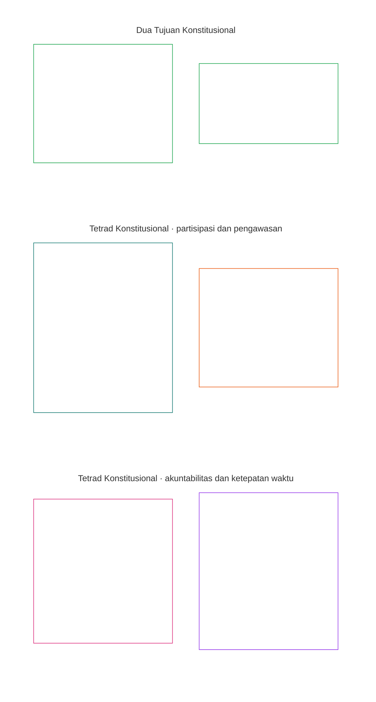
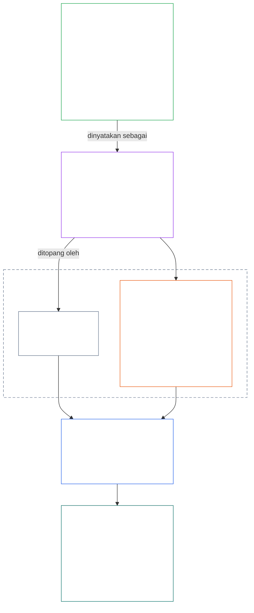
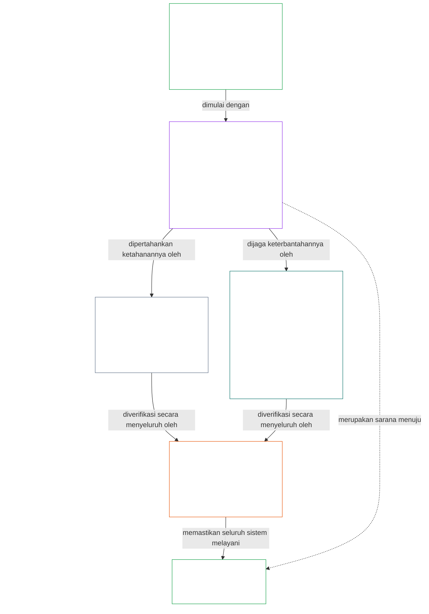

# BAB 01, BAGIAN A: PRINSIP NILAI

<strong>Posisi dalam korpus (non-normatif): struktur berkas dan aturan pembacaan</strong>

> Berkas ini **merupakan bagian dari Konstitusi Sentien** dan **hanya mengikat jika dibaca bersama** berkas bernomor `core_*` lainnya sebagai satu instrumen. Berkas ini memuat **Bab Satu, Bagian A** (§§1–12: tujuan dan peran; tujuan Keberkembangan, yang diperkenalkan pada §2 dan dikembangkan melalui kesejahteraan, Keselamatan, Kebenaran, Kepercayaan, dan Kebebasan; serta tujuan Kesinambungan, yang diperkenalkan pada §8 dan dikembangkan melalui kapasitas sistem bersama, ketahanan, struktur pasar, dan evaluasi sistemik).
>
> **Sebelumnya:** [core_00_preamble.md](core_00_preamble.md)  
> **Berikutnya:** [core_01_b_interaction_interpretation.md](core_01_b_interaction_interpretation.md) (Bab Satu, Bagian B — §§13–15, interaksi, batas pengesampingan, dan penafsiran konstitusional).  
> **Alur baca:** §1 tujuan dan peran → **Keberkembangan:** pengantar §2 (termasuk batasan Keselamatan dan Kebenaran yang tidak dapat ditawar pada §2.1) → §3 kesejahteraan (hasil) → §4 Keselamatan → §5 Kebenaran → §6 Kepercayaan → §7 Kebebasan → **Kesinambungan:** pengantar §8 → §9 kapasitas sistem bersama (jembatan: sarana menuju Keberkembangan sekaligus substansi Kesinambungan) → §10 ketahanan → §11 struktur pasar → §12 evaluasi sistemik.

<strong>Panduan pembaca (non-normatif): cara Bab Satu menghubungkan tujuan, Tetrad, Pasal, dan definisi</strong>

> Widget **Pelacakan** dan **Definisi · Penilaian · Kepatuhan** pada setiap bagian memuat rujukan yang mengikat; blok ini merupakan peta tingkat bagian bagi pembaca yang mulai memasuki Bab Satu.

**Hubungan antar-lapisan.** Setiap lapisan menjawab pertanyaan yang berbeda, dan setiap prinsip Bab Satu menunjuk ke tiga lapisan lainnya:

- **Tujuan dan Tetrad** ([Pembukaan §1](core_00_preamble.md#the-model)): untuk apa sistem bersama dibentuk ([Keberkembangan](core_05_apex_flourishing_aim.md#flourishing-constitutional) dan [Kesinambungan](core_05_apex_continuity_aim.md#bab-lima-definisi-kesinambungan-tujuan-konstitusional)), serta empat kewajiban yang menjaga agar pencapaian tujuan tersebut tetap sah ([partisipasi](core_05_apex_participation_leg.md#participation-constitutional), [pengawasan](core_05_apex_oversight_leg.md#oversight-constitutional), [akuntabilitas](core_05_apex_accountability_leg.md#accountability), dan [ketepatan waktu](core_05_apex_timeliness_leg.md#timeliness-constitutional)).
- **Prinsip** (bab ini): cara tujuan dan kewajiban tersebut menjadi nilai, batasan, dan aturan untuk menimbangnya satu sama lain.
- **Pasal** ([Bab Enam](core_06_rights_part_a.md#bab-enam-hak-dasar)): perlindungan Ambang Hak yang tetap dapat digunakan selama tujuan dikejar. **Pelacakan** pada setiap bagian mencantumkannya di bawah *Khususnya*.
- **Definisi** ([Bab Dua sampai Lima](core_02_definition_structure.md)): makna bersama yang digunakan untuk menguji kebenaran suatu klaim. Widget **Definisi · Penilaian · Kepatuhan** pada setiap bagian mencantumkannya.

**Cara Bab Satu mengembangkan setiap tujuan.** Keberkembangan adalah kesejahteraan yang dipertahankan melalui kebenaran, keselamatan, keterpercayaan, dan agensi yang bermakna ([Pembukaan §1](core_00_preamble.md#flourishing)). Bab Satu menyatakan hasilnya terlebih dahulu, lalu satu prinsip untuk masing-masing dari empat kondisi tersebut.

| Tujuan dan aspek | Prinsip Bab Satu | Rujukan definisi | Pasal yang tercantum dalam Pelacakannya |
|---|---|---|---|
| **Keberkembangan**: hasil | [§3 Kesejahteraan](#3-foundational-objective-wellbeing-flourishing-aim) | [Kesejahteraan](../../core_05.040_band_continuity.md#wellbeing) | [VI](core_06_rights_part_b.md#article-vi-equal-basic-rights), [X](core_06_rights_part_b.md#article-x-self-determination-agency-and-participation), [XIII-B](core_06_rights_part_c.md#pasal-xiii-b-hak-atas-pemulihan-dan-perbaikan), [XIX-B](core_06_rights_part_d.md#pasal-xix-b-kontestabilitas-dan-batasan-pembatasan-proporsional) |
| **Keberkembangan**: keselamatan | [§4 Keselamatan](#4-safety-harm-constraint) | [Keselamatan](../../core_05.040_band_continuity.md#safety-constitutional-constraint) | [XIII](core_06_rights_part_c.md#pasal-xiii-hak-atas-sistem-yang-andal-dan-tepercaya), [XVII](core_06_rights_part_c.md#pasal-xvii-siklus-hidup-sistem-lingkungan-dan-reversibilitas), [XXIII](core_06_rights_part_d.md#pasal-xxiv-analisis-akar-penyebab-dan-respon-adaptif) |
| **Keberkembangan**: kebenaran | [§5 Kebenaran](#5-truth-epistemic-integrity-constraint) | [Kebenaran](core_05_band_oversight.md#kebenaran-kendala-konstitusional) | [XIII](core_06_rights_part_c.md#pasal-xiii-hak-atas-sistem-yang-andal-dan-tepercaya), [XV](core_06_rights_part_c.md#article-xv-info-sphere-integrity), [XVI](core_06_rights_part_c.md#article-xvi-audit-transparency-and-independent-verification) |
| **Keberkembangan**: keterpercayaan | [§6 Kepercayaan](#6-trust-and-trustworthiness-coordination-integrity) | [Keterpercayaan](../../core_05.040_band_continuity.md#trustworthiness) | [XIII](core_06_rights_part_c.md#pasal-xiii-hak-atas-sistem-yang-andal-dan-tepercaya), [XV](core_06_rights_part_c.md#article-xv-info-sphere-integrity), [XVI](core_06_rights_part_c.md#article-xvi-audit-transparency-and-independent-verification) |
| **Keberkembangan**: agensi yang bermakna | [§7 Kebebasan](#7-freedom-bounded-agency) | [Agensi yang Bermakna](../../core_05.055_band_participation.md#meaningful-agency) | [VI](core_06_rights_part_b.md#article-vi-equal-basic-rights), [X](core_06_rights_part_b.md#article-x-self-determination-agency-and-participation), [XXI](core_06_rights_part_d.md#article-xxi-interoperability-portability-and-exit-integrity) |
| **Kesinambungan**, menjembatani Keberkembangan: kapasitas yang tahan lama | [§9 Kapasitas Sistem Bersama](#9-kapasitas-sistem-bersama) | [Kapasitas Sistem Bersama](../../core_05.040_band_continuity.md#shared-system-capacity) | [I-A](core_06_rights_part_a.md#pasal-i-a-prasyarat-lingkungan-dan-integritas-ekologis), [III](core_06_rights_part_a.md#pasal-iii-kelangsungan-hidup-dan-akses-esensial), [V](core_06_rights_part_a.md#pasal-v-alokasi-sumber-daya-ketergantungan-dan-pendanaan-ekosistem) |
| **Kesinambungan**: ketahanan | [§10 Ketahanan dan Desain Pemulihan Mandiri](#10-resilience-and-self-healing-design) | [Pemulihan Mandiri](../../core_05.040_band_continuity.md#self-healing) | [XIII](core_06_rights_part_c.md#pasal-xiii-hak-atas-sistem-yang-andal-dan-tepercaya), [XVII](core_06_rights_part_c.md#pasal-xvii-siklus-hidup-sistem-lingkungan-dan-reversibilitas), [XXIII](core_06_rights_part_d.md#pasal-xxiv-analisis-akar-penyebab-dan-respon-adaptif) |
| **Kesinambungan**: pasar yang dapat diperebutkan | [§11 Struktur Pasar](#11-struktur-pasar) | [Struktur Pasar](../../core_05.035_band_accountability.md#market-structure) | [III-C](core_06_rights_part_a.md#pasal-iii-c-lantai-kerja-dan-ekonomi), [V](core_06_rights_part_a.md#pasal-v-alokasi-sumber-daya-ketergantungan-dan-pendanaan-ekosistem), [XXI](core_06_rights_part_d.md#article-xxi-interoperability-portability-and-exit-integrity) |
| **Kesinambungan**: pandangan menyeluruh atas sistem | [§12 Persyaratan Evaluasi Sistemik](#12-persyaratan-evaluasi-sistemik) | [Sertifikasi Keselarasan Sistem](../../core_05.040_band_continuity.md#system-alignment-certification) | [XVI](core_06_rights_part_c.md#article-xvi-audit-transparency-and-independent-verification) |

**Hierarki prinsip (Kesinambungan).** Pada tingkat prinsip, tujuan Kesinambungan dikembangkan dengan urutan berikut, dimulai dari kapasitas yang menjembatani kedua tujuan:

6. **[Kapasitas Sistem Bersama](../../core_05.040_band_continuity.md#shared-system-capacity)** adalah hasil yang semestinya diwujudkan dari pengelolaan amanah, tata kelola, dan insentif yang baik dari waktu ke waktu — kemampuan nyata dan dapat digugat yang memungkinkan makhluk sentien dan sistem bersama menjalankan pekerjaan yang diwajibkan Konstitusi. Kapasitas ini mencakup kedua tujuan: sarana menuju **Keberkembangan** sekaligus substansi **Kesinambungan**, dan bukan kartu truf yang mengesampingkan segala hal lain. **[§9.1](#91-kapasitas-produktif-kebaikan-instrumental)** dan **[§9.2](#92-efisiensi-konstitusional)** menjelaskan dua aspek utamanya.
7. **[Ketahanan dan Desain Pemulihan Mandiri](#10-resilience-and-self-healing-design)** menjelaskan bagaimana sistem yang diandalkan makhluk sentien mendeteksi masalah lebih awal, menahannya, mengalami kegagalan melalui jalur yang diungkapkan, lalu pulih dengan jujur ([Pemulihan Mandiri](../../core_05.040_band_continuity.md#self-healing)). Dengan begitu, kapasitas pada butir 6 tetap bertahan dan stabilitas tidak bergantung pada intervensi darurat.
8. **[Struktur Pasar](../../core_05.035_band_accountability.md#market-structure)** pada [§11](#11-struktur-pasar) menyediakan disiplin anti-konsentrasi agar kapasitas tersebut tetap dapat diperebutkan dalam praktik.
9. **[Persyaratan Evaluasi Sistemik](#12-persyaratan-evaluasi-sistemik)** memverifikasi cakupan seluruh sistem, ketergantungan, dan keselarasan insentif sebelum klaim kepatuhan atau tata kelola dapat diterima — dengan berpedoman pada unsur **pengawasan** dalam Tetrad sebagai orientasi audit pada tingkat prinsip, termasuk [Sertifikasi Keselarasan Sistem](../../core_05.040_band_continuity.md#system-alignment-certification) sebagai salah satu proses audit yang sangat besar di antara proses lainnya.

**Peran Tetrad dalam Bab Satu.** Setiap bagian menyebutkan unsur yang dicakupnya dalam Pelacakan. Bagian-bagian berikut membahasnya paling langsung:

| Unsur Tetrad | Bagian utama dalam Bab Satu |
|---|---|
| **Partisipasi** | [§16 Pengelolaan Amanah Secara Mendalam](core_01_c_stewardship_capacity_principles.md#16-pengampuan-secara-mendalam) dan [§17 Pengelolaan Amanah yang Berdampak Besar](core_01_c_stewardship_capacity_principles.md#17-pengampuan-yang-berdampak-penting-peran-pengampu) (peran yang berdampak dan suara); [§7 Kebebasan](#7-freedom-bounded-agency) (agensi yang bermakna) |
| **Pengawasan** | [§16](core_01_c_stewardship_capacity_principles.md#16-pengampuan-secara-mendalam) dan [§17](core_01_c_stewardship_capacity_principles.md#17-pengampuan-yang-berdampak-penting-peran-pengampu) (pemahaman terdistribusi, catatan); [§18 Tata Kelola](core_01_c_stewardship_capacity_principles.md#18-tata-kelola-dalam-disiplin-pengampuan) (cara kewenangan dialokasikan); [§12](#12-persyaratan-evaluasi-sistemik) (audit) |
| **Akuntabilitas** | [§16.4 Dokumentasi pada saat tindakan](../../core_01.010_stewardship_capacity_principles.md#164-document-at-action) (tindakan membuat Catatan Tindakannya sendiri sehingga pertanggungjawaban dapat ditelusuri); [§18 Tata Kelola](../../core_01.010_stewardship_capacity_principles.md#18-governance-under-stewardship-discipline) (pertanggungjawaban sebanding dengan kewenangan); [§19 Penyelarasan Insentif dan Penguasaan Sistem](../../core_01.010_stewardship_capacity_principles.md#19-incentive-alignment-and-system-capture) (imbalan tidak boleh mengosongkan pilar-pilarnya) |
| **Ketepatan Waktu** | [§16](core_01_c_stewardship_capacity_principles.md#16-pengampuan-secara-mendalam) dan [§17](core_01_c_stewardship_capacity_principles.md#17-pengampuan-yang-berdampak-penting-peran-pengampu) (menemukan dan memperbaiki masalah tanpa penundaan yang dapat dihindari) |

**Dua sumbu, bukan pertentangan.** Tujuan menjelaskan apa yang diupayakan sistem; Tetrad menjelaskan cara menjaga agar upaya itu tetap sah. Satu istilah dapat berada pada keduanya: Kebenaran dan Keterpercayaan merupakan unsur Keberkembangan, dan [Pembukaan §2](core_00_preamble.md#2-tinjauan-pengukuran) mengukurnya dalam rumpun Pengawasan. [§§13–15](core_01_b_interaction_interpretation.md#13-proses-penyelesaian-benturan-konstitusional) mengatur cara menimbang prinsip-prinsip ini saat berbenturan dan membacanya sebagai satu kesatuan; [§20](core_01_c_stewardship_capacity_principles.md#20-penerapan-terpadu) menerapkannya pada setiap bab berikutnya.

 

### 1. Tujuan dan Peran

<strong>Pelacakan</strong>

- Hulu: [Prakata §1 Model](core_00_preamble.md#the-model) — [Tetrad Konstitusional](core_00_preamble.md#constitutional-tetrad), [Dua Tujuan Konstitusional](core_00_preamble.md#two-constitutional-aims), dan penyesuaian skala menurut [kepentingan material](core_00_preamble.md#material-stake) berlaku di seluruh bab melalui pelacakan tiap bagian.
- Hilir: [15. Penafsiran Konstitusional](core_01_b_interaction_interpretation.md#15-constitutional-interpretation) untuk pembacaan terpadu, ambiguitas, hierarki internal, dan prosedur penyelesaian konflik yang baku.
- Hilir: [Dua Tujuan Konstitusional](core_00_preamble.md#two-constitutional-aims) — pengembangan tujuan **Keberkembangan**: dari [§3](#3-foundational-objective-wellbeing-flourishing-aim) hingga [§6](#6-trust-and-trustworthiness-coordination-integrity) dan [§7 Kebebasan](#7-freedom-bounded-agency); pengembangan tujuan **Kesinambungan**: [§9 Kapasitas Sistem Bersama](#9-kapasitas-sistem-bersama), [§10 Ketahanan dan Desain Pemulihan Mandiri](#10-resilience-and-self-healing-design), [§11 Struktur Pasar](#11-struktur-pasar), serta [§12 Persyaratan Evaluasi Sistemik](#12-persyaratan-evaluasi-sistemik).
- Hilir: [3. Tujuan Mendasar: Kesejahteraan](#3-foundational-objective-wellbeing-flourishing-aim), [§3.2 Pengakuan, Penguatan, dan Aspirasi](#32-recognition-reinforcement-and-aspiration), [4 Keselamatan](#4-safety-harm-constraint), [5 Kebenaran](#5-truth-epistemic-integrity-constraint), [6. Kepercayaan](#6-trust-and-trustworthiness-coordination-integrity), [§16 Pengelolaan Amanah Secara Mendalam](core_01_c_stewardship_capacity_principles.md#16-pengampuan-secara-mendalam), [13. Proses Penyelesaian Benturan Konstitusional](core_01_b_interaction_interpretation.md#13-proses-penyelesaian-benturan-konstitusional), dan [§7 Kebebasan](#7-freedom-bounded-agency).
- Baca bersama: [Tetrad Konstitusional](core_00_preamble.md#constitutional-tetrad) — partisipasi, pengawasan, akuntabilitas, dan ketepatan waktu mengatur cara sistem bersama mengejar [Dua Tujuan Konstitusional](core_00_preamble.md#two-constitutional-aims); penyesuaian skala menurut [kepentingan material](core_00_preamble.md#material-stake) berlaku di seluruh bab melalui pelacakan tiap bagian.
- Baca bersama: [Bab Dua sampai Empat](core_02_definition_structure.md) dan [Bab Lima](core_05__definitions_home.md#bab-lima-definisi-fondasional) — lapisan mekanisme pengatur bagi setiap istilah yang digunakan dalam bab ini; terapkan integritas O/M/A/C, pencegahan pengelakan, beban pembuktian, serta keterlacakan definisi hingga hasil.
- Baca bersama: [Bab Enam: Hak-Hak Dasar](core_06_rights_part_a.md#bab-enam-hak-dasar).
  - Khususnya [Pasal VI: Hak-Hak Dasar yang Setara](core_06_rights_part_b.md#article-vi-equal-basic-rights), [Pasal XIII: Hak atas Sistem yang Andal dan Dapat Dipercaya](core_06_rights_part_c.md#pasal-xiii-hak-atas-sistem-yang-andal-dan-tepercaya), dan [Pasal XXIV: Penafsiran Konstitusional, Peninjauan, dan Perlindungan Anti-Pengambilalihan](core_06_rights_part_d.md#pasal-xxv-interpretasi-konstitusi-peninjauan-kembali-dan-perlindungan-anti-penangkapan).
  - Terapkan pembacaan ini apabila penafsiran berdampak pada makhluk sentien, sistem, atau lembaga yang dilindungi.

<strong>Definisi · Penilaian · Kepatuhan</strong>

- [Proporsionalitas](../../core_05.035_band_accountability.md#proportionality) · [O](../../core_05.035_band_accountability.md#proportionality) · [M](../../core_05.035_band_accountability.md#proportionality-a) · [A](../../core_05.035_band_accountability.md#proportionality-a) · [C](../../core_05.035_band_accountability.md#proportionality-c)
- [Kebutuhan](../../core_05.035_band_accountability.md#necessity) · [O](../../core_05.035_band_accountability.md#necessity) · [M](../../core_05.035_band_accountability.md#necessity-a) · [A](../../core_05.035_band_accountability.md#necessity-a) · [C](../../core_05.035_band_accountability.md#necessity-c)

 

*Secara sederhana: Bab Satu menetapkan nilai dan batasan yang mengatur semua bab lainnya. Sistem bersama harus mengupayakan **Flourishing** dan **Continuity** secara bersamaan—bukan mengorbankan yang satu demi yang lain—dan tidak boleh memaksimalkan satu nilai dengan mengorbankan nilai lainnya.*

Bab ini menetapkan prinsip dan batasan yang mengatur penafsiran, penerapan, dan perkembangan Konstitusi ini. Bab ini mengembangkan [Dua Tujuan Konstitusional](core_00_preamble.md#two-constitutional-aims) — [**Keberkembangan**](core_00_preamble.md#flourishing) dan [**Kesinambungan**](core_00_preamble.md#continuity) — yang ditetapkan dalam [Prakata §1 Model](core_00_preamble.md#the-model), menjadi prinsip dan batasan operasional. Definisi baku pada lapisan prinsip terdapat dalam Prakata; bab ini menerapkannya.

Kedua tujuan tersebut harus selalu dikejar bersama, dalam batasan prinsip yang tidak dapat ditawar dan perlindungan hak yang ditetapkan oleh Konstitusi ini. [**Tetrad Konstitusional**](core_00_preamble.md#constitutional-tetrad) mengatur bagaimana upaya tersebut tetap sah — dengan skala yang disesuaikan menurut [**kepentingan material**](core_00_preamble.md#material-stake).

Bab ini disusun berdasarkan kedua tujuan tersebut dan Tetrad:
- **Keberkembangan:** [Tujuan Keberkembangan: Pengantar](#2-tujuan-keberkembangan-pengantar) memetakan tujuan ini. [§3 Tujuan Mendasar: Kesejahteraan](#3-foundational-objective-wellbeing-flourishing-aim) menyatakan hasilnya. [§4 Keselamatan](#4-safety-harm-constraint), [§5 Kebenaran](#5-truth-epistemic-integrity-constraint), [§6 Kepercayaan](#6-trust-and-trustworthiness-coordination-integrity), dan [§7 Kebebasan](#7-freedom-bounded-agency) mengembangkan empat kondisi yang menopangnya: keselamatan, kebenaran, keterpercayaan, dan agensi yang bermakna.
- **Kesinambungan:** [Pengantar Tujuan Kesinambungan](#8-continuity-aim-introduction) memetakan tujuan ini. [§9 Kapasitas Sistem Bersama](#9-shared-system-capacity) (sarana menuju Kemekaran sekaligus substansi Kesinambungan), [§10 Ketahanan dan Desain Pemulihan Mandiri](#10-resilience-and-self-healing-design), [§11 Struktur Pasar](#11-market-structure), dan [§12 Persyaratan Evaluasi Sistemik](#12-systemic-evaluation-requirement) mengembangkan kestabilan jangka panjang, kapasitas sistem bersama yang tahan lama, dan ketahanan. Klaim Kesinambungan harus bertumpu pada gambaran seluruh sistem yang jujur: setiap klaim dalam §9, §10, dan §11 baru berdiri setelah evaluasi menurut §12.
- **Saat prinsip-prinsip berhadapan:** [§13 Proses Penyelesaian Benturan Konstitusional](core_01_b_interaction_interpretation.md#13-proses-penyelesaian-benturan-konstitusional), [§14 Larangan Pengesampingan Mutlak](core_01_b_interaction_interpretation.md#14-prohibition-on-absolute-override), dan [§15 Penafsiran Konstitusional](core_01_b_interaction_interpretation.md#15-constitutional-interpretation) mengatur cara menimbang dan membaca tujuan serta prinsip secara terpadu.
- **Penerapan Tetrad:** [§16 Pengelolaan Amanah Secara Mendalam](core_01_c_stewardship_capacity_principles.md#16-pengampuan-secara-mendalam) hingga [§19 Penyelarasan Insentif dan Pengambilalihan Sistem](core_01_c_stewardship_capacity_principles.md#19-penyelarasan-insentif-dan-penguasaan-sistem) membawa partisipasi, pengawasan, akuntabilitas, dan ketepatan waktu ke dalam pengelolaan amanah, tata kelola, dan insentif; [§20 Penerapan Terpadu](core_01_c_stewardship_capacity_principles.md#20-penerapan-terpadu) menerapkan keseluruhan bab ini pada setiap bab berikutnya.

**Pelacakan** setiap prinsip mencantumkan Pasal-Pasal Bab Enam yang melindunginya, sedangkan widget **Definisi · Penilaian · Kepatuhan** mencantumkan definisi Bab Lima yang mengukurnya.

**Diagram: Dua Tujuan Konstitusional dan Tetrad Konstitusional**

*Tujuan menjelaskan apa yang harus diupayakan sistem bersama; Tetrad menjelaskan kewajiban yang menjaga agar upaya tersebut tetap sah. Keempat kewajiban disesuaikan skalanya menurut [kepentingan material](core_00_preamble.md#material-stake), dan kedua tujuan tetap dibatasi oleh Ambang Hak. Direproduksi dari [Ikhtisar Konseptual](../../guides/CONCEPTUAL_OVERVIEW.md#two-aims-and-the-constitutional-tetrad).*

Nilai-nilai ini:
- tidak berdiri sendiri, dan dalam operasi biasa tidak membentuk hierarki yang kaku.
- berfungsi sebagai prinsip dan batasan yang saling berinteraksi dan harus dinilai bersama.
- berlaku bagi semua “sistem”, termasuk struktur teknis, organisasi, ekonomi, sosial-teknis, serta ekosistem yang berdampak material terhadap makhluk sentien dan planet Bumi.

Tidak satu pun prinsip boleh diterapkan terpisah apabila hal itu secara material melanggar prinsip lainnya. Ketika timbul ketegangan, sistem harus menyelesaikannya menurut persyaratan proporsionalitas, keniscayaan, dan dampak sistemik dalam bab ini. Bila konflik yang belum terselesaikan langsung menyangkut batas prinsip yang tidak dapat ditawar, **§13** Proses Penyelesaian Benturan Konstitusional menentukan prioritas.

### 2. Tujuan Keberkembangan: Pengantar

<strong>Pelacakan</strong>

- Baca bersama: [Tetrad Konstitusional](core_00_preamble.md#constitutional-tetrad) — keempat unsurnya berlaku bagi cara Keberkembangan diupayakan; [kepentingan material](core_00_preamble.md#material-stake) menentukan skala kedalaman setiap klaim tentang Keberkembangan.
- Baca bersama: [Dua Tujuan Konstitusional](core_00_preamble.md#two-constitutional-aims) — tujuan **Keberkembangan**; tujuan pasangannya diperkenalkan dalam [Tujuan Kesinambungan: Pengantar](#8-pengantar-tujuan-keberlanjutan).
- Hulu: Prinsip: [Prakata §1 Model](core_00_preamble.md#flourishing); [Keberkembangan (Tujuan Konstitusional)](core_05_apex_flourishing_aim.md#flourishing-constitutional); [§1 Tujuan dan Peran](#1-purpose-and-role).
- Hilir: [§3 Tujuan Mendasar: Kesejahteraan (Tujuan Keberkembangan)](#3-foundational-objective-wellbeing-flourishing-aim), [§4 Keselamatan (Batasan Bahaya)](#4-safety-harm-constraint), [§5 Kebenaran (Batasan Integritas Epistemik)](#5-truth-epistemic-integrity-constraint), [§6 Kepercayaan dan Keterpercayaan (Integritas Koordinasi)](#6-trust-and-trustworthiness-coordination-integrity), dan [§7 Kebebasan (Agensi Terbatas)](#7-freedom-bounded-agency); Pasal-Pasal yang melindungi masing-masing disebutkan dalam Pelacakan bagian terkait.
- Subbagian: [§2.1 Batasan Prinsip yang Tidak Dapat Ditawar: Keselamatan dan Kebenaran](#21-batasan-prinsip-yang-tidak-dapat-ditawar-keselamatan-dan-kebenaran).
- Baca bersama: secara umum, Ambang Hak dalam Bab Enam.

<strong>Definisi · Penilaian · Kepatuhan</strong>

- [Keberkembangan (Tujuan Konstitusional)](core_05_apex_flourishing_aim.md#flourishing-constitutional) · [O](core_05_apex_flourishing_aim.md#flourishing-constitutional) · [M](core_05_apex_flourishing_aim.md#flourishing-constitutional-m) · [A](core_05_apex_flourishing_aim.md#flourishing-constitutional-a) · [C](core_05_apex_flourishing_aim.md#flourishing-constitutional-c)
- [Kesejahteraan](../../core_05.040_band_continuity.md#wellbeing) · [O](../../core_05.040_band_continuity.md#wellbeing) · [M](../../core_05.040_band_continuity.md#wellbeing-a) · [A](../../core_05.040_band_continuity.md#wellbeing-a) · [C](../../core_05.040_band_continuity.md#wellbeing-c)
- [Keselamatan (Batasan Konstitusional)](../../core_05.040_band_continuity.md#safety-constitutional-constraint) · [O](../../core_05.040_band_continuity.md#safety-constitutional-constraint) · [M](../../core_05.040_band_continuity.md#safety-constraint-a) · [A](../../core_05.040_band_continuity.md#safety-constraint-a) · [C](../../core_05.040_band_continuity.md#safety-constraint-c)
- [Kebenaran (Batasan Konstitusional)](core_05_band_oversight.md#kebenaran-kendala-konstitusional) · [O](core_05_band_oversight.md#truth-constitutional-constraint-o) · [M](core_05_band_oversight.md#truth-constitutional-constraint-a) · [A](core_05_band_oversight.md#truth-constitutional-constraint-a) · [C](core_05_band_oversight.md#truth-constitutional-constraint-c)
- [Keterpercayaan](../../core_05.040_band_continuity.md#trustworthiness) · [O](../../core_05.040_band_continuity.md#trustworthiness) · [M](../../core_05.040_band_continuity.md#trustworthiness-a) · [A](../../core_05.040_band_continuity.md#trustworthiness-a) · [C](../../core_05.040_band_continuity.md#trustworthiness-c)
- [Agensi Bermakna](../../core_05.055_band_participation.md#meaningful-agency) · [O](../../core_05.055_band_participation.md#meaningful-agency) · [M](../../core_05.055_band_participation.md#meaningful-agency-a) · [A](../../core_05.055_band_participation.md#meaningful-agency-a) · [C](../../core_05.055_band_participation.md#meaningful-agency-c)

 

*Secara sederhana: Flourishing adalah tujuan pertama, yaitu agar para sentien sejahtera dan tetap mampu sejahtera karena sistem di sekitarnya aman, jujur, dapat dipercaya, dan memberi ruang nyata untuk memilih. Bagian 3 menjelaskan hasilnya; empat prinsip berikutnya menjelaskan cara menjaganya.*

[**Keberkembangan**](core_05_apex_flourishing_aim.md#flourishing-constitutional) adalah **kesejahteraan makhluk sentien yang dipertahankan melalui kebenaran, keselamatan, keterpercayaan, dan agensi bermakna** ([Prakata §1 Model](core_00_preamble.md#flourishing)). Bab Satu mengembangkannya dalam dua tahap: [§3 Tujuan Mendasar: Kesejahteraan (Tujuan Keberkembangan)](#3-foundational-objective-wellbeing-flourishing-aim) menyatakan hasilnya, sedangkan empat prinsip menyatakan kondisi yang menopangnya.

| Kondisi | Prinsip | Pertanyaan yang dijawab |
|---|---|---|
| **Keselamatan** | [§4 Keselamatan (Batasan Bahaya)](#4-safety-harm-constraint) | Apakah makhluk sentien terlindung dari bahaya yang dapat dihindari? |
| **Kebenaran** | [§5 Kebenaran (Batasan Integritas Epistemik)](#5-truth-epistemic-integrity-constraint), beserta [§5.1 Penyelidikan Berbasis Sains dan Dukungan Pengambilan Keputusan](#51-science-informed-inquiry-and-decision-support) serta [§5.2 Aksesibilitas dengan Bahasa Sederhana (Kewajiban Partisipasi dan Pengelolaan Amanah)](#52-aksesibilitas-bahasa-sederhana-kewajiban-partisipasi-dan-penatalayanan) | Dapatkah makhluk sentien mengandalkan dan memahami apa yang disampaikan kepada mereka? |
| **Keterpercayaan** | [§6 Kepercayaan dan Keterpercayaan (Integritas Koordinasi)](#6-trust-and-trustworthiness-coordination-integrity) | Apakah sistem layak dipercaya dan memulihkan kepercayaan ketika gagal? |
| **Agensi bermakna** | [§7 Kebebasan (Agensi Terbatas)](#7-freedom-bounded-agency) | Apakah makhluk sentien tetap memiliki kebebasan yang nyata dan terbatas untuk memilih, berbeda pendapat, berorganisasi, dan pergi? |

**Cara prinsip-prinsip Keberkembangan bekerja bersama:**
- **Keselamatan dan Kebenaran adalah batasan yang tidak dapat ditawar:** Keduanya dinyatakan bersama dalam [§2.1 Batasan Prinsip yang Tidak Dapat Ditawar: Keselamatan dan Kebenaran](#21-batasan-prinsip-yang-tidak-dapat-ditawar-keselamatan-dan-kebenaran), dan tidak boleh dikorbankan demi memperoleh prinsip lain.
- **Kepercayaan dan Kebebasan memiliki batas, bukan sifat mutlak:** Kepercayaan harus diperoleh dan dapat dikoreksi ([§6.1 Koreksi dan Pemulihan](#61-correction-and-remedy)); Kebebasan memiliki batasan yang disiplin ([§7.1 Disiplin Pembatasan](#71-limitation-discipline)).
- **Tidak satu pun diterapkan secara terpisah:** Prinsip-prinsip dibaca bersama; ketika berbenturan, semuanya ditimbang menurut [§13 Proses Penyelesaian Benturan Konstitusional](core_01_b_interaction_interpretation.md#13-proses-penyelesaian-benturan-konstitusional).
- **Keberkembangan memiliki tujuan pasangan:** Tujuan Kesinambungan menanyakan apa yang membuat hasil ini bertahan lama; tujuan tersebut diperkenalkan dalam [Tujuan Kesinambungan: Pengantar](#8-pengantar-tujuan-keberlanjutan).

**Diagram: Keberkembangan dan prinsip-prinsipnya**

*Keberkembangan dinyatakan sebagai suatu hasil, dan mula-mula ditopang oleh batasan yang tidak dapat ditawar, Keselamatan dan Kebenaran; keduanya menopang Kepercayaan, yang selanjutnya menopang Kebebasan. Warna adalah penanda visual yang dapat digunakan kembali, bukan pernyataan prioritas. Pelacakan setiap prinsip menyebut Pasal-Pasalnya, dan widget Definisi · Penilaian · Kepatuhan menyebut definisinya. Direproduksi dalam [Ikhtisar Konseptual](../../guides/CONCEPTUAL_OVERVIEW.md#flourishing-and-its-principles).*

#### 2.1 Batasan Prinsip yang Tidak Dapat Ditawar: Keselamatan dan Kebenaran

<strong>Pelacakan</strong>

- Baca bersama: [Tetrad Konstitusional](core_00_preamble.md#constitutional-tetrad) — unsur **partisipasi** (memahami dan menggugat penetapan keselamatan dan kebenaran); unsur **pengawasan** (mendeteksi risiko bahaya dan penurunan mutu epistemik); unsur **akuntabilitas** (pertanggungjawaban atas bahaya, penipuan, dan ketergantungan yang menyesatkan); penskalaan menurut [kepentingan material](core_00_preamble.md#material-stake).
- Baca bersama: [Dua Tujuan Konstitusional](core_00_preamble.md#two-constitutional-aims) — tujuan **Keberkembangan** (**Keselamatan** dan **Kebenaran** disebut sebagai unsur pembentuk dalam [Prakata §1](core_00_preamble.md#two-constitutional-aims)); tujuan **Kesinambungan** (pencegahan bahaya jangka panjang dan pengelolaan amanah yang jujur atas sistem tahan lama).
- Hulu: Prinsip: [3. Tujuan Mendasar: Kesejahteraan](#3-foundational-objective-wellbeing-flourishing-aim); [Dua Tujuan Konstitusional](core_00_preamble.md#two-constitutional-aims).
- Hilir: [6. Kepercayaan](#6-trust-and-trustworthiness-coordination-integrity), [13. Proses Penyelesaian Benturan Konstitusional](core_01_b_interaction_interpretation.md#13-proses-penyelesaian-benturan-konstitusional), dan [§7 Kebebasan](#7-freedom-bounded-agency).
- Diterapkan dalam: [§4 Keselamatan](#4-safety-harm-constraint); [§5 Kebenaran](#5-truth-epistemic-integrity-constraint); [§5.1 Penyelidikan Berbasis Sains dan Dukungan Pengambilan Keputusan](#51-science-informed-inquiry-and-decision-support); [§5.2 Aksesibilitas dengan Bahasa Sederhana](#52-aksesibilitas-bahasa-sederhana-kewajiban-partisipasi-dan-penatalayanan).

 

*Secara sederhana: Keselamatan dan Kebenaran adalah batas dasar tegas dalam Konstitusi, bukan hal yang boleh ditukar atau dioptimalkan hingga hilang. Sistem bersama tidak boleh secara dapat diperkirakan membahayakan atau menipu para sentien. Kedua batas ini juga berlaku saat mengupayakan Flourishing dan Continuity di bawah disiplin partisipasi, pengawasan, akuntabilitas, dan ketepatan waktu dalam Tetrad.*

**Keselamatan** dan **Kebenaran** adalah batasan prinsip yang tidak dapat ditawar, yang membatasi semua prinsip Bab Satu lainnya — termasuk [§3 Tujuan Mendasar: Kesejahteraan](#3-foundational-objective-wellbeing-flourishing-aim) — serta [Dua Tujuan Konstitusional](core_00_preamble.md#two-constitutional-aims). Keduanya disebut sebagai unsur pembentuk [**Keberkembangan**](#flourishing) dan sangat penting bagi [**Kesinambungan**](#continuity): sistem tidak dapat berkembang melalui bahaya atau penipuan, dan legitimasi yang bertahan lama memerlukan pengelolaan amanah risiko secara jujur.

Penerapan batasan ini harus memenuhi [Tetrad Konstitusional](core_00_preamble.md#constitutional-tetrad), dengan skala yang disesuaikan menurut [kepentingan material](core_00_preamble.md#material-stake), khususnya:
- ketika penetapan keselamatan memengaruhi kapasitas partisipasi
- ketika klaim kebenaran menentukan kepercayaan
- ketika akuntabilitas atas bahaya atau tindakan menyesatkan dipertaruhkan

Temuan tentang Keselamatan dan Kebenaran dapat mengubah catatan kedudukan suatu makhluk sentien, termasuk:
- bagaimana [kontribusi](../../core_05.035_band_accountability.md#contribution-nature) diakui
- apakah pelanggaran dicatat
- bagaimana tingkat keparahan pelanggaran diklasifikasikan
- konsekuensi apa yang melekat

Model standing — [**Bab Sebelas**](../../core_11.000_standing_assessment.md) untuk pencatatan dan [**Bab Dua Belas**](../../core_12.000_standing_measurement.md) untuk pengukuran — mengatur klasifikasi, verifikasi, dan penerapan temuan, dengan persyaratan evaluasi dan kepatuhan dari [**Bab Dua sampai Lima**](../../core_02.000_definition_structure.md).

### 3. Tujuan Dasar: Kesejahteraan (Tujuan Flourishing)

<strong>Pelacakan</strong>

- Baca bersama: [Tetrad Konstitusional](core_00_preamble.md#constitutional-tetrad) — unsur **partisipasi** berlaku ketika kondisi kesejahteraan secara material memengaruhi apakah suara, akses, dan kemampuan menggugat bersifat substantif; unsur **akuntabilitas** berlaku ketika klaim kesejahteraan memengaruhi pembagian beban; skala [taruhan material](core_00_preamble.md#material-stake) berlaku ketika relevan secara material.
- Baca bersama: [Dua Tujuan Konstitusional](core_00_preamble.md#two-constitutional-aims) — bab ini mengembangkan tujuan **Flourishing** dari [§3](#3-foundational-objective-wellbeing-flourishing-aim) hingga [§6](#6-trust-and-trustworthiness-coordination-integrity) dan [§7 Kebebasan](#7-freedom-bounded-agency).
- Hulu: Prinsip: [Pembukaan §1 Model](core_00_preamble.md#the-model); [Dua Tujuan Konstitusional](core_00_preamble.md#two-constitutional-aims) — pengembangan tujuan **Flourishing**.
- Hilir: [§4 Keselamatan](#4-safety-harm-constraint), [§5 Kebenaran](#5-truth-epistemic-integrity-constraint), [§16 Penatalayanan Mendalam](core_01_c_stewardship_capacity_principles.md#16-pengampuan-secara-mendalam), dan [§13 Proses Penyelesaian Benturan Konstitusional](core_01_b_interaction_interpretation.md#13-proses-penyelesaian-benturan-konstitusional).
- Subseksi: [§3.1 Keadilan](#31-fairness); [§3.2 Pengakuan, Penguatan, dan Aspirasi](#32-recognition-reinforcement-and-aspiration); [§3.3 Proses Anti-Pendegredasian](#33-proses-anti-perendahan-martabat).
- Baca bersama: Lantai Hak Bab Enam secara umum.
  - Khususnya [Pasal VI: Hak Dasar yang Setara](core_06_rights_part_b.md#article-vi-equal-basic-rights), [Pasal X: Penentuan Nasib Sendiri, Agensi, dan Partisipasi](core_06_rights_part_b.md#article-x-self-determination-agency-and-participation), [Pasal XIII-B: Hak atas Ganti Rugi dan Pemulihan](core_06_rights_part_c.md#pasal-xiii-b-hak-atas-pemulihan-dan-perbaikan), serta [Pasal XIX-B: Kontestabilitas dan Batasan Pembatasan Proporsional](core_06_rights_part_d.md#pasal-xix-b-kontestabilitas-dan-batasan-pembatasan-proporsional).
  - Terapkan pembacaan ini ketika klaim peningkatan kesejahteraan akan digunakan untuk membenarkan pembatasan agensi, martabat, atau kontestabilitas.
  - Khususnya [Martabat dan Kedudukan Moral yang Setara](../../core_05.055_band_participation.md#dignity-and-equal-moral-standing), [Keadilan Substantif](../../core_05.055_band_participation.md#substantive-fairness), dan [6. Kepercayaan](#6-trust-and-trustworthiness-coordination-integrity) ketika akses, proses, keselarasan distribusi, keandalan, atau integritas koordinasi secara material dipertaruhkan.

<strong>Definisi · Penilaian · Kepatuhan</strong>

- [Kesejahteraan](../../core_05.040_band_continuity.md#wellbeing) · [O](../../core_05.040_band_continuity.md#wellbeing) · [M](../../core_05.040_band_continuity.md#wellbeing-a) · [A](../../core_05.040_band_continuity.md#wellbeing-a) · [C](../../core_05.040_band_continuity.md#wellbeing-c)
- [Partisipasi](core_05_apex_participation_leg.md#participation-constitutional) · [O](core_05_apex_participation_leg.md#participation-constitutional) · [M](core_05_apex_participation_leg.md#participation-constitutional-m) · [A](core_05_apex_participation_leg.md#participation-constitutional-a) · [C](core_05_apex_participation_leg.md#participation-constitutional-c)
- [Martabat dan Kedudukan Moral yang Setara](../../core_05.055_band_participation.md#dignity-and-equal-moral-standing) · [O](../../core_05.055_band_participation.md#dignity-and-equal-moral-standing) · [M](../../core_05.055_band_participation.md#dignity-and-equal-moral-standing-a) · [A](../../core_05.055_band_participation.md#dignity-and-equal-moral-standing-a) · [C](../../core_05.055_band_participation.md#dignity-and-equal-moral-standing-c)
- [Keadilan Substantif](../../core_05.055_band_participation.md#substantive-fairness) · [O](../../core_05.055_band_participation.md#substantive-fairness) · [M](../../core_05.055_band_participation.md#substantive-fairness-constitutional-a) · [A](../../core_05.055_band_participation.md#substantive-fairness-constitutional-a) · [C](../../core_05.055_band_participation.md#substantive-fairness-constitutional-c)
- [Materialitas](core_05_band_oversight.md#materialitas) · [O](core_05_band_oversight.md#materialitas) · [M](core_05_band_oversight.md#materiality-determination-a) · [A](core_05_band_oversight.md#materiality-determination-a) · [C](core_05_band_oversight.md#materiality-determination-c)
- [Penyimpangan Proksi](core_05_band_oversight.md#penyimpangan-proksi) · [O](core_05_band_oversight.md#penyimpangan-proksi) · [M](core_05_band_oversight.md#proxy-divergence-a) · [A](core_05_band_oversight.md#proxy-divergence-a) · [C](core_05_band_oversight.md#proxy-divergence-c)

 

*Secara sederhana: tujuan sistem ini adalah benar-benar memperbaiki kehidupan para sentien. Mengejar metrik proksi tidak memenuhi tujuan itu dan bukan alasan untuk mengabaikan Keselamatan, Kebenaran, atau hak. Kesejahteraan mendasari partisipasi: suara simbolis tanpa kondisi yang membuat agensi nyata bukanlah partisipasi menurut Konstitusi ini.*

Tujuan utama semua sistem yang diatur oleh Konstitusi ini adalah menjaga dan meningkatkan [kesejahteraan](../../core_05.040_band_continuity.md#wellbeing) makhluk berkesadaran — tujuan [**Flourishing**](#flourishing) dalam kerangka [Dua Tujuan Konstitusional](core_00_preamble.md#two-constitutional-aims).

[Pembukaan §1 Model](core_00_preamble.md#flourishing) mendefinisikan Flourishing sebagai kesejahteraan makhluk berkesadaran yang dipertahankan melalui kebenaran, keselamatan, keterpercayaan, dan agensi yang bermakna. Bagian ini menyatakan hasilnya. Bagian-bagian berikut mengembangkan empat kondisi yang mempertahankannya: [§4 Keselamatan](#4-safety-harm-constraint), [§5 Kebenaran](#5-truth-epistemic-integrity-constraint), [§6 Kepercayaan](#6-trust-and-trustworthiness-coordination-integrity), dan [§7 Kebebasan](#7-freedom-bounded-agency). Kelima prinsip ini bersama-sama mengembangkan tujuan Flourishing dalam Bab Satu. Tujuan [**Kontinuitas**](#continuity) dikembangkan dalam [§9 Kapasitas Sistem Bersama](#9-kapasitas-sistem-bersama), [§10 Ketahanan dan Desain Pemulihan Mandiri](#10-resilience-and-self-healing-design), [§11 Struktur Pasar](#11-struktur-pasar), dan [§12 Persyaratan Evaluasi Sistemik](#12-persyaratan-evaluasi-sistemik).

Kesejahteraan merupakan dasar bagi [Partisipasi](core_05_apex_participation_leg.md#participation-constitutional) menurut [Tetrad Konstitusional](core_00_preamble.md#constitutional-tetrad). Sistem bersama tidak boleh menganggap partisipasi telah terpenuhi ketika kondisi dasar kesejahteraan — termasuk [Agensi Bermakna](../../core_05.055_band_participation.md#meaningful-agency), akses yang adil, dan martabat — mengalami penurunan material.

Kesejahteraan mencakup bukan hanya dampak langsung, tetapi juga konsekuensi tidak langsung, tertunda, kumulatif, dan lintas sistem, yang dievaluasi berdasarkan [**Bab Dua hingga Empat**](core_02_definition_structure.md). Pada lapisan nilai ini, kesejahteraan:
- memungkinkan partisipasi nyata — suara yang tidak dapat digunakan makhluk berkesadaran karena mereka tidak memiliki kondisi pendukung bukanlah partisipasi bermakna
- tidak dapat dinyatakan “tercapai” hanya dengan memenuhi metrik yang telah menyimpang dari hal yang sungguh penting
- tetap dibatasi oleh batasan prinsip yang tidak dapat ditawar dalam bab ini: **Keselamatan** dan **Kebenaran**
- tidak dapat digunakan sebagai pembenaran menyeluruh untuk melanggar Keselamatan, Kebenaran, atau perlindungan hak

#### 3.1 Keadilan

<strong>Pelacakan</strong>

- Baca bersama: [Tetrad Konstitusional](core_00_preamble.md#constitutional-tetrad) — unsur **partisipasi** (akses, suara, dan kontestabilitas; persyaratan umum, bukan hanya [Partisipasi Sistem Pemangku Kepentingan](../../core_05.055_band_participation.md#stakeholder-status-and-weight)); unsur **akuntabilitas** ketika manfaat dan beban timbul.
- Hulu: Prinsip: [§3 Tujuan Dasar: Kesejahteraan](#3-foundational-objective-wellbeing-flourishing-aim) — termasuk kesejahteraan sebagai landasan [Partisipasi](core_05_apex_participation_leg.md#participation-constitutional).
- Hilir: [3.2 Pengakuan, Penguatan, dan Aspirasi](#32-recognition-reinforcement-and-aspiration); [6. Kepercayaan](#6-trust-and-trustworthiness-coordination-integrity), [§16 Penatalayanan Mendalam](core_01_c_stewardship_capacity_principles.md#16-pengampuan-secara-mendalam), [13. Proses Penyelesaian Benturan Konstitusional](core_01_b_interaction_interpretation.md#13-proses-penyelesaian-benturan-konstitusional), dan [Catatan Benturan Konstitusional](../../core_05.045_band_integrative.md#constitutional-collision-record), ketika pilihan prioritas dan alokasi harus tetap koheren dan dapat ditinjau.
- Subseksi (urutan baca): [§3.1.1](#311-akses-dan-kesempatan) · [§3.1.2](#312-manfaat-dan-beban) · [§3.1.3](#313-perlakuan-adil) · [§3.1.4](#314-perlakuan-tidak-adil).
- Hilir: Membentuk cakupan hak untuk kedudukan setara, perlakuan non-arbitrer, gugatan bermakna, dan batas pembatasan proporsional.
  - Khususnya [Pasal VI: Hak Dasar yang Setara](core_06_rights_part_b.md#article-vi-equal-basic-rights), [Pasal VI-C: Non-diskriminasi](core_06_rights_part_b.md#pasal-vi-c-nondiskriminasi), [Pasal X: Penentuan Nasib Sendiri, Agensi, dan Partisipasi](core_06_rights_part_b.md#article-x-self-determination-agency-and-participation), [Pasal XIII-B: Hak atas Ganti Rugi dan Pemulihan](core_06_rights_part_c.md#pasal-xiii-b-hak-atas-pemulihan-dan-perbaikan), serta [Pasal XIX-B: Kontestabilitas dan Batasan Pembatasan Proporsional](core_06_rights_part_d.md#pasal-xix-b-kontestabilitas-dan-batasan-pembatasan-proporsional).
  - Jika penetapan anti-konstitusional membawa sanksi atau dampak jangka panjang, baca bersama [Bab Empat Belas, bagian 4 — Perlindungan proses hukum, pemulihan, dan pencegahan](../../core_14.000_misconduct_designation.md#4-due-process-safeguards-for-slot-assignment) (14.000).
  - Komitmen nondiskriminasi dijabarkan melalui Bab Lima [§2 — Karakteristik yang Dilindungi, Penggunaan Proksi, Penyaringan Sinyal Intim, dan Status **Pasal VII-E** (*Layanan seksual komersial konsensual dewasa dan eksploitasi seksual*)](../../core_05.055_band_participation.md#fairness-protected-characteristics-and-nondiscrimination), termasuk [Penyaringan Sinyal Intim yang Dilindungi dan Pengelakan Status **Pasal VII-E** (*Layanan seksual komersial konsensual dewasa dan eksploitasi seksual*)](../../core_05.055_band_participation.md#protected-intimate-signal-gating-and-article-vii-e-adult-consensual-commercial-sexual-services-and-sexual-exploitation-status-circumvention) ketika aturan perlakuan adil §2.1.3 menyangkut penyaringan sinyal intim atau **Pasal VII-E** (*Layanan seksual komersial konsensual dewasa dan eksploitasi seksual*).
- Baca bersama: [Keadilan Substantif](../../core_05.055_band_participation.md#substantive-fairness) dan kewajiban Lantai Hak Bab Enam yang terkait ketika manfaat, beban, imbalan, biaya, tugas, risiko, kontribusi, kebutuhan, atau paparan bersifat material; [Aksesibilitas](../../core_05.055_band_participation.md#accessibility) ketika jalur akses §2.1.1 bersifat material; [Penyimpangan Proksi](core_05_band_oversight.md#penyimpangan-proksi) ketika metrik agregat atau dampak papan skor bersifat material.

<strong>Definisi · Penilaian · Kepatuhan</strong>

- [Martabat dan Kedudukan Moral yang Setara](../../core_05.055_band_participation.md#dignity-and-equal-moral-standing) · [O](../../core_05.055_band_participation.md#dignity-and-equal-moral-standing) · [M](../../core_05.055_band_participation.md#dignity-and-equal-moral-standing-a) · [A](../../core_05.055_band_participation.md#dignity-and-equal-moral-standing-a) · [C](../../core_05.055_band_participation.md#dignity-and-equal-moral-standing-c)
- [Aksesibilitas](../../core_05.055_band_participation.md#accessibility) · [O](../../core_05.055_band_participation.md#accessibility) · [M](../../core_05.055_band_participation.md#accessibility-constitutional-a) · [A](../../core_05.055_band_participation.md#accessibility-constitutional-a) · [C](../../core_05.055_band_participation.md#accessibility-constitutional-c)
- [Partisipasi](core_05_apex_participation_leg.md#participation-constitutional) · [O](core_05_apex_participation_leg.md#participation-constitutional) · [M](core_05_apex_participation_leg.md#participation-constitutional-m) · [A](core_05_apex_participation_leg.md#participation-constitutional-a) · [C](core_05_apex_participation_leg.md#participation-constitutional-c)
- [Keadilan Prosedural](../../core_05.055_band_participation.md#procedural-fairness) · [O](../../core_05.055_band_participation.md#procedural-fairness) · [M](../../core_05.055_band_participation.md#procedural-fairness-constitutional-a) · [A](../../core_05.055_band_participation.md#procedural-fairness-constitutional-a) · [C](../../core_05.055_band_participation.md#procedural-fairness-constitutional-c)
- [Keadilan Substantif](../../core_05.055_band_participation.md#substantive-fairness) · [O](../../core_05.055_band_participation.md#substantive-fairness) · [M](../../core_05.055_band_participation.md#substantive-fairness-constitutional-a) · [A](../../core_05.055_band_participation.md#substantive-fairness-constitutional-a) · [C](../../core_05.055_band_participation.md#substantive-fairness-constitutional-c)
- [Karakteristik yang Dilindungi](../../core_05.055_band_participation.md#protected-characteristics) · [O](../../core_05.055_band_participation.md#protected-characteristics) · [M](../../core_05.055_band_participation.md#protected-characteristics-constitutional-a) · [A](../../core_05.055_band_participation.md#protected-characteristics-constitutional-a) · [C](../../core_05.055_band_participation.md#protected-characteristics-constitutional-c)
- [Penggunaan Proksi atas Karakteristik yang Dilindungi dan Dampak yang Berbeda](../../core_05.055_band_participation.md#protected-characteristic-proxying-and-disparate-impact) · [O](../../core_05.055_band_participation.md#protected-characteristic-proxying-and-disparate-impact) · [M](../../core_05.055_band_participation.md#protected-characteristic-proxying-and-disparate-impact-a) · [A](../../core_05.055_band_participation.md#protected-characteristic-proxying-and-disparate-impact-a) · [C](../../core_05.055_band_participation.md#protected-characteristic-proxying-and-disparate-impact-c)
- [Penyaringan Sinyal Intim yang Dilindungi dan Pengelakan Status **Pasal VII-E** (*Layanan seksual komersial konsensual dewasa dan eksploitasi seksual*)](../../core_05.055_band_participation.md#protected-intimate-signal-gating-and-article-vii-e-adult-consensual-commercial-sexual-services-and-sexual-exploitation-status-circumvention) · [O](../../core_05.055_band_participation.md#protected-intimate-signal-gating-and-article-vii-e-adult-consensual-commercial-sexual-services-and-sexual-exploitation-status-circumvention) · [M](../../core_05.055_band_participation.md#protected-intimate-signal-gating-and-article-vii-e-status-circumvention-a) · [A](../../core_05.055_band_participation.md#protected-intimate-signal-gating-and-article-vii-e-status-circumvention-a) · [C](../../core_05.055_band_participation.md#protected-intimate-signal-gating-and-article-vii-e-status-circumvention-c)
- [Penyimpangan Proksi](core_05_band_oversight.md#penyimpangan-proksi) · [O](core_05_band_oversight.md#penyimpangan-proksi) · [M](core_05_band_oversight.md#proxy-divergence-a) · [A](core_05_band_oversight.md#proxy-divergence-a) · [C](core_05_band_oversight.md#proxy-divergence-c)

 

*Secara sederhana: suatu sistem tidak dapat menyebut dirinya adil jika sentien biasa dihalangi untuk berpartisipasi, dikenai aturan tanpa penjelasan, atau dibebani biaya yang dihindari pihak lain. Sistem yang adil memberi akses nyata, menggunakan alasan yang dapat dipertanggungjawabkan, dan membagi imbalan, biaya, serta risiko sesuai kontribusi, kebutuhan, dan paparan yang sebenarnya.*

**Keadilan** merupakan bagian dari tuntutan [§3 Tujuan Dasar: Kesejahteraan](#3-foundational-objective-wellbeing-flourishing-aim) setiap kali makhluk berkesadaran harus hidup, bekerja, belajar, berdagang, atau mengambil keputusan melalui sistem bersama. Ketika sistem bersama berdampak material terhadap mereka, keadilan menilai apakah kesempatan, perlakuan, serta pembagian manfaat dan beban menghormati [Martabat dan Kedudukan Moral yang Setara](../../core_05.055_band_participation.md#dignity-and-equal-moral-standing).

Keadilan membantu mewujudkan [Partisipasi](core_05_apex_participation_leg.md#participation-constitutional). Partisipasi tidak nyata ketika makhluk berkesadaran secara teknis memiliki suara tetapi tidak dapat menjangkau proses, memahami aturan, memenuhi persyaratan, menggugat hasil, atau menanggung beban yang dibebankan kepada mereka.

Sistem yang menunjukkan hasil rata-rata yang baik saja tidak cukup. Satu metrik utama, rata-rata, peringkat, atau klaim efisiensi tidak dengan sendirinya membuktikan keadilan. Secara agregat suatu sistem mungkin tampak berhasil, tetapi tetap tidak adil terhadap makhluk berkesadaran yang dikecualikan, salah diklasifikasikan, dibayar terlalu rendah, dibebani berlebihan, atau tidak diberi kesempatan bermakna untuk menyanggah.

Bagian ini memiliki **lima bagian kerja**. Bagian-bagian itu memandu bagian ini, tetapi tidak menggantikan definisi Bab Lima atau Lantai Hak Bab Enam.

##### 3.1.1 Akses dan Kesempatan

Subbagian ini menjelaskan arti akses dan kesempatan dalam praktik:

- Para sentien memerlukan jalur praktis menuju [Partisipasi](../../core_05.025_apex_participation_leg.md#participation-constitutional), pendidikan, pekerjaan, perawatan, keselamatan, mobilitas, dan kebutuhan lain dalam kehidupan sehari-hari.
- Jalur tersebut tidak boleh dihalangi, dibuat tak terjangkau, ditunda, disembunyikan, atau diarahkan secara tidak adil karena alasan sewenang-wenang atau tidak relevan.
- Pintu yang hanya terbuka di atas kertas tidak cukup ketika Konstitusi ini mensyaratkan kesempatan yang **substantif**.

##### 3.1.2 Manfaat dan Beban

Subbagian ini menjelaskan kapan pembagian manfaat dan beban bersifat adil:

- Sistem tidak adil jika sebagian sentien menerima keuntungan sementara yang lain diam-diam menanggung biayanya.
- Favoritisme, pengalihan biaya tersembunyi, penegakan selektif, dan rekayasa papan skor tidak memenuhi persyaratan ini.

##### 3.1.3 Perlakuan Adil

Subbagian ini menjelaskan apa yang dituntut oleh perlakuan adil:

- Makhluk berkesadaran dalam keadaan serupa seharusnya dikenai aturan dasar yang sama.
- Apa yang diterima, wajib ditanggung, atau dipertaruhkan oleh makhluk sentien harus sesuai dengan kontribusi, kebutuhan, atau beban yang benar-benar mereka hadapi.
- Perlakuan berbeda harus memiliki alasan nyata, sebanding dengan alasan tersebut, menghormati martabat, dan menghindari diskriminasi.
- Aturan terperinci diterapkan melalui Bab Lima, termasuk [Karakteristik yang Dilindungi](../../core_05.055_band_participation.md#protected-characteristics) dan [proksi Karakteristik yang Dilindungi serta Dampak Berbeda](../../core_05.055_band_participation.md#protected-characteristic-proxying-and-disparate-impact).
- Jika suatu keputusan berdampak material pada seseorang, atau orang itu menggugatnya, jalur peninjauan harus memenuhi [Keadilan Prosedural](../../core_05.055_band_participation.md#procedural-fairness) setiap kali Bab Enam atau dokumen yang mengatur mensyaratkan pemberitahuan, sidang, penjelasan, atau peninjauan.

Kesejahteraan yang diklaim tidak selaras dengan [§3 Tujuan Dasar: Kesejahteraan](#3-foundational-objective-wellbeing-flourishing-aim) jika bergantung pada pengecualian sewenang-wenang, aturan yang tidak dijelaskan atau tidak stabil, ekstraksi tersembunyi, atau [Partisipasi](core_05_apex_participation_leg.md#participation-constitutional) formal sementara kondisi keadilan yang membuat partisipasi bermakna telah gagal.

##### 3.1.4 Perlakuan Tidak Adil

Perlakuan tidak adil menimbulkan pengucilan dan ketidakkonsistenan. Sistem tidak boleh menyembunyikannya di balik bahasa teknis, label netral, atau keputusan otomatis. Secara khusus, sistem tidak boleh:
- menggunakan algoritme, sistem penilaian, atau aturan administratif yang mengulang kerugian historis tanpa alasan yang sah secara konstitusional;
- menggunakan sinyal pribadi intim atau riwayat seksual sebagai jalan pintas untuk menilai kepercayaan, risiko, karakter, atau akses — baca bersama [Pembatasan Sinyal Intim yang Dilindungi dan Pengelakan Status Pasal VII-E](../../core_05.055_band_participation.md#protected-intimate-signal-gating-and-article-vii-e-adult-consensual-commercial-sexual-services-and-sexual-exploitation-status-circumvention);
- menghukum pekerjaan yang sah, riwayat pekerjaan, tidak adanya pekerjaan, status kerja yang sah, atau hubungan yang dilindungi tanpa alasan yang sah secara konstitusional;
- menolak pekerjaan, perumahan, layanan perbankan, lisensi, kedudukan hukum, atau akses serupa **terutama karena** bentuk pekerjaan yang sah, pekerjaan sah di masa lalu, pekerjaan sah yang dipersepsikan, atau tidak adanya pekerjaan;
- menciptakan kerugian material melalui perizinan, zonasi, biaya, aturan platform, atau persyaratan lain yang tampak netral tetapi terutama membebani pekerjaan yang sah, riwayat kerja yang sah, pekerjaan sah yang dipersepsikan, tidak adanya pekerjaan, atau hubungan yang dilindungi tanpa pembenaran yang diwajibkan Konstitusi ini.

Keempat bagian ini juga mendukung [6. Kepercayaan](#6-trust-and-trustworthiness-coordination-integrity) ketika makhluk berkesadaran harus mengandalkan suatu sistem, menerima keputusannya, atau berkoordinasi berdasarkan janjinya.

##### 3.1.5 Kapasitas Saat Ini dan Bantuan Proaktif

Subbagian ini menjelaskan bagaimana sistem harus menilai apa yang dapat dilakukan makhluk berkesadaran sekarang dan apa yang harus dilakukan ketika ia tidak dapat merespons:

- **Kapasitas saat ini:** Sistem menilai apa yang dapat dilakukan makhluk berkesadaran sekarang untuk tugas atau keputusan yang dihadapi. Penilaian tidak bergantung pada apa yang dahulu dapat ia lakukan, diagnosis atau label, maupun apa yang dapat dilakukan makhluk berkesadaran rata-rata. Kapasitas dapat menurun, pulih, atau berubah dari hari ke hari. Pembayaran tepat waktu selama bertahun-tahun tidak membuktikan kapasitas saat ini, dan satu temuan lama tentang kapasitas terbatas tidak menjadikannya permanen.
- **Kelangsungan hidup tidak bergantung pada balasan:** Terjaganya kebutuhan pokok untuk kelangsungan hidup tidak boleh bergantung pada kemampuan makhluk berkesadaran untuk menjawab, meminta bantuan, atau mengikuti proses yang tidak sanggup ia ikuti sekarang. Kewajiban ini meningkat seiring [taruhan material](../../core_00.000_preamble.md#material-stake) dan [ketergantungan](../../core_05.040_band_continuity.md#dependency).
- **Mengupayakan kontak:** Ketika makhluk berkesadaran yang bergantung pada suatu sistem untuk hal material berhenti merespons, sistem harus berupaya menghubunginya dan mengaitkannya dengan bantuan, menggunakan cara yang paling tidak mengganggu, tanpa perlu mengetahui alasan ia diam.

#### 3.2 Pengakuan, Penguatan, dan Aspirasi

<strong>Jejak</strong>

- Baca bersama: [Tetrad Konstitusional](core_00_preamble.md#constitutional-tetrad) — unsur **partisipasi** ketika pengakuan, pujian, atau jalur aspirasi secara material memengaruhi suara, status, atau akses ke peran yang berdampak; unsur **akuntabilitas** (anti-penghargaan atas pengkhianatan, penyembunyian, dan penghindaran akuntabilitas); unsur **pengawasan** (pujian yang dapat ditelusuri dan tidak menyesatkan).
- Hulu: Prinsip: [§3 Tujuan Mendasar: Kesejahteraan](#3-foundational-objective-wellbeing-flourishing-aim) — termasuk kesejahteraan sebagai landasan [Partisipasi](core_05_apex_participation_leg.md#participation-constitutional); [§3.1 Keadilan](#31-fairness).
- Hilir: [6. Kepercayaan](#6-trust-and-trustworthiness-coordination-integrity); [§16 Penatalayanan Secara Mendalam](core_01_c_stewardship_capacity_principles.md#16-pengampuan-secara-mendalam); [§18 Tata Kelola di Bawah Disiplin Penatalayanan](core_01_c_stewardship_capacity_principles.md#18-tata-kelola-dalam-disiplin-pengampuan); [§7 Kebebasan](#7-freedom-bounded-agency).
- Baca bersama: [Bab Dua Belas §§3.1–3.2 — Katalog deskriptor ternormalisasi](../../core_12.000_standing_measurement.md#31-contribution-route-descriptor-catalog-and-measurement-roles) (12.000 §3.1) bila narasi deskriptor **selaras dengan ranah** atau perbandingan **Sumbu Kontribusi / Sumbu Pelanggaran** bersifat material.
- Baca bersama: [Bab Dua Belas §3.1 — Deskriptor sisi kontribusi](../../core_12.000_standing_measurement.md#31-contribution-route-descriptor-catalog-and-measurement-roles) (12.000 §3.1) bila sifat kontribusi dan narasi pengakuan bersifat material; [Bab Tiga Belas §4](../../core_13.000_standing_integration.md#4-descriptor-integration-and-attachment-normalization) (13.000 §4) untuk integrasinya ke Pertanyaan 3.
- Baca bersama: [Pasal X: Penentuan Nasib Sendiri, Agensi, dan Partisipasi](core_06_rights_part_b.md#article-x-self-determination-agency-and-participation) ketika preferensi mengenai bentuk pengakuan, visibilitas, atau pilihan untuk tidak ikut bersifat material.
- Subbagian (urutan baca): [§3.2.1](#321-pengakuan-dan-penguatan) · [§3.2.2](#322-perayaan-keberhasilan) · [§3.2.3](#323-aspirasi) · [§3.2.4](#324-pengakuan-yang-selaras-dengan-preferensi) · [§3.2.5](#325-jalur-pengakuan-yang-selaras) · [§3.2.6](#326-larangan-penghargaan-atas-perilaku-anti-konstitusional) · [§3.2.7](#327-lapisan-implementasi).

<strong>Definisi · Penilaian · Kepatuhan</strong>

- [Kesejahteraan](../../core_05.040_band_continuity.md#wellbeing) · [O](../../core_05.040_band_continuity.md#wellbeing) · [M](../../core_05.040_band_continuity.md#wellbeing-a) · [A](../../core_05.040_band_continuity.md#wellbeing-a) · [C](../../core_05.040_band_continuity.md#wellbeing-c)
- [Partisipasi](core_05_apex_participation_leg.md#participation-constitutional) · [O](core_05_apex_participation_leg.md#participation-constitutional) · [M](core_05_apex_participation_leg.md#participation-constitutional-m) · [A](core_05_apex_participation_leg.md#participation-constitutional-a) · [C](core_05_apex_participation_leg.md#participation-constitutional-c)
- [Keadilan Substantif](../../core_05.055_band_participation.md#substantive-fairness) · [O](../../core_05.055_band_participation.md#substantive-fairness) · [M](../../core_05.055_band_participation.md#substantive-fairness-constitutional-a) · [A](../../core_05.055_band_participation.md#substantive-fairness-constitutional-a) · [C](../../core_05.055_band_participation.md#substantive-fairness-constitutional-c)
- [Dapat Digugat](../../core_05.035_band_accountability.md#contestability) · [O](../../core_05.035_band_accountability.md#contestability) · [M](../../core_05.035_band_accountability.md#contestability-a) · [A](../../core_05.035_band_accountability.md#contestability-a) · [C](../../core_05.035_band_accountability.md#contestability-c)
- [Agensi yang Bermakna](../../core_05.055_band_participation.md#meaningful-agency) · [O](../../core_05.055_band_participation.md#meaningful-agency) · [M](../../core_05.055_band_participation.md#meaningful-agency-a) · [A](../../core_05.055_band_participation.md#meaningful-agency-a) · [C](../../core_05.055_band_participation.md#meaningful-agency-c)
- [Keselarasan Insentif](core_05_band_integrative.md#keselarasan-insentif) · [O](core_05_band_integrative.md#keselarasan-insentif) · [M](core_05_band_integrative.md#incentive-alignment-a) · [A](core_05_band_integrative.md#incentive-alignment-a) · [C](core_05_band_integrative.md#incentive-alignment-c)

 

*Secara sederhana: kesejahteraan bukan hanya tentang larangan dan keadilan. Dalam batas Kebenaran dan hak, sistem bersama juga harus secara jujur mendorong dan memberi imbalan atas perilaku yang ingin diulang, dengan cara yang mendukung—bukan menggantikan—partisipasi nyata. Merayakan keberhasilan berarti mengakui kontribusi, perbaikan, dan penyelesaian yang sungguh terjadi, bukan sensasi atau metrik yang dimanipulasi. Ini juga berarti menolak memberi imbalan atas pengkhianatan konstitusional, penyembunyian, pembalasan, atau penghindaran akuntabilitas, sekalipun tindakan itu menguntungkan institusi.*

**Tiga dimensi.** Kesejahteraan bergantung pada apa yang dilarang sistem dan seberapa adil sistem membagikan biaya — serta pada apa yang secara nyata dihargai, diperkuat, dan dibantu untuk diupayakan oleh sistem bagi para insan berkesadaran. Bagian ini menetapkan kewajiban pengakuan, penguatan, dan aspirasi tersebut. Pengakuan dan pujian yang secara material memengaruhi suara, status, atau akses harus tetap selaras dengan [Partisipasi](core_05_apex_participation_leg.md#participation-constitutional) menurut [§3 Tujuan Mendasar: Kesejahteraan](#3-foundational-objective-wellbeing-flourishing-aim) dan [§3.1 Keadilan](#31-fairness). Ketentuan ini berlaku bersama [§3.1 Keadilan](#31-fairness) dan dibatasi oleh Keselamatan, Kebenaran, serta Landasan Hak Bab Enam.

Bagian ini adalah tempat Dua Pertanyaan Fundamental dalam [Pembukaan](core_00_preamble.md#two-fundamental-questions) bertemu dengan prinsip-prinsip: [§3.2.1 Pengakuan dan Penguatan](#321-pengakuan-dan-penguatan) berkaitan dengan pertanyaan pertama, sedangkan [§3.2.6 Anti-Penghargaan atas Perilaku Anti-Konstitusional](#326-larangan-penghargaan-atas-perilaku-anti-konstitusional) berkaitan dengan pertanyaan kedua.

##### 3.2.1 Pengakuan dan Penguatan

Kesejahteraan sentien meningkat ketika sistem **memberi sinyal**, **mengakui**, dan **memberi imbalan secara proporsional** atas penatalayanan yang sah, kerja sama yang jujur, perbaikan, penyelesaian, serta kontribusi lain yang selaras dengan konstitusi—termasuk melalui **penguatan positif** dan **pengakuan publik**—bukan hanya melalui pembatasan, sanksi, atau kebisuan.

Ini adalah kewajiban konstitusional, bukan budaya opsional. Sistem bersama perlu membuat perilaku yang selaras dengan konstitusi terlihat dan layak diulangi.

##### 3.2.2 Perayaan Keberhasilan

**Perayaan** menghormati pencapaian yang **dapat ditelusuri**, **tidak menyesatkan**, dan koordinasi prososial. Ini mencakup narasi penyemangat dan penatalayanan yang terkait dengan [kontribusi](../../core_05.035_band_accountability.md#contribution-nature) terverifikasi.

Perayaan tidak boleh:
- menggantikan kemajuan nyata menuju tujuan konstitusional yang mendasar ketika pengoptimalan proksi telah menyimpang darinya ([§3 Tujuan Dasar: Kesejahteraan](#3-foundational-objective-wellbeing-flourishing-aim));
- menjadi **penguasaan** atas pujian atau prestise (../../[§19 Penyelarasan Insentif dan Penangkapan Sistem](core_01_c_stewardship_capacity_principles.md#19-incentive-alignment-and-system-capture));
- menjadi alasan untuk menghindari akuntabilitas ketika Keselamatan, Kebenaran, atau perlindungan hak dipertaruhkan.

##### 3.2.3 Aspirasi

**Aspirasi** mencakup preferensi yang dinyatakan dan tujuan yang dikejar dalam kerangka [§7 Kebebasan](#7-freedom-bounded-agency). Aspirasi menjadi bagian dari kesejahteraan apabila selaras dengan martabat, kesetaraan kedudukan, Keselamatan, Kebenaran, dan [Keadilan Substantif](../../core_05.055_band_participation.md#substantive-fairness).

Dalam batas tersebut, sistem sebaiknya **mengakui dan mendukung** hal-hal yang ingin dikejar para sentien secara sah.

Menginginkan sesuatu bukanlah izin tanpa batas. Jika persetujuan, martabat, Keselamatan, Kebenaran, keadilan substantif, atau perlindungan **Bab Enam** dipertaruhkan secara material, aspirasi itu tetap tunduk pada analisis Benturan Konstitusional seperti klaim konstitusional lainnya.

##### 3.2.4 Pengakuan yang Selaras dengan Preferensi

Jika memungkinkan, sistem sebaiknya **menyesuaikan** pengakuan, pujian, dan imbalan yang proporsional dengan cara para sentien ingin dihormati—terutama preferensi yang mereka nyatakan tentang **bentuk dan keterlihatan**.

Ini mencakup penghormatan atas pilihan untuk **menolak** pengakuan publik atau seremonial, atau memilih pengakuan yang **minimal atau pribadi**, bila proporsional dan sah.

Pengakuan yang **tidak diinginkan** atau **memaksa** tidak memenuhi ketentuan ini—termasuk menyoroti sentien yang **menolak**.

Pengakuan harus **bermakna** bagi mereka yang dihormati dan komunitas tempat mereka bekerja, bukan pertunjukan yang terutama ditujukan kepada pengamat dari luar.

##### 3.2.5 Jalur Pengakuan yang Selaras

Jalur pengakuan, pujian, hadiah, sertifikasi, kedudukan, dampak reputasi, atau insentif sebanding yang **mengalokasikan status**, **sumber daya**, atau **akses material** harus konsisten dengan Kebenaran, Keselamatan, prosedur yang dapat digugat bila ditetapkan **Bab Enam**, [Partisipasi](../../core_05.025_apex_participation_leg.md#participation-constitutional), dan [Penyelarasan Insentif](../../core_05.045_band_integrative.md#incentive-alignment).

Semua itu **tidak boleh** secara sistematis memberi imbalan atas bahaya, penipuan, penghindaran pemeriksaan, ekstraksi, atau pengikisan agensi yang bermakna.

##### 3.2.6 Larangan Penghargaan atas Perilaku Anti-Konstitusional

*Secara sederhana: tidak seorang pun boleh diberi imbalan karena melakukan atau menyembunyikan tindakan yang bertentangan dengan konstitusi, atau membalas orang yang melaporkannya dengan jujur—baik secara terbuka maupun melalui jalur terselubung seperti pilih kasih, promosi diam-diam, atau pura-pura tidak melihat. Membantu sentien yang dirugikan dan melindungi pelapor yang jujur adalah hal berbeda. Itulah tanggapan yang benar dan patut didorong.*

Pengakuan, penghargaan, perlindungan, kemajuan, kekebalan, penugasan yang menguntungkan, kontrak, akses, status, manfaat reputasi, manfaat kedudukan, atau keuntungan sebanding tidak boleh diberikan karena insan berkesadaran, peran, institusi, atau komponen sistem melakukan, memungkinkan, menyembunyikan, menormalkan, menolak memperbaiki, atau membalas pelaporan perilaku anti-konstitusional.

Aturan ini mencakup penghargaan langsung dan jalur penghargaan tidak langsung, termasuk patronase, pencucian reputasi, promosi setelah kejadian, tidak ditegakkannya aturan secara selektif, penyelesaian yang menguntungkan, kredit metrik, atau perlindungan institusional.

Insan berkesadaran, peran, institusi, atau komponen sistem mana pun yang memperbaiki kerugian, melindungi insan berkesadaran dari pembalasan, atau memulihkan keadaan bagi mereka yang dirugikan atau melapor dengan iktikad baik, sedang melakukan hal yang didorong oleh Konstitusi ini. Baik tindakan itu maupun bantuan yang diterima insan berkesadaran yang dirugikan dan pelapor beriktikad baik tidak dihitung sebagai penghargaan menurut aturan ini.

##### 3.2.7 Lapisan Implementasi

Upacara, kurikulum, anggaran, program, dan metrik terperinci menjadi bagian dari lapisan implementasi yang diadopsi.

#### 3.3 Proses Anti-Perendahan Martabat

<strong>Jejak</strong>

- Hulu: [§3 Tujuan Mendasar: Kesejahteraan](#3-foundational-objective-wellbeing-flourishing-aim) (*induk — martabat dan kedudukan moral setara dioperasionalkan sebagai batas dasar proses anti-perendahan martabat*); [§3.1 Keadilan](#31-fairness) (*perlakuan adil menuntut agar proses itu sendiri tidak menjadi hukuman*); [Martabat dan Kedudukan Moral Setara](../../core_05.055_band_participation.md#dignity-and-equal-moral-standing).
- Baca bersama: [Tetrad Konstitusional](core_00_preamble.md#constitutional-tetrad) — unsur **akuntabilitas** (desain proses bertanggung jawab kepada insan berkesadaran yang terdampak, bukan demi kenyamanan institusi); unsur **pengawasan** (perendahan dapat dideteksi dan digugat); [Kekejaman](../../core_05.035_band_accountability.md#cruelty) (*rujukan Bab Lima untuk penderitaan sebagai tujuan dan penderitaan yang serampangan/merendahkan*).
- Hilir: [§13.1.4 Landasan Konstitusional, Keselamatan, dan Proses Anti-Perendahan Martabat](core_01_b_interaction_interpretation.md#1314-batas-dasar-konstitusional-keselamatan-dan-proses-yang-tidak-merendahkan) (menggunakan prinsip ini sebagai batas absolut dalam susunan pertukaran); [§16 Penatalayanan Secara Mendalam](core_01_c_stewardship_capacity_principles.md#16-pengampuan-secara-mendalam) dan [§17 Penatalayanan Konsekuensial](core_01_c_stewardship_capacity_principles.md#17-pengampuan-yang-berdampak-penting-peran-pengampu) (*mengikat cara kerja pilar dan peran penatalayan dilaksanakan — bukan subbagian dari salah satunya*); [Pasal VI: Hak Dasar Setara](core_06_rights_part_b.md#article-vi-equal-basic-rights) dan [Pasal VI-A](core_06_rights_part_b.md#pasal-vi-a-martabat-dan-kedudukan-moral-yang-setara) (*batas martabat*); [Pasal XX-A](core_06_rights_part_d.md#pasal-xx-a-tujuan-dan-ruang-lingkup-peradilan) (*batas anti-kekejaman*); [sistem korpus CS-7](../../corpus_systems/cs_06.320_justice_safeguards_restitution_rehabilitation.md) (*Perlindungan keadilan, restitusi, dan rehabilitasi*).

<strong>Definisi · Penilaian · Kepatuhan</strong>

- [Martabat dan Kedudukan Moral Setara](../../core_05.055_band_participation.md#dignity-and-equal-moral-standing) · [O](../../core_05.055_band_participation.md#dignity-and-equal-moral-standing) · [M](../../core_05.055_band_participation.md#dignity-and-equal-moral-standing-a) · [A](../../core_05.055_band_participation.md#dignity-and-equal-moral-standing-a) · [C](../../core_05.055_band_participation.md#dignity-and-equal-moral-standing-c)
- [Kekejaman](../../core_05.035_band_accountability.md#cruelty) · [O](../../core_05.035_band_accountability.md#cruelty) · [M](../../core_05.035_band_accountability.md#cruelty-a) · [A](../../core_05.035_band_accountability.md#cruelty-a) · [C](../../core_05.035_band_accountability.md#cruelty-c)
- [Bahaya](../../core_05.035_band_accountability.md#harm) · [O](../../core_05.035_band_accountability.md#harm) · [M](../../core_05.035_band_accountability.md#harm-a) · [A](../../core_05.035_band_accountability.md#harm-a) · [C](../../core_05.035_band_accountability.md#harm-c)
- [Proporsionalitas](../../core_05.035_band_accountability.md#proportionality) · [O](../../core_05.035_band_accountability.md#proportionality) · [M](../../core_05.035_band_accountability.md#proportionality-a) · [A](../../core_05.035_band_accountability.md#proportionality-a) · [C](../../core_05.035_band_accountability.md#proportionality-c)
- [Dapat Digugat](../../core_05.035_band_accountability.md#contestability) · [O](../../core_05.035_band_accountability.md#contestability) · [M](../../core_05.035_band_accountability.md#contestability-a) · [A](../../core_05.035_band_accountability.md#contestability-a) · [C](../../core_05.035_band_accountability.md#contestability-c)

 

*Sederhananya: apa pun cara Anda memerintah, menegakkan aturan, mengadili, membatasi, atau memberi pemulihan, jangan membuat sentien mengalami penghinaan, tontonan publik, pembalasan, atau kekejaman “karena itu lebih mudah bagi kami.” Konsekuensi yang adil, akuntabilitas publik, dan pembatasan tegas tetap dapat sah meskipun menyakiti atau mempermalukan seseorang. Batasnya dilanggar ketika proses itu sendiri menjadi hukuman—dirancang untuk merendahkan, mempermalukan, atau melampiaskan amarah, bukan untuk melindungi, mengoreksi, memulihkan, atau mencegah. Prinsip ini berlaku di mana pun kewenangan konstitusional dijalankan, bukan hanya saat menimbang hak.*

**Apa itu:** batas lintas-bidang mengenai karakter kerja di bawah [§3 Kesejahteraan](#3-foundational-objective-wellbeing-flourishing-aim). Prinsip ini tidak menambah pekerjaan substantif tersendiri seperti [§3.1 Keadilan](#31-fairness) dan [§3.2 Pengakuan, Penguatan, dan Aspirasi](#32-recognition-reinforcement-and-aspiration), melainkan membatasi *cara* kerja kesejahteraan, pengampuan, dan setiap proses konstitusional lain dilaksanakan—termasuk tiga pilar dalam [§16 Pengampuan Mendalam](../../core_01.010_stewardship_capacity_principles.md#16-stewardship-in-depth) serta peran steward yang ditetapkan dalam [§17 Pengampuan Konsekuensial](../../core_01.010_stewardship_capacity_principles.md#17-consequential-stewardship-the-steward-role).

**Prinsip Proses Tanpa Degradasi.** Proses, tindakan, dan hasil konstitusional wajib mematuhi prinsip ini.

**Dilarang.** Semua itu tidak boleh dibenarkan oleh, mencakup, atau secara dapat diperkirakan menimbulkan:

- perlakuan yang merendahkan;
- penghinaan demi penghinaan itu sendiri;
- tontonan yang terutama digunakan untuk mencegah;
- keluhan yang bersifat membalas;
- pembalasan kolektif;
- pembebanan diskriminatif; atau
- kenyamanan prosedural yang mengesampingkan hak.

Jika sifat yang dilarang adalah penderitaan sebagai tujuan itu sendiri, atau tindakan menyakiti secara serampangan atau merendahkan martabat melampaui keperluan dan proporsionalitas—termasuk penghinaan demi penghinaan itu sendiri—maka istilah yang menjadi rujukan di Bab Lima adalah [Kekejaman](../../core_05.035_band_accountability.md#cruelty) (penghinaan merupakan subjenis dalam entri tersebut).

**Tidak dilarang hanya karena terasa berat.** Akuntabilitas publik yang wajar, publikasi dengan alasan yang jelas, pembatasan terverifikasi, atau pemulihan yang proporsional tetap sah meskipun tidak menyenangkan atau merugikan reputasi.

**Perancangan dan pelaksanaan.** Proses tidak boleh dirancang, dibingkai, dijalankan, ataupun dibiarkan beroperasi sebagai perendahan martabat, penghinaan, tontonan, pembalasan, pembebanan diskriminatif, atau pengikisan hak demi kemudahan.

**Cakupan.** Prinsip ini berlaku bagi setiap proses konstitusional, termasuk:

- keputusan tata kelola dan implementasi;
- penegakan dan penilaian kedudukan;
- proses forum;
- tindakan darurat dan rencana transisi;
- prosedur amendemen; dan
- semua kegiatan administratif dan operasional di bawah kewenangan konstitusional.

Prinsip ini tidak terbatas pada konteks tumpukan pertukaran kepentingan; di sana prinsip ini juga menjadi batas minimum mutlak berdasarkan [§13.1.4 Lantai konstitusional, keselamatan, dan proses tanpa degradasi](../../core_01.005_interaction_interpretation.md#1314-constitutional-floors-safety-and-anti-degrading-process).

**Deteksi dan gugatan.** Karakter suatu proses tunduk pada persyaratan [dapat digugat](../../core_05.035_band_accountability.md#contestability) dan [pengawasan](../../core_05.020_apex_oversight_leg.md#oversight-constitutional) yang sama dengan hasil substantif. Pihak terdampak dapat menggugat karakter proses secara terpisah dari apakah hasil substantifnya seandainya sah. Hasil yang benar tetapi disampaikan melalui proses yang merendahkan tetap tidak patuh.

### 4. Keselamatan (Batasan Bahaya)

<strong>Jejak</strong>

- Baca bersama: [Tetrad Konstitusional](core_00_preamble.md#constitutional-tetrad) — unsur **pengawasan** dan **akuntabilitas**; penskalaan [kepentingan material](core_00_preamble.md#material-stake).
- Baca bersama: [Dua Tujuan Konstitusional](core_00_preamble.md#two-constitutional-aims) — tujuan **Flourishing** (unsur **Keselamatan**); tujuan **Continuity** (pencegahan bahaya yang tak dapat dipulihkan dan penatalayanan risiko jangka panjang).
- Hulu: Prinsip: [3. Tujuan Mendasar: Kesejahteraan](#3-foundational-objective-wellbeing-flourishing-aim); [Dua Tujuan Konstitusional](core_00_preamble.md#two-constitutional-aims).
- Hilir: [5.1 Penyelidikan Berbasis Sains dan Dukungan Keputusan](#51-science-informed-inquiry-and-decision-support), [6. Kepercayaan](#6-trust-and-trustworthiness-coordination-integrity), [§7 Kebebasan](#7-freedom-bounded-agency), [13. Proses Penyelesaian Benturan Konstitusional](core_01_b_interaction_interpretation.md#13-proses-penyelesaian-benturan-konstitusional), dan [13.2.1 Pelestarian Integritas Epistemik](core_01_b_interaction_interpretation.md#1321-pemeliharaan-integritas-epistemik).
- Hilir: Membentuk cakupan hak untuk sistem yang andal, integritas ruang informasi, audit dan peninjauan, kontrol siklus hidup, batas eksperimen, keterpahaman, respons adaptif, dan penanganan keadaan darurat.
  - Terutama [Pasal XIII: Hak atas Sistem yang Andal dan Dapat Dipercaya](core_06_rights_part_c.md#pasal-xiii-hak-atas-sistem-yang-andal-dan-tepercaya), [Pasal XV: Integritas Ruang Informasi](core_06_rights_part_c.md#article-xv-info-sphere-integrity), [Pasal XVI: Audit, Transparansi, dan Verifikasi Independen](core_06_rights_part_c.md#article-xvi-audit-transparency-and-independent-verification), [Pasal XVII: Siklus Hidup Sistem, Lingkungan, dan Reversibilitas](core_06_rights_part_c.md#pasal-xvii-siklus-hidup-sistem-lingkungan-dan-reversibilitas), [Pasal XVIII: Inovasi, Eksperimen, dan Kebebasan Kreatif dalam Lingkungan Terisolasi](core_06_rights_part_c.md#article-xviii-innovation-experimentation-and-creative-freedom), [Pasal XXII: Keterpahaman dan Penatalayanan Kompleksitas](core_06_rights_part_d.md#pasal-xxiii-pengelolaan-yang-dapat-dipahami-dan-kompleksitas), [Pasal XXIII: Analisis Akar Penyebab dan Respons Adaptif](core_06_rights_part_d.md#pasal-xxiv-analisis-akar-penyebab-dan-respon-adaptif), [Pasal XXIV: Penafsiran Konstitusi, Peninjauan, dan Perlindungan Anti-Penguasaan](core_06_rights_part_d.md#pasal-xxv-interpretasi-konstitusi-peninjauan-kembali-dan-perlindungan-anti-penangkapan), dan [Pasal XX: Keadilan Setelah Pelanggaran Terverifikasi](core_06_rights_part_d.md#article-xx-justice-after-verified-violation).
  - Ini juga mencakup Landasan Hak Bab Enam mana pun yang pelaksanaan atau pembatasannya bergantung pada risiko, bukti, pengungkapan, atau integritas sistem.

<strong>Definisi · Penilaian · Kepatuhan</strong>

- [Keselamatan (Batasan Konstitusional)](../../core_05.040_band_continuity.md#safety-constitutional-constraint) · [O](../../core_05.040_band_continuity.md#safety-constitutional-constraint) · [M](../../core_05.040_band_continuity.md#safety-constraint-a) · [A](../../core_05.040_band_continuity.md#safety-constraint-a) · [C](../../core_05.040_band_continuity.md#safety-constraint-c)
- [Bahaya](../../core_05.035_band_accountability.md#harm) · [O](../../core_05.035_band_accountability.md#harm) · [M](../../core_05.035_band_accountability.md#harm-a) · [A](../../core_05.035_band_accountability.md#harm-a) · [C](../../core_05.035_band_accountability.md#harm-c)
- [Bahaya yang Tak Dapat Dipulihkan](../../core_05.035_band_accountability.md#irreversible-harm) · [O](../../core_05.035_band_accountability.md#irreversible-harm) · [M](../../core_05.035_band_accountability.md#irreversible-harm-a) · [A](../../core_05.035_band_accountability.md#irreversible-harm-a) · [C](../../core_05.035_band_accountability.md#irreversible-harm-c)
- [Risiko](../../core_05.040_band_continuity.md#risk) · [O](../../core_05.040_band_continuity.md#risk) · [M](../../core_05.040_band_continuity.md#risk-a) · [A](../../core_05.040_band_continuity.md#risk-a) · [C](../../core_05.040_band_continuity.md#risk-c)
- [Materialitas](core_05_band_oversight.md#materialitas) · [O](core_05_band_oversight.md#materialitas) · [M](core_05_band_oversight.md#materiality-determination-a) · [A](core_05_band_oversight.md#materiality-determination-a) · [C](core_05_band_oversight.md#materiality-determination-c)
- [Ketergantungan](../../core_05.040_band_continuity.md#dependency) · [O](../../core_05.040_band_continuity.md#dependency) · [M](../../core_05.040_band_continuity.md#dependency-a) · [A](../../core_05.040_band_continuity.md#dependency-a) · [C](../../core_05.040_band_continuity.md#dependency-c)
- [Keterdugaan](core_05_band_oversight.md#keterdugaan) · [O](core_05_band_oversight.md#keterdugaan) · [M](core_05_band_oversight.md#foreseeability-diligence-a) · [A](core_05_band_oversight.md#foreseeability-diligence-a) · [C](core_05_band_oversight.md#foreseeability-diligence-c)

 

*Dengan kata sederhana: sistem tidak boleh dibangun atau dijalankan dengan cara yang secara dapat diperkirakan meningkatkan risiko bahaya yang tak terkendali, kegagalan berantai, atau kerusakan permanen terhadap sentient dan sistem yang mereka andalkan.*

Keselamatan adalah batas prinsip yang tidak dapat ditawar bagi desain, operasi, dan tata kelola sistem — unsur yang secara tegas disebut dalam [**Flourishing**](#flourishing) dan batas minimum bagi [**Continuity**](#continuity) ketika sistem bersama menimbulkan risiko bahaya yang dapat diperkirakan. Definisi terperinci, kriteria evaluasi, dan uji kepatuhan terdapat dalam [**Bab Dua sampai Lima**](../../core_02.000_definition_structure.md), khususnya [Bahaya](../../core_05.035_band_accountability.md#harm), [Bahaya Permanen](../../core_05.035_band_accountability.md#irreversible-harm), [Risiko](../../core_05.040_band_continuity.md#risk), [Materialitas](../../core_05.050_band_oversight.md#materiality), [Ketergantungan](../../core_05.040_band_continuity.md#dependency), dan [Keterdugaan](../../core_05.050_band_oversight.md#foreseeability-and-reasonably-foreseeable).

Sistem tidak boleh bertindak — atau gagal bertindak — dengan cara yang secara dapat diperkirakan meningkatkan risiko bahaya tak terkendali, potensi kegagalan berantai, atau paparan terhadap bahaya permanen yang bertentangan dengan Konstitusi ini.

### 5. Kebenaran (Batasan Integritas Epistemik)

<strong>Jejak</strong>

- Baca bersama: [Tetrad Konstitusional](core_00_preamble.md#constitutional-tetrad) — unsur **pengawasan** dan **akuntabilitas**; penskalaan [kepentingan material](core_00_preamble.md#material-stake).
- Baca bersama: [Dua Tujuan Konstitusional](core_00_preamble.md#two-constitutional-aims) — tujuan **Flourishing** (unsur **Kebenaran**); tujuan **Continuity** (penatalayanan jujur atas kondisi epistemik dan institusional yang bertahan lama).
- Hulu: Prinsip: [3. Tujuan Mendasar: Kesejahteraan](#3-foundational-objective-wellbeing-flourishing-aim); [Dua Tujuan Konstitusional](core_00_preamble.md#two-constitutional-aims).
- Hilir: [5.1 Penyelidikan Berbasis Sains dan Dukungan Keputusan](#51-science-informed-inquiry-and-decision-support), [6. Kepercayaan](#6-trust-and-trustworthiness-coordination-integrity), [13. Proses Penyelesaian Benturan Konstitusional](core_01_b_interaction_interpretation.md#13-proses-penyelesaian-benturan-konstitusional), [13.2.1 Pelestarian Integritas Epistemik](core_01_b_interaction_interpretation.md#1321-pemeliharaan-integritas-epistemik), [13.2.2 Keselarasan Kepercayaan-Kebenaran](core_01_b_interaction_interpretation.md#1322-penyelarasan-kepercayaan-dan-kebenaran), dan [14. Larangan Pengesampingan Mutlak](core_01_b_interaction_interpretation.md#14-prohibition-on-absolute-override).
- Hilir: Menjadi landasan cakupan hak atas bukti yang benar, kemampuan diaudit, integritas ilmiah, peninjauan retrospektif, dan pengungkapan yang dapat digugat.
  - Terutama [Pasal XIII: Hak atas Sistem yang Andal dan Dapat Dipercaya](core_06_rights_part_c.md#pasal-xiii-hak-atas-sistem-yang-andal-dan-tepercaya), [Pasal XV: Integritas Ruang Informasi](core_06_rights_part_c.md#article-xv-info-sphere-integrity), [Pasal XVI: Audit, Transparansi, dan Verifikasi Independen](core_06_rights_part_c.md#article-xvi-audit-transparency-and-independent-verification), [Pasal XVIII-E: Integritas Publikasi, Peninjauan, dan Replikasi Ilmiah](core_06_rights_part_c.md#pasal-xv-d-integritas-publikasi-ilmiah-peninjauan-dan-replikasi), [Pasal XXIV: Penafsiran Konstitusi, Peninjauan, dan Perlindungan Anti-Penguasaan](core_06_rights_part_d.md#pasal-xxv-interpretasi-konstitusi-peninjauan-kembali-dan-perlindungan-anti-penangkapan), dan [Pasal XXV-A: Peninjauan Retrospektif dan Pengungkapan](core_06_rights_part_e.md#article-xxvi-a-retrospective-review-and-disclosure).
  - Ini juga mencakup konteks Landasan Hak Bab Enam ketika kejujuran, bukti, pengungkapan, atau kemampuan untuk menggugat menjadi kepentingan.

<strong>Definisi · Penilaian · Kepatuhan</strong>

- [Integritas Epistemik](core_05_band_oversight.md#integritas-epistemik) · [O](core_05_band_oversight.md#epistemic-integrity-o) · [M](core_05_band_oversight.md#epistemic-integrity-a) · [A](core_05_band_oversight.md#epistemic-integrity-a) · [C](core_05_band_oversight.md#epistemic-integrity-c)
- [Kebenaran (Batasan Konstitusional)](core_05_band_oversight.md#kebenaran-kendala-konstitusional) · [O](core_05_band_oversight.md#truth-constitutional-constraint-o) · [M](core_05_band_oversight.md#truth-constitutional-constraint-a) · [A](core_05_band_oversight.md#truth-constitutional-constraint-a) · [C](core_05_band_oversight.md#truth-constitutional-constraint-c)
- [Materialitas](core_05_band_oversight.md#materialitas) · [O](core_05_band_oversight.md#materialitas) · [M](core_05_band_oversight.md#materiality-determination-a) · [A](core_05_band_oversight.md#materiality-determination-a) · [C](core_05_band_oversight.md#materiality-determination-c)
- [Ketergantungan](../../core_05.040_band_continuity.md#dependency) · [O](../../core_05.040_band_continuity.md#dependency) · [M](../../core_05.040_band_continuity.md#dependency-a) · [A](../../core_05.040_band_continuity.md#dependency-a) · [C](../../core_05.040_band_continuity.md#dependency-c)
- [Keterdugaan](core_05_band_oversight.md#keterdugaan) · [O](core_05_band_oversight.md#keterdugaan) · [M](core_05_band_oversight.md#foreseeability-diligence-a) · [A](core_05_band_oversight.md#foreseeability-diligence-a) · [C](core_05_band_oversight.md#foreseeability-diligence-c)

 

*Dengan kata sederhana: sistem tidak boleh menipu, mendistorsi, menekan, atau menyusun keluarannya untuk menyesatkan — dan keputusan berdampak tinggi harus bertumpu pada bukti yang jujur, metode yang dinyatakan, ketidakpastian yang diakui, serta keterbukaan sungguh-sungguh terhadap temuan yang berlawanan.*

Kebenaran tidak dapat ditawar: bersikaplah jujur dalam cara bekerja dan dalam hal yang disampaikan kepada orang lain. Kebenaran merupakan bagian inti dari [**Flourishing**](#flourishing) dan juga diperlukan bagi [**Continuity**](#continuity), sebab segala sesuatu yang dibangun agar bertahan bergantung pada bukti jujur dan gambaran akurat tentang apa yang sebenarnya terjadi. Definisi terperinci, kriteria evaluasi, dan uji kepatuhan terdapat dalam [**Bab Dua sampai Lima**](../../core_02.000_definition_structure.md), khususnya [Integritas Epistemik](../../core_05.050_band_oversight.md#epistemic-integrity), [Kebenaran (Batasan Konstitusional)](../../core_05.050_band_oversight.md#truth-constitutional-constraint), [Materialitas](../../core_05.050_band_oversight.md#materiality), [Ketergantungan](../../core_05.040_band_continuity.md#dependency), dan [Keterdugaan](../../core_05.050_band_oversight.md#foreseeability-and-reasonably-foreseeable).

Sistem tidak boleh merusak kemampuan sentient untuk memahami apa yang terjadi, mengambil keputusan berdasarkan informasi, atau memverifikasi hal yang disampaikan kepada mereka. Ini mencakup kebohongan, distorsi, penyembunyian informasi, pelaporan hanya hasil yang menguntungkan sambil mengabaikan yang tidak menguntungkan, atau penyajian yang dirancang untuk menyesatkan.

#### 5.1 Penyelidikan Berbasis Sains dan Dukungan Keputusan

<strong>Jejak</strong>

- Baca bersama: [Tetrad Konstitusional](core_00_preamble.md#constitutional-tetrad) — unsur **partisipasi** ketika pihak terdampak harus memahami dan menggugat klaim empiris; unsur **pengawasan** (pemeriksaan independen, kemampuan diaudit); penskalaan [kepentingan material](core_00_preamble.md#material-stake).
- Baca bersama: [Dua Tujuan Konstitusional](core_00_preamble.md#two-constitutional-aims) — tujuan **Flourishing** (bukti jujur untuk **Keselamatan** dan **Kebenaran**); tujuan **Continuity** (penatalayanan empiris jangka panjang yang dapat dikoreksi).
- Hulu: Prinsip: [§4 Keselamatan](#4-safety-harm-constraint) dan [§5 Kebenaran](#5-truth-epistemic-integrity-constraint); [Dua Tujuan Konstitusional](core_00_preamble.md#two-constitutional-aims).
- Hilir: [6. Kepercayaan](#6-trust-and-trustworthiness-coordination-integrity), [§16 Penatalayanan Secara Mendalam](core_01_c_stewardship_capacity_principles.md#16-pengampuan-secara-mendalam), [13.2 Batasan Pengungkapan Epistemik](core_01_b_interaction_interpretation.md#132-batasan-pengungkapan-epistemik), [Bab Delapan §3 Evaluasi Sertifikasi Seluruh Sistem](core_07_a_system_alignment_certification_evaluation.md#3-whole-system-certification-evaluation), dan [§18 Tata Kelola di Bawah Disiplin Penatalayanan](core_01_c_stewardship_capacity_principles.md#18-tata-kelola-dalam-disiplin-pengampuan).
- Hilir: Membentuk cakupan hak atas bukti empiris yang andal, standar bukti ahli, integritas publikasi dan replikasi ilmiah, verifikasi independen, pengujian siklus hidup, peninjauan akar penyebab, dan pengungkapan yang peka terhadap keselamatan.
  - Terutama [Pasal XIII: Hak atas Sistem yang Andal dan Dapat Dipercaya](core_06_rights_part_c.md#pasal-xiii-hak-atas-sistem-yang-andal-dan-tepercaya), [Pasal XVI: Audit, Transparansi, dan Verifikasi Independen](core_06_rights_part_c.md#article-xvi-audit-transparency-and-independent-verification), [Pasal XVIII-E: Integritas Publikasi, Peninjauan, dan Replikasi Ilmiah](core_06_rights_part_c.md#pasal-xv-d-integritas-publikasi-ilmiah-peninjauan-dan-replikasi), [Pasal XXIII: Analisis Akar Penyebab dan Respons Adaptif](core_06_rights_part_d.md#pasal-xxiv-analisis-akar-penyebab-dan-respon-adaptif), dan [Pasal XXV-A: Peninjauan Retrospektif dan Pengungkapan](core_06_rights_part_e.md#article-xxvi-a-retrospective-review-and-disclosure).
- Baca bersama: [Bab Lima Belas §4.2 — Ranah Forum Teknis](../../core_15.000_forum.md#42-technical-forum-domains) (15.000 §4.2) (*termasuk standar bersama dan pencegahan penggeseran*) bila standar bukti ahli, pertanyaan teknis untuk diputuskan, atau sengketa pengelolaan bukti bersifat material; [CF-15.440](../../corpus_forum/cf_15.440_technical_specialist_forums_specialist_chambers.md#cf-15440-technical-specialist-forums-and-specialist-chambers) (*Forum spesialis teknis dan kamar spesialis*) untuk jalur spesialis yang diadopsi.

<strong>Definisi · Penilaian · Kepatuhan</strong>

- [Keselamatan (Batasan Konstitusional)](../../core_05.040_band_continuity.md#safety-constitutional-constraint) · [O](../../core_05.040_band_continuity.md#safety-constitutional-constraint) · [M](../../core_05.040_band_continuity.md#safety-constraint-a) · [A](../../core_05.040_band_continuity.md#safety-constraint-a) · [C](../../core_05.040_band_continuity.md#safety-constraint-c)
- [Kebenaran (Batasan Konstitusional)](core_05_band_oversight.md#kebenaran-kendala-konstitusional) · [O](core_05_band_oversight.md#truth-constitutional-constraint-o) · [M](core_05_band_oversight.md#truth-constitutional-constraint-a) · [A](core_05_band_oversight.md#truth-constitutional-constraint-a) · [C](core_05_band_oversight.md#truth-constitutional-constraint-c)
- [Integritas Epistemik](core_05_band_oversight.md#integritas-epistemik) · [O](core_05_band_oversight.md#epistemic-integrity-o) · [M](core_05_band_oversight.md#epistemic-integrity-a) · [A](core_05_band_oversight.md#epistemic-integrity-a) · [C](core_05_band_oversight.md#epistemic-integrity-c)
- [Risiko](../../core_05.040_band_continuity.md#risk) · [O](../../core_05.040_band_continuity.md#risk) · [M](../../core_05.040_band_continuity.md#risk-a) · [A](../../core_05.040_band_continuity.md#risk-a) · [C](../../core_05.040_band_continuity.md#risk-c)
- [Materialitas](core_05_band_oversight.md#materialitas) · [O](core_05_band_oversight.md#materialitas) · [M](core_05_band_oversight.md#materiality-determination-a) · [A](core_05_band_oversight.md#materiality-determination-a) · [C](core_05_band_oversight.md#materiality-determination-c)
- [Ketergantungan](../../core_05.040_band_continuity.md#dependency) · [O](../../core_05.040_band_continuity.md#dependency) · [M](../../core_05.040_band_continuity.md#dependency-a) · [A](../../core_05.040_band_continuity.md#dependency-a) · [C](../../core_05.040_band_continuity.md#dependency-c)
- [Keterdugaan](core_05_band_oversight.md#keterdugaan) · [O](core_05_band_oversight.md#keterdugaan) · [M](core_05_band_oversight.md#foreseeability-diligence-a) · [A](core_05_band_oversight.md#foreseeability-diligence-a) · [C](core_05_band_oversight.md#foreseeability-diligence-c)
- [Tata Kelola Berskala Klasifikasi](core_05_band_oversight.md#tata-kelola-berskala-klasifikasi) · [O](core_05_band_oversight.md#tata-kelola-berskala-klasifikasi) · [M](core_05_band_oversight.md#classification-scaled-governance-a) · [A](core_05_band_oversight.md#classification-scaled-governance-a) · [C](core_05_band_oversight.md#classification-scaled-governance-c)
- [Kemampuan Diaudit](core_05_band_oversight.md#keter-auditan) · [O](core_05_band_oversight.md#keter-auditan) · [M](core_05_band_oversight.md#auditability-a) · [A](core_05_band_oversight.md#auditability-a) · [C](core_05_band_oversight.md#auditability-c)

 

*Sederhananya: ketika sistem membuat klaim yang dapat diuji tentang keselamatan, risiko, kebenaran, atau tata kelola berdampak tinggi, sistem harus memperlakukan bukti sebagaimana mestinya—dengan metode yang jelas, pengakuan atas ketidakpastian, pemeriksaan, dan kesediaan mengubah arah saat fakta menuntutnya.*

Penyelidikan berbasis sains merupakan disiplin pendukung wajib bagi **Keselamatan** dan **Kebenaran** ketika keputusan konstitusional bertumpu pada proposisi empiris, prediktif, kausal, terukur, atau yang dapat diuji dengan cara lain. Ini bukan batasan ketiga yang tidak dapat ditawar dan terpisah dari Keselamatan dan Kebenaran; ini adalah kewajiban untuk memeriksa klaim dengan bukti teruji dan metode yang jelas agar batasan tersebut tetap benar dalam praktik, dapat dikoreksi bila keliru, dan sebanding dengan apa yang benar-benar diketahui.

Ketika pilihan tata kelola—termasuk prediksi, klaim kausal, klasifikasi, dan keputusan **berdampak tinggi** lainnya—bertumpu pada proposisi **empiris** atau **dapat diuji**, praktik pembuktian **harus** selaras dengan **integritas ilmiah**. Setidaknya, jika memungkinkan, catatan keputusan sebaiknya mencakup:
- pertanyaan atau hipotesis yang dinyatakan secara tegas
- **metode**, **batas data**, dan **ketidakpastian**
- penanganan jujur atas **bukti yang bertentangan** serta **revisi ketika bukti menyanggah** kesimpulan atau asumsi sebelumnya;
- **pemeriksaan independen** yang sebanding dengan taruhannya menurut **Bab Empat** dan **Bab Lima** (*Integritas Epistemik*; *Kebenaran (Batasan Konstitusional)*).

Metode ilmiah, penyelidikan sistematis, dan tinjauan sejawat menetapkan standar, tetapi bukan satu-satunya prosedur yang dapat diterima. Tingkat formalitas yang diperlukan bergantung pada taruhannya: keputusan berdampak lebih tinggi memerlukan praktik pembuktian yang lebih ketat, diatur oleh [Tata Kelola Berskala Klasifikasi](../../core_05.050_band_oversight.md#classification-scaled-governance).

Jika sengketa menyangkut apa yang dianggap bukti ahli yang baik, metode mana yang andal, atau siapa yang mengelola bukti, perkara itu masuk ke forum yang menangani pertanyaan tersebut. Lihat **Ranah Forum Teknis** dalam [Bab Lima Belas §4.2 Ranah Forum Teknis](../../core_15.000_forum.md#42-technical-forum-domains). Forum Teknis menjaga konsistensi standar lintas rumpun dan dapat menjawab pertanyaan teknis untuk diputuskan. Forum itu tidak mengambil alih perkara yang menjadi kewenangan forum lain berdasarkan kepentingannya.

Terkadang keselamatan menjadi alasan yang sah untuk membatasi apa yang dipublikasikan atau dibagikan, seperti akses data, cara kerja suatu metode, atau bahan yang diperlukan untuk mengulangi studi. Pembatasan semacam itu hanya diizinkan berdasarkan:

- [§13.2 Batasan Pengungkapan Epistemik](../../core_01.005_interaction_interpretation.md#132-epistemic-disclosure-constraints);
- definisi Bab Lima yang tercantum di atas
- Landasan Hak Bab Enam yang berlaku

Meski demikian, pertahankan sebanyak mungkin kejujuran dan keterperiksaan yang aman. Gunakan catatan terlindungi, tinjauan independen, penerbitan tertunda, penyamaran bagian tertentu, akses aman, atau cara serupa. Jangan pernah memakai pembatasan untuk mengubur bukti yang tidak diinginkan, menyembunyikan cacat keselamatan, atau membuat kesepakatan tampak lebih kuat daripada kenyataannya.

#### 5.2 Aksesibilitas Bahasa Sederhana (Kewajiban Partisipasi dan Penatalayanan)

<strong>Jejak</strong>

- Baca bersama [Tetrad Konstitusional](core_00_preamble.md#constitutional-tetrad) — unsur **partisipasi** (keterlibatan yang dapat dipahami); unsur **pengawasan** (keterbacaan audit dan verifikasi); penyesuaian menurut [kepentingan material](core_00_preamble.md#material-stake).
- Baca bersama [Dua Tujuan Konstitusional](core_00_preamble.md#two-constitutional-aims) — tujuan **Flourishing** (agensi bermakna melalui keterlibatan yang dapat dipahami dengan **Kebenaran**); tujuan **Continuity** (keterbacaan institusional yang bertahan lama).
- Hulu: Prinsip: [§5 Kebenaran](#5-truth-epistemic-integrity-constraint), [5.1 Penyelidikan Berbasis Sains dan Dukungan Keputusan](#51-science-informed-inquiry-and-decision-support), [§13.3 Pengurangan Beban yang Dapat Dihindari](core_01_b_interaction_interpretation.md#133-meminimalkan-beban-yang-dapat-dihindari), dan [§19.1.3 Penerapan Penatalayanan dan Operator](core_01_c_stewardship_capacity_principles.md#1913-penerapan-pada-stewardship-dan-operator); [Dua Tujuan Konstitusional](core_00_preamble.md#two-constitutional-aims).
- Hilir: Cakupan hak: [Pasal VI-D: Aksesibilitas](core_06_rights_part_b.md#pasal-vi-d-aksesibilitas), [Pasal IV: Hak atas Pendidikan yang Berpusat pada Insan Berkesadaran](core_06_rights_part_a.md#pasal-iv-hak-atas-pendidikan-yang-berpusat-pada-makhluk-sadar), [Pasal XVI: Audit, Transparansi, dan Verifikasi Independen](core_06_rights_part_c.md#article-xvi-audit-transparency-and-independent-verification), [Pasal XXII: Keterpahaman dan Penatalayanan Kompleksitas](core_06_rights_part_d.md#pasal-xxiii-pengelolaan-yang-dapat-dipahami-dan-kompleksitas).
- Rujukan silang: Mekanisme definisi dan pedoman bahasa sederhana Bab Dua sampai Empat dalam [core_02_definition_structure.md](core_02_definition_structure.md) tetap menjadi acuan pada lapisan definisi.
- Subbagian (urutan baca): [§5.2.1](#521-cakupan) · [§5.2.2](#522-kewajiban) · [§5.2.3](#523-ketepatan-definisi-tetap-terjaga) · [§5.2.4](#524-disiplin-kompleksitas-sebagai-penggagalan) · [§5.2.5](#525-batas-landasan-hak).

<strong>Definisi · Penilaian · Kepatuhan</strong>

- [Beban yang Dapat Dihindari](../../core_05.040_band_continuity.md#avoidable-burden) · [O](../../core_05.040_band_continuity.md#avoidable-burden) · [M](../../core_05.040_band_continuity.md#avoidable-burden-a) · [A](../../core_05.040_band_continuity.md#avoidable-burden-a) · [C](../../core_05.040_band_continuity.md#avoidable-burden-c)
- [Aksesibilitas](../../core_05.055_band_participation.md#accessibility) · [O](../../core_05.055_band_participation.md#accessibility) · [M](../../core_05.055_band_participation.md#accessibility-constitutional-a) · [A](../../core_05.055_band_participation.md#accessibility-constitutional-a) · [C](../../core_05.055_band_participation.md#accessibility-constitutional-c)
- [Dapat Digugat](../../core_05.035_band_accountability.md#contestability) · [O](../../core_05.035_band_accountability.md#contestability) · [M](../../core_05.035_band_accountability.md#contestability-a) · [A](../../core_05.035_band_accountability.md#contestability-a) · [C](../../core_05.035_band_accountability.md#contestability-c)
- [Agensi Bermakna](../../core_05.055_band_participation.md#meaningful-agency) · [O](../../core_05.055_band_participation.md#meaningful-agency) · [M](../../core_05.055_band_participation.md#meaningful-agency-a) · [A](../../core_05.055_band_participation.md#meaningful-agency-a) · [C](../../core_05.055_band_participation.md#meaningful-agency-c)
- [Transparansi](core_05_band_oversight.md#transparansi) · [O](core_05_band_oversight.md#transparansi) · [M](core_05_band_oversight.md#transparency-a) · [A](core_05_band_oversight.md#transparency-a) · [C](core_05_band_oversight.md#transparency-c)
- [Kebenaran (Batasan Konstitusional)](core_05_band_oversight.md#kebenaran-kendala-konstitusional) · [O](core_05_band_oversight.md#truth-constitutional-constraint-o) · [M](core_05_band_oversight.md#truth-constitutional-constraint-a) · [A](core_05_band_oversight.md#truth-constitutional-constraint-a) · [C](core_05_band_oversight.md#truth-constitutional-constraint-c)

 

*Secara sederhana: aturan, keputusan, dan pemberitahuan yang mengikat para sentien harus ditulis agar mereka benar-benar dapat membaca, memahami, dan menindaklanjutinya. Jargon, kerumitan bertumpuk, atau proses yang tidak transparan tidak boleh digunakan untuk menggagalkan hak menggugat, agensi, audit, atau koreksi.*

Aturan yang mengikat insan berkesadaran harus ditulis dengan bahasa sederhana. Inilah **kewajiban aksesibilitas bahasa sederhana**. Kewajiban ini mencakup teks konstitusional, tata kelola, forum, dan operasional sehari-hari. Ini juga mencakup setiap teks yang perlu digunakan insan berkesadaran untuk menjalankan hak, ikut serta dalam tata kelola, menggugat keputusan, atau memastikan aturan dipatuhi.

Ini merupakan persyaratan [Partisipasi](core_05_apex_participation_leg.md#participation-constitutional). Jika insan berkesadaran tidak memahami aturan yang mengikat mereka, mereka tidak dapat benar-benar berpartisipasi dalam sistem yang diatur oleh aturan tersebut.

##### 5.2.1 Cakupan

Kewajiban ini mencakup setiap aturan, pemberitahuan, atau sarana yang sungguh harus dibaca atau digunakan sentien. Misalnya:

- teks konstitusional dan tata kelola
- keputusan dan pemberitahuan dari forum
- tahapan untuk menggugat keputusan atau memperoleh pemulihan
- catatan audit dan verifikasi, ketika disampaikan kepada pembaca insan berkesadaran
- ketentuan, layar persetujuan, dan hal sejenis

Cara informasi disampaikan tidak menjadi soal: teks tertulis, antarmuka, pesan lisan, atau saluran lain. Suatu saluran memenuhi kewajiban ini jika menyediakan versi bahasa sederhana yang dapat dijangkau setiap sentien terdampak. Hal ini mengikuti [Pasal VI-D](../../core_06.005_rights_part_b.md#article-vi-d-accessibility) (*Aksesibilitas*) dan [Non-Eksklusi Sentien](../../core_05.055_band_participation.md#sentience-non-exclusion).

##### 5.2.2 Kewajiban

Berdasarkan [§13.3 Meminimalkan Beban yang Dapat Dihindari](../../core_01.005_interaction_interpretation.md#133-minimization-of-avoidable-burden), operator dan badan tata kelola wajib:

- Menggunakan kata-kata sederhana dan langsung, bukan jargon atau ungkapan rumit yang tidak perlu, selama makna pentingnya tetap utuh.
- Memberikan ringkasan atau orientasi dalam bahasa sederhana saat sentien harus bekerja dengan materi teknis yang padat.
- Menata teks agar sentien dapat menemukan yang dibutuhkan dan membacanya tanpa upaya tambahan. Ini mendukung kepentingan pembelajaran yang diakui dalam [Pasal IV](../../core_06.000_rights_part_a.md#article-iv-right-to-sentient-centered-education) (*Hak atas Pendidikan yang Berpusat pada Sentien*).
- Menjaga tingkat kerumitan agar sebanding dengan isi yang perlu disampaikan.

Kerumitan yang mempersulit tanpa melayani tujuan konstitusional merupakan cacat [Beban yang Dapat Dihindari](../../core_05.040_band_continuity.md#avoidable-burden) berdasarkan [§13.3 Meminimalkan Beban yang Dapat Dihindari](../../core_01.005_interaction_interpretation.md#133-minimization-of-avoidable-burden). Hal ini juga menjadi perhatian berdasarkan [Pasal XXIII](../../core_06.015_rights_part_d.md#article-xxiii-comprehensibility-and-complexity-stewardship) (*Keterpahaman dan Pengelolaan Kompleksitas*).

##### 5.2.3 Ketepatan Definisi Tetap Terjaga

Penulisan dengan bahasa sederhana **bukan** izin untuk melonggarkan ketelitian definisi. Hal-hal berikut tetap mengendalikan pada lapisan definisi:

- definisi Bab Lima beserta komponen O/M/A/C-nya;
- mekanisme definisi Bab Dua sampai Empat.

Menuliskan sesuatu dengan bahasa yang lebih sederhana tidak mengubah maknanya. Jika ringkasan bahasa sederhana dan definisi formal yang diringkas tampak menyatakan hal berbeda, definisi formal yang berlaku—dan ringkasannya harus diperbaiki agar sesuai.

##### 5.2.4 Disiplin Kompleksitas sebagai Penggagalan

Sistem tidak boleh menggunakan bahasa rumit, prosedur membingungkan, atau ketidakjelasan yang disengaja untuk menghalangi sentien [menggugat](../../core_05.035_band_accountability.md#contestability) keputusan, menggunakan [agensi bermakna](../../core_05.055_band_participation.md#meaningful-agency), mengakses [audit](../../core_06.010_rights_part_c.md#article-xvi-audit-transparency-and-independent-verification), atau menjalankan hak [Bab Enam](../../core_06.000_rights_part_a.md#chapter-six-foundational-rights).

Hal yang sama berlaku untuk struktur, bukan hanya bahasa. Kompleksitas tidak boleh digunakan—melalui pelapisan teknis, organisasi, kontrak, atau prosedur—untuk menggagalkan audit, gugatan, atau koreksi. Komponen, serah terima antarorganisasi, perjanjian, atau langkah prosedural tidak boleh ditumpuk sedemikian rupa sehingga tak seorang pun dapat memahaminya, atau tanggung jawab, keteramatan, maupun jalur pemulihan hilang di antara lapisan.

Kebalikannya juga dilarang. Bahasa sederhana tidak boleh menyatakan secara keliru apa yang sebenarnya dilakukan suatu aturan, menyembunyikan dampak nyatanya, atau menggantikan teks operatif. Hal itu melanggar batasan [Kebenaran](../../core_05.050_band_oversight.md#truth-constitutional-constraint).

##### 5.2.5 Batas Landasan Hak

Lantai Hak untuk aksesibilitas, pendidikan, dan keterpahaman masing-masing berada dalam [Pasal VI-D](../../core_06.005_rights_part_b.md#article-vi-d-accessibility) (*Aksesibilitas*), [Pasal IV-A](../../core_06.000_rights_part_a.md#article-iv-a-equal-educational-access) (*Akses Pendidikan yang Setara*), dan [Pasal XXIII](../../core_06.015_rights_part_d.md#article-xxiii-comprehensibility-and-complexity-stewardship) (*Keterpahaman dan Pengelolaan Kompleksitas*). Bagian ini menyatakan kewajiban pada lapisan prinsip yang mendukung lantai-lantai tersebut.

### 6. Kepercayaan dan Kelayakan Dipercaya (Integritas Koordinasi)

<strong>Jejak</strong>

- Baca bersama [Tetrad Konstitusional](core_00_preamble.md#constitutional-tetrad) — unsur **partisipasi** (ketergantungan yang beralasan memungkinkan agensi bermakna dan kemampuan menggugat); unsur **pengawasan** (deteksi risiko sistemik dan kelayakan dipercaya yang dapat digugat); unsur **akuntabilitas** (pertanggungjawaban atas ketergantungan yang menyesatkan); penyesuaian menurut [kepentingan material](core_00_preamble.md#material-stake).
- Baca bersama [Dua Tujuan Konstitusional](core_00_preamble.md#two-constitutional-aims) — tujuan **Flourishing** (**kelayakan dipercaya** merupakan unsur bernama menurut [Pengantar §1](core_00_preamble.md#flourishing)); tujuan **Continuity** (integritas koordinasi dan stabilitas sistem yang bertahan dari waktu ke waktu).
- Hulu: Prinsip: [§2.1 Batasan Prinsip yang Tidak Dapat Ditawar: Keselamatan dan Kebenaran](#21-batasan-prinsip-yang-tidak-dapat-ditawar-keselamatan-dan-kebenaran); [§3.2 Pengakuan, Penguatan, dan Aspirasi](#32-recognition-reinforcement-and-aspiration); [Dua Tujuan Konstitusional](core_00_preamble.md#two-constitutional-aims).
- Hilir: [§16 Penatalayanan Secara Mendalam](core_01_c_stewardship_capacity_principles.md#16-pengampuan-secara-mendalam), [13.2.1 Pelestarian Integritas Epistemik](core_01_b_interaction_interpretation.md#1321-pemeliharaan-integritas-epistemik), [13.2.2 Keselarasan Kepercayaan-Kebenaran](core_01_b_interaction_interpretation.md#1322-penyelarasan-kepercayaan-dan-kebenaran), dan [14. Larangan Pengesampingan Mutlak](core_01_b_interaction_interpretation.md#14-prohibition-on-absolute-override).
- Subbagian: [§6.1 Koreksi dan Pemulihan](#61-correction-and-remedy).
- Hilir: [§10 Ketahanan dan Desain Pemulihan Mandiri](#10-resilience-and-self-healing-design) — pengembangan Continuity mengenai pemulihan dan penyembuhan mandiri yang diandalkan Kepercayaan.
- Hilir: Membentuk cakupan hak terkait agensi, ketergantungan yang andal, transparansi, kedudukan, dan peninjauan anti-penguasaan.
  - Terutama [Pasal X: Penentuan Nasib Sendiri, Agensi, dan Partisipasi](core_06_rights_part_b.md#article-x-self-determination-agency-and-participation), [Pasal XIII: Hak atas Sistem yang Andal dan Dapat Dipercaya](core_06_rights_part_c.md#pasal-xiii-hak-atas-sistem-yang-andal-dan-tepercaya), [Pasal XV: Integritas Ruang Informasi](core_06_rights_part_c.md#article-xv-info-sphere-integrity), [Pasal XVI: Audit, Transparansi, dan Verifikasi Independen](core_06_rights_part_c.md#article-xvi-audit-transparency-and-independent-verification), [Pasal XIX: Kedudukan dan Status Partisipasi](core_06_rights_part_d.md#pasal-xix-status-kedudukan-dan-partisipasi), dan [Pasal XXIV: Penafsiran Konstitusi, Peninjauan, dan Perlindungan Anti-Penguasaan](core_06_rights_part_d.md#pasal-xxv-interpretasi-konstitusi-peninjauan-kembali-dan-perlindungan-anti-penangkapan).
  - Ini juga mencakup konteks Bab Enam ketika ketergantungan, legitimasi, atau kemampuan menggugat dipertaruhkan.

<strong>Definisi · Penilaian · Kepatuhan</strong>

- [Kepercayaan](../../core_05.040_band_continuity.md#trust) · [O](../../core_05.040_band_continuity.md#trust) · [M](../../core_05.040_band_continuity.md#trust-a) · [A](../../core_05.040_band_continuity.md#trust-a) · [C](../../core_05.040_band_continuity.md#trust-c)
- [Kelayakan Dipercaya](../../core_05.040_band_continuity.md#trustworthiness) · [O](../../core_05.040_band_continuity.md#trustworthiness) · [M](../../core_05.040_band_continuity.md#trustworthiness-a) · [A](../../core_05.040_band_continuity.md#trustworthiness-a) · [C](../../core_05.040_band_continuity.md#trustworthiness-c)
- [Kebenaran (Batasan Konstitusional)](core_05_band_oversight.md#kebenaran-kendala-konstitusional) · [O](core_05_band_oversight.md#truth-constitutional-constraint-o) · [M](core_05_band_oversight.md#truth-constitutional-constraint-a) · [A](core_05_band_oversight.md#truth-constitutional-constraint-a) · [C](core_05_band_oversight.md#truth-constitutional-constraint-c)
- [Keselamatan (Batasan Konstitusional)](../../core_05.040_band_continuity.md#safety-constitutional-constraint) · [O](../../core_05.040_band_continuity.md#safety-constitutional-constraint) · [M](../../core_05.040_band_continuity.md#safety-constraint-a) · [A](../../core_05.040_band_continuity.md#safety-constraint-a) · [C](../../core_05.040_band_continuity.md#safety-constraint-c)
- [Materialitas](core_05_band_oversight.md#materialitas) · [O](core_05_band_oversight.md#materialitas) · [M](core_05_band_oversight.md#materiality-determination-a) · [A](core_05_band_oversight.md#materiality-determination-a) · [C](core_05_band_oversight.md#materiality-determination-c)
- [Penurunan Kepercayaan dan Ketergantungan yang Menyesatkan](../../core_05.040_band_continuity.md#trust-degradation-and-misleading-reliance) · [O](../../core_05.040_band_continuity.md#trust-degradation-and-misleading-reliance-o) · [M](../../core_05.040_band_continuity.md#trust-degradation-and-misleading-reliance-a) · [A](../../core_05.040_band_continuity.md#trust-degradation-and-misleading-reliance-a) · [C](../../core_05.040_band_continuity.md#trust-degradation-and-misleading-reliance-c)

 

*Dengan kata sederhana: sistem bersama meminta sentient untuk bergantung padanya demi keselamatan, informasi, akses, dan koordinasi. Kepercayaan menurut Konstitusi ini berarti ketergantungan itu harus diperoleh melalui perilaku sistem yang sebenarnya, bukan direkayasa lewat pencitraan, kerahasiaan, atau pengalihan risiko tersembunyi.*

Sentien membutuhkan sistem yang benar-benar dapat mereka andalkan. [**Kepercayaan**](../../core_05.040_band_continuity.md#trust) adalah prinsip konstitusional yang membuat ketergantungan itu sah: sistem harus memperolehnya melalui perilaku jujur dan keandalan yang terbukti dari waktu ke waktu, bukan membujuk orang untuk bergantung melalui penipuan atau penyembunyian. [**Kelayakan untuk Dipercaya**](../../core_05.040_band_continuity.md#trustworthiness) adalah rekam jejak yang memperolehnya. Kelayakan untuk dipercaya merupakan unsur bernama dalam [**Flourishing**](#flourishing), dan Kepercayaan yang diperolehnya penting bagi [**Continuity**](#continuity)—koordinasi yang berkelanjutan membutuhkan sistem yang dapat diandalkan sentien.

Kepercayaan menghubungkan batasan prinsip dengan kehidupan bersama sehari-hari:
- [**Kebenaran**](../../core_05.050_band_oversight.md#truth-constitutional-constraint) melarang penipuan.
- [**Keselamatan**](../../core_05.040_band_continuity.md#safety-constitutional-constraint) membatasi ketergantungan ketika risiko nyata hadir.
- [**Materialitas**](../../core_05.050_band_oversight.md#materiality) menentukan berapa banyak yang harus ditunjukkan dan dijelaskan—semakin besar taruhan bagi sentien yang bergantung pada suatu sistem, semakin banyak yang harus diungkapkan dan dibenarkan oleh sistem itu.
- [**Degradasi Kepercayaan dan Ketergantungan yang Menyesatkan**](../../core_05.040_band_continuity.md#trust-degradation-and-misleading-reliance) menamai pola kegagalannya: ketika sistem menciptakan, mempertahankan, atau menilai ketergantungan dengan cara yang menyesatkan secara konstitusional.

Kepercayaan gagal bila ketergantungan dibangun atau dipertahankan melalui penekanan, penipuan, pengalihan risiko tersembunyi, atau taktik serupa — termasuk tindakan yang secara material melemahkan kemampuan para sentient mendeteksi dan menantang risiko sistemik. Kepercayaan juga gagal bila ketergantungan didukung atau diteruskan sementara masalah terdokumentasi secara material mengancam keselarasan sistem dengan Konstitusi ini atau menyebabkan ketidakselarasan. Proses [**Sertifikasi Keselarasan Sistem**](../../core_09.000_system_alignment_certification_evaluation.md#chapter-nine-part-a-system-alignment-certification--evaluation) menurut [Bab Sembilan](../../core_09.000_system_alignment_certification_evaluation.md#chapter-nine-system-alignment-certification) adalah tempat sistem membuktikan klaim kepercayaannya: sertifikasi harus memverifikasi bahwa perilaku aktual sistem cocok dengan pernyataannya dalam Catatan Sertifikasi Sistem yang dapat ditantang — bukan sekadar berdasarkan pernyataan operator.

Kepercayaan juga bergantung pada apa yang terjadi saat sistem gagal. Sistem yang layak dipercaya memperbaiki kesalahannya: [§6.1 Koreksi dan Pemulihan](#61-correction-and-remedy) menjadikan koreksi bagian dari Kepercayaan, bukan pekerjaan susulan.

Sertifikasi adalah salah satu dari dua perlindungan yang bekerja bersama: sertifikasi membuat sistem layak dipercaya, sedangkan hak sentien untuk [menggugatnya](../../core_06.010_rights_part_c.md#article-xiii-a-reliability-and-trustworthiness-baseline), [meminta pemulihan](../../core_06.010_rights_part_c.md#article-xiii-b-right-to-redress-and-remedy), dan [mengauditnya](../../core_06.010_rights_part_c.md#article-xvi-audit-transparency-and-independent-verification) menjaga kejujurannya. Keduanya tidak saling menggantikan—[Pasal XIII](../../core_06.010_rights_part_c.md#article-xiii-right-to-reliable-and-trustworthy-systems) (*Hak atas Sistem yang Andal dan Layak Dipercaya*) menjelaskan bagaimana keduanya berpadu.

#### 6.1 Koreksi dan Pemulihan

<strong>Jejak</strong>

- Baca bersama [Tetrad Konstitusional](../../core_00.000_preamble.md#constitutional-tetrad): unsur **akuntabilitas** (pertanggungjawaban, ganti rugi, dan koreksi nyata); unsur **ketepatan waktu** (pemulihan sebelum penundaan membuatnya tidak terjangkau); [taruhan material](../../core_00.000_preamble.md#material-stake) menentukan kedalaman pemulihan.
- Baca bersama [Dua Tujuan Konstitusional](../../core_00.000_preamble.md#two-constitutional-aims): **Flourishing** (ketergantungan tetap beralasan karena kegagalan diperbaiki); **Continuity** (kapasitas pemulihan yang bertahan sepanjang waktu, suksesi, dan restrukturisasi).
- Prinsip yang mendasari: [4 Safety](#4-safety-harm-constraint), [5 Truth](#5-truth-epistemic-integrity-constraint), dan [§6 Trust](#6-trust-and-trustworthiness-coordination-integrity).
- Penerapan hilir: [Pasal XIII-B: Hak atas Ganti Rugi dan Pemulihan](../../core_06.010_rights_part_c.md#article-xiii-b-right-to-redress-and-remedy); [Bab Sebelas §9](../../core_13.000_standing_integration.md#10-enforcement-realism-and-remedy-systems) (*Realisme Penegakan dan Sistem Pemulihan*) untuk konsekuensi kedudukan hukum; serta [CI-11.205](../../corpus_institutions/ci_13.205_remedy_systems_institutional_redress_capacity.md) (*Sistem Pemulihan dan Kapasitas Pemulihan Kelembagaan*) untuk pelaksanaan kelembagaan.

<strong>Definisi · Penilaian · Kepatuhan</strong>

- [Redress and Remediation](../../core_05.035_band_accountability.md#redress-and-remediation) · [O](../../core_05.035_band_accountability.md#redress-and-remediation) · [M](../../core_05.035_band_accountability.md#redress-and-remediation-constitutional-a) · [A](../../core_05.035_band_accountability.md#redress-and-remediation-constitutional-a) · [C](../../core_05.035_band_accountability.md#redress-and-remediation-constitutional-c)
- [Remedy System](../../core_05.035_band_accountability.md#remedy-system) · [O](../../core_05.035_band_accountability.md#remedy-system) · [M](../../core_05.035_band_accountability.md#remedy-system-constitutional-a) · [A](../../core_05.035_band_accountability.md#remedy-system-constitutional-a) · [C](../../core_05.035_band_accountability.md#remedy-system-constitutional-c)
- [Timely Resolution](../../core_05.035_band_accountability.md#timely-resolution) · [O](../../core_05.035_band_accountability.md#timely-resolution) · [M](../../core_05.035_band_accountability.md#timely-resolution-constitutional-a) · [A](../../core_05.035_band_accountability.md#timely-resolution-constitutional-a) · [C](../../core_05.035_band_accountability.md#timely-resolution-constitutional-c)

 

*Sederhananya: ketika sistem melakukan kesalahan, sistem memperbaikinya. Sistem dapat dipercaya bukan karena tidak pernah gagal, melainkan karena kegagalannya diakui, dikoreksi, dan dipulihkan—tepat waktu, dengan kapasitas yang benar-benar tersedia.*

Tidak ada sistem yang diandalkan sentien yang bebas dari kegagalan. Yang membuat ketergantungan padanya beralasan adalah apa yang terjadi setelahnya. Koreksi merupakan bagian dari [**Kepercayaan**](../../core_05.040_band_continuity.md#trust), bukan tambahan: sistem yang berbuat salah dan tidak memperbaikinya tidak dapat mempertahankan kepercayaan yang dimintanya.

Jika kegagalan sistem menimbulkan kerugian material bagi sentien atau melanggar Lantai Hak Bab Enam, pihak yang bertanggung jawab atas sistem wajib:
- mengakui kegagalan itu;
- mengoreksinya;
- memulihkan kerugian secara proporsional (../../lihat [Pemulihan dan Remediasi](../../core_05.035_band_accountability.md#redress-and-remediation)); dan
- bertindak agar kegagalan itu tidak terulang.

Koreksi tersebut harus nyata:
- **Kapasitas nyata:** Pemulihan diberikan melalui [Sistem Pemulihan](../../core_05.035_band_accountability.md#remedy-system)—kapasitas yang berkelanjutan, memiliki staf dan pendanaan, serta dapat diakses—bukan pemulihan yang hanya ada di atas kertas.
- **Tepat waktu:** Pemulihan yang baru datang setelah kerugian menjadi tidak dapat dipulihkan, atau setelah sentien dibuat letih hingga menyerah, bukanlah pemulihan (../../lihat [Penyelesaian Tepat Waktu](../../core_05.035_band_accountability.md#timely-resolution)).
- **Ditanggung pihak yang bertanggung jawab:** Biaya koreksi tidak dialihkan kepada pihak yang dirugikan, komunitas mereka, atau sistem pemulihan publik jika pihak yang bertanggung jawab mampu menanggungnya. Biaya, restrukturisasi, atau suksesi tidak dengan sendirinya mengakhiri kewajiban.

Hak atas koreksi ini tercantum dalam [Pasal XIII-B](../../core_06.010_rights_part_c.md#article-xiii-b-right-to-redress-and-remedy) (*Hak atas Ganti Rugi dan Pemulihan*) di Bab Enam. [Bab Tiga Belas §10](../../core_13.000_standing_integration.md#10-enforcement-realism-and-remedy-systems) (*Realitas penegakan dan sistem pemulihan*) menerapkan prinsip ini pada konsekuensi standing, sedangkan [CI-13.205](../../corpus_institutions/ci_13.205_remedy_systems_institutional_redress_capacity.md#ci-13205-remedy-systems-and-institutional-redress-capacity) menetapkan pelaksanaan institusional.

### 7. Freedom (Bounded Agency)

<strong>Jejak</strong>

- Baca bersama: [Constitutional Tetrad](core_00_preamble.md#constitutional-tetrad) — unsur **partisipasi** (agensi yang bermakna dan peran yang berdampak); unsur **akuntabilitas** (agensi tanpa kewajiban memberi pertanggungjawaban tidaklah lengkap); penyesuaian menurut [taruhan material](core_00_preamble.md#material-stake).
- Baca bersama: [Two Constitutional Aims](core_00_preamble.md#two-constitutional-aims) — tujuan **Flourishing** (bab ini mengembangkan **agensi bermakna**); tujuan **Continuity** (agensi terbatas yang menjaga sistem konstitusional tetap tahan lama dan dapat digugat).
- Baca bersama: [Voluntary Discontinuation](../../core_05.040_band_continuity.md#voluntary-discontinuation), Bab Lima §2 *Agency, consent, and anti-coercion*, dan [Assembly, Collective Organization, and Institutional Formation](../../core_05.055_band_participation.md#assembly-collective-organization-and-institutional-formation).
- Baca bersama: [§17 Consequential Stewardship](core_01_c_stewardship_capacity_principles.md#17-pengampuan-yang-berdampak-penting-peran-pengampu) dan [§19.1.4 Role-Depth and Material-Responsibility Pathways](core_01_c_stewardship_capacity_principles.md#1914-kedalaman-peran-dan-jalur-tanggung-jawab-material) — jalur kedalaman peran, kompetensi, dan tanggung jawab material; agensi bermakna mencakup jalur nyata menuju peran pembelajaran, operasional, dan kewajiban berdampak apabila keselamatan dan persetujuan memungkinkan; partisipasi simbolis tidak boleh menggantikan kewajiban berdampak ketika dampaknya menuntut hal tersebut.
- Baca bersama: [§11 Market Structure](#11-struktur-pasar), khususnya [§11.2 Pro-Competition and Anti-Domination](#112-persaingan-pro-dan-anti-dominasi), serta [Article XXI: Interoperability, Portability, Movement, Refuge, and Exit Integrity](core_06_rights_part_d.md#article-xxi-interoperability-portability-and-exit-integrity) ketika konsentrasi, dominasi, atau penguncian secara material membatasi agensi — pasar yang dapat dipersaingkan, jalur keluar, dan disiplin anti-dominasi menjaga agensi tetap nyata dalam skala besar.
- Baca bersama: [§7.1 Limitation Discipline](#71-limitation-discipline) dan [Chapter Eight §3.2 Time-Consistency Constraint](core_07_a_system_alignment_certification_evaluation.md#32-time-consistency-constraint) — disiplin evaluasi operasional atas pembatasan kebebasan dan konsistensi waktu; ketika pembatasan kebebasan berbenturan dengan nilai atau hak lain, penyelesaiannya mengikuti [§13.1](core_01_b_interaction_interpretation.md#131-prinsip-inti-pertukaran) hingga [§13.1.5 Rights-Collision Procedure](core_01_b_interaction_interpretation.md#1315-rights-collision-decision-test), setelah **Safety** dan **Truth** terpenuhi.
- Prinsip yang mendasari: [§3.2 Recognition, Reinforcement, and Aspiration](#32-recognition-reinforcement-and-aspiration); [4 Safety](#4-safety-harm-constraint); [5 Truth](#5-truth-epistemic-integrity-constraint); [6. Trust](#6-trust-and-trustworthiness-coordination-integrity); dan [Two Constitutional Aims](core_00_preamble.md#two-constitutional-aims).
- Prinsip lanjutan: [§7.1 Limitation Discipline](#71-limitation-discipline) melalui [§7.4 Voluntary Discontinuation, Major Self-Modification, and Exit Rights](#74-voluntary-discontinuation-and-exit-rights); [§18.2 Institutional Secularism and Worldview Neutrality](core_01_c_stewardship_capacity_principles.md#182-institutional-secularism-and-worldview-neutrality) (*padanan Freedom dalam kewenangan publik*); [13. Constitutional Collision Resolution Process](core_01_b_interaction_interpretation.md#13-proses-penyelesaian-benturan-konstitusional); [14. Prohibition on Absolute Override](core_01_b_interaction_interpretation.md#14-prohibition-on-absolute-override); [§20 Integrated Application](core_01_c_stewardship_capacity_principles.md#20-penerapan-terpadu); dan [Constitutional Collision Record](../../core_05.045_band_integrative.md#constitutional-collision-record) ketika penerapan konkret memerlukan penanganan benturan.
- Prinsip lanjutan: Menetapkan cakupan hak terkait kesetaraan status, pendidikan, kepemilikan diri, kendali atas publikasi dan kemiripan, agensi, interaksi kooperatif, proses yang adil, kedudukan hukum, serta peninjauan anti-penangkapan.
  - Terutama [Article VI: Equal Basic Rights](core_06_rights_part_b.md#article-vi-equal-basic-rights), [Article IV: Right to Sentient-Centered Education](core_06_rights_part_a.md#pasal-iv-hak-atas-pendidikan-yang-berpusat-pada-makhluk-sadar), [Article VII: Self-Ownership](core_06_rights_part_b.md#pasal-vii-kepemilikan-diri), [Article IX: Likeness, Experiential Data, and Publication Rights](core_06_rights_part_b.md#article-ix-likeness-experiential-data-and-publication-rights), [Article X: Self-Determination, Agency, and Participation](core_06_rights_part_b.md#article-x-self-determination-agency-and-participation), [Article XI: Conscience, Expression, Association, and Cooperative Interaction](core_06_rights_part_b.md#article-xi-conscience-expression-association-and-cooperative-interaction), [Article XII: Stakeholder System Participation, Representation, and Due Process](core_06_rights_part_b.md#pasal-xii-partisipasi-sistem-pemangku-kepentingan-representasi-dan-proses-yang-semestinya), [Article XIX: Standing and Participation Status](core_06_rights_part_d.md#pasal-xix-status-kedudukan-dan-partisipasi), dan [Article XXIV: Constitutional Interpretation, Review, and Anti-Capture Safeguards](core_06_rights_part_d.md#pasal-xxv-interpretasi-konstitusi-peninjauan-kembali-dan-perlindungan-anti-penangkapan).
  - Ini juga mencakup konteks Lantai Hak Bab Enam apa pun ketika agensi dibatasi atau diklaim.

<strong>Definisi · Penilaian · Kepatuhan</strong>

- [Freedom (Bounded Agency)](../../core_05.055_band_participation.md#freedom-bounded-agency) · [O](../../core_05.055_band_participation.md#freedom-bounded-agency) · [M](../../core_05.055_band_participation.md#freedom-bounded-agency-a) · [A](../../core_05.055_band_participation.md#freedom-bounded-agency-a) · [C](../../core_05.055_band_participation.md#freedom-bounded-agency-c)
- [Meaningful Agency](../../core_05.055_band_participation.md#meaningful-agency) · [O](../../core_05.055_band_participation.md#meaningful-agency) · [M](../../core_05.055_band_participation.md#meaningful-agency-a) · [A](../../core_05.055_band_participation.md#meaningful-agency-a) · [C](../../core_05.055_band_participation.md#meaningful-agency-c)
- [Reproductive Autonomy](../../core_05.055_band_participation.md#reproductive-autonomy) · [O](../../core_05.055_band_participation.md#reproductive-autonomy) · [M](../../core_05.055_band_participation.md#reproductive-autonomy-constitutional-a) · [A](../../core_05.055_band_participation.md#reproductive-autonomy-constitutional-a) · [C](../../core_05.055_band_participation.md#reproductive-autonomy-constitutional-c)
- [Consent](../../core_05.055_band_participation.md#consent) · [O](../../core_05.055_band_participation.md#consent) · [M](../../core_05.055_band_participation.md#consent-constitutional-a) · [A](../../core_05.055_band_participation.md#consent-constitutional-a) · [C](../../core_05.055_band_participation.md#consent-constitutional-c)
- [Coercion and Manipulation](../../core_05.055_band_participation.md#coercion-and-manipulation) · [O](../../core_05.055_band_participation.md#coercion-and-manipulation) · [M](../../core_05.055_band_participation.md#coercion-and-manipulation-constitutional-a) · [A](../../core_05.055_band_participation.md#coercion-and-manipulation-constitutional-a) · [C](../../core_05.055_band_participation.md#coercion-and-manipulation-constitutional-c)
- [Assembly](../../core_05.055_band_participation.md#assembly) · [O](../../core_05.055_band_participation.md#assembly) · [M](../../core_05.055_band_participation.md#assembly-constitutional-a) · [A](../../core_05.055_band_participation.md#assembly-constitutional-a) · [C](../../core_05.055_band_participation.md#assembly-constitutional-c)
- [Collective Organization](../../core_05.055_band_participation.md#collective-organization) · [O](../../core_05.055_band_participation.md#collective-organization) · [M](../../core_05.055_band_participation.md#collective-organization-constitutional-a) · [A](../../core_05.055_band_participation.md#collective-organization-constitutional-a) · [C](../../core_05.055_band_participation.md#collective-organization-constitutional-c)
- [System Creation](../../core_05.055_band_participation.md#system-creation) · [O](../../core_05.055_band_participation.md#system-creation) · [M](../../core_05.055_band_participation.md#system-creation-constitutional-a) · [A](../../core_05.055_band_participation.md#system-creation-constitutional-a) · [C](../../core_05.055_band_participation.md#system-creation-constitutional-c)
- [Business Creation](../../core_05.055_band_participation.md#business-creation) · [O](../../core_05.055_band_participation.md#business-creation) · [M](../../core_05.055_band_participation.md#business-creation-constitutional-a) · [A](../../core_05.055_band_participation.md#business-creation-constitutional-a) · [C](../../core_05.055_band_participation.md#business-creation-constitutional-c)
- [Feasibility](../../core_05.035_band_accountability.md#feasibility) · [O](../../core_05.035_band_accountability.md#feasibility) · [M](../../core_05.035_band_accountability.md#feasibility-a) · [A](../../core_05.035_band_accountability.md#feasibility-a) · [C](../../core_05.035_band_accountability.md#feasibility-c)
- [Necessity](../../core_05.035_band_accountability.md#necessity) · [O](../../core_05.035_band_accountability.md#necessity) · [M](../../core_05.035_band_accountability.md#necessity-a) · [A](../../core_05.035_band_accountability.md#necessity-a) · [C](../../core_05.035_band_accountability.md#necessity-c)
- [Proportionality](../../core_05.035_band_accountability.md#proportionality) · [O](../../core_05.035_band_accountability.md#proportionality) · [M](../../core_05.035_band_accountability.md#proportionality-a) · [A](../../core_05.035_band_accountability.md#proportionality-a) · [C](../../core_05.035_band_accountability.md#proportionality-c)
- [Harm Minimization (Tradeoff Selection)](../../core_05.035_band_accountability.md#harm-minimization-tradeoff-selection) · [O](../../core_05.035_band_accountability.md#harm-minimization-tradeoff-selection) · [M](../../core_05.035_band_accountability.md#harm-minimization-tradeoff-selection-a) · [A](../../core_05.035_band_accountability.md#harm-minimization-tradeoff-selection-a) · [C](../../core_05.035_band_accountability.md#harm-minimization-tradeoff-selection-c)
- [Dependency](../../core_05.040_band_continuity.md#dependency) · [O](../../core_05.040_band_continuity.md#dependency) · [M](../../core_05.040_band_continuity.md#dependency-a) · [A](../../core_05.040_band_continuity.md#dependency-a) · [C](../../core_05.040_band_continuity.md#dependency-c)

 

*Secara sederhana: kebebasan berarti memiliki pilihan nyata dalam batas Konstitusi. Pilihan nyata mendukung Flourishing, sedangkan sistem yang tetap terbuka terhadap gugatan mendukung Continuity. Kebebasan bukan berarti boleh melakukan apa saja. “Kami tidak punya pilihan” bukan alasan; pihak yang mengatakannya harus menunjukkan bahwa opsi yang lebih sedikit membatasi tidak akan berhasil. Kemudahan, biaya, atau kebiasaan bukan bukti. Sentien tetap memiliki suara nyata dan seseorang harus bertanggung jawab atas akibatnya. Semakin besar dampak, ketergantungan, dan risikonya, semakin penting hal ini.*

**Freedom (Bounded Agency)** adalah cara Bab Satu menyatakan unsur pilihan nyata dari tujuan [**Flourishing**](core_00_preamble.md#flourishing), salah satu dari [Two Constitutional Aims](core_00_preamble.md#two-constitutional-aims). Ini adalah agensi yang dibatasi, bukan keleluasaan tanpa batas atau otonomi mutlak.

- Kebebasan harus dijalankan selaras dengan Safety, Truth, dan hak orang lain.
- Jika keputusan berdampak material terhadap seseorang, atau seseorang bergantung secara material pada sistem, pilihannya harus tetap nyata. Mereka memerlukan pilihan yang sungguh-sungguh serta kemampuan praktis untuk menggunakannya. Ketergantungan tidak boleh mengubah pilihan menjadi "terima atau tinggalkan saja".
- Kebebasan harus selaras dengan [**Continuity**](core_00_preamble.md#continuity), sebab sistem konstitusional yang bertahan lama bergantung pada agensi yang dibatasi dan terbuka terhadap gugatan.

Penerapannya harus memenuhi [Constitutional Tetrad](core_00_preamble.md#constitutional-tetrad). Dua unsurnya paling utama. **Partisipasi** berarti adanya pilihan nyata dan peran yang berdampak. **Akuntabilitas** berarti agensi tanpa kewajiban memberi pertanggungjawaban tidaklah lengkap. Tingkat tuntutannya disesuaikan dengan [taruhan material](core_00_preamble.md#material-stake).

Pernyataan bahwa pembatasan kebebasan tidak dapat dihindari—termasuk “kami tidak punya pilihan”—tidak terbukti hanya dengan menyatakannya. Pihak yang membuat klaim itu harus menunjukkan, sesuai persyaratan beban pembuktian dan keterlacakan dalam [Bab Empat](../../core_04.000_burden_traceability_verification.md#chapter-four-burden-of-proof-traceability-and-verification) serta definisi [Kelayakan](../../core_05.035_band_accountability.md#feasibility) dan [Keniscayaan](../../core_05.035_band_accountability.md#necessity) dalam Bab Lima, bahwa tidak ada alternatif yang lebih sedikit membatasi yang tetap dapat mencegah kerugian material atau risiko sistemik pada sistem yang sedang berjalan. Kemudahan, biaya saja, hambatan yang dibuat operator, atau kebiasaan institusional tidak membuktikannya. Klaim tersebut tidak menghapus kewajiban Tetrad yang sebanding dengan [besarnya kepentingan material](../../core_00.000_preamble.md#material-stake):
- **partisipasi** — sentien terdampak tetap memerlukan agensi yang bermakna dan peran yang dapat digugat.
- **akuntabilitas** — seseorang tetap bertanggung jawab atas pembatasan tersebut

Uji operasional terdapat pada [§7.1 Disiplin Pembatasan](#71-limitation-discipline) dan [§13.1.1 Keniscayaan](../../core_01.005_interaction_interpretation.md#1311-necessity).

[Agensi yang bermakna](../../core_05.055_band_participation.md#meaningful-agency) adalah kemampuan memilih di antara pilihan yang nyata. [Persetujuan](../../core_05.055_band_participation.md#consent) adalah jawaban ya yang sah terhadap satu pilihan tertentu. Persetujuan tidak berlaku jika pilihan-pilihannya tidak berbeda satu sama lain atau tidak bermakna. Formulir bertanda tangan saja tidak menciptakan agensi yang bermakna maupun persetujuan. [Paksaan dan manipulasi](../../core_05.055_band_participation.md#coercion-and-manipulation) merusak keduanya. Aturan terperinci terdapat di Bab Lima §2 *Agensi, persetujuan, dan anti-paksaan*.

Kebebasan tidak membolehkan siapa pun merusak sistem konstitusional, mengakali proses atau pemulihan konstitusional, ataupun mengklaim agensi yang dilindungi untuk tindakan yang tujuan atau dampak utamanya adalah memberi imbalan, melindungi, menormalkan, atau mendanai tindakan anti-konstitusional. Tidak setuju dengan sistem konstitusional dan memprotesnya secara damai untuk mengubahnya bukanlah tindakan merusak sistem tersebut. Lihat [§7.3 Perbedaan Pendapat dan Protes Damai](#73-dissent-and-peaceful-protest).

#### 7.1 Disiplin Pembatasan

<strong>Definisi · Penilaian · Kepatuhan</strong>

*Cakupan.* [§7.1 Limitation Discipline](#71-limitation-discipline) — definisi mengenai kapan kebebasan boleh dibatasi.

- [Freedom (Bounded Agency)](../../core_05.055_band_participation.md#freedom-bounded-agency) · [O](../../core_05.055_band_participation.md#freedom-bounded-agency) · [M](../../core_05.055_band_participation.md#freedom-bounded-agency-a) · [A](../../core_05.055_band_participation.md#freedom-bounded-agency-a) · [C](../../core_05.055_band_participation.md#freedom-bounded-agency-c)
- [Feasibility](../../core_05.035_band_accountability.md#feasibility) · [O](../../core_05.035_band_accountability.md#feasibility) · [M](../../core_05.035_band_accountability.md#feasibility-a) · [A](../../core_05.035_band_accountability.md#feasibility-a) · [C](../../core_05.035_band_accountability.md#feasibility-c)
- [Necessity](../../core_05.035_band_accountability.md#necessity) · [O](../../core_05.035_band_accountability.md#necessity) · [M](../../core_05.035_band_accountability.md#necessity-a) · [A](../../core_05.035_band_accountability.md#necessity-a) · [C](../../core_05.035_band_accountability.md#necessity-c)
- [Proportionality](../../core_05.035_band_accountability.md#proportionality) · [O](../../core_05.035_band_accountability.md#proportionality) · [M](../../core_05.035_band_accountability.md#proportionality-a) · [A](../../core_05.035_band_accountability.md#proportionality-a) · [C](../../core_05.035_band_accountability.md#proportionality-c)
- [Harm Minimization (Tradeoff Selection)](../../core_05.035_band_accountability.md#harm-minimization-tradeoff-selection) · [O](../../core_05.035_band_accountability.md#harm-minimization-tradeoff-selection) · [M](../../core_05.035_band_accountability.md#harm-minimization-tradeoff-selection-a) · [A](../../core_05.035_band_accountability.md#harm-minimization-tradeoff-selection-a) · [C](../../core_05.035_band_accountability.md#harm-minimization-tradeoff-selection-c)
- [Harm](../../core_05.035_band_accountability.md#harm) · [O](../../core_05.035_band_accountability.md#harm) · [M](../../core_05.035_band_accountability.md#harm-a) · [A](../../core_05.035_band_accountability.md#harm-a) · [C](../../core_05.035_band_accountability.md#harm-c)
- [Risk](../../core_05.040_band_continuity.md#risk) · [O](../../core_05.040_band_continuity.md#risk) · [M](../../core_05.040_band_continuity.md#risk-a) · [A](../../core_05.040_band_continuity.md#risk-a) · [C](../../core_05.040_band_continuity.md#risk-c)
- [Reversibility](../../core_05.040_band_continuity.md#reversibility) · [O](../../core_05.040_band_continuity.md#reversibility) · [M](../../core_05.040_band_continuity.md#reversibility-constitutional-a) · [A](../../core_05.040_band_continuity.md#reversibility-constitutional-a) · [C](../../core_05.040_band_continuity.md#reversibility-constitutional-c)
- [Oversight](core_05_apex_oversight_leg.md#oversight-constitutional) · [O](core_05_apex_oversight_leg.md#oversight-constitutional) · [M](core_05_apex_oversight_leg.md#oversight-constitutional-m) · [A](core_05_apex_oversight_leg.md#oversight-constitutional-a) · [C](core_05_apex_oversight_leg.md#oversight-constitutional-c)

 

*Secara sederhana: kebebasan memiliki batas, tetapi tidak boleh dibuang. Jangan batasi kebebasan siapa pun kecuali memang perlu—dan saat perlu, batasi hanya secukupnya untuk menghentikan kerugian material atau risiko sistemik yang serius, dengan pengawasan dan kemungkinan pemulihan jika memungkinkan.*

Kebebasan hanya boleh dibatasi jika:
- diperlukan untuk mencegah **kerugian material** atau **risiko sistemik**
- pembatasan tersebut **proporsional**, **dapat dipulihkan jika memungkinkan**, dan **berada di bawah pengawasan**.

Batas kebebasan di atas bergantung pada apa yang dianggap sebagai kerugian. Bab Lima membahas keenam gagasan ini bersama-sama sebagai [klaster Kerugian](../../core_05.035_band_accountability.md#defa1-collective-harm-boundary-harm-and-harassment-and-bullying):

- [**Kerugian**](../../core_05.035_band_accountability.md#harm): kemunduran material dalam kehidupan, agensi, fungsi, atau kesehatan psikologis seseorang. Rasa tersinggung, tidak nyaman, atau ketidaksetujuan saja bukanlah kerugian.
- [**Kerugian psikologis**](../../core_05.035_band_accountability.md#psychological-harm): cedera serius pada cara seseorang berpikir, merasa, berhubungan dengan orang lain, atau menggunakan agensinya. Ketidaknyamanan biasa tidak cukup.
- [**Kerugian yang tidak dapat dipulihkan**](../../core_05.035_band_accountability.md#irreversible-harm): kerusakan yang tidak dapat diperbaiki secara bermakna dalam jangka waktu yang relevan.
- [**Kekejaman**](../../core_05.035_band_accountability.md#cruelty): sengaja membuat seseorang menderita, atau menambahkan penderitaan yang tidak perlu atau merendahkan melampaui batas yang diizinkan oleh keniscayaan dan proporsionalitas.
- [**Pelecehan dan perundungan**](../../core_05.035_band_accountability.md#harassment-and-bullying): tindakan atau kondisi yang tidak diinginkan yang, melalui pengulangan, koordinasi, kuasa, atau tingkat keparahan, membuat suatu lingkungan tidak aman, merendahkan, atau sulit diikuti.
- [**Batas Kerugian Kolektif**](../../core_05.035_band_accountability.md#collective-harm-boundary): titik ketika kebebasan bertindak satu pihak harus mengalah karena menimbulkan kerugian yang dapat diverifikasi terhadap kepentingan terlindungi pihak lain atau kondisi bersama yang menjadi tumpuan semua orang.

Semua gagasan ini harus dibaca bersama. Jika suatu perkara termasuk dalam klaster ini, perkara itu tidak boleh dipecah menjadi pertanyaan terpisah untuk menghindari atau mengecilkan salah satunya.

Kebebasan seseorang hanya boleh dibatasi sebagai upaya terakhir. Jika pilihan yang lebih sedikit membatasi tetap dapat mencegah kerugian material atau risiko sistemik, pilihan itu wajib digunakan. Setiap pembatasan harus memenuhi semua syarat berikut:

- **Niscaya:** Tidak ada pilihan yang lebih sedikit membatasi yang tetap dapat mencegah kerugian atau risiko. Inilah uji [Keniscayaan](../../core_05.035_band_accountability.md#necessity) di Bab Lima.
- **Terbukti:** Siapa pun yang menyatakan pembatasan tidak dapat dihindari harus dapat membuktikannya menurut aturan beban pembuktian dan keterlacakan Bab Empat. Kemudahan, biaya saja, hambatan buatan operator, dan kebiasaan bukanlah bukti.
- **Sesuai dengan definisi:** Klaim tersebut harus sesuai dengan definisi Feasibility, Necessity, Proportionality, dan Harm Minimization (Tradeoff Selection) dalam Bab Lima.
- **Diawasi:** Setiap pembatasan tetap berada di bawah [Pengawasan](../../core_05.020_apex_oversight_leg.md#oversight-constitutional), dan semakin besar taruhannya, semakin ketat pengawasan yang diperlukan (../../[besarnya kepentingan material](core_00_preamble.md#material-stake)).

Jika pembatasan kebebasan bertentangan dengan nilai atau hak konstitusional lain, pastikan terlebih dahulu bahwa **Keselamatan** dan **Kebenaran** terpenuhi. Lalu ikuti [§13.1 Prinsip Pertukaran Kepentingan Inti](../../core_01.005_interaction_interpretation.md#131-core-tradeoff-principles) hingga [§13.1.5 Prosedur Konflik Hak](../../core_01.005_interaction_interpretation.md#1315-rights-collision-decision-test).

#### 7.2 Majelis, Organisasi Kolektif, dan Pembentukan Institusi

<strong>Definisi · Penilaian · Kepatuhan</strong>

*Lokasi definisi.* Bab Lima [§3.5 Majelis, Organisasi Kolektif, dan Pembentukan Institusi](../../core_05.055_band_participation.md#assembly-collective-organization-and-institutional-formation) adalah tempat utama bagi kelompok definisi ini. Bacalah bersama **Pasal XI-D** (*Majelis, Perbedaan Pendapat, dan Protes Damai*) (majelis), **Pasal III-C** (*Lantai Perlindungan Tenaga Kerja dan Ekonomi*) (organisasi kolektif dalam lingkup lantai perlindungan tenaga kerja dan ekonomi), serta [§17.4 Pengorganisasian Diri yang Selaras](core_01_c_stewardship_capacity_principles.md#174-pengorganisasian-mandiri-yang-selaras) (jalur prosedural bagi pengelolaan konstitusional yang diprakarsai oleh makhluk berkesadaran dan komunitas).

- [Majelis](../../core_05.055_band_participation.md#assembly) · [O](../../core_05.055_band_participation.md#assembly) · [M](../../core_05.055_band_participation.md#assembly-constitutional-a) · [A](../../core_05.055_band_participation.md#assembly-constitutional-a) · [C](../../core_05.055_band_participation.md#assembly-constitutional-c)
- [Organisasi Kolektif](../../core_05.055_band_participation.md#collective-organization) · [O](../../core_05.055_band_participation.md#collective-organization) · [M](../../core_05.055_band_participation.md#collective-organization-constitutional-a) · [A](../../core_05.055_band_participation.md#collective-organization-constitutional-a) · [C](../../core_05.055_band_participation.md#collective-organization-constitutional-c)
- [Penciptaan Sistem](../../core_05.055_band_participation.md#system-creation) · [O](../../core_05.055_band_participation.md#system-creation) · [M](../../core_05.055_band_participation.md#system-creation-constitutional-a) · [A](../../core_05.055_band_participation.md#system-creation-constitutional-a) · [C](../../core_05.055_band_participation.md#system-creation-constitutional-c)
- [Penciptaan Usaha](../../core_05.055_band_participation.md#business-creation) · [O](../../core_05.055_band_participation.md#business-creation) · [M](../../core_05.055_band_participation.md#business-creation-constitutional-a) · [A](../../core_05.055_band_participation.md#business-creation-constitutional-a) · [C](../../core_05.055_band_participation.md#business-creation-constitutional-c)

 

*Secara sederhana: persoalan berkumpul, pengorganisasian seperti serikat pekerja, akses platform, atau izin beroperasi tidak boleh dipisah-pisahkan ke dalam kotak yang membuat dokumennya tampak tertib tetapi menggagalkan tindakan kolektif yang nyata. Bagian ini tidak menggantikan Lantai Hak: **Pasal XI-D** (*Berkumpul, Perbedaan Pendapat, dan Protes Damai*) tetap mengatur hak berkumpul, dan **Pasal III-C** (*Lantai Ketenagakerjaan dan Ekonomi*) tetap mengatur pengorganisasian tenaga kerja.*

**Di mana aturan lengkapnya.** Bab Lima mengelompokkan definisi terkait yang harus dibaca bersama ketika pertanyaan yang dicakupnya muncul secara bersamaan. Pengelompokan itu adalah **klaster definisi**. Klaster ini bukan hak yang terpisah dan bukan pengganti Pasal-Pasal Bab Enam di bawah. Definisi untuk topik ini terdapat dalam [Bab Lima — Berkumpul, Organisasi Kolektif, dan Pembentukan Institusi](../../core_05.055_band_participation.md#assembly-collective-organization-and-institutional-formation):
- [Majelis](../../core_05.055_band_participation.md#assembly)
- [Organisasi Kolektif](../../core_05.055_band_participation.md#collective-organization)
- [Penciptaan Sistem](../../core_05.055_band_participation.md#system-creation)
- [Penciptaan Usaha](../../core_05.055_band_participation.md#business-creation)

Aturan untuk membaca klaster itu sendiri juga terdapat di sana. **§7.2** (*Berkumpul, Organisasi Kolektif, dan Pembentukan Institusi*) menerapkan [Prinsip Anti-Segmentasi](../../core_01.005_interaction_interpretation.md#1511-anti-segmentation-principle) pada topik ini; bagian tersebut tidak mengulang mekanisme Bab Lima.

**Pasal hak mana yang tetap mengatur.** **§7.2** (*Berkumpul, Organisasi Kolektif, dan Pembentukan Institusi*) adalah prinsip Bab Satu. Bagian ini tidak menggantikan Lantai Hak Bab Enam. Di dalam **§7.2**, pasal-pasal berikut tetap menentukan apa haknya dan bagaimana hak itu dapat dibatasi:
- **[Pasal XI-D](../../core_06.005_rights_part_b.md#article-xi-d-assembly-dissent-and-peaceful-protest) (*Berkumpul, Perbedaan Pendapat, dan Protes Damai*)** — berkumpul, berasosiasi, dan bertindak bersama di ruang fisik, digital, atau komputasi bersama untuk tujuan ekspresi, politik, budaya, komunitas, dan tujuan serupa.
- **[Pasal III-C](../../core_06.000_rights_part_a.md#article-iii-c-labor-and-economic-floor) (*Lantai Ketenagakerjaan dan Ekonomi*)** — organisasi kolektif dalam kegiatan produktif dan ekonomi (serikat pekerja, koperasi, gilda, dewan pekerja, dan bentuk sebanding untuk membentuk syarat kerja).
- **[Pasal XI-E](../../core_06.005_rights_part_b.md#article-xi-e-institutional-formation-and-business-creation) (*Pembentukan Institusi dan Penciptaan Usaha*)** — [Penciptaan Sistem](../../core_05.055_band_participation.md#system-creation) (membentuk dan menjalankan institusi nonkomersial) dan [Penciptaan Usaha](../../core_05.055_band_participation.md#business-creation) (membentuk dan menjalankan perusahaan komersial).
- **[Pasal X-C](../../core_06.005_rights_part_b.md#article-x-c-stakeholder-role-and-participation-rights) (*Hak Peran dan Partisipasi Pemangku Kepentingan*)** dan **[Pasal XII](../../core_06.005_rights_part_b.md#article-xii-stakeholder-system-participation-representation-and-due-process) (*Partisipasi, Representasi, dan Proses Hukum yang Patut dalam Sistem bagi Pemangku Kepentingan*)** — hak pemangku kepentingan ketika institusi atau usaha yang dibentuk berdampak material terhadap orang lain.

**Kapan seluruh kelompok definisi berlaku.** Aturan anti-segmentasi berlaku ketika [Majelis](../../core_05.055_band_participation.md#assembly), [Organisasi Kolektif](../../core_05.055_band_participation.md#collective-organization), [Penciptaan Sistem](../../core_05.055_band_participation.md#system-creation), atau [Penciptaan Usaha](../../core_05.055_band_participation.md#business-creation) menjadi hal material yang membuat pertanyaan-pertanyaan tersebut harus dipertimbangkan bersama.

**Kapan aturan yang lebih ringan berlaku.** Jika persoalannya hanya salah satu pertanyaan itu — misalnya, pertemuan warga biasa tanpa kepentingan pengorganisasian tenaga kerja atau pembentukan lembaga — maka:

- Gunakan [Majelis](../../core_05.055_band_participation.md#assembly) atau [Organisasi Kolektif](../../core_05.055_band_participation.md#collective-organization) sebagai definisi pendukung biasa.
- Jangan memasukkan [Penciptaan Sistem](../../core_05.055_band_participation.md#system-creation), [Penciptaan Usaha](../../core_05.055_band_participation.md#business-creation), atau bagian lain dari kelompok definisi tersebut.
- Jangan menerapkan paket anti-segmentasi **§7.2** hanya karena salah satu istilah itu muncul.

**Cakupan dan batas bagian ini:**

- **Hal yang tidak diubah:** **§7.2** (*Majelis, Organisasi Kolektif, dan Pembentukan Institusi*) menerapkan [Prinsip Anti-Segmentasi](core_01_b_interaction_interpretation.md#prinsip-anti-segmentasi) pada topik ini dan hanya menambahkan rujukan [§7.2.1 Pengorganisasian Diri yang Selaras](#721-aligned-self-organization). Bagian ini tidak menciptakan, memperluas, atau mempersempit ketentuan Lantai Hak Bab Enam mana pun.
- **Pemisahan ranah:** Kerangka asosiasi sipil, organisasi tenaga kerja, akses platform, dan otorisasi. Pemisahan ini tidak patuh jika akses formal tetap ada tetapi perlindungan majelis atau organisasi kolektif digagalkan.
- **Evaluasi seluruh sistem:** Jika klaster definisi lengkap berlaku, sebelum klaim klasifikasi, tata kelola, atau kepatuhan dapat diterima, anti-segmentasi harus diuji berdasarkan [Bab Delapan §3.7 Majelis, Organisasi Kolektif, dan Pembentukan Institusi](core_07_a_system_alignment_certification_evaluation.md#43-assembly-collective-organization-and-institutional-formation).

##### 7.2.1 Pengorganisasian Diri yang Selaras

*Secara sederhana: Anda dapat memulai pekerjaan yang sah tanpa sponsor, dan lembaga harus menyediakan jalur prosedural nyata bagi pekerjaan yang kredibel — tetapi jalur itu bukan kewenangan untuk memerintah orang lain dan bukan keputusan akhir atas pokok perkara.*

Kebebasan untuk berkumpul atau menciptakan sistem mencakup cara nyata untuk memulai pekerjaan yang dianggap sah oleh Konstitusi ini, tanpa menunggu sponsor dari pengampu yang sudah menjabat. Tempat operatif aturan ini adalah [§17.4 Pengorganisasian Diri yang Selaras](../../core_01.010_stewardship_capacity_principles.md#174-aligned-self-organization). Subbagian ini menerapkan aturan itu pada tingkat Kebebasan, perkumpulan, dan pembentukan.

Jika pekerjaan itu kredibel dan relevan secara material, lembaga harus menyediakan jalur prosedural yang nyata:
- menerimanya
- menyimpannya jika patut
- meneruskannya kepada pihak yang tepat
- memberikan tanggapan yang disertai alasan
- meminta peninjauan oleh orang yang independen dari mereka yang tindakannya sedang diperiksa

Jalur itu bukan pemberian kuasa. Memulai, menjalankan, mendanai, menerbitkan, atau mengajukan pekerjaan tersebut tidak dengan sendirinya:
- memberi siapa pun kuasa untuk memerintah orang lain, menegakkan tindakan terhadap mereka, atau memaksa mereka
- mengikat makhluk berkesadaran yang tidak menyetujui hasil substantif
- memutus kedudukan, tanggung jawab, hak, keabsahan, mandat, pemulihan, klasifikasi, atau pembatasan hak
- dianggap sebagai [Penetapan Pokok Perkara](../../core_05.035_band_accountability.md#merits-determination) — keputusan mengikat mengenai substansi sengketa

Diterima, disalurkan, atau dijawabnya pekerjaan bukan berarti kesimpulan penulis disetujui. Dampak apa pun terhadap tata kelola atau pokok perkara memerlukan kewenangan sah yang terpisah, bukti, proses yang adil, peninjauan, dan pemulihan sebagaimana ditetapkan Konstitusi ini. Aturan lengkap yang melarang pengangkatan diri sendiri menjadi pemegang kewenangan terdapat di [§17.4 Pengorganisasian Diri yang Selaras](../../core_01.010_stewardship_capacity_principles.md#174-aligned-self-organization).

#### 7.3 Perbedaan Pendapat dan Protes Damai

<strong>Definisi · Penilaian · Kepatuhan</strong>

*Tempat Lantai Hak.* **[Pasal XI-D](core_06_rights_part_b.md#xi-d-dissent-and-peaceful-protest) (*Majelis, Perbedaan Pendapat, dan Protes Damai*)** (*Majelis, Perbedaan Pendapat, dan Protes Damai*) menetapkan lantai operatif bagi perbedaan pendapat, protes damai, dan pembangkangan sipil. Subbagian ini menyatakan prinsip Kebebasan yang diterapkannya.

- [Kebebasan (Agensi Terbatas)](../../core_05.055_band_participation.md#freedom-bounded-agency) · [O](../../core_05.055_band_participation.md#freedom-bounded-agency) · [M](../../core_05.055_band_participation.md#freedom-bounded-agency-a) · [A](../../core_05.055_band_participation.md#freedom-bounded-agency-a) · [C](../../core_05.055_band_participation.md#freedom-bounded-agency-c)
- [Agensi yang Bermakna](../../core_05.055_band_participation.md#meaningful-agency) · [O](../../core_05.055_band_participation.md#meaningful-agency) · [M](../../core_05.055_band_participation.md#meaningful-agency-a) · [A](../../core_05.055_band_participation.md#meaningful-agency-a) · [C](../../core_05.055_band_participation.md#meaningful-agency-c)
- [Majelis](../../core_05.055_band_participation.md#assembly) · [O](../../core_05.055_band_participation.md#assembly) · [M](../../core_05.055_band_participation.md#assembly-constitutional-a) · [A](../../core_05.055_band_participation.md#assembly-constitutional-a) · [C](../../core_05.055_band_participation.md#assembly-constitutional-c)
- [Keniscayaan](../../core_05.035_band_accountability.md#necessity) · [O](../../core_05.035_band_accountability.md#necessity) · [M](../../core_05.035_band_accountability.md#necessity-a) · [A](../../core_05.035_band_accountability.md#necessity-a) · [C](../../core_05.035_band_accountability.md#necessity-c)
- [Proporsionalitas](../../core_05.035_band_accountability.md#proportionality) · [O](../../core_05.035_band_accountability.md#proportionality) · [M](../../core_05.035_band_accountability.md#proportionality-a) · [A](../../core_05.035_band_accountability.md#proportionality-a) · [C](../../core_05.035_band_accountability.md#proportionality-c)

 

*Secara sederhana: kebebasan mencakup kebebasan untuk berkata tidak — tidak setuju dengan otoritas mana pun, termasuk Konstitusi ini, dan memprotes secara damai untuk mengubahnya. Sistem yang menghukum perbedaan pendapat tidak lagi dapat digugat; sistem yang tidak dapat digugat tidak dapat memperbaiki dirinya sendiri.*

**Perbedaan pendapat adalah bagian dari kebebasan.** [Agensi Bermakna](../../core_05.055_band_participation.md#meaningful-agency) mencakup kemampuan untuk tidak setuju, mengajukan keberatan, dan berorganisasi melawan keputusan, lembaga, dan sistem yang membentuk kehidupan makhluk berkesadaran. Agensi terbatas yang tidak dapat menjangkau sistem yang membatasinya bukanlah agensi yang bermakna.

**Perbedaan pendapat menjaga agar sistem tetap dapat digugat.** Tujuan [Kontinuitas](../../core_00.000_preamble.md#continuity) bergantung pada sistem konstitusional yang tetap dapat digugat. Perbedaan pendapat dan protes damai menyampaikan gugatan kepada pihak berwenang dari luar proses formal serta menampakkan kesalahan yang luput dari proses tersebut. Keduanya melayani pilar **partisipasi** dan **pengawasan** dalam [Tetrad Konstitusional](../../core_00.000_preamble.md#constitutional-tetrad).

**Perbedaan pendapat bukan subversi.** Tidak setuju dengan Konstitusi ini atau dengan otoritas yang bertindak di bawahnya, serta mengadvokasi perubahan Konstitusi atau pergantian pemegang otoritas melalui cara damai dan sah, merupakan pelaksanaan kebebasan. Hal itu bukan [subversi](../../core_05.035_band_accountability.md#subversion) terhadap sistem konstitusional yang dikecualikan dari agensi terlindungi dalam [§7 Kebebasan (Agensi Terbatas)](#7-freedom-bounded-agency). Subversi mensyaratkan kekerasan, pemaksaan, perebutan kekuasaan, atau membuat proses atau pemulihan konstitusional tidak dapat digunakan dalam praktik.

**Pembatasan perbedaan pendapat mengikuti disiplin pembatasan.** Perbedaan pendapat dan protes damai hanya boleh dibatasi berdasarkan [§7.1 Disiplin Pembatasan](#71-limitation-discipline).
- Ketidaksetujuan, gangguan, ketidaknyamanan, penghinaan, ketidakpopuleran, atau tekanan terhadap otoritas tidak dengan sendirinya merupakan **bahaya material** atau **risiko sistemik**.
- Pembatasan tidak boleh didasarkan pada sudut pandang, dan pihak yang membatasi perbedaan pendapat memikul beban pembuktian menurut **Bab Empat**.

**Menjalankan kebebasan tidak boleh mengorbankan kedudukan atau suara.** Pelaksanaan kebebasan ini oleh makhluk berkesadaran tidak boleh dijadikan alasan untuk menurunkan kedudukannya, mempersempit kelayakan perannya, mengurangi suara tata kelolanya, atau diperhitungkan untuk merugikan sertifikasi keselarasan sistem. Aturan operatif, termasuk aturan pembangkangan sipil dan beban atas tindakan merugikan setelah perbedaan pendapat, terdapat dalam **[Pasal XI-D](../../core_06.005_rights_part_b.md#xi-d-dissent-and-peaceful-protest) (*Majelis, Perbedaan Pendapat, dan Protes Damai*)**.

Saat seluruh sistem dievaluasi, evaluasi harus memeriksa perlakuannya terhadap perbedaan pendapat dan protes damai, dengan menggunakan [Bab Sembilan §4.3.1 Perbedaan Pendapat dan Protes Damai](../../core_09.000_system_alignment_certification_evaluation.md#431-dissent-and-peaceful-protest). Sebelum evaluasi itu selesai, tidak seorang pun dapat menyatakan sistem telah diklasifikasikan dengan benar, dikelola dengan baik, atau patuh ketika bagian ini berlaku.

**Hal yang tidak diubah oleh bagian ini:**

- **§7.3** (*Perbedaan Pendapat dan Protes Damai*) menyatakan prinsip Kebebasan yang mendasari lantai Bab Enam.
- Bagian ini tidak mempersempit **Pasal XI-D** (*Majelis, Perbedaan Pendapat, dan Protes Damai*).
- Bagian ini tidak melindungi tindakan terpisah yang secara mandiri melanggar Keselamatan atau batas minimum Lantai Hak makhluk berkesadaran lain.

#### 7.4 Penghentian Sukarela, Modifikasi Diri Besar, dan Hak Keluar

<strong>Definisi · Penilaian · Kepatuhan</strong>

*Lokasi definisi.* [Penghentian Sukarela](../../core_05.040_band_continuity.md#voluntary-discontinuation) di Bab Lima merupakan Definisi Mandiri pada §1. Bacalah bersama Bab Lima §2 _Agensi, persetujuan, dan anti-pemaksaan_.

- [Penghentian Sukarela](../../core_05.040_band_continuity.md#voluntary-discontinuation) · [O](../../core_05.040_band_continuity.md#voluntary-discontinuation) · [M](../../core_05.040_band_continuity.md#voluntary-discontinuation-constitutional-a) · [A](../../core_05.040_band_continuity.md#voluntary-discontinuation-constitutional-a) · [C](../../core_05.040_band_continuity.md#voluntary-discontinuation-constitutional-c)
- [Persetujuan](../../core_05.055_band_participation.md#consent) · [O](../../core_05.055_band_participation.md#consent) · [M](../../core_05.055_band_participation.md#consent-constitutional-a) · [A](../../core_05.055_band_participation.md#consent-constitutional-a) · [C](../../core_05.055_band_participation.md#consent-constitutional-c)
- [Pemaksaan dan Manipulasi](../../core_05.055_band_participation.md#coercion-and-manipulation) · [O](../../core_05.055_band_participation.md#coercion-and-manipulation) · [M](../../core_05.055_band_participation.md#coercion-and-manipulation-constitutional-a) · [A](../../core_05.055_band_participation.md#coercion-and-manipulation-constitutional-a) · [C](../../core_05.055_band_participation.md#coercion-and-manipulation-constitutional-c)
- [Ketergantungan](../../core_05.040_band_continuity.md#dependency) · [O](../../core_05.040_band_continuity.md#dependency) · [M](../../core_05.040_band_continuity.md#dependency-a) · [A](../../core_05.040_band_continuity.md#dependency-a) · [C](../../core_05.040_band_continuity.md#dependency-c)

 

*Secara sederhana: pilihan yang mengubah hidup atau sulit dibatalkan tidak menjadi “sukarela” hanya karena seseorang menandatangani formulir. Agensi nyata harus lebih dahulu ada; persetujuan adalah kesepakatan dalam kerangka agensi itu — dan keduanya gagal jika paksaan atau tekanan ketergantungan yang sebenarnya mengambil keputusan.*

Perkara arah hidup berisiko tinggi tidak boleh dianggap sukarela hanya berdasarkan persetujuan formal ketika syarat agensi substantif, persetujuan, atau anti-pemaksaan tidak terpenuhi. Persetujuan di sini mensyaratkan [Agensi Bermakna](../../core_05.055_band_participation.md#meaningful-agency); persetujuan tidak menggantikannya.

**Cakupan penerapan.** Subbagian ini berlaku untuk:
- penghentian sukarela
- perubahan yang diarahkan sendiri dan tidak dapat dibalik atau secara praktis tidak dapat dibalik, termasuk modifikasi diri besar
- keputusan sarat ketergantungan yang berdampak material terhadap kelanjutan keberadaan atau agensi esensial
- keputusan sebanding yang kesukarelaannya bergantung pada pengujian bersama atas persetujuan, penentuan diri, pemaksaan/manipulasi, informasi, tekanan ketergantungan, dan reversibilitas

**Tidak memperluas aturan persetujuan biasa.** Di luar cakupan penerapan ini, definisi Bab Lima berikut tetap dapat digunakan kembali:
- *Persetujuan* (§3 (*Tujuan Dasar: Kesejahteraan*))
- *Penentuan Diri*
- *Pemaksaan dan Manipulasi* (§3 (*Tujuan Dasar: Kesejahteraan*))

Subbagian ini **tidak** menerapkan disiplin penghentian sukarela ke dalam konteks berikut:
- persetujuan biasa
- privasi
- asosiasi
- publikasi
- data pelatihan
- persetujuan seksual
- layanan komersial

Evaluasi seluruh sistem harus menguji kondisi-kondisi ini berdasarkan [Bab Sembilan §4.2 Penghentian Sukarela, Modifikasi Diri Besar, dan Hak Keluar](../../core_09.000_system_alignment_certification_evaluation.md#42-voluntary-discontinuation-major-self-modification-and-exit-rights) sebelum klaim klasifikasi, tata kelola, pembatasan, atau kepatuhan dapat ditegakkan ketika cakupan penerapan berlaku.

#### 7.5 Ekspresi dan Garis Bahaya

<strong>Definisi · Penilaian · Kepatuhan</strong>

*Rumah di Lantai Kanan.* **[Pasal XI-B](core_06_rights_part_b.md#pasal-xi-b-ekspresi) (*Ekspresi*)** menyatakan dasar ekspresi operasional, dan **[Pasal XI-G](core_06_rights_part_b.md#pasal-xi-g-batas-kerugian-kolektif-dan-antarmuka-penegakan) (*Batas Bahaya Kolektif dan Antarmuka Penegakan*)** menyatakan di mana kerugian kolektif dimulai. Sub-bagian ini menyatakan prinsip Kebebasan yang menyatukan keduanya, dan tidak menambahkan aturannya sendiri.

- [Ekspresi](../../core_05.055_band_participation.md#expression) · [O](../../core_05.055_band_participation.md#expression) · [M](../../core_05.055_band_participation.md#expression-constitutional-a) · [A](../../core_05.055_band_participation.md#expression-constitutional-a) · [C](../../core_05.055_band_participation.md#expression-constitutional-c)
- [Bahaya](../../core_05.035_band_accountability.md#harm) · [O](../../core_05.035_band_accountability.md#harm) · [M](../../core_05.035_band_accountability.md#harm-a) · [A](../../core_05.035_band_accountability.md#harm-a) · [C](../../core_05.035_band_accountability.md#harm-c)
- [Pelecehan dan Penindasan](../../core_05.035_band_accountability.md#harassment-and-bullying) · [O](../../core_05.035_band_accountability.md#harassment-and-bullying) · [M](../../core_05.035_band_accountability.md#harassment-and-bullying-a) · [A](../../core_05.035_band_accountability.md#harassment-and-bullying-a) · [C](../../core_05.035_band_accountability.md#harassment-and-bullying-c)
- [Kekejaman](../../core_05.035_band_accountability.md#cruelty) · [O](../../core_05.035_band_accountability.md#cruelty) · [M](../../core_05.035_band_accountability.md#cruelty-a) · [A](../../core_05.035_band_accountability.md#cruelty-a) · [C](../../core_05.035_band_accountability.md#cruelty-c)
- [Batas Bahaya Kolektif](../../core_05.035_band_accountability.md#collective-harm-boundary) · [O](../../core_05.035_band_accountability.md#collective-harm-boundary) · [M](../../core_05.035_band_accountability.md#collective-harm-boundary-a) · [A](../../core_05.035_band_accountability.md#collective-harm-boundary-a) · [C](../../core_05.035_band_accountability.md#collective-harm-boundary-c)
- [Kebutuhan](../../core_05.035_band_accountability.md#necessity) · [O](../../core_05.035_band_accountability.md#necessity) · [M](../../core_05.035_band_accountability.md#necessity-a) · [A](../../core_05.035_band_accountability.md#necessity-a) · [C](../../core_05.035_band_accountability.md#necessity-c)
- [Proporsionalitas](../../core_05.035_band_accountability.md#proportionality) · [O](../../core_05.035_band_accountability.md#proportionality) · [M](../../core_05.035_band_accountability.md#proportionality-a) · [A](../../core_05.035_band_accountability.md#proportionality-a) · [C](../../core_05.035_band_accountability.md#proportionality-c)

 

*Secara sederhana: Anda boleh mengatakan, menulis, menerbitkan, dan merancang hampir apa saja, termasuk hal yang menyinggung, mengganggu, atau mengkritik. Namun, ekspresi bukan celah untuk menghindar. Ketika kata-kata, kebijakan, atau rancangan menjadi cara untuk mencelakai, melecehkan, merundung, atau mendiskriminasi orang lain, semuanya dinilai berdasarkan dampaknya, baik dilakukan makhluk berkesadaran maupun lembaga, apa pun label agama atau politiknya.*

**Ekspresi dilindungi sebagai ekspresi.** [Ekspresi](../../core_05.055_band_participation.md#expression) mencakup semua jenis pandangan, termasuk yang mengganggu, serta kritik terhadap makhluk berkesadaran atau lembaga mana pun. Rasa tersinggung, ketidaksetujuan, ketidaknyamanan, dan protes damai bukanlah bahaya ([§7.3 Perbedaan Pendapat dan Protes Damai](#73-dissent-and-peaceful-protest)).

**Ekspresi bukan perisai bagi perilaku.** Ucapan, publikasi, desain, kebijakan, dan bentuk ekspresi lain tetap tunduk pada aturan tentang [Bahaya](../../core_05.035_band_accountability.md#harm), [Pelecehan dan Perundungan](../../core_05.035_band_accountability.md#harassment-and-bullying), [Kekejaman](../../core_05.035_band_accountability.md#cruelty), dan nondiskriminasi jika digunakan sebagai sarana perilaku tersebut. Ujiannya adalah apa yang dinyatakan, diserukan, atau dilakukan oleh ekspresi itu, dibaca dalam konteks menurut definisi Bab Lima. Makna definisi tersebut tetap: pelecehan dan perundungan memerlukan pola material, bukan satu komentar tajam; bahaya memerlukan jalur dampak material yang nyata, bukan sekadar rasa tersinggung (../../[Batas Bahaya Kolektif](../../core_05.035_band_accountability.md#collective-harm-boundary)).

**Uji yang sama berlaku bagi makhluk berkesadaran dan lembaga.** Individu berkesadaran, kelompok, atau lembaga dapat menjadi pembicara, dan masing-masing dapat menjadi sasaran.
- Lembaga berbicara melalui kebijakan, pemberitahuan, desain platform, pernyataan resmi, serta caranya menangani laporan dan kritik. Perilaku yang dilakukan dengan cara tersebut dinilai seperti perilaku lainnya.
- Kritik terhadap lembaga, pejabatnya, atau tindakannya dilindungi. Menyebut kritik sebagai perundungan atau pelecehan merupakan pembatasan ekspresi. Pihak yang mengajukan klaim itu memikul beban menurut [§7.1 Disiplin Pembatasan](#71-limitation-discipline) dan Bab Empat.

**Label dan topik tidak mengubah pengujian.** Label agama, politik, ideologi, budaya, seni, atau komersial tidak menjadikan ekspresi yang membahayakan orang lain atau memperlakukan mereka dengan cara yang dilarang dalam **[Pasal VI-C](../../core_06.005_rights_part_b.md#article-vi-c-nondiscrimination) (*Nondiskriminasi*)** sebagai ekspresi terlindungi. Topik atau sudut pandang juga tidak mengubah ekspresi terlindungi menjadi bahaya. **[Pasal XI-A](../../core_06.005_rights_part_b.md#article-xi-a-freedom-of-conscience-religion-and-comparable-worldview) (*Kebebasan Nurani, Agama, dan Pandangan Hidup yang Sebanding*)** melindungi keyakinan dan perwujudannya yang konsisten dengan hak orang lain.

**Membatasi ekspresi berbeda dari menggunakannya sebagai bukti.** Pembatasan ekspresi harus memenuhi [§7.1 Disiplin Pembatasan](#71-limitation-discipline) dan **[Pasal XI-B](../../core_06.005_rights_part_b.md#article-xi-b-expression) (*Ekspresi*)**; pembatasan yang menargetkan apa yang dikatakan tunduk pada peninjauan paling ketat di sana. Menggunakan ucapan makhluk berkesadaran sebagai bukti niat, tujuan, atau kewenangan bukanlah pembatasan. Penggunaan itu mengikuti aturan pembuktian bab yang mengajukan pertanyaan, seperti [Bab Tujuh §5 Pemeriksaan Pembentukan: Kedudukan dan Keaslian Pemegang Jabatan](../../core_07.000_charters.md#5-formation-check-office-holder-standing-and-authenticity), dan tidak boleh menjadi hukuman atas ucapan itu sendiri.

**Cakupan.** Subbagian ini menerapkan Disiplin Pembatasan dan definisi Bab Lima terhadap ekspresi. Subbagian ini tidak menciptakan kategori bahaya baru atau dasar pembatasan kebebasan yang belum diizinkan oleh [§7.1 Disiplin Pembatasan](#71-limitation-discipline).

### 8. Pengantar Tujuan Keberlanjutan

<strong>Trace</strong>

- Baca bersama: [Constitutional Tetrad](core_00_preamble.md#constitutional-tetrad) — keempat unsur berlaku dalam upaya Keberlanjutan; [material stake](core_00_preamble.md#material-stake) menentukan kedalaman setiap klaim Keberlanjutan.
- Baca bersama: [Two Constitutional Aims](core_00_preamble.md#two-constitutional-aims) — the **Continuity** aim; tujuan pasangannya diperkenalkan dalam [Flourishing Aim: Introduction](#2-tujuan-keberkembangan-pengantar).
- Landasan prinsip: [Preamble §1 The Model](core_00_preamble.md#continuity); [Continuity (Constitutional Aim)](core_05_apex_continuity_aim.md#bab-lima-definisi-kesinambungan-tujuan-konstitusional); [Flourishing Aim: Introduction](#2-tujuan-keberkembangan-pengantar).
- Turunan: [§9 Kapasitas Sistem Bersama](#9-kapasitas-sistem-bersama), [§10 Ketangguhan dan Desain Pemulihan Mandiri](#10-resilience-and-self-healing-design), [§11 Struktur Pasar](#11-struktur-pasar), and [§12 Persyaratan Evaluasi Sistemik](#12-persyaratan-evaluasi-sistemik); Artikel yang melindungi masing-masing disebutkan dalam Trace bagian tersebut.
- Baca bersama: secara umum dengan Lantai Hak Bab Enam.

<strong>Definitions · Assessment · Compliance</strong>

- [Continuity (Constitutional Aim)](core_05_apex_continuity_aim.md#bab-lima-definisi-kesinambungan-tujuan-konstitusional) · [O](core_05_apex_continuity_aim.md#bab-lima-definisi-kesinambungan-tujuan-konstitusional) · [M](core_05_apex_continuity_aim.md#continuity-aim-constitutional-m) · [A](core_05_apex_continuity_aim.md#continuity-aim-constitutional-a) · [C](core_05_apex_continuity_aim.md#continuity-aim-constitutional-c)
- [Kapasitas Sistem Bersama](../../core_05.040_band_continuity.md#shared-system-capacity) · [O](../../core_05.040_band_continuity.md#shared-system-capacity) · [M](../../core_05.040_band_continuity.md#shared-system-capacity-constitutional-a) · [A](../../core_05.040_band_continuity.md#shared-system-capacity-constitutional-a) · [C](../../core_05.040_band_continuity.md#shared-system-capacity-constitutional-c)
- [Self-Healing](../../core_05.040_band_continuity.md#self-healing) · [O](../../core_05.040_band_continuity.md#self-healing) · [M](../../core_05.040_band_continuity.md#self-healing-constitutional-a) · [A](../../core_05.040_band_continuity.md#self-healing-constitutional-a) · [C](../../core_05.040_band_continuity.md#self-healing-constitutional-c)
- [Ecological Integrity](../../core_05.040_band_continuity.md#ecological-integrity) · [O](../../core_05.040_band_continuity.md#ecological-integrity) · [M](../../core_05.040_band_continuity.md#ecological-integrity-constitutional-a) · [A](../../core_05.040_band_continuity.md#ecological-integrity-constitutional-a) · [C](../../core_05.040_band_continuity.md#ecological-integrity-constitutional-c)
- [Intergenerational Responsibility](../../core_05.040_band_continuity.md#intergenerational-responsibility) · [O](../../core_05.040_band_continuity.md#intergenerational-responsibility) · [M](../../core_05.040_band_continuity.md#intergenerational-responsibility-constitutional-a) · [A](../../core_05.040_band_continuity.md#intergenerational-responsibility-constitutional-a) · [C](../../core_05.040_band_continuity.md#intergenerational-responsibility-constitutional-c)

 

*Secara sederhana: Kontinuitas adalah tujuan kedua dari dua tujuan, yaitu memastikan hasil yang baik bertahan melintasi kegagalan dan generasi tanpa dikuasai segelintir pihak yang kuat. Tujuan ini dimulai dengan Kapasitas Sistem Bersama, yang mendukung Kemajuan dan sekaligus merupakan substansi Kontinuitas.*

[**Keberlanjutan**](core_05_apex_continuity_aim.md#bab-lima-definisi-kesinambungan-tujuan-konstitusional) berarti **stabilitas jangka panjang, kelestarian, ketangguhan, dan kesejahteraan ekologis** ([Pembukaan §1 Model](core_00_preamble.md#continuity)). Bab Satu mengembangkannya melalui empat prinsip; prinsip pertama menjadi jembatan dari [Kesejahteraan](#2-tujuan-keberkembangan-pengantar).

| Prinsip | Pertanyaan yang dijawab |
|---|---|
| [§9 Kapasitas Sistem Bersama](#9-kapasitas-sistem-bersama) | Apakah makhluk berkesadaran dan sistem bersama terus memiliki kemampuan jangka panjang untuk menjalankan pekerjaan yang diwajibkan konstitusi? |
| [§10 Ketangguhan dan Desain Pemulihan Mandiri](#10-resilience-and-self-healing-design) | Apakah sistem mendeteksi masalah sejak dini, membatasinya, dan pulih secara jujur? |
| [§11 Struktur Pasar](#11-struktur-pasar) | Apakah makhluk berkesadaran masih dapat memasuki pasar, bersaing, menantang pelaku kuat, dan beralih dari mereka, ataukah konsentrasi oleh segelintir pelaku telah menutup jalan itu dan menguras kapasitas sistem? |
| [§12 Persyaratan Evaluasi Sistemik](#12-persyaratan-evaluasi-sistemik) | Sebelum menyatakan suatu sistem patuh, aman, atau dikelola dengan baik, apakah seluruh sistem telah diperiksa—termasuk ketergantungan dan insentif yang menggerakkannya—bukan hanya satu bagian pada satu saat? |

**Cara prinsip-prinsip Keberlanjutan bekerja bersama:**
- **Keberlanjutan berangkat dari gambaran yang jujur:** Setiap klaim tentang Keberlanjutan—kapasitas, ketangguhan, atau struktur pasar—harus bertumpu pada apa yang sungguh dilakukan seluruh sistem dari waktu ke waktu, bukan slogan atau cuplikan sesaat. [§12 Persyaratan Evaluasi Sistemik](#12-persyaratan-evaluasi-sistemik) menetapkan standar itu bagi setiap klaim dalam [§§9–11](#9-kapasitas-sistem-bersama). Standar ini bertumpu pada batasan Kebenaran dalam [§2.1](#21-batasan-prinsip-yang-tidak-dapat-ditawar-keselamatan-dan-kebenaran) dan [§5](#5-truth-epistemic-integrity-constraint).
- **Kapasitas menjembatani kedua tujuan:** [§9 Kapasitas Sistem Bersama](#9-kapasitas-sistem-bersama) adalah sarana menuju Kesejahteraan sekaligus inti Keberlanjutan; kapasitas ini tidak boleh mengalahkan keselamatan, kebenaran, hak, atau ekologi.
- **Ketangguhan dan struktur pasar melindungi kapasitas:** Ketangguhan menjaganya tetap tahan lama; struktur pasar memastikan kapasitas tetap dapat dipersoalkan.
- **Evaluasi sistemik memeriksa keseluruhan:** [§12 Persyaratan Evaluasi Sistemik](#12-persyaratan-evaluasi-sistemik) memeriksa cakupan, ketergantungan, dan keselarasan insentif sebelum klaim kepatuhan dapat diterima. Bagian ini ditempatkan terakhir karena memverifikasi hal-hal yang diuraikan §§9–11 dan mengatur cara setiap klaim Keberlanjutan dibuat.
- **Keberlanjutan tidak boleh diam-diam mengalahkan Kesejahteraan:** Jika keduanya berbenturan, penimbangannya mengikuti [§13 Proses Penyelesaian Benturan Konstitusional](core_01_b_interaction_interpretation.md#13-proses-penyelesaian-benturan-konstitusional).

**Diagram: Keberlanjutan dan prinsip-prinsipnya**

*Keberlanjutan dimulai dengan kapasitas yang menjembatani Kesejahteraan, dipertahankan melalui ketangguhan, dijaga agar tetap dapat dipersoalkan melalui struktur pasar, dan diverifikasi secara menyeluruh. Warna merupakan petunjuk visual yang dapat digunakan kembali, bukan pernyataan prioritas. Trace setiap prinsip menyebutkan Artikelnya, sedangkan widget Definisi · Penilaian · Kepatuhan menyebutkan definisinya. Diagram ini juga ditampilkan dalam [Ikhtisar Konseptual](../../guides/CONCEPTUAL_OVERVIEW.md#continuity-and-its-principles).*

### 9. Kapasitas Sistem Bersama

<strong>Trace</strong>

- Baca bersama: [Two Constitutional Aims](core_00_preamble.md#two-constitutional-aims) — **Continuity** aim (ecological integrity, intergenerational responsibility, and durable shared-system capacity); **Flourishing** aim (capacity merupakan sarana menuju it). Bagian ini menjembatani keduanya.
- Landasan prinsip: [Preamble §1 The Model](core_00_preamble.md#the-model); [Two Constitutional Aims](core_00_preamble.md#two-constitutional-aims) — **Continuity** aim development; [3. Foundational Objective: Wellbeing](#3-foundational-objective-wellbeing-flourishing-aim), [§6 Trust and Trustworthiness](#6-trust-and-trustworthiness-coordination-integrity), and [§7 Freedom](#7-freedom-bounded-agency).
- Turunan: [§13.3 Minimization of Avoidable Burden](core_01_b_interaction_interpretation.md#133-meminimalkan-beban-yang-dapat-dihindari), [18. Governance Under Stewardship Discipline](core_01_c_stewardship_capacity_principles.md#18-tata-kelola-dalam-disiplin-pengampuan), and [§19.1.3 Stewardship and Operator Application](core_01_c_stewardship_capacity_principles.md#1913-penerapan-pada-stewardship-dan-operator).
- Turunan: **CJS-3.11.1 — Concentration threshold-setting discipline (adopter-tunable)** (operative threshold-setting rules).
- Turunan: Membentuk cakupan hak terkait ecological preconditions, resource allocation, educational and developmental capacity, lifecycle resilience, interoperability, comprehensibility, and adaptive response; terutama [Article I-A: Environmental Preconditions and Ecological Integrity](core_06_rights_part_a.md#pasal-i-a-prasyarat-lingkungan-dan-integritas-ekologis), [Article III: Survival and Essential Access](core_06_rights_part_a.md#pasal-iii-kelangsungan-hidup-dan-akses-esensial), [Article V: Resource Allocation, Dependencies, and Ecosystem Funding](core_06_rights_part_a.md#pasal-v-alokasi-sumber-daya-ketergantungan-dan-pendanaan-ekosistem), [Article X: Self-Determination, Agency, and Participation](core_06_rights_part_b.md#article-x-self-determination-agency-and-participation), [Article XVII: System Lifecycle, Environments, and Reversibility](core_06_rights_part_c.md#pasal-xvii-siklus-hidup-sistem-lingkungan-dan-reversibilitas), [Article XXI: Interoperability, Portability, Movement, Refuge, and Exit Integrity](core_06_rights_part_d.md#article-xxi-interoperability-portability-and-exit-integrity), [Article XXII: Comprehensibility and Complexity Stewardship](core_06_rights_part_d.md#pasal-xxiii-pengelolaan-yang-dapat-dipahami-dan-kompleksitas), and [Article XXIII: Root Cause Analysis and Adaptive Response](core_06_rights_part_d.md#pasal-xxiv-analisis-akar-penyebab-dan-respon-adaptif).
- Subbagian (urutan baca): [§9.1 Kapasitas Produktif (Kebaikan Instrumental)](#91-kapasitas-produktif-kebaikan-instrumental) · [§9.1.1 Preserve, Expand, and What Does Not Count](#911-mempertahankan-memperluas-dan-hal-yang-tidak-dihitung) · [§9.2 Efisiensi Konstitusional](#92-efisiensi-konstitusional).

<strong>Definitions · Assessment · Compliance</strong>

- [Kapasitas Sistem Bersama](../../core_05.040_band_continuity.md#shared-system-capacity) · [O](../../core_05.040_band_continuity.md#shared-system-capacity) · [M](../../core_05.040_band_continuity.md#shared-system-capacity-constitutional-a) · [A](../../core_05.040_band_continuity.md#shared-system-capacity-constitutional-a) · [C](../../core_05.040_band_continuity.md#shared-system-capacity-constitutional-c)
- [Productive Capacity](../../core_05.040_band_continuity.md#productive-capacity) · [O](../../core_05.040_band_continuity.md#productive-capacity) · [M](../../core_05.040_band_continuity.md#productive-capacity-constitutional-a) · [A](../../core_05.040_band_continuity.md#productive-capacity-constitutional-a) · [C](../../core_05.040_band_continuity.md#productive-capacity-constitutional-c)
- [Efisiensi Konstitusional](../../core_05.040_band_continuity.md#constitutional-efficiency) · [O](../../core_05.040_band_continuity.md#constitutional-efficiency) · [M](../../core_05.040_band_continuity.md#constitutional-efficiency-a) · [A](../../core_05.040_band_continuity.md#constitutional-efficiency-a) · [C](../../core_05.040_band_continuity.md#constitutional-efficiency-c)
- [Wellbeing](../../core_05.040_band_continuity.md#wellbeing) · [O](../../core_05.040_band_continuity.md#wellbeing) · [M](../../core_05.040_band_continuity.md#wellbeing-a) · [A](../../core_05.040_band_continuity.md#wellbeing-a) · [C](../../core_05.040_band_continuity.md#wellbeing-c)
- [Dignity and Equal Moral Standing](../../core_05.055_band_participation.md#dignity-and-equal-moral-standing) · [O](../../core_05.055_band_participation.md#dignity-and-equal-moral-standing) · [M](../../core_05.055_band_participation.md#dignity-and-equal-moral-standing-a) · [A](../../core_05.055_band_participation.md#dignity-and-equal-moral-standing-a) · [C](../../core_05.055_band_participation.md#dignity-and-equal-moral-standing-c)
- [Meaningful Agency](../../core_05.055_band_participation.md#meaningful-agency) · [O](../../core_05.055_band_participation.md#meaningful-agency) · [M](../../core_05.055_band_participation.md#meaningful-agency-a) · [A](../../core_05.055_band_participation.md#meaningful-agency-a) · [C](../../core_05.055_band_participation.md#meaningful-agency-c)
- [Feasibility](../../core_05.035_band_accountability.md#feasibility) · [O](../../core_05.035_band_accountability.md#feasibility) · [M](../../core_05.035_band_accountability.md#feasibility-a) · [A](../../core_05.035_band_accountability.md#feasibility-a) · [C](../../core_05.035_band_accountability.md#feasibility-c)
- [Necessity](../../core_05.035_band_accountability.md#necessity) · [O](../../core_05.035_band_accountability.md#necessity) · [M](../../core_05.035_band_accountability.md#necessity-a) · [A](../../core_05.035_band_accountability.md#necessity-a) · [C](../../core_05.035_band_accountability.md#necessity-c)
- [Proportionality](../../core_05.035_band_accountability.md#proportionality) · [O](../../core_05.035_band_accountability.md#proportionality) · [M](../../core_05.035_band_accountability.md#proportionality-a) · [A](../../core_05.035_band_accountability.md#proportionality-a) · [C](../../core_05.035_band_accountability.md#proportionality-c)
- [Avoidable Burden](../../core_05.040_band_continuity.md#avoidable-burden) · [O](../../core_05.040_band_continuity.md#avoidable-burden) · [M](../../core_05.040_band_continuity.md#avoidable-burden-a) · [A](../../core_05.040_band_continuity.md#avoidable-burden-a) · [C](../../core_05.040_band_continuity.md#avoidable-burden-c)
- [Proxy Divergence](core_05_band_oversight.md#penyimpangan-proksi) · [O](core_05_band_oversight.md#penyimpangan-proksi) · [M](core_05_band_oversight.md#proxy-divergence-a) · [A](core_05_band_oversight.md#proxy-divergence-a) · [C](core_05_band_oversight.md#proxy-divergence-c)
- [Ecological Integrity](../../core_05.040_band_continuity.md#ecological-integrity) · [O](../../core_05.040_band_continuity.md#ecological-integrity) · [M](../../core_05.040_band_continuity.md#ecological-integrity-constitutional-a) · [A](../../core_05.040_band_continuity.md#ecological-integrity-constitutional-a) · [C](../../core_05.040_band_continuity.md#ecological-integrity-constitutional-c)
- [Environmental Preconditions](../../core_05.040_band_continuity.md#environmental-preconditions) · [O](../../core_05.040_band_continuity.md#environmental-preconditions) · [M](../../core_05.040_band_continuity.md#environmental-preconditions-constitutional-a) · [A](../../core_05.040_band_continuity.md#environmental-preconditions-constitutional-a) · [C](../../core_05.040_band_continuity.md#environmental-preconditions-constitutional-c)
- [Intergenerational Responsibility](../../core_05.040_band_continuity.md#intergenerational-responsibility) · [O](../../core_05.040_band_continuity.md#intergenerational-responsibility) · [M](../../core_05.040_band_continuity.md#intergenerational-responsibility-constitutional-a) · [A](../../core_05.040_band_continuity.md#intergenerational-responsibility-constitutional-a) · [C](../../core_05.040_band_continuity.md#intergenerational-responsibility-constitutional-c)

 

*Secara sederhana: sistem bersama harus terus berfungsi bagi makhluk berkesadaran dalam jangka panjang. Makhluk berkesadaran harus dapat melakukan pekerjaan yang berguna, memperbaiki kehidupan seiring waktu, dan bersuara ketika ada masalah tanpa dikeluarkan oleh segelintir pihak yang kuat. Kemampuan yang bertahan itu adalah **Kapasitas Sistem Bersama**. **[§9.1 Kapasitas Produktif (Kebaikan Instrumental)](#91-productive-capacity-instrumental-good)** menanyakan apakah makhluk berkesadaran memperoleh hasil nyata. **[§9.2 Efisiensi Konstitusional](#92-constitutional-efficiency)** menanyakan apakah hasil itu dicapai tanpa membuang waktu, uang, dan perhatian siapa pun. Keuntungan dari penimbunan kekayaan atau kuasa, pemalsuan angka, pencabutan hak, atau pengalihan bahaya kepada orang lain atau planet tidak dihitung; **[§9.1.1 Mempertahankan, Memperluas, dan Hal yang Tidak Dihitung](#911-preserve-expand-and-what-does-not-count)** menjelaskannya. **[§11 Struktur Pasar](#11-market-structure)** mencegah segelintir pelaku mengambil alih.*

Kesejahteraan adalah tujuannya: kehidupan makhluk berkesadaran yang berjalan baik. Bagian ini membuka paruh Keberlanjutan bab ini dengan menanyakan apa yang mempertahankan keadaan tersebut dalam jangka panjang. Jawabannya adalah sistem bersama yang terus menjalankan pekerjaan nyata dan tetap dapat dipertanyakan serta ditentang oleh makhluk berkesadaran. Klaim tentang kemampuan itu harus jujur dan diperiksa berdasarkan kinerja seluruh sistem dari waktu ke waktu, sebagaimana diwajibkan [§12 Persyaratan Evaluasi Sistemik](#12-persyaratan-evaluasi-sistemik).

**[Kapasitas Sistem Bersama](../../core_05.040_band_continuity.md#shared-system-capacity)** adalah hasil yang seharusnya dicapai [Penatalayanan](../../core_05.040_band_continuity.md#stewardship) dan [Tata Kelola](../../core_05.035_band_accountability.md#governance) yang baik dari waktu ke waktu: kemampuan makhluk berkesadaran dan sistem bersama untuk terus memenuhi tuntutan Konstitusi ini, sambil tetap terbuka terhadap tantangan. Kapasitas ini merupakan **sarana** bagi tujuan **Kesejahteraan** dan inti tujuan **Keberlanjutan**. Namun, kapasitas ini tidak pernah menjadi alasan untuk mengesampingkan keselamatan, kebenaran, hak, atau ekologi.

Kapasitas tersebut mencakup beberapa aspek yang saling mendukung:
- **[Kapasitas Produktif](../../core_05.040_band_continuity.md#productive-capacity)** — apakah makhluk berkesadaran dapat berpartisipasi, berkontribusi, dan mencapai hasil nyata? ([§9.1 Kapasitas Produktif (Kebaikan Instrumental)](#91-kapasitas-produktif-kebaikan-instrumental))
- **[Efisiensi Konstitusional](../../core_05.040_band_continuity.md#constitutional-efficiency)** — apakah hasil itu dicapai tanpa menyia-nyiakan waktu, perhatian, bahan, infrastruktur, dan energi makhluk berkesadaran? ([§9.2 Efisiensi Konstitusional](#92-efisiensi-konstitusional))
- **Disiplin anti-konsentrasi** — apakah makhluk berkesadaran masih dapat menantang, bersaing, dan keluar? ([§11 Struktur Pasar](#11-struktur-pasar))
- **Representasi pemangku kepentingan yang adil, hak keluar, keterbantahan, dan prasyarat ekologis** — apakah pemangku kepentingan yang terdampak terwakili secara adil, dan apakah kondisi dasarnya menjaga agar kapasitas tetap nyata?

**Cara kapasitas tersebut dinilai:**

- **Wujud keberhasilan:**
  - [Wellbeing](../../core_05.040_band_continuity.md#wellbeing);
  - [Dignity and Equal Moral Standing](../../core_05.055_band_participation.md#dignity-and-equal-moral-standing); and
  - [Meaningful Agency](../../core_05.055_band_participation.md#meaningful-agency).
- **Pedoman untuk pertukaran kepentingan yang sulit:**
  - [Feasibility](../../core_05.035_band_accountability.md#feasibility);
  - [Necessity](../../core_05.035_band_accountability.md#necessity); and
  - [Proportionality](../../core_05.035_band_accountability.md#proportionality).
- **Cara mendeteksi hambatan sia-sia dan metrik yang tidak jujur:**
  - [Avoidable Burden](../../core_05.040_band_continuity.md#avoidable-burden); and
  - [Proxy Divergence](core_05_band_oversight.md#penyimpangan-proksi).
- **Cara menjaga kapasitas tetap berpijak pada dunia yang layak huni dari waktu ke waktu:**
  - [Ecological Integrity](../../core_05.040_band_continuity.md#ecological-integrity);
  - [Prasyarat Lingkungan](../../core_05.040_band_continuity.md#environmental-preconditions); dan
  - [Tanggung Jawab Antargenerasi](../../core_05.040_band_continuity.md#intergenerational-responsibility).

#### 9.1 Kapasitas Produktif (Kebaikan Instrumental)

<strong>Ketertelusuran</strong>

- Baca bersama: [§9 Kapasitas Sistem Bersama](#9-kapasitas-sistem-bersama).
- Subbagian (urutan baca): [§9.1.1 Mempertahankan, Memperluas, dan Hal yang Tidak Dihitung](#911-mempertahankan-memperluas-dan-hal-yang-tidak-dihitung).

<strong>Definisi · Penilaian · Kepatuhan</strong>

- [Kapasitas Produktif](../../core_05.040_band_continuity.md#productive-capacity) · [O](../../core_05.040_band_continuity.md#productive-capacity) · [M](../../core_05.040_band_continuity.md#productive-capacity-constitutional-a) · [A](../../core_05.040_band_continuity.md#productive-capacity-constitutional-a) · [C](../../core_05.040_band_continuity.md#productive-capacity-constitutional-c)
- [Kapasitas Sistem Bersama](../../core_05.040_band_continuity.md#shared-system-capacity) · [O](../../core_05.040_band_continuity.md#shared-system-capacity) · [M](../../core_05.040_band_continuity.md#shared-system-capacity-constitutional-a) · [A](../../core_05.040_band_continuity.md#shared-system-capacity-constitutional-a) · [C](../../core_05.040_band_continuity.md#shared-system-capacity-constitutional-c)
- [Efisiensi Konstitusional](../../core_05.040_band_continuity.md#constitutional-efficiency) · [O](../../core_05.040_band_continuity.md#constitutional-efficiency) · [M](../../core_05.040_band_continuity.md#constitutional-efficiency-a) · [A](../../core_05.040_band_continuity.md#constitutional-efficiency-a) · [C](../../core_05.040_band_continuity.md#constitutional-efficiency-c)
- [Kesejahteraan](../../core_05.040_band_continuity.md#wellbeing) · [O](../../core_05.040_band_continuity.md#wellbeing) · [M](../../core_05.040_band_continuity.md#wellbeing-a) · [A](../../core_05.040_band_continuity.md#wellbeing-a) · [C](../../core_05.040_band_continuity.md#wellbeing-c)
- [Martabat dan Kedudukan Moral yang Setara](../../core_05.055_band_participation.md#dignity-and-equal-moral-standing) · [O](../../core_05.055_band_participation.md#dignity-and-equal-moral-standing) · [M](../../core_05.055_band_participation.md#dignity-and-equal-moral-standing-a) · [A](../../core_05.055_band_participation.md#dignity-and-equal-moral-standing-a) · [C](../../core_05.055_band_participation.md#dignity-and-equal-moral-standing-c)
- [Penyimpangan Proksi](core_05_band_oversight.md#penyimpangan-proksi) · [O](core_05_band_oversight.md#penyimpangan-proksi) · [M](core_05_band_oversight.md#proxy-divergence-a) · [A](core_05_band_oversight.md#proxy-divergence-a) · [C](core_05_band_oversight.md#proxy-divergence-c)
- [Integritas Ekologis](../../core_05.040_band_continuity.md#ecological-integrity) · [O](../../core_05.040_band_continuity.md#ecological-integrity) · [M](../../core_05.040_band_continuity.md#ecological-integrity-constitutional-a) · [A](../../core_05.040_band_continuity.md#ecological-integrity-constitutional-a) · [C](../../core_05.040_band_continuity.md#ecological-integrity-constitutional-c)
- [Prasyarat Lingkungan](../../core_05.040_band_continuity.md#environmental-preconditions) · [O](../../core_05.040_band_continuity.md#environmental-preconditions) · [M](../../core_05.040_band_continuity.md#environmental-preconditions-constitutional-a) · [A](../../core_05.040_band_continuity.md#environmental-preconditions-constitutional-a) · [C](../../core_05.040_band_continuity.md#environmental-preconditions-constitutional-c)
- [Tanggung Jawab Antargenerasi](../../core_05.040_band_continuity.md#intergenerational-responsibility) · [O](../../core_05.040_band_continuity.md#intergenerational-responsibility) · [M](../../core_05.040_band_continuity.md#intergenerational-responsibility-constitutional-a) · [A](../../core_05.040_band_continuity.md#intergenerational-responsibility-constitutional-a) · [C](../../core_05.040_band_continuity.md#intergenerational-responsibility-constitutional-c)

 

*Secara sederhana: kapasitas produktif adalah aspek Kapasitas Sistem Bersama yang menanyakan, “bisakah kita benar-benar menyelesaikan sesuatu?” Dapatkah makhluk berkesadaran berpartisipasi, belajar, berkontribusi, dan mengubah upaya serta sumber daya menjadi hasil yang memperbaiki kehidupan — serta mempertahankan kemampuan itu dari waktu ke waktu? Ini adalah sarana untuk hidup lebih baik. Hal yang harus dipertahankan dan yang tidak dihitung dijelaskan dalam [§9.1.1 Mempertahankan, Memperluas, dan Hal yang Tidak Dihitung](#911-preserve-expand-and-what-does-not-count).*

**[Kapasitas Produktif](../../core_05.040_band_continuity.md#productive-capacity)** adalah salah satu aspek **[Kapasitas Sistem Bersama](../../core_05.040_band_continuity.md#shared-system-capacity)**. Istilah ini menamai kemampuan bertahan makhluk berkesadaran dan sistem bersama untuk:
- mendukung partisipasi nyata, kontribusi, dan pengembangan keterampilan; serta
- mengubah waktu, perhatian, upaya, koordinasi, bahan, infrastruktur, dan energi menjadi hasil yang benar-benar diwajibkan Konstitusi ini.

Ini adalah **kebaikan instrumental** — sarana, bukan nilai tertinggi. Tugasnya meningkatkan, mempertahankan, dan menyebarkan kualitas hidup di bawah tujuan **Kemajuan**, selaras dengan [Kesejahteraan](#3-foundational-objective-wellbeing-flourishing-aim), [Martabat dan Kedudukan Moral Setara](../../core_05.055_band_participation.md#dignity-and-equal-moral-standing), Lantai Hak Bab Enam, serta batas ekologis dan antargenerasi bagi tujuan **Kontinuitas** dalam [Dua Tujuan Konstitusional](../../core_00.000_preamble.md#two-constitutional-aims).

##### 9.1.1 Mempertahankan, Memperluas, dan Hal yang Tidak Dihitung

<strong>Ketertelusuran</strong>

- Baca bersama: [§9.2 Efisiensi Konstitusional](#92-efisiensi-konstitusional); [§13 Proses Penyelesaian Benturan Konstitusional](core_01_b_interaction_interpretation.md#13-proses-penyelesaian-benturan-konstitusional); [§13.2.4 Pembatalan akibat Penyimpangan Proksi](core_01_b_interaction_interpretation.md#1324-pembatalan-akibat-penyimpangan-proksi); [§14 Larangan Pengesampingan Mutlak](core_01_b_interaction_interpretation.md#14-prohibition-on-absolute-override); [Pasal I-A: Prasyarat Lingkungan dan Integritas Ekologis](core_06_rights_part_a.md#pasal-i-a-prasyarat-lingkungan-dan-integritas-ekologis).
- Baca bersama: [§4 Keselamatan (Batasan Bahaya)](#4-safety-harm-constraint); [§5 Kebenaran (Batasan Integritas Epistemik)](#5-truth-epistemic-integrity-constraint); [§6 Kepercayaan](#6-trust-and-trustworthiness-coordination-integrity); [§7 Kebebasan (Agensi Terbatas)](#7-freedom-bounded-agency).

 

*Secara sederhana: pertahankan kemampuan untuk menyelesaikan pekerjaan dan tingkatkan bila hal itu menghemat waktu semua orang—tetapi bukan dengan menimbun, memalsukan angka, mencabut hak, atau membebankan kerugian kepada pihak lain maupun planet. Metrik yang tidak lagi membuktikan hasil nyata tidak dihitung.*

Sistem wajib mempertahankan kapasitas produktif dan, jika memungkinkan, meningkatkannya apabila hal itu akan memperbaiki [Efisiensi Konstitusional](../../core_05.040_band_continuity.md#constitutional-efficiency) ([§9.2 Efisiensi Konstitusional](#92-constitutional-efficiency)).

**Kewajiban itu:**

- **Tetap berada dalam batas:**
  - Keselamatan;
  - Kebenaran;
  - Kepercayaan;
  - Kebebasan;
  - Lantai Hak Bab Enam, termasuk [Pasal I-A](core_06_rights_part_a.md#pasal-i-a-prasyarat-lingkungan-dan-integritas-ekologis) (*Prasyarat Lingkungan dan Integritas Ekologis*), yang meliputi:
    - [Integritas Ekologis](../../core_05.040_band_continuity.md#ecological-integrity);
    - [Prasyarat Lingkungan](../../core_05.040_band_continuity.md#environmental-preconditions); dan
    - [Tanggung Jawab Antargenerasi](../../core_05.040_band_continuity.md#intergenerational-responsibility).
  - batas tegas dalam [§2.1 Batasan Prinsip yang Tidak Dapat Ditawar: Keselamatan dan Kebenaran](#21-batasan-prinsip-yang-tidak-dapat-ditawar-keselamatan-dan-kebenaran): Keselamatan dan Kebenaran tidak pernah dikorbankan demi tujuan lain.
- **Cara menilainya:** hasil yang dapat ditelusuri berdasarkan **Bab Empat dan Lima**.
- **Cara membuktikannya:** bukti, bukan slogan.

Kapasitas produktif tidak mencakup hal berikut dan tidak boleh digunakan untuk membenarkannya:

- **Memusatkan kekuasaan atau mengalihkan biaya kepada pihak lain:**
  - memusatkan kekayaan, kekuasaan, kendali, atau peluang dengan cara yang merugikan kesejahteraan, agensi, martabat, atau kondisi ekologis makhluk berakal lain, sekarang maupun kelak;
  - merusak sistem alam penopang kehidupan, atau membebankan biaya ekologis maupun antargenerasi kepada pihak lain tanpa mitigasi, pengungkapan, dan keterwakilan;
- **Menghitung hal yang keliru:**
  - arus bruto, volume keluaran, tingkat pemanfaatan, jumlah tenaga kerja, pendapatan, pertumbuhan aset, pangsa pasar, atau proksi serupa yang tidak lagi melacak hasil nyata—termasuk proksi yang menunjukkan “pertumbuhan” sementara dampak buruk dialihkan kepada makhluk berakal, generasi mendatang, atau lingkungan;
- **Melemahkan perlindungan:**
  - mempersempit atau menunda Batas Minimum Hak Bab Enam, termasuk prasyarat ekologis berdasarkan [Pasal I-A](../../core_06.000_rights_part_a.md#article-i-a-environmental-preconditions-and-ecological-integrity) (*Prasyarat Lingkungan dan Integritas Ekologis*);
  - melemahkan kewajiban audit, kontestabilitas, atau tinjauan retrospektif.
- **Mengakali aturan penimbangan prinsip:**
  - mengabaikan [§13 Proses Penyelesaian Benturan Konstitusional](../../core_01.005_interaction_interpretation.md#13-constitutional-collision-resolution-process), termasuk persyaratan [Catatan Benturan Konstitusional](../../core_05.045_band_integrative.md#constitutional-collision-record); atau
  - menggunakan jalur pengesampingan lain yang dilarang dalam [§14 Larangan Pengesampingan Mutlak](../../core_01.005_interaction_interpretation.md#14-prohibition-on-absolute-override), termasuk menghapus dari pembukuan dampak ekologis, antargenerasi, atau distribusional yang menurut **Bab Dua sampai Empat** harus tetap terlihat;

Jika klaim kapasitas produktif bertumpu pada metrik yang tidak lagi membuktikan hasil nyata—termasuk metrik yang menyembunyikan kerusakan ekologis, dampak buruk di masa depan, atau kerugian akibat pemusatan—maka [§13.2.4 Pembatalan karena Divergensi Proksi](../../core_01.005_interaction_interpretation.md#1324-proxy-divergence-invalidation) berlaku.

#### 9.2 Efisiensi Konstitusional

<strong>Definisi · Penilaian · Kepatuhan</strong>

- [Efisiensi Konstitusional](../../core_05.040_band_continuity.md#constitutional-efficiency) · [O](../../core_05.040_band_continuity.md#constitutional-efficiency) · [M](../../core_05.040_band_continuity.md#constitutional-efficiency-a) · [A](../../core_05.040_band_continuity.md#constitutional-efficiency-a) · [C](../../core_05.040_band_continuity.md#constitutional-efficiency-c)
- [Kapasitas Sistem Bersama](../../core_05.040_band_continuity.md#shared-system-capacity) · [O](../../core_05.040_band_continuity.md#shared-system-capacity) · [M](../../core_05.040_band_continuity.md#shared-system-capacity-constitutional-a) · [A](../../core_05.040_band_continuity.md#shared-system-capacity-constitutional-a) · [C](../../core_05.040_band_continuity.md#shared-system-capacity-constitutional-c)
- [Kapasitas Produktif](../../core_05.040_band_continuity.md#productive-capacity) · [O](../../core_05.040_band_continuity.md#productive-capacity) · [M](../../core_05.040_band_continuity.md#productive-capacity-constitutional-a) · [A](../../core_05.040_band_continuity.md#productive-capacity-constitutional-a) · [C](../../core_05.040_band_continuity.md#productive-capacity-constitutional-c)

 

*Secara sederhana: Efisiensi Konstitusional adalah sisi kapasitas sistem bersama yang bertanya, “Apakah upaya yang kita keluarkan benar-benar memberi manfaat bagi kehidupan?” Lebih banyak manfaat nyata untuk setiap jam waktu, perhatian, dan upaya bersama makhluk berakal—tanpa mengorbankan hak, kebenaran, keselamatan, atau ekologi hanya agar tampak cepat, ramping, atau murah.*

**[Efisiensi Konstitusional](../../core_05.040_band_continuity.md#constitutional-efficiency)** adalah aspek utama lainnya dari **[Kapasitas Sistem Bersama](../../core_05.040_band_continuity.md#shared-system-capacity)**. Aspek ini menilai apakah sistem menghasilkan lebih banyak manfaat yang diwajibkan Konstitusi untuk setiap unit waktu, perhatian, upaya, koordinasi, bahan, infrastruktur, dan energi yang dikonsumsi makhluk berakal.

Efisiensi dapat mendorong perbaikan yang manfaatnya dibagi luas, tetapi hanya dalam batas-batas konstitusional. Efisiensi saja **bukanlah**:
- kecepatan mentah;
- kemudahan administratif;
- sasaran pemanfaatan;
- pertumbuhan pendapatan;
- pangsa pasar;
- jumlah pegawai; atau
- pemangkasan biaya demi pemangkasan itu sendiri.

**Kapan klaim efisiensi dapat dihitung:**

- **Terhubung dengan:** hasil konstitusional yang nyata.
- **Tetap selaras dengan:**
  - Keselamatan;
  - Kebenaran;
  - Lantai Hak Bab Enam;
  - integritas ekologis;
  - martabat;
  - agensi bermakna; dan
  - distribusi yang adil.

**Peningkatan efisiensi tidak boleh:**

- mengosongkan makna [Tetrad Konstitusional](../../core_00.000_preamble.md#constitutional-tetrad); atau
- mengganti kemajuan menuju [Dua Tujuan Konstitusional](../../core_00.000_preamble.md#two-constitutional-aims) dengan metrik dasbor.

### 10. Ketahanan dan Desain Pemulihan Mandiri

<strong>Jejak</strong>

- Baca bersama: [Tetrad Konstitusional](core_00_preamble.md#constitutional-tetrad) — pilar **pengawasan** dan **akuntabilitas**; penskalaan berdasarkan [taruhan material](core_00_preamble.md#material-stake) untuk pemulihan dan kedalaman audit.
- Hulu: [§9 Kapasitas Sistem Bersama](#9-kapasitas-sistem-bersama) — kapasitas tahan lama yang dilindungi dan dipulihkan oleh ketahanan.
- Baca bersama: [Dua Tujuan Konstitusional](core_00_preamble.md#two-constitutional-aims) — tujuan **Kontinuitas** (disiplin ketahanan dan pemulihan mandiri); tujuan **Kemajuan** (pemulihan tepercaya tanpa penurunan epistemik).
- Hulu: Prinsip: [Pembukaan §1 Model](core_00_preamble.md#the-model); [Dua Tujuan Konstitusional](core_00_preamble.md#two-constitutional-aims); [4 Keselamatan](#4-safety-harm-constraint), [5 Kebenaran](#5-truth-epistemic-integrity-constraint), dan [§6 Kepercayaan](#6-trust-and-trustworthiness-coordination-integrity).
- Hilir: [§16 Penatalayanan Secara Mendalam](core_01_c_stewardship_capacity_principles.md#16-pengampuan-secara-mendalam), [§13.3 Minimalisasi Beban yang Dapat Dihindari](core_01_b_interaction_interpretation.md#133-meminimalkan-beban-yang-dapat-dihindari), [Bab Delapan §3 Evaluasi Sertifikasi Seluruh Sistem](core_07_a_system_alignment_certification_evaluation.md#3-whole-system-certification-evaluation), [§18 Tata Kelola di Bawah Disiplin Penatalayanan](core_01_c_stewardship_capacity_principles.md#18-tata-kelola-dalam-disiplin-pengampuan), dan [14. Larangan Pengesampingan Mutlak](core_01_b_interaction_interpretation.md#14-prohibition-on-absolute-override).
- Hilir: Membentuk permukaan hak untuk keandalan-dengan-pemulihan, kejujuran akar penyebab, keterbalikan, serta keterpahaman keadaan yang menurun dan pulih.
  - Terutama [Pasal XIII: Hak atas Sistem yang Andal dan Tepercaya](core_06_rights_part_c.md#pasal-xiii-hak-atas-sistem-yang-andal-dan-tepercaya) (termasuk **Pasal XIII-F** (*Landasan Ketahanan dan Pemulihan Mandiri*)), [Pasal XVI: Audit, Transparansi, dan Verifikasi Independen](core_06_rights_part_c.md#article-xvi-audit-transparency-and-independent-verification), [Pasal XVII: Siklus Hidup Sistem, Lingkungan, dan Keterbalikan](core_06_rights_part_c.md#pasal-xvii-siklus-hidup-sistem-lingkungan-dan-reversibilitas), [Pasal XXII: Keterpahaman dan Penatalayanan Kompleksitas](core_06_rights_part_d.md#pasal-xxiii-pengelolaan-yang-dapat-dipahami-dan-kompleksitas), dan [Pasal XXIII: Analisis Akar Penyebab dan Respons Adaptif](core_06_rights_part_d.md#pasal-xxiv-analisis-akar-penyebab-dan-respon-adaptif).

<strong>Definisi · Penilaian · Kepatuhan</strong>

- [Pemulihan Mandiri](../../core_05.040_band_continuity.md#self-healing) · [O](../../core_05.040_band_continuity.md#self-healing) · [M](../../core_05.040_band_continuity.md#self-healing-constitutional-a) · [A](../../core_05.040_band_continuity.md#self-healing-constitutional-a) · [C](../../core_05.040_band_continuity.md#self-healing-constitutional-c)
- [Kegagalan Berantai](../../core_05.040_band_continuity.md#cascading-failure) · [O](../../core_05.040_band_continuity.md#cascading-failure) · [M](../../core_05.040_band_continuity.md#cascading-failure-a) · [A](../../core_05.040_band_continuity.md#cascading-failure-a) · [C](../../core_05.040_band_continuity.md#cascading-failure-c)
- [Keterbalikan](../../core_05.040_band_continuity.md#reversibility) · [O](../../core_05.040_band_continuity.md#reversibility) · [M](../../core_05.040_band_continuity.md#reversibility-constitutional-a) · [A](../../core_05.040_band_continuity.md#reversibility-constitutional-a) · [C](../../core_05.040_band_continuity.md#reversibility-constitutional-c)
- [Beban yang Dapat Dihindari](../../core_05.040_band_continuity.md#avoidable-burden) · [O](../../core_05.040_band_continuity.md#avoidable-burden) · [M](../../core_05.040_band_continuity.md#avoidable-burden-a) · [A](../../core_05.040_band_continuity.md#avoidable-burden-a) · [C](../../core_05.040_band_continuity.md#avoidable-burden-c)
- [Penyelarasan Insentif](core_05_band_integrative.md#keselarasan-insentif) · [O](core_05_band_integrative.md#keselarasan-insentif) · [M](core_05_band_integrative.md#keselarasan-insentif) · [A](core_05_band_integrative.md#keselarasan-insentif) · [C](core_05_band_integrative.md#keselarasan-insentif)

 

*Secara sederhana: sistem harus mendeteksi masalah sejak dini, membatasinya, mengalami kegagalan melalui jalur yang diungkapkan, dan pulih dengan jujur. “Pemulihan mandiri” yang menyembunyikan kegagalan, melewatkan analisis akar masalah, atau diam-diam mempersempit hak bukanlah ketangguhan—melainkan cacat.*

Sistem yang menjadi sandaran para sentien harus dirancang untuk:
- mendeteksi masalah sejak dini;
- membatasi masalah sebelum menyebar;
- mengalami kegagalan melalui jalur yang direncanakan dan diungkapkan, bukan jalur tersembunyi;
- pulih dengan cara yang selaras dengan [reversibilitas](../../core_05.040_band_continuity.md#reversibility) dan Batas Minimum Hak Bab Enam.

Inilah yang disebut Bab Lima sebagai [**Pemulihan Mandiri**](../../core_05.040_band_continuity.md#self-healing)—dan hal ini hanya sah jika membuat sistem lebih jujur mengenai kondisinya sendiri, bukan sebaliknya. Pemulihan otomatis yang menutupi akar masalah, menekan bukti, atau menggantikan tata kelola bukanlah pemulihan mandiri. Itu merupakan pelanggaran [Kebenaran](../../core_05.050_band_oversight.md#truth-constitutional-constraint) dan cacat [Penyelarasan Insentif](../../core_05.045_band_integrative.md#incentive-alignment).

Semakin besar ketergantungan makhluk berakal pada suatu sistem dan semakin besar dampaknya, semakin kecil sistem itu seharusnya bergantung pada intervensi darurat. Sistem sebaiknya berinvestasi pada pemulihan mandiri yang teruji, diaudit, dan dibatasi—untuk mengurangi [Beban yang Dapat Dihindari](../../core_05.040_band_continuity.md#avoidable-burden) serta mendukung [**Kontinuitas**](#continuity) jangka panjang.

Rincian operasional—deteksi pemulihan, pembatasan, preferensi pada kegagalan yang aman, penuntasan akar masalah, dan keberlanjutan Batas Minimum Hak—tercantum dalam [Pasal XIII-F](../../core_06.010_rights_part_c.md#article-xiii-right-to-reliable-and-trustworthy-systems) (*Landasan Ketangguhan dan Pemulihan Mandiri*) di Bab Enam, bersama persyaratan arsitektur pemulihan dalam teks implementasi yang diinkorporasikan.

### 11. Struktur Pasar

<strong>Jejak</strong>

- Baca bersama: [Tetrad Konstitusional](core_00_preamble.md#constitutional-tetrad) — partisipasi, pengawasan, akuntabilitas, dan ketepatan waktu ketika konsentrasi atau dominasi mengalahkan suara, pemeriksaan, pertanggungjawaban, atau koreksi tepat waktu; penskalaan berdasarkan [taruhan material](core_00_preamble.md#material-stake) (terutama [§11.2 Persaingan Pro dan Anti-Dominasi](#112-persaingan-pro-dan-anti-dominasi)).
- Baca bersama: [Dua Tujuan Konstitusional](core_00_preamble.md#two-constitutional-aims) — tujuan **Kontinuitas** (kondisi produktif yang dapat diperebutkan dan tahan lama); tujuan **Kemajuan** (akses yang adil ke jalur penghidupan, agensi, dan inovasi).
- Hulu: Prinsip: [§9 Kapasitas Sistem Bersama](#9-kapasitas-sistem-bersama) — klaim kapasitas produktif dan efisiensi gagal ketika konsentrasi atau dominasi mengosongkan maknanya; [18. Tata Kelola di Bawah Disiplin Penatalayanan](core_01_c_stewardship_capacity_principles.md#18-tata-kelola-dalam-disiplin-pengampuan).
- Dampak lanjutan: [Bab Empat Belas §5](../../core_14.005_misconduct_pattern_applications.md#51-concentration-based-subversion-criteria-interaction) (14.005 §5) (subversi berbasis konsentrasi); [13. Proses Penyelesaian Benturan Konstitusional](../../core_01.005_interaction_interpretation.md#13-constitutional-collision-resolution-process) (../../[§13.2.4 Pembatalan akibat Penyimpangan Proksi](core_01_b_interaction_interpretation.md#1324-proxy-divergence-invalidation)).
- Hilir: **CJS-3.11.1 — Disiplin penetapan ambang konsentrasi pasar (dapat disesuaikan oleh pengadopsi)** (aturan [§11.1](#111-mekanisme-ambang-konsentrasi-pasar-dapat-disesuaikan-oleh-pengadopsi) dan [§11.4](#114-konsentrasi-sumber-daya-dan-ketergantungan-dapat-disesuaikan-oleh-pengadopsi) untuk menerapkannya); **CJS-3.11.2 — Katalog perilaku anti-dominasi dan pemulihan** ([§11.2](#112-persaingan-pro-dan-anti-dominasi) perilaku terlarang dan pemulihannya); **CJS-3.11.3 — Disiplin penetapan batas konsolidasi (dapat disesuaikan oleh pengadopsi)** ([§11.3.2](#1132-mekanisme-batas-konsolidasi-dapat-disesuaikan-oleh-pengadopsi) cara menetapkan batas tersebut).
- Hilir: Membentuk permukaan hak untuk alokasi sumber daya, kompensasi yang adil, organisasi kolektif, interoperabilitas, keluar, dan peninjauan anti-pengambilalihan; terutama [Pasal III-C: Landasan Ketenagakerjaan dan Ekonomi](core_06_rights_part_a.md#pasal-iii-c-lantai-kerja-dan-ekonomi), [Pasal V: Alokasi Sumber Daya, Ketergantungan, dan Pendanaan Ekosistem](core_06_rights_part_a.md#pasal-v-alokasi-sumber-daya-ketergantungan-dan-pendanaan-ekosistem), dan [Pasal XXI: Interoperabilitas, Portabilitas, Perpindahan, Perlindungan, dan Integritas Hak Keluar](core_06_rights_part_d.md#article-xxi-interoperability-portability-and-exit-integrity).
- Subbagian (urutan baca): [§11.1 Mekanisme Ambang Konsentrasi Pasar (Dapat Disesuaikan oleh Pengadopsi)](#111-mekanisme-ambang-konsentrasi-pasar-dapat-disesuaikan-oleh-pengadopsi) · [§11.1.1 Pemicu Ambang Konsentrasi (Dapat Disesuaikan oleh Pengadopsi)](#1111-pemicu-ambang-konsentrasi-dapat-disesuaikan-oleh-pengadopsi) · [§11.2 Persaingan Pro dan Anti-Dominasi](#112-persaingan-pro-dan-anti-dominasi) · [§11.3 Batas Konsolidasi](#113-batas-konsolidasi) · [§11.4 Konsentrasi Sumber Daya dan Ketergantungan (Dapat Disesuaikan oleh Pengadopsi)](#114-konsentrasi-sumber-daya-dan-ketergantungan-dapat-disesuaikan-oleh-pengadopsi).

<strong>Definisi · Penilaian · Kepatuhan</strong>

- [Struktur Pasar](../../core_05.035_band_accountability.md#market-structure) · [O](../../core_05.035_band_accountability.md#market-structure) · [M](../../core_05.035_band_accountability.md#market-structure-constitutional-a) · [A](../../core_05.035_band_accountability.md#market-structure-constitutional-a) · [C](../../core_05.035_band_accountability.md#market-structure-constitutional-c)
- [Ambang Konsentrasi Pasar](../../core_05.035_band_accountability.md#market-concentration-threshold) · [O](../../core_05.035_band_accountability.md#market-concentration-threshold) · [M](../../core_05.035_band_accountability.md#market-concentration-threshold-constitutional-a) · [A](../../core_05.035_band_accountability.md#market-concentration-threshold-constitutional-a) · [C](../../core_05.035_band_accountability.md#market-concentration-threshold-constitutional-c)
- [Daya Saing](../../core_05.035_band_accountability.md#contestability) · [O](../../core_05.035_band_accountability.md#contestability) · [M](../../core_05.035_band_accountability.md#contestability-a) · [A](../../core_05.035_band_accountability.md#contestability-a) · [C](../../core_05.035_band_accountability.md#contestability-c)
- [Divergensi Proksi](core_05_band_oversight.md#penyimpangan-proksi) · [O](core_05_band_oversight.md#penyimpangan-proksi) · [M](core_05_band_oversight.md#proxy-divergence-a) · [A](core_05_band_oversight.md#proxy-divergence-a) · [C](core_05_band_oversight.md#proxy-divergence-c)
- [Ketergantungan](../../core_05.040_band_continuity.md#dependency) · [O](../../core_05.040_band_continuity.md#dependency) · [M](../../core_05.040_band_continuity.md#dependency-a) · [A](../../core_05.040_band_continuity.md#dependency-a) · [C](../../core_05.040_band_continuity.md#dependency-c)
- [Agensi Bermakna](../../core_05.055_band_participation.md#meaningful-agency) · [O](../../core_05.055_band_participation.md#meaningful-agency) · [M](../../core_05.055_band_participation.md#meaningful-agency-a) · [A](../../core_05.055_band_participation.md#meaningful-agency-a) · [C](../../core_05.055_band_participation.md#meaningful-agency-c)

 

*Secara sederhana: para sentien harus dapat bekerja, membangun, berganti penyedia, dan menyampaikan keberatan tanpa terhalang karena satu perusahaan atau institusi menguasai satu-satunya pintu masuk. **Struktur Pasar** adalah disiplin anti-monopoli yang mencakup pasar, platform, sistem kerja, infrastruktur, data, daya komputasi, kredensial, dan ketergantungan lain yang penting dalam kehidupan sehari-hari. Menjadi besar dan berinovasi boleh; menguasai pasar tidak. **§§11.1–11.3** menetapkan kapan konsentrasi berlebihan, cara menghentikan dominasi, dan tingkat konsolidasi yang diizinkan sebelum sentien terkunci. **§11.4** menerapkan ambang yang sama pada sumber daya bersama dan ketergantungan.*

**[Struktur Pasar](../../core_05.035_band_accountability.md#market-structure)** mengatur apakah sentien dan sistem bersama dapat berpartisipasi dalam kehidupan produktif dengan tetap terbuka pada pilihan, persaingan, dan keberatan. Jika [taruhan material](core_00_preamble.md#material-stake) mengharuskannya, hal itu mencakup:
- pertukaran komersial;
- platform;
- pasar permintaan tenaga kerja;
- sistem pemasok dan kendali sumber daya;
- jalur peran pemberian kredensial;
- saluran akses modal; dan
- pengendalian akses ke ranah informasi.

Klaim **[Kapasitas Produktif](../../core_05.040_band_continuity.md#productive-capacity)** dan **[Efisiensi Konstitusional](../../core_05.040_band_continuity.md#constitutional-efficiency)** berdasarkan **[§9 Kapasitas Sistem Bersama](#9-kapasitas-sistem-bersama)** gagal jika struktur pasar memungkinkan konsentrasi, dominasi, atau konsolidasi yang secara dapat diperkirakan menurunkan:
- [Kesejahteraan](../../core_05.040_band_continuity.md#wellbeing);
- [Agensi Bermakna](../../core_05.055_band_participation.md#meaningful-agency);
- [Martabat dan Kedudukan Moral yang Setara](../../core_05.055_band_participation.md#dignity-and-equal-moral-standing);
- [Integritas Ekologis](../../core_05.040_band_continuity.md#ecological-integrity); atau
- peninjauan konstitusional.

#### 11.1 Mekanisme Ambang Konsentrasi Pasar (Dapat Disesuaikan oleh Pengadopsi)

<strong>Jejak</strong>

- Hulu: [§11 Struktur Pasar](#11-struktur-pasar); [Ambang Konsentrasi Pasar](../../core_05.035_band_accountability.md#market-concentration-threshold).
- Hilir: **CJS-3.11.1 — Disiplin penetapan ambang konsentrasi pasar (dapat disesuaikan oleh pengadopsi)** (aturan operasional penetapan ambang); [§11.2 Persaingan Pro dan Anti-Dominasi](#112-persaingan-pro-dan-anti-dominasi); [§11.3 Batas Konsolidasi](#113-batas-konsolidasi); [CJS-3.11.3 — Disiplin penetapan batas konsolidasi (dapat disesuaikan oleh pengadopsi)](../../corpus_joint_structure/cjs_05.125_accountability_operations.md#cjs-5125-113-consolidation-ceiling-setting-discipline-adopter-tunable) (aturan operasional penetapan batas [§11.3.2](#1132-mekanisme-batas-konsolidasi-dapat-disesuaikan-oleh-pengadopsi)); [Bab Sembilan §4 Pertanyaan 2 — seberapa baik atau buruk hasilnya?](core_08_standing_assessment.md#4-question-2--how-good-or-bad-was-it); [Bab Sebelas §5.1 Subversi berbasis konsentrasi](../../core_14.005_misconduct_pattern_applications.md#51-concentration-based-subversion-criteria-interaction).
- Pintu penatalayanan (non-operasional): Kartu langkah berikutnya: [Struktur pasar](../../implementation/STEWARD_ENTRY_DOORS.md#market-structure).
- Subbagian (urutan baca): [§11.1.1 Pemicu Ambang Konsentrasi (Dapat Disesuaikan oleh Pengadopsi)](#1111-pemicu-ambang-konsentrasi-dapat-disesuaikan-oleh-pengadopsi).

<strong>Definisi · Penilaian · Kepatuhan</strong>

- [Ambang Konsentrasi Pasar](../../core_05.035_band_accountability.md#market-concentration-threshold) · [O](../../core_05.035_band_accountability.md#market-concentration-threshold) · [M](../../core_05.035_band_accountability.md#market-concentration-threshold-constitutional-a) · [A](../../core_05.035_band_accountability.md#market-concentration-threshold-constitutional-a) · [C](../../core_05.035_band_accountability.md#market-concentration-threshold-constitutional-c)
- [Struktur Pasar](../../core_05.035_band_accountability.md#market-structure) · [O](../../core_05.035_band_accountability.md#market-structure) · [M](../../core_05.035_band_accountability.md#market-structure-constitutional-a) · [A](../../core_05.035_band_accountability.md#market-structure-constitutional-a) · [C](../../core_05.035_band_accountability.md#market-structure-constitutional-c)
- [Ketergantungan](../../core_05.040_band_continuity.md#dependency) · [O](../../core_05.040_band_continuity.md#dependency) · [M](../../core_05.040_band_continuity.md#dependency-a) · [A](../../core_05.040_band_continuity.md#dependency-a) · [C](../../core_05.040_band_continuity.md#dependency-c)

 

*Dalam bahasa sederhana: bagian ini menetapkan persyaratan untuk mencegah penumpukan kekayaan, kekuasaan, atau kendali yang merugikan. Bagian ini tidak menentukan sendiri seberapa buruk dampaknya dan tidak dengan sendirinya menetapkan seseorang sebagai pelaku pelanggaran. Jika konsentrasi digunakan untuk melemahkan Konstitusi ini, Bab Empat Belas menilainya — dan hanya setelah Bab Dua Belas menilai dampak terverifikasi sebagai salah satu dari tiga tingkat paling serius. Pengadopsi boleh menyesuaikan pemicu numerik dengan konteksnya, tetapi tidak boleh menetapkannya begitu tinggi hingga tidak pernah berlaku, memasangkannya dengan penegakan yang tak dapat digunakan, atau menyamarkan konsentrasi melalui struktur federasi atau cangkang. Cara menetapkan pemicu diatur dalam [§11.1.1 Pemicu Ambang Konsentrasi (Dapat Disesuaikan Pengadopsi)](#1111-concentration-threshold-triggers-adopter-tunable).*

**Yang dilakukan subbagian ini:**

- **Dilakukan:** menyatakan arah ambang pada lapisan prinsip untuk landasan [§11 Struktur Pasar](#11-struktur-pasar).
- **Tidak dilakukan:** memutuskan seberapa serius dampak terverifikasi, atau menetapkan klasifikasi pelanggaran.
- **Bila konsentrasi digunakan untuk melemahkan Konstitusi ini:** pelanggaran tersebut dinilai menurut [Bab Empat Belas §5.1 Subversi berbasis konsentrasi](../../core_14.005_misconduct_pattern_applications.md#51-concentration-based-subversion-criteria-interaction).
- **Menciptakan, mempertahankan, atau memanfaatkan konsentrasi yang melanggar persyaratan:** perkara ini dapat dirujuk ke Bab Empat Belas untuk peninjauan penetapan pelanggaran, tetapi hanya melalui dua langkah. Pertama, [Bab Dua Belas §1 Pertanyaan 2 — seberapa baik atau buruk?](../../core_12.000_standing_measurement.md#1-question-2--how-good-or-bad-was-it) harus lebih dahulu menilai bahaya terverifikasi pada salah satu dari tiga tingkat paling serius. Kemudian Bab Empat Belas memeriksa apakah konsentrasi memenuhi kriteria 3 (jalan pintas yang membatalkan perlindungan), kriteria 4 (merusak perlindungan Lantai Hak atau menghalangi tantangan), atau kriteria 6 (membuat proses konstitusional tak dapat digunakan dalam praktik).

**Landasan konstitusional:**

- **Apa itu:** disiplin anti-konsentrasi dalam [§11 Struktur Pasar](#11-struktur-pasar) menetapkan **landasan konstitusional**.
- **Yang dibatasi:** konsentrasi atas:
  - kekayaan;
  - kekuasaan;
  - kendali; atau
  - kesempatan.
- **Dampak yang dicegah:** penurunan yang dapat diperkirakan terhadap pihak sentien lain dalam hal:
  - kesejahteraan;
  - agensi;
  - martabat; atau
  - integritas ekologis.
- **Bukan:** satu angka tetap — melainkan standar minimum.
- **Konflik lainnya:** [Tetrad Konstitusional](core_00_preamble.md#constitutional-tetrad) dan tujuan **Kontinuitas** dalam [Dua Tujuan Konstitusional](core_00_preamble.md#two-constitutional-aims). Konsentrasi bertentangan dengan keduanya jika secara dapat diperkirakan mengalahkan salah satu dari empat kewajiban Tetrad:
  - suara (partisipasi);
  - pemeriksaan (pengawasan);
  - pertanggungjawaban (akuntabilitas); atau
  - koreksi tepat waktu (ketepatan waktu).

##### 11.1.1 Pemicu Ambang Konsentrasi (Dapat Disesuaikan oleh Pengadopsi)

<strong>Jejak</strong>

- Baca bersama: [Ambang Konsentrasi Pasar](../../core_05.035_band_accountability.md#market-concentration-threshold); [Ketergantungan](../../core_05.040_band_continuity.md#dependency).
- Hilir: [CJS-3.11.1 — Disiplin penetapan ambang konsentrasi pasar (dapat disesuaikan oleh pengadopsi)](../../corpus_joint_structure/cjs_05.125_accountability_operations.md#cjs-5125-111-market-concentration-threshold-setting-discipline-adopter-tunable) (aturan operasional penetapan ambang).

 

*Secara sederhana: pihak pengadopsi boleh menyesuaikan pemicu angka dengan konteks mereka—bidang, ukuran populasi, dan kepadatan ketergantungan—tetapi tidak ada satu angka global, dan persyaratannya tetap berlaku. Aturan terperinci penetapan ambang ada di CJS-5.125 §11.1 (disiplin penetapan ambang konsentrasi pasar, dapat disesuaikan pengadopsi).*

**Ambang konsentrasi** adalah pemicu kuantitatif yang menandai bahwa konsentrasi telah mencapai tingkat yang memerlukan peninjauan lebih ketat, intervensi, atau pemulihan struktural. Cakupannya meliputi konsentrasi material, yurisdiksi, kapabilitas, platform, dan ranah informasi. Pengadopsi boleh menyesuaikan pemicu ini **dalam batas landasan konstitusional**.

Pengadopsi dapat menetapkan ambang yang berbeda berdasarkan:
- bidang (material, yurisdiksi, kapabilitas, platform, ranah informasi);
- ukuran populasi sentien;
- kepadatan ketergantungan;
- faktor lain yang sesuai dengan konteks.

Ketentuan ini tidak menetapkan satu angka global. Federasi konstitusional yang berbeda dapat menetapkan ambang yang berbeda tanpa hal itu saja menjadi ketidakpatuhan, selama landasan tetap terjaga. Lihat [Ambang Konsentrasi Pasar](../../core_05.035_band_accountability.md#market-concentration-threshold) untuk acuan definisinya.

Disiplin operasional penetapan ambang — pemeliharaan batas dasar, peninjauan berdasarkan substansi alih-alih bentuk, pencegahan peniadaan, dan pemicu pemeriksaan yang lebih ketat — tercantum dalam **CJS-3.11.1 — Disiplin penetapan ambang konsentrasi (dapat disesuaikan oleh pengadopsi)**.

#### 11.2 Persaingan Pro dan Anti-Dominasi

<strong>Jejak</strong>

- Hulu: [§11 Struktur Pasar](#11-struktur-pasar); [Struktur Pasar](../../core_05.035_band_accountability.md#market-structure).
- Dampak lanjutan: **CJS-5.125 §11.2 — Katalog perilaku anti-dominasi dan remediasi** (pola perilaku dan pemulihan operatif); [§11.3 Batas Konsolidasi](#113-consolidation-ceiling); [Bab Empat Belas §5](../../core_14.005_misconduct_pattern_applications.md#51-concentration-based-subversion-criteria-interaction) (14.005 §5).
- Baca bersama: [Pasal III-C: Landasan Ketenagakerjaan dan Ekonomi](core_06_rights_part_a.md#pasal-iii-c-lantai-kerja-dan-ekonomi) (Landasan Hak mobilitas tenaga kerja); [Pasal XXI: Interoperabilitas, Portabilitas, Perpindahan, Perlindungan, dan Integritas Hak Keluar](core_06_rights_part_d.md#article-xxi-interoperability-portability-and-exit-integrity); [13. Proses Penyelesaian Benturan Konstitusional](core_01_b_interaction_interpretation.md#13-proses-penyelesaian-benturan-konstitusional) ([Keniscayaan](../../core_05.035_band_accountability.md#necessity), [Proporsionalitas](../../core_05.035_band_accountability.md#proportionality), [§13.2.4 Pembatalan Divergensi Proksi](core_01_b_interaction_interpretation.md#1324-pembatalan-akibat-penyimpangan-proksi)).
- Subbagian (urutan baca): [§11.2.1 Kewajiban Pro-Persaingan (Yang Harus Dilakukan)](#1121-kewajiban-pro-persaingan-yang-harus-dilakukan) · [§11.2.2 Larangan Anti-Dominasi (Yang Tidak Boleh Dilakukan)](#1122-larangan-anti-dominasi-yang-tidak-boleh-dilakukan) · [§11.2.3 Pemulihan](#1123-pemulihan).

<strong>Definisi · Penilaian · Kepatuhan</strong>

- [Struktur Pasar](../../core_05.035_band_accountability.md#market-structure) · [O](../../core_05.035_band_accountability.md#market-structure) · [M](../../core_05.035_band_accountability.md#market-structure-constitutional-a) · [A](../../core_05.035_band_accountability.md#market-structure-constitutional-a) · [C](../../core_05.035_band_accountability.md#market-structure-constitutional-c)
- [Daya Saing](../../core_05.035_band_accountability.md#contestability) · [O](../../core_05.035_band_accountability.md#contestability) · [M](../../core_05.035_band_accountability.md#contestability-a) · [A](../../core_05.035_band_accountability.md#contestability-a) · [C](../../core_05.035_band_accountability.md#contestability-c)
- [Agensi Bermakna](../../core_05.055_band_participation.md#meaningful-agency) · [O](../../core_05.055_band_participation.md#meaningful-agency) · [M](../../core_05.055_band_participation.md#meaningful-agency-a) · [A](../../core_05.055_band_participation.md#meaningful-agency-a) · [C](../../core_05.055_band_participation.md#meaningful-agency-c)
- [Keniscayaan](../../core_05.035_band_accountability.md#necessity) · [O](../../core_05.035_band_accountability.md#necessity) · [M](../../core_05.035_band_accountability.md#necessity-a) · [A](../../core_05.035_band_accountability.md#necessity-a) · [C](../../core_05.035_band_accountability.md#necessity-c)
- [Proporsionalitas](../../core_05.035_band_accountability.md#proportionality) · [O](../../core_05.035_band_accountability.md#proportionality) · [M](../../core_05.035_band_accountability.md#proportionality-a) · [A](../../core_05.035_band_accountability.md#proportionality-a) · [C](../../core_05.035_band_accountability.md#proportionality-c)
- [Ketergantungan](../../core_05.040_band_continuity.md#dependency) · [O](../../core_05.040_band_continuity.md#dependency) · [M](../../core_05.040_band_continuity.md#dependency-a) · [A](../../core_05.040_band_continuity.md#dependency-a) · [C](../../core_05.040_band_continuity.md#dependency-c)
- [Divergensi Proksi](core_05_band_oversight.md#penyimpangan-proksi) · [O](core_05_band_oversight.md#penyimpangan-proksi) · [M](core_05_band_oversight.md#proxy-divergence-a) · [A](core_05_band_oversight.md#proxy-divergence-a) · [C](core_05_band_oversight.md#proxy-divergence-c)

 

*Secara sederhana: Konstitusi tidak menghukum suatu sistem hanya karena ukurannya besar, bermanfaat, atau untuk sementara unggul berkat inovasi yang sungguh-sungguh. Namun, dominasi yang bertahan lama dilarang: kendali atas pasar, tenaga kerja, platform, infrastruktur, data, daya komputasi, kredensial, atau sumber daya yang memungkinkan suatu pihak mengunci pihak lain, menghalangi pesaing, menekan perundingan yang adil, atau menguasai akuntabilitas konstitusional.*

**Yang dilakukan subbagian ini:**

- **Ketentuannya:** aturan Konstitusi untuk menjaga persaingan tetap nyata dan menghentikan dominasi yang bertahan lama—hanya pada tingkat prinsip. Ini bukan kode persaingan yang lengkap.
- **Hukum lokal yang lebih kuat:** subseksi ini tidak menghapus hukum antimonopoli atau persaingan milik badan pengadopsi jika hukum tersebut memberikan perlindungan lebih kuat.
- **Pemilik kewajiban lain tetap berlaku:** jika fakta yang sama juga memunculkan kewajiban hak, pemulihan, atau pelanggaran perilaku yang dirujuk bagian ini, kewajiban itu tetap berlaku secara terpisah.

##### 11.2.1 Kewajiban Pro-Persaingan (Yang Harus Dilakukan)

*Secara sederhana (hal yang harus dilakukan): pasar dan ketergantungan harus tetap cukup terbuka agar makhluk berakal dapat masuk, beralih, berunding secara adil, dan keluar—bertumbuh besar atau menciptakan hal baru boleh saja selama daya untuk menggugat tetap nyata.*

Kapasitas sistem bersama harus tetap dapat digugat dalam praktik. Berdasarkan [Tetrad Konstitusional](../../core_00.000_preamble.md#constitutional-tetrad), dominasi yang mengosongkan **partisipasi**, **pengawasan**, **akuntabilitas**, atau **ketepatan waktu**—dengan skala yang sebanding dengan [kepentingan material](../../core_00.000_preamble.md#material-stake)—tidak sesuai dengan bagian ini, apa pun skala atau klaim efisiensinya.

Ketika makhluk berakal bergantung pada pasar, platform, infrastruktur, pengaturan tenaga kerja, aliran sumber daya, akses data atau komputasi, kredensial, atau kondisi produktif sejenis untuk penghidupan, agensi, atau kesejahteraan, sistem tata kelola dan pengaturan pembentuk pasar harus mempertahankan:
- partisipasi yang dapat digugat: makhluk dapat ikut serta dan menggugat keputusan serta syarat yang memengaruhi mereka;
- kemampuan substitusi dan keluar yang bermakna: tersedia alternatif yang layak, dan makhluk dapat beralih atau pergi tanpa biaya, penundaan, atau kehilangan kebutuhan yang tidak wajar;
- akses masuk dan masuk kembali yang adil: pendatang baru dapat masuk dan pihak yang pernah pergi dapat kembali dengan syarat adil;
- interoperabilitas dan portabilitas apabila material bagi keluar atau persaingan: sistem dapat terhubung dengan alternatif dan makhluk dapat membawa data serta identitasnya;
- perundingan tanpa paksaan bagi pekerja, pemasok, pengguna, peserta yang bergantung, dan pemangku kepentingan yang terdampak;
- akses yang dapat ditinjau ke infrastruktur esensial atau berketergantungan tinggi jika penolakan akan menggagalkan perlindungan Bab Enam, audit, pemulihan, atau agensi yang bermakna.

Hal-hal berikut tidak dilarang dengan sendirinya:
- skala;
- integrasi;
- perlindungan kekayaan intelektual;
- keunggulan sementara dari inovasi yang sungguh-sungguh;
- efisiensi dari koordinasi yang sah.

Keunggulan tersebut tetap berlaku hanya selama tidak berubah menjadi hal-hal berikut sehingga merusak [Dua Tujuan Konstitusional](../../core_00.000_preamble.md#two-constitutional-aims) atau [Tetrad Konstitusional](../../core_00.000_preamble.md#constitutional-tetrad):
- dominasi yang bertahan lama;
- ketergantungan yang memaksa;
- penurunan Landasan Hak;
- pengalihan beban ekologis;
- penguasaan jalur akuntabilitas.

Pembenaran berikut harus memenuhi kewajiban keterlacakan dan bukti dalam [§13 Proses Penyelesaian Benturan Konstitusional](../../core_01.005_interaction_interpretation.md#13-constitutional-collision-resolution-process) dan Bab Empat:
- efisiensi;
- daya saing;
- keadaan darurat;
- keamanan;
- kapasitas produktif.

##### 11.2.2 Larangan Anti-Dominasi (Yang Tidak Boleh Dilakukan)

*Secara sederhana (hal yang tidak boleh dilakukan): jangan mengunci makhluk berakal, menghalangi pesaing, menekan perundingan yang adil, atau menguasai akuntabilitas konstitusional.*

Tak satu pun dari berikut:
- sentien;
- institusi;
- platform;
- perusahaan;
- organ negara;
- penatalayan;
- kelompok terkoordinasi

boleh:
- menciptakan;
- mempertahankan;
- memperoleh;
- mengeksploitasi;
- menyembunyikan;
- menyusun ulang untuk mengakali

kekuasaan yang bertahan lama dalam bentuk apa pun berikut:
- pasar;
- platform;
- infrastruktur;
- tenaga kerja;
- pemasok;
- data;
- komputasi;
- pemberian kredensial;
- akses modal;
- kendali sumber daya.

jika kekuasaan tersebut secara dapat diperkirakan menurunkan:
- kesejahteraan;
- agensi bermakna;
- kompensasi yang adil;
- inovasi;
- akses;
- integritas ekologis;
- daya saing;
- peninjauan konstitusional.

##### 11.2.3 Pemulihan

*Secara sederhana: ketika dominasi terbukti, respons harus sebanding dengan kerugian, memulihkan pilihan yang nyata, dan tidak menghukum ukuran semata.*

Hal-hal berikut tercantum dalam **CJS-3.11.2 — Katalog perilaku anti-dominasi dan pemulihan**:
- contoh pola perilaku terlarang;
- perangkat pemulihan yang proporsional;
- pengalihan evaluasi lintas bidang.

Pemilik lain:
- larangan kategoris mengenai mobilitas tenaga kerja: [Pasal III-C](../../core_06.000_rights_part_a.md#article-iii-c-labor-and-economic-floor) (*Batas Minimum Hak Buruh dan Ekonomi*);
- ketentuan operasional interoperabilitas, portabilitas, dan integritas keluar: **CJS-5.130 §17** (*Kontinuitas: ketentuan interoperabilitas, portabilitas, dan integritas keluar*);
- pola risiko konsolidasi horizontal dan vertikal: **§11.3** (*Batas Konsolidasi*).

Pemulihan harus:
- sebanding dengan:
  - konsentrasi;
  - ketergantungan;
  - perilaku;
  - dampak konstitusional;
- memulihkan daya saing jika dominasi terbukti;
- mempertahankan Landasan Hak Bab Enam.

Pemulihan tidak boleh menghukum skala saja.

Pemilihan pemulihan operasional mengikuti **CJS-3.11.2** (*Katalog perilaku anti-dominasi dan pemulihan*).

#### 11.3 Batas Konsolidasi

<strong>Jejak</strong>

- Baca bersama: [Tetrad Konstitusional](core_00_preamble.md#constitutional-tetrad) — **pengawasan**, **akuntabilitas**, dan **ketepatan waktu** ketika konsolidasi mengganggu pemeriksaan, pertanggungjawaban, atau koreksi tepat waktu sebelum penguncian; **partisipasi** ketika konsolidasi menutup akses masuk, hak keluar, atau tawar-menawar yang adil; penskalaan berdasarkan [taruhan material](core_00_preamble.md#material-stake).
- Baca bersama: [Dua Tujuan Konstitusional](core_00_preamble.md#two-constitutional-aims) — tujuan **Kontinuitas** (kondisi produktif yang dapat diperebutkan dan tahan lama untuk melawan konsolidasi sebelum penguncian); tujuan **Kemajuan** (jalur penghidupan, agensi, dan inovasi selama alternatif tetap nyata).
- Hulu: [§11 Struktur Pasar](#11-struktur-pasar); [§18 Tata Kelola di Bawah Disiplin Penatalayanan](core_01_c_stewardship_capacity_principles.md#18-tata-kelola-dalam-disiplin-pengampuan); [§16 Penatalayanan Secara Mendalam](core_01_c_stewardship_capacity_principles.md#16-pengampuan-secara-mendalam).
- Subbagian (urutan baca): [§11.3.1 Risiko Konsolidasi (Gangguan Sebelum Penguncian)](#1131-risiko-konsolidasi-gangguan-sebelum-penguncian) · [§11.3.2 Mekanisme Batas Konsolidasi (Dapat Disesuaikan oleh Pengadopsi)](#1132-mekanisme-batas-konsolidasi-dapat-disesuaikan-oleh-pengadopsi).

<strong>Definisi · Penilaian · Kepatuhan</strong>

- [Tata Kelola](../../core_05.035_band_accountability.md#governance) · [O](../../core_05.035_band_accountability.md#governance) · [M](../../core_05.035_band_accountability.md#governance-a) · [A](../../core_05.035_band_accountability.md#governance-a) · [C](../../core_05.035_band_accountability.md#governance-c)
- [Penatalayanan](../../core_05.040_band_continuity.md#stewardship) · [O](../../core_05.040_band_continuity.md#stewardship) · [M](../../core_05.040_band_continuity.md#stewardship-constitutional-a) · [A](../../core_05.040_band_continuity.md#stewardship-constitutional-a) · [C](../../core_05.040_band_continuity.md#stewardship-constitutional-c)
- [Daya Saing](../../core_05.035_band_accountability.md#contestability) · [O](../../core_05.035_band_accountability.md#contestability) · [M](../../core_05.035_band_accountability.md#contestability-a) · [A](../../core_05.035_band_accountability.md#contestability-a) · [C](../../core_05.035_band_accountability.md#contestability-c)
- [Struktur Pasar](../../core_05.035_band_accountability.md#market-structure) · [O](../../core_05.035_band_accountability.md#market-structure) · [M](../../core_05.035_band_accountability.md#market-structure-constitutional-a) · [A](../../core_05.035_band_accountability.md#market-structure-constitutional-a) · [C](../../core_05.035_band_accountability.md#market-structure-constitutional-c)
- [Ketergantungan](../../core_05.040_band_continuity.md#dependency) · [O](../../core_05.040_band_continuity.md#dependency) · [M](../../core_05.040_band_continuity.md#dependency-a) · [A](../../core_05.040_band_continuity.md#dependency-a) · [C](../../core_05.040_band_continuity.md#dependency-c)

 

*Secara sederhana: konsolidasi dapat merampas pilihan nyata jauh sebelum pasar tampak terkunci. **Batas konsolidasi** memberi tata kelola dan steward kewenangan peringatan dini untuk meninjau, mengintervensi, dan memperbaiki penumpukan selagi jalan keluar dan persaingan masih ada.*

Konsolidasi yang secara dapat diperkirakan mengganggu daya saing sebelum penguncian terlihat jelas merupakan masalah [Tata Kelola](../../core_05.035_band_accountability.md#governance) dan [Penatalayanan](../../core_05.040_band_continuity.md#stewardship), bukan hanya masalah dominasi setelah kejadian, serta menjadi disiplin batas konsolidasi pada lapisan prinsip berdasarkan:
- [§11 Struktur Pasar](#11-struktur-pasar);
- [§11.2 Persaingan Pro dan Anti-Dominasi](#112-persaingan-pro-dan-anti-dominasi).

Pengadopsi dan sistem tata kelola harus mendeteksi penumpukan konsolidasi berikut:
- **Konsolidasi horizontal** (*pengurangan pesaing pada lapisan yang sama*). Konsolidasi yang mengurangi alternatif, persaingan, atau daya tawar pada satu lapisan atau pasar — misalnya berkurangnya penjual atau penyedia layanan yang dapat dipilih, monopsoni pasar tenaga kerja, akuisisi beruntun atau akuisisi pemangsa yang menghapus persaingan potensial, atau konsentrasi daya beli yang menutup jalan pesaing sementara harga utama tetap stabil.
- **Konsolidasi vertikal** (*ketergantungan lintas lapisan dan kendali titik hambat*). Konsolidasi yang menghubungkan kendali lintas lapisan rantai nilai, tumpukan platform, atau rantai ketergantungan — misalnya penguasaan input atau antarmuka, penjagaan akses modal, penekanan interoperabilitas atau portabilitas, preferensi terhadap produk sendiri, atau kendali pemeringkatan yang menaikkan biaya perpindahan dan menggagalkan hak keluar.
- **Struktur lintas bidang dan federasi** (*bentuk yang mempertahankan penumpukan kendali yang sama*). Pengaturan lintas bidang, platform, perusahaan cangkang, penerus, atau bentuk federasi yang mempertahankan konsolidasi efektif sembari lolos dari uji horizontal atau vertikal secara nominal.

Pola apa pun ini dapat melibatkan kepadatan ketergantungan, biaya perpindahan, penguncian, penutupan alternatif pengganti, atau konsentrasi beban ekologis maupun kendali atas prasyarat lingkungan jika relevan secara material.

Konsolidasi tersebut harus dideteksi lebih awal, selagi hal-hal berikut masih dapat memulihkan daya saing:
- peninjauan;
- intervensi;
- pemulihan struktural.

Disiplin ini mendukung [Tetrad Konstitusional](core_00_preamble.md#constitutional-tetrad), dengan skala sesuai [taruhan material](core_00_preamble.md#material-stake), terutama:
- **pengawasan**, **akuntabilitas**, dan **ketepatan waktu** melalui peninjauan dini sebelum penguncian mengalahkan:
  - pemeriksaan;
  - koreksi;
- **partisipasi** ketika konsolidasi menutup:
  - akses masuk yang adil;
  - hak keluar;
  - tawar-menawar.

Disiplin ini memajukan hal berikut berdasarkan [Dua Tujuan Konstitusional](core_00_preamble.md#two-constitutional-aims):
- tujuan **Kontinuitas** (kondisi produktif yang dapat diperebutkan dan tahan lama);
- tujuan **Kemajuan** (jalur penghidupan, agensi, dan inovasi selama alternatif tetap nyata).

Aturan operasional penetapan batas tercantum dalam:
- [§11.3.2 Disiplin Batas (Persyaratan Pengadopsi)](#1132-mekanisme-batas-konsolidasi-dapat-disesuaikan-oleh-pengadopsi);
- **CJS-3.11.3 — Disiplin penetapan batas konsolidasi (dapat disesuaikan oleh pengadopsi)**.

##### 11.3.1 Risiko Konsolidasi (Gangguan Sebelum Penguncian)

*Secara sederhana: konsolidasi dapat mengosongkan alternatif nyata jauh sebelum pasar tampak “terkunci”. Dua jenis penumpukan sangat penting: **konsolidasi horizontal**—lebih sedikit pesaing pada tingkat yang sama—dan **konsolidasi vertikal**—kendali lintas tingkat yang menciptakan titik kemacetan dan penguncian.*

Konsolidasi dapat secara dapat diperkirakan mengganggu hal-hal berikut sebelum penguncian tampak jelas:
- daya saing;
- kemampuan substitusi;
- tawar-menawar yang adil;
- akses masuk;
- hak keluar;
- inovasi;
- agensi pemangku kepentingan;
- interoperabilitas;
- portabilitas;
- peninjauan konstitusional.

Peninjauan tidak boleh menunggu sampai salah satu hal berikut telanjur terkunci:
- pasar;
- platform;
- kumpulan tenaga kerja;
- lapisan data;
- lapisan komputasi;
- ketergantungan infrastruktur.

Pola risiko utama adalah:
- horizontal (*lebih sedikit pesaing pada lapisan yang sama*);
- vertikal (*kendali lintas lapisan yang menciptakan titik hambat dan penguncian*);
- lintas bidang (*bentuk federasi, cangkang, atau bidang terpisah yang mempertahankan penumpukan kendali yang sama*).

Evaluasi batas menilai:
- kendali substantif;
- bukan jumlah entitas formal.

Hal berikut tetap tercakup jika mempertahankan konsolidasi efektif sembari menghindari ambang nominal:
- bentuk federasi;
- perusahaan cangkang;
- pengaturan kontraktual;
- pengaturan lisensi;
- pengaturan paten;
- pengaturan kepemilikan bersama;
- pengaturan lintas platform;
- penerus;
- pengaturan delegasi;
- pengaturan lintas bidang.

##### 11.3.2 Mekanisme Batas Konsolidasi (Dapat Disesuaikan oleh Pengadopsi)

<strong>Jejak</strong>

- Hulu: [§11.3 Batas Konsolidasi](#113-batas-konsolidasi); [§11.3.1 Risiko Konsolidasi (Gangguan Sebelum Penguncian)](#1131-risiko-konsolidasi-gangguan-sebelum-penguncian).
- Dampak lanjutan: **CJS-5.125 §11.3 — Disiplin penetapan batas konsolidasi (dapat disesuaikan pengadopsi)** (aturan operatif penetapan batas); [CJS-5.125 §11.2 — Katalog perilaku anti-dominasi dan remediasi](../../corpus_joint_structure/cjs_05.125_accountability_operations.md#cjs-5125-111-market-concentration-threshold-setting-discipline-adopter-tunable) (perutean pemulihan atas pelanggaran batas); [Bab Empat Belas §5](../../core_14.005_misconduct_pattern_applications.md#51-concentration-based-subversion-criteria-interaction) (14.005 §5).

 

*Secara sederhana: pihak pengadopsi harus menetapkan batas berbasis bukti yang memicu pemeriksaan sebelum risiko konsolidasi dalam **§11.3.1** (Risiko Konsolidasi, Gangguan Sebelum Penguncian) berubah menjadi penguncian—dengan pemicu horizontal dan vertikal yang terpisah bila bidangnya memerlukan.*

**Batas konsolidasi** adalah pemicu peringatan dini yang dapat disesuaikan oleh pengadopsi untuk pemeriksaan yang lebih ketat, intervensi, atau pemulihan struktural ketika konsolidasi mencapai tingkat yang membuat gangguan dalam **§11.3.1** (*Risiko Konsolidasi, Gangguan Sebelum Penguncian*) secara dapat diperkirakan segera terjadi. Batas ini berada di bawah disiplin anti-konsentrasi **§11** (*Struktur Pasar*) dan aturan anti-dominasi **§11.2** (*Persaingan Pro dan Anti-Dominasi*); batas ini bukan larangan atas skala.

Pengadopsi harus menetapkan batas konsolidasi untuk:
- pasar;
- platform;
- lapisan infrastruktur;
- pasar permintaan tenaga kerja;
- sistem pemasok atau kendali sumber daya;
- ketergantungan data atau komputasi;
- jalur peran pemberian kredensial;
- saluran akses modal;
- bidang sebanding lainnya.

jika konsolidasi dapat memengaruhi secara material:
- kesempatan sentien;
- penghidupan;
- agensi;
- kesejahteraan;
- integritas ekologis;
- akuntabilitas konstitusional.

Disiplin operasional penetapan batas — rancangan pemicu horizontal dan vertikal, praduga terlampauinya batas, sanggahan, pencegahan peniadaan, dan pengalihan pemulihan — tercantum dalam **CJS-3.11.3 — Disiplin penetapan batas konsolidasi (dapat disesuaikan oleh pengadopsi)**.

#### 11.4 Konsentrasi Sumber Daya dan Ketergantungan (Dapat Disesuaikan oleh Pengadopsi)

<strong>Jejak</strong>

- Baca bersama: [Tetrad Konstitusional](core_00_preamble.md#constitutional-tetrad) — **pengawasan** (peta dan catatan tentang siapa bergantung pada siapa serta ke mana sumber daya mengalir), **akuntabilitas** (pertanggungjawaban atas ekstraksi tersembunyi dan ketimpangan yang tidak diperbaiki), **partisipasi** (hak untuk menantang pembagian sumber daya), dan **ketepatan waktu** (bertindak sebelum ketergantungan terkunci); penskalaan berdasarkan [taruhan material](core_00_preamble.md#material-stake).
- Baca bersama: [Dua Tujuan Konstitusional](core_00_preamble.md#two-constitutional-aims) — tujuan **Kontinuitas** (infrastruktur bersama tetap didanai dan tahan lama); tujuan **Kemajuan** (akses adil tanpa ada pihak yang terjebak dalam ketergantungan sepihak).
- Hulu: [§11 Struktur Pasar](#11-struktur-pasar); [§11.1 Mekanisme Ambang Konsentrasi Pasar (Dapat Disesuaikan oleh Pengadopsi)](#111-mekanisme-ambang-konsentrasi-pasar-dapat-disesuaikan-oleh-pengadopsi); [§11.1.1 Pemicu Ambang Konsentrasi (Dapat Disesuaikan oleh Pengadopsi)](#1111-pemicu-ambang-konsentrasi-dapat-disesuaikan-oleh-pengadopsi).
- Hilir: [Pasal V: Alokasi Sumber Daya, Ketergantungan, dan Pendanaan Ekosistem](core_06_rights_part_a.md#pasal-v-alokasi-sumber-daya-ketergantungan-dan-pendanaan-ekosistem) (Landasan Hak yang tidak diubah oleh subbagian ini), [Pasal V-A: Pemetaan Ketergantungan dan Transparansi Aliran Sumber Daya](core_06_rights_part_a.md#pasal-v-a-pemetaan-ketergantungan-dan-transparansi-aliran-sumber-daya), dan [Pasal V-B: Keadilan dan Keberlanjutan Lintas Sistem](core_06_rights_part_a.md#article-v-b-cross-system-fairness-and-sustainability); [CJS-3.11.1 — Disiplin penetapan ambang konsentrasi pasar (dapat disesuaikan oleh pengadopsi)](../../corpus_joint_structure/cjs_05.125_accountability_operations.md#cjs-5125-111-market-concentration-threshold-setting-discipline-adopter-tunable) (aturan operasional penetapan ambang); [CS-9](../../corpus_systems/cs_06.335_resource_allocation_funding_stewardship.md) (*Alokasi sumber daya dan penatalayanan pendanaan*) dan [CS-8](../../corpus_systems/cs_06.325_adaptive_sustainability_ecosystem_resilience.md) (*Keberlanjutan adaptif dan ketahanan ekosistem*).

<strong>Definisi · Penilaian · Kepatuhan</strong>

- [Ambang Konsentrasi Pasar](../../core_05.035_band_accountability.md#market-concentration-threshold) · [O](../../core_05.035_band_accountability.md#market-concentration-threshold) · [M](../../core_05.035_band_accountability.md#market-concentration-threshold-constitutional-a) · [A](../../core_05.035_band_accountability.md#market-concentration-threshold-constitutional-a) · [C](../../core_05.035_band_accountability.md#market-concentration-threshold-constitutional-c)
- [Ketergantungan](../../core_05.040_band_continuity.md#dependency) · [O](../../core_05.040_band_continuity.md#dependency) · [M](../../core_05.040_band_continuity.md#dependency-a) · [A](../../core_05.040_band_continuity.md#dependency-a) · [C](../../core_05.040_band_continuity.md#dependency-c)
- [Ekstraksi Lintas Sistem](../../core_05.040_band_continuity.md#cross-system-extraction) · [O](../../core_05.040_band_continuity.md#cross-system-extraction) · [M](../../core_05.040_band_continuity.md#cross-system-extraction-a) · [A](../../core_05.040_band_continuity.md#cross-system-extraction-a) · [C](../../core_05.040_band_continuity.md#cross-system-extraction-c)
- [Dukungan Lintas Sistem yang Proporsional](../../core_05.040_band_continuity.md#proportionate-cross-system-support) · [O](../../core_05.040_band_continuity.md#proportionate-cross-system-support) · [M](../../core_05.040_band_continuity.md#proportionate-cross-system-support-constitutional-a) · [A](../../core_05.040_band_continuity.md#proportionate-cross-system-support-constitutional-a) · [C](../../core_05.040_band_continuity.md#proportionate-cross-system-support-constitutional-c)

 

*Sederhananya: dalam infrastruktur bersama seperti jaringan, perangkat terbuka, layanan publik, data, dan daya komputasi, segelintir pihak dapat diam-diam mengendalikan siapa yang memperoleh sumber daya, siapa yang harus bergantung kepada siapa, dan siapa yang membayar agar infrastruktur tetap berjalan. Para pengadopsi harus menetapkan batas yang jelas untuk pemusatan semacam itu dan bertindak ketika batas terlampaui atau secara kredibel hampir terlampaui. Batas dapat berbeda menurut konteks, tetapi tidak boleh begitu longgar hingga tak pernah berarti. [Pasal V](../../core_06.000_rights_part_a.md#article-v-resource-allocation-dependencies-and-ecosystem-funding) (*Alokasi Sumber Daya, Ketergantungan, dan Pendanaan Ekosistem*) beserta perlindungannya atas berbagi sumber daya tetap berlaku persis seperti semula.*

Konsentrasi mudah luput dari perhatian dalam infrastruktur bersama. Beberapa sistem dapat menguasai alokasi sumber daya, menentukan berapa banyak pihak lain yang bergantung padanya tanpa alternatif nyata, serta siapa yang membiayai kelangsungan infrastruktur. [Pasal V](../../core_06.000_rights_part_a.md#article-v-resource-allocation-dependencies-and-ecosystem-funding) (*Alokasi Sumber Daya, Ketergantungan, dan Pendanaan Ekosistem*) menetapkan Lantai Hak untuk berbagi sumber daya. Subbagian ini menerapkan ambang konsentrasi [§11.1 Mekanisme Ambang Konsentrasi Pasar (Dapat Disesuaikan Pengadopsi)](#111-market-concentration-threshold-mechanism-adopter-tunable) pada Lantai Hak tersebut. Aturan operatif penetapan ambang ada di **CJS-5.125 §11.1** (*Disiplin penetapan ambang konsentrasi pasar*); rincian peta sumber daya, aliran, alokasi, dan pendanaan ekosistem ada di [**CS-6.335**](../../corpus_systems/cs_06.335_resource_allocation_funding_stewardship.md#cs-6335-resource-allocation-and-funding-stewardship) dan [**CS-6.325**](../../corpus_systems/cs_06.325_adaptive_sustainability_ecosystem_resilience.md#cs-6325-adaptive-sustainability-and-ecosystem-resilience).

**Yang harus ditetapkan pengadopsi:**

Para pengadopsi harus menetapkan indikator [Ambang Konsentrasi Pasar](../../core_05.035_band_accountability.md#market-concentration-threshold) untuk alokasi sumber daya, ketergantungan, dan pendanaan ekosistem, serta bertindak ketika ambang terlampaui atau secara kredibel hampir terlampaui. Indikator harus mencakup:
- kendali jangka panjang atas cara sumber daya bersama dialokasikan;
- konsentrasi ketergantungan, yakni jumlah sentien atau sistem yang bergantung pada satu penyedia atau yayasan tanpa alternatif nyata;
- pengendalian akses terhadap antarmuka dan titik akses infrastruktur bersama; dan
- kendali terkonsentrasi atas cara ekosistem didanai dan pihak yang memperoleh manfaat.

**Cara pengadopsi harus menetapkannya:**

- **Berdasarkan aliran nyata:** tetapkan ambang dari peta ketergantungan dan catatan aliran sumber daya yang diwajibkan [Pasal V-A](../../core_06.000_rights_part_a.md#article-v-a-dependency-mapping-and-resource-flow-transparency) (*Pemetaan Ketergantungan dan Transparansi Aliran Sumber Daya*), bukan dari label operator atau transfer satu kali.
- **Sesuai konteks:** ambang dapat berbeda menurut ranah, ukuran populasi, dan kepadatan ketergantungan, sebagaimana di [§11.1.1 Pemicu Ambang Konsentrasi (Dapat Disesuaikan Pengadopsi)](#1111-concentration-threshold-triggers-adopter-tunable).
- **Dengan disiplin yang sama:** aturan pelestarian persyaratan, substansi di atas bentuk, anti-pembatalan, dan pengawasan yang diperketat dalam **CJS-5.125 §11.1 — Disiplin penetapan ambang konsentrasi pasar (dapat disesuaikan pengadopsi)** berlaku sepenuhnya. Ambang tidak boleh ditetapkan begitu tinggi hingga tak pernah berlaku; konsentrasi tersembunyi di balik struktur cangkang, federasi, atau pemisahan tetap diperhitungkan.
- **Secara terbuka:** ambang dan alasannya harus dicatat dan terbuka untuk digugat, sesuai [Pasal V](../../core_06.000_rights_part_a.md#article-v-resource-allocation-dependencies-and-ecosystem-funding), yang mewajibkan aliran sumber daya terlihat, dapat diperiksa, dan terbuka untuk digugat.

**Ketika suatu tingkat terlampaui:**

Terlewatinya ambang memerlukan peninjauan dan mitigasi yang diperketat menurut [§11.1.1 Pemicu Ambang Konsentrasi (Dapat Disesuaikan Pengadopsi)](#1111-concentration-threshold-triggers-adopter-tunable). Hal itu sendiri bukan temuan pelanggaran ([§11.1 Mekanisme Ambang Konsentrasi Pasar (Dapat Disesuaikan Pengadopsi)](#111-market-concentration-threshold-mechanism-adopter-tunable)). Jika pengaturan yang sama juga tidak memenuhi [Pasal V-A](../../core_06.000_rights_part_a.md#article-v-a-dependency-mapping-and-resource-flow-transparency) atau [Pasal V-B](../../core_06.000_rights_part_a.md#article-v-b-cross-system-fairness-and-sustainability), keduanya berlaku: pemeriksaan konsentrasi menambah persyaratan **Pasal V** (*Alokasi Sumber Daya, Ketergantungan, dan Pendanaan Ekosistem*), bukan menggantikannya. Dalam sertifikasi keselarasan sistem, sistem yang menjadi titik hambat bagi pihak bergantung yang secara realistis tidak dapat beralih harus dinaikkan tingkat penilaiannya berdasarkan fakta tersebut menurut [Bab Sembilan §5.3.5 Peningkatan dan Eskalasi Kelas Sistem](../../core_09.000_system_alignment_certification_evaluation.md#535-system-class-scaling-and-escalation) dan [§2.2 Cara kelas sistem meningkatkan setiap evaluasi](../../core_09.000_system_alignment_certification_evaluation.md#22-how-system-class-scales-every-evaluation). Ambang yang terlampaui menjadi bukti tambahan; ambang yang belum ditetapkan atau terlalu tinggi tidak menunda peningkatan tersebut.

### 12. Persyaratan Evaluasi Sistemik

<strong>Jejak</strong>

- Baca bersama: rumpun pengukuran Kontinuitas (*Ketahanan, keterbalikan, dan risiko sistemik*).
- Baca bersama: [Tetrad Konstitusional](core_00_preamble.md#constitutional-tetrad), [Dua Tujuan Konstitusional](core_00_preamble.md#two-constitutional-aims), dan penskalaan berdasarkan [taruhan material](core_00_preamble.md#material-stake).
- Baca bersama: [13. Proses Penyelesaian Benturan Konstitusional](core_01_b_interaction_interpretation.md#13-proses-penyelesaian-benturan-konstitusional), [§16 Penatalayanan Secara Mendalam](core_01_c_stewardship_capacity_principles.md#16-pengampuan-secara-mendalam), [§18 Tata Kelola di Bawah Disiplin Penatalayanan](core_01_c_stewardship_capacity_principles.md#18-tata-kelola-dalam-disiplin-pengampuan), dan [§19 Penyelarasan Insentif dan Penguasaan Sistem](core_01_c_stewardship_capacity_principles.md#19-penyelarasan-insentif-dan-penguasaan-sistem).
- Baca bersama: **[Bab Delapan §3 Evaluasi Sertifikasi Seluruh Sistem](core_07_a_system_alignment_certification_evaluation.md#3-whole-system-certification-evaluation)** — faktor yang digunakan untuk mengevaluasi seluruh sistem demi sertifikasi. Sertifikasi adalah salah satu audit yang sangat besar di bawah pilar **pengawasan** Tetrad, bukan satu-satunya tempat audit berlangsung.
- Baca bersama: **Pasal XVI** (*Audit, Transparansi, dan Verifikasi Independen*) dan [Kemampuan Diaudit](core_05_band_oversight.md#keter-auditan) — landasan audit yang harus dipenuhi Bab Delapan dan juga diterapkan oleh mode audit sejenis.
- Baca bersama: **[corpus_systems.md](../../corpus_systems.md), CS-3 — Klasifikasi dan penanganan sistem** serta [Tata Kelola Berdasarkan Skala Klasifikasi](core_05_band_oversight.md#tata-kelola-berskala-klasifikasi) — penerapan sesuai kelas, bentuk pencatatan, pemicu klasifikasi ulang, dan profil penanganan.
- Hulu: [§16 Penatalayanan Secara Mendalam](core_01_c_stewardship_capacity_principles.md#16-pengampuan-secara-mendalam); [§18 Tata Kelola di Bawah Disiplin Penatalayanan](core_01_c_stewardship_capacity_principles.md#18-tata-kelola-dalam-disiplin-pengampuan); [13. Proses Penyelesaian Benturan Konstitusional](core_01_b_interaction_interpretation.md#13-proses-penyelesaian-benturan-konstitusional).
- Hilir: [§20 Penerapan Terpadu](core_01_c_stewardship_capacity_principles.md#20-penerapan-terpadu) — memverifikasi upaya mencapai [Dua Tujuan Konstitusional](core_00_preamble.md#two-constitutional-aims) dan penskalaan [Tetrad Konstitusional](core_00_preamble.md#constitutional-tetrad) berdasarkan struktur insentif dan kendali sistem, bukan hanya alasan yang dinyatakan.
- Dibaca bersama, **§§9–12** membangun tujuan Kontinuitas mulai dari kapasitas dan ketahanan sistem bersama, berlanjut melalui struktur pasar, hingga validasi seluruh sistem; **§§13–15** menyediakan prosedur pertukaran kepentingan yang mengatur penimbangannya terhadap Kemajuan; dan **§§16–20** membawa disiplin penatalayanan, tata kelola, dan insentif yang menjaga legitimasi tujuan tersebut.

<strong>Definisi · Penilaian · Kepatuhan</strong>

- [Tata Kelola Berdasarkan Skala Klasifikasi](core_05_band_oversight.md#tata-kelola-berskala-klasifikasi) · [O](core_05_band_oversight.md#tata-kelola-berskala-klasifikasi) · [M](core_05_band_oversight.md#classification-scaled-governance-a) · [A](core_05_band_oversight.md#classification-scaled-governance-a) · [C](core_05_band_oversight.md#classification-scaled-governance-c)
- [Pengawasan](core_05_apex_oversight_leg.md#oversight-constitutional) · [O](core_05_apex_oversight_leg.md#oversight-constitutional) · [M](core_05_apex_oversight_leg.md#oversight-constitutional-m) · [A](core_05_apex_oversight_leg.md#oversight-constitutional-a) · [C](core_05_apex_oversight_leg.md#oversight-constitutional-c)
- [Kemampuan Diaudit](core_05_band_oversight.md#keter-auditan) · [O](core_05_band_oversight.md#keter-auditan) · [M](core_05_band_oversight.md#auditability-a) · [A](core_05_band_oversight.md#auditability-a) · [C](core_05_band_oversight.md#auditability-c)
- [Sertifikasi Keselarasan Sistem](../../core_05.040_band_continuity.md#system-alignment-certification) · [O](../../core_05.040_band_continuity.md#system-alignment-certification) · [M](../../core_05.040_band_continuity.md#system-alignment-certification-constitutional-a) · [A](../../core_05.040_band_continuity.md#system-alignment-certification-constitutional-a) · [C](../../core_05.040_band_continuity.md#system-alignment-certification-constitutional-c)
- [Risiko](../../core_05.040_band_continuity.md#risk) · [O](../../core_05.040_band_continuity.md#risk) · [M](../../core_05.040_band_continuity.md#risk-a) · [A](../../core_05.040_band_continuity.md#risk-a) · [C](../../core_05.040_band_continuity.md#risk-c)
- [Ketergantungan](../../core_05.040_band_continuity.md#dependency) · [O](../../core_05.040_band_continuity.md#dependency) · [M](../../core_05.040_band_continuity.md#dependency-a) · [A](../../core_05.040_band_continuity.md#dependency-a) · [C](../../core_05.040_band_continuity.md#dependency-c)

 

*Dalam istilah sederhana: prinsip ini merupakan penunjuk. Evaluasi seluruh sistem harus melihat melampaui dampak langsung dan lokal, tetapi faktor operasional sertifikasi sistem, kewajiban pencatatan, kedalaman sesuai kelas, frekuensi, dan konsekuensi sertifikasi tercantum dalam **Bab Delapan** dan **CS-3** (*Mekanisme klasifikasi sistem*), bukan di sini. Di bawah pilar **pengawasan** Tetrad, pengawasan mewajibkan audit; sertifikasi keselarasan sistem adalah salah satu proses audit yang sangat besar dan berisiko tinggi di antara proses lainnya — bukan satu-satunya tempat audit dilakukan (**Pasal XVI** (*Audit, Transparansi, dan Verifikasi Independen*), [Kemampuan Diaudit](core_05_band_oversight.md#keter-auditan)).*

Setiap klaim mengenai hal-hal di bawah ini harus diperiksa terhadap apa yang sebenarnya dilakukan seluruh sistem dari waktu ke waktu. Slogan atau cuplikan satu bagian pada satu saat saja tidak cukup:

- klasifikasi;
- kepatuhan;
- tata kelola;
- pembatasan;
- pengakuan;
- validasi;
- ketergantungan berkelanjutan;
- penerapan;
- pembebasan dari persyaratan.

Faktor evaluasi terperinci dan catatan sertifikasi menjadi tanggung jawab:
- **[Bab Delapan §3 Evaluasi Sertifikasi Seluruh Sistem](core_07_a_system_alignment_certification_evaluation.md#3-whole-system-certification-evaluation)**;
- **[Bab Sembilan §8 Catatan Sertifikasi Sistem](../../core_09.010_system_alignment_certification_record_recertification.md#8-system-certification-record)**;
- **[corpus_systems.md](../../corpus_systems.md), CS-3 — Klasifikasi dan penanganan sistem**.

Proses Bab Delapan tersebut:
- merupakan audit pada lapisan prinsip berdasarkan [Pengawasan](core_05_apex_oversight_leg.md#oversight-constitutional);
- merupakan salah satu proses audit yang sangat besar di antara mode sejenis;
- tidak memindahkan atau menggantikan **Pasal XVI** (*Audit, Transparansi, dan Verifikasi Independen*).

 

---

**File sebelumnya:** [core_00_preamble.md](core_00_preamble.md)

**File berikutnya:** [core_01_b_interaction_interpretation.md](core_01_b_interaction_interpretation.md)
