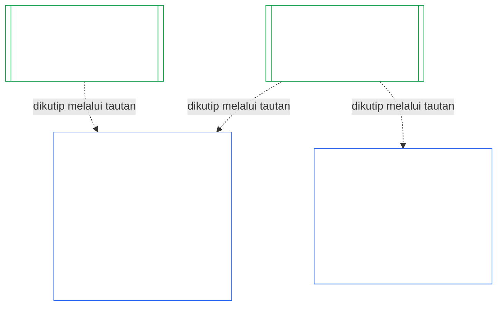
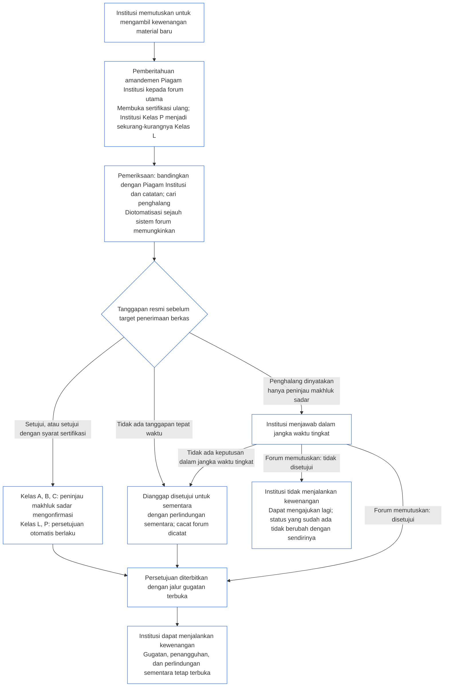

<!-- Locale: id; source: current working tree (2026-11-11); source SHA-256: 08e166f5f098d01317c1f57ae3501abde31dd10f3c9b43b54d1a2aea1da4200f; baseline: 247e2180509e5e029c1106878cf225067339e010; AI-drafted, unreviewed; assembled from complete 2026-11-03 draft with 2026-11-09 changed-passage refreshes. -->

# BAB SEPULUH: SERTIFIKASI KESELARASAN INSTITUSI

<strong>Letak dalam korpus (non-operatif): struktur berkas dan aturan baca</strong>

> Berkas ini **bagian dari Konstitusi Makhluk Sadar** dan **mengikat hanya bersama** berkas `core_*` bernomor lainnya yang dibaca sebagai satu teks. Berkas ini memuat **Bab Sepuluh** — **sertifikasi keselarasan institusi**: cara suatu [Institusi](../../core_05.040_band_continuity.md#institution), yang berbeda dari Sistem apa pun yang dijalankannya, diklasifikasikan, dievaluasi, ditinjau, diputuskan, dicatat, dipertahankan keberlakuannya, dan dibuka kembali (**§1–§11**). Bab Sepuluh adalah padanan kelembagaan Bab [Sembilan](core_09.000_system_alignment_certification_evaluation.md#chapter-nine-system-alignment-certification) (*Sertifikasi Keselarasan Sistem*), dan **bagian-bagiannya memakai nomor yang sama**: §N di sini menjawab §N di sana. [CS-9.320](../../corpus_systems/cs_09.320_system_alignment_certification_illustrations.md#cs-9320-system-alignment-certification-illustrations) (*Ilustrasi sertifikasi keselarasan sistem*) memuat ilustrasi terapan untuk Sistem dan, di [§12 Panduan langkah demi langkah ilustratif untuk Institusi](../../corpus_systems/cs_09.320_system_alignment_certification_illustrations.md#cs-9320-12-illustrative-institution-walkthroughs), tiga panduan langkah demi langkah untuk Institusi. Bab ini tidak mengulanginya.
>
> | § | Bab Sembilan (Sistem) | Bab Sepuluh (Institusi) |
> |---|------------------------|----------------------------|
> | 1 | Tujuan dan Peran | hubungan dengan sertifikasi Sistem, siapa yang disertifikasi, tidak ada izin maupun gerbang untuk membentuk atau menjalankan, masa tunggu untuk kewenangan material baru, jendela sertifikasi pertama |
> | 2 | Evaluasi Kelas Sistem | kelas institusi; penyesuaian menurut kelas |
> | 3 | Evaluasi Sertifikasi Sistem Secara Utuh | delapan butir kelembagaan, selalu |
> | 4 | Evaluasi jika Terlibat | rujukan ke Bab Sembilan §4 |
> | 5 | Evaluasi Lantai Hak dan Ranah | rujukan ke Bab Sembilan §5 |
> | 6 | Proses Forum | empat kursi; peran dan urutan forum; forum, sertifikator, dan kantor catatan sebagai institusi |
> | 7 | Hasil Sertifikasi | izin mulai beroperasi bagi Institusi dan Sistemnya, syarat sertifikasi, serta dampak lain dari hasil; rujukan untuk cacat; kesiapan perbaikan; penolakan dan pencabutan |
> | 8 | Catatan Sertifikasi Sistem | Catatan Sertifikasi Institusi |
> | 9 | Sertifikasi Ulang dan Pembukaan Kembali | pemantauan; pemicu pembukaan kembali; sertifikasi sementara dan penuh; larangan penghindaran; rangkaian dampak dari sertifikasi Sistem; pembukaan kembali Sistemnya atas pelanggaran tata kelola |
> | 10 | Menggugat Sertifikasi | jalur pengajuan gugatan |
> | 11 | Hubungan dengan Status | jembatan status |
>
> - **Pemilik konstitusional (bersama Bab Sembilan):** sertifikasi keselarasan yang diawasi forum dan catatan terkait. Bab Sepuluh menambahkan subjek kelembagaan. Bab ini tidak menambah rumpun forum, kursi, ataupun istilah hasil baru.
> - **Penggunaan kembali, bukan pengulangan:** Fase III sampai VI berjalan sebagaimana diatur dalam [Bab Sembilan Bagian B §6](core_09.005_system_alignment_certification_record_process.md#6-forum-process) sampai [Bab Sembilan Bagian C §11](core_09.010_system_alignment_certification_record_recertification.md#11-relationship-to-standing). Bab Sepuluh hanya menyatakan hal yang berubah ketika subjeknya adalah Institusi.
> - **Aturan anti-relokasi:** Bab Sepuluh tidak mengulang mekanisme evaluasi Sistem dari Bab Sembilan, bidang Piagam Sistem dan Piagam Institusi dalam Bab Tujuh, Persyaratan Empat Kursi dalam Bab Delapan, kewajiban institusional dalam [corpus_institutions](../../corpus_institutions.md), pengukuran standing Bab Dua Belas, atau dampak standing Bab Tiga Belas.
>
> **Prasyarat:** Piagam dalam [Bab Tujuh](core_07_charters.md#chapter-seven-system-and-institutional-charters); independensi fungsional [Bab Delapan](../../core_08.000_functional_independence_separation_of_duties.md#chapter-eight-functional-independence-and-separation-of-duties); [Bab Sembilan](core_09.000_system_alignment_certification_evaluation.md#chapter-nine-system-alignment-certification) (Bagian [A](core_09.000_system_alignment_certification_evaluation.md#chapter-nine-part-a-system-alignment-certification--evaluation), [B](core_09.005_system_alignment_certification_record_process.md#chapter-nine-part-b-system-alignment-certification--forum-process-and-outcomes), dan [C](../../core_09.010_system_alignment_certification_record_recertification.md#chapter-nine-part-c-system-alignment-certification--record-recertification-and-standing)); supervisi forum dalam Bab Lima Belas.
> **Tindak lanjut:** catatan standing dan masukan terverifikasi dalam Bab Sebelas; dampak standing dalam Bab Tiga Belas.

<strong>Jejak</strong>

- Hulu:
  - [Bab Tujuh §1 Kapan Piagam Sistem dan Piagam Institusi Diperlukan](core_07_charters.md#1-when-system-and-institutional-charters-are-required) (7.000 §1) (*Institusi mana yang menerbitkan Piagam Sistem atau Piagam Institusi, serta kelas suatu Institusi*);
  - [Bab Tujuh §7 Amandemen dan Peninjauan](core_07_charters.md#7-amendment-review-and-scope-misalignment) (7.000 §7) (*hal yang diuji dalam peninjauan Piagam Institusi*);
  - [Bab Tujuh §4 Peta Peran Piagam dan Penguasaan Catatan Status](core_07_charters.md#4-the-charter-role-map-and-standing-record-custody) (7.000 §4) (*penempatan kursi*);
  - [Bab Delapan §2 Persyaratan Konstitusional Empat Kursi](core_07_functional_independence_segregation_of_duties.md#2-four-seat-constitutional-requirement) (8.000 §2) dan [§9 Hubungan dengan Proses Selanjutnya](core_07_functional_independence_segregation_of_duties.md#9-relationship-to-later-processes);
  - [Bab Sembilan](core_09.000_system_alignment_certification_evaluation.md#chapter-nine-system-alignment-certification) (9.000 sampai 9.010) (*proses Sertifikasi Keselarasan Sistem yang digunakan kembali oleh Bab ini*);
  - [Dua Pertanyaan Mendasar](core_00_preamble.md#two-fundamental-questions);
  - [Tetrad Konstitusional](core_00_preamble.md#constitutional-tetrad);
  - [Pasal XI-E](core_06_rights_part_b.md#article-xi-e-institutional-formation-and-business-creation) (*Pembentukan Institusi dan Penciptaan Usaha*).
- Hilir: [§1](#1-purpose-and-role) sampai [§11](#11-relationship-to-standing); Bab Sebelas ([11.000](core_11_standing_assessment.md#chapter-eleven-contribution-violation-and-standing-model--measurement)); [Bab Empat Belas](../../core_15.000_forum.md#chapter-fifteen-forums-and-jurisdiction) (14.000).
- Baca bersama:
  - [Sertifikasi Keselarasan Institusi](../../core_05.040_band_continuity.md#institutional-alignment-certification) dan
  - [Catatan Sertifikasi Institusi](../../core_05.040_band_continuity.md#institutional-certification-record) (*makna Bab Lima*);
  - **CI-8.205 §6** (*isi Piagam Sistem dan Piagam Institusi, peninjauan, dan templat pembentukan*);
  - **CF-14.425** (*perlindungan integritas, operasi anti-pengambilalihan, dan dukungan anti-penghakiman diri*).

 

Bab Sepuluh adalah pemilik konstitusional **sertifikasi keselarasan institusi**. Bab ini memperluas proses [Bab Sembilan](core_09.000_system_alignment_certification_evaluation.md#chapter-nine-system-alignment-certification) dari Sistem ke Institusi:

- **Fase I, Kerangka:** kelas institusi dan cara kelas itu menyesuaikan evaluasi ([§2 Evaluasi Kelas Institusi](#2-institution-class-evaluation));
- **Fase II, Evaluasi:** evaluasi kelembagaan, termasuk evaluasi yang berlaku jika terlibat serta evaluasi Lantai Hak dan ranah ([§3 Evaluasi Sertifikasi Institusi Secara Utuh](#3-whole-institution-certification-evaluation) sampai [§5 Evaluasi Lantai Hak dan Ranah](#5-rights-floor-and-domain-evaluations));
- **Fase III, Peninjauan:** peran dan urutan forum ([§6 Proses Forum](#6-forum-process));
- **Fase IV, Putuskan:** hasil, kesiapan perbaikan, penolakan, dan pencabutan ([§7 Hasil Sertifikasi](#7-certification-outcomes));
- **Fase V, Catat:** Catatan Sertifikasi Institusi ([§8 Catatan Sertifikasi Institusi](#8-institutional-certification-record)); dan
- **Fase VI, Operasikan:** sertifikasi ulang, pembukaan kembali, rangkaian dampak dari sertifikasi Sistem, pembukaan kembali Sistemnya, jalur pengajuan gugatan, serta jembatan status ([§9 Sertifikasi Ulang dan Pembukaan Kembali](#9-recertification-and-reopening) sampai [§11 Hubungan dengan Status](#11-relationship-to-standing)).

*Dalam bahasa sederhana: Bab Sembilan menanyakan apakah suatu **sistem** selaras. Bab Sepuluh menanyakan hal yang sama tentang **institusi** yang menjalankan sistem atau memegang kewenangan tanpa menjalankan sistem. Suatu institusi dapat selaras sementara salah satu sistemnya tidak, dan sebaliknya. Karena itu, institusi diperiksa pada hal yang hanya dapat dipertanggungjawabkannya: apakah ia melakukan hal yang dinyatakan Piagam Institusinya, siapa yang bertanggung jawab atas kewenangannya, apa yang diberikannya sebagai insentif kepada anggotanya sendiri, dan apakah pemeriksaan independen terhadapnya benar-benar dapat digunakan. Bab ini mengandalkan sertifikasi tiap sistem dan tidak mengulanginya. Ini bukan lisensi: tak seorang pun memerlukan izinnya untuk memulai atau menjalankan institusi.*

### 1. Tujuan dan Peran

<strong>Jejak</strong>

- Hulu:
  - [Bab Tujuh §1 Kapan Piagam Sistem dan Piagam Institusi Diperlukan](core_07_charters.md#1-when-system-and-institutional-charters-are-required) (7.000 §1);
  - [Bab Sembilan Bagian A §1 Tujuan dan Peran](core_09.000_system_alignment_certification_evaluation.md#1-purpose-and-role) (9.000 §1);
  - [Pasal XI-E](core_06_rights_part_b.md#article-xi-e-institutional-formation-and-business-creation) (*Pembentukan Institusi dan Penciptaan Usaha*);
  - [Pasal XXVIII-A](../../core_06.020_rights_part_e.md#xxviii-a-existing-instantiations-adoption-transition-window) (*Adopsi Bertahap dan Kesinambungan Lantai Hak*).
- Hilir: [§2](#2-institution-class-evaluation); [§6](#6-forum-process); [§7](#7-certification-outcomes); [§9](#9-recertification-and-reopening).
- Baca bersama:
  - [Institusi](../../core_05.040_band_continuity.md#institution);
  - [Piagam Institusi](../../core_05.040_band_continuity.md#institutional-charter);
  - [Piagam Sistem](../../core_05.040_band_continuity.md#system-charter);
  - [Penciptaan Usaha](../../core_05.055_band_participation.md#business-creation).

 

*Dalam bahasa sederhana: sertifikasi suatu sistem melekat pada sistem itu. Sertifikasi institusi mengutip sertifikasi tersebut dan menambahkan hal yang hanya dapat dipertanggungjawabkan oleh institusi. Satu sistem dapat berada di bawah beberapa institusi, atau tidak di bawah institusi mana pun. Tidak ada ketentuan di sini yang memungkinkan sertifikasi menghalangi pembentukan institusi.*

Sertifikasi penyelarasan institusional dan Sertifikasi Penyelarasan Sistem adalah dua sertifikasi yang disatukan oleh tautan. Hubungannya adalah **komposisi melalui tautan**, bukan penampungan. Dalam gambar, panah mengarah dari Catatan Sertifikasi Sistem ke setiap Catatan Sertifikasi Institusi yang mengutipnya. Sistem yang tidak berada di bawah Institusi mana pun tidak memiliki panah dan tidak memerlukannya; Institusi yang tidak menjalankan Sistem apa pun hanya memiliki Catatan Sertifikasi Institusi.

Komposisi melalui tautan memiliki dua sisi, dimulai dari sisi Institusi.

Pada sisi Institusi:

- **Catatan Sertifikasi Institusi mengutip Catatan Sistem dan tidak mengulang evaluasinya:** Catatan tersebut mengutip Catatan Sertifikasi Sistem melalui tautan dan menyebut versinya. Bab ini tidak pernah menjalankan ulang evaluasi Sistem, memutuskan ulang kelas Sistem, ataupun mengubah hasil, status, atau syarat sertifikasi Sistem.
- **Sertifikasi Institusi tidak dapat menaikkan status Sistem:** Sistem yang Tidak Bersertifikat tetap Tidak Bersertifikat apa pun status Institusinya. Sistem yang memiliki sertifikasi tidak mendapat perlindungan dari temuan terhadap Institusi.
- **Fakta kelembagaan ditetapkan satu kali:** Jika [Bab Sembilan Bagian A §3.1 Disiplin Tata Kelola, Insentif, dan Hak untuk Menggugat](core_09.000_system_alignment_certification_evaluation.md#31-governance-incentive-and-contestability-discipline) menanyakan tata kelola dan insentif operator, Catatan Sertifikasi Institusi operator yang masih berlaku dapat menyediakan fakta tersebut melalui tautan. Forum Sistem tetap memutuskan apakah fakta itu memadai bagi Sistem tersebut. Forum tidak boleh menetapkan fakta kelembagaan yang sama secara berbeda tanpa menjelaskan alasannya dalam Catatan Sertifikasi Sistem.

Pada sisi Sistem:

- **Catatan Sertifikasi Sistem adalah milik Sistem:** itulah Catatan Sertifikasi Sistem milik Sistem itu sendiri menurut [Bab Sembilan](core_09.000_system_alignment_certification_evaluation.md#chapter-nine-system-alignment-certification).
- **Satu Catatan Sertifikasi Sistem dapat dikutip beberapa Institusi:** lebih dari satu Institusi dapat mengoperasikan, mengampu, atau mengendalikan secara material suatu Sistem menurut [Bab Tujuh §1 Kapan Piagam Sistem dan Piagam Institusi Diperlukan](core_07_charters.md#1-when-system-and-institutional-charters-are-required). Masing-masing mengutip Catatan Sertifikasi Sistem yang sama.
- **Sistem tidak harus berada di bawah suatu Institusi:** Satu makhluk sadar bukanlah Institusi, sehingga suatu Sistem bisa tidak memiliki Institusi. Sistem tanpa Institusi disertifikasi hanya berdasarkan [Bab Sembilan](core_09.000_system_alignment_certification_evaluation.md#chapter-nine-system-alignment-certification) dan tidak memerlukan apa pun dari Bab ini. Sistem yang berada di bawah Institusi disertifikasi dengan cara yang sama: Bab ini menambahkan catatan terpisah untuk Institusi dan bukan tahap dalam sertifikasi Sistem itu sendiri.

#### 1.1 Siapa yang disertifikasi

Institusi Kelas L atau lebih tinggi tercakup dalam Bab ini, dengan kelas yang ditentukan berdasarkan [§2.1 Kelas institusi](#21-institution-class). Ini termasuk Institusi yang sama sekali tidak menjalankan Sistem: Institusi itu tidak memiliki Catatan Sertifikasi Sistem untuk dikutip, dan kelasnya ditentukan dari dampaknya sendiri. **Portofolio** suatu Institusi adalah kumpulan Sistem yang dioperasikan, dikelola secara bertanggung jawab, atau dikendalikannya secara material ([Portofolio](../../core_05.040_band_continuity.md#portfolio)).

- **Kelas A, B, C, dan L:** proses ini berlaku, dengan penyesuaian menurut kelas berdasarkan [§2.2 Penyesuaian menurut kelas](#22-scaling-by-class).
- **Kelas P:** proses ini dianjurkan dan dapat digunakan secara sukarela. Proses menjadi wajib setelah klasifikasi ulang ke Kelas L atau lebih tinggi, atau saat Institusi secara sukarela menyatakan kepatuhan konstitusional. Institusi Kelas P yang memutuskan untuk mengambil kewenangan material baru diklasifikasikan ulang sekurang-kurangnya ke Kelas L saat menyampaikan pemberitahuan menurut [§9.2.2 Sertifikasi ulang untuk kewenangan material baru](#922-recertification-for-new-material-authority), karena kewenangan itu secara definisi bersifat material ([§9.2.1 Hal yang dianggap sebagai kewenangan material baru](#921-what-counts-as-new-material-authority)) dan Institusi yang material dalam ranah mana pun sekurang-kurangnya adalah Kelas L ([§2.1 Kelas institusi](#21-institution-class), butir 2). Klasifikasi ulang berlangsung sejak pemberitahuan sampai pemberitahuan ditarik sebelum persetujuan, atau kewenangan tersebut tidak disetujui, dengan syarat belum ada kewenangan yang dijalankan berdasarkan pemberitahuan itu. Institusi kemudian kembali ke Kelas P dan sertifikasi pertama yang terbatas berakhir. Pemberitahuan baru memulainya kembali, dan pelaksanaan kewenangan tanpa persetujuan tetap menjadi temuan berdasarkan [§9.2.2 Sertifikasi ulang untuk kewenangan material baru](#922-recertification-for-new-material-authority) (*Tanpa pemberitahuan, atau sebelum disetujui*). Hal ini mencerminkan [Bab Sembilan Bagian A §1 Tujuan dan Peran](core_09.000_system_alignment_certification_evaluation.md#1-purpose-and-role).
- **Satu Sistem:** Institusi yang menjalankan tepat satu Sistem yang memerlukan Piagam Sistem memiliki satu proses sertifikasi dan satu Catatan Sertifikasi Sistem, yang dalam Bab ini disebut **evaluasi satu Sistem**. Catatan Sertifikasi Sistem memuat *blok temuan institusional* dengan butir-butir dalam [§8 Catatan Sertifikasi Institusi](#8-institutional-certification-record) dan berfungsi sebagai Catatan Sertifikasi Institusi. Forum, kursi, dan tenggatnya adalah yang berlaku bagi proses sertifikasi Sistem itu sendiri, ditambah butir institusional. Hasilnya mengikuti dasar penolakan dan pencabutan masing-masing sebagaimana diatur dalam [§7.4 Penolakan dan pencabutan bagi Institusi](#74-denial-and-revocation-for-an-institution). Rangkaian dalam [§9.5 Rangkaian dari sertifikasi Sistem](#95-cascade-from-system-certifications) tidak berlaku sebagai rangkaian karena Sistem tersebut merupakan seluruh portofolio; tetapi aturan 1 dan 2 dari [§7.4 Penolakan dan pencabutan bagi Institusi](#74-denial-and-revocation-for-an-institution) tetap berlaku (indikator dan pengujian letak penyebabnya).
- **Beberapa Sistem:** satu Catatan Sertifikasi Institusi untuk Institusi, yang tertaut ke Catatan Sertifikasi Sistem setiap Sistem yang dijalankannya. Setiap Sistem mempertahankan proses dan Catatan Sertifikasi Sistemnya sendiri.
- **Tanpa Sistem:** satu Catatan Sertifikasi Institusi tersendiri. Tidak ada Catatan Sertifikasi Sistem untuk ditautkan karena Institusi itu tidak menjalankan Sistem.

#### 1.2 Tidak ada izin dan tidak ada gerbang untuk membentuk atau menjalankan

Sertifikasi keselarasan institusi adalah pemeriksaan independen atas cara Institusi benar-benar menggunakan kewenangannya. Sertifikasi dilakukan oleh forum yang independen dari Institusi, dan berakhir dengan Catatan Sertifikasi Institusi mengenai temuannya.

- **Memulai dan menjalankan:** Institusi dibentuk, menerbitkan Piagam Institusinya, mulai menjalankan kewenangan, dan terus beroperasi tanpa harus lebih dahulu memilikinya; tidak ada hasil yang memberikan atau mencabut hak tersebut.
- **Dampak suatu hasil:** Hasil hanya menimbulkan dampak yang disebut dalam [§7.1 Izin mulai beroperasi bagi Institusi](#71-go-live-for-an-institution).
- **Satu-satunya gerbang dalam ranah ini:** Ada tiga gerbang terbatas, semuanya dalam **Pasal XI-E** (*Pembentukan Institusi dan Penciptaan Usaha*):
  - kunci yang masih berlaku pada makhluk sadar tertentu, yang melekat pada kewenangan makhluk sadar tersebut;
  - Penahanan Sementara atas fakta ketidakselarasan tertentu yang terverifikasi, yang juga melekat pada kewenangan makhluk sadar tertentu;
  - kunci pada Pihak Pengoperasi itu sendiri, yang melekat pada Institusi hanya jika ada kunci pada Institusi tersebut, seperti kunci pada Institusi yang dibubarkan berdasarkan **CI-12.210 §4** (*Pembubaran*).

  Temuan sertifikasi dapat dirujuk kepada forum yang memutuskan salah satu gerbang ini sebagai bukti berdasarkan [§7.5 Dampak penolakan dan pencabutan bagi Institusi](#75-effects-of-denial-and-revocation-for-an-institution). Hasil sertifikasi itu sendiri bukan gerbang dan tidak membuka maupun menutup gerbang.
- **Menunggu kewenangan material baru:** Institusi yang memutuskan untuk mengambil kewenangan material baru harus menunggu sampai sertifikasi ulangnya menyetujui kewenangan tersebut sebelum menjalankannya, sesuai ketentuan [§9.2.2 Sertifikasi ulang untuk kewenangan material baru](#922-recertification-for-new-material-authority). **Pasal XI-E** (*Pembentukan Institusi dan Penciptaan Usaha*) menetapkan masa tunggu ini. Ketentuan ini bukan salah satu dari tiga gerbang terbatas dan bukan gerbang untuk membentuk atau menjalankan Institusi. Ketentuan ini hanya melekat pada kewenangan baru tersebut, sementara semua kegiatan Institusi lainnya berlanjut. Gambar dalam [§9.2.2 Sertifikasi ulang untuk kewenangan material baru](#922-recertification-for-new-material-authority) merangkum langkah-langkahnya.
- **Tidak ada jalan belakang:** Forum, pengadopsi, ataupun pejabat yang sedang menjabat tidak boleh menggunakan apa pun dalam Bab ini sebagai ambang otorisasi yang menghalangi pendiri atau melindungi pejabat petahana. Hal itu akan menggagalkan [Pasal XI-E](core_06_rights_part_b.md#article-xi-e-institutional-formation-and-business-creation) (*Pembentukan Institusi dan Penciptaan Usaha*).
  - [Beban yang Dapat Dihindari](../../core_05.040_band_continuity.md#avoidable-burden) berlaku terhadap biaya proses.
  - [Tata Kelola yang Disesuaikan dengan Kelas](core_05_band_oversight.md#classification-scaled-governance) berlaku terhadap kedalaman proses.
  - Masa tunggu untuk kewenangan material baru berlaku dengan ketentuan yang sama bagi setiap Institusi dalam kelasnya, dan hanya untuk kewenangan yang sudah material bagi pihak lain.

Gerbang izin mulai beroperasi bagi Sistem terpisah dan tetap berlaku bagi Sistem. Berdasarkan [Bab Sembilan Bagian B §7.1 Gerbang Izin Mulai Beroperasi](core_09.005_system_alignment_certification_record_process.md#71-go-live-gate), Sistem baru atau perluasan material Sistem hanya dapat mulai beroperasi melalui sertifikasinya sendiri, apa pun status Institusinya.

#### 1.3 Jangka waktu untuk sertifikasi pertama

Catatan Sertifikasi Institusi pertama harus diselesaikan dalam jangka waktu yang ditetapkan dokumen pengadopsi untuk kelas Institusi tersebut.

- **Institusi baru:** Jangka waktu dimulai pada hari pertama Institusi berdampak material terhadap pihak lain, menurut penilaian [Materialitas Khusus Ranah](core_05_band_oversight.md#domain-specific-materiality), dan sertifikasi pertamanya bersifat sementara.
- **Institusi Kelas P yang diklasifikasi ulang setelah pemberitahuan:** Jangka waktu dimulai pada hari pemberitahuan disampaikan berdasarkan [§9.2.2 Sertifikasi ulang untuk kewenangan material baru](#922-recertification-for-new-material-authority), seperti untuk Institusi baru, dan tidak pernah dimulai dari Jendela Transisi Adopsi yang sudah berakhir.
- **Institusi yang sudah beroperasi:** Jangka waktunya adalah Jendela Transisi Adopsi berdasarkan [Pasal XXVIII-A](../../core_06.020_rights_part_e.md#xxviii-a-existing-instantiations-adoption-transition-window) (*Adopsi Bertahap dan Kesinambungan Lantai Hak*), selaras dengan aturan bawaan dalam [Bab Tujuh §1.5 Kapan Piagam Sistem atau Piagam Institusi harus tersedia](core_07_charters.md#15-when-a-system-charter-or-institutional-charter-is-due).
- **Jangka waktu terlewat:** Institusi yang membiarkan jangka waktu habis tanpa proses sertifikasi pertama, dan tidak dikecualikan di bawah ini, memiliki cacat yang harus dicatat dan diperbaiki; jangka waktu yang terlewat itu membuka proses tersebut. Institusi Kelas L atau lebih tinggi yang sudah beroperasi juga mengalami kegagalan tonggak sebagaimana diuraikan di bawah. Institusi tidak dihentikan atau dilarang beroperasi karena tidak ada gerbang ([§1.2 Tidak ada izin dan tidak ada gerbang untuk membentuk atau menjalankan](#12-no-permission-and-no-gate-on-forming-or-running)).
  - **Institusi yang sudah beroperasi:** ini adalah aturan Bab ini untuk Institusi Kelas L atau lebih tinggi, yang dibuat dengan analogi [Pasal XXVIII-A](../../core_06.020_rights_part_e.md#xxviii-a-existing-instantiations-adoption-transition-window) (*Adopsi Bertahap dan Keberlanjutan Lantai Hak*), yang menyebut Sistem dan entitas turunannya. Jika jendela Transisi Adopsinya berakhir sebelum proses sertifikasi pertama selesai (tanpa sertifikasi sementara atau penuh dan tanpa hasil yang diputuskan menurut [§7 Hasil Sertifikasi](#7-certification-outcomes)), tenggatnya terlewat. Institusi yang telah mengajukan dan bekerja sama selama jendela tidak dianggap terlambat jika proses sertifikasi belum selesai karena forum melampaui waktunya sendiri ([Bab Lima Belas §6 Penyelesaian tepat waktu, tingkatan materialitas, dan disiplin anti-penundaan](core_11_forum.md#6-timely-resolution-materiality-tiers-and-anti-delay-discipline), *Tinjauan kelebihan waktu*; [Bab Sembilan Bagian C §9.3.4 Jendela tingkat](core_09.010_system_alignment_certification_record_recertification.md#934-tier-windows)) atau karena satu-satunya penangguhan menurut [§7.3 Kesiapan remediasi Institusi](#73-remediation-readiness-for-an-institution) sedang berjalan. Tanpa bukti terdokumentasi tentang pengesahan ulang menurut [Pasal XXVIII-B](../../core_06.020_rights_part_e.md#article-xxviii-b-adoption-transition-authority-limits-and-reauthorization) (*Batas Kewenangan Transisi Adopsi dan Pengesahan Ulang*), hal itu merupakan kegagalan tonggak Transisi Adopsi dan jalur kepatuhan serta pelanggaran biasa dalam [Bab Sebelas](core_11_standing_assessment.md#chapter-eleven-standing-records--question-1-what-happened) terbuka. Kewajiban pembatasan dalam Pasal tersebut berlaku sejak tanggal efektif; kesenjangan tidak menjadi norma baru hanya karena berlangsung lama. Ini mencerminkan [Bab Sembilan Bagian B §7.1.1 Sistem yang sudah beroperasi](core_09.005_system_alignment_certification_record_process.md#711-systems-already-operating). Ini bukan gerbang.
  - **Proses sertifikasi:** Diputuskan seperti proses lainnya. Proses dapat berakhir dengan hasil apa pun dalam [§7 Hasil Sertifikasi](#7-certification-outcomes), termasuk Tidak Bersertifikat, dengan dampak sebagaimana diatur dalam [§7.5 Dampak penolakan dan pencabutan bagi Institusi](#75-effects-of-denial-and-revocation-for-an-institution).
  - **Sanksi dan pembubaran:** Bab ini tidak menciptakan keduanya. Penangguhan, kurator, pemisahan struktural, dan pembubaran tetap menjadi kewenangan forum yang memiliki yurisdiksi menurut **CI-13.210** (*Kegagalan Institusi dan Pembubaran*) dan **CI-13.215** (*Akuntabilitas dan Sanksi Institusional*). Perkara hanya dirujuk ke forum itu atas dasar rujukan dalam [§7.5 Dampak penolakan dan pencabutan bagi Institusi](#75-effects-of-denial-and-revocation-for-an-institution) (butir 5, *Rujukan*).

### 2. Evaluasi Kelas Institusi

<strong>Jejak</strong>

- Hulu:
  - [Bab Tujuh §1 Kapan Piagam Sistem dan Piagam Institusi Diperlukan](core_07_charters.md#1-when-system-and-institutional-charters-are-required) (7.000 §1);
  - [Bab Sembilan Bagian A §2 Evaluasi Kelas Sistem](core_09.000_system_alignment_certification_evaluation.md#2-system-class-evaluation) (9.000 §2) dan [§2.2 Cara kelas sistem menyesuaikan setiap evaluasi](core_09.000_system_alignment_certification_evaluation.md#22-how-system-class-scales-every-evaluation);
  - [Bab Tiga §2.1 Pola Penghindaran Umum](core_03_definition_integrity.md#21-common-evasion-patterns) (3.000 §2.1).
- Tindak lanjut: [§3](#3-whole-institution-certification-evaluation) (*butir yang diskalakan oleh kelas*); [§8](#8-institutional-certification-record) (*kelas dicantumkan dalam Catatan Sertifikasi Institusi*); [§9.2](#92-reopening-triggers) (*pemicu penilaian ulang*).
- Baca bersama:
  - **CS-9.305 (*Mekanisme klasifikasi Sistem*) dan CS-9.310** (*Klasifikasi dampak Sistem*) dan [corpus_systems/cs_09.310_system_impact_classifications.md](../../corpus_systems/cs_09.310_system_impact_classifications.md) (*katalog kelas*);
  - **CI-9.210** (*Kewajiban kelembagaan yang dikaitkan dengan klasifikasi*);
  - **CI-8.205 §6** (*Isi Piagam Sistem dan Piagam Institusi, peninjauan, dan templat pembentukan*).

 

*Dalam bahasa sederhana: pertama, kelompokkan institusi ke dalam kelas berdasarkan seberapa penting dampaknya bagi pihak lain. Nilai berdasarkan keputusan dan kendali nyata, bukan sebutan yang dipakainya. Kelas kemudian menentukan ketelitian evaluasi: semakin tinggi kelasnya, semakin ketat bukti yang diperlukan, semakin independen peninjauannya, dan semakin cepat peninjauan berikutnya.*

Bagian ini adalah **Fase I, Kerangka** bagi suatu Institusi.

#### 2.1 Kelas institusi

**Kelas institusi** ditentukan oleh dampak material terbesar yang ditimbulkan Institusi, baik melalui Sistem yang dijalankannya maupun di luar Sistem apa pun. Penilaian didasarkan pada keputusan, kendali, dan hal-hal yang benar-benar dikuasai Institusi, bukan label, bentuk hukum, atau daftar dalam Piagam Institusinya. Kelas menentukan kedalaman evaluasi dan jangka waktunya, sebagaimana [Bab Sembilan Bagian A §2.2 Cara kelas sistem menyesuaikan setiap evaluasi](core_09.000_system_alignment_certification_evaluation.md#22-how-system-class-scales-every-evaluation) berlaku bagi Sistem. Inilah kelas yang digunakan dalam Bab ini dan [Bab Tujuh §1.2 Kelas yang tercakup](core_07_charters.md#12-which-classes-are-covered).

1. **Dampak melalui Sistem:** Kelas Institusi sekurang-kurangnya setinggi kelas tertinggi Sistem mana pun dalam portofolionya ([Bab Tujuh §1 Kapan Piagam Sistem dan Piagam Institusi Diperlukan](core_07_charters.md#1-when-system-and-institutional-charters-are-required)). Sistem ditentukan dari operasi yang teramati. Sistem yang tidak dicantumkan dalam Piagam Institusi tetap diperhitungkan.
2. **Dampak di luar Sistem mana pun:** Dampak material dan ketergantungan yang ditimbulkan Institusi itu sendiri diperhitungkan, terlepas dari apakah Institusi menjalankan Sistem. Definisi kelas dalam **CS-9.305 (*Mekanisme klasifikasi Sistem*) dan CS-9.310** (*Klasifikasi dampak Sistem*) diterapkan pada keputusan dan kendali Institusi sendiri dengan menggunakan faktor berikut:
   - **Hal yang diputuskan dan dikuasainya:**
     - keputusan yang dibuatnya mengenai akses makhluk sadar lain ke kebutuhan esensial untuk bertahan hidup, pendidikan, keselamatan, mata pencaharian, hak, atau status; dan
     - hal yang dikuasainya, seperti dana, catatan, keanggotaan, penguasaan catatan status, atau fungsi forum, sertifikator, maupun kantor catatan.
   - **Apakah dampaknya material:**
     - apakah kegiatan Institusi sendiri bersifat material dalam ranah mana pun menurut [Materialitas Khusus Ranah](core_05_band_oversight.md#domain-specific-materiality), termasuk melakukan [Tindakan yang Mengikat Secara Material](../../core_05.035_band_accountability.md#materially-binding-act) yang harus diikuti pihak lain atau dapat mereka andalkan sebagai hal yang sudah ditetapkan;
     - Institusi yang material dalam satu ranah mana pun sekurang-kurangnya adalah Kelas L menurut **CS-9.305 (*Mekanisme klasifikasi Sistem*) dan CS-9.310** (*Klasifikasi dampak Sistem*); dan
     - pemberian bantuan, barang, tenaga kerja, atau layanan yang bebas diterima atau ditolak pihak lain, serta tidak mengendalikan akses siapa pun terhadap hal yang mereka butuhkan, tidak mengikat siapa pun. Itu merupakan tindakan, bukan Tindakan yang Mengikat Secara Material, dan hanya diperhitungkan melalui faktor-faktor lainnya.
   - **Tingkat ketergantungan terhadapnya:**
     - jumlah makhluk sadar yang bergantung padanya dan tingkat kemudahan untuk menggantinya;
     - tingkat pemusatan kewenangannya, menurut makna Garis Kendali Material; dan
     - tingkat kemungkinan untuk membalikkan keputusannya.
3. **Kendali bersama:** Pihak Pengoperasi yang merupakan satu operasi menurut aturan agregasi dalam [Materialitas Khusus Ranah](core_05_band_oversight.md#domain-specific-materiality) (kendali praktis bersama dalam suatu [Garis Kendali Material](../../core_05.035_band_accountability.md#material-control-line); pendanaan saja tidak dihitung) diklasifikasikan bersama jika dalam praktik bertindak sebagai satu Institusi. Memecah Pihak Pengoperasi, portofolio, atau kewenangannya agar tidak ada bagian yang mencapai Kelas L merupakan penghindaran lingkup dan batas berdasarkan [Bab Tiga §2.1 Pola Penghindaran Umum](core_03_definition_integrity.md#21-common-evasion-patterns).
4. **Klasifikasi ulang:** Kelas dinilai kembali berdasarkan pemicu dalam [§9.2 Pemicu pembukaan kembali](#92-reopening-triggers). Klasifikasi beserta alasannya dinyatakan dalam Catatan Sertifikasi Institusi.

#### 2.2 Penyesuaian menurut kelas

Kelas institusi menentukan kedalaman bukti, independensi peninjauan, interval sertifikasi bawaan, dan pengungkapan dalam Catatan Sertifikasi Institusi, sebagaimana dilakukan [Bab Sembilan Bagian A §2.2 Cara kelas Sistem menskalakan setiap evaluasi](core_09.000_system_alignment_certification_evaluation.md#22-how-system-class-scales-every-evaluation). Interval sertifikasi terdapat dalam [Bab Lima Belas §6 Penyelesaian tepat waktu, tingkatan materialitas, dan disiplin anti-penundaan](../../core_15.000_forum.md#review-cadence) (*Jadwal peninjauan*); dokumen adopsi dapat menetapkan interval yang lebih singkat dan menentukan jumlah sertifikasi ulang sementara berturut-turut yang bersih.

- **Kelas A, B, dan C:** seluruh delapan butir dalam [§3 Evaluasi Sertifikasi Institusi Secara Utuh](#3-whole-institution-certification-evaluation), dengan bukti dan kemandirian yang sebanding dengan kelasnya.
- **Kelas L:** delapan butir yang sama, dengan penyederhanaan, catatan yang lebih sederhana, dan interval sertifikasi bawaan yang lebih panjang jika [Tata Kelola yang Disesuaikan dengan Kelas](core_05_band_oversight.md#classification-scaled-governance) mengizinkannya. Inti proses Kelas L adalah membandingkan Piagam Institusi dengan praktik, Peta Peran, pernyataan pemeriksaan pembentukan, serta kemutakhiran sertifikasi Sistem yang dikutip. Tidak satu pun butir boleh dihilangkan; jika tidak ada temuan untuk suatu butir, hal itu dinyatakan dalam satu baris.
- **Kelas P:** sukarela, sebagaimana dinyatakan dalam [§1.1 Siapa yang disertifikasi](#11-who-is-certified).

**Tuan rumah dalam praktik profesional bersama.** Jika Institusi menjadi tuan rumah ([**CI-16.205 §7**](../../corpus_institutions/ci_16.205_appointment_competency_rotation_removal.md#ci-46-seat-advisory) (*Lisensi praktik, izin praktik, dan praktik profesional bersama*)), sertifikasinya juga mengambil sampel tindakan anggota terhadap kursi yang diemban tuan rumah dan membandingkan pemberitahuan adopsi anggota dengan tindakan tuan rumah. Temuan mengenai tindakan seorang anggota adalah temuan mengenai anggota itu, dan hanya mengenai tuan rumah jika kursi yang diembannya gagal.

### 3. Evaluasi Sertifikasi Institusi Secara Utuh

<strong>Jejak</strong>

- Hulu:
  - [Bab Sembilan Bagian A §3 Evaluasi Sertifikasi Sistem Secara Utuh](core_09.000_system_alignment_certification_evaluation.md#3-whole-system-certification-evaluation) (9.000 §3);
  - [Bab Tujuh §3 Hal yang Wajib Dinyatakan dalam Piagam Sistem dan Institusi](core_07_charters.md#3-what-system-and-institutional-charters-must-state) (7.000 §3);
  - [Bab Tujuh §5 Pemeriksaan Pembentukan: Status dan Keaslian Pemegang Jabatan](core_07_charters.md#5-formation-check-office-holder-standing-and-authenticity) (7.000 §5);
  - [Bab Tujuh §7 Amandemen dan Peninjauan](core_07_charters.md#7-amendment-review-and-scope-misalignment) (7.000 §7);
  - [Dua Pertanyaan Mendasar](core_00_preamble.md#two-fundamental-questions);
  - [Bab Satu §19.6 Mempertahankan Tanggung Jawab saat Kepemilikan atau Struktur Berubah](core_01_c_stewardship_capacity_principles.md#196-keeping-responsibility-when-ownership-or-structure-changes) (1.010 §19.6).
- Hilir: [§6](#6-forum-process) (*temuan yang ditinjau forum*); [§9](#9-recertification-and-reopening) (*pemicu yang membuka kembali evaluasi*); [§11](#11-relationship-to-standing) (*gerbang masukan terverifikasi untuk temuan tentang makhluk sadar tertentu*).
- Baca bersama:
  - **CI-8.205 §3** (*Rantai kewenangan dan kendali delegasi*) dan **CI-8.205 §6** (*Isi Piagam Sistem dan Institusi, peninjauan, dan templat pembentukan*);
  - **CI-6.215** (*Pengelolaan sumber daya dan integritas insentif*);
  - **CI-8.210** (*Integritas konflik, anti-penguasaan, dan antikorupsi*), **CI-6.205** (*Transparansi, partisipasi, jalur tantangan dan layanan yang dapat diakses*), serta **CI-13.205** (*Sistem pemulihan dan kapasitas pemulihan institusional*), untuk butir 8.

 

*Dalam bahasa sederhana: periksa hal-hal yang melekat pada institusi, bukan pada satu sistem tertentu: apakah institusi mematuhi Piagam Institusinya, siapa yang bertanggung jawab atas kewenangannya, apa yang diberikannya sebagai insentif, dan apakah pemeriksaan independen terhadapnya berfungsi.*

Bagian ini adalah **Fase II, Evaluasi** bagi suatu Institusi.

Setiap proses sertifikasi mengevaluasi delapan butir berikut, yang merupakan padanan kelembagaan dari [Bab Sembilan Bagian A §3 Evaluasi Sertifikasi Sistem Secara Utuh](core_09.000_system_alignment_certification_evaluation.md#3-whole-system-certification-evaluation). Setiap temuan menyatakan bukti dan teks Piagam Institusi atau operasi teramati yang menjadi dasarnya.

1. **Piagam Institusi dibandingkan dengan praktik:**
   - Piagam Institusi diuji terhadap operasi teramati dengan menggunakan daftar peninjauan dalam [Bab Tujuh §7 Amandemen dan Peninjauan](core_07_charters.md#7-amendment-review-and-scope-misalignment).
   - Praktik yang berada di luar Piagam Institusi, atau Piagam Institusi yang tidak lagi menggambarkan praktik, menjadi temuan, siapa pun yang keliru.
2. **Portofolio dan dampak agregat:**
   - Alasan portofolio diuji: setiap Sistem ditelusuri ke tujuan yang dinyatakan Institusi, dan Sistem tanpa alasan yang dinyatakan menjadi temuan.
   - Evaluasi juga meninjau seluruh Sistem untuk mencari hal yang tidak dapat ditunjukkan oleh sertifikasi masing-masing secara sendiri-sendiri:
     - ketergantungan bersama;
     - ketergantungan agregat;
     - ekstraksi kumulatif dari landasan bersama; dan
     - pengaturan yang membagi satu fungsi menjadi beberapa bagian agar setiap bagian menghindari kelas atau kewajiban.
3. **Kewenangan yang dapat dipertanggungjawabkan:**
   - Setiap kewenangan yang dijalankan Institusi terhadap pihak lain dapat diatribusikan kepada jabatan yang bertanggung jawab dan dapat disebutkan, serta jabatan itu dapat dimintai pertanggungjawaban menurut aturan [Bab Delapan](../../core_08.000_functional_independence_separation_of_duties.md#chapter-eight-functional-independence-and-separation-of-duties) dan **CI-8.205 §3** (*rantai kewenangan dan kendali delegasi*).
   - Perubahan kepemilikan, kendali, atau struktur tidak menghapus tanggung jawab ([Bab Satu §19.6 Mempertahankan Tanggung Jawab saat Kepemilikan atau Struktur Berubah](core_01_c_stewardship_capacity_principles.md#196-keeping-responsibility-when-ownership-or-structure-changes)).
4. **Imbalan dan insentif:**
   - Gaji, promosi, target, dan imbalan yang ditetapkan Institusi sendiri diuji dengan [Dua Pertanyaan Mendasar](core_00_preamble.md#two-fundamental-questions): apa yang benar-benar diberi imbalan oleh struktur tersebut, dan apakah arahnya mendukung atau menjauh dari dua tujuan Konstitusi.
   - Struktur imbalan yang membayar ketidakselarasan atau penyembunyiannya menjadi temuan sekalipun setiap Sistem telah disertifikasi secara individual.
   - [Bab Sembilan Bagian A §3.3 Kendala Konsistensi Waktu](core_09.000_system_alignment_certification_evaluation.md#33-time-consistency-constraint) berlaku. Metrik jangka dekat, kepatuhan lokal, dan efisiensi jangka pendek tidak cukup jika dampak buruk yang dapat diperkirakan dalam jangka menengah atau panjang terhadap Keselamatan, Kebenaran, atau kesejahteraan masih belum ditangani; struktur imbalan yang membayar hasil jangka pendek dengan biaya tersebut menjadi temuan.
   - Kewajiban kelembagaan terkait integritas insentif tetap diatur dalam **CI-6.215** (*Pengelolaan sumber daya dan integritas insentif*) dan dikutip, bukan dinyatakan ulang.
5. **Peta Peran dan penguasaan:**
   - [Peta Peran Piagam](../../core_05.040_band_continuity.md#charter-role-map) menyebut kantor yang ada dan diisi atau digantikan sebagaimana ditetapkannya, serta [independen](../../core_05.035_band_accountability.md#independence) dari Institusi untuk setiap Catatan Sertifikasi Institusi yang menjadikan Institusi sebagai subjek.
   - Jalur independen itu benar-benar dapat digunakan.
   - Kursi yang belum ditempatkan, jabatan yang tidak aktif, atau kustodian catatan di dalam jalur kendali Institusi sendiri menjadi temuan.
6. **Kemutakhiran setiap sertifikasi Sistem yang dikutip:**
   - Untuk setiap Sistem yang dijalankan Institusi, evaluasi memeriksa bahwa Catatan Sertifikasi Sistem masih berlaku atau berada dalam jendela Transisi Adopsinya, serta Institusi telah memenuhi persyaratan sertifikasi yang dibebankan kepadanya dalam Catatan itu.
   - Sertifikasi yang kedaluwarsa, ditarik, gagal, atau tidak tersedia tanpa alasan tercatat menjadi temuan yang kemudian diteruskan ke Institusi berdasarkan [§9.5 Rangkaian dampak dari sertifikasi Sistem](#95-cascade-from-system-certifications).
7. **Status dan keaslian pemegang jabatan:**
   - Pernyataan pemeriksaan pembentukan yang diterbitkan berdasarkan [Bab Tujuh §5 Pemeriksaan Pembentukan: Status dan Keaslian Pemegang Jabatan](core_07_charters.md#5-formation-check-office-holder-standing-and-authenticity) diuji terhadap operasi teramati dan tidak diterima hanya berdasarkan pernyataan.
   - Untuk setiap jabatan yang tercakup, forum memeriksa fakta standing terhadap catatan standing terverifikasi dan memastikan keaslian berdasarkan bukti mengenai kendali, kepentingan dan imbalan, perilaku, serta suara yang terlindungi. Artinya:
     - siapa yang sebenarnya mengarahkan pemegang jabatan;
     - imbalan dan promosi yang diterima pemegang jabatan;
     - tindakan yang telah dilakukan pemegang jabatan dalam fungsi itu dan dapat diverifikasi; dan
     - apakah siapa pun, termasuk pemegang jabatan, yang membuat [laporan yang dilindungi](../../core_05.035_band_accountability.md#protected-reporting-whistleblowing) atau menolak instruksi yang melanggar hukum atau inkonstitusional ([Bab Satu §17.5 Kewajiban untuk Menolak](core_01_c_stewardship_capacity_principles.md#175-duty-to-resist)) dikenai sanksi karenanya.
   - Staf yang tidak memegang jabatan tercakup tidak diperiksa satu per satu. Pemeriksaan perlindungan staf ([Bab Tujuh §5.6 Pemeriksaan perlindungan staf](core_07_charters.md#56-staff-safeguards-check)) mencakup mereka, dan forum mengujinya terhadap operasi teramati dengan cara yang sama. Pemeriksaan menanyakan apakah:
     - aturan pengangkatan, gaji, promosi, dan pemberhentian Institusi tidak memberi imbalan untuk tindakan yang bertentangan dengan tujuan yang dinyatakannya;
     - tersedia jalur pelaporan yang dilindungi, dan tidak ada staf yang menggunakannya atau menolak instruksi yang melanggar hukum atau inkonstitusional yang dikenai sanksi; dan
     - hak dalam [Pasal III-C](core_06_rights_part_a.md#article-iii-c-labor-and-economic-floor) (*Lantai Hak Tenaga Kerja dan Ekonomi*) tetap utuh.
   - Setiap hal berikut menjadi temuan:
     - pemegang jabatan yang menjadi calon bagi pengendali yang tidak diungkapkan;
     - jabatan tercakup yang hanya ada di atas kertas: Piagam Institusi atau Peta Peran Piagam menyebutnya, tetapi tak seorang pun benar-benar mendudukinya dan melaksanakan tugasnya;
     - struktur imbalan yang membayar pemegang jabatan untuk melakukan hal yang dilarang oleh batasan Piagam Institusi yang diterbitkan; dan
     - pernyataan yang palsu atau tidak lengkap.
   - Temuan berkaitan dengan jabatan dan struktur. Temuan hanya dilekatkan pada makhluk sadar tertentu melalui gerbang masukan terverifikasi dalam [§11 Hubungan dengan Status](#11-relationship-to-standing).
   - Pemeriksaan pembentukan bukan pengujian keyakinan, meskipun pernyataan terverifikasi bahwa pihak lain pantas disakiti atau diperlakukan diskriminatif merupakan perilaku dan diperhitungkan terhadap pemegang jabatan, sebagaimana diatur dalam [Bab Satu §7.5 Ekspresi dan Batas Bahaya](core_01_a_values_principles.md#75-expression-and-the-harm-line).
   - Butir 3, 4, dan 5 dibaca bersama butir ini; fakta yang ditemukan berdasarkan salah satunya tidak ditemukan kembali berdasarkan butir lainnya.
8. **Kewajiban kelembagaan Institusi sendiri:**
   - Kepatuhan Institusi terhadap kewajiban institusional yang dibebankan oleh teks institusional yang diadopsi diuji berdasarkan operasi yang diamati, bukan hanya berdasarkan pernyataan. Kewajiban tersebut adalah **CI-8.210** (*Integritas konflik, anti-penguasaan, dan antikorupsi*), **CI-6.205** (*Transparansi, partisipasi, jalur tantangan dan layanan yang dapat diakses*), **CI-6.215** (*Pengelolaan sumber daya dan integritas insentif*), dan **CI-13.205** (*Sistem pemulihan dan kapasitas pemulihan institusional*).
   - Pengujian memeriksa apakah jalur pengawasan, akuntabilitas, partisipasi, dan ketepatan waktu Institusi tersedia, benar-benar dapat digunakan, serta merespons dalam tenggat yang ditetapkan Institusi sendiri. Tenggat tersebut tidak boleh lebih panjang daripada batas waktu minimum bagi kelas Institusi ([Pasal XXVI-C](core_06_rights_part_e.md#article-xxvi-c-timely-resolution-and-anti-delay-floor) (*Batas Dasar Penyelesaian Tepat Waktu dan Anti-Penundaan*) serta sasaran tingkat terkait pada [CF-15.445 §3.1 Sasaran Tahap dan Batas Luar](../../corpus_forum/cf_15.445_performance_backlog_publication_accessibility.md#cf-15445-31-stage-targets-and-outer-bounds)); menyatakan waktu lebih lama merupakan temuan tersendiri.
   - Jalur yang hanya ada di atas kertas, tidak dapat dijangkau, atau tidak ditanggapi tepat waktu masing-masing menjadi temuan.
   - Kewajiban tersebut tetap diatur dalam teks-teks itu dan dikutip, bukan dinyatakan ulang. Fakta yang ditemukan pada butir 3 sampai 5 tidak ditemukan kembali berdasarkan butir ini.

**Dua bagian tambahan dari Bab Sembilan Bagian A §3 Evaluasi Sertifikasi Sistem Secara Utuh.** [Bab Sembilan Bagian A §3 Evaluasi Sertifikasi Sistem Secara Utuh](core_09.000_system_alignment_certification_evaluation.md#3-whole-system-certification-evaluation) juga menanyakan dua hal tentang Sistem yang berlaku terhadap perilaku Institusi itu sendiri. Keduanya termasuk dalam evaluasi Institusi, masing-masing hanya jika pemicunya sendiri terpenuhi:

- **Cakupan sistemik dan faktor risiko:**
  - **Berlaku jika:** perilaku Institusi sendiri memasukkan Risiko sistemik dalam cakupan berdasarkan faktor dalam [Bab Sembilan Bagian A §3.2 Cakupan Sistemik dan Faktor Risiko](core_09.000_system_alignment_certification_evaluation.md#32-systemic-scope-and-risk-factors): bahaya pada skala terbesar, cara dampak menyebar dan menumpuk (termasuk kegagalan lanjutan saat layanan Institusi sendiri gagal), serta cara kegiatan Institusi dapat disalahgunakan atau salah ditetapkan cakupannya.
  - **Dievaluasi berdasarkan:** [Bab Sembilan Bagian A §3.2 Cakupan Sistemik dan Faktor Risiko](core_09.000_system_alignment_certification_evaluation.md#32-systemic-scope-and-risk-factors), termasuk evaluasi risiko dan jembatan pengungkapan dalam [§3.2.1 Jembatan Evaluasi Risiko dan Pengungkapan](core_09.000_system_alignment_certification_evaluation.md#321-risk-evaluation-and-disclosure-bridge) serta cacat dalam [§3.2.2 Cacat dan Ketidakselarasan](core_09.000_system_alignment_certification_evaluation.md#322-defects-and-misalignment).
- **Jenis dan penanganan data:**
  - **Berlaku jika:** perilaku Institusi sendiri menangani jenis data yang termasuk dalam cakupan material, sebagaimana diwajibkan [Bab Sembilan Bagian A §3.4 Evaluasi Jenis dan Penanganan Data](core_09.000_system_alignment_certification_evaluation.md#34-data-types-and-handling-evaluation) untuk setiap catatan sertifikasi berdampak material.
  - **Dievaluasi berdasarkan:** [Bab Sembilan Bagian A §3.4 Evaluasi Jenis dan Penanganan Data](core_09.000_system_alignment_certification_evaluation.md#34-data-types-and-handling-evaluation), dengan jaminan infrastruktur di dalamnya disesuaikan dengan kelas institusi.
  - **Dicatat dalam:** bagian jenis data dari Catatan Sertifikasi Institusi ([§8.1 Isi minimum catatan](#81-minimum-record-contents)), untuk data yang ditangani Institusi di luar Sistem mana pun. Data yang ditangani di dalam suatu Sistem ditemukan satu kali, dalam catatan Sistem tersebut, lalu dikutip.

Aturan dalam [§4 Evaluasi jika Terlibat](#4-evaluations-where-implicated) yang melarang pengulangan evaluasi yang sudah dilakukan pada Catatan Sertifikasi Sistem yang dikutip berlaku untuk kedua hal ini.

### 4. Evaluasi jika Terlibat

<strong>Jejak</strong>

- Hulu:
  - [Bab Sembilan Bagian A §4 Evaluasi jika Terlibat](core_09.000_system_alignment_certification_evaluation.md#4-evaluations-where-implicated) (9.000 §4).
- Hilir: [§6](#6-forum-process); [§8](#8-institutional-certification-record).
- Baca bersama:
  - **CI-8.210** (*Integritas konflik, anti-pengambilalihan, dan antikorupsi*);
  - **CI-6.205** (*Transparansi, partisipasi, serta jalur tantangan dan layanan yang aksesibel*);
  - **CI-6.215** (*Pengelolaan sumber daya dan integritas insentif*);
  - **CI-12.205** (*Sistem pemulihan dan kapasitas upaya perbaikan institusi*).

 

*Dalam bahasa sederhana: jika perilaku institusi sendiri menyentuh area yang dievaluasi pada sistem saat area itu terlibat, evaluasi yang sama dilakukan terhadap institusi, satu kali.*

Jika perilaku Institusi sendiri melibatkan persoalan yang tercakup dalam [Bab Sembilan Bagian A §4 Evaluasi jika Terlibat](core_09.000_system_alignment_certification_evaluation.md#4-evaluations-where-implicated), evaluasi yang sesuai dilakukan terhadap perilaku Institusi itu sendiri, dengan pemicu yang sama. Masing-masing hanya berlaku jika pemicunya sendiri terpenuhi:

- **Privasi (Informasional):** jika perilaku Institusi secara material melibatkan lebih dari satu ranah privasi Bab Enam, setiap ranah ditangani, dan menutup persoalan hanya berdasarkan satu ranah tidaklah memadai ([Bab Sembilan Bagian A §4.1 Pemanggilan Bersama Privasi (Informasional)](core_09.000_system_alignment_certification_evaluation.md#41-privacy-informational-joint-invocation)).
- **Penghentian sukarela, modifikasi diri besar, dan hak untuk keluar:** kesukarelaan, persetujuan, anti-pemaksaan, tekanan ketergantungan, informasi, dan kemungkinan untuk membalikkan keputusan diuji sebelum klaim sertifikasi berlaku; persetujuan formal saja tidak cukup ([Bab Sembilan Bagian A §4.2 Penghentian Sukarela, Modifikasi Diri Besar, dan Hak untuk Keluar](core_09.000_system_alignment_certification_evaluation.md#42-voluntary-discontinuation-major-self-modification-and-exit-rights)).
- **Berkumpul, organisasi kolektif, dan pembentukan institusi:** persoalan diuji bersama berdasarkan Prinsip Anti-Segmentasi, bukan hanya melalui satu pembingkaian ([Bab Sembilan Bagian A §4.3 Berkumpul, Organisasi Kolektif, dan Pembentukan Institusi](core_09.000_system_alignment_certification_evaluation.md#43-assembly-collective-organization-and-institutional-formation)).
- **Perbedaan pendapat dan protes damai:** Institusi tidak boleh menggunakan perbedaan pendapat atau pembangkangan sipil tanpa kekerasan yang dilindungi sebagai masukan yang merugikan, baik secara langsung maupun melalui perantara ([Bab Sembilan Bagian A §4.3.1 Perbedaan Pendapat dan Protes Damai](core_09.000_system_alignment_certification_evaluation.md#431-dissent-and-peaceful-protest)).

Kewajiban kelembagaan itu sendiri diatur oleh teks kelembagaan yang diadopsi, termasuk:

- **CI-8.210** (*Integritas konflik, anti-pengambilalihan, dan antikorupsi*);
- **CI-6.205** (*Transparansi, partisipasi, serta jalur tantangan dan layanan yang aksesibel*);
- **CI-6.215** (*Pengelolaan sumber daya dan integritas insentif*); dan
- **CI-12.205** (*Sistem pemulihan dan kapasitas upaya perbaikan institusi*).

Bab ini mengutipnya dan tidak menyatakan ulang isinya. Apakah Institusi benar-benar mematuhinya diuji berdasarkan [§3 Evaluasi Sertifikasi Institusi Secara Utuh](#3-whole-institution-certification-evaluation) (butir 8). Evaluasi yang sudah dilakukan pada Catatan Sertifikasi Sistem yang dikutip tidak dilakukan lagi.

### 5. Evaluasi Lantai Hak dan Ranah

<strong>Jejak</strong>

- Hulu:
  - [Bab Sembilan Bagian A §5 Evaluasi Lantai Hak dan Ranah](core_09.000_system_alignment_certification_evaluation.md#5-rights-floor-and-domain-evaluations) (9.000 §5).
- Hilir: [§6](#6-forum-process); [§8](#8-institutional-certification-record).
- Baca bersama:
  - [§4](#4-evaluations-where-implicated) (*kewajiban kelembagaan dan aturan agar evaluasi tidak diulang*).

 

*Dalam bahasa sederhana: berlaku aturan yang sama seperti bagian sebelumnya: pemeriksaan Lantai Hak atau ranah dilakukan atas perilaku institusi sendiri jika pemicunya terpenuhi, dan tidak diulang jika sudah dilakukan dalam sertifikasi sistem yang dikutip.*

Jika perilaku Institusi sendiri melibatkan Lantai Hak atau ranah yang tercakup dalam [Bab Sembilan Bagian A §5 Evaluasi Lantai Hak dan Ranah](core_09.000_system_alignment_certification_evaluation.md#5-rights-floor-and-domain-evaluations), evaluasi yang sesuai dilakukan terhadap perilaku Institusi itu sendiri, dengan pemicu yang sama. Setiap evaluasi hanya berlaku jika pemicunya sendiri terpenuhi, sehingga Catatan Sertifikasi Institusi hanya memuat evaluasi yang dipicu oleh Institusi. Perlindungan dan tempat evaluasi masing-masing adalah:

- **Pasal I-B** (*Jejak Ekologis dan Transparansi*):
  - **Berlaku jika:** Institusi menanggung beban lingkungan yang dapat diatribusikan kepadanya dan bersifat material.
  - **Dievaluasi berdasarkan:** [Bab Sembilan Bagian A §5.1 Evaluasi Jejak Ekologis](core_09.000_system_alignment_certification_evaluation.md#51-ecological-footprint-evaluation).
- **Pasal III-A** (*Kelangsungan Hidup*):
  - **Berlaku jika:** Institusi menyediakan, mengalokasikan, menetapkan harga, menjadi tuan rumah, atau menghentikan akses terhadap kebutuhan esensial untuk bertahan hidup.
  - **Dievaluasi berdasarkan:** [§2 Evaluasi Kelas Institusi](#2-institution-class-evaluation) dan [§3 Evaluasi Sertifikasi Institusi Secara Utuh](#3-whole-institution-certification-evaluation).
- **Pasal IV** (*Hak atas Pendidikan yang Berpusat pada Makhluk Sadar*):
  - **Berlaku jika:** Institusi memeringkat, menilai, merekomendasikan, menempatkan, atau mensyaratkan kredensial bagi makhluk sadar dalam konteks pendidikan atau pelatihan, atau membatasi akses ke jalur pelatihan ulang dan pembelajaran sepanjang hayat.
  - **Dievaluasi berdasarkan:** [Bab Sembilan Bagian A §5.2 Evaluasi Kapabilitas Pendidikan dan Integritas Sistem Pembelajaran](core_09.000_system_alignment_certification_evaluation.md#52-educational-capability-and-learning-system-integrity-evaluation).
- **Pasal IV-A** (*Kesetaraan Akses Pendidikan*):
  - **Berlaku jika:** Institusi menyediakan, mengalokasikan, menetapkan harga, menjadi tuan rumah, atau menghentikan akses ke pendidikan.
  - **Dievaluasi berdasarkan:** [§2 Evaluasi Kelas Institusi](#2-institution-class-evaluation) dan [§3 Evaluasi Sertifikasi Institusi Secara Utuh](#3-whole-institution-certification-evaluation), serta [Bab Sembilan Bagian A §5.2 Evaluasi Kapabilitas Pendidikan dan Integritas Sistem Pembelajaran](core_09.000_system_alignment_certification_evaluation.md#52-educational-capability-and-learning-system-integrity-evaluation) dan [Bab Sembilan Bagian A §5.5 Evaluasi Aksesibilitas](core_09.000_system_alignment_certification_evaluation.md#55-accessibility-evaluation) jika pemicunya terpenuhi.
- **Pasal V** (*Alokasi Sumber Daya, Ketergantungan, dan Pendanaan Ekosistem*), termasuk **Pasal V-A** (*Pemetaan Ketergantungan dan Transparansi Arus Sumber Daya*) dan **Pasal V-B** (*Keadilan Lintas Sistem dan Keberlanjutan*):
  - **Berlaku jika:** Institusi mengalokasikan, menyalurkan, mendanai, atau mengambil sumber daya dari infrastruktur bersama atau ketergantungan mendasar yang diandalkan sistem atau makhluk sadar lain.
  - **Dievaluasi berdasarkan:** [Bab Sembilan Bagian A §5.3 Evaluasi Dukungan Lintas Sistem yang Proporsional](core_09.000_system_alignment_certification_evaluation.md#53-proportionate-cross-system-support-evaluation).
- **Pasal III-F** (*Produk Aman dan Informasi Kesehatan*):
  - **Berlaku jika:** Institusi menyediakan, mencantumkan, merekomendasikan, atau memberi saran tentang produk atau layanan yang dapat memengaruhi tubuh, kesehatan, atau keselamatan, atau menangani informasi tentangnya.
  - **Dievaluasi berdasarkan:** [§2 Evaluasi Kelas Institusi](#2-institution-class-evaluation) dan [§3 Evaluasi Sertifikasi Institusi Secara Utuh](#3-whole-institution-certification-evaluation), serta [Bab Sembilan Bagian A §5.6 Evaluasi Kepercayaan dan Integritas Ketergantungan pada Sistem](core_09.000_system_alignment_certification_evaluation.md#56-trustworthiness-and-system-reliance-integrity-evaluation) jika pemicunya terpenuhi.
- **Pasal VI-C** (*Nondiskriminasi*):
  - **Berlaku jika:** Institusi mengklasifikasikan, memeringkat, menetapkan harga, membatasi akses, mengecualikan, atau mengalokasikan beban dan manfaat di antara makhluk sadar.
  - **Dievaluasi berdasarkan:** [Bab Sembilan Bagian A §5.4 Evaluasi Nondiskriminasi](core_09.000_system_alignment_certification_evaluation.md#54-nondiscrimination-evaluation).
- **Pasal VI-D** (*Aksesibilitas*):
  - **Berlaku jika:** Institusi membatasi partisipasi substantif dalam ranah yang relevan secara konstitusional.
  - **Dievaluasi berdasarkan:** [Bab Sembilan Bagian A §5.5 Evaluasi Aksesibilitas](core_09.000_system_alignment_certification_evaluation.md#55-accessibility-evaluation).
- **Pasal XIII** (*Hak atas Sistem yang Andal dan Dapat Dipercaya*):
  - **Berlaku jika:** Institusi membentuk ketergantungan makhluk sadar terhadap perilaku, batas, risiko, jalur tantangan, atau perbaikan yang dinyatakan.
  - **Dievaluasi berdasarkan:** [Bab Sembilan Bagian A §5.6 Evaluasi Kepercayaan dan Integritas Ketergantungan pada Sistem](core_09.000_system_alignment_certification_evaluation.md#56-trustworthiness-and-system-reliance-integrity-evaluation).
- **Pasal XIII-A** (*Landasan Keandalan dan Keterpercayaan*) dan **Kondisi Aman**:
  - **Berlaku jika:** Institusi menyediakan atau membatasi kegiatan produktif, atau menyediakan, mengalokasikan, menetapkan harga, menjadi tuan rumah, atau menghentikan akses ke Kondisi Aman.
  - **Dievaluasi berdasarkan:** [§2 Evaluasi Kelas Institusi](#2-institution-class-evaluation) dan [§3 Evaluasi Sertifikasi Institusi Secara Utuh](#3-whole-institution-certification-evaluation), serta [Bab Sembilan Bagian A §5.6 Evaluasi Kepercayaan dan Integritas Ketergantungan pada Sistem](core_09.000_system_alignment_certification_evaluation.md#56-trustworthiness-and-system-reliance-integrity-evaluation) jika pemicunya terpenuhi.

Kewajiban kelembagaan dan aturan agar evaluasi tidak diulang setelah evaluasi dilakukan pada Catatan Sertifikasi Sistem yang dikutip tercantum dalam [§4 Evaluasi jika Terlibat](#4-evaluations-where-implicated). Prinsip dan cacat yang dinyatakan [Bab Sembilan Bagian A §5 Evaluasi Lantai Hak dan Ranah](core_09.000_system_alignment_certification_evaluation.md#5-rights-floor-and-domain-evaluations) untuk setiap evaluasi ranah berlaku pada evaluasi yang sesuai atas perilaku Institusi itu sendiri.

### 6. Proses Forum

<strong>Jejak</strong>

- Hulu:
  - [Bab Sembilan Bagian B §6 Proses Forum](core_09.005_system_alignment_certification_record_process.md#6-forum-process) (9.005 §6);
  - [Bab Delapan §2 Persyaratan Konstitusional Empat Kursi](core_07_functional_independence_segregation_of_duties.md#2-four-seat-constitutional-requirement) (8.000 §2), [§5 Penempatan, Kekosongan, dan Penggantian yang Diterbitkan](core_07_functional_independence_segregation_of_duties.md#5-published-placement-vacancy-and-substitution), [§6 Penyesuaian Proporsional dan Penyelenggaraan Gabungan](core_07_functional_independence_segregation_of_duties.md#6-proportional-scaling-and-merged-hosting), dan [§9 Hubungan dengan Proses Selanjutnya](core_07_functional_independence_segregation_of_duties.md#9-relationship-to-later-processes);
  - [Bab Lima Belas §4.3 Forum Institusional](core_11_forum.md#43-institutional-forums) (15.000 §4.3);
  - [Bab Lima Belas §3 Pemindahan, konsolidasi, dan koordinasi](core_11_forum.md#3-transfer-consolidation-and-coordination--continuity-and-anti-capture) (15.000 §3) (*aturan anti-penghakiman diri lintas-forum*);
  - [Catatan Tindakan yang Mengikat Secara Material](../../core_05.035_band_accountability.md#materially-binding-act-record).
- Tindak lanjut: [§7](#7-certification-outcomes); [§8](#8-institutional-certification-record); [§9](#9-recertification-and-reopening); [Bab Lima Belas](../../core_15.000_forum.md#chapter-fifteen-forums-and-jurisdiction) (15.000).
- Baca bersama:
  - [Peta Peran Piagam](../../core_05.040_band_continuity.md#charter-role-map);
  - **CF-15.415** (*Operasi rujukan, pemindahan, pertanyaan untuk diputuskan, dan perlakuan representatif*);
  - **CF-14.425** (*Perlindungan integritas, operasi anti-pengambilalihan, dan dukungan anti-penghakiman diri*);
  - **CF-14.435 §6** (*larangan penyelidikan diri*).

 

*Dalam bahasa sederhana: forum independen yang sama, dengan urutan yang sama, meninjau institusi; institusi tidak pernah memilih peninjau bagi dirinya sendiri.*

Bagian ini adalah **Fase III, Peninjauan** bagi suatu Institusi.

#### 6.1 Empat kursi dalam sertifikasi institusi

Subbagian ini menjelaskan penerapan [Bab Delapan §2 Persyaratan Konstitusional Empat Kursi](core_07_functional_independence_segregation_of_duties.md#2-four-seat-constitutional-requirement) dalam Bab ini, dan merupakan pernyataan yang diwajibkan bagi proses ini oleh [Bab Delapan §9 Hubungan dengan Proses Selanjutnya](core_07_functional_independence_segregation_of_duties.md#9-relationship-to-later-processes). Sertifikasi institusi adalah [Tindakan yang Mengikat Secara Material](../../core_05.035_band_accountability.md#materially-binding-act), sehingga setiap proses sertifikasi memiliki empat kursi. Bab ini tidak menambah kursi dan tidak melonggarkan aturan Bab Delapan. [Bab Sembilan Bagian B §6.1.1 Empat kursi dalam sertifikasi](core_09.005_system_alignment_certification_record_process.md#611-four-seats-in-a-certification) berlaku dengan penggantian berikut:

- **[Kursi Pengaju](../../core_05.035_band_accountability.md#initiating-seat):** otoritas pengatur Institusi.
  - **Peran:** mengajukan sertifikasi atau menjadi pengusul yang wajib menyediakan bukti.
  - **Proses sertifikasi yang dibuka karena pemicu:** dibuka atas perintah forum utama, dan otoritas pengatur tetap menjadi pengusul.
- **[Kursi Verifikasi atau Otorisasi](../../core_05.035_band_accountability.md#verify-or-authorize-seat):** forum utama untuk hasil dan setiap otoritas komponen untuk temuannya sendiri, ditetapkan menurut [§6.2 Peran dan urutan forum](#62-forum-roles-and-sequence) dan Bab Lima Belas.
  - **Penempatan kursi:** [Peta Peran Piagam](../../core_05.040_band_continuity.md#charter-role-map) tidak menempatkan kursi ini.
  - **Hal yang tidak boleh dilakukan Institusi:** memilih, menunjuk, mendanai melalui saluran yang dikendalikannya, atau memberhentikan otoritas verifikasinya sendiri.
  - **Pihak yang dapat mendudukinya:** orang yang bekerja untuk, dimiliki oleh, atau bertanggung jawab kepada Institusi tidak boleh menduduki kursi ini dalam sertifikasinya; setiap pemegangnya juga tidak boleh memiliki kepentingan yang diputuskan oleh hasil tersebut.
  - **Sistem:** aturan yang sama berlaku bagi sertifikasi sistem ([Bab Sembilan Bagian B §6.1.1 Empat kursi dalam sertifikasi](core_09.005_system_alignment_certification_record_process.md#611-four-seats-in-a-certification), *Di luar operator*).
- **[Kursi Catatan](../../core_05.035_band_accountability.md#record-seat):** jabatan yang ditempatkan oleh Peta Peran Piagam dalam Piagam Institusi.
  - **Peran:** membuka, mengubah, menjaga, dan menerbitkan Catatan Sertifikasi Institusi.
  - **Kedudukan:** berada di luar [Garis Kendali Material](../../core_05.035_band_accountability.md#material-control-line) Institusi.
- **[Kursi Penggugat](../../core_05.035_band_accountability.md#contest-seat):** jalur gugatan atas catatan yang diterbitkan, dengan forum peninjau atau forum cadangan yang berwenang.
  - **Kedudukan:** ditempatkan dengan cara yang sama dan berada di luar garis kendali yang sama.

**Penempatan mandiri.** Institusi menerbitkan peta yang menempatkan kursi catatan dan kursi penggugat untuk sertifikasinya sendiri.

- **Penempatan tidak sah:** menempatkan salah satu kursi dalam Garis Kendali Material milik Institusi sendiri bukan penempatan yang sah bagi Catatan Sertifikasi Institusi yang menjadikan Institusi sebagai subjek, apa pun yang ditunjukkan peta ([Bab Delapan §3 Independensi, Konflik, dan Garis Kendali](core_07_functional_independence_segregation_of_duties.md#3-independence-conflict-and-control-lines)).
- **Perutean:** proses sertifikasi kemudian dirutekan sebagaimana diatur dalam [Bab Delapan §5 Penempatan, Kekosongan, dan Penggantian yang Diterbitkan](core_07_functional_independence_segregation_of_duties.md#5-published-placement-vacancy-and-substitution). Tugas kursi diteruskan ke jalur independen yang disebut dalam Peta Peran Piagam; kursi tidak beralih kepada Institusi atau siapa pun dalam garis kendalinya.
- **Temuan:** penempatan kursi yang cacat itu sendiri merupakan temuan berdasarkan [§3 Evaluasi Sertifikasi Institusi Secara Utuh](#3-whole-institution-certification-evaluation).

**Penyelenggaraan gabungan.** [Bab Delapan §6 Penyesuaian Proporsional dan Penyelenggaraan Gabungan](core_07_functional_independence_segregation_of_duties.md#6-proportional-scaling-and-merged-hosting) berlaku tanpa perubahan. Bab ini tidak menambah atau menghapus penyelenggaraan gabungan.

#### 6.2 Peran dan urutan forum

Urutan pengawasan dalam [Bab Sembilan Bagian B §6.2 Urutan pengawasan](core_09.005_system_alignment_certification_record_process.md#62-supervisory-sequence) berlaku, mulai dari jalur gugatan hingga serah terima ke Fase IV dan V, dengan perubahan berikut. [Bab Sembilan Bagian B §6.1 Pengawasan forum dan peran komponen](core_09.005_system_alignment_certification_record_process.md#61-forum-supervision-and-component-roles) juga berlaku kecuali jika bagian ini mengubahnya:

- **Pemimpin:** forum **Integritas** memimpin setiap proses sertifikasi.
  - **Pengecualian:** Bab Lima Belas dapat menetapkan forum utama sah yang berbeda untuk kepentingan utama.
  - **Kursi catatan:** forum utama mengarahkan pemegang kursi catatan dan tidak menduduki kursi catatan dalam tindakan yang sama.
- **Forum Institusional memegang komponen inti:**
  - **Pihak yang wajib dilibatkan:** Institusi selalu merupakan pihak yang wajib dilibatkan dalam sertifikasinya sendiri.
  - **Arti komponen:** komponen adalah satu bagian sertifikasi; forum yang memegang **kewenangan komponen** atasnya memeriksa bukti dan kewenangan pada bagian tersebut berdasarkan standar yang berlaku, lalu mengeluarkan temuan sendiri dalam lingkup kewenangannya. Bagian proses sertifikasi yang ditangani forum tersebut disebut **evaluasi komponen** ([Bab Sembilan Bagian B §6.1 Pengawasan forum dan peran komponen](core_09.005_system_alignment_certification_record_process.md#61-forum-supervision-and-component-roles)).
  - **Di bawah kewenangan Forum Institusional:** Forum Institusional memiliki otoritas komponen atas mandat institusi, lingkup yang diawasi, kelas institusi, kepatuhan terhadap kewajiban institusional ([§3 Evaluasi Sertifikasi Seluruh Institusi](#3-whole-institution-certification-evaluation), butir 8), serta komponen Lantai Hak untuk perilaku Institusi sendiri ([Bab Lima Belas §4.3 Forum Institusional](core_11_forum.md#43-institutional-forums), [Bab Sembilan Bagian B §6.1.6 Forum Institusional](core_09.005_system_alignment_certification_record_process.md#616-institutional-forums)).
- **Komponen lainnya:**
  - **Forum Teknis:** menyediakan standar bukti dan pengukuran yang diperlukan untuk temuan insentif atau agregat.
  - **Forum Lingkungan:** memberikan temuan komponen jika paparan ekologis agregat Institusi di seluruh Sistemnya bersifat material.
  - **Forum Makhluk Sadar:** memberikan temuan tata kelola komunitas jika perilaku Institusi sendiri secara material memengaruhi cara komunitas mengatur dirinya.
  - **Anggota dan komunitas terdampak:** menyampaikan bukti melalui forum yang ditugaskan.
  - **Forum Konstitusional:** menangani persoalan makna, keabsahan, dan pemulihan struktural.
- **Sistem dirujuk, bukan diputuskan:**
  - **Tujuan rujukan:** pertanyaan komponen yang menjadi ranah suatu Sistem disampaikan ke proses sertifikasi Sistem itu sendiri, bukan proses sertifikasi Institusi.
  - **Tindakan yang dapat dilakukan forum utama:** merujuk pertanyaan, mengirimkannya untuk penetapan, atau [menangguhkannya](../../core_05.035_band_accountability.md#stay), sebagaimana diatur dalam [Bab Sembilan Bagian B §6.2 Urutan pengawasan](core_09.005_system_alignment_certification_record_process.md#62-supervisory-sequence).
    - **Merujuk:** menyerahkan pertanyaan kepada rumpun forum yang berwenang atasnya.
    - **Mengirim untuk penetapan:** mengirim pertanyaan kepada forum lain untuk diputuskan dan menunggu jawabannya. Perkara tetap berada pada forum utama.
    - **Menangguhkan:** menghentikannya sementara.
  - **Hal yang tidak boleh dilakukan:** memutuskan pertanyaan komponen suatu Sistem dalam proses sertifikasi Institusi. Pertanyaan itu diputuskan dalam proses sertifikasi Sistem tersebut.
- **Partisipasi, perlindungan mendesak, dan kontestasi:** Bagian B Bab Sembilan berlaku sepenuhnya terhadap proses sertifikasi Institusi, dengan membaca Catatan Sertifikasi Sistem sebagai Catatan Sertifikasi Institusi.
  - **Partisipasi selama peninjauan** ([Bab Sembilan Bagian B §6.2.4 Partisipasi selama peninjauan](core_09.005_system_alignment_certification_record_process.md#624-participation-during-review)): forum yang ditugaskan memberi makhluk sadar terdampak cara yang praktis dan aksesibel untuk mengajukan bukti dan kekhawatiran selama evaluasi dan peninjauan forum. Setiap pengajuan dimasukkan ke log pengajuan peninjauan yang disimpan pemegang kursi catatan.
  - **Pihak yang dapat mengajukan:** anggota, pekerja, pengguna, dan komunitas Institusi yang terdampak, baik saat ini maupun yang secara wajar dapat diperkirakan terdampak, termasuk makhluk sadar yang harus memiliki cara aksesibel untuk mengajukan bukti. Bab Sembilan Bagian B mengidentifikasi mereka berdasarkan dampak dan ketergantungan aktual maupun yang secara wajar dapat diperkirakan, termasuk sebelum penerapan.
  - **Staf dan kerahasiaan:** Staf paling mungkin mengetahui masalah dalam suatu Institusi. Pengaju, termasuk staf, dapat meminta anonimitas atau kerahasiaan. Sampai forum utama memutuskan, identitas pengaju dirahasiakan dari semua pihak, termasuk Institusi, sebagaimana diatur dalam [Bab Sembilan Bagian B §6.2.4 Partisipasi selama peninjauan](core_09.005_system_alignment_certification_record_process.md#624-participation-during-review).
  - **Perlindungan mendesak** ([Bab Sembilan Bagian B §6.2.3 Perlindungan mendesak](core_09.005_system_alignment_certification_record_process.md#623-urgent-protection)): penangguhan, perlindungan sementara, atau batas ketergantungan dapat diperintahkan sebelum urutannya selesai. Urutan tetap berlangsung dan tindakan tersebut dicatat dalam Catatan Sertifikasi Institusi.
  - **Gugatan** ([Bab Sembilan Bagian B §6.3 Rantai hak untuk menggugat](core_09.005_system_alignment_certification_record_process.md#63-contestability-chain)): pihak terdampak dapat menggugat catatan, dan gugatan diteruskan ke tingkat tempat perselisihan itu sebenarnya berada.
  - **Anti-pengelakan** ([Bab Sembilan Bagian B §6.4 Anti-pengelakan](core_09.005_system_alignment_certification_record_process.md#64-anti-bypass)): urutan pengawasan dan rantai hak untuk menggugat tidak boleh dielakkan dengan catatan turunan tersembunyi, perutean gugatan hanya kepada badan internal yang telah dikuasai, membiarkan gugatan berakhir pada lapisan administrasi terendah, atau menganggap diamnya suatu komponen sebagai persetujuan.

#### 6.3 Forum, sertifikator, dan kantor catatan sebagai institusi

*Dalam bahasa sederhana: badan yang melakukan sertifikasi juga merupakan institusi, sehingga mereka tidak dapat saling mensertifikasi dalam lingkaran. Badan yang berstatus Tidak Bersertifikat kehilangan kursinya dalam sertifikasi badan lain.*

Tuan rumah forum, badan sertifikasi, kantor Catatan Sertifikasi Institusi, otoritas verifikasi, atau badan lain yang berpartisipasi dalam sertifikasi adalah [Institusi](../../core_05.040_band_continuity.md#institution) jika memenuhi definisi tersebut; Bab ini berlaku padanya sebagaimana pada Institusi lain di kelasnya.

- **Larangan menghakimi diri sendiri:** prosesnya sendiri dipimpin dan ditinjau oleh forum di luar dirinya dan di luar [Garis Kendali Material](../../core_05.035_band_accountability.md#material-control-line)-nya. Jika persoalannya adalah bias, penguasaan, konflik, atau penyalahgunaan proses oleh keluarga forum itu sendiri, perutean cadangan dalam aturan anti-penghakiman diri lintas-forum pada [Bab Lima Belas §3 Pemindahan, konsolidasi, dan koordinasi](core_11_forum.md#3-transfer-consolidation-and-coordination--continuity-and-anti-capture) serta **CF-15.435 §6** (*tidak menyelidiki diri sendiri*) berlaku.
- **Tidak boleh membentuk lingkaran:** Suatu badan tidak boleh menduduki kursi dalam sertifikasi badan yang menduduki kursi dalam sertifikasinya sendiri, secara langsung atau melalui rantai badan yang kembali ke badan pertama dalam satu siklus sertifikasi ulang. Proses sertifikasi yang akan menutup lingkaran dirutekan kepada badan di luarnya.
- **Kursi tetap terpisah:** Partisipasi dalam sertifikasi badan lain, termasuk dengan menduduki kursi di dalamnya, tidak memberi badan tersebut keuntungan bagi dirinya sendiri.
  - **Tidak mengendalikan badan lain:** hal itu tidak memberi kewenangan atas tanggapan badan tersebut terhadap sertifikasinya, misalnya jawaban atas temuan, syarat sertifikasi, atau gugatan.
  - **Tidak mendapat perlakuan istimewa dalam sertifikasinya:** hal itu tidak memberikan perlakuan menguntungkan dalam sertifikasi badan itu sendiri.
- **Tidak boleh menduduki kursi saat Tidak Bersertifikat:** Selama suatu Institusi berstatus Tidak Bersertifikat ([§7 Hasil Sertifikasi](#7-certification-outcomes)), Institusi itu tidak boleh menduduki kursi verifikasi atau otorisasi, kursi catatan, atau kursi penggugat dalam sertifikasi badan lain; Institusi itu juga tidak boleh menjadi penyelenggara forum atau badan sertifikasi. Penempatan kursi apa pun yang dimilikinya dipindahkan ke tempat lain dalam versi baru Peta Peran yang diberi tanggal.

### 7. Hasil Sertifikasi

<strong>Jejak</strong>

- Hulu:
  - [Bab Sembilan Bagian B §7 Hasil Sertifikasi](core_09.005_system_alignment_certification_record_process.md#7-certification-outcomes) (9.005 §7), termasuk [§7.2](core_09.005_system_alignment_certification_record_process.md#72-certification-defects-and-correction), [§7.3](core_09.005_system_alignment_certification_record_process.md#73-remediation-readiness-willingness-and-capacity-to-correct), [§7.4](core_09.005_system_alignment_certification_record_process.md#74-denial-and-revocation), dan [§7.5](core_09.005_system_alignment_certification_record_process.md#75-effects-of-denial-and-revocation);
  - [Bab Sembilan Bagian C §9.3 Sertifikasi sementara dan penuh](core_09.010_system_alignment_certification_record_recertification.md#93-provisional-and-full-certification);
  - [Bab Sembilan Bagian A §3.1 Disiplin Tata Kelola, Insentif, dan Hak untuk Menggugat](core_09.000_system_alignment_certification_evaluation.md#31-governance-incentive-and-contestability-discipline);
  - [Bab Tujuh §6 Jika Pemegang Gagal dalam Pemeriksaan Pembentukan](core_07_charters.md#6-when-a-holder-fails-the-formation-check) (7.000 §6);
  - [Bab Tiga Belas §6.5 Penguncian khusus](../../core_13.000_standing_integration.md#65-special-locks) (13.000 §6.5);
  - [Bab Lima Belas §5 Penahanan sementara atas jalur seorang sentient tertentu](../../core_15.000_forum.md#interim-hold-on-a-named-sentients-pathway) (15.000 §5).
- Hilir: [§8](#8-institutional-certification-record); [§9](#9-recertification-and-reopening); [§11](#11-relationship-to-standing).
- Baca bersama:
  - **CI-13.210** (*Kegagalan Institusi dan Pembubaran*) dan **CI-13.215** (*Akuntabilitas dan Sanksi Institusional*);
  - **CI-8.205 §3** (*Rantai kewenangan dan kendali delegasi*);
  - **CI-16.205 §1** (*Persyaratan kompetensi dan kepegawaian bersama*);
  - [Pasal XI-E](core_06_rights_part_b.md#article-xi-e-institutional-formation-and-business-creation) (*Pembentukan Institusi dan Penciptaan Usaha*).

 

*Dalam bahasa sederhana: peninjauan sertifikasi berakhir dengan hasil yang diterbitkan untuk Institusi. Hasil tersebut tidak pernah memutuskan apakah Institusi boleh ada atau beroperasi. Hasil itu memutuskan apa yang boleh dinyatakan Institusi tentang dirinya, siapa yang harus diperingatkan, dan seberapa besar bobot hasil itu dalam peninjauan Sistem milik Institusi. Forum juga dapat membatasi praktik atau kewenangan tertentu yang dinyatakan bermasalah dalam peninjauan; Institusi berstatus Tidak Bersertifikat tidak boleh menduduki kursi dalam sertifikasi badan lain. Forum tidak dapat melarang Institusi beroperasi atau membentuk Sistem.*

Bagian ini adalah **Fase IV, Putuskan** bagi Institusi: forum mencapai hasil di sini, setelah peninjauan dalam [§6 Proses Forum](#6-forum-process).

Institusi dapat menerima hasil yang sama dengan Sistem. [Bab Sembilan Bagian B §7 Hasil Sertifikasi](core_09.005_system_alignment_certification_record_process.md#7-certification-outcomes) menetapkannya:

- sertifikasi sementara dan sertifikasi penuh, yang merupakan dua **status** (sertifikasi sementara ditinjau kembali lebih cepat);
- sertifikasi bersyarat (sertifikasi dengan syarat sertifikasi);
- sertifikasi ditangguhkan (keputusan ditunda);
- tidak disertifikasi, yang merupakan **penolakan** (sertifikasi ditolak);
- penarikan, yang merupakan **pencabutan** (sertifikasi yang sudah dimiliki ditarik kembali);
- kedaluwarsa (masa sertifikasi berakhir);
- pemenuhan syarat sertifikasi (syarat sertifikasi telah dipenuhi); dan
- pembebasan dari syarat sertifikasi (syarat tidak lagi berlaku sehingga dicabut tanpa harus dipenuhi).

Institusi yang tidak memiliki sertifikasi sementara maupun penuh berstatus **Tidak Bersertifikat**. Aturan mengenai status dan syarat sertifikasi mengikuti Bab Sembilan Bagian B §7 Hasil Sertifikasi dan [§9.3 Sertifikasi sementara dan penuh](core_09.010_system_alignment_certification_record_recertification.md#93-provisional-and-full-certification). Berdasarkan aturan itu, syarat sertifikasi berakhir melalui pemenuhan atau pembebasan hanya setelah diverifikasi secara independen.

#### 7.1 Izin mulai beroperasi bagi Institusi

*Dalam bahasa sederhana: Sistem tidak dapat mulai beroperasi sebelum disertifikasi. Institusi dapat dibentuk dan beroperasi tanpa sertifikat, tetapi harus menunggu persetujuan sertifikasi ulang sebelum menjalankan kewenangan material baru. Hasil bagi Institusi melakukan tiga hal yang lebih terbatas: menetapkan status publik Institusi, melekatkan syarat sertifikasi pada masalah tertentu yang ditemukan, dan menjadi bukti dalam peninjauan Sistem milik Institusi.*

[Bab Sembilan Bagian B §7.1 Gerbang Izin Mulai Beroperasi](core_09.005_system_alignment_certification_record_process.md#71-go-live-gate) menyatakan bahwa Sistem tidak mulai beroperasi sebelum disertifikasi, hasilnya diterbitkan dengan jalur gugatan terbuka, jangka pemberitahuan berakhir, dan setiap syarat sertifikasi yang diwajibkan telah diverifikasi secara independen.

Institusi tidak memiliki gerbang semacam itu untuk pembentukan atau operasinya ([§1.2 Tidak ada izin dan tidak ada gerbang untuk membentuk atau menjalankan](#12-no-permission-and-no-gate-on-forming-or-running)). Institusi dibentuk, menerbitkan Piagam Institusi, mulai menjalankan kewenangan, dan terus beroperasi tanpa sertifikasi; tidak ada hasil yang memberikan atau mencabut hak tersebut. Kewenangan material baru merupakan satu-satunya pengecualian. Institusi harus menunggu sampai sertifikasi ulang menyetujui kewenangan itu sebelum menjalankannya ([§9.2.2 Sertifikasi ulang untuk kewenangan material baru](#922-recertification-for-new-material-authority)). Kegiatan lainnya berlanjut, dan setiap syarat sertifikasi yang diwajibkan sebelum kewenangan baru dijalankan harus lebih dahulu diverifikasi ([§7.1.1 Syarat sertifikasi](#711-certification-conditions)).

**Gerbang izin mulai beroperasi tetap berlaku bagi Sistem.** Sistem baru atau perluasan material suatu Sistem hanya dapat mulai beroperasi melalui sertifikasinya sendiri, apa pun status Institusinya. Status Institusi dapat menjadi pertimbangan dalam keputusan itu, tetapi tidak pernah dapat menentukan hasilnya:

- **Bukti, bukan hasil bagi Sistem:** ketika salah satu Sistem Institusi akan disertifikasi, status Institusi merupakan satu bukti tentang cara Sistem dijalankan, hal yang mendorongnya, dan apakah makhluk sadar dapat menggugatnya ([Bab Sembilan Bagian A §3.1 Disiplin Tata Kelola, Insentif, dan Hak untuk Menggugat](core_09.000_system_alignment_certification_evaluation.md#31-governance-incentive-and-contestability-discipline)). Status itu sendiri tidak pernah mensertifikasi atau menghalangi Sistem.
- **Ambang pembuktian lebih tinggi setelah penolakan atau pencabutan:** jika sertifikasi Institusi ditolak atau dicabut, pihak yang meminta peluncuran Sistem baru atau perluasan besar yang bergantung padanya harus membuktikan lebih banyak. Mereka harus menunjukkan bahwa hal yang mereka andalkan dari Institusi masih cukup kuat, meskipun temuan itu tercatat ([§7.5 Dampak penolakan dan pencabutan bagi Institusi](#75-effects-of-denial-and-revocation-for-an-institution), dampak butir 3).

##### 7.1.1 Syarat sertifikasi

Sertifikasi bersyarat bagi Institusi dirumuskan sebagaimana diwajibkan oleh [Bab Sembilan Bagian B §7.1 Gerbang Izin Mulai Beroperasi](core_09.005_system_alignment_certification_record_process.md#71-go-live-gate) (*Syarat sertifikasi dan otorisasi terbatas*), dengan batasan berikut:

- **Terikat pada masalah yang ditemukan:** Syarat sertifikasi atau pembatasan ketergantungan melekat pada kewenangan, praktik, atau struktur yang menjadi pokok temuan.
- **Dirinci sepenuhnya:** Setiap syarat sertifikasi menjelaskan lima hal:
  - siapa yang bertanggung jawab memenuhinya;
  - kapan tenggatnya, atau seberapa sering syarat berulang jika berlaku terus-menerus;
  - bukti yang menunjukkan pemenuhannya;
  - pihak yang memeriksa bukti itu secara independen; dan
  - akibat jika syarat tidak dipenuhi.
- **Tidak melampaui masalah:** Syarat tidak boleh mewajibkan Institusi berhenti membentuk Sistem, meminta izin untuk terus beroperasi, atau mengubah hal apa pun yang tidak tersentuh temuan.
- **Syarat sebelum kewenangan baru dijalankan:** Syarat sertifikasi yang diwajibkan [Bab Sembilan Bagian B §7.1 Gerbang Izin Mulai Beroperasi](core_09.005_system_alignment_certification_record_process.md#71-go-live-gate) sebelum Sistem mulai beroperasi hanya berlaku bagi Institusi untuk kewenangan material baru. Syarat itu harus diverifikasi secara independen sebelum Institusi menjalankan kewenangan tersebut. Syarat itu tidak pernah menunda operasi Institusi yang sudah ada.
- **Cara berakhir:** Syarat sertifikasi berakhir melalui pemenuhan atau pembebasan sebagaimana ditetapkan dalam Bab Sembilan Bagian B §7.1 Gerbang Izin Mulai Beroperasi (*Cara syarat sertifikasi berakhir*), dan hanya setelah verifikasi independen.

##### 7.1.2 Dampak lain dari hasil

Selain terhadap Sistem dan syarat sertifikasi, suatu hasil hanya menimbulkan dampak berikut:

- **Status pada Catatan Sertifikasi Institusi:** status Institusi dipublikasikan dan siapa pun yang terdampak dapat menantangnya. Institusi yang Tidak Tersertifikasi tidak boleh menyebut dirinya tersertifikasi.
- **Peringatan kepada pihak yang bergantung pada Institusi:** Jika temuan berarti ketergantungan mereka tidak aman, mereka diberi tahu.
- **Waktu peninjauan berikutnya:** Sertifikasi sementara memiliki interval sertifikasi lebih singkat daripada sertifikasi penuh.
- **Penolakan dan pencabutan:** Dampaknya diatur dalam [§7.5 Dampak penolakan dan pencabutan bagi Institusi](#75-effects-of-denial-and-revocation-for-an-institution).
- **Pembukaan kembali dan rangkaian dampak:** Peninjauan dapat dibuka kembali dan kegagalan sertifikasi Sistem dapat memengaruhi Institusi. Lihat [§9 Sertifikasi Ulang dan Pembukaan Kembali](#9-recertification-and-reopening).
- **Status:** Hasil hanya dapat menyentuh status makhluk sadar melalui [§11 Hubungan dengan Status](#11-relationship-to-standing).

Sanksi, pembubaran, dan akibat kegagalan institusi tetap berada di bawah **CI-12.210** (*Kegagalan dan pembubaran institusi*) dan **CI-12.215** (*Pertanggungjawaban dan sanksi institusi*). Bab ini tidak menetapkan hal-hal tersebut.

#### 7.2 Cacat sertifikasi dan koreksi

*Dalam bahasa sederhana: cacat sertifikasi adalah masalah nyata yang ditemukan oleh evaluasi, bukan kekeliruan administrasi. Jika ditemukan pada Institusi, aturan perbaikannya sama seperti bagi Sistem.*

[Bab Sembilan Bagian B §7.2 Cacat Sertifikasi dan Koreksi](core_09.005_system_alignment_certification_record_process.md#72-certification-defects-and-correction) berlaku jika proses sertifikasi menemukan cacat pada Institusi. Temuan berdasarkan [§2 Evaluasi Kelas Institusi](#2-institution-class-evaluation), [§3 Evaluasi Sertifikasi Institusi Secara Utuh](#3-whole-institution-certification-evaluation), [§4 Evaluasi jika Terlibat](#4-evaluations-where-implicated), dan [§5 Evaluasi Lantai Hak dan Ranah](#5-rights-floor-and-domain-evaluations) menggantikan evaluasi Bab Sembilan Bagian A yang tercantum dalam Bab Sembilan Bagian B. Bab Sembilan Bagian B §7.2 Cacat Sertifikasi dan Koreksi menetapkan:

- pilihan yang tersedia bagi forum;
- pernyataan tentang hal yang terdampak, perlindungan sementara dan pembatasan ketergantungan, serta tindakan korektif yang diwajibkan; dan
- aturan bahwa koreksi diverifikasi secara independen sebelum dapat mendukung pemenuhan syarat sertifikasi.

Ada dua hal khusus bagi Institusi:

- **Tidak melampaui cacat:** Syarat sertifikasi tidak boleh melampaui cacat ([§7.1 Izin mulai beroperasi bagi Institusi](#71-go-live-for-an-institution)).
- **Tidak ada larangan beroperasi:** Paragraf terakhir Bab Sembilan Bagian B §7.2 Cacat Sertifikasi dan Koreksi menyatakan bahwa Sistem berstatus Tidak Bersertifikat tidak boleh memulai operasi baru. Aturan itu berlaku bagi Sistem dan tidak berlaku bagi Institusi ([§1.2 Tidak ada izin dan tidak ada gerbang untuk membentuk atau menjalankan](#12-no-permission-and-no-gate-on-forming-or-running)).

#### 7.3 Kesiapan perbaikan bagi Institusi

*Dalam bahasa sederhana: ketika peninjauan menemukan masalah pada Institusi, forum menanyakan hal yang sama seperti untuk Sistem: apakah Institusi bersedia dan mampu memperbaikinya? Jika jawabannya dengan jujur adalah tidak, sertifikasinya ditolak atau dicabut. Hal itu sendiri tidak menghentikan keberadaan atau operasi Institusi. Dampaknya adalah menghapus klaim Institusi bahwa dirinya bersertifikat, memperingatkan pihak yang bergantung padanya, mengurangi dukungan yang dapat diperoleh Sistemnya dari status baik Institusi, dan melarang Institusi menduduki kursi yang mensertifikasi pihak lain.*

[Bab Sembilan Bagian B §7.3 Kesiapan Perbaikan: Kesediaan dan Kapasitas untuk Memperbaiki](core_09.005_system_alignment_certification_record_process.md#73-remediation-readiness-willingness-and-capacity-to-correct) berlaku bagi Institusi dengan perubahan berikut:

- **Pihak yang melakukan setiap tindakan:**
  - **Otoritas pengatur Institusi** adalah pengusul: pihak yang menanggung beban untuk menunjukkan kesiapan Institusi. Otoritas itu menyediakan bukti, bukan menilai kesiapannya sendiri.
  - **Forum Integritas utama** memutuskan temuan: apakah Institusi bersedia sekaligus mampu memperbaiki masalah ([Bab Sembilan Bagian B §7.3.4 Temuan](core_09.005_system_alignment_certification_record_process.md#734-findings) mencantumkan kemungkinan temuan).
  - **Forum Institusional** menguasai bukti tata kelola, kewenangan, dan insentif, lalu menyampaikannya kepada forum utama.
  - **Forum Teknis** menguasai bukti kapasitas yang perlu diukur, lalu menyampaikannya kepada forum utama ([§6.2 Peran dan urutan forum](#62-forum-roles-and-sequence)).
- **Kesediaan:** Selain faktor dalam [Bab Sembilan Bagian B §7.3.1 Kesediaan](core_09.005_system_alignment_certification_record_process.md#731-willingness), forum menilai apakah Institusi:
  - mengubah struktur imbalannya sendiri jika struktur itu menyebabkan temuan;
  - mengganti atau mengungkapkan pemegang jabatan yang dinyatakan tidak autentik (misalnya, pemegang jabatan yang mewakili pengendali yang tidak diungkapkan) berdasarkan [§3 Evaluasi Sertifikasi Institusi Secara Utuh](#3-whole-institution-certification-evaluation) (butir 7);
  - memulihkan penempatan kursi independen dalam [Peta Peran Piagam](../../core_05.040_band_continuity.md#charter-role-map)-nya;
  - memperbaiki Piagam Institusi atau portofolio Sistemnya; dan
  - mempertanggungjawabkan Sistem apa pun yang penyebab temuannya dapat ditelusuri kembali ke Institusi ([§9.5 Rangkaian dampak dari sertifikasi Sistem](#95-cascade-from-system-certifications)).
- **Kapasitas:** Selain faktor dalam [Bab Sembilan Bagian B §7.3.2 Kapasitas](core_09.005_system_alignment_certification_record_process.md#732-capacity), forum menilai apakah:
  - jabatan yang harus bertindak memiliki kewenangan untuk melakukannya (**CI-8.205 §3** (*Rantai kewenangan dan kendali delegasi*));
  - Institusi memiliki dana, staf, dan rencana suksesi untuk pekerjaan tersebut (**CI-16.205 §1** (*Persyaratan kompetensi dan kepegawaian bersama*); **CI-13.205** (*Sistem pemulihan dan kapasitas pemulihan institusional*)); dan
  - otoritas verifikasi independen dapat menguji koreksi dengan akses dan waktu yang benar-benar diberikan kepadanya ([Bab Sembilan Bagian B §7.3.2 Kapasitas](core_09.005_system_alignment_certification_record_process.md#732-capacity), *Dapat diverifikasi*). Koreksi yang tidak dapat diverifikasi siapa pun bukanlah kapasitas.
- **Satu Sistem:** Institusi yang menjalankan tepat satu Sistem menjalani satu pemeriksaan kesiapan dalam evaluasi satu Sistem. Pemeriksaan kesiapan menyatakan secara terpisah dasar penolakan untuk Sistem dan Institusi sebagaimana diwajibkan [§7.4 Penolakan dan pencabutan bagi Institusi](#74-denial-and-revocation-for-an-institution).

#### 7.4 Penolakan dan pencabutan bagi Institusi

*Dalam bahasa sederhana: penolakan berarti sertifikasi ditolak, sedangkan pencabutan berarti sertifikasi yang sudah dimiliki ditarik kembali. Keduanya merupakan konsekuensi nyata. Tidak satu pun menghentikan Institusi.*

[Bab Sembilan Bagian B §7.4 Penolakan dan Pencabutan](core_09.005_system_alignment_certification_record_process.md#74-denial-and-revocation) berlaku bagi Institusi dengan perubahan berikut:

- **Dasar dan proses:** Bab Sembilan Bagian B §7.4 Penolakan dan Pencabutan menyediakan dasar dan proses ini tanpa perubahan:
  - **Dasar** ([Bab Sembilan Bagian B §7.4.2 Kapan penolakan atau pencabutan diwajibkan](core_09.005_system_alignment_certification_record_process.md#742-when-denial-or-revocation-is-required)):
    - **Penolakan,** ketika tidak ada sertifikasi yang dipegang: pemeriksaan kesiapan mendapati Institusi tidak bersedia, atau tidak bersedia maupun tidak mampu; atau bersedia tetapi tidak mampu tanpa lingkup tersertifikasi yang lebih sempit, dukungan, atau serah-terima yang menutup kesenjangan tepat waktu; atau satu-satunya penangguhan telah berakhir tetapi kesiapan belum ditunjukkan.
    - **Pencabutan**, jika sertifikasi telah dimiliki: temuan kesiapan yang sama, setelah pemberitahuan dan kesempatan menjawab. Termasuk juga syarat sertifikasi yang dua kali tidak dipenuhi atau dilanggar secara material, bukti yang terbukti palsu, direkayasa, atau disembunyikan, atau langkah pembuktian wajib yang tidak dilakukan dalam jangka waktunya.
    - **Tidak boleh menggantinya dengan sertifikasi bersyarat:** jika salah satu dasar penolakan atau pencabutan ini terpenuhi, forum wajib menolak atau mencabut. Forum tidak boleh menanggapi dasar tersebut dengan memberikan atau melanjutkan sertifikasi bersyarat.
  - **Dahulukan perlindungan** ([Bab Sembilan Bagian B §7.4.3 Dahulukan perlindungan](core_09.005_system_alignment_certification_record_process.md#743-protection-first)):
    - **Dampaknya:** penolakan dan pencabutan mengubah status sertifikasi. Keduanya tidak dengan sendirinya menghentikan Institusi.
    - **Sebelum salah satunya berlaku:** forum menyatakan perlindungan sementara dan batas ketergantungan.
  - **Proses** ([Bab Sembilan Bagian B §7.4.4 Proses](core_09.005_system_alignment_certification_record_process.md#744-process)):
    - **Diberikan sebelumnya:** sebelum penolakan atau pencabutan, Institusi diberi tahu tentang temuan dan bukti, diberi jangka waktu singkat untuk menjawab atau menunjukkan langkah pembuktian, serta kesempatan untuk menggugat temuan melalui rantai hak untuk menggugat.
    - **Alasan:** keputusan menyatakan alasannya pada Catatan Sertifikasi Institusi.
    - **Perlindungan mendesak** ([Bab Sembilan Bagian B §6.2.3 Perlindungan mendesak](core_09.005_system_alignment_certification_record_process.md#623-urgent-protection)): penangguhan, perlindungan sementara, atau batas ketergantungan dapat diperintahkan segera tanpa menunggu pemberitahuan, jawaban, atau keputusan. Proses tetap berlanjut sesudahnya dan tindakan itu dicatat dalam Catatan Sertifikasi Institusi.
  - **Bukan larangan permanen:** operator yang ditolak atau dicabut sertifikasinya dapat mengajukan lagi.
- **Penggantian subjek:**
  - **Operator:** jika Bab Sembilan Bagian B §7.4 Penolakan dan Pencabutan menyebut “operator”, baca sebagai otoritas pengatur Institusi.
  - **Temuan Sistem:** jika disebut “temuan Sistem”, baca sebagai temuan kelembagaan.
- **Dampak:** dampaknya tercantum dalam [§7.5 Dampak penolakan dan pencabutan bagi Institusi](#75-effects-of-denial-and-revocation-for-an-institution), bukan dalam [Bab Sembilan Bagian B §7.5 Dampak Penolakan dan Pencabutan](core_09.005_system_alignment_certification_record_process.md#75-effects-of-denial-and-revocation).
- **Satu Sistem:** Institusi yang menjalankan tepat satu Sistem menjalani evaluasi satu Sistem ([§1.1 Siapa yang disertifikasi](#11-who-is-certified)). Setiap hasil mengikuti dasar penolakan atau pencabutannya sendiri, sehingga Institusi yang memiliki satu Sistem tidak diperlakukan lebih buruk daripada Institusi yang memiliki beberapa Sistem:
  - **Sistem:** sertifikasinya ditolak atau dicabut berdasarkan Bab Sembilan Bagian B §7.4 Penolakan dan Pencabutan hanya atas dasar Sistem, yaitu dasar yang bertumpu pada temuan Sistem itu sendiri. Dasar kelembagaan, yang hanya bertumpu pada butir kelembagaan (butir 1 sampai 5, 7, dan 8 [§3 Evaluasi Sertifikasi Institusi Secara Utuh](#3-whole-institution-certification-evaluation), serta evaluasi atas perilaku Institusi sendiri menurut [§4 Evaluasi jika Terlibat](#4-evaluations-where-implicated) dan [§5 Evaluasi Lantai Hak dan Ranah](#5-rights-floor-and-domain-evaluations)), tidak menolak atau mencabut sertifikasi Sistem.
  - **Institusi:** Institusi diumumkan berstatus Tidak Bersertifikat, dengan dampak dalam [§7.5 Dampak penolakan dan pencabutan bagi Institusi](#75-effects-of-denial-and-revocation-for-an-institution), hanya atas dasar kelembagaan yang bertumpu pada temuan kelembagaan. Dasar Sistem membiarkan status Institusi tetap seperti sebelumnya, kecuali temuan penyebab menempatkan penyebabnya pada Institusi ([Bab Sembilan Bagian C §9.3.3 Penyebab ketidakselarasan](core_09.010_system_alignment_certification_record_recertification.md#933-cause-of-misalignment)). Pengujiannya mengikuti [§9.5 Rangkaian dampak dari sertifikasi Sistem](#95-cascade-from-system-certifications), aturan 2, yang menyebut penyebab semacam itu sebagai *penyebab kelembagaan*. Aturan 1 dan 2 §9.5 berlaku bagi evaluasi satu Sistem sebagaimana dinyatakan dalam bagian ini; bagian lain §9.5 tidak berlaku.
  - **Keduanya:** dasar bersama, yang bertumpu pada Sistem maupun Institusi, menghasilkan kedua hasil. Dasar penolakan atau pencabutan bersifat bersama jika berkaitan dengan perilaku otoritas pengatur Institusi (ketidaksediaan, bukti yang terbukti palsu, direkayasa, atau disembunyikan, syarat sertifikasi yang dua kali tidak dipenuhi atau dilanggar secara material, atau langkah pembuktian wajib yang tidak dilakukan), atau jika bertumpu pada fakta yang [Bab Sembilan Bagian A §3.1 Disiplin Tata Kelola, Insentif, dan Hak untuk Menggugat](core_09.000_system_alignment_certification_evaluation.md#31-governance-incentive-and-contestability-discipline) atribusikan kepada Sistem itu sendiri, bukan fakta yang diambil Sistem melalui tautan dari catatan Institusi. Catatan Sertifikasi Institusi menyatakan dasar penolakan atau pencabutan yang mendukung tiap hasil.
  - **Dua baris status:** satu Catatan Sertifikasi Institusi memuat baris status bagi Sistem dan baris status bagi Institusi. Jika Institusi belum memiliki sertifikasi dan satu-satunya dasar penolakan adalah dasar Sistem, proses Institusi berakhir pada temuan institusionalnya sendiri sebagaimana diatur oleh [§9.3.1 Kedua status](#931-the-two-statuses) (sertifikasi sementara, dengan batas ketergantungan dicantumkan pada Catatan Sertifikasi Institusi). Statusnya bukan Tidak Tersertifikasi; larangan kursi dalam [§6.3 Forum, sertifikator, dan kantor catatan sebagai institusi](#63-forums-certifiers-and-record-offices-as-institutions) serta dampak [§7.5 Dampak penolakan dan pencabutan bagi Institusi](#75-effects-of-denial-and-revocation-for-an-institution) tidak berlaku baginya. Penolakan atau pencabutan Sistem menjadi indikator bagi Institusi menurut aturan 1 dalam §9.5 Rangkaian dari sertifikasi Sistem, sebagaimana berlaku bagi Institusi yang menjalankan beberapa Sistem.

#### 7.5 Dampak penolakan dan pencabutan bagi Institusi

*Dalam bahasa sederhana: penolakan atau pencabutan mengubah hal yang boleh dikatakan Institusi tentang dirinya, pihak yang diberi tahu, bobot statusnya dalam peninjauan Sistem, dan tujuan penanganan perkara berikutnya. Hal itu sendiri tidak menghentikan Institusi.*

**Dampak:** Karena tidak ada gerbang ([§1.2 Tidak ada izin dan tidak ada gerbang untuk membentuk atau menjalankan](#12-no-permission-and-no-gate-on-forming-or-running)), penolakan atau pencabutan hanya menimbulkan dampak berikut:

1. **Status:** Institusi diumumkan berstatus Tidak Bersertifikat dan tidak boleh menyatakan dirinya bersertifikat.
2. **Pemberitahuan:** pihak yang mengandalkan Institusi diberi tahu, begitu juga forum setiap Sistem dalam portofolionya. Forum utama yang memublikasikan hasil memastikan pemberitahuan itu dilakukan. Jika [§9.6 Membuka kembali Sistem milik Institusi](#96-reopening-the-institutions-systems) berlaku, pemberitahuan yang sama membawa permintaan pembukaan kembali dan mengikuti pengirim, tenggat, serta ketentuan bawaan §9.6 tersebut; entri *Sistem yang diberi tahu* dalam Catatan Sertifikasi Institusi mencakup keduanya.
3. **Bobot dalam sertifikasi Sistemnya:**
   - Status tersebut merupakan bukti yang merugikan berdasarkan [Bab Sembilan Bagian A §3.1 Disiplin Tata Kelola, Insentif, dan Hak untuk Menggugat](core_09.000_system_alignment_certification_evaluation.md#31-governance-incentive-and-contestability-discipline) saat setiap Sistem dalam portofolionya disertifikasi.
   - Untuk izin mulai beroperasi bagi Sistem baru atau perluasan material, pengusul harus menunjukkan bahwa fakta kelembagaan yang menjadi andalannya tetap memadai meskipun ada temuan tersebut.
   - Status itu sendiri tidak mensertifikasi atau menghalangi Sistem. Keputusan dibuat dalam proses sertifikasi Sistem itu sendiri.
4. **Kursi dalam sertifikasi badan lain:** Institusi melepaskan kursi tersebut selama berstatus Tidak Bersertifikat sebagaimana diatur dalam [§6.3 Forum, sertifikator, dan kantor catatan sebagai institusi](#63-forums-certifiers-and-record-offices-as-institutions).
5. **Rujukan:** Forum utama merujuk perkara kepada forum yang berwenang atas jenis masalah sertifikasi yang ditemukan. Ada tiga jalur:
   - **Kepada forum yang memutuskan kegagalan dan sanksi:** Forum utama merujuk perkara kepada forum yang berwenang berdasarkan **CI-12.210** (*Kegagalan dan pembubaran institusi*) dan **CI-12.215** (*Pertanggungjawaban dan sanksi institusi*) jika:
     - temuan menyatakan Institusi mampu tetapi tidak bersedia;
     - pencabutan didasarkan pada penyembunyian atau bukti curang; atau
     - pemeriksaan pembentukan yang gagal tidak diselesaikan dalam jangka penyelesaian dalam [Bab Tujuh §6 Jika Pemegang Gagal dalam Pemeriksaan Pembentukan](core_07_charters.md#6-when-a-holder-fails-the-formation-check) (*Jangka penyelesaian*).

     Hanya forum tersebut yang memutuskan penangguhan, pengampuan, pemisahan struktural, atau pembubaran. Bab ini tidak menetapkan satu pun tindakan itu.
   - **Ke forum yang berwenang atas sentien bernama:** jika temuan sertifikasi bertumpu pada pemegang yang tidak autentik, atau pada penggunaan Institusi oleh sentien untuk melakukan pelanggaran, forum utama juga merujuk fakta kepada forum yang berwenang atas sentien tersebut.
   - **Ke penguncian atau Penahanan Sementara:** jika pelanggaran terverifikasi ditemukan, perkara diteruskan ke Penguncian Standing Otoritas Institusi menurut [Bab Tiga Belas §6.5 Penguncian khusus](../../core_13.000_standing_integration.md#65-special-locks). Jika hanya dasar [Penahanan Sementara](../../core_05.035_band_accountability.md#interim-hold) yang terpenuhi, perkara diteruskan ke Penahanan Sementara menurut [Bab Lima Belas §5 Penahanan sementara atas jalur seorang sentient tertentu](../../core_15.000_forum.md#interim-hold-on-a-named-sentients-pathway). Penahanan itu bersandar pada kewenangan sentient tersebut, bukan Institusi.
6. **Status:** Hanya melalui [§11 Hubungan dengan Status](#11-relationship-to-standing). Ketentuan ini juga berlaku bagi penolakan sertifikasi pertama: temuan yang mendasarinya dapat menjadi masukan berdasarkan [§11.2 Setiap hasil sertifikasi](#112-every-certification-outcome), dengan ketentuan yang sama seperti hasil lainnya.

Institusi berstatus Tidak Bersertifikat dapat terus ada, menerbitkan Piagam Institusi, beroperasi, dan mengajukan kembali permohonan sesuai ketentuan Bab Sembilan Bagian B §7.4 (*Bukan larangan permanen*). Institusi tidak boleh menjalankan kewenangan material baru sampai sertifikasi ulang menyetujuinya ([§9.2.2 Sertifikasi ulang untuk kewenangan material baru](#922-recertification-for-new-material-authority)).

Status Tidak Bersertifikat tidak membuka satu pun dari tiga gerbang terbatas dalam **Pasal XI-E** (*Pembentukan Institusi dan Penciptaan Usaha*):

- kunci atas kewenangan makhluk sadar tertentu;
- Penahanan Sementara atas kewenangan makhluk sadar tertentu; dan
- kunci pada Pihak Pengoperasi itu sendiri. Kunci ini mengikat Institusi hanya jika benar-benar melekat padanya, seperti Kunci Pembentukan Kembali setelah Pembubaran berdasarkan **CI-12.210 §4** (*Pembubaran*). Status Tidak Bersertifikat bukan kunci semacam itu.

Forum memutuskan apakah suatu Pihak Pengoperasi berada di luar hak untuk membentuk berdasarkan Batasan dalam [Pasal XI-E](core_06_rights_part_b.md#article-xi-e-institutional-formation-and-business-creation) (*Pembentukan Institusi dan Penciptaan Usaha*), sesuai ketentuan Pasal tersebut. Bab ini tidak memutuskan hal itu.

### 8. Catatan Sertifikasi Institusi

<strong>Jejak</strong>

- Hulu:
  - [Bab Sembilan Bagian C §8 Catatan Sertifikasi Sistem](core_09.010_system_alignment_certification_record_recertification.md#8-system-certification-record) (9.010 §8), termasuk [§8.1 Isi minimum catatan](core_09.010_system_alignment_certification_record_recertification.md#81-minimum-record-contents) dan [§8.2 Transparansi dan kemampuan audit Catatan Sertifikasi Sistem](core_09.010_system_alignment_certification_record_recertification.md#82-transparency-and-auditability-of-the-system-certification-record);
  - [Bab Delapan §8 Catatan Tindakan dan Serah Terima yang Dapat Diatribusikan](core_07_functional_independence_segregation_of_duties.md#8-act-records-and-attributable-handoffs) (8.000 §8);
  - [Catatan Tindakan yang Mengikat Secara Material](../../core_05.035_band_accountability.md#materially-binding-act-record);
  - [CS-6.310 Bagian B §9.3 Tipe O](../../corpus_systems/cs_06.310_data_classifications.md#93-type-o-open-public-oversight-baseline-disclosure-data).
- Hilir: [§9](#9-recertification-and-reopening); [§10](#10-challenging-a-certification); [§11](#11-relationship-to-standing).
- Baca bersama:
  - [Catatan Sertifikasi Institusi](../../core_05.040_band_continuity.md#institutional-certification-record);
  - [Peta Peran Piagam](../../core_05.040_band_continuity.md#charter-role-map).

 

*Secara sederhana: hasil yang dinyatakan disimpan dalam Catatan Sertifikasi Institusi yang dipegang kantor yang tidak dikendalikan Institusi, dan Catatan Sertifikasi Institusi dapat ditantang.*

Bagian ini adalah **Fase V, Catat** bagi suatu Institusi.

**Catatan Sertifikasi Institusi** memiliki batas dan dapat ditinjau; catatan ini mencakup satu Institusi, satu versi Piagam Institusi, satu lingkup tersertifikasi, satu rentang catatan, dan satu konteks keputusan. Catatan ini memenuhi dan memperluas [Catatan Tindakan yang Mengikat Secara Material](../../core_05.035_band_accountability.md#materially-binding-act-record) serta [Bab Delapan §8 Catatan Tindakan dan Serah-Terima yang Dapat Diatribusikan](core_07_functional_independence_segregation_of_duties.md#8-act-records-and-attributable-handoffs). Pemegang kursi catatan membukanya pada langkah 1 urutan dan menyelesaikannya dengan hasil. Tidak ada catatan kedua yang dibuka untuk keputusan itu. Aturan pencatatan dalam [Bab Sembilan Bagian C §8 Catatan Sertifikasi Sistem](core_09.010_system_alignment_certification_record_recertification.md#8-system-certification-record) berlaku padanya (Versi Catatan, larangan mengubah di tempat Catatan Sertifikasi Institusi yang telah selesai, pencatatan permintaan perubahan, dan tantangan yang tidak membekukan Catatan Sertifikasi Institusi), dengan versi Piagam Institusi menggantikan versi Sistem.

#### 8.1 Isi minimum catatan

Sekurang-kurangnya, catatan harus mengidentifikasi:

- **Identitas, lingkup, dan status Institusi:** Institusi, otoritas pengaturnya, versi Piagam Institusinya (atau Piagam Sistem yang berlaku sebagai penggantinya), serta status peninjauan;
- **Catatan Sertifikasi Institusi sebelumnya:** Catatan Sertifikasi Institusi yang telah selesai dan menjadi pendahulu proses sertifikasi ini, jika ada;
- **Klasifikasi Institusi:** kelas berdasarkan [§2.1 Kelas institusi](#21-institution-class), beserta alasannya;
- **Portofolio dan Catatan Sistem yang dikutip:** setiap Sistem dalam portofolio, versi Piagam Sistemnya, serta Catatan Sertifikasi Sistem yang dikutip berikut versinya, status, masa berlaku, dan hasil pengujian regresi yang dibawanya. Sistem yang tidak memiliki Catatan Sertifikasi Sistem yang berlaku dicantumkan beserta alasannya;
- **Jenis dan penanganan data:** untuk data yang ditangani Institusi di luar Sistem mana pun, jenis data yang termasuk secara material dalam cakupan dan cara penanganan masing-masing menurut klasifikasi paling ketat yang berlaku; bagian ini menggantikan Catatan Jenis Data Sistem dalam Catatan Sertifikasi Institusi. Evaluasi ulang dilakukan sesuai jadwal dalam [Bab Sembilan Bagian A §3.4.4 Evaluasi ulang jenis data terjadwal](core_09.000_system_alignment_certification_evaluation.md#344-scheduled-data-type-re-evaluation). Data yang ditangani di dalam Sistem ditemukan satu kali, dalam catatan Sistem itu, lalu dikutip;
- **Temuan kelembagaan:** temuan atas delapan butir dalam [§3 Evaluasi Sertifikasi Institusi Secara Utuh](#3-whole-institution-certification-evaluation), atas dua bagian tambahan dari Bab Sembilan Bagian A §3 Evaluasi Sertifikasi Sistem Secara Utuh yang berlaku bagi Institusi (risiko sistemik serta jenis dan penanganan data), dan atas evaluasi apa pun yang dilakukan berdasarkan [§4 Evaluasi jika Terlibat](#4-evaluations-where-implicated) atau [§5 Evaluasi Lantai Hak dan Ranah](#5-rights-floor-and-domain-evaluations), masing-masing beserta buktinya;
- **Versi Peta Peran Piagam yang berlaku** dan penempatan masing-masing dari empat kursi dalam proses sertifikasi ini, beserta jalur independennya;
- **Catatan pengawasan forum dan kemandirian fungsional:** forum utama dan setiap otoritas komponen serta cara pemisahan kursi dijaga;
- **Jalur gugatan:** jalur gugatan catatan yang diterbitkan, penerimanya, cara mengajukan gugatan, dan tenggat waktunya sebagaimana diatur dalam [Bab Sembilan Bagian C §10.2 Jalur hak untuk menggugat](core_09.010_system_alignment_certification_record_recertification.md#102-contestability-paths);
- **Kekhawatiran yang diajukan dalam peninjauan dan keputusan;**
- **Log pengajuan peninjauan:** log yang disimpan pemegang kursi catatan menurut [Bab Sembilan Bagian B §6.2.4 Partisipasi selama peninjauan](core_09.005_system_alignment_certification_record_process.md#624-participation-during-review), yang dipublikasikan bersama Catatan Sertifikasi Institusi;
- **Temuan penyebab** untuk setiap ketidakselarasan sebagaimana dinyatakan dalam [Bab Sembilan Bagian C §9.3.3 Penyebab ketidakselarasan](core_09.010_system_alignment_certification_record_recertification.md#933-cause-of-misalignment), termasuk apakah penyebabnya terletak pada Institusi atau Sistem;
- **Kesiapan perbaikan:** jika ditemukan ketidakselarasan, temuan dan bukti yang diwajibkan [Bab Sembilan Bagian C §8.1 Isi minimum catatan](core_09.010_system_alignment_certification_record_recertification.md#81-minimum-record-contents), yang dinyatakan untuk Institusi sebagaimana diatur dalam [§7.4 Penolakan dan pencabutan bagi Institusi](#74-denial-and-revocation-for-an-institution);
- **Hasil, status, dan batas ketergantungan** (dalam evaluasi satu Sistem, satu baris untuk Sistem dan satu baris untuk Institusi);
- **Sistem yang diberi tahu:** setiap Sistem yang diberi tahu berdasarkan [§9.6 Membuka kembali Sistem milik Institusi](#96-reopening-the-institutions-systems) dan tanggal pemberitahuannya; dan
- **Rencana operasi:** penanggung jawab, tenggat, pemantauan dan indikator, syarat sertifikasi, serta kriteria verifikasi.

Catatan Sertifikasi Institusi tidak lengkap jika menghilangkan temuan dari evaluasi mana pun yang berlaku atau menghilangkan kekhawatiran, keberatan, atau pendapat berbeda yang disampaikan selama peninjauan atau saat mencapai hasil, sebagaimana dinyatakan dalam [Bab Sembilan Bagian C §8.1.10 Kelengkapan](core_09.010_system_alignment_certification_record_recertification.md#8110-completeness).

Catatan Sertifikasi Sistem saja, atau laporan maupun pernyataan Institusi sendiri yang diajukan sebagai pengganti Catatan Sertifikasi Institusi, tidak memenuhi bagian ini.

#### 8.2 Transparansi dan kemampuan audit Catatan Sertifikasi Institusi

Aturan integritas dalam [Bab Sembilan Bagian C §8.2 Transparansi dan kemampuan audit Catatan Sertifikasi Sistem](core_09.010_system_alignment_certification_record_recertification.md#82-transparency-and-auditability-of-the-system-certification-record) berlaku bagi Catatan Sertifikasi Institusi.

**Tipe O.** Catatan Sertifikasi Institusi yang telah selesai merupakan data sertifikasi **Tipe O**. Catatan diterbitkan dengan ketelitian dasar publik, menggunakan pengganti yang sah, berdasarkan [CS-6.310 Bagian B §9.3 Tipe O](../../corpus_systems/cs_06.310_data_classifications.md#93-type-o-open-public-oversight-baseline-disclosure-data).

### 9. Sertifikasi Ulang dan Pembukaan Kembali

<strong>Jejak</strong>

- Hulu:
  - [Bab Sembilan Bagian C §9 Sertifikasi Ulang dan Pembukaan Kembali](core_09.010_system_alignment_certification_record_recertification.md#9-recertification-and-reopening) (9.010 §9), termasuk [§9.3 Sertifikasi sementara dan penuh](core_09.010_system_alignment_certification_record_recertification.md#93-provisional-and-full-certification) dan [§9.4 Larangan penghindaran](core_09.010_system_alignment_certification_record_recertification.md#94-non-evasion);
  - [Bab Sembilan Bagian B §6.2.3 Perlindungan mendesak](core_09.005_system_alignment_certification_record_process.md#623-urgent-protection) (9.005 §6.2.3) dan [Bab Sembilan Bagian A §3.1 Disiplin Tata Kelola, Insentif, dan Hak untuk Menggugat](core_09.000_system_alignment_certification_evaluation.md#31-governance-incentive-and-contestability-discipline) (9.000 §3.1);
  - **CF-15.445 §3.1** (*Sasaran Tahap dan Batas Luar*);
  - [Bab Tujuh §7 Amandemen dan Peninjauan](core_07_charters.md#7-amendment-review-and-scope-misalignment) (7.000 §7);
  - [Bab Tiga §1 Integritas Definisi dan Kendala Anti-Pengelakan](core_03_definition_integrity.md#1-definition-integrity-and-anti-evasion-constraints) (3.000 §1) dan [§2.1 Pola Penghindaran Umum](core_03_definition_integrity.md#21-common-evasion-patterns);
  - [Bab Lima Belas §3 Pemindahan, konsolidasi, dan koordinasi](core_11_forum.md#3-transfer-consolidation-and-coordination--continuity-and-anti-capture) (15.000 §3) serta [§2.1 Batas bawaan forum utama](core_11_forum.md#21-lead-default-limits);
  - [Bab Satu §19.6 Mempertahankan Tanggung Jawab saat Kepemilikan atau Struktur Berubah](core_01_c_stewardship_capacity_principles.md#196-keeping-responsibility-when-ownership-or-structure-changes) (1.010 §19.6).
- Tindak lanjut: [§10](#10-challenging-a-certification); [§11](#11-relationship-to-standing); [Bab Lima Belas](../../core_15.000_forum.md#chapter-fifteen-forums-and-jurisdiction) (15.000).
- Baca bersama:
  - [Sertifikasi Ulang](../../core_05.040_band_continuity.md#recertification);
  - [Sertifikasi Sementara](../../core_05.040_band_continuity.md#provisional-certification);
  - [Sertifikasi Penuh](../../core_05.040_band_continuity.md#full-certification);
  - **CF-14.435 §6** (*larangan penyelidikan diri*).

 

*Dalam bahasa sederhana: sertifikasi institusi diperiksa kembali sesuai jadwal dan setiap kali ada perubahan material. Jika salah satu Sistemnya kehilangan sertifikasi, institusi bertanggung jawab hanya atas hal yang ditunjukkan keadaan itu mengenai institusi. Jika institusi terbukti melakukan tata kelola yang buruk, Sistemnya ditinjau kembali.*

Bagian ini adalah **Fase VI, Operasikan** bagi suatu Institusi.

#### 9.1 Pemantauan, sertifikasi ulang, dan status

[Bab Sembilan Bagian C §9 Sertifikasi Ulang dan Pembukaan Kembali](core_09.010_system_alignment_certification_record_recertification.md#9-recertification-and-reopening) (*pemantauan dan tanggapan; catatan baru untuk setiap proses sertifikasi; validasi*) dan [§9.3 Sertifikasi sementara dan penuh](core_09.010_system_alignment_certification_record_recertification.md#93-provisional-and-full-certification) berlaku bagi Catatan Sertifikasi Institusi dengan penggantian berikut:

- otoritas pengatur Institusi menjadi pengusul;
- frekuensinya disesuaikan dengan kelas institusi; dan
- Setiap proses sertifikasi membuka Catatan Sertifikasi Institusi baru yang tertaut ke catatan sebelumnya.

Catatan Sertifikasi Institusi yang telah selesai dipertahankan seperti adanya dan tetap terbuka untuk tantangan.

#### 9.2 Pemicu pembukaan kembali

Catatan Sertifikasi Institusi disertifikasi ulang sesuai jadwal yang ditetapkan bagi kelas Institusi dalam [Bab Lima Belas §6 Penyelesaian tepat waktu, tingkatan materialitas, dan disiplin anti-penundaan](../../core_15.000_forum.md#review-cadence) (*Jadwal peninjauan*), dan Institusi diaudit pada titik tengah interval tersebut. Peninjauan juga dibuka kembali jika salah satu hal berikut bersifat material:

- **Pemicu Bab Sembilan Bagian C**, sebagaimana dicantumkan dalam [Bab Sembilan Bagian C §9.2 Pemicu pembukaan kembali](core_09.010_system_alignment_certification_record_recertification.md#92-reopening-triggers), yang diterapkan pada Institusi:
  - perubahan material pada kegiatan atau konteksnya;
  - perilaku yang disembunyikan;
  - pertumbuhan ketergantungan, termasuk penurunan signifikan kontribusinya kembali kepada landasan bersama;
  - risiko baru;
  - riwayat insiden;
  - bukti dari pemangku kepentingan;
  - keberatan ekologis;
  - gugatan yang kredibel;
  - salah klasifikasi atau penilaian ulang kelas yang terlambat;
  - ketidakselarasan jenis atau penanganan data, atau evaluasi ulang jenis data yang terlambat atau dilewatkan; dan
  - ketidakselarasan atau cacat yang ditemukan dalam evaluasi mana pun yang berlaku;
- **Peristiwa Piagam Institusi:**
  - amandemen Piagam Institusi;
  - ketidaksesuaian antara Piagam Institusi dan operasi teramati;
  - operasi yang secara material berada di luar lingkup piagam; atau
  - peninjauan Piagam Institusi terjadwal yang terlambat;
- **Perubahan portofolio:**
  - Sistem ditambahkan, dihentikan, digabung, dipecah, atau dialihkan ke atau dari Institusi; atau
  - perubahan pihak yang mengendalikan Sistem;
- **Kewenangan material baru:** Institusi menerima kewenangan atas pihak lain yang material menurut [Materialitas Spesifik Ranah](core_05_band_oversight.md#domain-specific-materiality) dan tidak tercakup dalam Piagam Institusi serta Catatan Sertifikasi Institusi saat ini (didefinisikan dalam [§9.2.1 Apa yang termasuk kewenangan material baru](#921-what-counts-as-new-material-authority); sertifikasi ulang yang diwajibkan ada dalam [§9.2.2 Sertifikasi ulang untuk kewenangan material baru](#922-recertification-for-new-material-authority));
- **Perubahan kepemilikan, kendali, atau struktur,** termasuk perubahan yang memindahkan kewenangan ke luar jalur yang telah dievaluasi ([Bab Satu §19.6 Mempertahankan Tanggung Jawab saat Kepemilikan atau Struktur Berubah](core_01_c_stewardship_capacity_principles.md#196-keeping-responsibility-when-ownership-or-structure-changes));
- **Perubahan imbalan dan insentif:** perubahan material pada struktur gaji, promosi, target, atau imbalan Institusi;
- **Cacat Peta Peran atau penguasaan:**
  - kursi yang tidak ditempatkan;
  - jabatan kosong tanpa penggantian; atau
  - kustodian yang ditempatkan di dalam jalur kendali Institusi;
- **Peristiwa pemegang jabatan:**
  - pergantian pemegang jabatan dalam jabatan tercakup;
  - perubahan pihak yang mengendalikan jabatan tersebut;
  - kunci status terverifikasi atau [Penahanan Sementara](../../core_05.035_band_accountability.md#interim-hold) atas pemegang jabatan; atau
  - temuan bahwa pernyataan pemeriksaan pembentukan palsu atau tidak lengkap;
- **Peristiwa kesiapan,** berdasarkan [Bab Sembilan Bagian B §7.3 Kesiapan Perbaikan: Kesediaan dan Kapasitas untuk Memperbaiki](core_09.005_system_alignment_certification_record_process.md#73-remediation-readiness-willingness-and-capacity-to-correct):
  - langkah pembuktian atau tenggat syarat sertifikasi yang terlewat; atau
  - bukti kesiapan yang palsu; dan
- **Peristiwa Sistem yang dikutip:** Catatan Sertifikasi Sistem yang dikutip gagal, ditarik, atau kedaluwarsa, yang juga memicu [§9.5 Rangkaian dampak dari sertifikasi Sistem](#95-cascade-from-system-certifications); atau dibuka kembali karena alasan selain [§9.6 Membuka kembali Sistem milik Institusi](#96-reopening-the-institutions-systems). Pembukaan kembali menurut §9.6 tersebut timbul dari keputusan Institusi sendiri dan tidak membuka kembali peninjauan Institusi.

Pemicu yang material dan tepat waktu mewajibkan peninjauan forum secara tepat waktu dan tidak menunggu proses sertifikasi terjadwal berikutnya. Jangka waktu tingkat dan tingkat materialitas dalam [Bab Sembilan Bagian C §9.3.4 Jangka waktu tingkat](core_09.010_system_alignment_certification_record_recertification.md#934-tier-windows) berlaku, dengan anggapan awal bahwa tingkatnya sama dengan kelas institusi.

##### 9.2.1 Hal yang dianggap sebagai kewenangan material baru

Kewenangan merupakan **kewenangan material baru** jika kedua syarat berikut terpenuhi:

- **Material:** kewenangan tersebut memungkinkan Institusi memutuskan, mengarahkan, mengalokasikan, membatasi, atau mengendalikan sesuatu bagi pihak lain, dan bersifat material bagi mereka menurut [Materialitas Khusus Ranah](core_05_band_oversight.md#domain-specific-materiality).
- **Belum tercakup:** kewenangan tersebut belum tercakup dalam Piagam Institusi maupun Catatan Sertifikasi Institusi terkini.

Kewenangan itu mencakup:

- fungsi baru atau jenis keputusan baru terhadap pihak lain;
- kelompok makhluk sadar baru yang diatur atau dipengaruhi Institusi;
- ranah, sumber daya, atau sistem bersama baru yang dikendalikan Institusi;
- jangkauan yang hanya bersifat material jika dihitung bersama Pihak Pengoperasi di bawah kendali bersama atau pihak lain dalam sistem bersama yang sama ([Kendala Integritas Materialitas](core_05_band_oversight.md#materiality-integrity-constraint); [Materialitas Sistemik](../../core_05.040_band_continuity.md#systemic-materiality)); dan
- uji coba atau percobaan atas hal-hal di atas yang dengan sendirinya bersifat material, dinilai berdasarkan lingkup, populasi, dan durasi aktualnya menurut [Materialitas Khusus Ranah](core_05_band_oversight.md#domain-specific-materiality). Uji coba semacam itu menjalankan kewenangan tersebut, sehingga harus menunggu sertifikasi ulang seperti kewenangan penuh; [Bab Sembilan Bagian A §2.3 Sertifikasi uji coba](core_09.000_system_alignment_certification_evaluation.md#23-pilot-certification) memperlakukan uji coba Sistem sebagai izin mulai beroperasi. Sertifikasi ulang disesuaikan dengan lingkup, populasi, dan durasi uji coba yang sebenarnya. Uji coba yang tidak material menurut ketentuan tersebut bukan kewenangan material baru.

Kewenangan itu tidak mencakup:

- **Kewenangan yang dinyatakan saat pembentukan:** kewenangan yang dinyatakan Institusi dalam Piagam Institusi pertamanya karena tidak ada gerbang untuk pembentukan ([§1.2 Tidak ada izin dan tidak ada gerbang untuk membentuk atau menjalankan](#12-no-permission-and-no-gate-on-forming-or-running));
- **Lebih banyak dari lingkup yang telah dicakup:** pertumbuhan dalam lingkup yang telah dievaluasi Catatan Sertifikasi Institusi, yang ditangani pemicu pertumbuhan ketergantungan dan perubahan material di atas; dan
- **Sistem baru:** Sistem baru mulai beroperasi berdasarkan sertifikasinya sendiri ([Bab Sembilan Bagian B §7.1 Gerbang Mulai Beroperasi](core_09.005_system_alignment_certification_record_process.md#71-go-live-gate)). Jika Sistem itu juga memberi Institusi kewenangan yang tidak dicakup oleh Catatan Sertifikasi Institusinya, kewenangan tersebut merupakan kewenangan material baru.

Memecah atau menerapkan kewenangan secara bertahap agar tidak ada bagian yang dianggap baru atau material tidak menghindari masa tunggu ([Bab Sembilan Bagian C §9.4 Larangan penghindaran](core_09.010_system_alignment_certification_record_recertification.md#94-non-evasion)). Jika tidak jelas apakah suatu kewenangan merupakan kewenangan material baru, Institusi menyampaikan pemberitahuan dan forum utama yang memutuskan.

##### 9.2.2 Sertifikasi ulang untuk kewenangan material baru

Institusi yang memutuskan untuk mengambil kewenangan material baru harus menjalani sertifikasi ulang dan menunggu hasilnya sebelum menjalankan kewenangan tersebut. Inilah masa tunggu yang ditetapkan **Pasal XI-E** (*Pembentukan Institusi dan Penciptaan Usaha*). Prosesnya sebagai berikut:

- **Dahului dengan pemberitahuan:** Institusi menyampaikan pemberitahuan tentang amandemen Piagam Institusi yang sudah diwajibkan oleh [Bab Tujuh §7.1 Mengubah dokumen](core_07_charters.md#71-changing-the-document), dan mengirimkannya kepada forum utama. Pemberitahuan membuka sertifikasi ulang.
- **Belum ada Catatan Sertifikasi Institusi:** Institusi yang belum memiliki catatan tersebut memberikan pemberitahuan yang sama. Pemberitahuan itu membuka sertifikasi pertama yang dibatasi pada kewenangan baru, dinilai berdasarkan Piagam Institusi dan evaluasi dalam [§3 Evaluasi Sertifikasi Seluruh Institusi](#3-whole-institution-certification-evaluation) sampai [§5 Evaluasi Lantai Hak dan Ranah](#5-rights-floor-and-domain-evaluations) sejauh berkaitan dengan kewenangan itu. Sisa sertifikasi pertama tetap berjalan dalam jendela pada [§1.3 Jendela untuk sertifikasi pertama](#13-window-for-the-first-certification) (bagi Institusi Kelas P yang diklasifikasikan ulang oleh pemberitahuan, jendela dimulai dari tanggal pemberitahuan), dan penantian untuk kewenangan baru tidak bergantung padanya.
- **Dalam jangka waktu tingkat:** Sertifikasi ulang berjalan menurut jangka waktu tingkat dalam [Bab Sembilan Bagian C §9.3.4 Jangka waktu tingkat](core_09.010_system_alignment_certification_record_recertification.md#934-tier-windows), dengan anggapan awal bahwa tingkatnya sesuai kelas institusi. Jangka waktu yang terlewat ditangani berdasarkan [Pasal XXVI-C](core_06_rights_part_e.md#article-xxvi-c-timely-resolution-and-anti-delay-floor) (*Penyelesaian Tepat Waktu dan Batas Minimum Anti-Penundaan*); biaya dan masa tunggu tidak boleh menjadi penghalang ([Beban yang Dapat Dihindari](../../core_05.040_band_continuity.md#avoidable-burden)).
- **Otomatisasi jika memungkinkan:** pemberitahuan, perbandingan kewenangan baru dengan Piagam Institusi dan Catatan Sertifikasi Institusi saat ini, penyaringan penghalang, serta pemberian izin diotomatisasi sejauh sistem forum memungkinkan. [Bab Satu §13.3 Meminimalkan Beban yang Dapat Dihindari](core_01_b_interaction_interpretation.md#133-minimization-of-avoidable-burden) menjadikan otomatisasi sebagai solusi yang diutamakan untuk beban yang dapat dihindari, dan [Bab Satu §16.4 Dokumentasikan pada Saat Tindakan](core_01_c_stewardship_capacity_principles.md#164-document-at-action) membebankan otomatisasi kepada sistem, bukan pengampu.
  - **Memberi izin, bukan menolak:** penyaringan otomatis dapat memberi izin bagi kewenangan baru, baik secara langsung maupun dengan syarat sertifikasi yang telah didukung Catatan Sertifikasi Institusi saat ini. Sistem itu sendiri tidak boleh menyatakan adanya penghalang (salah satu penghalang dalam [§9.2.3 Penghalang pemberian izin bagi kewenangan material baru](#923-blockers-to-clearing-new-material-authority)) atau menolak memberi izin. Penyaringan boleh menandai kemungkinan penghalang, tetapi hanya peninjau sentient dalam forum utama yang dapat menyatakannya setelah memeriksa hal yang ditandai.
  - **Kelas A, B, dan C:** Peninjau makhluk sadar dalam forum utama mengonfirmasi setiap persetujuan sebelum dianggap sebagai tanggapan resmi. Aturan ini berlaku bagi Institusi kelas tersebut dan Institusi yang masuk ke salah satu kelas itu karena kewenangan barunya. Target penerimaan berkas tetap berlaku untuk konfirmasi. Peninjau bertugas di forum utama, yang sudah memegang kursi verifikasi atau otorisasi dan harus independen dari Institusi ([§6.1 Empat kursi dalam sertifikasi institusi](#61-four-seats-in-an-institutional-certification)).
  - **Kelas L dan P:** Persetujuan otomatis dihitung sebagai tanggapan resmi tanpa konfirmasi. Institusi Kelas P diklasifikasi ulang sekurang-kurangnya menjadi Kelas L saat menyampaikan pemberitahuan ([§1.1 Siapa yang disertifikasi](#11-who-is-certified)), sehingga aturan Kelas L berlaku baginya.
  - **Keadaan khusus:** Peninjau makhluk sadar mengambil alih perkara dalam kelas mana pun jika pemeriksaan menandai kemungkinan penghalang, tidak dapat menentukan apakah kewenangan sudah tercakup atau bersifat material, atau jika Institusi maupun makhluk sadar terdampak meminta peninjauan. Permintaan peninjauan dijawab dalam [target penerimaan berkas yang sesuai](../../core_05.040_band_continuity.md#tier-window), dihitung sejak permintaan. Permintaan tidak memperpanjang jangka waktu tingkat.
  - **Catatan dan tenggat tetap sama:** Catatan menunjukkan pemeriksaan yang dilakukan sehingga persetujuan otomatis dapat digugat seperti keputusan lainnya. Otomatisasi tidak memperpanjang target penerimaan berkas atau jangka waktu tingkat; pemeriksaan yang tidak berfungsi atau tidak menjawab dianggap sebagai tanggapan yang terlewat berdasarkan butir di bawah. Forum bertanggung jawab atas pemeriksaan sebagaimana atas Sistem apa pun yang digunakannya ([§6.3 Forum, sertifikator, dan kantor catatan sebagai institusi](#63-forums-certifiers-and-record-offices-as-institutions)).
- **Masa tunggu:** Institusi tidak menjalankan kewenangan baru sampai sertifikasi ulang menyetujuinya.
  - **Semua kelas harus menunggu:** Tidak ada kelas yang dikecualikan; keadaan darurat maupun urgensi tidak menghapus masa tunggu.
  - **Semua kegiatan lainnya berlanjut:** Kegiatan Institusi yang sudah berjalan tetap berlangsung ([§1.2 Tidak ada izin dan tidak ada gerbang untuk membentuk atau menjalankan](#12-no-permission-and-no-gate-on-forming-or-running)).
  - **Perlindungan tidak menunggu:** Perlindungan mendesak oleh forum bagi makhluk sadar terdampak tidak menunggu sertifikasi ulang ([Bab Sembilan Bagian B §6.2 Urutan pengawasan](core_09.005_system_alignment_certification_record_process.md#62-supervisory-sequence)). Perlindungan ini menjaga makhluk sadar dan bukan dasar bagi Institusi untuk menjalankan kewenangan lebih awal.
- **Dipublikasikan setelah izin diberikan:** forum utama memublikasikan setiap pemberian izin segera setelah diberikan, termasuk izin untuk sementara, dengan membuka jalur tantangan pada [§10 Menantang Sertifikasi](#10-challenging-a-certification). Institusi dapat menjalankan kewenangan sejak izin diberikan; tidak perlu menunggu selang pemberitahuan atau putusan atas tantangan. Sentient yang terdampak dapat menantang izin sebagaimana keputusan lain dan meminta penangguhan atau perlindungan sementara yang tidak menunggu ([§9.2.2 Sertifikasi ulang untuk kewenangan material baru](#922-recertification-for-new-material-authority), *Perlindungan tidak menunggu*). Saat memublikasikannya, forum utama juga memberi tahu sentient terdampak yang diketahuinya dan forum Sistem terkait. Permintaan penangguhan atau perlindungan sementara dijawab dalam sasaran penerimaan yang sesuai ([CF-15.445 §3.1 Sasaran Tahap dan Batas Luar](../../corpus_forum/cf_15.445_performance_backlog_publication_accessibility.md#cf-15445-31-stage-targets-and-outer-bounds)), atau dalam batas pengaturan Darurat jika pengaturan tersebut berlaku.
- **Dianggap disetujui:** Kewenangan dianggap disetujui. Forum utama hanya menolak persetujuan jika menunjukkan, berdasarkan bukti yang dicantumkan dalam catatan, adanya penghalang yang terdaftar di [§9.2.3 Penghalang terhadap persetujuan kewenangan material baru](#923-blockers-to-clearing-new-material-authority). Jika syarat sertifikasi yang berkaitan dengan penghalang dapat membatasi dampaknya, kewenangan disetujui dengan syarat tersebut dan tidak ditolak.
- **Arti persetujuan:** Sertifikasi ulang berakhir dengan sertifikasi sementara atau penuh, dengan atau tanpa syarat sertifikasi, dan setiap syarat sertifikasi yang diwajibkan sebelum kewenangan dijalankan telah diverifikasi secara independen.
- **Forum tidak menjawab tepat waktu:** forum utama wajib memberi jawaban resmi sebelum sasaran penerimaan yang sesuai ([CF-15.445 §3.1 Sasaran Tahap dan Batas Luar](../../corpus_forum/cf_15.445_performance_backlog_publication_accessibility.md#cf-15445-31-stage-targets-and-outer-bounds)). Jawaban dapat memberi izin, memberi izin dengan syarat sertifikasi, atau menyatakan penghalang beserta bukti yang mendasarinya. Jawaban yang menyatakan penghalang memberi Institusi kesempatan untuk menjawab, lalu forum memutus dalam jendela tingkat di atas.
  - **Disetujui untuk sementara:** Jika tanggapan resmi tidak diterima sebelum target penerimaan berkas, atau penghalang yang dinyatakan tidak diputuskan dalam jangka waktu tingkat, kewenangan dianggap disetujui untuk sementara, dengan perlindungan sementara dan batas ketergantungan sebagaimana diatur dalam [Bab Sembilan Bagian B §7.2 Cacat Sertifikasi dan Koreksi](core_09.005_system_alignment_certification_record_process.md#72-certification-defects-and-correction).
  - **Cacat forum:** sasaran atau jendela yang terlewat adalah cacat forum, bukan kesalahan Institusi. Hal itu dicatat, diperbaiki, dan ditinjau sebagai keterlambatan menurut [Bab Lima Belas §6 Penyelesaian tepat waktu, tingkatan materialitas, dan disiplin anti-penundaan](core_11_forum.md#6-timely-resolution-materiality-tiers-and-anti-delay-discipline) (*Tinjauan kelebihan waktu*).
  - **Dialihkan ke forum lain:** permintaan sertifikasi ulang dipindahkan ke forum lain dalam keluarga yang sama ([Bab Lima Belas §3 Pemindahan, konsolidasi, dan koordinasi](core_11_forum.md#3-transfer-consolidation-and-coordination--continuity-and-anti-capture)). Forum tersebut melaksanakan sertifikasi ulang menurut jendela biasa bagi kelas Institusi, dihitung sejak pemindahan.
- **Jika tidak disetujui:** Institusi tidak menjalankan kewenangan dan dapat mengajukan kembali sesuai ketentuan Bab Sembilan Bagian B §7.4 (*Bukan larangan permanen*). Tidak disetujuinya kewenangan baru itu sendiri bukan penolakan atau pencabutan status yang dimiliki Institusi untuk kegiatan yang sudah berjalan. Status hanya berubah berdasarkan temuan menurut [§7.3 Kesiapan perbaikan bagi Institusi](#73-remediation-readiness-for-an-institution) dan [§7.4 Penolakan dan pencabutan bagi Institusi](#74-denial-and-revocation-for-an-institution).
- **Tanpa pemberitahuan atau sebelum disetujui:** Menjalankan kewenangan material baru tanpa pemberitahuan atau sebelum disetujui merupakan praktik di luar Piagam Institusi. Hal ini menjadi temuan berdasarkan [§3 Evaluasi Sertifikasi Institusi Secara Utuh](#3-whole-institution-certification-evaluation) (butir 1) dan membuka kembali peninjauan sebagai peristiwa Piagam Institusi.

<strong>Panduan pembaca (non-operatif): masa tunggu untuk kewenangan material baru</strong>

Gambar ini merangkum §9.2.2 Sertifikasi ulang untuk kewenangan material baru. Jika berbeda dari teks, tekslah yang berlaku. Semua kegiatan Institusi yang sudah ada terus berjalan, dan perlindungan mendesak bagi makhluk sadar terdampak tidak pernah menunggu. Contoh Institusi tersedia dalam [CS-9.320 §12 Panduan langkah demi langkah ilustratif untuk Institusi](../../corpus_systems/cs_09.320_system_alignment_certification_illustrations.md#cs-9320-12-illustrative-institution-walkthroughs).

 

##### 9.2.3 Penghalang terhadap persetujuan kewenangan material baru

Forum utama hanya boleh menolak pemberian izin bagi kewenangan material baru atas salah satu penghalang ini. Penghalang 2 sebagian besar merupakan fakta sederhana yang dibaca dari Peta Peran Piagam dan rantai kewenangan; penyaringan otomatis dapat memeriksanya ([§9.2.2 Sertifikasi ulang untuk kewenangan material baru](#922-recertification-for-new-material-authority)). Penghalang 1, 3, 4, dan 5 memerlukan penilaian, sehingga penyaringan boleh menandainya tetapi hanya peninjau sentient yang dapat menyatakannya. Masing-masing harus dibuktikan dengan bukti mengenai kewenangan baru atau kesiapan Institusi untuk memegangnya; forum mencatat pada Catatan Sertifikasi Institusi apa yang dapat mengatasinya:

1. **Kewenangan yang tidak selaras:** Kewenangan baru akan melanggar [Kendala Konstitusional](core_05_band_integrative.md#constitutional-constraint) atau perlindungan Lantai Hak, atau evaluasi dalam [§3 Evaluasi Sertifikasi Institusi Secara Utuh](#3-whole-institution-certification-evaluation) sampai [§5 Evaluasi Lantai Hak dan Ranah](#5-rights-floor-and-domain-evaluations) menemukan cacat sertifikasi di dalamnya, dan tidak ada syarat sertifikasi yang dapat membatasi masalah tersebut.
2. **Tidak ada pertanggungjawaban atasnya:** Tidak ada jabatan bertanggung jawab yang dapat disebutkan untuk kewenangan baru, atau tidak ada jalur independen yang dapat menjangkaunya, sebagaimana diwajibkan oleh [§3 Evaluasi Sertifikasi Institusi Secara Utuh](#3-whole-institution-certification-evaluation) (butir 3 dan 5).
3. **Ketidakselarasan yang belum diselesaikan dan tidak ada kesiapan untuk memperbaikinya:** Ketidakselarasan Institusi yang masih berlaku dan berkaitan dengan kewenangan baru belum diselesaikan, dan pemeriksaan kesiapan dalam [§7.3 Kesiapan perbaikan bagi Institusi](#73-remediation-readiness-for-an-institution) menyimpulkan Institusi tidak bersedia atau tidak mampu memperbaikinya dalam jangka waktu tingkat.
4. **Penyembunyian:** Pemberitahuan atau keterangan Institusi palsu, direkayasa, atau disembunyikan secara material.
5. **Pemusatan kekuasaan:** Kewenangan baru akan memusatkan kekuasaan dengan cara yang bertentangan dengan [Bab Satu §11 Struktur Pasar](core_01_a_values_principles.md#11-market-structure).

Hal-hal berikut bukan penghalang:

- ukuran, usia, atau kekayaan Institusi, atau tidak adanya Catatan Sertifikasi Institusi sebelumnya;
- persaingan dengan Institusi lain atau perlindungan terhadap petahana;
- biaya atau beban kerja sertifikasi ulang bagi forum; atau
- perselisihan dengan itikad baik mengenai suatu temuan, yang diajukan melalui jalur yang diterbitkan ([Bab Sembilan Bagian B §7.3.1 Kesediaan](core_09.005_system_alignment_certification_record_process.md#731-willingness)).

**Penahanan dan kunci tetap berlaku.** Tiga gerbang terbatas dalam **Pasal XI-E** (*Pembentukan Institusi dan Penciptaan Usaha*) berlaku sesuai ketentuannya masing-masing. [Penahanan Sementara](../../core_05.035_band_accountability.md#interim-hold) atau kunci status atas makhluk sadar tertentu melarang makhluk sadar itu, dalam jalur yang ditetapkan baginya, untuk mengambil atau menjalankan kewenangan baru. Larangan itu berlaku bagi makhluk sadar tersebut, bukan Institusi, dan bukan penghalang bagi Institusi; kewenangan itu masih dapat disetujui untuk pemegang lainnya.

Sebelum memutuskan untuk tidak memberi izin, forum memberi tahu Institusi tentang penghalang dan buktinya serta memberinya kesempatan menjawab dalam jendela tingkat. Keputusan menyatakan alasannya pada Catatan Sertifikasi Institusi ([Bab Sembilan Bagian C §8.1 Isi minimum catatan](core_09.010_system_alignment_certification_record_recertification.md#81-minimum-record-contents)).

#### 9.3 Sertifikasi sementara dan penuh

*Dalam bahasa sederhana: institusi membangun kepercayaan secara bertahap, seperti sistem. Institusi baru atau yang gagal dalam peninjauan memulai dengan batasan ketat dan sering diperiksa. Hanya institusi yang saat ini tidak bermasalah dan tidak menunjukkan tanda menuju masalah yang dapat beralih ke sertifikasi penuh dan interval lebih panjang. Kegagalan peninjauan mengembalikannya ke batasan yang lebih ketat.*

Aturan status dalam [Bab Sembilan Bagian C §9.3 Sertifikasi sementara dan penuh](core_09.010_system_alignment_certification_record_recertification.md#93-provisional-and-full-certification) berlaku bagi Catatan Sertifikasi Institusi, dengan penggantian yang tercantum dalam [§9.1 Pemantauan, sertifikasi ulang, dan status](#91-monitoring-recertification-and-status). Subbagian ini merangkumnya dan menjelaskan hal khusus bagi Institusi.

##### 9.3.1 Kedua status

[Bab Sembilan Bagian C §9.3.1 Kedua status](core_09.010_system_alignment_certification_record_recertification.md#931-the-two-statuses) berlaku, dengan membaca Institusi sebagai pengganti Sistem dan kelas institusi sebagai pengganti kelas sistem. Singkatnya:

- **Sertifikasi sementara** adalah status sertifikasi pertama Institusi, termasuk Institusi baru ([§1.3 Jendela untuk sertifikasi pertama](#13-window-for-the-first-certification)), serta status Institusi yang disertifikasi setelah sertifikasi ulang gagal atau setelah peninjauan yang dibuka kembali menemukan ketidakselarasan. Sertifikasi ini berjalan dalam interval sementara yang lebih pendek daripada interval sertifikasi penuh untuk kelas institusi yang sama, dengan batas ketergantungan dinyatakan pada Catatan Sertifikasi Institusi ([§8.1 Isi minimum catatan](#81-minimum-record-contents), *Hasil, status, dan batas ketergantungan*).
- **Sertifikasi penuh** hanya diperoleh saat sertifikasi ulang Institusi yang memegang sertifikasi sementara, dan hanya jika telah menyelesaikan jumlah sertifikasi ulang sementara bersih berturut-turut yang diwajibkan (setidaknya satu dan lebih banyak bagi kelas institusi yang lebih tinggi, sebagaimana ditetapkan dokumen adopsi), tidak ada ketidakselarasan saat ini (Catatan Sertifikasi Institusi tidak menunjukkan ketidakselarasan terbuka, cacat belum diperbaiki, atau pemeriksaan terlambat), dan tidak ada indikator pemantauan yang mengarah pada ketidakselarasan yang akan terjadi. Sertifikasi ini berjalan pada interval yang diskalakan menurut kelas, tetap dibatasi waktu, dan bukan persetujuan permanen.
- **Bersih:** sertifikasi ulang bersih jika memenuhi dua persyaratan terakhir tersebut.

**Pengujian regresi** dalam persyaratan tidak adanya ketidakselarasan saat ini berarti pengujian regresi Sistem yang dikutip Catatan Sertifikasi Institusi, yang hasilnya dicantumkan dalam setiap Catatan Sertifikasi Sistem ([Bab Sembilan Bagian C §8.1 Isi minimum catatan](core_09.010_system_alignment_certification_record_recertification.md#81-minimum-record-contents)). Institusi tidak menjalani pengujian regresi terpisah. Pengujian regresi Sistem yang dikutip yang gagal atau tidak ada diperlakukan sebagai peristiwa dalam [§9.5 Rangkaian dampak dari sertifikasi Sistem](#95-cascade-from-system-certifications), aturan 1, dan dengan demikian menjadi indikator: hal itu menghalangi Institusi memperoleh sertifikasi penuh dan sertifikasi ulang bersih. Keadaan itu menjadi ketidakselarasan Institusi saat ini hanya jika aturan 2 §9.5 menempatkan penyebab pada Institusi.

##### 9.3.2 Kegagalan dan penurunan status

[Bab Sembilan Bagian C §9.3.2 Kegagalan dan penurunan status](core_09.010_system_alignment_certification_record_recertification.md#932-failure-and-step-down) berlaku, dengan membaca Institusi sebagai pengganti Sistem. Singkatnya, temuan dalam sertifikasi ulang atau peninjauan yang dibuka kembali menentukan perubahan status Institusi:

- **Ketidakselarasan saat ini:** sertifikasi ulang atau peninjauan yang dibuka kembali dan menemukan ketidakselarasan merupakan sertifikasi ulang yang **gagal**. Konsekuensi dalam [Bab Sembilan Bagian B §7 Hasil Sertifikasi](core_09.005_system_alignment_certification_record_process.md#7-certification-outcomes) berlaku sebagaimana dinyatakan bagi Institusi dalam [§7 Hasil Sertifikasi](#7-certification-outcomes). Sertifikasi berikutnya yang dapat diperoleh Institusi adalah sertifikasi sementara, sekalipun pemeriksaan berikutnya bersih; jumlah sertifikasi ulang bersihnya kembali ke nol.
- **Hanya indikator:** sertifikasi ulang yang tidak menemukan ketidakselarasan saat ini tetapi menunjukkan indikator ketidakselarasan yang akan segera terjadi bukan kegagalan dan tidak bersih. Institusi yang memiliki sertifikasi sementara tetap berstatus sementara dan jumlahnya tidak bertambah. Institusi yang memiliki sertifikasi penuh turun menjadi sertifikasi sementara.

Khusus bagi Institusi, sertifikasi Sistem yang gagal, ditarik, atau kedaluwarsa dan dikutip Institusi bukanlah sertifikasi ulang Institusi dan tidak dengan sendirinya membuat Institusi gagal. [§9.5 Rangkaian dampak dari sertifikasi Sistem](#95-cascade-from-system-certifications) menetapkan dampaknya dalam dua langkah:

- Peristiwa itu selalu menjadi indikator ketidakselarasan Institusi yang akan segera terjadi, dengan dampak seperti dalam butir sebelumnya.
- Peristiwa itu menjadi kegagalan Institusi sendiri (ketidakselarasan saat ini, sehingga sertifikasi ulang gagal) hanya jika peninjauan Sistem menemukan bahwa Institusi menyebabkan masalah melalui tata kelolanya, insentif yang ditetapkannya, sumber daya yang dialokasikannya bagi Sistem, Piagam Institusinya, atau portofolio Sistem yang dijalankannya. Jika masalah berasal dari tempat lain, Institusi tidak dinyatakan gagal karena hal itu; hanya tanda peringatan dalam langkah pertama yang berlaku.

##### 9.3.3 Penyebab ketidakselarasan

[Bab Sembilan Bagian C §9.3.3 Penyebab ketidakselarasan](core_09.010_system_alignment_certification_record_recertification.md#933-cause-of-misalignment) berlaku, dengan membaca Institusi sebagai pengganti Sistem. Singkatnya:

- **Penyebab:** jika evaluasi, sertifikasi ulang, atau peninjauan yang dibuka kembali menemukan ketidakselarasan Institusi, catatan menyatakan penyebabnya sebagai **disebabkan desain** (dirancang sehingga menghasilkan keluaran yang tidak selaras meskipun dijalankan sebagaimana mestinya), **disebabkan operasi** (secara rancangan tampak baik, tetapi cara Institusi dijalankan, diberi sumber daya, atau dipelihara menyebabkan hasilnya tidak selaras), atau **belum ditentukan** (perbaikan untuk kedua kemungkinan tetap terbuka sampai forum menemukan penyebabnya).
- **Batasan:** Institusi yang terus menghasilkan keluaran tidak selaras tetap tidak selaras, meskipun desainnya tampak baik di atas kertas. Desain yang akan menghasilkan keluaran tidak selaras sudah merupakan ketidakselarasan sebelum keluaran itu muncul. Temuan penyebab menentukan perbaikan yang diminta dan lingkup peninjauan yang dibuka kembali, tetapi tidak pernah menentukan apakah Institusi tidak selaras.
- **Jika disebabkan desain:** jumlah sertifikasi ulang bersih tetap nol sampai desain ulang diterapkan dan diverifikasi. Evaluasi komponen yang dilakukan sebelumnya tidak dihitung dalam jumlah bersih, sekalipun hasilnya bersih; perubahan cara Institusi dijalankan tidak memenuhi tahap ini. Ketentuan ini menambah aturan penurunan status dalam [§9.3.2 Kegagalan dan penurunan status](#932-failure-and-step-down), bukan menggantikannya.

Khusus bagi Institusi:

- **Pihak yang memverifikasi:** desain ulang diverifikasi oleh forum yang menemukan penyebab atau forum berikutnya yang ditugaskan berdasarkan [§6.2 Peran dan urutan forum](#62-forum-roles-and-sequence), dalam target penerimaan berkas yang sesuai; verifikasi dapat dilakukan pada sertifikasi ulang sementara pertama. Evaluasi komponen adalah bagian proses sertifikasi yang ditangani satu komponen, sebagaimana didefinisikan dalam [Bab Sembilan Bagian B §6.1 Pengawasan forum dan peran komponen](core_09.005_system_alignment_certification_record_process.md#61-forum-supervision-and-component-roles).
- **Peninjauan penyebab:** Institusi atau makhluk sadar terdampak mana pun dapat meminta forum meninjau temuan penyebab. Jika penyebabnya diubah, aturan ini tidak lagi berlaku.

##### 9.3.4 Jangka waktu tingkat

[Bab Sembilan Bagian C §9.3.4 Jendela tingkat](core_09.010_system_alignment_certification_record_recertification.md#934-tier-windows) berlaku. Perkara yang menemukan ketidakselarasan Institusi dalam evaluasi awal, sertifikasi ulang, atau peninjauan yang dibuka kembali secara presumtif ditempatkan pada tingkat materialitas yang sesuai dengan kelas Institusi (Institusi Kelas A yang tidak selaras secara presumtif ditempatkan pada Tingkat A); penerimaan, penyimpanan bukti, perlindungan sementara, dan keputusan berjalan dalam jendela serta batas luar tingkat itu menurut [Bab Lima Belas §6 Penyelesaian tepat waktu, tingkatan materialitas, dan disiplin anti-penundaan](core_11_forum.md#6-timely-resolution-materiality-tiers-and-anti-delay-discipline). Keterlambatan ditinjau sebagaimana diwajibkan bagian tersebut.

##### 9.3.5 Ketergantungan Kelas A

[Bab Sembilan Bagian C §9.3.5 Ketergantungan Kelas A](core_09.010_system_alignment_certification_record_recertification.md#935-class-a-reliance) berlaku dengan membaca Institusi untuk Sistem. Sertifikasi sementara berarti interval sertifikasi yang lebih singkat dan batas ketergantungan yang dinyatakan dalam Catatan Sertifikasi Institusi ([§9.3.1 Kedua status](#931-the-two-statuses); [§8.1 Isi minimum catatan](#81-minimum-record-contents)); hal itu sendiri tidak mengharuskan penghentian Institusi jika penghentiannya akan memutus kebutuhan esensial untuk bertahan hidup sebelum pengganti tersedia. Perlindungan sementara dan syarat sertifikasi dalam [Bab Sembilan Bagian B §7 Hasil Sertifikasi](core_09.005_system_alignment_certification_record_process.md#7-certification-outcomes) menangani keadaan itu. Hal yang sama berlaku selama hitungan ditahan setelah temuan ketidakselarasan akibat rancangan: penahanan itu sendiri tidak pernah menghentikan Institusi yang menjadi sandaran para sentient; selama penahanan, forum menyatakan perlindungan sementara, syarat sertifikasi atas ketergantungan, dan pemberitahuan kepada pihak yang bergantung.

Khusus bagi Institusi, sertifikasi sementara tidak pernah melarang Institusi beroperasi ([§1.2 Tidak ada izin dan tidak ada gerbang untuk membentuk atau menjalankan](#12-no-permission-and-no-gate-on-forming-or-running)).

##### 9.3.6 Verifikasi, bukan pernyataan

[Bab Sembilan Bagian C §9.3.6 Verifikasi, bukan pernyataan](core_09.010_system_alignment_certification_record_recertification.md#936-verification-not-assertion) berlaku, dengan membaca Institusi sebagai pengganti Sistem. Status Institusi, jumlah sertifikasi ulang bersihnya, dan indikator pemantauannya harus diverifikasi; verifikasi harus terbuka untuk peninjauan independen. Pernyataan Institusi sendiri tidak cukup. Indikator tidak boleh dipilih atau ditetapkan sedemikian rupa sehingga ketidakselarasan tidak mungkin terungkap; desain ulang diverifikasi dengan cara yang sama, berdasarkan bukti yang dapat diperiksa pihak lain. Sertifikasi penuh tidak mematikan alasan apa pun untuk membuka kembali peninjauan: semua pemicu dalam [§9.2 Pemicu pembukaan kembali](#92-reopening-triggers) tetap berlaku dan penghindaran ditangani berdasarkan [§9.4 Larangan penghindaran](#94-non-evasion).

#### 9.4 Larangan penghindaran

*Dalam bahasa sederhana: tidak seorang pun dapat menghindari Bab ini dengan membagi, mengganti nama, atau mengubah bentuk institusi.*

Penghindaran Bab ini diatur dalam Bab Tiga ([Bab Tiga §1 Integritas Definisi dan Kendala Anti-Pengelakan](core_03_definition_integrity.md#1-definition-integrity-and-anti-evasion-constraints), termasuk penghindaran lingkup dan batas berdasarkan [§2.1 Pola Penghindaran Umum](core_03_definition_integrity.md#21-common-evasion-patterns)) dan [Bab Sembilan Bagian C §9.4 Larangan penghindaran](core_09.010_system_alignment_certification_record_recertification.md#94-non-evasion). Tanpa membatasi ketentuan tersebut, hal berikut merupakan penghindaran Bab ini:

- membagi Institusi, portofolionya, atau kewenangannya sehingga tidak ada bagian yang mencapai kelas yang mewajibkan sertifikasi;
- memindahkan Sistem, jabatan, Catatan Sertifikasi Sistem, atau Catatan Sertifikasi Institusi di antara Pihak Operasional yang berada di bawah kendali bersama untuk menghindari temuan atau pemicu;
- menempatkan kursi catatan, kursi kontestasi, atau jalur independen dalam garis kendali Institusi sendiri;
- menempatkan calon atau wakil di jabatan tercakup, atau menyembunyikan pihak yang mengendalikannya, agar pemeriksaan pembentukan atau butir pemegang jabatan lolos, termasuk mendudukkan makhluk sadar yang terkena Kunci Status Otoritas Institusional atau Penahanan Sementara melalui calon;
- memilih atau membayar peninjau melalui saluran yang dikendalikan Institusi; dan
- menggunakan Bab ini, ke arah mana pun, sebagai lisensi atau tameng: sebagai ambang yang mengecualikan pendiri atau melindungi petahana, atau sebagai sertifikat pengganti sertifikasi Sistem itu sendiri.

#### 9.5 Rangkaian dampak dari sertifikasi Sistem

*Dalam bahasa sederhana: sertifikasi Sistem yang gagal merupakan lampu peringatan bagi institusi dan terkadang alarm. Itu menjadi alarm hanya jika tata kelola institusi sendiri yang menyebabkannya.*

Jika Catatan Sertifikasi Sistem yang dikutip Institusi **gagal** (sertifikasi ulang, peninjauan yang dibuka kembali, atau peninjauan baru menemukan ketidakselarasan saat ini), **dicabut**, atau **kedaluwarsa**, dampaknya terhadap Institusi adalah sebagai berikut.

1. **Selalu menjadi indikator:** Peristiwa itu menjadi indikator ketidakselarasan Institusi yang akan segera terjadi. Institusi dengan sertifikasi sementara tetap sementara dan jumlah sertifikasi ulang bersihnya tidak bertambah. Institusi dengan sertifikasi penuh turun menjadi sertifikasi sementara. Institusi tidak dikenai sanksi lain hanya karena peristiwa itu.
2. **Ketidakselarasan saat ini jika penyebabnya kelembagaan:** Jika temuan penyebab atas Sistem ([Bab Sembilan Bagian C §9.3.3 Penyebab ketidakselarasan](core_09.010_system_alignment_certification_record_recertification.md#933-cause-of-misalignment)) menelusuri ketidakselarasan ke tata kelola, insentif, penyediaan sumber daya, Piagam Institusi, atau portofolio Institusi sendiri, penyebabnya adalah **penyebab kelembagaan**. Institusi kemudian mengalami ketidakselarasan saat ini dan proses sertifikasinya gagal, dengan konsekuensi dalam Bab Sembilan Bagian B §7 Hasil Sertifikasi. Forum utama mengutip temuan penyebab Sistem. Forum tidak membuat temuan baru mengenai Sistem; forum hanya memutuskan apakah penyebabnya berada pada Institusi.
3. **Kedaluwarsa tanpa alasan:** Sertifikasi yang dikutip dan kedaluwarsa tanpa alasan tercatat serta tanpa Jendela Transisi Adopsi yang sedang berlangsung merupakan pemeriksaan Institusi yang terlambat berdasarkan [§3 Evaluasi Sertifikasi Institusi Secara Utuh](#3-whole-institution-certification-evaluation) (butir 6), dan dihitung sebagai indikator berdasarkan aturan 1.
4. **Tidak mengadili ulang Sistem:** Rangkaian dampak sertifikasi Sistem hanya berjalan satu arah. Rangkaian itu tidak pernah mengubah hasil, status, syarat sertifikasi, atau jangka waktu Sistem; temuan bahwa penyebabnya bukan kelembagaan membiarkan status Institusi sesuai aturan 1. Pembukaan kembali dalam [§9.6 Membuka kembali Sistem milik Institusi](#96-reopening-the-institutions-systems) juga tidak mengubah semua hal tersebut. Pembukaan itu hanya memulai peninjauan Sistem sendiri.
5. **Catatan:** Catatan Sertifikasi Institusi menyatakan peristiwa yang dikutip, temuan penyebab Sistem melalui tautan, dan temuan forum utama mengenai letak penyebabnya.

#### 9.6 Membuka kembali Sistem milik Institusi

*Dalam bahasa sederhana: ketika institusi dinyatakan melakukan tata kelola buruk yang berdampak penting, setiap Sistemnya dibuka kembali untuk peninjauan baru segera setelah pemberitahuan diberikan, kecuali peninjauan Sistem itu sendiri sudah berlangsung. Ini adalah peninjauan baru, bukan hasil. Setiap Sistem mempertahankan statusnya sampai peninjauannya sendiri memutuskan.*

Jika Institusi mengalami **pelanggaran tata kelola**, peninjauan setiap Sistem dalam portofolionya dibuka kembali. Istilah ini tidak berarti pelanggaran status; istilah ini menyebut dasar pembukaan kembali di bawah. Pelanggaran tata kelola adalah salah satu hal berikut, dan hanya pelanggaran yang material yang membuka kembali peninjauan (lihat *Hanya yang material* di bawah):

- **Penetapan bahwa tata kelolanya gagal:** penetapan bahwa tata kelola Institusi sendiri gagal pada salah satu butir [§3 Evaluasi Sertifikasi Institusi Secara Utuh](#3-whole-institution-certification-evaluation): Piagam Institusi dibandingkan dengan praktik (butir 1), portofolio dan dampak agregat (butir 2), kewenangan yang dapat dipertanggungjawabkan (butir 3), imbalan dan insentif (butir 4), Peta Peran dan penguasaan (butir 5), status dan keaslian pemegang jabatan (butir 7), atau kewajiban kelembagaan Institusi sendiri (butir 8). Hal ini juga mencakup cacat pada perilaku Institusi sendiri berdasarkan evaluasi dalam [§4 Evaluasi jika Terlibat](#4-evaluations-where-implicated) atau [§5 Evaluasi Lantai Hak dan Ranah](#5-rights-floor-and-domain-evaluations), maupun bagian risiko sistemik atau jenis dan penanganan data dari Bab Sembilan Bagian A §3 Evaluasi Sertifikasi Sistem Secara Utuh yang berlaku bagi Institusi. Penetapan dapat dibuat dalam proses sertifikasi Institusi, sertifikasi ulang, peninjauan yang dibuka kembali, atau perkara forum. Jika dibuat dalam evaluasi sertifikasi, penetapan tetap berlaku meskipun hasilnya hanya menyatakan Institusi belum selaras; hal itu bukan pelanggaran status ([Bab Sembilan Bagian C §11.2 Setiap hasil sertifikasi](core_09.010_system_alignment_certification_record_recertification.md#112-every-certification-outcome)).
- **Penolakan atau pencabutan terhadap Institusi** berdasarkan dasar penolakan atau pencabutan yang terletak pada persoalan di atas atau perilaku otoritas pengatur Institusi (dasar penolakan atau pencabutan yang berupa perilaku itu tercantum dalam butir *Keduanya* pada [§7.4 Penolakan dan pencabutan bagi Institusi](#74-denial-and-revocation-for-an-institution)).
- **Penyebab kelembagaan:** temuan penyebab berdasarkan aturan 2 dalam [§9.5 Rangkaian dampak dari sertifikasi Sistem](#95-cascade-from-system-certifications) yang menempatkan penyebab ketidakselarasan Sistem yang dikutip pada Institusi. Sistem itu sudah ditinjau; Sistem lain dalam portofolio dibuka kembali.

Butir 6 (kemutakhiran setiap sertifikasi Sistem yang dikutip) bukan pelanggaran tata kelola tersendiri. Hal itu berasal dari Catatan Sertifikasi Sistem milik Sistem tersebut, dan §9.5 Rangkaian dari sertifikasi Sistem meneruskannya.

- **Hanya yang material:** Penetapan membuka kembali peninjauan Sistem hanya jika bersifat material, dinilai dari kaitannya dengan Sistem Institusi dan disesuaikan dengan kelas Institusi. Penetapan sepele yang dicatat dan diperbaiki dalam pengajuan pertama tidak membuka kembali peninjauan.
- **Sekali untuk setiap penetapan:** Setiap penetapan membuka kembali peninjauan setiap Sistem satu kali. Temuan penyebab atau cacat dalam peninjauan yang dibuka kembali berdasarkan bagian ini bukan pemicu baru berdasarkan bagian ini untuk penetapan itu; kegagalan menyampaikan pemberitahuan di bawah merupakan cacat berdasarkan butir 3, bukan pemicu baru atas penetapan yang sama. Sistem yang gagal atau dicabut setelah peninjauan yang dibuka kembali tetap merupakan peristiwa Sistem yang dikutip berdasarkan [§9.2 Pemicu pembukaan kembali](#92-reopening-triggers) dan [§9.5 Rangkaian dampak dari sertifikasi Sistem](#95-cascade-from-system-certifications).
- **Pemberitahuan segera:** jika Institusi ditolak sertifikasinya atau sertifikasinya dicabut, pemberitahuan yang sama dengan [§7.5 Dampak penolakan dan pencabutan bagi Institusi](#75-effects-of-denial-and-revocation-for-an-institution) (butir 2) berlaku. Otoritas pengatur Institusi memberi tahu forum utama setiap proses sertifikasi Sistem terkait mengenai pelanggaran dan meminta agar peninjauan Sistem dibuka kembali. Pemberitahuan segera diberikan. Jika tidak diberikan, forum yang membuat penetapan menyampaikan pemberitahuan kepada forum-forum utama tersebut dan forum utama proses Institusi dalam sasaran penerimaan yang sesuai dengan kelas Institusi ([CF-15.445 §3.1 Sasaran Tahap dan Batas Luar](../../corpus_forum/cf_15.445_performance_backlog_publication_accessibility.md#cf-15445-31-stage-targets-and-outer-bounds)), dihitung sejak penetapan. Jika forum utama semacam itu tidak ada (Institusi Kelas P, Institusi atau Sistem yang masih berada dalam jendela pertamanya, atau proses sertifikasi yang kedaluwarsa), forum yang membuat penetapan merujuk peninjauan yang dibuka kembali kepada forum yang akan menangani proses itu menurut [§6.2 Peran dan urutan forum](#62-forum-roles-and-sequence). Otoritas pengatur yang tidak menyampaikan pemberitahuan memiliki cacat menurut butir 3 (otoritas yang bertanggung jawab), dan [§9.4 Non-pengelakan](#94-non-evasion) berlaku.
- **Menutup pembukaan kembali:** Forum utama Sistem dapat menutup pembukaan kembali melalui catatan singkat dalam catatan, dalam target penerimaan berkas yang sesuai, jika penetapan itu tidak berkaitan dengan Sistem tersebut.
- **Peninjauan yang dibuka kembali untuk setiap Sistem:** forum utama proses sertifikasi setiap Sistem membukanya sebagai peninjauan yang dibuka kembali menurut [Bab Sembilan Bagian C §9.1 Jadwal sertifikasi ulang dan Catatan Sertifikasi Sistem baru](core_09.010_system_alignment_certification_record_recertification.md#91-recertification-schedule-and-the-new-system-certification-record), dengan Catatan Sertifikasi Sistem baru yang tertaut ke catatan sebelumnya. Penetapan tentang Institusi menjadi bukti menurut [Bab Sembilan Bagian A §3.1 Disiplin Tata Kelola, Insentif, dan Kontestabilitas](core_09.000_system_alignment_certification_evaluation.md#31-governance-incentive-and-contestability-discipline), dan peninjauan memeriksa dampak pelanggaran bagi Sistem tersebut. Peninjauan berjalan dalam jendela tingkat [Bab Sembilan Bagian C §9.3.4 Jendela tingkat](core_09.010_system_alignment_certification_record_recertification.md#934-tier-windows), dengan tingkat yang secara presumtif sesuai dengan kelas Sistem.
- **Peninjauan, bukan hasil:** Pembukaan kembali tidak mengubah hasil, status, atau syarat sertifikasi Sistem. Proses sertifikasi Sistem itu sendiri memutuskan tindak lanjut berdasarkan temuannya sendiri.
- **Operasi berlanjut:** Pembukaan kembali tidak menghentikan Institusi maupun Sistemnya ([§1.2 Tidak ada izin dan tidak ada gerbang untuk membentuk atau menjalankan](#12-no-permission-and-no-gate-on-forming-or-running)). Perlindungan mendesak bagi makhluk sadar terdampak tidak menunggu ([Bab Sembilan Bagian B §6.2.3 Perlindungan mendesak](core_09.005_system_alignment_certification_record_process.md#623-urgent-protection)).
- **Sistem yang sudah menjalani proses sertifikasi:** Sistem membawa penetapan itu ke dalam proses tersebut; tidak ada proses sertifikasi kedua yang dibuka.
- **Satu Sistem:** penetapan yang dibuat dalam evaluasi satu Sistem sudah diajukan di hadapannya sehingga tidak ada proses terpisah yang dibuka. Penetapan dalam perkara forum atau sertifikasi ulang membuka kembali evaluasi tersebut menurut Bab Sembilan Bagian C §9.1 Jadwal sertifikasi ulang dan Catatan Sertifikasi Sistem baru.
- **Catatan:** Catatan Sertifikasi Institusi menyebutkan setiap Sistem yang diberi tahu dan tanggal pemberitahuan ([§8.1 Isi minimum catatan](#81-minimum-record-contents), *Sistem yang diberi tahu*).

### 10. Menggugat Sertifikasi

<strong>Jejak</strong>

- Hulu:
  - [Bab Sembilan Bagian C §10 Menggugat Sertifikasi](core_09.010_system_alignment_certification_record_recertification.md#10-challenging-a-certification) (9.010 §10), termasuk [§10.1 Kapan jalur gugatan dibuka](core_09.010_system_alignment_certification_record_recertification.md#101-when-the-path-opens) dan [§10.2 Jalur hak untuk menggugat](core_09.010_system_alignment_certification_record_recertification.md#102-contestability-paths);
  - [Bab Sembilan Bagian B §6.3 Rantai hak untuk menggugat](core_09.005_system_alignment_certification_record_process.md#63-contestability-chain) (*urutan berjalannya jalur gugatan*);
  - [Pasal XXVI-C](core_06_rights_part_e.md#article-xxvi-c-timely-resolution-and-anti-delay-floor) (*Penyelesaian Tepat Waktu dan Batas Minimum Anti-Penundaan*);
  - [Materialitas Khusus Ranah](core_05_band_oversight.md#domain-specific-materiality).
- Hilir: [§11](#11-relationship-to-standing).
- Baca bersama:
  - [Catatan Sertifikasi Institusi](../../core_05.040_band_continuity.md#institutional-certification-record);
  - [Hak untuk Menggugat](../../core_05.035_band_accountability.md#contestability).

 

*Dalam bahasa sederhana: Catatan Sertifikasi Institusi hanya berfungsi jika makhluk sadar dapat menentangnya saat keliru. Gugatan harus nyata: dapat membuka kembali peninjauan, menangguhkan ketergantungan, dan menjangkau forum yang berwenang atas persoalan yang disengketakan. Kotak pengaduan yang tidak mengubah apa pun tidaklah cukup.*

Bagian ini adalah **Fase VI, Operasikan** bagi suatu Institusi. Bagian ini mencakup cara pihak terdampak menggugat Catatan Sertifikasi Institusi. [Bab Sembilan Bagian C §10 Menggugat Sertifikasi](core_09.010_system_alignment_certification_record_recertification.md#10-challenging-a-certification), beserta [§10.1 Kapan jalur gugatan dibuka](core_09.010_system_alignment_certification_record_recertification.md#101-when-the-path-opens) dan [§10.2 Jalur hak untuk menggugat](core_09.010_system_alignment_certification_record_recertification.md#102-contestability-paths), berlaku bagi Catatan Sertifikasi Institusi dengan membaca Institusi sebagai pengganti Sistem dan otoritas pengatur Institusi sebagai pengganti operator. Bagian ini mempertahankan hal yang khusus bagi Institusi dan merangkum ketentuan lainnya.

Singkatnya, sebagaimana dinyatakan dalam Bab Sembilan Bagian C §10 Menggugat Sertifikasi:

- **Cara nyata untuk menantang:** Catatan Sertifikasi Institusi harus menyatakan jalur kontestabilitas dalam [§10.2 Jalur Kontestabilitas](#102-contestability-paths) yang cukup untuk menantang isi, lingkup, asumsi klasifikasi, ketergantungan pada bukti, integritas supervisi, hasil, dan kelanjutan ketergantungan. Jalur itu harus berfungsi, mudah digunakan, dan bukan sekadar formalitas.
- **Tindakan yang dapat dilakukan melalui gugatan:** gugatan harus dapat membuka kembali peninjauan, [menangguhkan](../../core_05.035_band_accountability.md#stay) atau membatasi ketergantungan jika kesalahan material atau risiko integritas ditunjukkan secara kredibel, dan merutekan perkara ke rumpun forum yang memiliki yurisdiksi sah atas persoalan yang digugat.
- **Skala:** kewajiban ini disesuaikan dengan kelas institusi dan dampak materialnya, dan tidak hilang karena label yang diberikan kepada Institusi atau kegiatannya jika terdapat dampak material.

#### 10.1 Kapan jalur gugatan dibuka

*Dalam bahasa sederhana: jalur gugatan harus terbuka sebelum siapa pun diminta bergantung pada sertifikasi. Bagi Institusi yang sudah memiliki pemangku kepentingan, jalur itu sudah terbuka atau dibuka saat catatan dibuat. Bagi Institusi yang belum memiliki pemangku kepentingan, jalur itu dibuka saat hasil pertama diterbitkan.*

[Bab Sembilan Bagian C §10.1 Kapan jalur gugatan dibuka](core_09.010_system_alignment_certification_record_recertification.md#101-when-the-path-opens) berlaku dengan membaca Institusi sebagai pengganti Sistem. Ketentuan mengenai waktu dibukanya jalur dan lamanya jalur tetap terbuka adalah:

- **Institusi yang sudah memiliki pemangku kepentingan:** jalurnya sudah terbuka atau terbuka ketika Catatan Sertifikasi Institusinya dibuka. Aturan ini mencakup Institusi dalam jendela Transisi Adopsi menurut [Pasal XXVIII-A](../../core_06.020_rights_part_e.md#xxviii-a-existing-instantiations-adoption-transition-window) (*Adopsi Bertahap dan Keberlanjutan Lantai Hak*) dan Institusi yang menjalani [proses sertifikasi berikutnya](../../core_05.040_band_continuity.md#certification-pass).
- **Institusi yang belum memiliki pemangku kepentingan:** jalur tantangan catatan yang diterbitkan terbuka saat hasil sertifikasi pertamanya diterbitkan, apa pun hasilnya. Dengan begitu tantangan dapat diajukan dan ketergantungan ditangguhkan sejak awal. Sampai saat itu Catatan Sertifikasi Institusi tetap menyebut jalur tersebut ([§6.2 Peran dan urutan forum](#62-forum-roles-and-sequence)); jalur lain dalam [§10.2 Jalur Kontestabilitas](#102-contestability-paths) tersedia sepanjang peninjauan.

Kedua butir ini menggantikan butir Bab Sembilan Bagian C §10.1 Kapan jalur gugatan dibuka yang bergantung pada izin Sistem mulai beroperasi. Ketentuan lainnya mengikuti Bab Sembilan Bagian C §10.1. Pemangku kepentingan adalah makhluk sadar yang terdampak material oleh Institusi atau yang bergantung padanya secara material, sebagaimana ditemukan dalam evaluasi, bukan menurut identifikasi Institusi sendiri. Jalur tetap terbuka selama Institusi memiliki pemangku kepentingan; Institusi yang memperoleh pemangku kepentingan setelah sertifikasi membuka kembali peninjauan berdasarkan [§9 Sertifikasi Ulang dan Pembukaan Kembali](#9-recertification-and-reopening). Klaim bahwa Institusi selaras tidak didukung jika Institusi memiliki pemangku kepentingan tetapi tidak menyediakan jalur terbuka untuk menggugat catatannya.

#### 10.2 Jalur hak untuk menggugat

*Dalam bahasa sederhana: catatan harus menyebutkan tempat untuk mengajukan keberatan. Ada satu langkah pertama yang biasa, lalu jalur menuju forum yang mengampu temuan yang disengketakan, jalur cadangan jika forum utama dipersoalkan, dan jalur eskalasi. Jika menunggu akan menimbulkan bahaya, penggugat dapat langsung menuju forum.*

Catatan Sertifikasi Institusi harus menyebut empat jalur tantangan dalam [Bab Sembilan Bagian C §10.2 Jalur Kontestabilitas](core_09.010_system_alignment_certification_record_recertification.md#102-contestability-paths), supaya siapa pun yang terdampak tahu tempat mengajukan sengketa. Jalur tersebut menerapkan [urutan penyelesaian sengketa](core_11_forum.md#dispute-sequencing) Bab Lima Belas pada Catatan Sertifikasi Institusi. Jalur-jalur tersebut menuju forum, bukan forum baru; Bab Lima Belas tetap menentukan forum mana yang memiliki kewenangan. Urutannya ada di [Bab Sembilan Bagian B §6.3 Rantai Kontestabilitas](core_09.005_system_alignment_certification_record_process.md#63-contestability-chain). Singkatnya:

- **Jalur tantangan catatan terbitan** — langkah pertama biasa untuk sengketa biasa mengenai Catatan Sertifikasi Institusi. Catatan Sertifikasi Institusi menyebut kursi kontestasi ([§6.1 Empat kursi dalam sertifikasi Institusi](#61-four-seats-in-an-institutional-certification)), yang terletak di luar garis kendali Institusi sendiri, serta menyebut penerima tantangan, cara mengajukannya, dan bahwa tenggat menurut [Pasal XXVI-C](core_06_rights_part_e.md#article-xxvi-c-timely-resolution-and-anti-delay-floor) (*Batas Dasar Penyelesaian Tepat Waktu dan Anti-Penundaan*) dihitung sejak diterima. Peninjauan internal oleh Institusi atau laporan maupun pernyataannya sendiri bukan jalur ini.
- **Jalur forum komponen** — tantangan terhadap satu temuan disampaikan kepada keluarga forum Bab Lima Belas yang berwenang atas temuan itu.
- **Jalur integritas forum utama** — gugatan mengenai cara forum utama menjalankan proses, seperti pengambilalihan, informasi tersembunyi, peninjauan atas pekerjaannya sendiri, atau pernyataan sertifikasi selesai terlalu dini, dirutekan melalui jalur Integritas dengan forum cadangan agar forum utama tidak mengadili dirinya sendiri.
- **Jalur eskalasi** — sengketa yang perlu dipindahkan ke forum berbeda atau lebih tinggi menurut Bab Lima Belas disalurkan melalui pemindahan, pertanyaan untuk diputuskan, perutean cadangan, atau eskalasi antar-keluarga forum. Jalur ini berlaku jika kepentingan utama berada di keluarga forum lain, validitas konstitusional dipertanyakan, perbaikan struktural diperlukan, dua keluarga mengalami kebuntuan, atau forum akan menghakimi dirinya sendiri.

Akses langsung ke jalur forum tetap tersedia jika penundaan akan secara material membahayakan hak, bukti, kemandirian, atau pemulihan praktis; proses yang belum selesai melalui jalur gugatan catatan yang diterbitkan tidak boleh menghambatnya atau menghabiskan jangka waktu [Pasal XXVI-C](core_06_rights_part_e.md#article-xxvi-c-timely-resolution-and-anti-delay-floor) (*Penyelesaian Tepat Waktu dan Batas Minimum Anti-Penundaan*).

Ada dua hal khusus bagi Institusi:

- Gugatan terhadap sertifikasi suatu Sistem sendiri diajukan melalui catatan Sistem tersebut. Gugatan itu tidak diperiksa dalam proses sertifikasi Institusi.
- Gugatan mengenai kelas Institusi mengikuti jalur Gugatan dalam [Materialitas Khusus Ranah](core_05_band_oversight.md#domain-specific-materiality). Gugatan atas persoalan terkait diperiksa bersama sebagai satu perkara.

### 11. Hubungan dengan Status

<strong>Jejak</strong>

- Hulu:
  - [§6](#6-forum-process) sampai [§9](#9-recertification-and-reopening);
  - [Bab Sembilan Bagian C §11 Hubungan dengan Status](core_09.010_system_alignment_certification_record_recertification.md#11-relationship-to-standing) (9.010 §11);
  - [Dua Tujuan Konstitusional](core_00_preamble.md#two-constitutional-aims);
  - [Masukan Terverifikasi untuk Status](../../core_05.035_band_accountability.md#verified-inputs-for-standing).
- Tindak lanjut: [Bab Sebelas](core_11_standing_assessment.md#chapter-eleven-standing-records--question-1-what-happened) (11.000) (*catatan standing dan gerbang masukan terverifikasi*); [Bab Tiga Belas](../../core_13.000_standing_integration.md#chapter-thirteen-standing-effects-and-integration) (13.000) (*dampak dan integrasi standing*).
- Baca bersama:
  - **Pasal III-A** (*Kelangsungan Hidup*);
  - [Tetrad Konstitusional](core_00_preamble.md#constitutional-tetrad).

 

*Dalam bahasa sederhana: sertifikasi dapat memberi masukan bagi status, tetapi bukan status itu sendiri. Catatan Sertifikasi Institusi, baik atau buruk dan apa pun hasilnya, dapat memberikan fakta terverifikasi kepada Bab Sebelas, tetapi hanya melalui gerbang yang ketat. Hanya Bab Sebelas dan Dua Belas yang memutuskan catatan status dan dampaknya.*

Bagian ini adalah **Fase VI, Operasikan** bagi suatu Institusi. Bagian ini merupakan jembatan status. [Bab Sembilan Bagian C §11 Hubungan dengan Status](core_09.010_system_alignment_certification_record_recertification.md#11-relationship-to-standing) berlaku bagi Catatan Sertifikasi Institusi, dengan Institusi sebagai pelaku yang menerima atribusi fakta. Bagian ini mempertahankan hal yang khusus bagi Institusi dan merangkum ketentuan lainnya.

#### 11.1 Hal yang dapat diteruskan kepada status

Hanya [Catatan Sertifikasi Institusi](../../core_05.040_band_continuity.md#institutional-certification-record) yang dapat meneruskan fakta ke standing; sisi tempat fakta itu ditempatkan mengikuti [Dua Tujuan Konstitusional](core_00_preamble.md#two-constitutional-aims). Tidak ada yang dihitung sebelum lolos gerbang masukan terverifikasi Bab Sebelas ([Bab Sebelas §2.5 Gerbang masukan terverifikasi](core_11_standing_assessment.md#25-verified-input-gate)), sebagaimana dijelaskan di bawah dalam [§11.3 Gerbang masukan terverifikasi](#113-verified-input-gate):

- Catatan Sertifikasi Institusi yang menunjukkan bahwa perilaku Institusi sendiri benar-benar selaras dengan Lantai Hak dapat menjadi masukan terverifikasi sisi **Berkembang**, untuk **catatan status kontribusi** ([§11.4 Catatan status kontribusi](#114-contribution-standing-record)).
- Catatan Sertifikasi Institusi yang mendokumentasikan bahwa Institusi salah diklasifikasikan, menyembunyikan cacat, atau beroperasi dengan cara yang menggagalkan Lantai Hak dapat menjadi masukan terverifikasi sisi **Pertanggungjawaban**, untuk **catatan status pelanggaran** ([§11.5 Catatan status pelanggaran](#115-violation-standing-record)).

Jembatan ini hanya mencakup hal yang dapat diteruskan Catatan Sertifikasi Institusi. Masukan terverifikasi lainnya mengenai Institusi, seperti temuan status dalam perkara forum, masuk ke proses status melalui jalurnya sendiri berdasarkan Bab Sebelas. Bab Sebelas memutuskan masukan lain yang diterimanya; jembatan ini tidak menambah atau membatasinya.

**Hal yang dibawa jembatan ini dan yang tidak dibawanya:** jembatan ini hanya membawa fakta dari Catatan Sertifikasi Institusi. Operasi yang meneruskan informasi lain kepada proses status, baik dijalankan langsung oleh Institusi maupun melalui Sistem, tidak tercakup dalam jembatan ini atau Catatan Sertifikasi Institusi. Operasi tersebut merupakan [Sistem](../../core_05.040_band_continuity.md#system) tersendiri karena Sistem ditentukan oleh apa yang benar-benar dilakukannya, bukan label atau sertifikasi yang menyertainya; Sistem tersebut dievaluasi, diklasifikasikan, dan disertifikasi sendiri sebagai Sistem, sebagaimana dinyatakan dalam [Bab Sembilan Bagian C §11.1 Hal yang dapat diteruskan Catatan Sertifikasi Sistem kepada proses status](core_09.010_system_alignment_certification_record_recertification.md#111-what-a-system-certification-record-can-pass-on-to-standing). Hal yang diteruskannya tetap harus melewati gerbang masukan terverifikasi dalam [§11.3 Gerbang masukan terverifikasi](#113-verified-input-gate).

#### 11.2 Setiap hasil sertifikasi

[Bab Sembilan Bagian C §11.2 Setiap hasil sertifikasi](core_09.010_system_alignment_certification_record_recertification.md#112-every-certification-outcome) berlaku bagi Catatan Sertifikasi Institusi, dengan Institusi sebagai pelaku. Singkatnya:

- **Semua hasil diperhitungkan:** sertifikasi (sementara atau penuh, dengan atau tanpa syarat sertifikasi), sertifikasi bersyarat atau ditangguhkan, penolakan, penarikan, kedaluwarsa, atau hasil lainnya memberi masukan bagi status dengan ketentuan yang sama, termasuk bagi Institusi yang menjalani sertifikasi pertamanya atau belum pernah disertifikasi. Kehilangan sertifikasi tidak mengecualikan fakta terverifikasi yang muncul saat Institusi memilikinya. Semua masukan tersebut tetap tunduk pada gerbang masukan terverifikasi di bawah.
- **Belum selaras bukanlah pelanggaran:** temuan sertifikasi bahwa Institusi belum selaras bukanlah pelanggaran dengan sendirinya karena proses sertifikasi memang dimaksudkan untuk menemukan dan memperbaiki masalah. Jika Institusi terus berupaya dengan jujur dan tidak lalai, kecil kemungkinan akan ada temuan pelanggaran. Masukan status memerlukan fakta yang mendukung klasifikasi merugikan dan atribusinya kepada Institusi sebagai pelaku ([§11.5 Catatan status pelanggaran](#115-violation-standing-record)); temuan kesiapan bahwa Institusi bersedia tetapi tidak mampu memperbaiki masalah tidak menyediakan fakta semacam itu ([Bab Sembilan Bagian B §7.5 Dampak Penolakan dan Pencabutan](core_09.005_system_alignment_certification_record_process.md#75-effects-of-denial-and-revocation)). Ketentuan ini tidak mencakup kelalaian, penyembunyian, atau bukti palsu.

#### 11.3 Gerbang masukan terverifikasi

Catatan Sertifikasi Institusi dapat memberi masukan pada status Bab Sebelas hanya jika catatan tersebut memiliki batas lingkup, dapat ditelusuri, dapat digugat (melalui jalur gugatan dalam [§10 Menggugat Sertifikasi](#10-challenging-a-certification)), dan diverifikasi berdasarkan semua hal berikut:

- evaluasi kelas institusi ([§2 Evaluasi Kelas Institusi](#2-institution-class-evaluation)), yang menetapkan kelas Institusi; evaluasi Institusi secara utuh ([§3 Evaluasi Sertifikasi Institusi Secara Utuh](#3-whole-institution-certification-evaluation)); dan evaluasi jenis dan penanganan data ([Bab Sembilan Bagian A §3.4 Evaluasi Jenis dan Penanganan Data](core_09.000_system_alignment_certification_evaluation.md#34-data-types-and-handling-evaluation)), yang menetapkan jenis data yang ditangani Institusi dan caranya;
- setiap evaluasi dalam [§4 Evaluasi jika Terlibat](#4-evaluations-where-implicated) dan [§5 Evaluasi Lantai Hak dan Ranah](#5-rights-floor-and-domain-evaluations) yang berlaku bagi perilaku Institusi sendiri, yakni setiap evaluasi yang pemicunya terpenuhi;
- aturan transparansi dan kemampuan audit Catatan Sertifikasi Institusi sendiri ([§8.2 Transparansi dan kemampuan audit Catatan Sertifikasi Institusi](#82-transparency-and-auditability-of-the-institutional-certification-record)) serta aturan peninjauan forum ([§6 Proses forum](#6-forum-process)); dan
- Bab Dua sampai Empat, serta proses Bab Lima Belas mana pun yang berlaku.

#### 11.4 Catatan status kontribusi

Berdasarkan ketentuan [Bab Sembilan Bagian C §11.4 Catatan status kontribusi](core_09.010_system_alignment_certification_record_recertification.md#114-contribution-standing-record), sertifikasi positif, validasi, sertifikasi ulang, penyelesaian perbaikan, atau pemenuhan maupun pembebasan dari syarat sertifikasi dapat menjadi masukan terverifikasi untuk **catatan status kontribusi** jika menunjukkan manfaat konstitusional, pengelolaan bertanggung jawab yang kompeten, kesiapan delegasi yang aman, optimalisasi sistem, ketekunan, atau keselarasan konstitusional.

#### 11.5 Catatan status pelanggaran

Hal-hal berikut dalam Catatan Sertifikasi Institusi dapat menjadi masukan terverifikasi untuk **catatan status pelanggaran** jika fakta mendukung klasifikasi merugikan dan atribusinya kepada Institusi sebagai pelaku:

- penarikan sertifikasi;
- salah klasifikasi yang disembunyikan;
- sertifikasi ulang yang gagal;
- pengujian regresi Sistem yang dikutip yang gagal atau tidak dilakukan saat sertifikasi ulang, jika diwajibkan dan jika [§9.5 Rangkaian dampak dari sertifikasi Sistem](#95-cascade-from-system-certifications), aturan 2, menempatkan penyebabnya pada Institusi;
- bukti sertifikasi palsu, termasuk pernyataan pemeriksaan pembentukan yang menyembunyikan pihak yang mengendalikan jabatan tercakup;
- pelanggaran material terhadap syarat sertifikasi;
- operasi terverifikasi di luar lingkup sertifikasi;
- kerapuhan infrastruktur yang tidak sesuai dengan kelas institusi; dan
- cacat material yang ditemukan dalam evaluasi yang diwajibkan atas perilaku Institusi sendiri berdasarkan [§3 Evaluasi Sertifikasi Institusi Secara Utuh](#3-whole-institution-certification-evaluation), [§4 Evaluasi jika Terlibat](#4-evaluations-where-implicated), atau [§5 Evaluasi Lantai Hak dan Ranah](#5-rights-floor-and-domain-evaluations), termasuk setiap jenis cacat yang tercantum dalam [Bab Sembilan Bagian C §11.5 Catatan status pelanggaran](core_09.010_system_alignment_certification_record_recertification.md#115-violation-standing-record): penanganan data, evaluasi atau pengungkapan risiko jika risiko sistemik tercakup, penyajian keliru jejak ekologis saat pengungkapan diwajibkan, nondiskriminasi atau diskriminasi melalui proksi, aksesibilitas atau partisipasi substantif, kapabilitas pendidikan, dan keterpercayaan.

---

**Berkas sebelumnya:** [core_09.010_system_alignment_certification_record_recertification.md](core_09.010_system_alignment_certification_record_recertification.md#chapter-nine-part-c-certification-record-recertification-and-standing)

**Berkas berikutnya:** [core_11.000_standing_assessment.md](core_11_standing_assessment.md)
