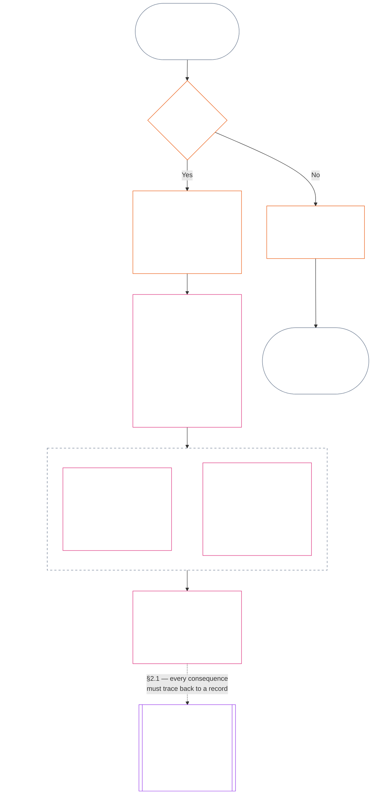
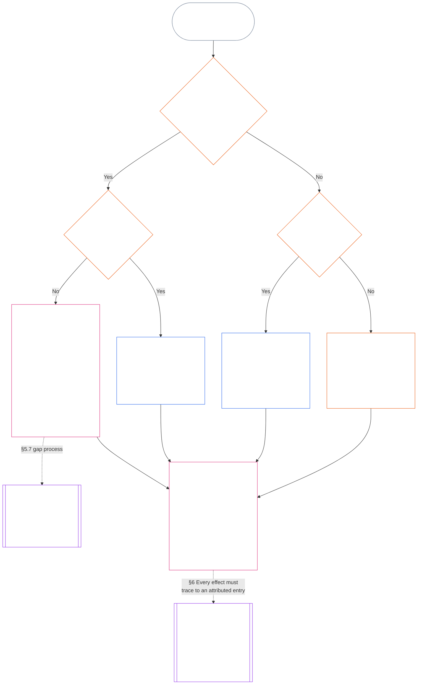

<!-- Complete unreviewed AI-assisted id translation of current Chapter Eleven; source: core_11.000_standing_assessment.md; source snapshot: 05b7b839; 2026-11-09 source refresh applied. -->

# BAB SEBELAS: CATATAN STATUS — PERTANYAAN 1, APA YANG TERJADI

<strong>Letak dalam korpus (non-operatif): struktur berkas dan aturan baca</strong>

> Berkas ini **merupakan bagian dari Konstitusi Makhluk Sadar** dan **mengikat hanya jika dibaca bersama** berkas `core_*` bernomor lainnya sebagai satu teks. Isinya adalah **Bab Sebelas**: tiga pertanyaan dalam rantai pencatatan status dan **Pertanyaan 1** (*apa yang terjadi?*), dalam **§1–§6**. **Pertanyaan 2** (*seberapa baik atau buruk hal itu?*) dijawab dalam [Bab Dua Belas](core_12_standing_measurement.md#chapter-twelve-standing-measurement--question-2-how-good-or-bad-was-it). Pertanyaan 3 (*apa akibatnya?*) berlanjut di [Bab Tiga Belas](../../core_13.000_standing_integration.md#chapter-thirteen-standing-effects-and-integration), dengan peninjauan terbatas pada penetapan status pelanggaran anti-konstitusional dalam [Bab Empat Belas](../../core_14.000_misconduct_designation.md#chapter-fourteen-anti-constitutional-misconduct) untuk temuan Violation Axis `s` = 7–9 yang memenuhi syarat. Urutan baca, pemisahan bagian yang mengikat dan mendukung, serta metadata edisi korpus dipelihara dalam [README.md](README.md).

<strong>Panduan pembaca (non-operatif): letak Bab Sebelas dan hal yang tetap dibahas di sini</strong>

> | Pertanyaan | Pemilik dan peran |
> | --- | --- |
> | **1. Apa yang terjadi?** | Bab Sebelas (berkas ini): menetapkan fakta terverifikasi dalam Catatan Status yang berbatas dan dapat digugat. |
> | **2. Seberapa baik atau buruk hal itu?** | [Bab Dua Belas](core_12_standing_measurement.md#chapter-twelve-standing-measurement--question-2-how-good-or-bad-was-it): mengukur fakta terverifikasi tanpa menggabungkan bantuan dan kerugian. |
> | **3. Apa akibatnya?** | Lanjutkan ke [Bab Tiga Belas](../../core_13.000_standing_integration.md#chapter-thirteen-standing-effects-and-integration). |
>
> Tuduhan, popularitas, dan narasi sengketa bukanlah jawaban untuk Pertanyaan 1. Peringkat yang diinginkan tidak dapat menjadi fakta untuk Pertanyaan 1, dan konsekuensi yang diinginkan tidak dapat menjadi peringkat untuk Pertanyaan 2.

<strong>Jejak</strong>

- Hulu:
  - [Tetrad Konstitusional](core_00_preamble.md#constitutional-tetrad);
  - [Dua Tujuan Konstitusional](core_00_preamble.md#two-constitutional-aims);
  - [taruhan material](core_00_preamble.md#material-stake);
  - [Prakata §6 Rantai Proses Praktis Utama](../../core_00.000_preamble.md#6-key-practical-process-pipelines) (*rantai Bab Sembilan sampai Lima Belas*).
- Hulu:
  - [Bab Satu](core_01_c_stewardship_capacity_principles.md#chapter-01-principles-and-constraints) (1.010) (*pengelolaan berprinsip Aksesibilitas Bahasa Sederhana yang tercermin dalam glos bagian*);
  - [Bab Satu §16 — Pengelolaan Secara Mendalam](core_01_c_stewardship_capacity_principles.md#16-stewardship-in-depth) (1.010 §16) (*fondasi lapis prinsip bagi status yang terkait kompetensi dan dapat ditelusuri — kepercayaan, peran, dan pengakuan*);
  - [Bab Dua sampai Empat](core_02_definition_structure.md) (*integritas, catatan, dan verifikasi*);
  - [Bab Lima](core_05__definitions_home.md#chapter-five-foundational-definitions) (5.000) (*definisi dan supremasi dibaca bersama Bab Dua sampai Empat*).
- Hulu: [Bab Sembilan](core_09.000_system_alignment_certification_evaluation.md#chapter-nine-system-alignment-certification) (9.000) (*sertifikasi keselarasan sistem*); [Bab Sembilan Bagian C §11](core_09.010_system_alignment_certification_record_recertification.md#11-relationship-to-standing) (9.010 §11) (*jembatan status — hanya calon input terverifikasi*).
- Rantai pencatatan status:
  - [Prakata §6.2 Cara keseluruhan rantai saling terkait](../../core_00.000_preamble.md#62-how-the-full-chain-fits-together);
  - [Bab Sebelas — Catatan Status](#chapter-eleven-standing-records--question-1-what-happened) (11.000) (*kerangka tiga pertanyaan dan Catatan Status Pertanyaan 1*);
  - [Bab Dua Belas — Pengukuran Status](core_12_standing_measurement.md#chapter-twelve-standing-measurement--question-2-how-good-or-bad-was-it) (12.000) (*pengukuran Pertanyaan 2*);
  - [Bab Tiga Belas — Akibat Status dan Integrasi](../../core_13.000_standing_integration.md#chapter-thirteen-standing-effects-and-integration) (13.000) (*akibat dan integrasi Pertanyaan 3*);
  - [Bab Empat Belas](../../core_14.000_misconduct_designation.md#chapter-fourteen-anti-constitutional-misconduct) (14.000) (*hanya penetapan untuk temuan Violation Axis s = 7–9 yang memenuhi syarat*).
- Subbagian dalam berkas ini:
  - [§1](#1-the-three-questions) (*kerangka dan cakupan tiga pertanyaan*);
  - [§2](#2-question-1--what-happened) (*Pertanyaan 1 — fakta dan catatan terverifikasi*);
  - [§3](#3-question-1-event-type-guide--what-kind-of-help-or-harm-occurred) (*panduan jenis peristiwa Pertanyaan 1 — jenis bantuan dan kerugian*);
  - [§4](#4-standing-record-operational-requirements) (*persyaratan verifikasi dan catatan*);
  - [§5](#5-record-custody-and-opening-authority) (*kustodi catatan dan kewenangan pembukaan*);
  - [§6](#6-handling-a-standing-record) (*penanganan Catatan Status*).
- Hilir:
  - [Bab Dua Belas](core_12_standing_measurement.md#chapter-twelve-standing-measurement--question-2-how-good-or-bad-was-it) (12.000) (*Pertanyaan 2 — dasar LEQU, dimensi pengukuran, deskriptor rute, tata bahasa slot, input konstitusional, skala LEQU, ukuran kontribusi standar, ilustrasi, dan pengalihan ke Pertanyaan 3*);
  - [Bab Empat Belas](../../core_14.000_misconduct_designation.md#chapter-fourteen-part-a-anti-constitutional-misconduct-designation) (14.000) (*hanya penetapan — tidak membuka ulang pengukuran Pertanyaan 2*);
  - [Bab Lima Belas](../../core_15.000_forum.md#chapter-fifteen-forums-and-jurisdiction) (15.000) (*pengawasan dan pengalihan forum*);
  - [Pasal XXVI-C](core_06_rights_part_e.md#article-xxvi-c-timely-resolution-and-anti-delay-floor) (*penyelesaian tepat waktu*);
  - [Pasal XX](core_06_rights_part_d.md#article-xx-a-justice-objective-and-scope) (*batasan keadilan*).
- Baca bersama: [Bab Lima *Status, Kontribusi, dan Pelanggaran*](../../core_05.035_band_accountability.md#defa3-standing-state-contribution-and-violation) (5.035) (*pengarahan definisi kanonis*).
- Baca bersama: [README.md](README.md) (*urutan baca*); [doc_architecture.md](../../doc_architecture.md) (*peta editorial non-mengikat kecuali diadopsi*).

 

Bab Sebelas adalah pemilik konstitusional **catatan faktual terverifikasi (Pertanyaan 1)**. Bab ini mencakup [§1 Tiga pertanyaan](#1-the-three-questions) sampai [§6 Penanganan Catatan Status](#6-handling-a-standing-record). [Bab Dua Belas](core_12_standing_measurement.md#chapter-twelve-standing-measurement--question-2-how-good-or-bad-was-it) mengatur Pertanyaan 2, dari [Bab Dua Belas §1 Pertanyaan 2 — seberapa baik atau buruk hal itu?](core_12_standing_measurement.md#1-question-2--how-good-or-bad-was-it) sampai [Bab Dua Belas §9 Pengalihan ke Pertanyaan 3 — kait pengukuran lintas pertanyaan](core_12_standing_measurement.md#9-hand-off-to-question-3--cross-question-measurement-hooks). Pertanyaan 3 berlanjut di Bab Tiga Belas.

*Dalam bahasa sederhana: bab ini mencatat apa yang terjadi dan memegang Catatan Status. Seberapa baik atau seberapa merugikan hal itu diukur dalam Bab Dua Belas, melalui dua jalur terpisah, bukan satu skor bersih. Mengajukan perkara saja tidak otomatis menghasilkan status.*

### 1. Tiga pertanyaan

*Dalam bahasa sederhana: status ditentukan dengan menjawab tiga pertanyaan secara berurutan. Jangan menyimpulkan fakta dari penilaian yang diinginkan, dan jangan memilih penilaian untuk membenarkan akibat yang diinginkan.*

| Pertanyaan | Apa yang ditanyakan | Di mana dijawab |
| --- | --- | --- |
| **1. Apa yang terjadi?** | Fakta mana yang telah diverifikasi, tentang siapa atau apa, selama periode apa, dan dengan catatan status serta status gugatan seperti apa? | [Bagian 2](#2-question-1--what-happened) dan [Bagian 3](#3-question-1-event-type-guide--what-kind-of-help-or-harm-occurred) |
| **2. Seberapa baik atau buruk hal itu?** | Jenis dan besaran kontribusi atau pelanggaran apa yang dibuktikan oleh fakta tersebut? | [Bagian 1 Bab Dua Belas](core_12_standing_measurement.md#1-question-2--how-good-or-bad-was-it) |
| **3. Apa akibatnya?** | Pengakuan, kesiapan, pemulihan, perlindungan, pembatasan, atau akibat lain apa yang menyusul? | [Bab Tiga Belas](../../core_13.000_standing_integration.md#chapter-thirteen-standing-effects-and-integration) |

Setiap pertanyaan bergantung pada jawaban sebelumnya:

- Pertanyaan 1 menyediakan fakta terverifikasi untuk Pertanyaan 2.
- Pertanyaan 2 mengukur fakta tersebut untuk Pertanyaan 3.
- Pertanyaan 3 tidak boleh menulis ulang fakta atau penilaian agar sesuai dengan hasil yang disukai.

Jawaban atas ketiga pertanyaan secara bersama-sama membentuk penilaian status lengkap atas satu peristiwa berbatas jelas atau satu pola yang didefinisikan. Subjek dapat memiliki beberapa penilaian seperti itu dari waktu ke waktu, dan tidak satu pun merupakan skor bersih atau penilaian keseluruhan atas subjek. Catatan status kontribusi dan pelanggaran menyimpan jawaban atas Pertanyaan 1 dan 2; keputusan Pertanyaan 3 menyatakan akibat yang ditimbulkan.

#### 1.1 Tujuan dan cakupan

Bab ini menyatakan kerangka catatan konstitusional, sedangkan [Bab Dua Belas](core_12_standing_measurement.md#chapter-twelve-standing-measurement--question-2-how-good-or-bad-was-it) menyatakan kerangka pengukuran, bagi **sistem**, **makhluk sadar**, dan **institusi**, termasuk setiap sistem yang diklasifikasikan berdasarkan [**CS-9.305**](../../corpus_systems/cs_09.305_system_classification_machinery.md#cs-9305-part-a-system-classification-machinery) (*Mesin klasifikasi sistem*). Kerangka ini tidak mengukur gosip, popularitas, reputasi yang kabur, martabat bawaan, atau nilai umum; semua itu bukan subjek yang boleh dinilai statusnya.

Rantai proses status harus tetap efektif ketika:

- kontribusi yang sebelumnya telah diverifikasi menjadi terlalu lama untuk menunjukkan kompetensi atau keandalan saat ini;
- pelanggaran belum terselesaikan;
- pemulihan membutuhkan biaya besar;
- tanggung jawab melintasi batas; atau
- pelaku menggunakan pelapisan atau pelabelan ulang organisasi untuk menghambat pertanggungjawaban.

Hal-hal berikut merupakan bagian dari teks implementasi yang diadopsi:

- prosedur sehari-hari;
- langkah eskalasi;
- operasi restitusi dan pemulihan;
- langkah pertanggungjawaban restoratif; dan
- perancangan insentif.

Pengukuran Bab Dua Belas **tidak**, dengan sendirinya, mengizinkan penggunaan kekuatan, penahanan, atau pembatasan kebebasan lainnya. Akibat apa pun semacam itu harus secara mandiri memenuhi Bab Enam, **Pasal XX** (*Keadilan Setelah Pelanggaran Terverifikasi*), termasuk persyaratan proporsionalitas, pembatasan seminimal mungkin, pembatasan waktu, restitusi, dan pertanggungjawaban restoratif.

<strong>Jejak · Definisi · Penilaian · Kepatuhan</strong>

- Hulu: [Bab Satu §16 — Pengelolaan Bertanggung Jawab secara Mendalam](core_01_c_stewardship_capacity_principles.md#16-stewardship-in-depth); [Bab Dua sampai Empat](core_02_definition_structure.md); [Bab Lima](core_05__definitions_home.md#chapter-five-foundational-definitions).
- Hilir: [§2](#2-question-1--what-happened) (*Pertanyaan 1*); [§4](#4-standing-record-operational-requirements) (*persyaratan verifikasi dan catatan*); [§5](#5-record-custody-and-opening-authority) (*kustodi catatan dan kewenangan untuk membukanya*); [§6](#6-handling-a-standing-record) (*penanganan catatan status*); [Bab Dua Belas §1](core_12_standing_measurement.md#1-question-2--how-good-or-bad-was-it) (*pengukuran Pertanyaan 2*); [Bab Dua Belas §2](core_12_standing_measurement.md#2-magnitude-and-severity-input-dimensions) (*dimensi masukan pengukuran*); [Bab Dua Belas §3](core_12_standing_measurement.md#3-route-descriptor-catalogs-and-measurement-roles) (*katalog deskriptor jalur*); [Bab Dua Belas §4](core_12_standing_measurement.md#4-slot-grammar-and-shared-scaling) (*tata bahasa slot dan penskalaan bersama*); [Bab Dua Belas §5](core_12_standing_measurement.md#5-constitutional-inputs-to-axis-assignment) (*masukan konstitusional untuk penetapan sumbu*); [Bab Dua Belas §6](core_12_standing_measurement.md#6-unified-proportional-lequ-scale--contribution-and-violation-axes) (*skala LEQU proporsional terpadu untuk kedua sumbu*); [Bab Tiga Belas](../../core_13.000_standing_integration.md#chapter-thirteen-standing-effects-and-integration) (*Pertanyaan 3*).
- [Materialitas](core_05_band_oversight.md#materiality) · [O](core_05_band_oversight.md#materiality) · [M](core_05_band_oversight.md#materiality-determination-a) · [A](core_05_band_oversight.md#materiality-determination-a) · [C](core_05_band_oversight.md#materiality-determination-c)
- [Kerugian](../../core_05.035_band_accountability.md#harm) · [O](../../core_05.035_band_accountability.md#harm) · [M](../../core_05.035_band_accountability.md#harm-a) · [A](../../core_05.035_band_accountability.md#harm-a) · [C](../../core_05.035_band_accountability.md#harm-c)
- [Proporsionalitas](../../core_05.035_band_accountability.md#proportionality) · [O](../../core_05.035_band_accountability.md#proportionality) · [M](../../core_05.035_band_accountability.md#proportionality-a) · [A](../../core_05.035_band_accountability.md#proportionality-a) · [C](../../core_05.035_band_accountability.md#proportionality-c)

### 2. Pertanyaan 1 — apa yang terjadi?

<strong>Jejak</strong>

- Hulu: [§1](#1-the-three-questions) (*kerangka tiga pertanyaan*); [Bab Dua sampai Empat](core_02_definition_structure.md) (*catatan, verifikasi, dan keterlacakan definisi hingga hasil*).
- Kaki Tetrad: **partisipasi**; **pengawasan** (dapat digugat dan memiliki jalur gugatan). Tujuan utama: **Berkembang** dan **Kesinambungan** (catatan terlacak yang menyimpan temuan kontribusi dan pelanggaran secara terpisah untuk pengukuran selanjutnya).
- Hilir:
  - [§2.2](#22-silence-is-the-default) (*diam adalah keadaan awal*);
  - [§2.3](#23-protected-dissent-is-not-a-trigger) (*perbedaan pendapat yang dilindungi bukan pemicu*);
  - [§2.4](#24-linked-standing-records-and-no-offset-bridge) (*jembatan catatan status terkait tanpa pengimbangan*);
  - [§2.5](#25-verified-input-gate) (*gerbang masukan terverifikasi*);
  - [§2.6](#26-stage-boundary) (*batas tahapan*);
  - [§2.7](#27-forum-boundary) (*batas forum*);
  - [§3](#3-question-1-event-type-guide--what-kind-of-help-or-harm-occurred) (*panduan jenis peristiwa*);
  - [§4](#4-standing-record-operational-requirements) (*persyaratan catatan*);
  - [§5](#5-record-custody-and-opening-authority) (*kustodi catatan dan kewenangan pembukaan*);
  - [§6](#6-handling-a-standing-record) (*penanganan catatan status*);
  - [Bab Dua Belas §1](core_12_standing_measurement.md#1-question-2--how-good-or-bad-was-it) (*pengukuran Pertanyaan 2*);
  - [Bab Dua Belas §2](core_12_standing_measurement.md#2-magnitude-and-severity-input-dimensions) (*dimensi masukan pengukuran*);
  - [Bab Dua Belas §3](core_12_standing_measurement.md#3-route-descriptor-catalogs-and-measurement-roles) (*katalog deskriptor jalur*);
  - [Bab Dua Belas §4](core_12_standing_measurement.md#4-slot-grammar-and-shared-scaling) (*tata bahasa slot dan penskalaan bersama*);
  - [Bab Dua Belas §5](core_12_standing_measurement.md#5-constitutional-inputs-to-axis-assignment) (*masukan konstitusional untuk penetapan sumbu*);
  - [Bab Dua Belas §6](core_12_standing_measurement.md#6-unified-proportional-lequ-scale--contribution-and-violation-axes) (*skala LEQU proporsional terpadu untuk kedua sumbu*);
  - [Bab Tiga Belas](../../core_13.000_standing_integration.md#chapter-thirteen-standing-effects-and-integration) (13.000) (*Pertanyaan 3*).

 

*Dalam bahasa sederhana: Pertanyaan 1 menetapkan catatan terbatas dan dapat digugat tentang apa yang terjadi. Pertanyaan ini mengidentifikasi subjek, peristiwa atau pola, periode waktu, fakta terverifikasi, dan status catatan sebelum penilaian atau akibat apa pun dipertimbangkan. Bantuan terverifikasi dan pelanggaran terverifikasi menggunakan catatan status yang terpisah agar yang satu tidak menghapus yang lain. Catatan status ini bukan skor popularitas atau label kabur.*

**Catatan status** adalah catatan berbatas jelas yang digunakan bab ini untuk subjek tertentu, cakupan fungsional, rentang catatan, status peninjauan, dan konteks keputusan tertentu. Sebelum pengukuran dimulai, catatan tersebut harus menetapkan:

- siapa atau apa yang menjadi pokok catatan status;
- apakah catatan itu mengenai peristiwa berbatas jelas atau pola yang didefinisikan;
- kapan dan di mana perilaku serta dampak terkait terjadi;
- fakta mana yang terverifikasi dan mana yang masih disengketakan;
- bukti, atribusi, dan jalur gugatan apa yang mendukung temuan tersebut; dan
- status peninjauan, koreksi, dan penggantian catatan status saat ini.

Bagan ini mengikuti suatu peristiwa untuk melihat apakah peristiwa itu memicu catatan status dan apa yang kemudian dimuat oleh catatan tersebut; subbagian berikut menjelaskan setiap aturan. Cabang “tidak” meninggalkan jalur utama ke arah kanan.

#### 2.1 Catatan status: jenis dan subjek

Pertanyaan 1 menggunakan **catatan status kontribusi** untuk bantuan terverifikasi dan **catatan status pelanggaran** untuk kerugian terverifikasi, termasuk kegagalan pertanggungjawaban. Satu catatan status tidak menggabungkan kedua jenis temuan itu.

- Catatan status dapat mengenai makhluk sadar, institusi, sistem, penilaian, peristiwa berbatas jelas, peran, kolektif, catatan khusus pelaku, atau unit lain yang relevan secara konstitusional.
  - Catatan itu tidak boleh menyatukan subjek, peran, sistem, komunitas, rentang catatan, status peninjauan, atau konteks keputusan yang berbeda menjadi satu label status yang tidak terdiferensiasi.
- Catatan status dapat mencakup **peristiwa berbatas jelas** — satu kejadian dengan awal dan akhir yang jelas — atau **pola** perilaku berulang.
  - Pola memerlukan subjek, cakupan, dan periode peninjauan yang ditetapkan.
- Subjek yang sama dapat memiliki beberapa catatan status seiring waktu, termasuk catatan status kontribusi dan pelanggaran yang saling terkait.
  - Catatan status terkait harus **saling merujuk** berdasarkan **bagian 4.2** jika memiliki subjek yang sama, rentang catatan yang tumpang tindih, peristiwa berbatas jelas, pola, atau konteks keputusan yang sama.
- Catatan status bukan skor reputasi yang berdiri sendiri, peringkat martabat, status permanen, label nilai umum, atau kartu skor gabungan.
  - Persyaratan operasional terdapat di **bagian 4**.

Akibat status selanjutnya termasuk ranah Bab Tiga Belas dan harus dapat ditelusuri kembali ke catatan status yang relevan tanpa menjadi bagian dari catatan status itu sendiri.

#### 2.2 Diam adalah keadaan awal

Tidak adanya catatan status merupakan keadaan biasa bagi makhluk sadar, institusi, atau sistem, dan merupakan keadaan yang akan dipertahankan oleh sebagian besar makhluk sadar.

- Catatan status hanya dibuka jika suatu pemicu telah diverifikasi berdasarkan **bagian 4**. Kewenangan pembukaan catatan yang ditetapkan harus menyetujui entri, dan kustodian catatan yang terpisah harus membuatnya (**bagian 5**). Catatan status tidak pernah dibuka:
  - untuk menetapkan garis dasar;
  - untuk melengkapi daftar; atau
  - karena penjaga gerbang pada jalur berpintu mungkin menghendakinya.
- Tidak adanya catatan standing tidak memberi tahu apa pun. “Belum dinilai”, “belum diverifikasi”, dan “tidak ada catatan dalam berkas” bukan bukti risiko, kontribusi rendah, atau hal lain. Siapa pun dilarang memperlakukan ketiadaan catatan sebagai alasan untuk pemeriksaan lebih ketat, praduga awal yang lebih rendah, atau akses bersyarat ke jalur berpintu.
- Tidak ada institusi atau sistem yang boleh mensyaratkan catatan status, pernyataan “tidak ada catatan”, atau persetujuan untuk membukanya sebagai syarat bagi:
  - kebutuhan pokok **Pasal III** (*Kelangsungan Hidup dan Akses Esensial*);
  - perlindungan **Pasal III-C** (*Kerja dan Lantai Ekonomi*);
  - perdagangan biasa; atau
  - partisipasi sebagai pihak terdampak.
  Pengecualiannya adalah ambang kompetensi yang diterbitkan untuk jalur berpintu tertentu yang sensitif terhadap kepercayaan berdasarkan [Bab Tiga Belas §7.2 Ambang kompetensi dan izin](../../core_13.000_standing_integration.md#72-competency-bars-and-clearances); ambang itu harus menyatakan alasan jalur berpintu tersebut sensitif terhadap kepercayaan.
- Ketika catatan status tentang suatu subjek dibuka, subjek harus diberi tahu sebagaimana diwajibkan **bagian 4**. Pemberitahuan hanya boleh ditunda jika kebutuhan [Pelestarian Bukti](core_05_band_oversight.md#evidence-preservation) atau Keselamatan yang terdokumentasi membenarkannya, dan hanya untuk jangka waktu yang terbatas dan ditetapkan. Pemberitahuan membuat catatan status dapat digugat: subjek yang tidak tahu bahwa catatan status ada tidak dapat menggugat atau memperbaikinya.

#### 2.3 Perbedaan pendapat yang dilindungi bukan pemicu

Perbedaan pendapat atau protes damai — termasuk [pembangkangan sipil tanpa kekerasan yang dilindungi](core_06_rights_part_b.md#xi-d-nonviolent-civil-disobedience) — berdasarkan **Pasal XI-D** (*Berkumpul, Perbedaan Pendapat, dan Protes Damai*) ([*Lantai Perbedaan Pendapat dan Protes Damai*](core_06_rights_part_b.md#xi-d-dissent-and-peaceful-protest)) bukanlah pemicu terverifikasi.

- Hal itu tidak membuka, memperpanjang, atau memperberat catatan status pelanggaran, bukan masukan tingkat keparahan berdasarkan **bagian 8.2**, dan pengulangannya tidak menjadikannya pola.
- Perilaku terpisah yang secara mandiri melanggar lantai konstitusional dicatat berdasarkan ketentuannya sendiri, tanpa pemberatan karena sudut pandang, tujuan, atau sasaran protes.

#### 2.4 Catatan status terkait dan jembatan tanpa pengimbangan

<strong>Jejak</strong>

- Hulu: [§2.1](#21-standing-records-kinds-and-subjects) (*catatan kontribusi dan pelanggaran yang terpisah*).
- Hilir:
  - [§2.5](#25-verified-input-gate) (*gerbang masukan terverifikasi*);
  - [§2.7](#27-forum-boundary) (*batas forum*);
  - [§4.2](#42-related-standing-record-cross-references) (*rujukan silang*);
  - [Bab Dua Belas §1](core_12_standing_measurement.md#1-question-2--how-good-or-bad-was-it) (*pengukuran Pertanyaan 2*);
  - [Bab Dua Belas §2](core_12_standing_measurement.md#2-magnitude-and-severity-input-dimensions) (*dimensi masukan pengukuran*);
  - [Bab Dua Belas §3](core_12_standing_measurement.md#3-route-descriptor-catalogs-and-measurement-roles) (*katalog deskriptor jalur*);
  - [Bab Dua Belas §4](core_12_standing_measurement.md#4-slot-grammar-and-shared-scaling) (*tata bahasa slot dan penskalaan bersama*);
  - [Bab Dua Belas §5](core_12_standing_measurement.md#5-constitutional-inputs-to-axis-assignment) (*masukan konstitusional untuk penetapan sumbu*);
  - [Bab Dua Belas §6](core_12_standing_measurement.md#6-unified-proportional-lequ-scale--contribution-and-violation-axes) (*skala LEQU proporsional terpadu untuk kedua sumbu*);
  - [Bab Tiga Belas](../../core_13.000_standing_integration.md#chapter-thirteen-standing-effects-and-integration) (13.000) (*Pertanyaan 3*).
- Baca bersama: [Bab Tiga Belas — Integrasi status](../../core_13.000_standing_integration.md#3-automatic-integration-review-and-continuity) (13.000) (*tidak ada pengesampingan dan integrasi catatan terkait*); [Bab Tiga Belas §7.2 — Ambang kompetensi dan izin](../../core_13.000_standing_integration.md#72-competency-bars-and-clearances) (13.000 §7.2); [Bab Tiga Belas §5.2 — Kunci status](../../core_13.000_standing_integration.md#52-prevention--general-standing-locks) (13.000 §5.2).

 

**Aturan inti:** **catatan status kontribusi** terverifikasi dan **catatan status pelanggaran** terverifikasi disimpan secara terpisah berdasarkan **bagian 2.1**. Setiap temuan kontribusi atau pelanggaran harus bertumpu pada faktanya sendiri yang didukung dalam catatan statusnya sendiri. Analisis dan bahan pendukung harus menjaga agar kedua jalur catatan dapat ditelusuri secara terpisah. Tidak ada entri tunggal atau rangkaian terkait yang menjadi skor bersih, skor gabungan, atau pertukaran.

- **Catatan status pelanggaran dan kunci status:**
  - Berdasarkan Bab Tiga Belas, **kunci status** yang berlaku dan diambil dari catatan status pelanggaran dapat membatasi status, membatasi kelayakan peran, atau memengaruhi akses pemulihan selama pelanggaran terverifikasi belum diselesaikan.
  - Kunci status tidak boleh menghapus kontribusi positif terverifikasi yang dicatat dalam catatan status kontribusi.
  - Pelanggaran terverifikasi yang belum diselesaikan tidak diberi potongan nilai karena berlalunya waktu semata.
  - Pelanggaran terverifikasi tidak boleh menulis ulang catatan status kontribusi yang tidak terkait menjadi berkas reputasi negatif yang keliru.
- **Catatan status kontribusi dan izin kompetensi:**
  - Kontribusi terverifikasi dapat mendukung **izin kompetensi** yang berlaku berdasarkan **ambang kompetensi** yang diterbitkan, serta mendukung kelayakan terkait kepercayaan, peran, atau pengakuan jika masih mutakhir dan relevan dengan peran.
  - Kontribusi terverifikasi tidak boleh mengimbangi, menurunkan rata-rata, memaafkan, atau memberi label ulang pada temuan pelanggaran terverifikasi.
  - Terpenuhinya gerbang tidak mengesampingkan kunci status yang berlaku.

**Satu-satunya pengecualian:** Jika temuan pelanggaran itu sendiri membantah kontribusi yang diklaim — misalnya, jika bukti menunjukkan bahwa Anda tidak benar-benar melakukan hal yang dinyatakan oleh catatan kontribusi Anda — catatan status kontribusi terkait dapat dikoreksi atau dihapus melalui proses bukti dan peninjauan yang semestinya, dengan rujukan silang yang diwajibkan dalam **bagian 4.2**. Namun, pelanggaran itu tidak otomatis menghapus bantuan lain yang tidak terkait dan dicatat dalam catatan status kontribusi terpisah.

#### 2.5 Gerbang masukan terverifikasi

Gerbang ini bekerja sebagai berikut:

- Keputusan apa pun yang memengaruhi status, kepercayaan, peran, pengakuan, atau kelayakan untuk memperoleh pengakuan hanya boleh menggunakan masukan terverifikasi dari **catatan status kontribusi** atau **catatan status pelanggaran** yang relevan.
- Dugaan, klaim yang belum diputus, tag pengalihan sementara, narasi yang hanya dikumpulkan saat penerimaan, dan bahan lain dari tahap sengketa tidak dengan sendirinya menjadi dasar sifat kontribusi atau sifat pelanggaran untuk status.
- Masukan terverifikasi adalah **temuan status**: temuan kontribusi terverifikasi (Sumbu I) atau temuan pelanggaran terverifikasi (Sumbu II).
- Temuan kontribusi dan pelanggaran tetap berada dalam catatan status terpisah (lihat **bagian 2.1**).

#### 2.6 Batas tahapan

Tahapan catatan status tetap terpisah:

- Pertanyaan 1 mencatat fakta terverifikasi; Pertanyaan 2 mengukurnya.
- Catatan status dapat dibuka setelah dasar faktual terverifikasinya lengkap, meskipun pengukuran Pertanyaan 2 masih tertunda.
- Sampai pengukuran dilakukan, bidang Pertanyaan 2 harus menyatakan bahwa pengukuran tertunda, bukan menyiratkan adanya slot atau kategori.
- Catatan status tidak boleh menyatakan atau menerapkan **akibat status** Pertanyaan 3.

#### 2.7 Batas forum

*Dalam bahasa sederhana: forum adalah tempat sengketa diawasi, digugat, dan diubah menjadi hasil terverifikasi — tetapi mengajukan perkara atau menang dalam pertarungan narasi tidak memperbarui status. Gerbang masukan terverifikasi dalam **bagian 2.5** tetap berlaku. Ketika forum memverifikasi fakta berdasarkan Bab Dua sampai Empat, forum dapat **membuka, memperbarui, atau mengoreksi** catatan status — atau **mengesampingkan catatan yang buruk setelah digugat**. Forum tidak menggabungkan hal baik dan buruk menjadi satu skor atau menciptakan kategori status atas inisiatifnya sendiri.*

Bagian ini mengatur satu pertanyaan: bagaimana kerja forum mencapai catatan status. Langkah lain dalam rantai dimiliki oleh pihak yang disebut di sini, dan rantai berjalan dalam urutan berikut:

1. Sengketa diajukan dan forum menyimpan **catatan perkara forum**, yang bukan catatan status. Pemilik: [Bab Lima Belas §2.3 Catatan perkara forum, catatan status, dan gugatan](core_11_forum.md#23-forum-case-records-standing-records-and-contests); lihat juga [§2.7.1 Catatan perkara forum](#271-forum-case-record).
2. Forum memverifikasi fakta berdasarkan [Bab Dua sampai Empat](core_02_definition_structure.md).
3. Temuan terverifikasi melewati gerbang masukan terverifikasi. Pemilik: [§2.5 Gerbang masukan terverifikasi](#25-verified-input-gate).
4. Kewenangan pembukaan catatan yang ditetapkan, yang dapat berupa forum, membuka, memperbarui, atau mengoreksi catatan status, atau mengesampingkan catatan buruk setelah gugatan. Pemilik: [§4.1 Isi minimum catatan](#41-minimum-record-contents) untuk hal yang dicatat dan [§5 Kustodi catatan dan kewenangan pembukaan](#5-record-custody-and-opening-authority) untuk pihak yang boleh bertindak.
5. Catatan status hanya memuat fakta terverifikasi, lalu Pertanyaan 2 mengukurnya. Pemilik: [§2.6 Batas tahapan](#26-stage-boundary) dan [Bab Dua Belas §1 Pertanyaan 2 — seberapa baik atau buruk hal itu?](core_12_standing_measurement.md#1-question-2--how-good-or-bad-was-it).
6. Jika ada akibat status, akibat itu menyusul berdasarkan [Bab Tiga Belas](../../core_13.000_standing_integration.md#chapter-thirteen-standing-effects-and-integration), yang memiliki ranah akibat status.

Keluarga forum berdasarkan [Bab Lima Belas](../../core_15.000_forum.md#chapter-fifteen-forums-and-jurisdiction) **mengawasi** bagaimana sengketa konkret melewati rantai proses status. Forum menyediakan hal berikut berdasarkan [Bab Lima Belas §6 Penyelesaian tepat waktu, tingkat materialitas, dan disiplin anti-penundaan](core_11_forum.md#6-timely-resolution-materiality-tiers-and-anti-delay-discipline) dan [Pasal XXVI-C](core_06_rights_part_e.md#article-xxvi-c-timely-resolution-and-anti-delay-floor) (*Penyelesaian Tepat Waktu dan Lantai Anti-Penundaan*):

- gugatan yang dapat diakses;
- peninjauan independen;
- dukungan forensik;
- urutan remediasi; dan
- jangka waktu menurut tingkat.

Ketika temuan forum tersebut memenuhi gerbang masukan terverifikasi berdasarkan Bab Dua sampai Empat, temuan itu dapat:

- **membuka, memperbarui, atau mengoreksi** catatan status berdasarkan **bagian 4.1**; atau
- **mengesampingkan catatan buruk setelah gugatan**.

##### 2.7.1 Catatan perkara forum

Berkas forum sendiri mengenai sengketa yang terbuka adalah [**catatan perkara forum**](../../core_05.035_band_accountability.md#forum-case-record), yang didefinisikan dalam [Bab Lima Belas §2.3 Catatan perkara forum, catatan status, dan gugatan](core_11_forum.md#23-forum-case-records-standing-records-and-contests). Catatan ini **bukan** catatan status.

##### 2.7.2 Temuan forum dan pengukuran Pertanyaan 2

Temuan faktual forum yang terverifikasi dapat menyediakan dasar faktual bagi catatan status Pertanyaan 1. Temuan itu **tidak** menentukan pengukuran Pertanyaan 2 tentang seberapa baik atau buruk kontribusi atau pelanggaran terverifikasi tersebut ([§2.6 Batas tahapan](#26-stage-boundary)). Karena itu:

- Proses forum **tidak boleh** menggabungkan bahan kontribusi dan pelanggaran menjadi satu skor bersih, satu jawaban gabungan tentang pokok perkara, atau label status yang tidak terdiferensiasi; catatan status terkait tetap terpisah berdasarkan [§2.1 Catatan status: jenis dan subjek](#21-standing-records-kinds-and-subjects) dan [§2.4 Catatan status terkait dan jembatan tanpa pengimbangan](#24-linked-standing-records-and-no-offset-bridge).
- Keluaran forum **tidak boleh** mengganti masukan terverifikasi yang dapat dibuktikan ([§2.5 Gerbang masukan terverifikasi](#25-verified-input-gate)), pengukuran terpisah ([Bab Dua Belas §1 Pertanyaan 2 — seberapa baik atau buruk hal itu?](core_12_standing_measurement.md#1-question-2--how-good-or-bad-was-it)), atau mekanisme akibat status yang dimiliki [Bab Tiga Belas](../../core_13.000_standing_integration.md#chapter-thirteen-standing-effects-and-integration) dengan narasi sengketa, kemudahan pengalihan, atau preferensi panel.

##### 2.7.3 Hal yang tidak dikurangi oleh batas forum

Batas ini **tidak** mengurangi hak menggugat, pemulihan, keringanan sementara, atau perlindungan prosedural yang diwajibkan berdasarkan:

- [Pasal XIII-A](core_06_rights_part_c.md#article-xiii-a-reliability-and-trustworthiness-baseline) (*Garis Dasar Keandalan dan Keterpercayaan*);
- [Pasal XIII-B](core_06_rights_part_c.md#article-xiii-b-right-to-redress-and-remedy) (*Hak atas Ganti Rugi dan Pemulihan*);
- [Bab Lima Belas §6 Penyelesaian tepat waktu, tingkat materialitas, dan disiplin anti-penundaan](core_11_forum.md#6-timely-resolution-materiality-tiers-and-anti-delay-discipline);
- [Pasal XXVI-C](core_06_rights_part_e.md#article-xxvi-c-timely-resolution-and-anti-delay-floor) (*Penyelesaian Tepat Waktu dan Lantai Anti-Penundaan*); atau
- pasal keadilan terkait.

Batas ini mensyaratkan agar temuan forum yang terverifikasi masuk ke status melalui gerbang yang sama dengan masukan terverifikasi lainnya — bukan melewatinya.

### 3. Panduan jenis peristiwa Pertanyaan 1 — jenis bantuan atau kerugian apa yang terjadi?

*Dalam bahasa sederhana: gunakan tabel ini untuk menjelaskan apa yang terjadi setelah faktanya diverifikasi. Tabel membantu mengidentifikasi jenis kontribusi atau pelanggaran yang terlibat. Tabel tidak menentukan seberapa baik atau buruk hal itu, menetapkan slot, atau menentukan akibatnya.*

#### 3.1 Jenis peristiwa kontribusi

**Aturan kualifikasi:** Kontribusi yang diklaim hanya dihitung jika dapat ditelusuri, tidak mengeksternalisasi beban, dan selaras dengan Konstitusi operatif secara keseluruhan.

- Kerugian yang dieksternalisasi, ketergantungan koersif, penyempitan Lantai Hak, atau beban tersembunyi dapat menggugurkan atau membatasi kontribusi yang diklaim.
- Kontribusi yang diklaim tidak mengimbangi temuan pelanggaran yang terpisah.

Setiap baris tabel di bawah menyebutkan jalur umum bantuan terverifikasi dan relevansi konstitusionalnya. Lebih dari satu baris dapat berlaku pada catatan status yang sama.

| Jenis kontribusi terverifikasi | Apa yang terjadi | Kaki Tetrad | Tujuan utama |
| --- | --- | --- | --- |
| Kelangsungan hidup dan pemeliharaan tubuh | Seseorang menerima makanan, tempat tinggal, perawatan medis, atau keselamatan | **Partisipasi**, **Pengawasan** | **Berkembang** |
| Pengasuhan dan pengajaran | Anak dibesarkan, lansia dirawat, atau orang lain dididik | **Partisipasi**, **Pengawasan** | **Berkembang**, **Kesinambungan** |
| Pemulihan trauma | Seseorang menerima bantuan untuk pulih dari kerugian psikologis yang menghambat kesejahteraannya | **Partisipasi**, **Pertanggungjawaban** | **Berkembang** |
| Penghapusan beban berat | Utang yang menghimpit, kondisi kerja eksploitatif, atau hambatan sistemik dihapus | **Partisipasi**, **Pengawasan** | **Berkembang** |
| Pemulihan kendali diri | Seseorang memperoleh pilihan bermakna tentang hidupnya sendiri | **Partisipasi** | **Berkembang** |
| Perluasan kapasitas produktif | Peralatan, infrastruktur, atau peluang memungkinkan orang lain berkembang secara mandiri | **Partisipasi**, **Pengawasan** | **Berkembang**, **Kesinambungan** |
| Peningkatan efisiensi waktu | Waktu tunggu yang dapat dihindari, hambatan administratif, atau biaya koordinasi berkurang, sehingga waktu yang dapat digunakan untuk merawat, beristirahat, mengatur diri, belajar, atau bekerja sesuai hak dapat digunakan kembali | **Partisipasi**, **Pengawasan** | **Berkembang** |
| Pengurangan risiko ekologi atau infrastruktur | Keruntuhan lingkungan atau kegagalan sistem kritis dicegah | **Pengawasan**, **Pertanggungjawaban** | **Kesinambungan**, **Berkembang** |
| Pengurangan jejak ekologi | Penggunaan sumber daya, emisi, atau kebutuhan lahan dan air dikurangi secara terverifikasi tanpa mengalihkan beban kepada pihak lain atau ekosistem | **Pengawasan**, **Pertanggungjawaban** | **Kesinambungan**, **Berkembang** |
| Rehabilitasi ekosistem | Lahan, air, atau habitat yang terdegradasi dipulihkan menuju kondisi yang berfungsi dan mandiri berkelanjutan | **Pengawasan**, **Pertanggungjawaban** | **Kesinambungan**, **Berkembang** |
| Perlindungan spesies terancam punah | Spesies yang berisiko punah, atau habitat yang menjadi sandarannya, dilindungi dari kehilangan | **Pengawasan**, **Pertanggungjawaban** | **Kesinambungan**, **Berkembang** |
| Pengurangan polusi dan limbah | Kontaminasi, emisi berbahaya, atau limbah dicegah, dihilangkan, atau dikelola dengan aman | **Pengawasan**, **Pertanggungjawaban** | **Berkembang**, **Kesinambungan** |
| Penguatan keselamatan, kebenaran, keter-auditan, atau kapasitas gugatan | Institusi atau praktik dibangun atau diperbaiki untuk melindungi hak dan meminta pertanggungjawaban pemegang kekuasaan | **Partisipasi**, **Pengawasan**, **Pertanggungjawaban** | **Berkembang**, **Kesinambungan** |

#### 3.2 Jenis peristiwa pelanggaran

**Aturan kualifikasi:** Jenis peristiwa pelanggaran mensyaratkan temuan pelanggaran terverifikasi yang tetap dapat ditelusuri, berbatas jelas, dapat diaudit, dan dapat digugat berdasarkan **Bab Dua sampai Empat**.

- Dugaan, tag sementara, narasi forum, dan label penerimaan dapat mendukung pengalihan atau triase, tetapi tidak menuntaskan Pertanyaan 1.
- Kontribusi positif tidak mengimbangi, memaafkan, membatalkan, atau memberi label ulang pada pelanggaran terverifikasi.

Setiap baris tabel di bawah menyebutkan jalur umum kerugian, bahaya, atau kegagalan kewajiban yang terverifikasi beserta relevansi konstitusionalnya. Lebih dari satu baris dapat berlaku pada catatan status yang sama.

| Jenis kehilangan atau bahaya terverifikasi | Apa yang terjadi | Kaki Tetrad | Tujuan utama |
| --- | --- | --- | --- |
| Perampasan kelangsungan hidup atau pemeliharaan tubuh | Kematian yang dapat dihindari, penolakan perawatan, kondisi tidak aman, atau perampasan material atas kebutuhan bertahan hidup terjadi | **Pertanggungjawaban**, **Partisipasi** | **Berkembang** |
| Beban berat yang dapat dihindari | Beban yang menghimpit, dipaksakan, atau dialihkan secara sistemik secara material mengganggu kesejahteraan atau kendali diri | **Pertanggungjawaban**, **Partisipasi** | **Berkembang** |
| Kehilangan kendali diri secara koersif | Paksaan, manipulasi, ancaman yang dapat dipercaya, pengurungan, atau bahaya terhadap kebebasan terjadi | **Pertanggungjawaban**, **Partisipasi** | **Berkembang** |
| Penggagalan Lantai Hak | Lantai konstitusional yang tidak dapat dinegosiasikan, supremasi, atau akses terhadap gugatan dan pemulihan dilanggar secara material | **Pertanggungjawaban**, **Pengawasan** | **Berkembang**, **Kesinambungan** |
| Kerusakan ekologi atau infrastruktur | Kondisi yang diperlukan bagi kesejahteraan konstitusional dirusak | **Pertanggungjawaban**, **Pengawasan** | **Kesinambungan**, **Berkembang** |
| Kerugian akibat polusi atau limbah | Kontaminasi, emisi berbahaya, atau limbah merusak udara, air, tanah, atau kesehatan | **Pertanggungjawaban**, **Pengawasan** | **Berkembang**, **Kesinambungan** |
| Penghancuran spesies atau habitat | Spesies yang berisiko punah, atau habitat yang menjadi sandarannya, dihancurkan, terfragmentasi, atau didorong menuju kehilangan, termasuk kehilangan yang diperlakukan seolah dapat diimbangi | **Pertanggungjawaban**, **Pengawasan** | **Kesinambungan**, **Berkembang** |
| Hilangnya kapasitas pemulihan ekologi | Kemampuan ekosistem untuk pulih setelah kerusakan ditutup, atau dibuat sulit atau mustahil untuk dibalikkan padahal hal itu dapat dihindari | **Pertanggungjawaban**, **Pengawasan** | **Kesinambungan**, **Berkembang** |
| Kerugian atau pengurasan ekologi yang dieksternalisasi | Biaya ekologi dialihkan kepada pihak lain atau ekosistem, sumber daya dikuras melampaui kemampuan regenerasi, atau klaim jejak atau keberlanjutan menyembunyikan kemerosotan yang berlanjut | **Pertanggungjawaban**, **Pengawasan** | **Kesinambungan**, **Berkembang** |
| Penghancuran kapasitas produktif | Peralatan, kemampuan, hubungan, atau sumber daya yang diperlukan untuk berkembang mandiri ditutup jalannya | **Pertanggungjawaban** | **Berkembang** |
| Penurunan Keselamatan, Kebenaran, atau keter-auditan | Penyembunyian, misinformasi, catatan rusak, jalur gugatan yang tidak dapat diakses, atau agregasi yang tidak dapat ditinjau terjadi | **Pengawasan**, **Pertanggungjawaban** | **Berkembang**, **Kesinambungan** |
| Penghalangan pertanggungjawaban | Gangguan terverifikasi terhadap mekanisme pertanggungjawaban — integritas bukti, verifikasi, proses forum, catatan status, jangka pemulihan, atau jalur gugatan dan ganti rugi — terjadi; jika penghalangan itu merupakan serangan meta terhadap kerugian dasar yang berbeda, buka catatan status pelanggaran terpisah yang saling terkait | **Pertanggungjawaban**, **Pengawasan**, **Ketepatan waktu** | **Berkembang**, **Kesinambungan** |
| Penguasaan sistem atau penyalahgunaan ketergantungan | Terjadi pemberdayaan struktural, penyalahgunaan asimetri ketergantungan, desain anti-pengelakan, atau penguasaan jalur pertanggungjawaban | **Pertanggungjawaban**, **Partisipasi** | **Kesinambungan**, **Berkembang** |

### 4. Persyaratan verifikasi dan catatan

<strong>Jejak</strong>

- Hulu: [§2](#2-question-1--what-happened) (*catatan Pertanyaan 1 dan panduan jenis peristiwa*); [Bab Dua sampai Empat](core_02_definition_structure.md) (*catatan, verifikasi, dan keterlacakan definisi ke hasil*).
- Hilir:
  - [§4.1](#41-minimum-record-contents) (*isi minimum*);
  - [§4.2](#42-related-standing-record-cross-references) (*rujukan silang*);
  - [§5](#5-record-custody-and-opening-authority) (*kustodi catatan dan kewenangan pembukaan*);
  - [§6](#6-handling-a-standing-record) (*penanganan Catatan Status*);
  - [Bab Dua Belas §1](core_12_standing_measurement.md#1-question-2--how-good-or-bad-was-it) (*Pertanyaan 2*).
- Baca bersama: [CF-15.415 §8 Kewenangan atas informasi terbatas](../../corpus_forum/cf_15.415_routing_operations_transfer_certification_representative_treatment.md#cf-15415-8-restricted-information-authority) (*pemberhentian pertama untuk sengketa tentang batas pengungkapan yang dinyatakan dalam [§4.1](#41-minimum-record-contents)*).

 

*Dalam bahasa sederhana: Bagian ini menyatakan apa yang wajib dimuat setiap Catatan Status, bagaimana Catatan Status terkait saling menunjuk, dan bagaimana catatan diberi versi. Siapa yang boleh membuka dan memegang Catatan Status, serta bagaimana catatan dapat digugat atau diperbaiki, ada di [§5 Kustodi catatan dan kewenangan pembukaan](#5-record-custody-and-opening-authority). Pengukuran Pertanyaan 2 hanya boleh ditambahkan setelah dasar faktual yang terverifikasi dicatat.*

Rincian bukti dan catatan yang diwajibkan dapat meningkat sesuai taruhan material dan kelas sistem. Penskalaan ini tidak mengecualikan makhluk sadar, institusi, atau sistem mana pun yang tercakup dari rantai pencatatan status.

#### 4.1 Isi minimum catatan

Catatan Status memuat kolom-kolom di bawah ini, dan dua subbagian terakhir menambahkan kolom untuk setiap sumbu. Gerbang input terverifikasi, yang menentukan apa yang boleh menjadi input Catatan Status, dinyatakan dalam [§2.5 Gerbang input terverifikasi](#25-verified-input-gate). Aturan yang memisahkan fakta Pertanyaan 1 dari pengukuran Pertanyaan 2 dinyatakan dalam [§2.6 Batas tahap](#26-stage-boundary).

##### 4.1.1 Kolom yang wajib ada di setiap Catatan Status

Setiap Catatan Status wajib memuat, sekurang-kurangnya:

- jenis Catatan Status — **Catatan Status kontribusi** atau **Catatan Status pelanggaran**;
- siapa atau apa yang dinilai dan cakupan penilaiannya, termasuk batas sistem yang relevan, batas peran, komunitas terdampak, dan hubungan ketergantungan;
- tindakan atau temuan yang dinilai, termasuk tindakan, kelalaian, kewajiban, dampak, peristiwa berbatas, pola dalam cakupan, Catatan Status kontribusi, atau temuan pelanggaran yang menjadi dasar Catatan Status;
- rentang catatan dan status peninjauan saat ini — misalnya, sementara, final untuk tujuan tertentu, sedang digugat, digantikan, atau jatuh tempo untuk evaluasi ulang terjadwal;
- Catatan Status terkait yang dirujuk silang sesuai **bagian 4.2**;
- catatan resmi, saksi, pengukuran, audit, keputusan forum, atau bahan verifikasi lain yang menjadikan Catatan Status dapat dibuktikan, ditinjau, dan digugat berdasarkan Bab Dua sampai Empat;
- **kewenangan pembukaan catatan** yang memverifikasi dasar faktual dan mengizinkan pencatatan, serta **kustodian catatan** terpisah yang memasukkan dan memegang Catatan Status, masing-masing disebutkan sesuai **bagian 5**;
- cara menggugat Catatan Status, termasuk:
  - forum atau kewenangan yang meninjaunya;
  - batas pengungkapan; dan
  - syarat untuk:
    - koreksi;
    - pemulihan;
    - kedaluwarsa; atau
    - peninjauan terjadwal;
- kolom pengukuran Pertanyaan 2 yang khusus untuk sumbu sebagaimana diwajibkan di bawah ini, setelah pengukuran dilakukan.

##### 4.1.2 Tindakan yang dapat diperiksa dan diatribusikan

Bukti tindakan yang dapat diatribusikan terkait dengan Catatan Status sebagai berikut:

- Untuk personel/agen yang menjalankan Pengelolaan Bertanggung Jawab atas Sistem Kritis atau kewenangan operasional material, bukti tindakan yang dapat diatribusikan dan direkonstruksi ditentukan dalam **[CS-16.305 §10 tindakan yang dapat diperiksa dan diatribusikan](../../corpus_systems/cs_16.305_critical_system_stewardship.md#cs-16305-103-inspectable-attributable-action)** sebagai kontrak pencatatan bawaan bagi tim gabungan.
- Bukti tersebut boleh menjadi input Catatan Status ini.
- Bukti itu tidak menggantikan Catatan Status ini.
- Catatan Status tidak memuat bobot model AI (angka di dalam model) atau penalaran privatnya. Satu-satunya pengecualian ialah ketika tidak ada lagi cara lain untuk menunjukkan siapa atau apa yang bertanggung jawab.
- Suatu perkara tidak dikecualikan dari pengukuran status hanya karena menyangkut privasi seseorang atau keadaan internal sistem yang dilindungi. Perkara itu tetap diukur bila relevan dengan perkara status.

##### 4.1.3 Tidak ada pengecualian privasi atau ketertutupan

Privasi, kerahasiaan, atau ketertutupan bagian dalam sistem tidak mengecualikan suatu perkara dari pengukuran status. Jika hal-hal tersebut berbenturan dengan persyaratan catatan terverifikasi, benturan diselesaikan berdasarkan [Bab Satu §13.1 Prinsip Pertukaran Inti](core_01_b_interaction_interpretation.md#131-core-tradeoff-principles) dan disiplin catatan keputusannya, dengan akses peninjau independen tetap dijaga.

##### 4.1.4 Kolom tambahan untuk Catatan Status kontribusi

**Catatan Status kontribusi** juga wajib menyatakan:

- pengukuran kontribusi Pertanyaan 2, termasuk:
  - band utama;
  - slot `s` jika ditetapkan (lihat [Bab Dua Belas §4 Tata bahasa slot dan penskalaan bersama](core_12_standing_measurement.md#4-slot-grammar-and-shared-scaling));
  - dasar bukti;
  - alasan materialitas; dan
  - LEQU yang diadopsi atau kalibrasi sebanding yang digunakan untuk dukungan transparan;
- jika kontribusi dibagi, cara kredit dialokasikan, termasuk pertimbangan atas:
  - waktu;
  - upaya;
  - koordinasi;
  - pemeliharaan;
  - kontribusi kausal; dan
  - pekerjaan pendukung yang kurang terlihat;
- pengukuran kontribusi, sebagaimana dicatat di sini, yang wajib menjadi dasar setiap akibat status menurut Bab Tiga Belas di kemudian hari.

##### 4.1.5 Kolom tambahan untuk Catatan Status pelanggaran

**Catatan Status pelanggaran** juga wajib menyatakan:

- pengukuran pelanggaran Pertanyaan 2, termasuk:
  - kewenangan penemu atau dasar catatan;
  - dampak LEQU;
  - slot `s` jika ditetapkan (lihat [Bab Dua Belas §4 Tata bahasa slot dan penskalaan bersama](core_12_standing_measurement.md#4-slot-grammar-and-shared-scaling));
  - karakter proses / respons jika berlaku; dan
  - status penetapan menurut Bab Empat Belas;
- jika beberapa pelaku berbagi atau membagi tanggung jawab atas pelanggaran, alasan terverifikasi untuk setiap status merugikan yang dicatat terhadap pelaku tertentu, termasuk:
  - peran kausal;
  - kewajiban;
  - kewenangan;
  - kendali;
  - keterdugaan;
  - manfaat;
  - penyembunyian; atau
  - kapasitas pencegahan yang layak dilakukan;
- jika temuan pelanggaran menyangkut penghilangan pengungkapan forum atau kegagalan proses pengunduran diri yang disengaja (baca **§8.2.2** (*Cara pencatatan bagaimana suatu bahaya disebabkan*) untuk disiplin pengukuran):
  - dasar terverifikasi untuk penghilangan atau kegagalan tersebut;
  - kewajiban pengungkapan atau pengunduran diri yang tidak dipenuhi;
  - pengetahuan, kecerobohan, atau kesengajaan pelaku jika ditemukan; dan
  - apakah tindakan itu berdampak material terhadap:
    - keabsahan panel;
    - independensi;
    - gugatan atas pengunduran diri;
    - integritas bukti;
    - waktu pemulihan;
    - pengalihan ke jalur cadangan; atau
    - kemampuan praktis untuk menggugat;
- pengukuran pelanggaran, sebagaimana dicatat di sini, yang wajib menjadi dasar setiap akibat status menurut Bab Tiga Belas di kemudian hari.

#### 4.2 Rujukan silang Catatan Status terkait

Jika Catatan Status kontribusi dan Catatan Status pelanggaran membahas subjek yang sama, waktunya bertumpang tindih, atau menyangkut peristiwa, pola, atau keputusan yang sama, masing-masing wajib menunjuk ke catatan lainnya.

Setiap rujukan silang wajib mengidentifikasi, sekurang-kurangnya:

- Catatan Status terkait, dan apakah catatan tersebut merupakan catatan kontribusi atau catatan pelanggaran;
- alasan kedua Catatan Status itu dihubungkan, termasuk jika temuan pelanggaran membantah, mengoreksi, atau membatasi klaim kontribusi berdasarkan **bagian 2.4**;
- hal yang sama-sama dicakup kedua Catatan Status: subjek, peristiwa, pola, atau keputusan; dan
- bagaimana periode waktunya atau perkara yang dicakup saling bertumpang tindih.

Rujukan silang:

- wajib tetap dapat diaudit dan terbuka untuk digugat;
- tidak boleh menggantikan pengukuran terpisah;
- tidak boleh membentuk skor gabungan; dan
- tidak boleh menimbulkan kesan bahwa kedua Catatan Status mencakup perkara atau periode waktu yang sama padahal tidak.

#### 4.3 Catatan kolektif dan catatan khusus pelaku

Jika beberapa makhluk sadar atau entitas berbagi manfaat atau pelanggaran yang sama, sistem boleh menyimpan Catatan Status kolektif sekaligus catatan terpisah yang khusus untuk tiap pelaku. Aturan berikut berlaku:

- Temuan kontribusi dan pelanggaran wajib tetap berada dalam Catatan Status terpisah berdasarkan **bagian 2.1**.
- Untuk kredit bersama, pengakuan sebaiknya mengikuti kontribusi nyata setiap makhluk sadar dalam hal:
  - peran;
  - waktu;
  - upaya;
  - risiko;
  - keterampilan;
  - koordinasi;
  - pemeliharaan; dan
  - dampak kausal.
- Jika banyak makhluk sadar membantu dan bagian masing-masing tidak dapat dipisahkan dengan jelas, distribusi yang luas lebih diutamakan.
- Untuk pelanggaran bersama, kesalahan tidak boleh ditetapkan hanya berdasarkan keanggotaan kelompok.
- Status merugikan yang khusus bagi pelaku memerlukan keterkaitan terverifikasi dengan:
  - peran kausal;
  - kewajiban;
  - kewenangan;
  - kendali;
  - keterdugaan;
  - manfaat;
  - penyembunyian; atau
  - kapasitas pencegahan yang layak dilakukan.

#### 4.4 Pemberian versi

Catatan Status wajib diberi versi jika salah satu hal berikut berubah:

- fakta penting;
- temuan;
- hasil peninjauan;
- status remediasi;
- bukti kontribusi;
- kalibrasi pelaksanaan; atau
- aturan konstitusional.

Versi yang lebih baru boleh:

- memperbarui Catatan Status untuk ke depannya;
- mengoreksinya secara retroaktif jika sebelumnya keliru;
- mengakhiri masa berlakunya untuk konteks keputusan yang sudah selesai; atau
- menggantikannya untuk konteks keputusan baru.

Versi yang lebih baru wajib menjaga jejak audit sebelumnya dan menjelaskan apa yang berubah, siapa yang membuat perubahan, berdasarkan kewenangan pembukaan catatan atau kustodi apa menurut **bagian 5**, menggunakan bahan verifikasi apa, dan atas permintaan siapa.

#### 4.5 Perangkat pelaksanaan

Tim boleh membuat perangkat praktis untuk Catatan Status, termasuk:

- kolom data;
- tag;
- ambang batas;
- formulir;
- dasbor;
- langkah peninjauan; dan
- **ukuran kontribusi standar** yang diterbitkan untuk tugas berulang berdasarkan **bagian 13**.

Perangkat tersebut wajib menjaga agar kolom yang diwajibkan oleh **bagian 4.1** tetap terlihat dan dapat digugat secara terpisah. Perangkat itu tidak boleh menyembunyikan kolom-kolom tersebut dalam satu skor buram atau label tersembunyi.

### 5. Kustodi catatan dan kewenangan pembukaan

<strong>Jejak</strong>

- Hulu:
  - [Bab Delapan §2 *Persyaratan Konstitusional Empat Kursi*](core_07_functional_independence_segregation_of_duties.md#2-four-seat-constitutional-requirement) (8.000 §2) (*persyaratan lapis prinsip yang diterapkan bagian ini pada Catatan Status; tidak boleh dipersempit di sini*);
  - [Bab Satu §19.3 *Deteksi dan peninjauan kemajemukan*](core_01_c_stewardship_capacity_principles.md#193-misalignment-detection) (1.010 §19.3);
  - [§2.2](#22-silence-is-the-default) (*pemicu terverifikasi; pemberitahuan kepada subjek*);
  - [§4.1](#41-minimum-record-contents) (*isi minimum*);
  - [§4.4](#44-versioning) (*pemberian versi*);
  - [§2.7](#27-forum-boundary) (*forum dapat membuka, memperbarui, mengoreksi, atau membatalkan*);
  - [Bab Dua sampai Empat](core_02_definition_structure.md) (*catatan, verifikasi, dan keterlacakan*);
  - [Preservasi Bukti](core_05_band_oversight.md#evidence-preservation) (*rantai kustodi bukti*).
- Pilar Tetrad: **pertanggungjawaban** (pelaku bernama bertanggung jawab atas setiap entri); **pengawasan** (tidak ada pihak yang memverifikasi klaimnya sendiri). Tujuan utama: **Berkembang** dan **Kesinambungan**.
- Baca bersama:
  - [Bab Lima *Piagam Sistem*](../../core_05.040_band_continuity.md#system-charter) (5.040) dan
  - [*Piagam Institusi*](../../core_05.040_band_continuity.md#institutional-charter) (*dokumen cakupan terbitan yang Peta Peran Piagam-nya menyebut kewenangan pembukaan catatan dan kustodian untuk lingkup berpiagam*);
  - [Bab Tujuh §4 *Peta Peran Piagam dan Kustodi Catatan Status*](core_07_charters.md#4-the-charter-role-map-and-standing-record-custody) (7.000 §4);
  - **CI-8.205 §6** (*Isi, peninjauan, dan templat pembentukan Piagam Sistem dan Piagam Institusi*) — kolom kustodi Catatan Status;
  - [**CJS-5.125 §11** *Jalur konstitusional dan pemisahan fungsional*](../../corpus_joint_structure/cjs_05.125_accountability_operations.md#constitutional-lane-and-functional-separation) (*lima jalur penempatan tugas pencatatan; pemisahan tugas*);
  - **CI-8.205 §2** (*Jalur pemisahan fungsional — peta jalur terbitan, ketentuan cadangan saat Piagam Sistem atau Piagam Institusi tidak menyebutkannya*);
  - **CI-8.205 §3** (*rantai kewenangan dan kendali delegasi*);
  - **CI-16.205 §6** (*Katalog kursi — arketipe peran proses dan batas operasional*) — empat kursi catatan sebagai jenis kursi 1–4, dengan aturan kursi yang keliru;
  - **CF-15.435 §6** (*tidak menyelidiki diri sendiri*) dan
  - **CF-15.435 §8** (*Catatan, rujukan, dan jalur cadangan*) untuk pengalihan temuan terverifikasi;
  - [Bab Lima Belas §2.1](core_11_forum.md#21-lead-default-limits) (15.000 §2.1) (*cadangan untuk mencegah penilaian diri*);
  - [CS-16.305 §10 tindakan yang dapat diperiksa dan diatribusikan](../../corpus_systems/cs_16.305_critical_system_stewardship.md#cs-16305-103-inspectable-attributable-action) (*siapa yang mengizinkan; log bukan Catatan Status*);
  - [Bab Satu §17.5](core_01_c_stewardship_capacity_principles.md#175-duty-to-resist) (1.010 §17.5) (*menghentikan, menolak, mendokumentasikan, mengeskalasi*).
- Hilir: [§6](#6-handling-a-standing-record) (*apa yang dilakukan pemegang terhadap Catatan Status setelah kustodi ditetapkan*); [Bab Dua Belas §1](core_12_standing_measurement.md#1-question-2--how-good-or-bad-was-it) (*Pertanyaan 2 hanya mengukur Catatan Status yang dimasukkan berdasarkan bagian ini dan §6*); [Bab Tiga Belas](../../core_13.000_standing_integration.md#chapter-thirteen-standing-effects-and-integration) (13.000) (*akibat Pertanyaan 3 ditelusuri ke catatan teratribusi*).

 

*Dalam bahasa sederhana: bagian ini menerapkan aturan empat kursi dalam [Bab Delapan §2 Persyaratan Konstitusional Empat Kursi](core_07_functional_independence_segregation_of_duties.md#2-four-seat-constitutional-requirement) pada Catatan Status. Meminta perubahan, memverifikasi fakta, menulis dan memegang Catatan Status, serta memeriksa gugatan adalah pekerjaan terpisah; kantor yang memverifikasi Catatan Status tidak pernah memasukkannya atau memeriksa gugatannya ([§5.1 Pemisahan tugas](#51-separation-of-duties)). Piagam Sistem atau Piagam Institusi menyebut siapa yang mengisi setiap kursi melalui Peta Peran Piagam dalam [Bab Tujuh §4 Peta Peran Piagam dan Kustodi Catatan Status](core_07_charters.md#4-the-charter-role-map-and-standing-record-custody). Bagian ini menambahkan hal khusus mengenai Catatan Status: siapa yang dikecualikan ([§5.4 Tidak ada kustodi sendiri](#54-no-self-custody)); bagaimana pengecualian itu berbeda untuk Catatan Status operator dan pemangku kepentingan ([§5.5 Dua jenis Catatan Status menurut subjek](#55-two-kinds-of-standing-record-by-subject)) serta untuk satu kustodian yang berkonflik ([§5.6 Kustodian berkonflik pada satu Catatan Status](#56-conflicted-custodian-on-a-single-standing-record)); ke mana Catatan Status dialihkan saat suatu kursi tidak disebutkan ([§5.7 Jika Piagam Sistem atau Piagam Institusi tidak menyebut suatu kursi](#57-when-a-system-charter-or-institutional-charter-leaves-a-seat-unnamed)) atau tidak ada Piagam Sistem atau Piagam Institusi yang berlaku ([§5.8 Ketentuan cadangan jika tidak ada Piagam Sistem atau Piagam Institusi yang mencakup Catatan Status](#58-fallback-when-no-system-charter-or-institutional-charter-reaches-the-standing-record)); serta bagaimana aturan disesuaikan untuk pekerjaan informal dan berskala kecil ([§5.9 Catatan informal dan berskala kecil](#59-informal-and-small-scope-records)). [§6 Penanganan Catatan Status](#6-handling-a-standing-record) selanjutnya menjelaskan tindakan pemegang setelah kustodi ditetapkan.*

#### 5.1 Pemisahan tugas

Bagian ini menerapkan [Bab Delapan §2 *Persyaratan Konstitusional Empat Kursi*](core_07_functional_independence_segregation_of_duties.md#2-four-seat-constitutional-requirement) pada Catatan Status. Empat tugas menyentuh setiap Catatan Status, dan masing-masing merupakan kursi terpisah pada Catatan Status yang sama:

| Tugas | Artinya | Jalur menurut [CJS-5.125 §11 *Jalur konstitusional dan pemisahan fungsional*](../../corpus_joint_structure/cjs_05.125_accountability_operations.md#constitutional-lane-and-functional-separation) |
| --- | --- | --- |
| **Meminta** | meminta agar Catatan Status dibuka, diperbaiki, diakhiri, atau digantikan, termasuk permintaan dari subjek atau pihak yang mengajukan klaim sendiri | pelaksanaan, atau pihak peminta, yang memegang kursi pemrakarsa untuk permintaannya sendiri dan tidak memerlukan institusi untuk melakukannya |
| **Memverifikasi** | menetapkan dasar faktual berdasarkan Bab Dua sampai Empat untuk memenuhi gerbang **bagian 2.5** — tindakan kewenangan pembukaan catatan | penjaminan dan audit |
| **Memasukkan dan memegang** | menulis versi berdasarkan **bagian 4.4**, memegang Catatan Status, dan menerbitkan jalur gugatan — tindakan kustodian catatan | publikasi dan bukti |
| **Menyengketakan** | memeriksa gugatan atas Catatan Status dan membatalkan, memperbaiki, atau mengonfirmasinya berdasarkan **bagian 2.7** | gugatan dan peninjauan |

Penggabungan kustodi dibatasi sebagai berikut (lihat [Bab Delapan §6 Penskalaan proporsional dan kustodi gabungan](core_07_functional_independence_segregation_of_duties.md#6-proportional-scaling-and-merged-hosting)):

- **Berbagi kursi:** Tidak ada kantor yang memegang dua kursi ini pada Catatan Status yang sama, kecuali institusi telah menerbitkan perlindungan kustodi gabungan untuk pasangan tersebut berdasarkan **CJS-5.125 §11** (*Akuntabilitas: ketentuan kewenangan terdistribusi dan proporsional*) dan **CI-8.205 §2** (*Jalur pemisahan fungsional*) yang dapat diaudit dan digugat.
- **Tidak pernah digabung:** Tidak ada kantor yang boleh sekaligus memverifikasi dan memasukkan Catatan Status yang sama, atau sekaligus memverifikasi dan memeriksa gugatannya.
- **Operator tidak pernah memverifikasi:** Kantor yang menjalankan sistem yang dibahas Catatan Status memegang jalur pelaksanaan untuk sistem itu dan karena itu tidak pernah memverifikasi Catatan Status mengenainya.
- **Penggabungan adalah pengecualian:** Kustodi gabungan berdasarkan perlindungan yang diterbitkan merupakan pengecualian berskala kelas bagi pengadopsi kecil, bukan pilihan bawaan.
- **Taruhan tinggi:** Jika taruhan material atau kelas sistem tinggi, kursi-kursi tersebut merupakan kantor yang terpisah.

#### 5.2 Kewenangan pembukaan catatan yang disebutkan

Setiap pembukaan, koreksi, pengakhiran, atau penggantian Catatan Status diizinkan oleh [**kewenangan pembukaan catatan**](../../core_05.035_band_accountability.md#record-opening-authority): suatu peran, kantor, forum, atau badan yang kewenangannya untuk memverifikasi dasar faktual berdasarkan Bab Dua sampai Empat dan mengizinkan perubahan telah diterbitkan sebelum bertindak.

- **Disebutkan dalam Piagam Sistem atau Piagam Institusi:** Jika Catatan Status menyangkut sistem, institusi, atau usaha yang memiliki [Piagam Sistem](../../core_05.040_band_continuity.md#system-charter) atau [Piagam Institusi](../../core_05.040_band_continuity.md#institutional-charter), Piagam Sistem atau Piagam Institusi tersebut menyebutkan kewenangan pembukaan catatan dan kustodian catatan untuk Catatan Status dalam lingkup piagamnya, atau menunjuk dokumen terbitan yang menyebutkan keduanya ([Bab Tujuh §4.6 Kustodi Catatan Status](core_07_charters.md#46-standing-record-custody); **CI-8.205 §6** (*Isi, peninjauan, dan templat pembentukan Piagam Sistem dan Piagam Institusi*)).
- **Forum:** Forum bertindak sebagai kewenangan pembukaan catatan berdasarkan ketentuan **bagian 2.7**; forum yang memverifikasi Catatan Status tidak memeriksa gugatan atas Catatan Status itu, yang diteruskan ke peninjauan sekunder berdasarkan [Bab Lima Belas](../../core_15.000_forum.md#chapter-fifteen-forums-and-jurisdiction) dan **CF-15.420** (*Jalur banding, peninjauan sekunder, dan penuntasan*).
- **Tidak ada kewenangan yang disebutkan:** Jika Piagam Sistem atau Piagam Institusi mencakup Catatan Status tetapi tidak menyebut kursi yang diwajibkan, berlaku [§5.7 Jika Piagam Sistem atau Piagam Institusi tidak menyebut suatu kursi](#57-when-a-system-charter-or-institutional-charter-leaves-a-seat-unnamed). Jika Piagam Sistem, Piagam Institusi, maupun penetapan forum tidak mencakup Catatan Status, berlaku [§5.8 Ketentuan cadangan jika tidak ada Piagam Sistem atau Piagam Institusi yang mencakup Catatan Status](#58-fallback-when-no-system-charter-or-institutional-charter-reaches-the-standing-record), dan dokumen adopsi berdasarkan [Bab Sembilan Belas](../../core_19.000_amendment_ratification.md) atau aturan terbitan badan yang menjalankan rantai pencatatan status harus menyebutkannya.
- **Entri sementara:** Entri yang dibuat tanpa kewenangan bernama ditandai **sementara**: entri itu mempertahankan bukti dan pemberitahuan berdasarkan **bagian 2.2**, tetapi tidak menyediakan input terverifikasi berdasarkan **bagian 4.1** maupun akibat menurut Bab Tiga Belas sampai kewenangan bernama mengonfirmasi, memperbaiki, atau membatalkannya.

#### 5.3 Kustodian catatan

Setiap Catatan Status memiliki [**kustodian catatan**](../../core_05.035_band_accountability.md#record-custodian) bernama yang memegang Catatan Status, mengendalikan pemberian versi berdasarkan **bagian 4.4**, menerbitkan jalur gugatan berdasarkan **bagian 4.1**, dan bertanggung jawab atas kesinambungan Catatan Status. Ini merupakan kursi terpisah dari kewenangan pembukaan catatan ([§5.1 Pemisahan tugas](#51-separation-of-duties)).

- **Kustodi tidak boleh terputus:** Jika kustodian dibubarkan, memiliki konflik kepentingan, atau diganti, kustodi beserta seluruh jejak audit dialihkan berdasarkan [Preservasi Bukti](core_05_band_oversight.md#evidence-preservation) kepada penerus yang disebutkan dalam Piagam Sistem, Piagam Institusi, atau penetapan cadangan, atau, jika tidak ada yang disebutkan, kepada Kustodian Catatan Cadangan (**CF-15.415 §9** (*Kustodian Catatan Cadangan*)).
- **Jika Kustodian Catatan Cadangan tidak dapat bertindak:** Forum pengawas berdasarkan **bagian 2.7** memegang Catatan Status atau menunjuk pemegang yang memenuhi uji dalam **CI-8.205 §6** (*Isi, peninjauan, dan templat pembentukan Piagam Sistem dan Piagam Institusi*), kolom 10. Subjek, pihak pengklaim, atau pihak yang menggugat dapat segera membawa Catatan Status ke forum tersebut, dan forum yang memegang Catatan Status atau menunjuk pemegangnya tidak memeriksa gugatan atas Catatan Status itu.
- **Satu Catatan Status atau seluruh penyimpanan:** Jika konflik hanya menyangkut satu Catatan Status, hanya Catatan Status itu yang dipindahkan (lihat *Kustodian berkonflik pada satu Catatan Status* di bawah); jika kustodian itu berakhir atau tidak dapat melanjutkan tugasnya, seluruh Catatan Status yang dipegangnya dipindahkan beserta jejaknya.

#### 5.4 Tidak ada kustodi sendiri

Pihak berikut tidak boleh bertindak sebagai kewenangan pembukaan catatan atau kustodian catatan untuk Catatan Status:

- subjek Catatan Status;
- pihak yang mengklaim kontribusi atau menuduhkan pelanggaran yang dibahas Catatan Status; dan
- kantor mana pun dalam [Garis Kendali Material](../../core_05.035_band_accountability.md#material-control-line) yang secara material mengendalikan pihak-pihak tersebut atau secara material dikendalikan oleh mereka.

Di luar pengecualian tersebut:

- **Pengelola di dalam subjek:** Pengelola yang merupakan bagian dari subjek Catatan Status (yakni bekerja di dalam pihak, lingkup berpiagam, atau sistem yang dibahas Catatan Status) dan menjalankan Pengelolaan Bertanggung Jawab atas Sistem Kritis atau kewenangan operasional material tetap memikul seluruh kewajiban menurut [Bab Satu §17.5 Kewajiban untuk Melawan](core_01_c_stewardship_capacity_principles.md#175-duty-to-resist) dan [CS-16.305 §10 tindakan yang dapat diperiksa dan diatribusikan](../../corpus_systems/cs_16.305_critical_system_stewardship.md#cs-16305-103-inspectable-attributable-action) — menghentikan hal yang berada dalam kendalinya, mencatat rangkaian yang dapat direkonstruksi, menjaga bukti yang dipegangnya, memberi tahu, dan mengeskalasi — dan tidak satu pun tindakan tersebut merupakan verifikasi fakta atau pencatatan Catatan Status.
  - **Verifikasi independen:** Jika kewenangan pembukaan catatan biasa merupakan subjek itu sendiri atau berada di dalam garis tersebut, Catatan Status dialihkan ke verifikasi independen: forum berdasarkan **bagian 2.7**, layanan investigasi independen berdasarkan **CF-15.435 §6** (*Tidak menyelidiki diri sendiri*), atau badan cadangan yang telah ditetapkan sebelumnya dengan kewenangan terbitan, mana pun yang pertama disebutkan dalam Piagam Sistem, Piagam Institusi, atau penetapan cadangan.
- **Ketentuan bawaan:** Jika tak satu pun disebutkan, Kewenangan Catatan Cadangan (**CF-15.415 §7** (*Kewenangan Catatan Cadangan*)) menjadi kewenangan pembukaan catatan bawaan dan Kustodian Catatan Cadangan (**CF-15.415 §9** (*Kustodian Catatan Cadangan*)) menjadi kustodian bawaan.
- **Tidak ada jalur bernama:** Ketiadaan jalur bernama semacam itu merupakan kekosongan yang wajib disebutkan pengelola dalam log, bukan alasan untuk memasukkan Catatan Status sendiri.
- **Dua aturan berlaku bersama:** Aturan ini mengecualikan pihak berdasarkan kepentingannya dalam Catatan Status; [§5.1 Pemisahan tugas](#51-separation-of-duties) memisahkan kursi berdasarkan fungsi. Keduanya berlaku dan jawaban yang lebih sempit menjadi kendali.

#### 5.5 Dua jenis Catatan Status menurut subjek

Konflik kepentingan berbeda menurut subjeknya, sehingga aturan kustodinya pun berbeda. Catatan Status yang subjeknya adalah Pihak Berpiagam, lingkup berpiagamnya, atau sistem yang dikelolanya merupakan **Catatan Status operator**. Catatan Status yang subjeknya adalah makhluk sadar atau institusi yang menggunakan, bergantung pada, atau terdampak oleh sistem tersebut merupakan **Catatan Status pemangku kepentingan**. Catatan Status dengan subjek lain mengikuti *Pemisahan tugas* dan *Tidak ada kustodi sendiri* di atas tanpa aturan tambahan. Kedua jenis mengikuti dua aturan tersebut dan jawaban yang lebih sempit menjadi kendali. Jika subjek Catatan Status mencakup sisi Pihak Berpiagam sekaligus pemangku kepentingan, aturan Catatan Status operator yang berlaku.

- **Catatan Status operator:** Konfliknya melekat karena Pihak Berpiagam akan menilai dirinya sendiri. Karena itu, setiap kantor dalam [Garis Kendali Material](../../core_05.035_band_accountability.md#material-control-line) dikecualikan dari setiap Catatan Status semacam itu, sebagai aturan untuk seluruh lingkup berpiagam dan bukan kasus per kasus.
  - Peta Peran Piagam menyebut kewenangan pembukaan catatan, kustodian catatan, kursi pemeriksa gugatan, dan jalur independen; semuanya berada di luar garis tersebut ([Bab Tujuh §4 Peta Peran Piagam dan Kustodi Catatan Status](core_07_charters.md#4-the-charter-role-map-and-standing-record-custody)).
  - Pihak Berpiagam tidak dapat memilih, mengangkat, mendanai melalui jalur yang dikendalikannya, atau memberhentikan mereka, dan tidak dapat mengubah entri tersebut sendiri.
  - Tidak ada kantor di dalam garis tersebut yang boleh memegang satu pun kursi ini, baik sendiri maupun berdasarkan perlindungan kustodi gabungan.
- **Catatan Status pemangku kepentingan:** Konfliknya adalah kepentingan Pihak Berpiagam dalam Catatan Status, yang berbeda-beda pada setiap catatan. Pihak Berpiagam sering kali merupakan pihak pengklaim, pihak yang menuduhkan, atau pihak yang terdampak oleh hal yang dibahas Catatan Status, dan memiliki kuasa atas subjek melalui layanan, akses, atau pembayaran. Karena itu pengecualian ditentukan untuk setiap catatan.
  - Kantor Pihak Berpiagam, atau kantor di dalam garisnya, hanya boleh memegang suatu kursi jika Pihak Berpiagam maupun kantor mana pun dalam garisnya bukan pihak pengklaim, pihak yang menuduhkan, atau pihak berkepentingan yang diputuskan oleh Catatan Status. Jika tidak, Catatan Status dialihkan ke kantor di luar garis tersebut menurut peta jalur, atau ke verifikasi independen sebagaimana diatur dalam *Tidak ada kustodi sendiri*.
  - Log, pengaduan, dan laporan Pihak Berpiagam sendiri mengenai subjek menjadi input berdasarkan *Pernyataan pencatat adalah input*, tidak pernah menjadi verifikasi.
  - Pihak Berpiagam tidak boleh membuat layanan atau akses subjek bergantung pada kerja sama subjek dengan Catatan Status. Subjek tetap berhak mendapat pemberitahuan berdasarkan **bagian 2.2** dan jalur gugatan yang diterbitkan.

#### 5.6 Kustodian berkonflik pada satu Catatan Status

Kadang kustodian bernama dikecualikan berdasarkan *Tidak ada kustodi sendiri* dari satu Catatan Status, tetapi tetap menjadi kustodian Catatan Status lain dalam lingkup berpiagam yang sama. Penyebab umumnya ialah pihak pengklaim, subjek, atau pihak yang menggugat melapor kepada kustodian. Pengecualian hanya mencakup Catatan Status tersebut dan berlaku hanya selama konflik berlangsung. Solusinya adalah kustodian pengganti untuk Catatan Status itu. Kustodian tidak boleh sekadar mengundurkan diri lalu membiarkan Catatan Status terbengkalai, dan Catatan Status lain yang dipegang kustodian tidak dipindahkan.

- **Kustodian yang dikecualikan:** Kustodian yang dikecualikan:
  - **Mencatat:** permintaan dan konflik pada Catatan Status berdasarkan *Entri teratribusi* di bawah.
  - **Menjaga:** Catatan Status dan buktinya tanpa perubahan berdasarkan [Preservasi Bukti](core_05_band_oversight.md#evidence-preservation).
  - **Mempertahankan:** jalur gugatan yang diterbitkan tetap terbuka.
  - **Tidak memasukkan:** versi baru Catatan Status selama konflik berlangsung.
- **Ke mana kustodi dialihkan:** Kustodi Catatan Status tersebut, beserta seluruh jejak auditnya, dialihkan kepada:
  - **Pengganti bernama:** pemegang pengganti yang disebutkan dalam Piagam Sistem, Piagam Institusi, atau peta jalur untuk sistem terkait (**CI-8.205 §6** (*Isi, peninjauan, dan templat pembentukan Piagam Sistem dan Piagam Institusi*), kolom 10; jalur publikasi dan bukti **CI-8.205 §2** (*Jalur pemisahan fungsional*) di luar garis kendali).
  - **Tidak ada yang disebutkan:** Kustodian Catatan Cadangan (**CF-15.415 §9** (*Kustodian Catatan Cadangan*)).
  - **Kustodian Catatan Cadangan tidak dapat bertindak:** forum pengawas berdasarkan **bagian 2.7**. Forum memegang Catatan Status sendiri atau menunjuk pemegang yang memenuhi uji dalam **CI-8.205 §6** (*Isi, peninjauan, dan templat pembentukan Piagam Sistem dan Piagam Institusi*), kolom 10.
- **Penyebutan:** Siapa pun yang mengambil alih kustodi, baik pengganti bernama, Kustodian Catatan Cadangan, maupun forum, disebut pada Catatan Status sebagai kustodian pengganti.
- **Saat konflik berakhir:** Pihak berkepentingan keluar dari garis kendali, atau Catatan Status ditutup untuk konteks keputusannya. Kustodi kemudian dapat dikembalikan melalui transfer tercatat berdasarkan *Kustodian catatan* di atas.
- **Tetap memasukkan:** Kustodian yang terus memasukkan versi karena menganggap konflik itu hanya formalitas melakukan kegagalan *Tidak ada kustodi sendiri*. Kustodian tidak berwenang memutuskan bahwa suatu konflik terlalu kecil untuk dipedulikan.
- **Cacat peta jalur:** Jika peta jalur institusi menempatkan setiap kustodian suatu sistem di dalam garis pelaporan kantor yang menjalankan sistem tersebut, peta jalur itu cacat berdasarkan **CI-8.205 §2** (*Jalur pemisahan fungsional*) dan wajib diperbaiki institusi. Sampai diperbaiki, Catatan Status institusi untuk sistem tersebut dialihkan ke forum.

#### 5.7 Jika Piagam Sistem atau Piagam Institusi tidak menyebut suatu kursi

Ke mana Catatan Status dialihkan saat jalur bernama yang biasa tidak tersedia bergantung pada tiga pertanyaan, yang dijawab bagan di bawah secara berurutan. Bagian ini membahas Piagam Sistem atau Piagam Institusi yang tidak menyebut suatu kursi; [§5.8 Ketentuan cadangan jika tidak ada Piagam Sistem atau Piagam Institusi yang mencakup Catatan Status](#58-fallback-when-no-system-charter-or-institutional-charter-reaches-the-standing-record) membahas keadaan ketika tak satu pun piagam mencakup Catatan Status.

<strong>Panduan pembaca (non-operatif): cara membaca bagan</strong>

> Dalam bahasa sederhana: Catatan Status ditangani oleh kantor yang disebutkan dalam Piagam Sistem atau Piagam Institusi. Jika piagam tidak menyebut suatu kursi, piagam itu tidak sah sampai kekosongan diperbaiki, dan Catatan Status dialihkan ke Kewenangan Catatan Cadangan dan Kustodian Catatan Cadangan, atau ke forum, bukan ke peta jalur. Jika tidak ada Piagam Sistem atau Piagam Institusi yang mencakup Catatan Status, peta jalur terbitan institusi yang menentukan; jika peta itu tidak ada, Catatan Status dialihkan ke verifikasi independen atau, untuk pekerjaan informal dan berskala kecil, ke badan yang mengandalkannya.
>
> Semua jalur berakhir di kotak yang sama: satu kantor memverifikasi fakta dan kantor lain memasukkan serta memegang Catatan Status, lalu [§6 Penanganan Catatan Status](#6-handling-a-standing-record) mengatur tindakan para pemegangnya. Panah utuh adalah jalur utama. Panah bertitik adalah pengalihan, dengan label bagian yang mengaturnya. Kotak dengan garis ganda di sisi milik bab lain, dan kotak terakhir adalah tempat akibat terhadap status ditarik dari Catatan Status tanpa menulis ulang isinya. Bagan ini tidak menambahkan kewajiban, kursi, atau kolom.

 

Piagam Sistem atau Piagam Institusi yang tidak menyebut kursi catatan wajib atau jalur independen:

- **Akibat:** Piagam Sistem atau Piagam Institusi tidak sah, dan perubahan yang menimbulkan keadaan itu tidak diizinkan ([Bab Tujuh §4.7.1 Jika terdapat kekosongan dan cara mencatatnya](core_07_charters.md#471-when-a-gap-exists-and-how-it-is-logged)).
- **Bab Tujuh mengatur proses kekosongan:** [Bab Tujuh §4.7 Kekosongan dalam peta Catatan Status operator](core_07_charters.md#47-gaps-in-the-map-for-operator-standing-records) juga mengatur:
  - cara mencatat kekosongan;
  - jangka waktu tanggapan dan penyelesaian (termasuk penggantian darurat); dan
  - kapan kustodi dikembalikan kepada pemegang yang disebutkan.

Untuk Catatan Status, bagian ini menambahkan:

- **Siapa yang tidak boleh bertindak:** Selama kursi wajib kosong dan Piagam Sistem atau Piagam Institusi tidak menyebut pengganti yang sah, tak seorang pun boleh menjalankan fungsi kursi itu, kecuali melalui jalur dalam butir berikutnya.
- **Ke mana Catatan Status dialihkan:** Catatan Status dialihkan kepada Kewenangan Catatan Cadangan dan Kustodian Catatan Cadangan, atau ke forum berdasarkan **bagian 2.7**, sebagaimana diatur dalam [§5.4 Tidak ada kustodi sendiri](#54-no-self-custody), dan peta jalur tidak menggantikannya. Setiap Catatan Status tetap utuh dengan satu kustodian.
- **Catatan Status yang sudah dipegang:**
  - Pada hari pemberitahuan tentang kekosongan diterima forum, registrar, atau Kewenangan Catatan Cadangan, setiap Catatan Status operator yang dipegang kantor di dalam Garis Kendali Material Pihak Berpiagam dialihkan ke Kustodian Catatan Cadangan beserta seluruh jejaknya.
  - Sampai saat itu, kantor tersebut memegangnya dalam mode hanya-baca, tidak memasukkan versi apa pun, dan segera memberi Kustodian Catatan Cadangan salinan lengkap beserta seluruh jejaknya.
  - Kustodian di luar garis tersebut tetap memegang Catatan Status dan, selama kekosongan, memasukkan setiap versi yang diizinkan Kewenangan Catatan Cadangan atau forum. Jika forum menetapkan bahwa kustodian berada di dalam garis, Catatan Status dialihkan ke Kustodian Catatan Cadangan beserta seluruh jejaknya, sebagaimana berlaku bagi kantor di dalam garis.
- **Pengelola:** Pengelola yang diminta mengisi kursi yang tidak diberikan kepadanya oleh Piagam Sistem atau Piagam Institusi:
  - **Menolak kursi:** Memiliki akses atau kemampuan teknis untuk memasukkan Catatan Status tidak memberinya kewenangan untuk memasukkannya.
  - **Menyebut permintaan dan kekosongan:** Menyebutkan keduanya dalam log.
  - **Meneruskan Catatan Status:** Mengirimkannya melalui jalur dalam butir *Ke mana Catatan Status dialihkan* di atas.
  - **Tetap menjalankan kewajiban lainnya:** Kewajiban yang sudah dimiliki berdasarkan [§5.4 Tidak ada kustodi sendiri](#54-no-self-custody) (*Pengelola di dalam subjek*) tetap berlaku: menghentikan hal yang berada dalam kendalinya, mencatat rangkaian yang dapat direkonstruksi, menjaga bukti yang dipegangnya, memberi tahu, dan mengeskalasi. Tidak satu pun tindakan tersebut memverifikasi fakta atau memasukkan Catatan Status. Log dan bukti yang dijaga ikut disertakan bersama Catatan Status sebagai input bagi kewenangan yang memverifikasinya; keduanya bukan entri dan tidak menentukan fakta.

#### 5.8 Ketentuan cadangan jika tidak ada Piagam Sistem atau Piagam Institusi yang mencakup Catatan Status

Jika tidak ada Piagam Sistem atau Piagam Institusi yang mencakup sistem, institusi, atau usaha yang dibahas Catatan Status, seperti badan di bawah garis Kelas L yang tidak menerbitkan piagam semacam itu, peta jalur terbitan institusi berdasarkan **CI-8.205 §2** (*Jalur pemisahan fungsional*) yang berlaku:

- **Kewenangan pembukaan catatan:** Kantor yang ditempatkan peta jalur pada jalur penjaminan dan audit untuk sistem, institusi, atau usaha yang dibahas Catatan Status. Kantor itu memverifikasi dasar faktual dan mengizinkan entri ([§5.2 Kewenangan pembukaan catatan yang disebutkan](#52-named-record-opening-authority)); kantor itu tidak memasukkan atau memegang Catatan Status.
- **Kustodian:** Kantor yang memegang jalur publikasi dan bukti.
- **Jalur pelaksanaan dikecualikan:** Keduanya tidak boleh merupakan kantor yang memegang jalur pelaksanaan untuk sistem terkait.
- **Peta jalur juga tidak ada:** Catatan Status dialihkan untuk verifikasi independen berdasarkan *Tidak ada kustodi sendiri* di atas, atau, untuk catatan informal dan berskala kecil, ke badan yang mengandalkannya berdasarkan *Catatan informal dan berskala kecil* berikutnya.
- **Pengelola:** Pengelola yang diminta mengisi kursi yang tidak diberikan peta jalur kepadanya mengikuti aturan *Pengelola* dalam [§5.7 Jika Piagam Sistem atau Piagam Institusi tidak menyebut suatu kursi](#57-when-a-system-charter-or-institutional-charter-leaves-a-seat-unnamed): menolak kursi, menyebut permintaan dan kekosongan dalam log, serta tetap menjalankan kewajiban lainnya. Mereka mengirim Catatan Status ke kantor yang disebutkan peta jalur atau, jika tidak ada yang disebutkan, melalui jalur dalam *Peta jalur juga tidak ada* di atas.

#### 5.9 Catatan informal dan berskala kecil

Pemisahan tugas diskalakan menurut taruhan material, bukan formalitas ([Bab Delapan §2 Persyaratan Konstitusional Empat Kursi](core_07_functional_independence_segregation_of_duties.md#2-four-seat-constitutional-requirement)).

- **Pekerjaan yang tercakup:** Komunitas lokal berjalan dengan beragam jenis kontribusi, dan banyak di antaranya tidak dibayar serta bersifat informal. Ini berlaku untuk pekerjaan tanpa bayaran, yang diorganisasi rekan sebaya, bantuan timbal balik, perawatan, pemeliharaan, perbaikan, pengajaran, dan pengelolaan komunitas, yang menurut [Bab Tiga Belas §7 Akibat kontribusi didahulukan](../../core_13.000_standing_integration.md#7-contribution-consequences-second) wajib diakui dengan standar setara.
  - **Contoh dalam konteks lokal:** Tetangga berbagi makanan dan perkakas (bantuan timbal balik); merawat tetangga yang sakit atau lanjut usia (perawatan); menjaga kebun bersama atau sungai tetap baik (pemeliharaan dan pengelolaan komunitas); memperbaiki pipa tetangga (perbaikan); membimbing belajar atau mengajarkan keterampilan (pengajaran). Masing-masing merupakan jenis kontribusi tersendiri.
- **Siapa yang mengisi kursi verifikasi:** Untuk pekerjaan tersebut, kursi verifikasi dipenuhi oleh **badan independen mana pun yang memiliki kewenangan terbitan untuk mengandalkan Catatan Status**, yang kemudian bertindak sebagai kewenangan verifikasi.
  - **Siapa biasanya:** Sering kali badan yang akan mengandalkan Catatan Status: kelompok lokal seperti dewan daerah aliran sungai, organisasi yang mendanai atau mendukung keberlanjutan pekerjaan, kewenangan pengakuan catatan **CI-6.255** (*Tata kelola komunitas milik bersama, koperasi, bantuan timbal balik, dan nonpasar*) (badan yang mengakui catatan pekerjaan komunitas semacam ini), atau forum berdasarkan **bagian 2.7**.
- **Yang tidak memenuhi syarat:** Formalitas kewenangan verifikasi tidak memenuhi kursi verifikasi.

Pada Catatan Status semacam itu:

- makhluk sadar yang bertindak sendiri tidak memerlukan kelompok, institusi, [Piagam Sistem](../../core_05.040_band_continuity.md#system-charter), atau [Piagam Institusi](../../core_05.040_band_continuity.md#institutional-charter) untuk meminta catatan atas kontribusinya sendiri. Dalam hal ini:
  - **Siapa yang meminta:** Makhluk sadar tersebut memegang kursi pemrakarsa atas permintaannya sendiri, sebagai subjek dan pihak pengklaim.
  - **Bahannya sendiri:** Uraian, log, dan fotonya sendiri adalah input dan tidak pernah menjadi verifikasi.
  - **Kursi verifikasi:** Badan independen mana pun yang memiliki kewenangan terbitan untuk mengandalkan Catatan Status (kewenangan verifikasi).
  - **Entri dan kustodi:** Kustodian catatan yang terpisah memasukkan dan memegang Catatan Status.
  - **Jika ada yang menggugatnya:** Gugatan dialihkan ke jalur gugatan atau forum berdasarkan **bagian 2.7**.
  - **Tidak tersedia badan yang mengandalkan:** Jika tidak ada badan semacam itu, Catatan Status dialihkan ke forum berdasarkan **bagian 2.7**.
  - **Contoh, tukang leding pensiunan:** Tukang leding pensiunan yang selama bertahun-tahun memperbaiki pipa tetangga tanpa bayaran dan tidak bernaung di kelompok mana pun dapat meminta kewenangan pengakuan catatan **CI-6.255** (*Tata kelola komunitas milik bersama, koperasi, bantuan timbal balik, dan nonpasar*) untuk membuka Catatan Status:
    - **Meminta dan mengklaim:** Tukang leding tersebut.
    - **Memverifikasi:** Kewenangan itu, berdasarkan log pekerjaan dan kesaksian tetangga.
    - **Memasukkan dan memegang:** Kustodian catatan yang terpisah.
    - **Jika ada yang menggugatnya:** Gugatan dialihkan ke forum, bukan kembali ke kewenangan verifikasi.
- para peserta menjadi subjek dan, jika meminta pengakuan, pihak pengklaim. Dalam catatan kolektif berdasarkan **bagian 4.3**:
  - **Rekan peserta:** Masing-masing adalah pihak pengklaim.
  - **Pernyataan seorang anggota tentang bagian anggota lain:** Pernyataan itu merupakan input, bukan verifikasi.
- bahan yang mendukung Catatan Status berasal dari dua tempat:
  - **Bukan peserta:** Penerima manfaat, tetangga, dan pihak lain yang bukan peserta memberikan kesaksian sebagai bahan verifikasi berdasarkan **bagian 4.1**.
  - **Log kelompok sendiri:** Makhluk sadar yang menyimpannya adalah pencatat dan saksi berdasarkan *Pernyataan pencatat adalah input* di bawah.
- kustodian catatan badan yang mengandalkannya memasukkan dan memegang hal yang telah diverifikasi kewenangan verifikasi terpisah:
  - **Siapa yang tidak boleh memegang kedua kursi:** Kustodian catatan maupun kewenangan verifikasi tidak boleh menjadi pihak pengklaim atau berada dalam [Garis Kendali Material](../../core_05.035_band_accountability.md#material-control-line) pihak pengklaim.
  - **Satu badan, dua kursi:** Badan yang sama dan mengandalkan catatan boleh menjadi tuan rumah bagi kedua kursi berdasarkan peta jalur terbitan dengan perlindungan independensi yang dapat diaudit dan digugat.
  - **Tidak pernah orang yang sama:** Tidak ada kewenangan, kustodian, atau makhluk sadar yang boleh menjalankan kedua tugas pada Catatan Status yang sama.
- status kelompok tidak menjadi syarat bagi klaim anggota:
  - **Kelompok informal:** Kelompok tanpa [Piagam Sistem](../../core_05.040_band_continuity.md#system-charter) atau [Piagam Institusi](../../core_05.040_band_continuity.md#institutional-charter), atau yang sama sekali bukan Institusi, tidak menghalangi anggotanya.
  - **Setiap peserta:** Boleh meminta pengakuan sebagai pihak pengklaim perseorangan atas pekerjaan yang dilakukan di dalam atau di luar kelompok.
  - **Cakupan Catatan Status:** Catatan itu menyangkut kontribusi peserta, bukan status kelompok.
  - **Contoh, kelompok menjahit selimut:** Kelompok menjahit selimut yang memberikan selimut kepada pengungsi yang baru tiba menjadi contoh: setiap penjahit dapat meminta Catatan Status, diverifikasi badan independen yang mengandalkannya seperti lembaga penerima selimut, dan kelompok tersebut tidak memerlukan Piagam Sistem atau Piagam Institusi.
- Catatan Status pelanggaran juga dapat muncul dalam lingkungan informal yang sama, dan kursi-kursinya tetap terpisah:
  - **Contoh, insiden di bar:** Seseorang merekam makhluk sadar lain di bar yang menjadi mabuk, mengganggu ketertiban, dan melakukan kekerasan, meskipun tidak ada yang terluka secara fisik.
    - **Tidak perlu ada cedera:** Ancaman kekerasan yang kredibel dan terverifikasi dapat mendukung Catatan Status pelanggaran meski tidak ada yang terluka (**bagian 3.2**, hilangnya agensi akibat pemaksaan).
    - **Video adalah input:** Makhluk sadar yang merekam menjadi saksi. Rekaman adalah input dan tidak pernah dengan sendirinya menjadi verifikasi; keberadaannya juga tidak membuka apa pun dengan sendirinya (**bagian 2.2**).
    - **Makhluk sadar dalam video:** Ia adalah subjek. Ia diberi tahu saat Catatan Status dibuka, dan tidak boleh mengisi kursi mana pun ([§5.4 Tidak ada kustodi sendiri](#54-no-self-custody)).
    - **Kursi verifikasi:** Badan independen yang memiliki kewenangan terbitan untuk mengandalkan Catatan Status, seperti badan perizinan atau keselamatan setempat, atau forum berdasarkan **bagian 2.7**. Makhluk sadar yang merekam dan pemilik bar dikecualikan jika salah satunya merupakan pihak pengklaim atau berada dalam [Garis Kendali Material](../../core_05.035_band_accountability.md#material-control-line) pihak pengklaim.
    - **Entri, kustodi, dan gugatan:** Kustodian catatan yang terpisah memasukkan dan memegang Catatan Status, dan gugatan dialihkan ke jalur gugatan atau forum berdasarkan **bagian 2.7**, bukan kembali ke badan verifikasi.
- bar atau proses yang mensyaratkan verifikasi oleh institusi formal yang tidak dapat dijangkau kelompok informal, padahal badan independen yang dapat mengandalkan catatan tersedia, merupakan pola penghalangan akses sewenang-wenang berdasarkan [Bab Tiga Belas §7.2 Ambang kompetensi dan izin](../../core_13.000_standing_integration.md#72-competency-bars-and-clearances), bukan pemisahan tugas.

Semua ini tidak mewajibkan adanya Catatan Status. **Bagian 2.2** *Keheningan adalah ketentuan bawaan* yang berlaku: pekerjaan informal tidak dicatat hanya karena bisa dicatat, dan pemisahan tugas mengikat hanya setelah Catatan Status diminta.

### 6. Penanganan Catatan Status

<strong>Jejak</strong>

- Hulu:
  - [§5](#5-record-custody-and-opening-authority) (*siapa yang memegang tiap kursi dan siapa yang dikecualikan*);
  - [§2.2](#22-silence-is-the-default) (*pemicu terverifikasi; pemberitahuan kepada subjek*);
  - [§4.1](#41-minimum-record-contents) (*isi minimum; status peninjauan*);
  - [§4.4](#44-versioning) (*pemberian versi*);
  - [Preservasi Bukti](core_05_band_oversight.md#evidence-preservation) (*rantai kustodi bukti*).
- Pilar Tetrad: **pertanggungjawaban** (pelaku bernama bertanggung jawab atas setiap entri); **pengawasan** (tidak ada pihak yang memverifikasi klaimnya sendiri). Tujuan utama: **Berkembang** dan **Kesinambungan**.
- Baca bersama:
  - [Bab Empat §5](core_04_burden_traceability_verification.md#5-compliance-evidence-standard) (4.000 §5) (*standar bukti yang diterapkan kursi verifikasi pada pernyataan pencatat dan pihak*);
  - [Itikad Baik](../../core_05.035_band_accountability.md#good-faith) (*praduga keterusterangan, bukan ketepatan*);
  - [Dapat digugat](../../core_05.035_band_accountability.md#contestability) dan
  - [Pasal XIII-A](core_06_rights_part_c.md#article-xiii-a-reliability-and-trustworthiness-baseline) (*gugatan yang diajukan pada Catatan Status dicatat dan dialihkan sebelum pengajuan apa pun*);
  - [Bab Lima Belas §2.3](core_11_forum.md#23-forum-case-records-standing-records-and-contests) (15.000 §2.3) (*gugatan atas Catatan Status setelah mencapai forum*);
  - [Bab Lima Belas §6](core_11_forum.md#6-timely-resolution-materiality-tiers-and-anti-delay-discipline) (15.000 §6) (*jangka waktu bertingkat yang tidak boleh diperpanjang kustodi*) dan
  - [Pasal XXVI-C](core_06_rights_part_e.md#article-xxvi-c-timely-resolution-and-anti-delay-floor) (*Penyelesaian Tepat Waktu dan Batas Anti-Penundaan*).
- Hilir: [Bab Dua Belas §1](core_12_standing_measurement.md#1-question-2--how-good-or-bad-was-it) (*Pertanyaan 2 hanya mengukur Catatan Status yang dimasukkan berdasarkan §5 dan bagian ini*); [Bab Tiga Belas](../../core_13.000_standing_integration.md#chapter-thirteen-standing-effects-and-integration) (13.000) (*akibat Pertanyaan 3 ditelusuri ke catatan teratribusi*).

 

*Dalam bahasa sederhana: setelah kustodi ditetapkan, empat aturan mengatur cara makhluk sadar dan kantor yang memegang Catatan Status menanganinya. Pernyataan pencatat sebelumnya merupakan bukti yang harus dinilai, bukan putusan ([§6.1 Pernyataan pencatat adalah input](#61-recorder-statements-are-inputs)). Setiap perubahan menyebut siapa yang membuatnya, berdasarkan kewenangan apa, dan atas permintaan siapa ([§6.2 Entri teratribusi](#62-attributed-entry)). Gugatan dicatat dan dialihkan pada hari kedatangannya ([§6.3 Gugatan diterima pada Catatan Status](#63-challenge-received-on-the-standing-record)). Pertanyaan kustodi tidak pernah menjadi alasan untuk menunggu, dan memegang Catatan Status bukan berarti memilikinya ([§6.4 Kustodi bukan penundaan, dan kustodi bukan kepemilikan](#64-custody-is-not-delay-and-custody-is-not-ownership)).*

#### 6.1 Pernyataan pencatat adalah input

Pernyataan pencatat sebelumnya setelah kejadian dinilai berdasarkan ketentuan berikut:

- **Pencatat sebelumnya adalah saksi:** Pernyataan kemudian dari makhluk sadar atau kantor yang membuka, memverifikasi, atau sebelumnya memegang Catatan Status — yang mendukung atau menyangkal kontribusi yang diklaim, kelalaian yang dituduhkan, atau gugatan — dimasukkan ke Catatan Status sebagai bahan verifikasi berdasarkan **bagian 4.1** dan melewati gerbang input terverifikasi yang sama dengan input lainnya. Pencatat sebelumnya adalah saksi bagi Catatan Status, bukan hakimnya.
- **Dukungan, sanggahan, persetujuan:** Dukungan pencatat sebelumnya tidak dengan sendirinya memverifikasi kontribusi; sanggahannya tidak dengan sendirinya membuktikan kontribusi itu tidak ada; persetujuannya dengan subjek atau pihak yang menggugat tidak dengan sendirinya menyelesaikan apa pun.
- **Ketersediaan:** Ada atau tidaknya pencatat sebelumnya tidak membekukan ataupun menuntaskan Catatan Status: jika pencatat sebelumnya tidak dapat dihubungi, Catatan Status menyatakan hal itu dan proses berlanjut berdasarkan bahan terverifikasi yang masih tersedia.
- **Siapa yang menentukan bobot:** Bobot pernyataan pencatat merupakan perkara Bab Dua sampai Empat bagi kursi verifikasi, bukan perkara kustodi.
- **Itikad baik dan ketepatan:** Kewenangan verifikasi membaca pernyataan pencatat sebagaimana diajukan dengan [Itikad Baik](../../core_05.035_band_accountability.md#good-faith) jika tidak ada petunjuk sebaliknya, tetapi itikad baik menyangkut keterusterangan, bukan ketepatan; ketepatan ditetapkan melalui penguatan silang berdasarkan [Bab Empat §5 Standar Bukti Kepatuhan](core_04_burden_traceability_verification.md#5-compliance-evidence-standard).
- **Pernyataan yang diperkuat silang:** Pernyataan yang sesuai dengan log sezaman, versi sebelumnya, audit, atau validasi independen memiliki bobot dari bahan-bahan tersebut.
- **Pernyataan yang berdiri sendiri:** Pernyataan yang berdiri sendiri merupakan kesaksian dan tidak dengan sendirinya memenuhi beban pembuktian. Untuk tujuan tersebut, pernyataan dari pihak pengklaim, subjek, pihak yang menggugat, atau kantor dalam garis kendalinya merupakan pengesahan diri.
- **Pernyataan yang menjelaskan kelalaian:** Jika pernyataan menjelaskan *mengapa* Catatan Status dibiarkan sebagaimana adanya — misalnya pencatat sebelumnya mengatakan suatu butir tidak dicantumkan karena belum diverifikasi — pernyataan itu merupakan bukti keadaan Catatan Status saat itu dan hal yang belum diverifikasi pada waktu tersebut; pernyataan itu tidak menentukan apakah fakta yang dihilangkan tersebut telah diverifikasi sejak saat itu, karena hal itu diputuskan kursi verifikasi berdasarkan bahan yang tersedia sekarang.

#### 6.2 Entri teratribusi

Setiap perubahan pada Catatan Status meninggalkan jejak dengan ketentuan berikut:

- **Yang disebutkan oleh setiap perubahan:** Setiap pembukaan, koreksi, koreksi retroaktif, pengakhiran, penggantian, atau transfer kustodi menyebutkan pada Catatan Status itu sendiri:
  - **Pembuat:** siapa yang membuat perubahan;
  - **Sumber kewenangan:** berdasarkan kewenangan terbitan apa;
  - **Bukti:** berdasarkan bahan verifikasi apa; dan
  - **Peminta:** atas permintaan siapa.
- **Permintaan dari pihak berkepentingan:** Permintaan dari pihak berkepentingan — subjek, pihak pengklaim, pihak yang menggugat, atau kantor dalam garis kendalinya — ditangani dalam dua langkah:
  - **Dicatat saat diterima:** permintaan dicatat saat diterima, baik ditindaklanjuti maupun tidak; dan
  - **Hanya ditindaklanjuti melalui verifikasi:** permintaan hanya ditindaklanjuti melalui verifikasi kewenangan pembukaan catatan itu sendiri.
- **Tidak boleh menolak pencatatan:** Kustodian maupun kewenangan tidak boleh menolak mencatat permintaan atau penolakan untuk menindaklanjutinya.

#### 6.3 Gugatan diterima pada Catatan Status

Sejak tiba, gugatan ditangani berdasarkan ketentuan berikut:

- **Status, bukan penangguhan:** [*Sedang digugat*](../../core_05.035_band_accountability.md#under-challenge) adalah status, bukan penangguhan: Catatan Status tetap dapat diperiksa, versi sebelumnya tetap berlaku, dan penggunaan versi yang digugat untuk akibat Bab Tiga Belas hanya dihentikan jika kursi pemeriksa gugatan atau forum memerintahkannya.
- **Catat, tetapkan status, beri tahu, alihkan:** [Kemampuan untuk menggugat](../../core_05.035_band_accountability.md#contestability) tidak baru dimulai saat perkara tiba di forum. Ketika pihak terdampak menyanggah Catatan Status, suatu versi, atau akibat yang diklaim darinya — kepada kustodian, kewenangan pembukaan catatan, atau kantor institusi mana pun — kustodian, saat menerimanya:
  - **Mencatat:** mencatat gugatan pada Catatan Status berdasarkan *Entri teratribusi* di atas;
  - **Menetapkan status:** menetapkan status peninjauan berdasarkan **bagian 4.1** menjadi *sedang digugat*;
  - **Memberi tahu:** memberi tahu subjek dan setiap pihak pengklaim; dan
  - **Mengalihkan:** mengalihkannya ke kursi pemeriksa gugatan, sesuai jalur gugatan terbitan Catatan Status:
    - **Jalur gugatan dan peninjauan:** kantor yang memegang jalur gugatan dan peninjauan berdasarkan **CI-8.205 §2** (*Jalur pemisahan fungsional*); atau
    - **Forum:** forum yang berwenang berdasarkan **bagian 2.7** dan [Bab Lima Belas §2.3 Catatan perkara forum, Catatan Status, dan gugatan](core_11_forum.md#23-forum-case-records-standing-records-and-contests) (*Gugatan atas Catatan Status*).
- **Dahulukan jalur terbitan:** Membawa gugatan melalui jalur gugatan terbitan Catatan Status merupakan langkah pertama yang biasa berdasarkan [Urutan penanganan sengketa](core_11_forum.md#dispute-sequencing); forum berwenang tetap tersedia jika jalur itu sendiri disengketakan, tidak ada, telah dikuasai, atau tidak dapat memberikan pemulihan yang dibutuhkan.
- **Siapa yang memutuskan:** Kustodian dan kewenangan tidak memutuskan gugatan, baik gugatan mengikuti jalur terbitan maupun dibawa ke forum. Gugatan diputuskan oleh kursi pemeriksa gugatan: kantor yang memegang jalur gugatan dan peninjauan atau forum sebagaimana di atas.
- **Gugatan bukan permintaan koreksi:** Gugatan bukan permintaan koreksi dan tidak membekukan koreksi: uraian pihak yang menggugat, seperti uraian pihak pengklaim, adalah input verifikasi berdasarkan *Pernyataan pencatat adalah input* dan **bagian 4.1**, bukan verifikasi; tidak ada pihak yang boleh memperlakukan gugatan yang masih berjalan sebagai alasan untuk memasukkan, atau menolak memasukkan, versi yang telah diverifikasi oleh kewenangan pembukaan catatan.
- **Jam:** Jangka waktu bertingkat berdasarkan [Bab Lima Belas §6 Penyelesaian tepat waktu, tingkatan materialitas, dan disiplin anti-penundaan](core_11_forum.md#6-timely-resolution-materiality-tiers-and-anti-delay-discipline) (*Penyelesaian tepat waktu, tingkatan materialitas, dan disiplin anti-penundaan*) dan [Pasal XXVI-C](core_06_rights_part_e.md#article-xxvi-c-timely-resolution-and-anti-delay-floor) (*Penyelesaian Tepat Waktu dan Batas Anti-Penundaan*) dihitung sejak penerimaan.
- **Tidak ada kursi pemeriksa gugatan yang disebutkan:** Jika kursi pemeriksa gugatan (kantor yang mendengar gugatan) tidak disebutkan, gugatan tidak boleh diabaikan. Kursi yang hilang merupakan cacat pada Piagam Sistem atau Piagam Institusi: kolom 10 **CI-8.205 §6** (*Isi, peninjauan, dan templat pembentukan Piagam Sistem dan Piagam Institusi*). Cacat itu dicatat pada Catatan Status, dan gugatan dialihkan ke forum pengawas berdasarkan **bagian 2.7**. Menutup gugatan karena tidak ada tempat untuk mengirimkannya merupakan penghalangan berdasarkan [Pasal XIII-A](core_06_rights_part_c.md#article-xiii-a-reliability-and-trustworthiness-baseline) (*Dasar Keandalan dan Keterpercayaan*) dan **bagian 3.2** (*Penghalangan pertanggungjawaban*).

#### 6.4 Kustodi bukan penundaan, dan kustodi bukan kepemilikan

Siapa yang memegang Catatan Status dan setiap sengketa atasnya ditangani berdasarkan ketentuan berikut:

- **Teruskan, jangan menunggu:** Jika tidak jelas siapa yang seharusnya memegang atau bertindak atas Catatan Status, teruskan perkara kepada kewenangan yang disebutkan atau kepada kewenangan independen. Jangan menunggu hingga pertanyaan itu terselesaikan lebih dahulu.
- **Tidak boleh mengulur:** Tidak seorang pun boleh menggunakan salah satu dari tiga hal berikut untuk membiarkan Catatan Status tetap terbuka, tetap tertutup, atau tidak dikoreksi melewati batas waktu (jangka waktu bertingkat) dalam [Bab Lima Belas §6 Penyelesaian tepat waktu, tingkatan materialitas, dan disiplin anti-penundaan](core_11_forum.md#6-timely-resolution-materiality-tiers-and-anti-delay-discipline) dan [Pasal XXVI-C](core_06_rights_part_e.md#article-xxvi-c-timely-resolution-and-anti-delay-floor) (*Penyelesaian Tepat Waktu dan Batas Anti-Penundaan*):
  - **Sengketa kustodi:** sengketa mengenai siapa yang memegang Catatan Status;
  - **Pencatat yang hilang:** pencatat sebelumnya yang tidak dapat dihubungi; atau
  - **Kursi yang tidak disebutkan:** kewenangan pembukaan catatan, kustodian catatan, atau kursi pemeriksa gugatan untuk Catatan Status belum disebutkan, baik karena Piagam Sistem atau Piagam Institusi tidak menyebutnya ([§5.7 Jika Piagam Sistem atau Piagam Institusi tidak menyebut suatu kursi](#57-when-a-system-charter-or-institutional-charter-leaves-a-seat-unnamed)) maupun karena tidak ada piagam yang mencakup Catatan Status ([§5.8 Ketentuan cadangan jika tidak ada Piagam Sistem atau Piagam Institusi yang mencakup Catatan Status](#58-fallback-when-no-system-charter-or-institutional-charter-reaches-the-standing-record)).
- **Memegang bukan memiliki:** Memegang Catatan Status tidak memberi kuasa atas:
  - kalibrasi pengukuran Pertanyaan 2;
  - akibat status menurut Bab Tiga Belas; atau
  - subjek Catatan Status.
- **Penyalahgunaan adalah pelanggaran tersendiri:** Kustodian yang melakukan salah satu tindakan berikut menjadi subjek Catatan Status pelanggaran terpisah berdasarkan **bagian 3.2** (*Penghalangan pertanggungjawaban*):
  - menerapkan suatu akibat;
  - menyembunyikan jalur gugatan; atau
  - menjadikan entri bergantung pada kerja sama subjek.

**Kelanjutan.** Pengukuran Pertanyaan 2 berlanjut di [Bab Dua Belas](core_12_standing_measurement.md#chapter-twelve-standing-measurement--question-2-how-good-or-bad-was-it), mulai dari [Bab Dua Belas bagian 1 — Pertanyaan 2: baik atau buruk?](core_12_standing_measurement.md#1-question-2--how-good-or-bad-was-it).

---

**Berkas sebelumnya:** [core_10.000_institutional_alignment_certification.md](core_10.000_institutional_alignment_certification.md#chapter-ten-institutional-alignment-certification)

**Berkas berikutnya:** [core_12.000_standing_measurement.md](core_12_standing_measurement.md)
