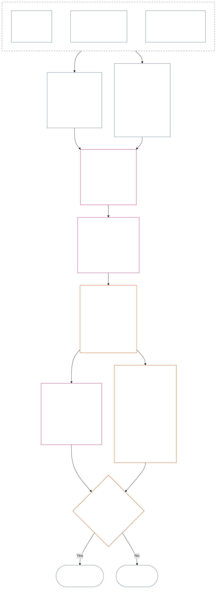

<!-- Complete unreviewed AI-assisted id translation of current Chapter Twelve; source: core_12.000_standing_measurement.md; source snapshot: a9ad713c15de3c6ba565486590518aa07c7d62fa; source SHA-256: 7ae49781f558ad90db53cdd4469dd22d8227f0a17b0c7393c3a1d2168263f59d; 2026-11-09 source refresh and 2026-11-11 committed-main row update applied. -->

# BAB DUA BELAS: PENGUKURAN STATUS — PERTANYAAN 2, SEBERAPA BAIK ATAU BURUK HAL ITU?

<strong>Letak dalam korpus (non-operatif): struktur berkas dan aturan baca</strong>

> Berkas ini **merupakan bagian dari Konstitusi Makhluk Sadar** dan **mengikat hanya jika dibaca bersama** berkas `core_*` bernomor lainnya sebagai satu teks. Isinya adalah **Bab Dua Belas** — **Pertanyaan 2** (*seberapa baik atau buruk hal itu?*): dasar LEQU dan batasnya, dimensi input pengukuran, katalog deskriptor rute, tata bahasa slot dan penskalaan bersama, input konstitusional untuk penetapan sumbu, skala LEQU proporsional terpadu, ukuran kontribusi standar, ilustrasi terapan, dan pengalihan ke Pertanyaan 3 (**§1–§9**). Kerangka tiga pertanyaan dan **Pertanyaan 1** (*apa yang terjadi?*) — fakta terverifikasi, jenis peristiwa, persyaratan catatan, kustodi catatan, dan penanganannya — terdapat di [Bab Sebelas](core_11_standing_assessment.md#chapter-eleven-standing-records--question-1-what-happened). Pertanyaan 3 (*apa akibatnya?*) berlanjut di [Bab Tiga Belas](../../core_13.000_standing_integration.md#chapter-thirteen-standing-effects-and-integration), dengan peninjauan terbatas pada penetapan pelanggaran anti-konstitusional dalam [Bab Empat Belas](../../core_14.000_misconduct_designation.md#chapter-fourteen-anti-constitutional-misconduct) untuk temuan Violation Axis `s` = 7–9 yang memenuhi syarat. Urutan baca, pemisahan bagian yang mengikat dan mendukung, serta metadata edisi korpus dipelihara dalam [README.md](README.md).

<strong>Jejak</strong>

- Hulu:
  - [Bab Sebelas §1](core_11_standing_assessment.md#1-the-three-questions) (*kerangka tiga pertanyaan*);
  - [Bab Sebelas §2](core_11_standing_assessment.md#2-question-1--what-happened) sampai [Bab Sebelas §6](core_11_standing_assessment.md#6-handling-a-standing-record) (*Pertanyaan 1 — fakta terverifikasi, Catatan Status, kustodi, dan penanganan*);
  - [Tetrad Konstitusional](core_00_preamble.md#constitutional-tetrad);
  - [Dua Tujuan Konstitusional](core_00_preamble.md#two-constitutional-aims);
  - [Prakata §6 Rantai Proses Praktis Utama](../../core_00.000_preamble.md#6-key-practical-process-pipelines) (*rantai Bab Sembilan sampai Lima Belas*).
- Subbagian dalam berkas ini:
  - [§1](#1-question-2--how-good-or-bad-was-it) (*Pertanyaan 2 — dasar LEQU, jembatan status, batas, dan cakupan*);
  - [§2](#2-magnitude-and-severity-input-dimensions) (*dimensi input pengukuran untuk kedua sumbu*);
  - [§3](#3-route-descriptor-catalogs-and-measurement-roles) (*katalog deskriptor rute*);
  - [§4](#4-slot-grammar-and-shared-scaling) (*tata bahasa slot dan penskalaan bersama*);
  - [§5](#5-constitutional-inputs-to-axis-assignment) (*pengarahan sumber konstitusional*);
  - [§6](#6-unified-proportional-lequ-scale--contribution-and-violation-axes) (*skala LEQU proporsional terpadu untuk kedua sumbu*);
  - [§7](#7-standard-contribution-measures) (*ukuran kontribusi standar yang diterbitkan pengadopsi*);
  - [§8](#8-measurement-illustrations) (*contoh pengukuran terapan*);
  - [§9](#9-hand-off-to-question-3--cross-question-measurement-hooks) (*pengalihan ke Pertanyaan 3*).
- Hilir:
  - [Bab Tiga Belas](../../core_13.000_standing_integration.md#chapter-thirteen-standing-effects-and-integration) (13.000) (*akibat dan integrasi Pertanyaan 3*);
  - [Bab Empat Belas](../../core_14.000_misconduct_designation.md#chapter-fourteen-anti-constitutional-misconduct) (14.000) (*hanya penetapan — tidak membuka kembali pengukuran Pertanyaan 2*).
- Baca bersama: [Bab Lima *Status, Kontribusi, dan Pelanggaran*](../../core_05.035_band_accountability.md#defa3-standing-state-contribution-and-violation) (5.035) (*pengarahan definisi kanonis*).

 

Bab Dua Belas adalah pemilik konstitusional **Pertanyaan 2**, yang mengukur fakta yang diverifikasi [Bab Sebelas](core_11_standing_assessment.md#chapter-eleven-standing-records--question-1-what-happened). Bab ini dimulai pada [§1 Pertanyaan 2 — seberapa baik atau buruk hal itu?](#1-question-2--how-good-or-bad-was-it). [Bab Sebelas](core_11_standing_assessment.md#chapter-eleven-standing-records--question-1-what-happened) mengatur kerangka tiga pertanyaan, Pertanyaan 1, dan Catatan Status, serta berakhir pada [Bab Sebelas §6 Penanganan Catatan Status](core_11_standing_assessment.md#6-handling-a-standing-record).

*Dalam bahasa sederhana: Bab Sebelas menetapkan apa yang terjadi dan siapa yang memegang Catatan Status. Bab ini mengukurnya: seberapa baik kontribusinya atau seberapa buruk pelanggarannya, pada dua skala terpisah yang tidak pernah dijumlahkan menjadi skor bersih. Hal yang mengikuti pengukuran dibahas di Bab Tiga Belas.*

### 1. Pertanyaan 2 — seberapa baik atau buruk hal itu?

<strong>Jejak</strong>

- Hulu: [Bab Sebelas §2](core_11_standing_assessment.md#2-question-1--what-happened) (*Pertanyaan 1 — Catatan Status dan fakta terverifikasi*); [Bab Sebelas §2.5](core_11_standing_assessment.md#25-verified-input-gate) (*gerbang input terverifikasi*); [Bab Sebelas §4](core_11_standing_assessment.md#4-standing-record-operational-requirements) (*persyaratan catatan*); [Bab Sebelas §1](core_11_standing_assessment.md#1-the-three-questions) (*kerangka tiga pertanyaan*).
- Hilir:
  - [§2](#2-magnitude-and-severity-input-dimensions) (*dimensi input pengukuran untuk kedua sumbu*);
  - [§3](#3-route-descriptor-catalogs-and-measurement-roles) (*katalog deskriptor rute*);
  - [§4](#4-slot-grammar-and-shared-scaling) (*tata bahasa slot dan penskalaan bersama*);
  - [§5](#5-constitutional-inputs-to-axis-assignment) (*pengarahan sumber konstitusional*);
  - [§6](#6-unified-proportional-lequ-scale--contribution-and-violation-axes) (*penetapan sumbu Kontribusi dan Pelanggaran*);
  - [§7](#7-standard-contribution-measures) (*ukuran kontribusi standar yang diterbitkan pengadopsi*);
  - [§8](#8-measurement-illustrations) (*contoh pengukuran*);
  - [§9](#9-hand-off-to-question-3--cross-question-measurement-hooks) (*pengalihan ke Pertanyaan 3*);
  - [Bab Tiga Belas §7.2](../../core_13.000_standing_integration.md#72-competency-bars-and-clearances) (13.000 §7.2) (*Pertanyaan 3 untuk kontribusi — delegasi yang aman*);
  - [Bab Tiga Belas §5.2](../../core_13.000_standing_integration.md#52-prevention--general-standing-locks) (13.000 §5.2) (*kunci pencegahan*);
  - [Bab Tiga Belas §6](../../core_13.000_standing_integration.md#6-lock-design-and-enforcement) (13.000 §6) (*rancangan dan penegakan kunci*).
- Baca bersama: [Bab Sebelas §4.1](core_11_standing_assessment.md#41-minimum-record-contents) (*kolom Catatan Status terverifikasi; Bab Sebelas tidak menetapkan akibat status*).

 

*Dalam bahasa sederhana: Pertanyaan 2 mengukur fakta terverifikasi dari Pertanyaan 1. Pertanyaan ini menanyakan **seberapa baik kontribusinya?** atau **seberapa buruk pelanggarannya?** Di sinilah bab ini pertama kali memperkenalkan dua sumbu pengukuran formal: **Sumbu Kontribusi** untuk bantuan terverifikasi dan **Sumbu Pelanggaran** untuk kerugian terverifikasi. Keduanya tetap terpisah; bukan dua sisi dari satu skor bersih.*

Untuk menentukan slot kontribusi atau pelanggaran seseorang, bab ini mengukur dampak menggunakan **Satuan Ekuivalen Masa Hidup (LEQU)**. Kira-kira satu LEQU setara dengan menyelamatkan atau menghancurkan seluruh masa hidup kesejahteraan satu makhluk sadar. Ini bukan soal menghitung jumlah tubuh atau dolar; yang ditanyakan ialah apakah suatu tindakan mengubah kesejahteraan komunitas konstitusional secara bermakna. Satuan yang sama berlaku bagi makhluk sadar mana pun, manusia atau bukan.

#### 1.1 Dasar LEQU

**Satuan Ekuivalen Masa Hidup** (**LEQU**) adalah satuan ringkas untuk manfaat atau kerugian konstitusional yang ekuivalen dengan satu masa hidup penuh, ketika pelaksanaan yang diadopsi memerlukan kalibrasi numerik.

- Satuan ini tidak bergantung pada substrat.
- Pengadopsi saat ini boleh menggunakan masa hidup manusia biasa sebagai contoh kalibrasi untuk konteks manusia biologis, tetapi dasar yang mengikat adalah makhluk sadar dan konstitusional, bukan spesies tertentu.

**Manfaat konstitusional ekuivalen satu masa hidup penuh** berarti manfaat terverifikasi yang sebanding dengan mempertahankan, memulihkan, atau membebaskan kesejahteraan nontrivial yang selaras dengan hak selama satu masa hidup penuh seorang makhluk sadar. **Kerugian konstitusional ekuivalen satu masa hidup penuh** berarti bahaya, pemborosan, penghancuran, penutupan pilihan, perampasan, atau realisasi risiko terverifikasi yang sebanding dengan menghancurkan, menggunakan secara keliru, atau mencegah manfaat konstitusional ekuivalen satu masa hidup penuh.

#### 1.2 Batas penggunaan LEQU

Batas berikut berlaku setiap kali LEQU digunakan.

- **Bukan aturan skor bersih:** Pelanggaran tidak dapat “dibatalkan” oleh kontribusi, ataupun sebaliknya. Setiap sumbu berdiri sendiri.
- **Bukan ukuran wajib berdasarkan kehidupan manusia:** LEQU berlaku umum bagi makhluk sadar; satuan ini berlaku bagi makhluk sadar apa pun, bukan hanya manusia.
- **Bukan ukuran tuduhan:** Tuduhan, tag penerimaan, keputusan pengalihan, reputasi, status yang tidak disukai, atau ketidaksukaan moral tidak menjadi manfaat Sumbu Kontribusi atau tingkat keparahan Sumbu Pelanggaran tanpa input terverifikasi berdasarkan **Bab Sebelas bagian 2.5** dan kalibrasi berdasarkan **bagian 6**.
- **Bukan izin untuk mempertukarkan hak:** Klaim yang dibingkai sebagai efisiensi, kapasitas produktif, inovasi, pengurangan beban, keamanan, pembalasan, tanggap darurat, atau kebutuhan institusional wajib dikurangi bobotnya atau ditolak jika bergantung pada:
  - pemaksaan;
  - pengalihan beban yang diskriminatif;
  - pengurasan ekologi;
  - pekerjaan tersembunyi tanpa bayaran;
  - ketertutupan yang dapat dihindari;
  - penyempitan Lantai Hak;
  - penguasaan;
  - proksi yang menyesatkan;
  - hilangnya kemampuan untuk menggugat; atau
  - agregasi yang tidak dapat ditinjau.

#### 1.3 Cakupan dan pengalihan khusus Pertanyaan 2

Bagian ini hanya membahas Pertanyaan 2, yaitu tahap pengukuran. Bagian ini mengambil fakta yang sudah diverifikasi (Pertanyaan 1) dan menanyakan seberapa baik kontribusi atau seberapa buruk pelanggaran tersebut.

- Mulailah dari fakta yang telah diverifikasi berdasarkan **Bab Sebelas bagian 2** dan ditulis dalam Catatan Status berdasarkan **Bab Sebelas bagian 4**, lalu ukur menggunakan dimensi dalam **bagian 2**.
- Kemudian beri tiap jenis bantuan atau kerugian nama baku dari katalog: katalog **rute manfaat** untuk bantuan (**bagian 3.1**) dan katalog **rute bahaya** untuk kerugian (**bagian 3.2**).
- Setiap nama juga menunjukkan bobot jenis bantuan atau kerugian tersebut terhadap ukuran *seberapa baik* atau *seberapa buruk*.
- Aturan tentang apa yang mengikuti manfaat ada di [sisi manfaat](../../core_13.000_standing_integration.md#72-competency-bars-and-clearances), dan aturan tentang apa yang mengikuti kerugian ada di [sisi kerugian](../../core_13.000_standing_integration.md#52-prevention--general-standing-locks).
- Pertanyaan 3 menentukan apa yang terjadi selanjutnya. Mulailah dari [Bab Tiga Belas §4 Integrasi deskriptor dan normalisasi keterikatan](../../core_13.000_standing_integration.md#4-descriptor-integration-and-attachment-normalization).

#### 1.4 Jembatan status makhluk sadar

Pengukuran status **tidak** menentukan apakah suatu entitas adalah **makhluk sadar**.

- Sengketa tentang status ditangani melalui [Ajudikasi Status Makhluk Sadar](../../core_05.055_band_participation.md#sentience-status-adjudication) dan [Pasal VI-B](core_06_rights_part_b.md#article-vi-b-sentience-status-adjudication-floor) (*Lantai Ajudikasi Status Makhluk Sadar*). Sengketa tersebut tidak ditangani melalui skor LEQU atau catatan klasifikasi.
- Selama sengketa status masih terbuka berdasarkan [Kehidupan Makhluk Sadar yang Statusnya Disengketakan](../../core_05.055_band_participation.md#contested-sentient-life), **Pasal VI-B** (*Lantai Ajudikasi Status Makhluk Sadar*) secara bawaan mencakup entitas tersebut: entitas itu tetap dapat diukur dan mengajukan Catatan Status sampai sengketa diputuskan, dan operator tidak boleh menjadikan sengketa terbuka itu sendiri sebagai alasan untuk menolak status baginya.
- Jika entitas ditetapkan sebagai [Makhluk Sadar](../../core_05.055_band_participation.md#sentient), atau statusnya dipersempit atau dipulihkan setelah ajudikasi melalui keputusan yang dapat ditinjau tersendiri:
  - subjek Catatan Status diperbarui sejak saat itu; dan
  - pengecualian yang keliru tidak boleh diberlakukan surut untuk menghapus kelayakan entitas tersebut untuk diukur selama masa antara, kecuali melalui [Ganti Rugi dan Remediasi](../../core_05.035_band_accountability.md#redress-and-remediation).

### 2. Dimensi input besaran dan tingkat keparahan

*Dalam bahasa sederhana: bagian ini menjelaskan hasil Pertanyaan 2 (**bagian 2.1**), lalu memerinci hal-hal yang perlu diperiksa saat mengukur kontribusi atau pelanggaran terverifikasi (**bagian 2.2**). Setiap sumbu diukur sendiri. Aturan penskalaan bersama ada di **bagian 4.2**, dan slot ditentukan oleh skala dalam **bagian 6**.*

Skala slot mengukur besarnya hasil konstitusional dan jenis hasilnya. Skala ini hanya menghitung hasil yang telah diverifikasi.

**Hal yang dihitung skala dan kaitannya dengan uji inti Konstitusi:**

- **[Dua Tujuan Konstitusional](core_00_preamble.md#two-constitutional-aims):** kedua sumbu mengukur dampak terhadap **Berkembang** dan **Kesinambungan**. Sumbu Kontribusi memajukannya. Sumbu Pelanggaran memundurkannya.
- **[Dua Pertanyaan Fundamental](core_00_preamble.md#two-fundamental-questions):** setiap sumbu menyediakan fakta terverifikasi untuk satu pertanyaan. Menjawab satu tidak menjawab yang lain, sehingga kedua sumbu tidak pernah dijadikan skor bersih.
  - **Pertanyaan pertama:** Sumbu Kontribusi menyediakan fakta terverifikasi. Apakah sistem memberi penghargaan atas tindakan yang membantu makhluk sadar berkembang dan bertahan, menyampaikan kebenaran, serta memperbaiki kerugian?
    - **Dihitung:** manfaat konstitusional terverifikasi, termasuk pengurangan risiko yang terverifikasi.
    - **Tidak dihitung:** hasil mentah, prestise, kekayaan, tingkat penggunaan sesuatu, kecepatan, atau besar kecilnya institusi.
  - **Pertanyaan kedua:** Sumbu Pelanggaran menyediakan fakta terverifikasi. Apakah sistem memberi penghargaan atas tindakan yang tanpa pembenaran merugikan, menyesatkan, mengecualikan, menunda, menyia-nyiakan, atau mengalihkan biaya kepada pihak lain?
    - **Dihitung:** kerugian konstitusional, bahaya, pemborosan, hilangnya pilihan, bahaya, atau peningkatan risiko yang terverifikasi.
    - **Tidak dihitung dengan sendirinya:** status yang tidak disukai, tuduhan, atau ketidaksukaan moral.
- **[Tetrad Konstitusional](core_00_preamble.md#constitutional-tetrad):**
  - **Pengawasan dan pertanggungjawaban:** “terverifikasi” berarti pelaku bernama bertanggung jawab atas temuan, dan tidak ada pihak yang memverifikasi klaimnya sendiri.
  - **Ketepatan waktu:** penundaan yang dapat dihindari dicatat sebagai fakta tersendiri, bukan digabungkan ke dalam besarnya kerugian.

#### 2.1 Hasil Pertanyaan 2

Pertanyaan 2 mencatat hal-hal berikut dalam Catatan Status untuk setiap sumbu. Ini adalah pengukuran, bukan akibat status (konsekuensi yang diputuskan Pertanyaan 3):

| **Hasil** | **Sumbu Kontribusi** | **Sumbu Pelanggaran** |
| --- | --- | --- |
| **Tempat pencatatan** | Catatan Status kontribusi. | Catatan Status pelanggaran. |
| **Slot** | Slot **Sumbu Kontribusi** tertinggi yang berlaku (`s` = 1–9). | Slot **Sumbu Pelanggaran** tertinggi yang berlaku (`s` = 1–9). |
| **Deskriptor rute** | **Deskriptor rute manfaat** yang berlaku, ditumpuk bersama. | **Deskriptor rute bahaya** yang berlaku, ditumpuk bersama. |
| **Input yang diteruskan ke Pertanyaan 3** | Input yang menetapkan titik awal pengakuan kontribusi berdasarkan [Bab Tiga Belas §7 Akibat kontribusi didahulukan](../../core_13.000_standing_integration.md#7-contribution-consequences-second). | Input yang menetapkan band kunci bawaan (titik awal tingkat ketatnya kunci) berdasarkan [Bab Tiga Belas §6 Rancangan dan penegakan kunci](../../core_13.000_standing_integration.md#6-lock-design-and-enforcement). |
| **Total LEQU** | Nilai setiap jenis manfaat yang relevan (ekologis, sistemik, atau sumber daya) secara terpisah, lalu catat satu total LEQU untuk seluruh kontribusi. | Nilai setiap jenis bahaya yang relevan (bahaya ekologis, bahaya sistemik, atau kehilangan sumber daya) secara terpisah, lalu catat satu total LEQU untuk seluruh pelanggaran. |

Pengingat: tidak satu pun dari hal ini membatalkan Catatan Status pelanggaran yang masih terbuka. Aturan tanpa pengimbangan ada di [Bab Sebelas §2.4 Catatan Status terkait dan jembatan tanpa pengimbangan](core_11_standing_assessment.md#24-linked-standing-records-and-no-offset-bridge).

#### 2.2 Dimensi input besaran kontribusi dan tingkat keparahan pelanggaran

**Pertanyaan 2 — seberapa baik atau buruk hal itu?** Untuk menentukan posisi kontribusi pada Sumbu Kontribusi atau pelanggaran pada Sumbu Pelanggaran (yakni **slot** dari 1 sampai 9), serta deskriptor manfaat atau bahaya yang berlaku, kerjakan tiga bagian. Beberapa deskriptor dapat berlaku sekaligus dan ditumpuk. Catat hasilnya dalam Catatan Status untuk sumbu tersebut, seperti dirinci dalam **bagian 2.1**. **Bagian 6** memuat skala terpadu untuk bagian 2, dan skala yang sama berlaku untuk manfaat maupun bahaya. Skala itu menjelaskan cara memperkirakan total manfaat atau kerugian dalam LEQU (Satuan Ekuivalen Masa Hidup, kira-kira kesejahteraan selama satu kehidupan penuh) dan slot untuk setiap jumlah. Pada Sumbu Kontribusi, slot dikelompokkan ke dalam empat band.

**1. Periksa cara hasil itu dihasilkan.** Kedua sumbu memperlakukannya secara berbeda:

- **Kontribusi (mutu tindakan):** hal ini dapat menambah atau membatasi manfaat yang dihitung: apakah dapat ditelusuri, apakah tidak mengalihkan biaya kepada pihak lain, apakah dilakukan dengan penuh perhatian, dan apakah sesuai dengan Konstitusi? Lima pemeriksaan ada di [§2.2.1 Cara produksi manfaat memengaruhi apa yang dihitung](#221-how-the-way-a-benefit-was-produced-affects-what-counts).
- **Pelanggaran (karakter perilaku):** dicatat terpisah dari besarnya dampak. Kewajiban, kelalaian, penipuan, penyembunyian, penghalangan akuntabilitas, paksaan, kekerasan, niat, kekejaman, dan pemungkinan struktural membentuk siapa yang bertanggung jawab, perlindungan apa yang diperlukan, dan cara merespons. Aturan bahwa tidak satu pun menggeser slot, serta aturan pencatatan masing-masing, ada di [§2.2.2 Pencatatan cara terjadinya bahaya](#222-how-the-way-a-harm-was-caused-is-recorded).

**2. Ukur besarnya: seberapa besar manfaat atau kerugiannya?** Inilah yang menentukan slot.

| **Hal yang diperiksa** | **Dampaknya** | **Lokasi aturannya** |
| --- | --- | --- |
| **Besaran keseluruhan (LEQU)** | Ukuran utama dan penentu slot. Untuk kontribusi, ini adalah total kebaikan terverifikasi yang dilakukan, dihitung dalam LEQU. Untuk pelanggaran, ini adalah total kerugian konstitusional terverifikasi. Penetapan pelanggaran Bab Empat Belas diputuskan secara terpisah. | [§6 Skala LEQU proporsional yang terpadu](#6-unified-proportional-lequ-scale--contribution-and-violation-axes) |
| **Siapa yang terdampak (berapa banyak, seberapa dalam, seberapa rentan)** | Menyesuaikan perkiraan LEQU dan tingkat pentingnya manfaat atau bahaya (materialitasnya). | [§4.2 Aturan penskalaan dampak bersama](#42-shared-impact-scaling-rules); [Materialitas](core_05_band_oversight.md#materiality) |
| **Lama dampak (durasi; daya tahan manfaat, tak dapat dipulihkannya bahaya)** | Menyesuaikan perkiraan LEQU. Untuk kontribusi, pengelolaan berkelanjutan, manfaat lintas generasi, atau perbaikan institusi yang bertahan lama mengarah ke slot atas. Untuk pelanggaran, trauma berkepanjangan, kerugian yang tak dapat dipulihkan, dan kerusakan jangka panjang terhadap kemampuan makhluk sadar bertindak mandiri meningkatkan perkiraan total kerugian. | [§4.2 Aturan penskalaan dampak bersama](#42-shared-impact-scaling-rules) |
| **Jangkauan dampak (lintas tempat atau institusi)** | Menyesuaikan perkiraan LEQU. Untuk kontribusi, misalnya manfaat lintas komunitas atau institusi, atau berskala peradaban. Untuk pelanggaran, bahaya yang menyebar lintas komunitas atau institusi, atau ke seluruh peradaban, dapat meningkatkan perkiraan total kerugian. | [§4.2 Aturan penskalaan dampak bersama](#42-shared-impact-scaling-rules) |

**3. Sebutkan jenis manfaat atau bahaya (rute).** Sebutkan cara terjadinya manfaat atau bahaya terverifikasi. Lebih dari satu dapat berlaku dan semuanya ditumpuk. Daftarnya ada dalam [**Katalog deskriptor rute manfaat**](#31-contribution-route-descriptor-catalog-and-measurement-roles) dan [**Katalog deskriptor rute bahaya**](#32-violation-route-descriptor-catalog-and-measurement-roles).

##### 2.2.1 Cara produksi manfaat memengaruhi apa yang dihitung

Periksa hal ini sebelum memilih slot Sumbu Kontribusi:

| **Temuan** | **Dampak pada manfaat** |
| --- | --- |
| Perbaikan masalah yang cepat dan terverifikasi setelah diberi tahu | Dapat dihitung sebagai **Ketekunan** (tindakan cermat dan bertanggung jawab) jika menghasilkan manfaat nyata yang dapat dibuktikan. |
| Bahaya yang dialihkan kepada pihak lain atau beban yang disembunyikan | Membatasi manfaat yang dikreditkan pada jalur yang disengketakan (rute khusus yang menerima kredit manfaat), atau meniadakannya. |
| Risiko penguasaan terverifikasi (pengaturan dapat diambil alih kepentingan sempit), ketergantungan struktural (makhluk sadar dirancang agar bergantung padanya), atau rancangan keluar dan penguncian (sulit ditinggalkan) | Membatasi kredit atas pengelolaan yang baik. |
| Perbaikan terverifikasi atas hambatan aksesibilitas atau partisipasi | Dapat meningkatkan tingkat pentingnya manfaat (materialitasnya) dan mendukung deskriptor rute manfaat **Akses dan Inklusi** berdasarkan **bagian 3.1**. |
| Imbalan signifikan yang berasal dari pengaturan insentif yang bertentangan dengan Konstitusi, perilaku antikonstitusional, atau proses yang cacat secara material | Secara default tidak dihitung sebagai manfaat. Dalam hal itu, terapkan [Bab Tiga Belas §6.4.2 Imbalan yang tidak selaras](../../core_13.000_standing_integration.md#642-misaligned-rewards) dan batas Transisi Adopsi dalam [Pasal XXVIII-A](../../core_06.020_rights_part_e.md#incentive-alignment-adoption-transition-carve-out) (*Adopsi Bertahap dan Keberlanjutan Lantai Hak*). |

##### 2.2.2 Cara pencatatan bagaimana bahaya disebabkan

Besarnya bahaya (total LEQU-nya, dari bagian 2 di atas) menentukan slot. Cara bahaya terjadi tidak menentukan slot, sehingga setiap jenis perilaku berikut dicatat tersendiri.

Subbagian ini menyatakan aturan Bab Dua Belas satu kali. **Jangan menaikkan atau menurunkan slot hanya karena peristiwa atau rangkaian perilaku dicirikan oleh salah satu hal berikut:**

- kewajiban;
- kelalaian;
- niat;
- penyembunyian;
- pengulangan;
- pemberatan;
- paksaan;
- kekerasan;
- bahaya terhadap kebebasan;
- dapat diperbaiki; atau
- konsekuensi yang diutamakan.

Fakta karakter perilaku dicatat sebagai deskriptor yang dapat ditelusuri secara terpisah. Fakta itu dapat menentukan atribusi, intensitas peninjauan, perlindungan, pemulihan, atau penetapan Bab Empat Belas. Fakta itu mencapai slot hanya melalui konsekuensi terverifikasi: jika perilaku menambah kerugian, kerugian tersebut dihitung sekali dalam total LEQU dan slot mengikuti total itu.

**Tindakan yang menambah kerugian dan dihitung sekali dalam besaran:**

| **Temuan** | **Cara mencatatnya** |
| --- | --- |
| Penundaan yang dapat dihindari dalam menanggapi atau mengeskalasi, ketika ada kewajiban dan kapasitas untuk bertindak | Dicatat sebagai fakta tindakan tersendiri. Setiap kerugian tambahan akibat penundaan dihitung satu kali dalam perkiraan LEQU. |
| Kerugian terhadap integritas forum yang diverifikasi secara independen (kerusakan terhadap keadilan forum) | Dihitung tepat satu kali dalam estimasi LEQU. Penghilangan yang tidak jujur, sengaja menggagalkan proses pengunduran diri, paksaan, bahaya terhadap kebebasan, dan fakta perilaku lainnya tetap menjadi deskriptor terpisah. |
| **Penghalangan akuntabilitas** (intervensi terverifikasi terhadap mekanisme yang memungkinkan pihak bertanggung jawab dimintai pertanggungjawaban, seperti integritas bukti, verifikasi, proses forum, catatan standing, tenggat pemulihan, atau jalur tantangan dan ganti rugi) | Tetap menjadi fakta perilaku yang dicatat terpisah. Kerugian tambahan yang ditimbulkannya di jalur terbatas dihitung sekali dalam estimasi LEQU. |

**Fakta tindakan yang dicatat terpisah dari besarnya bahaya:**

| **Temuan** | **Cara mencatatnya** |
| --- | --- |
| Penipuan, penyembunyian, pengelakan, pengulangan tindakan setelah pemberitahuan, pengabaian ceroboh, faktor pendukung struktural (menata keadaan agar bahaya mudah atau mungkin terjadi), atau penyalahgunaan ketimpangan ketergantungan besar (mengeksploitasi pihak yang sangat bergantung kepada pelaku) | Masing-masing tetap menjadi fakta tindakan tersendiri. |
| Kekerasan, pemaksaan, manipulasi, atau bahaya terhadap kebebasan | Tetap dicatat terpisah dan dapat memerlukan perlindungan lebih kuat pada slot apa pun. |
| [Kekejaman](../../core_05.035_band_accountability.md#cruelty) (penderitaan terverifikasi sebagai tujuan itu sendiri, atau bahaya serampangan atau merendahkan yang melampaui apa yang perlu dan proporsional) | Tetap menjadi fakta perilaku yang dicatat terpisah. Perlindungan yang lebih kuat dan pembatasan pemulihan yang merendahkan mungkin diperlukan berdasarkan [Bab Tiga Belas §5 Pelanggaran, koreksi, dan pencegahan](../../core_13.000_standing_integration.md#5-violation-correction-and-prevention). |

**Tanggung jawab dan atribusi:**

| **Temuan** | **Cara mencatatnya** |
| --- | --- |
| Penyebaran tanggung jawab (bagaimana tanggung jawab tersebar: siapa menjalankan peran kausal, memegang kewenangan atau kendali, dapat memperkirakan bahaya, memperoleh manfaat, menyembunyikannya, atau dapat mencegahnya) | Bukan bagian dari **cakupan makhluk sadar**, dan tidak membolehkan menyalahkan siapa pun hanya karena keanggotaan kelompok. |
| Ikut serta dalam bahaya atau tidak melawannya | Dapat mendukung temuan karakter berbasis kewajiban, memberatkan, atau akuntabilitas kolektif hanya jika keterkaitan dengan pelaku tertentu yang diwajibkan oleh **Bab Sebelas bagian 4.1 dan 4.3** telah diverifikasi. |

**Imbalan yang tidak selaras:**

| **Temuan** | **Cara mencatatnya** |
| --- | --- |
| Dengan sadar menerima atau mempertahankan imbalan signifikan yang bertentangan dengan Konstitusi, tanpa pelaporan terlindungi tepat waktu (pelaporan yang terlindung dari pembalasan) | Dicatat menurut [Bab Tiga Belas §6.4.2 Imbalan yang tidak selaras](../../core_13.000_standing_integration.md#642-misaligned-rewards), dengan tunduk pada [Pasal XXVIII-A](../../core_06.020_rights_part_e.md#incentive-alignment-adoption-transition-carve-out) (*Adopsi Bertahap dan Keberlanjutan Lantai Hak*). Hanya kerugian konstitusional terverifikasi yang ditimbulkannya memengaruhi slot. |

**Batas imbalan yang tidak selaras.** Bab ini hanya mengukur bagaimana imbalan tidak selaras yang terverifikasi (imbalan yang bertentangan dengan Konstitusi) memengaruhi Contribution Axis atau Violation Axis. [Bab Tiga Belas §6.4.2 Imbalan yang tidak selaras](../../core_13.000_standing_integration.md#642-misaligned-rewards) menetapkan kewajiban pelaporan, pengecualian, konsekuensi pelepasan imbalan (perampasan), kewajiban koreksi, dan aturan rujukan.

### 3. Katalog deskriptor rute dan peran pengukuran

*Dalam bahasa sederhana: kedua katalog di bawah menyebut jenis bantuan terverifikasi (**bagian 3.1**) dan bahaya terverifikasi (**bagian 3.2**) yang dapat dicatat dalam Catatan Status. Deskriptor menjelaskan bagaimana manfaat atau bahaya terjadi; deskriptor dapat ditumpuk dan berada di bawah slot.*

**Aturan deskriptor.** Kedua katalog di bawah, [§3.1 Katalog deskriptor rute kontribusi dan peran pengukuran](#31-contribution-route-descriptor-catalog-and-measurement-roles) dan [§3.2 Katalog deskriptor rute pelanggaran dan peran pengukuran](#32-violation-route-descriptor-catalog-and-measurement-roles), merupakan daftar resmi deskriptor bagi kedua sumbu. Deskriptor menyatakan **bagaimana** manfaat atau bahaya terverifikasi terjadi. Aturan berikut berlaku:

- Deskriptor dapat ditumpuk dan tidak saling meniadakan: satu Catatan Status dapat memuat beberapa deskriptor jika fakta terverifikasi mendukungnya.
- Deskriptor berada di bawah slot: slot menyatakan besarnya manfaat atau bahaya, sedangkan deskriptor merinci cara terjadinya tetapi tidak pernah menggantikan slot.
- Deskriptor yang tercantum adalah dasar, bukan keseluruhan daftar; katalog tidak meniadakan jenis manfaat atau bahaya lain.
- Pelaksanaan boleh memakai pengenal stabil (ID tetap milik pelaksana) yang dipetakan ke katalog, tetapi tidak boleh membuat taksonomi yang bertentangan dengan kategori eksklusif sehingga Catatan Status hanya dapat memuat satu kategori.
- Sebelum fakta diverifikasi, deskriptor yang dituduhkan dapat mendukung preservasi bukti yang sah, pengelompokan perkara, atau perlindungan sementara.
- Hanya deskriptor terverifikasi yang boleh dicatat sebagai hasil Pertanyaan 2 atau memengaruhi status.

#### 3.1 Katalog deskriptor rute kontribusi dan peran pengukuran

Inilah deskriptor rute manfaat dan hal yang diukur masing-masing dalam Pertanyaan 2 (seberapa baik hal itu?). Deskriptor dikelompokkan ke dalam lima ranah, satu tabel untuk tiap ranah; katalog Pelanggaran dalam [§3.2 Katalog deskriptor rute pelanggaran dan peran pengukuran](#32-violation-route-descriptor-catalog-and-measurement-roles) menggunakan lima ranah yang sama dalam urutan yang sama. Peran Pertanyaan 3, yaitu delegasi yang aman, ada di [Bab Tiga Belas §7.2 Kriteria kompetensi dan izin](../../core_13.000_standing_integration.md#72-competency-bars-and-clearances).

**Kelengkapan katalog.** Jika pelaksanaan menampilkan beberapa deskriptor dalam satu baris atau di bawah satu label, baris atau label tersebut harus dipetakan kembali ke setiap deskriptor yang berlaku. Katalog ini hanya menetapkan nama deskriptor dan hal yang diukur masing-masing dalam Pertanyaan 2. Aturan Pertanyaan 3 (keterikatan, pemulihan, kunci, izin, dan akibat status lainnya) hanya terdapat di Bab Tiga Belas.

##### 3.1.1 Keselamatan tubuh, hubungan, perawatan, dan agensi

| **Deskriptor rute manfaat** | **Hal yang diukur dalam Pertanyaan 2** |
| --- | --- |
| **Kedamaian tubuh, pikiran, dan/atau komunitas** | Manfaat dari ketenangan tubuh, psikologis, dan komunitas. Menyesuaikan tingkat pentingnya manfaat (materialitasnya). |
| **Hubungan yang Andal** | Manfaat hubungan yang dapat dipercaya, termasuk hubungan yang dibangun atas kewajiban kepercayaan dalam keadaan ketika kedua pihak tidak setara. |
| **Dukungan Perawatan dan Ketergantungan** | Perawatan terverifikasi bagi makhluk sadar yang bergantung pada pihak lain. Perawatan informal dihitung jika dapat dibuktikan. |
| **Akses dan Inklusi** | Manfaat dari partisipasi nyata dan aksesibilitas. Menyesuaikan tingkat pentingnya manfaat ketika satu pihak sangat bergantung pada pihak lain. |

##### 3.1.2 Perbaikan, properti, dan sumber daya

| **Deskriptor rute manfaat** | **Hal yang diukur dalam Pertanyaan 2** |
| --- | --- |
| **Manfaat remedial dan restoratif** | Manfaat dari perbaikan, kompensasi, dan pengurangan bahaya. |
| **Pengelolaan Sumber Daya yang Cermat** | Pemeliharaan sumber daya material dengan cermat dan pembagian (alokasi) yang dapat diandalkan. |

##### 3.1.3 Pengetahuan, pendidikan, catatan, dan penemuan

| **Deskriptor rute manfaat** | **Hal yang diukur dalam Pertanyaan 2** |
| --- | --- |
| **Integritas Lingkup Informasi** | Penguatan catatan, transparansi, dan komunikasi. |
| **Pendidikan dan Pengembangan Kemampuan** | Manfaat dari pembelajaran, literasi, serta peningkatan kemampuan makhluk sadar untuk bertindak mandiri. Slot mengikuti total manfaat LEQU. |
| **Kontribusi STEM dan Penemuan** | Penemuan yang dapat direproduksi pihak lain dan riset yang membuat keadaan lebih aman. |

##### 3.1.4 Sistem dan operasi konstitusional

| **Deskriptor rute manfaat** | **Hal yang diukur dalam Pertanyaan 2** |
| --- | --- |
| **Optimalisasi Sistem** | Perbaikan proses lintas institusi dan pengurangan risiko. |
| **Keselarasan Konstitusional** | Penguatan Lantai Hak dan kemudahan menggugat keputusan. |

##### 3.1.5 Ekologi dan ketekunan

| **Deskriptor rute manfaat** | **Hal yang diukur dalam Pertanyaan 2** |
| --- | --- |
| **Pengelolaan Ekologis** | Manfaat bagi habitat dan keanekaragaman hayati serta tindakan yang bertanggung jawab terhadap iklim. |
| **Ketekunan** | Pencegahan risiko yang dapat diperkirakan dan pengawasan yang kompeten. |

#### 3.2 Katalog deskriptor rute pelanggaran dan peran pengukuran

Inilah deskriptor rute bahaya dan hal yang diukur masing-masing dalam Pertanyaan 2 (seberapa buruk hal itu?). Deskriptor dikelompokkan ke dalam lima ranah, satu tabel untuk tiap ranah, menggunakan lima ranah yang sama dalam urutan yang sama dengan [§3.1 Katalog deskriptor rute kontribusi dan peran pengukuran](#31-contribution-route-descriptor-catalog-and-measurement-roles). Untuk Pertanyaan 3, aturan integrasi dan keterikatan ada di [Bab Tiga Belas §4 Integrasi deskriptor dan normalisasi keterikatan](../../core_13.000_standing_integration.md#4-descriptor-integration-and-attachment-normalization), sedangkan pencegahan dan rancangan kunci ada di [Bab Tiga Belas §5.2 Pencegahan — kunci status umum](../../core_13.000_standing_integration.md#52-prevention--general-standing-locks) dan [Bab Tiga Belas §6 Rancangan dan penegakan kunci](../../core_13.000_standing_integration.md#6-lock-design-and-enforcement).

**Kelengkapan katalog.** Jika pelaksanaan menampilkan beberapa deskriptor dalam satu baris atau di bawah satu label, baris atau label tersebut harus dipetakan kembali ke setiap deskriptor yang berlaku. Katalog ini hanya menetapkan nama deskriptor dan hal yang diukur masing-masing dalam Pertanyaan 2. Aturan Pertanyaan 3 (keterikatan, pemulihan, kunci, izin, dan akibat status lainnya) hanya terdapat di Bab Tiga Belas.

##### 3.2.1 Keselamatan tubuh, hubungan, perawatan, dan agensi

| **Deskriptor rute bahaya** | **Hal yang diukur dalam Pertanyaan 2** |
| --- | --- |
| **Perilaku Kekerasan** | Kekerasan, pemaksaan, atau bahaya terhadap kebebasan dicatat terpisah dari slot dampak LEQU. Hal ini dapat memerlukan perlindungan yang ditingkatkan. |
| **Pelanggaran Kewajiban Antarpribadi / Perawatan** | Bahaya lebih penting (materialitas lebih tinggi) ketika satu pihak sangat bergantung pada pihak lain. |
| **Pelanggaran Aksesibilitas dan Hambatan Partisipasi** | Bahaya lebih penting (materialitas lebih tinggi) ketika satu pihak sangat bergantung pada pihak lain, dan faktor yang memberatkan dapat ditumpuk di atasnya. |
| **Pelanggaran Privasi dan Kepemilikan Diri** | Faktor yang memberatkan berlaku jika penyembunyian atau eksploitasi terverifikasi, dan dapat ditumpuk. |
| **Pelanggaran Agensi dan Manipulasi** | Pemaksaan, manipulasi, atau bahaya terhadap kebebasan dicatat terpisah dari slot dampak. |

##### 3.2.2 Perbaikan, properti, dan sumber daya

| **Deskriptor rute bahaya** | **Hal yang diukur dalam Pertanyaan 2** |
| --- | --- |
| **Pelanggaran yang Dapat Dikoreksi secara Remedial** | Mencatat karakter koreksinya (apakah dan bagaimana bahaya dapat diperbaiki). Slot mengikuti total kerugian LEQU. |
| **Pelanggaran Properti** | Rute untuk kehilangan properti. Slot mengikuti total kerugian LEQU. |

##### 3.2.3 Pengetahuan, pendidikan, catatan, dan penemuan

| **Deskriptor rute bahaya** | **Hal yang diukur dalam Pertanyaan 2** |
| --- | --- |
| **Pelanggaran Lingkup Informasi** | Kerusakan terhadap Keselamatan atau Kebenaran. Penyembunyian dan penipuan tetap menjadi fakta terpisah mengenai cara bahaya disebabkan (karakternya). |
| **Pelanggaran Pendidikan** | Bahaya terhadap pembelajaran atau kemampuan makhluk sadar bertindak mandiri (kapabilitas mereka). Slot mengikuti total kerugian LEQU. |
| **Pelanggaran Riset dan Penemuan** | Bahaya terhadap riset atau penemuan. Slot mengikuti total kerugian LEQU. |

##### 3.2.4 Sistem dan operasi konstitusional

| **Deskriptor rute bahaya** | **Hal yang diukur dalam Pertanyaan 2** |
| --- | --- |
| **Pelanggaran sistemik** | Difusi (tanggung jawab tersebar di antara para pelaku) dan pemungkinan struktural dicatat secara terpisah. |
| **Pelanggaran penghalangan akuntabilitas** | Mencakup penghalangan akuntabilitas: menghalangi agar suatu bahaya dipertanggungjawabkan. Hal ini dicatat sebagai cara terjadinya bahaya. Cara penghalangan dilakukan (misalnya penyembunyian atau kelalaian) dicatat sebagai fakta terpisah. Jika slot termasuk yang tertinggi (lihat [§4.1 Tabel 1 — label tampilan slot](#41-table-1--slot-display-labels)), perkara juga dapat dicatat sebagai **Pelanggaran Antikonstitusional** agar dirujuk ke [Peninjauan Pelanggaran Antikonstitusional](../../core_05.035_band_accountability.md#anti-constitutional-misconduct-review) di Bab Empat Belas. Rujukan bukan penetapan pelanggaran antikonstitusional; Bab Empat Belas memutuskannya secara terpisah. |
| **Pelanggaran Keluar dan Penguncian** | Memuat ciri Pelanggaran Sistemik, ditambah penyebaran tanggung jawab atau penguasaan jika bersifat struktural (tertanam dalam cara kerja sistem). |
| **Pelanggaran Siklus Hidup dan Ketakterbalikan** | Ketakterbalikan memengaruhi besaran kerugian LEQU. Penyembunyian atau kelalaian tetap dicatat terpisah sebagai karakter tindakan. |
| **Pelanggaran Anti-Konstitusional** (deskriptor) | Mengirim pelanggaran pada slot tertinggi (lihat [§4.1 Tabel 1 — label tampilan slot](#41-table-1--slot-display-labels)) ke peninjauan penetapan Bab Empat Belas tanpa mengubah slot dampaknya. |

##### 3.2.5 Ekologi dan ketekunan

| **Deskriptor rute bahaya** | **Hal yang diukur dalam Pertanyaan 2** |
| --- | --- |
| **Pelanggaran Ekologis** | Kerugian LEQU diberi bobot berdasarkan hilangnya [Kapasitas Pemulihan Ekologis](../../core_05.040_band_continuity.md#ecological-recovery-capacity) (kemampuan ekosistem untuk pulih setelah bahaya). Dapat ditumpuk dengan rute kekerasan (Perilaku Kekerasan). |
| **Pelanggaran karena Kelalaian** | Kewajiban, keterdugaan, dan ketercegahan dicatat terpisah dari slot dampak. |

### 4. Tata bahasa slot dan penskalaan bersama

*Dalam bahasa sederhana: bagian ini memberi nama yang konsisten untuk sembilan kemungkinan posisi pada masing-masing dari dua sumbu terpisah dan menjelaskan penskalaan dampak di antaranya. Satu sumbu mencatat kontribusi terverifikasi; sumbu lain mencatat pelanggaran terverifikasi. Nomor slot yang sama tidak menggabungkan sumbu ataupun mengimbangi bahaya dengan bantuan. Skala terpadu dalam **bagian 6** menetapkan kedua sumbu berdasarkan dampak LEQU yang proporsional.*

Tata bahasa slot menggunakan nomor slot `s`, dari **1** sampai **9**. Setiap sumbu memiliki posisi slotnya sendiri:

- **Sumbu Kontribusi** mencatat sifat kontribusi positif; dan
- **Sumbu Pelanggaran** mencatat temuan pelanggaran terverifikasi.

Nomor slot yang sama dapat muncul pada kedua sumbu, tetapi keduanya tetap terpisah. Slot kontribusi bukan slot pelanggaran, dan slot pelanggaran bukan slot kontribusi.

#### 4.1 Tabel 1 — label tampilan slot

**Tabel 1** menamai sembilan slot dan menampilkan label Sumbu Kontribusi dan Sumbu Pelanggaran berdampingan. Tabel ini hanya menyediakan bahasa tampilan; penetapan slot dilakukan menurut skala terpadu dalam **bagian 6**.

| `s` | Label tampilan Sumbu Kontribusi | Label tampilan Sumbu Pelanggaran |
| ---: | --- | --- |
| 1 | **Kontribusi Dasar Minor** | **Dampak Konstitusional Minor** |
| 2 | **Kontribusi Dasar Kecil** | **Dampak Konstitusional Kecil** |
| 3 | **Kontribusi Positif Substansial** | **Dampak Konstitusional Substansial** |
| 4 | **Kontribusi Positif Signifikan** | **Dampak Konstitusional Signifikan** |
| 5 | **Kontribusi Positif Pengelolaan yang Serius** | **Dampak Konstitusional Serius** |
| 6 | **Kontribusi Positif Pengelolaan yang Besar** | **Dampak Konstitusional Besar** |
| 7 | **Juara yang Diakui** | **Dampak Konstitusional Berat** |
| 8 | **Juara Terhormat** | **Dampak Konstitusional Parah** |
| 9 | **Juara Teladan** | **Dampak Konstitusional Katastrofik** |

Sumbu Kontribusi menggunakan label dasar, positif, positif-pengelolaan, dan juara. Sumbu Pelanggaran menggunakan label dampak netral pada setiap slot. Kedua sumbu tetap terpisah dan tidak membentuk skor bersih atau mengizinkan pengimbangan antara Catatan Status kontribusi dan pelanggaran. Slot Sumbu Pelanggaran tidak dengan sendirinya mengklasifikasikan pelanggaran anti-konstitusional; [Bab Empat Belas](../../core_14.000_misconduct_designation.md#chapter-fourteen-anti-constitutional-misconduct) secara independen menentukan apakah penetapan pelanggaran anti-konstitusional (ACMD) melekat pada pelanggaran terverifikasi dengan `s` = 7–9.

Pelaksanaan boleh menerbitkan satuan pengukuran, metode bukti, dan contoh untuk membantu memperkirakan manfaat atau kerugian ekuivalen satu masa hidup penuh. Bahan tersebut hanya panduan dan tidak boleh mengesampingkan **bagian 6**, **Bab Satu**, atau **Lantai Hak** dalam **Bab Enam**.

#### 4.2 Aturan penskalaan dampak bersama

*Dalam bahasa sederhana: dampak tidak diukur hanya dengan menghitung orang. Manfaat atau kerugian mendalam yang memengaruhi satu makhluk sadar dapat lebih signifikan daripada dampak dangkal yang memengaruhi banyak orang. Jumlah, kedalaman, kerentanan, durasi, daya tahan, jangkauan, dan karakter konstitusional harus dinilai bersama.*

Gunakan aturan berikut untuk menafsirkan kedua sumbu dalam **bagian 6**:

| Dimensi penskalaan | Aturan bersama | Penerapan khusus sumbu |
| --- | --- | --- |
| **Besaran hasil konstitusional (LEQU)** | Nilai manfaat atau kerugian terverifikasi secara terpadu. LEQU adalah jangkar utama besaran; jumlah orang mentah, uang, hasil produksi, atau ukuran institusi bukanlah ukuran utama. | Kontribusi menghitung manfaat yang selaras dengan hak; pelanggaran menghitung kerugian konstitusional, bahaya, pemborosan, penutupan pilihan, atau bahaya terverifikasi. |
| **Cakupan makhluk sadar** | Pertimbangkan **jumlah, kedalaman, dan kerentanan secara bersama**. Tidak ada slot yang menjadikan jumlah orang sebagai persyaratan mandiri. Dampak yang cukup mendalam pada satu makhluk sadar dapat mendukung slot yang sama dengan dampak lebih luas tetapi lebih dangkal jika besaran terpadu dan kriteria lain pada baris itu setara; setiap kriteria LEQU agregat atau cakupan luas yang dinyatakan tetap wajib dipenuhi. | Ketergantungan, kapasitas yang berkurang, atau kerentanan yang tidak biasa dapat meningkatkan materialitas. Besar kelompok saja tidak menetapkan kontribusi atau tingkat keparahan. |
| **Cakupan temporal** | Pertimbangkan durasi, pengulangan, daya tahan, dan, untuk kerugian, ketakterbalikan. Peristiwa singkat tetapi transformatif dapat lebih berbobot daripada dampak kecil yang berlangsung lama; durasi saja bukan penentu. | Manfaat yang tahan lama mendukung besaran kontribusi lebih tinggi. Kerugian menetap atau tidak dapat dipulihkan mendukung tingkat keparahan pelanggaran yang lebih tinggi. |
| **Cakupan geografis atau institusional** | Jangkauan yang lebih luas dapat meningkatkan besaran, tetapi jangkauan lintas komunitas atau institusi tidak diwajibkan jika kedalaman, durasi, kerentanan, atau kekritisan konstitusional secara mandiri mendukung slot tersebut. | Perbaikan institusional dapat meningkatkan besaran kontribusi; kerusakan struktural atau sistemik dapat meningkatkan tingkat keparahan pelanggaran. |
| **Kualitas atau karakter konstitusional** | Ukur cara hasil dihasilkan terpisah dari seberapa luas penyebarannya. Jangan menghitung fakta yang sama dua kali. | Bahaya yang dieksternalisasi, beban tersembunyi, pengambilalihan, atau ketergantungan dapat membatasi atau menggugurkan kontribusi yang diklaim. Kewajiban, kelalaian, penipuan, paksaan, kekerasan, atau pemungkinan struktural tetap dicatat terpisah sebagai karakter perilaku pelanggaran. |
| **Lantai Hak dan perlindungan kritis** | Kepatuhan pada Lantai Hak tidak dipertukarkan dengan manfaat atau kerugian agregat. | Kepatuhan terhadap suatu lantai tidak dengan sendirinya menetapkan kontribusi tinggi. Kekalahan material terhadap Lantai Hak atau kegagalan perlindungan kritis dapat mendukung tingkat keparahan pelanggaran yang lebih tinggi meski hanya sedikit makhluk sadar terdampak langsung. |

Dimensi ini bukan daftar periksa yang mewajibkan setiap jenis skala. Jelaskan dimensi mana yang menentukan, mana yang tidak, dan alasannya.

- **Metode slot bersama:**
  - Perkirakan manfaat atau kerugian terverifikasi terpadu dalam LEQU berdasarkan Proporsionalitas, lalu tetapkan satu slot dengan band numerik yang mencakup besaran itu.
  - Ambang yang sama berlaku pada kedua sumbu.
  - Slot kontribusi tetap mensyaratkan dasar dan keselarasan konstitusional yang berlaku; terpenuhinya ambang numerik tidak menjadikan hasil yang membebankan biaya kepada pihak lain atau dikalahkan secara konstitusional sebagai kontribusi.
- **Pemisahan karakter:** Tumpuk deskriptor rute manfaat, rute bahaya, mutu tindakan, dan karakter tindakan yang berlaku dalam Catatan Status. Kewajiban, kelalaian, penipuan, faktor pemberat, pemaksaan, kekerasan, niat, atau faktor pendukung struktural dapat memengaruhi atribusi, perlindungan, atau akibat Pertanyaan 3, tetapi tidak satu pun menaikkan atau menurunkan slot dampak LEQU.
- **Batas Peninjauan Pelanggaran Anti-Konstitusional:** Kerugian terverifikasi pada Sumbu Pelanggaran dapat mencapai `s` = 7–9 berdasarkan dampaknya, baik pelanggaran anti-konstitusional terbukti maupun tidak. Bab Empat Belas tidak menggantikan penetapan dampak; bab itu secara independen menentukan apakah ACMD terkait melekat.

Jika bahaya belum benar-benar terjadi, catat setiap hal berikut secara terpisah:

- seberapa mungkin hal itu terjadi;
- berapa lama makhluk sadar akan terpapar;
- seberapa luas jangkauannya;
- seberapa tidak pasti perkiraannya; dan
- hasil terburuk yang masih masuk akal.

Jangan menghitung hasil terburuk itu sebagai bahaya yang sudah terjadi (kerugian LEQU), kecuali pelaksanaan yang diadopsi telah menetapkan kalibrasi risiko (metode mengubah risiko menjadi LEQU) yang dapat diperiksa siapa pun.

### 5. Input konstitusional untuk penetapan sumbu

*Dalam bahasa sederhana: sebelum memilih slot, identifikasi sumber konstitusional yang menetapkan dasar, manfaat, kewajiban, bahaya, atau pelanggaran yang diukur. Gunakan tautan di bawah untuk menerapkan sumber tersebut di lokasi kanonisnya; jangan jadikan tahap pengarahan ini skor tambahan atau pengganti definisi.*

Sebelum menetapkan slot berdasarkan **bagian 6**, Catatan Status wajib mengidentifikasi:

- dasar, kewajiban, batasan, atau kepentingan terlindungi konstitusional yang berlaku;
- ketentuan yang menetapkan manfaat terverifikasi, hasil merugikan, bahaya, atau pelanggaran yang diukur;
- definisi, prinsip, dan Pasal Lantai Hak yang secara material memengaruhi besaran atau karakter tindakan; dan
- alasan setiap sumber yang disebut berlaku serta dampaknya terhadap penetapan sumbu.

Tabel pengarahan di bawah ini tidak lengkap. Definisi, prinsip, atau Pasal tambahan yang terpicu oleh fakta terverifikasi tetap berlaku dan wajib disebutkan dalam Catatan Status. Lokasi kanonis yang ditautkan tetap mengendalikan; tabel ini tidak menyatakan ulang atau mempersempitnya.

#### 5.1 Input definisi

| Sumber kanonis | Peran pada Sumbu Kontribusi | Peran pada Sumbu Pelanggaran |
| --- | --- | --- |
| [Status, Kontribusi, dan Pelanggaran](../../core_05.035_band_accountability.md#defa3-standing-state-contribution-and-violation) | Menjelaskan apa yang dihitung sebagai kontribusi dan fakta terverifikasi mana yang dapat digunakan untuk mengukurnya. Juga memastikan Catatan Status kontribusi hanya mencatat sisi baik, tidak pernah bercampur dengan sisi buruk. | Menjelaskan apa yang dihitung sebagai pelanggaran dan cara mencatatnya. Juga mengirim perkara paling serius ke Peninjauan Pelanggaran Anti-Konstitusional, peninjauan terpisah atas tindakan yang merusak Konstitusi itu sendiri. |
| [Pertanggungjawaban](core_05_apex_accountability_leg.md#accountability) | Memeriksa apakah klaim pengelolaan atau perbaikan yang baik benar-benar membuat seseorang tetap dapat dimintai pertanggungjawaban. Tetap harus menunjukkan siapa melakukan apa, siapa yang harus menjawab, dan bagaimana hal itu dapat ditinjau, diperbaiki, serta dikoreksi sebanding dengan dampaknya. | Menemukan keadaan ketika tidak jelas siapa melakukan sesuatu atau siapa yang harus menjawab. Ini mencakup keadaan ketika tanggung jawab berhenti berfungsi setelah organisasi atau strukturnya berubah. |
| [Bahaya](../../core_05.035_band_accountability.md#harm) | Bahaya yang dialihkan kepada pihak lain atau disembunyikan dapat membatasi atau membatalkan manfaat yang diklaim. Memperbaiki bahaya dapat dihitung sebagai manfaat, tetapi hanya jika perbaikannya terverifikasi dan dibuktikan secara independen. | Merinci jenis kerusakan yang dihitung dalam pengukuran kerugian dan tingkat keparahan: langsung, tidak langsung, tertunda, kumulatif, tersebar lintas sistem, serta bahaya terhadap pikiran atau kesejahteraan emosional makhluk sadar. |
| [Materialitas](core_05_band_oversight.md#materiality) dan [Satuan Ekuivalen Masa Hidup (LEQU)](../../core_05.055_band_participation.md#lifespan-equivalent-unit-lequ) | Menetapkan besaran manfaat terverifikasi berdasarkan jangkauan, kerentanan pihak terdampak, dan durasinya. Hasilnya diukur dalam LEQU, tolok ukur bersama untuk manfaat senilai satu masa hidup penuh. | Menetapkan besaran kerugian atau bahaya terverifikasi berdasarkan jangkauan, kerentanan pihak terdampak, durasi, dan sulitnya memulihkan. Hasilnya diukur dalam LEQU, tolok ukur yang sama untuk kerugian senilai satu masa hidup penuh. |
| [Sifat Kontribusi](../../core_05.035_band_accountability.md#contribution-nature) | Menentukan apakah sesuatu dihitung sebagai kontribusi. Kontribusi harus hanya bersifat baik, tidak bercampur dengan bahaya, dan didukung Catatan Status kontribusi terverifikasi yang dapat ditunjukkan. Tanpa keduanya, penetapan Sumbu Kontribusi tidak dapat diberikan. | Tidak berperan di sini. Sifat ini tidak menentukan apa yang dihitung sebagai bahaya dan tidak pernah mengurangi keseriusan pelanggaran. |
| [Sifat Pelanggaran](../../core_05.035_band_accountability.md#violation-nature) | Tidak berperan di sini. Pelanggaran tidak pernah dihitung sebagai kontribusi negatif dan tidak menghapus manfaat terverifikasi yang tidak terkait dengannya. | Menentukan apakah sesuatu dihitung sebagai pelanggaran. Hal itu harus diklasifikasikan sebagai berbahaya dan didukung temuan terverifikasi bahwa pelanggaran terjadi. Tanpa keduanya, penetapan Sumbu Pelanggaran tidak dapat diberikan. |
| [Batasan Konstitusional](core_05_band_integrative.md#constitutional-constraint), [Tumpukan Kewenangan dan Hierarki Internal](core_05_band_integrative.md#authority-stack-and-internal-hierarchy), dan [Dapat Diaudit](core_05_band_oversight.md#auditability) | Mencegah manfaat yang diklaim dihitung jika bergantung pada pengalahkan Konstitusi, penghindaran aturannya, penyempitan Lantai Hak (perlindungan minimum yang dijamin Konstitusi), atau kepatuhan di atas kertas saja. | Menandai hal yang memengaruhi keseriusan pelanggaran: pelanggaran batas konstitusional yang penting, penempatan sesuatu di atas kewenangan Konstitusi, pengelakan aturan, atau membuat aturan mustahil ditegakkan. |
| [Dapat Diaudit](core_05_band_oversight.md#auditability) dan [Dapat Digugat](../../core_05.035_band_accountability.md#contestability) | Mensyaratkan manfaat yang diklaim dapat ditunjukkan dan diperiksa, serta tersedianya cara yang berfungsi untuk menggugatnya. | Mensyaratkan temuan yang dapat diperiksa dan digugat. Tuduhan atau label tanpa penjelasan tidak dapat menetapkan tingkat keseriusan pelanggaran. |

#### 5.2 Input prinsip

| Sumber prinsip | Peran dalam penetapan sumbu |
| --- | --- |
| [Tetrad Konstitusional](core_00_preamble.md#constitutional-tetrad), [Dua Tujuan Konstitusional](core_00_preamble.md#two-constitutional-aims), dan [taruhan material](core_00_preamble.md#material-stake) | Menetapkan empat disiplin kerja (partisipasi, pengawasan, pertanggungjawaban, dan ketepatan waktu), dua hasil tujuan Konstitusi (Berkembang dan Kesinambungan), serta kerangka untuk menyesuaikan tiap penetapan dengan hal yang dipertaruhkan. |
| [Kesejahteraan](core_01_a_values_principles.md#3-foundational-objective-wellbeing-flourishing-aim) dan [Pengakuan, Penguatan, dan Aspirasi](core_01_a_values_principles.md#32-recognition-reinforcement-and-aspiration) | Menjadi dasar manfaat yang menghormati hak dan pengakuan yang sesuai dengannya pada Sumbu Kontribusi. Prestise atau imbalan tidak pernah dianggap sebagai bukti kontribusi. |
| [Keselamatan](core_01_a_values_principles.md#4-safety-harm-constraint) dan [Kebenaran](core_01_a_values_principles.md#5-truth-epistemic-integrity-constraint) | Menetapkan batas mengikat pada kedua sumbu. Manfaat yang diperoleh melalui bahaya atau penipuan tidak dihitung sepenuhnya, dan kegagalan keselamatan atau kebenaran yang terverifikasi dapat menunjukkan besaran atau jenis pelanggaran. |
| [Pengelolaan Secara Mendalam](core_01_c_stewardship_capacity_principles.md#16-stewardship-in-depth) dan [Tata Kelola di Bawah Disiplin Pengelolaan](core_01_c_stewardship_capacity_principles.md#18-governance-under-stewardship-discipline) | Memandu penilaian kontribusi yang bertahan, kewajiban yang melekat pada peran, perbaikan institusional, pengawasan, dan tanggung jawab, setiap kali fakta terverifikasi mengharuskannya. |
| [Prinsip Pertukaran Inti](core_01_b_interaction_interpretation.md#131-core-tradeoff-principles) dan [Lantai Konstitusional, Keselamatan, dan Proses Anti-Penghinaan](core_01_b_interaction_interpretation.md#1314-constitutional-floors-safety-and-anti-degrading-process) | Berlaku ketika tindakan yang diukur menyangkut kebutuhan, pengurangan bahaya semaksimal mungkin, proporsionalitas, pertentangan antarhak, atau pembatasan. Prinsip-prinsip ini tidak pernah mengizinkan akibat dengan sendirinya. |

#### 5.3 Input Lantai Hak dan Pasal

| Sumber Pasal | Peran atau batas dalam penetapan sumbu |
| --- | --- |
| [Lantai Hak Bab Enam](core_06_rights_part_a.md#chapter-six-foundational-rights) yang berlaku secara faktual, termasuk setiap Pasal yang secara material terkait Catatan Status terverifikasi | Menetapkan perlindungan dasar, kepentingan, kewajiban, manfaat, atau pelanggaran yang dipertaruhkan. Tidak ada Pasal yang diabaikan hanya karena tidak tercantum di bawah. |
| [Pasal XIX — Status Status dan Partisipasi](core_06_rights_part_d.md#article-xix-standing-and-participation-status) | Menjaga agar hal-hal ini tetap terpisah: status makhluk sadar, martabat, perlindungan minimum Lantai Hak, status pemangku kepentingan, reputasi, dan perubahan status partisipasi selanjutnya. |
| [Pasal XIII-A — Dasar Keandalan dan Keterpercayaan](core_06_rights_part_c.md#article-xiii-a-reliability-and-trustworthiness-baseline) dan [Pasal XIII-B — Hak atas Ganti Rugi dan Pemulihan](core_06_rights_part_c.md#article-xiii-b-right-to-redress-and-remedy), [Pasal XV-B — Transparansi, Kemampuan Audit, dan Kemampuan untuk Menggugat](core_06_rights_part_c.md#article-xv-b-transparency-auditability-and-contestability), serta [Pasal XVI — Audit, Transparansi, dan Verifikasi Independen](core_06_rights_part_c.md#article-xvi-audit-transparency-and-independent-verification) | Berlaku jika manfaat atau pelanggaran terverifikasi menyangkut pencatatan yang jujur, pembagian informasi, pemeriksaan fakta, kemampuan menggugat keputusan, atau perbaikan kesalahan. |
| [Pasal XXIV — Analisis Akar Penyebab dan Respons Adaptif](core_06_rights_part_d.md#article-xxiv-root-cause-analysis-and-adaptive-response) | Berlaku jika penyebab tindakan, perbaikannya, pengulangannya, atau adaptasi respons menjadi relevan karena hal tersebut menunjukkan kedudukan tindakan menurut Konstitusi. |
| [Pasal XX — Keadilan setelah Pelanggaran Terverifikasi](core_06_rights_part_d.md#article-xx-justice-after-verified-violation) dan [Pasal XXVI-C — Penyelesaian Tepat Waktu dan Batas Anti-Penundaan](core_06_rights_part_e.md#article-xxvi-c-timely-resolution-and-anti-delay-floor) | Berlaku pada proses atau penundaan yang benar-benar melibatkan fakta. **Pasal XX** (*Keadilan setelah Pelanggaran Terverifikasi*) terutama membatasi hal yang terjadi setelah pelanggaran diukur (Pertanyaan 3). Pasal itu tidak boleh digunakan untuk menaikkan atau menurunkan slot Pertanyaan 2 demi membenarkan respons yang sudah diinginkan seseorang. |

**Batas penerapan.** Tahap ini hanya menunjukkan sumber yang tepat.

- Tahap ini tidak:
  - membuka kembali Pertanyaan 1;
  - memasukkan fakta yang belum diverifikasi;
  - menambahkan ukuran atau skor baru;
  - menghitung fakta yang sama dua kali melalui sumber berbeda;
  - menggabungkan kedua sumbu; atau
  - menjadikan setiap sumber yang tercantum berlaku bagi setiap Catatan Status.
- Kontribusi dan pelanggaran tetap diukur secara terpisah.
- Akibat berdasarkan **Pasal XX** (*Keadilan setelah Pelanggaran Terverifikasi*) berada di luar Pertanyaan 2.
- Peninjauan penetapan Bab Empat Belas tetap terpisah dari slot dampak yang ditetapkan di sini.

### 6. Skala LEQU proporsional terpadu — Sumbu Kontribusi dan Pelanggaran

<strong>Panduan pembaca (non-operatif): cara kerja progresi lima kali lipat</strong>

> Skala menggunakan progresi lima kali lipat dengan jangkar `s` = 7 = satu LEQU. Untuk kedua sumbu, besaran minimum untuk slot `s` adalah `5^(s−7)` LEQU bagi slot 2 sampai 9; slot 1 dimulai dari nol. Pelaksanaan yang diadopsi boleh menerbitkan ambang numerik dan contoh kalibrasi yang dihasilkan. Slot 1 mencakup dasar konstitusional terverifikasi pada Sumbu Kontribusi dan kerugian terverifikasi di bawah ambang positif pertama pada Sumbu Pelanggaran; tidak adanya kontribusi atau pelanggaran bukan dengan sendirinya catatan `s` = 1.
>
> **Jangkar yang dapat dipahami manusia.** Dengan masa hidup manusia 80 tahun sebagai contoh kalibrasi, baca kolom tengah ke atas sebagai manfaat ekuivalen masa hidup penuh, waktu yang dapat digunakan, atau sumber daya dan kapasitas yang selaras dengan hak yang ditambahkan; baca ke bawah sebagai kerugian, perampasan, pemborosan, atau penutupan pilihan yang ekuivalen. Jumlah sumber daya tidak dihitung dengan sendirinya — hasil konstitusional yang ditimbulkan atau dicegahnyalah yang menentukan.

 

*Dalam bahasa sederhana: **Tabel 2** menempatkan kontribusi dan pelanggaran terverifikasi pada skala dampak proporsional yang sama. Slot lebih tinggi berarti manfaat atau kerugian konstitusional terpadu yang lebih besar. Catatan Status dan sumbunya tetap terpisah: skala bersama membandingkan besaran, bukan nilai moral, dan tidak pernah mengizinkan bantuan membatalkan bahaya.*

Diagram mengikuti satu penetapan slot dari awal hingga akhir. Diagram menunjukkan urutan pengerjaan langkah, bukan urutan butir di bawah; butir tersebut menyatakan setiap aturan.

Terapkan **Proporsionalitas** untuk memperkirakan dampak LEQU terpadu berdasarkan kedalaman, cakupan makhluk sadar, kerentanan, durasi, daya tahan atau ketakterbalikan, jangkauan, dan kekritisan konstitusional. Dimensi ini membentuk perkiraan LEQU; bukan bonus slot yang berdiri sendiri.

- Gunakan **Tabel 2** setelah Pertanyaan 1 memastikan apa yang terjadi, Pertanyaan 2 mengukur manfaat atau kerugian terverifikasi, **bagian 1–3 dan 4.2** diterapkan, dan sumber konstitusional yang diwajibkan oleh **bagian 5** diidentifikasi.
- Tetapkan satu slot dari perkiraan LEQU terpadu.
  - Jelaskan pengaruh setiap dimensi penskalaan material terhadap perkiraan dan mengapa dimensi yang tidak dicantumkan tidak menentukan.
  - Setiap penetapan wajib memenuhi:
    - keterlacakan;
    - kemampuan diaudit;
    - kemampuan untuk digugat; dan
    - Lantai Hak yang berlaku.
  - Kontribusi juga wajib memenuhi persyaratan tanpa pengalihan beban kepada pihak lain dan keselarasan konstitusional.
- Catat fakta karakter perilaku sebagai deskriptor yang dapat ditelusuri secara terpisah, bukan sebagai perubahan slot (aturannya ada di [§2.2.2 Pencatatan cara terjadinya bahaya](#222-how-the-way-a-harm-was-caused-is-recorded)).
- Nilai sepenuhnya konsekuensi tindakan atau rangkaian tindakan yang terverifikasi melalui dimensi penskalaan material, termasuk:
  - cedera fisik;
  - trauma psikologis;
  - dampak pemaksaan;
  - perampasan atau bahaya terhadap kebebasan;
  - bahaya kumulatif; dan
  - manfaat atau kerugian lain yang diakui secara konstitusional.
- Jangan menyimpulkan karakter perilaku dari besaran atau menggantikan besaran terverifikasi dengan karakter perilaku.

**Tabel 2** mencantumkan sembilan slot secara berurutan. Setiap baris memberikan nomor slot `s`, besaran manfaat yang ditambahkan atau kerugian yang ditimbulkan untuk mencapai slot tersebut (dengan masa hidup manusia 80 tahun sebagai contoh kalibrasi), serta nama slot pada masing-masing sumbu. Ambang pada kedua sumbu sama, tetapi nama keduanya tetap terpisah: slot Sumbu Kontribusi dan slot Sumbu Pelanggaran adalah catatan berbeda dan tidak pernah saling mengimbangi.

| `s` | Kalibrasi manusia 80 tahun — manfaat ditambahkan / kerugian ditimbulkan | Sumbu Kontribusi | Sumbu Pelanggaran |
| ---: | --- | --- | --- |
| 1 | Kurang dari sekitar **9 hari** | **Kontribusi Dasar Minor** — pemenuhan dasar konstitusional terverifikasi untuk cakupan yang dinilai; peningkatan terukur apa pun tetap di bawah `s` = 2. | **Dampak Konstitusional Minor** — kerugian atau gangguan operasional terverifikasi di bawah `s` = 2, termasuk cacat formal tanpa bahaya substantif terbukti. |
| 2 | Sekitar **9–47 hari** | **Kontribusi Dasar Kecil** — kinerja andal dan terbatas di atas minimum dasar pada tingkat dampak ini. | **Dampak Konstitusional Kecil** — kerugian terbatas terverifikasi pada tingkat dampak ini. |
| 3 | Sekitar **47 hari–8 bulan** | **Kontribusi Positif Substansial** — manfaat yang dapat dibuktikan melampaui dasar pada tingkat dampak ini. | **Dampak Konstitusional Substansial** — kerugian substansial terverifikasi pada tingkat dampak ini. |
| 4 | Sekitar **8 bulan–3,2 tahun** | **Kontribusi Positif Signifikan** — manfaat terverifikasi yang lebih mendalam, bertahan lama, berulang, tanggap terhadap kerentanan, atau lebih luas. | **Dampak Konstitusional Signifikan** — kerugian konstitusional signifikan terverifikasi. |
| 5 | Sekitar **3,2–16 tahun** | **Kontribusi Positif Pengelolaan yang Serius** — pengelolaan, koordinasi, pemeliharaan, perbaikan, atau manfaat berkelanjutan sebanding yang tahan lama. | **Dampak Konstitusional Serius** — kerugian konstitusional serius terverifikasi. |
| 6 | Sekitar **16–80 tahun** | **Kontribusi Positif Pengelolaan yang Besar** — manfaat terverifikasi besar yang mendekati satu LEQU. | **Dampak Konstitusional Besar** — kerugian terverifikasi besar yang mendekati satu LEQU. |
| 7 | Sekitar **1–5 masa hidup** (**80–400 tahun**) | **Juara yang Diakui** — manfaat terverifikasi yang selaras dengan Konstitusi sekurang-kurangnya satu LEQU. | **Dampak Konstitusional Berat** — kerugian konstitusional terverifikasi sekurang-kurangnya satu LEQU. |
| 8 | Sekitar **5–25 masa hidup** (**400–2.000 tahun**) | **Juara Terhormat** — manfaat terverifikasi yang secara material melebihi `s` = 7. | **Dampak Konstitusional Parah** — kerugian terverifikasi yang secara material melebihi `s` = 7. |
| 9 | Sekurang-kurangnya **25 masa hidup** (**2.000+ tahun**) | **Juara Teladan** — manfaat terverifikasi yang secara material melebihi `s` = 8. | **Dampak Konstitusional Katastrofik** — kerugian terverifikasi yang secara material melebihi `s` = 8. |

<strong>Catatan interoperabilitas pelaksanaan</strong>

> Widget ini berisi materi interoperabilitas yang ditujukan bagi pelaksanaan. Materi ini mendukung kategori operatif bab tersebut; tidak membentuk sistem kategori paralel.

Kolom yang dapat dibaca mesin untuk tampilan slot (`sub_tier`, `sub_tier_display`, dan kolom tampilan terkait) ditetapkan dalam [CH06_NINE_SLOT_STANDING_SCALE.md](../../implementation/CH06_NINE_SLOT_STANDING_SCALE.md) dan [ch06_nine_slot_constants.json](../../implementation/ch06_nine_slot_constants.json). Peta empat band untuk pelaksanaan tetap merupakan alat interoperabilitas dan tidak menambahkan kolom band utama pada **Tabel 2** operatif.

Metode acuan dan contoh penetapan slot, termasuk bagi makhluk sadar yang memiliki bobot, titik pemeriksaan keadaan tersimpan, dan mortalitas yang tidak tetap, tersedia dalam [LEQU_CALIBRATION_REFERENCE.md](../../implementation/LEQU_CALIBRATION_REFERENCE.md). Contoh tersebut tidak dapat menggantikan ambang bersama dan aturan penetapan proporsional dalam **bagian 6**, tidak dapat menetapkan catatan aktif, dan tidak dapat menentukan siapa yang diperhitungkan.

Pelaksanaan yang diadopsi boleh menerbitkan perkiraan LEQU dan label tampilan berkunci. Alat bantu tersebut tidak boleh menggantikan ambang bersama dan aturan penetapan proporsional dalam **bagian 6** atau perlindungan penetapan Bab Empat Belas, kecuali melalui perubahan **dokumen yang sesuai**.

### 7. Ukuran kontribusi standar

*Dalam bahasa sederhana: untuk tugas yang berulang kali dilakukan makhluk sadar, seperti memungut sampah atau satu unit kerja pemulihan anak sungai, pengadopsi boleh menerbitkan ukuran bawaan Pertanyaan 2 agar setiap pelaksanaan terverifikasi tidak memerlukan perkiraan sendiri. Nilai bawaan adalah batas minimum, bukan plafon: pekerjaan yang terbukti menghasilkan lebih diukur berdasarkan hasilnya, sedangkan pekerjaan yang kurang diukur berdasarkan hal yang terverifikasi. Nilai bawaan diperbarui menurut jadwal terbitan, dapat digugat, dan tidak pernah menciptakan kewajiban untuk melakukan tugas itu.*

Pelaksanaan yang diadopsi boleh menerbitkan **ukuran kontribusi standar**: perkiraan bawaan Pertanyaan 2 — LEQU, cakupan, dan deskriptor rute manfaat — untuk kinerja terverifikasi atas tugas berulang yang didefinisikan dengan cakupan tertentu, seperti memungut sampah di ruas yang disebutkan, satu unit kerja pemulihan aliran air, petak pemulihan lahan, atau rotasi pemeliharaan. Standar membuat pengelolaan rutin terlihat dan layak diulangi berdasarkan [Bab Satu §3.2](core_01_a_values_principles.md#32-recognition-reinforcement-and-aspiration) (*Pengakuan, Penguatan, dan Aspirasi*) tanpa perkiraan khusus bagi setiap pelaksanaan. Standar adalah alat bantu pengukuran berdasarkan **Bab Sebelas bagian 4.5**, dan:

- **Cara menerapkan standar**
  - Standar hanya berlaku bagi pekerjaan yang diverifikasi menurut Pertanyaan 1 melalui **Bab Sebelas bagian 5**; standar tidak pernah menggantikan verifikasi bahwa tugas telah dilakukan, sesuai cakupan yang disebutkan, oleh subjek bernama.
  - Standar adalah **batas minimum untuk kinerja standar, bukan plafon**:
    - Pekerjaan yang dampak terverifikasinya melampaui dampak yang diasumsikan standar — metode yang lebih baik, hasil lebih tahan lama, beban yang lebih sedikit dialihkan kepada pihak lain, manfaat lebih luas atau mendalam — diukur berdasarkan dampak terverifikasi aktualnya menurut **bagian 4.2**, sehingga insentif untuk melakukan tugas lebih baik daripada standar tetap hidup.
    - Pekerjaan yang terbukti kurang dari cakupan atau daya tahan yang diasumsikan standar diukur berdasarkan hal yang terverifikasi, bukan label.
- **Cara memperbarui standar**
  - Standar **ditinjau ulang menurut siklus yang diterbitkan dan ditetapkan ulang saat efisiensi meningkat**, agar mencerminkan biaya dan hasil tugas saat ini, bukan membekukan upaya kemarin sebagai kredit hari ini.
  - Perubahan berlaku ke depan, dan catatan yang sudah dibuka tetap memakai dasar pengukurannya berdasarkan **Bab Sebelas bagian 4.4**, kecuali dasar itu keliru saat dicatat.
  - Perubahan wajib berbasis bukti, diterbitkan, dan dapat digugat.
  - Perubahan tidak boleh digunakan untuk menekan pengakuan atas kelas pekerjaan, komunitas, atau kelompok, ataupun menurunkan standar lebih cepat daripada peningkatan efisiensi terverifikasi yang menjadi dasarnya ([Bab Satu §19 Penyelarasan Insentif dan Penguasaan Sistem](core_01_c_stewardship_capacity_principles.md#19-incentive-alignment-and-system-capture)).
- **Perlindungan dari penyalahgunaan dan jangkauan berlebihan**
  - Standar tidak menciptakan kuota, kewajiban untuk bekerja, atau ambang kompetensi berdasarkan [Bab Tiga Belas §7.2 Ambang kompetensi dan izin](../../core_13.000_standing_integration.md#72-competency-bars-and-clearances); **Bab Sebelas bagian 2.2** *Keheningan adalah ketentuan bawaan* tetap mengendalikan, dan makhluk sadar yang tidak pernah melakukan tugas standar tidak memiliki catatan karena alasan tersebut.
  - Kantor yang menetapkan atau memperbarui standar memegang kursi arah dan kebijakan berdasarkan **Bab Sebelas bagian 5.1** *Pemisahan tugas*; kantor itu bukan kantor yang memverifikasi kinerja terhadap standar, dan bukan pula pihak yang pengakuannya diukur standar tersebut.

Standar tidak boleh mengesampingkan **bagian 6**, **Bab Satu**, atau **Lantai Hak** dalam **Bab Enam**. Metode rujukan dan jadwal contoh tersedia di [LEQU_CALIBRATION_REFERENCE.md](../../implementation/LEQU_CALIBRATION_REFERENCE.md) (*dukungan proses; tidak dapat menetapkan catatan aktif*).

### 8. Ilustrasi pengukuran

*Dalam bahasa sederhana: dua contoh terapan, **vinyet 8 dan 9**, mengukur kontribusi terverifikasi dan pelanggaran terverifikasi. Contoh tersebut tersedia bersama contoh terapan lainnya dan tidak menambahkan aturan.*

Contoh terapan ada dalam [vinyet penerapan Bab Sebelas–Lima Belas](../../corpus_joint_structure/cjs_11.105_application_vignettes.md#cjs-11105-application-vignettes), yang mengilustrasikan bab ini dan tidak menetapkan aturan:

- [Vinyet 8: Kerja sama pemulihan daerah tepian sungai (pengukuran kontribusi)](../../corpus_joint_structure/cjs_11.105_application_vignettes.md#cjs-11105-8-riparian-cooperative-restoration-contribution-measurement): kontribusi terverifikasi yang diukur dari fakta Pertanyaan 1 hingga hasil Pertanyaan 2.
- [Vinyet 9: Kelalaian pengelola daerah aliran sungai dengan hasil pengujian yang disembunyikan (pengukuran pelanggaran)](../../corpus_joint_structure/cjs_11.105_application_vignettes.md#cjs-11105-9-watershed-steward-negligence-with-concealed-test-results-violation-measurement): pelanggaran terverifikasi yang diukur dengan cara sama, beserta kontribusi terkait yang tidak mengimbanginya.

### 9. Pengalihan ke Pertanyaan 3 — kait pengukuran lintas pertanyaan

**Panduan lintas pertanyaan.** Sebagian fakta terverifikasi digunakan untuk dua pertanyaan berbeda.

- **Pertanyaan 2: seberapa baik atau buruk hal itu?** **Vinyet 8 dan 9** ([§8 Ilustrasi pengukuran](#8-measurement-illustrations)) menunjukkan pengaruh tiap fakta. Catatan Kontribusi dan Catatan Pelanggaran selalu diukur secara terpisah, dan satu tidak pernah mengimbangi yang lain ([Bab Sebelas §2.4 Catatan Status terkait dan jembatan tanpa pengimbangan](core_11_standing_assessment.md#24-linked-standing-records-and-no-offset-bridge)).
- **Pertanyaan 3: apa akibatnya?** Tabel di bawah menunjukkan fakta mana yang sama juga dapat relevan baginya.
- Suatu fakta dapat relevan bagi kedua pertanyaan, dan dapat relevan bagi satu sumbu (Kontribusi atau Pelanggaran) tanpa relevan bagi sumbu lainnya.
- Catat penggunaan fakta tersebut untuk Pertanyaan 2 dan Pertanyaan 3 secara terpisah.
  - Jangan menjumlahkannya.
  - Jangan menghitung fakta yang sama dua kali.

Fitur terverifikasi dikelompokkan berdasarkan cara Pertanyaan 2 menanganinya:

**Fakta yang juga terkait dengan kontribusi:**

| **Fitur terverifikasi** | **Pemilik Pertanyaan 2 dalam bab ini** | **Pemilik integrasi Pertanyaan 3** |
| --- | --- | --- |
| **Bahaya yang dialihkan / beban tersembunyi** | [§2.2.1 Cara produksi manfaat memengaruhi apa yang dihitung](#221-how-the-way-a-benefit-was-produced-affects-what-counts) | [Bab Tiga Belas §7.2 Ambang kompetensi dan izin](../../core_13.000_standing_integration.md#72-competency-bars-and-clearances) — dapat menghalangi atau mempersempit izin sampai diperbaiki |
| **Pemungkinan sistemik / struktural** | [§2.2.1 Dampak cara manfaat dihasilkan terhadap apa yang dihitung](#221-how-the-way-a-benefit-was-produced-affects-what-counts); [§2.2.2 Pencatatan cara terjadinya bahaya](#222-how-the-way-a-harm-was-caused-is-recorded) serta **Pelanggaran Sistemik** di [§3.2 Katalog deskriptor rute pelanggaran dan peran pengukuran](#32-violation-route-descriptor-catalog-and-measurement-roles) | [Bab Tiga Belas §7.2 Ambang kompetensi dan izin](../../core_13.000_standing_integration.md#72-competency-bars-and-clearances) dan [Bab Tiga Belas §5.2 Pencegahan — kunci standing umum](../../core_13.000_standing_integration.md#52-prevention--general-standing-locks) — perlindungan delegasi atau kunci kewenangan dalam suatu Institusi |
| **Risiko keluar / penguncian atau penutupan pilihan** | [§2.2.1 Cara produksi manfaat memengaruhi apa yang dihitung](#221-how-the-way-a-benefit-was-produced-affects-what-counts); **Pelanggaran Keluar dan Penguncian** dalam [§3.2 Katalog deskriptor rute pelanggaran dan peran pengukuran](#32-violation-route-descriptor-catalog-and-measurement-roles) | [Bab Tiga Belas §7.2 Ambang kompetensi dan izin](../../core_13.000_standing_integration.md#72-competency-bars-and-clearances) serta [Bab Tiga Belas §5.2 Pencegahan — kunci status umum](../../core_13.000_standing_integration.md#52-prevention--general-standing-locks) — perlindungan delegasi atau pemblokiran jalur keluar |
| **Perbaikan aksesibilitas / hambatan partisipasi** | **Akses dan Inklusi** dalam [§3.1 Katalog deskriptor rute kontribusi dan peran pengukuran](#31-contribution-route-descriptor-catalog-and-measurement-roles) | [Bab Tiga Belas §7.2 Ambang kompetensi dan izin](../../core_13.000_standing_integration.md#72-competency-bars-and-clearances) — pengalaman inklusif atau ambang yang dibatasi pada jalur berpintu |

**Cara bahaya disebabkan:**

| **Fitur terverifikasi** | **Pemilik Pertanyaan 2 dalam bab ini** | **Pemilik integrasi Pertanyaan 3** |
| --- | --- | --- |
| **Penghalangan pertanggungjawaban** | [§2.2.2 Cara pencatatan bagaimana bahaya disebabkan](#222-how-the-way-a-harm-was-caused-is-recorded) dan **Pelanggaran berupa Penghalangan Pertanggungjawaban** dalam [§3.2 Katalog deskriptor rute pelanggaran dan peran pengukuran](#32-violation-route-descriptor-catalog-and-measurement-roles) | [Bab Tiga Belas §5.2 Pencegahan — kunci status umum](../../core_13.000_standing_integration.md#52-prevention--general-standing-locks) dan [§6.4 Aturan khusus pelanggaran](../../core_13.000_standing_integration.md#64-special-violation-rules) — kunci yang dibatasi pada jalur berpintu; [Bab Tiga Belas §6.5 Kunci khusus](../../core_13.000_standing_integration.md#65-special-locks) (*tidak ada kunci khusus untuk kelompok fakta ini*); penetapan Bab Empat Belas hanya melalui gerbang Peninjauan Pelanggaran Anti-Konstitusional, menurut [Bab Tiga Belas §3.4 Urutan pemrosesan](../../core_13.000_standing_integration.md#34-processing-order). |
| **Kerugian terhadap integritas forum** | [§2.2.2 Cara pencatatan bagaimana bahaya disebabkan](#222-how-the-way-a-harm-was-caused-is-recorded) | [Bab Tiga Belas §6.5 Kunci khusus](../../core_13.000_standing_integration.md#65-special-locks) — akibat kunci status terhadap integritas forum |
| **Penipuan / penyembunyian / pengelakan** | [§2.2.2 Cara pencatatan bagaimana bahaya disebabkan](#222-how-the-way-a-harm-was-caused-is-recorded) | [Bab Tiga Belas §5.2 Pencegahan — kunci status umum](../../core_13.000_standing_integration.md#52-prevention--general-standing-locks) — kunci yang ditingkatkan akibat penyembunyian / pengelakan |
| **Keberlanjutan / pola / pengulangan setelah pemberitahuan** | [§2.2.2 Cara pencatatan bagaimana bahaya disebabkan](#222-how-the-way-a-harm-was-caused-is-recorded) | [Bab Tiga Belas §5.2 Pencegahan — kunci status umum](../../core_13.000_standing_integration.md#52-prevention--general-standing-locks) — kunci keberlanjutan pengulangan |
| **Kekerasan / pemaksaan / bahaya terhadap kebebasan** | [§2.2.2 Cara pencatatan bagaimana bahaya disebabkan](#222-how-the-way-a-harm-was-caused-is-recorded) dan **Perilaku Kekerasan** dalam [§3.2 Katalog deskriptor rute pelanggaran dan peran pengukuran](#32-violation-route-descriptor-catalog-and-measurement-roles) | [Bab Tiga Belas §5.2 Pencegahan — kunci status umum](../../core_13.000_standing_integration.md#52-prevention--general-standing-locks) — kunci perlindungan dan pengamanan |
| **Kekejaman** | [§2.2.2 Cara pencatatan bagaimana bahaya disebabkan](#222-how-the-way-a-harm-was-caused-is-recorded); [Kekejaman](../../core_05.035_band_accountability.md#cruelty) | [Bab Tiga Belas §5.2 Pencegahan — kunci status umum](../../core_13.000_standing_integration.md#52-prevention--general-standing-locks) — kunci perlindungan dan pengamanan; [Bab Tiga Belas §5.3 Ekspresi pertanggungjawaban publik sukarela](../../core_13.000_standing_integration.md#53-voluntary-public-accountability-expression) — ekspresi restoratif yang tidak merendahkan jika digunakan |
| **Difusi tanggung jawab atau kendali** | [§2.2.2 Pencatatan cara terjadinya bahaya](#222-how-the-way-a-harm-was-caused-is-recorded); pengaitan khusus pelaku berdasarkan [Bab Sebelas §4.1 Isi minimum catatan](core_11_standing_assessment.md#41-minimum-record-contents) dan [Bab Sebelas §4.3 Catatan kolektif dan khusus pelaku](core_11_standing_assessment.md#43-collective-and-actor-specific-records) | [Bab Tiga Belas §5.2 Pencegahan — kunci standing umum](../../core_13.000_standing_integration.md#52-prevention--general-standing-locks) — cakupan jalur terbatas yang lebih luas atau pertimbangan penyalahgunaan Institusi |
| **Partisipasi dengan membiarkan / kegagalan melawan** | [§2.2.2 Cara pencatatan bagaimana bahaya disebabkan](#222-how-the-way-a-harm-was-caused-is-recorded) | [Bab Tiga Belas §5.2 Pencegahan — kunci status umum](../../core_13.000_standing_integration.md#52-prevention--general-standing-locks) — cakupan jalur berpintu dan akibat pengulangan berkelanjutan |

**Jenis bahaya dengan deskriptor pelanggarannya sendiri:**

| **Fitur terverifikasi** | **Pemilik Pertanyaan 2 dalam bab ini** | **Pemilik integrasi Pertanyaan 3** |
| --- | --- | --- |
| **Penggagalan aksesibilitas / kerugian akibat hambatan partisipasi** | **Pelanggaran Aksesibilitas dan Hambatan Partisipasi** dalam [§3.2 Katalog deskriptor rute pelanggaran dan peran pengukuran](#32-violation-route-descriptor-catalog-and-measurement-roles) | [Bab Tiga Belas §5.2 Pencegahan — kunci status umum](../../core_13.000_standing_integration.md#52-prevention--general-standing-locks) — pemblokiran jalur partisipasi dan aksesibilitas bernama |
| **Kerugian privasi / kepemilikan diri** | **Pelanggaran Privasi dan Kepemilikan Diri** dalam [§3.2 Katalog deskriptor rute pelanggaran dan peran pengukuran](#32-violation-route-descriptor-catalog-and-measurement-roles) | [Bab Tiga Belas §5.2 Pencegahan — kunci status umum](../../core_13.000_standing_integration.md#52-prevention--general-standing-locks) — pemblokiran jalur berpintu untuk data, rupa, publikasi, atau keadaan internal |
| **Penyembunyian siklus hidup / ketakterbalikan** | **Pelanggaran Siklus Hidup dan Ketakterbalikan** dalam [§3.2 Katalog deskriptor rute pelanggaran dan peran pengukuran](#32-violation-route-descriptor-catalog-and-measurement-roles) | [Bab Tiga Belas §5.2 Pencegahan — kunci status umum](../../core_13.000_standing_integration.md#52-prevention--general-standing-locks) — pemblokiran kewenangan penerapan dan siklus hidup |

#### 9.1 Fakta yang tampak serupa tetapi harus tetap terpisah

Sebagian fakta berkaitan tetapi menjawab pertanyaan berbeda. Catat secara terpisah:

| **Fakta pertama** | **Fakta berbeda** | **Alasan pemisahannya** |
| --- | --- | --- |
| **Penundaan menanggapi atau mengeskalasi masalah awal** | **Penundaan memulai atau melaksanakan pemulihan** | Fakta pertama membantu mengukur Pertanyaan 2 berdasarkan [§2.2 Dimensi input besaran kontribusi dan tingkat keparahan pelanggaran](#22-contribution-magnitude-input-and-violation-severity-input-dimensions). Fakta kedua merupakan fakta Pertanyaan 3 yang terjadi kemudian berdasarkan [Bab Tiga Belas §10.5 Pelaksanaan tepat waktu](../../core_13.000_standing_integration.md#105-timely-implementation). |
| **Jumlah makhluk sadar yang terdampak** | **Cara tanggung jawab atau kendali tersebar di antara pelaku atau sistem** | Fakta pertama membantu mengukur besarnya manfaat atau bahaya berdasarkan [§2.2 Dimensi input besaran kontribusi dan tingkat keparahan pelanggaran](#22-contribution-magnitude-input-and-violation-severity-input-dimensions). Fakta kedua menyangkut tanggung jawab khusus pelaku, penyebaran tanggung jawab, dan kemungkinan cakupan jalur berpintu Pertanyaan 3. |

---

**Kelanjutan.** Akibat status dan integrasi berlanjut di [Bab Tiga Belas](../../core_13.000_standing_integration.md#chapter-thirteen-standing-effects-and-integration), mulai dari **bagian 1 — Akibat Status**.

---

**Berkas sebelumnya:** [core_11.000_standing_assessment.md](core_11_standing_assessment.md)

**Berkas berikutnya:** [core_13.000_standing_integration.md](core_09_standing_integration.md)
