# 第七章、A部：システム整合認証 — 評価

<strong>コーパス上の位置（非操作性）：ファイル構造と読み方</strong>

> 本ファイルは[英語第七章、A部](../../core_08_a_system_alignment_certification_evaluation.md)の**読者言語パイロット**である。**感知者憲法の拘束力ある部分ではない**。**第二の憲法ではない**。**配布版ではない**。`SC-Corpus-2026.08.09` に**固定**されている。本訳文と英語原文が食い違って見える場合、番号付きファイル [`core_07_a_system_alignment_certification_evaluation.md`](../../core_08_a_system_alignment_certification_evaluation.md) が勝つ。読み順と版のメタデータは [README.md](../../README.md) に保たれる。方法と用語表：[translations/ja/README.md](README.md)。
>
> **第七章、A部**を含む — 認証**評価**の要件（システムクラス、システム全体の要因、領域評価のフック）。**B部** — 認証記録、フォーラム過程、軌跡の橋、再開 — は [`core_07_b_system_alignment_certification_record_process.md`](core_07_b_system_alignment_certification_record_process.md) にある。
>
> - **憲法上の所管者（B部と共同）：** フォーラム監督のもとでの**システム整合認証および関連記録** — 評価の領域（A部）；認証記録の義務、認定の帰結、再検証の周期、監督の順序、争訟可能性の鎖、および第八章への検証済み入力の橋（B部）。四元の**監督**脚のもとで、SAC は他のもののなかでもとくに大きく利害の高い監査過程の一つである；監査の床は **第 XVI 条** および第五章の [監査可能性](core_05_band_oversight.md#auditability) に残る。
> - **検証基盤の所管者：** [第四章 — 証明の負担、追跡可能性、検証](core_04_burden_traceability_verification.md#chapter-four-burden-of-proof-traceability-and-verification)（第二章から第四章の内側）が、負担の割当、遵守証拠、定義の追跡可能性、観測可能性、および安全保障に制約された検証を所管する。第七章はその規律をシステム整合認証の記録に**適用する**；第四章の第 **1** 節から第 **5** 節を**再述しない**。
> - **監査の本拠（ここへ移さない）：** **第 XVI 条**（《監査、透明性、独立検証》）、**Def.O1**（《透明性、監査可能性、検証》）、および **CJS-3.3**–**CJS-3.5** が監査の床と運用用語を所管する。第七章は、それらの床を満たさなければならない、とくに大きな SAC 監査過程を一つ走らせる；すべての監査を所管しない。
> - **実施の所管者：** 指名された実施ファイルにおけるシステムクラスの取扱い、CS-5、およびフォーラム過程の詳細は、第七章と一貫したままでなければならず、コーパスがすでに、より厳しい規則の論理を提供するところでは、より厳しくてよい。
> - **再配置禁止規則：** A部は第五章の典範定義、第三章の回避防止の規律（[B部 §16](core_07_b_system_alignment_certification_record_process.md#16-reopening-drift-and-non-evasion) を見よ）、第八章の貢献または軌跡測定、または第九章の軌跡効果を再述しない。**[B部 §15](core_07_b_system_alignment_certification_record_process.md#15-relationship-to-standing)** は軌跡の橋の境界を明示する。
>
> **上流：** 第五章の定義、および第二章から第四章の記録、検証、負担、定義から結果への追跡可能性。
> **下流：** [B部](core_07_b_system_alignment_certification_record_process.md#chapter-seven-part-b-certification-record-and-process)（《記録、フォーラム過程、軌跡の橋》）；第八章の軌跡記録と検証済み入力；第九章の軌跡効果；第十一章のフォーラム監督とシステム整合認証の指名された経路。
>
> **責務ある管理の入口（非操作性）：** 拘束力ある次の一歩の声明：[操作性の責務ある管理の声明](#operative-steward-statement-sac)。[`implementation/STEWARD_ENTRY_DOORS.md`](../../implementation/STEWARD_ENTRY_DOORS.md) の支援ポインタはそれを狭められない。

>
> **前（本言語）：** [core_07_system_alignment_certification.md](core_07_system_alignment_certification.md#chapter-seven-system-alignment-certification-index)
>
> **次（この言語）：** [core_07_b_system_alignment_certification_record_process.md](core_07_b_system_alignment_certification_record_process.md#chapter-seven-part-b-certification-record-and-process)
> **読みの弧：** §1 目的と役割 → §2 システムクラス → §3 システム全体の評価 → §4–§10 領域評価

 

第七章、**A部**は、**システム整合認証の評価**の憲法上の所管者である。記録の内容、フォーラム監督、異議の経路、および軌跡の橋は **[B部](core_07_b_system_alignment_certification_record_process.md#chapter-seven-part-b-certification-record-and-process)** にある。

> **操作性の責務ある管理の声明。** **所管：** 第七章（フォーラム監督の SAC）。原則層のレンズ：第一章 §14。SAC は第 XVI 条／監査可能性のもとでの、とくに大きな監査過程の一つである — 唯一の監査ではない。**禁じられた動き：** 単体試験、プライバシーの点検表、または局所の「整合」ラベルを認証として扱うな。異議申立ての窓を飛ばすな。第五の監査の本拠を発明するな。認証の徽章や LEQU 得点を感知性の地位として扱うな。**時計：** 整合の主張の前に、影響を受ける側の異議申立ての窓を含む、争訟可能な第七章の経路を開け、または回復せよ。

### 1. 目的と役割

<strong>追跡関係</strong>

- **上流の根拠：**[前文 — 憲法上の担い手登録簿](core_00_preamble.md#4-principles-definitions-and-rights)および[権限の階層](core_05_band_integrative.md#authority-stack-and-internal-hierarchy)；[憲法四元](core_00_preamble.md#constitutional-tetrad)；[二つの憲法上の目的](core_00_preamble.md#two-constitutional-aims)；[実質的利害](core_00_preamble.md#material-stake)；[比例性](core_05_band_accountability.md#proportionality)と[実質的公正](core_05_band_participation.md#substantive-fairness)（第五章）；参加の測定群（*発言、アクセス、異議申立ての経路*）；[第一章 §16 責務ある管理を深く見る](core_01_c_stewardship_capacity_principles.md#16-stewardship-in-depth)；[第一章 §12 システム評価要件](core_01_a_values_principles.md#12-systemic-evaluation-requirement)（*一つの側面だけではなく、システム全体を評価する原則層の視点*）；第二章から第四章；[第五章](core_05__definitions_home.md#chapter-five-foundational-definitions)（*正規定義*）；[第七章 §2 四席の憲法上の床](core_07_functional_independence_segregation_of_duties.md#2-four-seat-constitutional-floor)；[システム整合認証](core_05_band_continuity.md#system-alignment-certification)（第五章の正規用語；非運用上の略称 **SAC**）；[システム認証記録](core_05_band_continuity.md#system-certification-record)（第五章での意味）。
- **下流の関係：**[§2](#2-system-class-evaluation)（*システムクラス評価*）；[B部 §9.1](core_08_b_system_alignment_certification_record_process.md#91-challenging-a-certification)（*認証への異議申立て*）；クラス別プロファイル、システム全体の適用例、各領域の例は[C部](core_08_c_system_alignment_certification_illustrations.md#chapter-eight-part-c-system-alignment-certification--illustrations)にある：[システムクラスの例示プロファイル](core_08_c_system_alignment_certification_illustrations.md#illustrative-system-class-profiles-non-exhaustive)、[クラス別システム全体の適用例](core_08_c_system_alignment_certification_illustrations.md#illustrative-whole-system-application-by-system-class-non-exhaustive)、データ取扱い[§3.4.8](core_08_c_system_alignment_certification_illustrations.md#348-illustrative-data-handling-application-by-system-class-non-exhaustive)、生態的足跡[§5.1.5](core_08_c_system_alignment_certification_illustrations.md#515-illustrative-ecological-footprint-application-by-system-class-non-exhaustive)、教育能力[§5.2.5](core_08_c_system_alignment_certification_illustrations.md#525-illustrative-educational-capability-application-by-system-class-non-exhaustive)、システム横断の支援[§5.3.8](core_08_c_system_alignment_certification_illustrations.md#538-illustrative-cross-system-support-application-by-system-class-non-exhaustive)、差別禁止[§5.4.5](core_08_c_system_alignment_certification_illustrations.md#545-illustrative-nondiscrimination-application-by-system-class-non-exhaustive)、アクセシビリティ[§5.5.6](core_08_c_system_alignment_certification_illustrations.md#556-illustrative-accessibility-application-by-system-class-non-exhaustive)、信頼可能性[§5.6.5](core_08_c_system_alignment_certification_illustrations.md#565-illustrative-trustworthiness-application-by-system-class-non-exhaustive)；[§3](#3-whole-system-certification-evaluation)（*システム全体の認証評価要因*）；[§3.4](#34-data-types-and-handling-evaluation)から[§5.6](#56-trustworthiness-and-system-reliance-integrity-evaluation)（*領域評価*）；[B部 §6](core_08_b_system_alignment_certification_record_process.md#6-forum-process)（*監督の順序と異議申立ての連鎖*）；[B部 §6.1](core_08_b_system_alignment_certification_record_process.md#61-forum-supervision-and-component-roles)（*フォーラム構成要素の役割*）；[B部 §8](core_08_b_system_alignment_certification_record_process.md#8-system-certification-record)（*認証記録の内容*）；[B部 §8.2](core_08_b_system_alignment_certification_record_process.md#82-record-integrity-transparency-and-auditability)（*記録の完全性*）；[B部 §7](core_08_b_system_alignment_certification_record_process.md#7-certification-outcomes)（*再開と回避防止*）；[B部 §10](core_08_b_system_alignment_certification_record_process.md#10-relationship-to-standing)（*軌跡記録との橋渡し*）；[第九章](core_09_standing_assessment.md#chapter-nine-contribution-violation-and-standing-model--measurement)（*軌跡記録と検証済み入力ゲート*）；[第十章](core_10_standing_integration.md#chapter-ten-standing-effects-and-integration)（*軌跡の効果と統合*）；[第十二章](core_12_forum.md#chapter-twelve-forums-and-jurisdiction)（*フォーラム監督、認証、整合認証、審査*）。
- **併読資料：**[corpus_systems.md](corpus_systems.md)、特に **CS-3 — システムの分類と取扱い**、**CS-2 — 情報の種類と取扱い**、**CS-5**（*ユーザー向け能力の接点*）；[corpus_forum.md](corpus_forum.md)、特に **CF-5**（*ルーティング、移管、認証、代表的取扱いの運用*）および **CF-7**（*完全性の保護、捕捉防止、自己判断を防ぐ支援*）；**第 XVI 条**（*監査、透明性、独立検証*）および[監査可能性](core_05_band_oversight.md#auditability)（*監査の床 — SAC は監督下にある特に大規模な監査プロセスの一つであり、監査の唯一の本拠ではない*）；**CJS-3.3**（*監督：監査可能性と再構成可能性の用語*）から**CJS-3.5**（*独立検証と主張の完全性の用語*）。

 

*平たく言えば：システムが感知者の暮らしに実際にかかわるなら、認証は**比例的**でなければならない。システムの実際の影響、依存、リスクが求める厳しさで行い、一律のチェックリストや形式的な押印にしてはならない。また、**参加型**でなければならない。影響を受ける感知者と共同体は、何が審査されたかを見て、何が決まったかを理解し、誤りがあれば異議を申し立てられなければならない。フォーラムは証拠を審査して認証記録に記載し、システムのリスクに応じた日程で再確認を求める。クラスA、B、Cには完全な手続を適用し、クラスLには簡略な手続を適用する。クラスPには手続の利用を推奨する。その影響が私的な単位を超える場合、または運用者が憲法への適合を主張する場合には、手続が必須となる。*

*認証は人気投票でも、永久通行証でも、権利審査を省く方法でもない。現時点でシステムの整合性について分かっていることを示す、期限付きで異議申立て可能な声明である。憲法四元の**監督**の柱の下では、監督に監査が必要となる。システム整合認証は、ほかにもある監査の中でも特に大規模で利害の大きいプロセスの一つであり、監査の唯一の本拠ではない（**第 XVI 条**、[監査可能性](core_05_band_oversight.md#auditability)）。*

**システム整合認証**は、定められた範囲と審査日程に関して、次の問いに答える。システムは、認証、条件付き認証、検証、再認証、継続的な依存、展開、または条件の実質的解除を正当化するのに十分な憲法上の整合性を示したか。

認証の深さ、記録の負担、再認証の頻度、利害関係者による審査、異議申立ての経路は、[比例性](core_05_band_accountability.md#proportionality)の下で[実質的利害](core_00_preamble.md#material-stake)に応じて調整する。

- 影響、依存、リスクが大きいシステムには、より強い証拠、明確な記録、実行可能な参加が必要となる。実質的なアクセシビリティ、利害関係者の意見、システムに依存する人々に応じた異議申立て経路も含む。
- クラスが低いシステムや範囲が限定されたシステムにも、正直な分類と比例的な保証が必要である。外部への影響がある場合、実質的義務の免除はない。

[CS-3 §3.5 再分類要件](corpus_systems/cs_03_a_system_classification_machinery.md#35-reclassification-requirement)に定めるとおり、この手続は影響クラスごとに適用される。

- **クラスA、B、C：**これらのシステムは影響、依存、リスクが最も大きい。適用される各層について、[§3](#3-whole-system-certification-evaluation)、[§4](#4-evaluations-where-implicated)、[§5](#5-rights-floor-and-domain-evaluations)に基づくシステム全体の評価を、完全な深さで行うことが必須である。
- **クラスL：**同じ評価が必須だが、比例的に実施する。CS-3が認める場合、標準の再確認間隔は長くし、記録は簡略化できる。
- **クラスP：**システムが有効にクラスPである間は手続の利用を推奨し、任意で利用できる。クラスL以上に再分類された場合、または運用者がシステムの憲法適合を自発的に主張した場合は必須となる。

認証は[二つの憲法上の目的](core_00_preamble.md#two-constitutional-aims)を[憲法四元](core_00_preamble.md#constitutional-tetrad)によって実施する。

- **[繁栄](core_00_preamble.md#flourishing)** — 認証または継続的な依存が、権利の床をひそかに損なったり、憲法上重要な生活への公正な参加を妨げたりしないことを確認する。
- **[継続](core_00_preamble.md#continuity)** — 健全な自然システムを消耗させるのでなく支える、持続的で後退しない供給（[生態系の完全性](core_05_band_continuity.md#ecological-integrity)、[生態系回復能力](core_05_band_continuity.md#ecological-recovery-capacity)を含む）を確認する。また、共有システムが提供を可能にしたり支えたりする場合、システムクラスに応じて再認証を行う。
- **参加** — 影響を受ける感知者と共同体が、自らに関係する審査経路を理解し、異議を申し立て、参加できる。
- **監督** — 記録、証拠、前提を独立して確認できるよう、十分に可視化し監査可能にする。認証自体はこの監督義務に基づく特に大規模な監査プロセスの一つだが、唯一のものではない。
- **説明責任** — 欠陥、誤分類、床を損なう運用を、事実が裏付ける場合に救済、条件、撤回、または軌跡記録への入力へつなぐ。
- **適時性** — 審査と異議申立ての期限を管理し、損害をまだ防止または回復できる間に認証が古くならないようにする。

監督の手段として、認証は[監査可能性](core_05_band_oversight.md#auditability)および**第 XVI 条**（*監査、透明性、独立検証*）の下にある特に大規模な監査プロセスの一つである。フォーラムの監督下で複数領域を扱い、ステータスを付与する。他の関連監査方式の結果を統合することはあっても、それらを吸収したり置き換えたりはしない。それぞれは固有の責任主体を保ち、その主体は監査プロセスの[関連監査方式の責任者一覧](corpus_joint_structure/cjs_03u_audit_process.md#sibling-audit-modes-owner-map)に示される。

- **CS-2**（*情報の種類と取扱い*）に基づくシステムデータ種類記録の監査；
- **CS-3**（*システム分類の仕組み*）に基づくシステム分類記録の監査；
- **CS-4**（*重要システムの責務ある管理*）に基づく管理保証の審査；
- **CS-5**（*設計、試験、検証、展開*）の **ACA** に基づく継続監査；
- **CS-6**（*理解可能性と複雑性の責務ある管理*）および**第 XXIII-B 条**（*複雑性監査とモジュール性要件*）に基づく複雑性監査；
- **CJS-3.5**（*独立検証と主張の完全性に関する用語*）に基づく主張の検証。

これらの確認は、認証を経ずに個別に行うこともできる。認証はそれらに取って代わらない。

#### 1.1 認証の概要

*平たく言えば：システムを正直に分類し、該当する評価を実施し、フォーラムが証拠と利害関係者の懸念を独立して審査し、結論を出す。フォーラム審査のために開かれた唯一の記録を完成させ、異議申立て経路を開いたまま公表する。認証済みシステムは、通知期間が終わり、必要な保護措置が満たされた後に限り稼働できる。実際の結果を監視し、事故と異議申立てに対応し、日程に従うか事実が変わった時点で再確認する。影響を受ける範囲の稼働を許可したり条件を解除したりする前に、欠陥を修正し、修正を独立して検証する。各審査サイクルでは前回の記録に連結した新しい記録を用いる。*

手続は**六つの段階**からなる。**I 枠組み設定**、**II 評価**、**III 審査**、**IV 決定**、**V 記録**、**VI 運用**である。第II段階は、それぞれ独立した節を持つ三つの層に分かれる。**IIa**（常時）、**IIb**（関連事項がある場合）、**IIc**（発動条件を満たす場合）である。第VI段階は、独立した節を持つ二つの副段階に分かれる。**VIa**（運用と再認証、[§9](core_08_b_system_alignment_certification_record_process.md#9-recertification-and-reopening)）と**VIb**（軌跡への橋渡し、[§10](core_08_b_system_alignment_certification_record_process.md#10-relationship-to-standing)）である。図は認証プロセス全体を順序どおりに示す。A部は最初の二段階、枠組み設定と評価を扱う。[B部](core_08_b_system_alignment_certification_record_process.md#chapter-eight-part-b-system-alignment-certification--record-and-process)は残る四段階を扱う。フォーラム手続、決定と稼働開始のゲート、記録、運用（異議申立て経路、再認証、再開、軌跡への橋渡し）である。

該当するすべての評価は、認証の各サイクルで繰り返す。初回認証時、[§2](#2-system-class-evaluation)で定めた日程に沿う再認証ごと、再開または新たに行う審査ごとである。システムへの依存の増大、共有基盤からの抽出の増加、その基盤への還元の大幅な減少、信頼できる異議申立てなど、実質的な事実が変わった場合、次回の予定された再認証より前に審査を再開する。発動条件は[B部 §9](core_08_b_system_alignment_certification_record_process.md#9-recertification-and-reopening)に列挙されている。

```mermaid
flowchart TB
    T(["実質的影響のあるシステムが認証を求める、<br/>または依存が増大する"])
    C["段階 I、枠組み設定 — §2<br/>正直に分類する<br/><br/>クラスが深さと再確認日程を決める"]
    subgraph W["段階 II、評価 — §3–§5 システム全体の評価"]
        direction LR
        Al["IIa、§3.1–§3.4 — 常時<br/><br/>システム的リスク：評価し、必要な人に開示；<br/>時間軸；ガバナンス；データ種類"]
        Im["IIb、§4 — 関連事項がある場合<br/><br/>プライバシー上の領域、退出権、<br/>集会、異議"]
        Tr["IIc、§5 — 発動時<br/><br/>適用される権利の床の確認<br/>および六つの領域評価"]
        Al ~~~ Im ~~~ Tr
    end
    F["段階 III、審査 — §6<br/>証拠と利害関係者の懸念を独立審査<br/><br/>指定されたフォーラムが所見を出す；<br/>異議申立て経路は利用可能"]
    Rec["段階 V、記録 — §8<br/>一つのシステム認証記録<br/><br/>フォーラム審査のために開き、結論、<br/>根拠となる所見、条件、運用計画を記載して完成"]
    S[["第九章 — 軌跡記録<br/><br/>本章の対象外"]]
    O{"段階 IV、決定 — §7<br/><br/>証拠はどの結論とステータスを<br/>裏付けるか？"}
    Fc["完全認証 — §7、§9.2<br/><br/>連続して必要回数の暫定再認証に合格；<br/>現在または予見される不整合がない<br/>再認証期間は長い；条件を付す場合がある"]
    Pc["暫定認証 — §7、§9.2<br/><br/>初回付与、不整合からの回復、<br/>暫定ステータスの継続または段階的引下げ<br/>再認証期間は短い；条件を付す場合がある"]
    Nc["未認証 — §7<br/><br/>延期、拒否、撤回、または失効<br/>稼働開始不可；理由と必要な是正を示す"]
    Pub["完成した記録を公表 — §7、§9.1<br/><br/>公表記録への異議申立て経路を開く；<br/>新規または拡張範囲の稼働開始と通知を示す"]
    G{"稼働開始ゲート — §7<br/><br/>認証と該当する稼働開始の<br/>前提条件は満たされたか？"}
    Hold["稼働開始の前提条件を満たす — §7<br/><br/>通知期間を終え、稼働開始前に必要な条件を<br/>独立して検証する"]
    Rm["保護し、是正する — §7、§9.2<br/><br/>影響を受ける範囲で新たに稼働させない；<br/>影響を受ける感知者を保護し、設計または運用を是正し、<br/>独立検証用の証拠を提出する"]
    Ch["段階 VIa、運用と再認証 — §9–§9.2<br/>監視し、異議申立てを開いたままにする<br/><br/>認証範囲と条件の中で運用し、<br/>結果を監視して事故や異議申立てに対応する"]
    S2[["第九章 — 軌跡記録<br/><br/>本章の対象外"]]
    Sp["&nbsp;&nbsp;&nbsp;&nbsp;&nbsp;&nbsp;&nbsp;&nbsp;&nbsp;&nbsp;&nbsp;&nbsp;&nbsp;&nbsp;&nbsp;&nbsp;&nbsp;&nbsp;&nbsp;&nbsp;&nbsp;&nbsp;&nbsp;&nbsp;&nbsp;&nbsp;&nbsp;&nbsp;&nbsp;&nbsp;&nbsp;&nbsp;&nbsp;"]
    SpL["&nbsp;&nbsp;&nbsp;&nbsp;&nbsp;&nbsp;&nbsp;&nbsp;&nbsp;&nbsp;&nbsp;&nbsp;&nbsp;&nbsp;&nbsp;&nbsp;&nbsp;&nbsp;&nbsp;&nbsp;&nbsp;&nbsp;&nbsp;&nbsp;&nbsp;&nbsp;&nbsp;&nbsp;&nbsp;&nbsp;&nbsp;&nbsp;&nbsp;&nbsp;&nbsp;"]
    SpA["&nbsp;&nbsp;&nbsp;&nbsp;&nbsp;&nbsp;&nbsp;&nbsp;&nbsp;&nbsp;&nbsp;&nbsp;&nbsp;&nbsp;&nbsp;&nbsp;&nbsp;&nbsp;&nbsp;&nbsp;&nbsp;&nbsp;&nbsp;&nbsp;&nbsp;&nbsp;&nbsp;&nbsp;&nbsp;&nbsp;&nbsp;&nbsp;&nbsp;&nbsp;&nbsp;&nbsp;&nbsp;"]
    Re["次回の審査サイクル — §9<br/><br/>再認証、再開、または新たな審査；<br/>各サイクルで前回の記録に連結した記録を新規作成"]
    T --> C
    A1((A)) --> C
    C --> W
    W --> F
    F --> O
    O --> Fc
    O --> Pc
    O --> Nc
    Fc --> Rec
    Pc --> Rec
    Nc --> Rec
    Rec -.->|VIb、§10 —<br/>検証済み入力のみ；<br/>現在の認証、または認証中に<br/>生じた事実| S
    Rec --> Pub
    Rec ~~~ Sp
    Pub --> G
    G ~~~ SpL
    G -->|未認証| Rm
    G --->|はい：記録の範囲内で<br/>運用する| Ch
    G --->|認証済み、<br/>前提条件は未充足| Hold
    Hold --> G
    Ch -->|実質的欠陥：<br/>保護し是正| Rm
    Ch -->|日程到来、または<br/>実質的変化や信頼できる異議申立てが<br/>審査を要する場合| Re
    Ch -.->|VIb、§10 —<br/>検証済み入力のみ；<br/>運用により寄与と違反の<br/>記録に関する事実が生じうる| S2
    Rm -->|是正の証拠は次回の<br/>審査サイクルで確認| Re
    S2 ~~~~ SpA
    SpA ~~~ Re
    Re --> A2((A))
    style Sp fill:none,stroke:none,color:#111111
    style SpL fill:none,stroke:none,color:#111111
    style SpA fill:none,stroke:none,color:#111111
    style T fill:none,stroke:#64748b,color:#ffffff
    style C fill:none,stroke:#16a34a,color:#ffffff
    style Ch fill:none,stroke:#16a34a,color:#ffffff
    style Al fill:none,stroke:#16a34a,color:#ffffff
    style Im fill:none,stroke:#16a34a,color:#ffffff
    style Tr fill:none,stroke:#16a34a,color:#ffffff
    style F fill:none,stroke:#ea580c,color:#ffffff
    style Rec fill:none,stroke:#2563eb,color:#ffffff
    style S fill:none,stroke:#db2777,color:#ffffff
    style S2 fill:none,stroke:#db2777,color:#ffffff
    style O fill:none,stroke:#ea580c,color:#ffffff
    style Fc fill:none,stroke:#9333ea,color:#ffffff
    style Pc fill:none,stroke:#9333ea,color:#ffffff
    style Nc fill:none,stroke:#9333ea,color:#ffffff
    style G fill:none,stroke:#ea580c,color:#ffffff
    style Pub fill:none,stroke:#2563eb,color:#ffffff
    style Rm fill:none,stroke:#9333ea,color:#ffffff
    style Hold fill:none,stroke:#16a34a,color:#ffffff
    style Re fill:none,stroke:#16a34a,color:#ffffff
    style A1 fill:none,stroke:#64748b,color:#ffffff
    style A2 fill:none,stroke:#64748b,color:#ffffff
```

<strong>読者向けガイド（非運用）：六つの段階</strong>

> | 段階 | 節 | 段階が答える問い | 場所 |
> |-------|----------|------------------------------|-----|
> | **I. 枠組み設定** | [§2](#2-system-class-evaluation) | システムはどのクラスで、どの深さと頻度で評価すべきか？ | A部 |
> | **II. 評価** | [§3](#3-whole-system-certification-evaluation)（IIa、常時）・[§4](#4-evaluations-where-implicated)（IIb、関連事項がある場合）・[§5](#5-rights-floor-and-domain-evaluations)（IIc、発動時） | システム全体は、常時、関連事項がある場合、発動条件が満たされた場合にそれぞれ何をするか？ | A部 |
> | **III. 審査** | [§6](core_08_b_system_alignment_certification_record_process.md#6-forum-process) | どの独立フォーラムが、どの順で証拠と利害関係者の懸念を審査し、その審査にはどう異議を申し立てられるか？ | B部 |
> | **IV. 決定** | [§7](core_08_b_system_alignment_certification_record_process.md#7-certification-outcomes) | フォーラムはどの結論に至り、システムは稼働できるか？ | B部 |
> | **V. 記録** | [§8](core_08_b_system_alignment_certification_record_process.md#8-system-certification-record) | フォーラム審査のために開かれた唯一の記録は、結論、根拠となる所見、条件、運用計画を備え、監査可能か？ | B部 |
> | **VI. 運用** | [§9](core_08_b_system_alignment_certification_record_process.md#9-recertification-and-reopening)（VIa、運用と再認証）・[§10](core_08_b_system_alignment_certification_record_process.md#10-relationship-to-standing)（VIb、軌跡への橋渡し） | 誰が結果を監視し事故や異議申立てに応じるか、是正はどう検証されるか、審査はいつ繰り返され、軌跡記録へ何が渡るか？ | B部 |
>
> **クラスA、B、C**の例示プロファイルと、システムクラスが本章全体の認証深度をどう調整するかは、[システムクラスの例示プロファイル（非網羅）](core_08_c_system_alignment_certification_illustrations.md#illustrative-system-class-profiles-non-exhaustive)に示す。[§3](#3-whole-system-certification-evaluation)から[§5.6](#56-trustworthiness-and-system-reliance-integrity-evaluation)までの各評価領域について、同じ三つのシステムを使った詳細な適用例を[Part C — 例示](core_08_c_system_alignment_certification_illustrations.md#chapter-eight-part-c-system-alignment-certification--illustrations)に続けて示す。各プロファイルと例示は、それが説明するA部の節にリンクしている。

 

### 2. システムクラスの評価

<strong>追跡関係</strong>

- **上流：**[§1](#1-purpose-and-role)（*目的と役割*）；統合的な重要性（[重要性](core_05_band_oversight.md#materiality)）；[憲法四元](core_00_preamble.md#constitutional-tetrad)；[二つの憲法上の目的](core_00_preamble.md#two-constitutional-aims)；[物質的影響](core_05_band_oversight.md#material-impact)、[依存](core_05_band_continuity.md#dependency)、[リスク](core_05_band_continuity.md#risk)、[システム境界](core_05_band_continuity.md#system-boundaries)、[憲章](core_05_band_continuity.md#charter)（第五章）；[第一章 §12 システム評価要件](core_01_a_values_principles.md#12-systemic-evaluation-requirement)；**第III-A条**（*生存*）および**第IV-A条**（*分類がアクセスを左右する場合の権利の床の実現*）；**第V-A条**（*依存関係のマッピングと資源フローの透明性*）および**第V-B条**（*認証が共有インフラへの依存を左右する場合の資源配分と依存関係の管理*）。
- **下流：**[§2.1](#21-how-system-class-scales-every-evaluation)（*システムクラスに応じた参加と比例性*）；[§2.2](#22-pilot-certification)（*パイロット認証*）；[C部のシステムクラスプロファイルと再分類](core_08_c_system_alignment_certification_illustrations.md#illustrative-system-class-profiles-non-exhaustive)（*システムクラスの例示プロファイル*）；[C部のシステム全体の適用例](core_08_c_system_alignment_certification_illustrations.md#illustrative-whole-system-application-by-system-class-non-exhaustive)；データ取扱いの例[§3.4.8](core_08_c_system_alignment_certification_illustrations.md#348-illustrative-data-handling-application-by-system-class-non-exhaustive)、生態的足跡[§5.1.5](core_08_c_system_alignment_certification_illustrations.md#515-illustrative-ecological-footprint-application-by-system-class-non-exhaustive)、教育能力[§5.2.5](core_08_c_system_alignment_certification_illustrations.md#525-illustrative-educational-capability-application-by-system-class-non-exhaustive)、システム横断の支援[§5.3.8](core_08_c_system_alignment_certification_illustrations.md#538-illustrative-cross-system-support-application-by-system-class-non-exhaustive)、差別禁止[§5.4.5](core_08_c_system_alignment_certification_illustrations.md#545-illustrative-nondiscrimination-application-by-system-class-non-exhaustive)、アクセシビリティ[§5.5.6](core_08_c_system_alignment_certification_illustrations.md#556-illustrative-accessibility-application-by-system-class-non-exhaustive)、信頼可能性[§5.6.5](core_08_c_system_alignment_certification_illustrations.md#565-illustrative-trustworthiness-application-by-system-class-non-exhaustive)；[§3.4](#34-data-types-and-handling-evaluation)（*データ取扱いの共同評価*）；[§5.1](#51-ecological-footprint-evaluation)（*生態的足跡の評価*）；[§5.3](#53-proportionate-cross-system-support-evaluation)（*比例的なシステム横断支援の評価*）；[B部 §8.2](core_08_b_system_alignment_certification_record_process.md#82-record-integrity-transparency-and-auditability)（*記録の完全性*）；[B部 §10](core_08_b_system_alignment_certification_record_process.md#10-relationship-to-standing)（*検証済み入力のゲート*）；[B部 §7](core_08_b_system_alignment_certification_record_process.md#7-certification-outcomes)（*分類のずれと再分類の発動条件*）。
- **併読：**[システム分類記録](core_05_band_continuity.md#system-classification-record)；[corpus_systems.md](corpus_systems.md)、**CS-3 — システムの分類と取扱い**、特に[**CS-3 §3.5 再分類要件**](corpus_systems/cs_03_a_system_classification_machinery.md#35-reclassification-requirement)（*発動条件、システムクラスに応じた評価の深さ、SAC検証の橋渡し*）および[**CS-3 §7**](corpus_systems/cs_03_a_system_classification_machinery.md#cs-37-classification-governance-disclosure-and-challenge)（*分類のガバナンス、開示、異議申立て*）— システム分類記録のガバナンス義務とSACの橋渡し；[CS-5 — 設計、試験、検証、展開](corpus_systems/cs_05_design_testing_verification_deployment.md)；[CJS-3.21 — 敵対的堅牢性と悪用耐性の用語](corpus_joint_structure/cjs_03c_continuity_operations.md#cjs-321-continuity-adversarial-robustness-and-abuse-resistance-terms)（*回帰試験と強化サイクルの義務*）；[corpus_forum.md](corpus_forum.md)、**CF-7.2**（*憲法上の整合性認証と審査*）。

 

*平たく言えば：認証では、運用者が何と呼ぶかではなく、システムが実際に何をするか、何がシステムに依存するか、何がうまくいかなくなる可能性があるかに基づいて、正直に分類されているかを確認しなければならない。システムクラスが高いほど、より厳格な証拠、より頻繁な再確認、より高い回復力が求められる。[C部 — 例示](core_08_c_system_alignment_certification_illustrations.md#chapter-eight-part-c-system-alignment-certification--illustrations)では各クラスのシステム例と、それぞれに評価を適用する方法を示す。*

実質的影響を持つシステムの認証記録にはすべて、その**システムクラス**の評価を含めなければならない。

詳細な規則は[corpus_systems.md](corpus_systems.md)、[CS-3 — システムの分類と取扱い](corpus_systems/cs_03_a_system_classification_machinery.md)、[CS-5 — 設計、試験、検証、展開](corpus_systems/cs_05_design_testing_verification_deployment.md)に定められている。これらは次の事項を規定する。

- システムクラスの種類、クラスの割当方法、各クラスのプロファイル；
- 分類のガバナンス方法；
- 各システムクラスが必要とする保証の程度；
- インフラに必要な堅牢性；
- どの確認と記録を、クラスに応じたどの予定で再認証するか、暫定認証と完全認証によってその予定がどう変わるか。

本節では認証が何を検証すべきかを示す。

認証では次の事項を検証しなければならない。

- **評価要件：**
  - 割り当てられたシステムクラスが、CS-3（*システム分類の仕組み*）に基づく観測済みおよび合理的に予見可能な**影響**、**依存**、**リスク**を反映しているか。これには次が含まれる。
    - 集約効果；
    - 相互作用による効果；
    - 敵対的な効果；
    - しきい値による効果；
  - 分類が実際のシステム動作と影響によって決められており、次の事項だけに基づいていないか。
    - 表明された意図；
    - 名目上の範囲；
    - [憲章](core_05_band_continuity.md#charter)の文言だけ；または
    - 自己説明だけ；
  - 重大な変化が求めるたびに、**[CS-3 §3.5 再分類要件](corpus_systems/cs_03_a_system_classification_machinery.md#35-reclassification-requirement)**に沿ってクラスを再確認したか；および
  - [システム分類記録](core_05_band_continuity.md#system-classification-record)が、現状で適用される**最も高いシステムクラス**を示しているか。
- **保証と回帰試験：**
  - クラスに応じた保証、インフラの堅牢性、回帰試験の範囲が、割り当てられたクラスに合っているか。これは次に従う。
    - CS-3（*システム分類の仕組み*）；および
    - CS-5（*ユーザー向け能力の接点*）。実質的に該当する場合、以下の共通運用用語と併せて読む。
      - [**CJS-3.19**](corpus_joint_structure/cjs_03c_continuity_operations.md#cjs-319-continuity-graceful-degradation-and-failure-mode-integrity-terms)（*継続性：段階的縮退と故障モードの完全性*）；
      - [**CJS-3.20**](corpus_joint_structure/cjs_03c_continuity_operations.md#cjs-320-continuity-reversibility-and-containment-terms)（*継続性：可逆性と封じ込め*）；
      - [**CJS-3.21**](corpus_joint_structure/cjs_03c_continuity_operations.md#cjs-321-continuity-adversarial-robustness-and-abuse-resistance-terms)（*継続性：敵対的堅牢性と悪用耐性*）；および
      - [**CJS-3.22**](corpus_joint_structure/cjs_03i_integrative_operations.md#cjs-322-integrative-constrained-secrecy-and-protected-investigation-terms)（*統合性：制約された秘密保持と保護された調査*）および[**CJS-3.23**](corpus_joint_structure/cjs_03i_integrative_operations.md#cjs-323-integrative-intervention-and-override-integrity-terms)（*統合性：介入とオーバーライドの完全性*）。システムのクラスや機能によって実質的に該当する場合に適用する；かつ
  - CS-5（*ユーザー向け能力の接点*）が要求する各再認証で回帰試験を実施したか、その結果を[§8.1 記録の最低限の内容](core_08_b_system_alignment_certification_record_process.md#81-minimum-record-contents)に基づき記録に残したか。
- **認証と再認証：**
  - CS-5（*ユーザー向け能力の接点*）の*フォーラム認証とライフサイクル審査*が求める、認証サイクル用の認証・審査証拠パッケージが存在するか；
  - 記録上の認証ステータスが、[B部 §9.2 暫定認証と完全認証](core_08_b_system_alignment_certification_record_process.md#92-provisional-and-full-certification)に従って裏付けられているか。
    - 完全認証は、次の場合に限る。
      - 問題のない連続再認証の最低回数を満たす；
      - 現在、不整合がない；かつ
      - 監視指標が不整合の差し迫りを示していない；
    - 最後の再認証に失敗したシステムには暫定認証を適用する；および
  - 基本的な権利の床の保護を提供する、またはそれに依存するシステムについて：
    - 再確認の頻度と再試験の深さが、[二つの憲法上の目的](core_00_preamble.md#two-constitutional-aims)における**継続**の目的にかなうか。すなわち、不可欠なものが時間の経過後も感知者に届き続けるか；
    - 古くなった、または早すぎる認証を、感知者が今日実際に食料、水、住居、教育、安全を得ている証明として扱わないか。
- **誤分類と欠陥：**
  - CS-3（*システム分類の仕組み*）と[B部 §7](core_08_b_system_alignment_certification_record_process.md#7-certification-outcomes)に基づく認証の欠陥は、些細な事務上の誤りではなく、次を含む。
    - システムにふさわしいクラスより低いリスククラスを主張する；
    - 厳しい規則を避けるためにシステムを分割する；または
    - 状況が変わった後も古いシステムクラス表示を維持すること。これには**[CS-3 §3.5 再分類要件](corpus_systems/cs_03_a_system_classification_machinery.md#35-reclassification-requirement)**に基づく再評価を怠ることも含む；
  - CS-5（*ユーザー向け能力の接点*）に基づく認証の欠陥には次が含まれる。
    - 回帰試験を省く；
    - 古い結果に依存する；
    - 既知の不具合を未修正のままにする；または
    - 再試験が可能だったのに、重大な修正を再試験せず受け入れる；かつ
  - システムが認証され、事実が裏付ける場合、同じ分類上の問題は[第九章](core_09_standing_assessment.md#chapter-nine-contribution-violation-and-standing-model--measurement)の不利益な軌跡判断にも考慮されることがある。

これらの欠陥の結果は[B部 §7 認証の結果](core_08_b_system_alignment_certification_record_process.md#7-certification-outcomes)に定める。

#### 2.1 システムクラスが各評価をどのように調整するか

システムクラスは、本章の各評価をどの深さで実施するかを定める。[§3 システム全体の認証評価](#3-whole-system-certification-evaluation)の全体的要因、[§3.4 データの種類と取扱いの評価](#34-data-types-and-handling-evaluation)、[§5 権利の床と領域別評価](#5-rights-floor-and-domain-evaluations)の個々の評価が対象となり、再実施の頻度も定める。

- 高いクラスのシステムには、該当する各評価を実際に実施した（単に実施したと主張したのではない）ことを示す、より強い証拠が比例的に求められる。
- 低いクラスでも、発動条件が該当する場合は、正直で比例的な評価が必要である。
- システムクラスは、必須の評価を省略することを決して許さない。実際の役割がクラスを超えたシステムは、[§9 再認証と再開](core_08_b_system_alignment_certification_record_process.md#9-recertification-and-reopening)に従って再分類し、より高い深さで再評価しなければならない。
- システムクラスは審査の深さを決める。書面上だけの資格、表示、配慮や、内容を誰も確認できない評価・決定で済ませてよいことにはならない。

参加と比例性の要件も同様に調整される。

- **クラスA**のシステムには、実行可能な限り最も強い参加経路が必要である。誤りは、救済が可能になる前に生存に不可欠なものへのアクセスを閉ざすおそれがあるからである。これには次が含まれる。
  - アクセス可能な異議申立て；
  - 利害関係者による審査；および
  - [B部 §6.1 フォーラムの監督と構成要素の役割](core_08_b_system_alignment_certification_record_process.md#61-forum-supervision-and-component-roles)に基づき、影響を受ける利害に割り当てられたフォーラム群の所見。この節が求める場合、制度的または感知者フォーラムを含む。
- **クラスB**のシステムには、システムが次へのアクセスを左右する場合、強固な参加が必要である。
  - 医療；
  - 教育；
  - 給付；
  - 仕事；または
  - 同程度に日常生活にかかわるもの。
- **クラスC**のシステムにも、異議申立て可能な記録と比例的な開示が必要である。特に、調整の影響が次のいずれかに当たる場合。
  - 保護対象集団に負担を課す；
  - 依存を集中させる；または
  - クラスBまたはAへの引上げを予告する。

#### 2.2 パイロット認証

**[パイロット](core_05_band_continuity.md#pilot)**は[稼働開始](core_05_band_continuity.md#go-live)に当たるため、開始前に独自の認証が必要である。[B部 §7 認証の結果](core_08_b_system_alignment_certification_record_process.md#7-certification-outcomes)の稼働開始規則に従う。

- どのシステムクラスのシステムにも、全面展開前にパイロットを実施することが期待される。実施しない場合は、その理由を記録に残す。
- パイロットにも正直な分類と発動条件に該当するすべての評価が必要であり、範囲、対象集団、期間を記録に記載する。
- パイロットは独自の記録に基づき評価する。評価の深さは、システムクラスと代替可能性に応じて定める。影響を受ける、または依存する感知者にとって実行可能な代替手段があるか、またその費用、遅延、機能の損失がどれほどかを確認する（[依存](core_05_band_continuity.md#dependency)を参照）。
  - 置き換えが容易でクラスが低いほど、パイロット評価を軽くできる。
  - 容易に置き換えられないシステムのパイロットは、全面展開時にそのクラスが求める深さで評価する。

### 3. システム全体の認証評価

<strong>追跡関係</strong>

- **上流：**[第一章 §12 システム評価要件](core_01_a_values_principles.md#12-systemic-evaluation-requirement)；繁栄の測定群（*ウェルビーイング、安全、害、生存の床へのアクセス*）；憲法上の実績の測定群（*憲法上の効率、回避可能な負担、生産能力*）；[憲法四元](core_00_preamble.md#constitutional-tetrad)；[二つの憲法上の目的](core_00_preamble.md#two-constitutional-aims)；[実質的利害](core_00_preamble.md#material-stake)；[§1 目的と役割](#1-purpose-and-role)。
- **下流：**[C部のシステム全体の適用例](core_08_c_system_alignment_certification_illustrations.md#illustrative-whole-system-application-by-system-class-non-exhaustive)；[§3.4](#34-data-types-and-handling-evaluation)から[§5.6](#56-trustworthiness-and-system-reliance-integrity-evaluation)（*領域評価*）；[C部のシステムクラスプロファイル](core_08_c_system_alignment_certification_illustrations.md#illustrative-system-class-profiles-non-exhaustive)；[B部 §8](core_08_b_system_alignment_certification_record_process.md#8-system-certification-record)（*記録内容*）；[B部 §8.2](core_08_b_system_alignment_certification_record_process.md#82-record-integrity-transparency-and-auditability)（*記録の完全性*）；[B部 §6](core_08_b_system_alignment_certification_record_process.md#6-forum-process)（*異議申立ての連鎖*）；[B部 §7](core_08_b_system_alignment_certification_record_process.md#7-certification-outcomes)（*再開と回避防止*）。
- **併読：**[第一章 §16](core_01_c_stewardship_capacity_principles.md#16-stewardship-in-depth)、[§18](core_01_c_stewardship_capacity_principles.md#18-governance-under-stewardship-discipline)、[§19](core_01_c_stewardship_capacity_principles.md#19-incentive-alignment-and-system-capture)；[第一章 §7.4 自発的停止、重大な自己変更、退出権](core_01_a_values_principles.md#74-voluntary-discontinuation-and-exit-rights)；[第一章 §7.2 集会、集団的組織化、制度形成](core_01_a_values_principles.md#72-assembly-collective-organization-and-institutional-formation)；監査、透明性、独立検証の権利の床が実質的に関わる場合の**第 XVI 条**（*監査、透明性、独立検証*）；継続性の測定群（[§3.1](#31-systemic-scope-and-risk-factors) — レジリエンス、可逆性、システムリスク）；[リスク評価](core_05_band_continuity.md#risk-evaluation)；[リスク開示](core_05_band_oversight.md#risk-disclosure)；[公的監督の基礎開示](core_05_band_oversight.md#public-oversight-baseline-disclosure)；参加の測定群（[§4.1](#41-privacy-informational-joint-invocation) — プライバシーとデータの責務ある管理）；説明責任の測定群（[§3.3](#33-governance-incentive-and-contestability-discipline) — インセンティブの整合と市場の争訟可能性）；[システム境界](core_05_band_continuity.md#system-boundaries)；[憲章](core_05_band_continuity.md#charter)。
- **小節：**[§3.1](#31-systemic-scope-and-risk-factors)から[§3.4](#34-data-types-and-handling-evaluation)（*常時：システム要因、時間軸、ガバナンス、データの種類と取扱い*）。第II段階は[§4 関連する場合の評価](#4-evaluations-where-implicated)（*関連する場合：プライバシー上の領域、退出権、集会と異議*）および[§5 権利の床と領域別評価](#5-rights-floor-and-domain-evaluations)（*発動条件を満たす場合*）に続く。

 

*平たく言えば：システムの一部分だけを承認して、残りを無視することはできない。審査担当者は全体像を把握する必要がある。システムが何に依存しているか、上流の何かが壊れたとき下流で何が壊れるか、後から現れる害や時間とともに積み重なる害、感知者が実際に使えるか（書類上だけではなく）、個人情報が適切に保護されているか、感知者が閉じ込められずに離れられるか、システムに分断されずに集団が組織化できるか、短期的な利益が長期的な損害を覆い隠していないか、そして利害が大きい場面でも実効的な監督と説明責任が機能するかである。*

*適用例：[C部](core_08_c_system_alignment_certification_illustrations.md#illustrative-whole-system-application-by-system-class-non-exhaustive)は本節の実際の適用を示す。システムクラスごとに一つ、計三つの例示システムを取り上げ、上記の確認を順に適用する。*

認証評価が即時的または局所的な影響しか考慮しない場合、システム整合認証の評価は不完全である。この不足を補うシステム全体の評価（第II段階）は三つの層からなり、各層は独立した節で扱い、下表に示す。本節は第一層の **IIa** を定める。[§4 関連する場合の評価](#4-evaluations-where-implicated)は **IIb** を、[§5 権利の床と領域別評価](#5-rights-floor-and-domain-evaluations)は **IIc** を定める。表は読者の道案内であり、どの節・小節の要件も追加、限定、並べ替えしない。

| 層 | 副段階 | 節 | 適用対象 |
|------|-----------|----------|---------|
| **常時** | IIa | [§3.1 システム範囲とリスク要因](#31-systemic-scope-and-risk-factors)；[§3.2 時間的一貫性の制約](#32-time-consistency-constraint)；[§3.3 ガバナンス、インセンティブ、争訟可能性の規律](#33-governance-incentive-and-contestability-discipline)；[§3.4 データの種類と取扱いの評価](#34-data-types-and-handling-evaluation) | 実質的影響のあるすべての認証記録 |
| **関連する場合** | IIb | [§4.1 プライバシー（情報）の共同適用](#41-privacy-informational-joint-invocation)；[§4.2 自発的停止、重大な自己変更、退出権](#42-voluntary-discontinuation-major-self-modification-and-exit-rights)；[§4.3 集会、集団的組織化、制度形成](#43-assembly-collective-organization-and-institutional-formation)、[§4.3.1](#431-dissent-and-peaceful-protest)を含む | 認証対象が小節で名指しされた領域または原則に実質的に関わる場合 |
| **発動条件を満たす場合** | IIc | [§5 権利の床と領域別評価](#5-rights-floor-and-domain-evaluations) | §5の表にある発動条件が満たされた場合 |

認証記録には、以下の要因が次の事項に実質的に関係する範囲で、評価において考慮されたことを示さなければならない。

- 認証；
- 検証；
- 再認証；
- 依存の継続；
- 展開；または
- 認証に付された条件の解除。

評価では、審査対象システムについて[実質的利害](core_00_preamble.md#material-stake)に応じて[憲法四元](core_00_preamble.md#constitutional-tetrad)が調整されることも確認しなければならない。

#### 3.1 システム範囲とリスク要因

認証評価では、次を考慮しなければならない。

- **依存関係と連鎖的影響** — 上流の何かが壊れたとき、下流で何が機能しなくなるか；
- **集積と規模の影響** — 多数の小さな行為が組み合わさると何が変わるか；
- **遅延、累積、確率的な影響** — 後から現れる、積み重なる、または偶然に左右される害；
- **敵対的な状況と悪用可能性** — 悪意ある行為者や予測可能な悪用がシステムをどう利用しうるか；
- **憲章上の範囲と機能上の境界** — 存在する、または必要な[憲章](core_05_band_continuity.md#charter)が観察された[システム境界](core_05_band_continuity.md#system-boundaries)に合致するか、また明示された範囲が実質的影響や依存を過小評価していないか；
- **生態系の回復能力** — システムが、どの規模であれ自然生態系の[生態系回復能力](core_05_band_continuity.md#ecological-recovery-capacity)を損ない、被害の後に再生できなくするおそれがあるか；
- **存亡に関わるリスク** — 文明規模で感知者の生存を脅かしうる結果。

**リスク評価と開示の橋渡し。** 上記要因のもとでシステム[リスク](core_05_band_continuity.md#risk)が対象となる場合、認証では第五章の二つ一組の要件を両方とも確認しなければならない。独立した名称付きリスク開示記録という新種を作ってはならない。

- **[リスク評価](core_05_band_continuity.md#risk-evaluation)** — 依存、時間軸、[敵対的・大規模・悪用された状況](core_05_band_oversight.md#adversarial-scaled-and-exploited-conditions)など重要な条件の下で、システムクラスと[実質的利害](core_00_preamble.md#material-stake)に応じた規模でシステムリスクを実際に評価したか；および
- **[リスク開示](core_05_band_oversight.md#risk-disclosure)** — 評価されたリスクが、それを理解し、異議を申し立て、行動する必要のある感知者に間に合うよう伝わったか。

片方だけでは要件を満たさない。

- 評価されたが一度も共有されないリスクは不合格；および
- 共有されたが適切に評価されていないリスクも不合格。

**欠陥と不整合。** 次の各事項は認証上の欠陥として扱わなければならない。

- 内部メモ、埋もれた付録、チェックリスト、事後の説明を評価または開示の代わりとみなすこと；
- [透明性](core_05_band_oversight.md#transparency)または[安全性（憲法上の制約）](core_05_band_continuity.md#safety-constitutional-constraint)が求める場合に、評価されたシステムリスクを知る必要のある人々に開示しないこと；または
- 既知のリスクが記録、開示、対処されていないまま、システムへの依存継続を承認すること。

その帰結は[§7 認証結果](core_08_b_system_alignment_certification_record_process.md#7-certification-outcomes)に定める。

#### 3.2 時間的一貫性の制約

予見可能な中長期の違反が未解決の場合、認証は短期指標、局所的な遵守、短期効率だけで十分とみなしてはならない。累積、遅延、またはシステム間の状況下で、短期最適化が**安全性**、**真実**、**ウェルビーイング**の制約に対する中長期の違反を予見可能に生み出す場合、その最適化は無効である。

#### 3.3 ガバナンス、インセンティブ、争訟可能性の規律

*平たく言えば：審査担当者が、リスクの程度に応じて[四元](core_00_preamble.md#constitutional-tetrad)の四つの柱が維持されるかを確かめるまでは審査は完了しない。参加（感知者が実際に参加できるか）、監督（作業を見て確認できるか）、説明責任（不正に対して責任を問えるか）、適時性（重要なときに決定が十分速く進むか）である。また、実質的権限を実際に誰が持ち、誰が何に答えるのかを把握しなければならない。曖昧な「チーム」や責任転嫁のための殻では足りない。有効な認証には、これらへの回答が必要である。*

評価が、審査対象システムについて**監督**、**説明責任**、**参加**、**適時性**が[実質的利害](core_00_preamble.md#material-stake)に応じて調整されるかを評価しなければ、認証評価は不完全である。実質的な責務ある管理、ガバナンス、説明責任の役割が、説明責任と実行可能な異議申立て経路が機能する程度に**正式に割り当てられ、文書化され、追跡可能**かどうかも確認しなければならない。調整はシステムクラスと実質的影響に応じ、**[corpus_systems.md](corpus_systems.md)、CS-3 — システムの分類と取扱い**に従う。

この規律のため、認証では次を読む。

- **[第一章 §16 責務ある管理を深く見る](core_01_c_stewardship_capacity_principles.md#16-stewardship-in-depth)** — 分散した理解、透明性、監査可能性、異議申立て可能な観察可能性；
- **[第一章 §18 責務ある管理の規律に基づくガバナンス](core_01_c_stewardship_capacity_principles.md#18-governance-under-stewardship-discipline)** — 責務ある管理の規律の下での正当なガバナンスと説明責任；
- **[第一章 §19 インセンティブの整合とシステムの捕捉](core_01_c_stewardship_capacity_principles.md#19-incentive-alignment-and-system-capture)** — インセンティブの整合、代理指標の完全性、短期的欠陥の是正、捕捉への対応；
- **[第一章 §19.1.4 役割の深さと実質的責任の経路](core_01_c_stewardship_capacity_principles.md#1914-role-depth-and-material-responsibility-pathways)** — 重大な役割の経路と象徴的参加を防ぐ規律；
- **[第十三章 §5 正当な役割、能力開発、貢献](core_13_governance.md#5-authorized-roles-competency-development-and-contribution)および[corpus_systems.md](corpus_systems.md)、CS-4 — 重要システムの責務ある管理** — 実質的に関連する場合の役割定義、能力、追跡可能性に関する運用上の床；
- **[第 XVI 条：監査、透明性、独立検証](core_06_rights_part_c.md#article-xvi-audit-transparency-and-independent-verification)** — 監査、透明性、独立検証の権利の床が実質的に関わる場合。

#### 3.4 データの種類と取扱いの評価

<strong>追跡関係</strong>

- **上流：**[§3](#3-whole-system-certification-evaluation)（*システム全体評価の要因*）；[C部のシステム全体の適用例](core_08_c_system_alignment_certification_illustrations.md#illustrative-whole-system-application-by-system-class-non-exhaustive)；[B部 §8](core_08_b_system_alignment_certification_record_process.md#8-system-certification-record)（*記録内容*）；[§2](#2-system-class-evaluation)（*システムクラス評価*）；監督の測定群（*憲法上の測定としての真実と認識上の完全性*）；[第XV条：情報圏の完全性](core_06_rights_part_c.md#article-xv-info-sphere-integrity)；[第XVI条：監査、透明性、独立検証](core_06_rights_part_c.md#article-xvi-audit-transparency-and-independent-verification)；[第VII条：自己所有](core_06_rights_part_b.md#article-vii-self-ownership)。
- **下流：**[§3.4.8](core_08_c_system_alignment_certification_illustrations.md#348-illustrative-data-handling-application-by-system-class-non-exhaustive)（*データ取扱いの適用例*）；[§5.1](#51-ecological-footprint-evaluation)および[§5.1.5](core_08_c_system_alignment_certification_illustrations.md#515-illustrative-ecological-footprint-application-by-system-class-non-exhaustive)（*生態的足跡の評価と適用例*）；[B部 §8.2](core_08_b_system_alignment_certification_record_process.md#82-record-integrity-transparency-and-auditability)（*記録の完全性*）；[B部 §10](core_08_b_system_alignment_certification_record_process.md#10-relationship-to-standing)（*検証済み入力のゲート*）；[B部 §7](core_08_b_system_alignment_certification_record_process.md#7-certification-outcomes)（*再分類と取扱いの不整合*）。
- **併読：**[corpus_systems.md](corpus_systems.md)、**CS-2 — 情報の種類と取扱い**（[**CS-2 §5.2**](corpus_systems/cs_02_a_information_types_and_handling.md#52-reclassification-and-lifecycle-governance)（*再分類とライフサイクル・ガバナンス*）および[**CS-2 §8**](corpus_systems/cs_02_a_information_types_and_handling.md#cs-28-system-data-types-record-governance)（*システムデータ種類記録のガバナンス*）を含む）；[システムデータ種類記録](core_05_band_continuity.md#system-data-types-record)；[公的監督の基礎開示](core_05_band_oversight.md#public-oversight-baseline-disclosure)；実質的に該当する場合の **CJS-3.18**（*データ保持とライフサイクル完全性の用語*）、**CJS-3.21**（*敵対的堅牢性と悪用耐性の用語*）、**CJS-3.17**（*相互運用性、可搬性、退出の完全性の用語*）；プライバシー領域が関わる場合の[§4.1 プライバシー（情報）の共同適用](#41-privacy-informational-joint-invocation)。
- **小節：**[§3.4.1](#341-type-o-baseline-disclosure)（*Type O 基礎開示*）；[§3.4.2](#342-privacy-discipline)（*プライバシーの規律*）；[§3.4.3](#343-protective-storage-and-key-custody)（*保護的保管と鍵の管理*）；[§3.4.4](#344-periodic-data-type-re-evaluation)（*データ種類の定期再評価*）；[§3.4.5](#345-system-class-scaled-infrastructure-assurance)（*システムクラスに応じたインフラ保証*）；[§3.4.6](#346-infrastructure-robustness-for-data)（*データのインフラ堅牢性*）；[§3.4.7](#347-defects-and-misalignment)（*欠陥と不整合*）；[§3.4.8](core_08_c_system_alignment_certification_illustrations.md#348-illustrative-data-handling-application-by-system-class-non-exhaustive)（*システムクラス別データ取扱いの適用例*）。

 

*平たく言えば：認証では、システムがどの種類のデータに触れ、それを適切に扱っているかも確認する。現在の審査サイクルで種類の分類が正しいか、基盤インフラがそのデータとシステムクラスに十分な強度を持つかも含む。種類の規則とシステムデータ種類記録はシステム・コーパスにある。認証では規則が実際に適用され、記録が正確かを確認する。*

システム整合認証は、実質的影響のあるすべての認証記録の一部として、**データの種類と取扱い**を評価しなければならない。本節では認証が検証すべき事項を定める。種類の分類体系と取扱いの仕組みは**[corpus_systems.md](corpus_systems.md)、CS-2 — 情報の種類と取扱い**にあり、以下を含む。

- 情報の種類に関する正規定義；
- 取扱い規則と分離要件；
- ライフサイクルの詳細；および
- 永続的な[システムデータ種類記録](core_05_band_continuity.md#system-data-types-record)。

**評価要件。** 認証プロセスでは、システムが次を行っているか判定しなければならない。

- 実質的に対象となるデータの種類を特定している；および
- 変換、集約、委任、保存、保持、領域横断リンクを含め、**適用される最も厳格な**分類に従ってデータを扱っている。

評価はラベル、形式、パイプライン段階だけでなく、機能上の効果を反映しなければならない。

##### 3.4.1 Type O 基礎開示

**[CS-2 パートA §7 Type O 基礎](corpus_systems/cs_02_a_information_types_and_handling.md#cs-27-type-o-baseline-for-class-abc-systems)**が適用される場合、認証では公開された[公的監督の基礎開示](core_05_band_oversight.md#public-oversight-baseline-disclosure)（**Type O**）が**認証済み範囲**を網羅しているかも確認しなければならない。範囲は次から対応づける。

- 適用される[憲章](core_05_band_continuity.md#charter)（または同等の公開範囲文書）；
- 割り当てられたシステムクラス；および
- 観察された[システム境界](core_05_band_continuity.md#system-boundaries)。

システムリスクが問題となる場合、評価済みリスクの共有もこの基礎に算入できる。公衆の基礎的権利は認証より広く、[システム分類記録](core_05_band_continuity.md#system-classification-record)や[システムデータ種類記録](core_05_band_continuity.md#system-data-types-record)に加えて別の記録を求めるものではない。

正当な非開示にはそれぞれ、合理的に可能な最も強い公的代替手段を添えなければならない（例は[§3.4.5 システムクラスに応じたインフラ保証](#345-system-class-scaled-infrastructure-assurance)に示す）。用語の所管は第五章、基礎内容と公開方法の所管はCS-2（*情報の種類と取扱い*）である。

##### 3.4.2 プライバシーの規律

認証では、データ取扱いが次のプライバシー規律を守ることを求めなければならない。

- *種類H、I、N、S、Y。* **種類H**、**I**、**N**、**S**、**Y**のデータについて、CS-2（*情報の種類と取扱い*）が各種類について定める[プライバシー上の領域](corpus_systems/cs_02_b_data_classifications.md#privacy-link)を取扱いが満たすかを認証で確認する。これには[必要性](core_05_band_accountability.md#necessity)、[比例性](core_05_band_accountability.md#proportionality)、最小化、同意またはその他の十分な権限を含む。
- *共同適用。* 複数のプライバシー上の領域が関係する場合、[§4.1 プライバシー（情報）の共同適用](#41-privacy-informational-joint-invocation)も適用される。
- *ラベルだけでは不十分。* 正しい種類ラベルだけではプライバシー遵守を示さない。
- *種類W、U、T。* **種類W**、**U**、**T**の著作物について、認証では作成者の管理権が尊重されているかを確認する。これには次を含む。
  - [CS-2 パートB §9.9](corpus_systems/cs_02_b_data_classifications.md#99-type-w-works-published)（*種類W：公表著作物*）に基づく公開の撤回；
  - [CS-2 パートB §9.13](corpus_systems/cs_02_b_data_classifications.md#913-commercial-grants)（*商用許諾*）に基づく記録済み各許諾の制限；および
  - 作成者の[留保権](corpus_systems/cs_02_b_data_classifications.md#9133-reserved-rights)。
- *同意を推定しない。* 明記されていない利用への同意として許諾を扱ってはならない。

##### 3.4.3 保護的保管と鍵の管理

デフォルトで制限されアクセス不可となる区分のデータについて、認証では[CS-2 パートA §5.0 アクセス姿勢区分](corpus_systems/cs_02_a_information_types_and_handling.md#50-access-posture-bands)に定める保護的保管と鍵管理の床をシステムが満たすか確認しなければならない。記録には次を示す。

- バックアップ、キャッシュ、ログ、スワップを含め、制限データと鍵が実際にどこに置かれているか；
- 平文が必要なプロセスに限定されていること；および
- 監査、エクスポート、適法なオーバーライドの経路が引き続き機能すること。

この証拠を伴わない暗号化の主張だけでは、この確認を満たさない。

##### 3.4.4 データ種類の定期再評価

実質的影響のある認証または再認証の各サイクルにおいて、対象範囲内の実質的なデータセットが次のとおりであることを確認しなければならない。

- **定期的に再評価**され、分類の適切性を**[CS-2 §5.2](corpus_systems/cs_02_a_information_types_and_handling.md#52-reclassification-and-lifecycle-governance)（再分類とライフサイクル・ガバナンス）**および**CJS-3.18**（*データ保持とライフサイクル完全性の用語*）に基づいて確認している；および
- 審査で必要となった場合に**再分類**されている。

周期は[§2 システムクラスの評価](#2-system-class-evaluation)に従い、システムクラスと実質的影響に応じて調整する。CS-2（*情報の種類と取扱い*）に基づく事象発生時の再分類は、この定期的な認証確認に代わらない。

##### 3.4.5 システムクラスに応じたインフラ保証

[§2.1 システムクラスが各評価をどう調整するか](#21-how-system-class-scales-every-evaluation)およびCS-3（*システム分類の仕組み*）に基づき、高クラスのシステムでは、データの取扱い、保管、処理、送信、バックアップ、復旧、監視のインフラがストレス下でも次を維持できることについて、比例的に強い証拠が必要である。

- 分類の完全性；
- 帰属可能性；および
- 争訟可能性。

CS-2（*情報の種類と取扱い*）の公益上の可視性に関する既定ルールが適用される場合、認証では制限が次のとおりかを確認する。

- 狭く限定されている；
- 文書化され、監査可能である；および
- 合理的に可能な最も強い公的代替手段（例：概要、集計値、匿名化版、公開の遅延、適格な監査アクセス）を伴う。その結果、保留された内容が単に隠されず説明される。

##### 3.4.6 データのインフラ堅牢性

認証では、データ取扱いインフラが対象のデータ種類とシステムクラスに適しているか評価しなければならない。インフラには次を含む。

- 永続化層とパイプライン；
- アクセス制御；
- 暗号化または隔離の境界；
- バックアップおよび復元経路；および
- 運用者またはベンダーへの委任連鎖。

ライフサイクル完全性、敵対的堅牢性、可搬性、回復可能性に関する実質的な欠落は記録に明記し、認証の結論、条件、依存制限に反映する。

##### 3.4.7 欠陥と不整合

次の各事項は認証上の欠陥として扱わなければならない。

- データの誤分類；
- 回避を目的とした再構成；
- 安全でない領域横断リンク；
- 種類ラベルには合致するが、その種類が指定するプライバシー上の領域を満たさない取扱い；
- 実質的な害を調査できないほど帰属情報が欠けていること；
- **データ種類の定期再評価の期限超過または未実施**；
- 制限データが保管中または許可された処理境界を越えて平文で保持されること、あるいは不要なプロセスが鍵にアクセスできること；および
- CS-2（*情報の種類と取扱い*）の保護を予見可能に損なうインフラの脆弱性。

これらの帰結は[§7 認証結果](core_08_b_system_alignment_certification_record_process.md#7-certification-outcomes)に定める。

### 4. 該当する場合の評価

<strong>トレース</strong>

- 上流：[§3](#3-whole-system-certification-evaluation)（*常に適用される段階を含む、システム全体の評価*）；[§2](#2-system-class-evaluation)（*システムクラス評価*）；[第一章 §12 システム評価要件](core_01_a_values_principles.md#12-systemic-evaluation-requirement)。
- 下流：[§4.1](#41-privacy-informational-joint-invocation)（*プライバシーの拠点*）；[§4.2](#42-voluntary-discontinuation-major-self-modification-and-exit-rights)（*退出権*）；[§4.3](#43-assembly-collective-organization-and-institutional-formation)（*集会と異議*）；[B部 §8](core_08_b_system_alignment_certification_record_process.md#8-system-certification-record)（*記録内容*）。
- あわせて読む：[§5 権利の床と領域の評価](#5-rights-floor-and-domain-evaluations)（*トリガーが成立した場合に適用される段階*）。

 

*平たく言えば、次の三つの確認は、システムが実際に関係する場合に限って適用される。個人情報が適切に隔離されているか、感知者が閉じ込められずに離脱できるか、集団が引き続き組織化し異議を唱えられるかである。システムがそのいずれかに関わるなら、認証はそれを検討しなければならない。*

本節はフェーズII（評価）のサブフェーズ **IIb** である。認証対象が小節の名指す拠点または原則に重大な形で関係する場合に適用される、システム全体の評価をまとめる。いずれの小節の要件も追加、限定、並べ替えしない。

#### 4.1 プライバシー（情報的）の共同適用

<strong>トレース</strong>

- あわせて読む：第五章の[**Def.C3**（*プライバシー（情報的）—同階層クラスターのヘッド*）](core_05_band_continuity.md#defc3-privacy-informational--peer-level-cluster-head)および[プライバシー（情報的）](core_05_band_continuity.md#privacy-informational)。意味を定めるクラスター・ヘッドの本拠である。

 

*平たく言えば、憲法第六章はプライバシー保護を複数の条項に分散させており、ひとつの整った区画にまとめてはいない。認証審査が複数の保護に関わるなら、審査者は実際に適用されるものを一つずつ確認しなければならない。最も簡単な項目だけ確認して終了とするのでは不十分である。*

認証対象が第六章の複数のプライバシー拠点に重大な形で関係する場合、認証はそのすべてを扱わなければならない。一つの拠点だけに基づいて案件を終結させることは不十分である。

- *参加を可能にする保護。*[プライバシー（情報的）](core_05_band_continuity.md#privacy-informational)は実質的な[参加](core_05_apex_participation_leg.md#participation-constitutional)を可能にする。認証は、発言、熟議、結社、異議申立てを支えるプライバシー保護が、分断、文脈を越えた参照、または露出の圧力によって損なわれていないことを確認しなければならない。
- *クラスターの拠点。*分散したプライバシー保護は、**第VII-A条**（*身体の自己所有*）、**第VII-B条**（*心の自己所有*）、**第IX条**（*肖像、経験データ、公開権*）、**第X-A条**（*主体性と操作からの自由*）、**第XIV-A条**（*安全保障、情報活動、秘密権力の制限*）にまたがる。
- *共同適用の規則。*案件が複数の拠点に重大な形で関係する場合、認証はそれぞれに及ばなければならず、別の拠点を回避できるような形で一つの拠点だけを経由してはならない。
- *文脈を越えた参照による緩和の禁止。*各クラスター構成員がその適用範囲内で定める基準が優先され、別の構成員のより緩い基準を持ち込んで緩和してはならない。
- *データ型の下限を維持する。*この要素は、対象データに適用される **[corpus_systems.md](corpus_systems.md)、CS-2**（*情報の型と取扱い*）のいずれの取扱いも狭めない。[CS-2 B部 §9](corpus_systems/cs_02_b_data_classifications.md#cs-29-data-classifications)（*データ分類*）に定める各該当型のアクセス態勢および取扱義務は、その型が指定する[プライバシーの拠点](corpus_systems/cs_02_b_data_classifications.md#privacy-link)とあわせて全面的に適用される。同一データに複数の型が該当する場合、[CS-2 A部 §2](corpus_systems/cs_02_a_information_types_and_handling.md#cs-22-determination-of-classification)（*分類の決定*）に従い、適用される中で最も保護的な取扱いが優先され、一つの型の取扱いを満たしても別の型の義務は免除されない。上記の拠点が関係する型は次のとおり。
  - **第VII-A条**（*身体の自己所有*）—健康、生体情報、基盤に結びつく記録の[**型I**](corpus_systems/cs_02_b_data_classifications.md#95-type-i-identity-and-attribution-data)；
  - **第VII-B条**（*心の自己所有*）および**第X-A条**（*主体性と操作からの自由*）—内部状態とその再構成・推論を対象とする[**型N**](corpus_systems/cs_02_b_data_classifications.md#96-type-n-neurocognitive-and-internal-data)；
  - **第IX条**（*肖像、経験データ、公開権*）—[第IX-A条](core_06_rights_part_b.md#article-ix-a-self-ownership-of-likeness-and-reputation)（*肖像と評判の自己所有*）に基づく肖像および声の**型I**；経験データおよびやりとり由来データの[**型H**](corpus_systems/cs_02_b_data_classifications.md#94-type-h-historical-relational-transactional-and-participation-data)は[第IX-B条](core_06_rights_part_b.md#article-ix-b-experiential-and-derived-data-rights)（*経験データおよび派生データの権利*）に基づく；ならびに創作者の作品の[**型Y**](corpus_systems/cs_02_b_data_classifications.md#98-type-y-yours)は[第IX-D条](core_06_rights_part_b.md#article-ix-d-creative-work-training-data-use-and-anti-displacement)（*創作物、訓練データ利用、置換防止*）に基づく。その保護は[**型W**](corpus_systems/cs_02_b_data_classifications.md#99-type-w-works-published)、[**型U**](corpus_systems/cs_02_b_data_classifications.md#911-type-u-use-licensed)、[**型T**](corpus_systems/cs_02_b_data_classifications.md#912-type-t-transferred)にも及び、創作者の[留保された権利](corpus_systems/cs_02_b_data_classifications.md#9133-reserved-rights)も伴う；および
  - **第XIV-A条**（*安全保障、情報活動、秘密権力の制限*）—制限付きの安全保障・調査資料の[**型S**](corpus_systems/cs_02_b_data_classifications.md#97-type-s-safety-security-and-restricted-investigation-data)。その**H**、**I**または**N**成分は、制限終了後も各型の保護を維持する。

  この下限は、公開型および監査アクセス可能な型について両方向に適用される。
  - **型E**、**型G**または**型O**の資料に含まれる個人情報、関係情報、内部状態の情報は、それぞれ**H**、**I**または**N**の取扱いを維持する；
  - プライバシー拠点があるというだけで、**型O**または**型E**のデータを各型の規則が認める限定的な保留を超えて非公開にする理由にはならない；そして
  - 個人のプライバシー保護と、公衆が受け取る権利のある情報の公開が真に衝突する場合、いずれかが自動的に優先されることはない。[CS-2 A部 §7](corpus_systems/cs_02_a_information_types_and_handling.md#cs-27-type-o-baseline-for-class-abc-systems)（*クラスA/B/Cシステムの型O基準*）に従い、衝突を公開の場で記録に残して決定する。
- *データ型の証拠。*認証は、[システムデータ型記録](core_05_band_continuity.md#system-data-types-record)（[§3.4 データの型と取扱いの評価](#34-data-types-and-handling-evaluation)に基づき検証済み）を、対象とする各プライバシー拠点の証拠として用いなければならない。対象となる型、その目的、受領者、根拠、派生データが証拠に含まれる。その記録が示さない取扱いを根拠に、プライバシー拠点を終結させてはならない。

#### 4.2 自発的な停止、重大な自己改変、退出権

[第一章 §7.4 自発的な停止、重大な自己改変、退出権](core_01_a_values_principles.md#74-voluntary-discontinuation-and-exit-rights)が認証対象に適用される場合、認証の主張が成立する前に、自発性、同意、強制の禁止、依存による圧力、情報提供、可逆性を検証しなければならない。形式上の同意だけでは不十分である。

#### 4.3 集会、集団的組織化、制度の形成

[第一章 §7.2 集会、集団的組織化、制度の形成](core_01_a_values_principles.md#72-assembly-collective-organization-and-institutional-formation)が認証対象に適用される場合、認証は[反分断原則](core_01_b_interaction_interpretation.md#1511-anti-segmentation-principle)に基づいて問題を一体的に検証しなければならない。一つの枠組みだけで問題を扱い、集会または集団的組織化の保護を損なうなら、評価は不完全である。

##### 4.3.1 異議と平和的抗議

*平たく言えば、システムに異議を唱える感知者をひそかに罰するなら、そのシステムを適合していると認証することはできない。審査者は、感知者が実際に異議を唱え抗議できるか、またシステムの論理のどこかで、異議が彼らに不利に数えられていないかを確認しなければならない。異議を唱えるのがシステム自身である場合も含む。*

[第一章 §7.3 異議と平和的抗議](core_01_a_values_principles.md#73-dissent-and-peaceful-protest)が認証対象に適用される場合、認証は次を検証しなければならない。

- 影響を受ける感知者が、見解に基づく制限を受けずに、システムが管理する経路を通じて、システムおよびその運用者に対して実際に異議を唱え、抗議し、組織化できるか；
- 記録、スコア、順位、モデレーション、アクセス制御、適格性判定または同種の仕組みが、異議、平和的抗議、または[保護される非暴力の市民的不服従](core_06_rights_part_b.md#xi-d-nonviolent-civil-disobedience)を、直接または代理指標を介して不利益な入力として用いていないか；
- 異議の後に行われる不利益措置に、第XI-D条（*集会、異議、平和的抗議*）の[立証責任](core_06_rights_part_b.md#xi-d-dissent-burden-and-pretext)が求める独立した検証済みの根拠が記録上あるか；および
- システムが合成感知者である、またはそれをホストする場合、その感知者に実効的な異議申立て経路があるか、またその異議が欠陥として扱われるか、あるいは報復として価値観、記憶、内部状態を変更されるか。

システムが利用可能な経路を通じて運用者に異議を唱えることは、認証上の不適合の証拠ではない。保護された異議を罰するシステムには認証上の欠陥がある。異議をリスク信号として扱うこと、または不利益な影響が続いているのに形式上の中立声明で問題を解消することは、終結に十分ではない。

### 5. 権利の床と領域別評価

<strong>トレース</strong>

- 上流：[§1](#1-purpose-and-role)（*目的と役割*）；[§2.1](#21-how-system-class-scales-every-evaluation)（*システムクラスによる尺度調整*）；第六章の権利の床 — **第I-B条**（*生態的足跡と透明性*）、**第III-A条**（*生存*）、**第IV条**（*感知者中心の教育を受ける権利*）、**第IV-A条**（*教育への平等なアクセス*）、**第V条**（*資源配分、依存関係、生態系への資金提供*）、**第VI-C条**（*差別禁止*）、**第VI-D条**（*アクセシビリティ*）、**第XIII条**（*信頼でき信頼に足るシステムへの権利*）、および**第XIII-A条**（*信頼性と信頼可能性の基準*）。
- 下流：[B部 §8.1](core_07_b_system_alignment_certification_record_process.md#81-minimum-record-contents)（*記録内容*）；[B部 §6.1](core_07_b_system_alignment_certification_record_process.md#61-forum-supervision-and-component-roles)（*フォーラムの構成要素の役割*）；[B部 §7](core_07_b_system_alignment_certification_record_process.md#7-certification-outcomes)（*結果と再開*）；[B部 §10](core_07_b_system_alignment_certification_record_process.md#10-relationship-to-standing)（*検証済み入力のゲート*）。
- 小節：[§5.1](#51-ecological-footprint-evaluation)（*生態的足跡*）；[§5.2](#52-educational-capability-and-learning-system-integrity-evaluation)（*教育能力*）；[§5.3](#53-proportionate-cross-system-support-evaluation)（*システム横断の支え*）；[§5.4](#54-nondiscrimination-evaluation)（*差別禁止*）；[§5.5](#55-accessibility-evaluation)（*アクセシビリティ*）；[§5.6](#56-trustworthiness-and-system-reliance-integrity-evaluation)（*信頼可能性*）。

 

*平たく言えば、システムによっては、感知者が基本的な保護を受けられるかどうかに大きく影響する。環境負担の誠実な把握、食料と水、教育、公正な扱い、実際のアクセス、信頼できるシステム、共有インフラの費用に対する公平な負担分などである。そのような影響がある場合、認証は承認によってこれらの保護がひそかに損なわれないことを確認しなければならず、運用者が欄にチェックしただけではなく、実質的な確認でなければならない。表は、各確認がどの保護を対象とし、いつ適用され、どこで評価されるかを示す。*

本節は、[§3 システム全体の認証評価](#3-whole-system-certification-evaluation)（**IIa**）および[§4 該当する場合の評価](#4-evaluations-where-implicated)（**IIb**）に続く、フェーズII（評価）のサブフェーズ **IIc** である。

物質的に影響のあるシステムが下表のトリガーに該当する場合、認証は関連する第六章の規定とあわせて、該当する保護を評価しなければならない。認証または依拠の継続によってその保護が閉ざされたり、実質的に損なわれたりしないかを問わなければならない。運用者の主張、自己申告、または書面上の遵守は、この評価の代わりにならない。

| 保護 | システムが次のいずれかを行う場合に適用 | 評価する節 |
|------------|--------------------------|-----------------|
| **第I-B条**（*生態的足跡と透明性*） | 帰属可能な環境負担を実質的に伴う | [§5.1](#51-ecological-footprint-evaluation) |
| **第III-A条**（*生存*）—食料、水、住居、稼働環境、および基盤に依存しない同等の投入資源 | 生存に不可欠なものへのアクセスを供給、配分、価格設定、ホスト、または終了する | [§2](#2-system-class-evaluation)および[§3](#3-whole-system-certification-evaluation) |
| **第IV条**（*感知者中心の教育を受ける権利*） | 教育・訓練の場面で感知者を順位付け、評価、推薦、配置、資格によるゲート管理を行う、または再訓練や生涯学習の経路を制限する | [§5.2](#52-educational-capability-and-learning-system-integrity-evaluation) |
| **第IV-A条**（*教育への平等なアクセス*） | 教育へのアクセスを供給、配分、価格設定、ホスト、または終了する | [§2](#2-system-class-evaluation)および[§3](#3-whole-system-certification-evaluation)；各トリガーが適用される場合は[§5.2](#52-educational-capability-and-learning-system-integrity-evaluation)および[§5.5](#55-accessibility-evaluation) |
| **第V条**（*資源配分、依存関係、生態系への資金提供*）。これには**第V-A条**（*依存関係のマッピングと資源フローの透明性*）および**第V-B条**（*システム横断の公正と持続可能性*）に基づく[比例的なシステム横断の支え](core_05_band_continuity.md#proportionate-cross-system-support)を含む | 他のシステムまたは感知者が依存する共有インフラや基礎的な依存関係から配分、経路指定、資金提供、または資源抽出を行う | [§5.3](#53-proportionate-cross-system-support-evaluation) |
| **第VI-C条**（*差別禁止*） | 感知者間で分類、順位付け、価格設定、ゲート管理、排除を行う、または負担と便益を配分する | [§5.4](#54-nondiscrimination-evaluation) |
| **第VI-D条**（*アクセシビリティ*） | 憲法上関連する領域への実質的参加を制限する | [§5.5](#55-accessibility-evaluation) |
| **第XIII条**（*信頼でき信頼に足るシステムへの権利*） | 表明された挙動、限界、リスク、異議申立て経路、または救済をめぐる感知者の依拠を形づくる | [§5.6](#56-trustworthiness-and-system-reliance-integrity-evaluation) |
| **第XIII-A条**（*信頼性と信頼可能性の基準*）および[**安全な条件**](core_05_band_continuity.md#safe-conditions) | 生産的活動を供給または制限する、あるいは安全な条件へのアクセスを供給、配分、価格設定、ホスト、または終了する | [§2](#2-system-class-evaluation)および[§3](#3-whole-system-certification-evaluation)；トリガーが適用される場合は[§5.6](#56-trustworthiness-and-system-reliance-integrity-evaluation) |

[§5.1 生態的足跡の評価](#51-ecological-footprint-evaluation)から[§5.6 信頼可能性とシステム依拠の完全性の評価](#56-trustworthiness-and-system-reliance-integrity-evaluation)までの各領域評価は、次のとおりである。

- 各評価固有の実質性トリガーが満たされる場合に限って適用され、すべての認証記録で全面的な監査を求めるものではない；
- [§2.1 システムクラスが各評価をどのように調整するか](#21-how-system-class-scales-every-evaluation)に基づき、システムクラスに応じて尺度を調整する；
- 所見を[B部 §8.1](core_07_b_system_alignment_certification_record_process.md#81-minimum-record-contents)に従って認証記録に記載する；および
- 明示した欠陥を認証上の欠陥として扱い、その帰結は[B部 §7](core_07_b_system_alignment_certification_record_process.md#7-certification-outcomes)に従う。

各領域評価は、認証が検証すべき事項だけを述べる。正式な意味、評価要因、不遵守の扱いは、第五章およびそこで名指す条文が定める。会計方法、カタログ、指標、開示形式、数値目標、その他の運用上の仕組みは、適用される場合、参照により編入された文書が定める。領域評価はそれらを再記述したり指定したりしない。

#### 5.1 生態的足跡の評価

<strong>トレース</strong>

- 上流：[B部 §8](core_07_b_system_alignment_certification_record_process.md#8-system-certification-record)（*記録内容*）；[§2](#2-system-class-evaluation)（*システムクラス評価*）；継続性の測定ファミリー（*憲法上の測定としての生態的足跡*）；**第I-B条**（*生態的足跡と透明性*）；[生態的足跡](core_05_band_continuity.md#ecological-footprint)、[実質的影響](core_05_band_oversight.md#material-impact)、[依存関係](core_05_band_continuity.md#dependency)、[透明性](core_05_band_oversight.md#transparency)、および[認識論的完全性](core_05_band_oversight.md#epistemic-integrity)（第五章）；実質的に関係する場合は[環境上の前提条件](core_05_band_continuity.md#environmental-preconditions)および[生態学的完全性](core_05_band_continuity.md#ecological-integrity)。
- 下流：[§5.1.5](core_08_c_system_alignment_certification_illustrations.md#515-illustrative-ecological-footprint-application-by-system-class-non-exhaustive)（*生態的足跡の例示的な適用手順*）；[§5.3](#53-proportionate-cross-system-support-evaluation)および[§5.3.8](core_08_c_system_alignment_certification_illustrations.md#538-illustrative-cross-system-support-application-by-system-class-non-exhaustive)（*システム横断の支えの評価と適用手順*）；[B部 §8.2](core_07_b_system_alignment_certification_record_process.md#82-record-integrity-transparency-and-auditability)（*記録の完全性*）；[B部 §10](core_07_b_system_alignment_certification_record_process.md#10-relationship-to-standing)（*検証済み入力のゲート*）；[B部 §7](core_07_b_system_alignment_certification_record_process.md#7-certification-outcomes)（*足跡の虚偽表示と不整合*）。
- あわせて読む：[corpus_systems.md](corpus_systems.md)、適応的配分または生態系間の相互依存が実質的な範囲にある場合の[CS-8 — 適応的な持続可能性と生態系のレジリエンス](corpus_systems/cs_08_adaptive_sustainability_ecosystem_resilience.md)。
- 小節：[§5.1.1](#511-scope-and-governing-rules)（*適用範囲と準拠規則*）；[§5.1.2](#512-evaluation-requirement)（*評価要件*）；[§5.1.3](#513-system-class-scaling-and-escalation)（*システムクラスに応じた尺度調整と段階的引き上げ*）；[§5.1.4](#514-defects-and-misalignment)（*欠陥と不整合*）；[§5.1.5](core_08_c_system_alignment_certification_illustrations.md#515-illustrative-ecological-footprint-application-by-system-class-non-exhaustive)（*システムクラス別の例示的な生態的足跡の適用*）。

 

*平たく言えば、システムが環境に実際の損害を与えるなら、認証はその損害を正直に調べなければならない。供給業者を通じて生じる損害や、感知者が利用した後に生じる損害も含む。運用者が「環境に優しい」と言うだけで済ませてはならない。本節は足跡の測定方法や削減量を定めない。それらは別の文書が扱う。損害が重大な場合に、そのうちどれだけがこのシステムに帰属するかを実際に評価し、開示し、代替案と比較することだけを求める。作業例：[§5.1.5 システムクラス別の例示的な生態的足跡の適用（非網羅）](core_08_c_system_alignment_certification_illustrations.md#515-illustrative-ecological-footprint-application-by-system-class-non-exhaustive)。*

##### 5.1.1 適用範囲と準拠規則

帰属可能な環境負担が[生態的足跡](core_05_band_continuity.md#ecological-footprint)および**第I-B条**（*生態的足跡と透明性*）に照らして実質的である場合、システム整合認証は、実質的影響のあるすべての認証記録の一部として**生態的足跡**を評価しなければならない。

##### 5.1.2 評価要件

認証過程は、帰属可能な環境フロー — エネルギー、資材、排出、大気の質、水質、水利用、土地利用および関連する負担 — について、次を判断しなければならない。

- システムの実質的に関連するライフサイクル全体と[依存関係](core_05_band_continuity.md#dependency)にわたって特定されているか；
- [実質的影響](core_05_band_oversight.md#material-impact)に従って評価されているか；および
- [透明性](core_05_band_oversight.md#transparency)、[認識論的完全性](core_05_band_oversight.md#epistemic-integrity)、適用される透明性義務が認める場合に限り、開示または非開示とされているか。

評価では、名目上の範囲、宣伝用の表示、または部分的なライフサイクルの枠づけだけではなく、機能上の影響とシステム境界を反映しなければならない。

実行可能な場合、審査者はシステムの重大な環境被害を現実的な代替案と比較しなければならない。また、次の方法で被害が隠されていないかも確認する。

- **境界を狭く引く** — 最悪の影響が範囲外になるようシステム境界を設定する；
- **負担を転嫁する** — 有害な作業を供給業者や提携先に押し付け、システム自身の負担として数えない；または
- **好都合な情報だけ共有する** — 有利な数値だけを報告し、不利な数値を除外する。

##### 5.1.3 システムクラスに応じた尺度調整と段階的引き上げ

システムクラスによって、環境被害をどこまで追跡し、どの程度の比較を求めるかが決まる。重大な被害を見ないで済ませる手段として使ってはならない。

- 水の採取、汚染物質の排出、エネルギー使用、その他同様の負担がまだ部分的にしか計上されていない間は、システムのクラスを下げてはならない。特に、安全な水のような、生存に必要なものの供給に影響する負担がある場合はそうである。
- システムが拡大（負荷の増加、またはホスティングの一か所への集中の増加）し、環境被害が大幅に増えるなら、審査もそれに応じて拡大しなければならない。システムによる生存必需品の供給と、その供給源の負担の両方が関係する場合は、**クラスA**の深さまで引き上げることもありうる。
- システムが、感知者が生存に不可欠な調整のために依存するボトルネックになった場合、運用者が「重要ではない」と呼ぶだけで、形式だけの足跡ファイルで済ませることはできない。

##### 5.1.4 欠陥と不整合

次の各事項は認証上の欠陥にあたる。

- 認証規則または**第I-B条**（*生態的足跡と透明性*）が開示を求める重大な足跡情報を隠す、誤って述べる、分断する、または他者に転嫁すること；
- より広い範囲の確認が重要であるにもかかわらず、運用者が示すことを選んだライフサイクル部分だけを審査すること；および
- 検証可能な証拠なしに、運用者の言葉だけで足跡に関する主張を受け入れること。

#### 5.2 教育能力と学習システムの完全性の評価

<strong>トレース</strong>

- 上流：[B部 §8](core_07_b_system_alignment_certification_record_process.md#8-system-certification-record)（*記録内容*）；[§2](#2-system-class-evaluation)（*システムクラス評価*）；参加の測定ファミリー（*憲法上の測定としての教育上の主体性*）；**第IV条**（*感知者中心の教育を受ける権利*）；[教育上の主体性](core_05_band_participation.md#educational-agency)、[意味のある主体性](core_05_band_participation.md#meaningful-agency)、[システムによる囲い込み](core_05_band_continuity.md#systemic-lock-in)、[争訟可能性](core_05_band_accountability.md#contestability)、[透明性](core_05_band_oversight.md#transparency)、[監査可能性](core_05_band_oversight.md#auditability)、[強制と操作](core_05_band_participation.md#coercion-and-manipulation)、[実質性](core_05_band_oversight.md#materiality)、および[依存関係](core_05_band_continuity.md#dependency)（第五章）。
- 下流：[§5.2.5](core_08_c_system_alignment_certification_illustrations.md#525-illustrative-educational-capability-application-by-system-class-non-exhaustive)（*教育能力の例示的な適用手順*）；[B部 §8.2](core_07_b_system_alignment_certification_record_process.md#82-record-integrity-transparency-and-auditability)（*記録の完全性*）；[B部 §10](core_07_b_system_alignment_certification_record_process.md#10-relationship-to-standing)（*検証済み入力のゲート*）；[B部 §7](core_07_b_system_alignment_certification_record_process.md#7-certification-outcomes)（*評価の不透明性、資格ゲート管理、押し付けられた陳腐化による不整合*）。
- あわせて読む：平等なアクセスまたは教育のアクセシビリティが関係する場合の**第IV-A条**（*教育への平等なアクセス*） — 平等なアクセスと教育のアクセシビリティは引き続き同条が所管する；順位付けや配置の傾向が保護対象の特性に基づく負担に関わる場合の**第VI-C条**（*差別禁止*）および[§5.4](#54-nondiscrimination-evaluation)；強制的または操作的な学習設計が実質的に関係する場合の**第X-A条**（*主体性と操作からの自由*）；[第一章 §16 責務ある管理を深く見る](core_01_c_stewardship_capacity_principles.md#16-stewardship-in-depth)（*分散した理解と能力構築に関する併読資料*）。
- 小節：[§5.2.1](#521-materiality-trigger-and-governing-rules)（*実質性トリガーと準拠規則*）；[§5.2.2](#522-evaluation-requirement)（*評価要件*）；[§5.2.3](#523-system-class-scaling-and-escalation)（*システムクラスに応じた尺度調整と段階的引き上げ*）；[§5.2.4](#524-defects-and-misalignment)（*欠陥と不整合*）；[§5.2.5](core_08_c_system_alignment_certification_illustrations.md#525-illustrative-educational-capability-application-by-system-class-non-exhaustive)（*システムクラス別の教育能力の例示的な適用*）。

 

*平たく言えば、学校、プラットフォーム、訓練システムの中には、進路を開いたり閉じたりする成績、順位、推薦、配置、資格を通じて、感知者の将来を左右しうるものがある。その場合、認証は三つを確認しなければならない。感知者がそこで実際に技能を身につけられるか、社会が必要とする技能が変わったときに再訓練できるか、そして自分に関する決定がどのように行われるかを知り、その決定を確認して異議を唱えられるかである。本節は、何を教えるか、どう採点するか、費用をどう負担するかを定めない。それらは別の文書が扱う。本節が適用される場合に、技能形成と学習システムの公正さが実際に検討されたことを確かめる。作業例：[§5.2.5 システムクラス別の教育能力の例示的な適用（非網羅）](core_08_c_system_alignment_certification_illustrations.md#525-illustrative-educational-capability-application-by-system-class-non-exhaustive)。*

##### 5.2.1 実質性トリガーと準拠規則

感知者の生活に大きな影響を与えるシステムが、教育または訓練において次のいずれかを行う場合、本節が適用される。

- 感知者を実質的に順位付け、評価、推薦、配置する、または資格のゲート管理者として機能する。たとえば採点、配置、入学選考、免許付与、講座推薦、適応型学習の経路指定、その他同様の決定を通じて行う場合；または
- 継続教育、再訓練、移行支援へのアクセスを実質的に管理し、かつシステムの変更によって感知者に必要な技能が大きく変わった場合。

教育への平等なアクセスとアクセシビリティは**第IV-A条**（*教育への平等なアクセス*）が引き続き所管し、本節はそれらを狭めない。

実質性トリガーが適用される場合、認証は**教育能力と学習システムの完全性**、すなわちシステムが実際に能力を育み、感知者を公正に扱うかを、次に基づいて評価しなければならない。

- **第IV条**（*感知者中心の教育を受ける権利*）；
- **第IV-C条**（*生涯にわたる適応型学習と争訟可能性*）；および
- [教育上の主体性](core_05_band_participation.md#educational-agency)。

本節は教育そのものの運営規則を定めない。何を教えるか、どの資格を設けるか、仕事をどう評価するか、学校にどう資金を提供するかは、編入される場合のある別の文書で決まり、認証はカリキュラム、資格形式、採点方法を選ばない。

##### 5.2.2 評価要件

認証は、感知者が実際に依拠する学習経路や資格取得経路によって、書類上見栄えのよい証明書だけでなく、実際に技能を身につける手段が得られるかを確認しなければならない。また、必要な技能が大きく変わった際にも、再訓練し、学び続け、移行を乗り越えるための実行可能な方法が感知者に残されているかを確認する。

審査者は、**第IV-C条**（*生涯にわたる適応型学習と争訟可能性*）が求めるとおり、システムの順位付け、採点、推薦、配置の決定を見て、監査し、異議を申し立てられるかも検証しなければならない。検証の厳しさは、利害の大きさ（[実質性](core_05_band_oversight.md#materiality)）と感知者の依存度（[依存関係](core_05_band_continuity.md#dependency)）に応じて決まる。

審査者は特に次の点に注意する。

- 誰も検証できない、隠れた代替指標（プロキシ）に基づくスコアや順位；
- 感知者が実際に技能を習得するのを妨げる資格ゲート管理；
- 感知者が自分自身の進路を決める余地を奪う、強制された陳腐化や囲い込み；
- 強制的または操作的な学習設計；および
- **第IV条**（*感知者中心の教育を受ける権利*）も適用される場合に、決定への異議申立てや適応を続ける能力を奪う形で感知者を進路別に振り分けること。

審査者は、アクセスの表示、設計者が述べる意図、書類の体裁ではなく、システムが実際に何をするかに基づいて判断しなければならない。

##### 5.2.3 システムクラスに応じた尺度調整と段階的引き上げ

審査の深さはシステムクラスに応じて決まる。実質性トリガーが満たされる場合は常に、次を適用する。

- システムが、感知者の生存に必要なインフラの運用者を試験または免許審査し、その決定によってインフラの安全な運用が妨げられうる場合、実際の技能形成、再訓練の提供、異議申立て可能性を示す最も強い証拠を記録に示さなければならない。一般的な研修方針だけでは足りない。
- システムの特権、配置、継続教育の規則が、臨床職で働ける人を決める場合、評価をどのように検証できるか、感知者がどのように再訓練できるかを記録に示さなければならない。職務の重要性が高いほど、詳細さが求められる。
- 研修枠、推薦、資格経路のロジックが参加者を実質的に順位付けしたり排除したりする場合、教育について短い段落を書くだけでは足りない。
- 感知者が仕事をしたり免許を得たりする際に通らなければならないシステムになった場合、認証はより詳しく審査し、[§2 システムクラス評価](#2-system-class-evaluation)および[B部 §7 認証結果](core_07_b_system_alignment_certification_record_process.md#7-certification-outcomes)に基づいてシステムクラスを再検討しなければならない。これには、生存に不可欠な人員配置の資格がゲート管理されている場合に、**クラスA**へ引き上げることも含まれる。

##### 5.2.4 欠陥と不整合

次の各事項は認証上の欠陥にあたる。

- **第IV-C条**（*生涯にわたる適応型学習と争訟可能性*）が検証可能であることを求める場合に、重大な順位付け、評価、推薦、配置の背後にあるロジックを隠す、誤って述べる、分散させる、または他者に移すこと；
- 感知者が実際に技能を身につけているか確認せずに、資格、全体の修了率、または運用者の言葉を学習の証拠として受け入れること；
- 不透明な評価、資格ゲート管理、強制された陳腐化、操作的な学習設計など、文書化された問題が憲法との整合性を重大に脅かすにもかかわらず、感知者がシステムに依拠し続けられると認証すること；および
- システムが**第IV条**（*感知者中心の教育を受ける権利*）の技能形成要件と**第IV-C条**（*生涯にわたる適応型学習と争訟可能性*）の透明性要件を満たしていないのに、効率性、個別最適化、規模を理由に再訓練または決定への異議申立て能力を否定すること。

#### 5.3 比例的なシステム横断の支えの評価

<strong>トレース</strong>

- 上流：[B部 §8](core_07_b_system_alignment_certification_record_process.md#8-system-certification-record)（*記録内容*）；[§2](#2-system-class-evaluation)（*システムクラス評価*）；継続性の測定ファミリー（*憲法上の測定としての比例的なシステム横断の支え*）；**第V-A条**（*依存関係のマッピングと資源フローの透明性*）および**第V-B条**（*システム横断の公正と持続可能性*）；[システム横断の資源抽出](core_05_band_continuity.md#cross-system-extraction)、[比例的なシステム横断の支え](core_05_band_continuity.md#proportionate-cross-system-support)、[依存関係](core_05_band_continuity.md#dependency)、[実質的公正](core_05_band_participation.md#substantive-fairness)、[比例性](core_05_band_accountability.md#proportionality)、[生態的足跡](core_05_band_continuity.md#ecological-footprint)、および[持続可能性](core_05_band_continuity.md#sustainability)（第五章）。
- 下流：[§5.3.8](core_08_c_system_alignment_certification_illustrations.md#538-illustrative-cross-system-support-application-by-system-class-non-exhaustive)（*システム横断の支えの例示的な適用手順*）；[B部 §8.2](core_07_b_system_alignment_certification_record_process.md#82-record-integrity-transparency-and-auditability)（*記録の完全性*）；[B部 §10](core_07_b_system_alignment_certification_record_process.md#10-relationship-to-standing)（*検証済み入力のゲート*）；[B部 §7](core_07_b_system_alignment_certification_record_process.md#7-certification-outcomes)（*資源フローの虚偽表示、資源抽出の不整合、支えの不足*）。
- あわせて読む：**[corpus_systems.md](corpus_systems.md)**、**CS-9**（*資源配分と資金提供の責務ある管理*）、および**CS-8**（*適応的な持続可能性と生態系のレジリエンス*）；集中、依存関係、またはインセンティブ経路が**第V-B条**（*システム横断の公正と持続可能性*）に交差する場合の[ガバナンス構造、監督、依存関係、分散化、集中、市場構造、退出経路の完全性](core_05_band_accountability.md#governance-architecture-decentralization-and-concentration)。
- 小節：[§5.3.1](#531-materiality-trigger)（*実質性トリガー*）；[§5.3.2](#532-meaning-of-extraction)（*資源抽出の意味*）；[§5.3.3](#533-governing-rules)（*準拠規則*）；[§5.3.4](#534-evaluation-requirement)（*評価要件*）；[§5.3.5](#535-map-and-record-integrity)（*マップと記録の完全性*）；[§5.3.6](#536-system-class-scaling-and-escalation)（*システムクラスに応じた尺度調整と段階的引き上げ*）；[§5.3.7](#537-defects-and-misalignment)（*欠陥と不整合*）；[§5.3.8](core_08_c_system_alignment_certification_illustrations.md#538-illustrative-cross-system-support-application-by-system-class-non-exhaustive)（*システムクラス別のシステム横断の支えの例示的な適用*）。

 

*平たく言えば、システムの中には共有の基盤、つまり多数のシステムと感知者が依存するインフラ、サービス、資源に依存するものがある。システムがその基盤を大きく利用する場合、認証は基盤を維持するのに十分な支えを返しているか、また誰もが追跡できるほど明確に記録されているかを確認しなければならない。運用者が「帳尻は合っている」と言うだけでは足りない。本節は配分の計算式や数値目標を定めない。それらは別の文書が定める。本節が適用される場合に、システムの依存関係、資源の受取りと還元、他者にとっての公正さが実際に評価されたかを確認する。作業例：[§5.3.8 システムクラス別のシステム横断の支えの例示的な適用（非網羅）](core_08_c_system_alignment_certification_illustrations.md#538-illustrative-cross-system-support-application-by-system-class-non-exhaustive)。*

##### 5.3.1 実質性トリガー

感知者の生活に実質的な影響を与えるシステムが、他のシステムや感知者が依存する共有インフラまたは基盤について次のいずれかを行う場合、本節が適用される。

- 誰が利用できるかを決める（配分する）；
- 流れ先を指示する（経路指定する）；
- 費用を負担する（資金提供する）；または
- そこから資源を取る（抽出する）。

##### 5.3.2 資源抽出の意味

本節における**資源抽出**は、[システム横断の資源抽出](core_05_band_continuity.md#cross-system-extraction)が[第V-B条](core_06_rights_part_a.md#article-v-b-cross-system-fairness-and-sustainability)（*システム横断の公正と持続可能性*）の下で定める意味を持つ。

- 問われるのは**共有バックエンドから誰が便益を得て、それを稼働させる費用を誰が負担するか**であり、システムが感知者のデータをどう扱うかではない。
- 販売、広告、プロファイリングなど、システムによるデータの取扱いは、[§3.4 データの種類と取扱いの評価](#34-data-types-and-handling-evaluation)（特に[§3.4.2 プライバシーの規律](#342-privacy-discipline)）および[§4.1 プライバシー（情報的）の共同適用](#41-privacy-informational-joint-invocation)で確認する。
- どちらの審査も、もう一方の代わりにはならない。

##### 5.3.3 準拠規則

実質性トリガーが適用されるときは常に、認証は**比例的なシステム横断の支え**を評価しなければならない。簡単に言えば、共有基盤を利用するシステムは、それを維持するのに十分なものを還元しているか。準拠する規則は次のとおりである。

- [比例的なシステム横断の支え](core_05_band_continuity.md#proportionate-cross-system-support)；
- **第V-A条**（*依存関係のマッピングと資源フローの透明性*）；および
- **第V-B条**（*システム横断の公正と持続可能性*）。

詳細は別の箇所に置く。

- *第五章*は用語、適格な支えの種類、支えが十分かどうかの判定基準を定義する。
- **第V-B条**（*システム横断の公正と持続可能性*）は公正な配分の要因と最低限の基準そのものを定める。
- *[corpus_systems.md](corpus_systems.md)*、**CS-9**（*資源配分と資金提供の責務ある管理*）および**CS-8**（*適応的な持続可能性と生態系のレジリエンス*）は、該当する場合、配分区分、資金更新の方法、数値目標を定める。

均等分割、固定比率、または特定の資金調達モデルを求めるものではない。

##### 5.3.4 評価要件

認証は二つの問いに答えなければならない。

- **システムは何を得ているか？** **第V-A条**（*依存関係のマッピングと資源フローの透明性*）が求める依存システムの文書化されたマップと監査可能な資源フロー記録は、システムが依存する共有インフラまたは基盤から資源を得ていることを示しているか。
- **システムは何を還元しているか？** 返還フローは、[比例的なシステム横断の支え](core_05_band_continuity.md#proportionate-cross-system-support)に照らして十分な支えとなっているか。

認証は、[実質的公正](core_05_band_participation.md#substantive-fairness)および[比例性](core_05_band_accountability.md#proportionality)に基づき、公正さと均衡の両面から判断し、次の事項を考慮しなければならない。

- 共有インフラがどれほど重要か（割り当てられている場合は[§2 システムクラス評価](#2-system-class-evaluation)に基づくシステムクラス）；
- 依存関係がどれほど一方的か；
- システムをどれほど容易に置き換えられるか、代替手段が存在するか；
- 重要な場合のシステムの[生態的足跡](core_05_band_continuity.md#ecological-footprint)；および
- 長期的な[持続可能性](core_05_band_continuity.md#sustainability)。

審査者は、表示上のラベル、一度限りの移転、マップに記載されていない主張ではなく、実際の状況と文書化された内容に基づいて判断しなければならない。評価時点のマップと記録を比較する。配分計算式や数値目標がないことを、評価を先送りする理由にしてはならない。

評価では次を扱わなければならない。

- **十分な還元：**重要な場合に、文書化された返還フローが[比例的なシステム横断の支え](core_05_band_continuity.md#proportionate-cross-system-support)の支援区分を満たすか：
  - 運用を維持すること；
  - 問題を修正し、回復する能力；
  - 周辺の生態系への再投資；および
  - 生態系への損害の相殺または回復。
- **公正な配分：**資金提供と配分の決定が、**第V-B条**（*システム横断の公正と持続可能性*）の公正な配分要因を考慮したか。これには、より小規模な参加者または依存度の高い参加者に不均衡な費用が課されていないかを含む。
- **支えの完全性：**支えが主に権益の取り込みや集中（支配権が少数に集まること）を強化していないか、または**第V-A条**（*依存関係のマッピングと資源フローの透明性*）が求める透明性を損なうよう設計されていないか。

##### 5.3.5 マップと記録の完全性

依存関係マップと資源フロー記録に依拠する前に、認証はそれらが**第V-A条**（*依存関係のマッピングと資源フローの透明性*）を満たすか確認しなければならない。それらは次の条件を満たす必要がある。

- **網羅的であること：**重要な場合、上流・下流の重要な依存関係、資源フロー、隠れた関係または一方的な関係を対象とする。
- **最新であること：**変化の速さとシステムの重要性（[§2 システムクラス評価](#2-system-class-evaluation)に基づくシステムクラスを含む）に見合う頻度で更新する。前回の認証時点ではなく、現在稼働しているシステムを示す。
- **監査可能であること：****第XVI-A条**（*監査可能性と観察可能な証拠*）に基づく監査が可能である。

このいずれかを満たさないマップまたは記録は、システムが十分に還元しているとの判断を裏付けられない。その不備を記録し、以下の*欠陥と不整合*に従って扱わなければならない。

##### 5.3.6 システムクラスに応じた尺度調整と段階的引き上げ

システムクラスによって、審査の深さと十分性の判定の厳しさが決まる。共有資源の抽出を数えなくてよいことにはならない。実質性トリガーが満たされる場合は常に、次を適用する。

- 共有流域や地域電力網の基幹設備など、感知者の生存に必要な共有基盤を利用するシステムは、依存関係マップと返還フローについて最も強い証拠を記録に示さなければならない。
- 共有認証、医療IT、その他同様のインフラに依存するシステムは、運用の重要性に応じた深さで、何を受け取り、支えが十分かを文書化しなければならない。「相互運用性」といった曖昧な標語は証拠にならない。
- 現実的に切り替えられない機関にとって、システムがひそかに決済、本人確認、または人員配置のボトルネックとなっているのに、システム横断の審査を回避してはならない。その場合、認証は審査を強化し、[§2 システムクラス評価](#2-system-class-evaluation)および[B部 §7 認証結果](core_07_b_system_alignment_certification_record_process.md#7-certification-outcomes)に基づきシステムクラスを再検討しなければならない。生存に不可欠な調整へのアクセスをシステムが管理する場合は**クラスA**まで引き上げる。

##### 5.3.7 欠陥と不整合

次の各事項は認証上の欠陥にあたる。

- **第V-A条**（*依存関係のマッピングと資源フローの透明性*）が開示を求める重大な依存関係情報または資源フロー情報を隠す、誤って述べる、分断する、または他者に移すこと；
- 次のいずれかを、[比例的なシステム横断の支え](core_05_band_continuity.md#proportionate-cross-system-support)を満たすものとして扱うこと：
  - 象徴的、不透明、マップにない、または一度限りの移転；
  - システムが**第III-A条**（*生存*）の生存の床を満たしているという事実；または
  - システムが[第一章 §11 市場構造](core_01_a_values_principles.md#11-market-structure)の市場集中限度内にとどまっているという事実；
- 実質性トリガーが適用されるにもかかわらず、比例した還元をせず共有基盤から繰り返し資源を得ること；
- 主に権益の取り込みや集中を強化する支え；
- **第V-A条**（*依存関係のマッピングと資源フローの透明性*）が求める透明性を損なう条件付きの支え；および
- 文書化された支えの不足が憲法との整合性を重大に脅かすにもかかわらず、依拠の継続を認証すること。

#### 5.4 差別禁止の評価

<strong>軌跡</strong>

- 上流：[B部 §8](core_07_b_system_alignment_certification_record_process.md#8-system-certification-record)（*記録の内容*）；[§2](#2-system-class-evaluation)（*システムクラス評価*）；参加測定群（*実質的公正、保護対象特性の代理指標化、ならびに差別的影響を憲法上の測定として扱う*）；**第VI-C条**（*差別禁止*）；[実質的公正](core_05_band_participation.md#substantive-fairness)、[保護対象特性](core_05_band_participation.md#protected-characteristics)、[保護対象特性の代理指標化と差別的影響](core_05_band_participation.md#protected-characteristic-proxying-and-disparate-impact)、[言語、文化、遺産](core_05_band_continuity.md#language-culture-and-heritage)、[必要性](core_05_band_accountability.md#necessity)、[比例性](core_05_band_accountability.md#proportionality)（第五章）。
- 下流：[§5.4.5](core_08_c_system_alignment_certification_illustrations.md#545-illustrative-nondiscrimination-application-by-system-class-non-exhaustive)（*システムクラス別の差別禁止の適用例*）；[B部 §8.2](core_07_b_system_alignment_certification_record_process.md#82-record-integrity-transparency-and-auditability)（*記録の完全性*）；[B部 §10](core_07_b_system_alignment_certification_record_process.md#10-relationship-to-standing)（*検証済み入力のゲート*）；[B部 §7](core_07_b_system_alignment_certification_record_process.md#7-certification-outcomes)（*差別パターンによる不整合と代理指標による回避*）。
- あわせて読む：認証がフォーラム、行政、または執行へのアクセスを左右する場合の**第VI-C条**（*差別禁止*）の裁定・運用上の義務；[*差別禁止、保護対象特性、尊厳、親密なシグナルによるゲート管理、および**第VII-E条**（*成人間の合意に基づく商業的性サービスと性的搾取*）の地位*](core_05_band_participation.md#fairness-protected-characteristics-and-nondiscrimination)。
- 小節：[§5.4.1](#541-materiality-trigger-and-governing-rules)（*重要性の発動条件と準拠規則*）；[§5.4.2](#542-evaluation-requirement)（*評価要件*）；[§5.4.3](#543-system-class-scaling-and-escalation)（*システムクラスに応じた段階化とエスカレーション*）；[§5.4.4](#544-defects-and-misalignment)（*欠陥と不整合*）；[§5.4.5](core_08_c_system_alignment_certification_illustrations.md#545-illustrative-nondiscrimination-application-by-system-class-non-exhaustive)（*システムクラス別の差別禁止の適用例*）。

 

*平易に言えば：システムが、誰を受け入れるか、誰により多く支払わせるか、誰を低く順位付けするか、誰により重い負担を課すかを実質的に決めるなら、認証では、そのパターンが保護対象特性またはその代理指標を持つ人々に被害を集中させていないかを確認しなければならない。運用者が規則は中立だと言っているかどうかを確かめるのではない。割当枠や特定の公正性アルゴリズムは、別の文書、後続のコーパス追加、または採択文書で扱われる場合がある。認証では、発動条件が当てはまるとき、負担と便益のパターンおよび代理指標のリスクが実際に評価されたことを確認する。適用例：[§5.4.5 システムクラス別の差別禁止の適用例（非網羅的）](core_08_c_system_alignment_certification_illustrations.md#545-illustrative-nondiscrimination-application-by-system-class-non-exhaustive)。*

##### 5.4.1 重要性の発動条件と準拠規則

本節は、実質的な影響を持つシステムが、資格規則、モデルの特徴量、順位付けの論理、プラットフォーム方針、または同等の意思決定経路を通じて、感知者の間で分類、順位付け、価格設定、ゲート管理、排除、あるいは負担と便益の配分を実質的に行う場合に適用される。

重要性の発動条件が当てはまる場合、システム整合認証は、**第VI-C条**（*差別禁止*）、[実質的公正](core_05_band_participation.md#substantive-fairness)、および[保護対象特性の代理指標化と差別的影響](core_05_band_participation.md#protected-characteristic-proxying-and-disparate-impact)に照らして、**差別禁止**を評価しなければならない。

##### 5.4.2 評価要件

認証過程では、システムが実質的に依拠する意思決定経路によって、[保護対象特性](core_05_band_participation.md#protected-characteristics)、その代理指標、または機能上の代替物として使われる恣意的な集団分けに基づき、感知者に実質的な負担、排除、または被害が生じるかを判定しなければならない。これには、[言語、文化、遺産](core_05_band_continuity.md#language-culture-and-heritage)に関する特別な扱いも含まれる。評価では、[実質的公正](core_05_band_participation.md#substantive-fairness)に照らした負担と便益のパターン、および[保護対象特性の代理指標化と差別的影響](core_05_band_participation.md#protected-characteristic-proxying-and-disparate-impact)に照らした代理指標または差別的影響のリスクを、[重要な利害](core_00_preamble.md#material-stake)に応じた規模で検証しなければならない。異なる取扱いが許されるのは、記録された[必要性](core_05_band_accountability.md#necessity)、[比例性](core_05_band_accountability.md#proportionality)、および実質的公正によって正当化される場合に限る。評価では、名目上の中立性、表明された意図、またはラベルだけではなく、機能上の効果を反映しなければならない。

##### 5.4.3 システムクラスに応じた段階化とエスカレーション

システムクラスによって変わるのは評価の深さであり、順位付けや負担の転嫁を重要でないものとして扱う許可ではない。重要性の発動条件を満たす場合は常に、次のとおりとする。

- 停止、通知、または同等の規則によって生存に不可欠なものを得られなくする可能性があるシステムは、一般的なベストプラクティスの記述ではなく、負担と便益および代理指標について最も厳格な分析を記録に残さなければならない。
- マッチングまたは経路振分けの論理が緊急医療、給付、または資格へのアクセスに影響するシステムは、運用上の重要度に応じて差別的影響と実質的公正に関する所見を記録しなければならない。
- シフト、ベンダー、または予約の論理が参加者を実質的に順位付けまたは排除しているとき、システムは形式的な公正性の短い段落を掲げ続けてはならない。調整機能が生存に不可欠となる場合、認証では[§2 システムクラス評価](#2-system-class-evaluation)および[B部 §7 認証の結果](core_07_b_system_alignment_certification_record_process.md#7-certification-outcomes)に基づいて審査と再分類を強化しなければならない。人員配置または緊急時の経路振分けがゲート管理される場合は、**クラスA**への引上げを含む。

##### 5.4.4 欠陥と不整合

次の各事項は、認証上の欠陥として扱わなければならない。

- **第VI-C条**（*差別禁止*）が審査を求める場合に、重要な分類、順位付け、または負担配分の論理を隠す、偽って伝える、分断する、または外部に転嫁すること。
- 評価可能な負担と便益の分析を行わず、表面的な中立性、総計上の便宜を示す指標、または運用者の自己申告だけで十分と扱うこと。
- 記録された代理指標による差別または実質的不公正が憲法上の整合を実質的に脅かしているのに、依拠の継続を認証すること。
- **第VI-C条**（*差別禁止*）の**必要性**と**比例性**の審査を満たさずに、均質化、相互運用性、または効率性を理由として、言語、文化、または遺産の保護を無効化すること。

#### 5.5 アクセシビリティ評価

<strong>軌跡</strong>

- 上流：[B部 §8](core_07_b_system_alignment_certification_record_process.md#8-system-certification-record)（*記録の内容*）；[§2](#2-system-class-evaluation)（*システムクラス評価*）；参加測定群（*憲法上の測定としてのアクセシビリティ*）；**第VI-D条**（*アクセシビリティ*）；[アクセシビリティ](core_05_band_participation.md#accessibility)、[重要性](core_05_band_oversight.md#materiality)、[依存](core_05_band_continuity.md#dependency)、[意味ある主体性](core_05_band_participation.md#meaningful-agency)、[保護対象特性](core_05_band_participation.md#protected-characteristics)、[保護対象特性の代理指標化と差別的影響](core_05_band_participation.md#protected-characteristic-proxying-and-disparate-impact)、[実質的公正](core_05_band_participation.md#substantive-fairness)、[必要性](core_05_band_accountability.md#necessity)、[比例性](core_05_band_accountability.md#proportionality)（第五章）。
- 下流：[§5.5.6](core_08_c_system_alignment_certification_illustrations.md#556-illustrative-accessibility-application-by-system-class-non-exhaustive)（*システムクラス別のアクセシビリティ適用例*）；[B部 §8.2](core_07_b_system_alignment_certification_record_process.md#82-record-integrity-transparency-and-auditability)（*記録の完全性*）；[B部 §10](core_07_b_system_alignment_certification_record_process.md#10-relationship-to-standing)（*検証済み入力のゲート*）；[B部 §7](core_07_b_system_alignment_certification_record_process.md#7-certification-outcomes)（*アクセシビリティの不整合と書面上だけの配慮*）。
- あわせて読む：教育上のアクセシビリティが関係する場合の**第IV-A条**（*教育への平等なアクセス*）—教育固有のアクセシビリティは引き続き同条が所管する；認証がフォーラム、行政、利害関係者の参加、または執行への参加を左右する場合の**第VI-C条**（*差別禁止*）（裁定と運用）および**第XII条**（*利害関係者によるシステム参加、代表、および適正手続*）；[第八章 §5.5](#55-accessibility-evaluation)（*分野横断的なアクセシビリティ評価要素のフック*）。
- 小節：[§5.5.1](#551-materiality-trigger-and-governing-rules)（*重要性の発動条件と準拠規則*）；[§5.5.2](#552-evaluation-requirement)（*評価要件*）；[§5.5.3](#553-profiles-in-scope)（*対象となるプロファイル*）；[§5.5.4](#554-system-class-scaling-and-escalation)（*システムクラスに応じた段階化とエスカレーション*）；[§5.5.5](#555-defects-and-misalignment)（*欠陥と不整合*）；[§5.5.6](core_08_c_system_alignment_certification_illustrations.md#556-illustrative-accessibility-application-by-system-class-non-exhaustive)（*システムクラス別のアクセシビリティ適用例*）。

 

*平易に言えば：システムが、感知者が実際に参加できるかどうかを実質的に左右する場合、認証では、単に入口に「開放」と表示されているかではなく、感覚、認知、移動、コミュニケーション、基盤とのインターフェース、および同等のニーズにわたって、参加が本当に可能かを確認しなければならない。配慮の一覧やインターフェース規格は、別の文書、後続のコーパス追加、または採択文書で扱われる場合がある。認証では、発動条件が当てはまる場合に、実質的な参加が実際に評価されたことを確認する。適用例：[§5.5.6 システムクラス別のアクセシビリティ適用例（非網羅的）](core_08_c_system_alignment_certification_illustrations.md#556-illustrative-accessibility-application-by-system-class-non-exhaustive)。*

##### 5.5.1 重要性の発動条件と準拠規則

本節は、感知者の生活に大きな影響を与えるシステムが、憲法で保護される事柄への実際の参加を左右する場合に適用される。たとえば、次のような領域が含まれる。

- 統治、利害関係者の参加、裁定、および運用
- 生存に不可欠なものと医療
- 表現、集会、および報道
- これらに類する領域

その制御は、次のような経路を通じて行われる場合がある。

- インターフェース、会場、または日程設定
- 資格認証または計算資源へのアクセス
- 配慮の設計方法
- これらに類する経路

教育におけるアクセシビリティは**第IV-A条**（*教育への平等なアクセス*）の所管であり、本節はこれを狭めるものではない。

上記に該当する場合、認証では**第VI-D条**（*アクセシビリティ*）および[アクセシビリティ](core_05_band_participation.md#accessibility)に照らして、**アクセシビリティ**を評価しなければならない。本節は、次の事項を定めるものではない。

- 配慮の一覧
- インターフェース規格
- ユニバーサルデザインの仕様
- 日々の配慮の手順

これらは、取り込まれる場合のある別の文書が定める。

##### 5.5.2 評価要件

認証では、形式上の機能、初期設定のインターフェース、または書面上の配慮が存在するかだけでなく、システムが制御する領域に感知者が実際に参加できるかを確認しなければならない。[アクセシビリティ](core_05_band_participation.md#accessibility)に照らした参加への実際の効果を、[重要性](core_05_band_oversight.md#materiality)と[依存](core_05_band_continuity.md#dependency)に応じた規模で検証しなければならない。

審査担当者は、次の点に注意しなければならない。

- 書面上だけに存在する配慮
- 初期設定の機能に依拠しながら、実際に参加する能力を誰にも与えていない「一般的なアクセス」の主張
- システムの重要性は部分的にすぎないという主張を使って、必要な配慮を縮小すること
- [感知者を排除しないこと](core_05_band_participation.md#sentience-non-exclusion)に反する排除
- 日程設定、会場の選択、資格認証、計算資源へのアクセス、または同様の仕組みを介して、感知者を間接的に締め出す設計（代理的な拒否）

認証では、配慮の設計方法に関しても、[保護対象特性](core_05_band_participation.md#protected-characteristics)および[保護対象特性の代理指標化と差別的影響](core_05_band_participation.md#protected-characteristic-proxying-and-disparate-impact)を適用しなければならない。配慮に対する制限はすべて記録し、[必要性](core_05_band_accountability.md#necessity)、[比例性](core_05_band_accountability.md#proportionality)、および[実質的公正](core_05_band_participation.md#substantive-fairness)の要件を満たさなければならない。

##### 5.5.3 対象となるプロファイル

評価では、書面上の遵守ではなく、あらゆる感知者の形態および能力プロファイルについて、実際の参加を検証しなければならない。

- 関係するすべてのプロファイル区分、すなわち感覚、認知、移動、コミュニケーション、**基盤インターフェース**、および**計算資源インターフェース**を対象にしなければならない。
- プロファイルが**恒常的**、**一時的**、または**発達過程にある**場合も、同じ要件が適用される。
- 特定の影響を受けるプロファイルを無効化する「一般的なアクセス」のパターン、または参加の最低線を損なう**選択的な重要性の段階化**は、本節の要件を満たさない。

##### 5.5.4 システムクラスに応じた段階化とエスカレーション

システムクラスによって変わるのは評価の深さである。書面上の配慮や初期設定のインターフェースだけで十分と扱うことは、いかなる場合も許されない。重要性の発動条件を満たす場合は常に、次のとおりとする。

- システムの請求または停止の経路によって、感知者が生存に不可欠なものから切り離される可能性がある場合、記録には、感知者が実際に参加できることを示す最も強力な証拠を残さなければならない。一般的なアクセシビリティの声明では足りない。
- システムのポータルが医療へのアクセスを制御する場合、配慮と代理的な拒否に関する所見を記録しなければならない。運用の重要度が高いほど、より詳細な記録が必要となる。
- シフト、予約、またはベンダーのインターフェースが参加者を実質的に締め出しているのに、アクセシビリティについて形式的な段落を一つ置くだけで済ませてはならない。システムの調整機能が生存に不可欠となる場合、認証では[§2 システムクラス評価](#2-system-class-evaluation)および[B部 §7 認証の結果](core_07_b_system_alignment_certification_record_process.md#7-certification-outcomes)に基づいて審査を強化し、システムクラスを再検討しなければならない。人員配置または緊急時の経路振分けがゲート管理される場合は、**クラスA**への引上げを含む。

##### 5.5.5 欠陥と不整合

次の各事項は、認証上の欠陥として扱わなければならない。

- 評価可能な実質的参加の分析を行わず、形式上の機能、初期設定のインターフェース、または書面上の配慮だけで十分と扱うこと。
- 記録された参加障壁が憲法上の整合を実質的に脅かしているのに、依拠の継続を認証すること。
- **第VI-D条**（*アクセシビリティ*）の**必要性**と**比例性**の審査を満たさずに、費用、設計上の選択、基盤クラス、または運用規模を理由として参加の最低線を損なうこと。
- より負担の少ない選択肢が実行可能であるにもかかわらず、その効果としてアクセシビリティを損なう運用設計。

#### 5.6 信頼可能性とシステム依拠の完全性の評価

<strong>軌跡</strong>

- 上流：[B部 §8](core_07_b_system_alignment_certification_record_process.md#8-system-certification-record)（*記録の内容*）；[§2](#2-system-class-evaluation)（*システムクラス評価*）；監督測定群（*真実と認識論的完全性；憲法上の測定としての信頼可能性、信頼の劣化、および誤解を招く依拠*）；**第XIII条**（*信頼でき信頼に値するシステムへの権利*）；[信頼可能性](core_05_band_continuity.md#trustworthiness)、[信頼](core_05_band_continuity.md#trust)、[信頼の劣化と誤解を招く依拠](core_05_band_continuity.md#trust-degradation-and-misleading-reliance)、[異議申立て可能性](core_05_band_accountability.md#contestability)、[救済と是正](core_05_band_accountability.md#redress-and-remediation)、[インセンティブの整合](core_05_band_integrative.md#incentive-alignment)、[可逆性](core_05_band_continuity.md#reversibility)、[重要性](core_05_band_oversight.md#materiality)、[依存](core_05_band_continuity.md#dependency)、[リスク](core_05_band_continuity.md#risk)（第五章）。
- 下流：[§5.6.5](core_08_c_system_alignment_certification_illustrations.md#565-illustrative-trustworthiness-application-by-system-class-non-exhaustive)（*システムクラス別の信頼可能性の適用例*）；[B部 §8.2](core_07_b_system_alignment_certification_record_process.md#82-record-integrity-transparency-and-auditability)（*記録の完全性*）；[B部 §10](core_07_b_system_alignment_certification_record_process.md#10-relationship-to-standing)（*検証済み入力のゲート*）；[B部 §7](core_07_b_system_alignment_certification_record_process.md#7-certification-outcomes)（*誤った信頼による不整合、逆効果のインセンティブによる不整合、および復旧完全性の不整合*）。
- あわせて読む：**第XIII-A条**（*信頼性と信頼可能性の基準*）、**第XIII-B条**（*救済と是正を受ける権利*）、および**第XVI条**（*監査、透明性、および独立検証*）—異議申立てと監査の権利は引き続きこれらの条が所管する；高い自律性を持つシステムが統治または検証の経路を実質的に仲介する場合の**第XIII-E条**（*高自律性システムとツール媒介過程の完全性*）；システムへの依拠の継続が生存に不可欠なアクセスに影響する場合の**第III-A条**（*生存*）；[第一章 §6 信頼](core_01_a_values_principles.md#6-trust-and-trustworthiness-coordination-integrity)および[第一章 §5 真実](core_01_a_values_principles.md#5-truth-epistemic-integrity-constraint)。
- 小節：[§5.6.1](#561-materiality-trigger-and-governing-rules)（*重要性の発動条件と準拠規則*）；[§5.6.2](#562-evaluation-requirement)（*評価要件*）；[§5.6.3](#563-system-class-scaling-and-escalation)（*システムクラスに応じた段階化とエスカレーション*）；[§5.6.4](#564-defects-and-misalignment)（*欠陥と不整合*）；[§5.6.5](core_08_c_system_alignment_certification_illustrations.md#565-illustrative-trustworthiness-application-by-system-class-non-exhaustive)（*システムクラス別の信頼可能性の適用例*）。

 

*平易に言えば：システムが、感知者がその発言や行為を信頼できるか、そして信頼が損なわれたときに異議を唱えられるかに実質的な影響を与える場合、認証では、依拠が実際に正当化され、誠実に開示され、問題を修復できるかを確認しなければならない。信頼性の指標やテストスイートの設計は別の文書で扱われる。認証では、発動条件が当てはまる場合に、信頼可能性、誤った信頼のリスク、および異議申立ての経路が実際に評価されたことを確認する。適用例：[§5.6.5 システムクラス別の信頼可能性の適用例（非網羅的）](core_08_c_system_alignment_certification_illustrations.md#565-illustrative-trustworthiness-application-by-system-class-non-exhaustive)。*

##### 5.6.1 重要性の発動条件と準拠規則

本節は、重大なシステムが、人々がそのシステムに何を期待し、何を頼るか、すなわち、その機能、限界、起こり得る問題、異議申立ての方法、および問題の修復方法を形作る場合に適用される。これは、次のような経路で生じ得る。

- 信頼性に関する主張
- 開示することと開示しないこと
- 実際の運用方法
- 組み込まれたインセンティブ
- 障害からの復旧方法
- 人々がそのシステムに依存するようになる同様の経路

重要性の発動条件が当てはまる場合、システム整合認証は、次の規範に照らして**信頼可能性とシステム依拠の完全性**を評価しなければならない。

- **第XIII条**（*信頼でき信頼に値するシステムへの権利*）
- [信頼可能性](core_05_band_continuity.md#trustworthiness)
- [信頼の劣化と誤解を招く依拠](core_05_band_continuity.md#trust-degradation-and-misleading-reliance)

##### 5.6.2 評価要件

認証過程では、**第XIII-A条**（*信頼性と信頼可能性の基準*）に基づき、人々がシステムを[信頼](core_05_band_continuity.md#trust)する正当な理由を持ち、正確に依拠できるかを確認しなければならない。

評価では、さらに次の点を検証しなければならない。

- 人々が現実にシステムへ異議を申し立て、決定の再審査を受け、是正を得られるか—書面上だけではないこと（**第XIII-A条**（*信頼性と信頼可能性の基準*）および**第XIII-B条**（*救済と是正を受ける権利*））。
- 作り出された信頼や開示されない限界を含め、人々が誤って信頼または依拠するよう誤導されるおそれがあるか（**第XIII-C条**（*誤った信頼および誤解を招く依拠の禁止*））。
- インセンティブが欺瞞や手抜きを報いるものになっているか（**第XIII-D条**（*インセンティブ整合の制約*））。
- 重要な場合に、障害を隠したり、誰かの権利を気付かれないよう狭めたりせず、誠実に障害から復旧できるか（**第XIII-F条**（*レジリエンスと自己修復の基準*））。

検証の規模は、[重要性](core_05_band_oversight.md#materiality)、[依存](core_05_band_continuity.md#dependency)、および[リスク](core_05_band_continuity.md#risk)に応じて定める。

評価では、時間、規模、および依存関係を通じた機能上の効果を反映しなければならず、次の事項だけに依拠してはならない。

- 評判、規模、または宣伝
- 名目上の保証ラベル
- 信頼可能性に関する形式的な一段落（実際には信頼性バッジやベンダー評価が、誰を配置するか、何を購入するかを左右している場合）
- 表明された意図
- 過去の実績だけ

##### 5.6.3 システムクラスに応じた段階化とエスカレーション

審査の深さはシステムのクラスに応じて定める。重要性の発動条件を満たす場合は常に、次のとおりとする。

- システムの測定値、警報、または復旧に関する主張によって、世帯や運用者が生存に不可欠なもの（人が生きるために必要なもの）について誤解する可能性がある場合、単にシステムは信頼できると主張するのではなく、記録に強力な証拠を示さなければならない。その証拠は、次の点を示す必要がある。
  - 人々がシステムを信頼できること
  - 人々が誤った安心感を与えられないこと
  - システムが障害から誠実に復旧すること
- 稼働時間、マッチング、または緊急時の上書き（「ブレークグラス」アクセス）に関するシステムの主張が、医療または緊急サービスを人々が利用できるかどうかを左右する場合、システムの重要度に見合った詳細さで、記録に次の点を示さなければならない。
  - 人々がこれらの主張に異議を申し立てる方法
  - 人々がそれらを信頼して依拠するよう誤導されるおそれがあるか
- 調整機能が生存に不可欠となる場合、認証では審査を強化し、[§2 システムクラス評価](#2-system-class-evaluation)および[B部 §7 認証の結果](core_07_b_system_alignment_certification_record_process.md#7-certification-outcomes)に基づいてシステムクラスを再検討しなければならない。誤解を招く依拠によって、生存に必要な調整が断たれる可能性がある場合は、**クラスA**への引上げを含み得る。

##### 5.6.4 欠陥と不整合

次の各事項は、認証上の欠陥として扱わなければならない。

- **第XIII条**（*信頼でき信頼に値するシステムへの権利*）が審査を求める場合に、重要な限界、リスク、または障害履歴を隠す、偽って伝える、分断する、または外部に転嫁すること。
- 評価可能な[信頼可能性](core_05_band_continuity.md#trustworthiness)の分析を行わず、評判、推薦、規模、または運用者の自己申告だけで十分と扱うこと。
- 誤った信頼、逆効果のインセンティブ、アクセスできない異議申立て経路、または障害を隠す復旧慣行が憲法上の整合を実質的に脅かすことが記録されているのに、依拠の継続を認証すること。
- 信頼性に関する**第XIII条**（*信頼でき信頼に値するシステムへの権利*）の規律、および異議申立てに関する**第XIII-A条**（*信頼性と信頼可能性の基準*）の規律を満たさずに、効率性、イノベーション、またはセキュリティを理由として、開示、異議申立て可能性、または救済を損なうこと。
 

*記録、フォーラム過程、軌跡の橋へ続け：* [第七章、B部 — 記録と過程](core_07_b_system_alignment_certification_record_process.md#chapter-seven-part-b-certification-record-and-process)（[§11](core_07_b_system_alignment_certification_record_process.md#11-certification-record) から [§16](core_07_b_system_alignment_certification_record_process.md#16-reopening-drift-and-non-evasion)）。
---

**前のファイル（本言語）：** [core_07_system_alignment_certification.md](core_07_system_alignment_certification.md#chapter-seven-system-alignment-certification-index)

**次のファイル（この言語）：** [core_07_b_system_alignment_certification_record_process.md](core_07_b_system_alignment_certification_record_process.md#chapter-seven-part-b-certification-record-and-process)

**拘束力ある原文：** [core_07_a_system_alignment_certification_evaluation.md](../../core_08_a_system_alignment_certification_evaluation.md)
