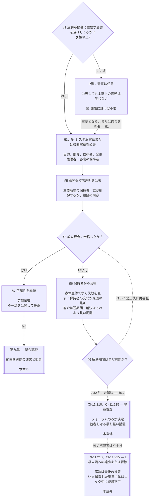

# 第七章：システム憲章と機関憲章

> **翻訳状況：**日本語のAI支援草稿。独立した読者によるレビューは未実施。番号付きの英語原文が優先する。本草稿は第七章の翻訳作業中である。

<strong>コーパス上の位置（非操作性）：ファイル構成と読み方</strong>

> このファイルは**感知者憲法の一部**であり、他の番号付き `core_*` ファイルと合わせて一つの本文として読まれた場合にのみ拘束力を持つ。本章は**第七章**であり、システムおよび機関が公開する範囲文書、すなわちシステム憲章と機関憲章の最低基準を定める。第六章の権利の床の後、第八章の前に置かれ、第八章は重大な拘束力を持つ行為における各席を分離する。
>
> - **憲法上の所管：**システムがシステム憲章を公表しなければならない場合、機関が機関憲章を公表しなければならない場合（L級以上は必須、P級は任意）、各憲章の最低記載事項、変更・審査の方法、および対象職務の保持者の地位と真正性に関する成立審査。
> - **定義の所在：**[システム憲章](../../core_05.040_band_continuity.md#system-charter)、[機関憲章](../../core_05.040_band_continuity.md#institutional-charter)、[憲章役割図](../../core_05.040_band_continuity.md#charter-role-map)、[憲章主体](../../core_05.040_band_continuity.md#chartered-party)、[運営主体](../../core_05.050_band_oversight.md#operating-party)は第5章で定義される。本章はこれらを適用し、再定義しない。
> - **実装上の所管：**[CI-8.205 §6](../../corpus_institutions/ci_08.205_institutional_design_separation_of_powers.md#ci-8205-6-system-and-institutional-charter-contents-review-and-formation-template)（*システム憲章および機関憲章の内容、審査、成立テンプレート*）に、全項目テンプレート、審査チェックリスト、成立手続および成立審査声明のテンプレートを置く。同文書は基準を厳しくしたり項目を追加したりできるが、本章の最低基準を狭めることはできない。採択が有効な範囲でのみ、組み込まれた実装文書として拘束力を持つ（[第18章 §4 採択の枠組みと権限の範囲](../../core_18.000_incorporation.md#4-adoption-framing-and-scope-of-authority)）。本章の最低基準は中核本文として拘束力を持つ。
> - **後続の適用先：**[第8章 §5 公開された配置、空席および代替](../../core_08.000_functional_independence_separation_of_duties.md#5-published-placement-vacancy-and-substitution)は憲章役割図を要求する。第9章はシステム憲章を範囲・境界の認定に参照し、第9章D部は機関の成立審査声明を検査する。[第10章 §3.7 地位記録の保管と開示権限](../../core_10.000_standing_assessment.md#37-record-custody-and-opening-authority)は地位記録に適用する。[第13章 §4.3 機関フォーラム](../../core_13.000_forum.md#43-institutional-forums)は機関憲章に関する紛争を扱う。
>
> 読む順序：§1 システム憲章・機関憲章が必要となる場合と手続図 → §2 組織を形成する権利と四つの限定 → §3 各憲章の記載事項 → §4 憲章役割図と地位記録の保管 → §5 職務保持者の地位・真正性の成立審査 → §6 成立審査に不合格の保持者がいる場合 → §7 修正、審査、範囲の不一致。

<strong>追跡関係</strong>

- 上流：[憲法の四元](../../core_00.000_preamble.md#constitutional-tetrad)、特に**監督**と**説明責任**；[重要な利害](../../core_00.000_preamble.md#material-stake)；[第1章 §18.1 認可された構造としての統治](../../core_01.010_stewardship_capacity_principles.md#181-governance-as-authorized-structure)（1.015 §18.1）；[第XI-E条](../../core_06.005_rights_part_b.md#article-xi-e-institutional-formation-and-business-creation)（*機関形成と事業創設*）。
- 小節：[§1](#1-システム憲章および機関憲章が必要となる場合)；[§2](#2-組織形成の権利と四つの限定)；[§3](#3-システム憲章および機関憲章の記載事項)；[§4](#4-憲章役割図と地位記録の保管)；[§5](#5-成立審査職務保持者の地位と真正性)；[§6](#6-保持者が成立審査に不合格の場合)；[§7](#7-修正審査範囲の不整合)。
- 下流：[第8章](../../core_08.000_functional_independence_separation_of_duties.md#chapter-eight-functional-independence-and-separation-of-duties)；[第9章](../../core_09.000_system_alignment_certification_evaluation.md#chapter-nine-system-alignment-certification)；[第10章](../../core_10.000_standing_assessment.md#chapter-ten-contribution-violation-and-standing-model--measurement)；[第13章](../../core_13.000_forum.md#chapter-thirteen-forums-and-jurisdiction)；[第14章](../../core_14.000_governance.md#chapter-fourteen-constitutional-contract-legitimacy-authorization-and-stewardship)、および上記の実装文書。
- 併読：[権限の階層と内部序列](../../core_05.045_band_integrative.md#authority-stack-and-internal-hierarchy)；[システム境界](../../core_05.040_band_continuity.md#system-boundaries)；[システム境界の完全性](../../core_05.040_band_continuity.md#system-boundary-integrity)；[システムの創設](../../core_05.055_band_participation.md#system-creation)；[事業の創設](../../core_05.055_band_participation.md#business-creation)。

 

第七章は、**システム憲章、機関憲章、および公開された範囲**に関する憲法上の所管である。

三つの章が一つの連鎖を構成する：

- **第七章（本章）：**[憲章主体](../../core_05.040_band_continuity.md#chartered-party)が何を行うと主張し、行為時に各席を誰が担うかを示す。
- **[第八章](../../core_08.000_functional_independence_separation_of_duties.md#chapter-eight-functional-independence-and-separation-of-duties)：**各席をどのように分離するかを定める。
- **[第九章](../../core_09.000_system_alignment_certification_evaluation.md#chapter-nine-system-alignment-certification)：**システムを認証し、機関も別途認証する。いずれの認証も各席を用いる拘束力のある行為であり、その認定結果をシステム憲章または機関憲章に反映する。

他の章は、本章が参照する定義、席の規則、地位ロック、判断規則を定める。**CI-8.205 §6**（*システム憲章および機関憲章の内容、審査、成立テンプレート*）には項目テンプレート、成立手続、審査チェックリストがある。

### 1. システム憲章および機関憲章が必要となる場合

<strong>追跡関係</strong>

- 上流：[§2](#2-組織形成の権利と四つの限定)；[重要な利害](../../core_00.000_preamble.md#material-stake)；[比例性](../../core_05.035_band_accountability.md#proportionality)および章冒頭の所管に関する記載；[第1章 §18 受託者責任の規律下にある統治](../../core_01.010_stewardship_capacity_principles.md#18-governance-under-stewardship-discipline)；[監督](../../core_05.020_apex_oversight_leg.md#oversight-constitutional)；[説明責任](../../core_05.005_apex_accountability_leg.md#accountability)。
- 下流：[§3](#3-システム憲章および機関憲章の記載事項)；[第9章A部 §2 システム級評価](../../core_09.000_system_alignment_certification_evaluation.md#2-system-class-evaluation)（9.005 §2）（*級と認証の深度*）；[第9章D部 §12.1 機関級](../../core_09.015_institutional_alignment_certification.md#121-institution-class)（9.020 §12.1）（*機関の級*）；級の一覧は**CS-9.305（*システム分類機構*）およびCS-9.310**にある。
- 併読：**CI-8.205 §6**（*システム憲章および機関憲章の内容、審査、成立テンプレート*）；**CF-13.415 §5**（*機関および地域の登記官*）；**CI-9.210**（*分類に連動する機関の義務*）；[第5章 システム憲章](../../core_05.040_band_continuity.md#system-charter)；[第5章 機関憲章](../../core_05.040_band_continuity.md#institutional-charter)；[第XI-E条](../../core_06.005_rights_part_b.md#article-xi-e-institutional-formation-and-business-creation)（*機関形成と事業創設*）。

<strong>定義・評価・遵守</strong>

- [システム憲章](../../core_05.040_band_continuity.md#system-charter) · [O](../../core_05.040_band_continuity.md#system-charter) · [M](../../core_05.040_band_continuity.md#system-charter-a) · [A](../../core_05.040_band_continuity.md#system-charter-a) · [C](../../core_05.040_band_continuity.md#system-charter-c)
- [機関憲章](../../core_05.040_band_continuity.md#institutional-charter) · [O](../../core_05.040_band_continuity.md#institutional-charter) · [M](../../core_05.040_band_continuity.md#institutional-charter-a) · [A](../../core_05.040_band_continuity.md#institutional-charter-a) · [C](../../core_05.040_band_continuity.md#institutional-charter-c)
- [分類に応じた統治](../../core_05.050_band_oversight.md#classification-scaled-governance) · [O](../../core_05.050_band_oversight.md#classification-scaled-governance) · [M](../../core_05.050_band_oversight.md#classification-scaled-governance-a) · [A](../../core_05.050_band_oversight.md#classification-scaled-governance-a) · [C](../../core_05.050_band_oversight.md#classification-scaled-governance-c)

 

*平たい言葉で言えば：システムや機関がその限界内で運営されているかを判断する前に、その権限の範囲を誰もが読める形で記録しなければならない。九つの領域のいずれかで他者に重要な影響を及ぼすシステムには、公開されたシステム憲章が必要である。機関は、自らが運営するシステムに適した憲章を公表する。P級は任意であり、難民に毛布を贈る編み物サークルがその例である。*

システム憲章または機関憲章は、憲章主体が公開する範囲を示す。すなわち、何を行う権限があると主張するか、何を行わないか、行為時に各席を誰が担うかを記載する。第八章の席はこの範囲の下に置かれ、第九章の認証は実際の運営をこれと照合する。運営主体に公表義務があるかは級による。L級以上は必須、P級は任意である。公表義務がある場合、内容を正確に保つ義務もある。

以下の五つのシステム影響級が基準となる。影響が大きい順に示す：

- **A級、生存に不可欠・基盤的・代替不能：**生存に関わる時間内に故障し、実行可能な代替がなければ、生存条件を失う。
- **B級、重大・高依存・システム上重要：**依存者はそれなしに中核機能を維持できない。生存が直ちに失われることはなく、時間内に代替できる可能性は残る。
- **C級、協調的・高依存・非重大：**大規模な協調を形作るが、A級またはB級の機能を運用するための前提ではない。
- **L級、地域的・影響限定・非重大：**影響は私的単位を越えるが、地域的で、代替可能かつ封じ込め可能である。
- **P級、個人用・私的利用・孤立・実験的：**意味のある外部依存がなく、影響は私的単位内に留まる。

[CS-9.310 §8](../../corpus_systems/cs_09.310_system_impact_classifications.md#cs-9310-8-system-impact-classifications)に完全な定義がある。A、B、C、L級は公表必須、P級は任意であり、[§1.2 適用される級](#12-適用される級)は機関が運営するシステムから機関の級を定める方法を示す。

#### 1.1 誰が公表しなければならないか

L級以上のシステムは[システム憲章](../../core_05.040_band_continuity.md#system-charter)を公表し、維持しなければならない。L級以上の機関は、運営するシステムに合った以下の憲章を公表し、維持しなければならない。

| 機関が運営、受託管理、または実質的に制御する対象 | 公表するもの |
| --- | --- |
| システム憲章を要するシステムがちょうど一つ | そのシステム憲章のみ。機関を受託管理者として記載し、[機関憲章](../../core_05.040_band_continuity.md#institutional-charter)も兼ねる。一つの文書が両方をカバーする。 |
| 該当するシステムが複数 | 機関憲章を公表する。対象システムごとに有効なシステム憲章をすべて含め、その機関が当該システムを運営する理由を記載する（[§3 システム憲章および機関憲章の記載事項](#3-システム憲章および機関憲章の記載事項)）。 |
| 該当するシステムなし | 機関自身について[§3 システム憲章および機関憲章の記載事項](#3-システム憲章および機関憲章の記載事項)に定める項目を記載する機関憲章。含めるシステム憲章はない。 |

- **事業体および類似形態：**事業体またはその他の受託管理される組織形態は、システム、機関、または対象システムを運営する機関として該当するシステム憲章または機関憲章を公表する。法的形態は結論を変えない。
- **共同専門職業務：**免許または業務許可の対象となる行為を行うL級以上の感知者または小規模な職業実務は、共同専門職業務の受入主体のシステム憲章または機関憲章と憲章役割図を採用することで、当該行為について本節の要件を満たすことができる：
  - **採用するもの：**当該行為をカバーする受入主体のシステム憲章または機関憲章および憲章役割図を参照により採用する。
  - **採用通知：****CI-14.205 §7**（*業務免許、業務許可、共同専門職業務*）所定の1ページ通知。
  - **級：**職業実務自体の行為によって決まる級は変わらない。

#### 1.2 適用される級

憲章主体の級によって、公表が義務か選択かが決まる：

- **A、B、C、L級：**公表必須。[§1.7 手続の概要](#17-手続の概要)の図に手続が示されている。
- **P級：**二つの事由のいずれかが生じるまでは任意。[§1.3 P級とは](#13-p級とは)は運営主体がP級となる条件を、[§1.4 P級：任意の憲章と必須になる場合](#14-p級任意の憲章と必須になる場合)は選択とその終了時点を示す。
- **機関の級：**機関は、運営、受託管理、または実質的に制御するシステムのうち最も高い級を引き継ぐ。そのようなシステムを運営しない機関は、ラベルや法的形態ではなく、実際に決定し保持する事項に基づき、機関自身の重要な影響と依存関係から級を判定する（[第9章D部 §12.1 機関級](../../core_09.015_institutional_alignment_certification.md#121-institution-class)）。

#### 1.3 P級とは

運営主体がP級であるのは、[領域別重要性](../../core_05.050_band_oversight.md#domain-specific-materiality)の九領域すべてで基準線を下回る間だけであり、実際には行為と影響が[私的単位](../../core_05.050_band_oversight.md#domain-specific-materiality-private-unit)の内部に留まることを意味する：

- **基準線を超える場合：**いずれか一領域で基準線を超えると、規模や名称に関係なく、**CS-9.305（*システム分類機構*）およびCS-9.310**（*システム分類機構*）に従い少なくともL級となる。
- **全領域で基準線未満の場合：**構成員数にかかわらずP級のままである。
- **内部にいる者：**P級かどうかは内部の者にも依存する。運営主体が基準線を超えたと知った内部の者は報告義務を負い、その報告は保護される（[領域別重要性](../../core_05.050_band_oversight.md#domain-specific-materiality)）。

第八章の四席最低基準は、私的単位内に留まるP級運営主体の行為には適用されないため、感知者一名とコンピューターであれば二人目の席保持者は不要である。他者が従わなければならない、または確定事項として依拠できる[重大な拘束力を持つ行為](../../core_05.035_band_accountability.md#materially-binding-act)を運営主体が行う時点から、四席最低基準が適用される。この行為は「他者に対する権限」の領域線を越えるため、少なくともL級となる。

#### 1.4 P級：任意の憲章と必須になる場合

P級の運営主体には、運営形態に適した[システム憲章](../../core_05.040_band_continuity.md#system-charter)（単一システムの場合）または[機関憲章](../../core_05.040_band_continuity.md#institutional-charter)（複数システムまたはシステムなしの場合）の公表が推奨される。[§3 システム憲章および機関憲章の記載事項](#3-システム憲章および機関憲章の記載事項)の内容一覧と[§4 憲章役割図および地位記録の保管](#4-憲章役割図と地位記録の保管)の席配置をひな型として使ってもよい。公表によって本章の手続上の義務が発生することはない：

- 期限はない（[§1.5 システム憲章または機関憲章の期限](#15-システム憲章または機関憲章の期限)）。
- 成立審査は不要（[§5 成立審査：職務保持者の地位と真正性](#5-成立審査職務保持者の地位と真正性)）。
- [憲章役割図](../../core_05.040_band_continuity.md#charter-role-map)は必須でない（[§4 憲章役割図および地位記録の保管](#4-憲章役割図と地位記録の保管)）。任意の憲章に添付または別途公表してもよい。
- 必須の修正・審査周期はない（[§7 修正、審査、範囲の不一致](#7-修正審査範囲の不整合)）。

以下のいずれかが生じると公表は任意ではなくなる：

- 運営主体がL級以上に再分類される；または
- 運営者が当該運営主体の憲法適合を主張する。

その場合、運営主体は[§1.5](#15-システム憲章または機関憲章の期限)の期限に従って、状況に合うシステム憲章または機関憲章を公表しなければならない。

**承認は範囲文書の有無に左右されない。**システム憲章または機関憲章の有無や級にかかわらず、集団は構成員の承認を妨げない。各構成員は集団の内外で行った仕事について個人として貢献記録を申請でき、記録は集団の地位ではなく本人の貢献を扱う（[第10章 §3.7 非公式・小規模範囲の記録](../../core_10.000_standing_assessment.md#37-informal-and-small-scope-records)）。他者が受け入れる義務のない援助、物資、労働またはサービスを提供することは、重大な拘束力を持つ行為ではない。したがって難民に毛布を贈る相互扶助サークルにはシステム憲章も機関憲章も不要であり、その構成員も承認を得られる。

#### 1.5 システム憲章または機関憲章の期限

対象となるシステムまたは機関は、次の期限に従って[システム憲章](../../core_05.040_band_continuity.md#system-charter)または[機関憲章](../../core_05.040_band_continuity.md#institutional-charter)を公表する：

- **新設のシステムまたは機関：**稼働開始または他者に対する権限行使の前。
- **すでに運営中の場合：**次の分類審査または認証まで、または[§1.6 システム憲章・機関憲章がない場合](#16-システム憲章機関憲章がない場合)の請求後の解決期限内のうち、先に到来する方。公表するまでは不履行である。
  - **どの認証か：**システムはシステム整合認証、機関は[第9章D部 §11.3 許可も門もない](../../core_09.015_institutional_alignment_certification.md#113-no-permission-and-no-gate)に基づく機関整合認証を受ける。初回認証の期限は機関憲章の公表にも運営開始にも条件としてはならない。
- **成立審査：**同時に[§5 成立審査：職務保持者の地位と真正性](#5-成立審査職務保持者の地位と真正性)を完了する。
- **提出先：**憲章役割図および成立審査声明を添えて、システム憲章または機関憲章を機関登記官に提出する。活動と影響を受ける感知者が地域内に限られる場合は地域登記官に提出する（**CF-13.415 §5**、*機関および地域の登記官*）：
  - **登記官の役割：**必須項目の欠落を確認し、日付入りの受領証を出す。
  - **登記官がしてはならないこと：**許可を与えず、級や内容を裁定しない。
  - **受領証の遅延または欠落：**憲章主体の運営を妨げない。

#### 1.6 システム憲章・機関憲章がない場合

L級以上である（または新たにその級となった）憲章主体がシステム憲章または機関憲章を公表していないと気づいた者は誰でも、その統治機関に提出を請求できる。請求者に地位や資格は不要で、手数料も損害の証明も要らない。請求では憲章主体を特定し、対象に見える理由を記す。

請求日から答弁期間と解決期間の二つが始まる。各期間は憲章主体の級と同じ文字のTierに基づく。級の重大性が高いほど期間は短い：

| 級とTier | 答弁期間（受付目標） | 解決期間（最終上限） |
|---|---|---|
| A級、Tier A | 24時間 | 7暦日 |
| B級、Tier B | 2暦日 | 14暦日 |
| C級、Tier C | 4暦日 | 30暦日 |
| L級、Tier L | 8暦日 | 60暦日 |

数値は **CF-13.445 §3.1**（*段階目標と期限の最低基準*）に由来し、相違があれば同条が優先する。級に異議を唱える憲章主体は、システム分類記録上の級と、請求者またはフォーラムが一応の立証をもって示す級のうち、より重大な級に対応するTierで数える。級が記録されていない場合、または級が争われている間にP級と記録されている場合はTier Cで扱う。

各期間は次のように適用する：

- **答弁期間：**憲章主体は請求日から、**CF-13.445 §3.1**（*段階目標と期限の最低基準*）の該当Tierの受付目標内に回答する。システム憲章または機関憲章を公表する、公表日を示す、既に公表した文書を提示する、または[領域別重要性](../../core_05.050_band_oversight.md#domain-specific-materiality)の全領域で基準未満であると答え、その立証に必要な書面を提出する。
- **解決期間：**請求日から **CF-13.445 §3.1**（*段階目標と期限の最低基準*）の該当Tierの最終上限内に、成立審査声明とともに憲章を提出する（[§5 成立審査：職務保持者の地位と真正性](#5-成立審査職務保持者の地位と真正性)）。独立席がまだない憲章主体は、同節の規定に従い、証拠を添えた宣言として声明を提出する。
- **基準未満だと主張する運営主体：**請求は、該当する項目の*異議申立て経路*に従う分類異議も兼ねる：
  - **期間の進行：**異議が係属中も解決期間は進行する。
  - **異議による延長：**管轄フォーラムが審査に値すると判断した場合、期限を延長し、異議の決定時から新たな解決期間を開始する。フォーラムは該当Tierの最終上限内に異議を決定する。
  - **審査に値する異議：**特定領域における具体的な境界超過を示し、運営主体の書面による立証に照らしてなお現実の疑問が残る異議をいう。運営主体は自ら審査価値を判断できず、書面による立証を伴わない答弁では期限は延長されない。
  - **級が認定された場合：**当該異議によるものか別の手続によるものかを問わず、認定日を請求日とみなす。認定された級（A、B、CまたはL級）に対応するTierで答弁期間と解決期間が始まる。
- **期限を守れない場合：**答弁がないこと、または期限内に憲章を公表しないことは、記録して是正すべき欠陥である。請求者は同じ経路で管轄フォーラムに申し立てられる。これは設立や運営の条件ではない。
- **重複請求：**同じ憲章主体について、以前の答弁または認定が有効な間に行われた二度目の請求は、新しい答弁期間や解決期間を開始しない。憲章主体は以前の答弁または認定を示して回答する。全領域で基準未満との自己立証で、フォーラムによる審査をまだ受けていないものは、有効な答弁とはみなさない。答弁または認定は、[第9章D部 §14.2 再開の契機](../../core_09.015_institutional_alignment_certification.md#142-reopening-triggers)が定める以下のいずれかが生じるまで有効である：
  - **重大な変化：**憲章主体の活動が重大に変わる。
  - **新証拠：**境界超過に関する新しい証拠が示される。

  上記のいずれかを示す請求は重複ではない。前の請求から独立して別途処理する新しい請求である。独自の請求日から答弁期間と解決期間が始まり、前の答弁、認定および期間はこれを満たさず、変更もしない。
- **その間の範囲：**憲章がないことを、憲章主体に範囲がないものとして扱う理由にしてはならない。憲章ができるまでは、実際の[システム境界](../../core_05.040_band_continuity.md#system-boundaries)と級が適用され、認証機関またはフォーラムは観察された運営から範囲を再構成できる。

#### 1.7 手続の概要

この図は、運営主体の活動が他者にとって重要かという問いから始まり、システム憲章または機関憲章の公表と正確性の維持までを示す。解決期間内に問題が直らなければ、憲章手続は本章外の審査へ引き継がれる。以下の各節は各段階を同じ順序で説明する。

<strong>読者向け案内（非操作性）：図の読み方</strong>

> 平たい言葉で言えば、誰かがシステム憲章または機関憲章を認可するのではなく、組織形成に許可も要らない。活動が他者に重要な影響を及ぼす憲章主体は、主張する権限の範囲と各席の保持者を公表し、主要職務の保持者の審査を受ける。保持者が不合格なら交代するか原因を直し、憲章主体は運営を続ける。解決期間終了時も問題が直っていなければ、他者を保護する最も軽い措置からフォーラムが審査できる。L級未満への縮小または解散は、軽い措置で足りない場合に限る。解散した憲章主体はロックが有効な間、再び活動できない。
>
> 実線矢印は主経路、点線矢印は例外や引継ぎを示し、それぞれ根拠となる節を記す。両側に二重線のある箱は別の章または組み込まれた実装文書に属する。この図は義務、席、項目を追加せず、どの段階も許可を与えるものではない。

 

### 2. 組織形成の権利と四つの限定

<strong>読者向け案内（非操作性）：本節の構成</strong>

- [§2.1 組織形成の権利](#21-組織形成の権利)は権利の内容と適用されない場合を述べる。
- [§2.2 第一の限定：感知者に対する未解除のロック](#22-第一の限定感知者に対する未解除のロック)は、特定された感知者一名を一つの統制職から排除する方法を述べる。
- [§2.3 第二の限定：具体的な検証済み事実に基づく短期の留保](#23-第二の限定具体的な検証済み事実に基づく短期の留保)は、特定された感知者一名を一つの統制職から短期に排除する方法を述べる。
- [§2.4 第三の限定：運営主体自体に対するロック](#24-第三の限定運営主体自体に対するロック)は、運営主体とその後継者をロックが禁じる場合、解散済みの憲章主体が復帰できない場合を述べる。
- [§2.5 第四の限定：業務免許または許可](#25-第四の限定業務免許または許可)は、特定の高リスク行為に免許または許可が必要となる場合を述べる。組織形成の門ではない。

<strong>追跡関係</strong>

- 上流：[§1](#1-システム憲章および機関憲章が必要となる場合)；[第XI-E条](../../core_06.005_rights_part_b.md#article-xi-e-institutional-formation-and-business-creation)（*機関形成と事業創設*）。
- 下流：[§1 システム憲章および機関憲章が必要となる場合](#1-システム憲章および機関憲章が必要となる場合)；[§5 成立審査：職務保持者の地位と真正性](#5-成立審査職務保持者の地位と真正性)。
- 併読：[臨時留保](../../core_05.035_band_accountability.md#interim-hold)；[第11章 §4.2 予防——一般的な地位ロック](../../core_11.000_standing_integration.md#42-prevention--general-standing-locks)（11.000 §4.2）；[第11章 §5.5 特別ロック](../../core_11.000_standing_integration.md#55-special-locks)（11.000 §5.5）；[第13章 §5 特定感知者の経路に対する臨時留保](../../core_13.000_forum.md#interim-hold-on-a-named-sentients-pathway)（13.000 §5）。

 

*平たい言葉で言えば、システム、機関、事業を形成するのに誰かの許可は要らない。適用されうる限定は四つだけである。最初の三つは門であり、未解除のロックは特定の感知者一名を統制職一つから排除し、具体的な検証済み事実に基づく短期の留保も同じことを可能にし、運営主体自体へのロックはその主体を禁じる。第四の限定は、特定の高リスク行為の前に免許または許可を要求しうる。フォーラムが解散させた憲章主体は復帰できず、広範な違憲行為または未回復の重大な不可逆的危害を理由に解散した場合、その禁止は永久となる。いずれも新しい運営主体の形成や運営を止めず、本章も新たな制限を加えない。*

**第XI-E条**（*機関形成と事業創設*）が認める限定は四つに限られる：

- **最初の三つだけが門である：**運営主体の形成またはその主体における権限保持に適用される。各々は特定された対象に付随する：
  - **未解除のロック**（[§2.2 第一の限定：感知者に対する未解除のロック](#22-第一の限定感知者に対する未解除のロック)）は、憲章主体を統制する一つの職務における特定感知者に付随する。
  - **臨時留保**（[§2.3 第二の限定：具体的な検証済み事実に基づく短期の留保](#23-第二の限定具体的な検証済み事実に基づく短期の留保)）は、憲章主体を統制する一つの職務における特定感知者一名だけに付随する。
  - **運営主体自体へのロック**（[§2.4 第三の限定：運営主体自体に対するロック](#24-第三の限定運営主体自体に対するロック)）は、フォーラムが解散させた主体を含む、ロックを受けた憲章主体に付随する。
- **第四の限定：**門ではなく、業務免許または許可である（[§2.5 第四の限定：業務免許または許可](#25-第四の限定業務免許または許可)）。

#### 2.1 組織形成の権利

誰でも新しいシステム、機関または事業を形成できる。この権利は[第XI-E条](../../core_06.005_rights_part_b.md#article-xi-e-institutional-formation-and-business-creation)（*機関形成と事業創設*）に定める。本章は、その次に生じる義務を加える。運営主体の活動が[領域別重要性](../../core_05.050_band_oversight.md#domain-specific-materiality)の九領域のいずれかで他者にとって重要になったら、主張する権限の範囲を事前に公表しなければならない（[§1 システム憲章および機関憲章が必要となる場合](#1-システム憲章および機関憲章が必要となる場合)）。システム憲章または機関憲章の採用を、組織形成の権利や権利の床による保護を狭めるものと解釈してはならない。

**組織形成の権利が及ばないもの。**[§2.2 第一の限定：感知者に対する未解除のロック](#22-第一の限定感知者に対する未解除のロック)、[§2.3 第二の限定：具体的な検証済み事実に基づく短期の留保](#23-第二の限定具体的な検証済み事実に基づく短期の留保)、[§2.4 第三の限定：運営主体自体に対するロック](#24-第三の限定運営主体自体に対するロック)という三つの門を除き、**第XI-E条**（*機関形成と事業創設*）は次を保護しない：

- 憲法上の制約を破る、安全または真実を損なう、あるいは[第1章 §11 市場構造](../../core_01.000_values_principles.md#11-market-structure)が禁じる形で権力を集中させるよう設計された運営主体；または
- 検証済みの行為、支配関係、報酬から見て表明された目的と真正に整合しない創立者が形成・運営する運営主体、あるいは目的、支配関係または利害について他者を誤導したり、他者を害したりする意図を持って形成・運営する主体。

フォーラムは同条に基づきこれらの事案を判断し、結果は同条の三つの門に限られる。すなわち、未解除ロックの門、臨時留保、運営主体自体へのロックである。成立審査の不合格はフォーラムが考慮する証拠の一つであり、成立審査だけで事案を決めるものではない。

#### 2.2 第一の限定：感知者に対する未解除のロック

検証済みの違反後に設定され、まだ解除されていない[地位ロック](../../core_11.000_standing_integration.md#42-prevention--general-standing-locks)または[特別ロック](../../core_11.000_standing_integration.md#55-special-locks)は、特定の感知者一名がこの種の機関または事業を統制する権限を持つことを禁じる。

- **禁じられること：**運営主体において統治、統制または所有の権限を取得・行使すること。
- **適用範囲：**ロックが定める範囲に限られる。ロックが解除または縮小されれば終了する。
- **運営主体自体へのロック：**[§2.4 第三の限定：運営主体自体に対するロック](#24-第三の限定運営主体自体に対するロック)を参照。

#### 2.3 第二の限定：具体的な検証済み事実に基づく短期の留保

管轄フォーラムが、保持者と憲章主体の表明された目的との不整合がより蓋然的であることを示す具体的な検証済み事実に基づき、[臨時留保](../../core_05.035_band_accountability.md#interim-hold)を命じた場合に適用する。命令できるのは当該フォーラムだけである（[第13章 §5 特定感知者の経路に対する臨時留保](../../core_13.000_forum.md#interim-hold-on-a-named-sentients-pathway)）。憲章主体が独自に誰かの職務就任を禁じることはできない。そうすれば自らの構成員を自ら裁くことになる。完全な要件は[第13章 §5 特定感知者の経路に対する臨時留保](../../core_13.000_forum.md#interim-hold-on-a-named-sentients-pathway)に定め、この短縮形はそれに取って代わらない。

#### 2.4 第三の限定：運営主体自体に対するロック

ロックは感知者だけでなく運営主体自体にも設定できる。その場合、門はロックが特定する経路に従い、当該運営主体とその後継者、被支配主体、名義人またはペーパーカンパニーを通じて保有される手段に対し禁止を及ぼす。他の運営主体には及ばない。

- **最終指定によるロック：**[反憲法的信頼ロック](../../core_11.000_standing_integration.md#55-special-locks)は、最終指定が機関、後継手段または被支配主体を名指す場合にこれを実施する。ロックは、憲章主体、その後継者、被支配主体、名義人またはペーパーカンパニーを通じて保有される手段に対し、指定された経路の行為を禁じる。
- **解散した憲章主体：****CI-11.210 §4**（*解散*）に基づく最終解散命令は[解散後再形成ロック](../../core_11.000_standing_integration.md#55-special-locks)を設定する。解散した憲章主体、その後継者、被支配主体、名義人・ペーパーカンパニーを通じた手段、およびこれらと一体の運営主体は、ロックが有効な限り、名称や形態を変えて再形成・復活・運営してはならない。命令が広範な違憲行為または未回復の不可逆的危害を認定した場合（[第11章 §8 回復と再評価](../../core_11.000_standing_integration.md#8-restoration-and-reassessment)）、ロックは永久である。時間の経過、原因の解決、保持者の変更によって解除されず、解散命令が審査で取り消されるか、認定が誤りだったことを示す重要な新しい検証済み事実がある場合に限り終了する。それ以外は、原因が解決し、救済が実施され、排除継続より復帰の方が安全であるとの独立認定を得た場合に終了する。別の運営主体を形成する感知者を禁じるものではない。

三つの門のいずれも、新しい運営主体の形成、システム憲章または機関憲章の公表、あるいは活動開始を妨げない。止められるのは、解散した憲章主体が復帰を試みる場合のように、自身がロックを受けている主体だけである。三つの門は成立審査で適用する（[§5 成立審査：職務保持者の地位と真正性](#5-成立審査職務保持者の地位と真正性)）。

#### 2.5 第四の限定：業務免許または許可

第四の限定は特定の行為に作用し、運営主体の形成には作用しない：

- **運営主体に対する門ではない：**[§5 成立審査：職務保持者の地位と真正性](#5-成立審査職務保持者の地位と真正性)はこれを適用しない。
- **内容：****第XI-E条**（*機関形成と事業創設*）により、導入主体は技術フォーラムの公表したリスク認定に基づき、他者のために行う特定行為の前に[能力許可](../../core_05.035_band_accountability.md#competency-clearance)を要求できる。
  - **業務免許：**不適切に実施すると重大または不可逆的な危害を生じるリスクのある行為に必要。
  - **業務許可：**不適切に実施すると現実の危害を生じるが、程度がより低い行為に必要。
- **適用対象：**当該行為を実施すること。運営主体の形成、憲章の公表または運営を止めるものではない。
- **禁止すること：**免許または許可なしに当該行為を主張・実施すること。保持者が実施しない限り、システム憲章または機関憲章は当該行為を権限範囲として主張できない（[§3 システム憲章および機関憲章の記載事項](#3-システム憲章および機関憲章の記載事項)）。

### 3. システム憲章および機関憲章の記載事項

<strong>読者向け案内（非操作性）：本節の構成</strong>

- [§3.1 システム憲章の記載事項](#31-システム憲章の記載事項)は九つの項目を列挙する。
- [§3.2 憲章ポインター](#32-憲章ポインター)は、文面を複製する代わりに他の公開文書を参照できること、および有効な参照の条件を述べる。
- [§3.3 機関憲章が追加する事項](#33-機関憲章が追加する事項)は、九項目に加えて機関が運営するシステムの憲章と運営理由を記載することを定める。
- [§3.4 業務免許または業務許可を要する行為](#34-業務免許または業務許可を要する行為)は、行為を実施する各感知者が免許・許可を持つか、有資格の監督者の下で学習者として働く場合に限り、その行為を憲章に含められるとする。それまでは§3.1第4項で範囲外と記載する。
- [§3.5 比例的調整](#35-比例的調整)は級に応じて変わる事項を述べる。

<strong>追跡関係</strong>

- 上流：[§1](#1-システム憲章および機関憲章が必要となる場合)；[第5章 システム憲章](../../core_05.040_band_continuity.md#system-charter)（5.040）；[第5章 機関憲章](../../core_05.040_band_continuity.md#institutional-charter)（5.040）。
- 下流：[§4](#4-憲章役割図と地位記録の保管)；[§7](#7-修正審査範囲の不整合)；[第9章B部 §8.1 最低記録事項](../../core_09.005_system_alignment_certification_record_process.md#81-minimum-record-contents)（9.010 §8.1）（*認証記録が参照するシステム憲章の項目*）；全項目一覧は**CI-8.205 §6**（*システム憲章および機関憲章の内容、審査、成立テンプレート*）。
- 併読：[第18章 §4 採択の枠組みと権限の範囲](../../core_18.000_incorporation.md#4-adoption-framing-and-scope-of-authority)（18.000 §4）（*別の名称で保持される範囲文書*）；[第14章 §4.3 拘束力あるステークホルダー選択の決定・解決要件](../../core_14.000_governance.md#43-decision-resolution-requirements-for-binding-stakeholder-choice)（14.000 §4.3）；**CI-6.205 §1**（*ステークホルダーの監督、通知、拘束力ある統治経路の完全性*）；**CI-6.205 §2**（*集中防止および参加の正当性に関する保護措置*）。

<strong>定義・評価・遵守</strong>

- [システム憲章](../../core_05.040_band_continuity.md#system-charter) · [O](../../core_05.040_band_continuity.md#system-charter) · [M](../../core_05.040_band_continuity.md#system-charter-a) · [A](../../core_05.040_band_continuity.md#system-charter-a) · [C](../../core_05.040_band_continuity.md#system-charter-c)
- [機関憲章](../../core_05.040_band_continuity.md#institutional-charter) · [O](../../core_05.040_band_continuity.md#institutional-charter) · [M](../../core_05.040_band_continuity.md#institutional-charter-a) · [A](../../core_05.040_band_continuity.md#institutional-charter-a) · [C](../../core_05.040_band_continuity.md#institutional-charter-c)
- [憲章役割図](../../core_05.040_band_continuity.md#charter-role-map) · [O](../../core_05.040_band_continuity.md#charter-role-map) · [M](../../core_05.040_band_continuity.md#charter-role-map-a) · [A](../../core_05.040_band_continuity.md#charter-role-map-a) · [C](../../core_05.040_band_continuity.md#charter-role-map-c)

 

*平たい言葉で言えば：システム憲章は検証できるほど具体的でなければならない。目的、行うことと行わないこと、依存する者、憲章の変更権限者、各席の保持者、拘束力ある決定規則の所在を記す。その規則を参照するが、憲章自体が規則に取って代わることはない。機関憲章は機関について同じ事項を記し、さらに所管するシステム憲章と運営理由を加える。*

#### 3.1 システム憲章の記載事項

システム憲章は、影響を受ける感知者や監査人が読める平易な言葉で次を記す：

1. **識別情報と版：**名称、受託管理者または統治機関、版、発効日、変更履歴。
2. **目的：**憲章主体が何をするために存在するか。
3. **対象範囲内の活動：**主張する機能、サービス、権限、領域。
   - **権限付与ではなく主張：**文書は憲章主体がすでに有する権限を記述するだけで、権限を与えない。憲章を根拠とする場合を含め、その権限の正当性は[第14章 §1 統治権限の認可と正当性](../../core_14.000_governance.md#1-authorization-and-legitimacy-of-governing-authority)に基づき判断する。
4. **対象範囲外の限界：**行使を認められていない重要な活動、権限、領域。
5. **影響を受ける共同体と依存関係：**重要な場合、憲章主体に依存する者、および憲章主体が依存する、または利用を左右するシステム・インフラ。
   - **除外しても対象外にはならない：**一覧から集団を省いても、範囲外にはならない。憲章主体が重大な影響を与える感知者は、文書に名前があるかにかかわらず権利の床による保護をすべて保持する。実際の依存関係より狭い一覧は、実際の依存関係に照らして解釈する。
6. **分類の前提：**依拠する級または受託管理段階を記し、該当する場合は**CS-9.305（*システム分類機構*）、CS-9.310**（*システム分類機構*）および**CS-14.305**（*重要システムの受託管理*）への[憲章ポインター](../../core_05.040_band_continuity.md#charter-pointer)を置く。
7. **憲章役割図：**[憲章役割図](../../core_05.040_band_continuity.md#charter-role-map)、または同図となる公開文書への憲章ポインター（[§4 憲章役割図と地位記録の保管](#4-憲章役割図と地位記録の保管)）。
8. **拘束力あるステークホルダー選択への憲章ポインター：**
   - **適用時：**影響を受ける感知者間に実際の意見対立があり、システム内で拘束力あるステークホルダー選択が必要な場合。[定義P2 拘束力あるステークホルダー選択](../../core_05.055_band_participation.md#defp2-binding-stakeholder-choice)はこれを適用範囲と呼ぶ。
   - **参照先：**公表済みの三つの規則群への有効な憲章ポインター、すなわち決定順序（選択方法）、加重規則（誰にどれほどの発言権を与えるか）、権利衝突記録規則（権利が衝突した際に記録すべき事項）。
   - **憲章と規則の役割：**システム憲章が持つのはポインターだけである。実際の内容、すなわち選択方法、重み付け、記録事項は三つの規則群が定める。システム憲章にその内容を記載する必要はなく、憲章文自体を規則の代わりに提示できない。ポインターが無効な場合、または規則の代わりに憲章文を提示した場合は、システム憲章上の義務を満たさない。
9. **修正権限：**誰が修正できるか、何が重大な修正に当たるか、通知と異議申立ての経路。

#### 3.2 憲章ポインター

システム憲章または機関憲章は、文面を複製する代わりに、他の公開文書または条項（規則群、憲章役割図、システム憲章）を参照できる。その参照が[憲章ポインター](../../core_05.040_band_continuity.md#charter-pointer)である。参照先は有効かつ最新の公開文書に解決しなければならない。無効または古いポインターは項目欠落として扱う。

#### 3.3 機関憲章が追加する事項

機関憲章は、機関自体について[§3.1 システム憲章の記載事項](#31-システム憲章の記載事項)の第1〜9項を記載し、さらに次を含む：

- **システム憲章：**機関が運営、受託管理、または実質的に制御するシステムについて有効なシステム憲章をすべて含める。全文を収録するか、現在公開されている版に解決する憲章ポインターで参照する。
- **ポートフォリオの根拠：**機関がなぜ各システムを運営するのか、それらが表明された目的にどのように貢献し相互に関係するか、どの依存関係を共有するかを説明する。理由の記載がないシステムは項目欠落となる。

**CI-8.205 §6**（*システム憲章および機関憲章の内容、審査、成立テンプレート*）は追加項目を要求し成立テンプレートを定めてもよいが、上記の項目を削除してはならない。

#### 3.4 業務免許または業務許可を要する行為

行為に業務免許または業務許可が必要な場合、憲章で何を権限範囲として主張できるかを定める：

- **限界：**行為に業務免許または業務許可が必要な場合、それを実施する感知者全員が免許・許可を持つか、保持者の監督下で学習者として働かない限り、憲章に憲章主体の活動として記載できず、憲章主体も実施できない。
- **それまで：**システム憲章または機関憲章は、その行為を第4項（[§3.1 システム憲章の記載事項](#31-システム憲章の記載事項)）に範囲外として記載する。
- **保持者なしで主張した場合：**記録して是正すべき項目欠落だが、憲章主体の形成、公表、その他の業務継続は妨げない。
- **要件の所在：**[§2 組織形成の権利と四つの限定](#2-組織形成の権利と四つの限定)に要件の根拠を、**CI-14.205 §7**（*業務免許、業務許可、共同専門職業務*）に項目および受入先確認を定める。

#### 3.5 比例的調整

システム憲章または機関憲章には、級に応じて調整される事項とされない事項がある：

- **調整される事項：**憲章の詳細さ、審査頻度、審査の独立性は級と[重要な利害](../../core_00.000_preamble.md#material-stake)に応じて調整する。
- **L級：**[分類に応じた統治](../../core_05.050_band_oversight.md#classification-scaled-governance)が認める場合、L級のシステムまたは機関の憲章は簡潔にし、記録も簡略化できる。ただし必須項目すべてを扱わなければならない。
- **審査頻度：**憲章は審査の頻度を決めない。頻度は級に基づく。

### 4. 憲章役割図と地位記録の保管

<strong>読者向け案内（非操作性）：本節の構成</strong>

- [§4.1 各席とは何か、なぜ必要か](#41-各席とは何かなぜ必要か)は四つの席と、第八章が同一行為における禁止された席の組み合わせを禁じる理由を示す。
- [§4.2 有効な配置の条件](#42-有効な配置の条件)は、第八章が独立性、空席・代替、複数席の併合の検査を定め、役割図は誰がどの席に就くかだけを記録すると述べる。
- [§4.3 システム憲章・機関憲章が役割図に負う義務](#43-システム憲章機関憲章が役割図に負う義務)は、憲章に役割図を含めるか参照する必要があり、欠落、無効なポインター、古い役割図は憲章の欠陥になると述べる。
- [§4.4 各役割図をどの憲章に置くか](#44-各役割図をどの憲章に置くか)は、機関憲章の下に複数システムがある場合と共同役割図を扱う。
- [§4.5 席の規則と保持者の変更](#45-席の規則と保持者の変更)は、席に就ける者の規則変更は修正であり、現在の保持者の変更は通知と異議の機会後に発効する日付入りの新しい役割図版で記録すると述べる。
- [§4.6 地位記録の保管](#46-地位記録の保管)は、役割図に記載すべき地位記録の事項を定め、[§4.6.1 運営主体の地位記録](#461-運営主体の地位記録)と[§4.6.2 ステークホルダーの地位記録](#462-ステークホルダーの地位記録)に分ける。
- [§4.7 運営主体の地位記録役割図の欠落](#47-運営主体の地位記録役割図の欠落)は、必須席が未指定または適格な保持者不在の場合の扱いを定め、四つの小節に分ける：[§4.7.1 欠落の発生と記録方法](#471-欠落の発生と記録方法)、[§4.7.2 欠落が続く間](#472-欠落が続く間)、[§4.7.3 最後の適格な代替者がいなくなった場合](#473-最後の適格な代替者がいなくなった場合)、[§4.7.4 認証の席](#474-認証の席)。

<strong>追跡関係</strong>

- 上流：[§3](#3-システム憲章および機関憲章の記載事項)；[第 8 章 §2 憲法上の四議席の要件](../../core_08.000_functional_independence_separation_of_duties.md#2-four-seat-constitutional-requirement)（8.000 §2）。
- 下流：[第8章 §5 公開された配置、空席および代替](../../core_08.000_functional_independence_separation_of_duties.md#5-published-placement-vacancy-and-substitution)（8.000 §5）；[第9章B部 §6.1.1 認証における四席](../../core_09.005_system_alignment_certification_record_process.md#611-four-seats-in-a-certification)（9.010 §6.1.1）；[第10章 §3.7 地位記録の保管と開示権限](../../core_10.000_standing_assessment.md#37-record-custody-and-opening-authority)（10.000 §3.7）；**CI-8.205 §2**（*機能分離レーン*）；**CI-14.205 §5**（*認可された役割と説明責任系統*）；**CI-14.205 §6**（*席のカタログ—プロセス役割類型と運用境界*）。
- 併読：[実質的統制線](../../core_05.035_band_accountability.md#material-control-line)；[地位記録](../../core_05.035_band_accountability.md#standing-record)。

<strong>定義・評価・遵守</strong>

- [憲章役割図](../../core_05.040_band_continuity.md#charter-role-map) · [O](../../core_05.040_band_continuity.md#charter-role-map) · [M](../../core_05.040_band_continuity.md#charter-role-map-a) · [A](../../core_05.040_band_continuity.md#charter-role-map-a) · [C](../../core_05.040_band_continuity.md#charter-role-map-c)
- [システム憲章](../../core_05.040_band_continuity.md#system-charter) · [O](../../core_05.040_band_continuity.md#system-charter) · [M](../../core_05.040_band_continuity.md#system-charter-a) · [A](../../core_05.040_band_continuity.md#system-charter-a) · [C](../../core_05.040_band_continuity.md#system-charter-c)
- [機関憲章](../../core_05.040_band_continuity.md#institutional-charter) · [O](../../core_05.040_band_continuity.md#institutional-charter) · [M](../../core_05.040_band_continuity.md#institutional-charter-a) · [A](../../core_05.040_band_continuity.md#institutional-charter-a) · [C](../../core_05.040_band_continuity.md#institutional-charter-c)

 

*平たい言葉で言えば、システム憲章または機関憲章は各席の保持者を名指しする。対象となる行為について、誰が各席に就けるかの公開一覧を持ち、主体が自らの検証者を選べないようにする。有効な席配置の規則は第八章に残る。地位記録の安全な保管は別の一覧ではなく、同じ役割図に含まれる。*

すべてのシステム憲章または機関憲章は[憲章役割図](../../core_05.040_band_continuity.md#charter-role-map)、すなわち各席の保持者を示す公開一覧を備える。[第8章 §5 公開された配置、空席および代替](../../core_08.000_functional_independence_separation_of_duties.md#5-published-placement-vacancy-and-substitution)は重大な拘束力を持つ行為を採用するすべての主体にこれを要求し、記載事項を定める。本節は憲章がこれをどう扱うかを定める。

#### 4.1 各席とは何か、なぜ必要か

すべての[重大な拘束力を持つ行為](../../core_05.035_band_accountability.md#materially-binding-act)には四つの役割があり、[第 8 章 §2 憲法上の四議席の要件](../../core_08.000_functional_independence_separation_of_duties.md#2-four-seat-constitutional-requirement)により分離される：

- **[開始席](../../core_05.035_band_accountability.md#initiating-seat)：**行為を要求、提案、運用または主張して開始する。
- **[検証・認可席](../../core_05.035_band_accountability.md#verify-or-authorize-seat)：**証拠と権限を確認し、その後、行為を検証、認可、条件付け、または拒否する。
- **[記録席](../../core_05.035_band_accountability.md#record-seat)：**検証・認可席が判断した内容の公式記録を保管する。
- **[異議席](../../core_05.035_band_accountability.md#contest-seat)：**異議を審理し、是正、制限または適切な経路への付託を行う。

席を分けるのは、一主体が結果を求め、自らの要求を審査し、その審査記録を支配し、さらに異議まで裁くことを防ぐためである。席は一つの行為に関する役割であり職名ではない。同じ感知者、職務またはシステムが異なる行為では異なる席を担えるが、同一行為で第八章が禁じる席の組み合わせを担うことはできない。役割図は各席の保持者を指名する。

#### 4.2 有効な配置の条件

検査基準は第八章が定め、役割図は誰がどこに就くかを記録する：

- **実質的統制線：**一つの行為をめぐる実際の権力系統。問題となる主体とは、当該行為を開始する主体、または行為が検証、異議申立て、記録の対象となる主体である。その主体が当該行為について、保持者を指揮、覆決、報償、処罰、解任できる、または保持者の作業を遅らせられる場合、その席を統制する。これを行える感知者、職務、システムが、その行為に関する[実質的統制線](../../core_05.035_band_accountability.md#material-control-line)を構成する。
- **独立性：**問題となる行為の主体が審査席を統制できるなら、その席は独立していない（[第8章 §3 独立性、利益相反、統制線](../../core_08.000_functional_independence_separation_of_duties.md#3-independence-conflict-and-control-lines)）。したがって役割図は記録席、異議席およびすべての検証・認可席を、その主体の実質的統制線の外に置く。また主体は、自らの単独判断でこれらの席の保持者を変更できない（[§4.5 席の規則と保持者の変更](#45-席の規則と保持者の変更)）。
- **空席、代替、委任：**保持者が不在または利益相反の場合に誰が代わるか（[第8章 §5 公開された配置、空席および代替](../../core_08.000_functional_independence_separation_of_duties.md#5-published-placement-vacancy-and-substitution)）。
- **複数席の併合：**小規模主体が二つの席を一職務に置ける限定的な場合。役割図は許容される各配置とそれに伴う独立性保護を記載する（[第8章 §6 比例的調整と複数席の併合](../../core_08.000_functional_independence_separation_of_duties.md#6-proportional-scaling-and-merged-hosting)）。

#### 4.3 システム憲章・機関憲章が役割図に負う義務

システム憲章または機関憲章は、憲章役割図を含めるか、[憲章ポインター](#32-憲章ポインター)で参照し、憲章から各席の保持者を見つけられるようにする。次の場合、憲章に欠陥がある：

- **役割図がない：**図を含まず、参照先もない。
- **ポインターが無効：**見つからない、または有効に公開された文書でない図を参照する。
- **図が古い：**現在の各席保持者を示していない。保持者の変更は、日付入りの新しい役割図版として公表する（[§4.5 席の規則と保持者の変更](#45-席の規則と保持者の変更)）。

#### 4.4 各役割図をどの憲章に置くか

どのシステム憲章または機関憲章が役割図を持つかは、主体の構成による：

- **複数システム：**機関憲章が複数のシステム憲章を含むことがある。各システム憲章は当該システムの行為に関する役割図を持ち、機関憲章は機関自身の行為に関する役割図を持つ。
- **共同役割図：**事業体または職業実務は、席の一部を地域協同組合、協会または受入主体に置ける（[§1 システム憲章および機関憲章が必要となる場合](#1-システム憲章および機関憲章が必要となる場合)）。その場合、独自の憲章を簡潔にするため、当該団体の公開役割図を使用できる。ただし席保持者が不在または利益相反の際に代わる者と、適格な代替者がいない場合に使う独立経路は、自らの憲章で指定しなければならない（[第8章 §6 比例的調整と複数席の併合](../../core_08.000_functional_independence_separation_of_duties.md#6-proportional-scaling-and-merged-hosting)、*共同で保持する席*）。

#### 4.5 席の規則と保持者の変更

役割図は二つの方法で変更でき、それぞれ別の手続を要する：

- **誰が席に就けるか：**席、代替者、または共同配置を担える職務を決めることは役割図の規則変更である。システム憲章または機関憲章が定める修正手続によってのみ行える（[§7 修正、審査、範囲の不一致](#7-修正審査範囲の不整合)）。
- **現在誰が席を担うか：**現在の保持者の変更は更新であり、修正ではない。日付入りの新しい役割図版を公表して行う。
  - **通知と異議の機会：**記録席、異議席、および役割図が配置した検証・認可席について、新版は通知と異議申立ての機会の後にのみ発効する。対象席が関与するすべての未解決記録について、対象者、各申立人、各異議申立人に直ちに通知する。
  - **異議の行き先：**異議は[第10章 §3.6 フォーラムの境界](../../core_10.000_standing_assessment.md#36-forum-boundary)に基づきフォーラムに提出する。憲章が修正用に定める経路だけでは足りない。異議が係属中は変更を保留し、現保持者が席に留まる。
  - **新保持者が示すべきこと：**憲章主体は、新保持者が **CI-8.205 §6**（*システム憲章および機関憲章の内容、審査、成立テンプレート*）第10項の全検査を満たすと示す。その目的は、対象者、申立人、異議申立人から圧力を受けず、また彼らに便宜を図らず、記録を安全に保ち異議に開かれた状態にする主体が席を担うことにある。したがって新保持者は関係当事者の[実質的統制線](../../core_05.035_band_accountability.md#material-control-line)の外に位置し、同じ記録について二つの席を兼ねず、相互的・循環的な配置を受けず、記録と監査証跡を保全し、異議を受領当日に回付し、手数料を取らず、資金提供者と統治者を開示しなければならない。
  - **空席：**実際の空席はこの項目ではなく、[§4.7 運営主体の地位記録役割図の欠落](#47-運営主体の地位記録役割図の欠落)に従って扱う。

**適用する版：**行為は実行日に有効だった役割図に基づいて評価する。フォーラムが保持者の変更を取り消した場合、その変更は当初から発効していなかったものと扱い、当該保持者がその席で行った行為は審査対象となる。

#### 4.6 地位記録の保管

役割図に記す事項は[地位記録](../../core_05.035_band_accountability.md#standing-record)の種類によって異なる。二種類の記録は利益相反の形が異なる（[第10章 §3.7 地位記録の保管と開示権限](../../core_10.000_standing_assessment.md#37-record-custody-and-opening-authority)、*対象別の二種類の地位記録*）。第10章は記録そのものにも四席の最低基準を適用する。

##### 4.6.1 運営主体の地位記録

運営主体の地位記録は、憲章主体、その憲章上の範囲、受託管理するシステムに関する記録である。役割図には次の四点を指定する：

- 記録を開始できる者（検証席）；
- 記録を保管する別個の保管者（記録席）；
- 異議を扱う者（異議席）；および
- 適格な代替者がいない場合、または指定された権限者・保管者自身が対象であるか対象の実質的統制線内にいる場合に使う独立経路。例として、フォーラム、独立調査機関、事前指定の予備機関がある。

システム憲章または機関憲章が経路を指定しない場合（[§4.7 運営主体の地位記録役割図の欠落](#47-運営主体の地位記録役割図の欠落)の欠落）、次の既定値を適用する：

- **記録開始権限者：****CF-13.415 §7**（*予備記録権限者*）に定める予備記録権限者。
- **保管者：****CF-13.415 §9**（*予備記録保管者*）に定める予備記録保管者。指定保管者が対応できない場合も記録を保管する。
- **指定できる者と検査：**各席に誰を指名できるか、および保持者が満たすべき検査は **CI-8.205 §6**（*システム憲章および機関憲章の内容、審査、成立テンプレート*）第10項に定める。

##### 4.6.2 ステークホルダーの地位記録

ステークホルダーの地位記録は、システムを使用し、依存し、またはその影響を受ける感知者や機関に関する記録である。憲章主体が記録上の利害関係者となりうるため、規則は異なる：

- **憲章主体の利害：**記録における申立人または告発者となる場合がある。
- **憲章主体自身の職務：**記録について憲章主体に利害がない場合に限り、その職務が記録の席を担える。利害があれば、憲章主体の統制外の職務または独立検証に記録を委ねる。
- **利害があるのに職務の指定がない場合：**[第10章 §3.7 地位記録の保管と開示権限](../../core_10.000_standing_assessment.md#37-record-custody-and-opening-authority)（*自己保管の禁止*）に従い、予備記録権限者（**CF-13.415 §7**）および予備記録保管者（**CF-13.415 §9**）、またはフォーラムに記録を委ねる。
- **職務指定は任意：**役割図はこれらの記録を扱う職務を事前指定してもよいが、必須ではない。いずれも指定しない役割図も有効である。

#### 4.7 運営主体の地位記録役割図の欠落

以下の規則は、[§4.6.1 運営主体の地位記録](#461-運営主体の地位記録)で求める記載の欠落に適用する。[§4.7.4 認証の席](#474-認証の席)は同じ期間を認証の席にも適用する。

##### 4.7.1 欠落の発生と記録方法

欠落のある役割図はシステム憲章または機関憲章を無効にする。役割図には記録開始権限者、記録保管者、異議席、独立経路を指定しなければならない。いずれかを未指定にする変更は認められない。

- **欠落を記録できる者：**誰でも資格要件なしに、フォーラム、登記官または予備記録権限者へ通知して記録できる。
  - **通知内容：**席を特定し、空席と思われる理由を記載する。
  - **期限の開始：**最初の通知が届いた日に欠落を記録し、期限はその日から進行する。誤りと立証された通知は期限を開始させない。

##### 4.7.2 欠落が続く間

欠落が解決するまで、憲章主体自身の職務は対象範囲の有効な地位記録を発行できない。

- **記録の移管先：**予備記録権限者（**CF-13.415 §7**、*予備記録権限者*）が検証し、予備記録保管者（**CF-13.415 §9**、*予備記録保管者*）が保管する。フォーラムに委ねてもよい。いずれの場合も憲章主体の修復を待つために誰かの記録を遅らせない（[第10章 §3.7 地位記録の保管と開示権限](../../core_10.000_standing_assessment.md#37-record-custody-and-opening-authority)、*自己保管の禁止*）。
- **保管を戻す時点：**次の三つがすべて満たされるまで両予備担当者が記録を扱い、その後、指定保持者に保管を戻す：
  - **全席の補充：**役割図が求めるすべての席に再び指名保持者がいる。
  - **保持者の合格：**予備記録権限者またはフォーラムが、各保持者が **CI-8.205 §6**（*システム憲章および機関憲章の内容、審査、成立テンプレート*）第10項の検査に合格したと確認する。
  - **通知と異議機会の終了：**[§4.5 席の規則と保持者の変更](#45-席の規則と保持者の変更)の通知と異議申立ての機会が完了している。

##### 4.7.3 最後の適格な代替者がいなくなった場合

予測不能な出来事によってこれらの席の一つに適格な保持者がいなくなった場合、憲章主体には通常の答弁期間と解決期間が与えられる（[§1.6 システム憲章・機関憲章がない場合](#16-システム憲章機関憲章がない場合)）。

- **緊急代替：**実際に空席である席に限り認められ、一時的な措置とする。
- **代替者の就任：**憲章主体は代替者を指名できるが、予備記録権限者（**CF-13.415 §7**、*予備記録権限者*）またはフォーラムが、**CI-8.205 §6**（*システム憲章および機関憲章の内容、審査、成立テンプレート*）第10項の検査と[§4.2 有効な配置の条件](#42-有効な配置の条件)の独立性検査に合格したと確認した後にのみ就任できる。立証責任は憲章主体にある。
- **代替が失効する時：**緊急代替は一時しのぎである。確認期間の終了時に失効する。ただし、その時点までに[§4.5 席の規則と保持者の変更](#45-席の規則と保持者の変更)に基づく通常の保持者変更となっている場合を除く。
  - **期間の設定者：**システム憲章または機関憲章が確認期間を定めるが、該当Tierの上限を超えてはならない。
  - **上限：**Tier Aは7日、Tier Bは14日、Tier Cは30日、Tier Lは60日（[§1.6](#16-システム憲章機関憲章がない場合)の表にある解決期間）。
  - **Tier Aの緊急事態：**生命または重大な権利が危険にさらされるTier Aの緊急時、既定の確認期間は3日とする。[第13章 §6 迅速な解決、重要性Tier、遅延防止の規律](../../core_13.000_forum.md#time-scale-levels)（*時間尺度の水準*）にある保護措置の上限である。
  - **成立審査が終わるまで：**代替者は単独で拘束力ある行為を行えない。

##### 4.7.4 認証の席

認証の席にも同じ期限を適用する。システム整合認証または機関整合認証について、誰が開始し、記録を保管し、異議を扱うかを役割図が指定しない場合、記録して是正すべき欠陥となる。ただし直ちに憲章を無効にするものではない。

- **機関ができること：**
  - **運営と認証の継続：****CI-8.205 §2**（*機能分離レーン*）のレーン図が当面その席を配置するため、認証を中断しない。
  - **欠陥の是正：**日付入りの役割図修正で席を配置する。欠落通知が記録された日から、通常の答弁期間と解決期間を適用する（**CI-11.210 §3**（*通知、答弁、解決*）、[§1.6](#16-システム憲章機関憲章がない場合)）。
- **機関がしてはならないこと：**
  - **欠落を理由に認証を停止する：**未配置の認証席は、認証の一時停止、遅延、阻止の理由にならない。
  - **解決期限を越えて欠落を放置する：**期限終了時にも未配置なら、地位記録の記載欠落と同じ条件で憲章は無効となる（[§4.7.1 欠落の発生と記録方法](#471-欠落の発生と記録方法)）。
- **検証・認可席：**役割図はこの席を配置しない（[第8章 §5 公開された配置、空席および代替](../../core_08.000_functional_independence_separation_of_duties.md#5-published-placement-vacancy-and-substitution)）。したがってこの種の欠落には当たらない。

### 5. 成立審査：職務保持者の地位と真正性

<strong>読者向け案内（非操作性）：本節の構成</strong>

- [§5.1 対象範囲](#51-対象範囲)は対象職務、個別確認しない他の職員、保持者の基質を問わず同じ成立審査を適用することを示す。
- [§5.2 地位審査](#52-地位審査)は、感知者が対象職務に就く前に憲章主体が確認・記録する事項、すなわちロックと臨時留保がないこと、能力基準を満たすこと、利益相反が開示されることを定める。
- [§5.3 真正性審査](#53-真正性審査)は、本人の権利に基づき表明された目的のために職務を担う場合を真正とし、統制、利害と報酬、行為、保護された発言の四点で審査する。
- [§5.4 成立審査が使える証拠](#54-成立審査が証拠として使えるもの)は、信念を尋ねないこと、および三原則（信念の表明だけでは不十分、ラベルは免責にならない、統制と所属は異なる）を説明する。
- [§5.5 保持者が述べたこと](#55-保持者が述べたこと)は、他者が危害を受けるべきだという検証済み発言が行為として数えられる場合と、数えられない場合を述べる。
- [§5.6 職員保護策の審査](#56-職員保護策の審査)は対象職務に就かない職員について憲章主体が一度示す事項を定める。
- [§5.7 成立審査声明](#57-成立審査声明)は統治機関の公表内容、検証者、虚偽声明の帰結を定める。
- [§5.8 時期と再審査](#58-時期と成立審査の再確認)は声明の公表、新保持者の審査、再審査を起動する事由を定める。
- [§5.9 比例性と立証責任](#59-比例性と立証責任)は級と重要な利害に応じた審査の調整を定める。

<strong>追跡関係</strong>

- 上流：[§2](#2-組織形成の権利と四つの限定)；[§1.5](#15-システム憲章または機関憲章の期限)；[§3](#3-システム憲章および機関憲章の記載事項)；[§4](#4-憲章役割図と地位記録の保管)；[第XI-E条](../../core_06.005_rights_part_b.md#article-xi-e-institutional-formation-and-business-creation)（*機関形成と事業創設*）；[システムが報いるもの](../../core_00.000_preamble.md#what-systems-reward)と[二つの根本的な問い](../../core_00.000_preamble.md#two-fundamental-questions)；[第1章 §19.1.4 役割の深さと重要責任の経路](../../core_01.010_stewardship_capacity_principles.md#1914-role-depth-and-material-responsibility-pathways)（1.015 §19.1.4）；[第1章 §19.4 不整合の是正と取り込みへの対処](../../core_01.010_stewardship_capacity_principles.md#194-misalignment-correction-and-capture-response)；[第11章 §4.2 予防—一般的な地位ロック](../../core_11.000_standing_integration.md#42-prevention--general-standing-locks)、[§5.5 特別ロック](../../core_11.000_standing_integration.md#55-special-locks)、[§6.2 能力基準と許可](../../core_11.000_standing_integration.md#62-competency-bars-and-clearances)。
- 下流：[§6 保持者が成立審査に不合格の場合](#6-保持者が成立審査に不合格の場合)；[第9章D部 §12.2 常時行う機関評価](../../core_09.015_institutional_alignment_certification.md#122-institutional-evaluation-always)（項目7、*フォーラムが声明を検証する*）；[第9章A部 §3.3 統治、インセンティブ、異議可能性の規律](../../core_09.000_system_alignment_certification_evaluation.md#33-governance-incentive-and-contestability-discipline)；声明テンプレートは**CI-8.205 §6**（*システム憲章および機関憲章の内容、審査、成立テンプレート*）。
- 併読：[実質的統制線](../../core_05.035_band_accountability.md#material-control-line)；[地位記録](../../core_05.035_band_accountability.md#standing-record)；[保護された報告（内部告発）](../../core_05.035_band_accountability.md#protected-reporting-whistleblowing)；[第1章 §17.5 抵抗する義務](../../core_01.010_stewardship_capacity_principles.md#175-duty-to-resist)；**CI-14.205 §2**（*役割基準、任命基準、解任経路*）；**CI-8.210**（*利益相反の完全性、取り込み・腐敗の防止*）。

 

*平たい言葉で言えば、憲章主体が他者に権限を行使する前に、主要職務を担う感知者を二つの面から審査する。その役割について公表済みの基準を満たし、地位ロックに妨げられていないか。その職務を自らの権利に基づき、憲章主体の表明目的のために担っており、表看板や名義人ではないか。判断は誰が指示するか、報酬の内容、検証可能な発言と行為に基づく。信念に基づくことはない。これは成立審査であり、免許ではない。*

本節は**成立審査**を定める。[§2 組織形成の権利と四つの限定](#2-組織形成の権利と四つの限定)の三つの門を適用する。特定感知者に付随する二つの門は対象職務に適用し、第三の門はロックを受けた憲章主体自体に適用する。[第XI-E条](../../core_06.005_rights_part_b.md#article-xi-e-institutional-formation-and-business-creation)（*機関形成と事業創設*）の適用を狭めない。本節はL級以上の憲章主体に適用する（[§1 システム憲章および機関憲章が必要となる場合](#1-システム憲章および機関憲章が必要となる場合)）。

#### 5.1 対象範囲

成立審査は対象となる職務、個別審査の対象外となる者、保持者の基質を問わない適用方法を定める：

- **対象職務：**
  - 統治機関の各職務。これには[§3 システム憲章および機関憲章の記載事項](#3-システム憲章および機関憲章の記載事項)第7項に基づき指定する修正権限者を含む。
  - [憲章役割図](../../core_05.040_band_continuity.md#charter-role-map)が席、代替者、独立経路として指定する各職務（[§4 憲章役割図と地位記録の保管](#4-憲章役割図と地位記録の保管)）。
  - 憲章上の範囲内で他者を実質的に拘束する行為を行う、またはその範囲が依存する記録、鍵、資金を統制するその他の職務、代理人、請負業者。
- **その他の職員：**一人ずつ審査しない。下記の職員保護策の審査で扱う。
- **あらゆる基質：**保持者の基質にかかわらず同じ審査を適用する。対象職務をシステムが担う場合、重要となる利害と統制を持つ当該システムの運営者または受託管理者を審査し、システム自体のシステム認証記録も確認する。

#### 5.2 地位審査

感知者が対象職務に就く前に、憲章主体は次を確認して記録する：

- [地位ロック](../../core_11.000_standing_integration.md#42-prevention--general-standing-locks)または[特別ロック](../../core_11.000_standing_integration.md#55-special-locks)（[機関権限地位ロック](../../core_11.000_standing_integration.md#55-special-locks)を含む）が有効であり、その職務が属する特定経路を禁じていないこと（**第XI-E条**（*機関形成と事業創設*）の未解除ロック要件）。
- 当該職務について感知者に有効な[臨時留保](../../core_05.035_band_accountability.md#interim-hold)（**第XI-E条**（*機関形成と事業創設*））がないこと。
- 指名された経路の公表済み[能力基準](../../core_11.000_standing_integration.md#62-competency-bars-and-clearances)を満たし、経路が要求する場合は能力許可も得ていること。
- **CI-8.210**（*利益相反の完全性、取り込み・腐敗の防止*）に従い各利益相反を開示し、保持者から独立した席によって解消し、**CI-14.205 §2**（*役割基準、任命基準、解任経路*）の冷却期間を守ること。

数えるのは検証済みの地位記録のみであり、[地位に関する検証済み入力](../../core_05.035_band_accountability.md#verified-inputs-for-standing)の門を通じたものに限る。未検証の告発、噂、評判、社会的名声、または保持者の身元、背景、健康、障害それ自体は地位を構成せず、考慮しない。本節はロック、留保、基準、地位記録を新設しない。

#### 5.3 真正性審査

対象職務の**真正性**は、保持者が自らの権利に基づき、システム憲章または機関憲章に記す目的のために職務を担い、文書に記されていない目的の表看板、名義人、代理人として担っていない場合に認められる。憲章主体は四項目の証拠で判断する。フォーラムも後に同じ四項目を検査する（[第9章D部 §12.2 常時行う機関評価](../../core_09.015_institutional_alignment_certification.md#122-institutional-evaluation-always)、第7項）。

- **統制：**公開権限の内外で、誰が保持者に指示、資金提供、交代、報奨を行えるか。未開示の者の指示で行動する保持者、または他者のために席を占める保持者は真正でない。実質的受益統制への不透明な経路はシステムの取り込みである（[第1章 §19.4 不整合の是正と取り込みへの対処](../../core_01.010_stewardship_capacity_principles.md#194-misalignment-correction-and-capture-response)）。
- **利害と報酬：**保持者が職務から何を得るか、どのように報酬を受けるか。
  - 給与、持分、目標、その他の報酬は重要性に応じて開示し、[二つの根本的な問い](../../core_00.000_preamble.md#two-fundamental-questions)に照らす。構造は表明目的に報いるか、それとも表明限界の超過、問題の隠蔽、他者への費用転嫁に報いるか。
  - 憲章主体が公表した限界で禁じる行為に報酬が与えられるなら、報酬を変更するまで、その職務は表明目的に沿って担われているとはいえない。
- **行為：**同じ機能において保持者が検証可能な形で行ったこと。これには隠蔽、報告者への報復、同種の審査の無効化に関する検証済み記録、および[§5.5 保持者が述べたこと](#55-保持者が述べたこと)に基づく検証済み発言を含む。
  - 記録がないことは不良記録ではない。初めての創立者は履歴がないという理由だけで真正性審査に不合格にならない。
  - 記録がない場合、成立審査は保持者が今何を約束し、何をするかを見る。憲章主体が行わないと定めた限界に書面で同意し、独立当事者による審査を受け入れ、自分に関する認定に異議があれば異議申立て経路を使う。
- **保護された発言：**保持者には違法または違憲の指示を拒否する実効的な経路（[第1章 §17.5 抵抗する義務](../../core_01.010_stewardship_capacity_principles.md#175-duty-to-resist)）と、憲法違反、重大な危害、安全・真実の失敗、腐敗、取り込み、虐待、報復、必須審査の妨害に関する合理的疑いを保護された形で報告する経路（[保護された報告（内部告発）](../../core_05.035_band_accountability.md#protected-reporting-whistleblowing)）がある。憲章主体は、いずれかの経路を善意で使用した保持者を罰してはならない。

#### 5.4 成立審査が証拠として使えるもの

成立審査は、感知者が憲章主体について何を信じ、価値とし、感じるかを尋ねない。信念が真実か誠実かを判断せず、それを知るため新たな発言を収集もしない。目的との整合性は、誰が保持者を指示するか、何に対して報酬が支払われるか、保持者が何を行い、他者について何を述べ、計画したかで示す。次の三原則を適用する：

- **信念の有無だけでは不十分：**信念を持つ・表明すること、宗教、政党、団体に所属することは、それだけでは保持者に有利にも不利にもならない。本人の身元、保護される特性、障害も同様である。熱意の表明や忠誠の誓いは、保持者に有利な証拠として決して扱わない。
- **ラベルは免責にならない：**他者が危害を受けるべきだという検証済みの発言、呼びかけ、計画、行為、または[第VI-C条](../../core_06.005_rights_part_b.md#article-vi-c-nondiscrimination)（*差別禁止*）に反する差別的取扱いは、どう呼ばれていても保持者に不利な証拠となる。何が危害または禁止された差別に当たるか、また宗教・政治・思想上のラベルはそれを加重も正当化もしないという規則は、[第1章 §7.5 表現と危害の境界](../../core_01.000_values_principles.md#75-expression-and-the-harm-line)が定める。正当化に用いる教義ではなく、発言・要請・行為の内容を評価する。
- **統制と所属は異なる：**団体に所属することは証拠ではない。団体の種類にかかわらず、上記「統制」の項目に基づき、誰が保持者を指示、資金提供、交代、報奨できるかは証拠となる。

本節が判断することとしないこと：

- 本節は[第1章 §7.5 表現と危害の境界](../../core_01.000_values_principles.md#75-expression-and-the-harm-line)の原則に基づき、成立審査が使用できる証拠だけを定める。
- 禁止事項は[第VI-C条](../../core_06.005_rights_part_b.md#article-vi-c-nondiscrimination)（*差別禁止*）と**第XI-F条**（*結社における不強制と同意*）が定める：
  - 本節はいずれも拡大・縮小しない。
  - 任意の共同体が、その構成員が受け入れる条件で構成員とその実践に定める規則は、これらの条項に従う。

#### 5.5 保持者が述べたこと

ある種の発言は行為として保持者に不利な証拠となる。他者が危害を受けるべきだ、[第VI-C条](../../core_06.005_rights_part_b.md#article-vi-c-nondiscrimination)（*差別禁止*）に反する差別的取扱いを受けるべきだ、または保持者がそのいずれかを行うとする検証済みの発言、呼びかけ、計画である。

- **重み：**
  - 危害を加える意図と、憲章主体または職務が影響を与える他者の公正な扱いとの不整合を示す証拠となる。
  - 保持者の職務または憲章主体が当該他者に対する権限を与える場合、重みは増す。
  - 発言だけでは[臨時留保](../../core_05.035_band_accountability.md#interim-hold)の要件を決して満たさない。留保には行為、統制、報酬に関する独立した検証済み事実も必要である。
  - 発言が根拠に含まれる場合、明確な検証済み証拠で示す。疑いが残れば留保に不利に扱い、発言内容を理由とする制限に適用される最高水準の審査を適用したことを記録する（[**第XI-B条**（*表現*）](../../core_06.005_rights_part_b.md#article-xi-b-expression)）。
- **証拠にならないもの：**集団、考え、機関が誤っているという意見、厳しい批判、合法的な異議、風刺、引用、報道、学術研究は、他者への危害や差別的取扱いを述べたり求めたりしないため証拠とならない。不快感や意見の相違だけでは危害ではない（[**第XI-G条**（*集団的危害の境界と執行インターフェース*）](../../core_06.005_rights_part_b.md#article-xi-g-collective-harm-boundary-and-enforcement-interface)）。
- **認定方法：**発言を検証し、文脈に沿って読む。すでに公開されている内容、憲章主体または職務について・その場で述べられた内容、または保護された報告から得る。憲章主体は創立者や保持者の私的な発言・交友関係を探るため監視してはならない。
- **答弁と是正：**保持者は答弁し、文脈を示し、行為によって発言が今は当てはまらないことを示せる。撤回だけで発言が消えることはない。
- **発言への罰ではない：**発言を証拠に用いることは表現の制限ではなく（[第1章 §7.5 表現と危害の境界](../../core_01.000_values_principles.md#75-expression-and-the-harm-line)）、発言は[**第XI-B条**（*表現*）](../../core_06.005_rights_part_b.md#article-xi-b-expression)により表現として保護される。その唯一の効果は、関係する者に対する権限を誰が担うかである。

#### 5.6 職員保護策の審査

対象職務を持たない職員について、憲章主体は次の事項を声明で一度示す：

- 任命、給与、昇進、解任の規則が、憲章主体の表明目的に反する業務を報奨しないこと。
- 保護された報告経路が存在し、これを利用した職員、または違法・違憲の指示を拒否した職員を罰していないこと。
- [第III-C条](../../core_06.000_rights_part_a.md#article-iii-c-labor-and-economic-floor)（*労働と経済の床*）の権利が保たれていること。

確認するのは憲章主体の制度構造である。職員を個別に選別しない。

#### 5.7 成立審査声明

システムまたは機関が他者に権限を行使し始める前に、統治機関はシステム憲章または機関憲章とともに次を記載した声明を公表する：

- 対象職務をそれぞれ特定する。
- 各職務について地位審査の結果と真正性審査の四項目すべての結果を示し、証拠を引用する。
- 判明した利害関係と統制関係を開示する。
- 職員保護策の審査結果を示す。
- 各事項を誰が検証したかを記す。

氏名の公表が保持者を危険にさらす場合は、職務名と日付入りの役割図版で特定してよい。独立検証権限者には氏名を知らせる。

- **検証：**
  - 地位に関する事実は、役割図が指定する記録開始権限者と記録保管者が検証する（[§4 憲章役割図と地位記録の保管](#4-憲章役割図と地位記録の保管)）。
  - 統治機関は自らの構成員の真正性を検証せず、保持者も自身の審査を検証しない。対象職務自体が役割図上の席である場合、成立審査は予備記録権限者（**CF-13.415 §7**、*予備記録権限者*）またはフォーラムが行う。
  - 憲章主体が小規模で独立席がまだ設けられていない場合、証拠を添えた宣言として声明を出し、憲章主体の初回認証時に検証する。
  - その期間に未検証であることは、形成・運営の障害にならない。
- **虚偽声明：**
  - 虚偽の声明、または対象職務を誰が統制するかを隠す声明は隠蔽行為であり、認証記録と地位連結のための詐欺的証拠となる（[第9章D部 §15 地位連結と回避防止](../../core_09.015_institutional_alignment_certification.md#15-standing-bridge-and-non-evasion)；[第9章B部 §10 地位との関係](../../core_09.005_system_alignment_certification_record_process.md#10-relationship-to-standing)）。
  - 感知者が虚偽を知りながら声明を作成、署名、または作成させ、虚偽が重大かつ検証済みなら、統制を隠していなくても、その感知者への機関権限地位ロック設定の根拠となる（[第11章 §5.5 特別ロック](../../core_11.000_standing_integration.md#55-special-locks)）。ロックは声明を作成・発生させた感知者に付随し、憲章主体や関与していない保持者には付随しない。
  - 感知者が知らずに誤った声明をした場合は、その根拠にはならない。[§6 保持者が成立審査に不合格の場合](#6-保持者が成立審査に不合格の場合)に従い是正すべき欠陥となる。

#### 5.8 時期と成立審査の再確認

声明は一度公表し、その後最新の状態に保つ：

- **公表：**声明はシステム憲章または機関憲章とともに公表する（[§1.5 システム憲章または機関憲章の期限](#15-システム憲章または機関憲章の期限)、[§1.6 システム憲章・機関憲章がない場合](#16-システム憲章機関憲章がない場合)）。
- **新保持者：**対象職務の新保持者は着席前に審査を受ける。
- **緊急代替：****CI-8.205 §6**（*システム憲章および機関憲章の内容、審査、成立テンプレート*）が定める短期間内に審査を完了する。完了前、代替者は単独で重大な拘束力を持つ行為を行わない。
- **成立審査の再確認：**定期審査のたびに声明を再確認し（[§7 修正、審査、範囲の不一致](#7-修正審査範囲の不整合)）、次の事由があれば追加で再確認する：
  - 保持者に関する検証済みの認定。
  - 対象職務を統制する者の変更。
  - 声明の根拠となった報酬構造の変更。
  - 保持者への臨時留保の発令または解除。
  - 保持者に関する保護された報告。
  - 信頼できる異議。
- **修正ではなく新版：**保持者の交代または事実変更は、声明の新たな日付入り版を生む。システム憲章または機関憲章の修正ではない（[§4.5 席の規則と保持者の変更](#45-席の規則と保持者の変更)）。

成立審査の不合格または遅延の結果は[§6 保持者が成立審査に不合格の場合](#6-保持者が成立審査に不合格の場合)に定める。

#### 5.9 比例性と立証責任

成立審査は保護対象に応じた範囲に保つ：

- 憲章主体は三つの審査それぞれに必要な情報だけを集める。報復、監視、創立者への標的化は[第XI-E条](../../core_06.005_rights_part_b.md#article-xi-e-institutional-formation-and-business-creation)（*機関形成と事業創設*）に反する。
- 成立審査は級と[重要な利害](../../core_00.000_preamble.md#material-stake)に応じて調整する。L級では少数の対象職務について簡潔な声明とする。創立者が一人なら利害関係と外部統制の開示に簡略化する。それを超える要求は[回避可能な負担](../../core_05.040_band_continuity.md#avoidable-burden)となる。

### 6. 保持者が成立審査に不合格の場合

<strong>読者向け案内（非操作性）：本節の構成</strong>

- [§6.1 成立審査の不合格がもたらすもの](#61-成立審査の不合格がもたらすもの)は、不合格や遅延が記録・是正すべき欠陥であること、それだけでは運営主体の形成・運営を止めないこと（復帰する解散済み憲章主体のようにロックがある場合は別）、次回認証の認定結果となること、組織形成の権利に関する証拠だが決定的ではないことを述べる。
- [§6.2 地位審査に不合格の場合](#62-地位審査に不合格の場合)は、感知者が当該職務に就けず、日付入り役割図の版を更新して職務を埋めるか代替者を置くことを定める。
- [§6.3 事実が臨時留保を支持する場合](#63-事実が臨時留保を支持する場合)は、具体的な検証済み事実を管轄フォーラムに提出し、臨時留保を命じられるのはそのフォーラムのみであり、憲章主体が独自判断で職務から排除できないことを述べる。
- [§6.4 真正性審査に不合格の場合](#64-真正性審査に不合格の場合)は、不合格認定がフォーラムの証拠となるが留保やロックではないこと、席を空席として扱うこと、保持者の交代は任意で必須ではないことを述べる。
- [§6.5 解散した憲章主体が復帰する場合](#65-解散した憲章主体が復帰する場合)は、解散後再形成ロックが名称や保持者ではなく活動と統制に付随すること、誰が判断し誰が立証責任を負うかを述べる。
- [§6.6 答弁期間と解決期間](#66-答弁期間と解決期間)は、各期間の開始時点と憲章主体がその期間内に行うことを述べる。
- [§6.7 不合格が解決しない場合](#67-不合格が解決しない場合)は、未解決の不合格が次回認証の認定となり、善意で解決する合理的機会の後に限り、フォーラムだけが決める構造審査に付託できることを述べる。
- [§6.8 保持者に対する公正さ](#68-保持者に対する公正さ)は、保持者が不利な認定と証拠を見て答弁・異議申立てをできること、反対者、報告者、労働者の組織者を排除するため成立審査を用いてはならないことを述べる。

<strong>追跡関係</strong>

- 上流：[§5](#5-成立審査職務保持者の地位と真正性)；[§2](#2-組織形成の権利と四つの限定)；[§1.6](#16-システム憲章機関憲章がない場合)；[第XI-E条](../../core_06.005_rights_part_b.md#article-xi-e-institutional-formation-and-business-creation)（*機関形成と事業創設*）；[第13章 §5 特定感知者の経路に対する臨時留保](../../core_13.000_forum.md#interim-hold-on-a-named-sentients-pathway)（13.000 §5）。
- 下流：[第9章D部 §13.5 機関の是正準備、拒否、取消し](../../core_09.015_institutional_alignment_certification.md#135-remediation-readiness-denial-and-revocation-for-an-institution)（9.020 §13.5）；[第8章 §3 独立性、利益相反、統制線](../../core_08.000_functional_independence_separation_of_duties.md#3-independence-conflict-and-control-lines)（8.000 §3）；**CI-11.210**（*機関の失敗と解散*）；**CI-11.215**（*機関の説明責任と制裁*）；**CJS-5.125 §15**（*説明責任：構造審査、是正の緊急性、開示条件*）。
- 併読：[臨時留保](../../core_05.035_band_accountability.md#interim-hold)；[停止](../../core_05.035_band_accountability.md#stay)；**CI-14.205 §2**（*役割基準、任命基準、解任経路*）。

 

*平たい言葉で言えば、フォーラムが解散させた憲章主体は、そのロックが有効な限り、どのような名称でも復帰できない。憲章主体自体が停止されるのはこの場合だけであり、成立審査ではなくロックが停止させる。それ以外では、不合格は憲章主体ではなく一つの職務に関する問題である。保持者を交代させるか問題を解決する。憲章主体には短い答弁期間と、それより長い是正期間が与えられ、級の重大性が高いほど双方の期間が短い。その間も運営は続く。未解決の不合格だけが憲章主体の審査につながりうるが、命じられるのはフォーラムだけである。成立審査が感知者一名を統制職一つから排除できるのは、未解除ロックがあるか、具体的な検証済み事実に基づきフォーラムが短期留保を命じた場合に限る。*

#### 6.1 成立審査の不合格がもたらすもの

成立審査の不合格または遅延は記録・是正すべき欠陥である。それだけで停止とはならない：

- **不合格自体は障害ではない：**ロックを受けていない運営主体は、形成し、システム憲章または機関憲章を公表し、運営を続けられる。復帰を試みる解散済み憲章主体のようにロックを受ける主体は、不合格ではなくロックによって停止される（[§6.5 解散した憲章主体が復帰する場合](#65-解散した憲章主体が復帰する場合)）。
- **認証：**不合格は憲章主体の次回認証で認定結果となる。
- **不合格自体は門を作らない：**成立審査は三つの門を適用するが、不合格によって門が新設されることはない。門の根拠は次のものに限られる：
  - [§2.2 第一の限定：感知者に対する未解除のロック](#22-第一の限定感知者に対する未解除のロック)。
  - [§2.3 第二の限定：具体的な検証済み事実に基づく短期留保](#23-第二の限定具体的な検証済み事実に基づく短期の留保)。臨時留保を命じられるのはフォーラムだけである。
  - [§2.4 第三の限定：運営主体自体に対するロック](#24-第三の限定運営主体自体に対するロック)。
- **組織形成の権利の限界：**成立審査の不合格は、組織形成の権利に対する限界を判断する際にフォーラムが考慮できる証拠だが、それ自体で結論を決めない（[§2 組織形成の権利と四つの限定](#2-組織形成の権利と四つの限定)）。

#### 6.2 地位審査に不合格の場合

感知者が地位審査に不合格の場合：

- **職務から外す：**その感知者は当該職務に就けない。**CI-14.205 §2**（*役割基準、任命基準、解任経路*）の役割規則が定めるとおりであり、原因が未解除ロックまたは臨時留保なら**第XI-E条**（*機関形成と事業創設*）も同じく定める。
- **席の補充：**別の者または代替者が職務に就き、日付入りの新しい役割図版に変更を記録する。
- **適法な保持者がいない場合：**統治職務に適法な保持者がいなくなり、他者が憲章主体に依存しているなら、管轄フォーラムは臨時受託管理者を指名できる。憲章主体は停止されない。これは臨時留保について[第XI-E条](../../core_06.005_rights_part_b.md#article-xi-e-institutional-formation-and-business-creation)（*機関形成と事業創設*）が定めるとおりである。

#### 6.3 事実が臨時留保を支持する場合

成立審査で臨時留保を支持する事実が見つかることがある。その場合、次のように扱う：

- **付託：**事実が具体的かつ検証済みであり、保持者が憲章主体の表明目的と不整合である可能性がより高い場合、憲章主体は管轄フォーラムに付託する。
- **留保を命じる者：**[第13章 §5 特定感知者の経路に対する臨時留保](../../core_13.000_forum.md#interim-hold-on-a-named-sentients-pathway)に基づき[臨時留保](../../core_05.035_band_accountability.md#interim-hold)を命じられるのは当該フォーラムだけであり、設立時に限らず、対象職務の保持者に対していつでも命じられる。
- **憲章主体自身の判断ではない：**自らの構成員を自ら裁くことになるため、憲章主体が独自に職務から排除することはできない。
- **フォーラムに必要な事項：**事実が具体的かつ検証済みで、危険が現実に起こる可能性の方が高く、他者への重大な危害または機関・フォーラム・認証の監督を妨げる危険が待てないものであり、より限定的な保護策では不十分な場合に限り、フォーラムは留保を命じられる。完全な検査基準は[第13章 §5 特定感知者の経路に対する臨時留保](../../core_13.000_forum.md#interim-hold-on-a-named-sentients-pathway)に定める。

#### 6.4 真正性審査に不合格の場合

対象職務が真正性審査に不合格の場合：

- **留保・ロックではなく証拠：**真正性の不合格認定は、それ自体では臨時留保でも機関権限地位ロックでもない。臨時留保の要否、または違反が検証された場合の機関権限地位ロックを判断する際、フォーラムが考慮できる証拠である。
- **席：**名義人や代理人が保持する席は独立配置ではないため、[第8章 §3 独立性、利益相反、統制線](../../core_08.000_functional_independence_separation_of_duties.md#3-independence-conflict-and-control-lines)に従い、当該席は空席として扱う。
- **是正方法：**憲章主体は次の方法で欠陥を是正する：
  - 未開示の統制を終了する。
  - 報酬を変更する。
  - 利害を開示し、清算を受ける。
- **保持者の交代：**憲章主体は保持者を交代させてもよいが、認定によって交代が義務になることはない。特定された感知者に向ける措置は、臨時留保または検証済み認定に基づくロックを通じて行う。

#### 6.5 解散した憲章主体が復帰する場合

解散した憲章主体の復帰は、次のように扱う：

- **ロックの適用対象：**[第11章 §5.5 特別ロック](../../core_11.000_standing_integration.md#55-special-locks)の解散後再形成ロックは、成立審査、検証権限者、またはフォーラムが憲章主体を次のいずれかと認定した場合に適用する：
  - 再形成された解散済み憲章主体。
  - その後継者。
  - その被支配主体。
  - 名義人またはペーパーカンパニーを通じて保有される手段。
  - 当該主体と一体の運営。
- **保持者の変更：**活動と統制にロックが付随し、名称や保持者には付随しないため、職務保持者を変えても解決しない（[第11章 §9.4 回避防止と実質判断の権限](../../core_11.000_standing_integration.md#94-anti-evasion-and-look-through-authority)）。
- **判断者：**検証済み事実に基づき、管轄フォーラムがロックの適用が当該手段に及ぶかを決定する。適用を主張する当事者が立証責任を負う。
- **主体自身の声明：**新しい主体であるという憲章主体自身の声明だけでは決まらない。
- **他の運営主体：**解散主体と実際に一体の運営でない限り、別の運営主体にロックは及ばない。
- **故意の回避：**ロックを回避する目的で、別名、後継者、被支配主体、名義人またはペーパーカンパニーを通じて解散済み憲章主体を再形成、復活、運営することは、違憲不当行為の一種である。検証済み事実に基づき、フォーラムは[第12章A部](../../core_12.000_misconduct_designation.md#chapter-twelve-part-a-anti-constitutional-misconduct--designation)に従い指定できる。

#### 6.6 答弁期間と解決期間

地位審査または真正性審査が対象職務の保持者を不合格と認定した場合、憲章主体には、システム憲章・機関憲章の欠落請求と同じ二つの期間が与えられる。すなわち答弁期間と是正のための解決期間である。各期間は憲章主体の級と同じ文字のTierで決まる（A級ならTier A）。級の重大性が高いほど短くなる。期間は[§1.6 システム憲章・機関憲章がない場合](#16-システム憲章機関憲章がない場合)の表に定める。

- **開始時点：**憲章主体、検証権限者、フォーラムのいずれかが不合格を発見した日、または誰かが報告し、それが誤りと示されなかった日から始まる。保持者が認定の発効前に異議席を通じて異議を申し立てた場合は、異議の決定時に始まる。善意の異議申立ては遅延ではない。
- **答弁期間：**期間内に、憲章主体は不合格となった職務と予定する対応（保持者の変更、未開示統制の終了、報酬の変更、または利害を開示して清算を受けること）を書面で述べる。あるいは認定が誤りであると示す。
- **解決期間：**期間内に問題を解決し、検証権限者の確認を添えて日付入りの新しい声明版を公表する。
  - **緊急代替：**独自の短い確認期間を設ける。システム憲章または機関憲章で定めるが、Tierの上限（Tier Aの緊急事態では保護措置期限である既定の3日）を超えない。**CI-8.205 §6**（*システム憲章および機関憲章の内容、審査、成立テンプレート*）および[§4.7 運営主体の地位記録役割図の欠落](#47-運営主体の地位記録役割図の欠落)の「代替が失効する時」に従う。

#### 6.7 不合格が解決しない場合

解決期間の終了時にも不合格が解決していない場合：

- **停止されない：**憲章主体は停止されず、未解決事項は次回認証の認定結果となる。
- **付託：**解決期間と善意で解決する合理的機会の後も不合格が続く場合、主導フォーラムはこれを整合回復への抵抗として付託し、**CI-11.210**（*機関の失敗と解散*）および**CJS-5.125 §15**（*説明責任：構造審査、是正の緊急性、開示条件*）に基づく構造審査を開始する。
- **段階的措置：**審査は **CI-11.210**（*機関の失敗と解散*）および**CI-11.215**（*機関の説明責任と制裁*）の段階に従い、より軽い措置で憲法上の義務を守れない場合に限り次へ進む：
  - 是正の指示。
  - 権限の制限。
  - 憲章主体をL級未満に戻す縮小命令。
  - 監督下での運営。
  - 管財または構造的分離。
  - 最後の手段としての解散。
- **フォーラムが判断する：**いずれの措置を取るか、または取らないかは管轄フォーラムのみが判断する。期限徒過や不合格の認定から措置が自動発生することはない。どの措置の場合も、継続性の保護措置によりサービス、記録、異議申立ての権利を維持する。
- **解散：**解散には解散後再形成ロックが伴い、解散済み憲章主体とその後継手段は再形成できない。命令が広範な違憲行為または未回復の不可逆的危害を認定する場合、そのロックは永久となる（[§2 組織形成の権利と四つの限定](#2-組織形成の権利と四つの限定)）。
- **代替ではない：**解散は第12章に基づく違憲不当行為の指定にも、責任を負う感知者の説明責任にも取って代わらない。

#### 6.8 保持者に対する公正さ

不利な認定を受けた保持者には次の保護がある：

- 緊急の保護が必要な場合を除き、保持者は不利な認定と証拠を見て答弁し、発効前に異議席を通じて異議を申し立てられる。ロックまたは臨時留保を受ける保持者は、当該措置が定める経路で異議を申し立てる。
- 保護された報告を行った、または違法・違憲の指示を拒否した保持者の解任、異動、任用拒否は報復と推定する。審査係属中、フォーラムはその措置を[停止](../../core_05.035_band_accountability.md#stay)できる。反対者、報告者、労働者の組織者を排除する目的で成立審査を使用してはならない。

### 7. 修正、審査、範囲の不整合

<strong>読者向け案内（非操作性）：本節の構成</strong>

- [§7.1 文書の変更](#71-文書の変更)は、誰がシステム憲章または機関憲章を修正できるか、通知・異議経路、権限者と日付の記録を定める。
- [§7.2 範囲をひそかに広げない](#72-範囲をひそかに広げない)は、修正なしに表明範囲を越えることが違反であり、範囲外の業務許可として文書を提示することが特に重大であること、狭い範囲を記載しても憲章主体の責任は狭まらないことを述べる。
- [§7.3 定期審査](#73-定期審査)は、審査頻度、早期審査の契機、毎回の審査事項を示す。
- [§7.4 システムの追加、退役、統合](#74-システムの追加退役統合)は、機関が運営するシステムの変更が機関憲章の重大な修正となることを示す。
- [§7.5 文書と実務が食い違う場合](#75-文書と実務が食い違う場合)は、重大な不一致の公開是正、次回の予定審査を待たない認証のフォーラム再審査、機関憲章の紛争を扱うフォーラムを定める。
- [§7.6 旧版の保管](#76-旧版の保管)は、各版に日付を付して保管し、行為時に有効だった版に基づき評価することを定める。

<strong>追跡関係</strong>

- 上流：[§3](#3-システム憲章および機関憲章の記載事項)；[第1章 §18.4 継続的な正当化](../../core_01.010_stewardship_capacity_principles.md#184-ongoing-justification)（1.015 §18.4）。
- 下流：[第9章B部 §9 再認証と再開](../../core_09.005_system_alignment_certification_record_process.md#9-recertification-and-reopening)（9.010 §9）（*システム憲章の修正と不一致を再開の契機とする*）；[第13章 §4.3 機関フォーラム](../../core_13.000_forum.md#43-institutional-forums)（13.000 §4.3）。
- 併読：[システム境界の完全性](../../core_05.040_band_continuity.md#system-boundary-integrity)；**CI-8.205 §1**（*委任できない統治責務*）；**CI-8.205 §6**（*システム憲章および機関憲章の内容、審査、成立テンプレート*）。

<strong>定義・評価・遵守</strong>

- [システム憲章](../../core_05.040_band_continuity.md#system-charter) · [O](../../core_05.040_band_continuity.md#system-charter) · [M](../../core_05.040_band_continuity.md#system-charter-a) · [A](../../core_05.040_band_continuity.md#system-charter-a) · [C](../../core_05.040_band_continuity.md#system-charter-c)
- [機関憲章](../../core_05.040_band_continuity.md#institutional-charter) · [O](../../core_05.040_band_continuity.md#institutional-charter) · [M](../../core_05.040_band_continuity.md#institutional-charter-a) · [A](../../core_05.040_band_continuity.md#institutional-charter-a) · [C](../../core_05.040_band_continuity.md#institutional-charter-c)
- [統治](../../core_05.035_band_accountability.md#governance) · [O](../../core_05.035_band_accountability.md#governance) · [M](../../core_05.035_band_accountability.md#governance-a) · [A](../../core_05.035_band_accountability.md#governance-a) · [C](../../core_05.035_band_accountability.md#governance-c)

 

*平たい言葉で言えば、範囲は変更できるが、ひそかに変えてはならない。憲章主体ができることを変える場合、システム憲章または機関憲章が指定する感知者が、通知と異議経路を設けて変更する。文書は定期的に、問題があれば予定を待たずに再確認する。文書と実務が食い違う場合は、どちらかを公開の形で是正する。*

システム憲章または機関憲章は、時間が経っても正確でなければならない。そのために以下の六点を定める。

#### 7.1 文書の変更

重大な変更は修正に当たり、修正は定められた規則に従う：

- **決定者：**システム憲章または機関憲章が指定する修正権限者だけが重大な修正を行える。その権限を下位の者に委譲できない。
- **通知と異議経路：**変更を事前に告知し、異議を申し立てる経路を設ける。
- **記録：**決定権限者と日付を記録する。

#### 7.2 範囲をひそかに広げない

憲章主体はシステム憲章または機関憲章に記載された範囲内に留まる。範囲を越えるには、先に文書を修正しなければならない：

- **違反となること：**憲章上の範囲を実質的に越えて運営することは、憲章の違反である。修正なしに、慣行、委任、文言の読み替えによって範囲を広げることも違反となる。
- **最も重大な場合：**範囲外の業務について、システム憲章または機関憲章を現行の許可として示すことが最も重大な違反である。
- **狭い文書は免責にならない：**狭い範囲を書いても、憲章主体が負う責任は減らない。級、境界、義務は実際の活動と依存関係から決まる（[システム境界の完全性](../../core_05.040_band_continuity.md#system-boundary-integrity)）。実態より少なく主張する文書は実際の範囲に照らして解釈する。

#### 7.3 定期審査

憲章主体は予定に従ってシステム憲章または機関憲章を審査し、問題があれば予定を待たずに審査する：

- **頻度：**級に応じて[第13章 §6 迅速な解決、重要性Tier、遅延防止の規律](../../core_13.000_forum.md#review-cadence)（*審査頻度*）が定める周期で行う。
- **早期審査の契機：**
  - 実際または予測上の危害が適用義務を変えるほど重大な事件、または関連事件の連続が発生した（[重要性](../../core_05.050_band_oversight.md#materiality)）。
  - 依存関係が増えた。
  - 級が変わった。
  - 信頼できる異議が出た。
  - 憲章主体が表明範囲外で運営していることが判明した。
- **毎回確認する事項：**
  - 表明された目的と限界が、憲章主体の実際の活動および[システム境界](../../core_05.040_band_continuity.md#system-boundaries)に今も合致するか。
  - 分類の前提が誠実なものか。
  - 修正・異議経路が実際に機能するか。
  - すべての憲章ポインターが有効な参照先につながるか。
  - 憲章役割図が現在有効な職務と保持者を示しているか。
- **機関憲章の追加確認：**
  - ポートフォリオの根拠が、機関の運営するすべてのシステムを引き続き説明しているか。
  - 含まれる各システム憲章が最新か。
- **成立審査が適用される場合の追加確認：**[§5 成立審査：職務保持者の地位と真正性](#5-成立審査職務保持者の地位と真正性)が適用される場合、公表済みの成立審査声明が今も正確かも確認する：
  - 対象職務を声明に記載した感知者が今も担っているか。
  - 各保持者に指示、資金提供、交代、報奨を行える者が声明の記載どおりか。
  - 各保持者の給与その他の報酬が声明の記載どおりか。
  - 各保持者に違法・違憲の指示を拒否する有効な経路（[第1章 §17.5 抵抗する義務](../../core_01.010_stewardship_capacity_principles.md#175-duty-to-resist)）と、憲法違反、重大な危害、安全・真実の失敗、腐敗、取り込み、虐待、報復、必須審査の妨害に関する合理的疑いを保護された形で報告する経路（[保護された報告（内部告発）](../../core_05.035_band_accountability.md#protected-reporting-whistleblowing)）が引き続き機能するか。

#### 7.4 システムの追加、退役、統合

機関が運営するシステムの変更は重大な措置であり、まとめて処理する：

- **修正に当たる：**システムの追加、退役、統合は機関憲章の重大な修正である。ポートフォリオの根拠も同時に変更する。
- **新システム：**稼働前にシステム憲章を公表する（[§1 システム憲章および機関憲章が必要となる場合](#1-システム憲章および機関憲章が必要となる場合)）。
- **複数システムへの移行：**一つのシステムから複数のシステムへ移る機関は、その時点で機関憲章を公表する。

#### 7.5 文書と実務が食い違う場合

システム憲章または機関憲章と憲章主体の実際の活動に重大な差がある場合、公開の形で差を解消する：

- **解消方法：**文書を修正する、実務を是正する、再認証する、または文書に合うよう範囲を縮小する。
- **認められない方法：**範囲をひそかに広げること、文書をそのまま放置すること。
- **認証審査：**重大な不一致は、そのシステムまたは機関の認証についてフォーラムの新たな審査も起動する。次の定期審査を待たない。システムは[第9章B部 §9 再認証と再開](../../core_09.005_system_alignment_certification_record_process.md#9-recertification-and-reopening)、機関は[第9章D部 §14.2 再開の契機](../../core_09.015_institutional_alignment_certification.md#142-reopening-triggers)を参照する。認証は表明範囲を実際の境界と照合するが、文書を書き換えない。機関認証は含まれる各システム認証記録を引用し、再評価はしない（[第9章D部](../../core_09.015_institutional_alignment_certification.md#chapter-nine-part-d-institutional-alignment-certification)）。
- **紛争の審理先：**機関フォーラムは、機関憲章の範囲、修正権限、憲章と行動の不一致、範囲外の運営に関する紛争を扱う（[第13章 §4.3 機関フォーラム](../../core_13.000_forum.md#43-institutional-forums)）。

#### 7.6 旧版の保管

システム憲章または機関憲章の各版に日付を付して保管する。これにより、行為、認証、記録は後の版ではなく、その時点で有効だった版に照らして評価される。

---

**前のファイル：**[core_05.060_band_performance.md](../../core_05.060_band_performance.md)

**次のファイル：**[core_08.000_functional_independence_separation_of_duties.md](../../core_08.000_functional_independence_separation_of_duties.md)

