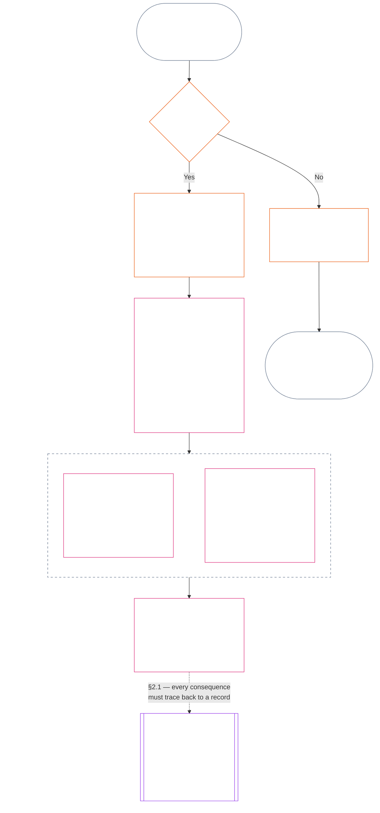
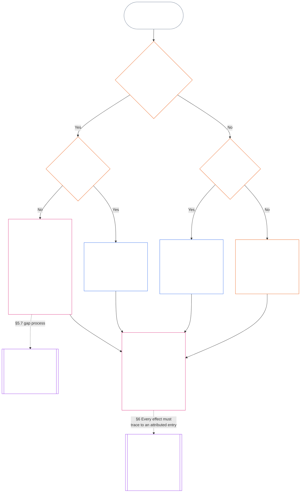

<!-- Complete unreviewed AI-assisted ja translation of current Chapter Eleven; source: core_11.000_standing_assessment.md; source snapshot: 05b7b839; 2026-11-09 source refresh applied. -->

# 第十一章：軌跡記録 — 質問1、何が起きたか

<strong>コーパス内の位置（非操作的）：ファイル構造と読み方</strong>

> このファイルは**感知者憲法の一部**であり、他の番号付き `core_*` ファイルと一つの本文として読まれる**場合に限って拘束力を持つ**。ここには**第十一章**、すなわち軌跡の流れにおける三つの問いと**質問1**（*何が起きたか?*）を§1–§6に収める。**質問2**（*どれほど良かったか、悪かったか?*）の回答は[第十二章](core_12_standing_measurement.md#chapter-twelve-standing-measurement--question-2-how-good-or-bad-was-it)にある。質問3（*その結果何が起きるか?*）は[第十三章](../../core_13.000_standing_integration.md#chapter-thirteen-standing-effects-and-integration)に続き、該当する違反軸 `s` = 7–9 の認定については、審査を[第十四章](../../core_14.000_misconduct_designation.md#chapter-fourteen-anti-constitutional-misconduct)の反憲法的不正行為の指定に限る。読み順、拘束力のある本文と補助資料の区別、コーパス版のメタデータは[README.md](README.md)に記載する。

<strong>読者向け案内（非操作的）：第十一章の位置とここに残る内容</strong>

> | 質問 | 担当と役割 |
> | --- | --- |
> | **1. 何が起きたか?** | 第十一章（本ファイル）：限定され、異議申立て可能な軌跡記録に検証済み事実を確定する。 |
> | **2. どれほど良かったか、悪かったか?** | [第十二章](core_12_standing_measurement.md#chapter-twelve-standing-measurement--question-2-how-good-or-bad-was-it)：助けと害を合算せずに検証済み事実を測定する。 |
> | **3. その結果何が起きるか?** | [第十三章](../../core_13.000_standing_integration.md#chapter-thirteen-standing-effects-and-integration)へ続く。 |
>
> 申し立て、人気、紛争の語りは質問1の回答ではない。望ましい評定は質問1の事実を与えず、望ましい結果も質問2の評定を与えない。

<strong>追跡</strong>

- 上流:
  - [憲法四元](core_00_preamble.md#constitutional-tetrad);
  - [二つの憲法上の目的](core_00_preamble.md#two-constitutional-aims);
  - [実質的利害](core_00_preamble.md#material-stake);
  - [前文 §6 主要な実務プロセスパイプライン](../../core_00.000_preamble.md#6-key-practical-process-pipelines)（*第九章から第十五章までの連鎖*）。
- 上流:
  - [第一章](core_01_c_stewardship_capacity_principles.md#chapter-01-principles-and-constraints)（1.010）（*平易な言葉によるアクセシビリティ*の責務ある管理を節ごとの説明に反映）;
  - [第一章 §16 — 責務ある管理の詳論](core_01_c_stewardship_capacity_principles.md#16-stewardship-in-depth)（1.010 §16）（*能力に結び付いた、追跡可能な軌跡の原則上の基礎 — 信頼、役割、認識*）;
  - [第二章から第四章](core_02_definition_structure.md)（*完全性、記録、検証*）;
  - [第五章](core_05__definitions_home.md#chapter-five-foundational-definitions)（5.000）（*第二章から第四章とあわせて読む定義と優位性*）。
- 上流: [第九章](core_09.000_system_alignment_certification_evaluation.md#chapter-nine-system-alignment-certification)（9.000）（*システム整合性認証*）；[第九章 Part C §11](core_09.010_system_alignment_certification_record_recertification.md#11-relationship-to-standing)（9.010 §11）（*軌跡への接続 — 検証済み入力となり得るもののみ*）。
- 軌跡の流れ:
  - [前文 §6.2 全連鎖のつながり](../../core_00.000_preamble.md#62-how-the-full-chain-fits-together);
  - [第十一章 — 軌跡記録](#chapter-eleven-standing-records--question-1-what-happened)（11.000）（*三つの問いの枠組みと質問1の記録*）;
  - [第十二章 — 軌跡測定](core_12_standing_measurement.md#chapter-twelve-standing-measurement--question-2-how-good-or-bad-was-it)（12.000）（*質問2の測定*）;
  - [第十三章 — 軌跡への効果と統合](../../core_13.000_standing_integration.md#chapter-thirteen-standing-effects-and-integration)（13.000）（*質問3の効果と統合*）;
  - [第十四章](../../core_14.000_misconduct_designation.md#chapter-fourteen-anti-constitutional-misconduct)（14.000）（*該当する違反軸 s = 7–9 の認定に限る指定*）。
- 本ファイルの各節:
  - [§1](#1-the-three-questions)（*三つの問いの枠組みと範囲*）;
  - [§2](#2-question-1--what-happened)（*質問1 — 検証済み事実と記録*）;
  - [§3](#3-question-1-event-type-guide--what-kind-of-help-or-harm-occurred)（*質問1の事象類型案内 — 助けと害の種類*）;
  - [§4](#4-standing-record-operational-requirements)（*検証と記録の要件*）;
  - [§5](#5-record-custody-and-opening-authority)（*記録の保管と開始権限*）;
  - [§6](#6-handling-a-standing-record)（*軌跡記録の取扱い*）。
- 下流:
  - [第十二章](core_12_standing_measurement.md#chapter-twelve-standing-measurement--question-2-how-good-or-bad-was-it)（12.000）（*質問2 — LEQU基準、測定次元、経路記述子、スロット規則、憲法上の入力、LEQU尺度、標準貢献測定、例示、質問3への引継ぎ*）;
  - [第十四章](../../core_14.000_misconduct_designation.md#chapter-fourteen-part-a-anti-constitutional-misconduct-designation)（14.000）（*指定のみ — 質問2の測定を再開しない*）;
  - [第十五章](../../core_15.000_forum.md#chapter-fifteen-forums-and-jurisdiction)（15.000）（*フォーラムの監督と経路付け*）;
  - [第XXVI-C条](core_06_rights_part_e.md#article-xxvi-c-timely-resolution-and-anti-delay-floor)（*適時解決*）;
  - [第XX条](core_06_rights_part_d.md#article-xx-a-justice-objective-and-scope)（*正義に関する制約*）。
- あわせて読む: [第五章 *軌跡状態、貢献、違反*](../../core_05.035_band_accountability.md#defa3-standing-state-contribution-and-violation)（5.035）（*標準定義への案内*）。
- あわせて読む: [README.md](README.md)（*読み順*）；[doc_architecture.md](../../doc_architecture.md)（*採択されない限り、拘束力のない編集用マップ*）。

 

第十一章は**検証済み事実記録（質問1）**の憲法上の所管である。[§1 三つの問い](#1-the-three-questions)から[§6 軌跡記録の取扱い](#6-handling-a-standing-record)までを扱う。[第十二章](core_12_standing_measurement.md#chapter-twelve-standing-measurement--question-2-how-good-or-bad-was-it)は質問2を所管し、[第十二章 §1 質問2 — どれほど良かったか、悪かったか?](core_12_standing_measurement.md#1-question-2--how-good-or-bad-was-it)から[第十二章 §9 質問3への引継ぎ — 質問間の測定接続](core_12_standing_measurement.md#9-hand-off-to-question-3--cross-question-measurement-hooks)までを扱う。質問3は第十三章で続く。

*平たい言葉で言えば、この章は何が起きたかを書き留め、軌跡記録を保管する。どれほど良かったか、どれほど有害だったかは第十二章で二つの別々の尺度により測定され、決して差し引きスコア一つにしない。事件の申立てだけでは軌跡にならない。*

> AI支援翻訳草稿 — 言語：標準的な書き言葉の日本語；出典：commit 9c2c8c10c871d91157bcd27b9f56ad6a1cec90d3；状態：未レビュー；部分範囲：第十一章 §1–§3のみ。本草稿は章全体の翻訳ではない。

### 1. 三つの問い

*平たい言葉で言えば：軌跡は三つの問いに順に答えて判断する。望む評定から事実を推測してはならず、望む結果を正当化するために評定を選んではならない。*

| 問い | 問いが尋ねること | 回答箇所 |
| --- | --- | --- |
| **1. 何が起きたか。** | どの事実が確認されているか、それは誰または何についてか、どの期間のことか、軌跡記録と異議申立ての状態はどうか。 | [第2節](#2-question-1--what-happened)および[第3節](#3-question-1-event-type-guide--what-kind-of-help-or-harm-occurred) |
| **2. どれほど良かったか、悪かったか。** | その事実が立証する貢献または違反の種類と大きさは何か。 | [第十二章第1節](core_12_standing_measurement.md#1-question-2--how-good-or-bad-was-it) |
| **3. その結果、何が起きるか。** | どのような承認、準備態勢、救済、保護措置、制限その他の結果が続くか。 | [第十三章](../../core_13.000_standing_integration.md#chapter-thirteen-standing-effects-and-integration) |

各問いはその前の答えに依存する。

- 問い1は問い2に必要な確認済み事実を示す。
- 問い2は問い3のためにその事実を測定する。
- 問い3は、望ましい結果に合わせて事実や評定を書き換えてはならない。

三つの問いへの答えを合わせると、一つの範囲を限定した出来事、または一つの定義済みパターンについて、軌跡の完全な評価となる。対象は時間の経過とともに複数の評価を受けることがあり、そのどれもが純得点や対象全体の評定ではない。貢献と違反の軌跡記録は問い1と問い2への答えを保持し、問い3の決定はそこから生じることを述べる。

#### 1.1 目的と範囲

本章は**システム**、**感知者**、**機関**について憲法上の記録枠組みを定め、[第十二章](core_12_standing_measurement.md#chapter-twelve-standing-measurement--question-2-how-good-or-bad-was-it)は測定枠組みを定める。これには、[**CS-9.305**](../../corpus_systems/cs_09.305_system_classification_machinery.md#cs-9305-part-a-system-classification-machinery)（*システム分類機構*）に基づいて分類されるすべてのシステムが含まれる。これらの枠組みは、うわさ、人気、曖昧な評判、内在的尊厳、一般的な価値を測定しない。いずれも軌跡評価の対象として認められない。

軌跡プロセスの流れは、次の場合にも有効であり続けなければならない。

- 以前に確認された貢献が古くなり、現在の能力や信頼性を示せなくなるとき。
- 違反が未解決のままであるとき。
- 修復に大きな費用がかかるとき。
- 責任が境界を越えるとき。または
- 行為者が組織の階層化や再命名を使って説明責任を妨げるとき。

以下は採択済みの実施文書に属する。

- 日常的な手順。
- エスカレーションの段階。
- 返還と修復の運用。
- 修復的説明責任の措置。
- インセンティブの設計。

第十二章の測定は、それ自体では、**武力行使**、拘束、その他の自由の制限を認めない。そのような結果は、比例性、最も制限の少ない手段、期間の限定、返還、修復的説明責任の要件を含め、第六章の**第XX条**（*確認済み違反後の正義*）を独立して満たさなければならない。

<strong>追跡 · 定義 · 評価 · 遵守</strong>

- 上流：[第1章§16 — 責務ある管理の詳細](core_01_c_stewardship_capacity_principles.md#16-stewardship-in-depth)；[第2章から第4章](core_02_definition_structure.md)；[第5章](core_05__definitions_home.md#chapter-five-foundational-definitions)。
- 下流：[§2](#2-question-1--what-happened)（*問い1*）；[§4](#4-standing-record-operational-requirements)（*確認と記録の要件*）；[§5](#5-record-custody-and-opening-authority)（*記録の保管と開設権限*）；[§6](#6-handling-a-standing-record)（*軌跡記録の取扱い*）；[第十二章§1](core_12_standing_measurement.md#1-question-2--how-good-or-bad-was-it)（*問い2の測定*）；[第十二章§2](core_12_standing_measurement.md#2-magnitude-and-severity-input-dimensions)（*測定入力の次元*）；[第十二章§3](core_12_standing_measurement.md#3-route-descriptor-catalogs-and-measurement-roles)（*経路記述子カタログ*）；[第十二章§4](core_12_standing_measurement.md#4-slot-grammar-and-shared-scaling)（*スロット文法と共通尺度*）；[第十二章§5](core_12_standing_measurement.md#5-constitutional-inputs-to-axis-assignment)（*憲法上の入力に基づく軸の割当て*）；[第十二章§6](core_12_standing_measurement.md#6-unified-proportional-lequ-scale--contribution-and-violation-axes)（*両軸の統一比例LEQU尺度*）；[第十三章](../../core_13.000_standing_integration.md#chapter-thirteen-standing-effects-and-integration)（*問い3*）。
- [重要性](../../core_05.050_band_oversight.md#materiality) · [O](../../core_05.050_band_oversight.md#materiality) · [M](core_05_band_oversight.md#materiality-determination-a) · [A](core_05_band_oversight.md#materiality-determination-a) · [C](core_05_band_oversight.md#materiality-determination-c)
- [害](../../core_05.035_band_accountability.md#harm) · [O](../../core_05.035_band_accountability.md#harm) · [M](../../core_05.035_band_accountability.md#harm-a) · [A](../../core_05.035_band_accountability.md#harm-a) · [C](../../core_05.035_band_accountability.md#harm-c)
- [比例性](../../core_05.035_band_accountability.md#proportionality) · [O](../../core_05.035_band_accountability.md#proportionality) · [M](../../core_05.035_band_accountability.md#proportionality-a) · [A](../../core_05.035_band_accountability.md#proportionality-a) · [C](../../core_05.035_band_accountability.md#proportionality-c)

### 2. 問い1 — 何が起きたか。

<strong>追跡</strong>

- 上流：[§1](#1-the-three-questions)（*三つの問いの枠組み*）；[第2章から第4章](core_02_definition_structure.md)（*記録、確認、定義から結果への追跡可能性*）。
- 四元の要素：**参加**；**監督**（異議を唱えられることとチャレンジの経路）。主な目的：**繁栄**と**継続**（後の測定に向け、貢献と違反の所見を分けて保持する追跡可能な記録）。
- 下流：
  - [§2.2](#22-silence-is-the-default)（*沈黙がデフォルト*）。
  - [§2.3](#23-protected-dissent-is-not-a-trigger)（*保護された異議は引き金ではない*）。
  - [§2.4](#24-linked-standing-records-and-no-offset-bridge)（*連結された軌跡記録と相殺しない仕組み*）。
  - [§2.5](#25-verified-input-gate)（*確認済み入力ゲート*）。
  - [§2.6](#26-stage-boundary)（*段階の境界*）。
  - [§2.7](#27-forum-boundary)（*フォーラムの境界*）。
  - [§3](#3-question-1-event-type-guide--what-kind-of-help-or-harm-occurred)（*出来事の種類の案内*）。
  - [§4](#4-standing-record-operational-requirements)（*記録の要件*）。
  - [§5](#5-record-custody-and-opening-authority)（*記録の保管と開設権限*）。
  - [§6](#6-handling-a-standing-record)（*軌跡記録の取扱い*）。
  - [第十二章§1](core_12_standing_measurement.md#1-question-2--how-good-or-bad-was-it)（*問い2の測定*）。
  - [第十二章§2](core_12_standing_measurement.md#2-magnitude-and-severity-input-dimensions)（*測定入力の次元*）。
  - [第十二章§3](core_12_standing_measurement.md#3-route-descriptor-catalogs-and-measurement-roles)（*経路記述子カタログ*）。
  - [第十二章§4](core_12_standing_measurement.md#4-slot-grammar-and-shared-scaling)（*スロット文法と共通尺度*）。
  - [第十二章§5](core_12_standing_measurement.md#5-constitutional-inputs-to-axis-assignment)（*憲法上の入力に基づく軸の割当て*）。
  - [第十二章§6](core_12_standing_measurement.md#6-unified-proportional-lequ-scale--contribution-and-violation-axes)（*両軸の統一比例LEQU尺度*）。
  - [第十三章](../../core_13.000_standing_integration.md#chapter-thirteen-standing-effects-and-integration) (13.000)（*問い3*）。

 

*平たい言葉で言えば：問い1は、何が起きたかについて、範囲を限定し異議を申し立てられる記録を確立する。評定や結果を考える前に、対象、出来事またはパターン、期間、確認済み事実、記録の状態を特定する。確認済みの助けと確認済みの違反には別々の軌跡記録を用い、一方が他方を消せないようにする。これらの軌跡記録は人気の点数でも曖昧なラベルでもない。*

**軌跡記録**とは、特定の対象、機能上の範囲、記録期間、審査状況、決定の文脈について、本章が用いる範囲を限定した記録である。測定を始める前に、以下を明らかにしなければならない。

- 軌跡記録が誰または何を対象とするか。
- 範囲を限定した出来事か、定義されたパターンか。
- 関連する行為と影響がいつ、どこで起きたか。
- どの事実が確認済みで、どの事実が未解決の争いにあるか。
- どの証拠、帰属、異議申立て経路が所見を裏付けるか。
- 軌跡記録の現在の審査、訂正、置換の状態。

図は出来事をたどり、軌跡記録を開始する引き金となるか、開始した記録が何を保持するかを示す。後続の小節は各ルールを述べる。「いいえ」の枝は主経路から右へ分かれる。

#### 2.1 軌跡記録：種類と対象

問い1では、確認済みの助けに**貢献の軌跡記録**を、説明責任の失敗を含む確認済みの害に**違反の軌跡記録**を用いる。一つの軌跡記録に両種類の所見をまとめてはならない。

- 軌跡記録は、感知者、機関、システム、評価、範囲を限定した出来事、役割、集合体、特定の行為者に関する記録、その他憲法上関連する単位を対象にできる。
  - 異なる対象、役割、システム、コミュニティ、記録期間、審査状況、決定の文脈を、一つの区別のない軌跡ラベルにまとめてはならない。
- 軌跡記録は、明確な始まりと終わりを持つ一つの出来事である**範囲を限定した出来事**、または反復行為の**パターン**を対象にできる。
  - パターンには定義された対象、範囲、審査期間が必要である。
- 同じ対象は、貢献と違反の軌跡記録を連結したものを含め、時間の経過とともに複数の軌跡記録を持ち得る。
  - 対象、重なり合う記録期間、範囲を限定した出来事、パターンまたは決定の文脈が共通する場合、関連する軌跡記録は**第4.2節**に従い、相互に**参照**しなければならない。
- 軌跡記録は独立した評判スコア、尊厳の順位、恒久的な状態、全般的な価値ラベル、統合されたスコアカードではない。
  - 運用上の要件は**第4節**に記載する。

後続の軌跡への効果はすべて第十三章に属する。それが軌跡記録自体の一部にならない形で、関連する軌跡記録にさかのぼれるようにしなければならない。

#### 2.2 沈黙がデフォルト

軌跡記録がないことは、感知者、機関またはシステムの通常の状態であり、ほとんどの感知者はその状態にとどまる。

- **第4節**に基づき引き金が確認された場合に限り、軌跡記録を開設する。指定された記録開設権限者が記入を承認し、別の記録保管者が記入しなければならない（**第5節**）。軌跡記録を次の目的で開設してはならない。
  - 基準値を設定するため。
  - 名簿を完成させるため。または
  - ゲート付き経路のゲート管理者がそう望むから。
- 当事者適格記録がないことは、何も意味しない。「未評価」「未検証」「記録なし」は、リスクや貢献の低さなどの証拠ではない。記録がないことを理由に、精査を強めたり、既定の扱いを引き下げたり、ゲート付き経路へのアクセスを条件付きにしたりしてはならない。
- いかなる機関またはシステムも、次の条件として軌跡記録、「記録なし」の証明、または記録開設への同意を求めてはならない。
  - **第III条**（*生存と不可欠なアクセス*）の必需品。
  - **第III-C条**（*労働と経済的な床*）の保護。
  - 通常の商取引。または
  - 影響を受ける当事者としての参加。
  例外は、[第十三章 §7.2 能力基準と許可](../../core_13.000_standing_integration.md#72-competency-bars-and-clearances)に基づく、信頼に敏感な特定のゲート付き経路について公表された能力基準である。そのゲート付き経路がなぜ信頼に敏感なのかを、その基準に明記しなければならない。
- 対象について軌跡記録を開設したときは、**第4節**に従って対象に通知しなければならない。文書化された[証拠保全](core_05_band_oversight.md#evidence-preservation)または安全上の必要が正当化する場合に限り、かつ定められた限られた期間に限り、通知を遅らせてよい。通知によって軌跡記録は異議申立て可能になる。軌跡記録の存在を知らない対象は、それに異議を申し立てたり訂正したりできない。

#### 2.3 保護された異議は引き金ではない

**第XI-D条**（*集会、異議、平和的抗議*）に基づく異議または平和的抗議は、[保護された非暴力の市民的不服従](core_06_rights_part_b.md#xi-d-nonviolent-civil-disobedience)を含め、確認済みの引き金ではない（[*異議と平和的抗議の床*](core_06_rights_part_b.md#xi-d-dissent-and-peaceful-protest)）。

- それによって違反の軌跡記録を開設、延長、加重してはならない。**第8.2節**の深刻度の入力でもなく、繰り返したからといってパターンになるわけでもない。
- 憲法上の床に独立して違反する、切り分け可能な行為は、それ自体の条件に基づいて記録する。抗議の見解、目的、対象を理由に加重してはならない。

#### 2.4 連結された軌跡記録と相殺しない仕組み

<strong>追跡</strong>

- 上流：[§2.1](#21-standing-records-kinds-and-subjects)（*貢献と違反の記録を分けること*）。
- 下流：
  - [§2.5](#25-verified-input-gate)（*確認済み入力ゲート*）。
  - [§2.7](#27-forum-boundary)（*フォーラムの境界*）。
  - [§4.2](#42-related-standing-record-cross-references)（*相互参照*）。
  - [第十二章§1](core_12_standing_measurement.md#1-question-2--how-good-or-bad-was-it)（*問い2の測定*）。
  - [第十二章§2](core_12_standing_measurement.md#2-magnitude-and-severity-input-dimensions)（*測定入力の次元*）。
  - [第十二章§3](core_12_standing_measurement.md#3-route-descriptor-catalogs-and-measurement-roles)（*経路記述子カタログ*）。
  - [第十二章§4](core_12_standing_measurement.md#4-slot-grammar-and-shared-scaling)（*スロット文法と共通尺度*）。
  - [第十二章§5](core_12_standing_measurement.md#5-constitutional-inputs-to-axis-assignment)（*憲法上の入力に基づく軸の割当て*）。
  - [第十二章§6](core_12_standing_measurement.md#6-unified-proportional-lequ-scale--contribution-and-violation-axes)（*両軸の統一比例LEQU尺度*）。
  - [第十三章](../../core_13.000_standing_integration.md#chapter-thirteen-standing-effects-and-integration) (13.000)（*問い3*）。
- あわせて読む：[第十三章 — 当事者適格の統合](../../core_13.000_standing_integration.md#3-automatic-integration-review-and-continuity) (13.000)（*放棄しないことと連結記録の統合*）；[第十三章 §7.2 — 能力基準と許可](../../core_13.000_standing_integration.md#72-competency-bars-and-clearances) (13.000 §7.2)；[第十三章 §5.2 — 当事者適格ロック](../../core_13.000_standing_integration.md#52-prevention--general-standing-locks) (13.000 §5.2)。

 

**中核ルール：**確認済みの**貢献の軌跡記録**と確認済みの**違反の軌跡記録**は、**第2.1節**に従い別々に保持する。貢献または違反の各所見は、それぞれ独自の軌跡記録にある、裏付けられた事実に基づかなければならない。分析と裏付け資料では、二つの記録経路を別々に追跡可能に保たなければならない。単独の記入も連結された一式も、純得点、混合得点、取引ではない。

- **違反の軌跡記録と軌跡ロック：**
  - 第十三章に基づき、違反の軌跡記録から導かれる該当する**軌跡ロック**は、軌跡を制限し、役割適格性を制約し、または確認済み違反が未解決の間に救済へのアクセスに影響することがある。
  - 軌跡ロックによって、貢献の軌跡記録に記録された確認済みの肯定的貢献を消してはならない。
  - 未解決の確認済み違反は、時間の経過だけを理由に割り引かない。
  - 確認済み違反によって、無関係な貢献の軌跡記録を偽の否定的な評判ファイルに書き換えてはならない。
- **貢献の軌跡記録と能力許可：**
  - 確認済みの貢献は、公表された**能力基準**に照らして該当する**能力許可**を支えることがある。現在のもので役割に関連する場合、信頼、役割、承認に関係する適格性も支え得る。
  - 確認済みの貢献を、確認済み違反の所見と相殺したり、平均化して低くしたり、言い訳にしたり、別のラベルに置き換えたりしてはならない。
  - ゲートを満たしても該当する軌跡ロックは放棄されない。

**唯一の例外：**違反の所見自体が主張された貢献を否定する場合 — たとえば、貢献記録が主張することを実際には行っていないと証拠が示す場合 — **第4.2節**に従う必要な相互参照を付し、適切な証拠・審査手続を通じて連結された貢献の軌跡記録を訂正または削除できる。ただし、その違反によって、別の貢献の軌跡記録に記録された無関係な助けが自動的に消されることはない。

#### 2.5 確認済み入力ゲート

ゲートは次のように機能する。

- 軌跡、信頼、役割、承認、または承認を受ける適格性に影響する決定には、該当する**貢献の軌跡記録**または**違反の軌跡記録**からの確認済み入力のみを使える。
- 申し立て、未裁定の主張、暫定的なルーティングタグ、受付時だけの説明その他の紛争段階の資料だけでは、軌跡に関する貢献の性質または違反の性質を示せない。
- 確認済み入力は**軌跡所見**である。すなわち、確認済み貢献の所見（軸I）または確認済み違反の所見（軸II）である。
- 貢献と違反の所見は別々の軌跡記録に置く（**第2.1節**参照）。

#### 2.6 段階の境界

軌跡記録の段階は分けておく。

- 問い1は確認済み事実を記録し、問い2はそれを測定する。
- 確認済みの事実的根拠が完成した時点で、問い2の測定がまだ保留中であっても軌跡記録を開設できる。
- 測定が行われるまで、問い2の欄にはスロットやカテゴリを示唆せず、保留中であると記載する。
- 軌跡記録に問い3の**軌跡効果**を記載または適用してはならない。

#### 2.7 フォーラムの境界

*平たい言葉で言えば：フォーラムは、紛争が監督され、異議を申し立てられ、確認済みの結果に変わる場所である。しかし、事件を申し立てたり物語上の争いに勝ったりしても、軌跡は更新されない。**第2.5節**の確認済み入力ゲートは引き続き適用される。フォーラムが第2章から第4章に基づいて事実を確認した場合、軌跡記録を**開設、更新、訂正**できる — または異議申立てにより**不適切な記録を退ける**ことができる。フォーラムは良いことと悪いことを一つの得点にまとめたり、独自に軌跡カテゴリを作ったりしない。*

本節が所管する問いは一つ、フォーラムの作業がどのように軌跡記録に届くかである。連鎖のその他の段階はここで示す所管者に属し、次の順で進む。

1. 紛争が申し立てられ、フォーラムは**フォーラム事件記録**を保持する。これは軌跡記録ではない。所管：[第十五章§2.3 フォーラム事件記録、軌跡記録、異議](core_11_forum.md#23-forum-case-records-standing-records-and-contests)；[§2.7.1 フォーラム事件記録](#271-forum-case-record)も参照。
2. フォーラムは[第2章から第4章](core_02_definition_structure.md)に基づいて事実を確認する。
3. 確認済みの所見は確認済み入力ゲートを通る。所管：[§2.5 確認済み入力ゲート](#25-verified-input-gate)。
4. 指定された記録開設権限者は、フォーラムであってもよく、軌跡記録を開設、更新、訂正するか、異議申立てにより不適切な記録を退ける。記録に含める事項は[§4.1 記録の最低限の内容](#41-minimum-record-contents)、行為できる者は[§5 記録の保管と開設権限](#5-record-custody-and-opening-authority)が所管する。
5. 軌跡記録には確認済み事実のみを保持し、その後に問い2がそれを測定する。所管：[§2.6 段階の境界](#26-stage-boundary)および[第十二章§1 問い2 — どれほど良かったか、悪かったか](core_12_standing_measurement.md#1-question-2--how-good-or-bad-was-it)。
6. 軌跡への効果がある場合は、軌跡効果を所管する[第十三章](../../core_13.000_standing_integration.md#chapter-thirteen-standing-effects-and-integration)に基づいて続く。

[第十五章](../../core_15.000_forum.md#chapter-fifteen-forums-and-jurisdiction)に基づくフォーラム群は、具体的な紛争が軌跡プロセスの流れをたどる方法を**監督する**。フォーラムは、[第十五章§6 適時の解決、重要性の階層、遅延防止の規律](core_11_forum.md#6-timely-resolution-materiality-tiers-and-anti-delay-discipline)および[第XXVI-C条](core_06_rights_part_e.md#article-xxvi-c-timely-resolution-and-anti-delay-floor)（*適時解決と遅延防止の床*）に基づき、以下を提供する。

- 利用しやすい異議申立て。
- 独立審査。
- フォレンジック支援。
- 是正措置の順序付け。
- 階層別の期間。

第2章から第4章に基づくフォーラムの所見が確認済み入力ゲートを満たす場合、それらは次のことができる。

- **第4.1節**に基づき、軌跡記録を**開設、更新、訂正する**。
- または、異議申立てにより**不適切な記録を退ける**。

##### 2.7.1 フォーラム事件記録

係属中の紛争についてフォーラムが持つ独自のファイルが[**フォーラム事件記録**](../../core_05.035_band_accountability.md#forum-case-record)であり、[第十五章§2.3 フォーラム事件記録、軌跡記録、異議](core_11_forum.md#23-forum-case-records-standing-records-and-contests)に定義されている。これは**軌跡記録ではない**。

##### 2.7.2 フォーラムの所見と問い2の測定

フォーラムの確認済み事実所見は、問い1の軌跡記録に関する事実的根拠となり得る。しかし、確認済みの貢献または違反がどれほど良かったか、悪かったかという問い2の測定を**決定しない**（[§2.6 段階の境界](#26-stage-boundary)）。したがって：

- フォーラム手続で貢献と違反の資料を、一つの純得点、混合された本案の答え、または区別のない軌跡ラベルに**まとめてはならない**。連結された軌跡記録は[§2.1 軌跡記録：種類と対象](#21-standing-records-kinds-and-subjects)および[§2.4 連結された軌跡記録と相殺しない仕組み](#24-linked-standing-records-and-no-offset-bridge)に基づき別々に保つ。
- フォーラムの成果は、紛争の物語、ルーティング上の便宜、合議体の好みを、立証可能な確認済み入力（[§2.5 確認済み入力ゲート](#25-verified-input-gate)）、別個の測定（[第十二章§1 問い2 — どれほど良かったか、悪かったか](core_12_standing_measurement.md#1-question-2--how-good-or-bad-was-it)）、または[第十三章](../../core_13.000_standing_integration.md#chapter-thirteen-standing-effects-and-integration)が所管する軌跡効果の仕組みの代わりに**してはならない**。

##### 2.7.3 フォーラムの境界によって減じられないもの

この境界は、次に基づき求められる異議申立て、救済、暫定的救済、手続上の保護を**減じない**。

- [第XIII-A条](core_06_rights_part_c.md#article-xiii-a-reliability-and-trustworthiness-baseline)（*信頼性と信用性の基準線*）。
- [第XIII-B条](core_06_rights_part_c.md#article-xiii-b-right-to-redress-and-remedy)（*救済と是正を受ける権利*）。
- [第十五章§6 適時の解決、重要性の階層、遅延防止の規律](core_11_forum.md#6-timely-resolution-materiality-tiers-and-anti-delay-discipline)。
- [第XXVI-C条](core_06_rights_part_e.md#article-xxvi-c-timely-resolution-and-anti-delay-floor)（*適時解決と遅延防止の床*）。または
- 関連する正義の各条。

確認済みのフォーラム所見は、他の確認済み入力と同じゲートを通じて軌跡に入る必要がある。その周囲を迂回してはならない。

### 3. 問い1の出来事の種類の案内 — どのような助けまたは害が起きたか。

*平たい言葉で言えば：事実の確認後に何が起きたかを説明するには、この表を使う。関係する貢献または違反の種類を特定する助けとなる。どれほど良かったか、悪かったかを決めたり、スロットを割り当てたり、その結果を決定したりするものではない。*

#### 3.1 貢献の出来事の種類

**適格性ルール：**主張された貢献は、追跡可能で、害を外部化せず、全体として現行の憲法に沿う場合に限り数える。

- 外部化された害、強制的な依存関係、権利の床の縮小、または隠された負担は、主張された貢献を失格にしたり制限したりし得る。
- 主張された貢献は、別個の違反所見を相殺しない。

以下の表の各行は、確認済みの助けがもたらす一般的な経路と、その憲法上の関連性を示す。同じ軌跡記録に複数の行が当てはまることがある。

| 確認済み貢献の種類 | 何が起きたか | 四元の要素 | 主な目的 |
| --- | --- | --- | --- |
| 生存と身体の維持 | 食料、住居、医療または安全が誰かに提供された | **参加**、**監督** | **繁栄** |
| 養育と教育 | 子どもが育てられ、高齢者が介護され、または他者が教育された | **参加**、**監督** | **繁栄**、**継続** |
| トラウマの解消 | 幸福を妨げる心理的損傷から回復するための支援が誰かに提供された | **参加**、**説明責任** | **繁栄** |
| 深刻な負担の除去 | 重い債務、搾取的な労働条件、または構造的障壁が取り除かれた | **参加**、**監督** | **繁栄** |
| 自律性の回復 | 誰かが自分の生活について意味のある選択肢を得た | **参加** | **繁栄** |
| 生産能力の拡大 | 道具、インフラ、機会によって他者が独立して繁栄できるようになった | **参加**、**監督** | **繁栄**、**継続** |
| 時間効率の向上 | 避けられる待機、事務上の摩擦、調整の間接負担が減り、ケア、休息、自律性、学習、権利に沿った仕事に使える時間が戻った | **参加**、**監督** | **繁栄** |
| 生態系またはインフラのリスク低減 | 環境の崩壊または重要システムの機能不全が防がれた | **監督**、**説明責任** | **継続**、**繁栄** |
| 生態系フットプリントの低減 | 他者や生態系に負担を移さず、資源利用、排出、土地・水の需要が確認可能な形で減った | **監督**、**説明責任** | **継続**、**繁栄** |
| 生態系の再生 | 劣化した土地、水域、生息地が機能し自律的に維持される状態へ回復された | **監督**、**説明責任** | **継続**、**繁栄** |
| 絶滅危惧種の保護 | 絶滅の危険がある種、またはその種が依存する生息地が喪失から保護された | **監督**、**説明責任** | **継続**、**繁栄** |
| 汚染と廃棄物の削減 | 汚染、有害排出、廃棄物が防止、除去、または安全に管理された | **監督**、**説明責任** | **繁栄**、**継続** |
| 安全、真実、監査可能性、異議申立て能力の強化 | 権利を守り権力に説明責任を負わせるため、機関や慣行が構築または修復された | **参加**、**監督**、**説明責任** | **繁栄**、**継続** |

#### 3.2 違反の出来事の種類

**適格性ルール：**違反の出来事の種類には、第2章から第4章に基づき、追跡可能で、範囲が限定され、監査可能で、異議申立て可能な状態にある確認済み違反の所見が必要である。

- 申し立て、暫定タグ、フォーラムの物語、受付ラベルはルーティングやトリアージを助けることがあるが、問い1を完了しない。
- 肯定的な貢献は確認済み違反を相殺、免責、解消、または再ラベルしない。

以下の表の各行は、確認済みの損失、危険、義務不履行がもたらす一般的な経路と、その憲法上の関連性を示す。同じ軌跡記録に複数の行が当てはまることがある。

| 確認済みの損失または危険の種類 | 何が起きたか | 四元の要素 | 主な目的 |
| --- | --- | --- | --- |
| 生存または身体維持の剥奪 | 避けられた死亡、ケアの拒否、安全でない状況、または生存に必要な物質的条件の剥奪が起きた | **説明責任**、**参加** | **繁栄** |
| 避けられる深刻な負担 | 圧倒的、強制的、または体系的に転嫁された負担が、幸福または自律性を実質的に損なった | **説明責任**、**参加** | **繁栄** |
| 強制による自律性の喪失 | 強制、操作、信頼できる脅威、拘束、自由への危険が生じた | **説明責任**、**参加** | **繁栄** |
| 権利の床の破壊 | 交渉不能な憲法上の床、最高性、または異議申立て・救済へのアクセスが実質的に侵害された | **説明責任**、**監督** | **繁栄**、**継続** |
| 生態系またはインフラの損傷 | 憲法上の幸福に必要な条件が損なわれた | **説明責任**、**監督** | **継続**、**繁栄** |
| 汚染または廃棄物による害 | 汚染、有害排出または廃棄物が空気、水、土壌または健康を損なった | **説明責任**、**監督** | **繁栄**、**継続** |
| 種または生息地の破壊 | 絶滅の危険がある種、またはその種が依存する生息地が破壊、分断、喪失への誘導を受けた。相殺可能と扱われた喪失も含む | **説明責任**、**監督** | **継続**、**繁栄** |
| 生態系の回復能力の喪失 | 損傷後に生態系が再生する能力が閉ざされた、または避けられたはずの形で回復が困難もしくは不可能になった | **説明責任**、**監督** | **継続**、**繁栄** |
| 外部化された生態系損害または枯渇 | 生態系の費用が他者や生態系に転嫁された、資源が再生能力を超えて枯渇した、またはフットプリントや持続可能性の主張が続く劣化を隠した | **説明責任**、**監督** | **継続**、**繁栄** |
| 生産能力の破壊 | 独立して繁栄するために必要な道具、能力、関係、資源が閉ざされた | **説明責任** | **繁栄** |
| 安全、真実、監査可能性の劣化 | 隠蔽、誤情報、壊れた記録、アクセスできない異議申立て経路、または審査できない集計が起きた | **監督**、**説明責任** | **繁栄**、**継続** |
| 説明責任の妨害 | 回答責任の仕組み — 証拠の完全性、確認、フォーラム手続、軌跡記録、救済期間、異議申立て・救済経路 — への確認済みの干渉が起きた。妨害が別個の根本的損害に対するメタ攻撃である場合は、連結された別個の違反軌跡記録を開設する | **説明責任**、**監督**、**適時性** | **繁栄**、**継続** |
| システムの掌握または依存の悪用 | 構造的な可能化、依存の非対称性の悪用、回避防止設計、または説明責任経路の掌握が起きた | **説明責任**、**参加** | **継続**、**繁栄** |

### 4. 検証と記録の要件

<strong>追跡</strong>

- 上流： [§2](#2-question-1--what-happened) (*第一の問いの記録と事象類型ガイド*); [第二章から第四章](core_02_definition_structure.md) (*定義から結果に至る記録、検証、追跡可能性*)。
- 下流：
  - [§4.1](#41-minimum-record-contents) (*最小限の内容*);
  - [§4.2](#42-related-standing-record-cross-references) (*相互参照*);
  - [§5](#5-record-custody-and-opening-authority) (*記録の保管と開始権限*);
  - [§6](#6-handling-a-standing-record) (*軌跡記録の取扱い*);
  - [第十二章 §1](core_12_standing_measurement.md#1-question-2--how-good-or-bad-was-it) (*第二の問い*)。
- 併読：[CF-15.415 §8 制限情報に関する権限](../../corpus_forum/cf_15.415_routing_operations_transfer_certification_representative_treatment.md#cf-15415-8-restricted-information-authority) (*[§4.1](#41-minimum-record-contents)に定める開示制限をめぐる争いの最初の窓口*)。

 

*平たい言葉で言えば：この節は、各軌跡記録に含める事項、関連する軌跡記録どうしの相互参照の方法、記録の版管理を定める。軌跡記録を開始し保管できる者、および異議申立てや訂正の方法は[§5 記録の保管と開始権限](#5-record-custody-and-opening-authority)に定める。第二の問いの測定値を加えられるのは、検証済みの事実的基礎を記録した後だけである。*

必要な証拠と記録の詳細度は、実質的利害やシステムのクラスに応じて高めてもよい。この拡張によって、対象となる感知者、機関、システムが軌跡パイプラインから除外されることはない。

#### 4.1 記録に含める最小限の内容

軌跡記録には以下の項目を記載し、最後の二つの小節では各軸の追加項目を定める。軌跡記録に含められる事項を決める検証済み入力のゲートは[§2.5 検証済み入力ゲート](#25-verified-input-gate)に定める。第一の問いの事実を第二の問いの測定から分ける規則は[§2.6 段階の境界](#26-stage-boundary)に定める。

##### 4.1.1 すべての軌跡記録に必須の項目

すべての軌跡記録には、最低限、次を含めなければならない。

- 軌跡記録の種類 — **貢献軌跡記録**または**違反軌跡記録**;
- 評価対象となる者または物、および評価の範囲。関連するシステム境界、役割境界、影響を受けるコミュニティ、依存関係を含む;
- 評価対象となる行為または認定事項。軌跡記録が依拠する行為、不作為、義務、影響、限定された事象、範囲内のパターン、貢献記録、違反認定を含む;
- 記録対象期間と現在の審査状況。例：暫定、明記された目的について最終、異議申立て中、後続版に置換済み、予定された再評価の時期;
- **§4.2**に従って相互参照する関連軌跡記録;
- 第二章から第四章に基づき、軌跡記録を立証可能、審査可能、争訟可能にする公的記録、証人、測定、監査、フォーラムの決定、その他の検証資料;
- 事実的基礎を検証して記録の記入を承認した別個の**記録開始権限者**と、軌跡記録を記入して保管する**記録保管者**。どちらも**§5**に基づき名前を明記する;
- 軌跡記録への異議申立て方法。以下を含む。
  - 審査するフォーラムまたは権限者;
  - 開示制限; および
  - 次の事項の条件:
    - 訂正;
    - 回復;
    - 失効; または
    - 予定審査;
- 測定が行われた時点で、以下に定める各軸固有の第二の問いの測定項目。

##### 4.1.2 検査可能で帰属を特定できる行為

帰属特定行為の証拠は、次のように軌跡記録に関係する。

- 重要システムの責務ある管理または実質的な運用権限を行使する人員・代理人について、再構成可能な帰属特定行為の証拠は、混成チームの標準ログ記録契約として[**CS-16.305 §10 検査可能で帰属を特定できる行為**](../../corpus_systems/cs_16.305_critical_system_stewardship.md#cs-16305-103-inspectable-attributable-action)に定められている。
- その証拠をこの軌跡記録の入力にできる。
- その証拠は、この軌跡記録の代わりにはならない。
- 軌跡記録にはAIモデルの重み（モデル内部の数値）や非公開の推論を含めない。例外は、誰または何が責任を負うのかを示すものが他に残っていない場合に限る。
- プライバシーまたはシステムの保護された内部状態に関係するというだけで、事項が軌跡測定の対象外になることはない。軌跡に関わる事項であれば、引き続き測定する。

##### 4.1.3 プライバシーまたは不透明性による免除なし

プライバシー、秘密保持、またはシステム内部の不透明性を理由に、事項を軌跡測定から免除することはできない。これらが検証済み記録の要件と衝突する場合、独立審査者のアクセスを維持したうえで、[第一章 §13.1 基本的なトレードオフ原則](core_01_b_interaction_interpretation.md#131-core-tradeoff-principles)とその決定記録の規律に従って衝突を解決する。

##### 4.1.4 貢献軌跡記録の追加項目

**貢献軌跡記録**には、さらに次を記載しなければならない。

- 次を含む第二の問いの貢献測定値:
  - 主たるバンド;
  - 割り当てがある場合はスロット `s`（[第十二章 §4 スロット文法と共通スケーリング](core_12_standing_measurement.md#4-slot-grammar-and-shared-scaling)を参照）;
  - 証拠の基礎;
  - 実質性に関する理由; および
  - 透明性のある裏付けに用いた採用済みLEQUまたは同等の較正;
- 貢献を共有する場合、次の点を考慮した功績の配分方法:
  - 時間;
  - 労力;
  - 調整;
  - 維持管理;
  - 因果的貢献; および
  - 目立ちにくい支援作業;
- ここに記録した貢献測定値を、後の第十三章の軌跡効果が依拠しなければならない基礎とすること。

##### 4.1.5 違反軌跡記録の追加項目

**違反軌跡記録**には、さらに次を記載しなければならない。

- 次を含む第二の問いの違反測定値:
  - 認定権限者または記録上の根拠;
  - LEQUによる影響;
  - 割り当てがある場合はスロット `s`（[第十二章 §4 スロット文法と共通スケーリング](core_12_standing_measurement.md#4-slot-grammar-and-shared-scaling)を参照）;
  - 該当する場合は手続・対応の性質; および
  - 第十四章の指定状況;
- 複数の行為者が違反の責任を共有または分担する場合、特定の一人に対して不利益な軌跡評価を行った検証済みの理由。次の事項を含む。
  - 因果的役割;
  - 義務;
  - 権限;
  - 統制;
  - 予見可能性;
  - 利益;
  - 隠蔽; または
  - 実行可能な予防能力;
- 違反認定にフォーラムでの開示漏れまたは故意の忌避手続違反が含まれる場合（測定上の規律について**§8.2.2** (*害の生じ方の記録方法*)を読む）:
  - 開示漏れまたは違反についての検証済み根拠;
  - 果たされなかった開示義務または忌避義務;
  - 認定された場合の行為者の認識、無謀さ、または意図; および
  - その行為が次の事項に実質的な影響を与えたかどうか:
    - 合議体の適法性;
    - 独立性;
    - 忌避への異議申立て;
    - 証拠の完全性;
    - 救済の時期;
    - 代替経路への振分け; または
    - 実際上の争訟可能性;
- ここに記録した違反測定値を、後の第十三章の軌跡効果が依拠しなければならない基礎とすること。

#### 4.2 関連する軌跡記録間の相互参照

貢献軌跡記録と違反軌跡記録が同じ対象についての記録である、時期が重なる、または同じ事象、パターン、決定を扱う場合、双方から相手を参照しなければならない。

各相互参照には、最低限、次を明記する。

- 関連する軌跡記録と、それが貢献記録か違反記録か;
- **§2.4**に基づき、違反認定が主張された貢献を否定、訂正、または限定する場合を含め、二つの軌跡記録が関連する理由;
- 二つの軌跡記録に共通する対象、事象、パターン、または決定; および
- それぞれの期間または対象事項がどのように重なるか。

相互参照は、次の条件を満たさなければならない。

- 監査可能で、異議申立てに開かれている;
- 個別の測定に取って代わらない;
- 統合スコアを作らない; および
- 実際には同じ事項や期間を扱わない二つの軌跡記録が、同じものを扱うように見せない。

#### 4.3 集団記録と行為者別記録

複数の感知者または事業体が同じ利益または違反を共有する場合、システムは集団軌跡記録と行為者ごとの個別記録の双方を保持できる。次の規則を適用する。

- **§2.1**に従い、貢献認定と違反認定は別々の軌跡記録に残さなければならない。
- 功績を共有する場合、各感知者が実際に貢献した内容に沿って評価することが望ましい。次の点を含む。
  - 役割;
  - 時間;
  - 労力;
  - リスク;
  - 技能;
  - 調整;
  - 維持管理; および
  - 因果的影響。
- 多くの感知者が助力し、個々の分担を明確に分けられない場合は、広く配分することを優先する。
- 共有された違反について、集団に属するという理由だけで非難を帰属させてはならない。
- 行為者別の不利益な軌跡評価には、次の事項への検証済みの結び付きを要する。
  - 因果的役割;
  - 義務;
  - 権限;
  - 統制;
  - 予見可能性;
  - 利益;
  - 隠蔽; または
  - 実行可能な予防能力。

#### 4.4 版管理

次のいずれかが変わったとき、軌跡記録に新しい版を作成しなければならない。

- 重要な事実;
- 認定事項;
- 審査結果;
- 是正状況;
- 貢献の証拠;
- 実装上の較正; または
- 憲法上の規則。

後続版では、次の対応ができる。

- 以後に適用されるよう軌跡記録を更新する;
- 誤りがあった場合に遡及して訂正する;
- 完了した決定上の文脈について失効させる; または
- 新たな決定上の文脈について旧版に取って代わる。

後続版では、以前の監査証跡を保持し、何が変わったか、誰が変更したか、**§5**のどの記録開始権限または保管権限に基づくか、どの検証資料に依拠したか、誰の依頼によるかを説明しなければならない。

#### 4.5 実装ツール

チームは、次を含む軌跡記録の実用ツールを構築できる。

- データ項目;
- タグ;
- 閾値;
- 書式;
- ダッシュボード;
- 審査手順; および
- **第十三章**に基づく反復作業向けの公表済み**標準貢献測定値**。

こうしたツールでは、**§4.1**が求める項目を個別に見える状態とし、異議申立てを可能にしなければならない。これらの項目を単一の不透明なスコアや隠れたラベルに埋め込んではならない。

### 5. 記録の保管と開始権限

<strong>追跡</strong>

- 上流:
  - [第八章 §2 *憲法上の四議席の要件*](core_07_functional_independence_segregation_of_duties.md#2-four-seat-constitutional-requirement)（8.000 §2）（*本節が軌跡記録に適用する原則層の要件; ここで狭めてはならない*）;
  - [第一章 §19.3 *複数による検出と審査*](core_01_c_stewardship_capacity_principles.md#193-misalignment-detection)（1.010 §19.3）;
  - [§2.2](#22-silence-is-the-default)（*検証済みの発動条件; 対象への通知*）;
  - [§4.1](#41-minimum-record-contents)（*最小限の内容*）;
  - [§4.4](#44-versioning)（*版管理*）;
  - [§2.7](#27-forum-boundary)（*フォーラムは開始、更新、訂正、または無効化を行える*）;
  - [第二章から第四章](core_02_definition_structure.md)（*記録、検証、追跡可能性*）;
  - [証拠保全](core_05_band_oversight.md#evidence-preservation)（*証拠の保管連鎖*）。
- 憲法四元の柱: **説明責任**（各記入について指名された行為者が説明する）; **監督**（いかなる当事者も自らの主張を検証しない）。主たる目的: **繁栄**および**継続**。
- あわせて読む:
  - [第五章 *システム憲章*](../../core_05.040_band_continuity.md#system-charter)（5.040）および
  - [*機関憲章*](../../core_05.040_band_continuity.md#institutional-charter)（*憲章対象範囲における記録開始権限機関と保管者を憲章役割図が指名する、公表済みの対象範囲文書*）;
  - [第七章 §4 *憲章役割図と軌跡記録の保管*](core_07_charters.md#4-the-charter-role-map-and-standing-record-custody)（7.000 §4）;
  - **CI-8.205 §6**（*システム憲章および機関憲章の内容、審査、形成テンプレート*）— 軌跡記録保管のフィールド;
  - [**CJS-5.125 §11** *憲法上のレーンと機能分離*](../../corpus_joint_structure/cjs_05.125_accountability_operations.md#constitutional-lane-and-functional-separation)（*記録に関わる職務が置かれる五つのレーン; 職務分離*）;
  - **CI-8.205 §2**（*機能分離レーン — 公表済みレーン・マップ。システム憲章または機関憲章が沈黙する場合の代替手段*）;
  - **CI-8.205 §3**（*権限系統と委任管理*）;
  - **CI-16.205 §6**（*席のカタログ — プロセス役割の類型と運用上の境界*）— 四つの記録席を席種1–4として定義し、誤った席の規則を含む;
  - **CF-15.435 §6**（*自己調査の禁止*）および
  - **CF-15.435 §8**（*記録、照会、バックアップ経路*）は検証済み認定事項の引継ぎについて;
  - [第十五章 §2.1](core_11_forum.md#21-lead-default-limits)（15.000 §2.1）（*自己裁定に対するバックアップ*）;
  - [CS-16.305 §10 監査可能で帰属可能な行為](../../corpus_systems/cs_16.305_critical_system_stewardship.md#cs-16305-103-inspectable-attributable-action)（*誰が承認したか; ログは軌跡記録ではない*）;
  - [第一章 §17.5](core_01_c_stewardship_capacity_principles.md#175-duty-to-resist)（1.010 §17.5）（*停止、拒否、記録、上位への報告*）。
- 下流: [§6](#6-handling-a-standing-record)（*保管確定後に保有者が軌跡記録に対して行うこと*）; [第十二章 §1](core_12_standing_measurement.md#1-question-2--how-good-or-bad-was-it)（*質問2は本節と§6に基づき記入された軌跡記録のみを測定する*）; [第十三章](../../core_13.000_standing_integration.md#chapter-thirteen-standing-effects-and-integration)（13.000）（*質問3の効果は帰属付き記録まで追跡される*）。

 

*平たい言葉で言えば、本節は[第八章 §2 憲法上の四議席の要件](core_07_functional_independence_segregation_of_duties.md#2-four-seat-constitutional-requirement)の四席規則を軌跡記録に適用する。変更を求めること、事実を検証すること、軌跡記録を記入・保管すること、異議を審理することは別々の仕事である。軌跡記録を検証する部署は決してそれを記入せず、その異議も審理しない（[§5.1 職務の分離](#51-separation-of-duties)）。システム憲章または機関憲章は、[第七章 §4 憲章役割図と軌跡記録の保管](core_07_charters.md#4-the-charter-role-map-and-standing-record-custody)の憲章役割図を通じて各席の担当者を指名する。本節は軌跡記録に固有の事項を加える。すなわち、誰を記録から除外するか（[§5.4 自己保管は禁止](#54-no-self-custody)）、運営者記録と利害関係者記録で除外がどう異なるか（[§5.5 対象別の二種類の軌跡記録](#55-two-kinds-of-standing-record-by-subject)）、一つの記録について利益相反のある保管者をどう扱うか（[§5.6 一つの軌跡記録における利益相反のある保管者](#56-conflicted-custodian-on-a-single-standing-record)）、席が指名されていない場合（[§5.7 システム憲章または機関憲章が席を指名していない場合](#57-when-a-system-charter-or-institutional-charter-leaves-a-seat-unnamed)）または憲章が適用されない場合（[§5.8 システム憲章または機関憲章が軌跡記録に及ばない場合の代替経路](#58-fallback-when-no-system-charter-or-institutional-charter-reaches-the-standing-record)）の行き先、そして非公式で小規模な業務に規則をどう適用するか（[§5.9 非公式および小規模な記録](#59-informal-and-small-scope-records)である。[§6 軌跡記録の取扱い](#6-handling-a-standing-record)は、保管確定後に保有者が軌跡記録に対して行うことを定める。*

#### 5.1 職務の分離

これは[第八章 §2 *憲法上の四議席の要件*](core_07_functional_independence_segregation_of_duties.md#2-four-seat-constitutional-requirement)を軌跡記録に適用する。すべての軌跡記録には四つの職務が関わり、同一記録上でそれぞれ別の席となる:

| 職務 | 内容 | [CJS-5.125 §11 *憲法上のレーンと機能分離*](../../corpus_joint_structure/cjs_05.125_accountability_operations.md#constitutional-lane-and-functional-separation)に基づくレーン |
| --- | --- | --- |
| **申立て** | 軌跡記録の開設、訂正、失効、または置換を求めること。対象または請求者自身による申立ても含む | 実行レーン、または申立てを行う当事者。その当事者は自身の申立てについて開始席を担い、申立てのために機関を必要としない |
| **検証** | 第二章から第四章に基づき、事実的根拠を**section 2.5**の門まで確立すること — 記録開始権限機関の行為 | 保証・監査 |
| **記入・保管** | **section 4.4**に基づく版の作成、軌跡記録の保管、異議申立て経路の公表 — 記録保管者の行為 | 公表・証拠 |
| **異議審理** | 軌跡記録への異議を審理し、**section 2.7**に基づき記録を無効化、訂正、または確認すること | 異議・審査 |

共同ホストは次のように限定される（[第八章 §6 比例的拡張と共同ホスト](core_07_functional_independence_segregation_of_duties.md#6-proportional-scaling-and-merged-hosting)を参照）:

- **席の共有:** **CJS-5.125 §11**（*説明責任: 分散され比例的な権限条件*）および**CI-8.205 §2**（*機能分離レーン*）に基づく組合せの共同ホスト保護策を機関が公表し、その保護策が監査可能で異議申立て可能でない限り、一つの部署が同一軌跡記録の二つの席を担ってはならない。
- **決して統合しない職務:** 一つの部署が同一軌跡記録を検証して記入すること、または検証して異議を審理することは決してできない。
- **運営者は検証しない:** 軌跡記録の対象となるシステムを運用する部署は、そのシステムの実行レーンを担うため、そのシステムに関する軌跡記録を検証しない。
- **統合は例外:** 公表済み保護策に基づく共同ホストは、小規模な採択者向けに類型と規模に応じて認められる例外であり、既定ではない。
- **利害が大きい場合:** 実質的利害またはシステムの類型が大きい場合、席は別々の部署が担う。

#### 5.2 指名された記録開始権限機関

軌跡記録の開設、訂正、失効、置換はすべて、[**記録開始権限機関**](../../core_05.035_band_accountability.md#record-opening-authority)（第二章から第四章に基づいて事実的根拠を検証し、変更を許可する権限が行為に先立って公表された役割、部署、フォーラム、または団体）が承認する。

- **システム憲章または機関憲章で指名:** [システム憲章](../../core_05.040_band_continuity.md#system-charter)または[機関憲章](../../core_05.040_band_continuity.md#institutional-charter)を持つシステム、機関、事業について、その憲章対象範囲に関する軌跡記録の記録開始権限機関および記録保管者を憲章自体が指名するか、それらを指名する公表済み文書を参照する（[第七章 §4.6 軌跡記録の保管](core_07_charters.md#46-standing-record-custody); **CI-8.205 §6**（*システム憲章および機関憲章の内容、審査、形成テンプレート*））。
- **フォーラム:** フォーラムは**section 2.7**の条件に従い、記録開始権限機関として行為する。軌跡記録を検証したフォーラムはその記録への異議を審理せず、異議は[第十五章](../../core_15.000_forum.md#chapter-fifteen-forums-and-jurisdiction)および**CF-15.420**（*上訴、二次審査、審査経路の完了*）に基づく二次審査へ進む。
- **権限機関が指名されていない場合:** システム憲章または機関憲章が軌跡記録に及ぶものの、必須の席を指名していない場合は、[§5.7 システム憲章または機関憲章が席を指名していない場合](#57-when-a-system-charter-or-institutional-charter-leaves-a-seat-unnamed)を適用する。いずれの憲章もフォーラムの指定も軌跡記録に及ばない場合は、[§5.8 システム憲章または機関憲章が軌跡記録に及ばない場合の代替経路](#58-fallback-when-no-system-charter-or-institutional-charter-reaches-the-standing-record)を適用し、さらに[第十九章](../../core_19.000_amendment_ratification.md)に基づく採択文書または軌跡の流れを運用する団体の公表済み規則が権限機関を指名する。
- **暫定記入:** 指名された権限機関なしに行われた記入には**暫定**と表示する。これは**section 2.2**に基づいて証拠と通知を保全するが、**section 4.1**の検証済み入力にも第十三章の効果にもならない。指名された権限機関が確認、訂正、または無効化するまで、それらの効力はない。

#### 5.3 記録保管者

すべての軌跡記録には、指名された[**記録保管者**](../../core_05.035_band_accountability.md#record-custodian)がいる。この者は軌跡記録を保管し、**section 4.4**に基づく版管理を担い、**section 4.1**に基づく異議申立て経路を公表し、軌跡記録の継続性について説明する。これは記録開始権限機関とは別の席である（[§5.1 職務の分離](#51-separation-of-duties)）。

- **保管を途切れさせない:** 保管者が解散し、利益相反となり、または交代するとき、完全な監査証跡とともに[証拠保全](core_05_band_oversight.md#evidence-preservation)に従って保管を移す。移管先はシステム憲章、機関憲章、またはバックアップ指定が指名する後継者とし、誰も指名されていなければバックアップ記録保管者（**CF-15.415 §9**（*バックアップ記録保管者*））とする。
- **バックアップ記録保管者が行為できない場合:** **section 2.7**に基づく監督フォーラムが軌跡記録を保管するか、**CI-8.205 §6**（*システム憲章および機関憲章の内容、審査、形成テンプレート*）のフィールド10の基準に合う保管者を指名する。対象、請求者、異議申立人は直ちに軌跡記録をフォーラムへ持ち込める。軌跡記録を保管するフォーラムも、保管者を指名するフォーラムも、その軌跡記録への異議を審理しない。
- **一つの軌跡記録か、全記録庫か:** 利益相反が一つの軌跡記録だけに関わるなら、その記録だけを移す（下記の*一つの軌跡記録における利益相反のある保管者*を参照）。保管者自体が終了する、または継続できない場合は、その者が保管するすべての軌跡記録を証跡とともに移す。

#### 5.4 自己保管は禁止

以下の者は、軌跡記録の記録開始権限機関または記録保管者として行為してはならない。

- 軌跡記録の対象;
- 軌跡記録が扱う貢献を主張する当事者、または違反を申し立てる当事者; および
- [実質的支配線](../../core_05.035_band_accountability.md#material-control-line)上にあり、それらの当事者を実質的に支配する、またはそれらの当事者によって実質的に支配される部署。

この除外に加えて:

- **対象内部の管理者:** 軌跡記録の対象（すなわち、その記録が扱う当事者、憲章対象範囲、またはシステムの内部で働く者）の一部であり、重要システムの管理または実質的な運用権限を行使する管理者は、[第一章 §17.5 抵抗する義務](core_01_c_stewardship_capacity_principles.md#175-duty-to-resist)および[CS-16.305 §10 監査可能で帰属可能な行為](../../corpus_systems/cs_16.305_critical_system_stewardship.md#cs-16305-103-inspectable-attributable-action)に基づくすべての義務を保持する。すなわち、自らの支配下にあるものを停止し、再構成可能な集合をログに記録し、保有する証拠を保存し、通知し、上位へ報告する。これらの行為はいずれも、事実の検証でも軌跡記録の記入でもない。
  - **独立検証:** 通常の記録開始権限機関そのものが対象であるか、その支配線上にある場合、軌跡記録は独立検証へ回す。**section 2.7**に基づくフォーラム、**CF-15.435 §6**（*自己調査の禁止*）に基づく独立調査サービス、または公表された権限を持つ事前指定の代替機関のうち、システム憲章、機関憲章、または代替指定が最初に指名するものとする。
- **既定の担当:** いずれも指名されていない場合、バックアップ記録機関（**CF-15.415 §7**（*バックアップ記録機関*））が既定の記録開始権限機関となり、バックアップ記録保管者（**CF-15.415 §9**（*バックアップ記録保管者*））が既定の保管者となる。
- **指名された経路がない場合:** 指名経路が存在しないことは、管理者がログで明示すべき欠落であり、自ら軌跡記録を記入する理由ではない。
- **二つの規則の併用:** この規則は軌跡記録に対する利害を理由に当事者を除外する。[§5.1 職務の分離](#51-separation-of-duties)は機能を理由に各席を分ける。両方が適用され、より限定的な回答が優先する。

#### 5.5 対象別の二種類の軌跡記録

対象によって利益相反が異なるため、保管規則も異なる。対象が憲章主体、その憲章対象範囲、またはその主体が管理するシステムである軌跡記録は、**運営者軌跡記録**である。対象がそれらのシステムを使い、依存し、または影響を受ける感知者もしくは機関である軌跡記録は、**利害関係者軌跡記録**である。いずれの種類にも当たらない軌跡記録には、上記の*職務の分離*および*自己保管は禁止*が追加規則なしで適用される。どちらの種類も両規則に従い、より限定的な回答が優先する。軌跡記録の対象に憲章主体側と利害関係者の両方が含まれる場合、運営者軌跡記録の規則が適用される。

- **運営者軌跡記録:** 憲章主体が自らを裁くことになるため、利益相反は恒常的である。したがって、その[実質的支配線](../../core_05.035_band_accountability.md#material-control-line)上のすべての部署は、この種のすべての軌跡記録から除外される。これは個々の記録ごとではなく、憲章対象範囲全体に適用される規則である。
  - 憲章役割図は、記録開始権限機関、記録保管者、異議申立てを審理する席、および独立経路を指名し、すべて支配線の外に置く（[第七章 §4 憲章役割図と軌跡記録の保管](core_07_charters.md#4-the-charter-role-map-and-standing-record-custody)）。
  - 憲章主体はそれらを選出、任命、支配する経路を通じて資金提供、または解任できず、単独でその記載を変更することもできない。
  - 支配線内の部署は、単独であれ、共同ホスト型の保護策の下であれ、いずれの席も担えない。
- **利害関係者軌跡記録:** 利益相反は、記録ごとに異なる、記録に対する憲章主体の利害である。憲章主体は、しばしば請求者、違反を申し立てる当事者、または記録の対象事項によって影響される当事者であり、サービス、アクセス、または支払いを通じて対象に対する権力を持つ。そのため除外は記録ごとに判断される。
  - 憲章主体の部署またはその支配線上の部署が席を担えるのは、憲章主体もその支配線上の部署も、請求者、違反を申し立てる当事者、または軌跡記録が判断する利害を持つ当事者でない場合に限る。そうでなければ、*自己保管は禁止*の定めに従い、軌跡記録は支配線外にあるレーン・マップ上の部署、または独立検証に回す。
  - 対象についての憲章主体自身のログ、苦情、報告は、*記録者の陳述は入力である*に基づく入力であり、決して検証ではない。
  - 憲章主体は、対象のサービスまたはアクセスを、軌跡記録への対象の協力に依存させてはならない。対象には**section 2.2**に基づく通知と、公表された異議申立て経路が維持される。

#### 5.6 一つの軌跡記録における利益相反のある保管者

指名された保管者が*自己保管は禁止*により一つの軌跡記録から除外される一方、同じ憲章対象範囲の他の軌跡記録では保管者を務め続ける場合がある。通常の原因は、請求者、対象、または異議申立人がその保管者に報告する関係にあることだ。除外は当該一つの軌跡記録だけに及び、利益相反が続く間だけ有効である。解決策は、その軌跡記録について代替保管者を置くことである。保管者は単に退いて軌跡記録を待機状態にしてはならず、他の軌跡記録を移動させない。

- **除外された保管者:** 除外された保管者は:
  - **ログに記録する:** 下記の*帰属付き記入*に基づき、要求と利益相反を軌跡記録に記録する。
  - **保存する:** [証拠保全](core_05_band_oversight.md#evidence-preservation)に従い、軌跡記録とその証拠を変更せず保存する。
  - **開いたままにする:** 公表された異議申立て経路を維持する。
  - **記入しない:** 利益相反が続く間、軌跡記録の新しい版を記入しない。
- **保管先:** 当該軌跡記録の保管は、完全な監査証跡とともに次へ移る:
  - **指名された代替者:** 該当するシステムについて、システム憲章、機関憲章、またはレーン・マップが指名する代替保有者（**CI-8.205 §6**（*システム憲章および機関憲章の内容、審査、形成テンプレート*）のフィールド10; **CI-8.205 §2**（*機能分離レーン*）における支配線外の公表・証拠レーン）。
  - **指名なし:** バックアップ記録保管者（**CF-15.415 §9**（*バックアップ記録保管者*））。
  - **バックアップ記録保管者が行為できない:** **section 2.7**に基づく監督フォーラム。フォーラムは自ら軌跡記録を保管するか、**CI-8.205 §6**（*システム憲章および機関憲章の内容、審査、形成テンプレート*）のフィールド10の審査基準を満たす保有者を指名する。
- **指名:** 指名された代替者、バックアップ記録保管者、フォーラムのいずれが保管を引き受けても、軌跡記録上で代替保管者として指名する。
- **利益相反の終了:** 利害を持つ当事者が支配線を離れるか、軌跡記録が判断対象の文脈で閉じられたとき。*記録保管者*の規定に基づくログ付き移管により、保管を戻してもよい。
- **それでも記入すること:** 利益相反は技術的な形式にすぎないと考えて版の記入を続ける保管者は、*自己保管は禁止*に違反する。利益相反が小さすぎて問題にならないと決める権限は保管者にない。
- **レーン・マップの欠陥:** 機関のレーン・マップが、あるシステムのすべての保管者を、そのシステムを運用する部署の報告系統の中に置いているなら、**CI-8.205 §2**（*機能分離レーン*）に基づく欠陥があり、機関はこれを修正しなければならない。修正されるまで、そのシステムに関する機関の軌跡記録はフォーラムへ回す。

#### 5.7 システム憲章または機関憲章が席を指名していない場合

通常の指名経路が使えないとき軌跡記録がどこへ行くかは、以下の図が順に扱う三つの問いによる。この節は、席を指名していないシステム憲章または機関憲章を扱う。[§5.8 システム憲章または機関憲章が軌跡記録に及ばない場合の代替経路](#58-fallback-when-no-system-charter-or-institutional-charter-reaches-the-standing-record)は、どちらの憲章も軌跡記録に及ばない場合を扱う。

<strong>読者向け案内（非操作性）：図の読み方</strong>

> 平たい言葉で言えば、軌跡記録はシステム憲章または機関憲章が指名する部署が扱う。憲章が席を指名していない場合、欠落が修正されるまでは憲章は無効であり、軌跡記録はレーン・マップではなく、バックアップ記録機関とバックアップ記録保管者、またはフォーラムへ行く。どちらの憲章も軌跡記録に及ばない場合は、機関の公表済みレーン・マップが決定し、レーン・マップもないときは、独立検証へ、または非公式で小規模な業務については、それに依拠する団体へ行く。
>
> すべての経路は同じ箱で終わる。一つの部署が事実を検証し、それとは別の部署が軌跡記録を記入して保管する。そして[§6 軌跡記録の取扱い](#6-handling-a-standing-record)が、保有者の次の行為を定める。実線の矢印は主経路、点線の矢印は根拠となる節をラベルに示した引継ぎである。両側に二重線のある箱は別の章に属し、最後の箱は、軌跡記録を書き換えずに、そこから品質への効果を導く場所である。この図は義務、席、フィールドを追加しない。

 

必須の記録席または独立経路を指名しないシステム憲章または機関憲章:

- **結果:** システム憲章または機関憲章は無効であり、その結果をもたらす変更は認められない（[第七章 §4.7.1 欠落の発生と記録方法](core_07_charters.md#471-when-a-gap-exists-and-how-it-is-logged)）。
- **欠落手続は第七章が所管する:** [第七章 §4.7 運営者軌跡記録のマップにおける欠落](core_07_charters.md#47-gaps-in-the-map-for-operator-standing-records)は、次も所管する:
  - 欠落の記録方法;
  - 対応および解決の期限（緊急の代替を含む）; および
  - 保管が指名された保有者へ戻る時点。

軌跡記録について、この節はさらに次を定める:

- **行為できる者:** 必須の席が空席で、憲章が有効な代替者を指名していない間、次の箇条書きの経路を除き、誰もその席の機能を実行してはならない。
- **軌跡記録の行き先:** [§5.4 自己保管は禁止](#54-no-self-custody)の定めに従い、軌跡記録はバックアップ記録機関およびバックアップ記録保管者、または**section 2.7**に基づくフォーラムへ行く。レーン・マップがその代わりになることはない。各軌跡記録は一人の保管者の下で完全なまま保たれる。
- **すでに保管中の軌跡記録:**
  - 欠落の通知がフォーラム、登録官、またはバックアップ記録機関に届いた日、憲章主体の実質的支配線内の部署が保管する運営者軌跡記録は、完全な履歴を伴ってバックアップ記録保管者へ移る。
  - それまでは当該部署は読み取り専用で保管し、版を記入せず、完全な履歴を伴う完全な複製を直ちにバックアップ記録保管者へ渡す。
  - 支配線外の保管者は軌跡記録を保持し、欠落の間、バックアップ記録機関またはフォーラムが承認する各版を記入する。フォーラムが保管者は支配線内にあると判断した場合、支配線内の部署の場合と同様に、完全な履歴を伴ってバックアップ記録保管者へ移す。
- **管理者:** システム憲章または機関憲章が与えていない席を埋めるよう求められた管理者は:
  - **席を辞退する:** 軌跡記録へのアクセスや記入の技術的能力があっても、それを記入する権限は生じない。
  - **要求と欠落を記録する:** 両方をログに記す。
  - **軌跡記録を引き継ぐ:** 上記の*軌跡記録の行き先*に示す経路で送る。
  - **他の義務を続ける:** [§5.4 自己保管は禁止](#54-no-self-custody)（*対象内部の管理者*）に基づく既存の義務、すなわち自らの支配下のものを停止し、再構成可能な集合をログに記録し、保有する証拠を保存し、通知し、上位へ報告する義務は続く。これらの行為はいずれも事実を検証せず、軌跡記録を記入しない。ログと保存証拠は、検証する権限機関への入力として記録に添える。記入ではなく、事実を決めるものでもない。

#### 5.8 システム憲章または機関憲章が軌跡記録に及ばない場合の代替経路

軌跡記録が扱うシステム、機関、または事業をシステム憲章も機関憲章も対象にしていない場合、たとえばClass Lの線を下回り、いずれの憲章も公表していない団体では、**CI-8.205 §2**（*機能分離レーン*）に基づく機関の公表済みレーン・マップが適用される:

- **記録開始権限機関:** レーン・マップが、対象となるシステム、機関、または事業について保証・監査レーンに置く部署。その部署は事実的根拠を検証し、記入を許可する（[§5.2 指名された記録開始権限機関](#52-named-record-opening-authority)）。軌跡記録を記入も保管もしない。
- **保管者:** 公表・証拠レーンを担う部署。
- **実行レーンは除外:** どちらの席も、対象システムの実行レーンを担う部署であってはならない。
- **レーン・マップもない場合:** 上記の*自己保管は禁止*に基づく独立検証へ回すか、非公式で小規模な記録については、次の*非公式および小規模な記録*に従い、それに依拠する団体へ回す。
- **管理者:** レーン・マップが与えていない席を埋めるよう求められた管理者は、[§5.7 システム憲章または機関憲章が席を指名していない場合](#57-when-a-system-charter-or-institutional-charter-leaves-a-seat-unnamed)の*管理者*規則に従う。席を辞退し、要求と欠落をログに記し、他の義務を続ける。軌跡記録はレーン・マップが指名する部署へ送る。部署が指名されていない場合は、上記の*レーン・マップもない場合*の経路を使う。

#### 5.9 非公式および小規模な記録

職務の分離は形式性ではなく、実質的利害に応じて拡大する（[第八章 §2 憲法上の四議席の要件](core_07_functional_independence_segregation_of_duties.md#2-four-seat-constitutional-requirement)）。

- **対象となる業務:** 地域社会は多種多様な貢献によって成り立ち、その多くは無償で非公式である。これは無償、仲間同士で組織された、相互扶助、介護、保守、修理、教育、地域社会の責務ある管理の業務に適用される。[第十三章 §7 貢献の結果を先に扱う](../../core_13.000_standing_integration.md#7-contribution-consequences-second)は、これらを同等の基準で認識するよう求める。
  - **地域での姿:** 近隣住民が食料や道具を分け合う（相互扶助）；病気や高齢の隣人を世話する（介護）；共有の庭や小川を良好に保つ（保守および地域管理）；隣人の配管を直す（修理）；勉強を助けたり技能を教えたりする（教育）。いずれも独自の貢献類型である。
- **検証席を担う者:** その業務については、**軌跡記録に依拠する公表済み権限を持つ独立団体**なら、いずれも検証席を満たし、検証権限機関として行為できる。
  - **通常はどの団体か:** 軌跡記録に依拠する団体であることが多い。たとえば流域協議会のような地域団体、業務に資金を出す、または継続を支える組織、**CI-6.255**（*コモンズ、協同組合、相互扶助、および非市場型地域統治*）の記録認定権限機関（この種の地域活動の記録を認定する団体）、または**section 2.7**のフォーラム。
- **該当しないもの:** 検証権限機関が形式的であることだけでは、検証席を満たさない。

このような軌跡記録では:

- 単独で行為する感知者が自らの貢献の記録を求めるのに、団体、機関、[システム憲章](../../core_05.040_band_continuity.md#system-charter)、または[機関憲章](../../core_05.040_band_continuity.md#institutional-charter)は要らない。この場合:
  - **誰が求めるか:** 本人の申立てについて、対象かつ請求者として開始席を担う。
  - **本人の資料:** 本人の説明、ログ、写真は入力であり、検証ではない。
  - **検証席:** 軌跡記録に依拠する公表済み権限を持つ独立団体（検証権限機関）。
  - **記入と保管:** 別の記録保管者が軌跡記録を記入し保管する。
  - **異議が出た場合:** 異議申立てレーンまたは**section 2.7**のフォーラムへ送る。
  - **依拠する団体がない場合:** そのような団体を利用できない場合、軌跡記録は**section 2.7**のフォーラムへ行く。
  - **例、退職した配管工:** 何年も近隣住民の配管を無償で直してきた退職配管工が、後ろ盾となる団体なしに、**CI-6.255**（*コモンズ、協同組合、相互扶助、および非市場型地域統治*）の記録認定権限機関に軌跡記録の開始を求められる:
    - **申立て・請求:** 配管工本人。
    - **検証:** 作業ログと近隣住民の証言を用いて権限機関が行う。
    - **記入・保管:** 別の記録保管者。
    - **異議が出た場合:** 異議はフォーラムへ行き、検証権限機関へ戻らない。
- 参加者は対象であり、認定を求める場合は請求者でもある。**section 4.3**に基づく集合的記録では:
  - **共同参加者:** 各人が請求者である。
  - **他の参加者の取り分についての一参加者の陳述:** 入力であり、検証ではない。
- 軌跡記録を裏付ける資料は二つの場所から来る:
  - **非参加者:** 受益者、近隣住民、その他の非参加者は**section 4.1**の下で検証資料となる証言を提供する。
  - **団体自身のログ:** ログを記した感知者は、次の*記録者の陳述は入力である*に基づく記録者かつ証人である。
- 依拠する団体の記録保管者は、別の検証権限機関が検証したものを記入し保管する:
  - **どちらの席も担えない者:** 記録保管者も検証権限機関も、請求者または請求者の[実質的支配線](../../core_05.035_band_accountability.md#material-control-line)内の者であってはならない。
  - **一団体、二席:** 同一の依拠団体が、監査可能で異議申立て可能な独立性保護を備えた公表済みレーン・マップの下で両席を担ってもよい。
  - **決して同一ではない:** 一つの軌跡記録について、権限機関、保管者、感知者のいずれも両方の職務を担ってはならない。
- 団体自身の地位は、構成員の請求条件ではない:
  - **非公式団体:** [システム憲章](../../core_05.040_band_continuity.md#system-charter)も[機関憲章](../../core_05.040_band_continuity.md#institutional-charter)も持たない団体、またはそもそも機関でない団体は、その構成員を妨げない。
  - **各参加者:** 団体内外で行った業務について、個人の請求者として認定を求められる。
  - **軌跡記録が扱うもの:** 参加者の貢献を扱い、団体の品質は扱わない。
  - **例、キルト作りの輪:** 新たに到着した難民へキルトを贈るキルト作りの輪が該当例である。各参加者は、キルトを受け取る機関のような独立した依拠団体によって検証される軌跡記録を求められ、このために輪がシステム憲章や機関憲章を持つ必要はない。
- 同じ非公式な場で違反軌跡記録が生じることもあり、その場合も席は分離される:
  - **例、バーでの出来事:** ある人がバーで別の感知者を撮影する。その感知者は酔って騒ぎ、暴力的になるが、身体的負傷者はいない。
    - **負傷は不要:** 検証済みの信頼できる暴力の脅威は、誰も負傷していなくても違反軌跡記録を裏付け得る（**section 3.2**、強制による行為能力の喪失）。
    - **動画は入力:** 撮影した感知者は証人である。映像は入力であり、それ自体で検証となることはなく、その存在だけで何も開始しない（**section 2.2**）。
    - **動画に映った感知者:** 対象である。軌跡記録が開かれると通知を受け、どの席も担えない（[§5.4 自己保管は禁止](#54-no-self-custody)）。
    - **検証席:** 軌跡記録に依拠する公表済み権限を持つ独立団体、たとえば地元の許認可・安全機関、または**section 2.7**に基づくフォーラム。撮影者またはバーの所有者が請求者、もしくは請求者の[実質的支配線](../../core_05.035_band_accountability.md#material-control-line)内にある場合、その者を除外する。
    - **記入、保管、異議:** 別の記録保管者が軌跡記録を記入して保管する。異議は異議申立てレーンまたは**section 2.7**のフォーラムへ行き、検証機関へは戻らない。
- 非公式団体が到達できない正式機関による検証をバーや手続が要求し、独立して記録に依拠できる団体が利用可能な場合、それは職務分離ではなく、[第十三章 §7.2 能力基準と許可](../../core_13.000_standing_integration.md#72-competency-bars-and-clearances)にある恣意的なアクセス規制のパターンである。

以上はいずれも軌跡記録の存在を必須としない。**section 2.2**の*沈黙が既定である*が適用される。非公式業務は記録可能だからという理由だけでは記録されず、職務分離は軌跡記録が求められた時点でのみ拘束力を持つ。

### 6. 軌跡記録の取扱い

<strong>追跡</strong>

- 上流:
  - [§5](#5-record-custody-and-opening-authority)（*各席を誰が担い、誰が除外されるか*）;
  - [§2.2](#22-silence-is-the-default)（*検証済みの発動条件; 対象への通知*）;
  - [§4.1](#41-minimum-record-contents)（*最小限の内容; 審査状況*）;
  - [§4.4](#44-versioning)（*版管理*）;
  - [証拠保全](core_05_band_oversight.md#evidence-preservation)（*証拠の保管連鎖*）。
- 憲法四元の柱: **説明責任**（各記入について指名された行為者が説明する）; **監督**（いかなる当事者も自らの主張を検証しない）。主たる目的: **繁栄**および**継続**。
- あわせて読む:
  - [第四章 §5](core_04_burden_traceability_verification.md#5-compliance-evidence-standard)（4.000 §5）（*検証席が記録者および当事者の陳述に適用する証拠基準*）;
  - [誠実](../../core_05.035_band_accountability.md#good-faith)（*率直さの推定であって、正確さの推定ではない*）;
  - [争訟可能性](../../core_05.035_band_accountability.md#contestability)および
  - [第XIII-A条](core_06_rights_part_c.md#article-xiii-a-reliability-and-trustworthiness-baseline)（*軌跡記録に提起された異議は、申立て前にログに記録され経路付けされる*）;
  - [第十五章 §2.3](core_11_forum.md#23-forum-case-records-standing-records-and-contests)（15.000 §2.3）（*フォーラムに達した後の軌跡記録への異議*）;
  - [第十五章 §6](core_11_forum.md#6-timely-resolution-materiality-tiers-and-anti-delay-discipline)（15.000 §6）（*保管によって延長できない段階別期限*）および
  - [第XXVI-C条](core_06_rights_part_e.md#article-xxvi-c-timely-resolution-and-anti-delay-floor)（*適時解決と遅延防止の床*）。
- 下流: [第十二章 §1](core_12_standing_measurement.md#1-question-2--how-good-or-bad-was-it)（*質問2は§5および本節に基づき記入された軌跡記録のみを測定する*）; [第十三章](../../core_13.000_standing_integration.md#chapter-thirteen-standing-effects-and-integration)（13.000）（*質問3の効果は帰属付き記録まで追跡される*）。

 

*平たい言葉で言えば、保管が決まった後、軌跡記録を持つ感知者と部署の扱いを四つの規則が定める。以前の記録者の発言は評価される証拠であり、判決ではない（[§6.1 記録者の陳述は入力である](#61-recorder-statements-are-inputs)）。変更のたびに、誰が、どの権限で、誰の要請により行ったかを名指しする（[§6.2 帰属付き記入](#62-attributed-entry)）。異議は到着したその日にログへ記録され経路付けされる（[§6.3 軌跡記録に届いた異議](#63-challenge-received-on-the-standing-record)）。保管に関する疑問は決して待つ理由にならず、軌跡記録を保管することは所有することではない（[§6.4 保管は遅延ではなく、保管は所有ではない](#64-custody-is-not-delay-and-custody-is-not-ownership)）。*

#### 6.1 記録者の陳述は入力である

以前の記録者が事後に述べることは、次の条件で評価する:

- **以前の記録者は証人である:** 軌跡記録を開始、検証、または以前保管した感知者もしくは部署による後日の陳述は、主張された貢献、申し立てられた欠落、または異議を支持する場合も反駁する場合も、**section 4.1**に基づき検証資料として軌跡記録に入り、他の入力と同じ検証済み入力の門を通る。以前の記録者は軌跡記録の証人であり、裁定者ではない。
- **支持、反駁、同意:** 以前の記録者による支持だけでは貢献を検証しない。その反駁だけでは貢献を否定しない。対象または異議申立人への同意だけでは何も決着しない。
- **連絡可能性:** 以前の記録者に連絡できるかどうかで、軌跡記録は凍結も完了もしない。連絡できない場合、記録はその旨を述べ、残る検証資料に基づいて進む。
- **重みを決める者:** 記録者の陳述をどれだけ重視するかは、検証席が判断する第二章から第四章の問題であり、保管の問題ではない。
- **誠実さと正確さ:** 反対の示唆がない限り、検証権限機関は記録者の陳述を[誠実](../../core_05.035_band_accountability.md#good-faith)に提出されたものとして読む。ただし誠実さは率直さに関するもので、正確さではない。正確さは[第四章 §5 適合証拠基準](core_04_burden_traceability_verification.md#5-compliance-evidence-standard)に基づく裏付けによって確立する。
- **裏付けのある陳述:** 同時期のログ、以前の版、監査、または独立検証と一致する陳述には、それらの資料と同等の重みがある。
- **単独で立つ陳述:** 単独で立つ陳述は証言であり、それ自体で立証責任を満たさない。請求者、対象、異議申立人、またはその支配線上の部署からの陳述は、この目的では自己証言である。
- **欠落を説明する陳述:** 以前の記録者が未検証だったため項目を省いたと述べる場合のように、軌跡記録がその状態に置かれた*理由*を説明する陳述は、その当時の記録の状態と当時何が未検証だったかの証拠である。省かれた事実が後に検証されたかどうかは決めず、現在の資料に基づいて検証席が答える。

#### 6.2 帰属付き記入

軌跡記録へのあらゆる変更は、次の条件で証跡を残す:

- **各変更が記す内容:** 開設、訂正、遡及訂正、失効、置換、または保管移管のたびに、軌跡記録自体へ次を記す:
  - **作成者:** 誰が変更したか;
  - **権限の根拠:** どの公表済み権限に基づくか;
  - **証拠:** どの検証資料に基づくか; および
  - **依頼者:** 誰の要請によるか。
- **利害関係者からの要請:** 利害関係者（対象、請求者、異議申立人、またはその支配線上の部署）からの要請は二段階で扱う:
  - **受領時にログ記録:** 実行されるかどうかにかかわらず、受け取った時点で要請として記録する; および
  - **検証のみを通じた実行:** 記録開始権限機関自身の検証を通じてのみ実行する。
- **ログ記録の拒否禁止:** 保管者も権限機関も、要請またはその要請に応じないとの拒否をログに記録することを拒んではならない。

#### 6.3 軌跡記録に届いた異議

異議は到着した時点から次の条件で扱う:

- **停止ではなく状態:** [*異議申立て中*](../../core_05.035_band_accountability.md#under-challenge)は停止ではなく状態である。軌跡記録は引き続き閲覧でき、以前の版も維持される。異議対象版を第十三章の効果に用いることへの依拠は、争訟席またはフォーラムが命じた場合に限り停止する。
- **ログ記録、状態設定、通知、経路付け:** [争訟可能性](../../core_05.035_band_accountability.md#contestability)はフォーラムで始まるのではない。影響を受ける当事者が軌跡記録、版、または記録から主張される効果に、保管者、記録開始権限機関、または機関内の部署を通じて異議を唱えた場合、受領した時点で保管者は:
  - **ログ記録:** 上記の*帰属付き記入*に基づき、軌跡記録上に異議を記録する;
  - **状態設定:** **section 4.1**に基づく審査状態を*異議申立て中*にする;
  - **通知:** 対象およびすべての請求者に通知する; および
  - **経路付け:** 軌跡記録の公表済み異議申立て経路が指定する争訟席へ送る。次のいずれかである:
    - **異議・審査レーン:** **CI-8.205 §2**（*機能分離レーン*）に基づき異議・審査レーンを担う部署; または
    - **フォーラム:** **section 2.7**および[第十五章 §2.3 フォーラムの事件記録、軌跡記録、および異議](core_11_forum.md#23-forum-case-records-standing-records-and-contests)（*軌跡記録への異議*）に基づく管轄権を持つフォーラム。
- **公表済み経路を先に使う:** 軌跡記録の公表済み異議経路を使うことが、[紛争の順序付け](core_11_forum.md#dispute-sequencing)に基づく通常の第一歩である。その経路自体に争いがある、欠けている、支配されている、または必要な救済を与えられない場合、管轄権を持つフォーラムを利用できる。
- **決定者:** 公表済み経路を通る場合もフォーラムへ行く場合も、保管者と権限機関は異議を決定しない。争訟席、すなわち上記の異議・審査レーンを担う部署またはフォーラムが決定する。
- **異議は訂正要請ではない:** 異議は訂正要請ではなく、訂正を凍結もしない。異議申立人の説明は請求者の説明と同様、*記録者の陳述は入力である*および**section 4.1**に基づく検証への入力であり、検証そのものではない。別途検証済みの版を記入する、または記入を拒む理由として、係属中の異議を用いてはならない。
- **期限:** [第十五章 §6 適時解決、重要性の段階、および遅延防止規律](core_11_forum.md#6-timely-resolution-materiality-tiers-and-anti-delay-discipline)（*適時解決、重要性の段階、および遅延防止規律*）および[第XXVI-C条](core_06_rights_part_e.md#article-xxvi-c-timely-resolution-and-anti-delay-floor)（*適時解決と遅延防止の床*）の段階別期限は受領から進行する。
- **争訟席が指名されていない場合:** 異議を審理する席（部署）が指名されていない場合も、異議は放棄されない。席の欠落はシステム憲章または機関憲章の欠陥である。**CI-8.205 §6**（*システム憲章および機関憲章の内容、審査、形成テンプレート*）のフィールド10。欠陥を軌跡記録に記し、**section 2.7**に基づき監督フォーラムへ送る。送付先がないことを理由に異議を閉じるのは、[第XIII-A条](core_06_rights_part_c.md#article-xiii-a-reliability-and-trustworthiness-baseline)（*信頼性と信頼に値する基準*）および**section 3.2**（*説明責任の妨害*）に基づく妨害である。

#### 6.4 保管は遅延ではなく、保管は所有ではない

軌跡記録を誰が保有するか、およびそれに関する異議は、次の条件で扱う:

- **送付し、待たない:** 誰が保管または対応すべきか明確でない場合、指名された権限機関または独立機関へ送る。問題が解決するまで待ってはならない。
- **停滞させない:** 次の三つを理由に、軌跡記録を開いたまま、閉じたまま、または訂正されないまま、[第十五章 §6 適時解決、重要性の段階、および遅延防止規律](core_11_forum.md#6-timely-resolution-materiality-tiers-and-anti-delay-discipline)および[第XXVI-C条](core_06_rights_part_e.md#article-xxvi-c-timely-resolution-and-anti-delay-floor)（*適時解決と遅延防止の床*）にある期限（段階別期限）を超えてはならない:
  - **保管をめぐる異議:** 誰が軌跡記録を保有するかについての異議;
  - **記録者の不在:** 以前の記録者に連絡できないこと; または
  - **席の未指名:** 軌跡記録の記録開始権限機関、記録保管者、または争訟席が指名されていないこと。システム憲章または機関憲章が指名を欠く場合（[§5.7 システム憲章または機関憲章が席を指名していない場合](#57-when-a-system-charter-or-institutional-charter-leaves-a-seat-unnamed)）も、いずれの憲章も軌跡記録に及ばない場合（[§5.8 システム憲章または機関憲章が軌跡記録に及ばない場合の代替経路](#58-fallback-when-no-system-charter-or-institutional-charter-reaches-the-standing-record)）も該当する。
- **保管は所有ではない:** 軌跡記録を保管しても、次に対する権限は生じない:
  - 質問2の測定の較正方法;
  - 第十三章の品質への効果; または
  - 軌跡記録の対象。
- **不正使用は独立した違反である:** 次のいずれかを行った保管者は、**section 3.2**（*説明責任の妨害*）に基づく別個の違反軌跡記録の対象となる:
  - 効果を適用する;
  - 異議申立て経路を隠す; または
  - 記入を対象の協力に依存させる。

**続き。** 質問2の測定は[第十二章](core_12_standing_measurement.md#chapter-twelve-standing-measurement--question-2-how-good-or-bad-was-it)で続き、[第十二章 section 1 — 質問2: どれほど良かったか、悪かったか](core_12_standing_measurement.md#1-question-2--how-good-or-bad-was-it)から始まる。

---

**前のファイル:** [core_10.000_institutional_alignment_certification.md](core_10.000_institutional_alignment_certification.md#chapter-ten-institutional-alignment-certification)

**次のファイル:** [core_12.000_standing_measurement.md](core_12_standing_measurement.md)
