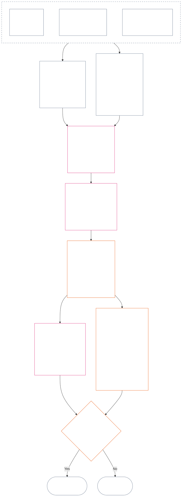

<!-- Complete unreviewed AI-assisted ja translation of current Chapter Twelve; source: core_12.000_standing_measurement.md; source snapshot: a9ad713c15de3c6ba565486590518aa07c7d62fa; source SHA-256: 7ae49781f558ad90db53cdd4469dd22d8227f0a17b0c7393c3a1d2168263f59d; 2026-11-09 source refresh and 2026-11-11 committed-main row update applied. -->

# 第十二章：軌跡測定 — 問い2、どれほど良かったか、悪かったか？

<strong>コーパス内の位置（非運用規定）：ファイル構成と読解規則</strong>

> このファイルは**センティエント憲章の一部**であり、番号付きの他の `core_*` ファイルと一つの文書として読まれる場合に限り、**拘束力を持つ**。本書は**第十二章** — **問い2**（*どれほど良かったか、悪かったか？*）を含む。すなわち、LEQU の基準値とその限界、測定入力の次元、経路記述子カタログ、スロット文法と共通尺度、軸の割当てに関する憲法上の入力、統一比例 LEQU 尺度、標準貢献測定、計算例、そして問い3への引継ぎ（**§1–§9**）である。三つの問いの枠組みと**問い1**（*何が起きたか？*）— 検証済みの事実、事象類型、記録要件、記録の保管、および取扱い — は[第十一章](core_11_standing_assessment.md#chapter-eleven-standing-records--question-1-what-happened)にある。問い3（*その結果どうなるか？*）は[第十三章](../../core_13.000_standing_integration.md#chapter-thirteen-standing-effects-and-integration)で続き、審査は、該当する違反軸 `s` = 7–9 の認定に対する[第十四章](../../core_14.000_misconduct_designation.md#chapter-fourteen-anti-constitutional-misconduct)の反憲法的違法行為の指定に限定される。読解順、拘束力のある本文と支援資料の区分、およびコーパスの版情報は[README.md](README.md)で管理される。

<strong>軌跡</strong>

- 上流：
  - [第十一章 §1](core_11_standing_assessment.md#1-the-three-questions)（*三つの問いの枠組み*）；
  - [第十一章 §2](core_11_standing_assessment.md#2-question-1--what-happened)から[第十一章 §6](core_11_standing_assessment.md#6-handling-a-standing-record)まで（*問い1 — 検証済み事実、軌跡記録、保管、および取扱い*）；
  - [憲法上の四項組](core_00_preamble.md#constitutional-tetrad)；
  - [二つの憲法上の目的](core_00_preamble.md#two-constitutional-aims)；
  - [前文 §6 主要な実務プロセス経路](../../core_00.000_preamble.md#6-key-practical-process-pipelines)（*第九章から第十五章までの連鎖*）。
- 本ファイルの各節：
  - [§1](#1-question-2--how-good-or-bad-was-it)（*問い2 — LEQU 基準値、状態の橋渡し、限界、および適用範囲*）；
  - [§2](#2-magnitude-and-severity-input-dimensions)（*両軸の測定入力次元*）；
  - [§3](#3-route-descriptor-catalogs-and-measurement-roles)（*経路記述子カタログ*）；
  - [§4](#4-slot-grammar-and-shared-scaling)（*スロット文法と共通尺度*）；
  - [§5](#5-constitutional-inputs-to-axis-assignment)（*憲法上の情報源の振分け*）；
  - [§6](#6-unified-proportional-lequ-scale--contribution-and-violation-axes)（*両軸に共通する統一比例 LEQU 尺度*）；
  - [§7](#7-standard-contribution-measures)（*採用主体が公表する標準貢献測定*）；
  - [§8](#8-measurement-illustrations)（*測定の計算例*）；
  - [§9](#9-hand-off-to-question-3--cross-question-measurement-hooks)（*問い3への引継ぎ*）。
- 下流：
  - [第十三章](../../core_13.000_standing_integration.md#chapter-thirteen-standing-effects-and-integration)（13.000）（*問い3の効果と統合*）；
  - [第十四章](../../core_14.000_misconduct_designation.md#chapter-fourteen-anti-constitutional-misconduct)（14.000）（*指定のみ — 問い2の測定を再開しない*）。
- あわせて読む：[第5章 *軌跡状態、貢献、および違反*](../../core_05.035_band_accountability.md#defa3-standing-state-contribution-and-violation)（5.035）（*正準定義への振分け*）。

 

第十二章は、[第十一章](core_11_standing_assessment.md#chapter-eleven-standing-records--question-1-what-happened)が検証した事実を測定する**問い2**の憲法上の主管章である。[§1 問い2 — どれほど良かったか、悪かったか？](#1-question-2--how-good-or-bad-was-it)から始まる。[第十一章](core_11_standing_assessment.md#chapter-eleven-standing-records--question-1-what-happened)は三つの問いの枠組み、問い1、および軌跡記録を主管し、[第十一章 §6 軌跡記録の取扱い](core_11_standing_assessment.md#6-handling-a-standing-record)で終わる。

*平たく言えば、第十一章は何が起きたか、そして誰が軌跡記録を保管するかを確定する。本章はそれを測定する。貢献はどれほど良かったか、違反はどれほど悪かったかを、合算して差引き点数にすることのない二つの別個の尺度で測る。測定の結果どうなるかは第十三章で扱う。*

### 1. 問い2 — どれほど良かったか、悪かったか？

<strong>トレース</strong>

- 上流：[第十一章 §2](core_11_standing_assessment.md#2-question-1--what-happened)（*問い1 — 状態記録と検証済み事実*）；[第十一章 §2.5](core_11_standing_assessment.md#25-verified-input-gate)（*検証済み入力ゲート*）；[第十一章 §4](core_11_standing_assessment.md#4-standing-record-operational-requirements)（*記録要件*）；[第十一章 §1](core_11_standing_assessment.md#1-the-three-questions)（*三つの問いの枠組み*）。
- 下流：
  - [§2](#2-magnitude-and-severity-input-dimensions)（*両軸の測定入力次元*）；
  - [§3](#3-route-descriptor-catalogs-and-measurement-roles)（*ルート記述子カタログ*）；
  - [§4](#4-slot-grammar-and-shared-scaling)（*スロット文法と共通尺度化*）；
  - [§5](#5-constitutional-inputs-to-axis-assignment)（*憲法上の出典を軸へ割り当てるルーティング*）；
  - [§6](#6-unified-proportional-lequ-scale--contribution-and-violation-axes)（*Contribution Axis と Violation Axis の割当て*）；
  - [§7](#7-standard-contribution-measures)（*採択者が公表する標準的貢献測定*）；
  - [§8](#8-measurement-illustrations)（*測定の実例*）；
  - [§9](#9-hand-off-to-question-3--cross-question-measurement-hooks)（*問い3への引継ぎ*）；
  - [第十三章 §7.2](../../core_13.000_standing_integration.md#72-competency-bars-and-clearances)（13.000 §7.2）（*貢献に関する問い3 — 安全な委任*）；
  - [第十三章 §5.2](../../core_13.000_standing_integration.md#52-prevention--general-standing-locks)（13.000 §5.2）（*予防ロック*）；
  - [第十三章 §6](../../core_13.000_standing_integration.md#6-lock-design-and-enforcement)（13.000 §6）（*ロックの設計と執行*）。
- あわせて読む：[第十一章 §4.1](core_11_standing_assessment.md#41-minimum-record-contents)（*検証済み状態記録のフィールド。第十一章に状態効果はない*）。

 

*平たい言葉で言えば：問い2は問い1で検証された事実を測る。「貢献は**どれほど良かったか**」または「違反は**どれほど悪かったか**」を問う。ここで本章は、正式な二つの測定軸、すなわち検証済みの助けを扱う**Contribution Axis**と、検証済みの害を扱う**Violation Axis**を初めて導入する。二つの軸は別々のままであり、正味スコアの両側ではない。*

ある人の貢献または違反がどのスロットに当たるか決めるため、本章では**寿命相当単位（LEQU）**を用いて影響を測る。1 LEQUは、おおよそ一人の感知者の生涯にわたるウェルビーイングを救う、または損なうことに相当する。これは人数や金額を数えることではなく、行為が憲法共同体のウェルビーイングを意味ある形で変えたかを問う。同じ単位は、人間であるかどうかを問わず、あらゆる感知者に使える。

#### 1.1 LEQUの基準線

**寿命相当単位**（**LEQU**）は、採択された実装に数値校正が必要な場合に、全生涯相当の憲法上の利益または損失を表す略式単位である。

- この単位は基体に依存しない。
- 現行の採択者は、生物学的人間の文脈で通常の人間の寿命を校正例として使ってよい。ただし、拘束力のある基準線は感知者と憲法に基づくものであり、種に限定されない。

**全生涯相当の憲法上の利益**とは、権利に整合する、無視できないウェルビーイングを感知者一体の全寿命にわたり保全、回復、または解放することに相当する、検証済みの利益をいう。**全生涯相当の憲法上の損失**とは、全生涯相当の憲法上の利益を損なう、不当に消費する、または妨げることに相当する、検証済みの害、浪費、破壊、選択肢の閉鎖、剥奪、またはリスクの顕在化をいう。

#### 1.2 LEQUの使用制限

LEQUを使う場合は、常に次の制限が適用される。

- **正味スコアの規則ではない：**貢献で違反を「相殺」することも、その逆もできない。各軸は独立して扱う。
- **人間の生命を必須とする尺度ではない：**LEQUは感知者一般に適用され、人間だけでなく、あらゆる意識ある存在を対象とする。
- **告発の尺度ではない：**申し立て、受付タグ、ルーティング判断、評判、不利な扱い、道徳的嫌悪は、**第十一章 §2.5**に基づく検証済み入力と**§6**に基づく校正がなければ、Contribution Axis の利益や Violation Axis の重大度の根拠にならない。
- **権利を取引する許可ではない：**効率、生産能力、革新、負担軽減、安全保障、報復、緊急対応、制度上の必要性として説明された主張が、次のいずれかに依存する場合、割り引くか退けなければならない。
  - 強制；
  - 差別的な負担転嫁；
  - 生態系の枯渇；
  - 隠された無償労働；
  - 回避可能な不透明性；
  - Rights Floor の縮小；
  - 捕捉；
  - 誤解を招く代理指標；
  - 争訟可能性の喪失；または
  - レビュー不能な集計。

#### 1.3 問い2のみ — 範囲とルーティング

この部分が扱うのは測定段階である問い2のみである。すでに検証された事実（問い1）を受け取り、貢献がどれほど良かったか、違反がどれほど悪かったかを問う。

- **第十一章 §2**に基づき検証され、**第十一章 §4**に基づいて状態記録に記載された事実から始め、**§2**の次元を用いて測定する。
- 次に、各種の助けまたは害にカタログ上の標準名を与える。助けには**利益ルート**のカタログ（**§3.1**）、害には**害ルート**のカタログ（**§3.2**）を使う。
- 各名称は、その種類の助けまたは害が「どれほど良いか」「どれほど悪いか」にどの程度算入されるかも示す。
- 利益から生じることの規則は[利益側](../../core_13.000_standing_integration.md#72-competency-bars-and-clearances)に、害から生じることの規則は[害側](../../core_13.000_standing_integration.md#52-prevention--general-standing-locks)にある。
- 次に何が起こるかは問い3が決める。[第十三章 §4 記述子の統合と添付の正規化](../../core_13.000_standing_integration.md#4-descriptor-integration-and-attachment-normalization)から始める。

#### 1.4 感知性ステータスの橋渡し

状態の測定は、ある主体が**感知者**であるかどうかを決めるものでは**ない**。

- ステータスに関する争いは、[感知性ステータスの裁定](../../core_05.055_band_participation.md#sentience-status-adjudication)および[Article VI-B](core_06_rights_part_b.md#article-vi-b-sentience-status-adjudication-floor)（*感知性ステータス裁定の Rights Floor*）に送る。LEQUスコアや分類記録で決めるものではない。
- [係争中の感知者の生命](../../core_05.055_band_participation.md#contested-sentient-life)に基づくステータス争いが係属中は、**Article VI-B**（*感知性ステータス裁定の Rights Floor*）が既定でその主体を含める。争いが決着するまで測定を受けられ、状態記録も提出できる。運用者は、係属中の争いだけを理由に状態を否定してはならない。
- 主体が[感知者](../../core_05.055_band_participation.md#sentient)であると認定された場合、またはそれ自体をレビューできる裁定によってステータスが狭められたり回復されたりした場合：
  - その時点以降、状態記録の対象を更新する；かつ
  - [救済と是正](../../core_05.035_band_accountability.md#redress-and-remediation)による場合を除き、不当な排除を遡及させ、途中の期間に測定対象となる資格を消してはならない。

### 2. 量と重大度の入力次元

*平たい言葉で言えば：この節は、問い2が何を出力するか（**§2.1**）を述べ、その後、検証済みの貢献または違反を測る際に調べるもの（**§2.2**）を列挙する。各軸は独立して測る。共通尺度化の規則は**§4.2**に、スロットは**§6**の尺度に定める。*

スロット尺度は、憲法上の結果がどれほど大きいか、またどのような結果かを測る。検証済みの結果だけを数える。

**尺度が数えるものと、憲法の中核的テストとの関係：**

- **[二つの憲法上の目的](core_00_preamble.md#two-constitutional-aims)：**両軸とも**繁栄**と**継続**への影響を測る。Contribution Axis はそれらを前進させ、Violation Axis は後退させる。
- **[二つの根本的な問い](core_00_preamble.md#two-fundamental-questions)：**各軸は一つの問いについて検証済み事実を提供する。一方への回答は他方への回答ではないため、二軸を正味化することは決してない。
  - **第一の問い：**検証済み事実は Contribution Axis が提供する。システムは、感知者の繁栄と存続を助け、真実を述べ、害を修復する行為に報いるか。
    - **数えるもの：**検証済みの憲法上の利益。検証済みのリスク低減を含む。
    - **数えないもの：**生の生産量、威信、富、使用量、速度、または制度の規模。
  - **第二の問い：**検証済み事実は Violation Axis が提供する。システムは、不当に害し、誤導し、排除し、遅らせ、浪費し、または費用を他者に転嫁する行為に報いるか。
    - **数えるもの：**検証済みの憲法上の損失、害、浪費、失われた選択肢（選択肢の閉鎖）、危険、またはリスクの増大。
    - **それだけでは数えないもの：**不利なステータス、申し立て、または道徳的嫌悪。
- **[憲法四元](core_00_preamble.md#constitutional-tetrad)：**
  - **監督と説明責任：**「検証済み」とは、名指しされた主体が所見に答え、いかなる当事者も自らの主張を自ら検証しないことを意味する。
  - **適時性：**回避可能な遅延は独立した事実として記録し、損失の大きさに織り込まない。

#### 2.1 問い2が出力するもの

問い2は、各軸について次の事項を状態記録に記載する。これは測定であって、状態効果（問い3が決める帰結）ではない。

| **出力項目** | **Contribution Axis** | **Violation Axis** |
| --- | --- | --- |
| **記載先** | 貢献状態記録。 | 違反状態記録。 |
| **スロット** | 該当する最上位の**Contribution Axis スロット**（`s` = 1–9）。 | 該当する最上位の**Violation Axis スロット**（`s` = 1–9）。 |
| **ルート記述子** | 該当する**利益ルート記述子**を重ねて記載。 | 該当する**害ルート記述子**を重ねて記載。 |
| **問い3に引き渡す入力** | [第十三章 §7 貢献の帰結を次に扱う](../../core_13.000_standing_integration.md#7-contribution-consequences-second)に基づき、貢献がどう認識されるかの出発点を定める入力。 | [第十三章 §6 ロックの設計と執行](../../core_13.000_standing_integration.md#6-lock-design-and-enforcement)に基づき、既定のロック帯（ロックの厳しさの出発点）を定める入力。 |
| **LEQU合計** | 関連する利益の各種類（生態系、システム、または資源）を個別に評価してから、貢献全体についてLEQU合計を一つ記入する。 | 関連する害の各種類（生態系への害、システム上の害、または資源損失）を個別に評価してから、違反全体についてLEQU合計を一つ記入する。 |

注意：これらのいずれも、係属中の違反記録を相殺しない。相殺禁止の規則は[第十一章 §2.4 関連する状態記録と相殺禁止の橋渡し](core_11_standing_assessment.md#24-linked-standing-records-and-no-offset-bridge)にある。

#### 2.2 貢献の量入力と違反の重大度入力の次元

**問い2 — どれほど良かったか、悪かったか？** 貢献がContribution Axisのどこに位置するか、または違反がViolation Axisのどこに位置するか（1から9までの**スロット**）、そしてどの利益または害の記述子が当てはまるかを決めるには、三つの部分を順に確認する。複数の記述子が同時に当てはまり、重ねて記録されることがある。**§2.1**に示すとおり、結果を各軸の状態記録に記載する。**§6**は第2部に用いる統一尺度であり、利益にも害にも同じ尺度を使う。総利益または総損失をLEQU（寿命相当単位。およそ一生分のウェルビーイング）で推定する方法と、各量がどのスロットに当たるかを説明する。Contribution Axisではスロットを四つの帯にまとめる。

**1. どのように生み出されたかを確認する。**二つの軸では扱いが異なる。

- **Contribution（行為の質）：**これにより算入利益が増減することがある。追跡可能だったか、費用を他者に押しつけなかったか、注意深く行われたか、憲法に適合するか。五つの確認事項は[§2.2.1 利益の生み出し方が算入対象に与える影響](#221-how-the-way-a-benefit-was-produced-affects-what-counts)にある。
- **違反（行為の性質）：** 影響の大きさとは別に記録する。義務、過失、欺瞞、隠蔽、説明責任の妨害、強制、暴力、意図、残虐性、構造的な可能化は、誰が責任を負うか、どの保護措置が必要か、どう対応するかを形作る。いずれもスロットを動かさないという規則と各項目の記録方法は、[§2.2.2 損害が生じた方法の記録](#222-how-the-way-a-harm-was-caused-is-recorded)に定める。

**2. 大きさを測る：利益または損失はどれほどか。**これがスロットを決める。

| **見るもの** | **作用** | **規定箇所** |
| --- | --- | --- |
| **全体の大きさ（LEQU）** | 主たる測定であり、スロットを決める。貢献では、実施された検証済みの善をLEQUで数えた合計。違反では、検証済みの憲法上の損失の合計。第十四章の不正行為指定は別途決定する。 | [§6 統一比例LEQU尺度](#6-unified-proportional-lequ-scale--contribution-and-violation-axes) |
| **誰に及ぶか（人数、深さ、脆弱性）** | LEQU推定値と利益または害の重要度（実質性）を調整する。 | [§4.2 共通の影響尺度化規則](#42-shared-impact-scaling-rules)；[実質性](../../core_05.050_band_oversight.md#materiality) |
| **どれほど続くか（期間；利益の持続性、害の不可逆性）** | LEQU推定値を調整する。貢献では、持続的な責務ある管理、世代を超える利益、または制度の永続的な修復が上位スロットを示す。違反では、長引くトラウマ、元に戻せない損失、感知者が自ら行動する能力への長期的損害が総損失の推定を引き上げる。 | [§4.2 共通の影響尺度化規則](#42-shared-impact-scaling-rules) |
| **どこまで及ぶか（場所や制度をまたぐ範囲）** | LEQU推定値を調整する。貢献の例は、共同体や制度をまたぐ利益、または文明規模の利益。違反では、共同体、制度、または文明全体に広がる害が総損失の推定を引き上げることがある。 | [§4.2 共通の影響尺度化規則](#42-shared-impact-scaling-rules) |

**3. 利益または害の種類（ルート）を名付ける。**検証済みの利益または害がどのように生じたかを名付ける。複数が当てはまることがあり、重ねて記録する。リストは[**利益ルート記述子カタログ**](#31-contribution-route-descriptor-catalog-and-measurement-roles)と[**害ルート記述子カタログ**](#32-violation-route-descriptor-catalog-and-measurement-roles)にある。

##### 2.2.1 利益の生み出し方が算入対象に与える影響

Contribution Axisのスロットを選ぶ前に確認する。

| **確認された事項** | **利益への作用** |
| --- | --- |
| 問題を知らされた後、速やかに検証可能な形で修正した | 現実に実証可能な利益が生じる場合、**勤勉性**（注意深く責任ある行為）として算入できることがある。 |
| 他者に押しつけられた害、または隠されていた負担 | 争われている経路（利益が計上される特定のルート）に計上する利益に上限を設けるか、除外する。 |
| 検証済みの捕捉リスク（狭い利害に支配されるおそれ）、構造的依存（感知者が依存するように組み込まれていること）、または退出・ロックイン設計（離脱が困難な設計） | 良好な責務ある管理に対する評価を制限する。 |
| アクセシビリティまたは参加の障壁を検証済みの形で修復した | 利益の重要度（実質性）を高め、**§3.1**の利益ルート記述子**アクセスと包摂**を裏付けることがある。 |
| 憲法に反するインセンティブ設計、反憲法的行為、または重大な欠陥のある手続から生じた重要な報酬 | 原則として便益に数えない。その場合、[第13章 §6.4.2 不整合な報酬](../../core_13.000_standing_integration.md#642-misaligned-rewards)および[第XXVIII-A条](../../core_06.020_rights_part_e.md#incentive-alignment-adoption-transition-carve-out)（*段階的導入と権利の最低基準の継続*）の導入移行上の制限を適用する。 |

##### 2.2.2 害がどのように引き起こされたかの記録方法

損害の大きさ（上記パート2のLEQU合計）がスロットを決める。損害がどのように生じたかは決めないため、以下の行為の種類はそれぞれ別に記録する。

本小節は第12章の規則をここで一度だけ示す。**事象または一連の行為が次のいずれかで特徴づけられるというだけで、スロットを上げたり下げたりしてはならない。**

- 義務;
- 過失;
- 意図;
- 隠蔽;
- 反復;
- 加重事情;
- 強制;
- 暴力;
- 自由への危険;
- 是正可能性; または
- 優先される結果。

行為の性質に関する事実は、個別に追跡可能な記述子として記録する。帰属、審査の強度、保護措置、救済、または第14章の指定を左右することがある。検証済みの結果を通じてのみスロットに影響する。行為が損失を加える場合、その損失をLEQU合計に一度だけ算入し、スロットはその合計に従う。

**損失を増やす行為（大きさには一度だけ算入）：**

| **確認された事項** | **記録方法** |
| --- | --- |
| 行動する義務と能力があったのに、対応またはエスカレーションが回避可能な形で遅れた | 行為に関する独立した事実として記録する。遅延が引き起こした追加損失は、LEQU推定値に一度だけ数える。 |
| フォーラムの完全性に対する独立に検証された損傷（フォーラムの公正さへの損傷） | LEQU推定に正確に一度算入する。不正直な不記載、忌避手続の意図的な不履行、強制、自由への危険、その他の行為事実は別個の記述子のままとする。 |
| **説明責任の妨害**（証拠の完全性、検証、フォーラム手続、standing記録、救済期間、異議申立てや救済の経路など、責任者を追及できる仕組みへの検証済みの干渉） | 個別に記録する行為事実のままとする。制限付き経路で生じた追加損失はLEQU推定に一度算入する。 |

**害の大きさとは別に記録する行為事実：**

| **確認された事項** | **記録方法** |
| --- | --- |
| 欺瞞、隠蔽、回避、通知後の行為の反復、無謀な軽視、構造的助長（害が容易または起こりやすいよう仕組むこと）、または大きな依存関係の不均衡の悪用（強く依存する人を利用すること） | それぞれを別個の行為事実として記録する。 |
| 暴力、強制、操作、または自由への危険 | 別個に記録し、スロットにかかわらず強化された保護措置を要することがある。 |
| [残虐性](../../core_05.035_band_accountability.md#cruelty)（それ自体を目的とする検証済みの苦痛、または必要かつ比例的な範囲を超える不当もしくは品位を傷つける損害） | 個別に記録する行為事実のままとする。[第13章 §5 違反、是正、予防](../../core_13.000_standing_integration.md#5-violation-correction-and-prevention)に基づき、より強い保護措置や品位を傷つける救済の制限が必要となる場合がある。 |

**責任と帰属：**

| **確認された事項** | **記録方法** |
| --- | --- |
| 分散（責任がどのように広がっているか：誰がどの因果的役割を果たし、どの権限や支配を持ち、害を予見でき、そこから利益を得、隠蔽し、または防止できたか） | **感知者の範囲**の一部ではなく、集団に属しているというだけで誰かを非難することも許さない。 |
| 害への追随、または抵抗しなかったこと | **第十一章 §§4.1および4.3**が当該行為者との関連について要求する事項が検証された場合に限り、義務に基づく、加重された、または集団的説明責任の性質を認定する根拠となりうる。 |

**不整合な報酬：**

| **確認された事項** | **記録方法** |
| --- | --- |
| 憲法に反する重要な報酬を、適時の保護された報告（報復から保護された報告）なしに、認識しながら受け取る、または保持すること | [第13章 §6.4.2 不整合な報酬](../../core_13.000_standing_integration.md#642-misaligned-rewards)に基づき記録し、[第XXVIII-A条](../../core_06.020_rights_part_e.md#incentive-alignment-adoption-transition-carve-out)（*段階的導入と権利の最低基準の継続*）に従う。それがもたらす検証済みの憲法上の損失のみがスロットに影響する。 |

**不整合な報酬の境界。** 本章が測定するのは、検証済みの不整合な報酬（憲法に反する報酬）がContribution AxisまたはViolation Axisに与える影響に限る。[第13章 §6.4.2 不整合な報酬](../../core_13.000_standing_integration.md#642-misaligned-rewards)は、報告義務、除外、報酬を手放すことの結果（没収）、是正義務、付託規則を定める。

### 3. ルート記述子カタログと測定上の役割

*平たい言葉で言えば：以下の二つのカタログは、状態記録に付けられる検証済みの助け（**§3.1**）と害（**§3.2**）の種類を名付ける。記述子は利益または害がどのように起きたかを示す。記述子は重ねて付けられ、スロットに従属する。*

**記述子の規則。**以下の二つ、[§3.1 Contribution route descriptor catalog and measurement roles](#31-contribution-route-descriptor-catalog-and-measurement-roles)と[§3.2 Violation route descriptor catalog and measurement roles](#32-violation-route-descriptor-catalog-and-measurement-roles)は、両軸の公式な記述子一覧である。記述子は検証済みの利益または害が**どのように**起きたかを示す。次の規則が適用される。

- 記述子は重ねて付けられ、互いに排除しない。検証済みの事実が裏付ける場合、一つの状態記録に複数を付けてよい。
- 記述子はスロットより下位である。スロットは利益または害の大きさを示し、記述子は起き方の詳細を加えるが、スロットに取って代わることはない。
- 掲載された記述子は基礎リストであり、全てを網羅するものではない。カタログは他の種類の利益や害を排除しない。
- 実装はカタログに対応付けた安定識別子（実装独自の固定ID）を使ってよいが、状態記録に一つしか記述子を付けられなくなるような排他的カテゴリの競合分類を作ってはならない。
- 事実が検証される前でも、主張された記述子は、適法な証拠保全、案件の分類、一時的な保護措置を支えることがある。
- 問い2の出力として記録でき、状態に影響できるのは検証済みの記述子だけである。

#### 3.1 Contribution route descriptor catalog and measurement roles

以下は利益ルート記述子と、それぞれが問い2（どれほど良かったか）で測るものである。五つの領域に分け、各領域に一つの表を置く。[§3.2 Violation route descriptor catalog and measurement roles](#32-violation-route-descriptor-catalog-and-measurement-roles)の違反カタログも同じ五領域を同じ順序で用いる。問い3における安全な委任の役割は[第十三章 §7.2 能力基準と許可](../../core_13.000_standing_integration.md#72-competency-bars-and-clearances)にある。

**カタログの完全性。**実装が一つの行またはラベルの下に複数の記述子を示す場合、その行またはラベルは該当する全ての記述子に対応しなければならない。このカタログが定めるのは、記述子の名称と問い2で測る内容だけである。問い3の規則（添付、救済、ロック、許可、その他の状態効果）は第十三章にのみある。

##### 3.1.1 身体の安全、関係、ケア、主体性

| **利益ルート記述子** | **問い2で測るもの** |
| --- | --- |
| **身体、心、そして／または共同体の平穏** | 身体的、心理的、共同体的な平穏による利益。利益の重要度（実質性）を調整する。 |
| **信頼できる関係** | 信頼できる関係による利益。両者が対等でない状況で信頼義務に基づいて築かれた関係を含む。 |
| **ケア提供と依存支援** | 他者に依存する感知者への検証済みのケア。立証できる場合、非公式のケアも数える。 |
| **アクセスと包摂** | 実質的な参加とアクセシビリティによる利益。一方が他方に大きく依存する状況では、利益の重要度を調整する。 |

##### 3.1.2 修復、財産、資源

| **利益ルート記述子** | **問い2で測るもの** |
| --- | --- |
| **救済・回復による利益** | 修復、補償、害の軽減による利益。 |
| **資源の責務ある管理** | 物質的資源への注意深い配慮と、信頼できる分配（割当て）。 |

##### 3.1.3 知識、教育、記録、発見

| **利益ルート記述子** | **問い2で測るもの** |
| --- | --- |
| **情報圏の完全性** | 記録、透明性、コミュニケーションの強化。 |
| **教育と能力形成** | 学習、リテラシー、感知者が自ら行動する能力の向上による利益。スロットはLEQU利益の合計に従う。 |
| **STEM・発見への貢献** | 他者が再現できる発見と、安全性を高める研究。 |

##### 3.1.4 システムと憲法上の運用

| **利益ルート記述子** | **問い2で測るもの** |
| --- | --- |
| **システムの最適化** | 制度をまたぐプロセスの修正とリスクの低減。 |
| **憲法との整合** | Rights Floor の強化と、決定への異議申立ての容易化。 |

##### 3.1.5 生態系と勤勉性

| **利益ルート記述子** | **問い2で測るもの** |
| --- | --- |
| **生態系の責務ある管理** | 生息地と生物多様性への利益、および気候に責任を負う行動。 |
| **勤勉性** | 予見可能なリスクの防止と、能力ある監督。 |

#### 3.2 Violation route descriptor catalog and measurement roles

以下は害ルート記述子と、それぞれが問い2（どれほど悪かったか）で測るものである。五領域に分け、各領域に一つの表を置き、[§3.1 Contribution route descriptor catalog and measurement roles](#31-contribution-route-descriptor-catalog-and-measurement-roles)と同じ五領域を同じ順序で用いる。問い3の統合と添付の規則は[第十三章 §4 記述子の統合と添付の正規化](../../core_13.000_standing_integration.md#4-descriptor-integration-and-attachment-normalization)に、予防とロック設計は[第十三章 §5.2 予防 — 一般的な状態ロック](../../core_13.000_standing_integration.md#52-prevention--general-standing-locks)および[第十三章 §6 ロックの設計と執行](../../core_13.000_standing_integration.md#6-lock-design-and-enforcement)にある。

**カタログの完全性。**実装が一つの行またはラベルの下に複数の記述子を示す場合、その行またはラベルは該当する全ての記述子に対応しなければならない。このカタログが定めるのは、記述子の名称と問い2で測る内容だけである。問い3の規則（添付、救済、ロック、許可、その他の状態効果）は第十三章にのみある。

##### 3.2.1 身体の安全、関係、ケア、主体性

| **害ルート記述子** | **問い2で測るもの** |
| --- | --- |
| **暴力的不正行為** | 暴力、強制、または自由への危険をLEQU影響スロットとは別に記録する。強化された保護措置を要することがある。 |
| **対人関係／ケア義務の不正行為** | 一方が他方に大きく依存する場合、害の重要度（実質性）が高まる。 |
| **アクセシビリティおよび参加障壁に関する不正行為** | 一方が他方に大きく依存する場合、害の重要度（実質性）が高まり、加重要素を重ねることがある。 |
| **プライバシーおよび自己所有に関する不正行為** | 隠蔽または搾取が検証された場合、加重要素が適用され、重ねて記録されることがある。 |
| **主体性と操作に関する不正行為** | 強制、操作、または自由への危険を影響スロットとは別に記録する。 |

##### 3.2.2 修復、財産、資源

| **害ルート記述子** | **問い2で測るもの** |
| --- | --- |
| **救済的に是正可能な不正行為** | 是正の性質（害を正せるか、どのように正せるか）を記録する。スロットはLEQU損失の合計に従う。 |
| **財産に関する不正行為** | 財産損失のルート。スロットはLEQU損失の合計に従う。 |

##### 3.2.3 知識、教育、記録、発見

| **害ルート記述子** | **問い2で測るもの** |
| --- | --- |
| **情報圏の不正行為** | Safety または Truth への損害。隠蔽や欺瞞は、害の引き起こし方（性質）に関する別個の事実として残る。 |
| **教育上の不正行為** | 学習、または感知者が自ら行動する能力（能力）への害。スロットはLEQU損失の合計に従う。 |
| **研究・発見に関する不正行為** | 研究または発見への害。スロットはLEQU損失の合計に従う。 |

##### 3.2.4 システムと憲法上の運用

| **害ルート記述子** | **問い2で測るもの** |
| --- | --- |
| **システム不正行為** | 責任の拡散（複数の行為者への責任の分散）と構造的な可能化は、別々に記録する。 |
| **説明責任妨害の不正行為** | 説明責任の妨害、すなわち損害への責任を問うことを妨げる行為を含む。損害が生じた方法として記録する。妨害の実行方法（例：隠蔽または過失）は別個の事実として記録する。スロットが最高位の一つに当たる場合（[§4.1 表1 — スロット表示ラベル](#41-table-1--slot-display-labels)参照）、第14章の[反憲法的不正行為審査](../../core_05.035_band_accountability.md#anti-constitutional-misconduct-review)へ付託できるよう、**反憲法的不正行為**としても記録できる。付託は反憲法的不正行為の指定と同じではなく、第14章が別個に判断する。 |
| **退出・ロックインに関する不正行為** | システム上の不正行為の特徴に加え、責任の分散または捕捉が構造的（システムの仕組みに組み込まれている）な場合、それらも含む。 |
| **ライフサイクルおよび不可逆性に関する不正行為** | 不可逆性はLEQU損失の大きさに影響する。隠蔽や過失は性質として別途記録する。 |
| **反憲法的不正行為**（記述子） | 上位スロット（[§4.1 表1 — スロット表示ラベル](#41-table-1--slot-display-labels)参照）の違反を第十四章の指定レビューに送り、影響スロットは変更しない。 |

##### 3.2.5 生態系と勤勉性

| **害ルート記述子** | **問い2で測るもの** |
| --- | --- |
| **生態系に関する不正行為** | LEQU損失を[生態系回復能力](../../core_05.040_band_continuity.md#ecological-recovery-capacity)（害の後に生態系が再生する能力）の損失に応じて重み付けする。暴力ルート（暴力的不正行為）と重ねて記録することがある。 |
| **過失による不正行為** | 義務、予見可能性、予防可能性を影響スロットとは別に記録する。 |

### 4. スロット規則と共通の尺度

*平たい言葉で言えば、本節は二つの別々の軸それぞれにある九つの可能な位置へ一貫した名称を与え、影響の尺度がどう広がるかを説明する。一方の軸は検証済み貢献を記録し、もう一方は検証済み違反の認定を記録する。スロット番号が同じでも二つの軸は一つにならず、害を助けで相殺することもない。**section 6**の統一尺度は比例的LEQU影響に基づき、両軸を割り当てる。*

スロット規則は**1**から**9**までのスロット番号 `s` を使う。各軸にはそれぞれ別のスロット位置がある:

- **貢献軸**は肯定的な貢献の性質を記録する; および
- **違反軸**は検証済み違反の認定を記録する。

同じスロット番号が両方の軸に現れることはあるが、軸は分離されたままである。貢献スロットは違反スロットではなく、違反スロットは貢献スロットではない。

#### 4.1 表1 — スロット表示ラベル

**表1**は九つのスロットに名称を付け、貢献軸と違反軸の表示ラベルを並べて示す。これは表示用の文言のみを示す; スロットの割当ては**section 6**の統一尺度に基づく。

|  `s` | 貢献軸の表示ラベル | 違反軸の表示ラベル |
| ---: | --- | --- |
|    1 | **軽微な基準貢献** | **軽微な憲法上の影響** |
|    2 | **小さな基準貢献** | **小さな憲法上の影響** |
|    3 | **相当な肯定的貢献** | **相当な憲法上の影響** |
|    4 | **顕著な肯定的貢献** | **顕著な憲法上の影響** |
|    5 | **重大な責務ある管理に資する貢献** | **重大な憲法上の影響** |
|    6 | **大きな責務ある管理に資する貢献** | **大きな憲法上の影響** |
|    7 | **認定されたチャンピオン** | **深刻な憲法上の影響** |
|    8 | **顕彰されたチャンピオン** | **重大極まりない憲法上の影響** |
|    9 | **模範的なチャンピオン** | **壊滅的な憲法上の影響** |

貢献軸は基準、肯定的、責務ある管理に資する、チャンピオンというラベルを使う。違反軸はすべてのスロットで中立的な影響ラベルを使う。軸は分離されたままであり、差し引きスコアを作らず、貢献記録と違反記録の相殺も認めない。違反軸のスロットだけで反憲法的不正行為が分類されるわけではない。[第十四章](../../core_14.000_misconduct_designation.md#chapter-fourteen-anti-constitutional-misconduct)は、検証済み `s` = 7–9 の違反に反憲法的不正行為指定（ACMD）が付されるかを独立に決定する。

実装は、全生涯相当の便益または損失を推定する助けとして、測定単位、証拠の方法、例を公表してよい。これらの資料は案内に限られ、**section 6**、**第一章**、または**第六章**の権利の床を覆してはならない。

#### 4.2 共通の影響尺度ルール

*平たい言葉で言えば、影響は人数だけでは測らない。一人の感知者に及ぶ深い便益や損失は、多数に及ぶ浅い影響より重要な場合がある。人数、深さ、脆弱性、期間、持続性、到達範囲、憲法上の性質を合わせて評価する。*

**section 6**で両軸を解釈する際、次のルールを使う:

| 尺度の次元 | 共通ルール | 軸ごとの適用 |
| --- | --- | --- |
| **憲法上の結果の大きさ（LEQU）** | 統合された検証済み便益または損失を評価する。LEQUが主要な大きさの基準であり、単純な人数、金銭、産出、機関の規模ではない。 | 貢献は権利と整合する便益を数える。違反は検証済みの憲法上の損失、害、浪費、選択肢の閉鎖、危険を数える。 |
| **感知者への範囲** | **人数、深さ、脆弱性**を合わせて考える。人数を独立した要件にするスロットはない。他の条件が同じなら、一人の感知者への十分に深い影響が、多数へのより浅い影響と同じスロットを支持することもある。ただし、明示された総計LEQUまたは広範囲の基準は満たさなければならない。 | 依存、能力の低下、特異な脆弱性は実質性を増すことがある。集団の規模だけでは貢献も深刻さも確立しない。 |
| **時間的な範囲** | 期間、反復、持続性、損失については不可逆性を考慮する。短期間でも変革的な出来事が長期の些細な影響を上回ることがある; 期間だけでは決まらない。 | 持続的便益は、より大きな貢献を支持する。継続または不可逆の損失は、より深刻な違反を支持する。 |
| **地理的または制度的な範囲** | 広い到達範囲は大きさを増すことがある。しかし深さ、期間、脆弱性、憲法上の重要性が独立してスロットを支持する場合、複数の地域社会または機関にまたがる必要はない。 | 制度の修復は貢献の大きさを増すことがある; 構造的またはシステム上の損傷は違反の深刻さを増すことがある。 |
| **憲法上の質または性質** | 結果の生じ方を、その広がりとは別に測る。同じ事実を二重計上しない。 | 外部化された損害、隠された負担、捕捉、または依存は、主張された貢献を制限または不適格にする場合がある。義務、過失、欺瞞、強制、暴力、構造的な可能化は、違反行為の性質として別個に記録する。 |
| **権利の床と重要な保護措置** | 権利の床の順守を総計便益または損失と交換してはならない。 | 権利の床を守っただけで高い貢献が確立するわけではない。権利の床が実質的に破られたこと、または重要な保護措置が失敗したことは、直接影響を受ける感知者が少なくても、より深刻な違反を支持する場合がある。 |

これらの次元は、あらゆる尺度要素を必ず要求するチェックリストではない。どの次元が判断を左右し、どれが左右しなかったか、その理由を説明する。

- **共通のスロット方法:**
  - 比例性に基づいて統合された検証済み便益または損失をLEQUで推定し、その大きさを含む数値帯に対応する一つのスロットを割り当てる。
  - 両軸に同じ閾値が適用される。
  - 貢献スロットには適用される基準および憲法整合の要件が残る。数値閾値を満たしても、外部化された、または憲法上否定された産出が貢献になるわけではない。
- **性質の分離:** 適用される便益経路、害の経路、行為の質、行為の性質の記述子を、軌跡記録に別々に積み重ねて記録する。義務、過失、欺瞞、加重要因、強制、暴力、意図、構造的助長は帰属、安全策、質問3の結果に影響することがあるが、LEQU影響スロットを上げ下げしない。
- **反憲法的不正行為審査の境界:** 検証済みの違反軸の損失は、反憲法的不正行為が認定されるかどうかにかかわらず、影響に応じて `s` = 7–9 に達し得る。第十四章は影響スロットの割当てを置き換えず、対応するACMDが付されるかを独立に決める。

危険がまだ実際に起きていない場合、次をそれぞれ分けて記録する:

- その発生可能性;
- 感知者がさらされる期間;
- 到達し得る範囲;
- 推定の不確実性; および
- なお信頼できる最悪の結果。

採択済みの実装が、誰でも確認できるリスク較正（リスクをLEQUに変換する方法）を設定していない限り、最悪の結果をすでに起きた損害（LEQU損失）として数えない。

### 5. 軸の割当てに関する憲法上の入力

*平たい言葉で言えば、スロットを選ぶ前に、どの基準、便益、義務、害、違反を測定するのかを定める憲法上の出典を特定する。以下のリンクから各出典の正本を参照する。この経路案内の段階を新たなスコアや定義の代用にしてはならない。*

**section 6**に基づいてスロットを割り当てる前に、軌跡記録では次を特定しなければならない:

- 適用される憲法上の基準、義務、制約、または保護される利益;
- 測定対象である検証済み便益、悪影響、害、違反を確立する条項;
- 大きさまたは行為の性質に実質的な影響を与える定義、原則、権利の床に関する条項; および
- 特定した各出典が適用される理由と、軸の割当てへの影響。

以下の案内表は網羅的ではない。検証済み事実によって発動する追加の定義、原則、条項はすべて適用され、軌跡記録で特定されなければならない。リンク先の各正本が優先し、表はそれを言い換えたり狭めたりしない。

#### 5.1 定義に関する入力

| 正本の出典 | 貢献軸での役割 | 違反軸での役割 |
| --- | --- | --- |
| [軌跡状態、貢献、違反](../../core_05.035_band_accountability.md#defa3-standing-state-contribution-and-violation) | 何が貢献に当たり、検証済みのどの事実を測定に使えるかを説明する。貢献軌跡記録が良い側だけを追跡し、悪い側と混在させないようにする。 | 何が違反に当たり、どう記録するかを説明する。最も深刻な事案を、憲法自体を損なう行為に関する別個の審査である反憲法的不正行為審査へ送る。 |
| [説明責任](core_05_apex_accountability_leg.md#accountability) | 責務ある管理または修復という主張が、実際に誰かを説明責任の下に置くかを確かめる。誰が何をし、誰が説明し、影響に比例してどう審査・是正・訂正できるかを示さなければならない。 | 誰が行為したか、誰が責任を負うか不明な事案を見つける。組織またはその構造の変更後に責任が機能しなくなる事案も含む。 |
| [害](../../core_05.035_band_accountability.md#harm) | 他者へ転嫁または隠された害は、主張された便益を制限または相殺し得る。害の修復は便益となり得るが、検証され独立に示された場合に限る。 | 損失および深刻さの測定で数える損害の種類を示す。直接、間接、遅延、累積、システム間に及ぶ害、感知者の精神や情緒的な健康への害を含む。 |
| [実質性](../../core_05.050_band_oversight.md#materiality)および[生涯相当単位（LEQU）](../../core_05.055_band_participation.md#lifespan-equivalent-unit-lequ) | 到達範囲、影響を受ける者の脆弱性、継続期間に基づき、検証済み便益をどれだけ数えるかを定める。結果はLEQUで測定し、全生涯相当の便益に対する共通尺度とする。 | 到達範囲、影響を受ける感知者の脆弱性、継続期間、元に戻す難しさに基づき、検証済み損失または危険をどれだけ数えるかを定める。結果は、全生涯相当の損失を測る同じ尺度LEQUで測定する。 |
| [貢献の性質](../../core_05.035_band_accountability.md#contribution-nature) | 何が貢献に当たるかを決める。害と混在しない良い行為だけであり、提示可能な検証済み貢献記録に裏付けられなければならない。両方がなければ貢献軸の割当てはできない。 | ここでは役割を持たない。害の内容を決めず、違反の深刻さを低下させない。 |
| [違反の性質](../../core_05.035_band_accountability.md#violation-nature) | ここでは役割を持たない。違反を負の貢献として数えることはなく、無関係な検証済み便益を消去することもない。 | 何が違反に当たるかを決める。害を伴うものとして分類され、違反が起きたとの検証済み認定に裏付けられなければならない。両方がなければ違反軸の割当てはできない。 |
| [憲法上の制約](core_05_band_integrative.md#constitutional-constraint)、[権限の積層と内部階層](core_05_band_integrative.md#authority-stack-and-internal-hierarchy)、[監査可能性](core_05_band_oversight.md#auditability) | 憲法を否定する、その規則を回避する、権利の床（憲法が保障する最低限の保護）を狭める、または形式上のみ順守することに依存する便益を数えるのを妨げる。 | 違反の実際の深刻さを左右する事項を明らかにする。重要な憲法上の限界を破ること、憲法の権限より何かを上位に置くこと、規則を回避すること、規則の執行を不可能にすること。 |
| [監査可能性](core_05_band_oversight.md#auditability)および[争訟可能性](../../core_05.035_band_accountability.md#contestability) | 主張された便益を提示・検証でき、異議を持つ者が実効性ある異議申立て手段を持つよう求める。 | 検証および異議申立てが可能な認定を求める。説明のない告発やラベルでは違反の深刻さを決められない。 |

#### 5.2 原則に関する入力

| 原則の出典 | 軸割当てでの役割 |
| --- | --- |
| [憲法四元](core_00_preamble.md#constitutional-tetrad)、[二つの憲法上の目的](core_00_preamble.md#two-constitutional-aims)、[実質的利害](core_00_preamble.md#material-stake) | 四つの実務規律（参加、監督、説明責任、適時性）、憲法が目指す二つの結果（繁栄と継続）、各割当てを利害の大きさに合わせる枠組みを定める。 |
| [ウェルビーイング](core_01_a_values_principles.md#3-foundational-objective-wellbeing-flourishing-aim)および[認識、強化、志向](core_01_a_values_principles.md#32-recognition-reinforcement-and-aspiration) | 権利を尊重する便益と、それに見合う認識を貢献軸上で基礎付ける。名声や報酬を貢献の証明として扱わない。 |
| [安全](core_01_a_values_principles.md#4-safety-harm-constraint)および[真実](core_01_a_values_principles.md#5-truth-epistemic-integrity-constraint) | 両軸に拘束力ある限界を設ける。害や欺瞞から得た便益は全額を数えず、安全または真実の検証済み不履行は、違反の大きさや種類を示し得る。 |
| [責務ある管理の詳論](core_01_c_stewardship_capacity_principles.md#16-stewardship-in-depth)および[責務ある管理規律下の統治](core_01_c_stewardship_capacity_principles.md#18-governance-under-stewardship-discipline) | 検証済み事実が求める場合、持続的貢献、役割に伴う義務、制度の修復、監督、責任の評価を導く。 |
| [中核的トレードオフ原則](core_01_b_interaction_interpretation.md#131-core-tradeoff-principles)および[憲法上の床、安全、品位を損なわない手続](core_01_b_interaction_interpretation.md#1314-constitutional-floors-safety-and-anti-degrading-process) | 測定対象の行為に必要性、害の最小化、比例性、権利の衝突、制限が関係する場合に適用する。これらだけで結果を許可することはない。 |

#### 5.3 権利の床および条項に関する入力

| 条項の出典 | 軸割当てでの役割または境界 |
| --- | --- |
| 検証済み軌跡記録が実質的に関係する条項すべてを含む、事実上適用される[第六章の権利の床](core_06_rights_part_a.md#chapter-six-foundational-rights) | 利害の対象となる基本的保護、利益、義務、便益、違反を定める。以下に列挙されていないことを理由に、条項を省いてはならない。 |
| [第XIX条 — 軌跡および参加状態](core_06_rights_part_d.md#article-xix-standing-and-participation-status) | 感知者の軌跡、尊厳、権利の床の最低限の保護、利害関係者の状態、評判、参加状態の後日の変更を、それぞれ区別する。 |
| [第XIII-A条 — 信頼性と信頼に値することの基準](core_06_rights_part_c.md#article-xiii-a-reliability-and-trustworthiness-baseline)、[第XIII-B条 — 救済および是正を受ける権利](core_06_rights_part_c.md#article-xiii-b-right-to-redress-and-remedy)、[第XV-B条 — 透明性、監査可能性、争訟可能性](core_06_rights_part_c.md#article-xv-b-transparency-auditability-and-contestability)、[第XVI条 — 監査、透明性、独立検証](core_06_rights_part_c.md#article-xvi-audit-transparency-and-independent-verification) | 検証済み便益または違反に、誠実な記録、情報共有、事実確認、決定への異議申立て、誤りの訂正が関係する場合に適用する。 |
| [第XXIV条 — 根本原因分析と適応的対応](core_06_rights_part_d.md#article-xxiv-root-cause-analysis-and-adaptive-response) | 行為の原因、訂正の有無、反復の有無、対応の適応が重要な場合に適用する。それらが憲法上の行為の位置付けを示すためである。 |
| [第XX条 — 検証済み違反後の正義](core_06_rights_part_d.md#article-xx-justice-after-verified-violation)および[第XXVI-C条 — 適時解決と遅延防止の床](core_06_rights_part_e.md#article-xxvi-c-timely-resolution-and-anti-delay-floor) | 事実が実際に含むあらゆる手続または遅延に適用する。**第XX条**（*検証済み違反後の正義*）は主として違反測定後（質問3）の結果を制約する。望ましい対応を正当化するために、質問2のスロットを上げ下げする目的で用いてはならない。 |

**適用の限界。** この段階は適切な出典を案内するだけである。

- 次のことはしない:
  - 質問1を再開する;
  - 未検証の事実を取り込む;
  - 新しい尺度またはスコアを加える;
  - 異なる出典を通じて同じ事実を二度数える;
  - 二つの軸を統合する; または
  - 列挙されたすべての出典をすべての軌跡記録に適用する。
- 貢献と違反は引き続き別々に測定する。
- **第XX条**（*検証済み違反後の正義*）の結果は質問2の範囲外に留まる。
- 第十四章の指定審査は、ここで割り当てる影響スロットとは別である。

### 6. 統一された比例的LEQU尺度 — 貢献軸と違反軸

<strong>読者向け案内（非操作的）：5倍の進行の仕組み</strong>

> 尺度は `s` = 7 = 1 LEQUを基点とする5倍の進行を使う。いずれの軸でも、スロット2から9のスロット `s` の最小の大きさは `5^(s−7)` LEQUであり、スロット1はゼロから始まる。採択済みの実装は、そこから得られる数値閾値や較正例を公表してよい。スロット1は、貢献軸では検証済みの憲法上の基準達成、違反軸では最初の正の閾値に満たない検証済み損失を含む。貢献がないこと、違反がないこと自体は `s` = 1 の記録ではない。
>
> **人に読みやすい基準点。** 較正例として人間の寿命を80年とすると、中列を上向きに読めば、全生涯相当の便益、利用可能時間、追加された権利と整合する資源や能力を表す。下向きに読めば、同等の損失、剥奪、浪費、選択肢の閉鎖を表す。資源の量だけでは数えない。生じさせた、または防いだ憲法上の結果が決定要因である。

 

*平たい言葉で言えば、**表2**は検証済み貢献と検証済み違反を同じ比例的影響尺度に置く。スロットが高いほど、統合された憲法上の便益または損失が大きい。軌跡記録と軸は別々のままである。共通尺度は大きさを比較するのであって道徳的価値を比べず、助けで害を相殺することは決して認めない。*

この図は、一つのスロット割当てを最初から最後まで示す。段階を進める順を示しており、下の箇条書きの順とは異なる。箇条書きは各規則を述べる。

**比例性**を適用し、深さ、感知者への範囲、脆弱性、期間、持続性または不可逆性、到達範囲、憲法上の重要性に基づき、統合されたLEQU影響を推定する。これらの次元はLEQU推定を形作るものであり、独立したスロット加点ではない。

- 質問1が何が起きたかを確認し、質問2が検証済み便益または損失を測定し、**section 1–3と4.2**を適用し、**section 5**で求められる憲法上の出典を特定した後に、**表2**を使う。
- 統合されたLEQU推定から一つのスロットを割り当てる。
  - 重要な測定次元ごとに推定へどう影響したか、除外した次元が判断を左右しなかった理由を説明する。
  - 各割当ては次を満たさなければならない:
    - 追跡可能性;
    - 監査可能性;
    - 争訟可能性; および
    - 適用される権利の床。
  - 貢献はさらに、外部化を行わないことと憲法との整合を満たす。
- 行為の性質に関する事実は個別に追跡可能な記述子として記録し、スロット変更としては決して扱わない（規則は[§2.2.2 損害が生じた方法の記録](#222-how-the-way-a-harm-was-caused-is-recorded)にある）。
- 行為または一連の行為が生んだ検証済み結果を、重要な測定次元を通じて全面的に評価する。次を含む:
  - 身体的負傷;
  - 心理的トラウマ;
  - 強制的効果;
  - 自由の剥奪または危険;
  - 累積的な害; および
  - その他、憲法上認識可能な便益または損失。
- 行為の性質を大きさから推定したり、検証済みの大きさの代わりに用いたりしない。

**表2**は九つのスロットを順番に示す。各行には、スロット番号 `s`、そのスロットに達する追加便益または課された損失（較正例は人間の寿命80年）、各軸でのスロット名を記載する。両軸に同じ閾値が適用されるが、名称は別々である。貢献軸スロットと違反軸スロットは異なる記録であり、決して相殺しない。

| `s` | 人間の寿命80年での較正 — 追加便益 / 課された損失 | 貢献軸 | 違反軸 |
| ---: | --- | --- | --- |
| 1 | 約**9日**未満 | **軽微な基準貢献** — 評価対象範囲における憲法上の床を満たした検証済みの達成。測定可能な上積みがあっても `s` = 2 に満たない。 | **軽微な憲法上の影響** — 実質的な害が立証されない形式的欠陥を含む、`s` = 2 未満の検証済み損失または運用上の機能低下。 |
| 2 | 約**9–47日** | **小さな基準貢献** — この影響水準で、最低基準を上回る信頼でき限定的な実行。 | **小さな憲法上の影響** — この影響水準での検証済み限定損失。 |
| 3 | 約**47日–8か月** | **相当な肯定的貢献** — この影響水準で基準を超える実証可能な便益。 | **相当な憲法上の影響** — この影響水準での検証済み相当損失。 |
| 4 | 約**8か月–3.2年** | **顕著な肯定的貢献** — より深く、長続きし、反復され、脆弱性に応じ、または広範な検証済み便益。 | **顕著な憲法上の影響** — 検証済みの顕著な憲法上の損失。 |
| 5 | 約**3.2–16年** | **重大な責務ある管理に資する貢献** — 持続的な管理、調整、保守、修復、または同程度に継続した便益。 | **重大な憲法上の影響** — 検証済みの重大な憲法上の損失。 |
| 6 | 約**16–80年** | **大きな責務ある管理に資する貢献** — 1 LEQUに近づく大きな検証済み便益。 | **大きな憲法上の影響** — 1 LEQUに近づく大きな検証済み損失。 |
| 7 | 約**1–5寿命分**（**80–400年**） | **認定されたチャンピオン** — 少なくとも1 LEQUの、検証済みで憲法に整合する便益。 | **深刻な憲法上の影響** — 少なくとも1 LEQUの検証済み憲法上の損失。 |
| 8 | 約**5–25寿命分**（**400–2,000年**） | **顕彰されたチャンピオン** — `s` = 7を実質的に超える検証済み便益。 | **重大極まりない憲法上の影響** — `s` = 7を実質的に超える検証済み損失。 |
| 9 | 少なくとも**25寿命分**（**2,000年以上**） | **模範的なチャンピオン** — `s` = 8を実質的に超える検証済み便益。 | **壊滅的な憲法上の影響** — `s` = 8を実質的に超える検証済み損失。 |

<strong>実装の相互運用性に関する注記</strong>

> このウィジェットには実装向けの相互運用資料が含まれる。本章の運用上の分類を支援するものであり、並列の分類体系を作るものではない。

スロット表示用の機械可読フィールド（`sub_tier`、`sub_tier_display`、その他関連する表示フィールド）は[CH06_NINE_SLOT_STANDING_SCALE.md](../../implementation/CH06_NINE_SLOT_STANDING_SCALE.md)と[ch06_nine_slot_constants.json](../../implementation/ch06_nine_slot_constants.json)に定義されている。実装の四帯域マップは相互運用の補助手段であり、運用上の**表2**に主要帯域列を追加しない。

感知者の重み、保存状態のチェックポイント、固定された死亡がない場合も含む参照方法と作業済みスロット割当ては[LEQU_CALIBRATION_REFERENCE.md](../../implementation/LEQU_CALIBRATION_REFERENCE.md)にある。これらの作業は**section 6**の共通閾値と比例的割当て規則を置き換えられず、稼働中の記録を割り当てず、誰を数えるかも決めない。

採択済みの実装はLEQU推定とキー付き表示ラベルを公表してよい。**適合文書**の変更による場合を除き、補助機能は**section 6**の共通閾値と比例的割当て規則、または第十四章の指定に関する保護策を置き換えてはならない。

### 7. 標準貢献測定

*平たい言葉で言えば、感知者が繰り返し行う作業、たとえばごみ拾いや小川の復元作業単位について、採択主体は既定の質問2測定を公表し、検証済みの各事例を個別に推定しなくてよいようにできる。既定値は下限であって上限ではない。検証済みの実績がより大きければ実際の実績に基づいて測定し、基準に届かない作業は検証された内容に基づいて測定する。既定値は公表済みの予定に沿って更新され、異議申立て可能であり、その作業をする義務を生じさせない。*

採択済みの実装は**標準貢献測定**を公表してよい。これは、特定の範囲で定義された反復作業の検証済み実施についての質問2の既定推定、すなわちLEQU、範囲、便益経路記述子である。例として、指定区間のごみ拾い、水路復元の作業単位、土地回復区画、保守の当番がある。標準は[第一章 §3.2](core_01_a_values_principles.md#32-recognition-reinforcement-and-aspiration)（*認識、強化、志向*）に基づき、各事例を個別推定せずに日常的な責務ある管理を把握可能にし、反復する価値を持たせる。標準は**第十一章 section 4.5**の下での測定補助であり、次のとおりである:

- **標準の適用方法**
  - 適用対象は、**第十一章 section 5**を通じて質問1で検証された作業に限られる。標準は、指定された対象者が定められた範囲で作業したという検証に置き換わらない。
  - 標準作業の**下限であり、上限ではない**:
    - 検証済み影響が標準の想定を上回る作業（より良い方法、持続的な結果、外部化された負担の減少、より広いまたは深い便益）は、**section 4.2**に基づき実際の検証済み影響で測定する。これにより標準を上回る作業の誘因を保つ。
    - 検証済みの範囲または持続性が標準の想定に届かない作業は、ラベルではなく検証された内容で測定する。
- **標準の改訂方法**
  - **公表済みの周期で見直し、効率の改善に応じて基準を改める**ことで、過去の努力を今日のクレジットとして固定せず、作業に現在必要な費用と生産されるものを標準に反映する。
  - 改訂は今後に適用する。すでに開設された記録は、記録時点でその基準が誤っていた場合を除き、**第十一章 section 4.4**の下で測定基準を維持する。
  - 改訂は証拠に基づき、公表され、異議申立て可能でなければならない。
  - 改訂を、ある種類の作業、地域社会、集団への認識を抑えるため、または根拠となる検証済み効率向上以上の速さで標準を引き下げるために使ってはならない（[第一章 §19 誘因の整合とシステムの掌握](core_01_c_stewardship_capacity_principles.md#19-incentive-alignment-and-system-capture)）。
- **誤用と過剰な適用を防ぐ保護策**
  - 標準は、割当て、作業を行う義務、[第十三章 §7.2 能力要件と資格審査](../../core_13.000_standing_integration.md#72-competency-bars-and-clearances)に基づく能力の関門を生じさせない。**第十一章 section 2.2**の*沈黙が既定である*が適用され、標準作業を一度も行わない感知者について、その理由だけで記録が作られることはない。
  - 標準を設定または改訂する部署は、**第十一章 section 5.1**の*職務の分離*に基づく方向・方針の席を担う。標準に照らして実績を検証する部署ではなく、いずれの部署も標準が認識を測定する当事者ではない。

標準は**section 6**、**第一章**、または**第六章**の権利の床を覆してはならない。参照方法と作業済みの予定表は[LEQU_CALIBRATION_REFERENCE.md](../../implementation/LEQU_CALIBRATION_REFERENCE.md)にある（*プロセス支援であり、稼働中の記録を割り当てることはできない*）。

### 8. 測定の例示

*平たい言葉で言えば、二つの作業済み例である**事例8と9**は、検証済み貢献と検証済み違反を測定する。他の作業済み例とともに置かれ、規則は加えない。*

作業済み例は[第十一章から第十五章の適用事例](../../corpus_joint_structure/cjs_11.105_application_vignettes.md#cjs-11105-application-vignettes)にあり、本章を例示するが、規則を所管しない:

- [事例8：河岸の協同復元（貢献測定）](../../corpus_joint_structure/cjs_11.105_application_vignettes.md#cjs-11105-8-riparian-cooperative-restoration-contribution-measurement)：質問1の事実から質問2の出力まで測定した検証済み貢献。
- [事例9：試験結果を隠した流域管理者の過失（違反測定）](../../corpus_joint_structure/cjs_11.105_application_vignettes.md#cjs-11105-9-watershed-steward-negligence-with-concealed-test-results-violation-measurement)：同じ方法で測定した検証済み違反。関連する貢献は違反を相殺しない。

### 9. 質問3への引継ぎ — 質問間の測定接続

**質問間の案内。** 一部の検証済み事実は異なる二つの質問で使われる。

- **質問2: どれほど良かったか、悪かったか?** **事例8と9**（[§8 測定の例示](#8-measurement-illustrations)）は各事実が質問2にどう影響するかを示す。貢献記録と違反記録は常に別々に測定され、一方が他方を相殺することはない（[第十一章 §2.4 関連する軌跡記録と相殺を認めない接続](core_11_standing_assessment.md#24-linked-standing-records-and-no-offset-bridge)）。
- **質問3: その結果何が起きるか?** 下表は、同じ事実のうちどれが質問3にも関係し得るかを示す。
- 一つの事実が両方の質問に関係することも、貢献または違反の一方の軸だけに関係することもある。
- 質問2での用途と質問3での用途は別々に記録する。
  - 合算しない。
  - 同じ事実を二度数えない。

質問2での扱い別にまとめた検証済みの特性:

**貢献にも関係する事実:**

| **検証済みの特性** | **本章における質問2の所管** | **質問3統合の所管** |
| --- | --- | --- |
| **外部化された害 / 隠された負担** | [§2.2.1 便益が生じた方法が、何を数えるかに及ぼす影響](#221-how-the-way-a-benefit-was-produced-affects-what-counts) | [第十三章 §7.2 能力要件と資格審査](../../core_13.000_standing_integration.md#72-competency-bars-and-clearances) — 是正されるまで資格を妨げ、または狭め得る |
| **システム的／構造的な可能化** | [§2.2.1 便益の生じ方が算入対象に及ぼす影響](#221-how-the-way-a-benefit-was-produced-affects-what-counts); [§2.2.2 損害が生じた方法の記録](#222-how-the-way-a-harm-was-caused-is-recorded)および[§3.2 違反経路記述子カタログと測定上の役割](#32-violation-route-descriptor-catalog-and-measurement-roles)の**システム不正行為** | [第13章 §7.2 能力基準と許可](../../core_13.000_standing_integration.md#72-competency-bars-and-clearances)および[第13章 §5.2 予防 — 一般的なstandingロック](../../core_13.000_standing_integration.md#52-prevention--general-standing-locks) — 委任上の保護措置または機関内の権限ロック |
| **退出 / ロックインの危険または選択肢の閉鎖** | [§2.2.1 便益が生じた方法が、何を数えるかに及ぼす影響](#221-how-the-way-a-benefit-was-produced-affects-what-counts); [§3.2 違反経路記述子カタログと測定上の役割](#32-violation-route-descriptor-catalog-and-measurement-roles)の**退出・ロックイン不正行為** | [第十三章 §7.2 能力要件と資格審査](../../core_13.000_standing_integration.md#72-competency-bars-and-clearances)および[第十三章 §5.2 予防 — 一般的な軌跡ロック](../../core_13.000_standing_integration.md#52-prevention--general-standing-locks) — 委任保護策または退出経路の遮断 |
| **アクセシビリティ / 参加障壁の是正** | [§3.1 貢献経路記述子カタログと測定上の役割](#31-contribution-route-descriptor-catalog-and-measurement-roles)の**アクセスと包摂** | [第十三章 §7.2 能力要件と資格審査](../../core_13.000_standing_integration.md#72-competency-bars-and-clearances) — 包摂的経験またはゲート付き経路の範囲に限定された関門 |

**害が生じた方法:**

| **検証済みの特性** | **本章における質問2の所管** | **質問3統合の所管** |
| --- | --- | --- |
| **説明責任の妨害** | [§2.2.2 害を生じさせた方法の記録](#222-how-the-way-a-harm-was-caused-is-recorded)、および[§3.2 違反経路記述子カタログと測定上の役割](#32-violation-route-descriptor-catalog-and-measurement-roles)の**説明責任妨害不正行為** | [第十三章 §5.2 予防 — 一般的な軌跡ロック](../../core_13.000_standing_integration.md#52-prevention--general-standing-locks)および[§6.4 特別な違反規則](../../core_13.000_standing_integration.md#64-special-violation-rules) — ゲート付き経路に限定されたロック；[第十三章 §6.5 特別なロック](../../core_13.000_standing_integration.md#65-special-locks)（*この事実類型に特別なロックはない*）；第十四章での指定は、[第十三章 §3.4 処理順序](../../core_13.000_standing_integration.md#34-processing-order)に従う反憲法的不正行為審査のゲートを通る場合に限る。 |
| **フォーラムの完全性への損傷** | [§2.2.2 害を生じさせた方法の記録](#222-how-the-way-a-harm-was-caused-is-recorded) | [第十三章 §6.5 特別なロック](../../core_13.000_standing_integration.md#65-special-locks) — フォーラム完全性に関する軌跡ロックの効果 |
| **欺瞞 / 隠蔽 / 回避** | [§2.2.2 害を生じさせた方法の記録](#222-how-the-way-a-harm-was-caused-is-recorded) | [第十三章 §5.2 予防 — 一般的な軌跡ロック](../../core_13.000_standing_integration.md#52-prevention--general-standing-locks) — 隠蔽 / 回避による強化ロック |
| **通知後の継続 / パターン / 再発** | [§2.2.2 害を生じさせた方法の記録](#222-how-the-way-a-harm-was-caused-is-recorded) | [第十三章 §5.2 予防 — 一般的な軌跡ロック](../../core_13.000_standing_integration.md#52-prevention--general-standing-locks) — 再発・継続ロック |
| **暴力 / 強制 / 自由への危険** | [§2.2.2 害を生じさせた方法の記録](#222-how-the-way-a-harm-was-caused-is-recorded)、および[§3.2 違反経路記述子カタログと測定上の役割](#32-violation-route-descriptor-catalog-and-measurement-roles)の**暴力的不正行為** | [第十三章 §5.2 予防 — 一般的な軌跡ロック](../../core_13.000_standing_integration.md#52-prevention--general-standing-locks) — 保護および安全策ロック |
| **残虐性** | [§2.2.2 害を生じさせた方法の記録](#222-how-the-way-a-harm-was-caused-is-recorded); [残虐性](../../core_05.035_band_accountability.md#cruelty) | [第十三章 §5.2 予防 — 一般的な軌跡ロック](../../core_13.000_standing_integration.md#52-prevention--general-standing-locks) — 保護および安全策ロック; [第十三章 §5.3 自発的な公的説明責任の表明](../../core_13.000_standing_integration.md#53-voluntary-public-accountability-expression) — 用いる場合、品位を損なわない修復的表現 |
| **責任または統制の拡散** | [§2.2.2 損害が生じた方法の記録](#222-how-the-way-a-harm-was-caused-is-recorded); 行為者別の関連付けは[第11章 §4.1 記録の最低限の内容](core_11_standing_assessment.md#41-minimum-record-contents)および[§4.3 集団記録と行為者別記録](core_11_standing_assessment.md#43-collective-and-actor-specific-records)による | [第13章 §5.2 予防 — 一般的なstandingロック](../../core_13.000_standing_integration.md#52-prevention--general-standing-locks) — 制限付き経路の対象範囲拡大、または機関の不正使用の検討 |
| **黙認的な参加 / 抵抗しないこと** | [§2.2.2 害を生じさせた方法の記録](#222-how-the-way-a-harm-was-caused-is-recorded) | [第十三章 §5.2 予防 — 一般的な軌跡ロック](../../core_13.000_standing_integration.md#52-prevention--general-standing-locks) — ゲート付き経路の範囲と再発・継続の効果 |

**独自の違反記述子を持つ害の種類:**

| **検証済みの特性** | **本章における質問2の所管** | **質問3統合の所管** |
| --- | --- | --- |
| **アクセシビリティの否定 / 参加障壁による損傷** | [§3.2 違反経路記述子カタログと測定上の役割](#32-violation-route-descriptor-catalog-and-measurement-roles)の**アクセシビリティ・参加障壁に関する不正行為** | [第十三章 §5.2 予防 — 一般的な軌跡ロック](../../core_13.000_standing_integration.md#52-prevention--general-standing-locks) — 参加およびアクセシビリティの指名経路の遮断 |
| **プライバシー / 自己所有への損傷** | [§3.2 違反経路記述子カタログと測定上の役割](#32-violation-route-descriptor-catalog-and-measurement-roles)の**プライバシー・自己所有に関する不正行為** | [第十三章 §5.2 予防 — 一般的な軌跡ロック](../../core_13.000_standing_integration.md#52-prevention--general-standing-locks) — データ、肖像、公開、内的状態に関するゲート付き経路の遮断 |
| **ライフサイクル / 不可逆性の隠蔽** | [§3.2 違反経路記述子カタログと測定上の役割](#32-violation-route-descriptor-catalog-and-measurement-roles)の**ライフサイクル・不可逆性に関する不正行為** | [第十三章 §5.2 予防 — 一般的な軌跡ロック](../../core_13.000_standing_integration.md#52-prevention--general-standing-locks) — 展開およびライフサイクル権限の遮断 |

#### 9.1 似ていても分けておくべき事実

関連していても異なる問いに答える事実がある。別々に記録する:

| **第一の事実** | **異なる事実** | **分ける理由** |
| --- | --- | --- |
| **元の問題への対応または上申の遅れ** | **救済の開始または実施の遅れ** | 第一の事実は[§2.2 貢献の大きさの入力および違反の深刻さの入力の次元](#22-contribution-magnitude-input-and-violation-severity-input-dimensions)に基づく質問2の測定に役立つ。第二は後の質問3の事実であり、[第十三章 §10.5 適時な実施](../../core_13.000_standing_integration.md#105-timely-implementation)に属する。 |
| **影響を受けた感知者の人数** | **行為者またはシステム間で責任や支配がどのように分散していたか** | 第一の事実は[§2.2 貢献の大きさの入力および違反の深刻さの入力の次元](#22-contribution-magnitude-input-and-violation-severity-input-dimensions)に基づく便益または害の大きさの測定に役立つ。第二は行為者別の責任、分散、質問3におけるゲート付き経路範囲の可能性に関係する。 |

---

**続き。** 軌跡への効果と統合は[第十三章](../../core_13.000_standing_integration.md#chapter-thirteen-standing-effects-and-integration)で続き、**section 1 — 軌跡への効果**から始まる。

---

**前のファイル:** [core_11.000_standing_assessment.md](core_11_standing_assessment.md)

**次のファイル:** [core_13.000_standing_integration.md](core_09_standing_integration.md)
