<!-- Locale: ko; source: origin/main working copy; source SHA-256: 4e9d3f4e2d2ef5934aad4765ee06e5888fba4d8873a97762aedfcec74c4b71b5; baseline: 247e2180509e5e029c1106878cf225067339e010; baseline source SHA-256: 3ed6317c3b98d18bfe1dc80697e4ef045a5a853bc35f334503f84b3ebd009f78; AI-drafted, unreviewed; assembled from complete 2026-10-25 Part B full draft with clear 2026-11-09 refresh rows. -->

# 제9장, B부분: 체계 정합 인증 — 포럼 절차와 결과

<strong>코퍼스 내 위치(비운영): 파일 구조 및 읽기 규칙</strong>

> 이 파일은 **감지자 헌법의 일부**이며 하나의 텍스트로 읽는 다른 번호 `core_*` 파일과 **함께 읽을 때만 구속력**을 갖습니다. 이 파일은 **제9장 B부분**, 즉 **포럼 절차**(구성요소의 역할, 감독 순서, 이의제기 가능성 연쇄)와 운영 개시 관문을 포함한 인증 **결과**(**§6–§7**, A부분 §§1–5에 이어짐)를 담습니다. **A부분**(목적, 틀 설정[시스템 등급], 평가 요건)은 [`core_09.000_system_alignment_certification_evaluation.md`](core_09.000_system_alignment_certification_evaluation.md)에 있습니다. **C부분**(인증 **기록**과 무결성, 재인증 및 재개방을 포함한 **이의제기 경로**, **지위** 연결부[**§8–§10**])는 [`core_09.010_system_alignment_certification_record_recertification.md`](core_09.010_system_alignment_certification_record_recertification.md)에 있습니다.
>
> - **헌법상 책임자(A·C부분과 공동):** 포럼 감독 아래의 체계 정합 인증 및 관련 기록. 사원(四元)의 **감독** 다리에서 SAC는 여러 감사 절차 중 특히 규모가 크고 중대한 하나이며, 감사 기준선은 **Article XVI** (*감사, 투명성, 독립 검증*)와 제5장 [감사가능성](core_05_band_oversight.md#auditability)에 남습니다.
> - **평가 입력:** [A부분 §2](core_09.000_system_alignment_certification_evaluation.md#2-system-class-evaluation)부터 [§5](core_09.000_system_alignment_certification_evaluation.md#5-rights-floor-and-domain-evaluations)까지 평가 결과를 제공하며, 포럼이 이를 검토하고 결과는 이에 근거합니다.
> - **이관 금지 규칙:** B부는 A부의 평가 절차, 제5장의 정본 정의, 제12장의 스탠딩 측정, 제13장의 스탠딩 효과를 다시 서술하지 않는다. 스탠딩 연결부는 [C부 §11](core_09.010_system_alignment_certification_record_recertification.md#11-relationship-to-standing)에 있다. 또한 B부는 감사 소관을 **제XVI조** (*감사, 투명성 및 독립 검증*) / **Def.O1** / **CJS-5.110 §3 및 CJS-5.115 §3** (*감사 절차의 본거지*)–**CJS-5.110 §5**에서 다른 곳으로 옮기지 않는다.
>
> **상위 연결:** [A부](core_09.000_system_alignment_certification_evaluation.md#chapter-nine-part-a-system-alignment-certification--evaluation); [제8장](../../core_08.000_functional_independence_separation_of_duties.md#chapter-eight-functional-independence-and-separation-of-duties)의 기능적 독립성과 직무 분리; 제15장의 포럼 감독; 제2장부터 제4장까지의 검증 규율.
> **하위 연결:** [C부](../../core_09.010_system_alignment_certification_record_recertification.md#chapter-nine-part-c-system-alignment-certification--record-recertification-and-standing); 제11장의 스탠딩 기록 및 검증된 입력; 제13장의 스탠딩 효과.

<strong>추적</strong>

- 상류:
  - [A부분 §1](core_09.000_system_alignment_certification_evaluation.md#1-purpose-and-role) (9.000 §1) (*인증 목적과 절차 개요*);
  - [A부분 §2](core_09.000_system_alignment_certification_evaluation.md#2-system-class-evaluation) (9.000 §2)부터
  - [§5](core_09.000_system_alignment_certification_evaluation.md#5-rights-floor-and-domain-evaluations) (*시스템 인증 기록을 위한 평가 결과*);
  - [제8장 §2 네 좌석 헌법 요건](core_07_functional_independence_segregation_of_duties.md#2-four-seat-constitutional-requirement) (8.000 §2);
  - [헌법 사원](core_00_preamble.md#constitutional-tetrad);
  - [두 가지 헌법 목적](core_00_preamble.md#two-constitutional-aims).
- 하류:
  - [§6](#6-forum-process)
  - [§7](#7-certification-outcomes);
  - [C부분 §8](core_09.010_system_alignment_certification_record_recertification.md#8-system-certification-record);
  - [§10](core_09.010_system_alignment_certification_record_recertification.md#11-relationship-to-standing) (*기록, 재인증, 지위 연결부*);
  - [제10장](core_11_standing_assessment.md#chapter-eleven-contribution-violation-and-standing-model--measurement) (10.000);
  - [제15장](../../core_15.000_forum.md#chapter-fifteen-forums-and-jurisdiction) (15.000).
- 함께 읽을 것: **[CF-15.415](../../corpus_forum/cf_15.415_routing_operations_transfer_certification_representative_treatment.md#cf-15415-routing-operations-transfer-questions-for-ruling-and-representative-treatment)** (*라우팅 작업, 이관, 판결 요청 사항 및 대표자 처리*) 및 **[CF-15.425](../../corpus_forum/cf_15.425_integrity_safeguards_anti_capture_anti_self_judging.md#cf-15425-integrity-safeguards-anti-capture-operations-and-anti-self-judging-support)** (*무결성 보호, 포획 방지 작업 및 자기판단 방지 지원*).

 

제9장 **B부분**은 체계 정합 인증의 다음 부분을 헌법상 담당합니다.

- **Phase III, 검토:** **포럼 감독 절차**([§6 포럼 절차](#6-forum-process)); 그리고
- **Phase IV, 결정:** **결과**([§7 인증 결과](#7-certification-outcomes)).

**C부분**은 **Phase V, 기록**, **Phase VI, 운영**(재인증 및 재개방, 지위 연결부)으로 이어집니다: [C부분 §8 시스템 인증 기록](core_09.010_system_alignment_certification_record_recertification.md#8-system-certification-record), [§9 재인증 및 재개방](core_09.010_system_alignment_certification_record_recertification.md#9-recertification-and-reopening), [§10 지위와의 관계](core_09.010_system_alignment_certification_record_recertification.md#11-relationship-to-standing).

평가 요건은 **[A부분](core_09.000_system_alignment_certification_evaluation.md#chapter-nine-part-a-system-alignment-certification--evaluation)**(**Phase I, 틀 설정**, **Phase II, 평가**)에 있으며 [§5 권리 기준선 및 영역 평가](core_09.000_system_alignment_certification_evaluation.md#5-rights-floor-and-domain-evaluations)에서 끝납니다. 이 부분은 **§6**(*포럼 절차*)에서 장을 이어가고, C부분은 **§8**(*시스템 인증 기록*)에서 이어갑니다. [A부분 §1.2 한눈에 보는 인증](core_09.000_system_alignment_certification_evaluation.md#12-certification-at-a-glance)은 전체 절차를 도표화합니다.

*쉽게 말해: A부는 시스템을 어떻게 **틀 짓고** **평가**하는지 설명한다. B부는 그다음에 일어나는 일을 설명한다. 포럼들이 조사 결과를 검토하고 **결과**를 내리며, 시스템은 인증되기 전까지 가동되지 않는다. C부는 결정 다음에 이어지는 일, 즉 **시스템 인증 기록**, **이의제기** 경로, 인증을 최신 상태로 유지하는 일, **스탠딩**과의 연결을 다룬다.*

이 부분에 따른 인증은:

- [§6 포럼 절차](#6-forum-process)에 따라 포럼의 감독을 받고 이의제기가 가능하며, 공개 기록에 대한 이의제기 경로는 [C부분 §9.1 인증에 이의제기](core_09.010_system_alignment_certification_record_recertification.md#10-challenging-a-certification)에 따라 열립니다. 그리고
- [§7 인증 결과](#7-certification-outcomes)에 따라 명시된 결과로 끝나며, 시스템은 인증 전 운영을 시작하지 않습니다.

결과는 [C부분 §8 시스템 인증 기록](core_09.010_system_alignment_certification_record_recertification.md#8-system-certification-record)에 따라 하나의 제한된 **시스템 인증 기록**에 기재되고, [C부분 §9 재인증 및 재개방](core_09.010_system_alignment_certification_record_recertification.md#9-recertification-and-reopening)에 따라 최신 상태로 유지되며, [C부분 §10 지위와의 관계](core_09.010_system_alignment_certification_record_recertification.md#11-relationship-to-standing)를 통해서만 제10장에 검증된 입력을 제공할 수 있습니다.

아래 도표는 [A부 §1.2 한눈에 보는 인증](core_09.000_system_alignment_certification_evaluation.md#12-certification-at-a-glance)에 있는 절차 도표 중 B부와 C부에 해당한다: **III단계 검토**부터 **VI단계 운영**까지([§6 포럼 절차](#6-forum-process)부터 [C부 §11 스탠딩과의 관계](core_09.010_system_alignment_certification_record_recertification.md#11-relationship-to-standing)까지). B부는 검토 및 결정 노드([§6 포럼 절차](#6-forum-process), [§7 인증 결과](#7-certification-outcomes))를 소관한다. C부는 시스템 인증 기록, 재인증 및 스탠딩 연결 노드([§8 시스템 인증 기록](core_09.010_system_alignment_certification_record_recertification.md#8-system-certification-record)부터 [§11 스탠딩과의 관계](core_09.010_system_alignment_certification_record_recertification.md#11-relationship-to-standing)까지)를 소관한다. 도표는 A부의 틀 설정 및 평가 작업에서 시작하며, 새로운 검토 주기는 모두 연결선 A로 그곳에 돌아간다.

```mermaid
flowchart TB
    PA["§2–§5 A부분 — Phase I–II<br/><br/>시스템 분류 및 평가 완료;<br/>평가 소견 이관"]
    F["§6 Phase III, 검토<br/>증거 및 이해관계자 우려의<br/>독립 검토<br/><br/>배정 포럼이 소견 발표;<br/>이의제기 경로는 계속 열림"]
    Rec["§8 Phase V, 기록<br/>단일 시스템 인증 기록<br/><br/>포럼 검토용으로 개설; 결과, 근거 소견,<br/>조건 및 운영 계획으로 완성"]
    S[["제10장 — 지위<br/>기록<br/><br/>이 장의 범위 밖"]]
    O{"§7 Phase IV, 결정<br/><br/>증거가 뒷받침하는 결과와<br/>상태는 무엇인가?"}
    Fc["§7, §9.2 완전 인증<br/><br/>연속적인 적합 임시 재인증 필요;<br/>현재 또는 임박한 부정합 징후 없음<br/>완전 인증 기간; 조건이 붙을 수 있음"]
    Pc["§7, §9.2 임시 인증<br/><br/>최초 부여, 부정합 후 회복,<br/>또는 임시 상태의 유지/단계 하향<br/>더 짧은 임시 기간; 조건이 붙을 수 있음"]
    Nc["§7 미인증<br/><br/>연기, 거부, 철회 또는 만료<br/>운영 금지; 이유와 필요한 시정 작업 명시"]
    Pub["§7, §9.1 완료된 기록 게시<br/><br/>게시 기록 이의제기 경로 개방;<br/>신규 또는 확장 범위의 운영 시점과 통지 명시"]
    G{"§7 운영 개시 관문<br/><br/>인증 및 적용되는 운영 개시<br/>선행요건을 충족했는가?"}
    Hold["§7 운영 개시 선행요건 충족<br/><br/>통지를 완료하고 운영 전 필수 조건을<br/>독립적으로 검증"]
    Rm["§7 보호 및 시정<br/><br/>영향 범위에서 신규 운영 개시 금지;<br/>영향받는 감지자 보호, 설계 또는 운영 시정,<br/>독립 검증을 위한 증거 제출"]
    Ch["§9–§9.2 Phase VIa, 운영 및 재인증<br/>모니터링 및 이의제기 경로 개방 유지<br/><br/>인증 범위와 조건 안에서 운영;<br/>결과를 모니터링하고 사건 및 이의제기에 대응"]
    S2[["제10장 — 지위<br/>기록<br/><br/>이 장의 범위 밖"]]
    Re["§9 다음 검토 주기<br/><br/>재인증, 재개방 또는 신규 검토;<br/>각 주기는 이전 기록과 연결된 새 기록을 개설"]
    Sp["&nbsp;&nbsp;&nbsp;&nbsp;&nbsp;&nbsp;&nbsp;&nbsp;&nbsp;&nbsp;&nbsp;&nbsp;&nbsp;&nbsp;&nbsp;&nbsp;&nbsp;&nbsp;&nbsp;&nbsp;&nbsp;&nbsp;&nbsp;&nbsp;&nbsp;&nbsp;&nbsp;&nbsp;&nbsp;&nbsp;&nbsp;&nbsp;&nbsp;"]
    SpL["&nbsp;&nbsp;&nbsp;&nbsp;&nbsp;&nbsp;&nbsp;&nbsp;&nbsp;&nbsp;&nbsp;&nbsp;&nbsp;&nbsp;&nbsp;&nbsp;&nbsp;&nbsp;&nbsp;&nbsp;&nbsp;&nbsp;&nbsp;&nbsp;&nbsp;&nbsp;&nbsp;&nbsp;&nbsp;&nbsp;&nbsp;&nbsp;&nbsp;&nbsp;&nbsp;"]
    SpA["&nbsp;&nbsp;&nbsp;&nbsp;&nbsp;&nbsp;&nbsp;&nbsp;&nbsp;&nbsp;&nbsp;&nbsp;&nbsp;&nbsp;&nbsp;&nbsp;&nbsp;&nbsp;&nbsp;&nbsp;&nbsp;&nbsp;&nbsp;&nbsp;&nbsp;&nbsp;&nbsp;&nbsp;&nbsp;&nbsp;&nbsp;&nbsp;&nbsp;&nbsp;&nbsp;&nbsp;&nbsp;&nbsp;&nbsp;&nbsp;&nbsp;&nbsp;&nbsp;&nbsp;&nbsp;"]
    A1((A)) --> PA
    PA --> F
    F --> O
    O --> Fc
    O --> Pc
    O --> Nc
    Fc --> Rec
    Pc --> Rec
    Nc --> Rec
    Rec -.->|VIb, §10 —<br/>검증된 입력만;<br/>현재 인증 또는 인증 중<br/>발생한 사실| S
    Rec --> Pub
    Rec ~~~ Sp
    Pub --> G
    G ~~~ SpL
    G -->|미인증| Rm
    G --->|예: 기록 범위<br/>내 운영| Ch
    G --->|인증됨,<br/>선행요건 대기| Hold
    Hold --> G
    Ch -->|중대한 결함:<br/>보호 및 시정| Rm
    Ch -->|일정 도래, 또는<br/>중대한 변경이나 신뢰할 수 있는<br/>이의제기로 검토 필요| Re
    Ch -.->|VIb, §10 —<br/>검증된 입력만;<br/>운영은 기여·위반 기록을 위한<br/>사실을 제공할 수 있음| S2
    Rm -->|시정 증거는 다음<br/>검토 주기에서 확인| Re
    S2 ~~~~ SpA
    SpA ~~~ Re
    Re --> A2((A))
    style Sp fill:none,stroke:none,color:#111111
    style SpL fill:none,stroke:none,color:#111111
    style SpA fill:none,stroke:none,color:#111111
    style PA fill:none,stroke:#16a34a,color:#ffffff
    style Ch fill:none,stroke:#16a34a,color:#ffffff
    style F fill:none,stroke:#ea580c,color:#ffffff
    style Rec fill:none,stroke:#2563eb,color:#ffffff
    style S fill:none,stroke:#db2777,color:#ffffff
    style S2 fill:none,stroke:#db2777,color:#ffffff
    style O fill:none,stroke:#ea580c,color:#ffffff
    style Fc fill:none,stroke:#9333ea,color:#ffffff
    style Pc fill:none,stroke:#9333ea,color:#ffffff
    style Nc fill:none,stroke:#9333ea,color:#ffffff
    style G fill:none,stroke:#ea580c,color:#ffffff
    style Pub fill:none,stroke:#2563eb,color:#ffffff
    style Rm fill:none,stroke:#9333ea,color:#ffffff
    style Hold fill:none,stroke:#16a34a,color:#ffffff
    style Re fill:none,stroke:#16a34a,color:#ffffff
    style A1 fill:none,stroke:#64748b,color:#ffffff
    style A2 fill:none,stroke:#64748b,color:#ffffff
```

### 6. 포럼 프로세스

<strong>추적</strong>

- 업스트림:
  - [파트 A §3 전체 시스템 인증 평가](core_09.000_system_alignment_certification_evaluation.md#3-whole-system-certification-evaluation) (9.000 §3),
  - [§4 관련 평가](core_09.000_system_alignment_certification_evaluation.md#4-evaluations-where-implicated) 및
  - [§5 권리층 및 도메인 평가](core_09.000_system_alignment_certification_evaluation.md#5-rights-floor-and-domain-evaluations)(*포럼 검토 평가 결과*);
  - [제8장 §2 4의석 헌법요건](core_07_functional_independence_segregation_of_duties.md#2-four-seat-constitutional-requirement)(8.000 §2) 및
  - [§9 이후 프로세스와의 관계](core_07_functional_independence_segregation_of_duties.md#9-relationship-to-later-processes) (*4개의 시트와 이를 인증에서 어떻게 사용하는지 명시할 의무;
  - [§6.1.1](#611-four-seats-in-a-certification)*);
  - [차터 역할 맵](../../core_05.040_band_continuity.md#charter-role-map) (*인증서가 배치되는 자리*);
  - [제15장 §4](core_11_forum.md#4-forum-family-definitions--accountability-through-adjudication) (15.000 §4) (*포럼 계열, 무결성 주도 정렬 인증, 구성요소 회부 및 검증*);
  - [제15장 §3](core_11_forum.md#3-transfer-consolidation-and-coordination--continuity-and-anti-capture) (15.000 §3) (*무결성 주도의 정렬 조정 및 자기판단 방지*); 적시성 측정 계열 (*적시 해결 및 지연 방지 규율*);
  - [헌법적 테트라드](core_00_preamble.md#constitutional-tetrad) — **참여**, **감독**, **책임**, **적시성**;
  - [경쟁가능성](../../core_05.035_band_accountability.md#contestability).
- 다운스트림:
  - [§7](#7-certification-outcomes) (*결과 및 실행 게이트*);
  - [파트 C §8](core_09.010_system_alignment_certification_record_recertification.md#8-system-certification-record)(*기록 내용 및 무결성*);
  - [파트 C §9](core_09.010_system_alignment_certification_record_recertification.md#9-recertification-and-reopening)(*재인증, 재개 및 챌린지 경로*);
  - [파트 C §10](core_09.010_system_alignment_certification_record_recertification.md#11-relationship-to-standing)(*검증된 입력 게이트*);
  - [제15장 §5](../../core_15.000_forum.md#5-escalation-and-questions-for-ruling) (15.000 §5) (*포럼 계열 간 상향 회부 및 헌법 인증*).
- 함께 읽어보세요:
  - 제15장 §1의 [분쟁 순서](core_11_forum.md#dispute-sequencing);
  - [전문 §3.3](core_00_preamble.md#33-governance-layers);
  - **CF-15.415** (*라우팅 작업, 이관, 판결 요청 사항 및 대표자 처리*),
  - **CF-15.425** (*무결성 보호, 포획 방지 작업 및 자기판단 방지 지원*), 그리고
  - **CF-15.440** (*기술 전문가 포럼 및 전문 심의실*);
  - [XIII-A조](core_06_rights_part_c.md#article-xiii-a-reliability-and-trustworthiness-baseline)(*신뢰성 및 신뢰성 기준*) 및
  - [제XIII-B](core_06_rights_part_c.md#article-xiii-b-right-to-redress-and-remedy)조(*시정 및 구제에 대한 권리*).
- 하위 섹션:
  - [§6.1](#61-forum-supervision-and-component-roles)(*포럼 구성요소 역할*,
  - [§6.1.1 인증 4석](#611-four-seats-in-a-certification) 및
  - [§6.1.2 기술 포럼](#612-technical-forums)을 통해
  - [§6.1.7 헌법 및 기타 정규 포럼 패밀리](#617-constitutional-and-other-regular-forum-families), 각 포럼 패밀리당 하나씩);
  - [§6.2](#62-supervisory-sequence)(*감독 시퀀스*,
  - [§6.2.1 챌린지 경로 우선](#621-challenge-path-first),
  - [§6.2.2 기본 시퀀스](#622-default-sequence),
  - [§6.2.3 긴급 보호](#623-urgent-protection) 및
  - [§6.2.4 검토 중 참여](#624-participation-during-review));
  - [§6.3](#63-contestability-chain) (*경합 체인*);
  - [§6.4](#64-anti-bypass) (*바이패스 방지*); 함께 읽다
  - [파트 C §9.1](core_09.010_system_alignment_certification_record_recertification.md#10-challenging-a-certification)(*인증에 도전*) 및
  - [파트 C §9.1.1](core_09.010_system_alignment_certification_record_recertification.md#102-contestability-paths)(*경합 경로*).

 

*쉽게 말해: 인증은 서로 다른 곳에서 나온 의견을 쌓아 놓는 일이 아니다. 평가 작업은 나란히 진행될 수 있지만, 여기서부터 시스템 인증 기록은 순서대로 검토, 결정, 공개된 시스템 인증 기록으로 이어진다. 각 포럼 계열은 검토에서 정해진 부분을 맡고, 하나의 주도 포럼이 그 조각들을 통합한다. 영향을 받는 당사자는 분쟁이 있는 수준에서 이의를 제기할 수 있으며, 내부 관료제에서 길을 잃거나 포럼 사이로 떠밀리지 않는다.*

이 섹션은 **3단계, 검토**입니다. 이는 헌법상의 **감독 순서**(포럼이 인증 기록을 감독하는 순서)와 **경합 체인**(이의 제기 경로, 분쟁 발생 위치와 일치)을 명시합니다.

중대한 영향을 미치는 시스템의 경우, 포럼이 인증에 관여하는 모든 곳에서 제15장에 따른 포럼 감독 절차가 필요하다. 그 작업은 다음 단계에 해당한다:

- **3단계, 검토**(이 섹션): 모든 통과 시 증거 및 이해관계자 우려 사항을 독립적으로 검토합니다.
- **단계 IV, 결정**([§7 인증 결과](#7-certification-outcomes)): 결과. 이는 공식 헌법에 따른 **인증**(임시 또는 전체, 조건 유무와 상관없이), 연기, **비인증**, **철회** 또는 조건 해제입니다.
- **단계 V, 기록**([파트 C §8 시스템 인증 기록](core_09.010_system_alignment_certification_record_recertification.md#8-system-certification-record)): 하나의 시스템 인증 기록을 작성하고 게시합니다. 그리고
- **6단계, 운영 및 재인증**([파트 C §9 재인증 및 재개](core_09.010_system_alignment_certification_record_recertification.md#9-recertification-and-reopening)): **재인증**, 기존 시스템의 **검증** 및 재개설 또는 신규 검토. 각각은 1단계로 돌아가는 새로운 패스를 시작합니다.

인증 만료는 정해진 시점에 인증을 끝낸다. 포럼 조치는 필요 없지만, [C부 §8 시스템 인증 기록](core_09.010_system_alignment_certification_record_recertification.md#8-system-certification-record)에 따라 시스템 인증 기록에 만료를 명시한다.

[헌법적 사분법](core_00_preamble.md#constitutional-tetrad) 아래:

- 감독 순서는 포럼 가족 전반에 걸쳐 **감독** 및 **책임**을 실행합니다. 그리고
- 경쟁 가능성 체인은 **참여** 및 **적시성**을 실행하므로 영향을 받은 감각자는 생존 필수 요소, 교육 또는 안전을 관리하는 시스템에 대한 의존도가 되돌릴 수 없게 되기 전에 인증에 도전할 수 있습니다.

세부 포럼 절차는 **포럼 및 관할권** 소관 계층([제15장](../../core_15.000_forum.md#chapter-fifteen-forums-and-jurisdiction))에 둔다. 운영 세부사항은 **[CS-9.315](../../corpus_systems/cs_09.315_system_alignment_certification_run_sheet.md#cs-9315-system-alignment-certification-run-sheet)** (*시스템 정렬 인증 실행표*)와 그 문서가 가리키는 시스템 규칙으로 보내며, 이는 [서문 — 헌법상 소관 등록부](core_00_preamble.md#4-principles-definitions-and-rights) 및 [권한 체계와 내부 위계](core_05_band_integrative.md#owner-non-relocation)에 따른다.

#### 6.1 포럼 감독 및 구성요소 역할

*쉬운 말로: 시스템이 헌법적 정렬을 충족한다고 인증하려면 증거와 이해관계자의 우려를 독립적으로 살펴야 한다. 서로 다른 유형의 포럼이 각각 지정된 업무 일부를 맡는다. 영향을 받는 지각 존재자는 결과가 공개되기 전에 증거를 더하고 구성요소 및 무결성 이의제기 경로를 통해 검토에 이의를 제기할 수 있다. 기술 검토나 무결성 조정도 포함해 어느 한 전문 분야도 전체 절차를 혼자 수행할 수 없다.*

이 절은 시스템 정렬 인증에서 각 포럼 계열의 **구성요소 역할**을 정한다. 인증, 검증 또는 재인증의 모든 회차와 철회나 인증 불가로 끝나는 회차, 그리고 [Part C §8 시스템 인증 기록](core_09.010_system_alignment_certification_record_recertification.md#8-system-certification-record)에 따른 관련 기록이 포함된다. 이러한 역할은 [§6.2 감독 순서](#62-supervisory-sequence)에 반영된다. 포럼의 전체 정의와 라우팅 세부사항은 [제13장](../../core_15.000_forum.md#chapter-fifteen-forums-and-jurisdiction), [CF-13.405](../../corpus_forum/cf_15.405_forum_formation_chamber_structure.md#cf-15405-forum-formation-forum-structure-mapping-and-chamber-structure) (*포럼 구성, 포럼 구조 매핑 및 심의실 구조*) 및 [CF-13.415](../../corpus_forum/cf_15.415_routing_operations_transfer_certification_representative_treatment.md#cf-15415-routing-operations-transfer-questions-for-ruling-and-representative-treatment) (*운영 라우팅, 이전, 인증 및 대표적 처리*)에 남는다. 여기서 각 계열은 인증 기록의 작성, 감독 또는 이의제기에 관한 한정된 역할만 맡고, 다른 계열의 업무를 흡수하지 않는다.

##### 6.1.1 인증의 네 자리

이 하위 절은 제9장이 [제8장 §2 네 자리 헌법상 요건](core_07_functional_independence_segregation_of_duties.md#2-four-seat-constitutional-requirement)을 어떻게 적용하는지 설명한다. [제8장 §9 후속 절차와의 관계](core_07_functional_independence_segregation_of_duties.md#9-relationship-to-later-processes)는 모든 후속 절차가 네 자리를 어떻게 배정하고 사용하는지 밝히도록 요구하며, 이 하위 절은 인증에 관해 그 내용을 정한다. 인증은 [중대한 구속 행위](../../core_05.035_band_accountability.md#materially-binding-act)이므로 모든 회차에는 제8장이 정의하고 명명한 네 자리가 있다. 이 하위 절은 자리를 추가하거나 제8장의 규칙을 완화하지 않는다. 이 장의 다른 규칙은 더 엄격할 수 있지만 더 약해질 수는 없다.

인증 행위에서 각 자리는 다음과 같이 배정된다.

- **[개시자 자리](../../core_05.035_band_accountability.md#initiating-seat):** 인증을 요청하는 시스템 운영자, 관리자, 공급업체 또는 기타 제안자. 인증을 요청하거나 시스템을 운영하거나 정렬을 주장한다.
- **[검증 또는 승인 자리](../../core_05.035_band_accountability.md#verify-or-authorize-seat):** 적용 기준에 따라 증거와 권한을 확인하고 자신의 권한 범위 내에서 결과를 내는 포럼 또는 한정된 구성요소 권한.
- **[기록 담당석](../../core_05.035_band_accountability.md#record-seat):** 조정된 시스템 인증 기록을 열고, 입력하고, 수정하고, 보존하고, 공개하는 직위. 이 시스템 인증 기록은 인증 행위의 행위 기록이다([C부 §8.1 기록의 최소 내용](core_09.010_system_alignment_certification_record_recertification.md#81-minimum-record-contents) 참조).
- **[이의제기 자리](../../core_05.035_band_accountability.md#contest-seat):** 공개된 기록 이의제기 경로와 이의가 제기된 행위에 대한 관할 검토 또는 대체 포럼([Part C §9.1.1 이의제기 가능성 경로](core_09.010_system_alignment_certification_record_recertification.md#102-contestability-paths) 참조).

**자리의 배치:**

- 시스템의 [헌장 역할 지도](../../core_05.040_band_continuity.md#charter-role-map)는 인증의 개시자, 기록 및 이의제기 자리를 배치한다. 각 자리마다 적격 사무소, 현재 그 자리를 맡도록 승인된 관리자 및 대체자를 열거한다.
- 기록 담당석과 그 담당석이 지정하는 이의제기 담당석은 운영자와 제안자의 [중대한 통제선](../../core_05.035_band_accountability.md#material-control-line) 밖에 둔다.
- 이 지도는 검증 또는 승인 담당석을 지정하지 않는다. 주도 포럼과 구성요소 권한은 [§6.2 감독 순서](#62-supervisory-sequence)와 제15장에 따라 배정되므로 운영자가 자기 검증 권한을 선택할 수 없다.
- 시스템 인증 기록에는 각 회차에 유효한 헌장 역할 지도의 버전을 명시한다([Part C §8.1 최소 기록 내용](core_09.010_system_alignment_certification_record_recertification.md#81-minimum-record-contents) 참조).
- 지도에서 배치하지 않은 자리는 기록하고 시정해야 하는 System Charter 결함이다. 해당 회차는 [제8장 §5 공개된 배치, 공석 및 대체](core_07_functional_independence_segregation_of_duties.md#5-published-placement-vacancy-and-substitution)에 따라 진행된다.

**운영자로부터 독립.** 인증에서 검증 또는 승인 자리를 맡는 사람은 모두 운영자와 제안자의 [중대한 통제선](../../core_05.035_band_accountability.md#material-control-line) 밖에 있어야 하며 결과로 결정될 이해관계가 없어야 한다. 특히:

- 운영자, 관리자, 공급업체 또는 기타 제안자는 자신을 확인하는 포럼이나 구성요소 권한자를 선택·임명하거나 자신이 통제하는 경로로 자금을 대거나 해임할 수 없다.
- 제안자를 위해 일하거나 제안자 소유이거나 제안자에게 종속된 사람은 그 인증의 자리를 맡을 수 없다.
- 이를 충족할 수 없는 감응 존재는 해당 절차에서 물러나야 한다(제15장에 따른 회피).
- 이 요건에 어긋나는 배치는 헌장 역할 지도의 내용과 관계없이 무효다([제8장 §3 독립성, 이해 충돌 및 통제선](core_07_functional_independence_segregation_of_duties.md#3-independence-conflict-and-control-lines)).

포럼 계열은 서로 다른 행위에서 다른 자리를 맡을 수 있다. 그러나 가족 표지를 이용해 [제8장 §2 네 자리 헌법상 요건](core_07_functional_independence_segregation_of_duties.md#2-four-seat-constitutional-requirement)이 동일 행위에서 병합을 금지한 자리를 합쳐서는 안 된다.

**주관 포럼과 기록 보유자:**

- 주관 포럼은 결과에 대한 검증 또는 승인 자리를 맡고, 구성요소 결과를 내는 각 포럼 또는 권한자는 그 결과에 대해 해당 자리를 맡는다.
- 주관 포럼은 순서를 지휘하지만 같은 행위에서 기록 자리를 맡지는 않는다.
- 헌장 역할 지도에 지정된 기록 보유자는 시스템 인증 기록을 열고, 수정하고, 보존하고, 공개한다. 결정 포럼이 정한 사항을 입력할 뿐 스스로 결정하지 않는다.
- 제15장의 “하나의 조정된 기록” 의무는 주도 포럼이 시스템 인증 기록을 조정할 의무이지, 그 기록을 보유할 의무가 아니다.

##### 6.1.2 기술 포럼

**기술 부분:**

- 정당한 범위 내에서 기술 규격, 측정 방법, 시험 프로토콜, 전문가 증거 기준, 불확실성 저감 방법 및 기술적 적정성 결과를 유지하고 적용한다.
- 인증 기록에 **구성요소 결과**를 제공한다. 여기에는 [§2 시스템 등급 평가](core_09.000_system_alignment_certification_evaluation.md#2-system-class-evaluation) 및 [§3.4 데이터 유형 및 처리 평가](core_09.000_system_alignment_certification_evaluation.md#34-data-types-and-handling-evaluation)에 따른 시스템 등급별 보증 및 데이터 처리 기반시설에 관한 결과가 포함된다.
- 주도 포럼이 판결을 위해 보내는 기술적 질문에 시스템 인증 기록을 위해 답한다. [제15장 §4.2 기술 포럼 영역](core_11_forum.md#42-technical-forum-domains)이 허용한다;
- 시스템이 신체, 건강 또는 안전에 영향을 미칠 수 있는 제품이나 서비스를 제공·열거·추천하거나 조언하는 경우 건강 및 안전 정보에 대한 구성요소 결과를 제공한다. **Article III-F** (*안전한 제품과 건강 정보*)에 따른 [§5.6 신뢰성 및 시스템 의존 무결성 평가](core_09.000_system_alignment_certification_evaluation.md#56-trustworthiness-and-system-reliance-integrity-evaluation)가 이를 점검한다. 기술 결과는 경고, 건강 주장, 영양 정보, 성분 및 알레르기 정보가 정확하고 증거로 뒷받침되며 최신인지, 무엇이 알려지지 않았거나 시험되지 않았는지 명확히 밝히는지를 판단한다. 그리고
- [지각 상태 판정](../../core_05.055_band_participation.md#sentience-status-adjudication) 구성요소 역할을 맡는다(지표 평가, 전문가 증거 및 한정된 불확실성).
  - 인증이 권리, standing 또는 보호 목적상 누가 **지각 존재자**인지에 중대한 영향을 미치는 경우 적용되며 [Article VI-B](core_06_rights_part_b.md#article-vi-b-sentience-status-adjudication-floor) (*지각 상태 판정 기준*)에 부합한다.
  - 기술 포럼은 [제15장 §4.2 기술 포럼 영역](core_11_forum.md#42-technical-forum-domains)과 [제15장 §5 상향 회부 및 판결을 위한 질문](../../core_15.000_forum.md#5-escalation-and-questions-for-ruling) (*감응성 지위 판정* 연결고리)에 따라 기본 주도 포럼이다.
  - 제15장이 요구하는 경우 해당 연결고리에 따라 무결성, 기관 또는 헌법 특별 경로로 사안을 회부한다.

##### 6.1.3 무결성 포럼

**기본 주관 조정:**

- 제13장이 다른 주된 이해관계를 지정하지 않는 한 공식 헌법 정렬 인증과 지속적인 정렬 검증을 주도한다.
- 기술 포럼 기준이 중대하게 적용되는 경우 이를 사용한다.
- [§6.2 감독 순서](#62-supervisory-sequence)에 따라 다른 포럼 계열에 속하는 구성요소 질문을 회부하거나 인증하거나 [유예](../../core_05.035_band_accountability.md#stay)(일시 중지)한다.

##### 6.1.4 환경 포럼

**생태가 중요한 경우의 환경 정렬:**

- 중대한 생태 노출, 환경적 선행조건 의존성, 수명주기 부담, 복원 의무 또는 합리적으로 예견 가능한 생태 위험이 있는 경우 환경 정렬 구성요소 역할을 맡는다.
- 귀속 가능한 환경 부담이 중대하면 [§5.1 생태 발자국 평가](core_09.000_system_alignment_certification_evaluation.md#51-ecological-footprint-evaluation)에 따라 [생태 발자국](../../core_05.040_band_continuity.md#ecological-footprint)의 귀속, 공개 및 비교를 포함한다.

##### 6.1.5 지각 존재자 포럼

시스템이 공동체의 자치 방식에 중대한 영향을 미치는 경우 지각 존재자 포럼은 다음을 수행한다.

- 시스템의 결정이 공동체가 공개한 절차를 따르는지, 영향을 받는 구성원이 의견을 내고 이의를 제기할 수 있는지, 적용되는 A부의 기준을 충족하는지에 관한 **공동체 거버넌스 판단**을 제공한다([§4.3 집회, 집단 조직 및 기관 형성](core_09.000_system_alignment_certification_evaluation.md#43-assembly-collective-organization-and-institutional-formation), [§5.3 비례적 시스템 간 지원 평가](core_09.000_system_alignment_certification_evaluation.md#53-proportionate-cross-system-support-evaluation), [§5.4 비차별 평가](core_09.000_system_alignment_certification_evaluation.md#54-nondiscrimination-evaluation)). 이는 시스템 운영자가 누구든 회원 자격, 배제, 조정, 공유 공동체 절차에 대한 접근, 참여 입력, 공유 자원 이용을 다룬다([제15장 §4.1 감응 존재 포럼](core_11_forum.md#41-sentient-forums)에서 설명한다);
- 배제, 공동체 공동 절차에 대한 접근 또는 공유지 이용 등 공동체 차원의 이해관계에 대해 Rights Floor 구성요소를 맡는다. 더 넓은 Rights Floor 질문은 [§6.1.6 기관 포럼](#616-institutional-forums)에 따라 기관 포럼이 맡는다. 어떤 계열도 구성요소를 맡지 않으면 Integrity 주관 포럼이 다른 구성요소 결과를 사용해 Rights Floors를 적용한다.
- 권리 하한에 관한 판단이 충돌하면 기관 포럼이 해당 절차에서 최종 결정권을 가지므로 그에 양보한다. 두 판단 모두 [§6.2 감독 순서](#62-supervisory-sequence)에 따라 시스템 인증 기록에 남고, 충돌은 [§6.3 이의제기 가능성 사슬](#63-contestability-chain)에 따라 계속 이의제기할 수 있다;
- 공동체 거버넌스 결과만을 대상으로 한 이의제기를 심리하고([§6.3 이의제기 가능성 사슬](#63-contestability-chain)의 구성요소 포럼 경로), 지정 포럼의 참여 의무의 일부로 검토 중 영향을 받는 구성원으로부터 공동체 차원의 증거와 우려를 받는다([§6.2 감독 순서](#62-supervisory-sequence)).
- 인증 절차에서 공동체 구성원에 대한 피해가 발견된 뒤에는 [제15장 §4.1 감응 존재 포럼](core_11_forum.md#41-sentient-forums)에 따라 감응 존재 사이의 구제와 회복을 다룬다. 이는 인증 절차 뒤에 이루어지며 두 번째 본안 심리 경로를 만들지 않는다.

##### 6.1.6 기관 포럼

기관이 관련된 경우 기관 포럼은 다음을 수행한다.

- 인증 과정에서 그러한 질문이 제기되면 기관이 무엇을 할 수 있고 해야 하는지, 감독 범위가 무엇인지, 어떻게 분류되는지, 의무를 이행하는지에 관한 구성요소 결과를 제공한다.
- 인증이 헌법상 보호되는 기준을 유지할지 무너뜨릴지 결정한다. 해당 기준이 중대하게 관련되고 다음 중 하나라도 참이면 적용된다. 기관이 필수 당사자이거나, 운영자 또는 관리자가 기관이거나, 기관의 권한 또는 감독 대상 준수가 주된 이해관계인 경우다. 기준은 [Part A §5 권리 기준 및 영역별 평가](core_09.000_system_alignment_certification_evaluation.md#5-rights-floor-and-domain-evaluations) 표의 제6장 Rights Floors다. 해당 영역 절의 발동 조건이 적용되면 그에 따른 평가를 결정에 포함한다. 기준은 다음과 같다.
  - **Article III-A** (*생존*);
  - **Article IV-A** (*교육에 대한 동등한 접근*);
  - **Article IV** (*지각 존재자 중심 교육을 받을 권리*);
  - **Article V** (*자원 배분, 의존성 및 생태계 자금 지원*);
  - **Article VI-C** (*비차별*);
  - **Article VI-D** (*접근성*);
  - **Article XIII** (*신뢰할 수 있고 믿을 수 있는 시스템을 이용할 권리*); 그리고
  - [**안전한 조건**](../../core_05.040_band_continuity.md#safe-conditions)과 함께 **Article XIII-A** (*신뢰성 및 믿음직함의 기준*).

##### 6.1.7 헌법 및 기타 일반 포럼 계열

**헌법상 및 잔여 이해관계:**

- 제15장이 정한 질문, 즉 헌법 문언의 유효성, 그 의미, 집단 차원의 시정으로 거버넌스를 재구성해야 하는지, 그리고 제15장이 주요 이해관계를 위에 열거되지 않은 다른 계열에 맡긴 질문만 다룬다;
- 주도 포럼이 판결을 위해 보내는 헌법적 질문에 [제15장 §5 상향 회부 및 판결을 위한 질문](../../core_15.000_forum.md#5-escalation-and-questions-for-ruling)에 따라 답한다. 여기에는 유효성 질문, 거버넌스 재구성에 관한 구조적 질문, 헌법 사항에 대한 하위 패널 간 충돌이 포함된다. 답변 전까지 주도 포럼은 해당 쟁점이 최종 해결되었다고 취급할 수 없다([§6.2 감독 순서](#62-supervisory-sequence) 5단계); 그리고
- 기술 전문성이나 무결성 조정이 이러한 질문을 넘겨받아서는 안 된다.

#### 6.2 감독 순서

*쉽게 말해, **정지 명령(stay)**은 일시적인 중지다. 적절한 포럼이 심사를 마칠 때까지 최종 승인, 의존, 또는 다음 심사 단계를 보류한다. 정지 명령은 최종적인 찬성이나 반대 결정이 아니다.*

##### 6.2.1 이의제기 경로를 먼저 마련

어떤 포럼이든 시스템 인증 기록을 승인하기 전에, 그 기록은 [공개된 기록 이의제기 경로](core_09.010_system_alignment_certification_record_recertification.md#102-contestability-paths)를 [C부 §10 인증에 대한 이의제기](core_09.010_system_alignment_certification_record_recertification.md#10-challenging-a-certification)에 따라 명시해야 한다. 즉 이의제기를 누가 받는지, 어떻게 제출하는지, 기간은 언제인지 밝혀야 한다. 결과가 공개될 때 경로가 열린다. 시스템이 이미 운영 중이라면 경로는 이미 열려 있어야 한다([C부 §10.1 경로가 열리는 시점](core_09.010_system_alignment_certification_record_recertification.md#101-when-the-path-opens) 참조). 경로를 명시하지 않은 시스템 인증 기록은 승인할 수 없다. 이해관계자가 있는 시스템은 구성요소 판단의 내용과 관계없이 공개되어 이의를 제기할 수 있는 경로가 없으면 인증을 유지할 수 없다.

##### 6.2.2 기본 순서

**감독 순서**는 포럼이 시스템 인증 기록을 감독하는 단계별 순서다. 주요 이해관계, 자기판단 방지 보호 또는 인증 라우팅이 적용될 때 제15장은 다른 합법적 순서를 요구할 수 있다. 그렇지 않으면 기본 순서는 다음과 같다:

1. **주도 조정:** **무결성** 포럼은 공식 헌법 정렬 인증, 검증 또는 재인증의 각 절차를 주도한다. 철회 또는 비인증으로 끝나는 인증 절차도 포함된다. 무결성 포럼은 [§6.1 포럼 감독 및 구성요소 역할](#61-forum-supervision-and-component-roles) 참조에 따라 기록 담당자에게 해당 절차를 위한 하나의 조정된 시스템 인증 기록을 열도록 지시하고, 기록 담당자는 이를 유지한다. 여기서 연 기록은 V단계에서 완성한다(6단계 참조). 제15장이 주요 이해관계에 대해 다른 합법적인 주도 포럼을 정한 경우는 예외다.
2. **구성요소 소견:** Technical, Environment, Institutional, Sentient, Constitutional 및 그 밖에 지정된 포럼 계열은 각각 적법한 관할 안에서 범위가 한정된 구성요소 소견을 낸다.
   - **Technical Forums**는 사양, 방법, 시험, 기술적 적정성 소견을 제공한다. [§6.1 포럼 감독과 구성요소 역할](#61-forum-supervision-and-component-roles)이 해당 이해관계를 배정한 경우, [지각성 상태 판정](../../core_05.055_band_participation.md#sentience-status-adjudication)에 관한 구성요소 소견도 여기에 포함된다.
   - **Environment Forums**는 중대한 생태적 노출이 있는 경우 필요한 환경 정합성 구성요소 소견을 제공한다. 귀속 가능한 환경 부담이 중대한 경우, [생태 발자국](../../core_05.040_band_continuity.md#ecological-footprint)에 관한 평가는 [§5.1 생태 발자국 평가](core_09.000_system_alignment_certification_evaluation.md#51-ecological-footprint-evaluation)에 따른다.
   - **Institutional Forums**는 [§6.1 포럼 감독과 구성요소 역할](#61-forum-supervision-and-component-roles)이 해당 이해관계를 배정한 경우 필요한 제도적 권한 및 권리 하한선 구성요소 소견을 제공한다.
   - **Sentient Forums**는 시스템이 공동체의 자치 방식에 중대한 영향을 미치는 경우 공동체 거버넌스 소견을 제공하고, 공동체 수준 이해관계에 대한 권리 하한선 구성요소 소견도 제공한다. 두 포럼의 판단이 충돌하면 Institutional Forums가 최종 결정권을 가진다([§6.1.5 Sentient Forums](#615-sentient-forums)).
   - **헌법** 및 그 밖에 배정된 포럼 계열은 제15장이 맡긴 이해관계에 대해 구성요소 판단을 제공한다.
3. **회부, 판결 요청 및 정지:** 주도 포럼은 다른 포럼 계열에 주로 속하는 구성요소 질문을 반드시 회부하거나, 판결을 요청하거나, [정지](../../core_05.035_band_accountability.md#stay)해야 한다. 승인에 필요한 구성요소 작업이 끝날 때까지 주도 포럼은 영향을 받는 범위의 승인을 내릴 수 없으며, 그 범위의 인증 조건을 없애거나 크게 완화할 수 없다. 필요한 구성요소 작업에는 다음이 포함된다:
   - 구성요소 포럼이 제출해야 하는 모든 소견;
   - 결과에 영향을 줄 수 있는 중요한 이의제기에 대한 결정;
   - 승인 전에 충족해야 하는 모든 조건이 충족되었는지에 대한 검증; 그리고
   - 승인이 답변에 달려 있는 경우, 다른 포럼에 전달된 모든 질문(인증된 질문)에 대한 답변.

   다음 두 규칙은 이 절차가 우회되거나 정체되는 일을 막는다.
   - **제한된 운영에는 완료된 소견이 필요하다:** 구성요소 권한자는 정해진 한도 안에서의 운영을 뒷받침하는 완료된 소견을 내릴 수 있으며, 그때 지속 조건이나 시정 작업을 명시한다([§7.1 가동 개시 관문](#71-go-live-gate) 참조). 소견에는 허용된 범위가 해당 권리 하한선을 계속 보호하는 이유와 아직 검증해야 할 사항을 밝혀야 한다.
   - **침묵은 승인이 아니다:** 답변되지 않은 이의제기, 누락된 소견, 또는 구성요소의 침묵은 어떤 경우에도 승인으로 간주되지 않는다.
4. **결정을 위한 통합:** 주도 포럼은 결정을 위해 구성요소 판단을 통합한다. 기록 담당자는 1단계에서 연 하나의 시스템 인증 기록에 그 판단을 입력한다. 그런 다음 시스템 인증 기록은 결정 시점의 상태를 다음과 같이 명시한다: 어떤 포럼 또는 권한이 각 구성요소 판단을 내렸는지, 각 판단의 내용, 해결되지 않은 모든 항목, 인증 조건, 의존 제한.
5. **헌법적 처분:** 헌법적 의미, 유효성 또는 집단 차원의 구조적 구제가 실질 쟁점이면, 주도 포럼은 그 쟁점을 최종 해결된 것으로 보기 전에 제15장에 따라 판결을 요청하거나 상향 회부해야 한다.
6. **IV단계와 V단계로 인계:** 주도 포럼은 [§7 인증 결과](#7-certification-outcomes) (IV단계, 결정)에 따라 결과를 진술한다. 이어 기록 담당자는 [C부 §8 시스템 인증 기록](core_09.010_system_alignment_certification_record_recertification.md#8-system-certification-record) (V단계, 기록)에 따라 결과와 결정에 이르게 된 우려를 입력하여 시스템 인증 기록을 완성한다. 결정을 위해 두 번째 기록을 열지 않는다.

##### 6.2.3 긴급 보호

긴급 보호는 감독 순서가 끝날 때까지 기다리지 않는다. 정지 명령, 잠정 보호, 또는 의존 제한은 순서가 완료되기 전에, 철회 결정이 내려지기 전이라도 명령할 수 있다. 다음 조항이 이러한 조치를 규율한다.

- [§7 인증 결과](#7-certification-outcomes);
- [§6.3 이의제기 가능성 사슬](#63-contestability-chain);
- 제15장 [임시 보호](core_11_forum.md#interim-protection); 그리고
- 제15장 [§6.1 긴급 조치와 계속 부담](../../core_15.000_forum.md#61-emergency-measures-and-continuation-burden).

순서는 계속 진행되며 조치는 시스템 인증 기록에 입력된다.

##### 6.2.4 심사 중 참여

지정된 포럼은 영향을 받는 지각 존재들이 평가와 포럼 심사 중에 증거와 우려를 제출할 수 있도록 실용적이고 접근 가능한 방법을 제공해야 한다. 방법은 시스템 등급과 중대한 영향에 맞게 조정한다.

- 평가는 실제로 발생했거나 합리적으로 예견 가능한 영향과 의존 관계를 통해 영향을 받는 지각 존재를 식별한다. 배치 전도 포함한다. 시스템이 아직 작동하지 않는다는 사실은 영향을 받는 사람이 아무도 없음을 뜻하지 않는다.
- [§6.3 이의제기 가능성 사슬](#63-contestability-chain)에 따른 구성요소, 주도 Integrity, 상향 회부 경로는 심사 전 기간 동안 이용 가능해야 한다.
- 결과와 함께 통상적인 공개 기록 이의제기 경로를 여는 일은 이러한 참여 및 심사 경로를 연기하지 않는다.

심사 중에 제출된 모든 신청은 기록석 보유자가 시스템 인증 기록의 일부로 보관하는 단일 **심사 제출 로그**에 들어간다. 로그는 다음과 같이 운영된다.

- **제출처:** 기록석 보유자 또는 지정된 포럼 중 어느 곳에든 제출한다. 제출을 받은 포럼은 시스템 등급에 맞는 티어의 접수 목표 시간 안에 기록석 보유자에게 전달한다([CF-13.445 §3.1](../../corpus_forum/cf_15.445_performance_backlog_publication_accessibility.md#cf-15445-31-stage-targets-and-outer-bounds) (*단계 목표와 외곽 한계*)).
- **기록석 보유자의 조치:** 제출 날짜, 출처, 관련 포럼과 함께 로그에 기록한다. 제출자에게 접수 사실을 알리고, 해당 포럼으로 전달한 뒤, 포럼이 취한 조치를 나중에 기록한다.
- **접수 관문 금지:** 기록석 보유자는 제출의 관련성이나 비중을 판단하지 않으며, 제출을 거부하거나 누락시키거나 지연해서는 안 된다.
- **익명 및 비밀 제출:** 제출자는 익명 또는 비밀 처리를 요청할 수 있다. 주도 포럼이 결정할 때까지 제출자의 신원과 제출 내용 중 신원을 드러낼 수 있는 모든 정보는 운영자를 포함한 누구에게도 공개하지 않는다. 주도 포럼이 [보호된 신고(내부고발)](../../core_05.035_band_accountability.md#protected-reporting-whistleblowing)가 신고자를 보호하는 방식에 따라 비밀 유지가 타당하다고 판단하면 신원은 계속 공개되지 않으며, 제출은 계속 기록되고 전달된다. 비밀 유지가 타당하지 않다고 판단하면 정보 공개 전에 제출자에게 알리고, 제출자는 신청을 철회할 수 있다. 제출자에 대한 보복이나 제출 방해는 [보호된 신고에 대한 보복 및 접근 방해](../../core_05.035_band_accountability.md#protected-reporting-retaliation-and-access-interference)에 해당한다.
- **누가 기록을 볼 수 있는가:** 누구나 볼 수 있다. 기록은 시스템 인증 기록과 함께 공개되고 [C부 §8.2 시스템 인증 기록의 투명성과 감사가능성](core_09.010_system_alignment_certification_record_recertification.md#82-transparency-and-auditability-of-the-system-certification-record)의 공개 규칙을 따른다. 따라서 안전 또는 보안에 근거한 제한만 기록을 공개 대상에서 제외할 수 있다.

#### 6.3 이의제기 가능성 사슬

**이의제기 가능성 사슬**은 영향을 받는 당사자가 인증 기록에 이의를 제기할 수 있는 방식이다.

- **양방향:** 감독은 위에서 시스템 인증 기록을 확인하고, 이의제기는 영향을 받는 당사자가 아래에서 문제를 제기하도록 한다. 두 방향은 감독 순서를 반영한다.
- **적절한 층위:** 이의제기는 분쟁이 실제로 존재하는 층위로 간다.
- **일반적인 첫 단계:** 제15장 §1의 [분쟁 순서](core_11_forum.md#dispute-sequencing) (*목적과 역할 — 참여 구조*)는 통상적인 첫 단계와 포럼(분쟁을 심리하는 공식 기구)이 언제 개입하는지 설명한다.
- **긴급 경로:** 필요하면 제15장의 더 큰 도구인 이관, 인증, 백업 라우팅, 한 포럼 계열에서 다른 계열로의 상향 회부도 계속 이용할 수 있다. 이 도구부터 시작하지 않는다. 위의 일반적인 첫 단계에서 출발하고, 그것으로 분쟁을 해결할 수 없을 때만 이 도구를 쓴다.

[Part C §10.2 이의제기 경로](core_09.010_system_alignment_certification_record_recertification.md#102-contestability-paths)는 시스템 인증 기록에 대해 네 가지 경로를 명명한다. 경로는 다음과 같다:

1. **공개 기록 이의제기 경로:** 영향을 받는 당사자는 인증 기록의 내용, 범위, 분류 가정, 증거에 대한 의존, 결과, 의존 제한, 또는 감독의 무결성에 이의를 제기할 수 있다. [파트 C §9.1 인증에 대한 이의제기](core_09.010_system_alignment_certification_record_recertification.md#10-challenging-a-certification)를 참조한다. 아직 작동하지 않는 시스템의 경우 이 경로는 결과와 함께 열린다([파트 C §9.1.1 이의제기 경로](core_09.010_system_alignment_certification_record_recertification.md#102-contestability-paths) 참조).
2. **구성요소 포럼 경로:** 하나의 구성요소 소견에 한정된 이의제기는 그 구성요소를 관할하는 포럼 계열로 간다. 적시 심사를 기다리는 동안 주도 포럼은 이의가 제기된 구성요소에 대한 의존을 [정지](../../core_05.035_band_accountability.md#stay)할 수 있다.
3. **주도 포럼 무결성 경로:** 주도 포럼의 절차 운영 방식에 관한 이의는 [제15장](../../core_15.000_forum.md#chapter-fifteen-forums-and-jurisdiction)의 무결성 및 자기판단 방지 규칙에 따른다. 여기에는 다음이 포함된다:
   - 포획;
   - 숨겨진 정보;
   - 자체 검토;
   - 절차 단계 순서의 남용;
   - 인증을 너무 일찍 완료했다고 선언하는 일; 그리고
   - 그 밖의 주도 포럼 무결성 문제.

   이의가 주도 포럼 자체의 편향, 포획, 이해충돌 또는 절차 남용에 관한 것이라면 제15장의 백업 라우팅 규칙을 적용한다. 이 규칙은 이의를 독립적인 백업 포럼 계열이나 외부 심사 경로로 보내어 해당 주도 포럼만이 심사하지 않도록 할 수 있다.
4. **상향 회부 경로:** 주요 이해관계, 헌법적 유효성, 구조적 구제, 포럼 계열 간 교착 또는 자기판단 방지 보호 중 어느 하나가 요구할 때, 이의는 제15장의 이관, 인증, 백업 라우팅 및 계열 간 상향 회부를 계속 거친다.

**경로의 연결 방식:**

- **경로 1로 시작:** 공개 기록 이의제기 경로를 먼저 시작한다.
- **1번 경로가 부족한 경우:** 기록 이의제기 경로 자체가 계속 다투어지거나, 빠져 있거나, 포획되었거나, 필요한 구제를 제공할 수 없는 경우 제15장은 주요 이해관계에 따라 이의를 라우팅한다.
- **문제에 맞는 경로 선택:** 경로 2에서 4는 각각 특정한 종류의 문제에 맞으며 심사가 진행되는 내내 열려 있다.
- **지연이 위험한 경우의 지름길:** 기다리면 권리, 증거, 독립성 또는 실질적인 시정 능력이 중대하게 위태로워질 경우 [파트 C §9.1.1 이의제기 경로](core_09.010_system_alignment_certification_record_recertification.md#102-contestability-paths)에 따라 포럼 경로로 바로 갈 수 있다.

**이의제기 중 의존 제한.** 중대하고 시기적절한 이의제기는 다음을 위해 필요한 범위에서 인증 기록에 대한 의존을 제한하거나 일시 중지할 수 있다.

- 예견 가능한 피해를 방지한다.
- 증거를 보존한다. 또는
- 다투고 있는 소견에 대한 되돌릴 수 없는 의존을 방지한다.

심리는 **신속 심리 기간**([제15장 §6 적시 해결, 중요도 단계 및 지연 방지 규율](../../core_15.000_forum.md#prompt-review) (*신속 심리*)) 내에 [제XXVI-C조](core_06_rights_part_e.md#article-xxvi-c-timely-resolution-and-anti-delay-floor) (*적시 해결 및 지연 방지 하한*)에 따라 시작한다.

#### 6.4 우회 금지

행위자는 다음 방식으로 감독 순서 또는 이의제기 가능성 사슬을 무력화해서는 안 된다.

- 하나의 인증을 숨겨진 하위 기록들로 쪼갠다.
- 이의제기를 포획된 내부 기구에만 보낸다.
- 이의제기가 가장 낮은 행정 층위에서 끝나게 둔다. 또는
- 요구된 구성요소 소견이 적법하게 발행된 적이 없는데도 구성요소의 침묵을 최종 승인으로 취급한다.

포럼 감독하의 이의제기가 필요한 경우 내부 운영자 검토, 공급업체 확인 또는 기술적 승인은 이를 대체할 수 없다. 영향을 받는 당사자에게는 [분쟁 순서](core_11_forum.md#dispute-sequencing)와 명시된 [이의제기 경로](core_09.010_system_alignment_certification_record_recertification.md#102-contestability-paths)에 따른 실제 포럼 경로가 계속 보장되어야 한다.

### 7. 인증 결과

<strong>추적</strong>

- 상위:
  - [§6](#6-forum-process) (*포럼 절차와 신뢰할 수 있는 이의제기*);
  - [파트 A §2](core_09.000_system_alignment_certification_evaluation.md#2-system-class-evaluation) (9.000 §2)부터
  - [§5](core_09.000_system_alignment_certification_evaluation.md#5-rights-floor-and-domain-evaluations) (*평가에서 발견된 오분류, 부정합, 결함*)까지;
  - [두 가지 헌법적 목적](core_00_preamble.md#two-constitutional-aims);
  - [제3장 §1](core_03_definition_integrity.md#1-definition-integrity-and-anti-evasion-constraints) (3.000 §1) 및
  - [§2](core_03_definition_integrity.md#2-non-compliance-from-observable-system-behavior) (*정의 무결성과 회피*);
  - [제3장 §2.1 일반적인 회피 패턴](core_03_definition_integrity.md#21-common-evasion-patterns) (3.000 §2.1) (*범위와 경계 회피*);
  - [시스템 헌장](../../core_05.040_band_continuity.md#system-charter) (*시스템 헌장과 행동의 불일치 및 기한이 지난 심사*).
- 하위:
  - [C부 §8](core_09.010_system_alignment_certification_record_recertification.md#8-system-certification-record) (*결과는 시스템 인증 기록에 명시됨*);
  - [파트 C §9.1](core_09.010_system_alignment_certification_record_recertification.md#10-challenging-a-certification) (*결과와 함께 이의제기 경로가 열림*);
  - [파트 C §9](core_09.010_system_alignment_certification_record_recertification.md#9-recertification-and-reopening) (*재인증과 재개*);
  - [파트 C §10](core_09.010_system_alignment_certification_record_recertification.md#11-relationship-to-standing) (*불리한 소견을 뒷받침하는 사실이 있을 때 검증된 입력 관문*);
  - [제15장](../../core_15.000_forum.md#chapter-fifteen-forums-and-jurisdiction) (15.000) (*포럼 감독*);
  - [제10장](core_11_standing_assessment.md#chapter-eleven-contribution-violation-and-standing-model--measurement) (10.000).
- 함께 읽기: 예약된 데이터 유형 재평가에 대해서는 **[CS-6.305 §5](../../corpus_systems/cs_06.305_information_types_and_handling.md#52-reclassification-and-lifecycle-governance)** (*재분류와 수명주기 거버넌스*), 시스템 등급 재평가 유발 요인과 SAC 검증에 대해서는 **[CS-9.305 §3](../../corpus_systems/cs_09.305_system_classification_machinery.md#35-reclassification-requirement)** (*재분류 요건*).
- 하위 절:
  - [§7.1](#71-go-live-gate) (*가동 개시 관문*, 다음을 포함:
  - [§7.1.1 이미 운영 중인 시스템](#711-systems-already-operating) 및
  - [§7.1.2 파일럿](#712-pilots));
  - [§7.2](#72-certification-defects-and-correction) (*인증 결함과 시정*);
  - [§7.3](#73-remediation-readiness-willingness-and-capacity-to-correct) (*시정 준비: 시정 의지와 역량*, 다음을 포함:
  - [§7.3.1 의지](#731-willingness),
  - [§7.3.2 역량](#732-capacity),
  - [§7.3.3 입증 단계](#733-proof-step),
  - [§7.3.4 소견](#734-findings), 및
  - [§7.3.5 모든 운영자에게 동일한 조건](#735-same-terms-for-every-operator));
  - [§7.4](#74-denial-and-revocation) (*거부와 취소*, 다음을 포함:
  - [§7.4.1 거부와 취소의 의미](#741-what-denial-and-revocation-are),
  - [§7.4.2 거부 또는 취소가 필요한 경우](#742-when-denial-or-revocation-is-required),
  - [§7.4.3 보호 우선](#743-protection-first),
  - [§7.4.4 절차](#744-process),
  - [§7.4.5 영구적인 금지가 아님](#745-not-a-permanent-bar)).
  - [§7.5 효과](#75-effects-of-denial-and-revocation), 및

 

*쉽게 말해, 모든 인증 심사는 결과를 명시하며 끝난다. 결과는 증거와 그 과정에서 제기된 우려에 근거한다. 인증을 받고, 공개된 결과를 통해 영향을 받는 지각 존재에게 실질적인 이의제기 기회가 주어지며, 가동 개시 전에 필요한 보호 조치를 확인하기 전에는 어떤 시스템도 가동하지 않는다.*

이 절은 [§6 포럼 절차](#6-forum-process) (**제III단계, 심사**) 다음에 오는 **제IV단계, 결정**이다. 포럼이 도달하는 결과를 다룬다. [§7.1 가동 개시 관문](#71-go-live-gate)은 가동 개시 관문을 정하고, [§7.2 인증 결함과 시정](#72-certification-defects-and-correction)은 결함이 발견된 뒤의 조치를 정한다.

인증 결정은 [C부 §8.1 기록의 최소 내용](core_09.010_system_alignment_certification_record_recertification.md#81-minimum-record-contents)에 따라 결과와 결정에 이르게 된 우려를 시스템 인증 기록에 명시해야 한다. 결과는 다음 중 하나다:

- 잠정 인증;
- 완전 인증;
- 조건부 인증;
- 연기된 인증;
- 미인증;
- 철회;
- 만료; 또는
- 조건 해제.

잠정 인증이나 완전 인증을 보유하지 않은 시스템은 **미인증**이다. 인증이 다음 중 하나인 경우가 이에 해당한다.

- 연기됨;
- 거부됨;
- 철회됨; 또는
- 만료됨.

잠정 인증과 완전 인증은 인증의 두 **상태**다. [파트 C §9.2 잠정 및 완전 인증](core_09.010_system_alignment_certification_record_recertification.md#935-class-a-reliance)은 시스템이 각 상태를 획득하고, 유지하고, 상실하는 방법을 설명한다. 조건부 인증의 조건은 어느 상태에든 부과될 수 있다.

#### 7.1 가동 개시 관문

*쉽게 말해, 가동 개시는 별도의 작업 단계가 아니라 허가다. 시스템이 인증되고, 통지 기간이 지나며, 가동 개시 전에 필요한 조건이 독립적으로 검증되면 허가된다. 조건에는 운영 전에 해야 할 일, 운영 중 지켜야 할 사항, 제한된 범위 안에서 나중에 수행할 수 있는 시정 작업이 명시된다.*

**인증 전에는 [가동 개시](../../core_05.040_band_continuity.md#go-live)할 수 없다.** 지각 존재에게 중대한 영향을 주거나 지각 존재가 중대하게 의존할 시스템은 다음 조건을 모두 충족하기 전에는 가동을 개시해서는 안 된다.

- **인증됨:** 시스템 인증 기록에 조건의 유무와 관계없이 잠정 또는 완전 인증이 기재되어 있다.
- **공개되고 이의제기 경로가 열려 있음:** 완료된 결과가 접근 가능한 방식으로 공개되었고, [파트 C §9.1 인증에 대한 이의제기](core_09.010_system_alignment_certification_record_recertification.md#10-challenging-a-certification)에 따른 공개 기록 이의제기 경로가 열려 있다. 가동 개시는 결과 이후에 이루어진다. 따라서 결과가 공개될 때 이의제기 경로를 열어 시스템이 가동되기 전에 이의제기를 제출하고 의존을 정지할 수 있는 시간을 확보한다.
- **통지 기간 경과:** 아래 설명과 같이 시스템 인증 기록에 정한 통지 기간이 끝남;
- **조건 검증됨:** 가동 개시 전에 필요한 모든 조건이 독립적으로 검증되었다.
- **정지 또는 제한에 따른 금지 없음:** 적용되는 정지 명령이나 의존 제한을 충족한다.

인증이 연기되거나 거부된 경우를 포함하여 인증되지 않은 시스템은 가동을 개시할 수 없다.

**공개 및 이의제기 기회.** 최초 가동 또는 중대한 확장 전에 결정 포럼은 시스템 인증 기록에 다음 두 사항을 정해야 한다:

- 가장 이른 허용 가동 개시 시점; 그리고
- 완료된 결과의 접근 가능한 공개 시점과 그 시점 사이의 통지 기간.

통지 기간에는 다음 규칙이 적용된다.

- 기간은 시스템 등급, 중대한 영향, 의존 관계에 비례해야 한다. 또한 의존이 되돌릴 수 없게 되기 전에 영향을 받는 지각 존재가 결과를 이해하고 이의를 제기하며 임시 보호를 구하는 데 합리적으로 필요한 시간도 반영해야 한다.
- 포럼은 기간을 정한 이유를 밝혀야 한다. **신속 심리 기간** 안에 이의제기를 접수하는 권한과 의존을 정지하거나 제한할 권한을 가진 기관을 밝혀야 한다([제15장 §6 적시 해결, 중요도 단계 및 지연 방지 규율](../../core_15.000_forum.md#prompt-review) (*신속 심리*)). 또한 [§6.3 이의제기 가능성 사슬](#63-contestability-chain)에 따른 적용 기간도 밝혀야 한다.
- 이의제기를 제출했다고 자동 정지 명령이 내려지는 것은 아니다. 임시 보호는 적용되는 포럼 절차에 따라 결정한다.
- 통지 기간은 [제XXVI-C조](core_06_rights_part_e.md#article-xxvi-c-timely-resolution-and-anti-delay-floor)(*적시 해결 및 지연 방지 최저선*)에 따른 이의제기 응답 기한이나 심사 기한을 연장하지 않는다.

**조건과 범위가 한정된 허가.** 조건부 인증은 세 종류의 요건을 구분해야 한다.

- **가동 개시 전 조건:** 영향을 받는 범위가 운영되기 전에 독립적으로 검증해야 할 소견, 시정 조치, 보호 조치;
- **계속 적용되는 운영 조건:** 허용된 운영 내내 지켜야 하는 한도와 보호 조치. 모니터링과 위반 시 대응도 명시한다; 그리고
- **승인 후 시정 작업:** 시스템이 운영되는 동안 진행할 수 있으나, 보호 조치가 검증된 명시적 제한 범위 안에서만 가능하다. 배정된 구성요소 권한은 시정이 완료될 때까지 그 제한 범위가 적용되는 권리 하한을 어떻게 보존하는지 밝혀야 한다.

각 인증 조건 또는 시정 과업에 대해 시스템 인증 기록은 다음을 명시해야 한다:

- 책임 소유자;
- 완료 기한 또는 지속되는 주기;
- 필요한 증거;
- 독립 검증 권한자; 그리고
- 미완료 또는 위반 시의 결과.

조건을 이유로 허가된 범위가 권리 하한선을 유지하는 데 필요한 보호를 연기해서는 안 된다. 조건을 해제하려면 [제8장](core_07_functional_independence_segregation_of_duties.md#2-four-seat-constitutional-requirement)과 [§6.2 감독 순서](#62-supervisory-sequence)에 따라 해제를 뒷받침하는 증거를 독립적으로 검증해야 한다.

##### 7.1.1 이미 운영 중인 시스템

조직이 이 헌법을 채택했을 때 이미 운영 중이던 시스템은 공개된 유예 기간 동안 “가동 전에 인증” 규칙을 위반하지 않는다.

- [제XXVIII-A조](../../core_06.020_rights_part_e.md#xxviii-a-existing-instantiations-adoption-transition-window)(*단계적 채택과 권리 하한선의 연속성*)는 시스템 등급에 맞춘 채택 전환 기간을 정하여 해당 시스템이 이 장의 요건을 충족하도록 한다.
- 해당 조의 억제 의무는 발효일부터 적용된다. 유예 기간은 인증 취득과 같은 구축 작업만 늦춘다. “해서는 안 된다”는 규칙이나 지각성이 있을 가능성이 있는 시스템을 삭제하거나 파괴하는 금지는 늦추지 않는다.
- 이 예외는 채택 전환 기간에만 적용된다.
- 신규 시스템이나 운영 중인 시스템의 중대한 확장에는 유예 기간이 없다. 다른 신규 시스템과 마찬가지로 가동 개시 전에 인증받아야 한다(위의 가동 개시 관문).
- 시스템의 도입 전환 기간이 끝났는데도 잠정 또는 완전 인증을 받지 못했다면 기한을 놓친 것이다. [제XXVIII-B조](../../core_06.020_rights_part_e.md#article-xxviii-b-adoption-transition-authority-limits-and-reauthorization) (*도입 전환 권한의 한계와 재승인*)에 따른 문서화된 재승인 기록이 없다면 이는 도입 전환 이정표의 실패이며 [제11장](core_11_standing_assessment.md#chapter-eleven-standing-records--question-1-what-happened)의 통상적인 준수 및 위반 경로가 열린다. 공백이 오래 지속된다고 해서 새로운 기준이 되지는 않는다.

##### 7.1.2 파일럿

가동 규칙은 전체 배포와 마찬가지로 [파일럿](../../core_05.040_band_continuity.md#pilot)에도 적용된다. 파일럿은 자체 시스템 인증 기록을 바탕으로 [A부 §2.3 파일럿 인증](core_09.000_system_alignment_certification_evaluation.md#23-pilot-certification)에 따라 규모를 조정해 인증받는다. 해당 인증은 그 기록에 명시된 인증 범위, 대상 인구, 기간에만 적용된다. 전체 배포에는 별도 인증이 필요하며 파일럿 기록을 참고할 수 있다.

#### 7.2 인증 결함과 시정

*쉽게 말해, 결함이 발견되면 조건 부과, 연기, 거부, 철회 또는 새 심사로 이어질 수 있다. 시정 조치는 허가나 조건 해제의 근거로 삼기 전에 독립적으로 검증해야 한다. 운영자가 시정할 의지와 능력이 있는지가 포럼이 어떤 조치를 선택해야 하는지를 결정한다([§7.3 시정 준비: 시정 의지와 역량](#73-remediation-readiness-willingness-and-capacity-to-correct), [§7.4 거부와 철회](#74-denial-and-revocation)).*

파트 A의 평가에서 발견된 인증 결함은 사소한 서류 실수가 아니다. 다음을 포함한다.

- [§2 시스템 등급 평가](core_09.000_system_alignment_certification_evaluation.md#2-system-class-evaluation)에 따른 오분류;
- [§3.2.2 결함과 부정합](core_09.000_system_alignment_certification_evaluation.md#322-defects-and-misalignment)에 따른 위험 평가 및 위험 공개 결함;
- [§3.4 데이터 유형 및 처리 평가](core_09.000_system_alignment_certification_evaluation.md#34-data-types-and-handling-evaluation)에 따른 데이터 처리 결함; 그리고
- [§5.1 생태 발자국 평가](core_09.000_system_alignment_certification_evaluation.md#51-ecological-footprint-evaluation)부터 [§5.6 신뢰성과 시스템 의존 무결성 평가](core_09.000_system_alignment_certification_evaluation.md#56-trustworthiness-and-system-reliance-integrity-evaluation)까지 명시된 영역 결함.

이러한 결함이 발견되면 포럼은 다음 조치를 할 수 있다.

- 조건부 인증;
- 인증 연기;
- 인증 거부;
- 인증 철회;
- 인증 기간 변경; 또는
- [파트 C §9 재인증과 재개](core_09.010_system_alignment_certification_record_recertification.md#9-recertification-and-reopening)에 따른 심사 재개 또는 새 심사 명령.

포럼이 무엇을 선택할지는 운영자나 관리자가 결함을 시정할 의지와 능력이 있는지에 달려 있다. [§7.3 시정 준비: 시정 의지와 역량](#73-remediation-readiness-willingness-and-capacity-to-correct)은 그 확인 기준을 정하고, [§7.4 거부와 철회](#74-denial-and-revocation)는 거부 또는 철회가 필요한 경우를 정한다.

**보호, 시정 및 검증.** 결함이 발견되면 포럼은 다음을 명시해야 한다.

- 영향을 받는 범위;
- 임시 보호 및 의존 제한; 그리고
- 요구되는 시정 작업.

포럼은 [파트 C §9.2 잠정 및 완전 인증](core_09.010_system_alignment_certification_record_recertification.md#935-class-a-reliance)에 따른 원인 소견과 등급별 기간을 사용한다.

운영자 또는 스튜어드는 시정 증거를 제출한다. 배정된 권한은 해당 증거가 인증된 범위의 승인을 뒷받침하거나 인증 조건을 충족시키기 전에 이를 독립적으로 검증한다. 시정 조치는 다음을 충족해야 한다:

- 결함과 확인된 원인을 다룬다; 그리고
- 영향을 받은 보호 조치가 유지됨을 보여 준다. [CS-6.345 §10 재인증, 회귀 시험 및 인증 결함](../../corpus_systems/cs_06.345_design_testing_verification_deployment.md#cs-6345-10-recertification-regression-testing-and-certification-defects)에서 요구하는 경우 회귀 확인도 포함한다.

시정하겠다는 약속이나 작업이 끝났다는 운영자의 선언만으로는 충분하지 않다. 운영자는 각 시정이 확인된 구체적인 문제를 직접 다룬다는 검증된 증거를 제시해야 한다. 운영자가 작업했다는 증거나 시스템이 이제 작동한다는 사실만으로는, 확인된 문제가 실제로 해결되었음을 보여 주지 않는 한 요건을 충족하지 않는다.

미인증 시스템은 새로운 운영을 시작할 수 없다. 그동안 운영 중인 시스템에 계속 의존할 경우에는 적용 가능한 포럼 절차 및 [파트 C §9.2 잠정 및 완전 인증](core_09.010_system_alignment_certification_record_recertification.md#935-class-a-reliance)에 따른 생존 필수 보호를 기준으로 별도 결정한다.

#### 7.3 시정 준비: 시정 의지와 역량

*쉽게 말해, 심사에서 부정합이 발견되면 다음 질문은 운영자가 문제를 바로잡을 의지와 능력이 있는지다. 약속은 답이 아니다. 포럼은 통지를 받은 뒤 운영자가 실제로 무엇을 했는지, 문제의 원인을 바꾸고 있는지, 작업에 필요한 권한, 기술, 자금, 시간이 있는지 살핀다. 솔직한 답이 아니오라면 결과는 거부나 철회다. 조건 목록을 더 늘리는 것이 아니다.*

이것은 **시정 준비 점검**이다. 제III단계 구성요소 소견이 나온 뒤 제IV단계 결정에서 실시한다. 평가, 재인증, 재개된 심사 또는 새 심사에서 부정합이나 인증 결함이 발견될 때마다 실시하되, [파트 C §9.2 잠정 및 완전 인증](core_09.010_system_alignment_certification_record_recertification.md#935-class-a-reliance)에 따라 원인이 발견되었거나 “아직 미확정”으로 표시된 뒤에만 실시한다. 점검은 한 가지를 묻는다. **운영자나 관리자가 등급별 기간 안에 이를 시정할 의지와 능력을 모두 갖추었는가?** 답은 표명된 의도가 아니라 행동과 증거로 판단한다.

역할 분담:

- **운영자 또는 관리인:** 제안자이며 증거를 제공한다. 자신의 준비 상태를 스스로 판단하지 않는다([§6.1.1 인증의 네 좌석](#611-four-seats-in-a-certification)).
- **주도 포럼:** 소견을 결정한다.
- **Technical Forums:** 역량 증거를 보유한다.
- **Institutional Forums:** 원인이 거버넌스나 인센티브에 있을 경우 그에 관한 증거를 보유한다. 기관은 [§7 인증 결과](core_10.000_institutional_alignment_certification.md#7-certification-outcomes)에 따라 점검한다.
- **영향받는 지각 존재:** [§6.2 감독 순서](#62-supervisory-sequence)의 경로를 통해 증거를 제출할 수 있다.

##### 7.3.1 의지

포럼은 시스템 인증 기록을 바탕으로 다음을 판단한다:

- **통지 후 행동:** 운영자가 피해를 멈추거나 억제하고, 임시 보호를 마련하고, 증거를 보존하고, 영향을 받는 지각 존재에게 [파트 C §9.2 잠정 및 완전 인증](core_09.010_system_alignment_certification_record_recertification.md#935-class-a-reliance)에 정한 기간 안에 알렸는지, 아니면 지연하고 축소하며 숨겼는지.
- **시정과 원인의 부합:** 제안한 시정이 원인 소견을 다루는지, 아니면 증상, 지표, 또는 시정한 것처럼 보이는 외관만 다루는지 ([대리 지표의 괴리](core_05_band_oversight.md#proxy-divergence)).
- **인센티브:** 부정합을 만든 보상 구조를 바꾸고 있는지, 아니면 여전히 부정합에 보상을 주는지. 운영자 자신의 구조가 보상하는 행위를 운영자가 비용을 들여 고치면서 구조는 그대로 둔다면 신뢰할 수 없다([두 가지 근본 질문](core_00_preamble.md#two-fundamental-questions)).
- **이력:** 이 시스템이나 공동 통제 아래의 다른 시스템에 관한 이전 소견이 시정되고 검증되었는지, 아니면 다시 발생했는지.
- **협력:** 운영자가 독립 검증을 받아들이고, 요청 시 기록을 제출하고, 이의제기 경로를 열어 두는지, 문제를 보고한 사람이 불이익을 받았는지.

선의의 다툼은 의지가 없다는 뜻이 아니다. 공개된 경로로 소견에 이의를 제기하면서 그동안 임시 보호를 유지하는 운영자는 보호된다([§6.3 이의제기 가능성 사슬](#63-contestability-chain)).

##### 7.3.2 역량

포럼은 다음을 판단한다.

- **권한:** 시정 책임자로 지정된 소유자가 설계, 데이터, 자금, 배포 또는 거버넌스 결정 중 원인을 통제하는지. 원인을 바꿀 수 없는 소유자는 계획이 아니다.
- **역량:** 유자격 감응 존재들이 업무를 담당하고 백업 체계를 갖추어 시정이 한 사람에게만 의존하지 않도록 한다([제1장 §17.6 이동 가능한 역량](core_01_c_stewardship_capacity_principles.md#176-portable-competence); **CI-16.205 §1** (*공유 인력 및 역량 요건*)).
- **자원:** 업무에 자금과 일정이 확보되어 있고 그 비용을 영향을 받는 감응 존재에게 전가하지 않는다([제13장 §10.1 구제 역량 및 자금](../../core_13.000_standing_integration.md#101-remediation-capacity-and-funding); **CI-13.205** (*구제 체계와 기관의 시정 역량*)).
- **의존 관계:** 원인이 공급업체, 상위 시스템, 모기관 등 제3자에게 있다면 누군가 그 제3자에게 시정을 강제하거나 대체할 수 있는지, 그리고 언제 가능한지.
- **검증 가능성:** 독립 검증 권한자가 제공된 접근권과 시간 안에 시정을 시험할 수 있는지. 누구도 검증할 수 없는 시정은 역량이 아니다.
- **시간:** 계획이 [파트 C §9.2 잠정 및 완전 인증](core_09.010_system_alignment_certification_record_recertification.md#935-class-a-reliance)의 등급별 기간에 맞는지.

##### 7.3.3 입증 단계

준비 상태는 **입증 단계**로 보여 준다. 포럼이 [파트 C §9.2 잠정 및 완전 인증](core_09.010_system_alignment_certification_record_recertification.md#935-class-a-reliance)의 등급에 따라 정한 기간 안에 완료되고 독립적으로 검증된 첫 시정 조치나 임시 보호다. 계획을 얼마나 인정할 수 있는지는 시스템 등급에 달려 있다.

- **A등급 및 B등급 시스템:** 계획만으로 준비 완료라고 판단할 수 없다.
- **C등급 및 L등급 시스템:** 첫 검증 가능 단계가 정해진 기간 안에 있는 날짜가 명시된 계획을 포럼이 받아들일 수 있다.

##### 7.3.4 소견

포럼은 다음 중 하나를 명시한다.

- **준비 완료:** 의지와 역량이 모두 있다. [§7.1 가동 개시 관문](#71-go-live-gate)에 따라 조건 및 범위가 한정된 허가로 진행한다.
- **지원 시 준비 완료:** 의지는 있지만 외부 지원으로 채울 수 있는 역량 하나가 부족하다. 조건에 지원의 내용, 제공자, 기한을 명시한다.
- **의지는 있으나 역량 없음:** 의지는 있지만 원인이 운영자 통제 밖에 있거나 수단이 없어 정해진 기간 내에, 또는 전혀 시정할 수 없다. 이는 위법 행위가 아니며 위반 입력을 제공하지 않는다. [§7.4 거부와 철회](#74-denial-and-revocation)로 가기 전에 범위 축소, 역량 있는 관리인에게 인계, 또는 등급 하향을 검토한다.
- **역량은 있으나 의지 없음:** 역량은 있지만 시정을 거부, 지연하거나 방해한다.
- **의지도 역량도 없음:** 운영자에게 시정 의지도 능력도 없다.
- **아직 입증되지 않음:** 증거만으로는 아직 결론을 내릴 수 없다. 포럼은 등급에 따른 제한 기간 동안 한 번만 연기할 수 있으며 임시 보호는 유지한다. 그 뒤 사안은 [§7.4 거부와 철회](#74-denial-and-revocation)로 돌아간다.

조건부 인증은 이 점검에서 준비 완료 또는 지원 시 준비 완료로 판단되지 않은 계획에 근거할 수 없다.

##### 7.3.5 모든 운영자에게 동일한 조건

준비 점검은 필요한 시정을 측정하지 운영자의 규모, 연령 또는 부를 측정하지 않는다. 따라서:

- **소규모, 신생 또는 경쟁 운영자:** 시정 의지가 있고 지원받을 수 있는 운영자를 거부하는 데 이 점검을 사용해서는 안 된다([제XI-E조](core_06_rights_part_b.md#article-xi-e-institutional-formation-and-business-creation) (*기관 형성과 사업 창설*)).
- **기존 운영자:** 동일한 조건으로 점검한다.

#### 7.4 거부와 철회

*쉽게 말해, 거부와 철회는 실제 결과이지 위협이 아니다. 아직 인증받지 않은 시스템의 운영자가 문제를 바로잡을 의지도 능력도 없다면 인증을 거부한다. 이미 인증을 보유한 시스템의 운영자가 문제를 바로잡을 의지도 능력도 없다면 인증을 철회한다. 두 경우 모두 영향을 받는 지각 존재에게 알리고 의존을 제한하며, 대체 수단이 마련되기 전에 누구도 생존 필수 요소를 잃지 않게 한다.*

##### 7.4.1 거부와 철회의 의미

**거부**([인증 거부](../../core_05.040_band_continuity.md#certification-denial))는 인증을 거부함으로써 도달하는 [인증 결과](#7-certification-outcomes)의 미인증이다. **철회**([인증 철회](../../core_05.040_band_continuity.md#certification-revocation))는 이미 보유한 인증을 거둬들임으로써 도달하는 철회 결과다. 두 용어는 [§7 인증 결과](#7-certification-outcomes)에 이미 열거된 결과를 쉽게 부르는 이름이다.

##### 7.4.2 거부 또는 철회가 필요한 경우

최초 인증, 새 심사 또는 어떠한 상태도 보유하지 않은 시스템의 심사에서는 다음의 경우 **거부가 필요하다.**

1. 점검 결과 운영자에게 역량은 있지만 의지가 없거나, 의지와 역량이 모두 없는 경우;
2. 운영자에게 의지는 있지만 역량이 없고, 범위 축소, 지원 또는 인계로 등급이 허용하는 가장 긴 기간 안에 격차를 메우지 못하는 경우; 또는
3. [§7.3 시정 준비: 시정 의지와 역량](#73-remediation-readiness-willingness-and-capacity-to-correct)에 따른 한 차례의 연기 기간이 끝났는데도 소견이 아직 입증되지 않은 경우.

재인증이나 재개된 심사에서 인증을 보유한 시스템은 다음의 경우 **철회가 필요하다.**

1. 통지와 답변 기회를 준 뒤 점검에서 운영자에게 역량은 있지만 의지가 없거나, 의지와 역량이 모두 없다고 판단한 경우;
2. 조건의 기한이 두 번 충족되지 않고 지났거나, 지속 조건이 중대하게 위반되었으며 운영자가 통제 밖의 원인을 검증된 방식으로 입증할 수 없는 경우;
3. 준비, 시정 또는 조건 해제를 위해 제출한 증거가 거짓이거나 조작되었거나 은폐된 것으로 드러난 경우;
4. 부정합이 현재 진행 중인데 포럼이 요구한 입증 단계를 정해진 기간 안에 수행하지 않은 경우; 또는
5. 점검에서 운영자에게 의지는 있지만 역량이 없다고 판단하고 임시 보호가 발효된 뒤 포럼이 정한 기간 안에 격차를 해소하지 못한 경우.

포럼은 조건을 붙여 인증을 부여하거나 계속함으로써 위 요건을 충족한 것으로 처리할 수 없다.

##### 7.4.3 보호 우선

거부와 철회는 인증 상태에 작용한다. 그 자체로 시스템을 중단시키지는 않는다.

- **둘 중 하나가 발효되기 전:** 포럼은 임시 보호와 의존 제한을 밝힌다([§7.2 인증 결함과 시정](#72-certification-defects-and-correction)의 *보호, 시정 및 검증*).
- **중단하면 대체 수단이 마련되기 전에 생존 필수 요소가 끊기는 A등급 시스템:** 상태는 즉시 바뀐다. 운영은 [파트 C §9.2 잠정 및 완전 인증](core_09.010_system_alignment_certification_record_recertification.md#935-class-a-reliance)(*A등급 의존*)에 따른 별도 허가 임시 의존으로만 계속할 수 있으며, 대체 수단이나 역량 있는 관리인을 마련할 날짜가 명시된 계획을 갖춰야 한다.

##### 7.4.4 절차

거부나 철회 전에 운영자에게 다음을 제공한다.

- 소견과 증거에 대한 통지;
- 답변하거나 입증 단계를 보여 줄 명시된 짧은 기간([파트 C §9.2 잠정 및 완전 인증](core_09.010_system_alignment_certification_record_recertification.md#935-class-a-reliance)의 등급별 기간에 따라 설정); 그리고
- [이의제기 가능성 사슬](#63-contestability-chain)을 통해 소견에 이의를 제기할 기회.

결정은 의지와 역량 판단을 포함하여 이유를 시스템 인증 기록에 명시한다([C부 §8.1 기록의 최소 내용](core_09.010_system_alignment_certification_record_recertification.md#81-minimum-record-contents)). 긴급 보호는 이 중 어떤 절차도 기다리지 않는다([§6.2 감독 순서](#62-supervisory-sequence)).

##### 7.4.5 영구적인 금지가 아님

거부되거나 철회된 운영자는 다시 신청할 수 있다.

- **새 신청이 보여야 하는 것:** 무엇이 바뀌었는지.
  - 입증 단계를 이미 수행하고 검증한 새로운 준비 증명; 그리고
  - 원인이 거버넌스나 인센티브에 있었다면 운영 구조가 바뀐 것.
- **새로운 항목이 아님:** 동일한 운영자, 통제 또는 시스템을 유지하는 승계자, 이름이 바뀐·분할된·이전된 실체 ([C부 §9.4 비회피](core_09.010_system_alignment_certification_record_recertification.md#94-non-evasion); [제3장 §2.1 공통 회피 유형](core_03_definition_integrity.md#21-common-evasion-patterns)).
- **대기 기간:** 포럼은 그 자체를 위한 대기 기간을 정할 수 없다.

#### 7.5 거부 및 철회의 효과

*쉽게 말해, 거부 또는 철회는 운영자가 시스템에 대해 무엇을 말할 수 있는지, 누구에게 알리는지, 이후 시스템 의존을 어떻게 처리하는지, 사안을 다음에 어디로 넘기는지를 바꾼다. 하지만 그것만으로 시스템을 중단시키거나 누구의 스탠딩을 바꾸지는 않는다.*

거부 또는 철회는 다음 효과를 낳는다:

- **상태:** 시스템은 미인증이다. 가동을 시작하거나 중대하게 확장할 수 없고 인증되었다고 설명할 수도 없다.

- **통지:** 시스템에 의존하는 사람들과 이를 운영하거나 관리하는 각 기관에 알린다.

- **운영:** 계속 의존할 수 있는지는 [파트 C §9.2 잠정 및 완전 인증](core_09.010_system_alignment_certification_record_recertification.md#935-class-a-reliance)의 생존 필수 보호에 따라 별도로 결정한다.

- **기관:** 기관이 인용하는 인증이 철회되면 [파트 E §14.3 시스템 인증에서 비롯되는 연쇄](core_10.000_institutional_alignment_certification.md#95-cascade-from-system-certifications)에서 연쇄 목적으로 해당 인증은 취소된 것으로 본다.

- **회부:** 주관 포럼은 확인된 인증 문제의 유형을 관할하는 포럼에 사안을 회부한다. 이 장은 그 포럼이 내릴 결정을 정하지 않는다.
  - **특정 지각 존재를 관할하는 포럼으로:** 인증 판단이 지각 존재가 위반을 수행하기 위해 시스템을 사용한 데 근거하는 경우, 주관 포럼은 해당 사실을 그 지각 존재를 관할하는 포럼에 회부한다.
  - **잠금 또는 임시 보류로:** 위반이 검증되면 사안은 [제13장 §6](../../core_13.000_standing_integration.md#6-lock-design-and-enforcement)이 정한 상태 잠금 절차로 간다. [임시 보류](../../core_05.035_band_accountability.md#interim-hold)의 근거만 충족되는 경우에는 [제15장 §5](../../core_15.000_forum.md#interim-hold-on-a-named-sentients-pathway)에 따른다.

- **지위:** 거부나 철회 자체가 누구의 지위도 바꾸지 않는다. [제10장](core_11_standing_assessment.md#chapter-eleven-contribution-violation-and-standing-model--measurement)과 [제11장](../../core_13.000_standing_integration.md#chapter-thirteen-standing-effects-and-integration)만이 이를 결정한다. 그 배경 사실은 위반 지위 기록의 입력이 될 수 있으나, [파트 C §10 지위와의 관계](core_09.010_system_alignment_certification_record_recertification.md#11-relationship-to-standing) 및 검증된 입력 관문을 통할 때만 가능하다.
  - 은폐, 사기성 증거, 중대한 조건 위반 또는 인증 범위 밖의 운영에 따른 철회는 해당 입력을 제공할 수 있다.
  - 의지는 있지만 역량이 없다는 소견은 어떤 입력도 제공하지 않는다.
  - 인증을 받은 적이 없는 시스템의 거부는 이 장을 통해 어떤 입력도 제공하지 않는다.

---

**이전 파일:** [core_09.000_system_alignment_certification_evaluation.md](core_09.000_system_alignment_certification_evaluation.md#chapter-nine-part-a-certification-evaluation)

**다음 파일:** [core_09.010_system_alignment_certification_record_recertification.md](core_09.010_system_alignment_certification_record_recertification.md#chapter-nine-part-c-certification-record-recertification-and-standing)
