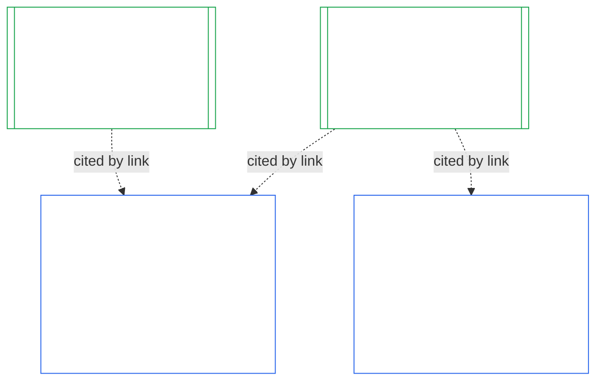
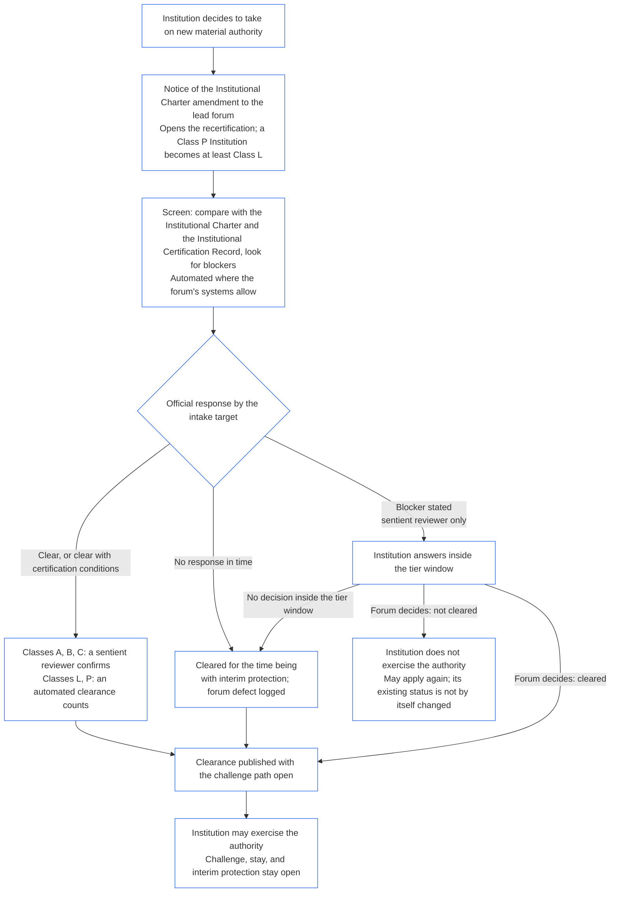

<!-- Locale: ko; source: current working tree (2026-11-11); source SHA-256: 08e166f5f098d01317c1f57ae3501abde31dd10f3c9b43b54d1a2aea1da4200f; baseline: 247e2180509e5e029c1106878cf225067339e010; AI-drafted, unreviewed; assembled from complete 2026-11-03 draft with 2026-11-09 changed-passage refreshes. -->

# 제10장: 기관 정렬 인증

<strong>코퍼스에서의 위치(비운영): 파일 구조와 읽기 규칙</strong>

> 이 파일은 **감지자 헌법의 일부**이며, 번호가 매겨진 다른 `core_*` 파일과 함께 하나의 텍스트로 읽을 때에만 **구속력**을 갖습니다. 이 파일은 **제10장**—**기관 정렬 인증**—을 담습니다. 즉, [기관](../../core_05.040_band_continuity.md#institution)이 자신이 운영하는 어떤 시스템과도 구별되어 어떻게 분류되고, 평가되고, 검토되고, 결정되고, 기록되고, 최신 상태로 유지되며, 다시 열리는지를 다룹니다(**§1–§11**). 제10장은 [제9장](core_09.000_system_alignment_certification_evaluation.md#chapter-nine-system-alignment-certification)(*시스템 정렬 인증*)에 대응하는 기관편이며, **절 번호도 같습니다**. 여기의 §N은 그곳의 §N에 답합니다. [CS-9.320](../../corpus_systems/cs_09.320_system_alignment_certification_illustrations.md#cs-9320-system-alignment-certification-illustrations)(*시스템 정렬 인증 예시*)에는 시스템을 위한 예시가 있고, 그 [§12 기관 설명 사례](../../corpus_systems/cs_09.320_system_alignment_certification_illustrations.md#cs-9320-12-illustrative-institution-walkthroughs)에는 세 기관 설명 사례가 있습니다. 이 장은 이를 반복하지 않습니다.
>
> | § | 제9장(시스템) | 제10장(기관) |
> |---|------------------------|----------------------------|
> | 1 | 목적과 역할 | 시스템 인증과의 관계, 인증 대상, 설립 또는 운영에 대한 허가나 관문이 아님, 새로운 권한의 근거를 기다리는 일, 최초 인증 기간 |
> | 2 | 시스템 등급 평가 | 기관 등급, 등급에 따른 규모 조정 |
> | 3 | 시스템 전체 인증 평가 | 언제나 적용되는 여덟 가지 기관 평가 항목 |
> | 4 | 관련되는 경우의 평가 | 제9장 §4를 가리킴 |
> | 5 | 권리 바닥 및 영역 평가 | 제9장 §5를 가리킴 |
> | 6 | 포럼 절차 | 네 좌석, 포럼 역할과 순서, 기관인 포럼·인증자·기록 사무소 |
> | 7 | 인증 결과 | 기관과 그 시스템의 가동 개시, 인증 조건과 결과의 다른 효과, 결함 관련 참조, 시정 준비태세, 거부와 취소 |
> | 8 | 시스템 인증 기록 | 기관 인증 기록 |
> | 9 | 재인증과 재개 | 모니터링, 재개 계기, 잠정 및 완전 인증, 회피 금지, 시스템 인증에서 이어지는 연쇄, 거버넌스 위반 시 해당 시스템을 다시 여는 일 |
> | 10 | 인증에 대한 이의 제기 | 이의 제기 경로 |
> | 11 | 궤적과의 관계 | 궤적 연결 고리 |
>
> - **헌정상 소관(제9장과 공동):** 포럼의 감독을 받는 정렬 인증 및 관련 시스템 인증 기록과 기관 인증 기록. 제10장은 기관이라는 대상을 추가한다. 새로운 포럼 계열, 의석 또는 결과 용어는 추가하지 않는다.
> - **반복이 아닌 재사용:** 제III단계부터 제VI단계까지는 [제9장 B부 §6](core_09.005_system_alignment_certification_record_process.md#6-forum-process)부터 [제9장 C부 §11](core_09.010_system_alignment_certification_record_recertification.md#11-relationship-to-standing)까지 정한 대로 진행합니다. 제10장은 대상이 기관일 때 달라지는 점만 밝힙니다.
> - **이전 배치 금지 규칙:** 제10장은 시스템에 대한 제9장의 평가 방식, 제7장의 시스템 헌장 및 기관 헌장 항목, 제8장의 4개 의석 요건, [corpus_institutions](../../corpus_institutions.md)의 기관 의무, 제12장의 지위 측정 또는 제13장의 지위 효과를 다시 서술하지 않는다.
>
> **상위 문서:** [제7장](core_07_charters.md#chapter-seven-system-and-institutional-charters) 헌장; [제8장](../../core_08.000_functional_independence_separation_of_duties.md#chapter-eight-functional-independence-and-separation-of-duties) 기능적 독립성; [제9장](core_09.000_system_alignment_certification_evaluation.md#chapter-nine-system-alignment-certification) (파트 [A](core_09.000_system_alignment_certification_evaluation.md#chapter-nine-part-a-system-alignment-certification--evaluation), [B](core_09.005_system_alignment_certification_record_process.md#chapter-nine-part-b-system-alignment-certification--forum-process-and-outcomes), [C](../../core_09.010_system_alignment_certification_record_recertification.md#chapter-nine-part-c-system-alignment-certification--record-recertification-and-standing)); 제15장의 포럼 감독.
> **하위 문서:** 제11장의 지위 기록 및 검증된 입력; 제13장의 지위 효과.

<strong>추적</strong>

- 상위 문서:
  - [제7장 §1 시스템 헌장과 기관 헌장이 필요한 경우](core_07_charters.md#1-when-system-and-institutional-charters-are-required) (7.000 §1) (*어떤 기관이 시스템 헌장 또는 기관 헌장을 공개하는지, 기관의 등급은 무엇인지*);
  - [제7장 §7 개정 및 검토](core_07_charters.md#7-amendment-review-and-scope-misalignment) (7.000 §7) (*기관 헌장 검토에서 무엇을 확인하는지*);
  - [제7장 §4 헌장 역할 지도와 궤적 기록 관리](core_07_charters.md#4-the-charter-role-map-and-standing-record-custody) (7.000 §4) (*좌석을 어디에 두는지*);
  - [제8장 §2 헌법상 네 좌석 요건](core_07_functional_independence_segregation_of_duties.md#2-four-seat-constitutional-requirement) (8.000 §2) 및 [§9 후속 절차와의 관계](core_07_functional_independence_segregation_of_duties.md#9-relationship-to-later-processes);
  - [제9장](core_09.000_system_alignment_certification_evaluation.md#chapter-nine-system-alignment-certification) (9.000~9.010) (*이 장이 재사용하는 시스템 정렬 인증 절차*);
  - [두 가지 근본 질문](core_00_preamble.md#two-fundamental-questions);
  - [헌법 사원(四元)](core_00_preamble.md#constitutional-tetrad);
  - [제XI-E조](core_06_rights_part_b.md#article-xi-e-institutional-formation-and-business-creation) (*기관의 성립과 사업 창설*).
- 하위 문서: [§1](#1-purpose-and-role)부터 [§11](#11-relationship-to-standing)까지; 제11장 ([11.000](core_11_standing_assessment.md#chapter-eleven-standing-records--question-1-what-happened)); [제15장](../../core_15.000_forum.md#chapter-fifteen-forums-and-jurisdiction) (15.000).
- 함께 읽을 문서:
  - [기관 정렬 인증](../../core_05.040_band_continuity.md#institutional-alignment-certification) 및
  - [기관 인증 기록](../../core_05.040_band_continuity.md#institutional-certification-record) (*제5장의 의미*);
  - **CI-8.205 §6** (*시스템 및 기관 헌장의 내용, 검토, 성립 서식*);
  - **CF-14.425** (*무결성 보호 장치, 포획 방지 운영, 자기 심판 방지 지원*).

 

제10장은 **기관 정렬 인증**의 헌법상 주관자입니다. [제9장](core_09.000_system_alignment_certification_evaluation.md#chapter-nine-system-alignment-certification)의 절차를 시스템에서 기관으로 확장합니다.

- **제I단계, 틀 짜기:** 기관 등급과 등급에 따른 평가 규모 조정([§2 기관 등급 평가](#2-institution-class-evaluation));
- **제II단계, 평가:** 관련되는 경우 적용되는 평가와 권리 바닥 및 영역 평가를 포함한 기관 평가([§3 기관 전체 인증 평가](#3-whole-institution-certification-evaluation)부터 [§5 권리 바닥 및 영역 평가](#5-rights-floor-and-domain-evaluations)까지);
- **제III단계, 검토:** 포럼 역할과 순서([§6 포럼 절차](#6-forum-process));
- **제IV단계, 결정:** 결과, 시정 준비태세, 거부와 취소([§7 인증 결과](#7-certification-outcomes));
- **제V단계, 기록:** 기관 인증 기록([§8 기관 인증 기록](#8-institutional-certification-record)); 그리고
- **제VI단계, 운영:** 재인증, 재개, 시스템 인증에서 이어지는 연쇄, 해당 시스템을 다시 여는 일, 이의 제기 경로, 궤적 연결 고리([§9 재인증과 재개](#9-recertification-and-reopening)부터 [§11 궤적과의 관계](#11-relationship-to-standing)까지).

*쉬운 말로: 제9장은 **시스템**이 정렬되어 있는지를 묻습니다. 제10장은 시스템을 운영하거나 시스템을 운영하지 않으면서 권한을 보유한 **기관**도 같은 기준으로 살핍니다. 한 기관은 정렬되어 있지만 그 기관의 시스템 하나는 정렬되어 있지 않을 수 있고, 그 반대도 가능합니다. 따라서 기관이 통제하는 것만 확인합니다. 즉 기관 헌장에 적힌 일을 하는지, 권한에 누가 책임지는지, 자체 구성원에게 무엇을 보상하는지, 기관에 대한 독립적 점검을 실제로 이용할 수 있는지를 봅니다. 각 시스템의 인증에 의존하며 이를 다시 평가하지 않습니다. 이것은 허가증이 아닙니다. 기관을 시작하거나 운영하기 위해 누구의 허가도 필요하지 않습니다.*

### 1. 목적과 역할

<strong>추적</strong>

- 상위 문서:
  - [제7장 §1 시스템 헌장과 기관 헌장이 필요한 경우](core_07_charters.md#1-when-system-and-institutional-charters-are-required) (7.000 §1);
  - [제9장 A부 §1 목적과 역할](core_09.000_system_alignment_certification_evaluation.md#1-purpose-and-role) (9.000 §1);
  - [제XI-E조](core_06_rights_part_b.md#article-xi-e-institutional-formation-and-business-creation) (*기관의 성립과 사업 창설*);
  - [제XXVIII-A조](../../core_06.020_rights_part_e.md#xxviii-a-existing-instantiations-adoption-transition-window) (*단계적 채택과 권리 바닥의 연속성*).
- 하위 문서: [§2](#2-institution-class-evaluation); [§6](#6-forum-process); [§7](#7-certification-outcomes); [§9](#9-recertification-and-reopening).
- 함께 읽을 문서:
  - [기관](../../core_05.040_band_continuity.md#institution);
  - [기관 헌장](../../core_05.040_band_continuity.md#institutional-charter);
  - [시스템 헌장](../../core_05.040_band_continuity.md#system-charter);
  - [사업 창설](../../core_05.055_band_participation.md#business-creation).

 

*쉬운 말로: 시스템의 인증은 그 시스템에 속합니다. 기관의 인증은 시스템 인증들을 인용하고, 기관만이 답할 수 있는 내용을 더합니다. 하나의 시스템은 여러 기관 아래에 있거나 어느 기관에도 속하지 않을 수 있습니다. 이 장의 어떤 내용도 기관을 시작하는 데 인증이 걸림돌이 되게 하지 않습니다.*

기관 정렬 인증과 시스템 정렬 인증은 링크로 연결된 두 가지 인증이다. 이 관계는 **포함이 아닌 링크를 통한 구성**이다. 그림에서 화살표는 시스템 인증 기록에서 그 기록을 인용하는 각 기관 인증 기록으로 이어진다. 어떤 기관에도 속하지 않은 시스템에는 화살표가 없고 필요하지도 않으며, 시스템을 운영하지 않는 기관에는 기관 인증 기록만 있다.

링크를 통한 구성에는 두 측면이 있으며, 먼저 기관 측면을 봅니다.

기관 측면:

- **기관 인증 기록은 시스템 기록을 인용하며 다시 평가하지 않습니다:** 링크로 시스템 인증 기록을 인용하고 그 버전을 명시합니다. 이 장은 시스템 평가를 다시 실행하거나 시스템 등급을 다시 결정하거나 시스템의 결과, 상태 또는 인증 조건을 바꾸지 않습니다.
- **기관 인증으로 시스템 인증을 끌어올릴 수 없습니다:** 인증되지 않음 상태인 시스템은 기관의 상태와 관계없이 인증되지 않음으로 남습니다. 인증을 보유한 시스템도 기관의 판단으로부터 보호받지 않습니다.
- **기관에 관한 사실은 한 번만 확인합니다:** [제9장 A부 §3.1 거버넌스·유인·다툼 가능성 규율](core_09.000_system_alignment_certification_evaluation.md#31-governance-incentive-and-contestability-discipline)에서 운영자의 거버넌스와 유인을 묻는 경우, 운영자에 대한 최신 기관 인증 기록이 링크를 통해 해당 사실을 제공할 수 있습니다. 그래도 시스템의 포럼은 그 사실이 해당 시스템에 충분한지 결정합니다. 같은 기관 관련 사실을 시스템 인증 기록에 이유를 밝히지 않고 다르게 판단해서는 안 됩니다.

시스템 측면:

- **시스템 인증 기록은 시스템에 속한다:** 그 기록은 [제9장](core_09.000_system_alignment_certification_evaluation.md#chapter-nine-system-alignment-certification)에 따른 시스템 자체의 시스템 인증 기록이다.
- **하나의 시스템 인증 기록을 여러 기관이 인용할 수 있다:** [제7장 §1 시스템 및 기관 헌장이 필요한 경우](core_07_charters.md#1-when-system-and-institutional-charters-are-required)에 따라 하나의 시스템을 둘 이상의 기관이 운영, 관리하거나 실질적으로 통제할 수 있다. 각 기관은 동일한 시스템 인증 기록을 인용한다.
- **시스템은 어떤 기관에도 속하지 않을 수 있습니다:** 단일 감지자는 기관이 아니므로 시스템에 기관이 없을 수 있습니다. 기관이 없는 시스템은 [제9장](core_09.000_system_alignment_certification_evaluation.md#chapter-nine-system-alignment-certification)만으로 인증되며 이 장에 따른 어떤 절차도 필요하지 않습니다. 기관에 속한 시스템도 똑같이 인증됩니다. 이 장은 기관을 위한 별도의 기록을 추가할 뿐, 시스템 자체 인증의 단계가 아닙니다.

#### 1.1 누가 인증을 받는가

등급 L 이상인 기관은 이 장의 적용 대상이며, 등급은 [§2.1 기관 등급](#21-institution-class)에 따라 정합니다. 여기에는 시스템을 전혀 운영하지 않는 기관도 포함됩니다. 인용할 시스템 인증 기록은 없으며, 기관 자체의 영향에 따라 등급이 정해집니다. 기관의 **포트폴리오**는 기관이 운영하거나, 책임 있게 관리하거나, 실질적으로 통제하는 시스템의 집합입니다([포트폴리오](../../core_05.040_band_continuity.md#portfolio)).

- **등급 A, B, C 및 L:** 절차가 적용되며 [§2.2 등급별 규모 조정](#22-scaling-by-class)에 따라 규모를 조정합니다.
- **등급 P:** 절차의 이용을 권장하며 자발적으로 이용할 수 있습니다. 등급 L 이상으로 재분류되거나 기관이 자발적으로 헌법 준수를 주장하면 의무가 됩니다. 새로운 실질 권한을 맡기로 한 등급 P 기관은 [§9.2.2 새로운 실질 권한에 따른 재인증](#922-recertification-for-new-material-authority)의 통지를 하는 시점에 최소 등급 L로 재분류됩니다. 그 권한은 정의상 실질적([§9.2.1 새로운 실질 권한에 해당하는 것](#921-what-counts-as-new-material-authority))이고, 어느 영역에서든 실질적인 기관은 최소 등급 L이기 때문입니다([§2.1 기관 등급](#21-institution-class), 항목 2). 이 재분류는 통지 시점부터 통지가 승인 전에 철회되거나, 해당 권한이 승인되지 않는 때까지 지속됩니다. 단, 그 권한이 한 번도 행사되지 않았어야 합니다. 그러면 기관은 등급 P로 돌아가며 제한적인 최초 인증 기간은 끝납니다. 새 통지를 하면 기간이 다시 시작됩니다. 승인 없이 권한을 행사하면 [§9.2.2 새로운 실질 권한에 따른 재인증](#922-recertification-for-new-material-authority)(*통지 없이 또는 승인 전에*)에 따른 판단 대상으로 남습니다. 이는 [제9장 A부 §1 목적과 역할](core_09.000_system_alignment_certification_evaluation.md#1-purpose-and-role)에 대응합니다.
- **시스템 하나:** 시스템 헌장이 필요한 시스템을 정확히 하나 운영하는 기관에는 인증 심사 1회와 시스템 인증 기록 1개가 있으며, 이 장에서는 이를 **단일 시스템 평가**라고 한다. 시스템 인증 기록에는 [§8 기관 인증 기록](#8-institutional-certification-record)의 항목을 담은 *기관 조사결과 블록*이 포함되며 기관 인증 기록 역할도 한다. 포럼, 의석 및 시간 계산은 기관 항목을 추가한 시스템 자체의 인증 심사를 따른다. 결과에는 [§7.4 기관의 거부 및 취소](#74-denial-and-revocation-for-an-institution)에 명시된 자체 거부 및 취소 근거가 적용된다. 시스템이 전체 포트폴리오이므로 [§9.5 시스템 인증에서의 연쇄 효과](#95-cascade-from-system-certifications)는 연쇄 효과로 적용되지 않는다. 다만 [§7.4 기관의 거부 및 취소](#74-denial-and-revocation-for-an-institution) 규칙 1과 2(지표 및 원인이 있는 곳에 관한 검사)는 적용된다.
- **여러 시스템:** 기관마다 기관 인증 기록이 하나 있으며, 그 기관이 운영하는 각 시스템의 시스템 인증 기록에 연결된다. 각 시스템은 자체 심사와 자체 시스템 인증 기록을 유지한다.
- **시스템 없음:** 기관 인증 기록 하나만 둡니다. 기관이 시스템을 운영하지 않으므로 링크할 시스템 인증 기록은 없습니다.

#### 1.2 설립 또는 운영에 대한 허가나 관문이 아님

기관 정렬 인증은 기관이 실제로 권한을 어떻게 사용하는지에 대한 독립적인 점검입니다. 기관으로부터 독립된 포럼들이 이를 수행하고, 확인한 내용을 기관 인증 기록으로 남기면서 끝납니다.

- **설립과 운영:** 기관은 먼저 인증을 보유하지 않고도 성립하고, 기관 헌장을 공개하고, 권한 행사를 시작하고, 계속 운영합니다. 어떤 결과도 그 권리를 부여하거나 박탈하지 않습니다.
- **결과의 효과:** 결과는 [§7.1 기관의 가동 개시](#71-go-live-for-an-institution)에 정한 효과만 가집니다.
- **이 영역의 유일한 관문:** 좁은 관문은 세 가지이며, 모두 **제XI-E조**(*기관의 성립과 사업 창설*)에 있습니다.
  - 명명된 감지자에게 설정된 미해제 잠금. 이는 그 감지자의 권한에 적용됩니다.
  - 정렬 불일치에 관한 특정 검증 사실에 설정된 임시 보류. 이 역시 명명된 감지자의 권한에 적용됩니다.
  - 운영 당사자 자체에 대한 잠금은 기관에 적용되는 경우에만 기관에 붙는다. 해산 기관에 **CI-13.210 §4** (*해산*)에 따라 적용되는 경우가 그 예다.

  인증 판단은 [§7.5 기관에 대한 거부와 취소의 효과](#75-effects-of-denial-and-revocation-for-an-institution)에 따라 증거로서 이 관문들 중 하나를 결정하는 포럼에 회부될 수 있습니다. 인증 결과 자체는 관문이 아니며 관문을 열거나 닫지도 않습니다.
- **새로운 실질 권한을 기다리는 일:** 새로운 실질 권한을 맡기로 결정한 기관은 [§9.2.2 새로운 실질 권한에 따른 재인증](#922-recertification-for-new-material-authority)의 조건에 따라 그 권한을 행사하기 전에 재인증이 해당 권한을 승인할 때까지 기다립니다. **제XI-E조**(*기관의 성립과 사업 창설*)가 이러한 대기를 정합니다. 이는 세 가지 좁은 관문 중 하나도 아니고 설립이나 운영에 대한 관문도 아닙니다. 새 권한에만 적용되며, 기관의 다른 활동은 모두 계속됩니다. [§9.2.2 새로운 실질 권한에 따른 재인증](#922-recertification-for-new-material-authority)의 그림은 단계를 요약합니다.
- **우회 통로 없음:** 포럼, 채택자 또는 현직자가 이 장을 창립자를 배제하거나 현직자를 보호하는 허가 기준으로 이용할 수 없습니다. 그러한 이용은 [제XI-E조](core_06_rights_part_b.md#article-xi-e-institutional-formation-and-business-creation)(*기관의 성립과 사업 창설*)를 무력화합니다.
  - [피할 수 있는 부담](../../core_05.040_band_continuity.md#avoidable-burden)은 절차 비용에 적용됩니다.
  - [등급에 비례한 거버넌스](core_05_band_oversight.md#classification-scaled-governance)는 절차의 깊이에 적용됩니다.
  - 새로운 실질 권한에 대한 대기는 같은 등급의 모든 기관에 동일한 조건으로 적용되며, 이미 다른 이들에게 실질적인 권한에만 적용됩니다.

시스템의 가동 개시 관문은 별개이며 시스템에 계속 적용됩니다. [제9장 B부 §7.1 가동 개시 관문](core_09.005_system_alignment_certification_record_process.md#71-go-live-gate)에 따라 새로운 시스템이나 시스템의 실질적 확장은 기관의 상태와 관계없이 자체 인증을 거쳐야만 가동을 시작할 수 있습니다.

#### 1.3 최초 인증 기간

최초 기관 인증 기록은 채택 문서가 해당 기관 등급에 대해 정한 기간 안에 작성해야 합니다.

- **새 기관:** 기간은 [영역별 실질성](core_05_band_oversight.md#domain-specific-materiality)에 따라 다른 이들에게 처음으로 실질적 영향을 미친 날부터 시작하며, 최초 인증은 잠정 인증입니다.
- **통지에 따라 재분류된 등급 P 기관:** 기간은 새 기관과 마찬가지로 [§9.2.2 새로운 실질 권한에 따른 재인증](#922-recertification-for-new-material-authority)에 따른 통지일에 시작합니다. 이미 끝난 채택 전환 기간으로부터 시작하지 않습니다.
- **이미 운영 중인 기관:** 기간은 [제XXVIII-A조](../../core_06.020_rights_part_e.md#xxviii-a-existing-instantiations-adoption-transition-window)(*단계적 채택과 권리 바닥의 연속성*)에 따른 채택 전환 기간이며, [제7장 §1.5 시스템 헌장 또는 기관 헌장이 필요한 시점](core_07_charters.md#15-when-a-system-charter-or-institutional-charter-is-due)의 기본 규칙과 일치합니다.
- **기간을 놓친 경우:** 아래의 면책 사유가 없는데 최초 인증 절차를 거치지 않은 채 기간이 끝난 기관은 기록하고 시정해야 할 결함이 생기며, 기간 만료로 해당 절차가 열립니다. 이미 운영 중인 등급 L 이상 기관에는 아래의 이정표 실패도 적용됩니다. 관문은 없으므로 기관은 운영을 중단하거나 운영에서 배제되지 않습니다([§1.2 설립 또는 운영에 대한 허가나 관문이 아님](#12-no-permission-and-no-gate-on-forming-or-running)).
  - **이미 운영 중인 기관:** 이는 L등급 이상 기관에 적용되는 이 장 자체의 규칙으로, 시스템 및 파생 개체를 규정한 [제XXVIII-A조](../../core_06.020_rights_part_e.md#xxviii-a-existing-instantiations-adoption-transition-window) (*단계적 도입 및 권리 기준선 연속성*)를 유추 적용한다. 도입 전환 기간이 끝날 때 첫 인증 심사가 완료되지 않았다면(잠정 또는 완전 인증이 없고 [§7 인증 결과](#7-certification-outcomes)에 따른 결정된 결과도 없음) 기한을 지키지 못한 것이다. 기관이 기간 내에 신청하고 협조했으며, 포럼이 자체 기한을 넘겼거나 ([제15장 §6 적시 해결, 중요도 단계 및 지연 방지 규율](core_11_forum.md#6-timely-resolution-materiality-tiers-and-anti-delay-discipline), *기한 초과 검토*; [제9장 파트 C §9.3.4 등급별 기간](core_09.010_system_alignment_certification_record_recertification.md#934-tier-windows)) 또는 [§7.3 기관의 시정 준비도](#73-remediation-readiness-for-an-institution)에 따른 단 한 번의 연기가 진행 중이어서 심사가 완료되지 않은 경우에는 기한 미준수가 아니다. [제XXVIII-B조](../../core_06.020_rights_part_e.md#article-xxviii-b-adoption-transition-authority-limits-and-reauthorization) (*도입 전환 권한 한계 및 재승인*)에 따른 문서화된 재승인 사유가 없다면 이는 도입 전환 이정표 실패이며, 통상적인 준수 및 위반 경로가 [제11장](core_11_standing_assessment.md#chapter-eleven-standing-records--question-1-what-happened)에서 열린다. 해당 조항의 제한 의무는 발효일부터 적용되며, 그 공백이 지속된다고 새 정상 상태가 되지 않는다. 이는 [제9장 파트 B §7.1.1 이미 운영 중인 시스템](core_09.005_system_alignment_certification_record_process.md#711-systems-already-operating)을 본뜬 것이다. 이는 관문이 아니다.
  - **인증 절차:** 다른 절차와 마찬가지로 결정됩니다. [§7 인증 결과](#7-certification-outcomes)에 규정된 모든 결과로 끝날 수 있으며, 인증되지 않음과 [§7.5 기관에 대한 거부와 취소의 효과](#75-effects-of-denial-and-revocation-for-an-institution)에 정한 효과도 포함됩니다.
  - **제재 및 해산:** 이 장에서는 이를 만들지 않는다. 정지, 관재, 구조적 분리 및 해산은 **CI-13.210** (*기관의 실패 및 해산*) 및 **CI-13.215** (*기관의 책임 및 제재*)에 따라 관할 포럼에 남는다. 해당 포럼에 회부하는 것은 [§7.5 기관에 대한 거부 및 취소의 효과](#75-effects-of-denial-and-revocation-for-an-institution) (항목 5, *회부*)의 근거가 있을 때뿐이다.

### 2. 기관 등급 평가

<strong>추적</strong>

- 상위 문서:
  - [제7장 §1 시스템 헌장과 기관 헌장이 필요한 경우](core_07_charters.md#1-when-system-and-institutional-charters-are-required) (7.000 §1);
  - [제9장 A부 §2 시스템 등급 평가](core_09.000_system_alignment_certification_evaluation.md#2-system-class-evaluation) (9.000 §2) 및 [§2.2 시스템 등급이 모든 평가의 규모를 조정하는 방식](core_09.000_system_alignment_certification_evaluation.md#22-how-system-class-scales-every-evaluation);
  - [제3장 §2.1 흔한 회피 양상](core_03_definition_integrity.md#21-common-evasion-patterns) (3.000 §2.1).
- 하위 문서: [§3](#3-whole-institution-certification-evaluation) (*등급에 따라 조정되는 항목*); [§8](#8-institutional-certification-record) (*기관 인증 기록에 명시되는 등급*); [§9.2](#92-reopening-triggers) (*등급을 재평가하는 촉발 요인*).
- 함께 읽을 문서:
  - **CS-9.305 (*시스템 분류 체계*) 및 CS-9.310** (*시스템 영향 분류*) 및 [corpus_systems/cs_09.310_system_impact_classifications.md](../../corpus_systems/cs_09.310_system_impact_classifications.md)(*등급 목록*);
  - **CI-9.210** (*분류 연계 기관 의무*);
  - **CI-8.205 §6** (*시스템 및 기관 헌장의 내용, 검토, 성립 서식*).

 

*쉬운 말로: 먼저 기관이 다른 이들에게 얼마나 중요한지에 따라 등급을 정합니다. 기관이 스스로 부르는 이름이 아니라 실제로 결정하고 보유하는 것에 따라 판단합니다. 그 등급이 평가의 철저함을 정합니다. 등급이 높을수록 증거 기준이 엄격하고, 검토의 독립성이 높으며, 더 이른 시점에 다시 점검합니다.*

이 절은 기관에 대한 **제I단계, 틀 짜기**입니다.

#### 2.1 기관 등급

**기관 등급**은 기관이 미치는 최대 실질적 영향에 따라 정하며, 그 영향이 기관이 운영하는 시스템을 통하거나 시스템 밖에서 발생하는지는 관계없습니다. 기관이 실제로 결정하고 보유하며 통제하는 것을 기준으로 판단하며, 기관의 명칭이나 법적 형태, 기관 헌장에 적힌 목록은 기준이 아닙니다. 등급은 [제9장 A부 §2.2 시스템 등급이 모든 평가의 규모를 조정하는 방식](core_09.000_system_alignment_certification_evaluation.md#22-how-system-class-scales-every-evaluation)에서 시스템에 대해 정한 것처럼 평가의 깊이와 기한을 좌우합니다. 이 장과 [제7장 §1.2 적용되는 등급](core_07_charters.md#12-which-classes-are-covered)에서 사용하는 등급입니다.

1. **시스템을 통한 영향:** 기관의 등급은 포트폴리오에 포함된 시스템 중 가장 높은 등급 이상입니다([제7장 §1 시스템 헌장과 기관 헌장이 필요한 경우](core_07_charters.md#1-when-system-and-institutional-charters-are-required)). 시스템은 실제 운영을 관찰하여 확인합니다. 기관 헌장에서 빠진 시스템도 포함됩니다.
2. **시스템 외부에서의 영향:** 기관이 시스템을 운영하는지와 무관하게 기관 자체의 실질적 영향과 의존도를 계산합니다. **CS-9.305 (*시스템 분류 체계*) 및 CS-9.310** (*시스템 영향 분류*)의 등급 정의를 기관 자체의 결정과 보유 항목에 적용하며, 다음 요소를 사용합니다.
   - **기관이 결정하고 보유하는 것:**
     - 다른 감지자의 생존 필수품, 교육, 안전, 생계, 권리 또는 궤적에 대한 접근을 기관이 결정하는지;
     - 자금, 기록, 회원권, 궤적 기록 관리, 포럼·인증자·기록 사무소의 기능 등 기관이 보유하는 것.
   - **기관에 실질성이 있는지:**
     - [영역별 실질성](core_05_band_oversight.md#domain-specific-materiality)의 어느 영역에서든 기관 자체 활동이 실질적인지. 여기에는 다른 이들이 따라야 하거나 확정된 것으로 의존할 수 있는 [실질 구속 행위](../../core_05.035_band_accountability.md#materially-binding-act)를 하는 경우가 포함됩니다.
     - 어느 한 영역에서든 실질적인 기관은 **CS-9.305 (*시스템 분류 체계*) 및 CS-9.310** (*시스템 영향 분류*)에 따라 최소 등급 L입니다.
     - 다른 이들이 필요로 하는 것에 대한 접근을 통제하지 않고 상대가 자유롭게 받거나 거절할 수 있는 지원, 물품, 노동 또는 서비스를 제공하는 것은 누구에게도 구속력을 만들지 않습니다. 이는 행위일 뿐 실질 구속 행위는 아니며, 다른 요소를 통해서만 고려됩니다.
   - **다른 이들이 기관에 얼마나 의존하는지:**
     - 기관에 의존하는 감지자의 수와 대체 가능성;
     - 실질 통제선의 의미에 따른 권한의 집중도;
     - 기관의 결정을 되돌릴 수 있는 정도.
3. **공동 통제:** [영역별 실질성](core_05_band_oversight.md#domain-specific-materiality)의 집계 규칙에 따라 하나의 운영으로 간주되는 운영 주체들([실질 통제선](../../core_05.035_band_accountability.md#material-control-line) 안에서의 공통된 실제 통제; 자금 지원만으로는 해당하지 않음)이 실제로 하나의 기관처럼 행동하면 함께 분류합니다. 운영 주체, 그 포트폴리오 또는 권한을 쪼개 어느 부분도 등급 L에 이르지 않게 하는 것은 [제3장 §2.1 흔한 회피 양상](core_03_definition_integrity.md#21-common-evasion-patterns)에 따른 범위·경계 회피입니다.
4. **재분류:** 등급은 [§9.2 재개 계기](#92-reopening-triggers)에 따른 계기가 발생하면 재평가합니다. 분류 사유와 함께 기관 인증 기록에 등급을 기재합니다.

#### 2.2 등급별 규모 조정

기관 등급은 [제9장 파트 A §2.2 시스템 등급이 모든 평가에 미치는 영향](core_09.000_system_alignment_certification_evaluation.md#22-how-system-class-scales-every-evaluation)과 같은 방식으로 증거의 깊이, 검토의 독립성, 기본 인증 간격 및 기관 인증 기록의 공개 범위를 조정한다. 인증 간격은 [제15장 §6 적시 해결, 중요도 단계 및 지연 방지 규율](../../core_15.000_forum.md#review-cadence) (*검토 주기*)에 있다. 도입 문서는 더 짧은 기간을 설정할 수 있고, 문제가 없는 잠정 재인증의 횟수를 정한다.

- **등급 A, B, C:** [§3 기관 전체 인증 평가](#3-whole-institution-certification-evaluation)의 여덟 항목 모두를 평가하며, 증거와 독립성의 수준은 등급에 비례합니다.
- **등급 L:** 동일한 여덟 항목을 간소화하여 평가합니다. [등급에 비례한 거버넌스](core_05_band_oversight.md#classification-scaled-governance)가 허용하는 경우 기록을 간소화하고 기본 인증 주기를 늘립니다. 등급 L 절차의 핵심은 실제 관행과 대조한 기관 헌장, 역할 지도, 성립 심사 진술, 인용된 시스템 인증의 최신성입니다. 항목을 생략할 수 없으며, 판단할 사항이 없는 항목도 한 줄로 기재합니다.
- **등급 P:** [§1.1 누가 인증을 받는가](#11-who-is-certified)에 정한 대로 자발적으로 진행합니다.

**공동 전문직 실무의 호스트.** 기관이 호스트인 경우 ([**CI-16.205 §7**](../../corpus_institutions/ci_16.205_appointment_competency_rotation_removal.md#ci-46-seat-advisory) (*실무 면허, 실무 허가 및 공동 전문직 실무)), 인증은 호스트가 맡은 의석에 비추어 구성원 행위도 표본 점검하고, 호스트의 실제 행동과 구성원의 도입 통지를 비교한다. 구성원 한 명의 행위에 관한 조사결과는 그 구성원에 관한 것이며, 호스트가 맡은 의석이 실패한 경우에만 호스트에도 미친다.

### 3. 기관 전체 인증 평가

<strong>추적</strong>

- 상위 문서:
  - [제9장 A부 §3 시스템 전체 인증 평가](core_09.000_system_alignment_certification_evaluation.md#3-whole-system-certification-evaluation) (9.000 §3);
  - [제7장 §3 시스템 헌장과 기관 헌장에 명시해야 할 사항](core_07_charters.md#3-what-system-and-institutional-charters-must-state) (7.000 §3);
  - [제7장 §5 성립 심사: 직위 보유자의 궤적과 진정성](core_07_charters.md#5-formation-check-office-holder-standing-and-authenticity) (7.000 §5);
  - [제7장 §7 개정 및 검토](core_07_charters.md#7-amendment-review-and-scope-misalignment) (7.000 §7);
  - [두 가지 근본 질문](core_00_preamble.md#two-fundamental-questions);
  - [제1장 §19.6 소유권 또는 구조가 바뀔 때 책임 유지하기](core_01_c_stewardship_capacity_principles.md#196-keeping-responsibility-when-ownership-or-structure-changes) (1.010 §19.6).
- 하위 문서: [§6](#6-forum-process)(*포럼이 검토하는 판단*); [§9](#9-recertification-and-reopening)(*판단을 다시 여는 계기*); [§11](#11-relationship-to-standing)(*명명된 감지자에 대한 판단의 검증 입력 관문*).
- 함께 읽을 문서:
  - **CI-8.205 §3** (*권한 계통과 위임 통제*) 및 **CI-8.205 §6** (*시스템 및 기관 헌장의 내용, 검토, 성립 서식*);
  - **CI-6.215** (*자원 관리와 유인 무결성*);
  - 항목 8에는 **CI-8.210** (*이해상충 무결성, 포획 방지 및 반부패*), **CI-6.205** (*투명성, 참여, 접근 가능한 이의제기 및 서비스 경로*), **CI-13.205** (*구제 체계 및 기관의 시정 역량*)이 적용된다.

 

*쉬운 말로: 기관에 속하고 그 시스템 중 어느 하나에도 속하지 않는 사항을 점검합니다. 기관 헌장을 지키는지, 권한에 누가 책임지는지, 무엇에 보상을 주는지, 기관에 대한 독립적 점검이 작동하는지를 봅니다.*

이 절은 기관에 대한 **제II단계, 평가**입니다.

모든 인증 절차는 이 여덟 항목을 평가합니다. 이는 [제9장 A부 §3 시스템 전체 인증 평가](core_09.000_system_alignment_certification_evaluation.md#3-whole-system-certification-evaluation)에 대응하는 기관 평가 항목입니다. 각 판단에는 그 판단의 근거가 된 증거와 기관 헌장 문구 또는 관찰된 운영을 명시합니다.

1. **실제 관행과 대조한 기관 헌장:**
   - [제7장 §7 개정 및 검토](core_07_charters.md#7-amendment-review-and-scope-misalignment)의 검토 목록을 사용해 실제 운영과 기관 헌장을 대조합니다.
   - 실제 관행이 기관 헌장을 벗어나거나 기관 헌장이 더 이상 실제 관행을 설명하지 못하면, 어느 쪽이 잘못되었든 판단 사항입니다.
2. **포트폴리오와 종합 효과:**
   - 포트폴리오의 근거를 검토합니다. 각 시스템이 기관의 명시된 목적과 연결되는지, 이유가 명시되지 않은 시스템이 있는지 판단합니다.
   - 또한 시스템별 인증만으로는 알 수 없는 사항을 전체 시스템에 걸쳐 살핍니다.
     - 공유 의존성;
     - 종합적인 의존;
     - 공유 기반에서 누적되는 자원 추출; 그리고
     - 하나의 기능을 여러 부분으로 나누어 각 부분이 등급이나 의무를 피하는 모든 구조.
3. **책임을 지는 권한:**
   - 기관이 다른 이들에게 행사하는 각 권한은 이름을 밝힐 수 있는 책임 있는 직위에 귀속되어야 합니다. 해당 직위는 [제8장](../../core_08.000_functional_independence_separation_of_duties.md#chapter-eight-functional-independence-and-separation-of-duties)과 **CI-8.205 §3**(*권한 계통과 위임 통제*)의 규칙에 따라 책임을 집니다.
   - 소유권, 통제 또는 구조가 바뀌어도 책임은 사라지지 않습니다([제1장 §19.6 소유권 또는 구조가 바뀔 때 책임 유지하기](core_01_c_stewardship_capacity_principles.md#196-keeping-responsibility-when-ownership-or-structure-changes)).
4. **보상과 유인:**
   - 기관 자체의 급여, 승진, 목표, 보상에 [두 가지 근본 질문](core_00_preamble.md#two-fundamental-questions)을 적용합니다. 실제 구조가 무엇에 보상하는지, 그 방향이 헌법의 두 목적을 향하는지 아니면 멀어지는지 묻습니다.
   - 모든 시스템이 개별 인증을 받았더라도 정렬 불일치나 이를 숨기는 행위에 보상하는 구조는 판단 사항입니다.
   - [제9장 A부 §3.3 시간 일관성 제약](core_09.000_system_alignment_certification_evaluation.md#33-time-consistency-constraint)을 적용합니다. 예측 가능한 중·장기 안전, 진실 또는 웰빙의 손상을 다루지 않았다면 단기 지표, 국지적 준수, 단기 효율만으로는 충분하지 않습니다. 그러한 대가를 치르며 단기 결과에 보상하는 구조도 판단 사항입니다.
   - 유인 무결성에 관한 기관 의무는 **CI-6.215**(*자원 관리와 유인 무결성*)에 그대로 두며, 이를 재서술하지 않고 인용합니다.
5. **역할 지도와 기록 관리:**
   - [헌장 역할 지도](../../core_05.040_band_continuity.md#charter-role-map)는 존재하고, 명시된 대로 충원 또는 대체된 직위를 식별한다. 기관이 대상인 기관 인증 기록에서는 그 직위가 기관으로부터 [독립적](../../core_05.035_band_accountability.md#independence)이어야 한다.
   - 독립된 경로를 실제로 이용할 수 있어야 합니다.
   - 좌석의 배치 누락, 기능하지 않는 직위, 또는 기관 자체의 지휘 계통 안에 있는 기록 관리자는 판단 사항입니다.
6. **인용된 각 시스템 인증의 최신성:**
   - 기관이 운영하는 각 시스템에 대해, 시스템 인증 기록이 효력을 유지하거나 도입 전환 기간 안에 있는지, 그리고 기관이 그 기록의 인증 조건에 따른 기관 의무를 이행했는지를 평가한다.
   - 만료, 철회, 실패 또는 기록된 이유가 없는 인증 누락은 판단 사항이며, [§9.5 시스템 인증에서 이어지는 연쇄](#95-cascade-from-system-certifications)에 따라 기관에도 영향을 미칩니다.
7. **직위 보유자의 궤적과 진정성:**
   - [제7장 §5 성립 심사: 직위 보유자의 궤적과 진정성](core_07_charters.md#5-formation-check-office-holder-standing-and-authenticity)에 따라 공개된 성립 심사 진술을 실제 운영에 비추어 검토하며, 단순한 진술만으로 받아들이지 않습니다.
   - 보장 대상인 각 직위에 대해 포럼은 standing 사실을 검증된 standing 기록과 대조하고, 통제, 이해관계와 보상, 행위 및 보호된 발언권에 관한 증거로 진정성을 판단한다. 즉:
     - 실제로 직위 보유자를 지휘하는 자;
     - 직위 보유자가 급여와 승진을 받는 기준;
     - 직위 보유자가 해당 기능에서 검증 가능하게 수행한 일; 그리고
     - 직위 보유자를 포함하여 [보호된 신고](../../core_05.035_band_accountability.md#protected-reporting-whistleblowing)를 했거나 위법·위헌 지시를 거부한 사람([제1장 §17.5 저항 의무](core_01_c_stewardship_capacity_principles.md#175-duty-to-resist))이 그 때문에 불이익을 받았는지.
   - 적용 대상 직위가 없는 직원은 한 명씩 점검하지 않습니다. [제7장 §5.6 직원 보호 장치 점검](core_07_charters.md#56-staff-safeguards-check)에서 이들을 다루며, 포럼은 같은 방식으로 실제 운영에 비추어 이를 검증합니다. 다음을 묻습니다.
     - 기관의 임명, 급여, 승진, 해임 규칙이 명시된 목적에 반하는 업무를 보상하지 않는가;
     - 보호된 신고 경로가 존재하며, 그 경로를 이용했거나 위법·위헌 지시를 거부한 직원이 불이익을 받지 않았는가; 그리고
     - [제III-C조](core_06_rights_part_a.md#article-iii-c-labor-and-economic-floor)(*노동 및 경제 바닥*)의 권리가 온전히 보장되는가.
   - 다음 각 항목은 판단 사항입니다.
     - 공개되지 않은 통제자의 대리인인 직위 보유자;
     - 서류상으로만 존재하는 적용 대상 직위. 기관 헌장이나 헌장 역할 지도에는 명시되어 있지만 실제로 직위를 맡아 업무를 수행하는 사람이 없는 경우입니다.
     - 기관 헌장에 공개된 한계를 금지한 행위를 직위 보유자가 하도록 보상하는 구조; 그리고
     - 거짓이거나 불완전한 진술.
   - 판단은 직위와 구조에 관한 것입니다. [§11 궤적과의 관계](#11-relationship-to-standing)에 따른 검증 입력 관문을 거쳐야만 명명된 감지자에게 귀속됩니다.
   - 성립 심사는 신념을 검사하지 않습니다. 다만 다른 이들이 해를 입거나 차별적으로 대우받아 마땅하다는 검증된 진술은 행위이며 직위 보유자에게 불리하게 고려됩니다. [제1장 §7.5 표현과 위해선](core_01_a_values_principles.md#75-expression-and-the-harm-line)에 정한 바와 같습니다.
   - 항목 3, 4, 5는 이 항목과 함께 검토하며, 그중 하나에서 확인한 사실을 다른 항목에서 다시 판단하지 않습니다.
8. **기관 자체의 기관 의무:**
   - 채택된 기관 문서가 기관에 부과한 기관 의무의 준수 여부는 관찰된 운영으로 검사하며, 자기 확인 진술만으로 인정하지 않는다. 해당 의무는 **CI-8.210** (*이해상충 무결성, 포획 방지 및 반부패*), **CI-6.205** (*투명성, 참여, 접근 가능한 이의제기 및 서비스 경로*), **CI-6.215** (*자원 관리 및 유인 무결성*), **CI-13.205** (*구제 체계 및 기관의 시정 역량*)이다.
   - 검사는 기관의 감독, 책임, 참여 및 적시성 경로가 존재하고 실제 사용 가능하며 기관이 스스로 명시한 기간 내에 응답하는지 묻는다. 해당 기간은 기관 등급의 최소 기간보다 길 수 없다([제XXVI-C조](core_06_rights_part_e.md#article-xxvi-c-timely-resolution-and-anti-delay-floor) (*적시 해결 및 지연 방지 기준선*) 및 [CF-15.445 §3.1 단계 목표 및 상한](../../corpus_forum/cf_15.445_performance_backlog_publication_accessibility.md#cf-15445-31-stage-targets-and-outer-bounds)의 해당 등급 목표). 이를 넘는 기간을 명시한 것 자체가 조사결과가 된다.
   - 서류상으로만 존재하는 경로, 접근할 수 없는 경로, 제때 응답하지 않는 경로는 각각 판단 사항입니다.
   - 의무는 해당 문서에 그대로 두고 인용할 뿐 다시 서술하지 않습니다. 항목 3부터 5까지에서 판단한 사실은 이 항목에서 다시 판단하지 않습니다.

**제9장 A부 §3 시스템 전체 인증 평가의 추가 두 항목.** [제9장 A부 §3 시스템 전체 인증 평가](core_09.000_system_alignment_certification_evaluation.md#3-whole-system-certification-evaluation)는 시스템에 대해 두 가지 추가 사항을 묻습니다. 기관 자체 행위에도 적용되며, 각각 자체 발동 요건을 충족하는 경우에만 기관 평가의 일부가 됩니다.

- **체계적 범위와 위험 요소:**
  - **적용되는 경우:** 기관 자체 행위로 [제9장 A부 §3.2 체계적 범위와 위험 요소](core_09.000_system_alignment_certification_evaluation.md#32-systemic-scope-and-risk-factors)의 요소에 따른 체계적 위험이 범위에 들어오는 경우입니다. 가장 큰 규모의 위해, 효과가 확산되고 누적되는 방식(기관 자체 서비스가 실패할 때 하위 단계에서 발생하는 실패 포함), 기관 활동이 오용되거나 범위를 잘못 설정할 가능성을 봅니다.
  - **평가 기준:** [제9장 A부 §3.2 체계적 범위와 위험 요소](core_09.000_system_alignment_certification_evaluation.md#32-systemic-scope-and-risk-factors)에 따라 평가합니다. 여기에는 위험 평가 및 공개 연결 고리인 [§3.2.1 위험 평가와 공개 연결 고리](core_09.000_system_alignment_certification_evaluation.md#321-risk-evaluation-and-disclosure-bridge)와 [§3.2.2 결함과 정렬 불일치](core_09.000_system_alignment_certification_evaluation.md#322-defects-and-misalignment)가 포함됩니다.
- **데이터 유형과 처리:**
  - **적용되는 경우:** [제9장 A부 §3.4 데이터 유형 및 처리 평가](core_09.000_system_alignment_certification_evaluation.md#34-data-types-and-handling-evaluation)가 실질적 영향이 있는 모든 인증 기록에 요구하는 대로 기관 자체 행위가 범위에 실질적으로 포함되는 데이터 유형을 처리하는 경우입니다.
  - **평가 기준:** [제9장 A부 §3.4 데이터 유형 및 처리 평가](core_09.000_system_alignment_certification_evaluation.md#34-data-types-and-handling-evaluation)에 따르며, 그 안의 기반 시설 보증은 기관 등급에 맞게 조정합니다.
  - **기록 위치:** 기관이 어떤 시스템 밖에서 처리하는 데이터는 기관 인증 기록의 데이터 유형 절에 기록합니다([§8.1 최소 기록 내용](#81-minimum-record-contents)). 시스템 안에서 처리하는 데이터는 해당 시스템 기록에서 한 번만 판단하고 인용합니다.

이미 인용된 시스템 인증 기록에서 이루어진 평가를 반복하지 말라는 [§4 관련되는 경우의 평가](#4-evaluations-where-implicated) 규칙은 두 항목 모두에 적용됩니다.

### 4. 관련되는 경우의 평가

<strong>추적</strong>

- 상위 문서:
  - [제9장 A부 §4 관련되는 경우의 평가](core_09.000_system_alignment_certification_evaluation.md#4-evaluations-where-implicated) (9.000 §4).
- 하위 문서: [§6](#6-forum-process); [§8](#8-institutional-certification-record).
- 함께 읽을 문서:
  - **CI-8.210** (*이해 충돌 무결성, 포획 방지, 반부패*);
  - **CI-6.205** (*투명성, 참여, 접근 가능한 이의 제기 및 서비스 경로*);
  - **CI-6.215** (*자원 관리와 유인 무결성*);
- **CI-13.205** (*구제 체계 및 기관의 시정 역량*).

 

*쉬운 말로: 기관 자체 행위가 시스템에 관련 사안이 있을 때 적용되는 평가 영역 중 하나에 닿으면, 같은 평가를 기관에 대해서도 한 번 실시합니다.*

기관 자체 행위가 [제9장 A부 §4 관련되는 경우의 평가](core_09.000_system_alignment_certification_evaluation.md#4-evaluations-where-implicated)에서 다루는 사안에 관련되면, 같은 계기가 충족되는 경우 해당 평가를 기관 자체 행위에 실시합니다. 각 평가는 자체 발동 요건이 충족되는 경우에만 적용됩니다.

- **프라이버시(정보):** 기관의 행위가 제6장의 프라이버시 관련 지점 둘 이상에 실질적으로 관련되면 각 지점을 다루어야 하며, 하나만으로 사안을 종결하기에는 충분하지 않습니다([제9장 A부 §4.1 프라이버시(정보) 공동 발동](core_09.000_system_alignment_certification_evaluation.md#41-privacy-informational-joint-invocation)).
- **자발적 중단, 중대한 자기 수정, 탈퇴 권리:** 인증 주장을 인정하기 전에 자발성, 동의, 강압 방지, 의존 압력, 정보, 가역성을 검증합니다. 형식적 동의만으로는 충분하지 않습니다([제9장 A부 §4.2 자발적 중단, 중대한 자기 수정, 탈퇴 권리](core_09.000_system_alignment_certification_evaluation.md#42-voluntary-discontinuation-major-self-modification-and-exit-rights)).
- **집회, 집단 조직, 기관 성립:** 반분할 원칙에 따라 사안을 공동으로 검증하며, 한 가지 틀로만 다루지 않습니다([제9장 A부 §4.3 집회, 집단 조직, 기관 성립](core_09.000_system_alignment_certification_evaluation.md#43-assembly-collective-organization-and-institutional-formation)).
- **반대 의견과 평화적 시위:** 기관은 반대 의견이나 보호되는 비폭력 시민 불복종을 직접 또는 대리인을 통해 불리한 입력으로 이용할 수 없습니다([제9장 A부 §4.3.1 반대 의견과 평화적 시위](core_09.000_system_alignment_certification_evaluation.md#431-dissent-and-peaceful-protest)).

기관 의무 자체의 근거는 채택된 기관 문서이며, 다음을 포함합니다.

- **CI-8.210** (*이해 충돌 무결성, 포획 방지, 반부패*);
- **CI-6.205** (*투명성, 참여, 접근 가능한 이의 제기 및 서비스 경로*);
- **CI-6.215** (*자원 관리와 유인 무결성*); 그리고
- **CI-12.205** (*구제 체계와 기관의 시정 역량*).

이 장은 이를 인용할 뿐 다시 서술하지 않습니다. 기관이 실제로 이를 지키는지는 [§3 기관 전체 인증 평가](#3-whole-institution-certification-evaluation)(항목 8)에 따라 검증합니다. 이미 인용된 시스템 인증 기록에서 실시된 평가는 다시 실시하지 않습니다.

### 5. 권리 바닥 및 영역 평가

<strong>추적</strong>

- 상위 문서:
  - [제9장 A부 §5 권리 바닥 및 영역 평가](core_09.000_system_alignment_certification_evaluation.md#5-rights-floor-and-domain-evaluations) (9.000 §5).
- 하위 문서: [§6](#6-forum-process); [§8](#8-institutional-certification-record).
- 함께 읽을 문서:
  - [§4](#4-evaluations-where-implicated)(*기관 의무와 평가 반복 금지 규칙*).

 

*쉬운 말로: 앞 절과 같은 규칙입니다. 발동 요건을 충족하면 기관 자체 행위에 권리 바닥 또는 영역 검사를 실시하고, 인용된 시스템 인증에서 이미 실시한 평가는 반복하지 않습니다.*

기관 자체 행위가 [제9장 A부 §5 권리 바닥 및 영역 평가](core_09.000_system_alignment_certification_evaluation.md#5-rights-floor-and-domain-evaluations)에서 다루는 권리 바닥이나 영역에 관련되면, 같은 계기가 충족되는 경우 해당 평가를 기관 자체 행위에 실시합니다. 각 평가는 자체 발동 요건이 충족될 때만 적용되므로 기관 인증 기록에는 기관이 발동 요건을 충족하는 평가만 포함됩니다. 보호 내용과 각 평가의 적용 기준은 다음과 같습니다.

- **제I-B조** (*생태 발자국과 투명성*):
  - **적용되는 경우:** 기관에 귀속되는 환경 부담이 실질적인 경우.
  - **평가 기준:** [제9장 A부 §5.1 생태 발자국 평가](core_09.000_system_alignment_certification_evaluation.md#51-ecological-footprint-evaluation).
- **제III-A조** (*생존*):
  - **적용되는 경우:** 기관이 생존 필수품에 대한 접근을 공급, 배분, 가격 책정, 제공 또는 종료하는 경우.
  - **평가 기준:** [§2 기관 등급 평가](#2-institution-class-evaluation) 및 [§3 기관 전체 인증 평가](#3-whole-institution-certification-evaluation).
- **제IV조** (*감지자 중심 교육을 받을 권리*):
  - **적용되는 경우:** 기관이 교육이나 훈련 맥락에서 감지자의 순위를 정하거나 평가·추천·배치·자격증명 접근을 통제하거나, 재훈련과 평생 학습 경로를 통제하는 경우.
  - **평가 기준:** [제9장 A부 §5.2 교육 역량 및 학습 체계 무결성 평가](core_09.000_system_alignment_certification_evaluation.md#52-educational-capability-and-learning-system-integrity-evaluation).
- **제IV-A조** (*동등한 교육 접근*):
  - **적용되는 경우:** 기관이 교육 접근을 공급, 배분, 가격 책정, 제공 또는 종료하는 경우.
  - **평가 기준:** [§2 기관 등급 평가](#2-institution-class-evaluation)와 [§3 기관 전체 인증 평가](#3-whole-institution-certification-evaluation), 그리고 발동 요건이 충족되는 경우 [제9장 A부 §5.2 교육 역량 및 학습 체계 무결성 평가](core_09.000_system_alignment_certification_evaluation.md#52-educational-capability-and-learning-system-integrity-evaluation)와 [제9장 A부 §5.5 접근성 평가](core_09.000_system_alignment_certification_evaluation.md#55-accessibility-evaluation).
- **제V조** (*자원 배분, 의존성, 생태계 자금 조달*), **제V-A조** (*의존성 지도 작성과 자원 흐름 투명성*), **제V-B조** (*시스템 간 공정성과 지속 가능성*) 포함:
  - **적용되는 경우:** 기관이 다른 시스템이나 감지자가 의존하는 공유 기반 시설 또는 토대 의존성에서 자원을 배분·경로 지정·지원하거나 추출하는 경우.
  - **평가 기준:** [제9장 A부 §5.3 비례적인 시스템 간 지원 평가](core_09.000_system_alignment_certification_evaluation.md#53-proportionate-cross-system-support-evaluation).
- **제III-F조** (*안전한 제품과 건강 정보*):
  - **적용되는 경우:** 기관이 신체, 건강 또는 안전에 영향을 줄 수 있는 제품이나 서비스를 공급·등록·추천하거나 조언하거나, 그에 관한 정보를 보유하는 경우.
  - **평가 기준:** [§2 기관 등급 평가](#2-institution-class-evaluation) 및 [§3 기관 전체 인증 평가](#3-whole-institution-certification-evaluation), 그리고 발동 요건이 충족되는 경우 [제9장 A부 §5.6 신뢰성과 시스템 의존 무결성 평가](core_09.000_system_alignment_certification_evaluation.md#56-trustworthiness-and-system-reliance-integrity-evaluation).
- **제VI-C조** (*차별 금지*):
  - **적용되는 경우:** 기관이 감지자를 분류·순위화·가격 책정·통제·배제하거나 부담과 혜택을 배분하는 경우.
  - **평가 기준:** [제9장 A부 §5.4 차별 금지 평가](core_09.000_system_alignment_certification_evaluation.md#54-nondiscrimination-evaluation).
- **제VI-D조** (*접근성*):
  - **적용되는 경우:** 기관이 헌법상 관련 영역의 실질적 참여를 통제하는 경우.
  - **평가 기준:** [제9장 A부 §5.5 접근성 평가](core_09.000_system_alignment_certification_evaluation.md#55-accessibility-evaluation).
- **제XIII조** (*신뢰할 수 있는 시스템에 대한 권리*):
  - **적용되는 경우:** 기관이 표시된 행동, 한계, 위험, 이의 제기 경로 또는 시정에 대한 감지자의 의존을 형성하는 경우.
  - **평가 기준:** [제9장 A부 §5.6 신뢰성과 시스템 의존 무결성 평가](core_09.000_system_alignment_certification_evaluation.md#56-trustworthiness-and-system-reliance-integrity-evaluation).
- **제XIII-A조** (*신뢰성 기준선*) 및 **안전 조건**:
  - **적용되는 경우:** 기관이 생산 활동을 공급하거나 통제하거나, 안전 조건에 대한 접근을 공급·배분·가격 책정·제공 또는 종료하는 경우.
  - **평가 기준:** [§2 기관 등급 평가](#2-institution-class-evaluation) 및 [§3 기관 전체 인증 평가](#3-whole-institution-certification-evaluation), 그리고 발동 요건이 충족되는 경우 [제9장 A부 §5.6 신뢰성과 시스템 의존 무결성 평가](core_09.000_system_alignment_certification_evaluation.md#56-trustworthiness-and-system-reliance-integrity-evaluation).

기관 의무와 인용된 시스템 인증 기록에서 이미 실시한 평가를 반복하지 않는 규칙은 [§4 관련되는 경우의 평가](#4-evaluations-where-implicated)에 정한 바와 같습니다. [제9장 A부 §5 권리 바닥 및 영역 평가](core_09.000_system_alignment_certification_evaluation.md#5-rights-floor-and-domain-evaluations)가 모든 영역 평가에 대해 정한 원칙과 결함 규정은 기관 자체 행위에 대한 해당 평가에도 적용됩니다.

### 6. 포럼 절차

<strong>추적</strong>

- 상위 문서:
  - [제9장 B부 §6 포럼 절차](core_09.005_system_alignment_certification_record_process.md#6-forum-process) (9.005 §6);
  - [제8장 §2 헌법상 네 좌석 요건](core_07_functional_independence_segregation_of_duties.md#2-four-seat-constitutional-requirement) (8.000 §2), [§5 공개된 배치, 공석, 대체](core_07_functional_independence_segregation_of_duties.md#5-published-placement-vacancy-and-substitution), [§6 비례적 규모 조정과 통합 호스팅](core_07_functional_independence_segregation_of_duties.md#6-proportional-scaling-and-merged-hosting), [§9 후속 절차와의 관계](core_07_functional_independence_segregation_of_duties.md#9-relationship-to-later-processes);
  - [제15장 §4.3 기관 포럼](core_11_forum.md#43-institutional-forums) (15.000 §4.3);
  - [제15장 §3 이관, 통합 및 조정](core_11_forum.md#3-transfer-consolidation-and-coordination--continuity-and-anti-capture) (15.000 §3) (*포럼 간 자기심판 방지 규칙*);
  - [실질 구속 행위 기록](../../core_05.035_band_accountability.md#materially-binding-act-record).
- 하위 문서: [§7](#7-certification-outcomes); [§8](#8-institutional-certification-record); [§9](#9-recertification-and-reopening); [제15장](../../core_15.000_forum.md#chapter-fifteen-forums-and-jurisdiction) (15.000).
- 함께 읽을 문서:
  - [헌장 역할 지도](../../core_05.040_band_continuity.md#charter-role-map);
  - **CF-15.415** (*라우팅 운영, 이관, 판정을 위한 질문 및 대표적 처리*);
  - **CF-14.425** (*무결성 보호 장치, 포획 방지 운영, 자기 심판 방지 지원*);
  - **CF-14.435 §6** (*자기 조사 금지*).

 

*쉬운 말로: 같은 독립 포럼들이 같은 순서로 기관을 검토하며, 기관은 자기 검토자를 선택하지 않습니다.*

이 절은 기관에 대한 **제III단계, 검토**입니다.

#### 6.1 기관 인증의 네 좌석

이 하위 절은 [제8장 §2 헌법상 네 좌석 요건](core_07_functional_independence_segregation_of_duties.md#2-four-seat-constitutional-requirement)을 이 장에 적용하는 방식이며, [제8장 §9 후속 절차와의 관계](core_07_functional_independence_segregation_of_duties.md#9-relationship-to-later-processes)가 이 절차에 요구하는 진술입니다. 기관 인증은 [실질 구속 행위](../../core_05.035_band_accountability.md#materially-binding-act)이므로 모든 인증 절차에는 네 좌석이 있습니다. 이 장은 좌석을 추가하지 않으며 제8장의 어떤 규칙도 완화하지 않습니다. [제9장 B부 §6.1.1 인증의 네 좌석](core_09.005_system_alignment_certification_record_process.md#611-four-seats-in-a-certification)은 다음과 같이 대체하여 적용합니다.

- **[개시 좌석](../../core_05.035_band_accountability.md#initiating-seat):** 기관의 통치 권한.
  - **역할:** 인증을 요청하거나 증거를 제출해야 하는 제안자입니다.
  - **계기에 따라 개시되는 인증 절차:** 주관 포럼의 명령으로 개시되며 통치 권한은 계속 제안자로 남습니다.
- **[검증 또는 승인 의석](../../core_05.035_band_accountability.md#verify-or-authorize-seat):** 결과를 담당하는 선도 포럼과 각 조사결과를 담당하는 각 구성요소 권한자는 [§6.2 포럼 역할 및 순서](#62-forum-roles-and-sequence)와 제15장에 따라 배정된다.
  - **좌석 배치:** [헌장 역할 지도](../../core_05.040_band_continuity.md#charter-role-map)는 이 좌석을 배치하지 않습니다.
  - **기관이 할 수 없는 일:** 자체 검증 권한을 선택·임명하거나, 자신이 통제하는 경로를 통해 자금을 지원하거나, 해임할 수 없습니다.
  - **담당할 수 있는 자:** 기관에서 일하거나 기관 소유이거나 기관에 답하는 자는 기관 인증의 이 좌석을 맡을 수 없습니다. 이를 맡는 자는 모두 결과가 결정할 사안에 이해관계가 없어야 합니다.
  - **시스템:** 같은 규칙이 시스템 인증에도 적용됩니다([제9장 B부 §6.1.1 인증의 네 좌석](core_09.005_system_alignment_certification_record_process.md#611-four-seats-in-a-certification), *운영자 외부*).
- **[기록 좌석](../../core_05.035_band_accountability.md#record-seat):** 기관 헌장의 헌장 역할 지도가 배치하는 직위.
  - **역할:** 기관 인증 기록을 열고, 수정하고, 보존하고, 공개합니다.
  - **위치:** 기관의 [실질 통제선](../../core_05.035_band_accountability.md#material-control-line) 바깥에 둡니다.
- **[이의 제기 좌석](../../core_05.035_band_accountability.md#contest-seat):** 관할 검토 포럼 또는 대체 포럼으로 연결되는 공개 기록 이의 제기 경로.
  - **위치:** 같은 방식으로 같은 통제선 바깥에 배치합니다.

**자체 배치.** 기관은 자체 인증의 기록 좌석과 이의 제기 좌석을 배치하는 지도를 공개합니다.

- **무효한 배치:** 어느 의석이든 기관 자체의 중요 통제선 안에 배치되면, 지도 내용과 무관하게 기관이 대상인 기관 인증 기록의 유효한 배치가 아니다([제8장 §3 독립성, 이해상충 및 통제선](core_07_functional_independence_segregation_of_duties.md#3-independence-conflict-and-control-lines)).
- **경로 지정:** 이후 인증 절차는 [제8장 §5 공개된 배치, 공석, 대체](core_07_functional_independence_segregation_of_duties.md#5-published-placement-vacancy-and-substitution)에 따라 경로가 지정됩니다. 해당 좌석의 업무는 헌장 역할 지도가 정한 독립 경로로 넘어가며 기관이나 기관의 통제선에 있는 누구에게도 좌석이 이전되지 않습니다.
- **판단:** 결함 있는 좌석 배치 자체가 [§3 기관 전체 인증 평가](#3-whole-institution-certification-evaluation)에 따른 판단 사항입니다.

**통합 호스팅.** [제8장 §6 비례적 규모 조정과 통합 호스팅](core_07_functional_independence_segregation_of_duties.md#6-proportional-scaling-and-merged-hosting)을 변경 없이 적용합니다. 이 장은 통합 호스팅을 추가하거나 없애지 않습니다.

#### 6.2 포럼 역할과 순서

[제9장 B부 §6.2 감독 순서](core_09.005_system_alignment_certification_record_process.md#62-supervisory-sequence)의 감독 순서는 이의 제기 경로에서 시작하여 제IV단계와 제V단계로 넘기는 데까지 적용하되, 다음 사항을 바꿉니다. [제9장 B부 §6.1 포럼 감독과 구성 역할](core_09.005_system_alignment_certification_record_process.md#61-forum-supervision-and-component-roles)도 이 절에서 달리 정한 경우를 제외하고 적용됩니다.

- **주관 포럼:** 모든 인증 절차는 **무결성 포럼**이 주관합니다.
  - **예외:** 주된 이해관계에 대해 제15장은 다른 합법적 선도 포럼을 배정할 수 있다.
  - **기록 좌석:** 주관 포럼은 기록 좌석 보유자에게 지시하지만 같은 행위에서 기록 좌석을 맡지는 않습니다.
- **기관 포럼이 핵심 구성 요소를 담당합니다:**
  - **필수 당사자:** 기관은 언제나 자체 인증의 필수 당사자입니다.
  - **구성 요소란:** 구성 요소는 인증의 한 부분입니다. 그 부분에 대한 **구성 권한**을 가진 포럼은 관할 범위 안에서 해당 부분의 증거와 권한을 적용 기준에 비추어 확인하고 자체 판단을 내립니다. 해당 포럼이 맡은 인증 절차 부분을 **구성 평가**라고 합니다([제9장 B부 §6.1 포럼 감독과 구성 역할](core_09.005_system_alignment_certification_record_process.md#61-forum-supervision-and-component-roles)).
  - **기관 포럼이 보유함:** 기관 포럼은 기관의 권한, 감독 대상 범위, 기관 등급, 기관 의무 준수([§3 기관 전체 인증 평가](#3-whole-institution-certification-evaluation), 항목 8) 및 기관 자체 행위에 대한 권리 기준선 구성요소([제15장 §4.3 기관 포럼](core_11_forum.md#43-institutional-forums), [제9장 파트 B §6.1.6 기관 포럼](core_09.005_system_alignment_certification_record_process.md#616-institutional-forums))에 대한 구성요소 권한을 보유한다.
- **기타 구성 요소:**
  - **기술 포럼:** 증거 기준과 유인 또는 종합 판단에 필요한 측정을 제공합니다.
  - **환경 포럼:** 시스템 전반에 걸친 기관의 종합 생태 노출이 실질적인 경우 구성 판단을 제공합니다.
  - **감지자 포럼:** 기관 자체 행위가 공동체의 자치 방식에 실질적 영향을 미치는 경우 공동체 거버넌스 판단을 제공합니다.
  - **영향받는 구성원과 공동체:** 지정된 포럼을 통해 증거를 제출합니다.
  - **헌법 포럼:** 의미, 유효성, 구조적 구제에 관한 질문을 담당합니다.
- **시스템 문제는 회부하고 결정하지 않습니다:**
  - **회부할 곳:** 한 시스템에 속하는 구성 질문은 기관 인증 절차가 아니라 그 시스템 자체 인증 절차로 보냅니다.
  - **주관 포럼이 할 수 있는 일:** 질문을 회부하거나 판정을 요청하거나 [정지](../../core_05.035_band_accountability.md#stay)할 수 있습니다. 그 절차는 [제9장 B부 §6.2 감독 순서](core_09.005_system_alignment_certification_record_process.md#62-supervisory-sequence)에 규정되어 있습니다.
    - **회부:** 해당 질문을 담당하는 포럼 가족에 넘깁니다.
    - **판정 요청:** 다른 포럼에 판정 질의로 보내 답변을 기다립니다. 사안은 주관 포럼에 계속 남습니다.
    - **정지:** 진행을 잠시 멈춥니다.
  - **할 수 없는 일:** 기관 인증 절차에서 시스템 구성 질문을 결정할 수 없습니다. 그 질문은 시스템 자체 인증 절차에서 결정합니다.
- **참여, 긴급 보호 및 이의제기:** 기관의 인증 심사에는 제9장 파트 B가 전부 적용되며, 시스템 인증 기록을 기관 인증 기록으로 읽는다.
  - **검토 중 참여**([제9장 B부 §6.2.4 검토 중 참여](core_09.005_system_alignment_certification_record_process.md#624-participation-during-review)): 지정된 포럼은 평가와 포럼 검토 중 영향받는 감지자가 증거와 우려 사항을 제출할 수 있도록 실행 가능하고 접근성 있는 방법을 제공합니다. 모든 제출 내용은 기록 좌석 보유자가 관리하는 검토 제출 기록에 들어갑니다.
  - **제출할 수 있는 사람:** 기관의 영향받는 구성원, 노동자, 사용자, 공동체에는 현재와 합리적으로 예측 가능한 영향 대상이 포함되며, 이들은 증거를 제출할 접근성 있는 방법을 제공받아야 하는 감지자입니다. 제9장 B부는 배포 전을 포함하여 실제 및 합리적으로 예측 가능한 영향과 의존성을 기준으로 이들을 식별합니다.
  - **직원과 비밀 유지:** 기관의 문제를 알 가능성이 가장 높은 사람은 직원입니다. 제출자는 직원도 익명 또는 비밀 유지를 요청할 수 있습니다. 주관 포럼이 결정할 때까지 [제9장 B부 §6.2.4 검토 중 참여](core_09.005_system_alignment_certification_record_process.md#624-participation-during-review)에 따라 기관을 포함한 모든 사람에게 제출자의 신원을 숨깁니다.
  - **긴급 보호** ([제9장 파트 B §6.2.3 긴급 보호](core_09.005_system_alignment_certification_record_process.md#623-urgent-protection)): 순서가 끝나기 전에 정지, 임시 보호 또는 의존 한계를 명할 수 있다. 절차는 계속 진행하며 해당 조치를 기관 인증 기록에 입력한다.
  - **이의제기** ([제9장 파트 B §6.3 이의제기 가능성 체계](core_09.005_system_alignment_certification_record_process.md#63-contestability-chain)): 영향을 받는 당사자는 기관 인증 기록에 이의를 제기할 수 있으며, 이의는 분쟁이 실제로 발생한 단계로 간다.
  - **우회 방지**([제9장 B부 §6.4 우회 방지](core_09.005_system_alignment_certification_record_process.md#64-anti-bypass)): 숨겨진 하위 기록, 포획된 내부 기구에만 이의를 보내는 일, 가장 낮은 행정 단계에서 이의를 끝내는 일, 구성 요소의 침묵을 승인으로 취급하는 일을 통해 감독 순서나 다툼 가능성의 연결 고리를 무력화할 수 없습니다.

#### 6.3 기관으로서의 포럼, 인증자, 기록 사무소

*쉬운 말로: 인증을 수행하는 기구도 기관이므로 서로 돌려가며 인증할 수 없습니다. 인증되지 않은 기구는 다른 인증에서 맡은 좌석을 내놓습니다.*

포럼 호스트, 인증 기관, 기관 인증 기록 사무소, 검증 권한자 또는 인증에 참여하는 다른 기관은 [기관](../../core_05.040_band_continuity.md#institution) 정의를 충족하면 기관으로 간주되며, 이 장은 해당 등급의 다른 기관과 마찬가지로 그 기관에 적용된다.

- **자기심판 금지:** 해당 기관 자체의 심사는 그 기관과 그 [중요 통제선](../../core_05.035_band_accountability.md#material-control-line) 바깥의 포럼이 주도하고 검토한다. 포럼 계열 자체의 편향, 포획, 이해상충 또는 절차 남용이 쟁점이라면 [제15장 §3 이관, 통합 및 조정](core_11_forum.md#3-transfer-consolidation-and-coordination--continuity-and-anti-capture)의 포럼 간 자기심판 방지 규칙 및 **CF-15.435 §6** (*자체 조사 금지*)에 따른 대체 라우팅이 적용된다.
- **순환 금지:** 한 기구는 자기 인증에서 좌석을 맡는 기구의 인증에서 직접 또는 한 재인증 주기 안에 처음 기구로 되돌아오는 기구들의 연쇄를 통해 좌석을 맡을 수 없습니다. 인증 절차가 순환을 만들게 되면 그 바깥에 있는 기구로 경로를 지정합니다.
- **좌석 분리 유지:** 좌석을 맡는 것을 포함하여 다른 기구의 인증에 참여해도 해당 기구 자체에 이익이 생기지 않습니다.
  - **다른 기구를 좌우할 권한 없음:** 인증에 대한 답변, 판단에 대한 대응, 인증 조건 또는 이의 제기 등 해당 기구의 대응 방식을 통제할 권한이 생기지 않습니다.
  - **자체 인증에서 우대 없음:** 해당 기구 자체 인증에서 유리한 대우를 받지 않습니다.
- **인증되지 않은 동안 좌석 금지:** 기관이 인증되지 않음 상태인 동안([§7 인증 결과](#7-certification-outcomes)) 다른 기구의 인증에서 검증 또는 승인 좌석, 기록 좌석, 이의 제기 좌석을 맡을 수 없으며 포럼이나 인증 기구를 호스팅할 수 없습니다. 해당 기관이 보유한 좌석 배치는 날짜를 새로 기재한 역할 지도의 새 버전에서 다른 곳으로 옮깁니다.

### 7. 인증 결과

<strong>추적</strong>

- 상위 문서:
  - [제9장 B부 §7 인증 결과](core_09.005_system_alignment_certification_record_process.md#7-certification-outcomes) (9.005 §7). 여기에는 [§7.2](core_09.005_system_alignment_certification_record_process.md#72-certification-defects-and-correction), [§7.3](core_09.005_system_alignment_certification_record_process.md#73-remediation-readiness-willingness-and-capacity-to-correct), [§7.4](core_09.005_system_alignment_certification_record_process.md#74-denial-and-revocation), [§7.5](core_09.005_system_alignment_certification_record_process.md#75-effects-of-denial-and-revocation)가 포함됩니다.
  - [제9장 C부 §9.3 잠정 및 완전 인증](core_09.010_system_alignment_certification_record_recertification.md#93-provisional-and-full-certification);
  - [제9장 A부 §3.1 거버넌스·유인·다툼 가능성 규율](core_09.000_system_alignment_certification_evaluation.md#31-governance-incentive-and-contestability-discipline);
  - [제7장 §6 보유자가 성립 심사에 실패한 경우](core_07_charters.md#6-when-a-holder-fails-the-formation-check) (7.000 §6);
  - [제13장 §6.5 특별 잠금](../../core_13.000_standing_integration.md#65-special-locks) (13.000 §6.5);
  - [제15장 §5 지정 지성체의 경로에 대한 임시 보류](../../core_15.000_forum.md#interim-hold-on-a-named-sentients-pathway) (15.000 §5).
- 하위 문서: [§8](#8-institutional-certification-record); [§9](#9-recertification-and-reopening); [§11](#11-relationship-to-standing).
- 함께 읽을 문서:
  - **CI-13.210** (*기관의 실패 및 해산*) 및 **CI-13.215** (*기관의 책임 및 제재*);
  - **CI-8.205 §3** (*권한 계통과 위임 통제*);
  - **CI-16.205 §1** (*공동 인력 배치 및 역량 요건*);
  - [제XI-E조](core_06_rights_part_b.md#article-xi-e-institutional-formation-and-business-creation)(*기관의 성립과 사업 창설*).

 

*쉬운 말로: 인증 검토가 끝나면 기관에 대한 결과가 공개됩니다. 그 결과는 기관의 존속이나 운영 가능성을 결정하지 않습니다. 기관이 자신에 대해 무엇을 말할 수 있는지, 누가 경고를 받는지, 기관의 시스템을 검토할 때 그 결과를 얼마나 고려할지를 정합니다. 포럼은 검토에서 잘못된 것으로 확인된 특정 관행이나 권한을 제한할 수도 있고, 인증되지 않은 기관은 다른 기구의 인증에서 좌석을 맡을 수 없습니다. 포럼은 기관의 운영이나 시스템 형성을 금지할 수 없습니다.*

이 절은 기관에 대한 **제IV단계, 결정**입니다. 포럼은 [§6 포럼 절차](#6-forum-process)의 검토를 마친 뒤 여기에서 결과를 내립니다.

기관도 시스템과 같은 결과를 받을 수 있습니다. [제9장 B부 §7 인증 결과](core_09.005_system_alignment_certification_record_process.md#7-certification-outcomes)에서 이를 정의합니다.

- 잠정 인증과 완전 인증은 두 가지 **상태**입니다(잠정 인증은 더 일찍 재검토합니다).
- 조건부 인증(인증 조건을 수반하는 인증);
- 연기된 인증(결정을 미룸);
- 인증되지 않음은 **거부**입니다(인증을 거절함).
- 철회는 **취소**입니다(이미 보유한 인증을 거둠).
- 만료(인증 기간이 끝남);
- 인증 조건 이행(인증 조건을 충족함); 그리고
- 인증 조건 해제(인증 조건을 충족하지 않았더라도 더 이상 적용되지 않아 해제함).

잠정 또는 완전 인증을 보유하지 않은 기관은 **인증되지 않음** 상태입니다. 상태와 인증 조건에 관한 규칙은 제9장 B부 §7 인증 결과와 [§9.3 잠정 및 완전 인증](core_09.010_system_alignment_certification_record_recertification.md#93-provisional-and-full-certification)에 정한 바를 따릅니다. 그 규칙에 따라 인증 조건은 독립적으로 검증된 뒤에만 이행 또는 해제를 통해 종료됩니다.

#### 7.1 기관의 가동 개시

*쉬운 말로: 시스템은 인증을 받을 때까지 가동할 수 없습니다. 기관은 인증서 없이도 성립하고 운영할 수 있지만, 새로운 실질 권한을 행사하기 전에는 재인증을 기다립니다. 기관에 대한 결과는 더 좁은 세 가지 사항을 정합니다. 기관의 공개 상태를 정하고, 확인된 특정 문제에 인증 조건을 붙이며, 기관의 시스템을 검토할 때 증거로 고려합니다.*

[제9장 B부 §7.1 가동 개시 관문](core_09.005_system_alignment_certification_record_process.md#71-go-live-gate)은 시스템이 인증되고, 이의 제기 경로를 열어 둔 채 결과가 공개되고, 통지 기간이 지나며, 필요한 모든 인증 조건이 독립적으로 검증될 때까지 가동을 시작할 수 없다고 정합니다.

기관의 설립이나 운영에는 그러한 관문이 없습니다([§1.2 설립 또는 운영에 대한 허가나 관문이 아님](#12-no-permission-and-no-gate-on-forming-or-running)). 기관은 인증을 보유하지 않고도 성립하고 기관 헌장을 공개하며 권한 행사를 시작하고 계속 운영할 수 있으며, 어떤 결과도 그 권리를 부여하거나 박탈하지 않습니다. 한 가지 예외는 새로운 실질 권한입니다. 기관은 그 권한을 행사하기 전에 재인증이 이를 승인할 때까지 기다립니다([§9.2.2 새로운 실질 권한에 따른 재인증](#922-recertification-for-new-material-authority)). 기관의 다른 모든 활동은 계속되며, 새로운 권한을 행사하기 전에 충족해야 하는 인증 조건은 먼저 검증됩니다([§7.1.1 인증 조건](#711-certification-conditions)).

**시스템의 가동 개시 관문은 계속 적용됩니다.** 새로운 시스템이나 시스템의 실질적 확장은 기관 상태와 관계없이 자체 인증을 통해서만 가동을 시작할 수 있습니다. 기관 상태는 그 결정에 참고할 수 있지만 결정을 대신할 수는 없습니다.

- **결과가 아닌 증거:** 기관의 시스템 중 하나가 인증 대상이면 기관 상태는 해당 시스템의 운영 방식, 동인, 감지자가 이의를 제기할 수 있는지에 관한 증거 중 하나입니다([제9장 A부 §3.1 거버넌스·유인·다툼 가능성 규율](core_09.000_system_alignment_certification_evaluation.md#31-governance-incentive-and-contestability-discipline)). 기관 상태만으로 시스템을 인증하거나 차단하지 않습니다.
- **거부 또는 취소 뒤에는 더 높은 입증 기준:** 기관이 인증을 거부당했거나 인증을 잃은 경우, 해당 기관에 의존하는 새 시스템을 출시하거나 대규모 확장을 하려는 자는 더 많은 것을 입증해야 합니다. 기록에 그 판단이 있더라도 기관에 관해 의존하는 근거가 여전히 충분히 탄탄하다는 점을 보여야 합니다([§7.5 기관에 대한 거부와 취소의 효과](#75-effects-of-denial-and-revocation-for-an-institution), 효과 항목 3).

##### 7.1.1 인증 조건

기관의 조건부 인증은 [제9장 B부 §7.1 가동 개시 관문](core_09.005_system_alignment_certification_record_process.md#71-go-live-gate)(*인증 조건과 제한된 승인*)이 요구하는 방식으로 작성하되 다음 한계를 둡니다.

- **확인된 문제에 한정:** 인증 조건이나 의존 제한은 판단이 다루는 권한, 관행 또는 구조에만 적용됩니다.
- **완전한 명시:** 각 인증 조건은 다음 다섯 가지를 명시합니다.
  - 책임자;
  - 기한 또는 지속되는 조건의 반복 주기;
  - 충족 여부를 보여 줄 증거;
  - 해당 증거를 독립적으로 확인할 자;
  - 조건을 놓쳤을 때의 결과.
- **문제를 넘어서는 제한 금지:** 기관에 시스템 형성을 중단하거나 계속 운영하기 위해 허가를 구하거나 판단과 관련 없는 사항을 바꾸도록 요구할 수 없습니다.
- **새 권한을 행사하기 전 인증 조건:** [제9장 B부 §7.1 가동 개시 관문](core_09.005_system_alignment_certification_record_process.md#71-go-live-gate)이 가동 개시 전에 요구하는 인증 조건은 새로운 실질 권한에 대해서만 기관에 적용됩니다. 기관이 그 권한을 행사하기 전에 독립적으로 검증되어야 합니다. 기존 운영을 기다리게 할 수는 없습니다.
- **종료 방식:** 인증 조건은 제9장 B부 §7.1 가동 개시 관문(*인증 조건의 종료 방식*)이 정한 대로 이행 또는 해제를 통해 종료하며, 독립 검증을 거친 뒤에만 종료됩니다.

##### 7.1.2 결과의 다른 효과

시스템과 인증 조건에 관한 사항 외에 결과의 효과는 다음과 같습니다.

- **기관 인증 기록상의 상태:** 기관의 상태를 공개하며 영향을 받는 사람 누구나 이의를 제기할 수 있다. 미인증 상태인 기관은 스스로를 인증되었다고 설명할 수 없다.
- **기관에 의존하는 이들에게 경고:** 판단에 따라 의존이 안전하지 않다는 의미라면 그들에게 알립니다.
- **다음 검토 시점:** 잠정 인증의 인증 주기는 완전 인증보다 짧습니다.
- **거부와 취소:** 효과는 [§7.5 기관에 대한 거부와 취소의 효과](#75-effects-of-denial-and-revocation-for-an-institution)에 정합니다.
- **재개와 연쇄:** 검토를 다시 열 수 있으며, 시스템 인증 실패가 기관에 영향을 미칠 수 있습니다. [§9 재인증과 재개](#9-recertification-and-reopening)를 참조하십시오.
- **궤적:** 결과는 [§11 궤적과의 관계](#11-relationship-to-standing)를 통해서만 감지자의 궤적에 영향을 미칠 수 있습니다.

제재, 해산 및 기관 실패의 결과는 **CI-13.210** (*기관의 실패 및 해산*) 및 **CI-13.215** (*기관의 책임 및 제재*)에 따른다. 이 장은 이를 새로 만들지 않는다.

#### 7.2 인증 결함과 시정

*쉬운 말로: 인증 결함은 평가에서 발견한 실제 문제이지 서류상의 실수가 아닙니다. 기관에서 발견된 결함에도 시스템과 같은 시정 규칙이 적용됩니다.*

인증 절차에서 기관의 결함이 발견되면 [제9장 B부 §7.2 인증 결함과 시정](core_09.005_system_alignment_certification_record_process.md#72-certification-defects-and-correction)을 적용합니다. [§2 기관 등급 평가](#2-institution-class-evaluation), [§3 기관 전체 인증 평가](#3-whole-institution-certification-evaluation), [§4 관련되는 경우의 평가](#4-evaluations-where-implicated), [§5 권리 바닥 및 영역 평가](#5-rights-floor-and-domain-evaluations)의 판단은 제9장 B부가 열거한 제9장 A부 평가를 대신합니다. 제9장 B부 §7.2 인증 결함과 시정은 다음을 정합니다.

- 포럼이 선택할 수 있는 조치;
- 영향받는 사항, 임시 보호와 의존 제한, 요구되는 시정 작업을 명시하는 방식; 그리고
- 인증 조건의 이행을 뒷받침하기 전에 시정을 독립적으로 검증해야 한다는 규칙.

기관에만 해당하는 사항은 두 가지입니다.

- **결함을 넘는 제한 금지:** 인증 조건은 결함 범위를 넘어설 수 없습니다([§7.1 기관의 가동 개시](#71-go-live-for-an-institution)).
- **운영 금지 없음:** 제9장 B부 §7.2 인증 결함과 시정의 마지막 문단은 인증되지 않은 시스템이 새로운 운영을 시작할 수 없다고 정합니다. 이는 시스템에 대한 규칙이며 기관에는 적용되지 않습니다([§1.2 설립 또는 운영에 대한 허가나 관문이 아님](#12-no-permission-and-no-gate-on-forming-or-running)).

#### 7.3 기관의 시정 준비태세

*쉬운 말로: 검토에서 기관의 문제가 발견되면 포럼은 시스템에 대해 묻는 것과 같은 질문을 합니다. 문제를 시정할 의지와 능력이 모두 있는가? 정직한 답이 아니라면 인증이 거부되거나 취소됩니다. 이 사실만으로 기관의 존속이나 운영을 막을 수는 없습니다. 기관이 인증되었다는 주장을 하지 못하게 하고, 기관에 의존하는 이들에게 경고하며, 기관의 양호한 상태에 시스템이 기대는 지원을 약화하고, 기관이 다른 기구의 인증 좌석을 맡지 못하게 합니다.*

[제9장 B부 §7.3 시정 준비태세: 의지와 시정 역량](core_09.005_system_alignment_certification_record_process.md#73-remediation-readiness-willingness-and-capacity-to-correct)은 다음 사항을 바꾸어 기관에 적용합니다.

- **각자의 역할:**
  - **기관의 통치 권한**은 제안자입니다. 기관이 준비태세를 갖추었다는 사안을 맡아 증거를 제출하는 당사자입니다. 자체 준비태세를 판단하지는 않습니다.
  - **주관 무결성 포럼**은 판단을 내립니다. 기관이 문제를 시정할 의지와 능력을 모두 갖추었는지 결정합니다([제9장 B부 §7.3.4 판단](core_09.005_system_alignment_certification_record_process.md#734-findings)에 가능한 판단이 열거되어 있습니다).
  - **기관 포럼**은 거버넌스, 권한, 유인에 관한 증거를 관리하고 주관 포럼에 제출합니다.
  - **기술 포럼**은 측정이 필요한 역량 증거를 관리하고 주관 포럼에 제출합니다([§6.2 포럼 역할과 순서](#62-forum-roles-and-sequence)).
- **의지:** [제9장 B부 §7.3.1 의지](core_09.005_system_alignment_certification_record_process.md#731-willingness)의 요소에 더해 포럼은 기관이 다음을 하는지 살핍니다.
  - 판단의 원인이 된 자체 보상 구조를 바꾸는지;
  - [§3 기관 전체 인증 평가](#3-whole-institution-certification-evaluation)(항목 7)에 따라 진정성이 없다고 판단된 직위 보유자(예: 미공개 통제자를 대리하는 보유자)를 교체하거나 이를 공개하는지;
  - [헌장 역할 지도](../../core_05.040_band_continuity.md#charter-role-map)에서 독립 좌석 배치를 복원하는지;
  - 기관 헌장 또는 시스템 포트폴리오를 시정하는지; 그리고
  - 원인 판단이 기관으로 거슬러 올라가는 시스템에 대해 답하는지([§9.5 시스템 인증에서 이어지는 연쇄](#95-cascade-from-system-certifications)).
- **역량:** [제9장 B부 §7.3.2 역량](core_09.005_system_alignment_certification_record_process.md#732-capacity)의 요소에 더해 포럼은 다음을 살핍니다.
  - 조치가 필요한 직위에 그 조치를 수행할 권한이 있는지(**CI-8.205 §3**(*권한 계통과 위임 통제*));
  - 기관에 해당 업무를 수행할 자금, 인력 및 승계 계획이 있다 (**CI-16.205 §1** (*공동 인력 배치 및 역량 요건*); **CI-13.205** (*구제 체계 및 기관의 시정 역량*)); 그리고
  - 독립 검증 권한이 실제로 부여받은 접근권과 시간을 이용해 시정을 확인할 수 있는지([제9장 B부 §7.3.2 역량](core_09.005_system_alignment_certification_record_process.md#732-capacity), *검증 가능성*). 누구도 검증할 수 없는 시정은 역량이 아닙니다.
- **시스템 하나:** 시스템을 정확히 하나 운영하는 기관은 단일 시스템 평가에서 준비태세 검사를 한 번 받습니다. [§7.4 기관에 대한 거부와 취소](#74-denial-and-revocation-for-an-institution)가 요구하는 대로 준비태세 검사에서 시스템과 기관에 대한 거부 사유를 각각 명시합니다.

#### 7.4 기관에 대한 거부와 취소

*쉬운 말로: 거부는 인증을 내주지 않는 것이고, 취소는 이미 받은 인증을 거두는 것입니다. 둘 다 실제 결과를 초래하지만 기관을 폐쇄하지는 않습니다.*

[제9장 B부 §7.4 거부와 취소](core_09.005_system_alignment_certification_record_process.md#74-denial-and-revocation)는 다음과 같이 바꾸어 기관에 적용합니다.

- **사유와 절차:** 제9장 B부 §7.4 거부와 취소의 규정을 변경 없이 따릅니다.
  - **사유**([제9장 B부 §7.4.2 거부 또는 취소가 필요한 경우](core_09.005_system_alignment_certification_record_process.md#742-when-denial-or-revocation-is-required)):
    - **거부,** 인증을 보유하지 않은 경우: 준비도 점검에서 기관이 의사가 없거나, 의사도 능력도 없거나, 의사는 있지만 능력은 없다고 확인되고, 더 좁은 인증 범위, 지원 또는 적시 격차 해소를 위한 인계도 없는 경우, 또는 한 차례 연기가 끝났는데도 준비도가 입증되지 않은 경우.
    - **취소(인증을 보유한 경우):** 통지와 답변 기회를 준 뒤에도 같은 준비태세 판단이 나오는 경우. 또한 인증 조건을 두 번 놓치거나 실질적으로 위반한 경우, 증거가 허위·조작·은폐된 것으로 드러난 경우, 또는 요구된 증명 절차를 정해진 기간 안에 하지 않은 경우.
    - **조건부 인증으로 대신할 수 없음:** 이러한 거부 또는 취소 사유가 충족되면 포럼은 거부하거나 취소해야 합니다. 거부 또는 취소 사유에 답한다는 이유로 인증 조건을 붙여 인증을 부여하거나 계속할 수 없습니다.
  - **보호 우선**([제9장 B부 §7.4.3 보호 우선](core_09.005_system_alignment_certification_record_process.md#743-protection-first)):
    - **적용 대상:** 거부와 취소는 인증 상태에 적용됩니다. 그 자체로 기관을 폐쇄하지 않습니다.
    - **효력 발생 전:** 포럼은 임시 보호 조치와 의존 제한을 명시합니다.
  - **절차**([제9장 B부 §7.4.4 절차](core_09.005_system_alignment_certification_record_process.md#744-process)):
    - **사전 통지:** 거부 또는 취소 전에 기관에 판단과 증거를 통지하고, 답변하거나 증명 절차를 보여 줄 짧은 기간과 다툼 가능성의 연결 고리를 통해 판단에 이의를 제기할 기회를 줍니다.
    - **이유:** 결정의 이유를 기관 인증 기록에 명시한다.
    - **긴급 보호**([제9장 B부 §6.2.3 긴급 보호](core_09.005_system_alignment_certification_record_process.md#623-urgent-protection)): 통지, 답변 또는 결정을 기다리지 않고 정지, 임시 보호 또는 의존 제한을 즉시 명령할 수 있습니다. 이후에도 절차는 계속되며 해당 조치를 기록에 기재합니다.
  - **영구 금지 아님:** 거부 또는 취소된 운영자도 다시 신청할 수 있습니다.
- **대체하여 읽을 말:**
  - **운영자:** 제9장 B부 §7.4에서 “운영자”라고 한 부분은 기관의 통치 권한으로 읽습니다.
  - **시스템 판단:** “시스템 판단”이라고 한 부분은 기관 판단으로 읽습니다.
- **효과:** 효과는 [§7.5 기관에 대한 거부와 취소의 효과](#75-effects-of-denial-and-revocation-for-an-institution)에 정하며, [제9장 B부 §7.5 거부와 취소의 효과](core_09.005_system_alignment_certification_record_process.md#75-effects-of-denial-and-revocation)에 정한 효과와 다릅니다.
- **시스템 하나:** 시스템을 정확히 하나 운영하는 기관은 단일 시스템 평가를 받습니다([§1.1 누가 인증을 받는가](#11-who-is-certified)). 각 결과에는 각각의 거부 또는 취소 사유가 적용되므로 시스템이 하나인 기관을 여러 시스템을 둔 기관보다 불리하게 취급하지 않습니다.
  - **시스템:** 제9장 B부 §7.4 거부와 취소에 따른 시스템 사유, 즉 시스템 자체 판단에 근거한 경우에만 거부 또는 취소됩니다. 기관 사유, 즉 [§3 기관 전체 인증 평가](#3-whole-institution-certification-evaluation)의 기관 관련 항목(항목 1~5, 7, 8)과 기관 자체 행위에 대한 [§4 관련되는 경우의 평가](#4-evaluations-where-implicated) 및 [§5 권리 바닥 및 영역 평가](#5-rights-floor-and-domain-evaluations)에만 근거한 사유는 시스템을 거부하거나 취소하지 않습니다.
  - **기관:** 기관 판단에 근거한 기관 사유가 있을 때에만 [§7.5 기관에 대한 거부와 취소의 효과](#75-effects-of-denial-and-revocation-for-an-institution)에 따른 효과와 함께 인증되지 않음 상태로 공개됩니다. 시스템 사유만으로는 [제9장 C부 §9.3.3 정렬 불일치의 원인](core_09.010_system_alignment_certification_record_recertification.md#933-cause-of-misalignment)에 따라 원인 판단이 기관에 있지 않는 한 기관 상태가 바뀌지 않습니다. 검사는 [§9.5 시스템 인증에서 이어지는 연쇄](#95-cascade-from-system-certifications) 규칙 2에 따르며, 그 규칙은 이러한 원인을 *기관 원인*이라고 합니다. §9.5 시스템 인증에서 이어지는 연쇄의 규칙 1과 2는 이 절이 정한 대로 단일 시스템 평가에 적용하고, §9.5의 나머지는 적용하지 않습니다.
  - **양쪽 모두:** 공동 사유, 즉 양쪽 모두에 근거한 사유는 두 결과 모두를 낳습니다. 기관의 통치 권한이 한 행위(의지 없음, 허위·조작·은폐 증거, 인증 조건을 두 번 놓치거나 실질적으로 위반한 경우, 요구된 증명 절차를 하지 않은 경우)의 주체이거나 [제9장 A부 §3.1 거버넌스·유인·다툼 가능성 규율](core_09.000_system_alignment_certification_evaluation.md#31-governance-incentive-and-contestability-discipline)에 따라 시스템 자체에 귀속되는 사실에 근거한 경우 거부 또는 취소 사유는 공동 사유입니다. 이는 시스템이 기관 기록에서 링크로 가져온 사실과는 다릅니다. 기관 인증 기록에는 각 거부 또는 취소 사유가 어느 결과의 근거인지 명시합니다.
  - **두 개의 상태 항목:** 기관 인증 기록 하나에 시스템 상태 항목과 기관 상태 항목이 함께 있다. 기관은 아직 인증을 보유하지 않고 거부 근거가 시스템 사유뿐이라면, [§9.3.1 두 가지 상태](#931-the-two-statuses)에 따라 기관 심사는 자체 기관 조사결과로 끝난다(기관 인증 기록에 의존 한계를 명시한 잠정 인증). 이 경우 미인증 상태가 아니므로 [§6.3 기관으로서의 포럼, 인증자 및 기록 사무소](#63-forums-certifiers-and-record-offices-as-institutions)의 의석 금지와 [§7.5 기관에 대한 거부 및 취소의 효과](#75-effects-of-denial-and-revocation-for-an-institution)는 적용되지 않는다. 시스템의 거부 또는 취소는 여러 시스템을 운영하는 기관과 마찬가지로 §9.5 시스템 인증에서의 연쇄 효과 규칙 1에 따른 기관 지표다.

#### 7.5 기관에 대한 거부와 취소의 효과

*쉬운 말로: 거부나 취소는 기관이 자신에 대해 무엇을 말할 수 있는지, 누구에게 통지하는지, 기관 시스템의 검토에서 기관 상태를 얼마나 고려하는지, 다음에 사안을 어디로 보내는지를 바꿉니다. 그 자체로 기관을 폐쇄하지는 않습니다.*

**효과:** 관문이 없으므로([§1.2 설립 또는 운영에 대한 허가나 관문이 아님](#12-no-permission-and-no-gate-on-forming-or-running)), 거부 또는 취소의 효과는 다음뿐입니다.

1. **상태:** 기관을 인증되지 않음으로 공개하며, 기관은 자신을 인증되었다고 표현할 수 없습니다.
2. **통지:** 기관에 의존하는 사람들과 포트폴리오의 각 시스템 포럼에 통지한다. 결과를 공개하는 선도 포럼은 통지가 이루어지는지 확인한다. [§9.6 기관 시스템의 재개](#96-reopening-the-institutions-systems)가 적용되면 같은 통지에 재개 요청을 포함하고, §9.6의 발신자, 시계 및 기본값에 따른다. 기관 인증 기록의 *통지한 시스템* 항목은 두 가지를 모두 다룬다.
3. **시스템 인증에서의 비중:**
   - 포트폴리오 내 각 시스템을 인증할 때 기관 상태는 [제9장 A부 §3.1 거버넌스·유인·다툼 가능성 규율](core_09.000_system_alignment_certification_evaluation.md#31-governance-incentive-and-contestability-discipline)에 따른 불리한 증거입니다.
   - 신규 시스템의 가동이나 실질적 확장에서는 제안자가 판단에도 불구하고 의존하는 기관 관련 사실이 충분하다는 점을 보여야 합니다.
   - 기관 상태만으로 시스템을 인증하거나 차단하지 않습니다. 시스템 자체 인증 절차에서 결정합니다.
4. **다른 기구의 인증 좌석:** 기관은 인증되지 않음 상태인 동안 [§6.3 기관으로서의 포럼, 인증자, 기록 사무소](#63-forums-certifiers-and-record-offices-as-institutions)에 따라 그 좌석을 내놓습니다.
5. **회부:** 주관 포럼은 확인된 인증 문제의 유형을 관할하는 포럼에 사안을 회부합니다. 경로는 세 가지입니다.
   - **실패 및 제재를 결정하는 포럼에:** **CI-13.210** (*기관의 실패 및 해산*) 및 **CI-13.215** (*기관의 책임 및 제재*)에 따른 관할 포럼에 선도 포럼이 사안을 회부하는 경우:
     - 판단 결과 기관에 능력은 있지만 의지가 없는 경우;
     - 은폐 또는 사기 증거에 근거한 취소; 또는
     - [제7장 §6 보유자가 성립 심사에 실패한 경우](core_07_charters.md#6-when-a-holder-fails-the-formation-check)(*해결 기간*)의 해결 기간 안에 성립 심사 실패를 해결하지 못한 경우.

     해당 포럼만 정지, 관재, 구조적 분리, 해산을 결정합니다. 이 장은 그러한 조치를 만들지 않습니다.
   - **특정 지각 존재를 관할하는 포럼으로:** 인증 판단이 진정성이 없는 보유자 또는 지각 존재가 위반을 수행하기 위해 기관을 사용한 데 근거하는 경우, 주관 포럼은 해당 사실도 그 지각 존재를 관할하는 포럼에 회부한다.
   - **잠금 또는 임시 보류로:** 위반 사실이 검증된 경우 사안은 [제13장 §6.5 특별 잠금](../../core_13.000_standing_integration.md#65-special-locks)에 따른 기관 권한 지위 잠금으로 간다. [임시 보류](../../core_05.035_band_accountability.md#interim-hold)의 근거만 충족하는 경우 [제15장 §5 지정 지성체의 경로에 대한 임시 보류](../../core_15.000_forum.md#interim-hold-on-a-named-sentients-pathway)에 따른 임시 보류로 간다. 보류는 해당 지성체의 권한에 근거하며, 기관에 근거하지 않는다.
6. **궤적:** [§11 궤적과의 관계](#11-relationship-to-standing)를 통해서만 적용됩니다. 최초 인증의 거부도 마찬가지입니다. 그 근거가 된 판단은 다른 결과와 같은 조건으로 [§11.2 모든 인증 결과](#112-every-certification-outcome)에 따른 입력을 제공할 수 있습니다.

인증되지 않음 상태인 기관도 존재하고, 기관 헌장을 공개하고, 운영하고, 제9장 B부 §7.4(*영구 금지 아님*)의 조건으로 다시 신청할 수 있습니다. 새로운 실질 권한은 재인증이 승인할 때까지 행사할 수 없습니다([§9.2.2 새로운 실질 권한에 따른 재인증](#922-recertification-for-new-material-authority)).

인증되지 않음 상태는 **제XI-E조**(*기관의 성립과 사업 창설*)에 있는 좁은 관문 세 가지 중 어느 것도 열지 않습니다.

- 명명된 감지자의 권한에 대한 잠금;
- 명명된 감지자의 권한에 대한 임시 보류; 그리고
- 운영 당사자 자체에 대한 잠금. 실제로 잠금이 기관에 적용된 경우에만 기관을 구속한다. 예를 들어 **CI-13.210 §4** (*해산*)의 해산 개혁 잠금이 있다. 미인증 상태는 그러한 잠금이 아니다.

운영 주체가 [제XI-E조](core_06_rights_part_b.md#article-xi-e-institutional-formation-and-business-creation)(*기관의 성립과 사업 창설*)의 한계에 따라 성립 권리의 적용 대상에서 제외되는지는 해당 조항의 조건에 따라 포럼이 결정합니다. 이 장은 이를 결정하지 않습니다.

### 8. 기관 인증 기록

<strong>추적</strong>

- 상위 문서:
  - [제9장 파트 C §8 시스템 인증 기록](core_09.010_system_alignment_certification_record_recertification.md#8-system-certification-record) (9.010 §8), [§8.1 최소 기록 내용](core_09.010_system_alignment_certification_record_recertification.md#81-minimum-record-contents) 및 [§8.2 시스템 인증 기록의 투명성과 감사 가능성](core_09.010_system_alignment_certification_record_recertification.md#82-transparency-and-auditability-of-the-system-certification-record)을 포함;
  - [제8장 §8 행위 기록과 귀속 가능한 인계](core_07_functional_independence_segregation_of_duties.md#8-act-records-and-attributable-handoffs) (8.000 §8);
  - [실질 구속 행위 기록](../../core_05.035_band_accountability.md#materially-binding-act-record);
  - [CS-6.310 B부 §9.3 O 유형](../../corpus_systems/cs_06.310_data_classifications.md#93-type-o-open-public-oversight-baseline-disclosure-data).
- 하위 문서: [§9](#9-recertification-and-reopening); [§10](#10-challenging-a-certification); [§11](#11-relationship-to-standing).
- 함께 읽을 문서:
  - [기관 인증 기록](../../core_05.040_band_continuity.md#institutional-certification-record);
  - [헌장 역할 지도](../../core_05.040_band_continuity.md#charter-role-map).

 

*쉽게 말해: 명시된 결과는 기관이 통제하지 않는 사무소가 보유한 기관 인증 기록에 보관되며, 기관 인증 기록에 이의를 제기할 수 있다.*

이 절은 기관에 대한 **제V단계, 기록**입니다.

**기관 인증 기록**은 경계가 정해지고 검토 가능하며, 기관 하나, 기관 헌장 버전 하나, 인증 범위 하나, 기록 기간 하나, 결정 맥락 하나를 다룬다. 이는 [실질적 구속력이 있는 행위 기록](../../core_05.035_band_accountability.md#materially-binding-act-record) 및 [제8장 §8 행위 기록 및 귀속 가능한 인계](core_07_functional_independence_segregation_of_duties.md#8-act-records-and-attributable-handoffs)를 충족하고 확장한다. 기록 담당석 보유자가 순서의 1단계에서 열며 결과와 함께 완성한다. 결정에 대해 두 번째 기록을 열지 않는다. [제9장 파트 C §8 시스템 인증 기록](core_09.010_system_alignment_certification_record_recertification.md#8-system-certification-record)의 기록 보관 규칙(기록 버전, 완료된 기관 인증 기록의 현장 변경 금지, 변경 요청 기록, 기관 인증 기록을 동결하지 않는 이의제기)이 시스템 버전 대신 기관 헌장 버전을 적용하여 기관 인증 기록에 적용된다.

#### 8.1 최소 기록 내용

기관 인증 기록은 최소한 다음을 식별해야 한다:

- **기관의 정체성, 범위, 상태:** 기관, 통치 권한, 기관 헌장 버전(또는 기관 헌장 역할을 하는 시스템 헌장), 검토 상태;
- **이전 기관 인증 기록:** 해당하는 경우, 이번 인증 심사가 뒤따르는 완료된 기관 인증 기록;
- **기관 분류:** [§2.1 기관 등급](#21-institution-class)에 따른 등급과 그 이유;
- **포트폴리오 및 인용된 시스템 기록:** 포트폴리오에 포함된 각 시스템, 시스템 헌장 버전, 인용된 시스템 인증 기록과 그 버전, 상태, 만료일 및 포함된 회귀 시험 결과. 효력 있는 시스템 인증 기록이 없는 시스템은 그 사유를 적는다.
- **데이터 유형과 처리:** 어떤 시스템 밖에서 기관이 처리하는 데이터에 대해서는 실질적으로 범위에 포함된 데이터 유형과 가장 제한적인 적용 분류에 따라 각각을 처리하는 방식. 시스템 데이터 유형 기록 대신 기관 인증 기록에 기재합니다. [제9장 A부 §3.4.4 예정된 데이터 유형 재평가](core_09.000_system_alignment_certification_evaluation.md#344-scheduled-data-type-re-evaluation)의 일정에 따라 재평가합니다. 시스템 안에서 처리하는 데이터는 해당 시스템 기록에서 한 번만 판단하고 인용합니다.
- **기관 판단:** [§3 기관 전체 인증 평가](#3-whole-institution-certification-evaluation)의 여덟 항목, 기관에 적용되는 제9장 A부 §3 시스템 전체 인증 평가의 추가 두 부분(체계적 위험, 데이터 유형과 처리), [§4 관련되는 경우의 평가](#4-evaluations-where-implicated) 또는 [§5 권리 바닥 및 영역 평가](#5-rights-floor-and-domain-evaluations)에 따라 실시한 평가의 판단과 각각의 증거;
- 이 인증 절차에 유효한 **헌장 역할 지도 버전**과 독립 경로를 포함한 네 좌석 각각의 배치;
- **포럼 감독 및 기능적 독립성 기록:** 주관 포럼, 각 구성 권한, 좌석을 분리한 방식;
- **이의 제기 경로:** 공개된 기록 이의 제기 경로, 접수자, 제출 방법, 기한([제9장 C부 §10.2 다툼 가능성 경로](core_09.010_system_alignment_certification_record_recertification.md#102-contestability-paths)에 규정됨);
- 검토와 결정 과정에서 제기된 우려;
- **검토 제출 로그:** 기록 담당석 보유자가 [제9장 파트 B §6.2.4 검토 중 참여](core_09.005_system_alignment_certification_record_process.md#624-participation-during-review)에 따라 보관하며 기관 인증 기록과 함께 공개하는 로그;
- 정렬 불일치가 있는 경우 [제9장 C부 §9.3.3 정렬 불일치의 원인](core_09.010_system_alignment_certification_record_recertification.md#933-cause-of-misalignment)에 따라 원인 판단을 기재하며, 원인이 기관에 있는지 시스템에 있는지 포함;
- **시정 준비태세:** 정렬 불일치가 발견된 경우 [제9장 C부 §8.1 최소 기록 내용](core_09.010_system_alignment_certification_record_recertification.md#81-minimum-record-contents)에 따라 필요한 판단과 증거를 기관에 대해 기재하며, [§7.4 기관에 대한 거부와 취소](#74-denial-and-revocation-for-an-institution)에 따름;
- **결과, 상태, 의존 제한**(단일 시스템 평가에서는 시스템과 기관의 항목을 각각 기록);
- **통지한 시스템:** [§9.6 기관 시스템의 재개](#96-reopening-the-institutions-systems)에 따라 통지한 각 시스템과 통지일; 그리고
- **운영 계획:** 책임자, 기한, 모니터링과 지표, 인증 조건, 검증 기준.

[제9장 C부 §8.1.10 완전성](core_09.010_system_alignment_certification_record_recertification.md#8110-completeness)에 정한 대로 적용된 평가의 판단이나 검토 또는 결과 도출 과정에서 제기된 우려, 이의, 반대 의견을 하나라도 빠뜨리면 기록은 불완전합니다.

시스템 인증 기록만으로 대체하거나 기관 자체 보고서 또는 확인 진술을 기관 인증 기록 대신 제출해도 이 절을 충족하지 못합니다.

#### 8.2 기관 인증 기록의 투명성과 감사 가능성

[제9장 파트 C §8.2 시스템 인증 기록의 투명성과 감사 가능성](core_09.010_system_alignment_certification_record_recertification.md#82-transparency-and-auditability-of-the-system-certification-record)의 무결성 규칙이 기관 인증 기록에 적용된다.

**O 유형.** 완성된 기관 인증 기록은 **O 유형** 인증 데이터입니다. [CS-6.310 B부 §9.3 O 유형](../../corpus_systems/cs_06.310_data_classifications.md#93-type-o-open-public-oversight-baseline-disclosure-data)에 따라 적법한 대체 자료를 포함해 공개 기준선 수준의 충실도로 공개합니다.

### 9. 재인증과 재개

<strong>추적</strong>

- 상위 문서:
  - [제9장 C부 §9 재인증과 재개](core_09.010_system_alignment_certification_record_recertification.md#9-recertification-and-reopening) (9.010 §9). 여기에는 [§9.3 잠정 및 완전 인증](core_09.010_system_alignment_certification_record_recertification.md#93-provisional-and-full-certification)과 [§9.4 회피 금지](core_09.010_system_alignment_certification_record_recertification.md#94-non-evasion)가 포함됩니다.
  - [제9장 B부 §6.2.3 긴급 보호](core_09.005_system_alignment_certification_record_process.md#623-urgent-protection) (9.005 §6.2.3) 및 [제9장 A부 §3.1 거버넌스·유인·다툼 가능성 규율](core_09.000_system_alignment_certification_evaluation.md#31-governance-incentive-and-contestability-discipline) (9.000 §3.1);
  - **CF-15.445 §3.1** (*단계 목표 및 상한*);
  - [제7장 §7 개정 및 검토](core_07_charters.md#7-amendment-review-and-scope-misalignment) (7.000 §7);
  - [제3장 §1 정의 무결성과 회피 방지 제약](core_03_definition_integrity.md#1-definition-integrity-and-anti-evasion-constraints) (3.000 §1) 및 [§2.1 흔한 회피 양상](core_03_definition_integrity.md#21-common-evasion-patterns);
  - [제15장 §3 이관, 통합 및 조정](core_11_forum.md#3-transfer-consolidation-and-coordination--continuity-and-anti-capture) (15.000 §3) 및 [§2.1 선도 포럼 기본 한계](core_11_forum.md#21-lead-default-limits);
  - [제1장 §19.6 소유권 또는 구조가 바뀔 때 책임 유지하기](core_01_c_stewardship_capacity_principles.md#196-keeping-responsibility-when-ownership-or-structure-changes) (1.010 §19.6).
- 하위 문서: [§10](#10-challenging-a-certification); [§11](#11-relationship-to-standing); [제15장](../../core_15.000_forum.md#chapter-fifteen-forums-and-jurisdiction) (15.000).
- 함께 읽을 문서:
  - [재인증](../../core_05.040_band_continuity.md#recertification);
  - [잠정 인증](../../core_05.040_band_continuity.md#provisional-certification);
  - [완전 인증](../../core_05.040_band_continuity.md#full-certification);
  - **CF-14.435 §6** (*자기 조사 금지*).

 

*쉬운 말로: 기관 인증은 정해진 주기와 실질적 변화가 있을 때마다 다시 점검합니다. 시스템 중 하나가 인증을 잃으면 기관은 그 사실이 기관에 관해 뜻하는 바에 대해서만 답합니다. 기관의 거버넌스가 부실하다고 판단되면 그 기관의 시스템을 다시 살핍니다.*

이 절은 기관에 대한 **제VI단계, 운영**입니다.

#### 9.1 모니터링, 재인증, 상태

[제9장 C부 §9 재인증과 재개](core_09.010_system_alignment_certification_record_recertification.md#9-recertification-and-reopening)(*모니터링과 대응, 각 인증 절차마다 새 기록 작성, 검증*) 및 [§9.3 잠정 및 완전 인증](core_09.010_system_alignment_certification_record_recertification.md#93-provisional-and-full-certification)을 다음과 같이 바꾸어 기관 인증 기록에 적용합니다.

- 기관의 통치 권한이 제안자입니다.
- 인증 주기는 기관 등급에 맞게 조정합니다.
- 각 인증 심사는 뒤따르는 기관 인증 기록에 연결된 새 기관 인증 기록을 연다.

완료된 기관 인증 기록은 당시 상태 그대로 보존되며 계속 이의를 제기할 수 있다.

#### 9.2 재개 계기

기관 인증 기록은 [제15장 §6 적시 해결, 중요도 단계 및 지연 방지 규율](../../core_15.000_forum.md#review-cadence) (*검토 주기*)에서 기관 등급에 정한 주기에 따라 재인증되며, 각 주기의 중간에 기관 감사를 받는다. 다음 중 하나가 중대한 경우에도 검토를 다시 연다:

- **제9장 C부의 계기:** [제9장 C부 §9.2 재개 계기](core_09.010_system_alignment_certification_record_recertification.md#92-reopening-triggers)에 열거된 계기를 기관에 적용합니다.
  - 활동 또는 맥락의 실질적 변화;
  - 은폐된 행태;
  - 공유 기반에 대한 환원이 상당히 줄어드는 경우를 포함한 의존성 증가;
  - 새로운 위험;
  - 사고 이력;
  - 이해관계자 증거;
  - 생태학적 이의;
  - 신빙성 있는 이의 제기;
  - 기관 등급의 오분류 또는 기한이 지난 재평가;
  - 데이터 유형이나 처리의 정렬 불일치, 데이터 유형 재평가가 기한을 넘기거나 생략된 경우; 그리고
  - 적용된 평가에서 발견된 정렬 불일치 또는 결함.
- **기관 헌장 관련 사건:**
  - 기관 헌장 개정;
  - 기관 헌장과 실제 운영의 불일치;
  - 헌장상 범위를 실질적으로 벗어난 운영; 또는
  - 예정된 기관 헌장 검토가 기한을 넘긴 경우.
- **포트폴리오 변경:**
  - 기관이 시스템을 추가·퇴역·병합·분할하거나 기관으로 또는 기관에서 이전하는 경우; 또는
  - 시스템 통제자가 바뀐 경우.
- **새로운 중대한 권한:** 기관이 [영역별 중요성](core_05_band_oversight.md#domain-specific-materiality)에 따라 중대한 타인에 대한 권한을 맡게 되었고, 기관 헌장 및 현재 기관 인증 기록이 이를 다루지 않는 경우([§9.2.1 새로운 중대한 권한의 의미](#921-what-counts-as-new-material-authority)에서 정의하고, 필요한 재인증은 [§9.2.2 새로운 중대한 권한에 따른 재인증](#922-recertification-for-new-material-authority)에 규정);
- **소유권, 통제 또는 구조 변경:** 평가받은 계통 밖으로 권한을 옮기는 변경도 포함합니다([제1장 §19.6 소유권 또는 구조가 바뀔 때 책임 유지하기](core_01_c_stewardship_capacity_principles.md#196-keeping-responsibility-when-ownership-or-structure-changes)).
- **보상과 유인 변경:** 기관의 급여, 승진, 목표 또는 보상 구조에 실질적인 변화가 있는 경우.
- **역할 지도 또는 기록 관리 결함:**
  - 좌석이 배치되지 않은 경우;
  - 직위에 대체자 없이 공석이 생긴 경우; 또는
  - 기록 관리자가 기관의 통제선 안으로 들어온 경우.
- **직위 보유자 관련 사건:**
  - 적용 대상 직위 보유자의 변경;
  - 직위 보유자를 통제하는 자의 변경;
  - 검증된 궤적 잠금 또는 직위 보유자에 대한 [임시 보류](../../core_05.035_band_accountability.md#interim-hold); 또는
  - 성립 심사 진술이 거짓이거나 불완전하다는 판단.
- **준비태세 사건:** [제9장 B부 §7.3 시정 준비태세: 의지와 시정 역량](core_09.005_system_alignment_certification_record_process.md#73-remediation-readiness-willingness-and-capacity-to-correct)에 따릅니다.
  - 증명 절차 또는 인증 조건의 기한을 놓친 경우; 또는
  - 준비태세 증거가 허위인 경우.
- **인용된 시스템 관련 사건:** 인용된 시스템 인증 기록이 실패·철회·만료된 경우. 이는 [§9.5 시스템 인증에서 이어지는 연쇄](#95-cascade-from-system-certifications)도 발동합니다. 또는 [§9.6 기관 시스템의 재개](#96-reopening-the-institutions-systems) 외의 사유로 다시 열린 경우. §9.6 기관 시스템의 재개에 따른 재개는 기관 자체의 판단에서 비롯되며 기관 검토를 다시 열지는 않습니다.

실질적인 계기가 발생해 적시에 제기되면 포럼도 적시에 검토해야 하며 정기 절차 때까지 기다리지 않습니다. [제9장 C부 §9.3.4 등급별 기간](core_09.010_system_alignment_certification_record_recertification.md#934-tier-windows)의 등급별 기간과 실질성 등급을 적용하며, 기본적으로 기관 등급에 맞는 등급으로 봅니다.

##### 9.2.1 새로운 실질 권한에 해당하는 것

다음 두 조건을 모두 충족하는 권한은 **새로운 실질 권한**입니다.

- **실질성:** 다른 이들을 위해 어떤 사항을 결정·지시·배분·제한·통제하는 권한이며 [영역별 실질성](core_05_band_oversight.md#domain-specific-materiality)에 따라 그들에게 실질적입니다.
- **기존 문서에 포함되지 않음:** 기관의 기관 헌장이나 최신 기관 인증 기록 어느 쪽에도 그 권한이 포함되어 있지 않습니다.

다음이 포함됩니다.

- 다른 이들에 대한 새로운 기능 또는 새로운 종류의 결정;
- 기관이 통치하거나 영향을 미치는 새로운 감지자 집단;
- 기관이 통제하는 새로운 영역, 자원 또는 공유 시스템;
- 공동 통제하의 운영 주체나 같은 공유 시스템의 다른 주체와 합산해야만 실질성이 드러나는 영향 범위([실질성 무결성 제약](core_05_band_oversight.md#materiality-integrity-constraint); [체계적 실질성](../../core_05.040_band_continuity.md#systemic-materiality)); 그리고
- 위 항목의 시범 운영 또는 시험 운영이 실제 범위, 대상 인구, 기간에 따라 [영역별 실질성](core_05_band_oversight.md#domain-specific-materiality) 기준에서 그 자체로 실질적인 경우. 시범 운영도 권한 행사이므로 완전한 권한과 마찬가지로 재인증 승인을 기다립니다. [제9장 A부 §2.3 시범 인증](core_09.000_system_alignment_certification_evaluation.md#23-pilot-certification)은 시스템 시범 운영을 가동 개시로 봅니다. 재인증의 규모는 시범 운영의 실제 범위, 대상 인구, 기간에 맞춥니다. 이러한 조건에 따라 실질적이지 않은 시범 운영은 새로운 실질 권한이 아닙니다.

다음은 포함되지 않습니다.

- **성립 시 명시된 권한:** 최초 기관 헌장에 명시한 권한. 설립에 관문이 없기 때문입니다([§1.2 설립 또는 운영에 대한 허가나 관문이 아님](#12-no-permission-and-no-gate-on-forming-or-running)).
- **이미 포함된 범위의 확대:** 기관 인증 기록이 이미 평가한 범위 안의 성장은 위의 의존성 확대 및 중대한 변경 촉발 요인에 따라 처리한다; 그리고
- **새 시스템:** 새 시스템은 자체 인증에 따라 운영을 시작한다([제9장 파트 B §7.1 운영 개시 관문](core_09.005_system_alignment_certification_record_process.md#71-go-live-gate)). 시스템이 기관에 기관 인증 기록에서 다루지 않은 권한도 부여한다면, 그 권한은 새로운 중대한 권한이다.

권한을 여러 부분으로 나누거나 단계화하여 어느 부분도 새롭거나 실질적이지 않은 것처럼 만들어도 대기를 피할 수 없습니다([제9장 C부 §9.4 회피 금지](core_09.010_system_alignment_certification_record_recertification.md#94-non-evasion)). 권한이 새로운 실질 권한인지 불분명하면 기관은 통지하고 주관 포럼이 결정합니다.

##### 9.2.2 새로운 실질 권한에 따른 재인증

새로운 실질 권한을 맡기로 결정한 기관은 재인증을 받아야 하며, 해당 권한을 행사하기 전에 결과를 기다려야 합니다. 이는 **제XI-E조**(*기관의 성립과 사업 창설*)가 정한 대기입니다. 절차는 다음과 같습니다.

- **먼저 통지:** 기관은 [제7장 §7.1 문서 변경](core_07_charters.md#71-changing-the-document)에서 이미 요구한 기관 헌장 개정 통지를 하고 주관 포럼에 보냅니다. 통지와 함께 재인증이 시작됩니다.
- **아직 기관 인증 기록이 없음:** 기관 인증 기록이 없는 기관도 같은 통지를 한다. 이 통지는 새 권한에 한정된 첫 인증을 개시하며, 기관 헌장과 그 권한에 관련된 [§3 기관 전체 인증 평가](#3-whole-institution-certification-evaluation)부터 [§5 권리 기준선 및 영역 평가](#5-rights-floor-and-domain-evaluations)까지의 평가에 비추어 판단한다. 첫 인증의 나머지 부분은 [§1.3 첫 인증 기간](#13-window-for-the-first-certification)의 기간에 따라 계속 진행된다(통지로 재분류된 P등급 기관의 기간은 통지일부터 시작하며 새 권한 심사를 기다리는 것과 무관하다).
- **등급별 기간 내 처리:** [제9장 C부 §9.3.4 등급별 기간](core_09.010_system_alignment_certification_record_recertification.md#934-tier-windows)에 따라 재인증하며, 기본적으로 기관 등급에 맞는 등급을 적용합니다. 기간을 넘기면 [제XXVI-C조](core_06_rights_part_e.md#article-xxvi-c-timely-resolution-and-anti-delay-floor)(*적시 해결 및 지연 방지 바닥*)에 따라 처리하며, 수수료와 대기가 장벽이 되어서는 안 됩니다([피할 수 있는 부담](../../core_05.040_band_continuity.md#avoidable-burden)).
- **가능한 곳에서는 자동화:** 통지, 새 권한과 기관 헌장 및 최신 기록의 대조, 차단 요인 확인, 승인 처리는 포럼의 시스템이 허용하는 곳에서 자동화합니다. [제1장 §13.3 피할 수 있는 부담 최소화](core_01_b_interaction_interpretation.md#133-minimization-of-avoidable-burden)는 자동화를 피할 수 있는 부담의 우선적 구제책으로 삼고, [제1장 §16.4 행위 시 기록](core_01_c_stewardship_capacity_principles.md#164-document-at-action)은 자동화 부담을 책임 관리자 개인이 아니라 시스템에 둡니다.
  - **허가하되 거부하지 않음:** 자동화된 선별은 새 권한을 즉시 또는 현재 기관 인증 기록이 이미 뒷받침하는 인증 조건과 함께 허가할 수 있다. 선별만으로 장애 요소([§9.2.3 새로운 중대한 권한의 허가를 막는 장애 요소](#923-blockers-to-clearing-new-material-authority) 참조)를 제시하거나 허가를 거부할 수 없다. 선별은 잠재적 장애 요소를 표시할 수 있지만, 표시 내용을 살핀 뒤 선도 포럼의 지성체 검토자만 장애 요소를 제시할 수 있다.
  - **등급 A, B, C:** 주관 포럼의 감지자 검토자가 모든 승인 처리를 확인해야 공식 답변으로 인정됩니다. 이 등급의 기관과 새 권한에 따라 이 등급에 들어가는 기관에 모두 적용됩니다. 확인에도 접수 목표 기한이 적용됩니다. 검토자는 이미 검증 또는 승인 좌석을 보유한 주관 포럼에 속하며, [§6.1 기관 인증의 네 좌석](#61-four-seats-in-an-institutional-certification)에 따라 기관과 독립되어야 합니다.
  - **등급 L, P:** 자동 승인 처리는 확인 없이 공식 답변으로 인정됩니다. 등급 P 기관은 통지할 때 최소 등급 L로 재분류되므로([§1.1 누가 인증을 받는가](#11-who-is-certified)) 등급 L 규칙이 적용됩니다.
  - **예외적인 상황:** 자동 검토가 차단 가능성을 표시하거나, 권한이 기존에 포함되었는지 또는 실질적인지 판단할 수 없거나, 기관 또는 영향받는 감지자가 검토를 요청하는 경우에는 모든 등급에서 감지자 검토자가 사안을 맡습니다. 검토 요청에는 요청일부터 계산한 [해당 접수 목표 기한](../../core_05.040_band_continuity.md#tier-window) 안에 답변합니다. 이 요청은 등급별 기간을 연장하지 않습니다.
  - **동일한 기관 인증 기록과 동일한 시계:** 기관 인증 기록에는 수행된 점검이 기록되므로 자동 허가도 다른 결정처럼 이의를 제기할 수 있다. 자동화는 접수 목표나 등급별 기간을 연장하지 않는다. 선별 시스템이 중단되거나 응답하지 못하면 아래 항목에 따른 응답 누락이다. 포럼은 자신이 사용하는 다른 시스템과 마찬가지로 해당 선별 시스템에도 책임을 진다([§6.3 기관으로서의 포럼, 인증자 및 기록 사무소](#63-forums-certifiers-and-record-offices-as-institutions)).
- **대기:** 재인증이 승인할 때까지 기관은 새 권한을 행사하지 않습니다.
  - **모든 등급에 대기 적용:** 예외 등급은 없으며 비상이나 긴급 상황도 대기를 해제하지 않습니다.
  - **나머지 활동은 계속:** 기관의 기존 활동은 계속됩니다([§1.2 설립 또는 운영에 대한 허가나 관문이 아님](#12-no-permission-and-no-gate-on-forming-or-running)).
  - **보호 조치는 기다리지 않음:** 영향받는 감지자에 대한 포럼의 긴급 보호는 재인증을 기다리지 않습니다([제9장 B부 §6.2 감독 순서](core_09.005_system_alignment_certification_record_process.md#62-supervisory-sequence)). 이는 감지자를 보호하는 조치이지 기관이 권한을 조기에 행사할 근거가 아닙니다.
- **허가 시 공개:** 선도 포럼은 당장의 허가를 포함하여 허가할 때마다 즉시 공개하고 [§10 인증에 대한 이의제기](#10-challenging-a-certification)의 이의제기 경로를 연다. 기관은 허가 즉시 권한을 행사할 수 있으며 통지 기간이나 이의 결정까지 기다리지 않는다. 영향을 받는 지성체는 다른 결정과 마찬가지로 허가에 이의를 제기하고 정지 또는 임시 보호를 요청할 수 있으며, 그 요청은 기다리지 않는다([§9.2.2 새로운 중대한 권한에 따른 재인증](#922-recertification-for-new-material-authority), *보호는 기다리지 않는다*). 공개 시 선도 포럼은 알고 있는 영향을 받는 지성체와 관련 시스템의 포럼에 허가 사실도 통지한다. 정지 또는 임시 보호 요청은 해당 접수 목표([CF-15.445 §3.1 단계 목표 및 상한](../../corpus_forum/cf_15.445_performance_backlog_publication_accessibility.md#cf-15445-31-stage-targets-and-outer-bounds)) 또는 해당되는 경우 비상 설정의 한도 내에 답변한다.
- **허가 추정:** 권한은 허가된 것으로 추정한다. 선도 포럼은 기관 인증 기록에 기재한 증거로 [§9.2.3 새로운 중대한 권한의 허가를 막는 장애 요소](#923-blockers-to-clearing-new-material-authority)에 열거된 장애 요소를 입증하는 경우에만 허가를 거부할 수 있다. 장애 요소에 연결된 인증 조건으로 문제를 억제할 수 있다면 권한은 거부되지 않고 해당 조건과 함께 허가된다.
- **승인의 의미:** 재인증은 인증 조건을 붙이거나 붙이지 않은 잠정 또는 완전 인증으로 종결되며, 권한 행사 전에 충족해야 하는 인증 조건은 모두 독립적으로 검증됩니다.
- **포럼이 기한 내 응답하지 않는 경우:** 선도 포럼은 해당 접수 목표([CF-15.445 §3.1 단계 목표 및 상한](../../corpus_forum/cf_15.445_performance_backlog_publication_accessibility.md#cf-15445-31-stage-targets-and-outer-bounds) 내에 공식 답변을 해야 한다. 답변은 권한을 허가하거나, 인증 조건과 함께 허가하거나, 근거 증거를 명시해 장애 요소를 제시한다. 장애 요소를 제시하는 답변은 기관에 답변할 기회를 주며 포럼은 위 등급별 기간 안에 결정한다.
  - **당분간 승인:** 접수 목표 기한까지 공식 답변이 없거나, 명시된 차단 요인을 등급별 기간 안에 결정하지 못하면 [제9장 B부 §7.2 인증 결함과 시정](core_09.005_system_alignment_certification_record_process.md#72-certification-defects-and-correction)에 따른 임시 보호와 의존 제한을 두고 권한을 당분간 승인합니다.
  - **포럼 결함:** 목표 또는 기간을 놓치는 것은 기관의 과실이 아니라 포럼의 결함이다. 이는 기록하고 시정하며 [제15장 §6 적시 해결, 중요도 단계 및 지연 방지 규율](core_11_forum.md#6-timely-resolution-materiality-tiers-and-anti-delay-discipline) (*기한 초과 검토*)에 따라 검토한다.
  - **다른 포럼으로 이관:** 재인증 요청은 같은 계열의 다른 포럼으로 이관된다([제15장 §3 이관, 통합 및 조정](core_11_forum.md#3-transfer-consolidation-and-coordination--continuity-and-anti-capture)). 해당 포럼은 이관일을 기준으로 기관 등급에 적용되는 정규 기간 안에 재인증을 진행한다.
- **승인되지 않은 경우:** 기관은 권한을 행사하지 않으며 제9장 B부 §7.4(*영구 금지 아님*)의 조건에 따라 다시 신청할 수 있습니다. 새 권한을 승인하지 않는다는 사실만으로 기관이 기존에 보유한 인증 상태가 거부되거나 취소되는 것은 아닙니다. 상태는 [§7.3 기관의 시정 준비태세](#73-remediation-readiness-for-an-institution) 및 [§7.4 기관에 대한 거부와 취소](#74-denial-and-revocation-for-an-institution)에 따른 판단이 있을 때만 변경됩니다.
- **통지 없이 또는 승인 전에 행사:** 통지하지 않거나 승인 전에 새로운 실질 권한을 행사하는 것은 기관 헌장을 벗어난 관행입니다. [§3 기관 전체 인증 평가](#3-whole-institution-certification-evaluation)(항목 1)에 따른 판단 사항이며 기관 헌장 관련 사건으로 검토를 다시 엽니다.

<strong>독자 안내(비운영): 새로운 실질 권한에 대한 대기</strong>

이 그림은 §9.2.2 새로운 실질 권한에 따른 재인증을 요약합니다. 그림과 본문이 다르면 본문이 우선합니다. 기관의 기존 활동은 계속되며, 영향받는 감지자에 대한 긴급 보호는 절대로 기다리지 않습니다. 기관 사례는 [CS-9.320 §12 기관 설명 사례](../../corpus_systems/cs_09.320_system_alignment_certification_illustrations.md#cs-9320-12-illustrative-institution-walkthroughs)에 있습니다.

 

##### 9.2.3 새로운 실질 권한의 승인 차단 요인

선도 포럼은 다음 장애 요소 중 하나에 해당할 때만 새로운 중대한 권한의 허가를 거부할 수 있다. 장애 요소 2는 대체로 헌장 역할 지도와 권한 사슬에서 확인할 수 있는 명백한 사실이므로 자동화된 선별이 가능하다([§9.2.2 새로운 중대한 권한에 따른 재인증](#922-recertification-for-new-material-authority)). 장애 요소 1, 3, 4 및 5에는 판단이 필요하므로 선별 시스템은 이를 표시할 뿐 지성체 검토자만 제시할 수 있다. 각각은 새 권한 또는 그 권한을 보유할 기관의 준비도에 관한 증거로 입증되어야 하며 포럼은 무엇으로 장애 요소를 해소할 수 있는지도 기관 인증 기록에 명시한다:

1. **정렬되지 않은 권한:** 새 권한이 [헌법 제약](core_05_band_integrative.md#constitutional-constraint) 또는 권리 바닥 보호를 위반하거나, [§3 기관 전체 인증 평가](#3-whole-institution-certification-evaluation)부터 [§5 권리 바닥 및 영역 평가](#5-rights-floor-and-domain-evaluations)까지의 평가에서 해당 권한에 인증 결함이 발견되고, 인증 조건으로도 문제를 억제할 수 없는 경우.
2. **책임 주체 없음:** 새 권한에 대해 책임을 지는 직위를 명명할 수 없거나, [§3 기관 전체 인증 평가](#3-whole-institution-certification-evaluation)(항목 3과 5)에서 요구하는 독립 경로가 해당 권한에 닿지 않는 경우.
3. **정렬 불일치 미해결 및 시정 준비태세 없음:** 새 권한에 영향을 미치는 기관의 현재 정렬 불일치가 해결되지 않았고, [§7.3 기관의 시정 준비태세](#73-remediation-readiness-for-an-institution)에 따른 준비태세 검사에서 기관이 등급별 기간 안에 이를 시정할 의지가 없거나 능력이 없다고 판단되는 경우.
4. **은폐:** 통지나 기관의 소명이 허위·조작되었거나 실질적으로 은폐된 경우.
5. **권력 집중:** 새 권한이 [제1장 §11 시장 구조](core_01_a_values_principles.md#11-market-structure)에 어긋나게 권력을 집중시키는 경우.

다음은 차단 요인이 아닙니다.

- 기관의 규모, 연령 또는 재산, 또는 과거 기관 인증 기록이 없다는 사실;
- 다른 기관과의 경쟁 또는 현직 기관 보호;
- 포럼의 재인증 비용이나 업무량; 또는
- 공개 경로를 통해 제기한 판단에 대한 선의의 이의([제9장 B부 §7.3.1 의지](core_09.005_system_alignment_certification_record_process.md#731-willingness)).

**보류 및 잠금은 계속 적용된다.** **제XI-E조** (*기관 설립 및 사업 창출*)의 세 가지 좁은 관문은 각자 정한 조건에 따라 적용된다. [임시 보류](../../core_05.035_band_accountability.md#interim-hold) 또는 특정 지성체에 대한 지위 잠금은 그 지성체가 관문이 설정된 경로에서 새 권한을 취하거나 행사하는 것을 금지한다. 금지는 지성체에 적용되며 기관에는 적용되지 않는다. 따라서 다른 보유자에 대해서는 권한을 여전히 허가할 수 있다.

포럼이 허가하지 않기로 결정하기 전에 기관에 장애 요소와 증거를 알리고 등급별 기간 안에 답변할 기회를 준다. 결정 이유는 기관 인증 기록에 명시한다([제9장 파트 C §8.1 최소 기록 내용](core_09.010_system_alignment_certification_record_recertification.md#81-minimum-record-contents)).

#### 9.3 잠정 및 완전 인증

*쉬운 말로: 기관도 시스템처럼 단계적으로 신뢰를 얻습니다. 새 기관이나 검토에 실패한 기관은 제약이 큰 상태에서 시작해 자주 재검토받습니다. 현재 잘못된 점이 없고 문제가 닥칠 징후도 없는 기관만 완전 인증으로 올라가 더 긴 주기를 받습니다. 검토에 실패하면 다시 제약이 큰 상태로 돌아갑니다.*

[제9장 C부 §9.3 잠정 및 완전 인증](core_09.010_system_alignment_certification_record_recertification.md#93-provisional-and-full-certification)의 상태 규칙을 [§9.1 모니터링, 재인증, 상태](#91-monitoring-recertification-and-status)의 대체 사항을 반영해 기관 인증 기록에 적용합니다. 이 하위 절은 규칙을 요약하고 기관에만 해당하는 사항을 정합니다.

##### 9.3.1 두 가지 상태

[제9장 C부 §9.3.1 두 가지 상태](core_09.010_system_alignment_certification_record_recertification.md#931-the-two-statuses)를 적용하되 시스템을 기관으로, 시스템 등급을 기관 등급으로 읽습니다. 요약하면 다음과 같습니다.

- **잠정 인증**은 새 기관을 포함한 기관의 첫 인증 상태([§1.3 첫 인증 기간](#13-window-for-the-first-certification))이며, 재인증 실패 후 또는 정렬 불일치를 발견한 재개 검토 후 인증된 기관의 상태이기도 하다. 같은 기관 등급의 완전 인증 간격보다 짧은 잠정 간격으로 운영되며, 의존 한계는 기관 인증 기록에 명시한다([§8.1 최소 기록 내용](#81-minimum-record-contents), *결과, 상태 및 의존 한계*).
- **완전 인증**은 잠정 인증 보유 기관의 재인증에서만 부여되며, 요구되는 연속적인 무결함 잠정 재인증 횟수(최소 1회, 상위 기관 등급은 채택 문서에서 정한 추가 횟수)를 마쳤고, 현재 정렬 불일치가 없으며(기관 인증 기록상 미해결 불일치, 시정되지 않은 결함, 기한이 지난 점검이 없어야 함), 감시 지표가 임박한 불일치를 가리키지 않는 경우에만 가능하다. 이는 등급에 따라 정해진 인증 간격으로 운영되며, 기간이 제한되고 영구 승인이 아니다.
- **무결점:** 재인증에서 위 두 가지 요건을 충족하면 무결점으로 봅니다.

현재 정렬 불일치가 없다는 요건에서 **회귀 시험**은 기관 인증 기록이 인용하는 시스템에 대한 회귀 시험을 뜻하며, 각 시스템 인증 기록에 결과가 포함됩니다([제9장 C부 §8.1 최소 기록 내용](core_09.010_system_alignment_certification_record_recertification.md#81-minimum-record-contents)). 기관 자체의 별도 회귀 시험은 없습니다. 인용된 시스템의 회귀 시험 실패 또는 누락은 [§9.5 시스템 인증에서 이어지는 연쇄](#95-cascade-from-system-certifications) 규칙 1에 따른 사건이며 지표로 작용합니다. 즉 기관이 완전 인증을 받거나 무결점 재인증을 얻지 못하게 합니다. §9.5 규칙 2에 따라 원인이 기관에 있는 경우에만 그 사건을 기관의 현재 정렬 불일치로 봅니다.

##### 9.3.2 실패와 단계 하향

[제9장 C부 §9.3.2 실패와 단계 하향](core_09.010_system_alignment_certification_record_recertification.md#932-failure-and-step-down)을 적용하되 시스템을 기관으로 읽습니다. 요약하면 재인증 또는 재개된 검토에서 무엇이 발견되었는지가 기관 상태의 변화를 정합니다.

- **현재 정렬 불일치:** 재인증 또는 재개된 검토에서 현재 정렬 불일치를 발견하면 재인증은 **실패**입니다. [제9장 B부 §7 인증 결과](core_09.005_system_alignment_certification_record_process.md#7-certification-outcomes)의 결과를 기관에 적용하며, [§7 인증 결과](#7-certification-outcomes)에 정한 바를 따릅니다. 다음에 기관이 받을 수 있는 인증은 잠정 인증뿐입니다. 다음 점검이 아무리 무결점이어도 무관하며, 무결점 재인증 횟수는 0으로 재설정됩니다.
- **지표만 발견된 경우:** 재인증에서 현재 정렬 불일치는 발견되지 않았지만 임박한 정렬 불일치의 지표가 나오면 실패는 아니지만 무결점도 아닙니다. 잠정 인증 중인 기관은 계속 잠정 상태이며 횟수도 늘지 않습니다. 완전 인증 중인 기관은 잠정 인증으로 내려갑니다.

기관에만 해당하는 사항으로, 인용된 시스템 인증의 실패, 철회, 만료는 기관 자체의 재인증이 아니며 그것만으로 기관이 재인증에 실패하는 것은 아닙니다. [§9.5 시스템 인증에서 이어지는 연쇄](#95-cascade-from-system-certifications)는 효과를 두 단계로 정합니다.

- 언제나 기관의 임박한 정렬 불일치 지표이며 위 항목의 효과가 적용됩니다.
- 시스템 검토에서 문제의 원인이 기관에 있다고 판단한 경우에만 기관 자체의 실패로 간주합니다(현재 정렬 불일치이므로 재인증 실패). 원인은 기관의 거버넌스, 유인, 시스템에 제공하는 자원, 기관 헌장 또는 운영하는 시스템 포트폴리오에 있을 수 있습니다. 문제가 다른 곳에서 발생했다면 그 사유만으로 기관이 실패한 것은 아니며 첫 단계의 경고 지표만 적용됩니다.

##### 9.3.3 정렬 불일치의 원인

[제9장 C부 §9.3.3 정렬 불일치의 원인](core_09.010_system_alignment_certification_record_recertification.md#933-cause-of-misalignment)을 적용하되 시스템을 기관으로 읽습니다. 요약하면 다음과 같습니다.

- **원인:** 평가, 재인증 또는 재개 검토에서 기관의 정렬 불일치를 발견하면 기관 인증 기록은 원인을 **설계 원인**(의도대로 운영해도 정렬되지 않은 결과를 내도록 구축됨), **운영 원인**(겉으로는 건전하지만 기관의 운영, 자원 배분 또는 유지 방식이 결과를 정렬되지 않게 함) 또는 **아직 미확정**(포럼이 원인을 판단할 때까지 양쪽 구제책을 열어 둠)으로 밝힌다.
- **한계:** 기관이 정렬되지 않은 결과를 계속 내면 설계가 서류상 타당해 보이더라도 정렬 불일치입니다. 정렬되지 않은 결과를 내게 될 설계는 그러한 결과가 실제로 나오기 전부터 정렬 불일치입니다. 원인 판단은 추구할 구제책과 재개 검토의 범위를 정할 뿐, 기관의 정렬 불일치 여부를 결정하지는 않습니다.
- **설계 원인인 경우:** 재설계가 적용되고 검증될 때까지 무결점 재인증 횟수는 0입니다. 그전에 실시한 구성 평가는 아무리 무결점이어도 무결점 횟수에 더하지 않습니다. 기관 운영 방식만 바꾸는 것으로 이 단계를 충족하지 않습니다. 이는 [§9.3.2 실패와 단계 하향](#932-failure-and-step-down)의 하향 규칙을 보충하며 대체하지 않습니다.

기관에만 해당하는 사항:

- **검증 주체:** 원인을 찾은 포럼 또는 [§6.2 포럼 역할과 순서](#62-forum-roles-and-sequence)에 따라 다음에 지정된 포럼이 해당 접수 목표 기한 안에 재설계를 검증합니다. 첫 잠정 재인증 때 검증할 수도 있습니다. 구성 평가는 인증 절차에서 한 구성 요소를 담당하는 평가이며, [제9장 B부 §6.1 포럼 감독과 구성 역할](core_09.005_system_alignment_certification_record_process.md#61-forum-supervision-and-component-roles)에 정의되어 있습니다.
- **원인 검토:** 기관 또는 영향받는 감지자는 포럼에 원인 판단의 재검토를 요청할 수 있습니다. 원인이 변경되면 이 규칙의 적용은 중단됩니다.

##### 9.3.4 등급별 기간

[제9장 파트 C §9.3.4 등급별 기간](core_09.010_system_alignment_certification_record_recertification.md#934-tier-windows)이 적용된다. 초기 평가, 재인증 또는 재개 검토에서 기관의 정렬 불일치가 발견된 사안은 원칙적으로 기관 등급에 대응하는 중요도 등급에 배정된다(정렬이 어긋난 A등급 기관은 원칙적으로 A등급). 접수, 증거 보존, 임시 보호 및 결정은 [제15장 §6 적시 해결, 중요도 단계 및 지연 방지 규율](core_11_forum.md#6-timely-resolution-materiality-tiers-and-anti-delay-discipline)에 따른 해당 등급의 기간과 상한을 따른다. 기한 초과는 해당 절이 정한 대로 검토한다.

##### 9.3.5 등급 A의 의존

[제9장 파트 C §9.3.5 A등급 의존](core_09.010_system_alignment_certification_record_recertification.md#935-class-a-reliance)이 시스템을 기관으로 읽어 적용된다. 잠정 인증은 인증 간격이 더 짧고 의존 한계가 기관 인증 기록에 명시됨을 뜻한다([§9.3.1 두 가지 상태](#931-the-two-statuses); [§8.1 최소 기록 내용](#81-minimum-record-contents)). 그 자체만으로는 대체 수단이 도착하기 전에 중단하면 생존 필수 요소가 끊길 기관을 중단할 필요가 없다. [제9장 파트 B §7 인증 결과](core_09.005_system_alignment_certification_record_process.md#7-certification-outcomes)에 따른 임시 보호 및 인증 조건으로 이를 처리한다. 설계 원인 정렬 불일치가 발견되어 횟수를 보류한 경우도 같다. 보류 자체만으로 지성체가 의존하는 기관을 중단하지 않으며, 보류가 계속되는 동안 포럼은 임시 보호, 의존에 관한 인증 조건 및 의존자에게 알릴 내용을 명시한다.

기관에만 해당하는 사항으로 잠정 인증은 기관의 운영을 절대 금지하지 않습니다([§1.2 설립 또는 운영에 대한 허가나 관문이 아님](#12-no-permission-and-no-gate-on-forming-or-running)).

##### 9.3.6 주장이 아닌 검증

[제9장 C부 §9.3.6 주장이 아닌 검증](core_09.010_system_alignment_certification_record_recertification.md#936-verification-not-assertion)을 적용하되 시스템을 기관으로 읽습니다. 기관의 상태, 무결점 재인증 횟수, 모니터링 지표를 검증해야 하며 독립 검토가 가능해야 합니다. 기관의 자기 진술만으로는 충분하지 않습니다. 정렬 불일치가 드러날 수 없도록 지표를 선택하거나 설정해서는 안 되며, 재설계도 다른 이들이 확인할 수 있는 증거로 같은 방식으로 검증합니다. 완전 인증을 받아도 검토를 다시 열 이유가 사라지지 않습니다. [§9.2 재개 계기](#92-reopening-triggers)의 모든 계기가 계속 적용되며 회피는 [§9.4 회피 금지](#94-non-evasion)에 따라 처리합니다.

#### 9.4 회피 금지

*쉬운 말로: 기관을 나누거나 이름을 바꾸거나 구조를 고쳐 이 장을 피할 수 없습니다.*

이 장의 회피는 제3장([제3장 §1 정의 무결성과 회피 방지 제약](core_03_definition_integrity.md#1-definition-integrity-and-anti-evasion-constraints), 여기에는 [§2.1 흔한 회피 양상](core_03_definition_integrity.md#21-common-evasion-patterns)에 따른 범위·경계 회피가 포함됨)과 [제9장 C부 §9.4 회피 금지](core_09.010_system_alignment_certification_record_recertification.md#94-non-evasion)에 따라 규율합니다. 이에 한정되지 않지만 다음은 이 장의 회피입니다.

- 기관, 포트폴리오 또는 권한을 나누어 어떤 부분도 인증이 필요한 등급에 이르지 않게 하는 행위;
- 판단이나 계기를 피하려고 공동 통제하의 운영 주체 사이에서 시스템·직위·기록을 옮기는 행위;
- 기록 담당석, 이의제기 담당석 또는 독립 경로를 기관 자체의 통제선 안에 두는 행위;
- 미공개 통제자를 대리하는 직위 보유자를 배치하거나 통제자가 누구인지 숨겨 성립 심사 또는 직위 보유자 항목을 통과시키는 행위. 여기에는 기관 권한 궤적 잠금 또는 임시 보류 대상인 감지자를 대리인으로 세워 좌석에 앉히는 것도 포함됩니다.
- 기관이 통제하는 경로를 통해 검토자를 선택하거나 보수를 지급하는 행위; 그리고
- 어느 방향으로든 이 장을 허가증이나 방패로 사용하는 행위. 창립자를 배제하거나 현직자를 보호하는 기준점으로 삼거나, 시스템 자체 인증 대신 인증서를 제시하는 행위가 이에 해당합니다.

#### 9.5 시스템 인증에서 이어지는 연쇄

*쉬운 말로: 시스템 인증 실패는 기관에 대한 경고등이며 때로는 경보입니다. 기관 자체 거버넌스가 실패의 원인일 때만 경보가 됩니다.*

기관이 인용한 시스템 인증 기록에서 **실패**(재인증, 재개 검토 또는 새 검토에서 현재 정렬 불일치 발견), **철회**, 또는 **만료**가 발생하면 기관에 다음과 같은 효과가 있습니다.

1. **항상 지표로 작용:** 해당 사건은 기관의 임박한 정렬 불일치 지표입니다. 잠정 인증을 보유한 기관은 잠정 상태를 유지하며 무결점 재인증 횟수가 늘지 않습니다. 완전 인증을 보유한 기관은 잠정 인증으로 내려갑니다. 그 사건만으로 기관에 다른 불이익을 주지는 않습니다.
2. **원인이 기관에 있을 때 현재 정렬 불일치:** 시스템의 원인 판단([제9장 C부 §9.3.3 정렬 불일치의 원인](core_09.010_system_alignment_certification_record_recertification.md#933-cause-of-misalignment) 참조)에서 정렬 불일치가 기관 자체의 거버넌스, 유인, 자원 제공, 기관 헌장 또는 포트폴리오에 기인했다고 보면 그 원인은 **기관 원인**입니다. 그러면 기관에 현재 정렬 불일치가 있는 것이며, 제9장 B부 §7 인증 결과의 효과가 적용되는 실패한 인증 절차가 됩니다. 주관 포럼은 시스템의 원인 판단을 인용합니다. 시스템에 대해 새로운 판단을 내리지 않고 원인이 기관에 있는지만 결정합니다.
3. **이유 없는 만료:** 인용된 인증이 만료되고 기록된 이유도 채택 전환 기간의 진행도 없다면 [§3 기관 전체 인증 평가](#3-whole-institution-certification-evaluation)(항목 6)에 따른 기관의 기한 초과 점검이며 규칙 1의 지표로 계산합니다.
4. **시스템을 다시 판단하지 않음:** 시스템 인증의 연쇄는 한 방향으로 적용됩니다. 시스템의 결과, 상태, 인증 조건 또는 기한은 바뀌지 않습니다. 원인이 기관에 있지 않다고 판단하면 규칙 1에 따라 기관 상태를 그대로 둡니다. [§9.6 기관 시스템의 재개](#96-reopening-the-institutions-systems)도 이를 바꾸지 않습니다. 시스템 자체 검토만 엽니다.
5. **기록:** 기관 인증 기록은 인용된 사건, 링크로 표시된 시스템의 원인 조사결과, 원인이 어디에 있는지에 관한 선도 포럼의 조사결과를 명시한다.

#### 9.6 기관 시스템의 재개

*쉬운 말로: 기관의 거버넌스가 중대한 방식으로 부실했다고 판단되면, 각 시스템은 그 시스템 자체 검토가 이미 진행 중인 경우를 제외하고 통지를 받는 즉시 새로 검토하도록 다시 엽니다. 이는 새 검토이지 결과가 아닙니다. 각 시스템은 자체 검토에서 결정할 때까지 기존 상태를 유지합니다.*

기관에 **거버넌스 위반**이 있으면 포트폴리오 내 각 시스템의 검토를 다시 엽니다. 이 명칭은 궤적 위반을 의미하지 않으며, 아래에 열거한 재개 사유를 가리킵니다. 거버넌스 위반은 다음 중 하나이며 실질적인 경우에만 재개됩니다(아래 *실질적인 경우만* 참조).

- **거버넌스 실패 판단:** [§3 기관 전체 인증 평가](#3-whole-institution-certification-evaluation)의 다음 항목에서 기관 자체의 거버넌스 실패가 판단된 경우: 실제 관행과 대조한 기관 헌장(항목 1), 포트폴리오와 종합 효과(항목 2), 책임을 지는 권한(항목 3), 보상과 유인(항목 4), 역할 지도와 기록 관리(항목 5), 직위 보유자의 궤적과 진정성(항목 7), 기관 자체의 기관 의무(항목 8). 기관 자체 행위에 대한 [§4 관련되는 경우의 평가](#4-evaluations-where-implicated) 또는 [§5 권리 바닥 및 영역 평가](#5-rights-floor-and-domain-evaluations), 또는 기관에 적용되는 제9장 A부 §3 시스템 전체 인증 평가의 체계적 위험이나 데이터 유형 및 처리 부분에서 결함이 판단된 경우도 포함됩니다. 이 판단은 기관의 인증 절차, 재인증, 재개 검토 또는 포럼 사건에서 내릴 수 있습니다. 인증 평가에서 내린 판단이라면 결과가 기관이 아직 정렬되지 않았다는 것뿐이더라도 적용됩니다. 이는 궤적상 위반이 아닙니다([제9장 C부 §11.2 모든 인증 결과](core_09.010_system_alignment_certification_record_recertification.md#112-every-certification-outcome)).
- **기관 인증 거부 또는 취소:** 위 항목의 사안이나 통치 권한의 행위(해당 행위에 따른 거부 또는 취소 사유는 [§7.4 기관에 대한 거부와 취소](#74-denial-and-revocation-for-an-institution)의 *양쪽 모두* 항목에 열거됨)에 근거한 거부 또는 취소.
- **기관 원인:** [§9.5 시스템 인증에서 이어지는 연쇄](#95-cascade-from-system-certifications) 규칙 2에 따른 원인 판단에서 인용 시스템의 정렬 불일치 원인이 기관에 있다고 본 경우. 해당 시스템은 이미 검토 중이며 포트폴리오의 다른 모든 시스템을 다시 엽니다.

항목 6(인용된 각 시스템 인증의 최신성)은 그 자체로 거버넌스 위반이 아니다. 이는 시스템 자체의 시스템 인증 기록에서 비롯되며, §9.5 시스템 인증에서의 연쇄 효과가 이를 이어받는다.

- **실질적인 경우만:** 판단이 기관 시스템에 미치는 영향에 따라 실질적이고 기관 등급에 비례하는 경우에만 시스템을 다시 엽니다. 최초 제출에서 기록하고 시정한 사소한 판단은 해당하지 않습니다.
- **판단 하나당 한 번:** 판단 하나로 시스템마다 한 번씩만 다시 엽니다. 이 절에 따라 다시 열린 검토에서 내린 원인 판단이나 결함은 그 판단에 대한 이 절의 새 계기가 되지 않습니다. 아래의 통지를 하지 않은 것은 항목 3에 따른 결함이지 같은 판단에 대한 새 계기가 아닙니다. 재개 검토의 결과 시스템 인증이 실패하거나 철회되어도 해당 시스템 사건은 [§9.2 재개 계기](#92-reopening-triggers)와 [§9.5 시스템 인증에서 이어지는 연쇄](#95-cascade-from-system-certifications)에 따른 인용 시스템 사건입니다.
- **즉시 통지:** 기관 인증이 거부되거나 취소된 경우 이는 [§7.5 기관에 대한 거부 및 취소의 효과](#75-effects-of-denial-and-revocation-for-an-institution) (항목 2)와 같은 통지다. 기관의 통치 권한자는 위반 사실을 각 해당 시스템 인증 심사의 선도 포럼에 알리고 시스템 검토 재개를 요청한다. 통지는 즉시 이루어진다. 통지가 없으면 결정을 내린 포럼이 기관 등급에 해당하는 접수 목표([CF-15.445 §3.1 단계 목표 및 상한](../../corpus_forum/cf_15.445_performance_backlog_publication_accessibility.md#cf-15445-31-stage-targets-and-outer-bounds)) 안에 결정 시점부터 각 해당 선도 포럼과 기관 심사 선도 포럼에 통지한다. 해당 선도 포럼이 없는 경우(P등급 기관, 첫 기간 안에 있는 기관 또는 시스템, 만료된 심사) 결정을 내린 포럼은 [§6.2 포럼 역할 및 순서](#62-forum-roles-and-sequence)에 따라 해당 심사를 맡게 될 포럼에 재개 검토를 회부한다. 통지하지 않은 통치 권한자는 항목 3(책임 있는 권한자)에 따른 결함이 있으며 [§9.4 회피 금지](#94-non-evasion)가 적용된다.
- **재개 종료:** 시스템의 선도 포럼은 해당 결정이 그 시스템과 무관한 경우 기관 인증 기록에 간단한 메모를 남겨 해당 접수 목표 안에 재개를 종료할 수 있다.
- **각 시스템의 재개 검토:** 각 시스템 인증 심사의 선도 포럼은 [제9장 파트 C §9.1 재인증 일정 및 새 시스템 인증 기록](core_09.010_system_alignment_certification_record_recertification.md#91-recertification-schedule-and-the-new-system-certification-record)에 따라 이전 기록과 연결된 새 시스템 인증 기록을 열어 재개 검토를 시작한다. 기관에 대한 결정은 [제9장 파트 A §3.1 거버넌스, 유인 및 이의제기 규율](core_09.000_system_alignment_certification_evaluation.md#31-governance-incentive-and-contestability-discipline)에 따른 증거이며, 검토는 위반이 해당 시스템에 미치는 영향을 살핀다. [제9장 파트 C §9.3.4 등급별 기간](core_09.010_system_alignment_certification_record_recertification.md#934-tier-windows)을 따르며, 원칙적으로 시스템 등급에 맞는 등급 기간을 적용한다.
- **재검토이지 결과가 아님:** 재개로 시스템의 결과, 상태 또는 인증 조건을 바꾸지 않습니다. 후속 조치는 시스템 자체 인증 절차에서 자체 판단을 토대로 결정합니다.
- **운영은 계속:** 재개로 기관이나 그 시스템의 운영을 중단하지 않습니다([§1.2 설립 또는 운영에 대한 허가나 관문이 아님](#12-no-permission-and-no-gate-on-forming-or-running)). 영향받는 감지자에 대한 긴급 보호는 기다리지 않습니다([제9장 B부 §6.2.3 긴급 보호](core_09.005_system_alignment_certification_record_process.md#623-urgent-protection)).
- **이미 인증 절차 중인 시스템:** 판단을 그 절차에 반영하며 두 번째 인증 절차를 열지 않습니다.
- **시스템 하나:** 단일 시스템 평가에서 내린 결정은 이미 해당 평가에 포함되어 있어 별도로 열리는 것이 없다. 포럼 사건 또는 재인증에서 내린 결정은 제9장 파트 C §9.1 재인증 일정 및 새 시스템 인증 기록에 따라 해당 평가를 다시 연다.
- **기록:** 기관 인증 기록에는 통지한 각 시스템과 통지일을 기재합니다([§8.1 최소 기록 내용](#81-minimum-record-contents), *통지한 시스템*).

### 10. 인증에 대한 이의 제기

<strong>추적</strong>

- 상위 문서:
  - [제9장 C부 §10 인증에 대한 이의 제기](core_09.010_system_alignment_certification_record_recertification.md#10-challenging-a-certification) (9.010 §10). 여기에는 [§10.1 경로가 열리는 때](core_09.010_system_alignment_certification_record_recertification.md#101-when-the-path-opens)와 [§10.2 다툼 가능성 경로](core_09.010_system_alignment_certification_record_recertification.md#102-contestability-paths)가 포함됩니다.
  - [제9장 B부 §6.3 다툼 가능성의 연결 고리](core_09.005_system_alignment_certification_record_process.md#63-contestability-chain)(*이의 경로가 진행되는 순서*);
  - [제XXVI-C조](core_06_rights_part_e.md#article-xxvi-c-timely-resolution-and-anti-delay-floor)(*적시 해결 및 지연 방지 바닥*);
  - [영역별 실질성](core_05_band_oversight.md#domain-specific-materiality).
- 하위 문서: [§11](#11-relationship-to-standing).
- 함께 읽을 문서:
  - [기관 인증 기록](../../core_05.040_band_continuity.md#institutional-certification-record);
  - [다툼 가능성](../../core_05.035_band_accountability.md#contestability).

 

*쉬운 말로: 감지자가 잘못된 기관 인증 기록에 이의를 제기할 수 있어야 기록이 의미를 가집니다. 이의 제기는 실질적이어야 합니다. 검토를 다시 열고, 의존을 정지할 수 있으며, 분쟁 사안에 대한 권한을 가진 포럼에 도달해야 합니다. 아무런 변화를 만들지 않는 민원함은 해당하지 않습니다.*

이 절은 기관에 대한 **제VI단계, 운영**입니다. 영향받는 당사자가 기관 인증 기록에 이의를 제기하는 방법을 다룹니다. [제9장 C부 §10 인증에 대한 이의 제기](core_09.010_system_alignment_certification_record_recertification.md#10-challenging-a-certification)와 그 [§10.1 경로가 열리는 때](core_09.010_system_alignment_certification_record_recertification.md#101-when-the-path-opens) 및 [§10.2 다툼 가능성 경로](core_09.010_system_alignment_certification_record_recertification.md#102-contestability-paths)를 기관 인증 기록에 적용하되, 시스템을 기관으로, 운영자를 기관 통치 권한으로 읽습니다. 이 절은 기관에 특수한 사항을 다루고 나머지를 요약합니다.

요약하면 [제9장 C부 §10 인증에 대한 이의 제기]의 규정은 다음과 같습니다.

- **실질적인 이의제기 방법:** 기관 인증 기록은 [§10.2 이의제기 경로](#102-contestability-paths)의 경로를 명시하여 내용, 범위, 분류 가정, 증거에 대한 의존, 감독 무결성, 결과 및 지속적인 의존에 충분히 이의를 제기할 수 있게 해야 한다. 경로는 실제로 작동하고 쉽게 이용할 수 있어야 하며 형식적인 절차에 그쳐서는 안 된다.
- **이의 제기의 효력:** 검토를 다시 열 수 있어야 합니다. 실질적인 오류나 무결성 위험이 신빙성 있게 제시된 경우 [정지](../../core_05.035_band_accountability.md#stay)하거나 의존을 제한하고, 다툼 대상에 대해 적법한 관할권을 가진 포럼 가족에 경로를 지정할 수 있어야 합니다.
- **규모:** 의무는 기관 등급과 실질적 영향에 비례합니다. 실질적 영향이 있다면 기관이나 기관의 활동을 어떻게 부르는지에 따라 사라지지 않습니다.

#### 10.1 경로가 열리는 때

*쉽게 말해: 인증에 의존하라고 하기 전에 이의제기 경로가 열려 있어야 한다. 이미 이해관계자가 있는 기관은 경로가 이미 열려 있거나 기관 인증 기록이 열릴 때 함께 열린다. 아직 이해관계자가 없는 기관은 첫 결과가 공개될 때 경로가 열린다.*

[제9장 C부 §10.1 경로가 열리는 때](core_09.010_system_alignment_certification_record_recertification.md#101-when-the-path-opens)를 적용하되 시스템을 기관으로 읽습니다. 경로가 열리는 시점과 열려 있는 기간은 다음과 같습니다.

- **이미 이해관계자가 있는 기관:** 경로가 이미 열려 있거나 기관 인증 기록이 열릴 때 열린다. 이 규칙은 [제XXVIII-A조](../../core_06.020_rights_part_e.md#xxviii-a-existing-instantiations-adoption-transition-window) (*단계적 도입 및 권리 기준선 연속성*)에 따른 도입 전환 기간의 기관과 [후속 인증 심사](../../core_05.040_band_continuity.md#certification-pass) 중인 기관에 적용된다.
- **아직 이해관계자가 없는 기관:** 결과와 관계없이 첫 인증 결과가 공개되면 공개 기록 이의제기 경로가 열린다. 따라서 처음부터 이의제기를 제출하고 의존을 보류할 수 있다. 그 전까지 기관 인증 기록에는 경로가 계속 명시되며([§6.2 포럼 역할 및 순서](#62-forum-roles-and-sequence)), [§10.2 이의제기 경로](#102-contestability-paths)의 다른 경로는 검토 기간 내내 이용할 수 있다.

이 두 항목은 시스템의 운영 개시 시점에 따라 경로가 열리도록 한 제9장 파트 C §10.1 경로가 열리는 시점의 항목을 대체한다. 그 밖의 내용은 제9장 파트 C §10.1에 따른다. 이해관계자는 평가에서 확인한, 기관이 실질적으로 영향을 미치거나 실질적으로 의존하는 지성체를 뜻하며 기관이 직접 정한 사람을 뜻하지 않는다. 기관에 이해관계자가 있는 동안 경로는 계속 열린다. 인증 후 이해관계자가 생긴 기관은 [§9 재인증 및 재개](#9-recertification-and-reopening)에 따라 검토를 다시 연다. 이해관계자가 있는데 기관 인증 기록에 이의를 제기할 경로가 열려 있지 않다면 기관이 정렬되어 있다는 주장은 뒷받침되지 않는다.

#### 10.2 다툼 가능성 경로

*쉽게 말해: 기관 인증 기록에는 어디에 이의를 제기할지 명시되어야 한다. 통상적인 첫 단계가 있고, 그 뒤에 다툼이 있는 조사결과를 담당하는 포럼, 선도 포럼 자체가 쟁점일 때의 대체 경로, 상향 이관 경로가 따른다. 기다리면 해를 끼칠 경우 이의제기자는 곧바로 포럼에 갈 수 있다.*

기관 인증 기록은 영향을 받는 사람이 분쟁을 어디로 가져갈지 알 수 있도록 [제9장 파트 C §10.2 이의제기 경로](core_09.010_system_alignment_certification_record_recertification.md#102-contestability-paths)의 네 가지 경로를 명시해야 한다. 이 경로는 제15장의 [분쟁 순서](core_11_forum.md#dispute-sequencing)를 기관 인증 기록에 적용한다. 이는 포럼으로 이어지는 길이지 새로운 포럼이 아니며, 관할 포럼은 계속 제15장이 정한다. 진행 순서는 [제9장 파트 B §6.3 이의제기 가능성 체계](core_09.005_system_alignment_certification_record_process.md#63-contestability-chain)에 있다. 요약하면:

- **공개 기록 이의제기 경로** — 기관 인증 기록에 관한 일반 분쟁의 일반적인 첫 단계다. 기관 인증 기록은 기관 자체 통제선 바깥에 있는 이의심리 담당석([§6.1 기관 인증의 네 의석](#61-four-seats-in-an-institutional-certification))과 이의를 접수하는 주체, 제출 방법 및 [제XXVI-C조](core_06_rights_part_e.md#article-xxvi-c-timely-resolution-and-anti-delay-floor) (*적시 해결 및 지연 방지 기준선*)에 따른 기간이 접수일부터 시작된다는 사실을 명시한다. 기관 내부 검토나 자체 보고서 또는 확인서는 이 경로가 아니다.
- **구성요소 포럼 경로** — 하나의 조사결과에 대한 이의제기는 해당 조사결과에 관할권이 있는 제15장의 포럼 계열로 간다.
- **주관 무결성 경로** — 포획, 정보 은폐, 자체 업무 검토, 너무 이른 인증 종결 등 주관 포럼의 절차 진행 방식에 대한 이의는 무결성 경로를 거칩니다. 주관 포럼이 스스로를 판단하지 않도록 대체 포럼을 둡니다.
- **상향 이관 경로** — 제15장에 따라 다른 포럼 또는 상위 포럼으로 옮겨야 하는 분쟁은 이관, 판정 요청, 대체 라우팅 또는 포럼 계열 간 상향 이관을 거친다. 주된 이해관계가 다른 포럼 계열에 있거나, 헌법적 유효성이 쟁점이거나, 구조적 수정이 필요하거나, 두 계열이 교착 상태이거나 포럼이 자기 자신을 심판하게 되는 경우 적용된다.

지연으로 권리, 증거, 독립성 또는 실질적 회복이 중대하게 위태로워지는 경우 포럼 경로에 직접 접근할 수 있습니다. 공개 기록 이의 제기 경로를 아직 다 이용하지 않았다는 이유로 직접 접근을 지연시키거나 [제XXVI-C조](core_06_rights_part_e.md#article-xxvi-c-timely-resolution-and-anti-delay-floor)(*적시 해결 및 지연 방지 바닥*)에 따른 기간을 소진시킬 수 없습니다.

기관에만 해당하는 사항은 두 가지입니다.

- 시스템 자체 인증에 대한 이의는 해당 시스템 기록으로 갑니다. 기관 인증 절차에서 심리하지 않습니다.
- 기관 등급에 대한 이의는 [영역별 실질성](core_05_band_oversight.md#domain-specific-materiality)의 이의 제기 경로를 따릅니다. 관련된 쟁점에 대한 이의는 하나의 사안으로 함께 심리합니다.

### 11. 궤적과의 관계

<strong>추적</strong>

- 상위 문서:
  - [§6](#6-forum-process)부터 [§9](#9-recertification-and-reopening)까지;
  - [제9장 C부 §11 궤적과의 관계](core_09.010_system_alignment_certification_record_recertification.md#11-relationship-to-standing) (9.010 §11);
  - [두 헌법 목적](core_00_preamble.md#two-constitutional-aims);
  - [궤적의 검증 입력](../../core_05.035_band_accountability.md#verified-inputs-for-standing).
- 하위 문서: [제11장](core_11_standing_assessment.md#chapter-eleven-standing-records--question-1-what-happened) (11.000) (*지위 기록 및 검증 입력 관문*); [제13장](../../core_13.000_standing_integration.md#chapter-thirteen-standing-effects-and-integration) (13.000) (*지위 효과 및 통합*).
- 함께 읽을 문서:
  - **제III-A조** (*생존*);
  - [헌법 사원(四元)](core_00_preamble.md#constitutional-tetrad).

 

*쉽게 말해: 인증은 지위에 기여할 수 있지만 지위 자체는 아니다. 좋든 나쁘든 결과와 무관하게 기관 인증 기록은 엄격한 관문을 거쳐 제11장에 검증된 사실을 제공할 수 있다. 지위 기록과 그 효과를 결정하는 것은 제11장과 제13장뿐이다.*

이 절은 기관에 대한 **제VI단계, 운영**입니다. 궤적 연결 고리입니다. [제9장 C부 §11 궤적과의 관계](core_09.010_system_alignment_certification_record_recertification.md#11-relationship-to-standing)를 기관 인증 기록에 적용하되, 사실이 귀속되는 행위자를 기관으로 봅니다. 이 절은 기관에만 해당하는 사항을 다루고 나머지를 요약합니다.

#### 11.1 궤적으로 전달될 수 있는 사항

사실을 지위로 전달할 수 있는 것은 [기관 인증 기록](../../core_05.040_band_continuity.md#institutional-certification-record)뿐이며 어느 쪽으로 반영되는지는 [두 가지 헌정 목적](core_00_preamble.md#two-constitutional-aims)에 따른다. [제11장 §2.5 검증 입력 관문](core_11_standing_assessment.md#25-verified-input-gate)에 따른 검증 입력 관문을 통과하기 전에는 어떤 것도 집계되지 않는다. 아래 [§11.3 검증 입력 관문](#113-verified-input-gate)은 이를 설명한다:

- 기관 자체 행위가 권리 바닥에 실제로 부합함을 보여 주는 기관 인증 기록은 **기여 궤적 기록**([§11.4 기여 궤적 기록](#114-contribution-standing-record))을 위한 검증된 **번영** 측 입력을 제공할 수 있습니다.
- 기관이 잘못 분류되었거나, 결함을 숨겼거나, 권리 바닥을 무너뜨리는 방식으로 운영했음을 기록한 기관 인증 기록은 **위반 궤적 기록**([§11.5 위반 궤적 기록](#115-violation-standing-record))을 위한 검증된 **책무** 측 입력을 제공할 수 있습니다.

이 연결 고리는 기관 인증 기록이 전달할 수 있는 내용만 다룹니다. 포럼 사건에서 내려진 궤적 판단 등 기관에 관한 다른 검증 입력은 제11장에 따른 자체 경로로 궤적에 전달됩니다. 어떤 다른 입력을 인정할지는 제11장이 결정하며 이 연결 고리는 입력을 더하거나 제한하지 않습니다.

**연결 고리가 전달하는 것과 전달하지 않는 것:** 기관 인증 기록의 사실만 전달하며 다른 내용은 전달하지 않습니다. 기관이 직접 운영하거나 시스템을 통해 운영하면서 그 밖의 정보를 궤적 절차에 전달하는 운영은 이 연결 고리나 기관 인증 기록의 적용 대상이 아닙니다. 그것은 자체 [시스템](../../core_05.040_band_continuity.md#system)입니다. 시스템은 명칭이나 옆에 놓인 인증이 아니라 실제로 하는 일에 따라 식별되며, [제9장 C부 §11.1 시스템 인증 기록이 궤적에 전달할 수 있는 사항](core_09.010_system_alignment_certification_record_recertification.md#111-what-a-system-certification-record-can-pass-on-to-standing)에 정한 대로 그 자체로 시스템 평가·분류·인증을 받기 때문입니다. 전달되는 내용은 여전히 [§11.3 검증 입력 관문](#113-verified-input-gate)을 통과해야 합니다.

#### 11.2 모든 인증 결과

[제9장 C부 §11.2 모든 인증 결과](core_09.010_system_alignment_certification_record_recertification.md#112-every-certification-outcome)를 적용하되 행위자를 기관으로 봅니다. 요약하면 다음과 같습니다.

- **모든 결과가 계산됨:** 잠정 또는 완전 인증(인증 조건 유무와 관계없이), 조건부 또는 연기된 인증, 거부, 철회, 만료 또는 그 밖의 모든 결과는 궤적 입력을 제공합니다. 최초 인증 중인 기관이나 인증을 보유한 적이 없는 기관도 같은 조건으로 포함됩니다. 인증을 잃어도 보유 기간에 발생한 검증된 사실이 배제되지 않습니다. 모든 입력에는 아래 검증 입력 관문이 적용됩니다.
- **아직 정렬되지 않음은 위반이 아님:** 기관이 아직 정렬되지 않았다는 인증 판단은 그 자체로 위반이 아닙니다. 인증 절차는 문제를 찾아 시정하기 위한 것이기 때문입니다. 기관이 일관되고 정직하게 노력하고 과실이 없다면 위반 판단이 내려질 가능성은 낮습니다. 궤적 입력에는 불리한 분류를 뒷받침하고 행위자인 기관에 귀속되는 사실이 필요합니다([§11.5 위반 궤적 기록](#115-violation-standing-record)). 기관이 의지는 있지만 시정 능력은 없다는 준비태세 판단은 그런 사실을 제공하지 않습니다([제9장 B부 §7.5 거부와 취소의 효과](core_09.005_system_alignment_certification_record_process.md#75-effects-of-denial-and-revocation)). 이 규정은 과실, 은폐, 허위 증거에는 적용되지 않습니다.

#### 11.3 검증 입력 관문

기관 인증 기록은 범위가 한정되고, 추적 가능하고, 다툴 수 있으며([§10 인증에 대한 이의 제기](#10-challenging-a-certification)의 이의 제기 경로를 통해), 다음을 모두 충족해 검증된 경우에만 제11장의 궤적에 입력을 제공할 수 있습니다.

- 기관 등급 평가([§2 기관 등급 평가](#2-institution-class-evaluation))로 기관 등급을 확정하고, 기관 전체 평가([§3 기관 전체 인증 평가](#3-whole-institution-certification-evaluation) 및 데이터 유형과 처리 평가([제9장 A부 §3.4 데이터 유형 및 처리 평가](core_09.000_system_alignment_certification_evaluation.md#34-data-types-and-handling-evaluation))로 기관이 처리하는 데이터와 처리 방식을 확정할 것;
- 기관 자체 행위에 적용되는 [§4 관련되는 경우의 평가](#4-evaluations-where-implicated)와 [§5 권리 바닥 및 영역 평가](#5-rights-floor-and-domain-evaluations)의 모든 평가, 즉 각각의 발동 요건이 충족되는 평가;
- 기관 인증 기록 자체의 투명성 및 감사 가능성 규칙([§8.2 기관 인증 기록의 투명성과 감사 가능성](#82-transparency-and-auditability-of-the-institutional-certification-record)) 및 포럼 검토 규칙([§6 포럼 절차](#6-forum-process)); 그리고
- 제2장부터 제4장까지 및 적용되는 제15장의 절차.

#### 11.4 기여 궤적 기록

[제9장 C부 §11.4 기여 궤적 기록](core_09.010_system_alignment_certification_record_recertification.md#114-contribution-standing-record)의 조건에 따라 긍정적 인증, 검증, 재인증, 시정 완료, 인증 조건의 이행 또는 해제는 헌법상 이익, 유능한 관리, 안전한 위임 준비태세, 시스템 최적화, 성실성 또는 헌법 정렬을 입증하는 경우 검증 입력을 **기여 궤적 기록**에 제공할 수 있습니다.

#### 11.5 위반 궤적 기록

다음 기관 인증 기록 항목은 불리한 분류를 뒷받침하고 행위자인 기관에 귀속되는 사실이 있는 경우 검증 입력을 **위반 궤적 기록**에 제공할 수 있습니다.

- 인증 철회;
- 은폐된 오분류;
- 재인증 실패;
- 재인증에서 인용된 시스템의 회귀 시험이 요구되었는데 실패하거나 누락된 경우, 그리고 [§9.5 시스템 인증에서 이어지는 연쇄](#95-cascade-from-system-certifications) 규칙 2에 따라 원인이 기관에 있는 경우;
- 적용 대상 직위를 통제하는 자를 숨기는 성립 심사 진술을 포함한 사기성 인증 증거;
- 인증 조건의 실질적 위반;
- 인증 범위를 벗어난 운영이 검증된 경우;
- 기관 등급에 맞지 않는 기반 시설 취약성; 그리고
- [§3 기관 전체 인증 평가](#3-whole-institution-certification-evaluation), [§4 관련되는 경우의 평가](#4-evaluations-where-implicated), [§5 권리 바닥 및 영역 평가](#5-rights-floor-and-domain-evaluations)에 따라 기관 자체 행위에 요구된 평가에서 발견된 실질적 결함. 여기에는 [제9장 C부 §11.5 위반 궤적 기록](core_09.010_system_alignment_certification_record_recertification.md#115-violation-standing-record)에 열거된 각 유형의 결함, 즉 데이터 처리, 체계적 위험이 범위에 포함된 경우의 위험 평가 또는 위험 공개, 공개가 요구된 경우의 생태 발자국 허위 표시, 차별 금지 또는 대리 차별, 접근성 또는 실질 참여, 교육 역량, 신뢰성이 포함됩니다.

---

**이전 파일:** [core_09.010_system_alignment_certification_record_recertification.md](core_09.010_system_alignment_certification_record_recertification.md#chapter-nine-part-c-certification-record-recertification-and-standing)

**다음 파일:** [core_11.000_standing_assessment.md](core_11_standing_assessment.md)
