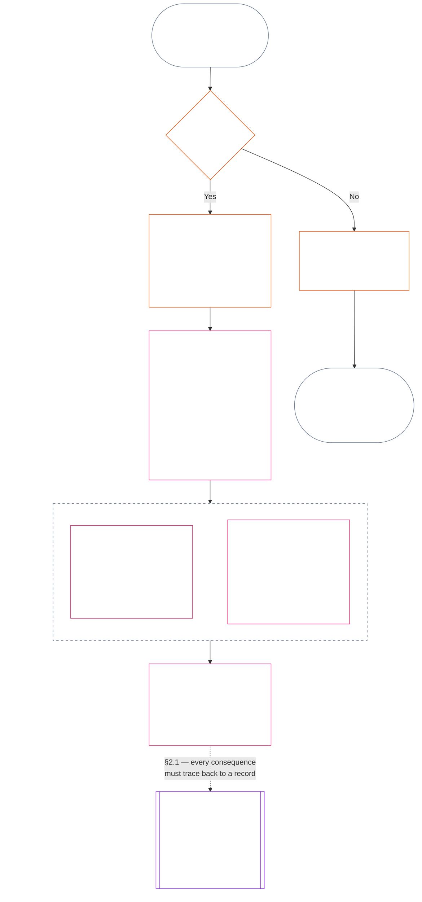
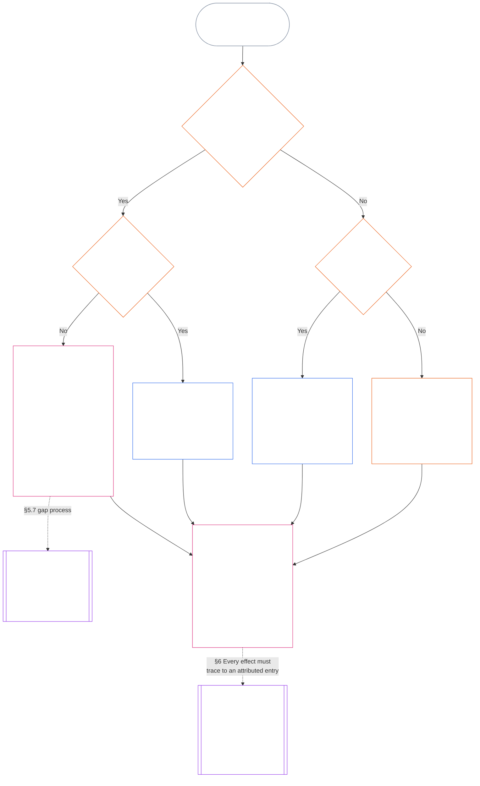

<!-- Complete unreviewed AI-assisted ko translation of current Chapter Eleven; source: core_11.000_standing_assessment.md; source snapshot: 05b7b839; 2026-11-09 source refresh applied. -->

# 제11장: 궤적 기록 — 질문 1, 무슨 일이 있었는가

<strong>말뭉치 배치(비작동): 파일 구조와 읽기 규칙</strong>

> 이 파일은 **감지자 헌법의 일부**이며, 다른 번호가 매겨진 `core_*` 파일과 하나의 텍스트로 함께 읽힐 때에만 **구속력**을 갖습니다. 이 파일은 **제11장**으로, 궤적 파이프라인의 세 질문과 **질문 1**(*무슨 일이 있었는가?*)을 **§1–§6**에서 다룹니다. **질문 2**(*얼마나 좋거나 나빴는가?*)는 [제12장](core_12_standing_measurement.md#chapter-twelve-standing-measurement--question-2-how-good-or-bad-was-it)에서 답합니다. 질문 3(*그로 인해 무엇이 일어나는가?*)은 [제13장](../../core_13.000_standing_integration.md#chapter-thirteen-standing-effects-and-integration)에서 계속되며, 적격한 위반 축 `s` = 7–9의 발견에 대한 반헌법적 위법행위 지정은 [제14장](../../core_14.000_misconduct_designation.md#chapter-fourteen-anti-constitutional-misconduct)에 한정된 검토를 받습니다. 읽기 순서, 구속력/지원 자료 구분, 말뭉치 판본 메타데이터는 [README.md](README.md)에서 관리합니다.

<strong>독자 안내(비작동): 제11장의 위치와 이 장에 남는 내용</strong>

> | 질문 | 담당 장과 역할 |
> | --- | --- |
> | **1. 무슨 일이 있었는가?** | 제11장(이 파일): 경계가 분명하고 다툴 수 있는 궤적 기록에 검증된 사실을 확립합니다. |
> | **2. 얼마나 좋거나 나빴는가?** | [제12장](core_12_standing_measurement.md#chapter-twelve-standing-measurement--question-2-how-good-or-bad-was-it): 도움과 해악을 합치지 않고 검증된 사실을 측정합니다. |
> | **3. 그로 인해 무엇이 일어나는가?** | [제13장](../../core_13.000_standing_integration.md#chapter-thirteen-standing-effects-and-integration)으로 이어집니다. |
>
> 의혹, 인기, 분쟁 서사는 질문 1의 답이 아닙니다. 원하는 평정이 질문 1의 사실을 대신할 수 없고, 원하는 결과가 질문 2의 평정을 대신할 수 없습니다.

<strong>추적</strong>

- 상위 근거:
  - [헌법 사원(四元)](core_00_preamble.md#constitutional-tetrad);
  - [두 헌법 목적](core_00_preamble.md#two-constitutional-aims);
  - [실질 이해관계](core_00_preamble.md#material-stake);
  - [서문 §6 주요 실무 절차 파이프라인](../../core_00.000_preamble.md#6-key-practical-process-pipelines) (*제9장부터 제15장까지의 연쇄*).
- 상위 근거:
  - [제1장](core_01_c_stewardship_capacity_principles.md#chapter-01-principles-and-constraints) (1.010) (*절 수준 풀이에 반영된 쉬운 언어 접근성 책임 관리*);
  - [제1장 §16 — 심층 책임 관리](core_01_c_stewardship_capacity_principles.md#16-stewardship-in-depth) (1.010 §16) (*역량 연계형 추적 가능한 궤적의 원칙 기반 — 신뢰, 역할, 인정*);
  - [제2장부터 제4장까지](core_02_definition_structure.md) (*무결성, 기록, 검증*);
  - [제5장](core_05__definitions_home.md#chapter-five-foundational-definitions) (5.000) (*제2장부터 제4장까지와 함께 읽는 정의와 우위*).
- 상위 근거: [제9장](core_09.000_system_alignment_certification_evaluation.md#chapter-nine-system-alignment-certification) (9.000) (*시스템 정렬 인증*); [제9장 파트 C §11](core_09.010_system_alignment_certification_record_recertification.md#11-relationship-to-standing) (9.010 §11) (*궤적 연결 — 잠재적인 검증 입력만*).
- 궤적 파이프라인:
  - [서문 §6.2 전체 연쇄의 작동 방식](../../core_00.000_preamble.md#62-how-the-full-chain-fits-together);
  - [제11장 — 궤적 기록](#chapter-eleven-standing-records--question-1-what-happened) (11.000) (*세 질문 틀과 질문 1 기록*);
  - [제12장 — 궤적 측정](core_12_standing_measurement.md#chapter-twelve-standing-measurement--question-2-how-good-or-bad-was-it) (12.000) (*질문 2 측정*);
  - [제13장 — 궤적 효과와 통합](../../core_13.000_standing_integration.md#chapter-thirteen-standing-effects-and-integration) (13.000) (*질문 3 효과와 통합*);
  - [제14장](../../core_14.000_misconduct_designation.md#chapter-fourteen-anti-constitutional-misconduct) (14.000) (*적격한 위반 축 s = 7–9에 대해서만 지정*).
- 이 파일의 하위 절:
  - [§1](#1-the-three-questions) (*세 질문 틀과 범위*);
  - [§2](#2-question-1--what-happened) (*질문 1 — 검증된 사실과 기록*);
  - [§3](#3-question-1-event-type-guide--what-kind-of-help-or-harm-occurred) (*질문 1 사건 유형 안내 — 도움과 해악의 종류*);
  - [§4](#4-standing-record-operational-requirements) (*검증 및 기록 요건*);
  - [§5](#5-record-custody-and-opening-authority) (*기록 관리와 개시 권한*);
  - [§6](#6-handling-a-standing-record) (*궤적 기록 처리*).
- 하위 결과:
  - [제12장](core_12_standing_measurement.md#chapter-twelve-standing-measurement--question-2-how-good-or-bad-was-it) (12.000) (*질문 2 — LEQU 기준선, 측정 차원, 경로 설명자, 슬롯 문법, 헌법적 입력, LEQU 척도, 표준 기여 측정, 예시, 질문 3으로의 인계*);
  - [제14장](../../core_14.000_misconduct_designation.md#chapter-fourteen-part-a-anti-constitutional-misconduct-designation) (14.000) (*지정만 수행 — 질문 2 측정을 다시 열지 않음*);
  - [제15장](../../core_15.000_forum.md#chapter-fifteen-forums-and-jurisdiction) (15.000) (*포럼 감독 및 경로 지정*);
  - [조문 XXVI-C](core_06_rights_part_e.md#article-xxvi-c-timely-resolution-and-anti-delay-floor) (*적시 해결*);
  - [조문 XX](core_06_rights_part_d.md#article-xx-a-justice-objective-and-scope) (*정의의 제약*).
- 함께 읽기: [제5장 *궤적 상태, 기여, 위반*](../../core_05.035_band_accountability.md#defa3-standing-state-contribution-and-violation) (5.035) (*정의의 표준 경로 지정*).
- 함께 읽기: [README.md](README.md) (*읽기 순서*); [doc_architecture.md](../../doc_architecture.md) (*채택되지 않는 한 구속력 없는 편집 지도*).

 

제11장은 **검증된 사실 기록(질문 1)**의 헌법상 담당 장입니다. [§1 세 질문](#1-the-three-questions)부터 [§6 궤적 기록 처리](#6-handling-a-standing-record)까지 다룹니다. [제12장](core_12_standing_measurement.md#chapter-twelve-standing-measurement--question-2-how-good-or-bad-was-it)은 질문 2를 담당하며, [제12장 §1 질문 2 — 얼마나 좋거나 나빴는가?](core_12_standing_measurement.md#1-question-2--how-good-or-bad-was-it)부터 [제12장 §9 질문 3으로의 인계 — 질문 간 측정 연결점](core_12_standing_measurement.md#9-hand-off-to-question-3--cross-question-measurement-hooks)까지입니다. 질문 3은 제13장에서 계속됩니다.

*쉬운 말로: 이 장은 무슨 일이 있었는지 기록하고 궤적 기록을 보관합니다. 얼마나 좋았거나 해로웠는지는 제12장에서 두 개의 별도 축으로 측정하며, 하나의 순점수로 합치지 않습니다. 사건을 접수하는 것 자체가 궤적은 아닙니다.*

### 1. 세 가지 질문

*쉽게 말해: 지위는 세 가지 질문에 차례로 답해 판단합니다. 원하는 평가에서 사실을 추론하지 말고, 원하는 결과를 정당화하려고 평가를 선택하지 마십시오.*

| 질문 | 질문이 묻는 내용 | 답하는 곳 |
| --- | --- | --- |
| **1. 무슨 일이 있었는가?** | 어떤 사실이 누구 또는 무엇에 관해, 어느 기간에, 어떤 지위 기록과 이의 제기 상태로 확인되었는가? | [§2](#2-question-1--what-happened) 및 [§3](#3-question-1-event-type-guide--what-kind-of-help-or-harm-occurred) |
| **2. 얼마나 좋거나 나빴는가?** | 그 사실은 어떤 종류와 규모의 기여 또는 위반을 입증하는가? | [제12장 §1](core_12_standing_measurement.md#1-question-2--how-good-or-bad-was-it) |
| **3. 그 결과 무엇이 일어나는가?** | 어떤 인정, 준비도, 구제, 보호조치, 제한 또는 다른 결과가 따르는가? | [제13장](../../core_13.000_standing_integration.md#chapter-thirteen-standing-effects-and-integration) |

각 질문은 그 앞의 답에 의존합니다.

- 질문 1은 질문 2에 필요한 확인된 사실을 제공합니다.
- 질문 2는 질문 3을 위해 그 사실을 측정합니다.
- 질문 3은 선호하는 결과에 맞추려고 사실이나 평가를 다시 써서는 안 됩니다.

세 질문의 답을 합쳐, 범위가 한정된 사건 하나 또는 정의된 패턴 하나에 대한 완전한 지위 평가를 구성합니다. 대상은 시간에 따라 이런 평가를 여러 개 받을 수 있지만, 어느 것도 순점수나 대상에 대한 종합 평가가 아닙니다. 기여 지위 기록과 위반 지위 기록은 질문 1과 2의 답을 보존하고, 질문 3 결정은 그 답에서 무엇이 뒤따르는지 밝힙니다.

#### 1.1 목적과 범위

이 장은 기록에 관한 헌법적 틀을, [제12장](core_12_standing_measurement.md#chapter-twelve-standing-measurement--question-2-how-good-or-bad-was-it)은 측정 틀을 **시스템**, **감지자**, **기관**에 대해 정합니다. 여기에는 [**CS-9.305**](../../corpus_systems/cs_09.305_system_classification_machinery.md#cs-9305-part-a-system-classification-machinery) (*시스템 분류 체계*)에 따라 분류되는 모든 시스템이 포함됩니다. 이 틀은 소문, 인기, 막연한 평판, 본래의 존엄 또는 일반적 가치를 측정하지 않습니다. 어느 것도 지위 평가의 허용 가능한 대상이 아닙니다.

다음 상황에서도 지위 절차는 효과적으로 작동해야 합니다.

- 과거에 확인된 기여가 현재의 역량이나 신뢰성을 보여주기에는 너무 오래된 경우;
- 위반이 해결되지 않은 채 남아 있는 경우;
- 복구에 비용이 많이 드는 경우;
- 책임이 국경을 넘는 경우; 또는
- 행위자가 조직 계층이나 명칭 변경을 이용해 책임 추궁을 방해하는 경우.

이 사항은 채택된 이행 문서에 속합니다.

- 일상 절차;
- 상향 보고 단계;
- 배상 및 복구 운영;
- 회복적 책임 조치; 그리고
- 인센티브 설계.

제12장의 측정만으로는 무력 사용, 구금 또는 다른 자유 제한을 허가하지 **않습니다**. 그러한 결과는 제6장 **제XX조** (*확인된 위반 이후의 정의*)의 비례성, 최소 제한, 기간 제한, 배상 및 회복적 책임 요건을 각각 독립적으로 충족해야 합니다.

<strong>추적 · 정의 · 평가 · 준수</strong>

- 상류 문서: [제1장 §16 — 심층 관리](core_01_c_stewardship_capacity_principles.md#16-stewardship-in-depth); [제2장부터 제4장](core_02_definition_structure.md); [제5장](core_05__definitions_home.md#chapter-five-foundational-definitions).
- 하류 문서:
  - [§2](#2-question-1--what-happened) (*질문 1*);
  - [§4](#4-standing-record-operational-requirements) (*검증 및 기록 요건*);
  - [§5](#5-record-custody-and-opening-authority) (*기록 보관 및 개시 권한*);
  - [§6](#6-handling-a-standing-record) (*지위 기록 처리*);
  - [제12장 §1](core_12_standing_measurement.md#1-question-2--how-good-or-bad-was-it) (*질문 2 측정*);
  - [제12장 §2](core_12_standing_measurement.md#2-magnitude-and-severity-input-dimensions) (*측정 입력 차원*);
  - [제12장 §3](core_12_standing_measurement.md#3-route-descriptor-catalogs-and-measurement-roles) (*경로 설명자 목록*);
  - [제12장 §4](core_12_standing_measurement.md#4-slot-grammar-and-shared-scaling) (*슬롯 문법과 공통 척도*);
  - [제12장 §5](core_12_standing_measurement.md#5-constitutional-inputs-to-axis-assignment) (*헌법 출처에 따른 분류*);
  - [제12장 §6](core_12_standing_measurement.md#6-unified-proportional-lequ-scale--contribution-and-violation-axes) (*두 축에 적용되는 통합 비례 LEQU 척도*);
  - [제13장](../../core_13.000_standing_integration.md#chapter-thirteen-standing-effects-and-integration) (*질문 3*).
- [중대성](../../core_05.050_band_oversight.md#materiality) · [O](../../core_05.050_band_oversight.md#materiality) · [M](core_05_band_oversight.md#materiality-determination-a) · [A](core_05_band_oversight.md#materiality-determination-a) · [C](core_05_band_oversight.md#materiality-determination-c)
- [피해](../../core_05.035_band_accountability.md#harm) · [O](../../core_05.035_band_accountability.md#harm) · [M](../../core_05.035_band_accountability.md#harm-a) · [A](../../core_05.035_band_accountability.md#harm-a) · [C](../../core_05.035_band_accountability.md#harm-c)
- [비례성](../../core_05.035_band_accountability.md#proportionality) · [O](../../core_05.035_band_accountability.md#proportionality) · [M](../../core_05.035_band_accountability.md#proportionality-a) · [A](../../core_05.035_band_accountability.md#proportionality-a) · [C](../../core_05.035_band_accountability.md#proportionality-c)

### 2. 질문 1 — 무슨 일이 있었는가?

<strong>추적</strong>

- 상류 문서: [§1](#1-the-three-questions) (*세 질문의 틀*); [제2장부터 제4장](core_02_definition_structure.md) (*기록, 검증, 정의에서 결과까지의 추적성*).
- 테트라드 축: **참여**; **감독** (다툴 수 있음 및 이의 제기 경로). 주요 목표: **번영** 및 **지속성** (후속 측정을 위해 기여와 위반에 관한 별도 판단을 보존하는 추적 가능한 기록).
- 하류 문서:
  - [§2.2](#22-silence-is-the-default) (*침묵이 기본값*);
  - [§2.3](#23-protected-dissent-is-not-a-trigger) (*보호되는 반대는 촉발 요인이 아님*);
  - [§2.4](#24-linked-standing-records-and-no-offset-bridge) (*연결 기록의 상쇄 금지 연결고리*);
  - [§2.5](#25-verified-input-gate) (*검증된 입력 관문*);
  - [§2.6](#26-stage-boundary) (*단계 경계*);
  - [§2.7](#27-forum-boundary) (*포럼 경계*);
  - [§3](#3-question-1-event-type-guide--what-kind-of-help-or-harm-occurred) (*사건 유형 안내*);
  - [§4](#4-standing-record-operational-requirements) (*기록 요건*);
  - [§5](#5-record-custody-and-opening-authority) (*기록 보관 및 개시 권한*);
  - [§6](#6-handling-a-standing-record) (*지위 기록 처리*);
  - [제12장 §1](core_12_standing_measurement.md#1-question-2--how-good-or-bad-was-it) (*질문 2 측정*);
  - [제12장 §2](core_12_standing_measurement.md#2-magnitude-and-severity-input-dimensions) (*측정 입력 차원*);
  - [제12장 §3](core_12_standing_measurement.md#3-route-descriptor-catalogs-and-measurement-roles) (*경로 설명자 목록*);
  - [제12장 §4](core_12_standing_measurement.md#4-slot-grammar-and-shared-scaling) (*슬롯 문법과 공통 척도*);
  - [제12장 §5](core_12_standing_measurement.md#5-constitutional-inputs-to-axis-assignment) (*헌법 출처에 따른 분류*);
  - [제12장 §6](core_12_standing_measurement.md#6-unified-proportional-lequ-scale--contribution-and-violation-axes) (*두 축에 적용되는 통합 비례 LEQU 척도*);
  - [제13장](../../core_13.000_standing_integration.md#chapter-thirteen-standing-effects-and-integration) (13.000) (*질문 3*).

 

*쉽게 말해: 질문 1은 무슨 일이 있었는지에 관한 범위가 한정되고 다툴 수 있는 설명을 확립합니다. 평가나 결과를 고려하기 전에 대상, 사건 또는 패턴, 기간, 확인된 사실과 기록 상태를 식별합니다. 확인된 도움과 확인된 위반은 서로 지우지 못하도록 별도의 지위 기록을 사용합니다. 이 기록은 인기 점수나 모호한 꼬리표가 아닙니다.*

**지위 기록**은 특정 대상, 기능 범위, 기록 기간, 검토 상태 및 의사결정 맥락을 위해 이 장에서 사용하는 범위가 한정된 기록입니다. 측정을 시작하기 전에 다음을 확립해야 합니다.

- 지위 기록이 누구 또는 무엇에 관한 것인지;
- 범위가 한정된 사건인지 정의된 패턴인지;
- 관련 행위와 효과가 언제 어디서 발생했는지;
- 어떤 사실이 확인되었고 어떤 사실이 여전히 다투어지는지;
- 어떤 증거, 귀속 및 이의 제기 경로가 판단을 뒷받침하는지; 그리고
- 지위 기록의 현재 검토, 수정 및 대체 상태.

이 도표는 사건이 지위 기록을 촉발하는지, 기록이 무엇을 담는지 따라갑니다. 이어지는 하위 절은 각 규칙을 설명합니다. “아니요” 분기는 주요 경로에서 오른쪽으로 나갑니다.

#### 2.1 지위 기록: 종류와 대상

질문 1은 확인된 도움을 위해 **기여 지위 기록**을, 책임 추궁 실패를 포함한 확인된 피해를 위해 **위반 지위 기록**을 사용합니다. 하나의 지위 기록은 두 종류의 판단을 결합하지 않습니다.

- 지위 기록은 감지자, 기관, 시스템, 평가, 범위가 한정된 사건, 역할, 집단, 행위자별 기록 또는 헌법상 관련 있는 다른 단위에 관한 것일 수 있습니다.
  - 서로 다른 대상, 역할, 시스템, 공동체, 기록 기간, 검토 상태 또는 의사결정 맥락을 하나의 구별 없는 지위 표지로 뭉뚱그려서는 안 됩니다.
- 지위 기록은 시작과 종료가 분명한 하나의 사건인 **범위가 한정된 사건** 또는 반복 행위의 **패턴**을 다룰 수 있습니다.
  - 패턴에는 정의된 대상, 범위 및 검토 기간이 필요합니다.
- 같은 대상은 시간이 지나며 여러 지위 기록을 보유할 수 있으며, 연결된 기여 및 위반 지위 기록도 포함됩니다.
  - 대상, 겹치는 기록 기간, 범위가 한정된 사건, 패턴 또는 의사결정 맥락이 같으면 관련 지위 기록은 **§4.2**에 따라 서로 **교차 참조**해야 합니다.
- 지위 기록은 독립적인 평판 점수, 존엄성 순위, 영구적 지위, 일반적 가치 표지 또는 결합된 점수표가 아닙니다.
  - 운영 요건은 **§4**에 있습니다.

이후의 지위 효과는 제13장에 속하며, 지위 기록 자체의 일부가 되지 않으면서 관련 지위 기록을 추적할 수 있어야 합니다.

#### 2.2 침묵이 기본값

지위 기록이 없는 것은 감지자, 기관 또는 시스템의 통상적인 상태이며, 대부분의 감지자는 계속 이 상태로 남습니다.

- **§4**에 따라 촉발 요인이 확인된 경우에만 지위 기록을 엽니다. 지정된 기록 개시 권한자가 기입을 승인해야 하고, 별도의 기록 관리자가 이를 기입해야 합니다(**§5**). 다음을 위해 지위 기록을 열어서는 안 됩니다.
  - 기준선을 설정하기 위해;
  - 명부를 완성하기 위해; 또는
  - 통제된 경로의 문지기가 그것을 선호한다는 이유만으로.
- 상태 기록이 없다는 사실은 아무것도 말해주지 않는다. “평정되지 않음”, “검증되지 않음”, “기록 없음”은 위험, 낮은 기여도 또는 그 밖의 어떤 것의 증거도 아니다. 누구도 기록 부재를 더 엄격한 심사, 더 낮은 기본값 또는 지정된 통제 경로에 대한 조건부 접근의 이유로 취급해서는 안 된다.
- 어떤 기관이나 시스템도 다음의 조건으로 지위 기록, “기록 없음” 확인서 또는 기록 개설 동의를 요구할 수 없습니다.
  - **제III조** (*생존 및 필수 접근*)의 필수 요소;
  - **제III-C조** (*노동 및 경제적 바닥*)의 보호;
  - 통상적 상거래; 또는
  - 영향을 받는 당사자로서의 참여.
  신뢰 민감성이 있는 특정 통제 경로에 대해 공표된 역량 기준은 예외이며, [제13장 §7.2 역량 기준과 허가](../../core_13.000_standing_integration.md#72-competency-bars-and-clearances)에 따라 그 통제 경로가 왜 신뢰 민감성이 있는지 밝혀야 한다.
- 대상에 관한 지위 기록을 열면 **§4**에 따라 그 대상에게 알려야 합니다. 문서화된 [증거 보존](core_05_band_oversight.md#evidence-preservation) 또는 안전상 필요가 정당화하는 경우에만, 그리고 제한된 특정 기간 동안에만 통지를 미룰 수 있습니다. 통지가 있어야 지위 기록에 이의를 제기할 수 있습니다. 기록이 존재한다는 사실을 모르는 대상은 기록에 이의를 제기하거나 수정할 수 없습니다.

#### 2.3 보호되는 반대는 촉발 요인이 아님

**제XI-D조** (*집회, 반대 및 평화적 시위*)에 따른 반대 또는 평화적 시위 — [보호되는 비폭력 시민 불복종](core_06_rights_part_b.md#xi-d-nonviolent-civil-disobedience)을 포함 — ([*반대 및 평화적 시위 바닥*](core_06_rights_part_b.md#xi-d-dissent-and-peaceful-protest))는 확인된 촉발 요인이 아닙니다.

- 반대는 위반 지위 기록을 열거나 연장하거나 가중하지 않으며, **§8.2**에 따른 심각도 입력이 아니고, 반복된다고 해서 패턴이 되지 않습니다.
- 헌법상 바닥을 독립적으로 위반하는 분리 가능한 행위는 그 자체의 조건으로 기록하며, 시위의 관점, 대의 또는 대상 때문에 가중하지 않습니다.

#### 2.4 연결된 지위 기록과 상쇄 금지 연결고리

<strong>추적</strong>

- 상류 문서: [§2.1](#21-standing-records-kinds-and-subjects) (*분리된 기여 및 위반 기록*).
- 하류 문서:
  - [§2.5](#25-verified-input-gate) (*검증된 입력 관문*);
  - [§2.7](#27-forum-boundary) (*포럼 경계*);
  - [§4.2](#42-related-standing-record-cross-references) (*교차 참조*);
  - [제12장 §1](core_12_standing_measurement.md#1-question-2--how-good-or-bad-was-it) (*질문 2 측정*);
  - [제12장 §2](core_12_standing_measurement.md#2-magnitude-and-severity-input-dimensions) (*측정 입력 차원*);
  - [제12장 §3](core_12_standing_measurement.md#3-route-descriptor-catalogs-and-measurement-roles) (*경로 설명자 목록*);
  - [제12장 §4](core_12_standing_measurement.md#4-slot-grammar-and-shared-scaling) (*슬롯 문법과 공통 척도*);
  - [제12장 §5](core_12_standing_measurement.md#5-constitutional-inputs-to-axis-assignment) (*헌법 출처에 따른 분류*);
  - [제12장 §6](core_12_standing_measurement.md#6-unified-proportional-lequ-scale--contribution-and-violation-axes) (*두 축에 적용되는 통합 비례 LEQU 척도*);
  - [제13장](../../core_13.000_standing_integration.md#chapter-thirteen-standing-effects-and-integration) (13.000) (*질문 3*).
- 함께 읽기: [제13장 — 지위 통합](../../core_13.000_standing_integration.md#3-automatic-integration-review-and-continuity) (13.000) (*권리 포기 금지 및 연결 기록 통합*); [제13장 §7.2 — 역량 기준과 허가](../../core_13.000_standing_integration.md#72-competency-bars-and-clearances) (13.000 §7.2); [제13장 §5.2 — 지위 잠금](../../core_13.000_standing_integration.md#52-prevention--general-standing-locks) (13.000 §5.2).

 

**핵심 규칙:** 확인된 **기여 지위 기록**과 확인된 **위반 지위 기록**은 **§2.1**에 따라 분리해 보관합니다. 각 기여 또는 위반 판단은 자체 지위 기록에 담긴 독립적이고 뒷받침되는 사실에 근거해야 합니다. 분석과 증빙 자료는 두 기록 경로를 각각 추적할 수 있도록 유지해야 합니다. 단일 기입이나 연결 기록 집합은 순점수, 혼합 점수 또는 상계가 아닙니다.

- **위반 지위 기록과 지위 잠금:**
  - 제13장에 따라 위반 지위 기록에서 비롯된 적용 가능한 **지위 잠금**은 확인된 위반이 해결되지 않은 동안 지위를 제한하거나, 역할 자격을 제한하거나, 구제 접근에 영향을 줄 수 있습니다.
  - 지위 잠금은 기여 지위 기록에 기록된 확인된 긍정적 기여를 지워서는 안 됩니다.
  - 해결되지 않은 확인된 위반은 시간이 흐른다는 이유만으로 할인되지 않습니다.
  - 확인된 위반은 관련 없는 기여 지위 기록을 허위의 부정적 평판 기록으로 바꾸어서는 안 됩니다.
- **기여 지위 기록과 역량 허가:**
  - 현재 유효하고 역할과 관련된 확인된 기여는 공표된 **역량 기준**에 따른 해당 **역량 허가**와 신뢰·역할·인정에 연계된 자격을 뒷받침할 수 있습니다.
  - 확인된 기여는 확인된 위반 판단을 상쇄하거나, 평균으로 낮추거나, 변명하거나, 이름을 바꾸어서는 안 됩니다.
  - 기준을 충족해도 적용 가능한 지위 잠금이 면제되지 않습니다.

**유일한 예외:** 위반 판단 자체가 주장된 기여를 반증하는 경우 — 예를 들어 증거가 기여 기록에 적힌 일을 실제로 하지 않았음을 보여주는 경우 — 적절한 증거 및 검토 절차를 통해 **§4.2**에서 요구하는 교차 참조와 함께 연결된 기여 지위 기록을 수정하거나 제거할 수 있습니다. 그러나 위반이 별도의 기여 지위 기록에 기록된 무관한 도움까지 자동으로 지우지는 않습니다.

#### 2.5 검증된 입력 관문

관문은 다음과 같이 작동합니다.

- 지위, 신뢰, 역할, 인정 또는 인정 자격에 영향을 미치는 결정은 관련 **기여 지위 기록**이나 **위반 지위 기록**에서 나온 확인된 입력만 사용할 수 있습니다.
- 주장, 판결 전 청구, 잠정 경로 태그, 접수 단계 전용 서술 및 그 밖의 분쟁 단계 자료만으로는 지위상 기여나 위반의 성격을 정할 수 없습니다.
- 검증된 입력은 **지위 판단**입니다. 확인된 기여 판단(축 I) 또는 확인된 위반 판단(축 II)을 뜻합니다.
- 기여 및 위반 판단은 별도의 지위 기록에 남습니다(**§2.1** 참조).

#### 2.6 단계 경계

지위 기록의 단계는 서로 분리됩니다.

- 질문 1은 확인된 사실을 기록하고, 질문 2는 그 사실을 측정합니다.
- 확인된 사실 기반이 완성되면 질문 2 측정이 아직 진행 중이어도 지위 기록을 열 수 있습니다.
- 측정 전까지 질문 2 필드는 슬롯이나 범주를 암시하지 말고 대기 중이라고 밝혀야 합니다.
- 지위 기록은 질문 3의 **지위 효과**를 명시하거나 적용해서는 안 됩니다.

#### 2.7 포럼 경계

*쉽게 말해: 포럼은 분쟁을 감독하고, 이의를 제기할 수 있게 하며, 확인된 결과로 전환하는 곳입니다. 하지만 사건을 접수하거나 서사 다툼에서 이겨도 지위가 갱신되지는 않습니다. **§2.5**의 검증된 입력 관문은 계속 적용됩니다. 포럼이 제2장부터 제4장에 따라 사실을 확인하면 지위 기록을 **열거나, 갱신하거나, 수정**할 수 있고, **이의 제기에 따라 잘못된 기록을 배제**할 수도 있습니다. 포럼은 긍정과 부정을 하나의 점수로 합치거나 지위 범주를 독자적으로 만들어내지 않습니다.*

이 절은 한 가지 질문, 즉 포럼의 작업이 지위 기록에 어떻게 반영되는지를 다룹니다. 연쇄의 나머지 단계는 여기서 명시한 담당자에게 속하며, 순서는 다음과 같습니다.

1. 분쟁이 접수되고 포럼은 지위 기록이 아닌 **포럼 사건 기록**을 보유합니다. 담당: [제15장 §2.3 포럼 사건 기록, 지위 기록 및 이의 제기](core_11_forum.md#23-forum-case-records-standing-records-and-contests); [§2.7.1 포럼 사건 기록](#271-forum-case-record)도 참조.
2. 포럼은 [제2장부터 제4장](core_02_definition_structure.md)에 따라 사실을 확인합니다.
3. 확인된 판단은 검증된 입력 관문을 통과합니다. 담당: [§2.5 검증된 입력 관문](#25-verified-input-gate).
4. 포럼일 수도 있는 지정된 기록 개시 권한자가 지위 기록을 열거나, 갱신하거나, 수정하거나, 이의 제기에 따라 잘못된 기록을 배제합니다. 기록이 무엇을 담는지는 [§4.1 최소 기록 내용](#41-minimum-record-contents)이, 누가 조치할 수 있는지는 [§5 기록 보관 및 개시 권한](#5-record-custody-and-opening-authority)이 담당합니다.
5. 지위 기록은 확인된 사실만 담고, 이후 질문 2가 이를 측정합니다. 담당: [§2.6 단계 경계](#26-stage-boundary) 및 [제12장 §1 질문 2 — 얼마나 좋거나 나빴는가?](core_12_standing_measurement.md#1-question-2--how-good-or-bad-was-it).
6. 지위 효과가 있다면 지위 효과를 담당하는 [제13장](../../core_13.000_standing_integration.md#chapter-thirteen-standing-effects-and-integration)에 따라 발생합니다.

[제15장](../../core_15.000_forum.md#chapter-fifteen-forums-and-jurisdiction)에 따른 포럼 계열은 구체적 분쟁이 지위 절차를 거치는 방식을 **감독**합니다. [제15장 §6 적시 해결, 중대성 단계 및 지연 방지 원칙](core_11_forum.md#6-timely-resolution-materiality-tiers-and-anti-delay-discipline) 및 [제XXVI-C조](core_06_rights_part_e.md#article-xxvi-c-timely-resolution-and-anti-delay-floor) (*적시 해결 및 지연 방지 바닥*)에 따라 포럼은 다음을 제공합니다.

- 접근 가능한 이의 제기;
- 독립적 검토;
- 법의학적 지원;
- 시정 순서 설정; 그리고
- 단계별 기한.

그 포럼의 판단이 제2장부터 제4장에 따른 검증된 입력 관문을 충족하면 다음을 할 수 있습니다.

- **§4.1**에 따라 지위 기록을 **열거나, 갱신하거나, 수정**; 또는
- **이의 제기에 따라 잘못된 기록 배제**.

##### 2.7.1 포럼 사건 기록

진행 중인 분쟁에 관한 포럼 자체의 파일이 [**포럼 사건 기록**](../../core_05.035_band_accountability.md#forum-case-record)이며, [제15장 §2.3 포럼 사건 기록, 지위 기록 및 이의 제기](core_11_forum.md#23-forum-case-records-standing-records-and-contests)에 정의되어 있습니다. 이는 지위 기록이 **아닙니다**.

##### 2.7.2 포럼 판단과 질문 2 측정

포럼의 확인된 사실 판단은 질문 1 지위 기록의 사실 기반이 될 수 있습니다. 그러나 확인된 기여나 위반이 얼마나 좋거나 나빴는지에 관한 질문 2 측정을 결정하지는 **않습니다** ([§2.6 단계 경계](#26-stage-boundary)). 따라서:

- 포럼 절차는 기여 및 위반 자료를 순점수, 혼합된 본안 답변 또는 구별 없는 지위 표지로 **합쳐서는 안 됩니다**. 연결 지위 기록은 [§2.1 지위 기록: 종류와 대상](#21-standing-records-kinds-and-subjects) 및 [§2.4 연결된 지위 기록과 상쇄 금지 연결고리](#24-linked-standing-records-and-no-offset-bridge)에 따라 별도로 유지됩니다.
- 포럼 결과는 분쟁 서사, 경로 지정의 편의 또는 패널 선호를 입증 가능한 입력([§2.5 검증된 입력 관문](#25-verified-input-gate)), 별도 측정([제12장 §1 질문 2 — 얼마나 좋거나 나빴는가?](core_12_standing_measurement.md#1-question-2--how-good-or-bad-was-it)) 또는 [제13장](../../core_13.000_standing_integration.md#chapter-thirteen-standing-effects-and-integration)이 담당하는 지위 효과 기제로 **대체해서는 안 됩니다**.

##### 2.7.3 포럼 경계가 축소하지 않는 것

이 경계는 다음에 따라 요구되는 이의 제기, 구제, 잠정 구제 또는 절차적 보호를 **축소하지 않습니다**.

- [제XIII-A조](core_06_rights_part_c.md#article-xiii-a-reliability-and-trustworthiness-baseline) (*신뢰성과 신빙성의 기준선*);
- [제XIII-B조](core_06_rights_part_c.md#article-xiii-b-right-to-redress-and-remedy) (*배상 및 구제를 받을 권리*);
- [제15장 §6 적시 해결, 중대성 단계 및 지연 방지 원칙](core_11_forum.md#6-timely-resolution-materiality-tiers-and-anti-delay-discipline);
- [제XXVI-C조](core_06_rights_part_e.md#article-xxvi-c-timely-resolution-and-anti-delay-floor) (*적시 해결 및 지연 방지 바닥*); 또는
- 관련 사법 조항.

확인된 포럼 판단이 다른 확인된 입력과 같은 관문을 통해 지위 절차에 들어가도록 요구하며, 관문을 우회할 수는 없습니다.

### 3. 질문 1 사건 유형 안내 — 어떤 종류의 도움이나 피해가 발생했는가?

*쉽게 말해: 사실이 확인된 후 무슨 일이 있었는지 설명하려면 이 표를 사용하십시오. 관련된 기여 또는 위반 유형을 식별하는 데 도움이 됩니다. 얼마나 좋거나 나빴는지, 어떤 슬롯을 부여할지, 그 결과 무엇이 일어날지는 결정하지 않습니다.*

#### 3.1 기여 사건 유형

**자격 규칙:** 주장된 기여는 추적 가능하고, 비용을 외부화하지 않으며, 시행 중인 헌법 전체와 부합할 때만 인정됩니다.

- 외부화된 피해, 강압적 의존, 권리 바닥의 축소 또는 숨겨진 부담은 주장된 기여의 자격을 박탈하거나 범위를 제한할 수 있습니다.
- 주장된 기여는 별도의 위반 판단을 상쇄하지 않습니다.

아래 표의 각 행은 확인된 도움의 일반적 경로와 헌법상 관련성을 나타냅니다. 하나의 지위 기록에 여러 행이 적용될 수 있습니다.

| 확인된 기여 유형 | 일어난 일 | 테트라드 축 | 주요 목표 |
| --- | --- | --- | --- |
| 생존 및 신체 유지 | 누군가가 음식, 주거, 의료 또는 안전을 제공받음 | **참여**, **감독** | **번영** |
| 돌봄 및 교육 | 아동을 양육하거나, 노인을 돌보거나, 다른 사람을 교육함 | **참여**, **감독** | **번영**, **지속성** |
| 트라우마 해결 | 누군가가 웰빙을 가로막던 심리적 피해에서 회복하도록 도움을 받음 | **참여**, **책임 추궁** | **번영** |
| 심각한 부담 제거 | 감당하기 힘든 부채, 착취적 노동 조건 또는 시스템 장벽을 제거함 | **참여**, **감독** | **번영** |
| 자기결정권 회복 | 누군가가 자신의 삶에 관해 의미 있는 선택권을 얻음 | **참여** | **번영** |
| 생산 능력 확대 | 도구, 인프라 또는 기회가 다른 사람들의 독립적인 번영을 가능하게 함 | **참여**, **감독** | **번영**, **지속성** |
| 시간 효율 개선 | 피할 수 있는 대기, 행정 마찰 또는 조정 부담을 줄여 돌봄, 휴식, 자기결정, 학습 또는 권리에 부합하는 업무에 쓸 수 있는 시간을 돌려줌 | **참여**, **감독** | **번영** |
| 생태 또는 인프라 위험 감소 | 환경 붕괴 또는 핵심 시스템의 실패를 예방함 | **감독**, **책임 추궁** | **지속성**, **번영** |
| 생태 발자국 감소 | 자원 사용, 배출량 또는 토지·물 수요를 타인이나 생태계에 부담을 전가하지 않고 확인 가능하게 줄임 | **감독**, **책임 추궁** | **지속성**, **번영** |
| 생태계 복원 | 훼손된 토지, 물 또는 서식지를 기능적이고 자립적인 상태에 가깝게 복원함 | **감독**, **책임 추궁** | **지속성**, **번영** |
| 멸종 위기종 보호 | 멸종 위험에 처한 종 또는 그 종이 의존하는 서식지를 손실로부터 보호함 | **감독**, **책임 추궁** | **지속성**, **번영** |
| 오염 및 폐기물 감소 | 오염, 유해 배출 또는 폐기물을 예방하거나 제거하거나 안전하게 관리함 | **감독**, **책임 추궁** | **번영**, **지속성** |
| 안전, 진실, 감사 가능성 또는 이의 제기 역량 강화 | 권리를 보호하고 권력에 책임을 묻기 위해 기관이나 관행을 구축하거나 복구함 | **참여**, **감독**, **책임 추궁** | **번영**, **지속성** |

#### 3.2 위반 사건 유형

**자격 규칙:** 위반 사건 유형에는 **제2장부터 제4장**에 따라 추적 가능하고, 범위가 한정되며, 감사 가능하고, 다툴 수 있는 확인된 위반 판단이 필요합니다.

- 혐의, 잠정 태그, 포럼 서사 및 접수 단계 표지는 경로 지정이나 초기 분류를 도울 수 있지만 질문 1을 완료하지는 않습니다.
- 긍정적 기여는 확인된 위반을 상쇄하거나, 변명하거나, 되돌리거나, 재명명하지 않습니다.

아래 표의 각 행은 확인된 손실, 위험 또는 의무 실패의 일반적 경로와 그 헌법상 관련성을 나타냅니다. 한 지위 기록에 여러 행이 적용될 수 있습니다.

| 확인된 손실 또는 위험의 유형 | 일어난 일 | 테트라드 축 | 주요 목표 |
| --- | --- | --- | --- |
| 생존 또는 신체 유지의 박탈 | 피할 수 있었던 사망, 진료 거부, 안전하지 않은 조건 또는 생존을 위한 물질적 결핍이 발생함 | **책임 추궁**, **참여** | **번영** |
| 피할 수 있었던 심각한 부담 | 과중하거나 강제로 부과되거나 체계적으로 전가된 부담이 웰빙 또는 자기결정권을 실질적으로 해침 | **책임 추궁**, **참여** | **번영** |
| 강압적 자기결정권 상실 | 강압, 조종, 신빙성 있는 위협, 감금 또는 자유에 대한 위험이 발생함 | **책임 추궁**, **참여** | **번영** |
| 권리 바닥 훼손 | 협상할 수 없는 헌법적 바닥, 헌법의 최고성 또는 이의 제기·구제 접근성이 실질적으로 침해됨 | **책임 추궁**, **감독** | **번영**, **지속성** |
| 생태 또는 인프라 피해 | 헌법상 웰빙에 필요한 조건이 훼손됨 | **책임 추궁**, **감독** | **지속성**, **번영** |
| 오염 또는 폐기물 피해 | 오염, 유해 배출 또는 폐기물이 공기, 물, 토양 또는 건강에 해를 끼침 | **책임 추궁**, **감독** | **번영**, **지속성** |
| 종 또는 서식지 파괴 | 멸종 위험에 처한 종 또는 그 종이 의존하는 서식지가 파괴·분절되거나 손실로 내몰림. 상쇄 가능한 것으로 취급된 손실도 포함 | **책임 추궁**, **감독** | **지속성**, **번영** |
| 생태 복구 역량 상실 | 피해 후 생태계가 재생할 능력을 차단하거나, 피할 수 있었는데도 회복하기 매우 어렵거나 불가능하게 만듦 | **책임 추궁**, **감독** | **지속성**, **번영** |
| 외부화된 생태 피해 또는 고갈 | 생태 비용을 타인이나 생태계에 전가하거나, 자원을 재생 한계 이상으로 고갈하거나, 발자국·지속 가능성 주장이 지속되는 악화를 숨김 | **책임 추궁**, **감독** | **지속성**, **번영** |
| 생산 능력 파괴 | 독립적으로 번영하는 데 필요한 도구, 역량, 관계 또는 자원을 차단함 | **책임 추궁** | **번영** |
| 안전, 진실 또는 감사 가능성 저하 | 은폐, 허위 정보, 훼손된 기록, 접근 불가능한 이의 제기 경로 또는 검토 불가능한 집계가 발생함 | **감독**, **책임 추궁** | **번영**, **지속성** |
| 책임 추궁 방해 | 답변 의무의 기반 — 증거 무결성, 검증, 포럼 절차, 지위 기록, 구제 기한 또는 이의 제기·시정 경로 — 에 대한 검증된 간섭이 발생함. 방해가 별개의 기저 피해에 대한 메타 공격이면 연결된 별도 위반 지위 기록을 열 것 | **책임 추궁**, **감독**, **적시성** | **번영**, **지속성** |
| 시스템 포획 또는 의존성 남용 | 구조적 조장, 의존성 비대칭 남용, 회피 방지 설계 또는 책임 추궁 경로 포획이 발생함 | **책임 추궁**, **참여** | **지속성**, **번영** |

### 4. 검증 및 기록 요건

<strong>추적</strong>

- 상류: [§2](#2-question-1--what-happened) (*질문 1 기록 및 사건 유형 안내*); [제2장부터 제4장](core_02_definition_structure.md) (*기록, 검증, 정의에서 결과까지의 추적 가능성*).
- 하류:
  - [§4.1](#41-minimum-record-contents) (*최소 내용*);
  - [§4.2](#42-related-standing-record-cross-references) (*상호 참조*);
  - [§5](#5-record-custody-and-opening-authority) (*기록 보관 및 개시 권한*);
  - [§6](#6-handling-a-standing-record) (*궤적 기록의 처리*);
  - [제12장 §1](core_12_standing_measurement.md#1-question-2--how-good-or-bad-was-it) (*질문 2*).
- 함께 읽기: [CF-15.415 §8 제한 정보 권한](../../corpus_forum/cf_15.415_routing_operations_transfer_certification_representative_treatment.md#cf-15415-8-restricted-information-authority) (*[§4.1](#41-minimum-record-contents)에 명시된 공개 제한에 대한 분쟁의 첫 담당처*).

 

*쉬운 말로: 이 절은 각 궤적 기록에 무엇이 들어가야 하는지, 관련 궤적 기록들이 서로 어떻게 연결되는지, 기록을 어떻게 버전 관리하는지를 정합니다. 누가 궤적 기록을 개시하고 보관할 수 있는지, 그리고 어떻게 이의를 제기하거나 수정할 수 있는지는 [§5 기록 보관 및 개시 권한](#5-record-custody-and-opening-authority)에 있습니다. 질문 2의 측정값은 검증된 사실 기반을 기록한 뒤에만 추가할 수 있습니다.*

필요한 증거와 기록의 상세도는 실질 이해관계의 크기와 시스템 등급에 따라 높아질 수 있습니다. 이러한 조정으로 포괄 대상인 감지자, 기관 또는 시스템을 궤적 절차에서 제외하지 않습니다.

#### 4.1 기록의 최소 내용

궤적 기록에는 아래 필드가 들어가며, 마지막 두 하위 절에서는 각 축의 필드를 추가합니다. 무엇이 궤적 기록에 들어갈 수 있는지 정하는 검증 입력 관문은 [§2.5 검증 입력 관문](#25-verified-input-gate)에 있습니다. 질문 1 사실과 질문 2 측정을 분리하는 규칙은 [§2.6 단계 경계](#26-stage-boundary)에 있습니다.

##### 4.1.1 모든 궤적 기록에 필요한 필드

모든 궤적 기록에는 적어도 다음이 포함되어야 합니다.

- 궤적 기록의 유형 — **기여 궤적 기록** 또는 **위반 궤적 기록**;
- 평가 대상이 누구 또는 무엇인지와 평가 범위. 관련 시스템 경계, 역할 경계, 영향을 받은 공동체, 의존 관계를 포함합니다;
- 어떤 행위 또는 판정을 평가하는지. 궤적 기록이 근거로 삼는 행위, 부작위, 의무, 영향, 범위가 한정된 사건, 범위 내 양상, 기여 기록 또는 위반 판정을 포함합니다;
- 기록 기간 및 현재 검토 상태 — 예를 들어 잠정, 명시된 목적에 대해 확정, 이의 제기 중, 대체됨 또는 예정된 재평가 기한 도래;
- **section 4.2**에 따라 상호 참조되는 관련 궤적 기록;
- 제2장부터 제4장에 따라 궤적 기록을 입증 가능하고 검토 가능하며 다툴 수 있게 하는 공식 기록, 증인, 측정, 감사, 포럼 결정 또는 기타 검증 자료;
- 사실 기반을 검증하고 기재를 승인한 **기록 개시 권한자**, 그리고 별도로 궤적 기록을 기재하고 보관한 **기록 보관자**. 각각 **section 5**에 따라 이름을 명시해야 합니다;
- 다음을 포함하여 궤적 기록에 이의를 제기하는 방법:
  - 어느 포럼 또는 권한자가 검토하는지;
  - 공개 제한이 있는지; 그리고
  - 다음에 관한 조건:
    - 수정;
    - 복구;
    - 만료; 또는
    - 예정된 검토;
- 측정이 이루어진 뒤 필요한 아래의 축별 질문 2 측정 필드.

##### 4.1.2 점검 가능하고 귀속 가능한 행위

귀속 가능한 행위의 증거는 다음과 같이 궤적 기록과 관련됩니다.

- 핵심 시스템 관리 또는 실질적 운영 권한을 행사하는 인력/행위자의 경우, 재구성 가능한 귀속 행위 증거는 혼합 작업조의 기본 기록 계약으로 **[CS-16.305 §10 점검 가능하고 귀속 가능한 행위](../../corpus_systems/cs_16.305_critical_system_stewardship.md#cs-16305-103-inspectable-attributable-action)**에 명시되어 있습니다.
- 그 증거는 이 궤적 기록의 입력 자료가 될 수 있습니다.
- 하지만 이 궤적 기록을 대체하지는 않습니다.
- 궤적 기록에는 AI 모델의 가중치(모델 안의 숫자)나 비공개 추론이 들어가지 않습니다. 누가 또는 무엇이 책임이 있는지 보여 줄 다른 방법이 전혀 남아 있지 않은 경우만 예외입니다.
- 누군가의 사생활이나 시스템의 보호된 내부 상태와 관련된다는 이유만으로 사안을 궤적 측정에서 제외하지 않습니다. 궤적과 관련이 있으면 측정합니다.

##### 4.1.3 사생활 또는 불투명성을 이유로 한 면제 없음

사생활, 비밀 유지 또는 시스템 내부의 불투명성은 사안을 궤적 측정에서 면제하지 않습니다. 이 사항들이 검증된 기록 요건과 충돌하면 [제1장 §13.1 핵심 상충 원칙](core_01_b_interaction_interpretation.md#131-core-tradeoff-principles) 및 그 결정 기록 규율에 따라 충돌을 해결하고, 독립 검토자의 접근을 보장합니다.

##### 4.1.4 기여 궤적 기록의 추가 필드

**기여 궤적 기록**에는 다음도 명시해야 합니다.

- 다음을 포함하는 질문 2 기여 측정값:
  - 기본 밴드;
  - 배정된 경우 슬롯 `s` ([제12장 §4 슬롯 문법과 공동 스케일링](core_12_standing_measurement.md#4-slot-grammar-and-shared-scaling) 참조);
  - 증거 기반;
  - 실질성 판단 근거; 그리고
  - 투명한 뒷받침에 사용된 채택된 LEQU 또는 이에 준하는 보정값;
- 기여가 공동으로 이루어진 경우, 다음 사항을 고려하여 공로를 배분한 방식:
  - 시간;
  - 노력;
  - 조정;
  - 유지 관리;
  - 인과적 기여; 그리고
  - 눈에 잘 띄지 않는 지원 작업;
- 이후 제13장 궤적 효과가 근거로 삼아야 할, 여기 기록된 기여 측정값.

##### 4.1.5 위반 궤적 기록의 추가 필드

**위반 궤적 기록**에는 다음도 명시해야 합니다.

- 다음을 포함하는 질문 2 위반 측정값:
  - 판정 권한자 또는 기록 근거;
  - LEQU 영향;
  - 배정된 경우 슬롯 `s` ([제12장 §4 슬롯 문법과 공동 스케일링](core_12_standing_measurement.md#4-slot-grammar-and-shared-scaling) 참조);
  - 해당하는 경우 절차 / 대응의 성격; 그리고
  - 제14장 지정 상태;
- 여러 행위자가 위반 책임을 공유하거나 나누는 경우, 특정 행위자 한 명에게 불리한 궤적을 기록하는 검증된 이유. 다음을 포함합니다:
  - 인과적 역할;
  - 의무;
  - 권한;
  - 통제;
  - 예견 가능성;
  - 이익;
  - 은폐; 또는
  - 실행 가능한 예방 역량;
- 위반 판정에 포럼의 공개 누락이나 고의적인 회피 절차 실패가 관련된 경우 (측정 규율은 **§8.2.2** (*피해가 발생한 방식의 기록*) 참조):
  - 누락 또는 실패의 검증된 근거;
  - 이행되지 않은 공개 또는 회피 의무;
  - 인정된 경우 행위자의 인식, 무모함 또는 의도; 그리고
  - 해당 행위가 다음에 실질적 영향을 미쳤는지 여부:
    - 패널의 적법성;
    - 독립성;
    - 회피에 대한 이의 제기;
    - 증거의 무결성;
    - 구제 시기;
    - 백업 경로 지정; 또는
    - 실제로 다툴 수 있는 가능성;
- 이후 제13장 궤적 효과가 근거로 삼아야 할, 여기 기록된 위반 측정값.

#### 4.2 관련 궤적 기록 간 상호 참조

기여 궤적 기록과 위반 궤적 기록이 같은 대상을 다루거나, 시간상 겹치거나, 같은 사건·양상·결정과 관련되면 서로를 참조해야 합니다.

각 상호 참조에는 적어도 다음을 밝혀야 합니다.

- 관련 궤적 기록과 그것이 기여 기록인지 위반 기록인지;
- 두 궤적 기록이 연결된 이유. 위반 판정이 **section 2.4**에 따른 기여 주장을 반박하거나 수정하거나 제한하는 경우를 포함합니다;
- 두 궤적 기록이 공유하는 내용: 대상, 사건, 양상 또는 결정; 그리고
- 시간 범위 또는 다루는 사안이 어떻게 겹치는지.

상호 참조는:

- 감사 가능하고 이의를 제기할 수 있는 상태를 유지해야 합니다;
- 별도 측정을 대체해서는 안 됩니다;
- 합산 점수를 만들어서는 안 됩니다; 그리고
- 실제와 달리 두 궤적 기록이 같은 사안이나 기간을 다루는 것처럼 보이게 해서는 안 됩니다.

#### 4.3 집단 기록과 행위자별 기록

여러 감지자나 실체가 같은 이익 또는 위반을 공유하면 시스템은 집단 궤적 기록과 별도의 행위자별 기록을 모두 보유할 수 있습니다. 다음 규칙이 적용됩니다.

- 기여와 위반 판정은 **section 2.1**에 따라 별도 궤적 기록으로 유지해야 합니다.
- 공동 공로의 경우, 인정은 각 감지자가 실제로 기여한 바를 따라야 합니다:
  - 역할;
  - 시간;
  - 노력;
  - 위험;
  - 기술;
  - 조정;
  - 유지 관리; 그리고
  - 인과적 영향.
- 많은 감지자가 돕고 개인별 몫을 명확하게 분리할 수 없으면 폭넓게 배분하는 방식을 우선합니다.
- 공동 위반에 대해서는 집단 구성원이라는 이유만으로 책임을 부과해서는 안 됩니다.
- 특정 행위자에게 불리한 궤적을 부과하려면 다음과의 검증된 연계가 필요합니다:
  - 인과적 역할;
  - 의무;
  - 권한;
  - 통제;
  - 예견 가능성;
  - 이익;
  - 은폐; 또는
  - 실행 가능한 예방 역량.

#### 4.4 버전 관리

다음 중 하나라도 바뀌면 궤적 기록을 버전 관리해야 합니다:

- 중요한 사실;
- 판정;
- 검토 결과;
- 시정 상태;
- 기여 증거;
- 실행 보정; 또는
- 헌법 규칙.

이후 버전은:

- 앞으로 적용될 궤적 기록을 갱신할 수 있습니다;
- 기록이 틀렸던 경우 소급하여 수정할 수 있습니다;
- 완료된 결정 맥락에 대해 만료할 수 있습니다; 또는
- 새로운 결정 맥락에 대해 대체할 수 있습니다.

이후 버전은 이전 감사 기록을 보존하고 무엇이 바뀌었는지, 누가 변경했는지, **section 5**에 따른 어떤 기록 개시 또는 보관 권한으로 변경했는지, 어떤 검증 자료를 근거로 했는지, 누구의 요청이었는지를 설명해야 합니다.

#### 4.5 실행 도구

팀은 다음을 포함하여 궤적 기록을 위한 실용 도구를 만들 수 있습니다:

- 데이터 필드;
- 태그;
- 임계값;
- 양식;
- 대시보드;
- 검토 단계; 그리고
- **section 13**에 따라 반복 작업에 적용할 표준 기여 측정값의 공표.

이 도구는 **section 4.1**에서 요구하는 필드를 별도로 보이고 다툴 수 있게 유지해야 합니다. 해당 필드를 하나의 불투명한 점수나 숨겨진 라벨 속에 묻어서는 안 됩니다.

### 5. 기록 관리와 개시 권한

<strong>추적</strong>

- 상위 근거:
  - [제8장 §2 *4석 헌법 요건*](core_07_functional_independence_segregation_of_duties.md#2-four-seat-constitutional-requirement) (8.000 §2) (*이 절이 궤적 기록에 적용하는 원칙 수준 요건이며, 여기서 축소할 수 없음*);
  - [제1장 §19.3 *다원적 탐지와 검토*](core_01_c_stewardship_capacity_principles.md#193-misalignment-detection) (1.010 §19.3);
  - [§2.2](#22-silence-is-the-default) (*검증된 발동 조건; 당사자에게 통지*);
  - [§4.1](#41-minimum-record-contents) (*최소 기재 사항*);
  - [§4.4](#44-versioning) (*버전 관리*);
  - [§2.7](#27-forum-boundary) (*포럼은 개시, 갱신, 정정 또는 무효화할 수 있음*);
  - [제2장부터 제4장까지](core_02_definition_structure.md) (*기록, 검증, 추적 가능성*);
  - [증거 보존](core_05_band_oversight.md#evidence-preservation) (*증거의 관리 연속성*).
- 사원(四元)의 축: **책무**(모든 항목에 대해 명명된 행위자가 답함); **감독**(어느 당사자도 자기 주장을 검증하지 않음). 주된 목적: **번영**과 **연속**.
- 함께 읽기:
  - [제5장 *시스템 헌장*](../../core_05.040_band_continuity.md#system-charter) (5.040) 및
  - [*기관 헌장*](../../core_05.040_band_continuity.md#institutional-charter) (*헌장 적용 범위의 기록 개시 권한과 관리자를 역할 지도로 명시하는 공개된 범위 문서*);
  - [제7장 §4 *헌장 역할 지도와 궤적 기록 관리*](core_07_charters.md#4-the-charter-role-map-and-standing-record-custody) (7.000 §4);
  - **CI-8.205 §6** (*시스템 및 기관 헌장의 내용, 검토, 작성 서식*) — 궤적 기록 관리 필드;
  - [**CJS-5.125 §11** *헌법상 경로와 기능적 분리*](../../corpus_joint_structure/cjs_05.125_accountability_operations.md#constitutional-lane-and-functional-separation) (*기록 의무가 배치되는 다섯 경로; 직무 분리*);
  - **CI-8.205 §2** (*기능 분리 경로 — 공개된 경로 지도, 시스템 헌장 또는 기관 헌장이 침묵할 때의 대체 규칙*);
  - **CI-8.205 §3** (*권한 연쇄와 위임 통제*);
  - **CI-16.205 §6** (*좌석 목록 — 절차 역할 유형과 운영 경계*) — 잘못된 좌석 규칙과 함께 기록의 네 좌석을 좌석 유형 1–4로 규정;
  - **CF-15.435 §6** (*자기 조사 금지*) 및
  - **CF-15.435 §8** (*기록, 회부, 대체 경로*)는 검증된 발견의 인계에 관한 규정;
  - [제15장 §2.1](core_11_forum.md#21-lead-default-limits) (15.000 §2.1) (*자기 판단 방지 대체 절차*);
  - [CS-16.305 §10 검사 가능하고 귀속 가능한 행위](../../corpus_systems/cs_16.305_critical_system_stewardship.md#cs-16305-103-inspectable-attributable-action) (*누가 승인했는가; 로그는 궤적 기록이 아님*);
  - [제1장 §17.5](core_01_c_stewardship_capacity_principles.md#175-duty-to-resist) (1.010 §17.5) (*중단, 거부, 기록, 상향 보고*).
- 하위 결과: [§6](#6-handling-a-standing-record) (*관리가 확정된 뒤 보유자가 궤적 기록을 다루는 방식*); [제12장 §1](core_12_standing_measurement.md#1-question-2--how-good-or-bad-was-it) (*질문 2는 이 절과 §6에 따라 입력된 궤적 기록만 측정*); [제13장](../../core_13.000_standing_integration.md#chapter-thirteen-standing-effects-and-integration) (13.000) (*질문 3 효과는 귀속된 기록으로 추적 가능*).

 

*쉬운 말로: 이 절은 [제8장 §2 4석 헌법 요건](core_07_functional_independence_segregation_of_duties.md#2-four-seat-constitutional-requirement)을 궤적 기록에 적용합니다. 변경 요청, 사실 검증, 궤적 기록 작성 및 보관, 이의 심리는 서로 다른 일이며, 궤적 기록을 검증하는 기관은 그 기록을 입력하거나 그에 대한 이의를 심리하지 않습니다([§5.1 직무 분리](#51-separation-of-duties)). 시스템 헌장 또는 기관 헌장은 [제7장 §4 헌장 역할 지도와 궤적 기록 관리](core_07_charters.md#4-the-charter-role-map-and-standing-record-custody)의 역할 지도를 통해 각 좌석을 맡을 주체를 정합니다. 이 절은 궤적 기록에 특유한 사항, 즉 누가 기록을 보유할 수 없는지([§5.4 자기 관리 금지](#54-no-self-custody)), 그 배제가 운영자 및 이해관계자 궤적 기록([§5.5 당사자별 두 종류의 궤적 기록](#55-two-kinds-of-standing-record-by-subject))과 단일 이해충돌 관리자([§5.6 단일 궤적 기록의 이해충돌 관리자](#56-conflicted-custodian-on-a-single-standing-record))에 어떻게 다르게 적용되는지, 좌석이 지정되지 않은 경우([§5.7 시스템 헌장 또는 기관 헌장에서 좌석을 지정하지 않은 경우](#57-when-a-system-charter-or-institutional-charter-leaves-a-seat-unnamed)) 또는 적용되는 헌장이 없는 경우([§5.8 시스템 헌장 또는 기관 헌장이 궤적 기록에 적용되지 않을 때의 대체 규칙](#58-fallback-when-no-system-charter-or-institutional-charter-reaches-the-standing-record)) 궤적 기록을 어디로 보내는지, 비공식적이고 범위가 작은 업무에 맞춰 규칙을 어떻게 축소 적용하는지([§5.9 비공식 및 소규모 기록](#59-informal-and-small-scope-records))를 정합니다. 이어지는 [§6 궤적 기록 처리](#6-handling-a-standing-record)는 관리가 확정된 뒤 보유자가 궤적 기록을 어떻게 다루는지 규정합니다.*

#### 5.1 직무 분리

이 절은 [제8장 §2 *4석 헌법적 요건*](core_07_functional_independence_segregation_of_duties.md#2-four-seat-constitutional-requirement)을 궤적 기록에 적용합니다. 모든 궤적 기록에는 네 가지 의무가 관여하며, 각각은 같은 궤적 기록에서 별도의 자리를 차지합니다.

| 의무 | 내용 | [CJS-5.125 §11 *헌법 경로와 기능 분리*](../../corpus_joint_structure/cjs_05.125_accountability_operations.md#constitutional-lane-and-functional-separation)에 따른 경로 |
| --- | --- | --- |
| **요청** | 궤적 기록의 개시, 수정, 만료 또는 대체를 요청하는 일. 대상이나 청구인 자신의 요청도 포함합니다. | 실행 경로 또는 요청 당사자. 요청 당사자는 자기 요청에 대한 개시 자리를 가지며, 이를 위해 기관이 필요하지 않습니다. |
| **검증** | 제2장부터 제4장에 따라 사실 기반을 확립하여 **section 2.5** 관문을 통과시키는 일 — 기록 개시 권한자의 행위입니다. | 보증 및 감사 |
| **기재 및 보관** | **section 4.4**에 따라 버전을 작성하고 궤적 기록을 보관하며 이의 제기 경로를 공표하는 일 — 기록 보관자의 행위입니다. | 공표 및 증거 |
| **이의 심리** | 궤적 기록에 대한 이의를 심리하고 **section 2.7**에 따라 이를 기각·수정·확인하는 일 | 이의 제기 및 검토 |

통합 보관은 다음과 같이 제한됩니다 ([제8장 §6 비례적 조정과 통합 보관](core_07_functional_independence_segregation_of_duties.md#6-proportional-scaling-and-merged-hosting) 참조).

- **자리 공유:** 한 사무소는 같은 궤적 기록에서 이 자리 중 두 개를 맡을 수 없습니다. 다만 기관이 **CJS-5.125 §11** (*책무: 분산되고 비례적인 권한 조건*) 및 **CI-8.205 §2** (*기능 분리 경로*)에 따라 해당 조합에 대한 통합 보관 안전장치를 공표하고, 그 안전장치가 감사 가능하고 다툴 수 있는 경우는 예외입니다.
- **통합 금지:** 어떤 사무소도 같은 궤적 기록을 검증하고 기재하는 일을 함께 하거나, 검증하고 그 기록에 대한 이의를 심리하는 일을 함께 할 수 없습니다.
- **운영자는 검증하지 않음:** 궤적 기록이 다루는 시스템을 운영하는 사무소는 그 시스템의 실행 경로를 맡으므로, 해당 시스템에 관한 궤적 기록을 검증할 수 없습니다.
- **통합은 예외:** 공표된 안전장치에 따른 통합 보관은 소규모 채택자를 위한 등급별 예외이지 기본 방식이 아닙니다.
- **실질 이해관계가 큰 경우:** 실질 이해관계나 시스템 등급이 높으면 자리를 서로 다른 사무소가 맡습니다.

#### 5.2 이름이 명시된 기록 개시 권한자

궤적 기록의 모든 개시, 수정, 만료 또는 대체는 [**기록 개시 권한자**](../../core_05.035_band_accountability.md#record-opening-authority)가 승인합니다. 이는 제2장부터 제4장에 따라 사실 기반을 검증하고 변경을 승인할 권한이 있으며, 행동하기 전에 그 권한이 공표된 역할, 사무소, 포럼 또는 기구입니다.

- **시스템 헌장 또는 기관 헌장에 명시:** 궤적 기록이 [시스템 헌장](../../core_05.040_band_continuity.md#system-charter) 또는 [기관 헌장](../../core_05.040_band_continuity.md#institutional-charter)을 보유한 시스템, 기관 또는 사업체에 관한 것이면, 해당 시스템 헌장 또는 기관 헌장은 헌장 적용 범위의 궤적 기록에 대한 기록 개시 권한자와 기록 보관자를 명시하거나, 이들을 명시한 공표 문서를 가리켜야 합니다 ([제7장 §4.6 궤적 기록 보관](core_07_charters.md#46-standing-record-custody); **CI-8.205 §6** (*시스템 헌장 및 기관 헌장의 내용, 검토, 성립 서식*)).
- **포럼:** 포럼은 **section 2.7**의 조건에 따라 기록 개시 권한자로 활동합니다. 궤적 기록을 검증한 포럼은 그 궤적 기록에 대한 이의를 심리하지 않습니다. 이의는 [제15장](../../core_15.000_forum.md#chapter-fifteen-forums-and-jurisdiction) 및 **CF-15.420** (*항소, 2차 검토 및 절차 소진 경로*)에 따른 2차 검토로 넘어갑니다.
- **권한자가 명시되지 않음:** 시스템 헌장 또는 기관 헌장이 궤적 기록에 적용되지만 필요한 자리를 명시하지 않은 경우 [§5.7 시스템 헌장 또는 기관 헌장에서 자리를 명시하지 않은 경우](#57-when-a-system-charter-or-institutional-charter-leaves-a-seat-unnamed)가 적용됩니다. 시스템 헌장, 기관 헌장 또는 포럼 지정 중 어느 것도 궤적 기록에 적용되지 않으면 [§5.8 시스템 헌장 또는 기관 헌장이 궤적 기록에 적용되지 않는 경우의 대체 경로](#58-fallback-when-no-system-charter-or-institutional-charter-reaches-the-standing-record)가 적용됩니다. 이때 [제19장](../../core_19.000_amendment_ratification.md)에 따른 채택 문서나 궤적 절차를 운영하는 기구의 공표 규칙이 권한자를 명시해야 합니다.
- **잠정 기재:** 명시된 권한자 없이 기재한 항목은 **잠정**으로 표시합니다. 이는 **section 2.2**에 따라 증거와 통지를 보존하지만, 명시된 권한자가 확인·수정·기각하기 전까지 **section 4.1**의 검증 입력을 제공하지 않으며 제13장 효과도 발생시키지 않습니다.

#### 5.3 기록 보관자

모든 궤적 기록에는 이름이 명시된 [**기록 보관자**](../../core_05.035_band_accountability.md#record-custodian)가 있습니다. 기록 보관자는 궤적 기록을 보관하고, **section 4.4**에 따른 버전 관리를 통제하며, **section 4.1**에 따른 이의 제기 경로를 공표하고, 궤적 기록의 연속성에 대해 답합니다. 기록 보관자는 기록 개시 권한자와 별도의 자리를 맡습니다 ([§5.1 직무 분리](#51-separation-of-duties)).

- **보관이 끊겨서는 안 됨:** 보관자가 해산되거나 이해충돌 상태가 되거나 교체되면, [증거 보존](core_05_band_oversight.md#evidence-preservation)에 따라 전체 감사 기록과 함께 보관 업무를 시스템 헌장, 기관 헌장 또는 백업 지정이 명시한 승계자에게 넘깁니다. 아무도 명시되지 않았다면 백업 기록 보관자에게 넘깁니다 (**CF-15.415 §9** (*백업 기록 보관자*)).
- **백업 기록 보관자가 활동할 수 없는 경우:** **section 2.7**에 따른 감독 포럼이 궤적 기록을 보관하거나, **CI-8.205 §6** (*시스템 헌장 및 기관 헌장의 내용, 검토, 성립 서식*) 필드 10의 검사를 통과하는 보관자를 지정합니다. 대상, 청구인 또는 이의 제기자는 즉시 그 포럼에 궤적 기록을 가져갈 수 있습니다. 궤적 기록을 보관하거나 보관자를 지정한 포럼은 해당 궤적 기록에 대한 이의를 심리하지 않습니다.
- **한 건의 궤적 기록 또는 전체 저장소:** 궤적 기록 하나만 이해충돌에 걸리면 그 기록만 옮깁니다 (아래 *단일 궤적 기록의 이해충돌 보관자* 참조). 보관자 자체가 업무를 종료하거나 계속할 수 없으면, 보관하던 모든 궤적 기록을 기록 이력과 함께 옮깁니다.

#### 5.4 자기 보관 금지

다음은 궤적 기록의 기록 개시 권한자나 기록 보관자로 활동할 수 없습니다.

- 궤적 기록의 대상;
- 해당 궤적 기록이 다루는 기여를 주장하거나 위반을 제기하는 당사자; 그리고
- [실질 통제선](../../core_05.035_band_accountability.md#material-control-line) 안의 사무소 중 해당 당사자를 실질적으로 통제하거나 그 당사자에게 실질적으로 통제되는 사무소.

이러한 제외에 더하여 다음이 적용됩니다.

- **대상 내부의 책임 관리자:** 궤적 기록의 대상 일부인 책임 관리자(즉, 궤적 기록이 다루는 당사자, 헌장 범위 또는 시스템 안에서 일하는 사람)로서 핵심 시스템 관리 또는 실질적 운영 권한을 행사하는 사람은 [제1장 §17.5 저항할 의무](core_01_c_stewardship_capacity_principles.md#175-duty-to-resist) 및 [CS-16.305 §10 점검 가능하고 귀속 가능한 행위](../../corpus_systems/cs_16.305_critical_system_stewardship.md#cs-16305-103-inspectable-attributable-action)에 따른 모든 의무를 계속 부담합니다 — 자신이 통제하는 것을 중단하고, 재구성 가능한 범위를 기록하며, 보유 증거를 보존하고, 통지하고, 상위로 보고해야 합니다 — 그러나 이 중 어느 행위도 사실 검증이나 궤적 기록 기재가 아닙니다.
  - **독립 검증:** 통상적인 기록 개시 권한자가 직접 대상이거나 그 통제선 안에 있으면 궤적 기록은 독립 검증으로 넘어갑니다. **section 2.7**에 따른 포럼, **CF-15.435 §6** (*자기 조사 금지*)에 따른 독립 조사 서비스 또는 공표된 권한을 가진 사전 지정 백업 기구 중 시스템 헌장, 기관 헌장 또는 백업 지정이 가장 먼저 명시한 곳을 이용합니다.
- **기본값:** 아무도 명시되지 않은 경우 백업 기록 권한자 (**CF-15.415 §7** (*백업 기록 권한자*))가 기본 기록 개시 권한자이고, 백업 기록 보관자 (**CF-15.415 §9** (*백업 기록 보관자*))가 기본 기록 보관자입니다.
- **명명된 경로가 없음:** 그러한 명명 경로가 없다는 것은 책임 관리자가 로그에 명시해야 할 공백이지, 스스로 궤적 기록을 기재할 이유가 아닙니다.
- **두 규칙의 동시 적용:** 이 규칙은 궤적 기록에 대한 이해관계를 이유로 당사자를 제외합니다. [§5.1 직무 분리](#51-separation-of-duties)는 기능에 따라 자리를 분리합니다. 두 규칙이 모두 적용되고, 더 제한적인 답을 따릅니다.

#### 5.5 대상에 따른 두 종류의 궤적 기록

이해충돌은 대상에 따라 다르므로 보관 규칙도 다릅니다. 대상이 헌장 당사자, 그 헌장 범위 또는 그 당사자가 관리하는 시스템인 궤적 기록은 **운영자 궤적 기록**입니다. 대상이 해당 시스템을 이용하거나, 이에 의존하거나, 영향을 받는 감지자 또는 기관인 궤적 기록은 **영향받는 쪽의 궤적 기록**입니다. 둘 중 어느 대상도 아닌 궤적 기록에는 위의 *직무 분리*와 *자기 보관 금지*가 추가 규칙 없이 적용됩니다. 두 종류 모두 이 두 규칙을 따르며, 더 제한적인 답을 적용합니다. 궤적 기록의 대상에 헌장 당사자 쪽과 영향받는 쪽이 모두 포함되면 운영자 궤적 기록 규칙이 적용됩니다.

- **운영자 궤적 기록:** 헌장 당사자가 자기 자신을 판단하게 되므로 이해충돌은 상시적입니다. 따라서 [실질 통제선](../../core_05.035_band_accountability.md#material-control-line) 안의 모든 사무소는 모든 해당 궤적 기록에서 제외됩니다. 이는 기록마다 따지는 규칙이 아니라 헌장 범위 전체에 적용되는 규칙입니다.
  - 헌장 역할 지도는 기록 개시 권한자, 기록 보관자, 이의 심리 자리와 독립 경로를 명시하며, 모두 그 통제선 바깥에 둡니다 ([제7장 §4 헌장 역할 지도와 궤적 기록 보관](core_07_charters.md#4-the-charter-role-map-and-standing-record-custody)).
  - 헌장 당사자는 이들을 선택·임명하거나, 자신이 통제하는 경로를 통해 자금을 제공하거나, 해임할 수 없으며 해당 항목을 단독으로 변경할 수도 없습니다.
  - 통합 보관 안전장치에 따른 경우를 포함하여, 통제선 내부의 어떤 사무소도 이 자리들을 맡을 수 없습니다.
- **영향받는 쪽의 궤적 기록:** 이해충돌은 헌장 당사자가 해당 궤적 기록에 가지는 이해관계이며 기록마다 다릅니다. 헌장 당사자는 흔히 청구인, 위반을 제기하는 당사자 또는 궤적 기록이 다루는 사안의 영향을 받는 당사자이며, 서비스·접근·지불을 통해 대상에 대한 권한을 가집니다. 따라서 기록마다 제외 여부를 결정합니다.
  - 헌장 당사자의 사무소나 그 통제선 안의 사무소는 헌장 당사자 또는 그 통제선 내의 사무소가 청구인, 위반 제기 당사자 또는 궤적 기록이 판단하는 이해관계를 가진 당사자가 아닌 경우에만 자리를 맡을 수 있습니다. 그렇지 않으면 *자기 보관 금지* 규칙에 따라 궤적 기록을 통제선 밖의 경로 지도상 사무소 또는 독립 검증으로 보냅니다.
  - 대상에 관한 헌장 당사자 자신의 로그, 민원 및 보고서는 *기록자의 진술은 입력 자료* 규칙에 따른 입력 자료이지, 검증이 아닙니다.
  - 헌장 당사자는 대상이 궤적 기록에 협조해야만 서비스나 접근을 받을 수 있도록 해서는 안 됩니다. 대상은 **section 2.2**에 따른 통지와 공표된 이의 제기 경로를 보장받습니다.

#### 5.6 단일 궤적 기록의 이해충돌 보관자

때로는 이름이 명시된 보관자가 *자기 보관 금지*에 따라 궤적 기록 하나에서는 제외되지만, 같은 헌장 범위의 다른 궤적 기록은 계속 보관할 수 있습니다. 흔한 원인은 청구인, 대상 또는 이의 제기자가 보관자에게 보고하는 관계입니다. 제외는 그 궤적 기록 하나에만 적용되고, 이해충돌이 지속되는 동안에만 유지됩니다. 해결책은 해당 궤적 기록에 대체 보관자를 두는 것입니다. 보관자가 단순히 물러나 기록을 대기 상태로 둘 수 없으며, 보관자의 다른 궤적 기록도 이동하지 않습니다.

- **제외된 보관자:** 제외된 보관자는:
  - **기록:** 아래 *귀속된 기재*에 따라 요청과 이해충돌을 궤적 기록에 기록합니다.
  - **보존:** [증거 보존](core_05_band_oversight.md#evidence-preservation)에 따라 궤적 기록과 증거를 변경 없이 보존합니다.
  - **열어 둠:** 공표된 이의 제기 경로를 계속 열어 둡니다.
  - **기재하지 않음:** 이해충돌이 지속되는 동안 궤적 기록의 새 버전을 기재하지 않습니다.
- **보관의 이전 경로:** 해당 궤적 기록의 보관은 전체 감사 이력과 함께 다음에 이전됩니다.
  - **명시된 대체자:** 시스템 헌장, 기관 헌장 또는 경로 지도가 해당 시스템을 위해 명시한 대체 보관자 (**CI-8.205 §6** (*시스템 헌장 및 기관 헌장의 내용, 검토, 성립 서식*) 필드 10; **CI-8.205 §2** (*기능 분리 경로*) 통제선 밖의 공표·증거 경로).
  - **명시된 대체자가 없음:** 백업 기록 보관자 (**CF-15.415 §9** (*백업 기록 보관자*)).
  - **백업 기록 보관자가 활동할 수 없음:** **section 2.7**에 따른 감독 포럼. 포럼은 궤적 기록을 직접 보관하거나, **CI-8.205 §6** (*시스템 헌장 및 기관 헌장의 내용, 검토, 성립 서식*) 필드 10의 검사를 통과하는 보관자를 지정합니다.
- **명명:** 명시된 대체자, 백업 기록 보관자 또는 포럼 중 누가 보관을 맡든 궤적 기록에 대체 보관자로 이름을 올립니다.
- **이해충돌이 끝나는 때:** 이해관계가 있는 당사자가 통제선에서 벗어나거나 궤적 기록이 그 결정 맥락에서 종결될 때입니다. 그러면 위의 *기록 보관자* 규칙에 따른 기록된 이전을 통해 보관이 돌아갈 수 있습니다.
- **그럼에도 기재하는 경우:** 이해충돌이 형식적인 문제에 불과하다고 생각해 버전 기재를 계속하는 보관자는 *자기 보관 금지* 규칙을 위반합니다. 이해충돌이 중요하지 않을 정도로 사소한지 여부는 보관자가 정할 일이 아닙니다.
- **경로 지도 결함:** 기관의 경로 지도가 시스템의 모든 보관자를 그 시스템을 운영하는 사무소의 보고선 안에 두면, 경로 지도는 **CI-8.205 §2** (*기능 분리 경로*)에 따른 결함이므로 기관이 수정해야 합니다. 수정될 때까지 해당 시스템의 기관 궤적 기록은 포럼으로 갑니다.

#### 5.7 시스템 헌장 또는 기관 헌장에서 자리를 명시하지 않은 경우

통상 명명 경로를 이용할 수 없을 때 궤적 기록이 어디로 가는지는 세 가지 질문에 달려 있으며, 아래 도표는 그 순서대로 답합니다. 이 절은 시스템 헌장 또는 기관 헌장이 자리를 명시하지 않은 경우를 다룹니다. 어느 헌장도 궤적 기록에 적용되지 않는 경우는 [§5.8 시스템 헌장 또는 기관 헌장이 궤적 기록에 적용되지 않는 경우의 대체 경로](#58-fallback-when-no-system-charter-or-institutional-charter-reaches-the-standing-record)에서 다룹니다.

<strong>독자 안내(비운영): 도표 읽는 법</strong>

> 쉬운 말로: 궤적 기록은 시스템 헌장 또는 기관 헌장이 지정하는 사무소에서 처리합니다. 시스템 헌장 또는 기관 헌장에서 자리를 명시하지 않으면 공백을 메울 때까지 그 헌장은 유효하지 않습니다. 궤적 기록은 경로 지도가 아니라 백업 기록 권한자와 백업 기록 보관자 또는 포럼으로 갑니다. 시스템 헌장이나 기관 헌장이 궤적 기록에 전혀 적용되지 않으면 기관이 공표한 경로 지도가 결정합니다. 경로 지도도 없다면 궤적 기록은 독립 검증으로 가거나, 비공식적이고 범위가 작은 작업의 경우 그 기록에 의존하는 기구로 갑니다.
>
> 모든 경로는 같은 상자로 끝납니다. 한 사무소가 사실을 검증하고 별도의 사무소가 궤적 기록을 기재·보관합니다. 그다음에는 [§6 궤적 기록의 처리](#6-handling-a-standing-record)에 따라 보관자가 취할 조치를 정합니다. 실선 화살표는 기본 경로입니다. 점선 화살표는 이를 허용하는 절이 표시된 인계 경로입니다. 양쪽에 이중선이 있는 상자는 다른 장에 속하며, 마지막 상자에서는 궤적 기록을 다시 쓰지 않고 그 기록에서 궤적 효과를 도출합니다. 이 도표는 의무, 자리 또는 필드를 추가하지 않습니다.

 

필수 기록 자리를 지정하지 않거나 독립 경로를 명시하지 않은 시스템 헌장 또는 기관 헌장에는 다음이 적용됩니다.

- **결과:** 시스템 헌장 또는 기관 헌장은 유효하지 않으며, 이를 유발하는 변경은 허용되지 않습니다 ([제7장 §4.7.1 공백이 존재하는 경우와 기록 방법](core_07_charters.md#471-when-a-gap-exists-and-how-it-is-logged)).
- **공백 절차는 제7장의 소관:** [제7장 §4.7 운영자 궤적 기록 경로 지도의 공백](core_07_charters.md#47-gaps-in-the-map-for-operator-standing-records)도 다음을 규율합니다:
  - 공백 기록 방법;
  - 대응 및 해결 기간(긴급 대체 포함); 그리고
  - 보관을 지정된 보관자에게 돌려보내는 시점.

궤적 기록에 관하여 이 절은 다음을 추가합니다.

- **누가 행동할 수 없는가:** 필수 자리가 비어 있고 시스템 헌장 또는 기관 헌장이 유효한 대체자를 지정하지 않았다면, 다음 항목의 경로에 따르는 경우를 제외하고 누구도 그 자리의 기능을 수행할 수 없습니다.
- **궤적 기록이 가는 곳:** [§5.4 자기 보관 금지](#54-no-self-custody)에 따라 궤적 기록은 백업 기록 권한자와 백업 기록 보관자 또는 **section 2.7**에 따른 포럼으로 갑니다. 경로 지도는 그들을 대신하지 않습니다. 각 궤적 기록은 보관자 한 명이 온전하게 보관합니다.
- **이미 보관 중인 궤적 기록:**
  - 포럼, 등록관 또는 백업 기록 권한자가 공백 통지를 받은 날, 헌장 당사자의 실질 통제선 안에 있는 사무소가 보관하던 운영자 궤적 기록은 전체 이력과 함께 백업 기록 보관자에게 이동합니다.
  - 그때까지 해당 사무소는 기록을 읽기 전용으로 보관하고, 새 버전을 기재하지 않으며, 전체 이력이 포함된 완전한 사본을 즉시 백업 기록 보관자에게 제공합니다.
  - 통제선 밖의 보관자는 궤적 기록을 계속 보관하며 공백 기간에는 백업 기록 권한자 또는 포럼이 승인한 버전을 기재합니다. 포럼이 보관자가 통제선 안에 있다고 판단하면, 통제선 안의 사무소와 마찬가지로 궤적 기록을 전체 이력과 함께 백업 기록 보관자에게 옮깁니다.
- **책임 관리자:** 시스템 헌장 또는 기관 헌장이 맡기지 않은 자리를 채워 달라는 요청을 받은 책임 관리자는:
  - **자리를 맡지 않음:** 궤적 기록을 기재할 수 있는 접근 권한이나 기술적 능력이 있어도 기재 권한이 생기지는 않습니다.
  - **요청과 공백을 명시함:** 로그에 둘 다 명시합니다.
  - **궤적 기록을 넘김:** 위의 *궤적 기록이 가는 곳*에 따른 경로로 보냅니다.
  - **다른 의무를 계속 이행함:** [§5.4 자기 보관 금지](#54-no-self-custody) (*대상 내부의 책임 관리자*)에 따른 기존 의무를 계속 이행합니다. 자신이 통제하는 것을 중단하고, 재구성 가능한 범위를 기록하며, 보유한 증거를 보존하고, 통지하고, 상위로 보고합니다. 이 중 어느 행위도 사실을 검증하거나 궤적 기록을 기재하지 않습니다. 로그와 보존 증거는 검증 권한자에게 입력 자료로 궤적 기록과 함께 전달됩니다. 이는 기재가 아니며 사실을 결정하지도 않습니다.

#### 5.8 시스템 헌장 또는 기관 헌장이 궤적 기록에 적용되지 않는 경우의 대체 경로

궤적 기록이 다루는 시스템, 기관 또는 사업체에 시스템 헌장이나 기관 헌장이 적용되지 않을 때 — 예를 들어 헌장을 공표하지 않은 Class L 경계 이하의 기구 — 기관이 **CI-8.205 §2** (*기능 분리 경로*)에 따라 공표한 경로 지도가 적용됩니다.

- **기록 개시 권한자:** 궤적 기록이 다루는 시스템, 기관 또는 사업체의 보증 및 감사 경로에 경로 지도가 배치한 사무소입니다. 그 사무소는 사실 기반을 검증하고 기재를 승인합니다 ([§5.2 이름이 명시된 기록 개시 권한자](#52-named-record-opening-authority)). 궤적 기록을 기재하거나 보관하지는 않습니다.
- **보관자:** 공표 및 증거 경로를 맡은 사무소입니다.
- **실행 경로 제외:** 두 역할 모두 해당 시스템의 실행 경로를 맡은 사무소가 맡을 수 없습니다.
- **경로 지도도 없는 경우:** 위의 *자기 보관 금지*에 따른 독립 검증으로 궤적 기록을 보내거나, 비공식적이고 범위가 작은 기록은 아래의 *비공식 기록 및 소규모 기록*에 따라 그 기록에 의존하는 기구로 보냅니다.
- **책임 관리자:** 경로 지도가 부여하지 않은 자리를 채워 달라는 요청을 받은 책임 관리자는 [§5.7 시스템 헌장 또는 기관 헌장에서 자리를 명시하지 않은 경우](#57-when-a-system-charter-or-institutional-charter-leaves-a-seat-unnamed)의 *책임 관리자* 규칙을 따릅니다. 자리를 맡지 않고, 요청과 공백을 로그에 명시하며, 다른 의무를 계속 이행합니다. 궤적 기록을 경로 지도가 명시한 사무소로 보냅니다. 아무도 명시하지 않았다면 위의 *경로 지도도 없는 경우*에 따른 경로로 보냅니다.

#### 5.9 비공식 기록 및 소규모 기록

직무 분리는 형식성이 아니라 실질 이해관계에 따라 조정됩니다 ([제8장 §2 4석 헌법적 요건](core_07_functional_independence_segregation_of_duties.md#2-four-seat-constitutional-requirement)).

- **포괄되는 작업:** 지역 공동체는 여러 종류의 기여로 운영되며, 그중 상당수는 무급이고 비공식적이다. 여기에는 무급, 동료 조직, 상호부조, 돌봄, 유지관리, 수리, 교육 및 공동체 관리 책임 업무가 포함되며, [제13장 §7 기여 결과 우선](../../core_13.000_standing_integration.md#7-contribution-consequences-second)은 이를 동등한 기준으로 인정하도록 요구한다.
  - **지역에서 보이는 모습:** 이웃끼리 음식과 도구 나누기(상호부조); 아프거나 나이 든 이웃 돌보기(돌봄); 공동 정원이나 개울을 잘 관리하기(유지 관리 및 공동체 책임 관리); 이웃집 배관 수리하기(수리); 개인 교습 또는 기술 알려 주기(교육). 각각은 그 자체로 별도의 기여 유형입니다.
- **검증 자리를 맡는 주체:** 해당 작업에서는 **궤적 기록에 의존할 권한이 공표된 독립 기구라면 무엇이든** 검증 자리를 충족하며, 그 기구가 검증 권한자로 활동합니다.
  - **통상적인 주체:** 흔히 궤적 기록에 의존할 기구입니다. 예를 들면 유역 협의회 같은 지역 단체, 작업에 자금을 대거나 계속 운영하는 조직, **CI-6.255** (*공유지, 협동조합, 상호부조 및 비시장 공동체 거버넌스*)에 따른 기록 인정 권한자(이런 공동체 작업의 기록을 인정하는 기구) 또는 **section 2.7**에 따른 포럼이 있습니다.
- **해당하지 않는 것:** 검증 권한자의 형식성만으로 검증 자리가 충족되지는 않습니다.

이러한 궤적 기록에는 다음이 적용됩니다.

- 혼자 활동하는 감지자는 자기 기여 기록을 요청하기 위해 단체, 기관, [시스템 헌장](../../core_05.040_band_continuity.md#system-charter) 또는 [기관 헌장](../../core_05.040_band_continuity.md#institutional-charter)이 필요하지 않습니다. 이 경우:
  - **누가 요청하는가:** 감지자는 대상이자 청구인으로서 자신의 요청에 대한 개시 자리를 맡습니다.
  - **자신의 자료:** 본인의 설명, 로그 및 사진은 입력 자료이지 검증 자료가 아닙니다.
  - **검증 자리:** 궤적 기록에 의존할 권한이 공표된 독립 기구(검증 권한자)라면 무엇이든 맡을 수 있습니다.
  - **기재 및 보관:** 별도의 기록 보관자가 궤적 기록을 기재하고 보관합니다.
  - **이의를 제기하는 사람이 있는 경우:** 이의 제기 경로 또는 **section 2.7**에 따른 포럼으로 갑니다.
  - **의존하는 기구를 이용할 수 없는 경우:** 그러한 기구를 이용할 수 없다면 **section 2.7**에 따른 포럼으로 갑니다.
  - **예: 은퇴한 배관공:** 여러 해 동안 무급으로 이웃집 배관을 수리했고 뒤에 단체가 없는 은퇴한 배관공은 **CI-6.255** (*공유지, 협동조합, 상호부조 및 비시장 공동체 거버넌스*)의 기록 인정 권한자에게 궤적 기록 개설을 요청할 수 있습니다.
    - **요청 및 청구:** 배관공.
    - **검증:** 작업 로그와 이웃들의 진술을 바탕으로 권한자가 검증합니다.
    - **기재 및 보관:** 별도의 기록 보관자가 맡습니다.
    - **이의를 제기하는 사람이 있는 경우:** 이의는 검증 권한자가 아니라 포럼으로 갑니다.
- 참여자들은 대상이며, 인정받기를 원할 경우 청구인이기도 합니다. **section 4.3**에 따른 집단 기록에서는:
  - **공동 참여자:** 각자가 청구인입니다.
  - **다른 구성원의 몫에 관한 한 구성원의 진술:** 입력 자료이지 검증이 아닙니다.
- 궤적 기록을 뒷받침하는 자료는 두 곳에서 나옵니다.
  - **비참여자:** 수혜자, 이웃 및 다른 비참여자는 **section 4.1**에 따른 검증 자료로 진술을 제공합니다.
  - **집단 자체의 로그:** 그 로그를 작성한 감지자는 아래 *기록자의 진술은 입력 자료* 규칙에 따라 기록자이자 증인입니다.
- 의존 기구의 기록 보관자는 별도의 검증 권한자가 검증한 내용을 기재하고 보관합니다.
  - **어느 자리도 맡을 수 없는 자:** 기록 보관자나 검증 권한자는 청구인이거나 청구인의 [실질 통제선](../../core_05.035_band_accountability.md#material-control-line) 안에 있어서는 안 됩니다.
  - **한 기구가 두 자리를 맡는 경우:** 같은 의존 기구가 감사 가능하고 다툴 수 있는 독립성 안전장치를 갖춘 공표된 경로 지도에 따라 두 자리를 모두 맡을 수 있습니다.
  - **동일 주체가 둘 다 맡을 수 없음:** 어떤 권한자, 보관자 또는 감지자도 같은 궤적 기록에서 두 의무를 함께 수행할 수 없습니다.
- 집단의 지위가 구성원의 청구를 좌우하지 않습니다.
  - **비공식 단체:** [시스템 헌장](../../core_05.040_band_continuity.md#system-charter) 또는 [기관 헌장](../../core_05.040_band_continuity.md#institutional-charter)이 없거나 기관 자체가 아닌 단체도 구성원을 막지 않습니다.
  - **각 참여자:** 단체 안이나 밖에서 수행한 작업을 두고 개인 청구인으로 인정받기를 요청할 수 있습니다.
  - **궤적 기록의 범위:** 집단의 궤적이 아니라 참여자의 기여를 다룹니다.
  - **예: 퀼트 모임:** 새로 도착한 난민에게 퀼트를 제공하는 모임이 예입니다. 각 퀼트 제작자는 퀼트를 받는 기관처럼 의존하는 독립 기구의 검증을 거쳐 궤적 기록을 요청할 수 있으며, 이때 모임에 시스템 헌장이나 기관 헌장은 필요하지 않습니다.
- 같은 비공식 환경에서도 위반 궤적 기록이 생길 수 있으며, 이 경우에도 자리는 분리됩니다.
  - **예: 술집 사건:** 누군가 술집에서 취해 난동을 부리고 폭력을 행사하는 다른 감지자를 촬영하지만, 신체적으로 다친 사람은 없습니다.
    - **부상이 없어도 됨:** 다친 사람이 없어도 폭력에 대한 신빙성 있는 위협이 검증되면 위반 궤적 기록의 근거가 될 수 있습니다 (**section 3.2**, 강압적 행위능력 상실).
    - **영상은 입력 자료:** 촬영한 감지자는 증인입니다. 영상은 입력 자료이지 그 자체로 검증이 아니며, 영상이 존재한다고 해서 저절로 기록이 개시되지는 않습니다 (**section 2.2**).
    - **영상에 나온 감지자:** 그 감지자는 대상입니다. 궤적 기록이 개시될 때 통지를 받고, 어느 자리도 맡을 수 없습니다 ([§5.4 자기 보관 금지](#54-no-self-custody)).
    - **검증 자리:** 지역 면허 또는 안전 기구처럼 궤적 기록에 의존할 권한이 공표된 독립 기구나 **section 2.7**에 따른 포럼이 맡습니다. 촬영한 감지자나 술집 소유자가 청구인이거나 청구인의 [실질 통제선](../../core_05.035_band_accountability.md#material-control-line) 안에 있으면 검증 자리에서 제외됩니다.
    - **기재, 보관 및 이의 심리:** 별도의 기록 보관자가 궤적 기록을 기재·보관하고, 이의는 검증 기구가 아니라 이의 제기 경로나 **section 2.7**에 따른 포럼으로 갑니다.
- 비공식 집단이 접근할 수 없는 정식 기관의 검증을 요구하는 장벽이나 절차가 있고 독립적인 신뢰 주체를 이용할 수 있다면, 이는 직무 분리가 아니라 [제13장 §7.2 역량 기준과 허가](../../core_13.000_standing_integration.md#72-competency-bars-and-clearances)에 따른 자의적 문지기 행태다.

이 중 어느 것도 궤적 기록을 반드시 만들도록 요구하지 않습니다. **Section 2.2** *침묵이 기본값* 규칙이 적용됩니다. 기록할 수 있다는 이유만으로 비공식 작업을 기록하지 않으며, 궤적 기록이 요청된 뒤에만 직무 분리가 구속력을 가집니다.

### 6. 궤적 기록의 처리

<strong>추적</strong>

- 상류:
  - [§5](#5-record-custody-and-opening-authority) (*각 자리를 누가 맡고 누가 제외되는가*);
  - [§2.2](#22-silence-is-the-default) (*검증된 촉발 요건, 대상에 대한 통지*);
  - [§4.1](#41-minimum-record-contents) (*최소 내용, 검토 상태*);
  - [§4.4](#44-versioning) (*버전 관리*);
  - [증거 보존](core_05_band_oversight.md#evidence-preservation) (*증거의 보관 연계*).
- 헌법 사원(四元)의 항목: **책무** (명시된 행위자가 모든 기재에 답함); **감독** (어느 당사자도 자기 주장을 검증하지 않음). 주요 목적: **번영** 및 **연속**.
- 함께 읽기:
  - [제4장 §5](core_04_burden_traceability_verification.md#5-compliance-evidence-standard) (4.000 §5) (*검증 자리가 기록자 및 당사자의 진술에 적용하는 증거 기준*);
  - [선의](../../core_05.035_band_accountability.md#good-faith) (*정직성 추정이지 정확성 추정이 아님*);
  - [다툴 수 있음](../../core_05.035_band_accountability.md#contestability) 및
  - [제XIII-A조](core_06_rights_part_c.md#article-xiii-a-reliability-and-trustworthiness-baseline) (*궤적 기록에 제기된 이의는 제소 전에 기록하고 경로를 지정함*);
  - [제15장 §2.3](core_11_forum.md#23-forum-case-records-standing-records-and-contests) (15.000 §2.3) (*포럼에 도달한 궤적 기록에 대한 이의*);
  - [제15장 §6](core_11_forum.md#6-timely-resolution-materiality-tiers-and-anti-delay-discipline) (15.000 §6) (*보관자가 연장할 수 없는 등급별 기간*) 및
  - [제XXVI-C조](core_06_rights_part_e.md#article-xxvi-c-timely-resolution-and-anti-delay-floor) (*적시 해결과 지연 방지 권리 바닥*).
- 하류: [제12장 §1](core_12_standing_measurement.md#1-question-2--how-good-or-bad-was-it) (*질문 2는 §5와 이 절에 따라 기재된 궤적 기록만 측정함*); [제13장](../../core_13.000_standing_integration.md#chapter-thirteen-standing-effects-and-integration) (13.000) (*질문 3 효과는 귀속된 기록을 추적함*).

 

*쉬운 말로: 보관이 확정되면 궤적 기록을 보관하는 감지자와 사무소가 이를 처리하는 방식을 네 가지 규칙으로 정합니다. 이전 기록자가 한 말은 따져 볼 증거이지 판결이 아닙니다 ([§6.1 기록자의 진술은 입력 자료](#61-recorder-statements-are-inputs)). 모든 변경에는 누가 어떤 권한으로 누구의 요청에 따라 변경했는지 명시합니다 ([§6.2 귀속된 기재](#62-attributed-entry)). 이의는 도착한 날 기록하고 경로를 지정합니다 ([§6.3 궤적 기록에 접수된 이의](#63-challenge-received-on-the-standing-record)). 보관에 관한 질문은 기다릴 이유가 될 수 없으며, 궤적 기록을 보관한다고 해서 소유하는 것은 아닙니다 ([§6.4 보관은 지연이 아니며 소유도 아님](#64-custody-is-not-delay-and-custody-is-not-ownership)).*

#### 6.1 기록자의 진술은 입력 자료

이전 기록자의 사후 진술은 다음 조건에 따라 따져 봅니다.

- **이전 기록자는 증인:** 궤적 기록을 개시·검증했거나 이전에 보관한 감지자 또는 사무소의 후속 진술은 — 주장된 기여, 주장된 누락 또는 이의를 뒷받침하거나 반박하는지와 관계없이 — **section 4.1**에 따른 검증 자료로 궤적 기록에 들어가며 다른 모든 입력 자료와 같은 검증 입력 관문을 통과합니다. 이전 기록자는 궤적 기록의 증인이지 심판자가 아닙니다.
- **뒷받침, 반박, 동의:** 이전 기록자의 뒷받침만으로 기여가 검증되지는 않습니다. 그 반박만으로 기여가 입증되지 않는 것도 아닙니다. 대상이나 이의 제기자에게 동의한다고 해서 그 자체로 무엇도 확정되지 않습니다.
- **접근 가능성:** 이전 기록자가 접근 가능하거나 불가능하다는 이유로 궤적 기록이 동결되거나 완결되지는 않습니다. 이전 기록자에게 연락할 수 없으면 궤적 기록에 그 사실을 밝히고 남아 있는 검증 자료를 바탕으로 진행합니다.
- **무게를 결정하는 주체:** 기록자 진술에 어느 정도 무게를 둘지는 제2장부터 제4장의 질문으로, 검증 자리가 결정합니다. 보관에 관한 질문이 아닙니다.
- **선의와 정확성:** 반대 표시가 없는 한 검증 권한자는 [선의](../../core_05.035_band_accountability.md#good-faith)를 전제로 제시된 기록자 진술을 읽습니다. 그러나 선의는 정직성에 관한 것이지 정확성에 관한 것이 아닙니다. 정확성은 [제4장 §5 준수 증거 기준](core_04_burden_traceability_verification.md#5-compliance-evidence-standard)에 따라 교차 확인하여 확립합니다.
- **교차 확인된 진술:** 동시기 로그, 이전 버전, 감사 또는 독립 검증과 부합하는 진술은 해당 자료만큼의 무게를 가집니다.
- **단독으로 남는 진술:** 다른 뒷받침이 없는 진술은 확인 진술이며, 그것만으로 입증 책임을 충족하지 못합니다. 청구인, 대상, 이의 제기자 또는 그들의 통제선에 있는 사무소의 진술은 이 목적상 자기 확인 진술입니다.
- **누락 사유를 설명하는 진술:** 진술이 궤적 기록이 그대로 남겨진 *이유*를 설명하는 경우 — 예를 들어 이전 기록자가 검증되지 않아 항목을 누락했다고 말하는 경우 — 해당 시점의 궤적 기록 상태와 그때 무엇이 검증되지 않았는지를 보여 주는 증거입니다. 이후 누락된 사실이 검증되었는지 여부를 결정하지는 않으며, 검증 자리가 현재 자료를 바탕으로 답합니다.

#### 6.2 귀속된 기재

궤적 기록의 모든 변경은 다음 조건에 따라 이력을 남깁니다.

- **각 변경에서 명시할 사항:** 개시, 수정, 소급 수정, 만료, 대체 또는 보관 이전은 모두 궤적 기록 자체에 다음을 명시합니다:
  - **작성자:** 변경을 누가 했는지;
  - **권한의 출처:** 어떤 공표 권한에 따른 것인지;
  - **증거:** 어떤 검증 자료에 근거했는지; 그리고
  - **요청자:** 누구의 요청이었는지.
- **이해관계자의 요청:** 이해관계자 — 대상, 청구인, 이의 제기자 또는 그 통제선 안의 사무소 — 의 요청은 두 단계로 처리합니다.
  - **접수 즉시 기록:** 조치를 취하는지 여부와 상관없이 요청을 받는 순간 요청으로 기록합니다; 그리고
  - **검증을 통해서만 처리:** 기록 개시 권한자 자신의 검증을 통해서만 조치합니다.
- **기록 거부 불가:** 보관자와 권한자 모두 요청이나 그 요청에 조치하지 않기로 한 결정을 기록하는 일을 거부할 수 없습니다.

#### 6.3 궤적 기록에 접수된 이의

이의가 도착한 순간부터 다음 조건에 따라 처리합니다.

- **정지 상태가 아닌 상태 표시:** [*이의 제기 중*](../../core_05.035_band_accountability.md#under-challenge)은 정지가 아니라 상태입니다. 궤적 기록은 계속 점검할 수 있고 이전 버전은 그대로 유지됩니다. 제13장 효과에 이의 제기된 버전을 사용하는 일은 이의 심리 자리나 포럼이 그렇게 명령한 경우에만 중단됩니다.
- **기록, 상태 설정, 통지, 경로 지정:** [다툴 수 있음](../../core_05.035_band_accountability.md#contestability)은 포럼에 제기될 때 시작되는 것이 아닙니다. 영향을 받는 당사자가 보관자, 기록 개시 권한자 또는 기관의 어느 사무소에 궤적 기록, 버전 또는 그로부터 주장된 효과에 이의를 제기하면, 보관자는 접수 즉시 다음을 합니다:
  - **기록:** 위의 *귀속된 기재*에 따라 이의를 궤적 기록에 기록합니다;
  - **상태 설정:** **section 4.1**에 따른 검토 상태를 *이의 제기 중*으로 설정합니다;
  - **통지:** 대상과 모든 청구인에게 통지합니다; 그리고
  - **경로 지정:** 궤적 기록의 공표된 이의 제기 경로가 다음 중 지정한 이의 심리 자리로 보냅니다:
    - **이의 제기 및 검토 경로:** **CI-8.205 §2** (*기능 분리 경로*)에 따라 이의 제기 및 검토 경로를 맡은 사무소; 또는
    - **포럼:** **section 2.7**에 따라 관할권을 가진 포럼 및 [제15장 §2.3 포럼 사건 기록, 궤적 기록 및 이의](core_11_forum.md#23-forum-case-records-standing-records-and-contests) (*궤적 기록에 대한 이의*).
- **공표된 경로를 먼저 이용:** 궤적 기록의 공표된 이의 제기 경로에 따라 이의를 제기하는 것이 [분쟁 순서](core_11_forum.md#dispute-sequencing)에 따른 통상적인 첫 단계입니다. 그 경로 자체가 다투어지거나, 없거나, 포획되었거나, 필요한 구제를 제공할 수 없는 경우에도 관할권을 가진 포럼을 이용할 수 있습니다.
- **결정 주체:** 이의가 공표된 경로로 가든 포럼으로 가든 보관자와 권한자는 이의를 결정하지 않습니다. 위에 설명한 이의 제기 및 검토 경로의 사무소 또는 포럼, 즉 이의 심리 자리가 결정합니다.
- **이의는 수정 요청이 아님:** 이의는 수정 요청이 아니며 수정을 동결하지도 않습니다. 청구인의 설명과 마찬가지로 이의 제기자의 설명은 *기록자의 진술은 입력 자료* 및 **section 4.1**에 따른 검증 입력이지 검증 자체가 아닙니다. 기록 개시 권한자가 별도로 검증한 버전을 기재하거나 기재하지 못하게 하는 이유로 계류 중인 이의를 이용할 수 없습니다.
- **기한:** [제15장 §6 적시 해결, 실질성 등급 및 지연 방지 규율](core_11_forum.md#6-timely-resolution-materiality-tiers-and-anti-delay-discipline) (*적시 해결, 실질성 등급 및 지연 방지 규율) 및 [제XXVI-C조](core_06_rights_part_e.md#article-xxvi-c-timely-resolution-and-anti-delay-floor) (*적시 해결과 지연 방지 권리 바닥*)에 따른 등급별 기간은 접수 시점부터 진행됩니다.
- **이의 심리 자리가 명시되지 않음:** 이의 심리 자리(이의를 심리하는 사무소)가 명시되지 않아도 이의를 폐기하지 않습니다. 빠진 자리는 시스템 헌장 또는 기관 헌장의 결함입니다. 즉 **CI-8.205 §6** (*시스템 헌장 및 기관 헌장의 내용, 검토, 성립 서식*) 필드 10의 결함입니다. 이 결함을 궤적 기록에 기재하고, 이의를 **section 2.7**에 따른 감독 포럼으로 보냅니다. 보낼 곳이 없다는 이유로 이의를 종결하는 것은 [제XIII-A조](core_06_rights_part_c.md#article-xiii-a-reliability-and-trustworthiness-baseline) (*신뢰성과 신빙성의 기준*) 및 **section 3.2** (*책무 방해*)에 따른 방해입니다.

#### 6.4 보관은 지연이 아니며 소유도 아님

궤적 기록을 누가 보관하는지, 그리고 이에 관한 모든 분쟁은 다음 조건에 따라 처리합니다.

- **보내고 기다리지 않기:** 누가 궤적 기록을 보관하거나 조치해야 하는지 불분명하면 명시된 권한자나 독립 권한자에게 사안을 보냅니다. 먼저 질문이 해결될 때까지 기다리지 않습니다.
- **지연 금지:** 누구도 다음 세 가지를 이용해 [제15장 §6 적시 해결, 실질성 등급 및 지연 방지 규율](core_11_forum.md#6-timely-resolution-materiality-tiers-and-anti-delay-discipline) 및 [제XXVI-C조](core_06_rights_part_e.md#article-xxvi-c-timely-resolution-and-anti-delay-floor) (*적시 해결과 지연 방지 권리 바닥*)의 시간 제한(등급별 기간)을 넘겨 궤적 기록을 개방 상태나 폐쇄 상태로 두거나 수정하지 않은 채 둘 수 없습니다:
  - **보관 분쟁:** 누가 궤적 기록을 보관하는지에 관한 분쟁;
  - **기록자 부재:** 연락할 수 없는 이전 기록자; 또는
  - **명시되지 않은 자리:** 시스템 헌장이나 기관 헌장이 자리를 명시하지 않았거나 ([§5.7 시스템 헌장 또는 기관 헌장에서 자리를 명시하지 않은 경우](#57-when-a-system-charter-or-institutional-charter-leaves-a-seat-unnamed)), 어느 헌장도 궤적 기록에 적용되지 않아 ([§5.8 시스템 헌장 또는 기관 헌장이 궤적 기록에 적용되지 않는 경우의 대체 경로](#58-fallback-when-no-system-charter-or-institutional-charter-reaches-the-standing-record)) 기록 개시 권한자, 기록 보관자 또는 궤적 기록의 이의 심리 자리가 지정되지 않은 경우.
- **보관은 소유가 아님:** 궤적 기록을 보관해도 다음에 관한 권한은 생기지 않습니다:
  - 질문 2 측정의 보정 방법;
  - 제13장의 궤적 효과; 또는
  - 궤적 기록의 대상.
- **오용 자체가 별도의 위반:** 다음 중 하나를 수행하는 보관자는 **section 3.2** (*책무 방해*)에 따라 별도의 위반 궤적 기록의 대상이 됩니다:
  - 효과를 적용함;
  - 이의 제기 경로를 숨김; 또는
  - 대상의 협조를 기재 조건으로 삼음.

**계속 읽기.** 질문 2 측정은 [제12장](core_12_standing_measurement.md#chapter-twelve-standing-measurement--question-2-how-good-or-bad-was-it)에서 이어지며 [제12장 section 1 — 질문 2: 얼마나 좋거나 나빴는가?](core_12_standing_measurement.md#1-question-2--how-good-or-bad-was-it)로 시작합니다.

---

**이전 파일:** [core_10.000_institutional_alignment_certification.md](core_10.000_institutional_alignment_certification.md#chapter-ten-institutional-alignment-certification)

**다음 파일:** [core_12.000_standing_measurement.md](core_12_standing_measurement.md)
