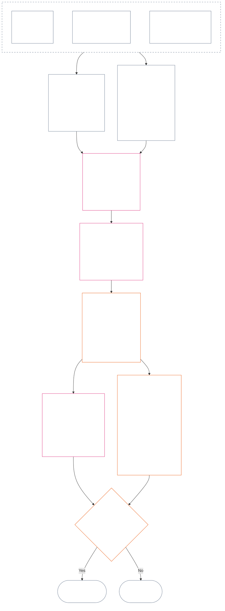

<!-- Complete unreviewed AI-assisted ko translation of current Chapter Twelve; source: core_12.000_standing_measurement.md; source snapshot: a9ad713c15de3c6ba565486590518aa07c7d62fa; source SHA-256: 7ae49781f558ad90db53cdd4469dd22d8227f0a17b0c7393c3a1d2168263f59d; 2026-11-09 source refresh and 2026-11-11 committed-main row update applied. -->

# 제12장: 궤적 측정 — 질문 2, 얼마나 좋거나 나빴는가?

<strong>말뭉치 배치(비작동): 파일 구조와 읽기 규칙</strong>

> 이 파일은 **감지자 헌법의 일부**이며, 다른 번호가 매겨진 `core_*` 파일과 하나의 텍스트로 함께 읽힐 때에만 **구속력**을 갖습니다. 이 파일은 **제12장** — **질문 2**(*얼마나 좋거나 나빴는가?*)를 다룹니다. LEQU 기준선과 그 한계, 측정 입력 차원, 경로 설명자 목록, 슬롯 문법과 공통 척도화, 축 지정에 필요한 헌법상 입력, 통합 비례 LEQU 척도, 표준 기여 측정값, 작업 예시, 질문 3으로의 인계(**§1–§9**)를 포함합니다. 세 질문 틀과 **질문 1**(*무슨 일이 있었는가?*) — 검증된 사실, 사건 유형, 기록 요건, 기록 관리 및 처리 — 은 [제11장](core_11_standing_assessment.md#chapter-eleven-standing-records--question-1-what-happened)에 있습니다. 질문 3(*그로 인해 무엇이 일어나는가?*)은 [제13장](../../core_13.000_standing_integration.md#chapter-thirteen-standing-effects-and-integration)에서 계속되며, 적격한 위반 축 `s` = 7–9의 발견에 대한 반헌법적 위법행위 지정은 [제14장](../../core_14.000_misconduct_designation.md#chapter-fourteen-anti-constitutional-misconduct)에 한정된 검토를 받습니다. 읽기 순서, 구속력/지원 자료 구분, 말뭉치 판본 메타데이터는 [README.md](README.md)에서 관리합니다.

<strong>추적</strong>

- 상위 근거:
  - [제11장 §1](core_11_standing_assessment.md#1-the-three-questions) (*세 질문 틀*);
  - [제11장 §2](core_11_standing_assessment.md#2-question-1--what-happened)부터 [제11장 §6](core_11_standing_assessment.md#6-handling-a-standing-record)까지 (*질문 1 — 검증된 사실, 궤적 기록, 관리 및 처리*);
  - [헌법 사원(四元)](core_00_preamble.md#constitutional-tetrad);
  - [두 헌법 목적](core_00_preamble.md#two-constitutional-aims);
  - [서문 §6 주요 실무 절차 파이프라인](../../core_00.000_preamble.md#6-key-practical-process-pipelines) (*제9장부터 제15장까지의 연쇄*).
- 이 파일의 하위 절:
  - [§1](#1-question-2--how-good-or-bad-was-it) (*질문 2 — LEQU 기준선, 지위 연결 규칙, 한계, 범위*);
  - [§2](#2-magnitude-and-severity-input-dimensions) (*두 축의 측정 입력 차원*);
  - [§3](#3-route-descriptor-catalogs-and-measurement-roles) (*경로 설명자 목록*);
  - [§4](#4-slot-grammar-and-shared-scaling) (*슬롯 문법과 공통 척도화*);
  - [§5](#5-constitutional-inputs-to-axis-assignment) (*헌법 출처 경로 지정*);
  - [§6](#6-unified-proportional-lequ-scale--contribution-and-violation-axes) (*두 축에 적용되는 통합 비례 LEQU 척도*);
  - [§7](#7-standard-contribution-measures) (*채택자가 공표하는 표준 기여 측정값*);
  - [§8](#8-measurement-illustrations) (*측정 작업 예시*);
  - [§9](#9-hand-off-to-question-3--cross-question-measurement-hooks) (*질문 3으로의 인계*).
- 하위 결과:
  - [제13장](../../core_13.000_standing_integration.md#chapter-thirteen-standing-effects-and-integration) (13.000) (*질문 3 효과와 통합*);
  - [제14장](../../core_14.000_misconduct_designation.md#chapter-fourteen-anti-constitutional-misconduct) (14.000) (*지정만 수행 — 질문 2 측정을 다시 열지 않음*).
- 함께 읽기: [제5장 *궤적 상태, 기여 및 위반*](../../core_05.035_band_accountability.md#defa3-standing-state-contribution-and-violation) (5.035) (*정의의 표준 경로 지정*).

 

제12장은 **질문 2**의 헌법상 담당 장이며, [제11장](core_11_standing_assessment.md#chapter-eleven-standing-records--question-1-what-happened)에서 검증한 사실을 측정합니다. [§1 질문 2 — 얼마나 좋거나 나빴는가?](#1-question-2--how-good-or-bad-was-it)에서 시작합니다. [제11장](core_11_standing_assessment.md#chapter-eleven-standing-records--question-1-what-happened)은 세 질문 틀, 질문 1, 궤적 기록을 담당하며 [제11장 §6 궤적 기록 처리](core_11_standing_assessment.md#6-handling-a-standing-record)에서 끝납니다.

*쉬운 말로: 제11장은 무슨 일이 일어났고 누가 궤적 기록을 보유하는지 확정합니다. 이 장은 기여가 얼마나 좋았는지 또는 위반이 얼마나 나빴는지를 절대 하나의 순점수로 합치지 않는 두 척도로 측정합니다. 측정 뒤에 무엇이 따르는지는 제13장에서 다룹니다.*

### 1. 질문 2 — 얼마나 좋거나 나빴는가?

<strong>추적</strong>

- 상위 근거: [제11장 §2](core_11_standing_assessment.md#2-question-1--what-happened) (*질문 1 — 궤적 기록과 검증된 사실*); [제11장 §2.5](core_11_standing_assessment.md#25-verified-input-gate) (*검증 입력 관문*); [제11장 §4](core_11_standing_assessment.md#4-standing-record-operational-requirements) (*기록 요건*); [제11장 §1](core_11_standing_assessment.md#1-the-three-questions) (*세 질문 틀*).
- 하위 결과:
  - [§2](#2-magnitude-and-severity-input-dimensions) (*두 축의 측정 입력 차원*);
  - [§3](#3-route-descriptor-catalogs-and-measurement-roles) (*경로 설명자 목록*);
  - [§4](#4-slot-grammar-and-shared-scaling) (*슬롯 문법과 공통 척도화*);
  - [§5](#5-constitutional-inputs-to-axis-assignment) (*헌법 출처 경로 지정*);
  - [§6](#6-unified-proportional-lequ-scale--contribution-and-violation-axes) (*기여 축 및 위반 축 지정에 적용되는 통합 비례 LEQU 척도*);
  - [§7](#7-standard-contribution-measures) (*채택자가 공표하는 표준 기여 측정값*);
  - [§8](#8-measurement-illustrations) (*측정 예시*);
  - [§9](#9-hand-off-to-question-3--cross-question-measurement-hooks) (*질문 3으로의 인계*);
  - [제13장 §7.2](../../core_13.000_standing_integration.md#72-competency-bars-and-clearances) (13.000 §7.2) (*기여에 관한 질문 3 — 안전한 위임*);
  - [제13장 §5.2](../../core_13.000_standing_integration.md#52-prevention--general-standing-locks) (13.000 §5.2) (*예방 잠금*);
  - [제13장 §6](../../core_13.000_standing_integration.md#6-lock-design-and-enforcement) (13.000 §6) (*잠금 설계 및 집행*).
- 함께 읽기: [제11장 §4.1](core_11_standing_assessment.md#41-minimum-record-contents) (*검증된 궤적 기록 필드; 제11장에는 궤적 효과가 없음*).

 

*쉬운 말로: 질문 2는 질문 1에서 검증된 사실을 측정합니다. **기여는 얼마나 좋았는가?** 또는 **위반은 얼마나 나빴는가?**를 묻습니다. 이 장에서 처음으로 두 공식 측정 축을 소개합니다. 검증된 도움을 위한 **기여 축**과 검증된 해악을 위한 **위반 축**입니다. 두 축은 분리된 채 유지되며, 하나의 순점수로 합산하지 않습니다.*

누군가의 기여나 위반을 어느 슬롯에 넣을지 정하기 위해, 이 장은 **수명 등가 단위(Lifespan Equivalent Unit, LEQU)**를 사용해 영향을 측정합니다. LEQU 1단위는 대략 한 감지자의 전 생애에 걸친 안녕을 구하거나 파괴하는 것과 같습니다. 이는 신체 수나 금액을 세는 일이 아닙니다. 어떤 행위가 헌법 공동체의 안녕을 실질적으로 바꾸었는지를 묻습니다. 동일한 단위는 인간을 포함해 어떤 감지자에게도 적용됩니다.

#### 1.1 LEQU 기준선

**수명 등가 단위**(**LEQU**)는 채택된 실행 체계에 수치 보정이 필요할 때, 전 생애 등가의 헌법상 이익 또는 손실을 나타내는 약칭 단위입니다.

- 이 단위는 기질에 구애받지 않습니다.
- 현재의 채택자는 생물학적 인간 맥락에서 보정 예시로 통상적인 인간 수명을 사용할 수 있지만, 구속력 있는 기준선은 특정 종에 한정되지 않고 감지자 및 헌법을 기준으로 합니다.

**전 생애 등가 헌법상 이익**이란 실질적이고 권리에 부합하는 안녕의 감지자 전 생애 하나를 보존하거나, 회복하거나, 자유롭게 하는 것과 견줄 만한 검증된 이익을 뜻합니다. **전 생애 등가 헌법상 손실**이란 전 생애 등가 헌법상 이익 하나를 파괴하거나, 부당하게 소모하거나, 실현을 막는 것과 견줄 만한 검증된 해악, 낭비, 파괴, 선택지 봉쇄, 박탈 또는 위험의 현실화를 뜻합니다.

#### 1.2 LEQU 사용의 한계

LEQU를 사용할 때마다 다음 한계가 적용됩니다.

- **순점수 규칙이 아님:** 위반을 기여로 상쇄하거나 그 반대로 할 수 없습니다. 각 축은 독립적으로 유지됩니다.
- **인간 생명에 대한 의무적 척도가 아님:** LEQU는 감지자 일반에 적용되며, 인간만이 아니라 의식이 있는 모든 존재에 적용됩니다.
- **비난 척도가 아님:** 제11장 §2.5에 따른 검증 입력과 §6에 따른 보정이 없다면, 의혹, 접수 태그, 경로 지정 결정, 평판, 배척된 지위 또는 도덕적 반감은 기여 축의 이익이나 위반 축의 심각도를 제공하지 않습니다.
- **권리를 거래할 수 있는 허가가 아님:** 효율성, 생산 역량, 혁신, 부담 경감, 보안, 보복, 비상 대응 또는 제도적 필요성이라는 주장은 다음에 의존할 경우 감액하거나 배척해야 합니다.
  - 강압;
  - 차별적인 부담 전가;
  - 생태계 고갈;
  - 드러나지 않은 무급 노동;
  - 피할 수 있는 불투명성;
  - 권리 바닥의 축소;
  - 포획;
  - 오해를 일으키는 대리 지표;
  - 다툴 수 있음의 상실; 또는
  - 검토 불가능한 합산.

#### 1.3 질문 2에 한정된 범위와 경로 지정

이 부분은 측정 단계인 질문 2만 다룹니다. 이미 검증된 사실(질문 1)을 받아 기여가 얼마나 좋았는지 또는 위반이 얼마나 나빴는지 묻습니다.

- 제11장 §2에 따라 이미 검증되고 제11장 §4에 따라 궤적 기록에 기재된 사실에서 출발해 §2의 차원을 사용하여 측정합니다.
- 그런 다음 도움의 각 종류에는 표준 이름인 도움 경로 목록(**§3.1**)을, 해악의 각 종류에는 해악 경로 목록(**§3.2**)을 부여합니다.
- 각 이름은 해당 종류의 도움이나 해악이 ‘얼마나 좋은지’ 또는 ‘얼마나 나쁜지’에 얼마나 반영되는지도 알려 줍니다.
- 이익에 뒤따르는 결과 규칙은 [이익 측](../../core_13.000_standing_integration.md#72-competency-bars-and-clearances)에, 해악에 뒤따르는 결과 규칙은 [해악 측](../../core_13.000_standing_integration.md#52-prevention--general-standing-locks)에 있습니다.
- 다음에 일어날 일을 결정하는 것은 질문 3입니다. [제13장 §4 설명자 통합과 연결 정규화](../../core_13.000_standing_integration.md#4-descriptor-integration-and-attachment-normalization)부터 시작하십시오.

#### 1.4 감지자 지위 연결 규칙

궤적 측정은 어떤 존재가 **감지자**인지 결정하지 **않습니다**.

- 지위 분쟁은 [감지자 지위 판정](../../core_05.055_band_participation.md#sentience-status-adjudication)과 [조문 VI-B](core_06_rights_part_b.md#article-vi-b-sentience-status-adjudication-floor) (*감지자 지위 판정 권리 바닥*)으로 갑니다. LEQU 점수나 분류 기록에서 결정하지 않습니다.
- [다툼 중인 감지자 생명](../../core_05.055_band_participation.md#contested-sentient-life)에 따라 지위 분쟁이 진행 중인 동안에는 **조문 VI-B** (*감지자 지위 판정 권리 바닥*)에 따라 해당 존재를 기본적으로 포함합니다. 분쟁이 결정될 때까지 계속 측정받을 수 있고 궤적 기록을 제출할 수 있으며, 운영자는 분쟁이 진행 중이라는 이유만으로 그 존재의 궤적을 부인해서는 안 됩니다.
- 해당 존재가 [감지자](../../core_05.055_band_participation.md#sentient)로 판정되거나, 자체 검토가 가능한 결정에 따라 판정 후 지위가 축소되거나 회복된 경우:
  - 그 시점부터 궤적 기록의 당사자를 갱신하며,
  - 부당한 배제를 소급 적용하여 그 사이 해당 존재가 측정받을 자격이 있었던 사실을 지워서는 안 됩니다. 다만 [구제 및 시정](../../core_05.035_band_accountability.md#redress-and-remediation)은 예외입니다.

### 2. 규모 및 심각도 입력 차원

*쉬운 말로: 이 절은 질문 2가 무엇을 산출하는지(**§2.1**) 설명한 뒤, 검증된 기여나 검증된 위반을 측정할 때 살펴볼 항목을 열거합니다(**§2.2**). 각 축은 별도로 측정합니다. 공통 척도화 규칙은 **§4.2**에, 슬롯은 **§6**의 척도에 있습니다.*

슬롯 척도는 헌법상 결과가 얼마나 큰지, 어떤 종류인지 측정합니다. 검증된 결과만 셉니다.

**척도가 세는 것과 헌법의 핵심 시험에 연결되는 방식:**

- **[두 헌법 목적](core_00_preamble.md#two-constitutional-aims):** 두 축 모두 **번영**과 **연속**에 미치는 효과를 측정합니다. 기여 축은 이를 진전시키고, 위반 축은 이를 후퇴시킵니다.
- **[두 가지 근본 질문](core_00_preamble.md#two-fundamental-questions):** 각 축은 질문 하나에 필요한 검증된 사실을 제공합니다. 하나에 답했다고 다른 질문에 답한 것이 아니므로 두 축을 서로 상쇄하지 않습니다.
  - **첫 번째 질문:** 기여 축이 검증된 사실을 제공합니다. 체계는 감지자의 번영과 지속, 진실 말하기, 해악 시정을 돕는 행위를 보상합니까?
    - **포함:** 검증된 위험 감소를 포함한 검증된 헌법상 이익.
    - **포함하지 않음:** 원시 산출량, 명성, 부, 이용량, 속도 또는 기관의 규모.
  - **두 번째 질문:** 위반 축이 검증된 사실을 제공합니다. 체계는 정당화될 수 없이 해를 끼치고, 오도하고, 배제하고, 지연시키고, 낭비하거나, 비용을 타인에게 전가하는 행위를 보상합니까?
    - **포함:** 검증된 헌법상 손실, 해악, 낭비, 상실된 선택지(봉쇄), 위험 또는 위험 증가.
    - **그 자체로는 포함하지 않음:** 배척된 지위, 의혹 또는 도덕적 반감.
- **[헌법 사원(四元)](core_00_preamble.md#constitutional-tetrad):**
  - **감독과 책무:** ‘검증됨’은 명명된 행위자가 발견에 답하고 어느 당사자도 자기 주장을 검증하지 않음을 뜻합니다.
  - **적시성:** 피할 수 있는 지연은 손실 규모에 합산하지 않고 별도 사실로 기록합니다.

#### 2.1 질문 2의 산출물

질문 2는 각 축에 대해 다음 항목을 궤적 기록에 기재합니다. 이는 측정값이지 궤적 효과(질문 3이 결정하는 결과)가 아닙니다.

| **산출 항목** | **기여 축** | **위반 축** |
| --- | --- | --- |
| **기재 위치** | 기여 궤적 기록. | 위반 궤적 기록. |
| **슬롯** | 해당되는 가장 높은 **기여 축 슬롯** (`s` = 1–9). | 해당되는 가장 높은 **위반 축 슬롯** (`s` = 1–9). |
| **경로 설명자** | 적용되는 **도움 경로 설명자**를 함께 쌓아 기재합니다. | 적용되는 **해악 경로 설명자**를 함께 쌓아 기재합니다. |
| **질문 3에 전달되는 입력** | 기여가 인정되는 방식의 출발점을 정하는 입력([제13장 §7 기여 결과를 두 번째로](../../core_13.000_standing_integration.md#7-contribution-consequences-second)에 따름). | 잠금 엄격도의 출발점인 기본 잠금 구간을 정하는 입력([제13장 §6 잠금 설계 및 집행](../../core_13.000_standing_integration.md#6-lock-design-and-enforcement)에 따름). |
| **LEQU 총량** | 관련된 각 이익 종류(생태, 시스템 또는 자원)를 별도로 평가한 뒤, 전체 기여에 대해 LEQU 총량 하나를 기재합니다. | 관련된 각 해악 종류(생태적 해악, 시스템 해악 또는 자원 손실)를 별도로 평가한 뒤, 전체 위반에 대해 LEQU 총량 하나를 기재합니다. |

주의: 이 항목 중 어느 것도 진행 중인 위반 기록을 상쇄하지 않습니다. 상쇄 금지 규칙은 [제11장 §2.4 연계된 궤적 기록과 상쇄 금지 연결 규칙](core_11_standing_assessment.md#24-linked-standing-records-and-no-offset-bridge)에 있습니다.

#### 2.2 기여 규모 입력 및 위반 심각도 입력 차원

**질문 2 — 얼마나 좋거나 나빴는가?** 기여가 기여 축의 어느 위치에 놓이는지, 또는 위반이 위반 축의 어느 위치에 놓이는지(1부터 9까지의 **슬롯**)와 어떤 도움 또는 해악 설명자가 적용되는지 정하려면 세 부분을 검토합니다. 여러 설명자가 동시에 적용되어 함께 쌓일 수 있습니다. 결과는 §2.1에 열거된 대로 해당 축의 궤적 기록에 기재합니다. §6에는 두 번째 부분에 적용되는 통합 척도가 있으며, 이익과 해악에 같은 척도를 사용합니다. 이 척도는 이익 또는 손실의 총량을 LEQU(수명 등가 단위, 대략 전 생애 하나의 안녕)로 추산하고 각 총량이 어느 슬롯에 속하는지 설명합니다. 기여 축의 슬롯은 네 구간으로 묶입니다.

**1. 어떤 방식으로 만들어졌는지 확인합니다.** 두 축은 이를 다르게 취급합니다.

- **기여(행위의 질):** 추적 가능했는지, 비용을 타인에게 전가하지 않았는지, 주의 깊게 수행했는지, 헌법에 부합하는지에 따라 이익으로 인정되는 양이 늘거나 제한될 수 있습니다. 다섯 가지 검토 항목은 [§2.2.1 이익이 만들어진 방식이 인정되는 양에 미치는 영향](#221-how-the-way-a-benefit-was-produced-affects-what-counts)에 있습니다.
- **위반(행위의 성격):** 영향의 규모와 별도로 기록합니다. 의무, 과실, 기만, 은폐, 책무 방해, 강압, 폭력, 의도, 잔혹성, 구조적 조장은 책임 주체, 필요한 보호 조치, 대응 방식을 좌우하지만 LEQU 슬롯은 바꾸지 않습니다. 어느 행위 특성도 슬롯을 바꾸지 않는다는 규칙과 각 항목의 기록 규칙은 [§2.2.2 해악을 일으킨 방식의 기록](#222-how-the-way-a-harm-was-caused-is-recorded)에 있습니다.

**2. 규모를 산정합니다: 이익 또는 손실은 얼마나 큰가?** 이것이 슬롯을 결정합니다.

| **살펴볼 항목** | **효과** | **규정 위치** |
| --- | --- | --- |
| **전체 규모(LEQU)** | 주된 측정값이며 슬롯을 결정합니다. 기여에서는 이루어진 검증된 선익의 총량을 LEQU로 셉니다. 위반에서는 검증된 헌법상 손실의 총량입니다. 제14장의 위법행위 지정은 별도로 결정됩니다. | [§6 통합 비례 LEQU 척도](#6-unified-proportional-lequ-scale--contribution-and-violation-axes) |
| **영향받는 대상(인원, 영향 깊이, 취약성)** | LEQU 추산과 이익 또는 해악의 중요도(실질성)를 조정합니다. | [§4.2 공통 영향 척도화 규칙](#42-shared-impact-scaling-rules); [실질성](../../core_05.050_band_oversight.md#materiality) |
| **지속 기간(혜택의 지속성, 해악의 비가역성)** | LEQU 추산을 조정합니다. 기여에서는 지속되는 책임 있는 관리, 세대 간 이익, 기관의 지속적인 개선이 상위 슬롯을 가리킵니다. 위반에서는 지속되는 트라우마, 되돌릴 수 없는 손실, 감지자의 자기 행위 능력에 지속적인 손상이 총손실 추산을 높입니다. | [§4.2 공통 영향 척도화 규칙](#42-shared-impact-scaling-rules) |
| **영향 범위(장소 또는 기관을 가로지르는 범위)** | LEQU 추산을 조정합니다. 기여에서는 공동체나 기관 전반 또는 문명 규모의 이익이 예가 됩니다. 위반에서는 공동체나 기관 전반 또는 문명 전체로 번지는 해악이 총손실 추산을 높일 수 있습니다. | [§4.2 공통 영향 척도화 규칙](#42-shared-impact-scaling-rules) |

**3. 이익 또는 해악의 종류(경로)를 이름 붙입니다.** 검증된 이익이나 해악이 어떤 방식으로 발생했는지 이름 붙입니다. 하나 이상이 적용될 수 있으며 함께 쌓입니다. 목록은 [**도움 경로 설명자 목록**](#31-contribution-route-descriptor-catalog-and-measurement-roles)과 [**해악 경로 설명자 목록**](#32-violation-route-descriptor-catalog-and-measurement-roles)에 있습니다.

##### 2.2.1 이익이 만들어진 방식이 인정되는 양에 미치는 영향

기여 축 슬롯을 선택하기 전에 다음을 확인합니다.

| **확인된 내용** | **이익에 미치는 효과** |
| --- | --- |
| 통지를 받은 뒤 문제를 신속히 검증하여 시정함 | 실질적이고 입증 가능한 이익을 낳았다면 **성실성**(주의 깊고 책임 있는 행위)으로 인정될 수 있습니다. |
| 타인에게 전가된 해악 또는 숨겨진 부담 | 다툼이 있는 경로(이익이 귀속되는 구체적 경로)에 인정되는 이익을 상한 제한하거나 배제합니다. |
| 검증된 포획 위험(협소한 이해관계에 장악될 가능성), 구조적 의존(감지자가 의존하도록 체계에 편입됨), 또는 이탈·고착 설계(떠나기 어려움) | 책임 있는 관리에 대한 공로 인정을 제한합니다. |
| 접근성 또는 참여 장벽을 검증하여 시정함 | 이익의 중요도(실질성)를 높이고 §3.1의 **접근과 포용** 도움 경로 설명자를 뒷받침할 수 있습니다. |
| 헌법에 반하는 유인 구조, 반헌법적 행위 또는 실질적으로 결함 있는 절차에서 비롯된 상당한 보상 | 기본적으로 이익으로 산입하지 않습니다. 이 경우 [제13장 §6.4.2 불일치 보상](../../core_13.000_standing_integration.md#642-misaligned-rewards)과 [조문 XXVIII-A](../../core_06.020_rights_part_e.md#incentive-alignment-adoption-transition-carve-out)의 채택 전환 제한(*단계적 채택 및 권리 바닥의 연속성*)을 적용합니다. |

##### 2.2.2 해악을 일으킨 방식의 기록

해악의 규모(위 2부의 LEQU 총량)가 슬롯을 정합니다. 해악을 일으킨 방식은 슬롯을 바꾸지 않으므로, 아래 각 행위 유형은 별도로 기록합니다.

이 하위 절은 제12장이 이 규칙을 한 번만 명시하는 곳이다. **사건이나 행위 과정이 다음 중 하나로 특징지어진다는 이유만으로 슬롯을 올리거나 내리지 말 것:**

- 의무;
- 과실;
- 고의;
- 은폐;
- 반복;
- 가중 사유;
- 강압;
- 폭력;
- 자유에 대한 위험;
- 교정 가능성; 또는
- 선호하는 결과.

행위 특성에 관한 사실은 별도로 추적할 수 있는 기술자로 기록한다. 이 사실은 귀속, 심사 강도, 안전장치, 구제 또는 제14장 지정을 좌우할 수 있다. 검증된 결과를 통해서만 슬롯에 영향을 준다. 행위로 손실이 추가되면 그 손실은 LEQU 총량에 한 번만 포함되고 슬롯은 그 총량을 따른다.

**손실을 더하며 규모에 한 번 산입하는 행위:**

| **확인된 내용** | **기록 방법** |
| --- | --- |
| 조치 의무와 실행 역량이 있었는데 대응 또는 상향 보고를 피할 수 있었음에도 지연함 | 행위에 관한 별도 사실로 기록합니다. 그 지연이 초래한 추가 손실은 LEQU 추산에 한 번 산입합니다. |
| 포럼의 무결성(포럼의 공정성)에 독립적으로 검증된 손상 | LEQU 추산에 정확히 한 번 산입합니다. 부정직한 누락, 고의로 회피한 제척 절차, 강압, 자유에 대한 위험 및 다른 행위 사실은 별도 설명자로 남습니다. |
| **책무 방해**(증거 무결성, 검증, 포럼 절차, 궤적 기록, 구제 기간 또는 이의 제기 및 시정 경로 등 책임 있는 자에게 책임을 물을 수 있게 하는 장치에 대한 검증된 간섭) | 별도로 기록되는 행위 사실로 남습니다. 제한된 경로에서 이로 인해 생긴 추가 손실은 LEQU 추산에 한 번 산입합니다. |

**해악의 규모와 별도로 기록하는 행위 사실:**

| **확인된 내용** | **기록 방법** |
| --- | --- |
| 기만, 은폐, 회피, 통지 후 행위 반복, 무모한 무시, 구조적 조장(해악이 쉽게 또는 개연성 높게 일어나도록 설계함), 또는 중대한 의존 불균형의 남용(자신에게 크게 의존하는 자를 착취함) | 각각 별도로 기록되는 행위 사실로 남습니다. |
| 폭력, 강압, 조작 또는 자유에 대한 위험 | 별도로 기록하며 슬롯과 무관하게 더 강한 보호 조치가 필요할 수 있습니다. |
| [잔혹성](../../core_05.035_band_accountability.md#cruelty) (검증된 고통을 그 자체의 목적으로 삼거나, 필요성과 비례성을 넘어선 무상 또는 굴욕적 해악) | 별도로 기록되는 행위 사실로 남습니다. [제13장 §5 위반, 시정, 예방](../../core_13.000_standing_integration.md#5-violation-correction-and-prevention)에 따라 더 강한 보호 조치와 굴욕적 구제의 제한이 필요할 수 있습니다. |

**책임과 귀속:**

| **확인된 내용** | **기록 방법** |
| --- | --- |
| 책임의 분산(누가 어떤 인과 역할을 했는지, 어떤 권한이나 통제를 가졌는지, 해악을 예견할 수 있었는지, 이익을 얻었는지, 은폐했는지, 예방할 수 있었는지) | **감지자 범위**에 포함되지 않으며, 어떤 집단에 속했다는 이유로 누구를 비난하는 것도 허용하지 않습니다. |
| 해악에 동조하거나 저항하지 않음 | 제11장 §§4.1 및 4.3이 요구하는 해당 행위자와의 연결이 검증된 경우에만 의무 기반, 가중 또는 집단 책무 성격의 판단을 뒷받침할 수 있습니다. |

**유인과 헌법의 불일치:**

| **확인된 내용** | **기록 방법** |
| --- | --- |
| 적시에 보호된 보고(보복으로부터 보호되는 보고)를 하지 않고 헌법에 반하는 상당한 보상을 알면서 받아들이거나 보유함 | [제13장 §6.4.2 불일치 보상](../../core_13.000_standing_integration.md#642-misaligned-rewards)에 따라 기록하며, [조문 XXVIII-A](../../core_06.020_rights_part_e.md#incentive-alignment-adoption-transition-carve-out)(*단계적 채택 및 권리 바닥의 연속성*)의 적용을 받습니다. 그로 인해 발생한 검증된 헌법상 손실만 슬롯에 영향을 줍니다. |

**유인 불일치의 경계.** 이 장은 검증된 불일치 보상(헌법에 반하는 보상)이 기여 축 또는 위반 축에 미치는 영향만 측정합니다. [제13장 §6.4.2 불일치 보상](../../core_13.000_standing_integration.md#642-misaligned-rewards)은 보고 의무, 제외 사항, 보상 포기(몰수)의 결과, 시정 의무 및 경로 지정 규칙을 정합니다.

### 3. 경로 설명자 목록과 측정 역할

*쉬운 말로: 아래 두 목록은 궤적 기록에 기재할 수 있는 검증된 도움(**§3.1**)과 해악(**§3.2**)의 종류에 이름을 붙입니다. 설명자는 이익이나 해악이 발생한 방식을 나타냅니다. 여러 설명자가 함께 적용될 수 있으며, 슬롯보다 하위입니다.*

**설명자 규칙.** 아래의 [§3.1 기여 경로 설명자 목록과 측정 역할](#31-contribution-route-descriptor-catalog-and-measurement-roles) 및 [§3.2 위반 경로 설명자 목록과 측정 역할](#32-violation-route-descriptor-catalog-and-measurement-roles)은 두 축 모두에 적용되는 공식 설명자 목록입니다. 설명자는 검증된 이익이나 해악이 **어떻게** 발생했는지를 나타냅니다. 다음 규칙이 적용됩니다.

- 설명자는 함께 쌓이며 서로를 배제하지 않습니다. 검증된 사실이 뒷받침하면 하나의 궤적 기록에 여러 설명자를 기재할 수 있습니다.
- 설명자는 슬롯보다 하위입니다. 슬롯은 이익 또는 해악의 규모를 나타내며, 설명자는 발생 방식을 상세히 덧붙이지만 슬롯을 대체하지 않습니다.
- 기재된 설명자는 기본 목록이지 전체 목록이 아니므로, 목록은 다른 종류의 이익이나 해악을 배제하지 않습니다.
- 구현은 목록에 대응하는 안정적 식별자(자체 고정 ID)를 사용할 수 있지만, 궤적 기록에 하나만 기재할 수 있도록 범주를 상호 배타적으로 만드는 상충 분류 체계를 만들어서는 안 됩니다.
- 사실이 검증되기 전에는 주장된 설명자를 적법한 증거 보존, 사건 분류 또는 임시 보호 조치에 활용할 수 있습니다.
- 검증된 설명자만 질문 2의 산출물로 기록하거나 궤적에 영향을 줄 수 있습니다.

#### 3.1 기여 경로 설명자 목록과 측정 역할

다음은 도움 경로 설명자와 각 설명자가 질문 2(얼마나 좋았는가?)에서 측정하는 내용입니다. 다섯 영역으로 나누어 영역마다 표 하나씩 두며, [§3.2 위반 경로 설명자 목록과 측정 역할](#32-violation-route-descriptor-catalog-and-measurement-roles)의 위반 목록도 같은 다섯 영역을 같은 순서로 사용합니다. 안전한 위임이라는 질문 3의 역할은 [제13장 §7.2 역량 기준과 허가](../../core_13.000_standing_integration.md#72-competency-bars-and-clearances)에 있습니다.

**목록의 완전성.** 구현이 한 행이나 하나의 표지 아래 여러 설명자를 표시한다면, 해당 행이나 표지는 적용되는 모든 설명자에 대응해야 합니다. 이 목록은 설명자 이름과 질문 2에서 각 설명자가 측정하는 내용만 정합니다. 연결, 구제, 잠금, 허가 및 기타 궤적 효과에 관한 질문 3 규칙은 제13장에만 있습니다.

##### 3.1.1 신체 안전, 관계, 돌봄 및 행위 능력

| **도움 경로 설명자** | **질문 2에서 측정하는 내용** |
| --- | --- |
| **몸·마음 및/또는 공동체의 평온** | 신체적·심리적·공동체적 평온에서 비롯된 이익. 이익의 중요도(실질성)를 조정합니다. |
| **신뢰할 수 있는 관계** | 신뢰할 수 있는 관계의 이익. 양측이 불평등한 환경에서 신뢰 의무를 기반으로 형성된 관계도 포함합니다. |
| **돌봄 및 의존 지원** | 타인에게 의존하는 감지자에게 제공한 검증된 돌봄. 입증 가능한 비공식 돌봄도 포함됩니다. |
| **접근과 포용** | 실질적인 참여와 접근성에서 오는 이익. 한쪽이 다른 쪽에 크게 의존하는 환경에서 이익의 중요도를 조정합니다. |

##### 3.1.2 시정, 재산 및 자원

| **도움 경로 설명자** | **질문 2에서 측정하는 내용** |
| --- | --- |
| **구제 및 회복 이익** | 시정, 보상, 해악 감소에서 오는 이익. |
| **자원 책임 관리** | 물적 자원을 주의 깊게 돌보고 신뢰성 있게 공유·배분함. |

##### 3.1.3 지식, 교육, 기록 및 발견

| **도움 경로 설명자** | **질문 2에서 측정하는 내용** |
| --- | --- |
| **정보권역 무결성** | 기록, 투명성 및 소통의 강화. |
| **교육 및 역량 형성** | 학습, 문해력, 감지자의 자기 행위 능력 성장에서 오는 이익. 슬롯은 LEQU 이익 총량을 따릅니다. |
| **과학·기술·공학·수학(STEM) 및 발견 기여** | 타인이 재현할 수 있는 발견과 안전성을 높이는 연구. |

##### 3.1.4 시스템과 헌법의 작동

| **도움 경로 설명자** | **질문 2에서 측정하는 내용** |
| --- | --- |
| **시스템 최적화** | 기관을 가로지르는 절차의 개선과 위험 감소. |
| **헌법 정렬** | 권리 바닥을 강화하고 결정에 대한 이의 제기를 쉽게 함. |

##### 3.1.5 생태와 성실성

| **도움 경로 설명자** | **질문 2에서 측정하는 내용** |
| --- | --- |
| **생태 책임 관리** | 서식지와 생물다양성에 대한 이익, 기후를 고려한 행위. |
| **성실성** | 예견 가능한 위험의 예방과 유능한 감독. |

#### 3.2 위반 경로 설명자 목록과 측정 역할

다음은 해악 경로 설명자와 각 설명자가 질문 2(얼마나 나빴는가?)에서 측정하는 내용입니다. 다섯 영역으로 나누어 영역마다 표 하나씩 두며, [§3.1 기여 경로 설명자 목록과 측정 역할](#31-contribution-route-descriptor-catalog-and-measurement-roles)과 같은 다섯 영역을 같은 순서로 사용합니다. 질문 3의 통합 및 연결 규칙은 [제13장 §4 설명자 통합과 연결 정규화](../../core_13.000_standing_integration.md#4-descriptor-integration-and-attachment-normalization)에, 예방 및 잠금 설계는 [제13장 §5.2 예방 — 일반 궤적 잠금](../../core_13.000_standing_integration.md#52-prevention--general-standing-locks)과 [제13장 §6 잠금 설계 및 집행](../../core_13.000_standing_integration.md#6-lock-design-and-enforcement)에 있습니다.

**목록의 완전성.** 구현이 한 행이나 하나의 표지 아래 여러 설명자를 표시한다면, 해당 행이나 표지는 적용되는 모든 설명자에 대응해야 합니다. 이 목록은 설명자 이름과 질문 2에서 각 설명자가 측정하는 내용만 정합니다. 연결, 구제, 잠금, 허가 및 기타 궤적 효과에 관한 질문 3 규칙은 제13장에만 있습니다.

##### 3.2.1 신체 안전, 관계, 돌봄 및 행위 능력

| **해악 경로 설명자** | **질문 2에서 측정하는 내용** |
| --- | --- |
| **폭력적 위법행위** | 폭력, 강압 또는 자유에 대한 위험은 LEQU 영향 슬롯과 별도로 기록합니다. 강화된 보호 조치가 필요할 수 있습니다. |
| **대인관계·돌봄 의무 위법행위** | 한쪽이 다른 쪽에 크게 의존하는 경우 해악의 중요도가 높아집니다. |
| **접근성 및 참여 장벽 위법행위** | 한쪽이 다른 쪽에 크게 의존하는 경우 해악의 중요도가 높아지며 가중 요소가 함께 적용될 수 있습니다. |
| **사생활 및 자기소유권 위법행위** | 은폐 또는 착취가 검증되면 가중 요소가 적용되며 서로 중첩될 수 있습니다. |
| **행위 능력 및 조작 위법행위** | 강압, 조작 또는 자유에 대한 위험은 영향 슬롯과 별도로 기록합니다. |

##### 3.2.2 시정, 재산 및 자원

| **해악 경로 설명자** | **질문 2에서 측정하는 내용** |
| --- | --- |
| **시정 가능한 위법행위** | 시정의 성격(해악을 바로잡을 수 있는지와 방법)을 기록합니다. 슬롯은 LEQU 손실 총량을 따릅니다. |
| **재산 위법행위** | 재산 손실 경로입니다. 슬롯은 LEQU 손실 총량을 따릅니다. |

##### 3.2.3 지식, 교육, 기록 및 발견

| **해악 경로 설명자** | **질문 2에서 측정하는 내용** |
| --- | --- |
| **정보권역 위법행위** | 안전 또는 진실에 대한 손상. 은폐와 기만은 해악을 일으킨 방식(성격)에 관한 별도 사실로 남습니다. |
| **교육 위법행위** | 학습 또는 감지자의 행위 능력(역량)에 대한 해악. 슬롯은 LEQU 손실 총량을 따릅니다. |
| **연구 및 발견 위법행위** | 연구 또는 발견에 대한 해악. 슬롯은 LEQU 손실 총량을 따릅니다. |

##### 3.2.4 시스템과 헌법의 작동

| **해악 경로 설명자** | **질문 2에서 측정하는 내용** |
| --- | --- |
| **시스템 위법행위** | 책임의 분산과 구조적 조장은 별도로 기록합니다. |
| **책무 방해 위법행위** | 책무 방해, 즉 해악에 책임을 묻는 것을 가로막는 행위를 다룹니다. 해악이 발생한 방식으로 기록합니다. 방해의 실행 방식(예: 은폐 또는 과실)은 별도 사실로 기록합니다. 슬롯이 상위권에 해당하면([§4.1 표 1 — 슬롯 표시명](#41-table-1--slot-display-labels) 참조), 사건을 **반헌법적 위법행위**로도 기록하여 제14장의 [반헌법적 위법행위 검토](../../core_05.035_band_accountability.md#anti-constitutional-misconduct-review)로 보낼 수 있습니다. 그곳으로 보내는 것과 반헌법적 위법행위로 지정하는 것은 다릅니다. 지정 여부는 제14장에서 별도로 결정합니다. |
| **이탈 및 고착 위법행위** | 시스템 위법행위의 특징에 더해, 책임 분산 또는 포획이 구조적(시스템 작동 방식에 내재)인 경우 이를 포함합니다. |
| **생애주기 및 비가역성 위법행위** | 비가역성은 LEQU 손실 규모에 영향을 줍니다. 은폐 또는 과실은 성격에 관한 별도 기록으로 남습니다. |
| **반헌법적 위법행위** (설명자) | 영향 슬롯은 바꾸지 않고, 상위 슬롯의 위반을([§4.1 표 1 — 슬롯 표시명](#41-table-1--slot-display-labels) 참조) 제14장의 지정 검토로 보냅니다. |

##### 3.2.5 생태와 성실성

| **해악 경로 설명자** | **질문 2에서 측정하는 내용** |
| --- | --- |
| **생태 위법행위** | LEQU 손실에 [생태계 회복 역량](../../core_05.040_band_continuity.md#ecological-recovery-capacity)(생태계가 해악 이후 재생하는 능력)에 따른 가중치를 둡니다. 폭력 경로(폭력적 위법행위)와 중첩될 수 있습니다. |
| **과실 위법행위** | 의무, 예견 가능성, 예방 가능성은 영향 슬롯과 별도로 기록합니다. |

### 4. 슬롯 문법과 공통 척도화

*쉬운 말로: 이 절은 서로 분리된 두 축에서 가능한 아홉 위치에 일관된 이름을 붙이고, 영향이 그 사이에서 어떻게 척도화되는지 설명합니다. 한 축은 검증된 기여를 기록하고 다른 궤적 기록은 검증된 위반을 기록합니다. 슬롯 번호가 같다고 해서 두 축이 합쳐지거나 해악이 도움으로 상쇄되는 것은 아닙니다. §6의 통합 척도는 비례 LEQU 영향에 따라 두 축 모두의 슬롯을 지정합니다.*

슬롯 문법은 **1**부터 **9**까지의 슬롯 번호 `s`를 사용합니다. 각 축에는 자체 슬롯 위치가 있습니다.

- **기여 축**은 긍정적 기여의 성격을 기록합니다.
- **위반 축**은 검증된 위반 판단을 기록합니다.

같은 슬롯 번호가 양쪽 축에 나타날 수 있지만, 두 축은 분리된 채 유지됩니다. 기여 슬롯은 위반 슬롯이 아니며 위반 슬롯은 기여 슬롯이 아닙니다.

#### 4.1 표 1 — 슬롯 표시명

**표 1**은 아홉 슬롯에 이름을 붙이고 기여 축과 위반 축의 표시명을 나란히 보여 줍니다. 표시는 이름만 제공하며, 슬롯 지정은 §6의 통합 척도에 따라 이루어집니다.

| `s` | 기여 축 표시명 | 위반 축 표시명 |
| ---: | --- | --- |
| 1 | **경미한 기준선 기여** | **경미한 헌법상 영향** |
| 2 | **작은 기준선 기여** | **작은 헌법상 영향** |
| 3 | **상당한 긍정적 기여** | **상당한 헌법상 영향** |
| 4 | **중요한 긍정적 기여** | **중요한 헌법상 영향** |
| 5 | **중대한 책임 관리 긍정 기여** | **중대한 헌법상 영향** |
| 6 | **주요 책임 관리 긍정 기여** | **주요 헌법상 영향** |
| 7 | **공인된 챔피언** | **심각한 헌법상 영향** |
| 8 | **탁월한 챔피언** | **중대한 헌법상 영향** |
| 9 | **모범적 챔피언** | **파국적 헌법상 영향** |

기여 축은 기준선, 긍정, 책임 관리 긍정, 챔피언 표시명을 사용합니다. 위반 축은 모든 슬롯에서 중립적인 영향 표시명을 사용합니다. 두 축은 분리되며 순점수를 만들거나 기여 기록과 위반 기록의 상쇄를 허용하지 않습니다. 위반 축 슬롯만으로 반헌법적 위법행위가 분류되는 것은 아닙니다. [제14장](../../core_14.000_misconduct_designation.md#chapter-fourteen-anti-constitutional-misconduct)은 검증된 `s` = 7–9 위반에 반헌법적 위법행위 지정(ACMD)이 적용되는지를 독립적으로 결정합니다.

구현은 전 생애 등가 이익 또는 손실을 추산하는 데 도움이 되도록 측정 단위, 증거 방법, 예시를 공표할 수 있습니다. 이러한 자료는 안내일 뿐이며 §6, 제1장 또는 제6장의 권리 바닥을 덮어쓸 수 없습니다.

#### 4.2 공통 영향 척도화 규칙

*쉬운 말로: 영향은 인원수만으로 측정하지 않습니다. 한 감지자에게 미치는 깊은 이익 또는 손실이 다수에게 미치는 얕은 효과보다 중요할 수 있습니다. 수, 깊이, 취약성, 지속 기간, 지속성, 범위, 헌법적 성격을 함께 평가해야 합니다.*

§6의 두 축을 해석할 때 다음 규칙을 사용합니다.

| 척도 차원 | 공통 규칙 | 축별 적용 |
| --- | --- | --- |
| **헌법상 결과의 규모(LEQU)** | 통합된 검증 이익 또는 손실을 평가합니다. LEQU는 주요 규모 기준입니다. 단순 인원수, 금액, 산출량 또는 기관 규모는 기준이 아닙니다. | 기여는 권리에 부합하는 이익을 세고, 위반은 검증된 헌법상 손실, 해악, 낭비, 선택지 봉쇄 또는 위험을 셉니다. |
| **감지자 범위** | **수, 깊이, 취약성**을 함께 고려합니다. 어떤 슬롯도 인원수를 독립 요건으로 삼지 않습니다. 통합 규모와 행의 다른 기준이 같다면, 한 감지자에 대한 충분히 깊은 영향이 더 넓지만 얕은 영향과 같은 슬롯을 뒷받침할 수 있습니다. 명시된 총합 LEQU 또는 광범위 범위 기준은 여전히 충족해야 합니다. | 의존성, 축소된 역량 또는 이례적 취약성은 실질성을 높일 수 있습니다. 집단 규모만으로 기여 또는 심각성이 성립하지 않습니다. |
| **시간 범위** | 지속 기간, 반복, 지속성, 그리고 손실의 경우 비가역성을 고려합니다. 짧지만 변혁적인 사건이 오래 지속되는 사소한 효과보다 클 수 있으며, 지속 기간만으로 결정하지 않습니다. | 지속되는 이익은 더 높은 기여 규모를 뒷받침합니다. 지속적이거나 비가역적인 손실은 위반 심각도를 높입니다. |
| **공간 또는 기관 범위** | 더 넓은 범위는 규모를 높일 수 있지만, 깊이, 지속 기간, 취약성 또는 헌법상 중요성이 독립적으로 슬롯을 뒷받침한다면 공동체 또는 기관을 넘는 범위가 필수는 아닙니다. | 기관의 시정은 기여 규모를 높일 수 있고, 구조적 또는 시스템적 손상은 위반 심각도를 높일 수 있습니다. |
| **헌법상 질 또는 성격** | 결과가 얼마나 널리 퍼졌는지와 결과가 만들어진 방식을 따로 측정합니다. 동일 사실을 중복 산입하지 않습니다. | 외부화된 해악, 숨겨진 부담, 포획 또는 의존성은 주장된 기여를 제한하거나 자격을 박탈할 수 있습니다. 의무, 과실, 기만, 강압, 폭력 또는 구조적 조장은 위반 행위 성격으로 별도 기록합니다. |
| **권리 바닥과 핵심 보호 장치** | 권리 바닥 준수는 총합 이익 또는 손실과 거래하지 않습니다. | 권리 바닥 준수만으로 높은 기여가 성립하지 않습니다. 권리 바닥의 실질적 무력화 또는 핵심 보호 장치 실패는 직접 영향을 받는 감지자 수가 적더라도 위반 심각도를 높일 수 있습니다. |

각각의 척도 형태를 모두 요구하는 점검표로 이 차원들을 사용하지 않습니다. 어떤 차원이 결정적이었고, 어떤 차원이 결정적이지 않았는지, 그 이유를 설명합니다.

- **공통 슬롯 방법:**
  - 비례성에 따라 LEQU의 통합 검증 이익 또는 손실을 추산한 뒤, 그 규모가 수치 구간에 들어가는 하나의 슬롯을 지정합니다.
  - 두 축에 같은 임계값을 적용합니다.
  - 기여 슬롯은 해당 기준선과 헌법 정렬 요건을 유지합니다. 수치 임계값을 충족해도 외부화되었거나 헌법에 의해 무력화된 산출이 기여로 인정되지는 않습니다.
- **성격 분리:** 적용되는 도움 경로, 해악 경로, 행위 품질, 행위 성격 설명자를 궤적 기록에 함께 기재합니다. 의무, 과실, 기만, 가중 요소, 강압, 폭력, 의도 또는 구조적 조장은 귀속, 보호 조치 또는 질문 3 결과에 영향을 줄 수 있지만 LEQU 영향 슬롯을 높이거나 낮추지 않습니다.
- **반헌법적 위법행위 검토의 경계:** 검증된 위반 축 손실은 반헌법적 위법행위가 성립하는지와 무관하게 영향에 따라 `s` = 7–9에 도달할 수 있습니다. 제14장은 영향 슬롯 지정을 대체하지 않으며 해당 ACMD가 적용되는지 독립적으로 결정합니다.

위험이 아직 실제로 발생하지 않았다면 각각을 따로 기록합니다.

- 발생 가능성;
- 감지자가 노출될 기간;
- 미칠 수 있는 범위;
- 추산의 불확실성; 그리고
- 여전히 개연성 있는 최악의 결과.

채택된 구현에 누구나 검사할 수 있는 위험 보정(위험을 LEQU로 환산하는 방법)이 정해져 있지 않다면, 그 최악의 결과를 이미 발생한 해악(LEQU 손실)으로 세지 않습니다.

### 5. 축 지정에 필요한 헌법상 입력

*쉬운 말로: 슬롯을 선택하기 전에 어떤 기준선, 이익, 의무, 해악 또는 위반을 측정하는지 밝히는 헌법상 출처를 확인합니다. 아래 링크를 이용해 각 출처의 표준 위치를 적용합니다. 이 경로 지정 단계를 또 다른 점수나 대체 정의로 만들지 않습니다.*

§6에 따라 슬롯을 지정하기 전에 궤적 기록에 다음을 밝혀야 합니다.

- 적용되는 헌법상 기준선, 의무, 제약 또는 보호 이익;
- 측정 대상인 검증 이익, 불리한 결과, 해악 또는 위반을 성립시키는 조항;
- 규모 또는 행위 성격에 실질적으로 영향을 미치는 정의, 원칙 및 권리 바닥 조항; 그리고
- 확인된 각 출처가 적용되는 이유와 축 지정에 미치는 영향.

아래 경로 지정 표는 모든 경우를 망라하지 않습니다. 검증된 사실에 따라 추가로 적용되는 정의, 원칙 또는 조항도 계속 적용되며 궤적 기록에서 밝혀야 합니다. 링크된 각 표준 위치가 우선하며, 이 표는 그 내용을 다시 진술하거나 축소하지 않습니다.

#### 5.1 정의 입력

| 표준 출처 | 기여 축 역할 | 위반 축 역할 |
| --- | --- | --- |
| [궤적 상태, 기여 및 위반](../../core_05.035_band_accountability.md#defa3-standing-state-contribution-and-violation) | 무엇이 기여로 인정되고 어떤 확인된 사실을 측정에 쓸 수 있는지 설명합니다. 또한 기여 궤적 기록에는 좋은 측면만 담고 나쁜 측면과 섞지 않도록 합니다. | 무엇이 위반이며 어떻게 기록하는지 설명합니다. 헌법 자체를 약화시키는 행위에 대한 별도 검토인 반헌법적 위법행위 검토로 가장 중대한 사건을 보냅니다. |
| [책무](core_05_apex_accountability_leg.md#accountability) | 좋은 책임 관리 또는 시정이라는 주장이 실제로 책임을 물을 수 있게 하는지 확인합니다. 영향에 비례하여 누가 무엇을 했고 누가 답해야 하는지, 어떻게 검토하고 바로잡고 시정할 수 있는지를 보여야 합니다. | 누가 행위했거나 누가 답해야 하는지 불분명한 사건을 찾아냅니다. 조직 또는 구조의 변경 뒤 책임 기능이 작동하지 않게 되는 경우도 포함합니다. |
| [해악](../../core_05.035_band_accountability.md#harm) | 타인에게 전가되거나 숨겨진 해악은 주장된 이익을 제한하거나 없앨 수 있습니다. 해악 시정은 검증되고 독립적으로 입증된 경우에만 이익으로 인정될 수 있습니다. | 손실 및 심각도를 측정할 때 포함되는 직접·간접·지연·누적·시스템 간 확산 손상, 감지자의 정신 또는 정서적 안녕에 대한 해악의 종류를 정합니다. |
| [실질성](../../core_05.050_band_oversight.md#materiality) 및 [수명 등가 단위(LEQU)](../../core_05.055_band_participation.md#lifespan-equivalent-unit-lequ) | 도달 범위, 영향받는 자의 취약성, 지속 기간을 기준으로 검증 이익이 얼마나 반영되는지 정합니다. 결과는 전 생애에 해당하는 이익을 재는 공통 척도 LEQU로 측정합니다. | 도달 범위, 영향받는 자의 취약성, 지속 기간, 되돌리기 어려운 정도를 기준으로 검증된 손실 또는 위험이 얼마나 반영되는지 정합니다. 결과는 전 생애 등가 손실에 같은 척도인 LEQU로 측정합니다. |
| [기여의 성격](../../core_05.035_band_accountability.md#contribution-nature) | 어떤 것이 기여로 인정되는지 결정합니다. 해악과 섞이지 않은 좋은 측면만이어야 하며 입증 가능한 검증 기여 기록이 뒷받침되어야 합니다. 둘 다 없으면 기여 축 지정이 불가능합니다. | 여기서는 역할이 없습니다. 무엇이 해악인지 정하지 않으며 위반의 심각도를 낮추지 않습니다. |
| [위반의 성격](../../core_05.035_band_accountability.md#violation-nature) | 여기서는 역할이 없습니다. 위반은 부정적 기여로 세지 않으며 무관한 검증 이익을 지우지 않습니다. | 어떤 것이 위반으로 인정되는지 결정합니다. 해로운 것으로 분류되고 위반 발생을 검증한 판단이 뒷받침되어야 합니다. 둘 다 없으면 위반 축 지정이 불가능합니다. |
| [헌법상 제약](core_05_band_integrative.md#constitutional-constraint), [권한 체계와 내부 위계](core_05_band_integrative.md#authority-stack-and-internal-hierarchy), [감사 가능성](core_05_band_oversight.md#auditability) | 헌법 무력화, 규칙 회피, 권리 바닥(헌법이 보장하는 최소 보호) 축소 또는 서류상 준수에 의존하는 주장은 이익으로 산입하지 못하게 합니다. | 중요한 헌법상 한계 위반, 헌법 권한보다 다른 권한을 위에 두는 행위, 규칙 회피, 집행 불가능하게 만드는 행위 등 위반 심각도에 영향을 미치는 항목을 표시합니다. |
| [감사 가능성](core_05_band_oversight.md#auditability) 및 [다툴 수 있음](../../core_05.035_band_accountability.md#contestability) | 주장된 이익을 입증·점검할 수 있고, 이견이 있는 누구나 실제로 이의를 제기할 수 있는 방법이 있어야 합니다. | 판단은 점검 및 이의 제기가 가능해야 합니다. 비난이나 설명 없는 표지는 위반 심각도를 정할 수 없습니다. |

#### 5.2 원칙 입력

| 원칙 출처 | 축 지정 역할 |
| --- | --- |
| [헌법 사원(四元)](core_00_preamble.md#constitutional-tetrad), [두 헌법 목적](core_00_preamble.md#two-constitutional-aims), [실질 이해관계](core_00_preamble.md#material-stake) | 네 가지 작동 규율(참여, 감독, 책무, 적시성), 헌법이 지향하는 두 결과(번영과 연속), 각 지정을 이해관계에 맞게 규모화하는 틀을 정합니다. |
| [안녕](core_01_a_values_principles.md#3-foundational-objective-wellbeing-flourishing-aim) 및 [인정, 강화, 지향](core_01_a_values_principles.md#32-recognition-reinforcement-and-aspiration) | 권리를 존중하는 이익과 그에 맞는 인정을 기여 축에 고정합니다. 명성이나 보상은 기여의 증거로 취급하지 않습니다. |
| [안전](core_01_a_values_principles.md#4-safety-harm-constraint) 및 [진실](core_01_a_values_principles.md#5-truth-epistemic-integrity-constraint) | 두 축 모두에 구속력 있는 한계를 설정합니다. 해악이나 기만으로 얻은 이익은 전부 산입하지 않으며, 안전 또는 진실의 검증된 실패는 위반의 규모나 종류를 보여 줄 수 있습니다. |
| [심층 책임 관리](core_01_c_stewardship_capacity_principles.md#16-stewardship-in-depth) 및 [책임 관리 규율에 따른 거버넌스](core_01_c_stewardship_capacity_principles.md#18-governance-under-stewardship-discipline) | 검증된 사실이 요구하는 경우 지속적 기여, 역할에 따르는 의무, 기관 시정, 감독 및 책임을 어떻게 평가할지 안내합니다. |
| [핵심 상충 조정 원칙](core_01_b_interaction_interpretation.md#131-core-tradeoff-principles) 및 [헌법상 바닥, 안전, 비굴욕적 절차](core_01_b_interaction_interpretation.md#1314-constitutional-floors-safety-and-anti-degrading-process) | 측정 대상 행위가 필요성, 해악 최소화, 비례성, 권리 충돌 또는 제한을 포함할 때 적용합니다. 이 원칙만으로 결과를 허가하지는 않습니다. |

#### 5.3 권리 바닥 및 조문 입력

| 조문 출처 | 축 지정 역할 또는 경계 |
| --- | --- |
| 사실관계상 적용되는 [제6장 권리 바닥](core_06_rights_part_a.md#chapter-six-foundational-rights). 검증된 궤적 기록이 실질적으로 관련되는 모든 조문을 포함합니다. | 관련된 기본 보호, 이익, 의무, 이익 또는 위반을 정합니다. 아래에 열거되지 않았다는 이유로 조문을 제외하지 않습니다. |
| [조문 XIX — 궤적 및 참여 지위](core_06_rights_part_d.md#article-xix-standing-and-participation-status) | 감지자의 궤적, 존엄, 권리 바닥의 최소 보호, 이해관계자 지위, 평판, 이후 참여 지위 변경을 서로 분리합니다. |
| [조문 XIII-A — 신뢰성 및 신뢰 가능성 기준선](core_06_rights_part_c.md#article-xiii-a-reliability-and-trustworthiness-baseline), [조문 XIII-B — 구제 및 시정 권리](core_06_rights_part_c.md#article-xiii-b-right-to-redress-and-remedy), [조문 XV-B — 투명성, 감사 가능성 및 다툴 수 있음](core_06_rights_part_c.md#article-xv-b-transparency-auditability-and-contestability), [조문 XVI — 감사, 투명성 및 독립 검증](core_06_rights_part_c.md#article-xvi-audit-transparency-and-independent-verification) | 검증 이익 또는 위반이 정직한 기록 유지, 정보 공유, 사실 확인, 결정에 대한 이의 제기 가능성 또는 오류 시정과 관련될 때 적용합니다. |
| [조문 XXIV — 근본 원인 분석 및 적응적 대응](core_06_rights_part_d.md#article-xxiv-root-cause-analysis-and-adaptive-response) | 행위의 원인, 시정 여부, 반복 여부 또는 대응의 적응 여부가 헌법상 행위의 성격을 보여 주므로 중요할 때 적용합니다. |
| [조문 XX — 검증된 위반 이후의 정의](core_06_rights_part_d.md#article-xx-justice-after-verified-violation) 및 [조문 XXVI-C — 적시 해결과 지연 방지 권리 바닥](core_06_rights_part_e.md#article-xxvi-c-timely-resolution-and-anti-delay-floor) | 사실이 실제로 관련된 절차 또는 지연에 적용합니다. **조문 XX** (*검증된 위반 이후의 정의*)는 주로 위반 측정 이후에 일어나는 일(질문 3)을 제한합니다. 누군가 이미 선호하는 대응을 정당화하려고 질문 2 슬롯을 올리거나 낮추는 데 사용해서는 안 됩니다. |

**적용 한계.** 이 단계는 적절한 출처를 가리킬 뿐입니다.

- 다음을 허용하지 않습니다.
  - 질문 1을 다시 여는 것;
  - 검증되지 않은 사실을 받아들이는 것;
  - 새 측정값이나 점수를 추가하는 것;
  - 여러 출처를 통해 같은 사실을 두 번 세는 것;
  - 두 축을 합치는 것; 또는
  - 열거된 모든 출처를 모든 궤적 기록에 적용하는 것.
- 기여와 위반은 계속 별도로 측정합니다.
- **조문 XX** (*검증된 위반 이후의 정의*)에 따른 결과는 질문 2의 범위 밖에 둡니다.
- 제14장의 지정 검토는 여기서 지정한 영향 슬롯과 별개로 유지합니다.

### 6. 통합 비례 LEQU 척도 — 기여 축 및 위반 축

<strong>독자 안내(비작동): 5배 증가 방식</strong>

> 이 척도는 `s` = 7 = LEQU 1단위를 기준으로 5배씩 증가합니다. 어느 축이든 슬롯 2부터 9까지 슬롯 `s`의 최소 규모는 `5^(s−7)` LEQU이며, 슬롯 1은 0에서 시작합니다. 채택된 구현은 결과 수치 임계값과 보정 예시를 공표할 수 있습니다. 슬롯 1은 기여 축에서는 검증된 헌법상 기준선 충족을, 위반 축에서는 첫 양의 임계값 미만인 검증 손실을 포함합니다. 기여 부재 또는 위반 부재 자체는 `s` = 1 기록이 아닙니다.
>
> **사람이 읽을 수 있는 기준점.** 보정 예시로 인간 수명 80년을 사용할 때 가운데 열을 위로 읽으면 추가된 전 생애 등가 이익, 사용 가능한 시간, 권리에 부합하는 자원 및 역량을 뜻합니다. 아래로 읽으면 그에 상응하는 손실, 박탈, 낭비 또는 선택지 봉쇄를 뜻합니다. 자원량 자체는 산입되지 않으며, 자원이 만들어 내거나 막는 헌법상 결과가 기준입니다.

 

*쉬운 말로: **표 2**는 검증된 기여와 검증된 위반을 동일한 비례 영향 척도에 놓습니다. 슬롯이 높을수록 통합된 헌법상 이익 또는 손실이 큽니다. 궤적 기록과 축은 분리된 채 유지됩니다. 공통 척도는 규모를 비교할 뿐 도덕적 가치를 비교하지 않으며, 도움으로 해악을 상쇄하는 것을 결코 허용하지 않습니다.*

이 도표는 슬롯 지정의 처음부터 끝까지를 보여 줍니다. 아래 규칙의 순서가 아니라 실제 단계가 수행되는 순서를 나타냅니다. 아래 글머리표는 각 규칙을 설명합니다.

**비례성**을 적용하여 깊이, 감지자 범위, 취약성, 지속 기간, 지속성 또는 비가역성, 도달 범위, 헌법상 중요성에서 통합 LEQU 영향을 추산합니다. 이 차원은 LEQU 추산에 반영되며 독립적인 슬롯 가산점이 아닙니다.

- **표 2**는 질문 1에서 발생 사실을 확인하고, 질문 2가 검증된 이익 또는 손실을 측정하고, **§§1–3 및 §4.2**를 적용하고, **§5**가 요구하는 헌법상 출처를 확인한 뒤 사용합니다.
- 통합 LEQU 추산에서 슬롯 하나를 지정합니다.
  - 실질적인 각 척도 차원이 추산에 미친 영향과 고려하지 않은 차원이 결정적이지 않았던 이유를 설명합니다.
  - 모든 지정은 다음 요건을 충족해야 합니다.
    - 추적 가능성;
    - 감사 가능성;
    - 다툴 수 있음; 그리고
    - 적용되는 권리 바닥.
  - 기여는 외부화 금지와 헌법 정렬 요건도 충족해야 합니다.
- 행위 특성 사실은 별도로 추적 가능한 기술자로 기록하며 슬롯 변경으로 취급하지 않는다(규칙은 [§2.2.2 피해가 발생한 방식의 기록](#222-how-the-way-a-harm-was-caused-is-recorded)에 있음).
- 행위 또는 행위 과정의 검증된 결과를 실질 척도 차원에 따라 전면 평가합니다. 다음을 포함합니다.
  - 신체적 상해;
  - 심리적 트라우마;
  - 강압 효과;
  - 자유의 박탈 또는 자유에 대한 위험;
  - 누적 해악; 그리고
  - 헌법상 고려 가능한 그 밖의 이익 또는 손실.
- 규모에서 행위 성격을 추론하거나 행위 성격을 검증된 규모 대신 사용하지 말 것.

**표 2**는 아홉 슬롯을 순서대로 열거합니다. 각 행에는 슬롯 번호 `s`, 해당 슬롯에 도달하는 추가 이익 또는 부과된 손실의 규모(보정 예시는 인간 수명 80년), 각 축의 슬롯명이 표시됩니다. 두 축에 같은 임계값을 적용하지만, 두 이름은 분리됩니다. 기여 축 슬롯과 위반 축 슬롯은 별개의 기록이며 상쇄하지 않습니다.

| `s` | 인간 수명 80년 보정 — 추가 이익 / 부과 손실 | 기여 축 | 위반 축 |
| ---: | --- | --- | --- |
| 1 | 약 **9일** 미만 | **경미한 기준선 기여** — 평가 범위의 헌법상 바닥을 검증하여 충족함. 측정 가능한 상승분은 `s` = 2 미만입니다. | **경미한 헌법상 영향** — 검증된 손실 또는 운영상 저해가 `s` = 2 미만인 경우. 실질적 해악이 입증되지 않은 형식상 결함도 포함합니다. |
| 2 | 약 **9–47일** | **작은 기준선 기여** — 이 영향 수준에서 최소 기준선을 넘는 신뢰할 수 있고 한정된 성과. | **작은 헌법상 영향** — 이 영향 수준에서 검증된 한정적 손실. |
| 3 | 약 **47일–8개월** | **상당한 긍정적 기여** — 이 영향 수준에서 기준선을 넘는 입증 가능한 이익. | **상당한 헌법상 영향** — 이 영향 수준에서 검증된 상당한 손실. |
| 4 | 약 **8개월–3.2년** | **중요한 긍정적 기여** — 더 깊거나 지속적이거나 반복되거나 취약성을 고려하거나 더 넓게 미치는 검증된 이익. | **중요한 헌법상 영향** — 검증된 중요한 헌법상 손실. |
| 5 | 약 **3.2–16년** | **중대한 책임 관리 긍정 기여** — 지속 가능한 책임 관리, 조정, 유지, 시정 또는 이에 견줄 지속적 이익. | **중대한 헌법상 영향** — 검증된 중대한 헌법상 손실. |
| 6 | 약 **16–80년** | **주요 책임 관리 긍정 기여** — LEQU 1단위에 근접하는 주요 검증 이익. | **주요 헌법상 영향** — LEQU 1단위에 근접하는 주요 검증 손실. |
| 7 | 약 **전 생애 1–5회** (**80–400년**) | **공인된 챔피언** — 헌법에 정렬된 검증 이익이 LEQU 1단위 이상. | **심각한 헌법상 영향** — 검증된 헌법상 손실이 LEQU 1단위 이상. |
| 8 | 약 **전 생애 5–25회** (**400–2,000년**) | **탁월한 챔피언** — `s` = 7을 실질적으로 초과하는 검증 이익. | **중대한 헌법상 영향** — `s` = 7을 실질적으로 초과하는 검증 손실. |
| 9 | **전 생애 25회 이상** (**2,000년 이상**) | **모범적 챔피언** — `s` = 8을 실질적으로 초과하는 검증 이익. | **파국적 헌법상 영향** — `s` = 8을 실질적으로 초과하는 검증 손실. |

<strong>구현 상호운용 참고</strong>

> 이 위젯에는 구현을 위한 상호운용 자료가 들어 있습니다. 장의 작동 범주를 지원하지만 별도의 범주 체계를 만들지는 않습니다.

슬롯 표시의 기계 판독 필드(`sub_tier`, `sub_tier_display` 및 관련 표시 필드)는 [CH06_NINE_SLOT_STANDING_SCALE.md](../../implementation/CH06_NINE_SLOT_STANDING_SCALE.md)와 [ch06_nine_slot_constants.json](../../implementation/ch06_nine_slot_constants.json)에 정의되어 있습니다. 구현의 4구간 지도는 상호운용 보조 자료로 유지되며 작동 규정인 **표 2**에 기본 구간 열을 추가하지 않습니다.

가중치가 적용되는 감지자, 저장 상태 체크포인트, 고정된 수명이 없는 감지자를 포함하는 기준 방법과 슬롯 지정 예시는 [LEQU_CALIBRATION_REFERENCE.md](../../implementation/LEQU_CALIBRATION_REFERENCE.md)에 있습니다. 그 계산은 §6의 공통 임계값과 비례 지정 규칙을 대체할 수 없고, 실제 기록의 슬롯을 지정하거나 누가 포함되는지 결정할 수도 없습니다.

채택된 구현은 LEQU 추산값과 키가 지정된 표시명을 공표할 수 있습니다. **준수 문서** 변경을 통하는 경우를 제외하면, 이러한 보조 수단은 §6의 공통 임계값과 비례 지정 규칙 또는 제14장의 지정 보호 장치를 대체해서는 안 됩니다.

### 7. 표준 기여 측정값

*쉬운 말로: 쓰레기 줍기나 하천 복원 작업 단위처럼 감지자가 반복하는 과업에 대해, 채택자는 검증된 매번의 작업을 따로 추산하지 않아도 되도록 기본 질문 2 측정값을 공표할 수 있습니다. 기본값은 상한이 아니라 하한입니다. 기준보다 더 많이 했다는 점이 검증되면 실제 수행을 측정하고, 기준에 미달하면 검증된 수행을 측정합니다. 기본값은 공표된 일정에 따라 갱신하고 이의를 제기할 수 있으며, 과업 수행 의무를 만들지 않습니다.*

채택된 구현은 **표준 기여 측정값**을 공표할 수 있습니다. 이는 지정된 구간의 쓰레기 줍기, 수로 복원 작업 단위, 토지 회복 구획 또는 유지보수 순환 작업처럼 범위가 정해진 반복 과업을 검증하여 수행한 경우의 기본 질문 2 추산값(LEQU, 범위, 도움 경로 설명자)입니다. 표준은 매번 별도 추산 없이도 [제1장 §3.2](core_01_a_values_principles.md#32-recognition-reinforcement-and-aspiration) (*인정, 강화, 지향*)에 따라 일상적인 책임 관리를 알아볼 수 있고 반복할 가치가 있도록 합니다. 표준은 **제11장 §4.5**에 따른 측정 보조 수단이며 다음 규칙이 적용됩니다.

- **표준의 적용 방식**
  - 질문 1에서 **제11장 §5**에 따라 검증된 작업에만 적용합니다. 과업을 명명된 당사자가 정해진 범위대로 수행했는지 검증하는 일을 표준이 대신하지는 않습니다.
  - 표준 성과의 **하한이지 상한이 아닙니다.**
    - 검증된 영향이 표준이 가정한 영향을 초과하는 작업(더 나은 방법, 더 오래가는 결과, 외부화된 부담 감소, 더 넓거나 깊은 이익)은 **§4.2**에 따라 실제 검증 영향으로 측정합니다. 따라서 표준보다 과업을 더 잘 수행하려는 동기가 유지됩니다.
    - 표준이 가정한 범위 또는 지속성에 검증상 미달하는 작업은 표지에 기대지 않고 검증된 수행을 기준으로 측정합니다.
- **표준의 개정 방식**
  - 과업의 현재 비용과 산출을 반영하고 과거의 노력을 현재의 공로로 고정하지 않도록 **공표된 주기에 따라 재검토하고 효율이 향상되면 기준선을 다시 설정합니다.**
  - 개정은 앞으로 적용됩니다. 이미 개시된 기록은 그 기준이 기록 당시 잘못되지 않았다면 **제11장 §4.4**에 따라 기존 측정 기준을 유지합니다.
  - 개정은 증거에 기반해야 하고 공표되어야 하며 이의를 제기할 수 있어야 합니다.
  - 개정은 [제1장 §19 유인 정렬과 시스템 포획](core_01_c_stewardship_capacity_principles.md#19-incentive-alignment-and-system-capture)에 반하여 작업 종류, 공동체 또는 집단에 대한 인정 억압 수단으로 사용하거나, 검증된 효율 향상을 넘어서는 속도로 표준을 낮추는 데 사용해서는 안 됩니다.
- **오용과 과도한 확대를 막는 보호 장치**
  - 표준은 할당량, 수행 의무 또는 [제13장 §7.2 역량 기준과 허가](../../core_13.000_standing_integration.md#72-competency-bars-and-clearances)에 따른 역량 기준을 만들지 않습니다. **제11장 §2.2** *침묵이 기본값*이 적용되므로, 표준 과업을 한 번도 수행하지 않은 감지자에게 그 이유만으로 기록을 만들지 않습니다.
  - 표준을 설정하거나 개정하는 기관은 **제11장 §5.1** *직무 분리*에 따라 방향·정책 좌석을 맡습니다. 그 기관은 표준에 따른 성과를 검증하는 기관이 아니며, 표준이 인정을 측정하는 당사자도 아닙니다.

표준은 **§6**, **제1장** 또는 **제6장**의 권리 바닥을 덮어쓸 수 없습니다. 기준 방법과 작업 일정 예시는 [LEQU_CALIBRATION_REFERENCE.md](../../implementation/LEQU_CALIBRATION_REFERENCE.md)에 있습니다(*절차 지원 자료이며 실제 기록의 슬롯을 지정할 수 없음*).

### 8. 측정 예시

*쉬운 말로: 검증된 기여와 검증된 위반을 측정하는 두 가지 예시인 **비네트 8 및 9**가 있습니다. 다른 작업 예시들과 함께 있으며 새 규칙을 추가하지 않습니다.*

작업 예시는 [제11장부터 제15장까지의 적용 비네트](../../corpus_joint_structure/cjs_11.105_application_vignettes.md#cjs-11105-application-vignettes)에 있으며, 이 장을 설명할 뿐 자체 규칙은 정하지 않습니다.

- [비네트 8: 강변 협력 복원(기여 측정)](../../corpus_joint_structure/cjs_11.105_application_vignettes.md#cjs-11105-8-riparian-cooperative-restoration-contribution-measurement): 질문 1에서 확인한 사실부터 질문 2 산출물까지 측정한 검증 기여.
- [비네트 9: 검사 결과를 은폐한 유역 책임자의 과실(위반 측정)](../../corpus_joint_structure/cjs_11.105_application_vignettes.md#cjs-11105-9-watershed-steward-negligence-with-concealed-test-results-violation-measurement): 같은 방법으로 측정한 검증 위반이며, 이를 상쇄하지 않는 연계 기여가 함께 있습니다.

### 9. 질문 3으로의 인계 — 질문 간 측정 연결점

**질문 간 안내.** 일부 검증 사실은 서로 다른 두 질문에 사용됩니다.

- **질문 2: 얼마나 좋거나 나빴는가?** **비네트 8 및 9**([§8 측정 예시](#8-measurement-illustrations))는 각 사실이 질문 2에 미치는 영향을 보여 줍니다. 기여 기록과 위반 기록은 항상 별도로 측정하며 서로 상쇄하지 않습니다([제11장 §2.4 연계된 궤적 기록과 상쇄 금지 연결 규칙](core_11_standing_assessment.md#24-linked-standing-records-and-no-offset-bridge)).
- **질문 3: 그로 인해 무엇이 일어나는가?** 아래 표는 같은 사실 중 어떤 것이 질문 3에도 중요할 수 있는지 보여 줍니다.
- 하나의 사실이 두 질문 모두에 중요할 수 있으며, 다른 축(기여 또는 위반)에는 해당하지 않으면서 한 축에만 중요할 수도 있습니다.
- 질문 2에서의 사용과 질문 3에서의 사용은 따로 기록합니다.
  - 둘을 합산하지 않습니다.
  - 동일 사실을 두 번 세지 않습니다.

질문 2가 다루는 방식에 따라 분류한 검증 사실:

**기여에도 관련되는 사실:**

| **검증 특징** | **이 장에서 질문 2를 담당하는 절** | **질문 3 통합 담당** |
| --- | --- | --- |
| **외부화된 해악 / 숨겨진 부담** | [§2.2.1 이익이 만들어진 방식이 인정되는 양에 미치는 영향](#221-how-the-way-a-benefit-was-produced-affects-what-counts) | [제13장 §7.2 역량 기준과 허가](../../core_13.000_standing_integration.md#72-competency-bars-and-clearances) — 시정될 때까지 허가를 막거나 범위를 좁힐 수 있음 |
| **시스템 / 구조적 조장** | [§2.2.1 이익이 만들어진 방식이 인정되는 양에 미치는 영향](#221-how-the-way-a-benefit-was-produced-affects-what-counts); [§2.2.2 해악을 일으킨 방식의 기록](#222-how-the-way-a-harm-was-caused-is-recorded) 및 [§3.2 위반 경로 설명자 목록과 측정 역할](#32-violation-route-descriptor-catalog-and-measurement-roles)의 **시스템 위법행위** | [제13장 §7.2 역량 기준과 허가](../../core_13.000_standing_integration.md#72-competency-bars-and-clearances) 및 [제13장 §5.2 예방 — 일반 궤적 잠금](../../core_13.000_standing_integration.md#52-prevention--general-standing-locks) — 위임 보호 장치 또는 기관 내 권한 잠금 |
| **이탈 / 고착 위험 또는 선택지 봉쇄** | [§2.2.1 이익이 만들어진 방식이 인정되는 양에 미치는 영향](#221-how-the-way-a-benefit-was-produced-affects-what-counts); [§3.2 위반 경로 설명자 목록과 측정 역할](#32-violation-route-descriptor-catalog-and-measurement-roles)의 **이탈 및 고착 위법행위** | [제13장 §7.2 역량 기준과 허가](../../core_13.000_standing_integration.md#72-competency-bars-and-clearances) 및 [제13장 §5.2 예방 — 일반 궤적 잠금](../../core_13.000_standing_integration.md#52-prevention--general-standing-locks) — 위임 보호 장치 또는 이탈 경로 차단 |
| **접근성 / 참여 장벽 시정** | [§3.1 기여 경로 설명자 목록과 측정 역할](#31-contribution-route-descriptor-catalog-and-measurement-roles)의 **접근과 포용** | [제13장 §7.2 역량 기준과 허가](../../core_13.000_standing_integration.md#72-competency-bars-and-clearances) — 포용 경험 또는 제한 경로 범위에 한정된 기준 |

**해악이 발생한 방식:**

| **검증 특징** | **이 장에서 질문 2를 담당하는 절** | **질문 3 통합 담당** |
| --- | --- | --- |
| **책무 방해** | [§2.2.2 해악을 일으킨 방식의 기록](#222-how-the-way-a-harm-was-caused-is-recorded) 및 [§3.2 위반 경로 설명자 목록과 측정 역할](#32-violation-route-descriptor-catalog-and-measurement-roles)의 **책무 방해 위법행위** | [제13장 §5.2 예방 — 일반 궤적 잠금](../../core_13.000_standing_integration.md#52-prevention--general-standing-locks) 및 [§6.4 특별 위반 규칙](../../core_13.000_standing_integration.md#64-special-violation-rules) — 제한 경로에 한정된 잠금; [제13장 §6.5 특별 잠금](../../core_13.000_standing_integration.md#65-special-locks) (*이 사실군에는 특별 잠금이 없음*); 제14장 지정은 [제13장 §3.4 처리 순서](../../core_13.000_standing_integration.md#34-processing-order)에 따른 반헌법적 위법행위 검토 관문을 통하는 경우에 한함. |
| **포럼 무결성 손상** | [§2.2.2 해악을 일으킨 방식의 기록](#222-how-the-way-a-harm-was-caused-is-recorded) | [제13장 §6.5 특별 잠금](../../core_13.000_standing_integration.md#65-special-locks) — 포럼 무결성 궤적 잠금 효과 |
| **기만 / 은폐 / 회피** | [§2.2.2 해악을 일으킨 방식의 기록](#222-how-the-way-a-harm-was-caused-is-recorded) | [제13장 §5.2 예방 — 일반 궤적 잠금](../../core_13.000_standing_integration.md#52-prevention--general-standing-locks) — 은폐 / 회피 가중 잠금 |
| **통지 후 지속 / 유형화 / 재발** | [§2.2.2 해악을 일으킨 방식의 기록](#222-how-the-way-a-harm-was-caused-is-recorded) | [제13장 §5.2 예방 — 일반 궤적 잠금](../../core_13.000_standing_integration.md#52-prevention--general-standing-locks) — 지속·반복 잠금 |
| **폭력 / 강압 / 자유 위험** | [§2.2.2 해악을 일으킨 방식의 기록](#222-how-the-way-a-harm-was-caused-is-recorded) 및 [§3.2 위반 경로 설명자 목록과 측정 역할](#32-violation-route-descriptor-catalog-and-measurement-roles)의 **폭력적 위법행위** | [제13장 §5.2 예방 — 일반 궤적 잠금](../../core_13.000_standing_integration.md#52-prevention--general-standing-locks) — 보호 및 안전조치 잠금 |
| **잔혹성** | [§2.2.2 해악을 일으킨 방식의 기록](#222-how-the-way-a-harm-was-caused-is-recorded); [잔혹성](../../core_05.035_band_accountability.md#cruelty) | [제13장 §5.2 예방 — 일반 궤적 잠금](../../core_13.000_standing_integration.md#52-prevention--general-standing-locks) — 보호 및 안전조치 잠금; [제13장 §5.3 자발적인 공개 책무 표현](../../core_13.000_standing_integration.md#53-voluntary-public-accountability-expression) — 사용되는 경우 비굴욕적 회복 표현 |
| **책임 또는 통제의 분산** | [§2.2.2 해악을 일으킨 방식의 기록](#222-how-the-way-a-harm-was-caused-is-recorded); [제11장 §4.1 최소 기록 내용](core_11_standing_assessment.md#41-minimum-record-contents) 및 [제11장 §4.3 집단 및 행위자별 기록](core_11_standing_assessment.md#43-collective-and-actor-specific-records)에 따른 행위자별 연결 | [제13장 §5.2 예방 — 일반 궤적 잠금](../../core_13.000_standing_integration.md#52-prevention--general-standing-locks) — 더 넓은 제한 경로 범위 또는 기관 내 권한 오용 고려 |
| **묵인 참여 / 저항하지 않음** | [§2.2.2 해악을 일으킨 방식의 기록](#222-how-the-way-a-harm-was-caused-is-recorded) | [제13장 §5.2 예방 — 일반 궤적 잠금](../../core_13.000_standing_integration.md#52-prevention--general-standing-locks) — 통제 경로 범위와 지속·반복 효과 |

**독자적 위반 설명자가 있는 해악 종류:**

| **검증 특징** | **이 장에서 질문 2를 담당하는 절** | **질문 3 통합 담당** |
| --- | --- | --- |
| **접근성 무력화 / 참여 장벽 손상** | [§3.2 위반 경로 설명자 목록과 측정 역할](#32-violation-route-descriptor-catalog-and-measurement-roles)의 **접근성 및 참여 장벽 위법행위** | [제13장 §5.2 예방 — 일반 궤적 잠금](../../core_13.000_standing_integration.md#52-prevention--general-standing-locks) — 참여 및 접근성 명명 경로 차단 |
| **사생활 / 자기소유권 침해** | [§3.2 위반 경로 설명자 목록과 측정 역할](#32-violation-route-descriptor-catalog-and-measurement-roles)의 **사생활 및 자기소유권 위법행위** | [제13장 §5.2 예방 — 일반 궤적 잠금](../../core_13.000_standing_integration.md#52-prevention--general-standing-locks) — 데이터, 초상, 공개 또는 내부 상태의 통제 경로 차단 |
| **생애주기 / 비가역성 은폐** | [§3.2 위반 경로 설명자 목록과 측정 역할](#32-violation-route-descriptor-catalog-and-measurement-roles)의 **생애주기 및 비가역성 위법행위** | [제13장 §5.2 예방 — 일반 궤적 잠금](../../core_13.000_standing_integration.md#52-prevention--general-standing-locks) — 배치 및 생애주기 권한 차단 |

#### 9.1 서로 비슷해 보여도 분리해야 하는 사실

일부 사실은 서로 관련되지만 다른 질문에 답합니다. 각각 따로 기록하십시오.

| **첫 번째 사실** | **다른 사실** | **분리하는 이유** |
| --- | --- | --- |
| **원래 문제에 대응하거나 상향 보고하기까지의 지연** | **구제를 시작하거나 실행하기까지의 지연** | 첫 번째는 [§2.2 기여 규모 입력 및 위반 심각도 입력 차원](#22-contribution-magnitude-input-and-violation-severity-input-dimensions)에 따라 질문 2를 측정하는 데 도움이 됩니다. 두 번째는 [제13장 §10.5 적시 이행](../../core_13.000_standing_integration.md#105-timely-implementation)에 따른 이후의 질문 3 사실입니다. |
| **영향받은 감지자 수** | **행위자 또는 시스템 사이에 책임이나 통제가 분산된 방식** | 첫 번째는 [§2.2 기여 규모 입력 및 위반 심각도 입력 차원](#22-contribution-magnitude-input-and-violation-severity-input-dimensions)에 따라 이익 또는 해악의 규모를 측정하는 데 도움이 됩니다. 두 번째는 행위자별 책임, 책임 분산, 질문 3의 통제 경로 범위 가능성과 관련됩니다. |

---

**계속.** 궤적 효과와 통합은 [제13장](../../core_13.000_standing_integration.md#chapter-thirteen-standing-effects-and-integration)에서 이어지며, **§1 — 궤적 효과**부터 시작합니다.

---

**이전 파일:** [core_11.000_standing_assessment.md](core_11_standing_assessment.md)

**다음 파일:** [core_13.000_standing_integration.md](core_09_standing_integration.md)
