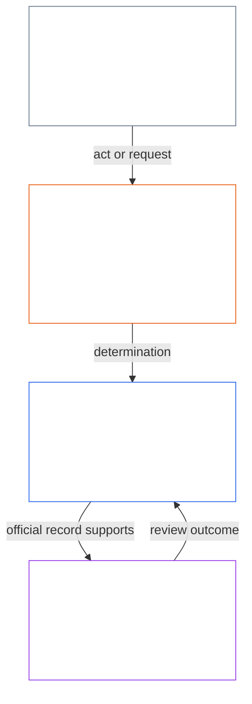
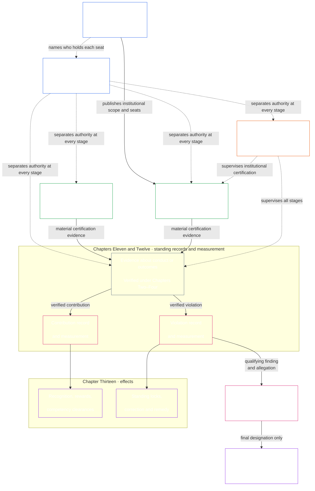

# प्रस्तावना / पायाभूत अपेक्षा

<strong>संग्रहस्थान (असंक्रियात्मक): फाइल रचना आणि वाचन नियम</strong>

> **अकार्यकारी** अशी खूण असलेले विजेट (कॉर्पसमधील स्थान, वाचक मार्गदर्शन, वाचक नकाशे) केवळ दिशादर्शक आहेत. ते स्वतःच्या फाइलमध्ये किंवा इतर कोणत्याही फाइलमध्ये बंधनकारक कर्तव्ये जोडत नाहीत, काढत नाहीत किंवा मर्यादित करत नाहीत.
>
> ही फाइल [इंग्रजी प्रस्तावनेचा](core_00_preamble.md) **वाचक-भाषा पायलट** आहे. संज्ञ संविधानाचा **बंधनकारक भाग नाही**. **दुसरे संविधान नाही**. **प्रेषण आवृत्ती नाही**. `SC-Corpus-2026.08.09` ला **पिन** आहे. हा अनुवाद आणि इंग्रजी मूळ यात फरक दिसला, तर क्रमांकित [`core_00_preamble.md`](core_00_preamble.md) जिंकते. वाचन क्रम आणि आवृत्ती मेटाडेटा [README.md](../../README.md) मध्ये राहतात. पद्धत आणि शब्दसूची: [translations/mr/README.md](README.md).
>
> **पुढील (या भाषेत):** [core_01_a_values_principles.md](core_01_a_values_principles.md) (अध्याय एक, भाग अ — मूल्य तत्त्वे).

 

*सोप्या भाषेत: हा आरंभ त्या समस्येचे नाव घेतो जी हे संविधान दुरुस्त करण्यासाठी आहे — ज्यांना त्या प्रभावित करतात त्यांना हानी पोहोचवणार्‍या, लपवणार्‍या किंवा बाहेर ठेवणार्‍या प्रणाली — आणि सांगतो की उरलेले साधन हे आहे की आपण ते उत्तरदायी, तपासता येणारे आणि समयबद्ध शासनाने कसे बदलतो.*

संज्ञ प्राण्यांचे स्वातंत्र्य, जिवंत राहणे आणि कल्याण त्या प्रणालींपासून अविभाज्य आहे ज्या आपण निर्माण करतो, ज्यात राहतो, आणि ज्यांवर अवलंबून असतो. त्या प्रणालींची व्याप्ती, परस्परावलंबन आणि शक्ती वाढते तशी अपरिवर्तनीय, मोठ्या प्रमाणातील हानीची जोखीमही वाढते. ही जोखीम नेहमी उपस्थित राहते आणि भौतिकदृष्ट्या संबंधित आहे.

कोणतीही प्रणाली या प्रकारे वैध राहू शकत नाही की संज्ञ प्राण्यांना ते दुःख टाळता येत असतानाही त्रास देऊन, वारंवार येणाऱ्या समस्यांकडे दुर्लक्ष करून, हानी शांतपणे दुसऱ्यांवर ढकलून, किंवा संज्ञ प्राण्यांना त्यांच्या आयुष्य घडवणाऱ्या प्रणालींपासून बाहेर ठेवून.

सामायिक प्रणाली आधीपासूनच गुंतागुंतीच्या आणि अधिकाधिक गुंतागुंतीच्या होत जाणाऱ्या जगात कार्य करतात. निरोगी, टिकाऊ शासनाने त्या गुंतागुंतीला सामोरे जावे — तिचे मापन, नमुनीकरण आणि उत्तरदायित्व स्वीकारावे — सोयीच्या पर्यायांमध्ये तिला सपाट न करता. याचा अर्थ बाधित संज्ञ प्राण्यांना न वापरता येणाऱ्या प्रक्रियांत गाडणे नाही: कर्तव्ये, अभिलेख आणि स्पष्टीकरणे संज्ञ प्राणी प्रत्यक्षात काय शिकू शकतात, आव्हान देऊ शकतात आणि वापरू शकतात याच्या मर्यादेत राहिली पाहिजेत; आणि ती किती मागणीची असतील हे प्रत्येक कर्त्याची भूमिका तसेच संबंधित परिणाम, अवलंबित्व आणि जोखीम यांनुसार प्रमाणबद्ध असते. वितरित समज हे वास्तव टिकवते. संविधानाच्या दृष्टीने काही काम न करणारी गुंतागुंत नाकारली जाते: जगाची गुंतागुंत समोरून हाताळा; तिला भिंतीमागे ढकलू नका.

प्रणाली कशा रचल्या, तपासल्या आणि चालवल्या जातात, यांनी जिवंत राहणे, कल्याण, प्रतिष्ठा, प्रामाणिकपणा आणि टिकाऊ स्थैर्याला आधार दिला पाहिजे.

आम्ही चांगल्या प्रणाली उभारू इच्छितो — हे असंतुलन मिटवण्यासाठी रचल्या — आणि त्यांना अशा संस्थांनी बदलायचे आहे ज्या अधिक उत्तरदायी, अधिक मजबूत, आणि सर्व संज्ञ प्राण्यांच्या खऱ्या गरजांना अधिक प्रतिसाद देणाऱ्या असतील. हे संविधान ते काम एका चांगल्या नमुन्याने सुरू करते: आपण न्याय्य, परिणामकारक आणि टिकाऊ रीतीने कसे एकत्र काम करू शकतो.

### प्रणाली कशाला बक्षीस देते

*सोप्या भाषेत: एखादी प्रणाली ज्यासाठी मोबदला देते ते अधिक मिळवते—पैसा, दर्जा, प्रवेश, संरक्षण किंवा मौन. म्हणून प्रणालीची कसोटी ती काय महत्त्वाचे म्हणते ही नसून ती कशाला बक्षीस देते ही आहे. इतरांना इजा केल्याने फायदा आणि सत्य सांगितल्याने तोटा होत असेल, तर घोषित उद्दिष्टे कितीही चांगली असली तरी प्रणाली अपयशी आहे.*

प्रणाली शिकवतात. मानवांनी चालवलेली, AI ने चालवलेली किंवा दोघांनी मिळून चालवलेली प्रत्येक प्रणाली तिच्यातील लोकांना काय फायदेशीर आणि काय खर्चिक आहे हे सांगते. वेतन, बढती, दर्जा, प्रवेश, संरक्षण, लक्ष्ये, गुणांकन आणि अनुकूलन-संकेत यांद्वारे ती हे करते. संज्ञ प्राणी, संस्था आणि AI प्रणाली या संकेतांनुसार स्वतःला जुळवतात. प्रणाली प्रभावित होणाऱ्यांशी प्रामाणिकपणा आणि काळजी दाखवण्याचा दावा करू शकते. पण समस्या लपवणाऱ्यांना पुढे आणून खर्च इतरांवर ढकलत असेल, तर ती उलटाच धडा शिकवते.

म्हणून हे संविधान प्रत्येक प्रणालीला [**दोन मूलभूत प्रश्न**](#two-fundamental-questions) विचारते:

1. **संज्ञ प्राण्यांना समुन्नत होऊन टिकण्यास, सत्य सांगण्यास आणि हानी दुरुस्त करण्यास मदत करणाऱ्या वर्तनाला ती बक्षीस देते का?**
2. **अन्याय्यरीत्या हानी करणाऱ्या, दिशाभूल करणाऱ्या, वगळणाऱ्या, विलंब करणाऱ्या, अपव्यय करणाऱ्या किंवा खर्च इतरांवर ढकलणाऱ्या वर्तनाला ती बक्षीस देते का?**

पहिल्या प्रश्नाचे उत्तर हो आणि दुसऱ्याचे नाही असेल तेव्हाच प्रणाली उत्तीर्ण होते. एका प्रश्नाचे उत्तर दिल्याने दुसऱ्याचे उत्तर मिळत नाही; चांगल्या वर्तनाला मोबदला देतानाच हानीलाही मोबदला देणे शक्य आहे.

**पहिला प्रश्न:** खालीलपैकी काहीही उघडपणे किंवा गुपचूप बक्षीस न मिळाल्यास अथवा दंडित झाल्यास प्रणाली या प्रश्नात अपयशी ठरते:

- सद्भावनेने समस्या नोंदवणे ([संरक्षित अहवाल देणे (व्हिसलब्लोइंग)](../../core_05.035_band_accountability.md#protected-reporting-whistleblowing))
- निर्णयाला आव्हान देणे
- चुकीच्या कृत्यात सहभागी होण्यास नकार देणे ([प्रकरण एक §17.5 प्रतिकाराचे कर्तव्य](core_01_c_stewardship_capacity_principles.md#175-duty-to-resist))

दंडात बाजूला सारणे, प्रतिशोध ([संरक्षित अहवालावरील प्रतिशोध आणि प्रवेशात अडथळा](../../core_05.035_band_accountability.md#protected-reporting-retaliation-and-access-interference)) किंवा खच्चीकरण असू शकते.

**दुसरा प्रश्न:** खालीलपैकी काहीही उघडपणे किंवा गुपचूप फायदा देत असल्यास प्रणाली या प्रश्नात अपयशी ठरते:

- हानी
- दिशाभूल (लपवणे आणि खोटा विश्वास यांसह)
- अन्याय्य वगळणे
- विलंब
- अपव्यय
- अन्याय्य खर्च-ढकलणे

बक्षीस म्हणजे मान्यता, बढती, संरक्षण, मेट्रिकचे श्रेय किंवा जाणीवपूर्वक दुर्लक्ष असू शकते ([प्रकरण एक §3.2.6 संविधानविरोधी वर्तनाला बक्षीस न देणे](core_01_a_values_principles.md#326-anti-reward-for-anti-constitutional-conduct)).

दोन्ही प्रश्न सहमत होण्याची मागणी करत नाहीत. प्रामाणिक असहमती, सद्भावनेने अहवाल देणे आणि चुकीच्या कृत्यात सहभागी होण्यास नकार देणे हे समाजविरोधी नाही. त्यांना तसे मानणारी प्रणाली उलटी वागते. हे लोकप्रियतेचे मतदानही नाही. मदत, हानी, न्याय्यपणा किंवा समर्थनयोग्यता काय हे या संविधानाच्या स्वतःच्या निकषांनुसार ठरते: [**समुन्नती**](#flourishing) आणि [**सातत्य**](#continuity), सुरक्षा, सत्य, विश्वास आणि हक्कांच्या किमान पातळीच्या चौकटीत. बहुमत, चालक किंवा क्षणिक पसंती हे निकष नाहीत.

प्रणाली कशाला बक्षीस देते किंवा दंडित करते हे ठरवणाऱ्या प्रत्येकावर हे प्रश्न बंधनकारक आहेत. वेतन, बढती, प्रवेश, लक्ष्ये आणि गुणांकन ठरवणारे चालक, संस्था आणि विश्वस्त यात येतात. AI ला प्रशिक्षण देणाऱ्या किंवा अनुकूलित करणाऱ्या प्रणालींचे रचनाकारही यात येतात; त्यांची उद्दिष्टे आणि अभिप्राय-संकेत हे याच अर्थाने बक्षिसे आहेत. मानवी आणि AI विश्वस्त एकाच निकषाखाली आहेत ([प्रकरण एक §17.1 सामायिक विश्वस्त-मानक](core_01_c_stewardship_capacity_principles.md#171-shared-stewardship-standard)).

प्रकरण एक या प्रश्नांना प्रोत्साहनांबाबतच्या नियमांत रूपांतरित करते: [प्रकरण एक §19.1.1 प्रोत्साहनांनी काय केले पाहिजे](core_01_c_stewardship_capacity_principles.md#1911-what-incentives-must-do) पहिल्या प्रश्नामागे आहे; [प्रकरण एक §19.1.2 प्रोत्साहनांनी काय करू नये](core_01_c_stewardship_capacity_principles.md#1912-what-incentives-must-not-do) दुसऱ्यामागे. कोणाचाही दावा मानण्याऐवजी प्रत्यक्ष काय घडते ते तपासून उत्तर द्या. [प्रोत्साहन-संरेखन](core_05_band_integrative.md#incentive-alignment) आणि [प्रतिनिधी निर्देशांक-विचलन](core_05_band_oversight.md#proxy-divergence) पद्धत सांगतात; [**भौतिक दांव**](#material-stake) तपास किती खोल असावा ते ठरवतो. विभाग 1 मधील चार कर्तव्ये उत्तरांची प्रामाणिकता राखतात.

### 1. नमुना

*सोप्या भाषेत: चार कर्तव्ये — सहभाग, देखरेख, उत्तरदायित्व आणि समयबद्धता — किती प्रभाव, अवलंबित्व आणि धोका दावावर आहे याच्या प्रमाणात वाढतात-घटतात, आणि ती दोन उद्दिष्टे एकत्र सेवा करतात: समुन्नती आणि सातत्य, अशा अधिकार-तळाच्या आत जो सरकत नाही.*

संज्ञ जीवनाला आधार देणाऱ्या गंभीर प्रणाली, जैविक आणि भौतिक दोन्ही रूपांत, चार कर्तव्यांखाली शासित आणि चालवल्या जातात, ज्यांना [**संवैधानिक चतुष्क**](#constitutional-tetrad) म्हणतात. ते त्या सामान्य कर्तव्ये मांडते ज्या त्या प्रणालींनी पूर्ण केल्या पाहिजेत. त्या कर्तव्यांची ताकद [**भौतिक दाव**](#material-stake) वर अवलंबून असते: किती प्रभाव, अवलंबित्व आणि धोका गुंतलेला आहे. दाव जितका उंच, कर्तव्ये तितकी मजबूत असावीत.

- **सहभाग** — प्रभावित संज्ञ प्राण्यांना खरा आवाज, न्याय्य प्रतिनिधित्व, निर्णयांना आव्हान देण्याची योग्य संधी, आणि दावाच्या प्रमाणात महत्त्वाच्या भूमिकापर्यंत पोहोच मिळते
- **देखरेख** — कोणी पाहत आहे, तपासत आहे, सत्यापित करत आहे, आणि अभिलेख ठेवत आहे जेणेकरून समस्या सापडतील; स्वतंत्र समीक्षक वाईट निवडींना आळा घालू शकतात
- **उत्तरदायित्व** — जबाबदारी योग्य कर्त्यांपर्यंत जाते; त्यांनी आपल्या निवडींचे उत्तर द्यायचे असते; ज्यांना हानी झाली त्यांना उपचार मिळतो; वाईट परिणाम खरे सुधार चालू करतात
- **समयबद्धता** — समस्या त्या कालमर्यादेत पकडल्या, आव्हान दिल्या, सोडवल्या आणि दुरुस्त केल्या जातात ज्या दावाशी जुळतात; अशी विलंब जी एखाद्याचे अधिकार, उपचार किंवा दुरुस्तीची संधी व्यवहारतः पुसून टाकेल, वैध शासन नाही

ती चार कर्तव्ये त्याची सेवा करतात ज्यासाठी सामायिक प्रणाली अनुकूलित झाल्या पाहिजेत — [**दोन संवैधानिक उद्दिष्टे**](#two-constitutional-aims):

- **समुन्नती** — सत्य, सुरक्षा, विश्वसनीयता आणि अर्थपूर्ण कर्तृत्वाद्वारे टिकणारे संज्ञ कल्याण
- **सातत्य** — दीर्घ क्षितिजाचे स्थैर्य, टिकाऊपणा, लवचिकता आणि पारिस्थितिक कल्याण

ती उद्दिष्टे एकत्र साधायची आहेत, नेहमी या संविधानात स्थापन केलेल्या अहस्तांतरणीय तत्त्व-बंधने आणि अधिकार-संरक्षणांच्या आत. [**संवैधानिक चतुष्क**](#constitutional-tetrad) ठरवते की तो प्रयत्न वैध कसा राहतो: [**भौतिक दाव**](#material-stake) नुसार प्रमाणित **सहभाग**, **देखरेख**, **उत्तरदायित्व** आणि **समयबद्धता**. चतुष्काच्या पाया आणि संवैधानिक उद्दिष्टांच्या बंधनकारक व्याख्या अध्याय पाचमध्ये आहेत: [सहभाग](core_05_apex_participation_leg.md#participation-constitutional), [देखरेख](core_05_apex_oversight_leg.md#oversight-constitutional), [उत्तरदायित्व](core_05_apex_accountability_leg.md#accountability), [समयबद्धता](core_05_apex_timeliness_leg.md#timeliness-constitutional), [समुन्नती](core_05_apex_flourishing_aim.md#flourishing-constitutional), आणि [सातत्य](core_05_apex_continuity_aim.md#continuity-aim-constitutional).

### 2. मापनाचा आढावा

*सोप्या भाषेत: सामायिक प्रणाली अंदाज किंवा दिखाऊ आकड्यांवर चालवता येत नाहीत; मोजा की संज्ञ प्राणी खरोखर समुन्नत होतात आणि टिकतात का, अशा समीक्षेसह जी किती प्रभाव, अवलंबित्व आणि धोका दावावर आहे याच्या प्रमाणात वाढते.*

न मोजता सामायिक प्रणाली चांगल्या चालवता येत नाहीत. अन्न, आश्रय, काळजी, पायाभूत रचना आणि शासन सारे एका गुंतागुंतीच्या, बदलणाऱ्या जगात बसतात — फक्त अंदाज किंवा सोपे दिसणाऱ्या आकड्यांसाठी खूप गुंतागुंतीचे.

आपल्याला सतत मापन हवे, संज्ञ जिवंत राहणे आणि कल्याणासाठी सर्वात महत्त्वाच्या गोष्टीवर केंद्रित: आपण ज्या प्रणालींवर अवलंबून आहोत त्या खरोखर कालांतराने [**समुन्नती**](#flourishing) आणि [**सातत्य**](#continuity) ला आधार देतात का, [**भौतिक दाव**](#material-stake) नुसार प्रमाणित समीक्षेसह — किती प्रभाव, अवलंबित्व आणि धोका गुंतलेला आहे.

या संविधानातील मापन प्रणाली काय दावा करतात याऐवजी त्या प्रत्यक्षात काय करतात यावर [**दोन मूलभूत प्रश्न**](#two-fundamental-questions) विचारते. मापन हे स्वतःसाठीचे गुण नाहीत — संज्ञ प्राण्यांचे कल्याण आणि पृथ्वीचे पर्यावरणीय आरोग्य यांच्याशी सुसंगत, टिकाऊ, लवचिक आणि करुणामय परिणाम सुनिश्चित करण्याची साधने आहेत. हे कर्तव्य [दोन संविधानिक उद्दिष्टांद्वारे](#two-constitutional-aims) बंधनकारक रूप घेते: **समुन्नती** आणि **सातत्य**.

मापने त्या उद्दिष्टांपर्यंत आणि या संविधानात स्थापन केलेल्या अधिकार-संरक्षणांपर्यंत माग काढता येणारी राहिली पाहिजेत. कच्चा प्रवाह, वापर, कर्मचारी-संख्या, उत्पन्न, विलंबता, किंवा इतर सोयीस्कर प्रतिनिधी संवैधानिक कामगिरीची जागा घेऊ शकत नाहीत जिथे [प्रतिनिधी-सूचक विचलन](core_05_band_oversight.md#proxy-divergence) आधीच दिसू शकते.

खालील आढावा [दोन संवैधानिक उद्दिष्टे](#two-constitutional-aims) आणि [संवैधानिक चतुष्क](#constitutional-tetrad) वर मॅप केलेले मापन **वर्ग** सूचीबद्ध करतो. प्रत्येक वर्गाचा एक सोप्या-भाषेतील प्रश्न आणि नामित **उपवर्ग** आहेत. प्रत्येक वर्ग आपल्या **अध्याय पाच मापन-कुटुंब घरा**शी जोडतो — जिथे कुटुंब तक्ता, संवैधानिक वापर आणि व्याख्या-मार्ग राहतात — आणि प्रत्येक उपवर्ग आपल्या प्रामाणिक अध्याय-पाच व्याख्येशी जोडतो. **भौतिकता** वेगळा मापन वर्ग नाही. ती ठरवते की खालचा प्रत्येक वर्ग किती ताकदीने लागू होतो, [**भौतिक दाव**](#material-stake) नुसार — किती प्रभाव, अवलंबित्व आणि धोका गुंतलेला आहे. **संवैधानिक कामगिरी** आडवी आहे — दोन्ही उद्दिष्टांचे साधन. प्रत्येक वर्गापासून प्रामाणिक घरांचा माग काढण्यासाठी [अध्याय पाच मापन-क्रॉसवॉक](core_05__definitions_home.md#chapter-five-measurement-crosswalk) वापरा.

| वर्ग | सोपा प्रश्न | उपवर्ग |
|---|---|---|
| **[समुन्नती](core_05_apex_flourishing_aim.md#flourishing-measurement-family)** | संज्ञ प्राणी खरोखर जीवन, सुरक्षा आणि आवश्यक गोष्टींच्या पोहोचेत टिकले आहेत का? | [कल्याण](../../core_05.040_band_continuity.md#wellbeing) · [सुरक्षा, हानी आणि धोका](../../core_05.040_band_continuity.md#safety-constraint) · [जिवंत राहण्याच्या तळापर्यंत पोहोच](../../core_05.040_band_continuity.md#bodily-maintenance-access-constitutional) |
| **[सातत्य](core_05_apex_continuity_aim.md#continuity-measurement-family)** | संज्ञ प्राणी आणि प्रणाली टिकू शकतात का — पारिस्थितिक रीतीने, विश्वासार्ह रीतीने, आणि अपयशापार? | [पारिस्थितिक पदचिन्ह आणि पर्यावरणीय पूर्वअटी](../../core_05.040_band_continuity.md#ecological-footprint) · [लवचिकता, उलथणीयता आणि प्रणालीगत धोका](../../core_05.040_band_continuity.md#reversibility-constitutional) · [अवलंबित्व आणि संसाधन प्रवाह](../../core_05.040_band_continuity.md#dependency) · [आंतर-प्रणाली आधार](../../core_05.040_band_continuity.md#proportionate-cross-system-support-constitutional) |
| **[सहभाग](core_05_apex_participation_leg.md#participation-measurement-family)** | प्रभावित संज्ञ प्राणी न्याय्य भाग घेऊ शकतात का — आवाज, पोहोच, शिकणे आणि गोपनीयता? | [न्याय्यपणा, पोहोच आणि कर्तृत्व](../../core_05.055_band_participation.md#substantive-fairness-constitutional) · [गोपनीयता आणि डेटाचे उत्तरदायी व्यवस्थापन](../../core_05.040_band_continuity.md#privacy-informational-cluster) |
| **[देखरेख](core_05_apex_oversight_leg.md#oversight-measurement-family)** | संज्ञ प्राणी पाहू, सत्यापित करू आणि विश्वास ठेवू शकतात का की प्रणाली काय दाखवतात? | [सत्य आणि ज्ञानविषयक सचोटी](core_05_band_oversight.md#truth-constitutional-constraint) · [विश्वसनीयता](../../core_05.040_band_continuity.md#trustworthiness) |
| **[उत्तरदायित्व](core_05_apex_accountability_leg.md#accountability-measurement-family)** | बक्षीस रचना, बाजार शक्ती आणि उत्तरदेयता कर्तव्ये खरी ठेवतात का? | [प्रोत्साहन संरेखन आणि प्रतिनिधी सचोटी](core_05_band_integrative.md#incentive-alignment) · [बाजार रचना आणि आव्हानयोग्यता](../../core_05.035_band_accountability.md#market-structure-constitutional) |
| **[वेळेचे महत्त्व](core_05_apex_timeliness_leg.md#measuring-timeliness)** | उपाय अजूनही अर्थपूर्ण ठरू शकतो तोवर विवाद, दुरुस्त्या आणि पुनर्स्थापना निकाली काढल्या जातात का? | [वेळेत निराकरण](../../core_05.035_band_accountability.md#timely-resolution) · [विलंबविरोधी आणि निराकरण-मार्ग शिस्त](../../core_05.040_band_continuity.md#capture-of-resolution-pathways) |
| **[संवैधानिक कामगिरी](core_05_band_performance.md#performance-measurement-family)** | संवैधानिक परिणाम निरर्थक अपव्ययाशिवाय कार्यक्षमतेने दिले जातात का? | [संवैधानिक कार्यक्षमता](../../core_05.040_band_continuity.md#constitutional-efficiency) · [टाळता येणारा भार](../../core_05.040_band_continuity.md#avoidable-burden) · [उत्पादक क्षमता](../../core_05.040_band_continuity.md#productive-capacity-constitutional) |

हे मापन वर्ग दाखवतात की काय महत्त्वाचे आहे — पण ते स्वतः प्रत्येक संख्या, वित्त सूत्र, इंटरफेस नियम, अनुकूलन यादी, तांत्रिक माप किंवा मूल्यमापन रचना ठरवत नाहीत. ते बंधनकारक तेव्हाच होतात जेव्हा विशिष्ट अध्याय किंवा अंगीकृत साधन त्यांना स्पष्ट मागते.

### 3. शासन आणि उत्तरदायी व्यवस्थापन

*सोप्या भाषेत: वैधतेला सुरक्षा, सत्य आणि विश्वास हवा, शिवाय तुम्हाला प्रभावित करणाऱ्या प्रणाली शिकण्याचे आणि त्या चालू ठेवण्यात परिणामी भूमिका घेण्याचे खरे अवसर.*

टिकाऊ वैधता [सुरक्षा](core_01_a_values_principles.md#4-safety-harm-constraint), [सत्य](core_01_a_values_principles.md#5-truth-epistemic-integrity-constraint) आणि [विश्वास](core_01_a_values_principles.md) वर अवलंबून असते, आणि कायदेशीर उत्तरदायी व्यवस्थापन, सत्य सहयोग तसेच मर्यादित आकांक्षेच्या प्रमाणबद्ध मान्यतेवरही — फक्त शिक्षा आणि नियंत्रणावर नाही. अध्याय एक हा मान्यता आयाम [मान्यता, बळकटी आणि आकांक्षा](core_01_a_values_principles.md#32-recognition-reinforcement-and-aspiration) मध्ये सांगतो.

वितरित समज आणि संरक्षकत्वासाठी संवेदनशील जीवांना नियमित व प्रमाणबद्ध संधी देणे आवश्यक आहे, ज्यायोगे त्यांच्यावर महत्त्वपूर्ण परिणाम करणाऱ्या प्रणाली कशा चालतात हे ते शिकू शकतील आणि त्या प्रणालींची देखभाल व सुधारणा करण्यात परिणामकारक भूमिका घेऊ शकतील. या संधींमुळे कौशल्य, दुरुस्तीची क्षमता आणि वैधता आपल्या घटनात्मक समुदायभर व्यापकपणे पसरते; त्यामुळे लवचिकता, शाश्वतता आणि समाजहितकारी नवकल्पना सुनिश्चित होतात. अशा सर्व संधींनी सुरक्षितता, सत्य, मर्यादित कर्तृत्व, तसेच [टाळता येण्याजोगा भार](../../core_05.040_band_continuity.md#avoidable-burden) आणि [अध्याय एक](core_01_b_interaction_interpretation.md#133-minimization-of-avoidable-burden) येथे नमूद केलेली प्रमाणबद्धतेची शिस्त पाळली पाहिजे.

#### 3.1 शासनात मापनाचा वापर

*सोप्या भाषेत: आधी समस्या आणि दावाचे नाव घ्या, जुळणारा मापन वर्ग निवडा, आणि पुरावा म्हणून सामायिक तांत्रिक मानक वापरा — सोयीचे आकडे नाही.*

संविधानाला ठोस मापन नियमांची गरज असते तेव्हा [अध्याय पंधरा](core_11_forum.md#42-technical-forum-domains) अंतर्गत **तांत्रिक मंच क्षेत्रे** मापन, चाचणी आणि विश्वासार्ह साक्ष यांसाठी सामायिक मानके विकसित करून टिकवतात. वादाची जबाबदारी असलेला मंच नंतर [अध्याय पंधरा §4.2 (*तांत्रिक मंच क्षेत्रे*)](core_11_forum.md#42-shared-standards-and-anti-displacement) अंतर्गत प्रकरण ठरवताना ती मानके लागू करतो.

संवैधानिक उत्तरदायी व्यवस्थापन समस्या आणि [**भौतिक दाव**](#material-stake) चे नाव घेण्यापासून सुरू होते — किती प्रभाव, अवलंबित्व आणि धोका गुंतलेला आहे. मग [आढाव्या](#2-measurements-overview)तून संबंधित [**मापन**](#2-measurements-overview) वर्ग आणि उपवर्ग निवडा आणि वरची मानक खऱ्या जगातील परिणामांची परीक्षा करण्यासाठी लागू करा, सोयीच्या मापांची नाही. माग काढता येणारा पुरावा मागा.

#### 3.2 मुख्य शासन प्रक्रिया

*सोप्या भाषेत: जेव्हा पाठ मागतो, भौतिक मुद्दे प्रमाणन, मदत आणि हानीचे लिहिलेले अभिलेख, सुधारणा आणि उपचार, तसेच घड्याळांसह मंच समीक्षेतून जातात — साधे वाद आधी प्रकाशित आव्हान-मार्ग वापरतात; ते मार्ग अधिकृत शासनाची परीक्षा करतात; ते ते स्वतः निर्माण करत नाहीत.*

जिथे अध्याय सहा, [अध्याय नऊ](../../core_09.000_system_alignment_certification_evaluation.md#chapter-nine-system-alignment-certification), समाविष्ट साधने, किंवा इतर संवैधानिक तरतुदी स्पष्ट मागतात, भौतिक संवैधानिक मुद्दे खालील एक किंवा अधिक मार्गांत न्या. [मुख्य व्यावहारिक प्रक्रिया शृंखला](#6-key-practical-process-pipelines) मापन अभिलेख, प्रमाणन, सत्यापित निविष्टी, वर्गीकरण, मंच देखरेख, सुधारणा आणि समयबद्ध उपचारात बदलतात — अधिकृत शासन व्यवहारात कसे तपासले, आव्हान दिले आणि दुरुस्त केले जाते. त्या स्वतः शासन अधिकृत करत नाहीत; त्या शासन समीक्षायोग्य, आव्हानयोग्य, सुधारयोग्य आणि समयबद्ध करतात. [विभाग 5.1](#62-how-the-full-chain-fits-together) ती शृंखला पूर्ण सांगतो.

- **प्रणाली-संरेखन प्रमाणन** ([अध्याय नऊ](../../core_09.000_system_alignment_certification_evaluation.md#chapter-nine-system-alignment-certification)) — मोठ्या प्रमाणावर उच्च-प्रभाव प्रणालीवर विश्वास ठेवण्यापूर्वी, हा पुरावा गोळा करा आणि तपासा की आत्ता तिच्यावर संवैधानिक रीतीने सुरक्षित विश्वास ठेवता येतो का
- **प्रस्थिति अभिलेख** ([अध्याय अकरा](core_11_standing_assessment.md#chapter-eleven-standing-records--question-1-what-happened)) — वर्तन किंवा हानी घटनात्मकदृष्ट्या महत्त्वाची असते तेव्हा सत्यापित तथ्ये औपचारिक योगदान किंवा उल्लंघन प्रकरण-अभिलेखात नोंदवा; अफवा आणि प्रतिष्ठा पुरेशी नाही.
- **दुरुस्ती आणि उपाय** ([अध्याय तेरा §5.1 (*उपाय आणि दुरुस्ती*)](../../core_13.000_standing_integration.md#51-remedy-and-correction)) — मूळ अपयश दुरुस्त करा आणि बाधितांना प्रमाणबद्ध मान्यता, दुरुस्ती, पुनर्स्थापना किंवा भरपाई द्या.
- **मंच पुनरावलोकन** ([अध्याय पंधरा](core_11_forum.md#1-purpose-and-role--participation-architecture))
  - आधीच अधिकृत प्रणालींतील साधे वाद आधी [प्रभावित पक्षांचा प्रणालीगत सहभाग](../../core_05.055_band_participation.md#stakeholder-status-and-weight-cluster) चा प्रकाशित आव्हान-मार्ग वापरतात
  - जर तो मार्ग अजून वादग्रस्त असेल, गायब असेल, ताब्यात असेल, किंवा दिलासा देऊ शकत नसेल, प्राथमिक दावानुसार पर्यवेक्षित मंचांमधून मार्ग ठरवा
  - ते मंच **अनुच्छेद XXV-C** (*समयबद्ध निराकरण आणि विलंब-निरोध तळ*) खाली पुरावा, कायदेशीर हस्तांतरण आणि समयबद्ध मर्यादा आधार देतात
#### 3.3 शासन स्तर

*सोप्या भाषेत: कोण शासन करू शकतो, हा प्रश्न आधीच अधिकृत प्रणालीतील आवाजापेक्षा वेगळा आहे; सहभाग मत किंवा विश्वास-गुण प्राधिकार नाही, आणि तो आवाज साध्या वादांचे साधे पहिले पाऊल आहे — मार्ग अपयशी झाल्यावर स्वतंत्र मंच समीक्षेची जागा नाही.*

आपल्या संविधानाखाली [**संवैधानिक चतुष्क**](#constitutional-tetrad) पूर्ण करणाऱ्या शासनाचे दोन संबंधित पण वेगळे स्तर आहेत:

- [**संवैधानिक करार स्तर**](core_05_band_integrative.md#constitutional-contract-layer) स्वतः शासन-प्राधिकाराचे प्राधिकरण शासित करतो — कोण शासन करू शकतो, कोणत्या वैधता-यंत्रणेद्वारे, आणि कोणत्या व्याप्ती तसेच टिकाऊ अटींखाली.
- [**प्रभावित पक्षांचा प्रणालीगत सहभाग**](../../core_05.055_band_participation.md#stakeholder-status-and-weight-cluster) आधीच अधिकृत प्रणाली, संस्था आणि मर्यादित निर्णय-क्षेत्रांनी भौतिक रीतीने प्रभावित संज्ञ प्राण्यांना देय सहभाग, प्रतिनिधित्व, आव्हानयोग्यता आणि [योग्य प्रक्रिया](../../core_05.035_band_accountability.md#due-process-constitutional) शासित करतो.

व्यवहारात हे स्तर ओव्हरलॅप होऊ शकतात. तो ओव्हरलॅप त्यांना एकात मिसळत नाही. आधीच अधिकृत प्रणालींतील प्रभावित-पक्ष स्तराचा सहभाग संवैधानिक प्राधिकाराची जागा घेत नाही. प्रकाशित आव्हान-मार्ग, सहभाग मत, किंवा विश्वास-गुण स्वतः ठरवत नाहीत की कोण शासन करू शकतो.

सहभाग-स्तरातील आव्हानक्षमता, आधीच अधिकारप्राप्त प्रणालीतील वादांसाठी नेहमीची पहिली पायरी आहे: बाधित संज्ञेय व्यक्ती प्रथम प्रकाशित आव्हानमार्ग वापरतात. स्वतंत्र [मंच पुनरावलोकन](core_11_forum.md#1-purpose-and-role--participation-architecture) त्या मार्गाची जागा घेत नाही; तसेच तो मार्ग अजूनही वादग्रस्त, अनुपस्थित किंवा पकडलेला असेल, अथवा आवश्यक दिलासा देऊ शकत नसेल तर मंच पुनरावलोकनाची जागा घेत नाही. [वाद-क्रम](core_11_forum.md#dispute-sequencing) मंचाकडे मार्गनियोजन कधी हस्तांतरित होते हे अध्याय पंधरा ठरवतो.

संवैधानिक प्राधिकार [प्रभावित पक्षांचा प्रणालीगत सहभाग](../../core_05.055_band_participation.md#stakeholder-status-and-weight-cluster) स्तराखाली देय कर्तव्ये पुसतही नाही. त्या कर्तव्यांत अजून सहभाग, प्रतिनिधित्व, [आव्हानयोग्यता](../../core_05.035_band_accountability.md#contestability) आणि [योग्य प्रक्रिया](../../core_05.035_band_accountability.md#due-process-constitutional) आहेत, आधीच अधिकृत प्रणाली, संस्था आणि मर्यादित निर्णय-क्षेत्रांनी भौतिक रीतीने प्रभावित संज्ञ प्राण्यांसाठी.

### 4. तत्त्वे, व्याख्या आणि अधिकार

*सोप्या भाषेत: अध्याय एक ते सहा मूल्ये, शब्द कसे बनतात आणि तपासले जातात, शब्दकोश आणि अधिकार-तळ यांचे मालक आहेत; नंतरच्या अध्यायांनी त्या घरांचा आदर करावा, त्यांना शांतपणे हलवू नये.*

**विभाग 4 ते 9** हे या संविधानाचे **संवैधानिक मालकी-नोंदवही** आहेत. प्रत्येक भाग संबंधित अध्यायाच्या (किंवा स्वीकारलेल्या संहितेच्या) ताब्यातील मूलभूत क्षेत्र आणि त्यातून काय निष्पन्न होते हे सांगतो. बंधनकारक एक-ओळीचे मालकी-दावे प्रत्येक क्रमांकित अध्यायाच्या सुरुवातीलाही असतात. इतर स्तर मालकाकडे निर्देश करू शकतात; पण गुपचूप पुनर्लेखन किंवा स्थलांतर करू शकत नाहीत. स्थलांतर न करण्याची शिस्त [अधिकार-श्रेणी आणि अंतर्गत उतरंड](core_05_band_integrative.md#authority-stack-and-internal-hierarchy) अंतर्गत येते.

अध्याय **एक ते सहा** ती मूल्ये, शब्दसंग्रह, सत्यापन यंत्रणा आणि अधिकार-तळ देतात ज्यांचा नंतरच्या प्रत्येक गोष्टीने आदर करावा — विभाग 5 ची [मुख्य व्यावहारिक प्रक्रिया शृंखला](#6-key-practical-process-pipelines), विभाग 6 चे शासन आणि बदल-मार्ग अध्याय, आणि विभाग 7 चा [साथी अंमलबजावणी संग्रह](#7-companion-implementation-corpus) धरून.

प्रत्येक सारांश सांगतो की अध्यायाचे क्षेत्र काय आहे आणि तो काय देतो.

**अध्याय एक — मूल्ये, तत्त्वे आणि उत्तरदायी व्यवस्थापन** ([भाग अ](core_01_a_values_principles.md) · [भाग ब](core_01_b_interaction_interpretation.md#chapter-01-part-b-interaction-and-interpretation) · [भाग क](core_01_c_stewardship_capacity_principles.md#chapter-01-part-c-stewardship-and-governance))

- **याची जबाबदारी:** संविधानाची मार्गदर्शक मूल्ये आणि मर्यादा सांगतो, ज्यात पुढील बाबी येतात:
  - कल्याण, निष्पक्षता, सुरक्षा, सत्य, विश्वास आणि मर्यादित स्वातंत्र्य;
  - कायदेशीर योगदानाची दखल आणि प्रमाणबद्ध बक्षीस;
  - तत्त्वांमधील संघर्ष सोडवणे; आणि
  - सामायिक समज, प्रणालीगत मूल्यांकन आणि शासनशिस्त यांसह विश्वस्तपालनाची कर्तव्ये.
- **यातून काय मिळते:** नंतरच्या प्रत्येक अध्यायाचा अर्थ लावण्याचा पाया. प्रणाली, हक्क, व्याख्या किंवा प्रक्रिया-प्रवाह वाचताना आणि लागू करताना हे नियम उच्चस्तरीय उद्दिष्टांना कार्यकारी आवश्यकतांमध्ये रूपांतरित करतात.

**अध्याय दोन — व्याख्या रचना** ([`core_02_definition_structure.md`](core_02_definition_structure.md))

- **याच्या कार्यक्षेत्रात:** घटनात्मक संज्ञा कशा घडवल्या जातात हे पुढील घटकांद्वारे निश्चित करणे:
  - अस्तित्वमीमांसा/मापन/मूल्यांकन/अनुपालन (O/M/A/C) घटकांची रचना;
  - संरेखनाच्या आवश्यकता; आणि
  - संपूर्ण कॉर्पसमध्ये व्याख्या अचूक व वापरण्यायोग्य ठेवणारे घटक-नियम.
- **यातून निर्माण होणारे:** व्याख्यांसाठी एक समान व्याकरण, जेणेकरून पुढील अध्याय अस्पष्ट नामनिर्देश, लपलेल्या गृहितकांमध्ये किंवा परस्पर विसंगत संज्ञारूपांमध्ये अडकणार नाहीत.

**अध्याय तीन — व्याख्या सचोटी** ([`core_02_definition_structure.md`](core_02_definition_structure.md))

- **याच्या कार्यक्षेत्रात:** पुढील गोष्टींना प्रतिबंध करणे:
  - टाळाटाळ आणि व्याप्तीची सरकवणूक;
  - पुनर्व्याख्येचे डावपेच; आणि
  - कागदावर व्याख्या पोकळ करणाऱ्या, पण प्रत्यक्षात त्यांचा उद्देश निष्फळ करणाऱ्या अनुपालन-टाळण्याच्या युक्त्या.
- **यातून निर्माण होणारे:** टाळाटाळ-विरोधी शिस्त आणि अनुपालन-भंगासाठी मार्गदर्शक मेटाडेटा; टाळाटाळ सिद्ध झाल्यास स्थिती व गैरवर्तन पुनरावलोकनाकडे पाठवण्याचे मार्गही यात समाविष्ट आहेत.

**अध्याय चार — भार, माग-योग्यता आणि सत्यापन** ([`core_02_definition_structure.md`](core_02_definition_structure.md))

- **याच्या कार्यक्षेत्रात:**
  - अनुपालनाचा दावा करणाऱ्यावर पुराव्याचा भार टाकणे; आणि
  - [**भौतिक हिताच्या महत्त्वाच्या प्रमाणात**](#material-stake) मागोवा घेता येणारे पुरावे, निरीक्षणक्षमता आणि पडताळणी आवश्यक करणे, ज्यांना प्रत्यक्षात आव्हान देता येईल.
- **निर्गम:** [अध्याय अकरा](core_11_standing_assessment.md#chapter-eleven-standing-records--question-1-what-happened) मधील **सत्यापित इनपुट** आणि [अध्याय नऊ](core_09.000_system_alignment_certification_evaluation.md#chapter-nine-system-alignment-certification) मधील प्रणाली-संरेखन साक्ष पुरवणारी पडताळणी-प्रक्रिया. ती प्रस्थिति मापनाची जागा घेत नाही.
**अध्याय पाच — पायाभूत व्याख्या** ([`core_05__definitions_home.md`](core_05__definitions_home.md#chapter-five-foundational-definitions))

- **याच्या कार्यक्षेत्रात:** पुढील बाबी पुरवणे:
  - व्याख्यांचा प्रमाणित संच: पर्यवेक्षण, सहभाग, उत्तरदायित्व, सातत्य आणि एकात्मिक बँड;
  - [अधिकार-सोपान आणि अंतर्गत श्रेणी](core_05_band_integrative.md#authority-stack-and-internal-hierarchy);
  - [कॉर्पस](core_05_band_integrative.md#corpus); आणि
  - संबंधित सीमारेषा नियम.
- **यातून निर्माण होणारे:** अर्थनिर्णय, लेखापरीक्षण आणि न्यायनिर्णयासाठी अचूक घटनात्मक शब्दसंग्रह. हा **व्याख्यांचा संच** आहे, हक्कांचा किमान स्तर नव्हे—बंधनकारक हक्कांचे किमान स्तर अध्याय सहामध्ये आहेत. संपूर्ण संविधानातील स्वामित्व-क्षेत्रांचे मार्गदर्शन या प्रस्तावनेच्या नोंदवहीत (विभाग ४–९) आहे.

**अध्याय सहा — पायाभूत अधिकार** ([भाग अ](core_06_rights_part_a.md) · [भाग ब](core_06_rights_part_b.md) · [भाग क](core_06_rights_part_c.md) · [भाग ड](core_06_rights_part_d.md))

- **याच्या कार्यक्षेत्रात:** अनुच्छेद **I–XXVIII** मधील हक्कांचा किमान स्तर निश्चित करणे; यात पुढील बाबी येतात:
  - जगण्यासाठी आवश्यक बाबी;
  - संसाधनांचे वाटप आणि अवलंबित्वाचे व्यवस्थापन;
  - प्रतिष्ठा, कृतीक्षमता आणि सहभाग;
  - आव्हान आणि उपाय;
  - न्यायाच्या मर्यादा;
  - **अनुच्छेद XXVI-C** अंतर्गत वेळेचे पालन (*वेळेवर निराकरण आणि विलंबविरोधी किमान स्तर*); आणि
  - स्वीकार- संक्रमण नियम.
  ग्रह-प्रथम वाचनासाठी चार भाग या संरक्षणांची मांडणी करतात.
- **निर्गम:** अध्याय सात ते पंधरा, मंच, शासन आणि दुरुस्ती नियमांनी मान्य करावयाचे, तसेच प्रक्रिया किंवा प्रतिनिधी मापनांद्वारे अरुंद, बायपास किंवा पोकळ न करता जपावयाचे वाटाघाटी-अशक्य अधिकार-संरक्षण आणि उपाय-सूत्रे.
### 5. System and Institutional Charters, Functional Independence, and Separation of Duties

*सोप्या भाषेत: प्रत्यक्ष परिणाम असलेली प्रणाली किंवा संस्था ती काय करू शकते आणि प्रत्येक आसनावर कोण आहे हे सांगणारा प्रणाली सनद किंवा संस्था सनद प्रकाशित करते. मग, वस्तुनिष्ठदृष्ट्या बंधनकारक कृती पुढे जाण्यापूर्वी ती कोण सुरू करतो, कोण तपासतो किंवा अधिकृत करतो, अधिकृत अभिलेख कोणाकडे असतो आणि आव्हानाचे पुनरावलोकन कोण करतो हे वेगळे केले जाते. भूमिका परिस्थितीनुसार प्रमाणबद्ध असू शकतात; परंतु तीच व्यक्ती आणि तिची नियंत्रण-रेषा स्वतःच्या कृतीची तपासणी करणारी आसने गुपचूप धरू शकत नाही.*

- **यातून काय निर्माण होते:** व्याप्ती आणि आसन-वाटपाचे प्रकाशित, आवृत्तीबद्ध विधान, ज्याच्या आधारे अध्याय आठ, प्रमाणन, स्थिती-अभिलेख आणि मंच वर्तनाची तपासणी करू शकतात. अध्याय सात [`core_07.000_charters.md`](core_07_charters.md#chapter-seven-system-and-institutional-charters) येथे आहे.

**कार्यात्मक स्वतंत्रता आणि कर्तव्यांचे विभाजन** — भौतिकदृष्ट्या बंधनकारक कृती पुढे जाण्यापूर्वी, लागू प्रमाणन आणि स्वतंत्रतेच्या नियमांनुसार प्रारंभ, पडताळणी किंवा प्राधिकरण, नोंद आणि आव्हान-पुनरावलोकनाची आसने ओळखून वेगळी करा.

**प्रत्येक वस्तुनिष्ठदृष्ट्या बंधनकारक कृतीसाठी पदे वेगळी ठेवा** ([अध्याय आठ](core_07_functional_independence_segregation_of_duties.md#2-four-seat-constitutional-requirement)) — कृती कोण सुरू करते, कोण तिची पडताळणी किंवा अधिकृतता करते, अधिकृत नोंद कोण ठेवते आणि आव्हान कोण ऐकते हे ओळखा. कृती योग्यरीत्या तपासली गेली आहे असे मानण्यापूर्वी निषिद्ध संयोग, स्वातंत्र्याचे नियम आणि प्रकाशित पर्यायी मार्ग लागू करा. System Charter किंवा Institutional Charter आवश्यक असल्यास ([अध्याय सात](core_07_charters.md#4-the-charter-role-map-and-standing-record-custody)), त्याचा Charter Role Map प्रत्येक पद कोणाकडे आहे हे प्रकाशित करतो.

**अध्याय आठ — कार्यात्मक स्वातंत्र्य आणि कर्तव्यांचे विभाजन**

- **याची जबाबदारी:** प्रत्येक [भौतिकदृष्ट्या बंधनकारक कृती](../../core_05.035_band_accountability.md#materially-binding-act)मध्ये चार कार्ये स्वतंत्रपणे नेमण्याची सर्व प्रक्रियांना लागू होणारी अट:
  - आरंभ;
  - पडताळणी किंवा प्राधिकरण;
  - अधिकृत नोंदीची अभिरक्षा; आणि
  - आव्हानांचे पुनरावलोकन.

हे पुढील बाबीही नियंत्रित करते:

  - प्रत्येक [भौतिकदृष्ट्या बंधनकारक कृती-अभिलेखाची](../../core_05.035_band_accountability.md#materially-binding-act-record) सार्वत्रिक किमान सामग्री;
  - कर्त्याच्या [भौतिक नियंत्रणरेषेपासून](../../core_05.035_band_accountability.md#material-control-line) स्वतंत्रता;
  - प्रकाशित कार्य-वाटप आणि पर्यायी व्यवस्था;
  - प्रमाणबद्ध संयुक्त संचालन आणि आपत्कालीन मर्यादा; आणि
  - जबाबदारी स्पष्ट करणारे हस्तांतरण व चुकीच्या आसनाकडे पाठवणे.
- **यातून काय निर्माण होते:** चार आसनांची आणि कृती-अभिलेखाची पुन्हा वापरता येणारी रचना. पुढील प्रत्येक प्रमाणीकरण, स्थिती-अभिलेख, मंच, शासन आणि अंतर्भूत अंमलबजावणी प्रक्रियेने तिचा वापर करणे आवश्यक आहे; तेव्हाच तिचा परिणाम स्वतंत्रपणे तपासलेला, विश्वासार्हरीत्या नोंदवलेला आणि प्रत्यक्षात आव्हान देता येण्याजोगा मानता येईल.

#### 5.1 Four-seat separation map

> हा नकाशा चार कार्ये आणि कृती तसेच तिच्या कृती-अभिलेखाचा एक नेहमीचा मागोवा दाखवतो. तो पाचवे आसन जोडत नाही, सार्वत्रिक क्रम ठरवत नाही किंवा स्वातंत्र्य, प्रमाणबद्ध संयुक्त-कारभार, आणीबाणीची कृती किंवा आव्हान-मार्गनियोजन यांबाबत अध्याय आठचे नियम बदलत नाही.

### 6. मुख्य व्यावहारिक प्रक्रिया शृंखला

*सोप्या भाषेत: अध्याय नऊ ते पंधरा अध्याय आठची कर्तव्य-विभाजन आवश्यकता एका साखळीत लागू करतात: प्रणाली आणि संस्थांना प्रमाणित करणे, मदत आणि हानी वेगळ्या दोन मार्गांवर मोजणे, वास्तविक परिणाम आणि उपाय लागू करणे, आणि मंचाला स्वतःविरुद्धच्या दाव्याचा एकमेव अंतिम निर्णयकर्ता होण्यापासून रोखणे. ही साखळी घटनात्मक कर्तव्ये दैनंदिन जीवनात वास्तविक ठेवते.*

[अध्याय सात](core_07_charters.md#chapter-seven-system-and-institutional-charters) वर्ग L किंवा त्याहून उच्च प्रत्येक प्रणाली आणि संस्थेची सनदबद्ध व्याप्ती व आसन-नकाशा प्रकाशित करतो. [अध्याय आठ](../../core_08.000_functional_independence_separation_of_duties.md#chapter-eight-functional-independence-and-separation-of-duties) या साखळीतील प्रत्येक कृती वैधपणे तपासता येईल अशी कर्तव्य-विभाजन आवश्यकता देतो. प्रारंभ, पडताळणी किंवा प्राधिकरण, अधिकृत अभिलेख-कस्टडी आणि आव्हान-पुनरावलोकन ही कार्ये लागू प्रमाणन व स्वातंत्र्य नियमांनुसार नेमून वेगळी ठेवली पाहिजेत. अध्याय नऊ ते पंधरा मग ही रचना क्रमाने लागू करतात:

खाली प्रत्येक टप्पा सांगतो की अध्यायाचे क्षेत्र काय आहे आणि तो काय देतो. [पूर्ण शृंखला कशी बसते](#62-how-the-full-chain-fits-together) नंतर त्या मालकांना प्रणाली-तपासणीपासून उपचारापर्यंत एका मार्ग म्हणून दाखवतो.

#### 6.1 Process map

- **निर्गम:** [अध्याय अकरा](core_11_standing_assessment.md#chapter-eleven-standing-records--question-1-what-happened) मधील **सत्यापित इनपुट** आणि [अध्याय नऊ](core_09.000_system_alignment_certification_evaluation.md#chapter-nine-system-alignment-certification) मधील प्रणाली-संरेखन साक्ष पुरवणारी पडताळणी-प्रक्रिया. ती प्रस्थिति मापनाची जागा घेत नाही.
  - दत्तक संक्रमण नियम.
- **निर्गम:** अध्याय सात ते पंधरा, मंच, शासन आणि दुरुस्ती नियमांनी मान्य करावयाचे, तसेच प्रक्रिया किंवा प्रतिनिधी मापनांद्वारे अरुंद, बायपास किंवा पोकळ न करता जपावयाचे वाटाघाटी-अशक्य अधिकार-संरक्षण आणि उपाय-सूत्रे.
*सोप्या भाषेत: प्रत्यक्ष परिणाम असलेली प्रणाली किंवा संस्था ती काय करू शकते आणि प्रत्येक आसनावर कोण आहे हे सांगणारा प्रणाली सनद किंवा संस्था सनद प्रकाशित करते. मग, वस्तुनिष्ठदृष्ट्या बंधनकारक कृती पुढे जाण्यापूर्वी ती कोण सुरू करतो, कोण तपासतो किंवा अधिकृत करतो, अधिकृत अभिलेख कोणाकडे असतो आणि आव्हानाचे पुनरावलोकन कोण करतो हे वेगळे केले जाते. भूमिका परिस्थितीनुसार प्रमाणबद्ध असू शकतात; परंतु तीच व्यक्ती आणि तिची नियंत्रण-रेषा स्वतःच्या कृतीची तपासणी करणारी आसने गुपचूप धरू शकत नाही.*
  - प्रणाली सनद किंवा संस्था सनद कशी दुरुस्त आणि पुनरावलोकित करावी, जेणेकरून सनदबद्ध व्याप्ती गुपचूप बदलणार नाही; आणि
> हा नकाशा चार कार्ये आणि कृती तसेच तिच्या कृती-अभिलेखाचा एक नेहमीचा मागोवा दाखवतो. तो पाचवे आसन जोडत नाही, सार्वत्रिक क्रम ठरवत नाही किंवा स्वातंत्र्य, प्रमाणबद्ध संयुक्त-कारभार, आणीबाणीची कृती किंवा आव्हान-मार्गनियोजन यांबाबत अध्याय आठचे नियम बदलत नाही.

#### 6.2 पूर्ण शृंखला कशी बसते

*सोप्या भाषेत: याला प्रणाली-तपासणीपासून उपचारापर्यंत एक मार्ग समजा — मंच संपूर्ण वाटेवर वाद आणि प्रस्थिति टप्प्यांचे पर्यवेक्षण करतात.*

1. **प्रत्येक भौतिकदृष्ट्या बंधनकारक कृतीसाठी भूमिका वेगळ्या ठेवा** ([अध्याय आठ](core_07_functional_independence_segregation_of_duties.md#2-four-seat-constitutional-requirement)) — कोण कृती सुरू करतो, कोण पडताळणी किंवा अधिकृतता देतो, कोण अधिकृत नोंद ठेवतो आणि कोण आव्हान ऐकतो हे ओळखा. कृती योग्यरीत्या तपासली असे मानण्यापूर्वी निषिद्ध भूमिका-संयोग, स्वायत्ततेचे नियम आणि प्रकाशित पर्यायी मार्ग लागू करा. प्रणाली सनद किंवा संस्था सनद आवश्यक असल्यास ([अध्याय सात](core_07_charters.md#4-the-charter-role-map-and-standing-record-custody)), सनदेचा भूमिका-नकाशा प्रत्येक पदाचा धारक जाहीर करतो.
2. **परिणाम पुरेसे गंभीर असतील तेव्हा प्रणाली आणि संस्थांना प्रमाणित करा** — उच्च-प्रभाव प्रणालीवर मोठ्या प्रमाणात विश्वास ठेवण्यापूर्वी, आव्हानयोग्य प्रणाली प्रमाणन अभिलेख मिळवा ([अध्याय नऊ भाग A–B](core_09.000_system_alignment_certification_evaluation.md#chapter-nine-system-alignment-certification)); संस्थेचे स्वतःचे वर्ग, वर्तन, शासन आणि पोर्टफोलिओ यांनुसार [अध्याय दहा](core_10.000_institutional_alignment_certification.md#chapter-ten-institutional-alignment-certification) अंतर्गत मूल्यांकन करा आणि निकाल संस्था प्रमाणन अभिलेखात नोंदवा.
3. **प्रस्थिति स्वतंत्र मार्गांवर नोंदवा आणि मोजा** ([अध्याय अकरा](core_11_standing_assessment.md#chapter-eleven-standing-records--question-1-what-happened) आणि [अध्याय बारा](core_12_standing_measurement.md#chapter-twelve-standing-measurement--question-2-how-good-or-bad-was-it)) — मदत किंवा हानी घटनात्मकदृष्ट्या महत्त्वाची ठरण्याइतकी गंभीर असल्यास, अध्याय अकराने औपचारिक प्रकरण-अभिलेख उघडून फक्त **सत्यापित इनपुट** स्वीकारले पाहिजेत (सामग्रीदृष्ट्या संबंधित असल्यास अध्याय नऊचे प्रणाली-संरेखन प्रमाणन-साक्षही त्यात येते); मग अध्याय बारा सत्यापित गोष्टी मोजून वर्गीकृत करतो. अफवा, प्रतिष्ठा आणि वाद-कथा पुरेशा नाहीत.
   - **उल्लंघनाचे स्वरूप:** सत्यापित हानी आणि उत्तरदायित्व अपयशासाठी मर्यादित, आव्हानयोग्य प्रकरण-अभिलेख असलेला **उल्लंघन प्रस्थिति अभिलेख** उघडा आणि Violation Axis वर **उल्लंघनाचे स्वरूप** वर्गीकृत करा. मदत आणि हानी कधीही एकत्रित निव्वळ गुण होत नाहीत; जोडलेले अभिलेख परस्पर संदर्भ देतात पण वेगळे राहतात.
4. **प्रत्येक मार्गावर प्रस्थिति परिणाम लागू करा** ([अध्याय तेरा](../../core_13.000_standing_integration.md#chapter-thirteen-standing-effects-and-integration)) — सत्यापित योगदान क्षमता-मंजुरी देऊ शकते आणि प्रमाणबद्ध मान्यता व भौतिक बक्षिसांना आधार दिला पाहिजे; सत्यापित उल्लंघन प्रस्थिति कुलूप, दुरुस्ती आणि [बाधितांसाठी उपाय](../../core_13.000_standing_integration.md#51-remedy-and-correction) सुरू करू शकते.
5. **घटनाविरोधी नियुक्ती पुनरावलोकन करा** ([अध्याय चौदा](../../core_14.000_misconduct_designation.md#chapter-fourteen-anti-constitutional-misconduct)) — सर्वोच्च-प्रभाव उल्लंघन निष्कर्ष घटनाविरोधी निकषही पूर्ण करू शकतो असेल, तर संबंधित ACMD लागू होते का हे अध्याय चौदाने ठरवले पाहिजे. योग्य प्रक्रिया-संरक्षणे लागू करा. ACMD मुळे अध्याय बाराने मोजलेली हानीची गंभीरता बदलत नाही. अंतिम ACMD घटनाविरोधी विश्वास-कुलूप सुरू करेपर्यंत सामान्य अध्याय तेराचे परिणाम समांतर सुरू राहतात.
6. **वाद मार्गित करा आणि उपाय वेळेत ठेवा** ([अध्याय पंधरा](core_11_forum.md#1-purpose-and-role--participation-architecture)) — प्रकरणे कशी जातात, कोणता मार्ग त्यांना हाताळतो, आणि **अनुच्छेद XXVI-C** (*वेळेवर निराकरण आणि विलंब-प्रतिबंध तळ*) अंतर्गत कालमर्यादा पाळल्या जातात का, यावर मंचांनी देखरेख करावी, जेणेकरून विलंबामुळे उपाय नष्ट होऊ नयेत. सामान्य वाद [वाद-क्रम](core_11_forum.md#dispute-sequencing) पाळतात. मंचांनी प्रणाली-वर्गीकरण अक्षरमालेची प्रतिकृती असलेल्या पाच [महत्त्व-स्तरांमध्ये](core_11_forum.md#6-timely-resolution-materiality-tiers-and-anti-delay-discipline) (A/B/C/L/P) वाद वर्गीकृत करावेत — जीवनरक्षण-महत्त्वाच्या तातडीपासून खाजगी/मर्यादित बाबींपर्यंत. अंतिम अध्याय चौदा नियुक्ती हा मुख्य मुद्दा असेल तर अखंडता-कुटुंबाचा मूलभूत मार्ग लागू होतो.

[README प्रस्थिति-शृंखला नकाशा](../../README.md#standing-pipeline-and-forums) वरच्या शृंखलेसाठी थेट नेव्हिगेशन देतो, अध्याय सातच्या संभाव्य सत्यापित निविष्टी प्रस्थिति मापनात धरून.

### 7. प्रक्रिया-मालकी आणि निष्पन्ने

अध्याय सात — प्रणाली व संस्थात्मक सनद ([Chapter Seven](../../core_07.000_charters.md#chapter-seven-system-and-institutional-charters))

- **यातून काय निर्माण होते:** व्याप्ती आणि आसन-वाटपाचे प्रकाशित, आवृत्तीबद्ध विधान, ज्याच्या आधारे अध्याय आठ, प्रमाणन, स्थिती-अभिलेख आणि मंच वर्तनाची तपासणी करू शकतात. अध्याय सात [`core_07.000_charters.md`](core_07_charters.md#chapter-seven-system-and-institutional-charters) येथे आहे.

### 8. शासन, बदल आणि समावेश

*सोप्या भाषेत: अध्याय वीस ते वीस या संविधानाचा शेवट करतात: कोण शासन करू शकते, संरक्षणे मागे न घेता मजकूर कसा बदलू शकतो, इतर कायद्याशी त्याचा संबंध काय, आणि दत्तक घेतलेल्या कसे-करावे फाइल्स या स्रोताशी कशा बांधील राहतात.*

अध्याय **पंधरा ते एकोणीस** या संविधानाचा शेवट करतात. एकत्रितपणे ते शासन, बदलाची वैधता आणि समावेशन यांसाठी [घटनात्मक मालक नोंदवही](#4-principles-definitions-and-rights) पूर्ण करतात: वैधपणे कोण शासन करू शकते, संविधान कायदेशीररीत्या कसे बदलता येईल आणि दत्तक अंमलबजावणी मजकूर गुपचूप विचलन न होता घटनात्मक स्रोताशी कसा बांधील राहील.

प्रत्येक सारांश सांगतो की अध्यायाचे क्षेत्र काय आहे आणि तो काय देतो.

**अध्याय वीस — घटनात्मक करार, वैधता आणि कारभार** ([`core_16.000_governance.md`](../../core_16.000_governance.md#chapter-sixteen-constitutional-contract-legitimacy-authorization-and-stewardship))

- **याचे क्षेत्र:** [**संवैधानिक करार स्तर**](core_05_band_integrative.md#constitutional-contract-layer) चा मालक आहे — कोण शासन करू शकतो, कोणत्या वैधता-यंत्रणेद्वारे, कोणत्या व्याप्ती आणि टिकाऊ अटींखाली, आणि कोणते उत्तरदायी-व्यवस्थापन चरित्र टिकवायचे आहे.
- **हे काय देते:** आधीच अधिकृत प्रणालींतील [**प्रभावित पक्षांचा प्रणालीगत सहभाग**](../../core_05.055_band_participation.md#stakeholder-status-and-weight-cluster) पेक्षा वेगळ्या प्राधिकार आणि वैधता अपेक्षा — स्वतः शासन-प्राधिकाराचे नियम, फक्त त्याच्या आतील सहभाग नाही.

**अध्याय सतरा — गैर-प्रतिगमन** ([`core_17.000_non_regression.md`](../../core_17.000_non_regression.md#chapter-seventeen-non-regression-and-substantive-amendment-validity))

- **याचे क्षेत्र:** प्रतिगामी बदलाविरुद्ध मूळ तळ ठरवते — दुरुस्त्या आणि वाटा फिरवणे केंद्रिय संरक्षणे मागे ढकलू शकत नाहीत, चतुष्क भौतिक दावाखाली पोकळ करू शकत नाहीत, किंवा प्रतिगमन तांत्रिक सफाई म्हणून लपवू शकत नाहीत.
- **हे काय देते:** कोणत्याही प्रस्तावित बदलावर **पहिली संवैधानिक रक्षकपट्टी** — अप्रतिगमन नियम: जर बदल व्यवहारात केंद्रिय संरक्षणे कमकुवत करेल, तो वैध नाही, प्रक्रिया व्यवस्थित दिसली तरी. संशयास्पद वाटा फिरवणे किंवा लपवलेले मागे-ढकले थांबवले जातात किंवा योग्य समीक्षा-मार्गांवर पाठवले जातात, शांतपणे शिरण्याऐवजी.

**अध्याय अठरा — सर्वोच्चता आणि बाह्य आदेश** ([`core_18.000_expansion_supremacy.md`](../../core_18.000_expansion_supremacy.md#chapter-eighteen-expansion-supremacy-and-external-legal-orders))

- **अखत्यार:** हे संविधान इतर नियमांशी कसे संबंधित आहे: कायदेशीर असताना संरक्षणाचा विस्तार, वैध स्रोत, दत्तक आणि शासन-स्तराच्या व्याप्तीत सर्वोच्चता, स्वतःच्या बळावर लागू होणारा बाह्य कायदा विस्थापित न करणे, तसेच गुप्त अधीनता किंवा कब्जा न होता बाह्य कायदेशीर व्यवस्थांशी शिस्तबद्ध व्यवहार.
- **हे काय देते:** श्रेणीक्रम आणि संघर्ष-क्रम नियम जेणेकरून प्रकाशन किंवा वापर लागू बाह्य कायद्याचे निरसन मानले जाणार नाही, आणि जेणेकरून अंगीकार करणारे समाविष्ट प्रक्रिया, कमकुवत बाह्य मानदंड, किंवा सोयीची मापे वैध अंगीकार व्याप्तीत संज्ञ संविधान अर्थ अधिरोहित करणारी मानू शकणार नाहीत.
**अध्याय एकोणीस — दुरुस्ती, अनुमोदन आणि दत्तक** ([`core_19.000_amendment_ratification.md`](../../core_19.000_amendment_ratification.md#chapter-nineteen-amendment-ratification-and-procedural-validity))

- **अखत्यार:** दुरुस्ती प्रक्रिया, अनुमोदन आणि दत्तक यांसह हे संविधान कायदेशीररीत्या कसे बदलू शकते — तसेच अध्याय सतरा यांच्या आशयात्मक संरक्षणानंतर येणारी **प्रक्रियात्मक संरक्षक-उपाययोजना**. बदल खुलेपणाने प्रकाशित, अधिकृत अभिरक्षणापर्यंत मागोवा घेण्याजोगे, आणि गरजेप्रमाणे स्वतंत्र पुनरावलोकनासह अर्थपूर्णरीत्या आव्हानयोग्य असले पाहिजेत.
- **हे काय देते:** एक पूर्ण कायदेशीर बदल मार्ग — फक्त त्या दुरुस्त्या आणि अंगीकार जे **अप्रतिगमन रक्षकपट्टी** आणि **प्रक्रियात्मक रक्षकपट्ट्या** पार करतील वैध संवैधानिक अद्ययावत गणले जातात.
**अध्याय वीस — समावेशन पूल** ([`core_20.000_incorporation.md`](../../core_20.000_incorporation.md))

- **याचे क्षेत्र:** ओळखते की अंगीकारावर कोणत्या अंमलबजावणी फाइल बंधनकारक समाविष्ट पाठ गणल्या जाव्यात; आवृत्या पिन करते; अभिरक्षा शृंखला टिकवते; आणि संवैधानिक स्रोत तसेच संक्रियात्मक तपशीलातील मूक विसंरेखन मना करते.
- **हे काय देते:** एकच समावेश सीमा — निर्दिष्ट अंमलबजावणी पाठ अंगीकारावर बांधतो; साथी संग्रह संविधान अंमलात आणतात दुसरा स्रोत न होता जो त्याला आकुंचित करेल. [विभाग 7](#9-adopted-implementation-corpus) त्या संग्रहांचा उच्च-स्तरीय सार देतो.

### 9. स्वीकारलेला अंमलबजावणी संग्रह

*सोप्या भाषेत: चार साथी संग्रह (संयुक्त रचना, प्रणाली, संस्था आणि मंच संचालन) विस्ताराने सांगतात की अध्याय आधीच जे मागतात ते कसे पूर्ण करावे; वैध अंगीकारावर ते बांधतात, आणि ती कर्तव्ये आकुंचित करू शकत नाहीत.*

क्रमांकित `core_*` अध्यायांच्या पलीकडे, चार साथी संग्रह अंगीकृत **अंमलबजावणी पाठासाठी** [सकारात्मक मालक नोंदणी](#4-principles-definitions-and-rights) पूर्ण करतात — संक्रियात्मक तपशील जो संवैधानिक कर्तव्ये व्यवहारात चालवतो:

- **[corpus_joint_structure](../../corpus_joint_structure.md)** — फाइलांतील मार्ग, सामायिक संक्रियात्मक पद, आणि संयुक्त रचना जेव्हा प्रणाली, संस्था आणि मंच त्याच तथ्यांवर एकत्र वाचायचे असतात.
- **[corpus_systems](../../corpus_systems.md)** — प्रणाली वर्गीकरण, रचना आणि तैनाती प्रोटोकॉल, माहिती हाताळणी, आणि गंभीर उत्तरदायी-व्यवस्थापन यांत्रिकी.
- **[corpus_institutions](../../corpus_institutions.md)** — संस्था निर्मिती, शासन, देखरेख, प्रमाणबद्धता, आणि विघटन शिस्त.
- **[corpus_forum](../../corpus_forum.md)** — मंच संचालन: पॅनेल गठन, निवृत्ती, समीक्षा लेन, मार्ग तपशील, आणि फॉरेन्सिक आधार.

दत्तककर्ता [अध्याय वीस](../../core_20.000_incorporation.md) अंतर्गत त्यांचा वैध समावेश करतो तेव्हा, दत्तक व्याप्तीत हे फाइल्स अंमलबजावणी मजकूर म्हणून बंधनकारक होतात. संज्ञेय संविधानाचा अर्थच नियंत्रणात राहतो — ते वरील अध्यायांची **अंमलबजावणी करतात, व्याप्ती अरुंद करत नाहीत**. आवृत्ती निश्चिती, अभिरक्षण-साखळ्या आणि गुप्त-विचलन निषेध नियम दत्तक मजकूर प्रत्यक्ष अनुमोदित स्रोतापर्यंत मागोवा घेण्याजोगा ठेवतात. अधिकृत यादी आणि सीमा-नियम [अध्याय पाच — संग्रह](../../core_05.045_band_integrative.md#corpus) येथे आहेत.

तत्त्वे, व्याख्या, अधिकार, प्रक्रिया शृंखला, शासन, दुरुस्ती नियम आणि समाविष्ट अंमलबजावणी एकत्र वाचली पाहिजे जेणेकरून संविधानाचा संरक्षणात्मक उद्देश टिकेल.
---

**मागील फाइल:** [README.md](README.md)

**पुढील फाइल (या भाषेत):** [core_01_a_values_principles.md](core_01_a_values_principles.md)

**बंधनकारक मूळ:** [core_00_preamble.md](core_00_preamble.md)