# अध्याय सात, भाग अ: प्रणाली-संरेखन प्रमाणन — मूल्यमापन

<strong>संग्रहस्थान (असंक्रियात्मक): फाइल रचना आणि वाचन नियम</strong>

> ही फाइल [इंग्रजी अध्याय सात, भाग अ](../../core_09_a_system_alignment_certification_evaluation.md) चा **वाचक-भाषा पायलट** आहे. संज्ञ संविधानाचा **बंधनकारक भाग नाही**. **दुसरे संविधान नाही**. **प्रेषण आवृत्ती नाही**. `SC-Corpus-2026.08.09` ला **पिन** आहे. हा अनुवाद आणि इंग्रजी मूळ यात फरक दिसला, तर क्रमांकित [`core_07_a_system_alignment_certification_evaluation.md`](../../core_09_a_system_alignment_certification_evaluation.md) जिंकते. वाचन क्रम आणि आवृत्ती मेटाडेटा [README.md](../../README.md) मध्ये राहतात. पद्धत आणि शब्दसूची: [translations/mr/README.md](README.md).
>
> **अध्याय सात, भाग अ** समाविष्ट करते — प्रमाणन **मूल्यमापन** अपेक्षा (प्रणाली वर्ग, संपूर्ण-प्रणाली घटक, आणि क्षेत्र मूल्यमापन हुक). **भाग ब** — प्रमाणन अभिलेख, मंच प्रक्रिया, प्रस्थिति पूल, आणि पुनर्उघडणे — [`core_07_b_system_alignment_certification_record_process.md`](core_07_b_system_alignment_certification_record_process.md) मध्ये आहे.
>
> - **संवैधानिक मालक (भाग ब सोबत संयुक्त):** मंच-देखरेखीखालील **प्रणाली-संरेखन प्रमाणन आणि संबंधित अभिलेख** — मूल्यमापन क्षेत्रे (भाग अ); प्रमाणन-अभिलेख कर्तव्ये, मान्यता निकाल, पुनर्वैधता लय, देखरेख क्रम, आव्हानयोग्यता शृंखला, आणि अध्याय आठला सत्यापित-इनपुट पूल (भाग ब). चतुष्काच्या **देखरेख** पायाखाली SAC इतरांपैकी एक विशेषतः मोठी, उच्च-दावा लेखापरीक्षण प्रक्रिया आहे; लेखापरीक्षण तळ **अनुच्छेद XVI** आणि अध्याय पाचच्या [लेखापरीक्षण-योग्यता](core_05_band_oversight.md#auditability) वर राहतात.
> - **सत्यापन पाया मालक:** [अध्याय चार — प्रमाण भार, माग-काढता येणे आणि सत्यापन](core_04_burden_traceability_verification.md#chapter-four-burden-of-proof-traceability-and-verification) (अध्याय दोन ते चारांच्या आत) भार वाटप, अनुपालन-पुरावा, व्याख्या माग-काढता येणे, प्रेक्षणीयता, आणि सुरक्षा-बंधित सत्यापन मालकीने धरतो. अध्याय सात ती शिस्त प्रणाली-संरेखन प्रमाणन अभिलेखांना **लागू** करतो; तो अध्याय चारचे विभाग **1** ते **5** **पुनर्उक्ती** करत नाही.
> - **लेखापरीक्षण घर (येथे स्थलांतरित नाही):** **अनुच्छेद XVI** (*लेखापरीक्षण, पारदर्शकता आणि स्वतंत्र सत्यापन*), **Def.O1** (*पारदर्शकता, लेखापरीक्षण-योग्यता आणि सत्यापन*), आणि **CJS-3.3**–**CJS-3.5** लेखापरीक्षण तळ आणि संक्रियात्मक पद मालकीने धरतात. अध्याय सात त्या तळ पूर्ण करणारी एक विशेष मोठी SAC लेखापरीक्षण प्रक्रिया चालवतो; तो सर्व लेखापरीक्षण मालकीने धरत नाही.
> - **अंमलबजावणी मालक:** नामित अंमलबजावणी फाइलांतील प्रणाली-वर्ग हाताळणी, CS-5, आणि मंच-प्रक्रिया तपशील अध्याय साताशी सुसंगत राहिले पाहिजे आणि संग्रह आधीच कठोर-नियम तर्क देतो तिथे अधिक कठोर असू शकतो.
> - **अ-स्थलांतरण नियम:** भाग अ अध्याय पाच प्रामाणिक व्याख्या, अध्याय तीन टाळाटाळ-विरोधी शिस्त (पहा [भाग ब §16](core_07_b_system_alignment_certification_record_process.md#16-reopening-drift-and-non-evasion)), अध्याय आठ योगदान किंवा प्रस्थिति मापन, किंवा अध्याय नऊ प्रस्थिति परिणामांची पुनर्उक्ती करत नाही. **[भाग ब §15](core_07_b_system_alignment_certification_record_process.md#15-relationship-to-standing)** प्रस्थिति-पूलाची सीमा व्यक्त सांगतो.
>
> **वरून:** अध्याय पाच व्याख्या आणि अध्याय दोन ते चार अभिलेख, सत्यापन, भार, आणि व्याख्या ते निकाल माग-काढता येणे.
> **पुढे:** [भाग ब](core_07_b_system_alignment_certification_record_process.md#chapter-seven-part-b-certification-record-and-process) (*अभिलेख, मंच प्रक्रिया, आणि प्रस्थिति पूल*); अध्याय आठ प्रस्थिति अभिलेख आणि सत्यापित इनपुट; अध्याय नऊ प्रस्थिति परिणाम; अध्याय अकरा मंच देखरेख आणि प्रणाली-संरेखन प्रमाणनाचे नामित मार्ग.
>
> **व्यवस्थापक द्वार (असंक्रियात्मक):** बंधनकारक पुढील-पाऊल विधान: [संक्रियात्मक व्यवस्थापक विधान](#operative-steward-statement-sac). [`implementation/STEWARD_ENTRY_DOORS.md`](../../implementation/STEWARD_ENTRY_DOORS.md) मधील सहायक संकेत त्याला आकुंचित करू शकत नाहीत.

>
> **मागील (या भाषेत):** [core_07_system_alignment_certification.md](core_07_system_alignment_certification.md#chapter-seven-system-alignment-certification-index)
>
> **पुढील (या भाषेत):** [core_07_b_system_alignment_certification_record_process.md](core_07_b_system_alignment_certification_record_process.md#chapter-seven-part-b-certification-record-and-process)
> **वाचन चाप:** §1 उद्दिष्ट आणि भूमिका → §2 प्रणाली वर्ग → §3 संपूर्ण-प्रणाली मूल्यमापन → §4–§10 क्षेत्र मूल्यमापने

 

अध्याय सात, **भाग अ**, **प्रणाली-संरेखन प्रमाणन मूल्यमापनाचा** संवैधानिक मालक आहे. अभिलेख आशय, मंच देखरेख, आव्हान मार्ग, आणि प्रस्थिति पूल **[भाग ब](core_07_b_system_alignment_certification_record_process.md#chapter-seven-part-b-certification-record-and-process)** मध्ये आहेत.

> **संक्रियात्मक व्यवस्थापक विधान.** **मालक:** अध्याय सात (मंच-देखरेखीखालील SAC). तत्त्व-स्तराचा भिंग: अध्याय एक §14. SAC अनुच्छेद XVI / लेखापरीक्षण-योग्यता खाली एक विशेष मोठी लेखापरीक्षण प्रक्रिया आहे — एकमेव लेखापरीक्षण नाही. **निषिद्ध चाल:** एकक चाचण्या, गोपनीयता तपासयाद्या, किंवा स्थानिक संरेखित लेबले प्रमाणन मानू नका. आव्हान खिडकी वगळू नका. पाचवे लेखापरीक्षण घर शोधू नका. प्रमाणन बिल्ला किंवा LEQU गुण संज्ञ-दर्जा मानू नका. **घड्याळ:** संरेखित दाव्यापूर्वी, प्रभावित-पक्ष आव्हान खिडकी धरून, आव्हानयोग्य अध्याय सात मार्ग उघडा किंवा पुनर्स्थापित करा.

### 1. उद्देश आणि भूमिका

<strong>अनुसरण</strong>

- पूर्वाधार: [प्रस्तावना — संवैधानिक मालक नोंदणी](../../core_00_preamble.md#4-principles-definitions-and-rights) आणि [प्राधिकार-रचना व अंतर्गत श्रेणीक्रम](../../core_05_band_integrative.md#authority-stack-and-internal-hierarchy); [संवैधानिक चतुष्क](../../core_00_preamble.md#constitutional-tetrad); [दोन संवैधानिक उद्दिष्टे](../../core_00_preamble.md#two-constitutional-aims); [भौतिक दाव](../../core_00_preamble.md#material-stake); [प्रमाणबद्धता](../../core_05_band_accountability.md#proportionality) आणि [मूलभूत न्याय्यता](../../core_05_band_participation.md#substantive-fairness) (अध्याय पाच); सहभाग मापन कुटुंब (*आवाज, प्रवेश, आणि आव्हान मार्ग*); [अध्याय एक §16 उत्तरदायी व्यवस्थापनाचा सखोल विचार](../../core_01_c_stewardship_capacity_principles.md#16-stewardship-in-depth); [अध्याय एक §12 प्रणालीगत मूल्यमापन अपेक्षा](../../core_01_a_values_principles.md#12-systemic-evaluation-requirement) (*तत्त्व-स्तरावरील संपूर्ण-प्रणाली मूल्यमापनाचा दृष्टिकोन — एका कोपऱ्यापुरता नव्हे*); अध्याय दोन ते चार; [अध्याय पाच](../../core_05__definitions_home.md#chapter-five-foundational-definitions) (*प्रामाणिक व्याख्या*); [अध्याय सात §2 चार-आसन संवैधानिक तळ](../../core_08_functional_independence_segregation_of_duties.md#2-four-seat-constitutional-floor); [प्रणाली संरेखन प्रमाणन](../../core_05_band_continuity.md#system-alignment-certification) (अध्याय पाचमधील प्रामाणिक पद; असंक्रियात्मक संक्षिप्त रूप **SAC**); [प्रणाली प्रमाणन अभिलेख](../../core_05_band_continuity.md#system-certification-record) (अध्याय पाचमधील अर्थ).
- पुढील: [§2](#2-system-class-evaluation) (*प्रणाली-वर्ग मूल्यमापन*); [भाग ब §9.1](core_07_b_system_alignment_certification_record_process.md#91-challenging-a-certification) (*प्रमाणनाला आव्हान देणे*); [भाग क मधील प्रणाली-वर्ग प्रोफाइल](../../core_09_c_system_alignment_certification_illustrations.md#illustrative-system-class-profiles-non-exhaustive); [भाग क मधील संपूर्ण-प्रणाली उदाहरणे](../../core_09_c_system_alignment_certification_illustrations.md#illustrative-whole-system-application-by-system-class-non-exhaustive); [§3.4.8](../../core_09_c_system_alignment_certification_illustrations.md#348-illustrative-data-handling-application-by-system-class-non-exhaustive); [§5.1.5](../../core_09_c_system_alignment_certification_illustrations.md#515-illustrative-ecological-footprint-application-by-system-class-non-exhaustive); [§5.2.5](../../core_09_c_system_alignment_certification_illustrations.md#525-illustrative-educational-capability-application-by-system-class-non-exhaustive); [§5.3.8](../../core_09_c_system_alignment_certification_illustrations.md#538-illustrative-cross-system-support-application-by-system-class-non-exhaustive); [§5.4.5](../../core_09_c_system_alignment_certification_illustrations.md#545-illustrative-nondiscrimination-application-by-system-class-non-exhaustive); [§5.5.6](../../core_09_c_system_alignment_certification_illustrations.md#556-illustrative-accessibility-application-by-system-class-non-exhaustive); [§5.6.5](../../core_09_c_system_alignment_certification_illustrations.md#565-illustrative-trustworthiness-application-by-system-class-non-exhaustive); [§3](#3-whole-system-certification-evaluation); [§3.4](#34-data-types-and-handling-evaluation) ते [§5.6](#56-trustworthiness-and-system-reliance-integrity-evaluation) (*क्षेत्र मूल्यमापने*); [भाग ब §6](core_07_b_system_alignment_certification_record_process.md#6-forum-process); [भाग ब §6.1](core_07_b_system_alignment_certification_record_process.md#61-forum-supervision-and-component-roles); [भाग ब §8](core_07_b_system_alignment_certification_record_process.md#8-system-certification-record); [भाग ब §8.2](core_07_b_system_alignment_certification_record_process.md#82-record-integrity-transparency-and-auditability); [भाग ब §7](core_07_b_system_alignment_certification_record_process.md#7-certification-outcomes); [भाग ब §10](core_07_b_system_alignment_certification_record_process.md#10-relationship-to-standing); [अध्याय नऊ](../../core_10_standing_assessment.md#chapter-ten-contribution-violation-and-standing-model--measurement); [अध्याय दहा](../../core_11_standing_integration.md#chapter-eleven-standing-effects-and-integration); [अध्याय बारा](../../core_13_forum.md#chapter-thirteen-forums-and-jurisdiction).
- सोबत वाचा: [corpus_systems.md](../../corpus_systems.md), विशेषतः **CS-3 — प्रणाली वर्गीकरण आणि हाताळणी**, **CS-2 — माहितीचे प्रकार आणि हाताळणी**, आणि **CS-5** (*वापरकर्त्यासमोर दिसणाऱ्या क्षमता पृष्ठभागांबद्दल*); [corpus_forum.md](../../corpus_forum.md), विशेषतः **CF-5** (*मार्गनिर्देशन, हस्तांतरण, प्रमाणन आणि प्रतिनिधिक वागणूक*) आणि **CF-7** (*अखंडता-संरक्षण, ताबा मिळवण्याविरोधी कार्यपद्धती आणि स्व-न्यायनिर्णयविरोधी आधार*); **अनुच्छेद XVI** (*लेखापरीक्षण, पारदर्शकता आणि स्वतंत्र पडताळणी*) आणि [लेखापरीक्षणयोग्यता](../../core_05_band_oversight.md#auditability); **CJS-3.3** (*देखरेख: लेखापरीक्षणयोग्यता आणि पुनर्रचना संज्ञा (परिशिष्ट)*) ते **CJS-3.5** (*देखरेख: स्वतंत्र पडताळणी आणि दाव्यांच्या अखंडतेच्या संज्ञा*).

 

*सोप्या भाषेत: एखादी प्रणाली संज्ञ प्राण्यांच्या जीवनासाठी खरोखर महत्त्वाची असेल, तर प्रमाणन **प्रमाणबद्ध** असले पाहिजे — प्रणालीचा खरा प्रभाव, अवलंबित्व आणि धोका जितकी कठोरता मागतात तितकी; सर्वांसाठी एकच तपाससूची किंवा केवळ शिक्का नव्हे. ते **सहभागी**ही असले पाहिजे: प्रभावित संज्ञ प्राणी आणि समुदायांना काय तपासले ते पाहता आले पाहिजे, काय ठरले ते समजले पाहिजे, आणि काही चुकल्यास आव्हान देता आले पाहिजे. मंच पुराव्याचा आढावा घेतात, तो प्रमाणन अभिलेखात नोंदवतात, आणि प्रणालीच्या धोक्यानुसार पुन्हा तपासणीचे वेळापत्रक ठरवतात. वर्ग A, B आणि C साठी पूर्ण प्रक्रिया, तर वर्ग L साठी हलकी प्रक्रिया लागू होते. वर्ग P ने ही प्रक्रिया वापरावी असे प्रोत्साहन आहे; त्याचे परिणाम खाजगी घटकापलीकडे पोहोचले किंवा संचालकाने संवैधानिक अनुपालनाचा दावा केला, तर ती बंधनकारक होते.*

*प्रमाणन म्हणजे लोकप्रियतेचा गुण, कायमची परवानगी किंवा अधिकार-समीक्षा टाळण्याचा मार्ग नाही. प्रणालीच्या संरेखनाविषयी सध्या ज्ञात असलेल्या गोष्टींचे ते कालमर्यादित, आव्हानयोग्य विधान आहे. चतुष्काच्या **देखरेख** पायाखाली देखरेखीला लेखापरीक्षण आवश्यक असते; प्रणाली संरेखन प्रमाणन ही इतरांपैकी एक विशेष मोठी आणि उच्च-दाव्यांची लेखापरीक्षण प्रक्रिया आहे — लेखापरीक्षणाचे एकमेव घर नाही (**अनुच्छेद XVI**, [लेखापरीक्षणयोग्यता](../../core_05_band_oversight.md#auditability)).*

**प्रणाली संरेखन प्रमाणन** घोषित व्याप्ती आणि आढावा वेळापत्रकासाठी एका प्रश्नाचे उत्तर देते: प्रमाणन, सशर्त प्रमाणन, प्रमाणीकरण, पुनःप्रमाणन, प्रणालीवरील सतत अवलंब, तैनाती किंवा अटींमधून महत्त्वपूर्ण मुक्तता यांसाठी प्रणालीने पुरेसे संवैधानिक संरेखन दाखवले आहे का?

प्रमाणनाची खोली, अभिलेखाचा भार, पुनःप्रमाणनाची वारंवारता, प्रभावित पक्षांचा आढावा आणि आव्हानाचे मार्ग हे [भौतिक दाव](../../core_00_preamble.md#material-stake) लक्षात घेऊन [प्रमाणबद्धतेनुसार](../../core_05_band_accountability.md#proportionality) वाढले पाहिजेत:

- अधिक प्रभाव, अवलंबित्व आणि धोका असलेल्या प्रणालींना अधिक ठोस पुरावा, अधिक स्पष्ट अभिलेख आणि अधिक व्यवहार्य सहभाग आवश्यक असतो — यामध्ये मूलभूत सुलभता, प्रभावित पक्षांचा सहभाग आणि प्रणालीवर अवलंबून असलेल्या लोकांनुसार आव्हानाचे मार्ग यांचा समावेश होतो.
- खालच्या प्रणाली-वर्गांना आणि मर्यादित व्याप्तींनाही प्रामाणिक वर्गीकरण व प्रमाणबद्ध आश्वासन आवश्यक असते; बाह्य परिणाम असल्यास त्या भौतिक दायित्वांतून सुटत नाहीत.

[CS-3 §3.5 पुनर्वर्गीकरणाची अपेक्षा](../../corpus_systems/cs_03_a_system_classification_machinery.md#35-reclassification-requirement) नुसार प्रक्रिया प्रभाव-वर्गावर लागू होते:

- **वर्ग A, वर्ग B आणि वर्ग C:** या प्रणालींचा प्रभाव, अवलंबित्व आणि धोका सर्वाधिक असतो. [§3](#3-whole-system-certification-evaluation), [§4](#4-evaluations-where-implicated) आणि [§5](#5-rights-floor-and-domain-evaluations) अंतर्गत संपूर्ण-प्रणाली मूल्यमापन लागू असलेल्या प्रत्येक स्तरासाठी पूर्ण खोलीने बंधनकारक आहे;
- **वर्ग L:** तीच मूल्यमापने बंधनकारक असतात, पण प्रमाणबद्ध स्वरूपात; CS-3 परवानगी देत असल्यास पुन्हा तपासणीचे सामान्य अंतर कमी वारंवार आणि अभिलेख सोपे असू शकतात; आणि
- **वर्ग P:** प्रणाली वैधरीत्या वर्ग P मध्ये असेपर्यंत ही प्रक्रिया वापरण्यास प्रोत्साहन आहे आणि स्वेच्छेने वापरता येते. वर्ग L किंवा त्याहून वर पुनर्वर्गीकरण झाल्यास, किंवा संचालकाने प्रणालीच्या संवैधानिक अनुपालनाचा स्वेच्छेने दावा केल्यास ती बंधनकारक होते.

प्रमाणन [दोन संवैधानिक उद्दिष्टे](../../core_00_preamble.md#two-constitutional-aims) [संवैधानिक चतुष्कातून](../../core_00_preamble.md#constitutional-tetrad) साकारते:

- **[समुन्नती](../../core_00_preamble.md#flourishing)** — प्रमाणन किंवा सततचा अवलंब अधिकार-तळांना गुपचूप निष्प्रभ करणार नाही किंवा संवैधानिकदृष्ट्या महत्त्वाच्या जीवनातील न्याय्य सहभाग रोखणार नाही, याची खात्री प्रमाणन करते;
- **[सातत्य](../../core_00_preamble.md#continuity)** — निरोगी नैसर्गिक प्रणाली टिकवणारा, त्यांचा ऱ्हास न करणारा टिकाऊ आणि मागे न जाणारा पुरवठा प्रमाणन तपासते ([परिसंस्था अखंडता](../../core_05_band_continuity.md#ecological-integrity), ज्यात [परिसंस्था पुनर्प्राप्ती क्षमता](../../core_05_band_continuity.md#ecological-recovery-capacity) समाविष्ट आहे); तसेच सामायिक प्रणाली पुरवठा नियंत्रित किंवा टिकवतात तिथे प्रणाली-वर्गानुसार पुनःप्रमाणन तपासते;
- **सहभाग** — प्रभावित संज्ञ प्राणी आणि समुदाय त्यांच्यासाठी महत्त्वाचे असलेले आढावा मार्ग समजू शकतात, आव्हान देऊ शकतात आणि त्यात भाग घेऊ शकतात;
- **देखरेख** — स्वतंत्र तपासणीसाठी अभिलेख, पुरावे आणि गृहीतके पुरेसे दृश्यमान व लेखापरीक्षणयोग्य असतात; प्रमाणन हे त्या कर्तव्याखालील एक मोठे लेखापरीक्षण आहे, एकमेव नाही;
- **उत्तरदायित्व** — दोष, चुकीचे वर्गीकरण आणि अधिकार-तळ निष्प्रभ करणारे संचालन, तथ्यांचा आधार असल्यास, उपाय, अटी, माघार किंवा प्रस्थिति इनपुटकडे पाठवले जाते;
- **समयबद्धता** — हानी अजून रोखता किंवा उलटवता येत असताना प्रमाणन जुने पडू नये म्हणून आढावा आणि आव्हानांच्या कालमर्यादा मदत करतात.

देखरेखीचे साधन म्हणून प्रमाणन, [लेखापरीक्षणयोग्यता](../../core_05_band_oversight.md#auditability) आणि **अनुच्छेद XVI** (*लेखापरीक्षण, पारदर्शकता आणि स्वतंत्र पडताळणी*) अंतर्गत एक विशेष मोठी लेखापरीक्षण प्रक्रिया आहे:

- ती मंचाच्या देखरेखीखाली असते, अनेक क्षेत्रे व्यापते आणि दर्जा प्रदान करते.
- संबंधित लेखापरीक्षण पद्धतींचे निष्कर्ष ती समाविष्ट करू शकते, पण त्या पद्धतींना स्वतःत विलीन किंवा त्यांची जागा घेत नाही. लेखापरीक्षण प्रक्रियेच्या [सहभागी लेखापरीक्षण पद्धतींच्या मालक-नकाशात](../../corpus_joint_structure/cjs_03u_audit_process.md#sibling-audit-modes-owner-map) प्रत्येक पद्धतीचा स्वतंत्र मालक नमूद आहे:
  - **CS-2** अंतर्गत प्रणाली डेटा-प्रकार अभिलेखाचे लेखापरीक्षण;
  - **CS-3** अंतर्गत प्रणाली वर्गीकरण अभिलेखाचे लेखापरीक्षण;
  - **CS-4** अंतर्गत उत्तरदायी व्यवस्थापन आश्वासन आढावे;
  - **CS-5** (*अभिकल्पना, चाचणी, पडताळणी आणि तैनाती*) अंतर्गत सतत लेखापरीक्षण ACA;
  - **CS-6** आणि **अनुच्छेद XXIII-B** अंतर्गत गुंतागुंत लेखापरीक्षण;
  - **CJS-3.5** अंतर्गत दाव्यांची पडताळणी.
- यांपैकी कोणतीही तपासणी प्रमाणन प्रक्रियेतून न जाता स्वतंत्रपणे करता येते. प्रमाणन त्यांची जागा घेत नाही.

#### 1.1 प्रमाणन एका दृष्टीक्षेपात

*सोप्या भाषेत: प्रणालीचे प्रामाणिक वर्गीकरण करा, लागू मूल्यमापने चालवा, मंचांकडून पुरावे आणि प्रभावित पक्षांच्या चिंता स्वतंत्रपणे तपासून घ्या, आणि निकाल ठरवा. मंच-आढाव्यासाठी उघडलेला एकच अभिलेख पूर्ण करा आणि खुल्या आव्हान मार्गासह प्रकाशित करा. सूचना-अवधी आणि आवश्यक संरक्षणे पूर्ण झाल्यानंतरच प्रमाणित प्रणाली सुरू होते. प्रत्यक्ष परिणामांचे निरीक्षण करा, घटना व आव्हानांना प्रतिसाद द्या, आणि ठरलेल्या वेळी किंवा तथ्ये बदलल्यास पुन्हा तपासा. दोष दुरुस्त करा आणि प्रभावित व्याप्तीला परवानगी देण्यापूर्वी किंवा तिच्या अटी सोडण्यापूर्वी दुरुस्तीची स्वतंत्र पडताळणी करून घ्या. प्रत्येक आढावा फेरीत मागील अभिलेखाशी जोडलेला नवा अभिलेख वापरला जातो.*

प्रक्रिया **सहा टप्प्यांत** चालते: **I चौकट ठरवणे**, **II मूल्यमापन**, **III आढावा**, **IV निर्णय**, **V अभिलेख**, आणि **VI संचालन**. टप्पा II चे तीन स्तर आहेत: **IIa** (नेहमी), **IIb** (लागू ठरल्यास), आणि **IIc** (सक्रिय झाल्यास). टप्पा VI चे दोन उपटप्पे आहेत: **VIa** (संचालन व पुनःप्रमाणन, [§9](core_07_b_system_alignment_certification_record_process.md#9-recertification-and-reopening)) आणि **VIb** (प्रस्थिति सेतू, [§10](core_07_b_system_alignment_certification_record_process.md#10-relationship-to-standing)). आकृती संपूर्ण प्रमाणन प्रक्रिया याच क्रमाने दाखवते. भाग अ पहिल्या दोन टप्प्यांचा — चौकट आणि मूल्यमापनाचा — समावेश करतो; [भाग ब](core_07_b_system_alignment_certification_record_process.md#chapter-eight-part-b-system-alignment-certification--record-and-process) पुढील चार टप्पे हाताळतो: मंच प्रक्रिया, निकाल व सुरू करण्याची परवानगी, अभिलेख आणि संचालन (आव्हान मार्ग, पुनःप्रमाणन व पुन्हा उघडणे, आणि प्रस्थिति सेतू).

लागू असलेले प्रत्येक मूल्यमापन प्रत्येक प्रमाणन फेरीत पुन्हा केले जाते: प्रथम प्रमाणनावेळी, [§2](#2-system-class-evaluation) ने ठरवलेल्या वेळापत्रकानुसार प्रत्येक पुनःप्रमाणनावेळी, आणि प्रत्येक पुन्हा उघडलेल्या किंवा नव्या आढाव्यात. भौतिक तथ्ये बदलल्यास पुढील नियोजित पुनःप्रमाणनापूर्वी आढावा पुन्हा उघडला जातो — उदा., प्रणालीवरील अवलंबित्व वाढणे, सामायिक पायाभूत घटकांतून अधिक निष्कर्षण, प्रणाली त्यात परत घालते त्या योगदानात लक्षणीय घट, किंवा विश्वासार्ह आव्हान. [भाग ब §9](core_07_b_system_alignment_certification_record_process.md#9-recertification-and-reopening) कारणे सूचीबद्ध करतो.

```mermaid
flowchart TB
    T(["भौतिक प्रभाव असलेली प्रणाली प्रमाणन मागते,<br/>किंवा तिच्यावरील अवलंबित्व वाढते"])
    C["टप्पा I, चौकट — §2<br/>प्रामाणिक वर्गीकरण करा<br/><br/>वर्ग खोली आणि पुन्हा तपासणीचे वेळापत्रक ठरवतो"]
    subgraph W["टप्पा II, मूल्यमापन — §3–§5 संपूर्ण-प्रणाली मूल्यमापन"]
        direction LR
        Al["IIa, §3.1–§3.4 — नेहमी<br/><br/>प्रणालीगत धोका: मूल्यमापन आणि गरजूंना<br/>प्रकटीकरण; काल-दृष्टी; शासन;<br/>डेटा प्रकार"]
        Im["IIb, §4 — लागू ठरल्यास<br/><br/>गोपनीयतेची क्षेत्रे, बाहेर पडण्याचे अधिकार,<br/>एकत्र येणे आणि मतभेद"]
        Tr["IIc, §5 — सक्रिय झाल्यास<br/><br/>लागू अधिकार-तळ तपासण्या<br/>आणि सहा क्षेत्रीय मूल्यमापने"]
        Al ~~~ Im ~~~ Tr
    end
    F["टप्पा III, आढावा — §6<br/>पुरावे आणि प्रभावित पक्षांच्या चिंतांचा<br/>स्वतंत्र आढावा<br/><br/>नियुक्त मंच निष्कर्ष देतात;<br/>आव्हान मार्ग खुले राहतात"]
    Rec["टप्पा V, अभिलेख — §8<br/>एक प्रणाली प्रमाणन अभिलेख<br/><br/>मंच-आढाव्यासाठी उघडला; निकाल,<br/>आधारभूत निष्कर्ष, अटी आणि संचालन योजना जोडून पूर्ण केला"]
    S[["अध्याय नऊ — प्रस्थिति<br/>अभिलेख<br/><br/>या अध्यायाबाहेर"]]
    O{"टप्पा IV, निर्णय — §7<br/><br/>पुरावे कोणत्या निकालाला आणि<br/>दर्जाला आधार देतात?"}
    Fc["पूर्ण प्रमाणन — §7, §9.2<br/><br/>आवश्यक सलग, दोषरहित तात्पुरती पुनःप्रमाणने;<br/>सध्याचे किंवा आसन्न असंरेखन सूचित नाही<br/>पुनःप्रमाणन कालावधी मोठा; अटी लागू असू शकतात"]
    Pc["तात्पुरते प्रमाणन — §7, §9.2<br/><br/>पहिले अनुदान, असंरेखनानंतर पुनर्प्राप्ती,<br/>किंवा तात्पुरत्या दर्जाची निरंतरता/कमी केलेला दर्जा<br/>पुनःप्रमाणन कालावधी लहान; अटी लागू असू शकतात"]
    Nc["प्रमाणित नाही — §7<br/><br/>स्थगित, नाकारले, मागे घेतले किंवा कालबाह्य<br/>सुरू करता येणार नाही; कारणे आणि अपेक्षित दुरुस्ती नमूद करा"]
    Pub["पूर्ण अभिलेख प्रकाशित करा — §7, §9.1<br/><br/>प्रकाशित अभिलेखाचा आव्हान मार्ग उघडा;<br/>नव्या किंवा वाढीव व्याप्तीसाठी सुरू होणे आणि सूचना नमूद करा"]
    G{"सुरू करण्याचा अडसर — §7<br/><br/>प्रमाणन आणि लागू सुरूवात-पूर्व अटी<br/>पूर्ण झाल्या आहेत?"}
    Hold["सुरूवात-पूर्व अटी पूर्ण करा — §7<br/><br/>सूचना पूर्ण करा आणि सुरू करण्यापूर्वी आवश्यक<br/>अटींची स्वतंत्र पडताळणी करा"]
    Rm["संरक्षण आणि दुरुस्ती — §7, §9.2<br/><br/>प्रभावित व्याप्तीत नवे संचालन सुरू करू नका;<br/>प्रभावित संज्ञ प्राण्यांचे संरक्षण करा, अभिकल्पना किंवा संचालन सुधारा,<br/>आणि स्वतंत्र पडताळणीसाठी पुरावा द्या"]
    Ch["टप्पा VIa, संचालन व पुनःप्रमाणन — §9–§9.2<br/>निरीक्षण करा आणि आव्हाने खुली ठेवा<br/><br/>प्रमाणित व्याप्ती व अटींमध्ये संचालन करा;<br/>परिणाम पाहा आणि घटना व आव्हानांना प्रतिसाद द्या"]
    S2[["अध्याय नऊ — प्रस्थिति<br/>अभिलेख<br/><br/>या अध्यायाबाहेर"]]
    Sp["&nbsp;&nbsp;&nbsp;&nbsp;&nbsp;&nbsp;&nbsp;&nbsp;&nbsp;&nbsp;&nbsp;&nbsp;&nbsp;&nbsp;&nbsp;&nbsp;&nbsp;&nbsp;&nbsp;&nbsp;&nbsp;&nbsp;&nbsp;&nbsp;&nbsp;&nbsp;&nbsp;&nbsp;&nbsp;&nbsp;&nbsp;&nbsp;&nbsp;"]
    SpL["&nbsp;&nbsp;&nbsp;&nbsp;&nbsp;&nbsp;&nbsp;&nbsp;&nbsp;&nbsp;&nbsp;&nbsp;&nbsp;&nbsp;&nbsp;&nbsp;&nbsp;&nbsp;&nbsp;&nbsp;&nbsp;&nbsp;&nbsp;&nbsp;&nbsp;&nbsp;&nbsp;&nbsp;&nbsp;&nbsp;&nbsp;&nbsp;&nbsp;&nbsp;&nbsp;"]
    SpA["&nbsp;&nbsp;&nbsp;&nbsp;&nbsp;&nbsp;&nbsp;&nbsp;&nbsp;&nbsp;&nbsp;&nbsp;&nbsp;&nbsp;&nbsp;&nbsp;&nbsp;&nbsp;&nbsp;&nbsp;&nbsp;&nbsp;&nbsp;&nbsp;&nbsp;&nbsp;&nbsp;&nbsp;&nbsp;&nbsp;&nbsp;&nbsp;&nbsp;&nbsp;&nbsp;&nbsp;&nbsp;&nbsp;&nbsp;&nbsp;&nbsp;&nbsp;&nbsp;&nbsp;&nbsp;"]
    Re["पुढील आढावा फेरी — §9<br/><br/>पुनःप्रमाणन, पुन्हा उघडणे किंवा नवा आढावा;<br/>प्रत्येक फेरी मागील अभिलेखाशी जोडलेला नवा अभिलेख उघडते"]
    T --> C
    A1((A)) --> C
    C --> W
    W --> F
    F --> O
    O --> Fc
    O --> Pc
    O --> Nc
    Fc --> Rec
    Pc --> Rec
    Nc --> Rec
    Rec -.->|VIb, §10 —<br/>फक्त पडताळलेले इनपुट;<br/>सध्याचे प्रमाणन किंवा प्रमाणनादरम्यान<br/>उद्भवलेली तथ्ये| S
    Rec --> Pub
    Rec ~~~ Sp
    Pub --> G
    G ~~~ SpL
    G -->|प्रमाणित नाही| Rm
    G --->|होय: अभिलेखाच्या<br/>मर्यादेत संचालन| Ch
    G --->|प्रमाणित,<br/>अटी प्रलंबित| Hold
    Hold --> G
    Ch -->|भौतिक दोष:<br/>संरक्षण आणि दुरुस्ती| Rm
    Ch -->|वेळापत्रकानुसार, किंवा<br/>भौतिक बदल अथवा<br/>विश्वासार्ह आव्हानामुळे<br/>आढावा आवश्यक| Re
    Ch -.->|VIb, §10 —<br/>फक्त पडताळलेले इनपुट;<br/>संचालन योगदान व उल्लंघन<br/>अभिलेखांसाठी तथ्ये देऊ शकते| S2
    Rm -->|पुढील आढावा फेरीत<br/>दुरुस्तीचा पुरावा<br/>तपासला जातो| Re
    S2 ~~~~ SpA
    SpA ~~~ Re
    Re --> A2((A))
    style Sp fill:none,stroke:none,color:#111111
    style SpL fill:none,stroke:none,color:#111111
    style SpA fill:none,stroke:none,color:#111111
    style T fill:none,stroke:#64748b,color:#ffffff
    style C fill:none,stroke:#16a34a,color:#ffffff
    style Ch fill:none,stroke:#16a34a,color:#ffffff
    style Al fill:none,stroke:#16a34a,color:#ffffff
    style Im fill:none,stroke:#16a34a,color:#ffffff
    style Tr fill:none,stroke:#16a34a,color:#ffffff
    style F fill:none,stroke:#ea580c,color:#ffffff
    style Rec fill:none,stroke:#2563eb,color:#ffffff
    style S fill:none,stroke:#db2777,color:#ffffff
    style S2 fill:none,stroke:#db2777,color:#ffffff
    style O fill:none,stroke:#ea580c,color:#ffffff
    style Fc fill:none,stroke:#9333ea,color:#ffffff
    style Pc fill:none,stroke:#9333ea,color:#ffffff
    style Nc fill:none,stroke:#9333ea,color:#ffffff
    style G fill:none,stroke:#ea580c,color:#ffffff
    style Pub fill:none,stroke:#2563eb,color:#ffffff
    style Rm fill:none,stroke:#9333ea,color:#ffffff
    style Hold fill:none,stroke:#16a34a,color:#ffffff
    style Re fill:none,stroke:#16a34a,color:#ffffff
    style A1 fill:none,stroke:#64748b,color:#ffffff
    style A2 fill:none,stroke:#64748b,color:#ffffff
```

<strong>वाचक मार्गदर्शक (असंक्रियात्मक): सहा टप्पे</strong>

> | टप्पा | विभाग | टप्पा कोणत्या प्रश्नाचे उत्तर देतो | कुठे |
> |-------|----------|----------------------------|-------|
> | **I. चौकट** | [§2](#2-system-class-evaluation) | प्रणालीचा वर्ग कोणता, आणि तिचे मूल्यमापन किती खोलवर व किती वेळा करावे? | भाग अ |
> | **II. मूल्यमापन** | [§3](#3-whole-system-certification-evaluation) (IIa, नेहमी) · [§4](#4-evaluations-where-implicated) (IIb, लागू असल्यास) · [§5](#5-rights-floor-and-domain-evaluations) (IIc, सक्रिय झाल्यास) | संपूर्ण प्रणाली काय करते — नेहमी, लागू असल्यास आणि सक्रिय झाल्यास? | भाग अ |
> | **III. आढावा** | [§6](core_07_b_system_alignment_certification_record_process.md#6-forum-process) | कोणते स्वतंत्र मंच पुरावे आणि प्रभावित पक्षांच्या चिंता, कोणत्या क्रमाने तपासतात आणि त्यांना आव्हान कसे देता येते? | भाग ब |
> | **IV. निर्णय** | [§7](core_07_b_system_alignment_certification_record_process.md#7-certification-outcomes) | मंच कोणता निकाल देतात आणि प्रणाली सुरू होऊ शकते का? | भाग ब |
> | **V. अभिलेख** | [§8](core_07_b_system_alignment_certification_record_process.md#8-system-certification-record) | मंच-आढाव्यासाठी उघडलेला एक अभिलेख निकाल, आधारभूत निष्कर्ष, अटी आणि संचालन योजनेसह पूर्ण आहे का, आणि त्याचे लेखापरीक्षण करता येते का? | भाग ब |
> | **VI. संचालन** | [§9](core_07_b_system_alignment_certification_record_process.md#9-recertification-and-reopening) (VIa, संचालन आणि पुनःप्रमाणन) · [§10](core_07_b_system_alignment_certification_record_process.md#10-relationship-to-standing) (VIb, प्रस्थिति सेतू) | परिणामांचे निरीक्षण आणि घटना/आव्हानांना प्रतिसाद कोण देतो, दुरुस्त्या कशा पडताळल्या जातात, आढावा कधी पुन्हा होतो आणि प्रस्थितीपर्यंत काय पोहोचते? | भाग ब |
>
> **वर्ग A**, **वर्ग B** आणि **वर्ग C** ची उदाहरणार्थ प्रोफाइल — आणि या अध्यायात प्रणाली-वर्ग प्रमाणनाची खोली कशी ठरवतो — [उदाहरणार्थ प्रणाली-वर्ग प्रोफाइल (असंपूर्ण)](../../core_09_c_system_alignment_certification_illustrations.md#illustrative-system-class-profiles-non-exhaustive) येथे आहेत. [§3](#3-whole-system-certification-evaluation) ते [§5.6](#56-trustworthiness-and-system-reliance-integrity-evaluation) मधील प्रत्येक मूल्यमापन क्षेत्रासाठी त्याच तीन प्रणालींची सविस्तर उदाहरणे [भाग क — उदाहरणे](../../core_09_c_system_alignment_certification_illustrations.md#chapter-nine-part-c-system-alignment-certification--illustrations) येथे आहेत. प्रत्येक प्रोफाइल आणि उदाहरण त्याने दाखवलेल्या भाग अ विभागाशी जोडलेले आहे.

 

### 2. प्रणाली-वर्गाचे मूल्यांकन

<strong>अनुसरण आणि संबंध</strong>

- **वरच्या स्तरावरील आधार:** [§1](#1-purpose-and-role) (*उद्देश आणि भूमिका*); एकात्मिक भौतिकता ([भौतिकता](core_05_band_oversight.md#materiality)); [संवैधानिक चतुष्क](core_00_preamble.md#constitutional-tetrad); [दोन संवैधानिक उद्दिष्टे](core_00_preamble.md#two-constitutional-aims); [भौतिक प्रभाव](core_05_band_oversight.md#material-impact), [अवलंबित्व](core_05_band_continuity.md#dependency), [धोका](core_05_band_continuity.md#risk), [प्रणालीच्या सीमा](core_05_band_continuity.md#system-boundaries) आणि [सनद](core_05_band_continuity.md#charter) (अध्याय पाच); [अध्याय एक §12 प्रणालीगत मूल्यांकनाची आवश्यकता](core_01_a_values_principles.md#12-systemic-evaluation-requirement); **अनुच्छेद III-A** (*अस्तित्व*) आणि **अनुच्छेद IV-A** (*वर्गीकरणामुळे प्रवेश नियंत्रित होत असल्यास अधिकार-तळाची पूर्तता*); **अनुच्छेद V-A** (*अवलंबित्व नकाशीकरण आणि संसाधन-प्रवाह पारदर्शकता*) आणि **अनुच्छेद V-B** (*प्रमाणनामुळे सामायिक पायाभूत सुविधांवरील अवलंबित्व नियंत्रित होत असल्यास संसाधन-वाटप आणि अवलंबित्वाचे व्यवस्थापन*).
- **पुढील संबंध:** [§2.1](#21-how-system-class-scales-every-evaluation) (*प्रणाली-वर्गानुसार सहभाग आणि प्रमाणबद्धता*); [§2.2](#22-pilot-certification) (*प्रायोगिक प्रमाणन*); [भाग C मधील प्रणाली-वर्ग प्रोफाइल आणि पुनर्वर्गीकरण](core_08_c_system_alignment_certification_illustrations.md#illustrative-system-class-profiles-non-exhaustive) (*प्रणाली-वर्गांची उदाहरणात्मक प्रोफाइल*); [भाग C मधील संपूर्ण प्रणालीचे टप्प्याटप्प्याने विवेचन](core_08_c_system_alignment_certification_illustrations.md#illustrative-whole-system-application-by-system-class-non-exhaustive); डेटा हाताळणीची उदाहरणे [§3.4.8](core_08_c_system_alignment_certification_illustrations.md#348-illustrative-data-handling-application-by-system-class-non-exhaustive), पर्यावरणीय पदचिन्ह [§5.1.5](core_08_c_system_alignment_certification_illustrations.md#515-illustrative-ecological-footprint-application-by-system-class-non-exhaustive), शैक्षणिक क्षमता [§5.2.5](core_08_c_system_alignment_certification_illustrations.md#525-illustrative-educational-capability-application-by-system-class-non-exhaustive), प्रणालींमधील साहाय्य [§5.3.8](core_08_c_system_alignment_certification_illustrations.md#538-illustrative-cross-system-support-application-by-system-class-non-exhaustive), भेदभावरहितता [§5.4.5](core_08_c_system_alignment_certification_illustrations.md#545-illustrative-nondiscrimination-application-by-system-class-non-exhaustive), सुलभता [§5.5.6](core_08_c_system_alignment_certification_illustrations.md#556-illustrative-accessibility-application-by-system-class-non-exhaustive), आणि विश्वासार्हता [§5.6.5](core_08_c_system_alignment_certification_illustrations.md#565-illustrative-trustworthiness-application-by-system-class-non-exhaustive); [§3.4](#34-data-types-and-handling-evaluation) (*संयुक्त डेटा-हाताळणी मूल्यांकन*); [§5.1](#51-ecological-footprint-evaluation) (*पर्यावरणीय पदचिन्ह मूल्यांकन*); [§5.3](#53-proportionate-cross-system-support-evaluation) (*प्रमाणबद्ध प्रणाली-आंतर समर्थन मूल्यांकन*); [भाग B §8.2](core_08_b_system_alignment_certification_record_process.md#82-record-integrity-transparency-and-auditability) (*नोंदीची अखंडता*); [भाग B §10](core_08_b_system_alignment_certification_record_process.md#10-relationship-to-standing) (*सत्यापित इनपुट प्रवेशद्वार*); [भाग B §7](core_08_b_system_alignment_certification_record_process.md#7-certification-outcomes) (*वर्गीकरणातील विचलन आणि पुनर्वर्गीकरणाचे ट्रिगर*).
- **यासोबत वाचा:** [प्रणाली-वर्गीकरण नोंद](core_05_band_continuity.md#system-classification-record); [corpus_systems.md](corpus_systems.md), **CS-3 — प्रणालीचे वर्गीकरण आणि हाताळणी**, यात [**CS-3 §3.5 पुनर्वर्गीकरणाची आवश्यकता**](corpus_systems/cs_03_a_system_classification_machinery.md#35-reclassification-requirement) (*ट्रिगर, प्रणाली-वर्गानुसार मूल्यांकनाची खोली आणि SAC पडताळणीचा दुवा*) आणि [**CS-3 §7**](corpus_systems/cs_03_a_system_classification_machinery.md#cs-37-classification-governance-disclosure-and-challenge) (*वर्गीकरणाचे शासन, प्रकटीकरण आणि आव्हान*) — प्रणाली-वर्गीकरण नोंदीची शासन-कर्तव्ये आणि SAC दुवा; [CS-5 — रचना, चाचणी, पडताळणी आणि तैनाती](corpus_systems/cs_05_design_testing_verification_deployment.md); [CJS-3.21 — प्रतिकूल परिस्थितीतील मजबुती आणि गैरवापर-प्रतिरोधकतेच्या संज्ञा](corpus_joint_structure/cjs_03c_continuity_operations.md#cjs-321-continuity-adversarial-robustness-and-abuse-resistance-terms) (*रिग्रेशन आणि मजबुतीकरण-चक्राची कर्तव्ये*); [corpus_forum.md](corpus_forum.md), **CF-7.2** (*संवैधानिक संरेखन प्रमाणन आणि पुनरावलोकन*).

 

*सोप्या भाषेत: प्रणालीचे प्रमाणन करताना तिचे वर्गीकरण प्रामाणिक आहे का हे तपासले पाहिजे — संचालक तिला काय म्हणतो यावर नव्हे, तर ती प्रत्यक्षात काय करते, तिच्यावर कोण अवलंबून आहे आणि काय चुकू शकते यावर. उच्च प्रणाली-वर्ग म्हणजे अधिक कठोर पुरावा, अधिक लवकर पुनर्तपासणी आणि अधिक मजबूत लवचिकतेची अपेक्षा. प्रत्येक प्रणाली-वर्गाचे उदाहरण आणि मूल्यांकन कसे लागू होते हे पाहण्यासाठी [भाग C — उदाहरणे](core_08_c_system_alignment_certification_illustrations.md#chapter-eight-part-c-system-alignment-certification--illustrations) पहा.*

भौतिक प्रभाव असलेल्या प्रणालीच्या प्रत्येक प्रमाणन नोंदीत तिच्या **प्रणाली-वर्गाचे** मूल्यांकन असणे आवश्यक आहे.

तपशीलवार नियम [corpus_systems.md](corpus_systems.md), [CS-3 — प्रणालीचे वर्गीकरण आणि हाताळणी](corpus_systems/cs_03_a_system_classification_machinery.md) आणि [CS-5 — रचना, चाचणी, पडताळणी आणि तैनाती](corpus_systems/cs_05_design_testing_verification_deployment.md) मध्ये आहेत. त्यात पुढील बाबी येतात:

- प्रणाली-वर्ग कोणते आहेत, प्रणालीला वर्ग कसा दिला जातो आणि वर्ग-प्रोफाइल काय आहेत;
- वर्गीकरणाचे शासन कसे केले जाते;
- प्रत्येक प्रणाली-वर्गाला किती आश्वासन आवश्यक आहे;
- पायाभूत सुविधांची मजबुती किती असावी;
- कोणत्या तपासण्या आणि नोंदींचे पुनर्प्रमाणन करायचे, प्रणाली-वर्गानुसार कोणत्या वेळापत्रकावर करायचे आणि तात्पुरते व पूर्ण प्रमाणन त्या वेळापत्रकात कसा बदल करतात.

या विभागात प्रमाणनाने काय पडताळावे हे सांगितले आहे.

प्रमाणनाने पुढील गोष्टी पडताळल्या पाहिजेत:

- **मूल्यांकनाची आवश्यकता:**
  - नियुक्त प्रणाली-वर्ग CS-3 (*प्रणाली वर्गीकरण यंत्रणा*) नुसार निरीक्षण केलेला आणि वाजवीपणे अपेक्षित **प्रभाव**, **अवलंबित्व** आणि **धोका** दर्शवतो का, यामध्ये:
    - एकत्रित परिणाम;
    - परस्परसंवादाचे परिणाम;
    - विरोधी परिणाम;
    - मर्यादा-उंबरठ्याचे परिणाम;
  - वर्गीकरण प्रणालीच्या प्रत्यक्ष वर्तनावर आणि प्रभावांवर आधारित आहे का, पुढील बाबींवरच नव्हे:
    - घोषित हेतू;
    - नाममात्र व्याप्ती;
    - केवळ [सनदेचा](core_05_band_continuity.md#charter) मजकूर; किंवा
    - केवळ स्वतःचे वर्णन;
  - महत्त्वाच्या बदलामुळे गरज निर्माण झाली तेव्हा **[CS-3 §3.5 पुनर्वर्गीकरणाची आवश्यकता](corpus_systems/cs_03_a_system_classification_machinery.md#35-reclassification-requirement)** नुसार प्रणाली-वर्ग पुन्हा तपासला का; आणि
  - [प्रणाली-वर्गीकरण नोंद](core_05_band_continuity.md#system-classification-record) सध्याच्या परिस्थितीत लागू होणारा **सर्वोच्च प्रणाली-वर्ग** दाखवते का.
- **आश्वासन आणि रिग्रेशन चाचणी:**
  - प्रणाली-वर्गानुसार आवश्यक आश्वासन, पायाभूत सुविधांची मजबुती आणि रिग्रेशन चाचणीचे व्याप्ती नियुक्त वर्गाशी जुळते का, यानुसार:
    - CS-3 (*प्रणाली वर्गीकरण यंत्रणा*); आणि
    - CS-5 (*वापरकर्ता-मुखी क्षमता क्षेत्रे*), तसेच भौतिकदृष्ट्या लागू असताना खालील सामायिक कार्यकारी संज्ञा:
      - [**CJS-3.19**](corpus_joint_structure/cjs_03c_continuity_operations.md#cjs-319-continuity-graceful-degradation-and-failure-mode-integrity-terms) (*सातत्य: नियंत्रित अधोगती आणि अपयश-स्थिती अखंडतेच्या संज्ञा*);
      - [**CJS-3.20**](corpus_joint_structure/cjs_03c_continuity_operations.md#cjs-320-continuity-reversibility-and-containment-terms) (*सातत्य: उलटवता येण्याजोगेपणा आणि नियंत्रणाच्या संज्ञा*);
      - [**CJS-3.21**](corpus_joint_structure/cjs_03c_continuity_operations.md#cjs-321-continuity-adversarial-robustness-and-abuse-resistance-terms) (*सातत्य: प्रतिकूल परिस्थितीतील मजबुती आणि गैरवापर-प्रतिरोधकतेच्या संज्ञा*); आणि
      - [**CJS-3.22**](corpus_joint_structure/cjs_03i_integrative_operations.md#cjs-322-integrative-constrained-secrecy-and-protected-investigation-terms) (*एकात्मिक: मर्यादित गोपनीयता आणि संरक्षित तपासाच्या संज्ञा*) आणि [**CJS-3.23**](corpus_joint_structure/cjs_03i_integrative_operations.md#cjs-323-integrative-intervention-and-override-integrity-terms) (*एकात्मिक: हस्तक्षेप आणि अधिलंघन-अखंडतेच्या संज्ञा*), प्रणालीचा वर्ग किंवा कार्य त्यांना भौतिकदृष्ट्या लागू करत असल्यास; आणि
  - CS-5 (*वापरकर्ता-मुखी क्षमता क्षेत्रे*) नुसार प्रत्येक पुनर्प्रमाणनावेळी रिग्रेशन चाचणी झाली का आणि तिचे परिणाम [§8.1 किमान नोंद-मजकूर](core_08_b_system_alignment_certification_record_process.md#81-minimum-record-contents) नुसार नोंदवले का.
- **प्रमाणन आणि पुनर्प्रमाणन:**
  - CS-5 (*वापरकर्ता-मुखी क्षमता क्षेत्रे*) मधील *फोरम प्रमाणन आणि जीवनचक्र पुनरावलोकन*नुसार प्रमाणन-चक्रासाठी प्रमाणन व पुनरावलोकनाचा पुरावा-संच अस्तित्वात आहे का;
  - नोंदीतील प्रमाणन-स्थिती [भाग B §9.2 तात्पुरते आणि पूर्ण प्रमाणन](core_08_b_system_alignment_certification_record_process.md#92-provisional-and-full-certification) नुसार समर्थित आहे का:
    - पूर्ण प्रमाणन फक्त तेव्हाच, जेव्हा:
      - सलग स्वच्छ पुनर्प्रमाणनाची किमान मर्यादा पूर्ण झाली आहे;
      - सध्या कोणतेही विसंरेखन नाही; आणि
      - कोणताही निरीक्षण निर्देशक निकट भविष्यातील विसंरेखन दाखवत नाही;
    - ज्याची मागील पुनर्प्रमाणन प्रक्रिया अपयशी ठरली त्या प्रणालीसाठी तात्पुरते प्रमाणन; आणि
  - मूलभूत अधिकार-तळ संरक्षण देणाऱ्या किंवा त्यावर अवलंबून असलेल्या प्रणालींसाठी:
    - प्रणाली किती वेळा पुन्हा तपासली जाते आणि किती खोलवर पुन्हा चाचणी केली जाते हे [दोन संवैधानिक उद्दिष्टां](core_00_preamble.md#two-constitutional-aims)तील **सातत्य** उद्दिष्टाला पूरक आहे का — म्हणजे आवश्यक गोष्टी कालांतरानेही संज्ञ प्राण्यांपर्यंत पोहोचतात का;
    - कालबाह्य किंवा खूप लवकर दिलेले प्रमाणन म्हणजे संज्ञ प्राण्यांना आज प्रत्यक्षात अन्न, पाणी, निवारा, शिक्षण किंवा सुरक्षितता मिळत असल्याचा पुरावा मानले जात नाही ना.
- **चुकीचे वर्गीकरण आणि दोष:**
  - CS-3 (*प्रणाली वर्गीकरण यंत्रणा*) आणि [भाग B §7](core_08_b_system_alignment_certification_record_process.md#7-certification-outcomes) अंतर्गत प्रमाणनातील दोष हे किरकोळ कागदोपत्री चुका नसून त्यात पुढील बाबी येतात:
    - प्रणालीला योग्य असलेल्या वर्गापेक्षा कमी जोखीम-वर्गाचा दावा करणे;
    - अधिक कठोर नियम चुकवण्यासाठी प्रणालीचे तुकडे करणे; किंवा
    - परिस्थिती बदलल्यानंतरही जुना प्रणाली-वर्ग लेबल ठेवणे, यात **[CS-3 §3.5 पुनर्वर्गीकरणाची आवश्यकता](corpus_systems/cs_03_a_system_classification_machinery.md#35-reclassification-requirement)** नुसार पुनर्मूल्यांकन न करणे समाविष्ट आहे;
  - CS-5 (*वापरकर्ता-मुखी क्षमता क्षेत्रे*) अंतर्गत प्रमाणनातील दोषांमध्ये पुढील गोष्टी येतात:
    - रिग्रेशन चाचण्या वगळणे;
    - कालबाह्य निकालांवर अवलंबून राहणे;
    - ज्ञात बिघाड दुरुस्त न करणे; किंवा
    - पुन्हा चाचणी शक्य असताना मोठ्या दुरुस्त्या पुन्हा तपासल्याशिवाय स्वीकारणे; आणि
  - प्रणाली प्रमाणित असेल व तथ्ये आधार देत असतील, तर त्याच वर्गीकरण समस्यांमुळे [अध्याय नऊ](core_09_standing_assessment.md#chapter-nine-contribution-violation-and-standing-model--measurement) मधील प्रतिकूल प्रस्थिति निष्कर्षांनाही आधार मिळू शकतो.

या दोषांचे परिणाम [§7 प्रमाणनाचे निष्कर्ष](core_08_b_system_alignment_certification_record_process.md#7-certification-outcomes) मध्ये दिले आहेत.

#### 2.1 प्रणाली-वर्ग प्रत्येक मूल्यांकनाची व्याप्ती कसा ठरवतो

प्रणाली-वर्ग या अध्यायातील प्रत्येक मूल्यांकन किती खोलवर करायचे हे ठरवतो — [§3 संपूर्ण-प्रणाली प्रमाणन मूल्यांकन](#3-whole-system-certification-evaluation) मधील संपूर्ण प्रणालीचे घटक, [§3.4 डेटा-प्रकार आणि हाताळणी मूल्यांकन](#34-data-types-and-handling-evaluation), तसेच [§5 अधिकार-तळ आणि क्षेत्रीय मूल्यांकन](#5-rights-floor-and-domain-evaluations) मधील प्रत्येक मूल्यांकन — आणि ते किती वेळा पुन्हा करायचे हेही ठरवतो:

- उच्च-वर्ग प्रणालींसाठी लागू असलेले प्रत्येक मूल्यांकन प्रत्यक्ष झाले आहे, केवळ तसे सांगितलेले नाही, याचा प्रमाणबद्धपणे अधिक मजबूत पुरावा आवश्यक आहे.
- कमी प्रणाली-वर्गांनाही ट्रिगर लागू झाल्यास प्रामाणिक आणि प्रमाणबद्ध मूल्यांकन आवश्यक आहे.
- प्रणाली-वर्ग कोणतेही आवश्यक मूल्यांकन वगळण्याची परवानगी देत नाही. प्रणालीची वास्तविक भूमिका तिच्या वर्गापेक्षा वाढल्यास, [§9 पुनर्प्रमाणन आणि पुनःउघडणे](core_08_b_system_alignment_certification_record_process.md#9-recertification-and-reopening) नुसार तिला पुनर्वर्गीकृत करून अधिक खोल स्तरावर पुन्हा मूल्यांकन करावे.
- प्रणाली-वर्ग पुनरावलोकनाची खोली ठरवतो. कागदावरच असलेल्या पात्रता, लेबले किंवा सोयी, अथवा कोणीही पाहू शकत नाही अशी मूल्यांकने आणि निर्णय स्वीकारार्ह ठरत नाहीत.

सहभाग आणि प्रमाणबद्धतेच्या अटीही याच पद्धतीने वाढतात किंवा कमी होतात:

- **A वर्गाच्या** प्रणालींना शक्य तितके मजबूत सहभागाचे मार्ग आवश्यक आहेत, कारण उपाय मिळण्याआधीच चूक जगण्यासाठी आवश्यक बाबींचा प्रवेश बंद करू शकते. यात पुढील गोष्टी येतात:
  - प्रवेशयोग्य आव्हान;
  - भागधारकांचे पुनरावलोकन; आणि
  - [भाग B §6.1 मंचाचे पर्यवेक्षण आणि घटकांच्या भूमिका](core_08_b_system_alignment_certification_record_process.md#61-forum-supervision-and-component-roles) नुसार प्रभावित हितासाठी नियुक्त मंच-कुटुंबाचे निष्कर्ष, त्या विभागाने सांगितल्यास संस्थात्मक किंवा संज्ञ मंचांसह.
- **B वर्गाच्या** प्रणालींमध्ये प्रणाली खालील बाबींवर प्रवेश नियंत्रित करत असल्यास मजबूत सहभाग आवश्यक आहे:
  - आरोग्यसेवा;
  - शिक्षण;
  - लाभ;
  - काम; किंवा
  - दैनंदिन जीवनातील तुलनीय बाबी.
- **C वर्गाच्या** प्रणालींनाही आव्हान देता येण्याजोग्या नोंदी आणि प्रमाणबद्ध प्रकटीकरण आवश्यक आहे, विशेषतः समन्वयाचे परिणाम:
  - संरक्षित गटांवर भार टाकतात;
  - अवलंबित्व केंद्रीत करतात; किंवा
  - B किंवा A वर्गात वाढ होण्याची चाहूल देतात.

#### 2.2 प्रायोगिक प्रमाणन

**[पायलट](core_05_band_continuity.md#pilot)** हा [चालू करणे](core_05_band_continuity.md#go-live) आहे; त्यामुळे [भाग B §7 प्रमाणनाचे निष्कर्ष](core_08_b_system_alignment_certification_record_process.md#7-certification-outcomes) मधील चालू करण्याच्या नियमांनुसार तो सुरू होण्यापूर्वी त्याचे स्वतंत्र प्रमाणन आवश्यक आहे.

- कोणत्याही प्रणाली-वर्गातील प्रणालीने पूर्ण तैनातीपूर्वी पायलट चालवणे अपेक्षित आहे; न चालवल्यास कारण नोंदीत द्यावे.
- पायलटलाही प्रामाणिक वर्गीकरण आणि ट्रिगर लागू असलेली प्रत्येक मूल्यांकने आवश्यक आहेत; त्याची व्याप्ती, लोकसमूह आणि कालावधी नोंदीत नमूद करावा.
- पायलटचे स्वतःच्या नोंदीवर मूल्यांकन होते. त्याची खोली प्रणाली-वर्ग आणि प्रणाली बदलून वापरण्याची शक्यता यानुसार ठरते: पायलटचा परिणाम ज्यांच्यावर होईल किंवा जे त्यावर अवलंबून असतील अशा संज्ञ प्राण्यांसाठी व्यवहार्य पर्याय आहे का, आणि असल्यास त्याची किंमत, विलंब व कार्यक्षमता-हानी किती (पहा [अवलंबित्व](core_05_band_continuity.md#dependency)).
  - प्रणाली जितकी सहज बदलता येईल आणि तिचा प्रणाली-वर्ग जितका कमी असेल, तितके पायलटचे मूल्यांकन हलके असू शकते.
  - सहज बदलता न येणाऱ्या प्रणालीच्या पायलटचे मूल्यांकन पूर्ण तैनातीवेळी त्या प्रणाली-वर्गाला आवश्यक असलेल्या खोलीवर करावे.

### 3. संपूर्ण-प्रणाली प्रमाणन मूल्यमापन

<strong>मागोवा</strong>

- वरून: [अध्याय एक §12 प्रणालीगत मूल्यमापन आवश्यकता](core_01_a_values_principles.md#12-systemic-evaluation-requirement); समुन्नती मापन कुटुंब (*कल्याण, सुरक्षा, हानी आणि जीवनरक्षा-तळ प्रवेश*); संवैधानिक कामगिरी मापन कुटुंब (*संवैधानिक कार्यक्षमता, टाळता येणारा भार आणि उत्पादक क्षमता*); [संवैधानिक चतुष्क](core_00_preamble.md#constitutional-tetrad); [दोन संवैधानिक उद्दिष्टे](core_00_preamble.md#two-constitutional-aims); [भौतिक दाव](core_00_preamble.md#material-stake); [§1 उद्दिष्ट आणि भूमिका](#1-purpose-and-role).
- पुढे: [भाग क संपूर्ण-प्रणाली मार्गदर्शने](core_08_c_system_alignment_certification_illustrations.md#illustrative-whole-system-application-by-system-class-non-exhaustive) (*उदाहरणार्थ संपूर्ण-प्रणाली मार्गदर्शने*); [§3.4](#34-data-types-and-handling-evaluation) ते [§5.6](#56-trustworthiness-and-system-reliance-integrity-evaluation) (*क्षेत्र मूल्यमापने*); [भाग क प्रणाली-वर्ग प्रोफाइल](core_08_c_system_alignment_certification_illustrations.md#illustrative-system-class-profiles-non-exhaustive) (*उदाहरणार्थ प्रणाली-वर्ग प्रोफाइल*); [भाग ब §8](core_08_b_system_alignment_certification_record_process.md#8-system-certification-record) (*अभिलेख आशय*); [भाग ब §8.2](core_08_b_system_alignment_certification_record_process.md#82-record-integrity-transparency-and-auditability) (*अभिलेख अखंडता*); [भाग ब §6](core_08_b_system_alignment_certification_record_process.md#6-forum-process) (*आव्हानयोग्यता साखळी*); [भाग ब §7](core_08_b_system_alignment_certification_record_process.md#7-certification-outcomes) (*पुनर्उघडणे आणि टाळाटाळ-विरोध*).
- सोबत वाचा: [अध्याय एक §16](core_01_c_stewardship_capacity_principles.md#16-stewardship-in-depth), [§18](core_01_c_stewardship_capacity_principles.md#18-governance-under-stewardship-discipline), आणि [§19](core_01_c_stewardship_capacity_principles.md#19-incentive-alignment-and-system-capture); [अध्याय एक §7.4 स्वैच्छिक समाप्ती, मोठे स्वयं-बदल आणि निर्गमन अधिकार](core_01_a_values_principles.md#74-voluntary-discontinuation-and-exit-rights); [अध्याय एक §7.2 सभा, सामूहिक संघटन आणि संस्थात्मक निर्मिती](core_01_a_values_principles.md#72-assembly-collective-organization-and-institutional-formation); लेखापरीक्षण, पारदर्शकता किंवा स्वतंत्र-सत्यापन अधिकार-तळ भौतिकरीत्या दावावर असतील तेथे **अनुच्छेद XVI** (*लेखापरीक्षण, पारदर्शकता आणि स्वतंत्र सत्यापन*); सातत्य मापन कुटुंब ([§3.1](#31-systemic-scope-and-risk-factors) — लवचिकता, उलथवता येण्याची क्षमता आणि प्रणालीगत धोका); [धोका मूल्यमापन](core_05_band_continuity.md#risk-evaluation); [धोका प्रकटीकरण](core_05_band_oversight.md#risk-disclosure); [सार्वजनिक देखरेख आधाररेषा प्रकटीकरण](core_05_band_oversight.md#public-oversight-baseline-disclosure); सहभाग मापन कुटुंब ([§4.1](#41-privacy-informational-joint-invocation) — गोपनीयता आणि डेटा व्यवस्थापन); उत्तरदायित्व मापन कुटुंब ([§3.3](#33-governance-incentive-and-contestability-discipline) — प्रोत्साहन संरेखन आणि बाजारातील आव्हानयोग्यता); [प्रणाली सीमा](core_05_band_continuity.md#system-boundaries); [व्याप्ती-सनद](core_05_band_continuity.md#charter).
- उपविभाग: [§3.1](#31-systemic-scope-and-risk-factors) ते [§3.4](#34-data-types-and-handling-evaluation) (*नेहमी: प्रणालीगत घटक, कालमर्यादा, प्रशासन आणि डेटा प्रकार व हाताळणी*). टप्पा II पुढे [§4 जिथे लागू असेल तिथले मूल्यमापन](#4-evaluations-where-implicated) (*जिथे संबंधित असेल: गोपनीयता-स्थाने, निर्गमन अधिकार, सभा आणि मतभेद*) आणि [§5 अधिकार-तळ व क्षेत्र मूल्यमापने](#5-rights-floor-and-domain-evaluations) (*ट्रिगर झाल्यास*) येथे चालू राहतो.

 

*सोप्या भाषेत: प्रणालीच्या एका भागाला हिरवा दिवा देऊन उरलेले दुर्लक्षित करता येत नाही. समीक्षकांना संपूर्ण चित्र पाहावे लागते — प्रणाली कशावर अवलंबून आहे, वरच्या स्तरावरील काही अपयशी ठरल्यास काय बिघडते, नंतर दिसणारी किंवा काळानुसार साचणारी हानी, संज्ञ प्राणी ती प्रत्यक्ष वापरू शकतात का (केवळ कागदावर नाही), खाजगी माहिती योग्यरीत्या वेगळी ठेवली जाते का, संज्ञ प्राणी अडकून न पडता बाहेर पडू शकतात का, प्रणाली समूहांना दुभंगल्याशिवाय ते संघटित राहू शकतात का, अल्पकालीन लाभ दीर्घकालीन हानी लपवतात का, आणि दाव मोठा असताना देखरेख व उत्तरदायित्व प्रत्यक्ष कार्य करतील का.*

*उदाहरणे: [भाग क](core_08_c_system_alignment_certification_illustrations.md#illustrative-whole-system-application-by-system-class-non-exhaustive) हा विभाग प्रत्यक्षात कसा लागू होतो ते दाखवतो. प्रत्येक प्रणाली-वर्गासाठी एक अशा तीन नमुना प्रणाली घेऊन वरील तपासण्या दाखवल्या आहेत.*

केवळ तात्काळ किंवा स्थानिक परिणामांचा विचार केल्यास प्रणाली-संरेखन प्रमाणन मूल्यमापन अपूर्ण असते; ही उणीव भरून काढणाऱ्या संपूर्ण-प्रणाली मूल्यमापनाच्या (टप्पा II) तीन पातळ्या आहेत. त्या खालील तक्त्यात दाखवल्याप्रमाणे स्वतंत्र विभागांत मांडल्या आहेत. हा विभाग पहिली पातळी, **IIa**, सांगतो; [§4 जिथे लागू असेल तिथले मूल्यमापन](#4-evaluations-where-implicated) **IIb**, आणि [§5 अधिकार-तळ व क्षेत्र मूल्यमापने](#5-rights-floor-and-domain-evaluations) **IIc** सांगतो. तक्ता वाचकाला दिशा देतो; तो कोणत्याही विभागाची किंवा उपविभागाची आवश्यकता वाढवत, कमी करत किंवा पुनर्क्रमित करत नाही.

| पातळी | उप-टप्पा | विभाग | लागूता |
|------|-----------|------|---------|
| **नेहमी** | IIa | [§3.1 प्रणालीगत व्याप्ती आणि धोका घटक](#31-systemic-scope-and-risk-factors); [§3.2 काल-सुसंगती बंधन](#32-time-consistency-constraint); [§3.3 प्रशासन, प्रोत्साहन आणि आव्हानयोग्यता शिस्त](#33-governance-incentive-and-contestability-discipline); [§3.4 डेटा प्रकार व हाताळणी मूल्यमापन](#34-data-types-and-handling-evaluation) | प्रत्येक भौतिक प्रभावाच्या प्रमाणन अभिलेखाला |
| **संबंधित असल्यास** | IIb | [§4.1 गोपनीयता (माहितीविषयक) संयुक्त आवाहन](#41-privacy-informational-joint-invocation); [§4.2 स्वैच्छिक समाप्ती, मोठे स्वयं-बदल आणि निर्गमन अधिकार](#42-voluntary-discontinuation-major-self-modification-and-exit-rights); [§4.3 सभा, सामूहिक संघटन आणि संस्थात्मक निर्मिती](#43-assembly-collective-organization-and-institutional-formation), [§4.3.1](#431-dissent-and-peaceful-protest) सहित | प्रमाणन विषय उपविभागात नामनिर्दिष्ट स्थान किंवा तत्त्वावर भौतिकरीत्या परिणाम करत असल्यास |
| **ट्रिगर झाल्यास** | IIc | [§5 अधिकार-तळ व क्षेत्र मूल्यमापने](#5-rights-floor-and-domain-evaluations) | §5 तक्त्यातील ट्रिगर पूर्ण झाल्यास |

प्रमाणन अभिलेखांनी खालील घटक जिथे भौतिकरीत्या संबंधित आहेत तिथे मूल्यमापनाने त्यांचा विचार केला हे दाखवले पाहिजे:

- प्रमाणन;
- सत्यापन;
- पुनर्प्रमाणन;
- सतत अवलंबित्व;
- तैनाती; किंवा
- प्रमाणनाला जोडलेली अट उठवणे.

मूल्यमापनाने हेही पुष्ट केले पाहिजे की परीक्षणाधीन प्रणालीसाठी [संवैधानिक चतुष्क](core_00_preamble.md#constitutional-tetrad) [भौतिक दाव](core_00_preamble.md#material-stake) नुसार प्रमाणबद्ध असेल.

#### 3.1 प्रणालीगत व्याप्ती आणि धोका घटक

प्रमाणन मूल्यमापनांनी पुढील बाबी विचारात घ्याव्यात:

- **अवलंबित्व संबंध आणि साखळी परिणाम** — वरच्या स्तरावर काही बिघडल्यास पुढील स्तरावर काय अपयशी ठरते;
- **एकत्रीकरण आणि प्रमाण परिणाम** — अनेक लहान कृती एकत्र आल्यास काय बदलते;
- **विलंबित, संचित आणि संभाव्यताधारित परिणाम** — नंतर दिसणारी, साचणारी किंवा योगायोगावर अवलंबून असणारी हानी;
- **प्रतिकूल परिस्थिती आणि गैरवापराची शक्यता** — वाईट हेतूचे कर्ते किंवा पूर्वानुमेय गैरवापर प्रणालीचा कसा फायदा घेऊ शकतात;
- **सनदित व्याप्ती विरुद्ध कार्यात्मक सीमा** — लागू [व्याप्ती-सनद](core_05_band_continuity.md#charter), अस्तित्वात असेल किंवा आवश्यक असेल तेथे, निरीक्षित [प्रणाली सीमांशी](core_05_band_continuity.md#system-boundaries) जुळते का आणि घोषित व्याप्ती भौतिक परिणाम किंवा अवलंबित्व कमी दाखवते का;
- **पारिस्थितिक पुनर्प्राप्ती क्षमता** — कोणत्याही नैसर्गिक परिसंस्थेची [पारिस्थितिक पुनर्प्राप्ती क्षमता](core_05_band_continuity.md#ecological-recovery-capacity) कोणत्याही प्रमाणात प्रणालीमुळे बाधित होऊन हानीनंतर पुनर्निर्मिती अशक्य होऊ शकते का;
- **अस्तित्वविषयक धोके** — सभ्यता-पातळीवर संज्ञ प्राण्यांच्या जगण्याला धोका निर्माण करू शकणारे परिणाम.

**धोका मूल्यमापन आणि प्रकटीकरण यांतील दुवा.** वरील घटकांनुसार प्रणालीगत [धोका](core_05_band_continuity.md#risk) व्याप्तीत येत असल्यास, प्रमाणनाने अध्याय पाचमधील जोडीचे दोन्ही भाग पडताळले पाहिजेत — स्वतंत्र नावाचा धोका-प्रकटीकरण अभिलेख प्रकार नव्याने तयार करू नये:

- **[धोका मूल्यमापन](core_05_band_continuity.md#risk-evaluation)** — महत्त्वाच्या परिस्थितींमध्ये (अवलंबित्व, कालमर्यादा आणि [प्रतिकूल, प्रमाण-विस्तारित व शोषित परिस्थिती](core_05_band_oversight.md#adversarial-scaled-and-exploited-conditions)) प्रणालीगत धोक्याचे प्रत्यक्ष मूल्यमापन झाले का, आणि ते प्रणाली-वर्ग व [भौतिक दाव](core_00_preamble.md#material-stake) यांनुसार प्रमाणबद्ध होते का; आणि
- **[धोका प्रकटीकरण](core_05_band_oversight.md#risk-disclosure)** — मूल्यमापित धोका समजून घेणे, आव्हान देणे आणि कृती करणे आवश्यक असलेल्या संज्ञ प्राण्यांपर्यंत वेळेत पोहोचला का.

यांपैकी एकच बाब केल्यास अपयश ठरते:

- मूल्यमापन केलेला पण कधीही सामायिक न केलेला धोका उत्तीर्ण होत नाही; आणि
- सामायिक केलेला पण योग्यरीत्या मूल्यमापन न केलेला धोकाही उत्तीर्ण होत नाही.

**दोष आणि विसंरेखन.** पुढील बाबी प्रमाणन-दोष म्हणून हाताळल्या पाहिजेत:

- अंतर्गत टिपण, लपवलेले परिशिष्ट, तपासणीसूची किंवा घटनेनंतरचे विधान यांना मूल्यमापन किंवा प्रकटीकरण मानणे;
- [पारदर्शकता](core_05_band_oversight.md#transparency) किंवा [सुरक्षा (संवैधानिक बंधन)](core_05_band_continuity.md#safety-constitutional-constraint) आवश्यक असताना मूल्यमापित प्रणालीगत धोका ज्यांना जाणून घ्यावा लागतो त्यांच्यापासून लपवणे; किंवा
- ज्ञात धोके दस्तऐवजीकरण, प्रकटीकरण आणि निराकरण न करता प्रणालीवरील सतत अवलंबित्वाला मान्यता देणे.

त्यांचे परिणाम [§7 प्रमाणन परिणाम](core_08_b_system_alignment_certification_record_process.md#7-certification-outcomes) येथे दिले आहेत.

#### 3.2 काल-सुसंगती बंधन

पूर्वानुमेय मध्यम किंवा दीर्घकालीन उल्लंघने अनिर्णित असताना प्रमाणनाने निकटकालीन मापन, स्थानिक अनुपालन किंवा अल्पकालीन कार्यक्षमता पुरेशी मानू नये. संचयी, विलंबित किंवा आंतर-प्रणाली परिस्थितीत अल्पकालीन अनुकूलनामुळे **सुरक्षा**, **सत्य** किंवा **कल्याण** बंधनांचे पूर्वानुमेय मध्यम किंवा दीर्घकालीन उल्लंघन होत असल्यास ते अवैध आहे.

#### 3.3 प्रशासन, प्रोत्साहन आणि आव्हानयोग्यता शिस्त

*सोप्या भाषेत: जोखमीच्या पातळीवर [चतुष्क](core_00_preamble.md#constitutional-tetrad) चे चार आधार टिकतील का हे समीक्षकांनी विचारले नाही तर पुनरावलोकन पूर्ण होत नाही — सहभाग (संज्ञ प्राणी प्रत्यक्ष भाग घेऊ शकतात का), देखरेख (काम पाहता व तपासता येते का), उत्तरदायित्व (चुकीसाठी जबाब धरता येतो का), आणि समयबद्धता (महत्त्वाच्या वेळी निर्णय पुरेशा वेगाने होतील का). प्रत्यक्ष भौतिक अधिकार कोणाकडे आहेत आणि कोण कशासाठी उत्तर देतो हेही समीक्षकांना कळले पाहिजे; “संघ”सारखी अस्पष्ट संज्ञा किंवा दोष ढकलणारी बनावट रचना पुरेशी नाही. वैध प्रमाणनासाठी या प्रश्नांची उत्तरे आवश्यक आहेत.*

परीक्षणाधीन प्रणालीमध्ये **देखरेख**, **उत्तरदायित्व**, **सहभाग** आणि **समयबद्धता** [भौतिक दाव](core_00_preamble.md#material-stake) प्रमाणे प्रमाणबद्ध असतील का हे तपासले नाही तर प्रमाणन मूल्यमापन अपूर्ण असते. भौतिक व्यवस्थापन, प्रशासन आणि उत्तरदायित्वाच्या भूमिका उत्तरदायी राहण्यासाठी आणि व्यवहार्य आव्हानमार्ग कार्य करण्यासाठी पुरेशा **औपचारिकरीत्या नियुक्त, दस्तऐवजीकृत आणि मागोवा घेता येण्याजोग्या** आहेत का, याचेही मूल्यमापन आवश्यक आहे — **[corpus_systems.md](corpus_systems.md), CS-3 — प्रणाली वर्गीकरण आणि हाताळणी** अंतर्गत प्रणाली-वर्ग व भौतिक प्रभावानुसार प्रमाणित.

या शिस्तीसाठी प्रमाणनाने पुढील वाचले पाहिजे:

- **[अध्याय एक §16 व्यवस्थापनाची सखोलता](core_01_c_stewardship_capacity_principles.md#16-stewardship-in-depth)** — वितरित समज, पारदर्शकता, लेखापरीक्षणक्षमता आणि आव्हानयोग्य निरीक्षणक्षमता;
- **[अध्याय एक §18 व्यवस्थापन शिस्तीखालील प्रशासन](core_01_c_stewardship_capacity_principles.md#18-governance-under-stewardship-discipline)** — व्यवस्थापन शिस्तीखाली अधिकृत प्रशासन आणि उत्तरदायित्व;
- **[अध्याय एक §19 प्रोत्साहन संरेखन आणि प्रणाली-कब्जा](core_01_c_stewardship_capacity_principles.md#19-incentive-alignment-and-system-capture)** — प्रोत्साहन संरेखन, प्रतिनिधी निर्देशांक अखंडता, अल्पकालीन दोष-दुरुस्ती आणि कब्जा प्रतिसाद;
- **[अध्याय एक §19.1.4 भूमिका-खोली आणि भौतिक-जबाबदारी मार्ग](core_01_c_stewardship_capacity_principles.md#1914-role-depth-and-material-responsibility-pathways)** — परिणामकारक भूमिका-मार्ग आणि प्रतीकात्मक सहभाग-विरोधी शिस्त;
- [अध्याय तेरा §5 अधिकृत भूमिका, कौशल्य-विकास आणि योगदान](core_13_governance.md#5-authorized-roles-competency-development-and-contribution) आणि **[corpus_systems.md](corpus_systems.md), CS-4 — महत्त्वपूर्ण प्रणाली व्यवस्थापन** — भौतिक बाबींमध्ये लागू होणारे कार्यकारी भूमिका-परिभाषा, कौशल्य आणि मागोवा-क्षमता तळ;
- **[अनुच्छेद XVI: लेखापरीक्षण, पारदर्शकता आणि स्वतंत्र सत्यापन](core_06_rights_part_c.md#article-xvi-audit-transparency-and-independent-verification)** — लेखापरीक्षण, पारदर्शकता किंवा स्वतंत्र-सत्यापन अधिकार-तळ भौतिकरीत्या दावावर असतील तेथे.

#### 3.4 डेटा प्रकार आणि हाताळणी मूल्यमापन

<strong>मागोवा</strong>

- वरून: [§3](#3-whole-system-certification-evaluation) (*संपूर्ण-प्रणाली मूल्यमापन घटक*); [भाग क संपूर्ण-प्रणाली मार्गदर्शने](core_08_c_system_alignment_certification_illustrations.md#illustrative-whole-system-application-by-system-class-non-exhaustive) (*उदाहरणार्थ संपूर्ण-प्रणाली मार्गदर्शने*); [भाग ब §8](core_08_b_system_alignment_certification_record_process.md#8-system-certification-record) (*अभिलेख आशय*); [§2](#2-system-class-evaluation) (*प्रणाली-वर्ग मूल्यमापन*); देखरेख मापन कुटुंब (*संवैधानिक मापन म्हणून सत्य आणि ज्ञानात्मक अखंडता*); [अनुच्छेद XV: माहिती-क्षेत्र अखंडता](core_06_rights_part_c.md#article-xv-info-sphere-integrity); [अनुच्छेद XVI: लेखापरीक्षण, पारदर्शकता आणि स्वतंत्र सत्यापन](core_06_rights_part_c.md#article-xvi-audit-transparency-and-independent-verification); [अनुच्छेद VII: स्व-मालकी](core_06_rights_part_b.md#article-vii-self-ownership).
- पुढे: [§3.4.8](core_08_c_system_alignment_certification_illustrations.md#348-illustrative-data-handling-application-by-system-class-non-exhaustive) (*उदाहरणार्थ डेटा-हाताळणी मार्गदर्शने*); [§5.1](#51-ecological-footprint-evaluation) आणि [§5.1.5](core_08_c_system_alignment_certification_illustrations.md#515-illustrative-ecological-footprint-application-by-system-class-non-exhaustive) (*पर्यावरणीय ठसा मूल्यमापन आणि मार्गदर्शने*); [भाग ब §8.2](core_08_b_system_alignment_certification_record_process.md#82-record-integrity-transparency-and-auditability) (*अभिलेख अखंडता*); [भाग ब §10](core_08_b_system_alignment_certification_record_process.md#10-relationship-to-standing) (*सत्यापित-इनपुट प्रवेशद्वार*); [भाग ब §7](core_08_b_system_alignment_certification_record_process.md#7-certification-outcomes) (*पुनर्वर्गीकरण आणि हाताळणी विसंरेखन*).
- सोबत वाचा: [corpus_systems.md](corpus_systems.md), **CS-2 — माहिती प्रकार आणि हाताळणी** (यात [CS-2 §5.2](corpus_systems/cs_02_a_information_types_and_handling.md#52-reclassification-and-lifecycle-governance) (*पुनर्वर्गीकरण आणि जीवनचक्र प्रशासन*) आणि [CS-2 §8](corpus_systems/cs_02_a_information_types_and_handling.md#cs-28-system-data-types-record-governance) (*प्रणाली डेटा प्रकार अभिलेख प्रशासन*) समाविष्ट); [प्रणाली डेटा प्रकार अभिलेख](core_05_band_continuity.md#system-data-types-record); [सार्वजनिक देखरेख आधाररेषा प्रकटीकरण](core_05_band_oversight.md#public-oversight-baseline-disclosure); भौतिकरीत्या लागू असेल तेथे **CJS-3.18** (*डेटा-धारण आणि जीवनचक्र-अखंडता संज्ञा*), **CJS-3.21** (*प्रतिकूल-स्थितीतील लवचिकता आणि गैरवापर-प्रतिरोध संज्ञा), आणि **CJS-3.17** (*आंतरकार्यशीलता, वहनक्षमता आणि निर्गमन-अखंडता संज्ञा*); गोपनीयता-स्थान संबंधित असेल तेथे [§4.1 गोपनीयता (माहितीविषयक) संयुक्त आवाहन](#41-privacy-informational-joint-invocation).
- उपविभाग: [§3.4.1](#341-type-o-baseline-disclosure) (*Type O आधाररेषा प्रकटीकरण*); [§3.4.2](#342-privacy-discipline) (*गोपनीयता शिस्त*); [§3.4.3](#343-protective-storage-and-key-custody) (*संरक्षक साठवण आणि किल्ली ताबा*); [§3.4.4](#344-periodic-data-type-re-evaluation) (*नियतकालिक डेटा-प्रकार पुनर्मूल्यमापन*); [§3.4.5](#345-system-class-scaled-infrastructure-assurance) (*प्रणाली-वर्गानुसार प्रमाणित पायाभूत हमी*); [§3.4.6](#346-infrastructure-robustness-for-data) (*डेटासाठी पायाभूत लवचिकता*); [§3.4.7](#347-defects-and-misalignment) (*दोष आणि विसंरेखन*); [§3.4.8](core_08_c_system_alignment_certification_illustrations.md#348-illustrative-data-handling-application-by-system-class-non-exhaustive) (*प्रणाली-वर्गानुसार उदाहरणार्थ डेटा-हाताळणी अनुप्रयोग*).

 

*सोप्या भाषेत: प्रमाणनाने प्रणाली कोणत्या प्रकारच्या डेटाला स्पर्श करते आणि तो योग्यरीत्या हाताळते का हेही पाहिले पाहिजे — चालू पुनरावलोकन चक्रात प्रकार अद्याप योग्य आहेत का आणि त्या प्रणाली-वर्गासाठी मूलभूत पायाभूत सुविधा त्या डेटासाठी पुरेशा मजबूत आहेत का, यासह. डेटा प्रकाराचे नियम आणि प्रणाली डेटा प्रकार अभिलेख प्रणाली कॉर्पसमध्ये आहेत; नियम प्रत्यक्ष लागू झाले आणि अभिलेख प्रामाणिक आहे का हे प्रमाणन तपासते.*

प्रणाली-संरेखन प्रमाणनाने भौतिक प्रभाव असलेल्या प्रत्येक प्रमाणन अभिलेखाचा भाग म्हणून **डेटा प्रकार आणि हाताळणी**चे मूल्यमापन केले पाहिजे. प्रमाणनाने काय सत्यापित करावे हे हा विभाग सांगतो. प्रकार-वर्गीकरण आणि हाताळणीची कार्यपद्धती **[corpus_systems.md](corpus_systems.md), CS-2 — माहिती प्रकार आणि हाताळणी** येथे पुढील गोष्टींसह दिली आहे:

- प्रमाणित माहिती-प्रकार व्याख्या;
- हाताळणीचे नियम आणि विभाजनाच्या आवश्यकता;
- जीवनचक्राचा तपशील; आणि
- टिकाऊ [प्रणाली डेटा प्रकार अभिलेख](core_05_band_continuity.md#system-data-types-record).

**मूल्यमापन आवश्यकता.** प्रमाणन प्रक्रियेने प्रणाली:

- भौतिकरीत्या व्याप्तीत येणारे डेटा प्रकार ओळखते का; आणि
- रूपांतरण, एकत्रीकरण, प्रतिनिधीकरण, साठवण, धारण आणि डोमेन-पार जोडणीसह **लागू असलेल्या सर्वाधिक प्रतिबंधक** वर्गीकरणाखाली त्यांची हाताळणी करते का,

हे ठरवले पाहिजे. मूल्यमापनाने केवळ लेबल, स्वरूप किंवा पाइपलाइनचा टप्पा नव्हे तर कार्यात्मक परिणाम प्रतिबिंबित केला पाहिजे.

##### 3.4.1 Type O आधाररेषा प्रकटीकरण

**[CS-2 भाग A §7 Type O आधाररेषा](corpus_systems/cs_02_a_information_types_and_handling.md#cs-27-type-o-baseline-for-class-abc-systems)** लागू असल्यास, प्रकाशित [सार्वजनिक देखरेख आधाररेषा प्रकटीकरण](core_05_band_oversight.md#public-oversight-baseline-disclosure)(**Type O**) पुढील आधारांवर ठरवलेली **प्रमाणित व्याप्ती** समाविष्ट करते का हे प्रमाणनाने सत्यापित केले पाहिजे:

- लागू [व्याप्ती-सनद](core_05_band_continuity.md#charter) (किंवा समकक्ष प्रकाशित व्याप्ती-साधन);
- नियुक्त प्रणाली-वर्ग; आणि
- निरीक्षित [प्रणाली सीमा](core_05_band_continuity.md#system-boundaries).

प्रणालीगत धोका लागू असेल तेव्हा मूल्यमापित धोक्याची माहिती सामायिक करणेही या आधाररेषेत मोजले जाऊ शकते. जनतेचा आधाररेषेवरील अधिकार प्रमाणनापेक्षा व्यापक आहे; [प्रणाली वर्गीकरण अभिलेख](core_05_band_continuity.md#system-classification-record) किंवा [प्रणाली डेटा प्रकार अभिलेख](core_05_band_continuity.md#system-data-types-record) यांच्या जोडीला स्वतंत्र अभिलेख मागितला जात नाही.

प्रत्येक न्याय्य रोखून ठेवण्यासोबत व्यवहार्य असलेला सर्वात मजबूत सार्वजनिक पर्याय दिला पाहिजे ([§3.4.5 प्रणाली-वर्गानुसार प्रमाणित पायाभूत हमी](#345-system-class-scaled-infrastructure-assurance) उदाहरणे देते). संज्ञेची मालकी अध्याय पाचकडे; आधाररेषेचा आशय व प्रकटीकरणाची कार्यपद्धती CS-2 (*माहिती प्रकार आणि हाताळणी*) कडे आहे.

##### 3.4.2 गोपनीयता शिस्त

डेटा हाताळणीसाठी प्रमाणनाने पुढील गोपनीयता शिस्त लागू केली पाहिजे:

- *प्रकार H, I, N, S आणि Y.* **प्रकार H**, **प्रकार I**, **प्रकार N**, **प्रकार S** आणि **प्रकार Y** डेटासाठी, CS-2 (*माहिती प्रकार आणि हाताळणी*) मध्ये प्रत्येक प्रकाराने नामनिर्दिष्ट केलेल्या [गोपनीयता-स्थळांचे](corpus_systems/cs_02_b_data_classifications.md#privacy-link) हाताळणी पालन करते का हे प्रमाणनाने सत्यापित केले पाहिजे. यात [आवश्यकता](core_05_band_accountability.md#necessity), [प्रमाणबद्धता](core_05_band_accountability.md#proportionality), किमान-आवश्यकता, आणि संमती किंवा अन्य पर्याप्त अधिकार यांचा समावेश आहे.
- *संयुक्त आवाहन.* एकापेक्षा अधिक गोपनीयता-स्थाने संबंधित असल्यास [§4.1 गोपनीयता (माहितीविषयक) संयुक्त आवाहन](#41-privacy-informational-joint-invocation) देखील लागू होते.
- *फक्त लेबल पुरेसे नाही.* योग्य प्रकार-लेबल स्वतःहून गोपनीयता अनुपालन दर्शवत नाही.
- *प्रकार W, U आणि T.* **प्रकार W**, **प्रकार U** आणि **प्रकार T** निर्मितींसाठी, पुढीलसह निर्मात्याचे नियंत्रण मानले जाते का हे प्रमाणनाने सत्यापित केले पाहिजे:
  - [CS-2 भाग B §9.9](corpus_systems/cs_02_b_data_classifications.md#99-type-w-works-published)(*प्रकार W: प्रकाशित निर्मिती*) अंतर्गत सार्वजनिक प्रकाशन मागे घेणे;
  - [CS-2 भाग B §9.13](corpus_systems/cs_02_b_data_classifications.md#913-commercial-grants)(*व्यावसायिक परवाने*) अंतर्गत नोंदवलेल्या प्रत्येक परवान्याच्या मर्यादा; आणि
  - निर्मात्याचे [राखीव अधिकार](corpus_systems/cs_02_b_data_classifications.md#9133-reserved-rights).
- *गृहीत संमती नाही.* कोणताही परवाना त्यात नमूद नसलेल्या वापरासाठीची संमती मानला जाऊ नये.

##### 3.4.3 संरक्षक साठवण आणि किल्ली ताबा

मुलभूतरीत्या प्रतिबंधित आणि अप्रवेशयोग्य पट्ट्यातील डेटासाठी, [CS-2 भाग A §5.0 प्रवेश-स्थिती पट्टे](corpus_systems/cs_02_a_information_types_and_handling.md#50-access-posture-bands) मधील संरक्षक साठवण व किल्ली-ताबा तळ प्रणाली पूर्ण करते का हे प्रमाणनाने सत्यापित केले पाहिजे. अभिलेखात पुढील दाखवले पाहिजे:
- बॅकअप, कॅशे, लॉग आणि स्वॅपसह प्रतिबंधित डेटा व त्याच्या किल्ल्या प्रत्यक्ष कुठे आहेत;
- साधा मजकूर केवळ त्याची गरज असलेल्या प्रक्रियांपुरता मर्यादित आहे; आणि
- लेखापरीक्षण, निर्यात आणि कायदेशीर अधिलंघनाचे मार्ग अद्याप कार्यरत आहेत.

या पुराव्याशिवाय केलेला कूटबद्धीकरणाचा दावा ही तपासणी पूर्ण करत नाही.

##### 3.4.4 नियतकालिक डेटा-प्रकार पुनर्मूल्यमापन

भौतिक प्रभाव असलेल्या प्रत्येक प्रमाणन किंवा पुनर्प्रमाणन चक्रात प्रक्रियेने व्याप्तीतील भौतिक डेटासंच:

- [CS-2 §5.2](corpus_systems/cs_02_a_information_types_and_handling.md#52-reclassification-and-lifecycle-governance) (*पुनर्वर्गीकरण आणि जीवनचक्र प्रशासन*) आणि **CJS-3.18** (*डेटा-धारण आणि जीवनचक्र-अखंडता संज्ञा*) अंतर्गत योग्य वर्गीकरणासाठी **नियतकालिकरीत्या पुन्हा मूल्यमापित** केले गेले; आणि
- त्या पुनरावलोकनाने आवश्यक ठरवलेल्या ठिकाणी **पुनर्वर्गीकृत** केले गेले,

हे सत्यापित केले पाहिजे.

[§2 प्रणाली-वर्ग मूल्यमापन](#2-system-class-evaluation) अंतर्गत प्रणाली-वर्ग आणि भौतिक प्रभावानुसार कालावधी प्रमाणित केला पाहिजे. CS-2 (*माहिती प्रकार आणि हाताळणी*) अंतर्गत घटना-ट्रिगरवर होणारे पुन्हा-प्रकारांकन हे नियतकालिक प्रमाणन तपासणीची जागा घेत नाही.

##### 3.4.5 प्रणाली-वर्गानुसार प्रमाणित पायाभूत हमी

[§2.1 प्रत्येक मूल्यमापनाची व्याप्ती प्रणाली-वर्ग कशी प्रमाणित करतो](#21-how-system-class-scales-every-evaluation) आणि CS-3 (*प्रणाली वर्गीकरण यंत्रणा*) अंतर्गत, उच्च-वर्गीय प्रणालींना ताणाखाली पुढील बाबी जतन करू शकणाऱ्या हाताळणी, साठवण, प्रक्रिया, प्रसारण, बॅकअप, पुनर्प्राप्ती आणि निरीक्षण पायाभूत सुविधांचा प्रमाणानुसार अधिक मजबूत पुरावा आवश्यक आहे:

- वर्गीकरण अखंडता;
- कर्त्याशी जोडणी; आणि
- आव्हानयोग्यता.

CS-2 (*माहिती प्रकार आणि हाताळणी*) अंतर्गत सार्वजनिक-हित दृश्यता मूलभूत नियम लागू असतील तेव्हा प्रतिबंध:

- मर्यादित व्याप्तीचे आहेत;
- दस्तऐवजीकृत व लेखापरीक्षणयोग्य आहेत; आणि
- रोखलेली माहिती केवळ लपवली न जाता स्पष्टीकरणासह राहावी यासाठी सारांश, एकत्रित माहिती, ओळख-विरहित आवृत्ती, विलंबित प्रकाशन किंवा पात्र लेखापरीक्षण प्रवेशासारखा व्यवहार्य सर्वोत्तम सार्वजनिक पर्याय दिला आहे,

हे प्रमाणनाने सत्यापित केले पाहिजे.

##### 3.4.6 डेटासाठी पायाभूत लवचिकता

डेटा हाताळणी पायाभूत सुविधा संबंधित डेटा प्रकार आणि प्रणाली-वर्गासाठी योग्य आहेत का हे प्रमाणनाने मूल्यमापित केले पाहिजे. या पायाभूत सुविधांमध्ये पुढील बाबी येतात:

- टिकवणूक स्तर आणि पाइपलाइन;
- प्रवेश-नियंत्रणे;
- कूटबद्धीकरण किंवा विलगीकरण सीमा;
- बॅकअप आणि पुनर्संचय मार्ग; आणि
- ऑपरेटर किंवा विक्रेता प्रतिनिधीकरण साखळ्या.

जीवनचक्र अखंडता, प्रतिकूल-स्थितीतील लवचिकता, वहनक्षमता किंवा पुनर्प्राप्तीक्षमतेतील भौतिक त्रुटी अभिलेखात नमूद करून प्रमाणन परिणाम, अटी किंवा अवलंबित्व मर्यादांत प्रतिबिंबित केल्या पाहिजेत.

##### 3.4.7 दोष आणि विसंरेखन

पुढील प्रत्येक बाब प्रमाणन-दोष म्हणून हाताळली पाहिजे:

- डेटा चुकीचे वर्गीकरण;
- टाळाटाळ करणारी पुनर्रचना;
- असुरक्षित डोमेन-पार जोडणी;
- प्रकार-लेबलाशी जुळणारी परंतु त्या प्रकाराने नामनिर्दिष्ट केलेली गोपनीयता-स्थाने पूर्ण न करणारी हाताळणी;
- भौतिक हानीची चौकशी अशक्य करणारी कर्ता-नोंद गहाळ असणे;
- **थकीत किंवा वगळलेले नियतकालिक डेटा-प्रकार पुनर्मूल्यमापन**;
- प्रतिबंधित डेटा साठवणीत किंवा अधिकृत प्रक्रिया-सीमेबाहेर साध्या मजकूरात ठेवणे, किंवा ज्यांना गरज नाही अशा प्रक्रियांना किल्ल्यांपर्यंत पोहोचता येणे; आणि
- CS-2 (*माहिती प्रकार आणि हाताळणी*) मधील संरक्षणे पूर्वानुमेयरीत्या निष्प्रभ करणारी पायाभूत नाजूकता.

त्यांचे परिणाम [§7 प्रमाणन परिणाम](core_08_b_system_alignment_certification_record_process.md#7-certification-outcomes) येथे दिले आहेत.

### 4. जिथे संबंधित असेल तिथली मूल्यमापने

<strong>मागोवा</strong>

- वरून: [§3](#3-whole-system-certification-evaluation) (*नेहमी-लागू स्तरासह संपूर्ण-प्रणाली मूल्यमापन*); [§2](#2-system-class-evaluation) (*प्रणाली-वर्ग मूल्यमापन*); [अध्याय एक §12 प्रणालीगत मूल्यमापन आवश्यकता](core_01_a_values_principles.md#12-systemic-evaluation-requirement).
- पुढे: [§4.1](#41-privacy-informational-joint-invocation) (*गोपनीयता केंद्रे*); [§4.2](#42-voluntary-discontinuation-major-self-modification-and-exit-rights) (*निकास अधिकार*); [§4.3](#43-assembly-collective-organization-and-institutional-formation) (*सभा आणि असहमती*); [भाग ब §8](core_07_b_system_alignment_certification_record_process.md#8-system-certification-record) (*अभिलेख आशय*).
- सोबत वाचा: [§5 अधिकार-तळ आणि क्षेत्र मूल्यमापने](#5-rights-floor-and-domain-evaluations) (*ट्रिगर झाल्यावर लागू स्तर*).

 

*सोप्या भाषेत: तीन तपासण्या फक्त प्रणालीचा त्यांच्याशी प्रत्यक्ष संबंध असेल तेव्हाच लागू होतात — खाजगी माहिती योग्यरीत्या वेगळी व सुरक्षित राहते का, संज्ञ प्राणी अडकून न पडता बाहेर पडू शकतात का, आणि समूह संघटित होऊ व असहमती व्यक्त करू शकतात का. प्रणाली यांपैकी एखाद्याला स्पर्श करत असेल, तर प्रमाणनाने त्याचे मूल्यमापन केले पाहिजे.*

हा विभाग टप्पा II (मूल्यमापन) मधील उपटप्पा **IIb** आहे. प्रमाणन विषय एखाद्या उपविभागाने नामनिर्दिष्ट केलेल्या केंद्रावर किंवा तत्त्वावर भौतिकरीत्या परिणाम करतो तेथे लागू होणारी संपूर्ण-प्रणाली मूल्यमापने येथे एकत्र केली आहेत. कोणत्याही उपविभागाच्या आवश्यकता यामुळे वाढत, संकुचित होत किंवा पुनर्क्रमित होत नाहीत.

#### 4.1 गोपनीयता (माहितीविषयक) संयुक्त आवाहन

<strong>मागोवा</strong>

- सोबत वाचा: अध्याय पाचमधील [**Def.C3** (*गोपनीयता (माहितीविषयक)* — समकक्ष-स्तरीय गट-शीर्षक)](core_05_band_continuity.md#defc3-privacy-informational--peer-level-cluster-head) आणि [गोपनीयता (माहितीविषयक)](core_05_band_continuity.md#privacy-informational), अर्थाचे अधिष्ठान असलेले गट-शीर्षक.

 

*सोप्या भाषेत: अध्याय सहामध्ये गोपनीयतेची संरक्षणे एका नीटस कोपऱ्यात नसून अनेक अनुच्छेदांत पसरलेली आहेत. प्रमाणन-पुनरावलोकनाने एकापेक्षा अधिक संरक्षणांना स्पर्श केला, तर प्रत्यक्ष लागू असलेले प्रत्येक संरक्षण समीक्षकांनी तपासले पाहिजे. सर्वांत सोपा चौकोन भरून विषय संपला असे म्हणणे पुरेसे नाही.*

प्रमाणन विषय अध्याय सहामधील एकापेक्षा अधिक गोपनीयता-केंद्रांवर भौतिकरीत्या परिणाम करत असेल, तर प्रमाणनाने प्रत्येक केंद्र हाताळले पाहिजे. एका केंद्राखालीच विषय बंद करणे पुरेसे नाही.

- *सहभाग-सक्षमीकरण.* [गोपनीयता (माहितीविषयक)](core_05_band_continuity.md#privacy-informational) अर्थपूर्ण [सहभागाला](core_05_apex_participation_leg.md#participation-constitutional) सक्षम करते. आवाज, विचारविनिमय, संघटन आणि आव्हान यांना आधार देणारी गोपनीयता संरक्षणे विभागणी, आंतर-वाचन किंवा उघडकीस आणण्याच्या दबावामुळे निष्प्रभ होत नाहीत, याची प्रमाणनाने पुष्टी करावी.
- *गट-केंद्रे.* वितरित गोपनीयता संरक्षण **अनुच्छेद VII-A** (*देहाची स्व-मालकी*), **अनुच्छेद VII-B** (*मनाची स्व-मालकी*), **अनुच्छेद IX** (*सादृश्य, अनुभवात्मक डेटा आणि प्रकाशन अधिकार*), **अनुच्छेद X-A** (*कर्तृत्व आणि हाताळणीपासून स्वातंत्र्य*), आणि **अनुच्छेद XIV-A** (*सुरक्षा, गुप्तचर आणि गुप्त-शक्तीच्या मर्यादा*) यांमध्ये आहे.
- *संयुक्त-आवाहन नियम.* विषय एकापेक्षा अधिक केंद्रांवर भौतिकरीत्या परिणाम करत असेल, तर प्रमाणनाने प्रत्येक केंद्र गाठले पाहिजे; एका केंद्रामार्गे विषय चालवून दुसरे केंद्र टाळण्याची मुभा देता कामा नये.
- *आंतर-वाचनाने शिथिलीकरण नाही.* गटाच्या प्रत्येक सदस्याने स्वतःच्या कार्यक्षेत्रात स्थानिकरीत्या सांगितलेला मानदंड नियंत्रक राहतो; दुसऱ्या सदस्याचा कमी कठोर मानदंड आयात करून तो शिथिल करता येत नाही.
- *प्रकारांचे तळ जतन.* हा घटक व्याप्तीतील डेटाला लागू असलेल्या **[corpus_systems.md](corpus_systems.md), CS-2** (*माहितीचे प्रकार आणि हाताळणी*) प्रकारांची हाताळणी संकुचित करत नाही. लागू प्रत्येक प्रकाराची प्रवेश-स्थिती आणि हाताळणी कर्तव्ये [CS-2 भाग ब §9](corpus_systems/cs_02_b_data_classifications.md#cs-29-data-classifications) (*डेटा वर्गीकरण*) अंतर्गत पूर्णपणे लागू होतात; त्या प्रकाराने नामनिर्दिष्ट केलेली [गोपनीयता केंद्रे](corpus_systems/cs_02_b_data_classifications.md#privacy-link) देखील लागू होतात. तोच डेटा एकापेक्षा अधिक प्रकारांत बसत असल्यास, [CS-2 भाग अ §2](corpus_systems/cs_02_a_information_types_and_handling.md#cs-22-determination-of-classification) (*वर्गीकरण निर्धारण*) अंतर्गत लागू असलेली सर्वाधिक संरक्षणात्मक हाताळणी नियंत्रक असते; एका प्रकाराची हाताळणी पूर्ण केल्याने दुसऱ्याचे दायित्व संपत नाही. वरील केंद्रे या प्रकारांपर्यंत पोहोचतात:
  - **अनुच्छेद VII-A** (*देहाची स्व-मालकी*) — आरोग्य, जैवमितीय आणि अधःस्तराशी जोडलेल्या अभिलेखांसाठी [**Type I**](corpus_systems/cs_02_b_data_classifications.md#95-type-i-identity-and-attribution-data);
  - **अनुच्छेद VII-B** (*मनाची स्व-मालकी*) आणि **अनुच्छेद X-A** (*कर्तृत्व आणि हाताळणीपासून स्वातंत्र्य*) — पुनर्रचना किंवा अनुमानासह अंतर्गत अवस्थांसाठी [**Type N**](corpus_systems/cs_02_b_data_classifications.md#96-type-n-neurocognitive-and-internal-data);
  - **अनुच्छेद IX** (*सादृश्य, अनुभवात्मक डेटा आणि प्रकाशन अधिकार*) — [अनुच्छेद IX-A](core_06_rights_part_b.md#article-ix-a-self-ownership-of-likeness-and-reputation) (*सादृश्य आणि प्रतिष्ठेची स्व-मालकी*) अंतर्गत सादृश्य व आवाजासाठी **Type I**; [अनुच्छेद IX-B](core_06_rights_part_b.md#article-ix-b-experiential-and-derived-data-rights) (*अनुभवात्मक आणि व्युत्पन्न डेटा अधिकार*) अंतर्गत अनुभवात्मक व परस्परसंवादातून व्युत्पन्न डेटासाठी [**Type H**](corpus_systems/cs_02_b_data_classifications.md#94-type-h-historical-relational-transactional-and-participation-data); आणि [अनुच्छेद IX-D](core_06_rights_part_b.md#article-ix-d-creative-work-training-data-use-and-anti-displacement) (*सर्जनशील कार्य, प्रशिक्षण-डेटा वापर आणि विस्थापन-विरोध*) अंतर्गत निर्मात्याच्या कामांसाठी [**Type Y**](corpus_systems/cs_02_b_data_classifications.md#98-type-y-yours), ज्याचे संरक्षण निर्मात्याच्या [राखीव अधिकारांसह](corpus_systems/cs_02_b_data_classifications.md#9133-reserved-rights) [**Type W**](corpus_systems/cs_02_b_data_classifications.md#99-type-w-works-published), [**Type U**](corpus_systems/cs_02_b_data_classifications.md#911-type-u-use-licensed) आणि [**Type T**](corpus_systems/cs_02_b_data_classifications.md#912-type-t-transferred) पर्यंत जाते; आणि
  - **अनुच्छेद XIV-A** (*सुरक्षा, गुप्तचर आणि गुप्त-शक्तीच्या मर्यादा*) — प्रतिबंधित सुरक्षा आणि तपास-सामग्रीसाठी [**Type S**](corpus_systems/cs_02_b_data_classifications.md#97-type-s-safety-security-and-restricted-investigation-data); प्रतिबंध संपल्यावरही त्यातील **H**, **I** किंवा **N** घटक त्या प्रकारचे संरक्षण राखतात.

  खुले आणि लेखापरीक्षण-सुलभ प्रकारांसाठी तळ दोन्ही दिशांनी लागू होतात:
  - **Type E**, **Type G** किंवा **Type O** सामग्रीतील वैयक्तिक, संबंधपरक किंवा अंतर्गत-अवस्था मजकूर त्याची **H**, **I** किंवा **N** हाताळणी राखतो;
  - गोपनीयता-केंद्रामुळे स्वतःहून **Type O** किंवा **Type E** डेटा त्यांच्या स्वतःच्या नियमांनी अनुमत असलेल्या मर्यादित रोखण्यापेक्षा अधिक रोखता येत नाही; आणि
  - एखाद्याची गोपनीयता जपणे आणि जनतेला देय असलेली माहिती प्रकाशित करणे यांच्यात खरा संघर्ष असल्यास, कोणताही पक्ष आपोआप जिंकत नाही: [CS-2 भाग अ §7](corpus_systems/cs_02_a_information_types_and_handling.md#cs-27-type-o-baseline-for-class-abc-systems) (*Class A/B/C प्रणालींसाठी Type O आधाररेषा*) अंतर्गत तो संघर्ष खुला आणि अभिलेखावर ठरवला जातो.
- *डेटा-प्रकार पुरावा.* प्रमाणनाने प्रत्येक संबंधित गोपनीयता-केंद्रासाठी [§3.4 डेटा प्रकार आणि हाताळणी मूल्यमापन](#34-data-types-and-handling-evaluation) अंतर्गत सत्यापित [प्रणाली डेटा प्रकार अभिलेख](core_05_band_continuity.md#system-data-types-record) पुरावा म्हणून वापरला पाहिजे: व्याप्तीतील प्रकार आणि त्यांचा उद्देश, प्राप्तकर्ते, आधार व व्युत्पन्न डेटा. अभिलेखात न दिसणाऱ्या हाताळणीच्या आधारे गोपनीयता-केंद्र बंद करता येत नाही.

#### 4.2 स्वैच्छिक समाप्ती, मोठे स्व-बदल आणि निकास अधिकार

प्रमाणन विषयाला [अध्याय एक §7.4 स्वैच्छिक समाप्ती, मोठे स्व-बदल आणि निकास अधिकार](core_01_a_values_principles.md#74-voluntary-discontinuation-and-exit-rights) लागू असेल, तर प्रमाणन दावा मान्य होण्यापूर्वी स्वैच्छिकता, संमती, बळजबरी-विरोध, अवलंबित्व-दबाव, माहिती आणि उलटवता येण्याची क्षमता तपासली पाहिजे. केवळ औपचारिक संमती पुरेशी नाही.

#### 4.3 सभा, सामूहिक संघटन आणि संस्थात्मक निर्मिती

प्रमाणन विषयाला [अध्याय एक §7.2 सभा, सामूहिक संघटन आणि संस्थात्मक निर्मिती](core_01_a_values_principles.md#72-assembly-collective-organization-and-institutional-formation) लागू असेल, तर [विभाजन-विरोधी तत्त्व](core_01_b_interaction_interpretation.md#1511-anti-segmentation-principle) अंतर्गत मुद्द्याचे संयुक्त मूल्यमापन केले पाहिजे. सभेचे किंवा सामूहिक संघटनाचे संरक्षण निष्फळ करणाऱ्या एकाच चौकटीत मुद्दा चालवला, तर मूल्यमापन अपूर्ण असते.

##### 4.3.1 असहमती आणि शांततामय निषेध

*सोप्या भाषेत: प्रणालीशी असहमत असणाऱ्या संज्ञ प्राण्यांना ती गुपचूप शिक्षा करत असेल, तर प्रणालीला संरेखित म्हणून प्रमाणित करता येत नाही. संज्ञ प्राणी प्रत्यक्ष आक्षेप व निषेध करू शकतात का, आणि असहमती प्रणालीच्या तर्कात कुठेही त्यांच्याविरुद्ध मोजली जाते का — असहमत असलेली प्रणाली स्वतः असेल तरी — समीक्षकांनी तपासले पाहिजे.*

प्रमाणन विषयाला [अध्याय एक §7.3 असहमती आणि शांततामय निषेध](core_01_a_values_principles.md#73-dissent-and-peaceful-protest) लागू असेल, तर प्रमाणनाने पुढील तपासले पाहिजे:
- प्रभावित संज्ञ प्राणी प्रणाली आणि तिच्या चालकांविरुद्ध, प्रणाली नियंत्रित करत असलेल्या मार्गांनी आणि दृष्टिकोनाधारित अडथळ्यांशिवाय, प्रत्यक्ष असहमती व्यक्त करू शकतात, निषेध करू शकतात आणि संघटित होऊ शकतात का;
- अभिलेख, गुण, क्रमवारी, मॉडरेशन, प्रवेश-नियंत्रणे, पात्रता-तर्क किंवा तुलनीय यंत्रणा असहमती, शांततामय निषेध किंवा [संरक्षित अहिंसक नागरी अवज्ञा](core_06_rights_part_b.md#xi-d-nonviolent-civil-disobedience) प्रत्यक्ष किंवा प्रतिनिधी संकेतांद्वारे प्रतिकूल इनपुट म्हणून वापरतात का;
- असहमतीनंतरच्या प्रतिकूल कृतींना अभिलेखावर स्वतंत्र, सत्यापित आधार आहे का, जसे [**अनुच्छेद XI-D** (*सभा, असहमती आणि शांततामय निषेध*) मधील पुराव्याचा भार](core_06_rights_part_b.md#xi-d-dissent-burden-and-pretext) अपेक्षित करतो; आणि
- प्रणाली स्वतः कृत्रिम संज्ञ प्राणी असल्यास, किंवा तिला असा प्राणी होस्ट करत असल्यास, त्या प्राण्याला आक्षेप नोंदवण्याचा कार्यशील मार्ग आहे का आणि त्याचा आक्षेप दोष म्हणून हाताळला जातो का, किंवा प्रतिशोध म्हणून त्याची मूल्ये, स्मृती किंवा अंतर्गत अवस्था बदलून उत्तर दिले जाते का.

उपलब्ध मार्गांनी प्रणालीने आपल्या चालकाला दर्शवलेली असहमती प्रमाणनाच्या दृष्टीने विसंरेखनाचा पुरावा नाही. संरक्षित असहमतीला दंड करणाऱ्या प्रणालीत प्रमाणन-दोष असतो. असहमतीला धोका-संकेत मानणे किंवा प्रतिकूल परिणाम सुरू असतानाही तटस्थतेच्या औपचारिक विधानाने प्रश्न बंद करणे पुरेसे नाही.

### 5. अधिकार-तळ आणि क्षेत्रीय मूल्यमापन

<strong>मागोवा</strong>

- ऊर्ध्वप्रवाह: [§1](#1-purpose-and-role) (*उद्देश आणि भूमिका*); [§2.1](#21-how-system-class-scales-every-evaluation) (*प्रणाली वर्गानुसार प्रत्येक मूल्यमापनाची पातळी*); अध्याय सहामधील अधिकार-तळ — **अनुच्छेद I-B** (*परिस्थितिक पदचिन्ह आणि पारदर्शकता*), **अनुच्छेद III-A** (*जीवनरक्षण*), **अनुच्छेद IV** (*संवेदनशील-केंद्रित शिक्षणाचा अधिकार*), **अनुच्छेद IV-A** (*शिक्षणासाठी समान प्रवेश*), **अनुच्छेद V** (*संसाधन-वाटप, अवलंबित्वे आणि परिसंस्था निधीकरण*), **अनुच्छेद VI-C** (*भेदभाव-निषेध*), **अनुच्छेद VI-D** (*सुलभता*), **अनुच्छेद XIII** (*विश्वसनीय आणि भरोसेमंद प्रणालींचा अधिकार*), आणि **अनुच्छेद XIII-A** (*विश्वसनीयता आणि भरोसेमंदतेचा आधार*).
- अधःप्रवाह: [भाग B §8.1](core_07_b_system_alignment_certification_record_process.md#81-minimum-record-contents) (*अभिलेखातील मजकूर*); [भाग B §6.1](core_07_b_system_alignment_certification_record_process.md#61-forum-supervision-and-component-roles) (*मंच घटकांच्या भूमिका*); [भाग B §7](core_07_b_system_alignment_certification_record_process.md#7-certification-outcomes) (*परिणाम आणि पुन्हा उघडणे*); [भाग B §10](core_07_b_system_alignment_certification_record_process.md#10-relationship-to-standing) (*सत्यापित-इनपुट प्रवेशद्वार*).
- उपविभाग: [§5.1](#51-ecological-footprint-evaluation) (*परिस्थितिक पदचिन्ह*); [§5.2](#52-educational-capability-and-learning-system-integrity-evaluation) (*शैक्षणिक क्षमता*); [§5.3](#53-proportionate-cross-system-support-evaluation) (*प्रणालींमधील प्रमाणबद्ध सहाय्य*); [§5.4](#54-nondiscrimination-evaluation) (*भेदभाव-निषेध*); [§5.5](#55-accessibility-evaluation) (*सुलभता*); [§5.6](#56-trustworthiness-and-system-reliance-integrity-evaluation) (*भरोसेमंदता*).

 

*सोप्या भाषेत: काही प्रणालींचा संज्ञ प्राण्यांना मूलभूत संरक्षण मिळते की नाही यावर मोठा परिणाम होतो — पर्यावरणीय भाराचा प्रामाणिक हिशेब, अन्न आणि पाणी, शिक्षण, न्याय्य वागणूक, प्रत्यक्ष प्रवेश, विश्वास ठेवता येतील अशा प्रणाली, आणि सामायिक पायाभूत सुविधांच्या खर्चातील न्याय्य वाटा. असे असताना, प्रणालीला मान्यता दिल्याने ही संरक्षणे नकळत कमकुवत होणार नाहीत याची प्रमाणनाने खात्री करावी; आणि ही तपासणी खरी असावी — संचालकाने चौकटीत खूण केली एवढेच नव्हे. प्रत्येक तपासणी कोणत्या संरक्षणाला लागू होते, कधी लागू होते आणि कुठे मूल्यमापन होते हे तक्ता दाखवतो.*

हा विभाग टप्पा II (मूल्यमापन) मधील उपटप्पा **IIc** आहे; [§3 संपूर्ण-प्रणाली प्रमाणन मूल्यमापन](#3-whole-system-certification-evaluation) (**IIa**) आणि [§4 संदर्भित ठिकाणी मूल्यमापने](#4-evaluations-where-implicated) (**IIb**) यांनंतर येतो.

खालील तक्त्यातील एखादी अट भौतिक परिणाम घडवणारी प्रणाली पूर्ण करत असेल, तर प्रमाणनाने संबंधित संरक्षणाचे मूल्यमापन अध्याय सहामधील संबंधित तरतुदींसह वाचून करावे. प्रमाणन किंवा प्रणालीवरील अवलंबित्व सुरू ठेवल्याने ते संरक्षण रोखले जाईल किंवा लक्षणीयरीत्या खालावेल का, हा प्रश्न मूल्यमापनाने विचारला पाहिजे. संचालकाचे विधान, स्व-प्रमाणन किंवा कागदोपत्री अनुपालन हे त्या मूल्यमापनाची जागा घेऊ शकत नाही.

| संरक्षण | प्रणाली पुढीलपैकी काही करत असेल तेव्हा लागू… | याअंतर्गत मूल्यमापन |
|------------|--------------------------|-----------------|
| **अनुच्छेद I-B** (*परिस्थितिक पदचिन्ह आणि पारदर्शकता*) | स्वतःशी जोडता येणारे भौतिक पर्यावरणीय भार वहन करते | [§5.1](#51-ecological-footprint-evaluation) |
| **अनुच्छेद III-A** (*जीवनरक्षण*) — अन्न, पाणी, निवारा, कार्यकारी वातावरण आणि अधिष्ठान-निरपेक्ष तत्सम घटक | जीवनरक्षणासाठी आवश्यक गोष्टींचा प्रवेश पुरवते, वाटप करते, किंमत ठरवते, होस्ट करते किंवा बंद करते | [§2](#2-system-class-evaluation) आणि [§3](#3-whole-system-certification-evaluation) |
| **अनुच्छेद IV** (*संवेदनशील-केंद्रित शिक्षणाचा अधिकार*) | शिक्षण किंवा प्रशिक्षणाच्या संदर्भात संज्ञ प्राण्यांची क्रमवारी, मूल्यमापन, शिफारस किंवा नियुक्ती करते, अथवा पात्रतेच्या प्रमाणपत्राद्वारे प्रवेश नियंत्रित करते; किंवा पुनर्प्रशिक्षण व आजीवन-अध्ययन मार्ग बंद करते | [§5.2](#52-educational-capability-and-learning-system-integrity-evaluation) |
| **अनुच्छेद IV-A** (*शिक्षणासाठी समान प्रवेश*) | शिक्षणाचा प्रवेश पुरवते, वाटप करते, किंमत ठरवते, होस्ट करते किंवा बंद करते | [§2](#2-system-class-evaluation) आणि [§3](#3-whole-system-certification-evaluation); संबंधित अटी लागू असल्यास [§5.2](#52-educational-capability-and-learning-system-integrity-evaluation) आणि [§5.5](#55-accessibility-evaluation) |
| **अनुच्छेद V** (*संसाधन-वाटप, अवलंबित्वे आणि परिसंस्था निधीकरण*), यात **अनुच्छेद V-A** (*अवलंबित्व नकाशांकन आणि संसाधन-प्रवाह पारदर्शकता*) व **अनुच्छेद V-B** (*प्रणालींमधील न्याय्यता आणि शाश्वतता*) अंतर्गत [प्रमाणबद्ध प्रणाली-आंतर सहाय्य](core_05_band_continuity.md#proportionate-cross-system-support) समाविष्ट | इतर प्रणाली किंवा संज्ञ प्राणी अवलंबून असलेल्या सामायिक पायाभूत सुविधांतून किंवा मूलभूत अवलंबित्वांतून संसाधने वाटप, मार्गित, निधीपुरवठा किंवा निष्कर्षित करते | [§5.3](#53-proportionate-cross-system-support-evaluation) |
| **अनुच्छेद VI-C** (*भेदभाव-निषेध*) | संज्ञ प्राण्यांमध्ये वर्गीकरण, क्रमवारी, किंमत-निर्धारण, प्रवेश-नियंत्रण, वगळणे किंवा भार व लाभांचे वाटप करते | [§5.4](#54-nondiscrimination-evaluation) |
| **अनुच्छेद VI-D** (*सुलभता*) | घटनात्मकदृष्ट्या संबंधित क्षेत्रांत वास्तविक सहभाग नियंत्रित करते | [§5.5](#55-accessibility-evaluation) |
| **अनुच्छेद XIII** (*विश्वसनीय आणि भरोसेमंद प्रणालींचा अधिकार*) | दर्शवलेल्या वर्तन, मर्यादा, जोखीम, आव्हान-मार्ग किंवा निवारण यांवरील संज्ञ प्राण्यांचे अवलंबित्व घडवते | [§5.6](#56-trustworthiness-and-system-reliance-integrity-evaluation) |
| **अनुच्छेद XIII-A** (*विश्वसनीयता आणि भरोसेमंदतेचा आधार*) आणि [**सुरक्षित परिस्थिती**](core_05_band_continuity.md#safe-conditions) | उत्पादक क्रिया पुरवते किंवा नियंत्रित करते; अथवा सुरक्षित परिस्थितींचा प्रवेश पुरवते, वाटप करते, किंमत ठरवते, होस्ट करते किंवा बंद करते | [§2](#2-system-class-evaluation) आणि [§3](#3-whole-system-certification-evaluation); संबंधित अट लागू असल्यास [§5.6](#56-trustworthiness-and-system-reliance-integrity-evaluation) |

[§5.1 परिस्थितिक पदचिन्ह मूल्यमापन](#51-ecological-footprint-evaluation) ते [§5.6 भरोसेमंदता आणि प्रणाली-अवलंबित्व अखंडता मूल्यमापन](#56-trustworthiness-and-system-reliance-integrity-evaluation) यांमधील प्रत्येक क्षेत्रीय मूल्यमापन:

- त्याची स्वतःची भौतिकता-अट पूर्ण झाली असेल तेव्हाच लागू होते; प्रत्येक प्रमाणन अभिलेखावर पूर्ण लेखापरीक्षण आवश्यक करत नाही;
- [§2.1 प्रणाली वर्ग प्रत्येक मूल्यमापनाची पातळी कसा ठरवतो](#21-how-system-class-scales-every-evaluation) यानुसार प्रणाली वर्गाप्रमाणे प्रमाणबद्ध केले जाते;
- निष्कर्ष [भाग B §8.1](core_07_b_system_alignment_certification_record_process.md#81-minimum-record-contents) नुसार प्रमाणन अभिलेखात नोंदवते; आणि
- त्यात नमूद केलेल्या दोषांना प्रमाणन दोष मानते; त्यांचे परिणाम [भाग B §7](core_07_b_system_alignment_certification_record_process.md#7-certification-outcomes) अंतर्गत लागू होतात.

प्रत्येक क्षेत्रीय मूल्यमापन प्रमाणनाने काय सत्यापित करावे हे सांगते, त्यापेक्षा अधिक काही नाही. त्याचा प्रामाणिक अर्थ, मूल्यमापन घटक आणि अनुपालन-भंगाचे नियम अध्याय पाच आणि त्यात नामनिर्दिष्ट अनुच्छेदात आहेत. लेखांकन पद्धती, सूची, मोजमापे, प्रकटीकरण नमुने, संख्यात्मक लक्ष्ये आणि इतर कार्यकारी यंत्रणा लागू असल्यास समाविष्ट साधनांत असतात. क्षेत्रीय मूल्यमापन त्यांची पुनरावृत्ती किंवा तरतूद करत नाही.

#### 5.1 परिस्थितिक पदचिन्ह मूल्यमापन

<strong>मागोवा</strong>

- ऊर्ध्वप्रवाह: [भाग B §8](core_07_b_system_alignment_certification_record_process.md#8-system-certification-record) (*अभिलेखातील मजकूर*); [§2](#2-system-class-evaluation) (*प्रणाली वर्ग मूल्यमापन*); सातत्य मापन परिवार (*घटनात्मक मापन म्हणून परिस्थितिक पदचिन्ह*); **अनुच्छेद I-B** (*परिस्थितिक पदचिन्ह आणि पारदर्शकता*); [परिस्थितिक पदचिन्ह](core_05_band_continuity.md#ecological-footprint), [भौतिक परिणाम](core_05_band_oversight.md#material-impact), [अवलंबित्व](core_05_band_continuity.md#dependency), [पारदर्शकता](core_05_band_oversight.md#transparency), [ज्ञानमीमांसात्मक अखंडता](core_05_band_oversight.md#epistemic-integrity) (अध्याय पाच); भौतिकदृष्ट्या संबंधित ठिकाणी [पर्यावरणीय पूर्वअटी](core_05_band_continuity.md#environmental-preconditions) आणि [परिस्थितिक अखंडता](core_05_band_continuity.md#ecological-integrity).
- अधःप्रवाह: [§5.1.5](core_08_c_system_alignment_certification_illustrations.md#515-illustrative-ecological-footprint-application-by-system-class-non-exhaustive) (*प्रणाली वर्गानुसार परिस्थितिक पदचिन्हाची उदाहरणे*); [§5.3](#53-proportionate-cross-system-support-evaluation) आणि [§5.3.8](core_08_c_system_alignment_certification_illustrations.md#538-illustrative-cross-system-support-application-by-system-class-non-exhaustive) (*प्रणाली-आंतर सहाय्य मूल्यमापन आणि उदाहरणे*); [भाग B §8.2](core_07_b_system_alignment_certification_record_process.md#82-record-integrity-transparency-and-auditability) (*अभिलेख अखंडता*); [भाग B §10](core_07_b_system_alignment_certification_record_process.md#10-relationship-to-standing) (*सत्यापित-इनपुट प्रवेशद्वार*); [भाग B §7](core_07_b_system_alignment_certification_record_process.md#7-certification-outcomes) (*पदचिन्हाची चुकीची मांडणी आणि विसंगती*).
- यासोबत वाचा: [corpus_systems.md](corpus_systems.md), अनुकूली वाटप किंवा परिसंस्था परस्परावलंबित्व भौतिकदृष्ट्या कक्षेत असल्यास [CS-8 — अनुकूली शाश्वतता आणि परिसंस्था लवचिकता](corpus_systems/cs_08_adaptive_sustainability_ecosystem_resilience.md).
- उपविभाग: [§5.1.1](#511-scope-and-governing-rules) (*व्याप्ती आणि लागू नियम*); [§5.1.2](#512-evaluation-requirement) (*मूल्यमापनाची आवश्यकता*); [§5.1.3](#513-system-class-scaling-and-escalation) (*प्रणाली वर्गानुसार पातळी आणि वाढीव तपासणी*); [§5.1.4](#514-defects-and-misalignment) (*दोष आणि विसंगती*); [§5.1.5](core_08_c_system_alignment_certification_illustrations.md#515-illustrative-ecological-footprint-application-by-system-class-non-exhaustive) (*प्रणाली वर्गानुसार परिस्थितिक पदचिन्हाच्या वापराची उदाहरणे*).

 

*सोप्या भाषेत: प्रणाली पर्यावरणाचे खरे नुकसान करत असेल, तर प्रमाणनाने ते नुकसान प्रामाणिकपणे पाहिले पाहिजे — पुरवठादारांमार्फत होणारे आणि संज्ञ प्राण्यांनी ती वापरल्यानंतर होणारे नुकसानही यात येते. प्रणाली «हरित» आहे एवढे संचालक म्हणतो म्हणून समीक्षकांनी मानू नये. पदचिन्ह कसे मोजायचे किंवा ते किती कमी करायचे हे हा विभाग सांगत नाही; इतर दस्तऐवज ते हाताळतात. नुकसान लक्षणीय असेल तेव्हा त्यातील किती भाग या प्रणालीचा आहे याचा प्रत्यक्ष हिशेब केला, तो उघड केला आणि पर्यायांशी तुलना केली याचीच तो खात्री करतो. उदाहरणे: [§5.1.5 प्रणाली वर्गानुसार परिस्थितिक पदचिन्ह वापराची उदाहरणे (असमावेशक)](core_08_c_system_alignment_certification_illustrations.md#515-illustrative-ecological-footprint-application-by-system-class-non-exhaustive).*

##### 5.1.1 व्याप्ती आणि लागू नियम

[परिस्थितिक पदचिन्ह](core_05_band_continuity.md#ecological-footprint) आणि **अनुच्छेद I-B** (*परिस्थितिक पदचिन्ह आणि पारदर्शकता*) अंतर्गत प्रणालीशी जोडता येणारे पर्यावरणीय भार भौतिक असतील, तर प्रणाली-संरेखन प्रमाणनाने भौतिक परिणाम असलेल्या प्रत्येक प्रमाणन अभिलेखाचा भाग म्हणून **परिस्थितिक पदचिन्हाचे** मूल्यमापन केले पाहिजे.

##### 5.1.2 मूल्यमापनाची आवश्यकता

प्रमाणन प्रक्रियेने प्रणालीशी जोडता येणारे पर्यावरणीय प्रवाह — ऊर्जा, सामग्री, उत्सर्जने, हवेची गुणवत्ता, पाण्याची गुणवत्ता, पाण्याचा वापर, जमिनीचा वापर आणि संबंधित भार — पुढीलप्रमाणे आहेत का हे ठरवले पाहिजे:

- प्रणालीच्या भौतिकदृष्ट्या संबंधित जीवनचक्रात आणि [अवलंबित्व](core_05_band_continuity.md#dependency) संबंधांत ओळखले आहेत;
- [भौतिक परिणाम](core_05_band_oversight.md#material-impact) अंतर्गत मूल्यमापित आहेत; आणि
- [पारदर्शकता](core_05_band_oversight.md#transparency), [ज्ञानमीमांसात्मक अखंडता](core_05_band_oversight.md#epistemic-integrity) आणि लागू पारदर्शकता कर्तव्ये परवानगी देतात तेव्हाच उघड केले किंवा रोखले आहेत.

मूल्यमापनात कार्यात्मक परिणाम आणि प्रणालीच्या सीमा दिसल्या पाहिजेत; केवळ नाममात्र व्याप्ती, विपणन लेबले किंवा जीवनचक्राचा अंशतः विचार नव्हे.

शक्य असल्यास समीक्षकांनी प्रणालीच्या महत्त्वपूर्ण पर्यावरणीय हानीची वास्तववादी पर्यायांशी तुलना केली पाहिजे. पुढील प्रकारे ती हानी लपवली जात नाही ना हेही त्यांनी तपासले पाहिजे:

- **सीमा अरुंद आखणे** — सर्वाधिक वाईट परिणाम सीमांबाहेर पडतील अशा रीतीने प्रणालीच्या सीमा ठरवणे;
- **भार दुसरीकडे ढकलणे** — हानिकारक काम पुरवठादार किंवा भागीदारांकडे ढकलणे, जेणेकरून ते प्रणालीचे स्वतःचे मानले जाणार नाही; किंवा
- **फक्त चांगली बातमी सांगणे** — अनुकूल आकडे नोंदवून प्रतिकूल आकडे वगळणे.

##### 5.1.3 प्रणाली वर्गानुसार पातळी आणि वाढीव तपासणी

प्रणालीचा वर्ग ठरवतो की पर्यावरणीय हानीचा किती खोलवर मागोवा घ्यायचा आणि किती तुलना आवश्यक आहे. महत्त्वपूर्ण हानीकडे पाहणे टाळण्यासाठी वर्गाचा कधीही उपयोग करता येत नाही.

- पाण्याचे निष्कर्षण, प्रदूषक विसर्ग, ऊर्जेचा वापर किंवा तत्सम भार अजून अंशतःच मोजले जात असताना प्रणालीला कमी वर्गात उतरवू नये — विशेषतः सुरक्षित पाण्यासारख्या संज्ञ प्राण्यांच्या जीवनरक्षणासाठी आवश्यक गोष्टींच्या पुरवठ्यावर त्यांचा परिणाम होत असल्यास.
- प्रणाली वाढली (भार वाढला किंवा होस्टिंगचा मोठा भाग एका ठिकाणी केंद्रित झाला) आणि तिची पर्यावरणीय हानी लक्षणीय वाढली, तर तपासणीही वाढली पाहिजे. प्रणालीचा जीवनरक्षणासाठी आवश्यक पुरवठा आणि तिच्या स्रोतांचे भार दोन्ही संबंधित असतील, तर **Class A** इतक्या खोलीपर्यंत जाणे यात समाविष्ट असू शकते.
- संज्ञ प्राणी जीवनरक्षणासाठी आवश्यक समन्वयाकरिता अवलंबून असलेला अडथळा-बिंदू प्रणाली बनली, तर तिचा संचालक तिला «महत्त्वाची नाही» म्हणतो एवढ्याने केवळ दिखाऊ पदचिन्ह फाइल पुरेशी ठरत नाही.

##### 5.1.4 दोष आणि विसंगती

पुढील प्रत्येक बाब प्रमाणन दोष ठरते:

- प्रमाणन नियम किंवा **अनुच्छेद I-B** (*परिस्थितिक पदचिन्ह आणि पारदर्शकता*) उघड करण्यास सांगत असलेली महत्त्वपूर्ण पदचिन्ह माहिती लपवणे, चुकीची सांगणे, खंडित करणे किंवा दुसरीकडे ढकलणे;
- व्यापक दृष्टिकोन महत्त्वाचा असताना संचालकाने दाखवण्याचे निवडलेले जीवनचक्राचे भागच तपासणे; आणि
- पडताळता येईल असा पुरावा नसताना केवळ संचालकाच्या म्हणण्यावर पदचिन्ह दावे स्वीकारणे.

#### 5.2 शैक्षणिक क्षमता आणि अध्ययन-प्रणाली अखंडता मूल्यमापन

<strong>मागोवा</strong>

- ऊर्ध्वप्रवाह: [भाग B §8](core_07_b_system_alignment_certification_record_process.md#8-system-certification-record) (*अभिलेखातील मजकूर*); [§2](#2-system-class-evaluation) (*प्रणाली वर्ग मूल्यमापन*); सहभाग मापन परिवार (*घटनात्मक मापन म्हणून शैक्षणिक कर्तृत्वक्षमता*); **अनुच्छेद IV** (*संवेदनशील-केंद्रित शिक्षणाचा अधिकार*); [शैक्षणिक कर्तृत्वक्षमता](core_05_band_participation.md#educational-agency), [अर्थपूर्ण कर्तृत्वक्षमता](core_05_band_participation.md#meaningful-agency), [प्रणालीगत अडकाव](core_05_band_continuity.md#systemic-lock-in), [आव्हानयोग्यता](core_05_band_accountability.md#contestability), [पारदर्शकता](core_05_band_oversight.md#transparency), [लेखापरीक्षण-योग्यता](core_05_band_oversight.md#auditability), [जबरदस्ती आणि हाताळणी](core_05_band_participation.md#coercion-and-manipulation), [भौतिकता](core_05_band_oversight.md#materiality), आणि [अवलंबित्व](core_05_band_continuity.md#dependency) (अध्याय पाच).
- अधःप्रवाह: [§5.2.5](core_08_c_system_alignment_certification_illustrations.md#525-illustrative-educational-capability-application-by-system-class-non-exhaustive) (*प्रणाली वर्गानुसार शैक्षणिक क्षमतेची उदाहरणे*); [भाग B §8.2](core_07_b_system_alignment_certification_record_process.md#82-record-integrity-transparency-and-auditability) (*अभिलेख अखंडता*); [भाग B §10](core_07_b_system_alignment_certification_record_process.md#10-relationship-to-standing) (*सत्यापित-इनपुट प्रवेशद्वार*); [भाग B §7](core_07_b_system_alignment_certification_record_process.md#7-certification-outcomes) (*मूल्यमापन अपारदर्शकता विसंगती, पात्रता प्रमाणपत्र प्रवेशद्वार, आणि लादलेली कालबाह्यता विसंगती*).
- यासोबत वाचा: समान प्रवेश किंवा शैक्षणिक सुलभता संबंधित असल्यास **अनुच्छेद IV-A** (*शिक्षणासाठी समान प्रवेश*) — समान प्रवेश आणि शैक्षणिक सुलभतेची जबाबदारी तिथेच राहते; क्रमवारी किंवा नियुक्तीचे नमुने संरक्षित वैशिष्ट्यांवर आधारित भार घालत असल्यास **अनुच्छेद VI-C** (*भेदभाव-निषेध*) आणि [§5.4](#54-nondiscrimination-evaluation); बळजबरीची किंवा हाताळणी करणारी अध्ययन-रचना भौतिकदृष्ट्या संबंधित असल्यास **अनुच्छेद X-A** (*कर्तृत्वक्षमता आणि हाताळणीपासून स्वातंत्र्य*); [अध्याय एक §16 उत्तरदायी व्यवस्थापनाची सखोलता](core_01_c_stewardship_capacity_principles.md#16-stewardship-in-depth) (*वितरित समज आणि क्षमता-निर्मितीसोबत वाचावे*).
- उपविभाग: [§5.2.1](#521-materiality-trigger-and-governing-rules) (*भौतिकता-अट आणि लागू नियम*); [§5.2.2](#522-evaluation-requirement) (*मूल्यमापनाची आवश्यकता*); [§5.2.3](#523-system-class-scaling-and-escalation) (*प्रणाली वर्गानुसार पातळी आणि वाढीव तपासणी*); [§5.2.4](#524-defects-and-misalignment) (*दोष आणि विसंगती*); [§5.2.5](core_08_c_system_alignment_certification_illustrations.md#525-illustrative-educational-capability-application-by-system-class-non-exhaustive) (*प्रणाली वर्गानुसार शैक्षणिक क्षमता अनुप्रयोगाची उदाहरणे*).

 

*सोप्या भाषेत: काही शाळा, प्लॅटफॉर्म आणि प्रशिक्षण प्रणाली गुण, क्रमवारी, शिफारसी, नियुक्त्या किंवा संधी उघडणारी अथवा बंद करणारी पात्रता प्रमाणपत्रे यांद्वारे संज्ञ प्राण्यांचे भविष्य घडवू शकतात. असे असल्यास प्रमाणनाने तीन गोष्टी तपासल्या पाहिजेत: संज्ञ प्राणी तिथे खरोखर कौशल्ये घडवू शकतात का; जगाला लागणारी कौशल्ये बदलल्यावर ते पुन्हा प्रशिक्षण घेऊ शकतात का; आणि त्यांच्याविषयीचे निर्णय कसे घेतले जातात हे पाहून ते निर्णय तपासू व आव्हान देऊ शकतात का. काय शिकवावे, गुण कसे द्यावेत किंवा त्यासाठी निधी कसा द्यावा हे हा विभाग सांगत नाही; इतर दस्तऐवज ते हाताळतात. ही तरतूद लागू असेल तेव्हा कौशल्य-निर्मिती आणि अध्ययन-प्रणालीतील न्याय्यता प्रत्यक्ष तपासली गेली का एवढेच हा विभाग पाहतो. उदाहरणे: [§5.2.5 प्रणाली वर्गानुसार शैक्षणिक क्षमता अनुप्रयोगाची उदाहरणे (असमावेशक)](core_08_c_system_alignment_certification_illustrations.md#525-illustrative-educational-capability-application-by-system-class-non-exhaustive).*

##### 5.2.1 भौतिकता-अट आणि लागू नियम

संज्ञ प्राण्यांच्या जीवनावर मोठा परिणाम करणारी प्रणाली शिक्षण किंवा प्रशिक्षणात पुढीलपैकी काही करते तेव्हा हा विभाग लागू होतो:

- संज्ञ प्राण्यांची लक्षणीय क्रमवारी लावते, मूल्यमापन करते, शिफारस करते, नियुक्त करते किंवा त्यांच्यासाठी पात्रता प्रमाणपत्रांची प्रवेशद्वारपाल बनते — उदाहरणार्थ गुण देणे, नियुक्ती, प्रवेश, परवाना, अभ्यासक्रम शिफारसी, अनुकूली-अध्ययन मार्गनियोजन किंवा तत्सम निर्णय; किंवा
- प्रणालीतील बदलांमुळे संज्ञ प्राण्यांना आवश्यक कौशल्ये मोठ्या प्रमाणात बदलली असताना, पुढील शिक्षण, पुनर्प्रशिक्षण किंवा संक्रमण-सहाय्याचा प्रवेश लक्षणीयरीत्या नियंत्रित करते.

शिक्षणातील समान प्रवेश आणि सुलभता **अनुच्छेद IV-A** (*शिक्षणासाठी समान प्रवेश*) यांच्याच अखत्यारीत राहतात; येथे त्यांना संकुचित करणारे काहीही नाही.

भौतिकता-अट लागू झाल्यास प्रमाणनाने **शैक्षणिक क्षमता आणि अध्ययन-प्रणाली अखंडता** — म्हणजे प्रणाली खरोखर क्षमता घडवते आणि संज्ञ प्राण्यांशी न्याय्य वागते का — यांचे पुढीलनुसार मूल्यमापन केले पाहिजे:

- **अनुच्छेद IV** (*संवेदनशील-केंद्रित शिक्षणाचा अधिकार*);
- **अनुच्छेद IV-C** (*आजीवन आणि अनुकूली अध्ययन व आव्हानयोग्यता*); आणि
- [शैक्षणिक कर्तृत्वक्षमता](core_05_band_participation.md#educational-agency).

शिक्षण स्वतः कसे चालावे याचे नियम हा विभाग ठरवत नाही. काय शिकवायचे, कोणती पात्रता प्रमाणपत्रे असतील, कामाला गुण कसे द्यायचे आणि शाळांना निधी कसा द्यायचा हे निर्णय समाविष्ट होऊ शकणाऱ्या इतर दस्तऐवजांत होतात; प्रमाणन अभ्यासक्रम, पात्रता प्रमाणपत्राचा नमुना किंवा गुणांकन पद्धत निवडत नाही.

##### 5.2.2 मूल्यमापनाची आवश्यकता

संज्ञ प्राणी प्रत्यक्षात ज्या अध्ययन आणि पात्रता-प्रमाणपत्र मार्गांवर अवलंबून असतात, ते त्यांना कौशल्ये घडवण्याचा खरा मार्ग देतात का — केवळ कागदावर चांगले दिसणारे प्रमाणपत्र नव्हे — आणि आवश्यक कौशल्यांत लक्षणीय बदल झाल्यावर पुनर्प्रशिक्षण, सतत अध्ययन आणि संक्रमणातून मार्ग काढण्याचे व्यवहार्य उपाय त्यांच्याकडे राहतात का, हे प्रमाणनाने तपासले पाहिजे.

**अनुच्छेद IV-C** (*आजीवन आणि अनुकूली अध्ययन व आव्हानयोग्यता*) नुसार प्रणालीचे क्रमवारी, गुणांकन, शिफारस आणि नियुक्तीविषयक निर्णय पाहता, लेखापरीक्षण करता आणि आव्हान देता येतात का हेही समीक्षकांनी तपासले पाहिजे. ही तपासणी किती कठोर असावी हे दाव किती मोठा आहे ([भौतिकता](core_05_band_oversight.md#materiality)) आणि संज्ञ प्राणी प्रणालीवर किती अवलंबून आहेत ([अवलंबित्व](core_05_band_continuity.md#dependency)) यावर ठरते.

समीक्षकांनी पुढील बाबींकडे लक्ष द्यावे:

- कोणीही तपासू शकत नाही अशा लपवलेल्या पर्यायी निर्देशकांवर (प्रॉक्सी) आधारित गुण किंवा क्रमवारी;
- संज्ञ प्राण्यांना कौशल्य प्रत्यक्ष शिकण्यापासून रोखणारे पात्रता प्रमाणपत्र प्रवेशद्वार;
- संज्ञ प्राण्यांचा स्वतःच्या मार्गावरील आवाज हिरावून घेणारी लादलेली कालबाह्यता किंवा अडकाव;
- बळजबरीची किंवा हाताळणी करणारी अध्ययन-रचना; आणि
- **अनुच्छेद IV** (*संवेदनशील-केंद्रित शिक्षणाचा अधिकार*) लागू असतानाही निर्णयांना आव्हान देण्याची किंवा बदलाशी जुळवून घेण्याची क्षमता काढून घेणाऱ्या मार्गांत संज्ञ प्राण्यांची विभागणी.

समीक्षकांनी प्रवेशाची लेबले, रचनाकारांनी सांगितलेला हेतू किंवा कागदपत्रे योग्य दिसतात का यावर नव्हे, तर प्रणाली प्रत्यक्षात काय करते यावर निर्णय घ्यावा.

##### 5.2.3 प्रणाली वर्गानुसार पातळी आणि वाढीव तपासणी

तपासणीची खोली प्रणालीच्या वर्गावर अवलंबून असते. भौतिकता-अट पूर्ण झाल्यावर:

- संज्ञ प्राण्यांना जगण्यासाठी आवश्यक पायाभूत सुविधा चालवणाऱ्या संचालकांची प्रणाली परीक्षा घेत असेल किंवा त्यांना परवाने देत असेल, आणि तिचे निर्णय त्या पायाभूत सुविधेचे सुरक्षित संचालन रोखू शकत असतील, तर प्रत्यक्ष कौशल्यनिर्मिती, पुनर्प्रशिक्षण आणि आव्हान देण्याची क्षमता यांचा सर्वात ठोस पुरावा अभिलेखात दाखवला पाहिजे. सर्वसाधारण प्रशिक्षण धोरण पुरेसे नाही.
- प्रणालीचे विशेषाधिकार, नियुक्ती किंवा सतत-शिक्षण नियम कोणाला वैद्यकीय भूमिकांत काम करता येईल हे ठरवत असतील, तर मूल्यमापनांची तपासणी कशी करता येईल आणि संज्ञ प्राणी पुन्हा प्रशिक्षण कसे घेऊ शकतात हे अभिलेखात दाखवले पाहिजे. काम जितके अधिक निर्णायक, तितके अधिक तपशील आवश्यक.
- प्रशिक्षण जागा, शिफारस किंवा पात्रता-प्रमाणपत्र मार्गनियोजन तर्काने सहभागींना लक्षणीय क्रमवारीत टाकले किंवा बाहेर ठेवले, तर शिक्षणावरील छोटा परिच्छेद पुरेसा नाही.
- काम करण्यासाठी किंवा परवाना मिळवण्यासाठी संज्ञ प्राण्यांना प्रणालीतूनच जावे लागत असेल, तर प्रमाणनाने अधिक बारकाईने तपासून [§2 प्रणाली वर्ग मूल्यमापन](#2-system-class-evaluation) आणि [भाग B §7 प्रमाणन परिणाम](core_07_b_system_alignment_certification_record_process.md#7-certification-outcomes) अंतर्गत प्रणाली वर्गाचा पुनर्विचार करावा. जीवनरक्षणासाठी आवश्यक कर्मचारीवर्गाची पात्रता प्रमाणपत्रे प्रवेश-नियंत्रित असतील, तर **Class A** कडे वर नेणे यात समाविष्ट आहे.

##### 5.2.4 दोष आणि विसंगती

पुढील प्रत्येक बाब प्रमाणन दोष ठरते:

- **अनुच्छेद IV-C** (*आजीवन आणि अनुकूली अध्ययन व आव्हानयोग्यता*) तर्क खुला ठेवून तपासणी मागत असताना महत्त्वपूर्ण क्रमवारी, मूल्यमापन, शिफारस किंवा नियुक्तीमागील तर्क लपवणे, चुकीचा मांडणे, विखुरणे किंवा दुसरीकडे सोपवणे;
- संज्ञ प्राणी प्रत्यक्ष कौशल्ये घडवत आहेत का हे तपासल्याशिवाय पात्रता प्रमाणपत्रे, एकूण पूर्णता दर किंवा संचालकाचे म्हणणे त्यांच्या अध्ययनाचा पुरावा मानणे;
- अपारदर्शक मूल्यमापने, पात्रता प्रमाणपत्र प्रवेशद्वार, लादलेली कालबाह्यता किंवा हाताळणी करणारी अध्ययन-रचना यांसारख्या नोंदवलेल्या समस्या घटनात्मक संरेखनाला लक्षणीय धोका देत असताना संज्ञ प्राणी प्रणालीवर अवलंबून राहू शकतात असे प्रमाणित करणे; आणि
- प्रणालीने **अनुच्छेद IV** (*संवेदनशील-केंद्रित शिक्षणाचा अधिकार*) अंतर्गत कौशल्यनिर्मितीच्या आणि **अनुच्छेद IV-C** (*आजीवन आणि अनुकूली अध्ययन व आव्हानयोग्यता*) अंतर्गत पारदर्शकतेच्या आवश्यकता पूर्ण केलेल्या नसताना, पुनर्प्रशिक्षण किंवा निर्णयांना आव्हान देण्याची क्षमता नाकारण्यासाठी कार्यक्षमता, वैयक्तिकीकरण किंवा प्रमाणाचा बहाणा करणे.

#### 5.3 प्रमाणबद्ध प्रणाली-आंतर सहाय्याचे मूल्यमापन

<strong>मागोवा</strong>

- ऊर्ध्वप्रवाह: [भाग B §8](core_07_b_system_alignment_certification_record_process.md#8-system-certification-record) (*अभिलेखातील मजकूर*); [§2](#2-system-class-evaluation) (*प्रणाली वर्ग मूल्यमापन*); सातत्य मापन परिवार (*घटनात्मक मापन म्हणून प्रमाणबद्ध प्रणाली-आंतर सहाय्य*); **अनुच्छेद V-A** (*अवलंबित्व नकाशांकन आणि संसाधन-प्रवाह पारदर्शकता*) आणि **अनुच्छेद V-B** (*प्रणालींमधील न्याय्यता आणि शाश्वतता*); [प्रणालींमधील निष्कर्षण](core_05_band_continuity.md#cross-system-extraction), [प्रमाणबद्ध प्रणाली-आंतर सहाय्य](core_05_band_continuity.md#proportionate-cross-system-support), [अवलंबित्व](core_05_band_continuity.md#dependency), [मौलिक न्याय्यता](core_05_band_participation.md#substantive-fairness), [प्रमाणबद्धता](core_05_band_accountability.md#proportionality), [परिस्थितिक पदचिन्ह](core_05_band_continuity.md#ecological-footprint), [शाश्वतता](core_05_band_continuity.md#sustainability) (अध्याय पाच).
- अधःप्रवाह: [§5.3.8](core_08_c_system_alignment_certification_illustrations.md#538-illustrative-cross-system-support-application-by-system-class-non-exhaustive) (*प्रणाली वर्गानुसार प्रणाली-आंतर सहाय्याच्या टप्प्याटप्प्याच्या उदाहरणे*); [भाग B §8.2](core_07_b_system_alignment_certification_record_process.md#82-record-integrity-transparency-and-auditability) (*अभिलेख अखंडता*); [भाग B §10](core_07_b_system_alignment_certification_record_process.md#10-relationship-to-standing) (*सत्यापित-इनपुट प्रवेशद्वार*); [भाग B §7](core_07_b_system_alignment_certification_record_process.md#7-certification-outcomes) (*संसाधन-प्रवाहाची चुकीची मांडणी, निष्कर्षण विसंगती आणि अपुरे सहाय्य*).
- यासोबत वाचा: **[corpus_systems.md](corpus_systems.md)**, **CS-9** (*संसाधन वाटप आणि निधीचे उत्तरदायी व्यवस्थापन*), **CS-8** (*अनुकूली शाश्वतता आणि परिसंस्था लवचिकता*); एकाग्रता, अवलंबित्व किंवा प्रोत्साहन-मार्गन यांचा **अनुच्छेद V-B** (*प्रणालींमधील न्याय्यता आणि शाश्वतता*) शी संबंध येतो तेव्हा [*शासन वास्तुरचना, देखरेख, अवलंबित्व, विकेंद्रीकरण, एकाग्रता, बाजार रचना आणि निर्गमन-मार्ग अखंडता*](core_05_band_accountability.md#governance-architecture-decentralization-and-concentration).
- उपविभाग: [§5.3.1](#531-materiality-trigger) (*भौतिकता-अट*); [§5.3.2](#532-meaning-of-extraction) (*निष्कर्षणाचा अर्थ*); [§5.3.3](#533-governing-rules) (*लागू नियम*); [§5.3.4](#534-evaluation-requirement) (*मूल्यमापनाची आवश्यकता*); [§5.3.5](#535-map-and-record-integrity) (*नकाशा आणि अभिलेख अखंडता*); [§5.3.6](#536-system-class-scaling-and-escalation) (*प्रणाली वर्गानुसार पातळी आणि वाढीव तपासणी*); [§5.3.7](#537-defects-and-misalignment) (*दोष आणि विसंगती*); [§5.3.8](core_08_c_system_alignment_certification_illustrations.md#538-illustrative-cross-system-support-application-by-system-class-non-exhaustive) (*प्रणाली वर्गानुसार प्रणाली-आंतर सहाय्याच्या वापराची उदाहरणे*).

 

*सोप्या भाषेत: काही प्रणाली सामायिक पायांवर — पायाभूत सुविधा, सेवा आणि संसाधने — अवलंबून असतात, ज्यांवर अनेक इतर प्रणाली आणि संज्ञ प्राणीही अवलंबून असतात. एखादी प्रणाली या पायांचा मोठ्या प्रमाणात वापर करत असेल, तर ते चालू ठेवण्यासाठी ती पुरेसे योगदान परत करते का आणि कोणालाही मागोवा घेता येईल इतके स्पष्ट अभिलेख आहेत का हे प्रमाणनाने तपासले पाहिजे. «हिशेब जुळतो» एवढे संचालकाचे म्हणणे पुरेसे नाही. वाटप सूत्रे किंवा संख्यात्मक लक्ष्ये हा विभाग ठरवत नाही; इतर दस्तऐवज ते करतात. ही तरतूद लागू असेल तेव्हा प्रणालीचे अवलंबित्व, ती काय घेते आणि काय परत देते, तसेच इतरांसाठी ही व्यवस्था न्याय्य आहे का यांचे प्रत्यक्ष मूल्यमापन झाले आहे याची तो तपासणी करतो. उदाहरणे: [§5.3.8 प्रणाली वर्गानुसार प्रणाली-आंतर सहाय्य वापराची उदाहरणे (असमावेशक)](core_08_c_system_alignment_certification_illustrations.md#538-illustrative-cross-system-support-application-by-system-class-non-exhaustive).*

##### 5.3.1 भौतिकता-अट

संज्ञ प्राण्यांच्या जीवनावर भौतिक परिणाम करणारी प्रणाली सामायिक पायाभूत सुविधांबाबत किंवा इतर प्रणाली आणि संज्ञ प्राणी अवलंबून असलेल्या सामायिक पायांबाबत पुढीलपैकी काही करत असेल तेव्हा हा विभाग लागू होतो:

- कोणाला ते मिळेल हे ठरवते (वाटप करते);
- ते कुठे वाहील हे ठरवते (मार्गित करते);
- त्यासाठी पैसे देते (निधी पुरवते); किंवा
- त्यातून घेते (निष्कर्षण करते).

##### 5.3.2 निष्कर्षणाचा अर्थ

या विभागात **निष्कर्षण** याचा अर्थ [प्रणालींमधील निष्कर्षण](core_05_band_continuity.md#cross-system-extraction) याला [अनुच्छेद V-B](core_06_rights_part_a.md#article-v-b-cross-system-fairness-and-sustainability) (*प्रणालींमधील न्याय्यता आणि शाश्वतता*) अंतर्गत दिलेला अर्थ आहे.

- प्रश्न असा आहे की **सामायिक बॅकएंडचा लाभ कोणाला होतो आणि तो चालू ठेवण्याचा खर्च कोण देतो** — प्रणाली संज्ञ प्राण्यांच्या डेटासह काय करते हा नाही.
- विक्री, जाहिरात आणि प्रोफाइलिंगसह प्रणाली डेटा कसा हाताळते हे [§3.4 डेटा प्रकार आणि हाताळणीचे मूल्यमापन](#34-data-types-and-handling-evaluation) (विशेषतः [§3.4.2 गोपनीयता शिस्त](#342-privacy-discipline)) आणि [§4.1 गोपनीयता (माहितीविषयक) संयुक्त आवाहन](#41-privacy-informational-joint-invocation) अंतर्गत तपासले जाते.
- यापैकी कोणतीही तपासणी दुसरीची जागा घेऊ शकत नाही.

##### 5.3.3 लागू नियम

भौतिकता-अट लागू असेल तेव्हा प्रमाणनाने **प्रमाणबद्ध प्रणाली-आंतर सहाय्याचे** मूल्यमापन केले पाहिजे. सोप्या भाषेत: प्रणाली सामायिक पायांचा वापर करत असेल, तर ते चालू ठेवण्यासाठी पुरेसे योगदान परत करते का? हे पुढील नियम ठरवतात:

- [प्रमाणबद्ध प्रणाली-आंतर सहाय्य](core_05_band_continuity.md#proportionate-cross-system-support);
- **अनुच्छेद V-A** (*अवलंबित्व नकाशांकन आणि संसाधन-प्रवाह पारदर्शकता*); आणि
- **अनुच्छेद V-B** (*प्रणालींमधील न्याय्यता आणि शाश्वतता*).

तपशील इतरत्र आहेत:

- *अध्याय पाच* संज्ञा, ग्राह्य सहाय्याचे प्रकार आणि सहाय्य पुरेसे आहे की नाही याची कसोटी निश्चित करतो.
- **अनुच्छेद V-B** (*प्रणालींमधील न्याय्यता आणि शाश्वतता*) न्याय्य वाटपाचे घटक आणि किमान तळ निश्चित करतो.
- लागू असल्यास *[corpus_systems.md](corpus_systems.md)*, **CS-9** (*संसाधन वाटप आणि निधीचे उत्तरदायी व्यवस्थापन*) आणि **CS-8** (*अनुकूली शाश्वतता आणि परिसंस्था लवचिकता*) वाटप श्रेणी, निधीचे नूतनीकरण कसे करायचे आणि संख्यात्मक लक्ष्ये ठरवतात.

समान वाटे, ठरावीक टक्केवारी किंवा निधीचे कोणतेही एकच प्रारूप आवश्यक नाही.

##### 5.3.4 मूल्यमापनाची आवश्यकता

प्रमाणनाने दोन प्रश्नांची उत्तरे द्यायला हवीत:

- **प्रणाली काय घेते?** अवलंबून असलेल्या प्रणालींचे दस्तऐवजीकृत नकाशे आणि **अनुच्छेद V-A** (*अवलंबित्व नकाशांकन आणि संसाधन-प्रवाह पारदर्शकता*) नुसार आवश्यक लेखापरीक्षणयोग्य संसाधन-प्रवाह अभिलेख प्रणाली ज्या सामायिक पायाभूत सुविधांवर किंवा पायांवर अवलंबून आहे, त्यांतून ती संसाधने घेते हे दाखवतात का?
- **प्रणाली काय परत देते?** तिचे परतावा-प्रवाह [प्रमाणबद्ध प्रणाली-आंतर सहाय्य](core_05_band_continuity.md#proportionate-cross-system-support) अंतर्गत पुरेसे सहाय्य प्रत्यक्षात देतात का?

[मौलिक न्याय्यता](core_05_band_participation.md#substantive-fairness) आणि [प्रमाणबद्धता](core_05_band_accountability.md#proportionality) अंतर्गत प्रमाणनाने दोन्हींचे न्याय्यता आणि प्रमाण यांसाठी मूल्यमापन केले पाहिजे, आणि पुढील गोष्टी विचारात घ्याव्यात:

- सामायिक पायाभूत सुविधा किती महत्त्वाची आहे ([§2 प्रणाली वर्ग मूल्यमापन](#2-system-class-evaluation) नुसार तिचा वर्ग, ठरवलेला असल्यास);
- अवलंबित्व किती एकतर्फी आहे;
- प्रणाली किती सहज बदलता येईल आणि पर्याय आहेत का;
- महत्त्वपूर्ण असेल तेथे प्रणालीचे [परिस्थितिक पदचिन्ह](core_05_band_continuity.md#ecological-footprint); आणि
- दीर्घकालीन [शाश्वतता](core_05_band_continuity.md#sustainability).

समीक्षकांनी लेबले, एकदाच केलेले हस्तांतरण किंवा नकाशात नसलेले दावे नव्हे, तर प्रत्यक्ष घडणाऱ्या आणि दस्तऐवजीकृत गोष्टींनुसार निर्णय घ्यावा. मूल्यमापनाच्या वेळी नकाशे आणि अभिलेख जसे आहेत तसे तुलना करावी. वाटप सूत्र किंवा संख्यात्मक लक्ष्य नसणे हे मूल्यमापन पुढे ढकलण्याचे कारण नाही.

मूल्यमापनात पुढील गोष्टी असाव्यात:

- **पुरेसा परतावा:** संबंधित ठिकाणी, दस्तऐवजीकृत परतावा-प्रवाह [प्रमाणबद्ध प्रणाली-आंतर सहाय्य](core_05_band_continuity.md#proportionate-cross-system-support) मधील सहाय्य श्रेणी पुरवतात का:
  - कार्ये चालू ठेवणे;
  - समस्या दुरुस्त करून सावरण्याची क्षमता;
  - आजूबाजूच्या परिसंस्थेत पुन्हा गुंतवणूक; आणि
  - परिस्थितिक हानीची भरपाई किंवा पुनर्स्थापना.
- **न्याय्य वाटप:** निधी आणि वाटप निर्णयांत **अनुच्छेद V-B** (*प्रणालींमधील न्याय्यता आणि शाश्वतता*) मधील न्याय्य वाटप घटक विचारात घेतले का, आणि लहान किंवा अधिक अवलंबून असलेल्या सहभागींकडे असमान खर्च जातो का.
- **सहाय्य अखंडता:** सहाय्यामुळे प्रामुख्याने कब्जा किंवा एकाग्रता (नियंत्रण काहींच्या हातात जमा होणे) घट्ट बसते का, किंवा **अनुच्छेद V-A** (*अवलंबित्व नकाशांकन आणि संसाधन-प्रवाह पारदर्शकता*) ने आवश्यक केलेली पारदर्शकता निष्फळ करण्यासाठी ते रचले आहे का.

##### 5.3.5 नकाशा आणि अभिलेख अखंडता

अवलंबित्व नकाशे आणि संसाधन-प्रवाह अभिलेखांवर विसंबण्यापूर्वी, ते **अनुच्छेद V-A** (*अवलंबित्व नकाशांकन आणि संसाधन-प्रवाह पारदर्शकता*) पूर्ण करतात का हे प्रमाणनाने तपासले पाहिजे. ते पुढीलप्रमाणे असावेत:

- **पूर्ण:** महत्त्वपूर्ण असेल तेथे ते लक्षणीय ऊर्ध्वप्रवाह व अधःप्रवाह अवलंबित्वे, संसाधन प्रवाह आणि लपलेले किंवा एकतर्फी संबंध समाविष्ट करतात.
- **अद्ययावत:** बदलाचा वेग आणि प्रणालीचे महत्त्व लक्षात घेऊन पुरेशा वारंवारतेने अद्ययावत केलेले असतात; यात [§2 प्रणाली वर्ग मूल्यमापन](#2-system-class-evaluation) अंतर्गत प्रणाली वर्गाचाही विचार होतो. शेवटच्या प्रमाणनावेळी कशी होती एवढेच नव्हे, तर प्रणाली आत्ता जशी चालते तसे ते दाखवतात.
- **लेखापरीक्षणयोग्य:** **अनुच्छेद XVI-A** (*लेखापरीक्षणयोग्यता आणि निरीक्षण करता येणारे पुरावे*) अंतर्गत लेखापरीक्षणासाठी खुले असतात.

यापैकी कोणतीही कसोटी न पाळणारा नकाशा किंवा अभिलेख प्रणाली पुरेसे परत देते या निष्कर्षाला आधार देऊ शकत नाही. ती उणीव लिहून ठेवावी आणि खालील *दोष आणि विसंगती* अंतर्गत हाताळावी.

##### 5.3.6 प्रणाली वर्गानुसार पातळी आणि वाढीव तपासणी

तपासणी किती खोलवर जाईल आणि पर्याप्ततेचे मूल्यमापन किती बारकाईने होईल हे प्रणाली वर्ग ठरवतो. सामायिक स्रोतांतील निष्कर्षण मोजण्याइतके महत्त्वहीन ठरत नाही. भौतिकता-अट पूर्ण झाल्यावर:

- सामायिक पाणलोट क्षेत्र किंवा प्रादेशिक वीज-जाळ्याचा कणा यांसारख्या संज्ञ प्राण्यांच्या जीवनरक्षणासाठी आवश्यक सामायिक पायांतून संसाधने घेणाऱ्या प्रणालीने अवलंबित्व नकाशा आणि परतावा-प्रवाहांचे सर्वात मजबूत पुरावे अभिलेखात द्यावेत.
- सामायिक प्रमाणीकरण, आरोग्य-IT किंवा तत्सम पायाभूत सुविधांवर अवलंबून असलेल्या प्रणालीने ती काय घेते आणि तिचे सहाय्य पुरेसे आहे का हे तिच्या कार्याच्या महत्त्वाशी सुसंगत तपशीलात नोंदवावे. «परस्पर कार्यक्षमता» यांसारख्या संदिग्ध घोषणा चालत नाहीत.
- वास्तवात बदलू न शकणाऱ्या संस्थांसाठी देयके, ओळख किंवा कर्मचारी व्यवस्थेतील अडथळा-बिंदू बनताना प्रणालीने प्रणाली-आंतर तपासणी टाळू नये. तसे झाल्यास प्रमाणनाने तपासणी वाढवून [§2 प्रणाली वर्ग मूल्यमापन](#2-system-class-evaluation) आणि [भाग B §7 प्रमाणन परिणाम](core_07_b_system_alignment_certification_record_process.md#7-certification-outcomes) अंतर्गत प्रणाली वर्गाचा पुनर्विचार करावा; जीवनरक्षणासाठी आवश्यक समन्वयाचा प्रवेश प्रणाली नियंत्रित करत असेल तर **Class A** पर्यंत वाढवावे.

##### 5.3.7 दोष आणि विसंगती

पुढील प्रत्येक बाब प्रमाणन दोष ठरते:

- **अनुच्छेद V-A** (*अवलंबित्व नकाशांकन आणि संसाधन-प्रवाह पारदर्शकता*) नुसार उघड करणे आवश्यक असलेली महत्त्वपूर्ण अवलंबित्व किंवा संसाधन-प्रवाह माहिती लपवणे, चुकीची सांगणे, खंडित करणे किंवा दुसरीकडे ढकलणे;
- पुढीलपैकी कोणतीही गोष्ट [प्रमाणबद्ध प्रणाली-आंतर सहाय्य](core_05_band_continuity.md#proportionate-cross-system-support) पूर्ण करण्यासाठी पुरेशी मानणे:
  - प्रतीकात्मक, अपारदर्शक, नकाशाबाहेरील किंवा एकदाच केलेले हस्तांतरण;
  - प्रणाली **अनुच्छेद III-A** (*जीवनरक्षण*) मधील जीवनरक्षण तळ पूर्ण करते ही बाब; किंवा
  - प्रणाली [अध्याय एक §11 बाजार रचना](core_01_a_values_principles.md#11-market-structure) मधील बाजार-एकाग्रता मर्यादांत राहते ही बाब;
- भौतिकता-अट लागू असताना प्रमाणबद्ध परतावा न देता सामायिक पायांतून वारंवार घेणे;
- मुख्यतः कब्जा किंवा एकाग्रता घट्ट बसवणारे सहाय्य;
- **अनुच्छेद V-A** (*अवलंबित्व नकाशांकन आणि संसाधन-प्रवाह पारदर्शकता*) ला आवश्यक असलेली पारदर्शकता निष्फळ करणाऱ्या अटींसह सहाय्य; आणि
- सहाय्यातील दस्तऐवजीकृत उणिवा घटनात्मक संरेखनाला लक्षणीय धोका देत असतानाही अवलंबित्व सुरू ठेवण्याचे प्रमाणन करणे.

#### 5.4 भेदभाव-निषेधाचे मूल्यमापन

<strong>मागोवा</strong>

- ऊर्ध्वप्रवाह: [भाग B §8](core_07_b_system_alignment_certification_record_process.md#8-system-certification-record) (*अभिलेखातील मजकूर*); [§2](#2-system-class-evaluation) (*प्रणाली वर्ग मूल्यमापन*); सहभाग मापन परिवार (*घटनात्मक मापन म्हणून मौलिक न्याय्यता आणि संरक्षित वैशिष्ट्यांचे प्रतिनिधी चल व असमान परिणाम*); **अनुच्छेद VI-C** (*भेदभाव-निषेध*); [मौलिक न्याय्यता](core_05_band_participation.md#substantive-fairness), [संरक्षित वैशिष्ट्ये](core_05_band_participation.md#protected-characteristics), [संरक्षित वैशिष्ट्यांचे प्रतिनिधी चल आणि असमान परिणाम](core_05_band_participation.md#protected-characteristic-proxying-and-disparate-impact), [भाषा, संस्कृती आणि वारसा](core_05_band_continuity.md#language-culture-and-heritage), [आवश्यकता](core_05_band_accountability.md#necessity), आणि [प्रमाणबद्धता](core_05_band_accountability.md#proportionality) (अध्याय पाच).
- अधःप्रवाह: [§5.4.5](core_08_c_system_alignment_certification_illustrations.md#545-illustrative-nondiscrimination-application-by-system-class-non-exhaustive) (*भेदभाव-निषेधाची उदाहरणात्मक मार्गदर्शने*); [भाग B §8.2](core_07_b_system_alignment_certification_record_process.md#82-record-integrity-transparency-and-auditability) (*अभिलेख अखंडता*); [भाग B §10](core_07_b_system_alignment_certification_record_process.md#10-relationship-to-standing) (*सत्यापित-इनपुट प्रवेशद्वार*); [भाग B §7](core_07_b_system_alignment_certification_record_process.md#7-certification-outcomes) (*भेदभाव नमुन्यांची विसंगती आणि प्रतिनिधी चलांद्वारे चुकवणे*).
- यासोबत वाचा: प्रमाणनामुळे मंच, प्रशासकीय किंवा अंमलबजावणी प्रवेश नियंत्रित होत असल्यास **अनुच्छेद VI-C** (*भेदभाव-निषेध*) मधील निर्णयप्रक्रिया आणि कार्यवाहीचे कर्तव्य; [*भेदभाव-निषेध, संरक्षित वैशिष्ट्ये, प्रतिष्ठा, अंतरंग-संकेत प्रवेश-नियंत्रण, आणि **अनुच्छेद VII-E** (*प्रौढांची संमतीपूर्ण व्यावसायिक लैंगिक सेवा आणि लैंगिक शोषण*) स्थिती*](core_05_band_participation.md#fairness-protected-characteristics-and-nondiscrimination).
- उपविभाग: [§5.4.1](#541-materiality-trigger-and-governing-rules) (*भौतिकतेचा निकष आणि लागू नियम*); [§5.4.2](#542-evaluation-requirement) (*मूल्यमापनाची आवश्यकता*); [§5.4.3](#543-system-class-scaling-and-escalation) (*प्रणाली-वर्गानुसार प्रमाण आणि वाढीव पुनरावलोकन*); [§5.4.4](#544-defects-and-misalignment) (*दोष आणि विसंगती*); [§5.4.5](core_08_c_system_alignment_certification_illustrations.md#545-illustrative-nondiscrimination-application-by-system-class-non-exhaustive) (*प्रणाली वर्गानुसार भेदभाव-निषेधाची उदाहरणात्मक अंमलबजावणी*).

 

*सोप्या भाषेत: प्रणाली कोणाला प्रवेश मिळतो, कोण अधिक पैसे देतो, कोणाला खालचा क्रमांक मिळतो किंवा कोणावर अधिक भार पडतो हे भौतिकदृष्ट्या ठरवत असेल, तर प्रमाणनाने संरक्षित वैशिष्ट्यांवर किंवा त्यांच्या प्रतिनिधी चलांवर हानीचा भार पडतो का हे तपासले पाहिजे — संचालक नियम तटस्थ असल्याचे सांगतो का हे नव्हे. समावेशन कोटा आणि विशिष्ट न्याय्यता अल्गोरिदम इतर साधनांत, नंतरच्या संग्रह-वाढींमध्ये किंवा स्वीकार-साधनांत असू शकतात; निकष लागू असेल तेव्हा भार-लाभ नमुने आणि प्रतिनिधी चलांचा धोका प्रत्यक्ष तपासला गेला का हे प्रमाणन तपासते. उदाहरणे: [§5.4.5 प्रणाली-वर्गानुसार भेदभाव-निषेधाची उदाहरणात्मक अंमलबजावणी (अपूर्ण यादी)](core_08_c_system_alignment_certification_illustrations.md#545-illustrative-nondiscrimination-application-by-system-class-non-exhaustive).*

##### 5.4.1 भौतिकतेचा निकष आणि लागू नियम

हा विभाग अशा प्रणालीला लागू होतो जी भौतिकदृष्ट्या परिणामकारक आहे आणि संज्ञ प्राण्यांमध्ये पात्रता-नियम, मॉडेल वैशिष्ट्ये, क्रमवारीचे तर्क, मंच धोरण किंवा तत्सम निर्णयमार्गांद्वारे भौतिकदृष्ट्या वर्गीकरण, क्रमवारी, किंमत-निर्धारण, प्रवेश-नियंत्रण, वगळणे किंवा भार व लाभांचे वाटप करते.

भौतिकतेचा निकष लागू असल्यास, प्रणाली-संरेखन प्रमाणनाने **अनुच्छेद VI-C** (*भेदभाव-निषेध*), [मौलिक न्याय्यता](core_05_band_participation.md#substantive-fairness), आणि [संरक्षित वैशिष्ट्यांचे प्रतिनिधी चल आणि असमान परिणाम](core_05_band_participation.md#protected-characteristic-proxying-and-disparate-impact) यांनुसार **भेदभाव-निषेधाचे** मूल्यमापन केले पाहिजे.

##### 5.4.2 मूल्यमापनाची आवश्यकता

प्रमाणन प्रक्रियेने हे ठरवले पाहिजे की प्रणाली ज्या निर्णयमार्गांवर भौतिकदृष्ट्या अवलंबून आहे ते [संरक्षित वैशिष्ट्यां](core_05_band_participation.md#protected-characteristics)वर, त्यांच्या प्रतिनिधी चलांवर किंवा कार्यतः पर्याय म्हणून वापरल्या जाणाऱ्या मनमानी गटांवर आधारित भौतिक भार, वगळणे किंवा हानी संज्ञ प्राण्यांवर लादतात का; यात [भाषा, संस्कृती आणि वारसा](core_05_band_continuity.md#language-culture-and-heritage) अंतर्गत विशेषीकरणांचाही समावेश आहे. मूल्यमापनाने [मौलिक न्याय्यता](core_05_band_participation.md#substantive-fairness) अंतर्गत भार-लाभ नमुने आणि [संरक्षित वैशिष्ट्यांचे प्रतिनिधी चल आणि असमान परिणाम](core_05_band_participation.md#protected-characteristic-proxying-and-disparate-impact) अंतर्गत प्रतिनिधी चल किंवा असमान परिणामांचा धोका [भौतिक दाव](core_00_preamble.md#material-stake) लक्षात घेऊन तपासला पाहिजे. भिन्न वागणूक केवळ नोंदवलेली [आवश्यकता](core_05_band_accountability.md#necessity), [प्रमाणबद्धता](core_05_band_accountability.md#proportionality) आणि मौलिक न्याय्यता तिला समर्थ ठरवत असतील तेव्हाच स्वीकारार्ह आहे. मूल्यमापनाने नाममात्र तटस्थता, घोषित हेतू किंवा केवळ लेबल नव्हे, तर कार्यात्मक परिणाम प्रतिबिंबित केला पाहिजे.

##### 5.4.3 प्रणाली-वर्गानुसार प्रमाण आणि वाढीव पुनरावलोकन

प्रणाली-वर्गामुळे मूल्यमापनाची खोली बदलते; क्रमवारी किंवा भार-वळवणे भौतिकदृष्ट्या अप्रासंगिक मानण्याची परवानगी मिळत नाही. भौतिकतेचा निकष पूर्ण होत असेल तेथे:

- बंद करणे, सूचना देणे किंवा तत्सम नियम जीवनरक्षणासाठीच्या आवश्यक गोष्टींपासून वंचित करू शकत असतील, तर सामान्य सर्वोत्तम-प्रथा विधान नव्हे, तर नोंदीत सर्वाधिक कठोर भार-लाभ आणि प्रतिनिधी-चल विश्लेषण असले पाहिजे.
- जुळवणी किंवा मार्गन तर्क आपत्कालीन उपचार, लाभ किंवा पात्रता-प्रमाणपत्र प्रवेशावर परिणाम करत असेल, तर कार्यकारी महत्त्वाच्या प्रमाणात असमान परिणाम आणि मौलिक न्याय्यतेचे निष्कर्ष नोंदवले पाहिजेत.
- कर्मचारी पाळी, विक्रेता किंवा आरक्षण-तर्क सहभागींची भौतिक क्रमवारी लावत किंवा त्यांना वगळत असताना प्रणालीने केवळ दिखाऊ न्याय्यता परिच्छेद ठेवू नये. समन्वय जीवनरक्षणासाठी आवश्यक बनल्यास, प्रमाणनाने पुनरावलोकन आणि [§2 प्रणाली-वर्ग मूल्यमापन](#2-system-class-evaluation) तसेच [भाग B §7 प्रमाणन परिणाम](core_07_b_system_alignment_certification_record_process.md#7-certification-outcomes) अंतर्गत पुनर्वर्गीकरण वाढवले पाहिजे; कर्मचारीवर्ग किंवा आपत्कालीन मार्गन प्रवेश-नियंत्रित असेल तेव्हा **Class A** कडे वर नेणे यात समाविष्ट आहे.

##### 5.4.4 दोष आणि विसंगती

पुढील प्रत्येक बाब प्रमाणन दोष म्हणून हाताळली पाहिजे:

- **अनुच्छेद VI-C** (*भेदभाव-निषेध*) अंतर्गत पुनरावलोकन आवश्यक असताना भौतिक वर्गीकरण, क्रमवारी किंवा भार-वाटपाचा तर्क लपवणे, चुकीचा मांडणे, विखुरणे किंवा दुसरीकडे सोपवणे;
- तपासता येण्याजोग्या भार-लाभ विश्लेषणाशिवाय केवळ वरकरणी तटस्थता, एकत्रित सोयीचे मापदंड किंवा संचालकाचे स्व-प्रतिवेदन पुरेसे मानणे;
- नोंदवलेला प्रतिनिधी-चल भेदभाव किंवा मौलिक अन्याय घटनात्मक संरेखनाला भौतिक धोका देत असताना प्रणालीवरील अवलंबित्व सुरू ठेवण्यास प्रमाणित करणे; आणि
- **अनुच्छेद VI-C** (*भेदभाव-निषेध*) च्या **आवश्यकता** आणि **प्रमाणबद्धता** चाचण्या पूर्ण न करता भाषा, संस्कृती किंवा वारसा संरक्षण निष्प्रभ करण्यासाठी एकरूपीकरण, आंतरकार्यशीलता किंवा कार्यक्षमतेची चौकट वापरणे.

#### 5.5 सुलभतेचे मूल्यमापन

<strong>मागोवा</strong>

- ऊर्ध्वप्रवाह: [भाग B §8](core_07_b_system_alignment_certification_record_process.md#8-system-certification-record) (*अभिलेखातील मजकूर*); [§2](#2-system-class-evaluation) (*प्रणाली वर्ग मूल्यमापन*); सहभाग मापन परिवार (*घटनात्मक मापन म्हणून सुलभता*); **अनुच्छेद VI-D** (*सुलभता*); [सुलभता](core_05_band_participation.md#accessibility), [भौतिकता](core_05_band_oversight.md#materiality), [अवलंबित्व](core_05_band_continuity.md#dependency), [अर्थपूर्ण कर्तृत्वक्षमता](core_05_band_participation.md#meaningful-agency), [संरक्षित वैशिष्ट्ये](core_05_band_participation.md#protected-characteristics), [संरक्षित वैशिष्ट्यांचे प्रतिनिधी चल आणि असमान परिणाम](core_05_band_participation.md#protected-characteristic-proxying-and-disparate-impact), [मौलिक न्याय्यता](core_05_band_participation.md#substantive-fairness), [आवश्यकता](core_05_band_accountability.md#necessity), आणि [प्रमाणबद्धता](core_05_band_accountability.md#proportionality) (अध्याय पाच).
- अधःप्रवाह: [§5.5.6](core_08_c_system_alignment_certification_illustrations.md#556-illustrative-accessibility-application-by-system-class-non-exhaustive) (*सुलभतेची उदाहरणात्मक मार्गदर्शने*); [भाग B §8.2](core_07_b_system_alignment_certification_record_process.md#82-record-integrity-transparency-and-auditability) (*अभिलेख अखंडता*); [भाग B §10](core_07_b_system_alignment_certification_record_process.md#10-relationship-to-standing) (*सत्यापित-इनपुट प्रवेशद्वार*); [भाग B §7](core_07_b_system_alignment_certification_record_process.md#7-certification-outcomes) (*सुलभतेतील विसंगती आणि केवळ कागदावरील सोय*).
- यासोबत वाचा: शैक्षणिक सुलभता संबंधित असल्यास **अनुच्छेद IV-A** (*शिक्षणासाठी समान प्रवेश*) — शिक्षण-विशिष्ट सुलभतेची जबाबदारी तिथेच राहते; प्रमाणनामुळे मंच, प्रशासकीय, प्रभावित-पक्ष किंवा अंमलबजावणीतील सहभाग नियंत्रित होत असल्यास **अनुच्छेद VI-C** (*भेदभाव-निषेध*) (निर्णयप्रक्रिया आणि कार्यवाही) आणि **अनुच्छेद XII** (*प्रभावित पक्षांचा प्रणालीगत सहभाग, प्रतिनिधित्व आणि योग्य प्रक्रिया*); [अध्याय आठ §5.5](#55-accessibility-evaluation) (*आडव्या लागू होणाऱ्या सुलभता-मूल्यमापन घटकाचा दुवा*).
- उपविभाग: [§5.5.1](#551-materiality-trigger-and-governing-rules) (*भौतिकतेचा निकष आणि लागू नियम*); [§5.5.2](#552-evaluation-requirement) (*मूल्यमापनाची आवश्यकता*); [§5.5.3](#553-profiles-in-scope) (*व्याप्तीतील प्रोफाइल*); [§5.5.4](#554-system-class-scaling-and-escalation) (*प्रणाली-वर्गानुसार प्रमाण आणि वाढीव पुनरावलोकन*); [§5.5.5](#555-defects-and-misalignment) (*दोष आणि विसंगती*); [§5.5.6](core_08_c_system_alignment_certification_illustrations.md#556-illustrative-accessibility-application-by-system-class-non-exhaustive) (*प्रणाली-वर्गानुसार सुलभतेची उदाहरणात्मक अंमलबजावणी*).

 

*सोप्या भाषेत: प्रणाली संज्ञ प्राणी प्रत्यक्ष सहभागी होऊ शकतात की नाही हे भौतिकदृष्ट्या नियंत्रित करत असेल — केवळ दरवाजावर “उघडे” असे लिहिले आहे का एवढेच नव्हे — तर संवेदन, संज्ञान, हालचाल, संवाद, अधिष्ठान-संपर्क आणि तत्सम गरजांनुसार सहभाग खरोखर साध्य आहे का हे प्रमाणनाने तपासले पाहिजे. सोयींच्या याद्या आणि अंतरफलक मानके इतर साधनांत, नंतरच्या संग्रह-वाढींमध्ये किंवा स्वीकार-साधनांत असू शकतात; निकष लागू असेल तेव्हा मूलभूत सहभागाचे प्रत्यक्ष मूल्यमापन झाले का हे प्रमाणन तपासते. उदाहरणे: [§5.5.6 प्रणाली-वर्गानुसार सुलभतेची उदाहरणात्मक अंमलबजावणी (अपूर्ण यादी)](core_08_c_system_alignment_certification_illustrations.md#556-illustrative-accessibility-application-by-system-class-non-exhaustive).*

##### 5.5.1 भौतिकतेचा निकष आणि लागू नियम

संविधानाने संरक्षित केलेल्या बाबींमध्ये संज्ञ प्राणी प्रत्यक्ष सहभागी होऊ शकतात की नाही हे त्यांच्या जीवनावर मोठा परिणाम करणारी प्रणाली नियंत्रित करत असेल, तेव्हा हा विभाग लागू होतो. उदाहरणार्थ:

- शासन, प्रभावित-पक्ष सहभाग, निर्णयप्रक्रिया आणि कार्यवाही;
- जीवनरक्षणासाठीच्या आवश्यक गोष्टी आणि आरोग्यसेवा;
- अभिव्यक्ती, सभा आणि पत्रकारिता; किंवा
- तत्सम क्षेत्रे.

हे नियंत्रण पुढील मार्गांनी असू शकते:

- अंतरफलक, स्थळे किंवा वेळापत्रक;
- पात्रता-प्रमाणपत्रे किंवा संगणकीय संसाधनांचा प्रवेश;
- सोयींची रचना; किंवा
- तत्सम मार्ग.

शिक्षणातील सुलभता **अनुच्छेद IV-A** (*शिक्षणासाठी समान प्रवेश*) अंतर्गतच राहते; येथे काहीही त्याची व्याप्ती कमी करत नाही.

हे लागू असल्यास, प्रमाणनाने **अनुच्छेद VI-D** (*सुलभता*) आणि [सुलभता](core_05_band_participation.md#accessibility) यांनुसार **सुलभतेचे** मूल्यमापन केले पाहिजे. हा विभाग पुढील गोष्टी ठरवत नाही:

- सोयींच्या याद्या;
- अंतरफलक मानके;
- सार्वत्रिक-रचना विनिर्देश; किंवा
- दैनंदिन सोय-प्रक्रिया.

त्या इतर समाविष्ट करता येणाऱ्या दस्तऐवजांत राहतात.

##### 5.5.2 मूल्यमापनाची आवश्यकता

औपचारिक वैशिष्ट्ये, पूर्वनिर्धारित अंतरफलक किंवा कागदावरील सोयी अस्तित्वात आहेत का एवढेच नव्हे, तर प्रणाली नियंत्रित करत असलेल्या क्षेत्रांत संज्ञ प्राणी प्रत्यक्ष सहभागी होऊ शकतात का हे प्रमाणनाने तपासले पाहिजे. [सुलभता](core_05_band_participation.md#accessibility) अंतर्गत सहभागावरील प्रत्यक्ष परिणामाची [भौतिकता](core_05_band_oversight.md#materiality) आणि [अवलंबित्व](core_05_band_continuity.md#dependency) यांनुसार प्रमाणबद्ध तपासणी करावी.

पुनरावलोककांनी पुढील बाबींकडे लक्ष द्यावे:

- केवळ कागदावर अस्तित्वात असलेल्या सोयी;
- प्रत्यक्ष सहभागाची क्षमता कोणालाही न देता पूर्वनिर्धारित वैशिष्ट्यांवर अवलंबून असलेले “सर्वसाधारण प्रवेश” दावे;
- सोयींची जबाबदारी कमी करण्यासाठी प्रणाली केवळ अंशतः भौतिक आहे असे युक्तिवाद;
- [संज्ञत्वावर आधारित वगळण्यास मनाई](core_05_band_participation.md#sentience-non-exclusion) यांच्याशी विसंगत वगळणे; आणि
- वेळापत्रक, स्थळनिवड, पात्रता-प्रमाणपत्रे, संगणकीय संसाधनांचा प्रवेश किंवा तत्सम यंत्रणांद्वारे संज्ञ प्राण्यांना अप्रत्यक्षपणे बाहेर ठेवणारी रचना (प्रतिनिधी चलाद्वारे नकार).

सोयींची रचना करताना प्रमाणनाने [संरक्षित वैशिष्ट्ये](core_05_band_participation.md#protected-characteristics) आणि [संरक्षित वैशिष्ट्यांचे प्रतिनिधी चल आणि असमान परिणाम](core_05_band_participation.md#protected-characteristic-proxying-and-disparate-impact) यांचाही विचार केला पाहिजे. सोयींवरील कोणतीही मर्यादा नोंदवली पाहिजे आणि तिने [आवश्यकता](core_05_band_accountability.md#necessity), [प्रमाणबद्धता](core_05_band_accountability.md#proportionality) आणि [मौलिक न्याय्यता](core_05_band_participation.md#substantive-fairness) पूर्ण केली पाहिजे.

##### 5.5.3 व्याप्तीतील प्रोफाइल

कागदी अनुपालन नव्हे, तर प्रत्येक संज्ञ रूप आणि क्षमता-प्रोफाइलसाठी प्रत्यक्ष सहभाग तपासला पाहिजे:

- प्रत्येक संबंधित प्रोफाइल श्रेणीचा विचार झाला पाहिजे: संवेदन, संज्ञान, हालचाल, संवाद, **अधिष्ठान-संपर्क**, आणि **संगणकीय-संपर्क**.
- प्रोफाइल **सततचे**, **प्रासंगिक** किंवा **विकसनशील** असले तरी हीच आवश्यकता लागू होते.
- विशिष्ट प्रभावित प्रोफाइलला निष्प्रभ करणारा व्यापक एकत्रित उपलब्धतेचा दावा करणारा **सर्वसाधारण प्रवेश** नमुना, किंवा सहभागाची किमान मर्यादा निष्प्रभ करणारे **निवडक-भौतिकता प्रमाणन**, हा विभाग पूर्ण करत नाही.

##### 5.5.4 प्रणाली-वर्गानुसार प्रमाण आणि वाढीव पुनरावलोकन

प्रणाली-वर्गामुळे मूल्यमापन किती खोलवर करायचे ते बदलते. कागदावरील सोयी किंवा पूर्वनिर्धारित अंतरफलक पुरेसे मानण्याची परवानगी कधीच मिळत नाही. भौतिकतेचा निकष लागू असेल तेथे:

- प्रणालीच्या बिलिंग किंवा सेवा-खंडित होण्याच्या मार्गांमुळे संज्ञ प्राणी जीवनरक्षणाच्या आवश्यक गोष्टींपासून तोडले जाऊ शकत असतील, तर संज्ञ प्राणी प्रत्यक्ष सहभागी होऊ शकतात याचा सर्वाधिक ठोस पुरावा नोंदीत असला पाहिजे. सर्वसाधारण सुलभता-विधान पुरेसे नाही.
- प्रणालीचे प्रवेशद्वार आरोग्यसेवेचा प्रवेश नियंत्रित करत असतील, तर सोयी आणि प्रतिनिधी चलाद्वारे नकार यांवरील निष्कर्ष नोंदवले पाहिजेत. कार्यवाही जितकी अधिक महत्त्वाची, तितका अधिक तपशील आवश्यक.
- पाळी, आरक्षण किंवा विक्रेता अंतरफलक सहभागींचा भौतिक सहभाग रोखत असताना प्रणाली केवळ दिखाऊ सुलभता परिच्छेदावर निभावू शकत नाही. प्रणालीचा समन्वय जीवनरक्षणासाठी आवश्यक बनल्यास, प्रमाणनाने अधिक बारकाईने पुनरावलोकन करून [§2 प्रणाली-वर्ग मूल्यमापन](#2-system-class-evaluation) आणि [भाग B §7 प्रमाणन परिणाम](core_07_b_system_alignment_certification_record_process.md#7-certification-outcomes) अंतर्गत प्रणाली-वर्गाचा पुनर्विचार केला पाहिजे. कर्मचारीवर्ग किंवा आपत्कालीन मार्गन प्रवेश-नियंत्रित असेल तेव्हा **Class A** कडे वर नेणे यात समाविष्ट आहे.

##### 5.5.5 दोष आणि विसंगती

पुढील प्रत्येक बाब प्रमाणन दोष म्हणून हाताळली पाहिजे:

- प्रत्यक्ष मूलभूत सहभागाचे मूल्यमापन करता येण्याजोग्या विश्लेषणाशिवाय औपचारिक सुविधा, पूर्वनिर्धारित अंतरफलक किंवा कागदावरील सोयी पुरेशा मानणे;
- नोंदवलेल्या सहभाग-अडथळ्यांमुळे घटनात्मक संरेखनाला भौतिक धोका असताना प्रणालीवरील अवलंबित्व सुरू ठेवण्यास प्रमाणित करणे;
- **अनुच्छेद VI-D** (*सुलभता*) च्या **आवश्यकता** आणि **प्रमाणबद्धता** चाचण्या पूर्ण न करता सहभागाची किमान मर्यादा निष्प्रभ करण्यासाठी खर्च, रचना-निवड, अधिष्ठान-वर्ग किंवा कार्यकारी प्रमाण यांचा आधार घेणे; आणि
- कमी भाराचा पर्याय व्यवहार्य असताना सुलभता निष्प्रभ करणारी कार्यकारी रचना.

#### 5.6 विश्वासार्हता आणि प्रणालीवरील अवलंबित्व-अखंडतेचे मूल्यमापन

<strong>मागोवा</strong>

- ऊर्ध्वप्रवाह: [भाग B §8](core_07_b_system_alignment_certification_record_process.md#8-system-certification-record) (*अभिलेखातील मजकूर*); [§2](#2-system-class-evaluation) (*प्रणाली वर्ग मूल्यमापन*); देखरेख मापन परिवार (*सत्य आणि ज्ञानविषयक अखंडता; घटनात्मक मापन म्हणून विश्वासार्हता, विश्वास आणि विश्वासाचा ऱ्हास व दिशाभूल करणारे अवलंबित्व*); **अनुच्छेद XIII** (*विश्वसनीय आणि विश्वासार्ह प्रणालींचा अधिकार*); [विश्वासार्हता](core_05_band_continuity.md#trustworthiness), [विश्वास](core_05_band_continuity.md#trust), [विश्वासाचा ऱ्हास आणि दिशाभूल करणारे अवलंबित्व](core_05_band_continuity.md#trust-degradation-and-misleading-reliance), [आव्हानयोग्यता](core_05_band_accountability.md#contestability), [निवारण आणि दुरुस्ती](core_05_band_accountability.md#redress-and-remediation), [प्रोत्साहन-संरेखन](core_05_band_integrative.md#incentive-alignment), [उलटवता येण्याजोगेपणा](core_05_band_continuity.md#reversibility), [भौतिकता](core_05_band_oversight.md#materiality), [अवलंबित्व](core_05_band_continuity.md#dependency), आणि [धोका](core_05_band_continuity.md#risk) (अध्याय पाच).
- अधःप्रवाह: [§5.6.5](core_08_c_system_alignment_certification_illustrations.md#565-illustrative-trustworthiness-application-by-system-class-non-exhaustive) (*विश्वासार्हतेची उदाहरणात्मक मार्गदर्शने*); [भाग B §8.2](core_07_b_system_alignment_certification_record_process.md#82-record-integrity-transparency-and-auditability) (*अभिलेख अखंडता*); [भाग B §10](core_07_b_system_alignment_certification_record_process.md#10-relationship-to-standing) (*सत्यापित-इनपुट प्रवेशद्वार*); [भाग B §7](core_07_b_system_alignment_certification_record_process.md#7-certification-outcomes) (*खोट्या विश्वासाची विसंगती, विपरीत प्रोत्साहनांची विसंगती आणि पुनर्प्राप्ती-अखंडतेची विसंगती*).
- यासोबत वाचा: **अनुच्छेद XIII-A** (*विश्वसनीयता आणि विश्वासार्हतेचा मूलाधार*) आणि **अनुच्छेद XIII-B** (*निवारण आणि उपायाचा अधिकार*) तसेच **अनुच्छेद XVI** (*लेखापरीक्षण, पारदर्शकता आणि स्वतंत्र पडताळणी*) — आव्हान आणि लेखापरीक्षणाचे अधिकार तिथेच राहतात; उच्च-स्वायत्त प्रणाली शासन किंवा पडताळणीचे मार्ग भौतिकदृष्ट्या मध्यस्थित करत असल्यास **अनुच्छेद XIII-E** (*उच्च-स्वायत्त प्रणाली आणि साधन-मध्यस्थित प्रक्रिया-अखंडता*); प्रणालीवरील सततच्या अवलंबित्वाचा जीवनरक्षणासाठी आवश्यक प्रवेशावर परिणाम होत असल्यास **अनुच्छेद III-A** (*जीवनरक्षण*); [अध्याय एक §6 विश्वास](core_01_a_values_principles.md#6-trust-and-trustworthiness-coordination-integrity) आणि [अध्याय एक §5 सत्य](core_01_a_values_principles.md#5-truth-epistemic-integrity-constraint).
- उपविभाग: [§5.6.1](#561-materiality-trigger-and-governing-rules) (*भौतिकतेचा निकष आणि लागू नियम*); [§5.6.2](#562-evaluation-requirement) (*मूल्यमापनाची आवश्यकता*); [§5.6.3](#563-system-class-scaling-and-escalation) (*प्रणाली-वर्गानुसार प्रमाण आणि वाढीव पुनरावलोकन*); [§5.6.4](#564-defects-and-misalignment) (*दोष आणि विसंगती*); [§5.6.5](core_08_c_system_alignment_certification_illustrations.md#565-illustrative-trustworthiness-application-by-system-class-non-exhaustive) (*प्रणाली-वर्गानुसार विश्वासार्हतेची उदाहरणात्मक अंमलबजावणी*).

 

*सोप्या भाषेत: प्रणाली काय सांगते आणि करते यावर संज्ञ प्राणी विश्वास ठेवू शकतात का — आणि तो विश्वास फोल ठरल्यास त्याला आव्हान देऊ शकतात का — यावर प्रणालीचा भौतिक परिणाम होत असेल, तर अवलंबित्व प्रत्यक्षात न्याय्य आहे का, ते प्रामाणिकपणे उघड केले आहे का आणि चुका दुरुस्त करता येतात का हे प्रमाणनाने तपासले पाहिजे. विश्वासार्हतेची मापने आणि चाचणी-संचांची रचना इतर साधनांत राहते; निकष लागू असेल तेव्हा विश्वासार्हता, खोट्या विश्वासाचा धोका आणि आव्हानाचे मार्ग प्रत्यक्ष तपासले गेले का हे प्रमाणन तपासते. उदाहरणे: [§5.6.5 प्रणाली-वर्गानुसार विश्वासार्हतेची उदाहरणात्मक अंमलबजावणी (अपूर्ण यादी)](core_08_c_system_alignment_certification_illustrations.md#565-illustrative-trustworthiness-application-by-system-class-non-exhaustive).*

##### 5.6.1 भौतिकतेचा निकष आणि लागू नियम

मोठी प्रणाली लोक तिच्याकडून कशाची अपेक्षा ठेवतात हे घडवत असेल — ती काय करते, तिच्या मर्यादा कुठे आहेत, काय बिघडू शकते, तिला आव्हान कसे द्यायचे आणि समस्या कशा दुरुस्त होतात — तेव्हा हा विभाग लागू होतो. हे पुढील मार्गांनी घडू शकते:

- प्रणाली किती विश्वासार्ह आहे याविषयीचे दावे;
- ती काय उघड करते आणि काय उघड करत नाही;
- तिचे प्रत्यक्ष कामकाज;
- तिच्यात अंतर्भूत केलेली प्रोत्साहने;
- अपयशानंतर ती कशी सावरते; किंवा
- लोक तिच्यावर अवलंबून होतात असा कोणताही तत्सम मार्ग.

भौतिकतेचा निकष लागू असेल तेथे, प्रणाली-संरेखन प्रमाणनाने पुढील तरतुदींनुसार **विश्वासार्हता आणि प्रणालीवरील अवलंबित्व-अखंडतेचे** मूल्यमापन केले पाहिजे:

- **अनुच्छेद XIII** (*विश्वसनीय आणि विश्वासार्ह प्रणालींचा अधिकार*);
- [विश्वासार्हता](core_05_band_continuity.md#trustworthiness); आणि
- [विश्वासाचा ऱ्हास आणि दिशाभूल करणारे अवलंबित्व](core_05_band_continuity.md#trust-degradation-and-misleading-reliance).

##### 5.6.2 मूल्यमापनाची आवश्यकता

**अनुच्छेद XIII-A** (*विश्वसनीयता आणि विश्वासार्हतेचा मूलाधार*) अंतर्गत प्रणालीवर [विश्वास](core_05_band_continuity.md#trust) ठेवण्यास लोकांकडे योग्य कारण आहे का आणि ते तिच्यावर अचूकपणे अवलंबून राहू शकतात का हे प्रमाणन प्रक्रियेने तपासले पाहिजे.

मूल्यमापनाने पुढील बाबीही तपासल्या पाहिजेत:

- लोक प्रणालीला वास्तवात आव्हान देऊ शकतात, निर्णयांचे पुनरावलोकन करून घेऊ शकतात आणि उपाय मिळवू शकतात का — केवळ कागदावर नव्हे (**अनुच्छेद XIII-A** (*विश्वसनीयता आणि विश्वासार्हतेचा मूलाधार*) आणि **अनुच्छेद XIII-B** (*निवारण आणि उपायाचा अधिकार*));
- बनावट विश्वास निर्माण करणे किंवा मर्यादा न उघड करणे यांसह, लोकांची दिशाभूल होऊन ते प्रणालीवर चुकीचा विश्वास ठेवतील किंवा चुकीच्या प्रकारे अवलंबून राहतील का (**अनुच्छेद XIII-C** (*खोटा विश्वास आणि दिशाभूल करणाऱ्या अवलंबित्वास मनाई*));
- तिची प्रोत्साहने फसवणूक किंवा कामातील शॉर्टकट यांना बक्षीस देतात का (**अनुच्छेद XIII-D** (*प्रोत्साहन-संरेखन मर्यादा*)); आणि
- महत्त्वाच्या ठिकाणी, अपयश लपविल्याशिवाय किंवा कोणाचे अधिकार गुपचूप संकुचित केल्याशिवाय ती अपयशातून प्रामाणिकपणे सावरू शकते का (**अनुच्छेद XIII-F** (*लवचिकता आणि स्व-दुरुस्तीचा मूलाधार*)).

तपासणी [भौतिकता](core_05_band_oversight.md#materiality), [अवलंबित्व](core_05_band_continuity.md#dependency), आणि [धोका](core_05_band_continuity.md#risk) यांनुसार प्रमाणबद्ध असते.

मूल्यमापनाने कालांतराने, प्रमाणानुसार आणि अवलंबित्वाच्या संदर्भात कार्यात्मक परिणाम प्रतिबिंबित केला पाहिजे; पुढील गोष्टी नव्हे:

- प्रतिष्ठा, आकार किंवा विपणन;
- नाममात्र आश्वासन-लेबले;
- विश्वासार्हतेच्या बॅज किंवा विक्रेता गुणांकनामुळे कोणाची नियुक्ती होते किंवा काय खरेदी केले जाते हे प्रत्यक्ष ठरत असताना विश्वासार्हतेवरील दिखाऊ परिच्छेद;
- घोषित हेतू; किंवा
- केवळ पूर्वीची कामगिरी.

##### 5.6.3 प्रणाली-वर्गानुसार प्रमाण आणि वाढीव पुनरावलोकन

पुनरावलोकन किती खोलवर करायचे हे प्रणालीच्या वर्गावर अवलंबून असते. भौतिकतेचा निकष पूर्ण होत असेल तेथे:

- प्रणालीची मोजमापे, सूचना किंवा पुनर्प्राप्तीविषयक दावे कुटुंबांची किंवा संचालकांची जीवनरक्षणासाठीच्या आवश्यक गोष्टींबाबत दिशाभूल करू शकत असतील, तर प्रणाली विश्वासार्ह आहे असा केवळ दावा नव्हे, तर ठोस पुरावा नोंदीत असला पाहिजे. पुराव्याने हे दाखवले पाहिजे की:
  - लोक प्रणालीवर विश्वास ठेवू शकतात;
  - लोकांना खोटे आश्वासन मिळणार नाही; आणि
  - प्रणाली अपयशातून प्रामाणिकपणे सावरते.
- प्रणालीचा चालू-स्थिती, जुळवणी किंवा आपत्कालीन अधिलंघन (“ब्रेक-ग्लास” प्रवेश) यांवरील दावा लोकांना वैद्यकीय उपचार किंवा आपत्कालीन सेवा मिळतील की नाही हे नियंत्रित करत असेल, तर प्रणाली किती महत्त्वाची आहे त्यानुसार तपशीलवार नोंदीत पुढील दाखवले पाहिजे:
  - लोक त्या दाव्यांना कसे आव्हान देऊ शकतात; आणि
  - लोकांची त्यांवर अवलंबून राहण्याबाबत दिशाभूल होऊ शकते का.
- समन्वय जीवनरक्षणासाठी आवश्यक बनल्यास, प्रमाणनाने पुनरावलोकन वाढवून [§2 प्रणाली-वर्ग मूल्यमापन](#2-system-class-evaluation) आणि [भाग B §7 प्रमाणन परिणाम](core_07_b_system_alignment_certification_record_process.md#7-certification-outcomes) अंतर्गत प्रणाली-वर्गाचा पुनर्विचार केला पाहिजे. दिशाभूल करणाऱ्या अवलंबित्वामुळे जगण्यासाठी आवश्यक समन्वय बंद पडू शकत असेल, तर प्रणालीला **Class A** कडे वर नेणे यात समाविष्ट असू शकते.

##### 5.6.4 दोष आणि विसंगती

पुढील प्रत्येक बाब प्रमाणन दोष म्हणून हाताळली पाहिजे:

- **अनुच्छेद XIII** (*विश्वसनीय आणि विश्वासार्ह प्रणालींचा अधिकार*) अंतर्गत पुनरावलोकन आवश्यक असताना भौतिक मर्यादा, धोके किंवा अपयशाचा इतिहास लपवणे, चुकीचा मांडणे, विखुरणे किंवा दुसरीकडे सोपवणे;
- तपासता येण्याजोग्या [विश्वासार्हता](core_05_band_continuity.md#trustworthiness) विश्लेषणाशिवाय प्रतिष्ठा, समर्थन, प्रमाण किंवा संचालकाचे स्व-प्रतिवेदन पुरेसे मानणे;
- नोंदवलेला खोटा विश्वास, विपरीत प्रोत्साहने, दुर्गम आव्हान-मार्ग किंवा अपयश लपवणाऱ्या पुनर्प्राप्ती पद्धतींमुळे घटनात्मक संरेखनाला भौतिक धोका असताना प्रणालीवरील अवलंबित्व सुरू ठेवण्यास प्रमाणित करणे; आणि
- **अनुच्छेद XIII** (*विश्वसनीय आणि विश्वासार्ह प्रणालींचा अधिकार*) च्या विश्वसनीयता आणि **अनुच्छेद XIII-A** (*विश्वसनीयता आणि विश्वासार्हतेचा मूलाधार*) च्या आव्हानविषयक शिस्ती पूर्ण न करता प्रकटीकरण, आव्हानयोग्यता किंवा निवारण निष्प्रभ करण्यासाठी कार्यक्षमता, नवोन्मेष किंवा सुरक्षिततेची चौकट वापरणे.

 

*मंच प्रक्रिया, अभिलेख, परिणाम आणि प्रस्थिति-दुव्याकडे पुढे जा:* [अध्याय आठ, भाग ब — अभिलेख आणि प्रक्रिया](core_07_b_system_alignment_certification_record_process.md#chapter-eight-part-b-system-alignment-certification--record-and-process) ([§6 मंच प्रक्रिया](core_07_b_system_alignment_certification_record_process.md#6-forum-process) ते [§10 प्रस्थितीशी संबंध](core_07_b_system_alignment_certification_record_process.md#10-relationship-to-standing)).

*प्रत्येक मूल्यमापन क्षेत्राची उदाहरणे:* [अध्याय आठ, भाग क — उदाहरणे](core_08_c_system_alignment_certification_illustrations.md#chapter-eight-part-c-system-alignment-certification--illustrations).

 

*अभिलेख, मंच प्रक्रिया, आणि प्रस्थिति सेतूकडे चालू ठेवा:* [अध्याय सात, भाग ब — अभिलेख आणि प्रक्रिया](core_07_b_system_alignment_certification_record_process.md#chapter-seven-part-b-certification-record-and-process) ([§11](core_07_b_system_alignment_certification_record_process.md#11-certification-record) ते [§16](core_07_b_system_alignment_certification_record_process.md#16-reopening-drift-and-non-evasion)).
---

**मागील फाइल (या भाषेत):** [core_07_system_alignment_certification.md](core_07_system_alignment_certification.md#chapter-seven-system-alignment-certification-index)

**पुढील फाइल (या भाषेत):** [core_07_b_system_alignment_certification_record_process.md](core_07_b_system_alignment_certification_record_process.md#chapter-seven-part-b-certification-record-and-process)

**बंधनकारक मूळ:** [core_07_a_system_alignment_certification_evaluation.md](../../core_09_a_system_alignment_certification_evaluation.md)
