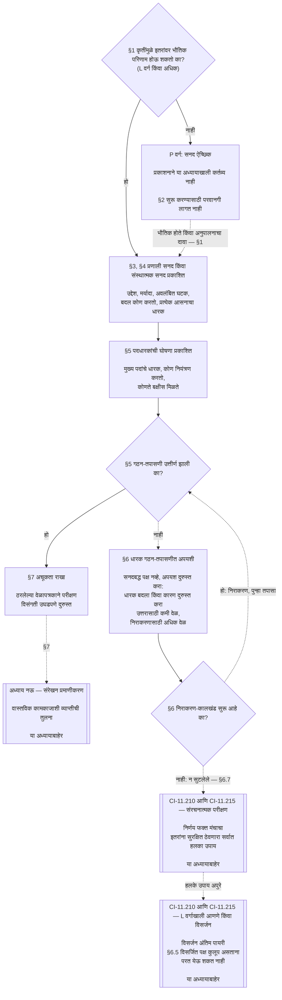

# अध्याय सात: प्रणाली आणि संस्थात्मक सनदा

> **अनुवाद स्थिती:** हा मराठी AI-सहाय्यित मसुदा आहे; स्वतंत्र वाचक-परीक्षण झालेले नाही. क्रमांकित इंग्रजी मूळ प्रभावी राहते. अध्याय साताचा अनुवाद सुरू आहे.

<strong>संग्रहस्थान (असंक्रियात्मक): फाइल रचना आणि वाचन नियम</strong>

> ही फाइल **संज्ञ संविधानाचा भाग** आहे आणि इतर क्रमांकित `core_*` फाइल्ससोबत एकच मजकूर म्हणून वाचल्यावरच **बंधनकारक** आहे. यात **अध्याय सात** आहे: प्रणाली व संस्थेसाठी प्रकाशित व्याप्ती-दस्तऐवजांचा किमान तळ—प्रणाली सनद आणि संस्थात्मक सनद. हा अधिकार-तळ असलेल्या अध्याय सहानंतर येतो आणि [अध्याय आठ](../../core_08.000_functional_independence_separation_of_duties.md#chapter-eight-functional-independence-and-separation-of-duties) आधी येतो; अध्याय आठ प्रत्येक भौतिकदृष्ट्या बंधनकारक कृतीतील आसने वेगळी ठेवतो.
>
> - **संवैधानिक मालक:** प्रणालीने कधी प्रणाली सनद आणि संस्थेने कधी संस्थात्मक सनद प्रकाशित करावी (L वर्ग किंवा अधिक असल्यास आवश्यक, P वर्गात ऐच्छिक), प्रत्येक सनदेत किमान काय असावे, ती कशी बदलावी व तपासावी, आणि समाविष्ट पदांचे धारक प्रस्थिति व अस्सलपणाच्या कसोटीत कसे तपासले जातात.
> - **व्याख्यांचे घर:** [प्रणाली सनद](../../core_05.040_band_continuity.md#system-charter), [संस्थात्मक सनद](../../core_05.040_band_continuity.md#institutional-charter), [सनद-भूमिका नकाशा](../../core_05.040_band_continuity.md#charter-role-map), [सनदबद्ध पक्ष](../../core_05.040_band_continuity.md#chartered-party) आणि [कार्यरत पक्ष](../../core_05.050_band_oversight.md#operating-party) यांच्या व्याख्या अध्याय पाचमध्ये आहेत. हा अध्याय त्या संज्ञा लागू करतो; त्यांची नव्याने व्याख्या करत नाही.
> - **अंमलबजावणीचा मालक:** [CI-8.205 §6](../../corpus_institutions/ci_08.205_institutional_design_separation_of_powers.md#ci-8205-6-system-and-institutional-charter-contents-review-and-formation-template) (*प्रणाली व संस्थात्मक सनद: मजकूर, परीक्षण आणि गठन नमुना*) मध्ये पूर्ण क्षेत्र-नमुना, परीक्षण सूची, गठन प्रक्रिया आणि गठन-तपासणी घोषणेचा नमुना आहे. ते अधिक कठोर असू शकते आणि क्षेत्रे वाढवू शकते; हा अध्याय आकुंचित करू शकत नाही. त्याचा मजकूर वैध अंगीकाराच्या व्याप्तीत समाविष्ट अंमलबजावणी-मजकूर म्हणूनच बंधनकारक आहे ([अध्याय अठरा §4 अंगीकाराची चौकट व अधिकार-व्याप्ती](../../core_18.000_incorporation.md#4-adoption-framing-and-scope-of-authority)); या अध्यायाचा तळ मुख्य मजकूर म्हणून बंधनकारक आहे.
> - **पुढील वापर:** [अध्याय आठ §5 प्रकाशित नेमणूक, रिक्तता व पर्याय](../../core_08.000_functional_independence_separation_of_duties.md#5-published-placement-vacancy-and-substitution) सनद-भूमिका नकाशा आवश्यक करतो. अध्याय नऊ व्याप्ती व सीमा निष्कर्षांसाठी प्रणाली सनद वापरतो आणि भाग D संस्थेसाठी गठन-तपासणी घोषणा तपासतो. [अध्याय दहा §3.7 अभिलेख अभिरक्षा व उघडण्याचा अधिकार](../../core_10.000_standing_assessment.md#37-record-custody-and-opening-authority) तो प्रस्थिति अभिलेखांना लागू करतो. [अध्याय तेरा §4.3 संस्थात्मक मंच](../../core_13.000_forum.md#43-institutional-forums) संस्थात्मक सनदेवरील विवाद ऐकतो.
>
> वाचन क्रम: §1 सनदा कधी आवश्यक आहेत आणि प्रक्रिया-आलेख → §2 गठनाचा अधिकार व चार मर्यादा → §3 सनदेत काय सांगावे → §4 सनद-भूमिका नकाशा व प्रस्थिति-अभिलेख अभिरक्षा → §5 पदधारकांचे प्रस्थिति व अस्सलपण तपासणारी गठन-तपासणी → §6 धारक गठन-तपासणीत अपयशी झाल्यास → §7 दुरुस्ती, परीक्षण व व्याप्ती-विसंगती.

<strong>मागोवा</strong>

- आधीचे आधार: [संवैधानिक चतुष्क](../../core_00.000_preamble.md#constitutional-tetrad), विशेषतः **देखरेख** व **उत्तरदायित्व**; [भौतिक दाव](../../core_00.000_preamble.md#material-stake); [अध्याय एक §18.1 अधिकृत रचना म्हणून शासन](../../core_01.015_stewardship_capacity_principles.md#181-governance-as-authorized-structure); [Article XI-E](../../core_06.010_rights_part_b.md#article-xi-e-institutional-formation-and-business-creation) (*संस्थात्मक गठन आणि व्यवसाय निर्मिती*).
- उपविभाग: [§1](#1-परणल-सनद-आण-ससथतमक-सनद-कध-आवशयक-आहत); [§2](#2-गठनच-अधकर-आण-चर-मरयदत-बधन); [§3](#3-परणल-सनद-आण-ससथतमक-सनदत-कय-सगव); [§4](#4-सनद-भमक-नकश-आण-परसथत-अभलख-अभरकष); [§5](#5-गठन-तपसण-पदधरकच-परसथत-व-अससलपण); [§6](#6-धरक-गठन-तपसणत-अपयश-ठरलयस); [§7](#7-दरसत-परकषण-आण-वयपत-वसरखन).
- पुढील वापर: [अध्याय आठ](../../core_08.000_functional_independence_separation_of_duties.md#chapter-eight-functional-independence-and-separation-of-duties); [अध्याय नऊ](../../core_09.000_system_alignment_certification.md#chapter-nine-system-alignment-certification-reading-index); [अध्याय दहा](../../core_10.000_standing_assessment.md#chapter-ten-contribution-violation-and-standing-model--measurement); [अध्याय तेरा](../../core_13.000_forum.md#chapter-thirteen-forums-and-jurisdiction); [अध्याय चौदा](../../core_14.000_governance.md#chapter-fourteen-constitutional-contract-legitimacy-authorization-and-stewardship); वर नमूद केलेला निर्दिष्ट अंमलबजावणी-मजकूर.
- सोबत वाचा: [अधिकार-स्तर व अंतर्गत श्रेणी](../../core_05.045_band_integrative.md#authority-stack-and-internal-hierarchy); [प्रणाली सीमा](../../core_05.040_band_continuity.md#system-boundaries); [प्रणाली-सीमा अखंडता](../../core_05.040_band_continuity.md#system-boundary-integrity); [प्रणाली निर्मिती](../../core_05.055_band_participation.md#system-creation); [व्यवसाय निर्मिती](../../core_05.055_band_participation.md#business-creation).

 

अध्याय सात हा **प्रणाली सनद, संस्थात्मक सनद आणि प्रकाशित व्याप्ती** यांचा घटनात्मक मालक आहे.

तीन अध्याय एक साखळी म्हणून काम करतात:

- **अध्याय सात (हा अध्याय):** [सनदबद्ध पक्ष](../../core_05.040_band_continuity.md#chartered-party) काय करतो असा दावा करतो आणि कृती करताना प्रत्येक आसन कोण धारण करू शकतो हे सांगतो.
- **[अध्याय आठ](../../core_08.000_functional_independence_separation_of_duties.md#chapter-eight-functional-independence-and-separation-of-duties):** ती आसने कशी वेगळी ठेवायची ते सांगतो.
- **[अध्याय नऊ](../../core_09.000_system_alignment_certification.md#chapter-nine-system-alignment-certification-reading-index):** प्रणाली आणि स्वतंत्रपणे संस्था यांचे प्रमाणीकरण करतो. प्रत्येक प्रमाणीकरण ही आसने वापरणारी एक बंधनकारक कृती आहे. निष्कर्ष प्रणाली सनद किंवा संस्थात्मक सनदेकडे परत पाठवतो.

या अध्यायाने निर्देशित केलेल्या व्याख्या, आसन-नियम, प्रस्थिति कुलूपे आणि निर्णय-नियमांचे स्वामित्व इतर अध्यायांकडे आहे. **CI-8.205 §6** (*प्रणाली व संस्थात्मक सनद: मजकूर, परीक्षण आणि गठन नमुना*) मध्ये क्षेत्र-नमुना, गठन प्रक्रिया आणि परीक्षण सूची आहे.

### 1. प्रणाली सनद आणि संस्थात्मक सनद कधी आवश्यक आहेत

<strong>मागोवा</strong>

- आधीचे आधार: [§2](#2-गठनच-अधकर-आण-चर-मरयदत-बधन); [भौतिक दाव](../../core_00.000_preamble.md#material-stake); [प्रमाणबद्धता](../../core_05.035_band_accountability.md#proportionality); [अध्याय एक §18 उत्तरदायी व्यवस्थापनाखालील शासन](../../core_01.015_stewardship_capacity_principles.md#18-governance-under-stewardship-discipline); [देखरेख](../../core_05.020_apex_oversight_leg.md#oversight-constitutional); [उत्तरदायित्व](../../core_05.005_apex_accountability_leg.md#accountability).
- पुढील वापर: [§3](#3-परणल-सनद-आण-ससथतमक-सनदत-कय-सगव); [अध्याय नऊ भाग A §2 प्रणाली वर्ग परीक्षण](../../core_09.005_system_alignment_certification_evaluation.md#2-system-class-evaluation); [अध्याय नऊ भाग D §12.1 संस्थेचा वर्ग](../../core_09.020_institutional_alignment_certification.md#121-institution-class); **CS-9.305** आणि **CS-9.310** प्रणाली-वर्ग सूची.
- सोबत वाचा: **CI-8.205 §6**; [अध्याय तेरा §6 वेळेवर निराकरण व विलंब-विरोधी शिस्त](../../core_13.000_forum.md#time-scale-levels); [अध्याय पाच Domain-Specific Materiality](../../core_05.050_band_oversight.md#domain-specific-materiality); [Chapter Eighteen incorporation](../../core_18.000_incorporation.md#4-adoption-framing-and-scope-of-authority).

<strong>वाचक मार्गदर्शन (असंक्रियात्मक): या विभागाची रचना</strong>

- [§1.1 कोण प्रकाशित करेल](#11-कण-परकशत-करल) आवश्यक प्रणाली सनद किंवा संस्थात्मक सनद सांगते.
- [§1.2 कोणते वर्ग समाविष्ट आहेत](#12-कणत-वरग-समवषट-आहत) कोणत्या वर्गाला प्रकाशन आवश्यक आहे ते सांगते.
- [§1.3 P वर्ग म्हणजे काय](#13-p-वरग-महणज-कय) P वर्गाला संस्थात्मक सनद कधी लागते ते सांगते.
- [§1.4 P वर्ग: ऐच्छिक सनदा आणि त्या कधी आवश्यक होतात](#14-p-वरग-ऐचछक-सनद-आण-तय-कध-आवशयक-हतत) ऐच्छिक प्रकाशन कधी बंधनकारक होते ते सांगते.
- [§1.5 सनद कधी देय आहे](#15-परणल-सनद-कव-ससथतमक-सनद-कध-दय-आह) वेळापत्रक देते.
- [§1.6 सनद नसल्यास](#16-परणल-सनद-कव-ससथतमक-सनद-नसलयस) विनंती, उत्तर आणि निराकरणाचे कालखंड सांगते.
- [§1.7 प्रक्रिया एका दृष्टिक्षेपात](#17-परकरय-एक-दषटकषपत) संपूर्ण मार्ग दाखवते.

 

खालील सर्व नियमांसाठी प्रणालीवरील परिणामाचे पाच वर्ग चौकट ठरवतात. सर्वाधिक ते कमी परिणामकारक अशा क्रमाने:

- **A वर्ग, अस्तित्वासाठी निर्णायक, मूलभूत आणि पर्याय नसलेला:** अस्तित्वाशी संबंधित कालावधीत अपयश आणि व्यवहार्य पर्याय नसणे म्हणजे जगण्यासाठीच्या अटींचा नाश.
- **B वर्ग, अत्यावश्यक, उच्च-अवलंबित आणि प्रणालीगत महत्त्वाचा:** यावर अवलंबून असलेले घटक याशिवाय मुख्य कार्य चालू ठेवू शकत नाहीत. तात्काळ अस्तित्व-हानी होत नाही आणि वेळेत पर्याय शक्य आहे.
- **C वर्ग, समन्वयित, उच्च-अवलंबित पण अत्यावश्यक नाही:** मोठ्या प्रमाणावर समन्वय घडवतो, पण A किंवा B वर्गाचे कार्य सुरू ठेवण्यासाठी कार्यकारी पूर्वअट नाही.
- **L वर्ग, स्थानिक, मर्यादित परिणामाचा आणि अत्यावश्यक नाही:** परिणाम खाजगी घटकापलीकडे जातात पण स्थानिक, बदलण्याजोगे आणि नियंत्रणात ठेवण्याजोगे असतात.
- **P वर्ग, वैयक्तिक, खाजगी वापर, पृथक आणि प्रयोगात्मक:** लक्षणीय बाह्य अवलंबित्व नसते; परिणाम खाजगी घटकातच राहतात.

[CS-9.310 §8](../../corpus_systems/cs_09.310_system_impact_classifications.md#cs-9310-8-system-impact-classifications) (*प्रणाली परिणाम-वर्ग*) मध्ये पूर्ण व्याख्या आहेत. A, B, C आणि L वर्गांनी प्रकाशित करणे आवश्यक आहे; P वर्ग प्रकाशित करू शकतो. [§1.2 कोणते वर्ग समाविष्ट आहेत](#12-कणत-वरग-समवषट-आहत) संस्थेचा वर्ग ती चालवत असलेल्या प्रणालींवरून कसा ठरतो ते सांगते.

#### 1.1 कोण प्रकाशित करेल

L किंवा त्याहून उच्च वर्गातील प्रणालीने [प्रणाली सनद](../../core_05.040_band_continuity.md#system-charter) प्रकाशित करून अद्ययावत ठेवली पाहिजे. L किंवा त्याहून उच्च वर्गातील संस्थेने ती चालवत असलेल्या प्रणालींना लागू होणारी खालील सनद प्रकाशित करून अद्ययावत ठेवली पाहिजे.

| संस्था काय चालवते, सांभाळते किंवा भौतिकदृष्ट्या नियंत्रित करते | काय प्रकाशित करायचे |
| --- | --- |
| प्रणाली सनद आवश्यक असलेली नेमकी एक प्रणाली | ती प्रणाली सनद आणि दुसरा दस्तऐवज नाही. त्यात संस्था व्यवस्थापक म्हणून नमूद होते आणि तीच [संस्थात्मक सनद](../../core_05.040_band_continuity.md#institutional-charter) म्हणून काम करते: एकच दस्तऐवज दोन्ही व्यापतो. |
| अशा एकाहून अधिक प्रणाली | संस्थात्मक सनद. त्यात त्या प्रणालींना लागू असलेल्या सर्व प्रणाली सनदा समाविष्ट होतात आणि संस्था त्या विशिष्ट प्रणाली का चालवते हे सांगते([§3 प्रणाली व संस्थात्मक सनदेत काय सांगावे](#3-परणल-सनद-आण-ससथतमक-सनदत-कय-सगव)). |
| अशी कोणतीही प्रणाली नाही | संस्थेच्या स्वतःच्या बाबी नमूद करणारी संस्थात्मक सनद([§3 प्रणाली व संस्थात्मक सनदेत काय सांगावे](#3-परणल-सनद-आण-ससथतमक-सनदत-कय-सगव)); समाविष्ट करण्यासाठी प्रणाली सनदा नसतात. |

- **व्यवसाय व तत्सम स्वरूपे:** व्यवसाय किंवा उत्तरदायी व्यवस्थापनाखालील इतर संघटनात्मक स्वरूप त्याला लागू होणारी प्रणाली सनद किंवा संस्थात्मक सनद प्रणाली म्हणून, संस्था म्हणून किंवा समाविष्ट प्रणाली चालवणारी संस्था म्हणून प्रकाशित करते. त्याचे कायदेशीर स्वरूप उत्तर बदलत नाही.
- **संयुक्त व्यावसायिक सराव:** L किंवा उच्च वर्गातील संज्ञ प्राणी किंवा लहान सरावाने सराव-परवाना किंवा सराव-मंजुरी आवश्यक असलेली कृती केली, तर यजमानाची प्रणाली सनद किंवा संस्थात्मक सनद आणि सनद-भूमिका नकाशा स्वीकारून त्या कृतींसाठी हे कलम पूर्ण करता येते.
  - **काय स्वीकारले जाते:** संयुक्त व्यावसायिक सरावातील यजमानाची प्रणाली सनद/संस्थात्मक सनद आणि सनद-भूमिका नकाशा संदर्भाने स्वीकारला जातो; त्यात त्या कृतींचा समावेश असला पाहिजे.
  - **अंगीकार सूचना:** **CI-14.205 §7** (*सराव परवाना, सराव मंजुरी आणि संयुक्त व्यावसायिक सराव*) वर्णन करते ती एक-पानाची सूचना.
  - **वर्ग:** त्या सरावाच्या स्वतःच्या कृतींनी जो वर्ग दिला तोच कायम राहतो.

#### 1.2 कोणते वर्ग समाविष्ट आहेत

प्रकाशन आवश्यक आहे की ऐच्छिक हे सनदबद्ध पक्षाचा वर्ग ठरवतो.

- **A, B, C आणि L वर्ग:** आवश्यक. [§1.7 प्रक्रिया एका दृष्टिक्षेपात](#17-परकरय-एक-दषटकषपत) त्यांची प्रक्रिया दाखवते.
- **P वर्ग:** दोनपैकी एखादी घटना होईपर्यंत ऐच्छिक. [§1.3 P वर्ग म्हणजे काय](#13-p-वरग-महणज-कय) कार्यरत पक्ष P वर्गात कधी येतो ते सांगते; [§1.4 P वर्ग: ऐच्छिक सनदा आणि त्या कधी आवश्यक होतात](#14-p-वरग-ऐचछक-सनद-आण-तय-कध-आवशयक-हतत) निवड आणि तिचा शेवट स्पष्ट करते.
- **संस्थेचा वर्ग:** संस्था चालवत असलेल्या, सांभाळत असलेल्या किंवा भौतिकदृष्ट्या नियंत्रित करत असलेल्या कोणत्याही प्रणालींपैकी सर्वाधिक वर्ग स्वीकारते. अशी प्रणाली न चालवणाऱ्या संस्थेचा वर्ग तिच्या स्वतःच्या भौतिक परिणाम व अवलंबित्वावरून ठरतो; नाव किंवा कायदेशीर स्वरूप नव्हे तर ती प्रत्यक्षात काय ठरवते व काय धारण करते यावरून वर्गीकरण होते([अध्याय नऊ भाग D §12.1 संस्थेचा वर्ग](../../core_09.020_institutional_alignment_certification.md#121-institution-class)).

#### 1.3 P वर्ग म्हणजे काय

[क्षेत्रनिहाय भौतिक महत्त्व](../../core_05.050_band_oversight.md#domain-specific-materiality) या नऊ क्षेत्रांपैकी प्रत्येकात कार्यरत पक्षाची कृती मर्यादेखाली असेपर्यंतच तो P वर्गात असतो. व्यवहारात त्याच्या कृती व परिणाम [खाजगी घटक](../../core_05.050_band_oversight.md#domain-specific-materiality-private-unit) याच्या आत राहतात.

- **मर्यादा ओलांडणे:** कोणत्याही एका क्षेत्राची मर्यादा ओलांडल्यास आकार किंवा स्वतःला दिलेले नाव काहीही असले तरी **CS-9.305** आणि **CS-9.310** अंतर्गत किमान L वर्ग लागू होतो.
- **सर्व मर्यादांखाली राहणे:** सदस्य कितीही असले तरी प्रत्येक मर्यादेखाली राहिल्यास P वर्ग कायम राहतो.
- **आतील सदस्य:** P वर्ग आतल्या सदस्यांवरही अवलंबून असतो. मर्यादा ओलांडल्याचे लक्षात आलेल्या आतल्या कोणालाही ते कळवण्याचे कर्तव्य आहे; अहवाल संरक्षित असतो([क्षेत्रनिहाय भौतिक महत्त्व](../../core_05.050_band_oversight.md#domain-specific-materiality)).

अध्याय आठमधील चार-आसन तळ P वर्गातील कार्यरत पक्षाच्या खाजगी घटकात राहणाऱ्या कृतींना लागू होत नाही; त्यामुळे संगणक वापरणाऱ्या एका संज्ञ प्राण्याला दुसरा आसनधारक आवश्यक नसतो. इतरांनी पालन करणे आवश्यक असलेली किंवा निश्चित म्हणून ज्यावर अवलंबून राहता येईल अशी [भौतिकदृष्ट्या बंधनकारक कृती](../../core_05.035_band_accountability.md#materially-binding-act) कार्यरत पक्ष करतो त्या दिवसापासून चार-आसन तळ लागू होतो. त्यामुळे इतरांवरील अधिकाराच्या क्षेत्राची मर्यादा ओलांडली जाते आणि किमान L वर्ग लागू होतो.

#### 1.4 P वर्ग: ऐच्छिक सनदा आणि त्या कधी आवश्यक होतात

एक प्रणाली चालवणाऱ्या P वर्गातील कार्यरत पक्षाने तिला अनुरूप [प्रणाली सनद](../../core_05.040_band_continuity.md#system-charter), तर एकाहून अधिक किंवा एकही प्रणाली नसल्यास अनुरूप [संस्थात्मक सनद](../../core_05.040_band_continuity.md#institutional-charter) प्रकाशित करावी असे प्रोत्साहन दिले जाते. तो [§3 प्रणाली व संस्थात्मक सनदेत काय सांगावे](#3-परणल-सनद-आण-ससथतमक-सनदत-कय-सगव) मधील मजकूरसूची आणि [§4 सनद-भूमिका नकाशा व प्रस्थिति-अभिलेख अभिरक्षा](#4-सनद-भमक-नकश-आण-परसथत-अभलख-अभरकष) मधील आसन नकाशा नमुना म्हणून वापरू शकतो. स्वेच्छेने सनद प्रकाशित केली तरी या अध्यायाच्या प्रक्रियेअंतर्गत कर्तव्य निर्माण होत नाही:

- देय तारीख नाही([§1.5 प्रणाली सनद किंवा संस्थात्मक सनद कधी देय आहे](#15-परणल-सनद-कव-ससथतमक-सनद-कध-दय-आह));
- गठन-तपासणी नाही([§5 पदधारकांची प्रस्थिति व अस्सलपणा: गठन-तपासणी](#5-गठन-तपसण-पदधरकच-परसथत-व-अससलपण));
- [सनद-भूमिका नकाशा](../../core_05.040_band_continuity.md#charter-role-map) आवश्यक नाही([§4 सनद-भूमिका नकाशा व प्रस्थिति-अभिलेख अभिरक्षा](#4-सनद-भमक-नकश-आण-परसथत-अभलख-अभरकष)), तरी तो ऐच्छिक सनदेसोबत ठेवू शकतो किंवा स्वतंत्र प्रकाशित करू शकतो;
- दुरुस्ती किंवा परीक्षण चक्र आवश्यक नाही([§7 दुरुस्ती, परीक्षण व व्याप्ती-विसंगती](#7-दरसत-परकषण-आण-वयपत-वसरखन)).

खालीलपैकी एक घटना घडल्यास प्रकाशन ऐच्छिक राहत नाही:

- कार्यरत पक्षाचे पुनर्वर्गीकरण L किंवा उच्च वर्गात होते; किंवा
- त्याचा चालक कार्यरत पक्ष घटनापालन करतो असा दावा करतो.

त्यानंतर कार्यरत पक्षाने त्याला अनुरूप प्रणाली सनद किंवा संस्थात्मक सनद [§1.5 प्रणाली सनद किंवा संस्थात्मक सनद कधी देय आहे](#15-परणल-सनद-कव-ससथतमक-सनद-कध-दय-आह) मधील वेळापत्रकानुसार प्रकाशित केली पाहिजे.

**व्याप्ती-दस्तऐवजावर मान्यता अवलंबून नाही.** प्रणाली सनद किंवा संस्थात्मक सनद असो वा नसो आणि वर्ग कोणताही असो, समूह आपल्या सदस्यांना मान्यता मिळण्यापासून रोखत नाही. प्रत्येक सदस्य समूहात किंवा त्याबाहेर केलेल्या कामासाठी वैयक्तिक दावेदार म्हणून योगदान-अभिलेख मागू शकतो. त्या अभिलेखात सदस्याचे योगदान असते, समूहाची प्रस्थिति नाही([अध्याय दहा §3.7 अनौपचारिक व लहान-व्याप्ती अभिलेख](../../core_10.000_standing_assessment.md#37-informal-and-small-scope-records)). स्वीकारणे बंधनकारक नसलेली मदत, वस्तू, श्रम किंवा सेवा देणे ही भौतिकदृष्ट्या बंधनकारक कृती नाही. त्यामुळे निर्वासितांना रजया देणाऱ्या परस्पर-सहाय्य गटातील सदस्यांना मान्यता मिळण्यासाठी प्रणाली सनद किंवा संस्थात्मक सनद आवश्यक नाही.

#### 1.5 प्रणाली सनद किंवा संस्थात्मक सनद कधी देय आहे

समाविष्ट प्रणाली किंवा संस्था खालील वेळापत्रकानुसार [प्रणाली सनद](../../core_05.040_band_continuity.md#system-charter) किंवा [संस्थात्मक सनद](../../core_05.040_band_continuity.md#institutional-charter) प्रकाशित करते.

- **नवीन प्रणाली किंवा संस्था:** कार्यान्वित होण्यापूर्वी किंवा इतरांवर अधिकार वापरण्यापूर्वी.
- **आधीपासून कार्यरत:** पुढील वर्गीकरण-परीक्षण किंवा प्रमाणीकरणाच्या वेळी, किंवा [§1.6 प्रणाली सनद किंवा संस्थात्मक सनद नसल्यास](#16-परणल-सनद-कव-ससथतमक-सनद-नसलयस) विनंतीनंतरच्या निराकरण-कालखंडात—यांपैकी जे आधी येईल. सनद प्रकाशित करेपर्यंत ती नियमभंगात असते.
  - **कोणते प्रमाणीकरण:** प्रणालीसाठी तिचे प्रणाली-संरेखन प्रमाणीकरण. संस्थेसाठी [अध्याय नऊ भाग D §11.3 परवानगी नाही आणि कोणताही प्रवेश-अडथळा नाही](../../core_09.020_institutional_alignment_certification.md#113-no-permission-and-no-gate) अंतर्गत संस्थात्मक संरेखन प्रमाणीकरण. पहिल्या प्रमाणीकरणाचा कालखंड संस्थात्मक सनद प्रकाशित करण्याची किंवा चालू ठेवण्याची अट कधीच नसते.
- **गठन-तपासणी:** त्याच वेळी [§5 पदधारकांची प्रस्थिति व अस्सलपणा: गठन-तपासणी](#5-गठन-तपसण-पदधरकच-परसथत-व-अससलपण) पूर्ण करते.
- **कुठे दाखल करायची:** प्रणाली सनद किंवा संस्थात्मक सनद, सनद-भूमिका नकाशा आणि गठन-तपासणी घोषणेसह संस्थात्मक निबंधकाकडे, किंवा कृती व प्रभावित संज्ञ प्राणी स्थानिक असतील तर स्थानिक निबंधकाकडे दाखल करते(**CF-13.415 §5** *संस्थात्मक व स्थानिक निबंधक*).
  - **निबंधक काय करतो:** आवश्यक मजकूर काही सुटला नाही याची तपासणी करून दिनांकित पोच देतो.
  - **निबंधक काय करत नाही:** परवानगी देत नाही आणि वर्ग किंवा मजकूरावर निर्णय देत नाही.
  - **उशिराची किंवा न मिळालेली पोच:** सनदबद्ध पक्षाचे कार्य थांबवत नाही.

#### 1.6 प्रणाली सनद किंवा संस्थात्मक सनद नसल्यास

L किंवा उच्च वर्गातील नव्या किंवा नव्याने त्या वर्गात आलेल्या सनदबद्ध पक्षाने प्रणाली सनद किंवा संस्थात्मक सनद प्रकाशित केलेली नाही हे कोणाच्याही लक्षात आले, तर तो त्याच्या शासन-अधिकार्‍याकडे सनद मागू शकतो. मागणीदाराला प्रस्थिति लागत नाही, शुल्क नाही आणि हानी दाखवावी लागत नाही. विनंतीत सनदबद्ध पक्षाचे नाव आणि तो समाविष्ट का वाटतो ते नमूद करावे.

विनंतीपासून दोन कालखंड सुरू होतात: उत्तर-कालखंड आणि निराकरण-कालखंड. प्रत्येकाची लांबी सनदबद्ध पक्षाच्या वर्गाच्या अक्षराशी जुळणाऱ्या Tier नुसार ठरते. वर्ग जितका गंभीर, कालखंड तितका कमी.

| वर्ग आणि Tier | उत्तर-कालखंड (स्वीकृतीचे लक्ष्य) | निराकरण-कालखंड (अंतिम मर्यादा) |
|---|---|---|
| A वर्ग, Tier A | 24 तास | 7 दिनदर्शिकीय दिवस |
| B वर्ग, Tier B | 2 दिनदर्शिकीय दिवस | 14 दिनदर्शिकीय दिवस |
| C वर्ग, Tier C | 4 दिनदर्शिकीय दिवस | 30 दिनदर्शिकीय दिवस |
| L वर्ग, Tier L | 8 दिनदर्शिकीय दिवस | 60 दिनदर्शिकीय दिवस |

हे आकडे **CF-13.445 §3.1** (*टप्पा-लक्ष्ये आणि वेळेची किमान मर्यादा*) मधून घेतले आहेत; फरक असल्यास तेच लागू होते. स्वतःच्या वर्गावर विवाद करणारा सनदबद्ध पक्ष त्याच्या प्रणाली-वर्ग अभिलेखातील वर्ग आणि मागणीदार किंवा मंचाने प्रथमदर्शनी दाखवलेला वर्ग यांपैकी अधिक गंभीर वर्गाच्या Tier मध्ये मोजला जातो, जोपर्यंत प्रश्न निकाली निघत नाही. अभिलेखावर वर्ग नसलेला किंवा वर्गाबाबत प्रश्न असताना P वर्गात नोंदलेला पक्ष Tier C मध्ये मोजला जातो.

कालखंड असे लागू होतात:

- **उत्तर-कालखंड:** विनंतीच्या दिवसापासून मोजलेल्या, संबंधित Tier च्या स्वीकृती-लक्ष्याच्या आत (**CF-13.445 §3.1**) सनदबद्ध पक्षाने उत्तर द्यावे. प्रणाली सनद/संस्थात्मक सनद प्रकाशित करावी किंवा प्रकाशनाची तारीख द्यावी, आधी प्रकाशित सनद दाखवावी, किंवा तो [क्षेत्रनिहाय भौतिक महत्त्व](../../core_05.050_band_oversight.md#domain-specific-materiality) च्या प्रत्येक मर्यादेखाली असल्याचे आणि नोंदीसाठी लागणारे लेखी दाखले द्यावेत.
- **निराकरण-कालखंड:** विनंतीपासून मोजलेल्या Tier च्या अंतिम मर्यादेत (**CF-13.445 §3.1**) प्रणाली सनद/संस्थात्मक सनद आणि संबंधित गठन-तपासणी घोषणा दाखल करावी([§5 गठन-तपासणी](#5-गठन-तपसण-पदधरकच-परसथत-व-अससलपण)). स्वतंत्र आसन अद्याप नसलेला सनदबद्ध पक्ष त्या कलमानुसार घोषणेस पुरावा जोडून सादर करतो.
- **मर्यादेखाली असल्याचा दावा करणारा कार्यरत पक्ष:** विनंती ही त्या नोंदीतील *आव्हान-मार्गानुसार* वर्गीकरण-आव्हानही बनते.
  - **कालखंड चालू राहतो:** आव्हान प्रलंबित असतानाही निराकरण-कालखंड चालू राहतो.
  - **आव्हानामुळे मुदतवाढ:** आव्हान तपासण्याजोगे आहे असे अधिकारक्षेत्र असलेल्या मंचाने ठरवले तर देय तारीख वाढते आणि आव्हानाचा निर्णय झाल्यावर नवा निराकरण-कालखंड सुरू होतो. मंच संबंधित Tier च्या अंतिम मर्यादेत आव्हान ठरवतो.
  - **तपासण्याजोगे आव्हान:** विशिष्ट क्षेत्रातील ठरावीक मर्यादा-ओलांडणे नमूद केलेले आणि कार्यरत पक्षाच्या लेखी दाखल्यानंतरही त्याबद्दल खरा प्रश्न उरणारे आव्हान. कार्यरत पक्ष स्वतः ते तपासण्याजोगे आहे की नाही ठरवू शकत नाही. लेखी दाखला न देणारे उत्तर मुदत वाढवत नाही.
  - **वर्ग ठरल्यास:** या किंवा अन्य कार्यवाहीत वर्ग ठरल्याचा दिवस विनंतीचा दिवस मानला जातो. ठरवलेल्या वर्गाच्या (A, B, C किंवा L) Tier नुसार उत्तर व निराकरण-कालखंड सुरू होतात.
- **मुदत चुकल्यास:** उत्तर न देणे किंवा देय तारखेपर्यंत सनद प्रकाशित न करणे हा नोंदवून दुरुस्त करायचा दोष आहे. मागणीदार तोच मार्ग वापरून अधिकारक्षेत्र असलेल्या मंचाकडे जाऊ शकतो. गठन किंवा कामकाजाची ही अट नाही.
- **पुन्हा केलेली विनंती:** आधीचे उत्तर किंवा निष्कर्ष लागू असताना त्याच सनदबद्ध पक्षाबाबतची दुसरी विनंती नवा उत्तर किंवा निराकरण-कालखंड सुरू करत नाही. पक्ष आधीचे उत्तर किंवा निष्कर्ष दाखवून उत्तर देतो. मंचाने अद्याप तपासलेला नसलेला, सर्व मर्यादांखाली असल्याचा पक्षाचा स्वतःचा दाखला लागू उत्तर मानला जात नाही. [अध्याय नऊ भाग D §14.2 पुनःउघडण्याची कारणे](../../core_09.020_institutional_alignment_certification.md#142-reopening-triggers) सांगतात त्याप्रमाणे पुढीलपैकी काही होईपर्यंत उत्तर किंवा निष्कर्ष लागू राहतो:
  - **भौतिक बदल:** सनदबद्ध पक्षाच्या कृतीत भौतिक बदल होतो.
  - **नवा पुरावा:** मर्यादा-ओलांडण्याबाबत नवा पुरावा दाखवला जातो.

वरीलपैकी काही दाखवणारी विनंती पुनरावृत्ती नाही. ती आधीच्या विनंतीपासून स्वतंत्रपणे हाताळली जाणारी नवी विनंती आहे. तिच्या स्वतःच्या दिनांकापासून स्वतंत्र उत्तर व निराकरण-कालखंड सुरू होतात; आधीचे उत्तर, निष्कर्ष किंवा कालखंड तिला पूर्ण करत नाहीत किंवा बदलत नाहीत.
- **दरम्यानची व्याप्ती:** प्रणाली सनद किंवा संस्थात्मक सनद नसल्यामुळे सनदबद्ध पक्षाला अमर्याद मानता येत नाही. सनद तयार होईपर्यंत त्याच्या वास्तविक [प्रणाली सीमा](../../core_05.040_band_continuity.md#system-boundaries) आणि वर्ग लागू राहतात; प्रमाणीकरण संस्था किंवा मंच प्रत्यक्ष कामकाजावरून व्याप्ती पुन्हा ठरवू शकतो.

#### 1.7 प्रक्रिया एका दृष्टिक्षेपात

हा आलेख कार्यरत पक्षाच्या कृतींना इतरांवर भौतिक परिणाम होतो का या प्रश्नापासून सुरू होतो आणि प्रणाली सनद/संस्थात्मक सनद प्रकाशित करून ती अचूक ठेवण्यापर्यंत जातो. निराकरण-कालखंडात समस्या न सुटल्यास सनद-प्रक्रिया या अध्यायाबाहेरील परीक्षणाकडे पाठवते. पुढील विभाग प्रत्येक पायरी याच क्रमाने स्पष्ट करतात.

<strong>वाचक मार्गदर्शन (असंक्रियात्मक): आलेख कसा वाचावा</strong>

> सोप्या भाषेत: प्रणाली सनद किंवा संस्थात्मक सनद देण्याची परवानगी कोणी देत नाही; गठनासाठी परवानगी लागत नाही. कृतींनी इतरांवर भौतिक परिणाम करणारा सनदबद्ध पक्ष स्वतः ज्या अधिकाराचा दावा करतो ते व प्रत्येक आसनाचा धारक प्रकाशित करतो, आणि मुख्य पदांचे धारक तपासले जातात. धारक अपयशी ठरल्यास त्याला बदलले जाते किंवा कारण दुरुस्त होते; सनदबद्ध पक्ष काम चालू ठेवतो. निराकरण-कालखंड संपेपर्यंत अपयश सुटले नाही, तर मंच इतरांचे संरक्षण करणाऱ्या सर्वात हलक्या उपायापासून सनदबद्ध पक्षाचे परीक्षण करू शकतो. L वर्गाखाली आणणे किंवा विसर्जन करणे हे हलके उपाय अपुरे पडल्यावरच शक्य आहे. विसर्जित सनदबद्ध पक्षावरचे कुलूप लागू असेपर्यंत तो परत येऊ शकत नाही.
>
> सलग बाण मुख्य मार्ग दाखवतात. तुटक बाण संबंधित विभागाने नमूद केलेले अपवाद किंवा हस्तांतरण दाखवतात. दुहेरी कडा असलेली चौकट दुसऱ्या अध्यायाची किंवा समाविष्ट अंमलबजावणी-मजकूराची आहे. आलेख कोणतेही कर्तव्य, आसन किंवा क्षेत्र वाढवत नाही; त्यातील कोणतीही पायरी परवानगी देत नाही.

 

### 2. गठनाचा अधिकार आणि चार मर्यादित बंधने

<strong>वाचक मार्गदर्शन (असंक्रियात्मक): या विभागाची रचना</strong>

- [§2.1 गठनाचा अधिकार](#21-गठनच-अधकर) अधिकार आणि त्यात समाविष्ट नसलेले घटक सांगते.
- [§2.2 पहिले बंधन: संज्ञावर लागू असलेले कायम प्रस्थिति कुलूप](#22-पहल-बधन-सजञवर-लग-असलल-कयम-परसथत-कलप) कुलूप विशिष्ट संज्ञाला नियंत्रणकारी पदावरून कसे दूर ठेवते ते सांगते.
- [§2.3 दुसरे बंधन: विशिष्ट पडताळलेल्या तथ्यांवर अल्पकालीन स्थगिती](#23-दसर-बधन-वशषट-पडतळललय-तथयवर-अलपकलन-सथगत) अल्प स्थगिती विशिष्ट संज्ञाला नियंत्रणकारी पदावरून कसे दूर ठेवते ते सांगते.
- [§2.4 तिसरे बंधन: कार्यरत पक्षावरच कुलूप](#24-तसर-बधन-करयरत-पकषवरच-कलप) कार्यरत पक्ष व त्याचे उत्तराधिकारी कसे प्रतिबंधित होतात आणि विसर्जित सनदबद्ध पक्ष परत येऊ शकत नाही हे सांगते.
- [§2.5 चौथे बंधन: व्यवसाय परवाना किंवा मंजुरी](#25-चथ-बधन-वयवसय-परवन-कव-मजर) विशिष्ट उच्च-जोखीम कृतीला परवाना किंवा मंजुरी कधी आवश्यक असते ते सांगते. हे गठनाचे प्रवेशद्वार नाही.

<strong>मागोवा</strong>

- आधीचे आधार: [§1](#1-परणल-सनद-आण-ससथतमक-सनद-कध-आवशयक-आहत); [Article XI-E](../../core_06.010_rights_part_b.md#article-xi-e-institutional-formation-and-business-creation) (*संस्थात्मक गठन आणि व्यवसाय निर्मिती*).
- पुढील वापर: [§1 प्रणाली व संस्थात्मक सनदा कधी आवश्यक आहेत](#1-परणल-सनद-आण-ससथतमक-सनद-कध-आवशयक-आहत); [§5 पदधारकांची प्रस्थिति व अस्सलपणा: गठन-तपासणी](#5-गठन-तपसण-पदधरकच-परसथत-व-अससलपण).
- सोबत वाचा: [अंतरिम स्थगिती](../../core_05.035_band_accountability.md#interim-hold); [अध्याय अकरा §4.2 प्रतिबंध — सर्वसाधारण प्रस्थिति कुलूपे](../../core_11.000_standing_integration.md#42-prevention--general-standing-locks); [अध्याय अकरा §5.5 विशेष कुलूपे](../../core_11.000_standing_integration.md#55-special-locks); [अध्याय तेरा §5 नामित संज्ञाच्या मार्गावरील अंतरिम स्थगिती](../../core_13.000_forum.md#interim-hold-on-a-named-sentients-pathway).

 

*सोप्या भाषेत: प्रणाली, संस्था किंवा व्यवसाय निर्माण करण्यासाठी कोणाचीही परवानगी लागत नाही. चार अरुंद मर्यादा लागू होऊ शकतात. पहिल्या तीन प्रवेशद्वारे आहेत: न सुटलेले कुलूप एका संज्ञाला एका नियंत्रणकारी पदापासून दूर ठेवू शकते; विशिष्ट पडताळलेल्या तथ्यांवरची अल्प स्थगितीही तसे करू शकते; आणि कार्यरत पक्षावरचे कुलूप त्या पक्षालाच प्रतिबंधित करू शकते. चौथ्या मर्यादेनुसार नामित उच्च-जोखीम कृतीपूर्वी परवाना किंवा मंजुरी आवश्यक असू शकते. मंचाने विसर्जित केलेला सनदबद्ध पक्ष परत येऊ शकत नाही; व्यापक संविधानविरोधी कृती किंवा दुरुस्त न केलेल्या अपरिवर्तनीय गंभीर हानीमुळे विसर्जन झाल्यास बंदी कायमची असते. यांपैकी काहीही नव्या कार्यरत पक्षाची निर्मिती किंवा कार्य रोखत नाही; हा अध्याय इतर मर्यादा जोडत नाही.*

**Article XI-E** (*संस्थात्मक गठन आणि व्यवसाय निर्मिती*) चार मर्यादित बंधने मान्य करते.

- **पहिली तीनच कार्यरत पक्ष निर्माण करण्यावर किंवा त्यात अधिकार धारण करण्यावर प्रवेशद्वारे आहेत:** प्रत्येक विशिष्ट घटकाला लागू होते.
  - **कायम प्रस्थिति कुलूप** ([§2.2 पहिले बंधन: संज्ञावर लागू असलेले कायम प्रस्थिति कुलूप](#22-पहल-बधन-सजञवर-लग-असलल-कयम-परसथत-कलप)) सनदबद्ध पक्षावर नियंत्रण असलेल्या एका पदात विशिष्ट संज्ञाला लागू होते.
  - **अंतरिम स्थगिती** ([§2.3 दुसरे बंधन: विशिष्ट पडताळलेल्या तथ्यांवर अल्पकालीन स्थगिती](#23-दसर-बधन-वशषट-पडतळललय-तथयवर-अलपकलन-सथगत)) सनदबद्ध पक्षावर नियंत्रण असलेल्या एका पदातील विशिष्ट संज्ञापुरती असते.
  - **कार्यरत पक्षावरच कुलूप** ([§2.4 तिसरे बंधन: कार्यरत पक्षावरच कुलूप](#24-तसर-बधन-करयरत-पकषवरच-कलप)) स्वतः कुलूपाखाली असलेल्या सनदबद्ध पक्षाला लागू होते; मंचाने विसर्जित केलेला पक्षही यात येतो.
- **चौथे बंधन प्रवेशद्वार नाही:** ते व्यवसाय परवाना किंवा मंजुरी आहे([§2.5 चौथे बंधन: व्यवसाय परवाना किंवा मंजुरी](#25-चथ-बधन-वयवसय-परवन-कव-मजर)).

#### 2.1 गठनाचा अधिकार

कोणीही नवी प्रणाली, संस्था किंवा व्यवसाय निर्माण करू शकतो. हा अधिकार [Article XI-E](../../core_06.010_rights_part_b.md#article-xi-e-institutional-formation-and-business-creation) (*संस्थात्मक गठन आणि व्यवसाय निर्मिती*) मध्ये आहे. हा अध्याय त्यानंतर येणारे कर्तव्य जोडतो. [क्षेत्रनिहाय भौतिक महत्त्व](../../core_05.050_band_oversight.md#domain-specific-materiality) या नऊपैकी कोणत्याही एका क्षेत्रात कार्यरत पक्षाचे काम इतरांवर भौतिक परिणाम करत असेल, तर तो कोणता अधिकार वापरण्याचा दावा करतो हे आधीच सार्वजनिकरित्या सांगावे([§1 प्रणाली व संस्थात्मक सनदा कधी आवश्यक आहेत](#1-परणल-सनद-आण-ससथतमक-सनद-कध-आवशयक-आहत)). प्रणाली सनद किंवा संस्थात्मक सनद स्वीकारल्याचा अर्थ गठनाचा अधिकार किंवा अधिकार-तळातील कोणतेही संरक्षण संकुचित झाले असा लावू नये.

**गठनाचा अधिकार कोणाला संरक्षण देत नाही.** [§2.2 कायम प्रस्थिति कुलूप](#22-पहल-बधन-सजञवर-लग-असलल-कयम-परसथत-कलप), [§2.3 विशिष्ट पडताळलेल्या तथ्यांवर अल्प स्थगिती](#23-दसर-बधन-वशषट-पडतळललय-तथयवर-अलपकलन-सथगत) आणि [§2.4 कार्यरत पक्षावरच कुलूप](#24-तसर-बधन-करयरत-पकषवरच-कलप) ही तीन प्रवेशद्वारे वगळता, **Article XI-E** (*संस्थात्मक गठन आणि व्यवसाय निर्मिती*) खालील गोष्टींचे संरक्षण करत नाही:

- घटनात्मक मर्यादा मोडण्यासाठी, सुरक्षितता किंवा सत्याला बाधा आणण्यासाठी किंवा [अध्याय एक §11 बाजार रचना](../../core_01.005_values_principles.md#11-market-structure) मनाई करतो अशा प्रकारे सत्ता केंद्रीत करण्यासाठी बनवलेला कार्यरत पक्ष; किंवा
- ज्याचा संस्थापक पडताळलेल्या वर्तन, नियंत्रण आणि बक्षिसांवरून जाहीर उद्देशाशी खऱ्या अर्थाने जुळत नाही, किंवा उद्देश·नियंत्रण·हितसंबंधांबाबत इतरांना दिशाभूल करायचा किंवा इतरांना हानी पोचवायचा हेतू ठेवतो असा कार्यरत पक्ष.

मंच त्या Article नुसार प्रकरणे ठरवतो. परिणाम फक्त त्यातील तीन प्रवेशद्वारांपुरते असतात: कायम कुलूप, अंतरिम स्थगिती आणि कार्यरत पक्षावरचे कुलूप. गठन-तपासणीतील अपयश हा मंच विचारात घेऊ शकणाऱ्या पुराव्याचा एक भाग आहे; तपासणी एकटीच प्रकरण ठरवत नाही.

#### 2.2 पहिले बंधन: संज्ञावर लागू असलेले कायम प्रस्थिति कुलूप

पडताळलेल्या उल्लंघनानंतर लावलेले आणि अद्याप उठवलेले नसलेले [सर्वसाधारण प्रस्थिति कुलूप](../../core_11.000_standing_integration.md#42-prevention--general-standing-locks) किंवा [विशेष कुलूप](../../core_11.000_standing_integration.md#55-special-locks) विशिष्ट संज्ञाला अशा प्रकारच्या संस्था किंवा व्यवसायावर अधिकार वापरण्यापासून रोखते.

- **काय प्रतिबंधित आहे:** कार्यरत पक्षाचे शासनकारी, नियंत्रणकारी किंवा मालकीचे अधिकार स्वीकारणे किंवा वापरणे.
- **व्याप्ती:** कुलूप जितक्या मर्यादेपर्यंत लागू आहे तितकीच. कुलूप उठवल्यावर किंवा संकुचित केल्यावर प्रतिबंध संपतो.
- **कार्यरत पक्षावरच कुलूप:** [§2.4 कार्यरत पक्षावरच कुलूप](#24-तसर-बधन-करयरत-पकषवरच-कलप) पाहा.

#### 2.3 दुसरे बंधन: विशिष्ट पडताळलेल्या तथ्यांवर अल्पकालीन स्थगिती

अधिकारक्षेत्र असलेल्या मंचाने विशिष्ट पडताळलेल्या तथ्यांच्या आधारे [अंतरिम स्थगिती](../../core_05.035_band_accountability.md#interim-hold) आदेशित केली असेल, आणि त्या तथ्यांवरून धारक सनदबद्ध पक्षाच्या घोषित उद्देशाशी विसंगत असण्याची शक्यता अधिक असेल, तर हे बंधन लागू होते. फक्त तो मंच अशी स्थगिती देऊ शकतो([अध्याय तेरा §5 नामित संज्ञाच्या मार्गावरील अंतरिम स्थगिती](../../core_13.000_forum.md#interim-hold-on-a-named-sentients-pathway)). सनदबद्ध पक्ष स्वतःहून एखाद्याला पदापासून रोखू शकत नाही; तसे केल्यास तो स्वतःच्या सदस्याचा न्यायाधीश होईल. संपूर्ण निकष अध्याय तेराच्या त्या §5 मध्ये आहे; हा संक्षिप्त उल्लेख त्याची जागा घेत नाही.

#### 2.4 तिसरे बंधन: कार्यरत पक्षावरच कुलूप

कुलूप फक्त संज्ञावरच नव्हे तर कार्यरत पक्षावरही लागू होऊ शकते. मग कुलूपाच्या नामित मार्गाने सांगितलेली कृती त्या कार्यरत पक्षात आणि त्याचे उत्तराधिकारी, नियंत्रित घटक तसेच नामधारी किंवा मुखवटा संस्थेमार्फत ठेवलेल्या साधनांमध्ये प्रतिबंधित होते. इतर कोणताही कार्यरत पक्ष प्रतिबंधित होत नाही.

- **अंतिम नामनिर्देशनाने लावलेले कुलूप:** अंतिम नामनिर्देशन एखादी संस्था, उत्तराधिकारी साधन किंवा नियंत्रित घटक निर्दिष्ट करते तेव्हा [संविधानविरोधी न्यास-कुलूप](../../core_11.000_standing_integration.md#55-special-locks) हे करते. मग कुलूपाच्या नामित मार्गाने सांगितलेली कृती सनदबद्ध पक्षात आणि त्याचे उत्तराधिकारी, नियंत्रित घटक तसेच नामधारी किंवा मुखवटा संस्थेमार्फत ठेवलेल्या साधनांमध्ये प्रतिबंधित होते.
- **विसर्जित सनदबद्ध पक्ष:** **CI-11.210 §4** (*विसर्जन*) अंतर्गत अंतिम विसर्जन आदेश [विसर्जनोत्तर पुनर्गठन कुलूप](../../core_11.000_standing_integration.md#55-special-locks) लावतो. विसर्जित पक्ष, त्याचे उत्तराधिकारी, नियंत्रित घटक, नामधारी किंवा मुखवटा संस्थेमार्फत ठेवलेली साधने आणि त्यांच्याशी एकच कार्य करणारा कोणताही कार्यरत पक्ष कुलूप लागू असेपर्यंत कोणत्याही नावाने किंवा स्वरूपात पुन्हा निर्माण, पुनरुज्जीवित किंवा चालवता येत नाही. आदेशाने व्यापक संविधानविरोधी आचरण किंवा निवारण न झालेली अपरिवर्तनीय हानी आढळल्यास([अध्याय अकरा §8 पुनर्स्थापना व पुनर्मूल्यांकन](../../core_11.000_standing_integration.md#8-restoration-and-reassessment)), कुलूप कायमचे असते. वेळ गेल्याने, कारण सुटल्याने किंवा धारक बदलल्याने ते उठत नाही. पुनर्विलोकनात विसर्जन आदेश रद्द झाला किंवा त्या निष्कर्षाला चुकीचे ठरवणारी भौतिक नवी पडताळलेली तथ्ये आली तरच ते संपते. अन्यथा कारण सुटले, उपाय दिला आणि सुरू असलेल्या बहिष्कारापेक्षा परत येणे सुरक्षित आहे, असा स्वतंत्र निष्कर्ष आल्यावर संपते. ते कोणत्याही संज्ञाला वेगळा कार्यरत पक्ष निर्माण करण्यापासून रोखत नाही.

या तीन प्रवेशद्वारांपैकी कोणतेही नवा कार्यरत पक्ष निर्माण करणे, प्रणाली सनद/संस्थात्मक सनद प्रकाशित करणे किंवा काम सुरू करणे रोखत नाही. ते फक्त स्वतः कुलूपाखाली असलेल्या पक्षाला—उदा. परत येणाऱ्या विसर्जित सनदबद्ध पक्षाला—रोखतात. तीनही प्रवेशद्वारे [§5 पदधारकांची प्रस्थिति व अस्सलपणा: गठन-तपासणी](#5-गठन-तपसण-पदधरकच-परसथत-व-अससलपण) येथे लागू होतात.

#### 2.5 चौथे बंधन: व्यवसाय परवाना किंवा मंजुरी

चौथे बंधन कार्यरत पक्षाच्या गठनावर नव्हे तर नामित कृतीवर लागू होते.

- **कार्यरत पक्षासाठी प्रवेशद्वार नाही:** [§5 गठन-तपासणी](#5-गठन-तपसण-पदधरकच-परसथत-व-अससलपण) हे बंधन लागू करत नाही.
- **ते काय आहे:** तांत्रिक मंचाच्या प्रकाशित जोखीम-निष्कर्षाच्या आधारे, इतरांसाठी नामित कृती करण्यापूर्वी अंगीकारकर्ता आवश्यक ठरवू शकणारी [क्षमता-मंजुरी](../../core_05.035_band_accountability.md#competency-clearance), जी **Article XI-E** (*संस्थात्मक गठन आणि व्यवसाय निर्मिती*) परवानगी देतो.
  - **व्यवसाय परवाना:** चुकीने केल्यास गंभीर किंवा अपरिवर्तनीय हानीची जोखीम असलेल्या कृतींसाठी आवश्यक.
  - **व्यवसाय मंजुरी:** चुकीने केल्यास प्रत्यक्ष पण तुलनेने कमी हानीची जोखीम असलेल्या कृतींसाठी आवश्यक.
- **कशाला लागू:** कृती करण्याला. कार्यरत पक्षाची निर्मिती, त्याची प्रणाली सनद/संस्थात्मक सनद प्रकाशित करणे किंवा कामकाज रोखत नाही.
- **काय प्रतिबंधित करते:** परवाना किंवा मंजुरीशिवाय कृतीचा दावा करणे किंवा ती करणे. धारक ती कृती करत नसेल तर प्रणाली सनद/संस्थात्मक सनदेत तिचा दावा करता येत नाही([§3 प्रणाली व संस्थात्मक सनदेत काय सांगावे](#3-परणल-सनद-आण-ससथतमक-सनदत-कय-सगव)).

### 3. प्रणाली सनद आणि संस्थात्मक सनदेत काय सांगावे

<strong>वाचक मार्गदर्शन (असंक्रियात्मक): या विभागाची रचना</strong>

- [§3.1 प्रणाली सनद काय सांगते](#31-परणल-सनद-कय-सगत) नऊ बाबींची यादी देते.
- [§3.2 सनद-दुवे](#32-सनद-दव) मजकूर नकल न करता इतर प्रकाशित दस्तऐवजाचा संदर्भ देण्याची परवानगी आणि वैध संदर्भाची अट सांगते.
- [§3.3 संस्थात्मक सनदेत काय वाढीव असते](#33-ससथतमक-सनदत-कय-वढव-असत) संस्थेने चालवलेल्या प्रणालींच्या प्रणाली सनदा आणि त्या प्रणाली चालवण्याची कारणे सांगते.
- [§3.4 व्यवसाय परवाना किंवा मंजुरी लागणाऱ्या कृती](#34-वयवसय-परवन-कव-वयवसय-मजर-लगणऱय-कत) अशी कृती करणाऱ्या प्रत्येक संज्ञाकडे परवाना/मंजुरी असणे किंवा ती असलेल्या पर्यवेक्षकाखाली शिकाऊ म्हणून काम करणे आवश्यक ठरवते. तोवर §3.1 मधील बाब 4 अंतर्गत ती व्याप्तीबाहेर नोंदवली जाते.
- [§3.5 प्रमाणानुसार समायोजन](#35-परमणनसर-समयजन) वर्गानुसार काय बदलते ते सांगते.

<strong>मागोवा</strong>

- आधीचे आधार: [§1](#1-परणल-सनद-आण-ससथतमक-सनद-कध-आवशयक-आहत); [अध्याय पाच प्रणाली सनद](../../core_05.040_band_continuity.md#system-charter); [अध्याय पाच संस्थात्मक सनद](../../core_05.040_band_continuity.md#institutional-charter).
- पुढील वापर: [§4](#4-सनद-भमक-नकश-आण-परसथत-अभलख-अभरकष); [§7](#7-दरसत-परकषण-आण-वयपत-वसरखन); [अध्याय नऊ भाग B §8.1 किमान अभिलेख मजकूर](../../core_09.010_system_alignment_certification_record_process.md#81-minimum-record-contents); **CI-8.205 §6** पूर्ण क्षेत्र-यादी.
- सोबत वाचा: [अध्याय अठरा §4 अंगीकाराची चौकट आणि अधिकार-व्याप्ती](../../core_18.000_incorporation.md#4-adoption-framing-and-scope-of-authority); [अध्याय चौदा §4.3 बंधनकारक हितधारक निवडीसाठी निर्णय-निराकरण निकष](../../core_14.000_governance.md#43-decision-resolution-requirements-for-binding-stakeholder-choice); **CI-6.205 §§1–2**.

<strong>व्याख्या · मूल्यांकन · अनुपालन</strong>

- [प्रणाली सनद](../../core_05.040_band_continuity.md#system-charter) · O · M · A · C
- [संस्थात्मक सनद](../../core_05.040_band_continuity.md#institutional-charter) · O · M · A · C
- [सनद-भूमिका नकाशा](../../core_05.040_band_continuity.md#charter-role-map) · O · M · A · C

 

*सोप्या भाषेत: प्रणाली सनद तपासता येईल इतकी विशिष्ट असावी. प्रणालीचा उद्देश, ती काय करते किंवा करत नाही, कोण तिच्यावर अवलंबून आहे, सनद कोण बदलू शकतो, प्रत्येक आसन कोण धारण करतो आणि बंधनकारक निर्णय-नियम कुठे आहेत हे ती सांगते. सनद त्या नियमांकडे निर्देश करते; त्यांची जागा घेत नाही. संस्थात्मक सनद संस्थेबद्दल हीच माहिती देते आणि संस्थेने धारण केलेल्या प्रणाली सनदा व त्या प्रणाली चालवण्याची कारणे जोडते.*

#### 3.1 प्रणाली सनद काय सांगते

प्रणाली सनद प्रभावित संज्ञ आणि लेखापरीक्षकांना वाचता येईल अशा साध्या भाषेत पुढील बाबी सांगते.

1. **ओळख व आवृत्ती:** नाव, व्यवस्थापक किंवा शासन संस्था, आवृत्ती, प्रभावी तारीख आणि बदलांचा इतिहास.
2. **उद्देश:** सनदबद्ध पक्ष कशासाठी अस्तित्वात आहे.
3. **समाविष्ट कृती:** तो दावा करत असलेली कामे, सेवा, अधिकार आणि क्षेत्रे.
   - **दावा, अधिकारदान नव्हे:** दस्तऐवज सनदबद्ध पक्षाकडे आधीपासून असलेला अधिकार सांगतो; अधिकार देत नाही. घटनात्मक सनदेवर आधारित अधिकारासह त्या अधिकाराची वैधता [अध्याय चौदा §1 शासन-अधिकाराचे प्राधिकरण व वैधता](../../core_14.000_governance.md#1-authorization-and-legitimacy-of-governing-authority) अंतर्गत ठरते.
4. **व्याप्तीबाहेरील मर्यादा:** सनदबद्ध पक्षाला वापरण्याचा अधिकार नसलेल्या भौतिक कृती, अधिकार आणि क्षेत्रे.
5. **प्रभावित समुदाय व अवलंबित्व:** कोण सनदबद्ध पक्षावर अवलंबून आहे आणि कोणत्या प्रणाली किंवा पायाभूत सुविधांवर तो अवलंबून असतो किंवा ज्यांवर प्रवेश नियंत्रित करतो, जेथे हे भौतिकदृष्ट्या महत्त्वाचे आहे.
   - **वगळण्याचा पर्याय नाही:** यादीतून एखादा गट वगळल्याने तो व्याप्तीबाहेर जात नाही. सनदबद्ध पक्षाचा भौतिक परिणाम होणाऱ्या संज्ञाला दस्तऐवजात नाव असो वा नसो, सर्व अधिकार-तळ संरक्षण मिळते. प्रत्यक्ष अवलंबित्वापेक्षा अरुंद यादीचा अर्थ प्रत्यक्ष अवलंबित्वानुसार लावला जातो.
6. **वर्गीकरण गृहीतके:** आधार मानलेला वर्ग किंवा व्यवस्थापन Tier आणि लागू असल्यास **CS-9.305** (*प्रणाली-वर्गीकरण यंत्रणा*), **CS-9.310** (*प्रणाली-वर्गीकरण यंत्रणा*) व **CS-14.305** (*अत्यावश्यक प्रणाली व्यवस्थापन*) यांचे [सनद-दुवे](../../core_05.040_band_continuity.md#charter-pointer).
7. **सनद-भूमिका नकाशा:** [सनद-भूमिका नकाशा](../../core_05.040_band_continuity.md#charter-role-map), किंवा सनद-भूमिका नकाशा असलेल्या प्रकाशित दस्तऐवजाचा सनद-दुवा([§4 सनद-भूमिका नकाशा व प्रस्थिति-अभिलेख अभिरक्षा](#4-सनद-भमक-नकश-आण-परसथत-अभलख-अभरकष)).
8. **बंधनकारक हितधारक-निवड सनद-दुवे:**
   - **कधी लागू:** प्रभावित संज्ञांमध्ये वास्तविक मतभेद असल्यास आणि प्रणालीत बंधनकारक हितधारक-निवड आवश्यक असल्यास. [व्याख्या.P2 बंधनकारक हितधारक निवड](../../core_05.055_band_participation.md#defp2-binding-stakeholder-choice) याला स्वीकार-व्याप्ती म्हणते.
   - **कशाकडे निर्देश:** प्रकाशित नियमांच्या तीन संचांकडे चालू सनद-दुवे: निर्णय-क्रम (निवड कशी केली जाते), भारांकन नियम (कोणाला किती मताधिकार), आणि अधिकार-संघर्ष-अभिलेख नियम (अधिकार भिडल्यास अभिलेखात काय दाखवायचे).
   - **कोण काय धारण करतो:** प्रणाली सनद फक्त दुवे ठेवते. निवड कशी करावी, भार कसा ठरवावा आणि अभिलेखात काय दाखवावे ही प्रत्यक्ष सामग्री नियमांच्या तीन संचांत असते. प्रणाली सनद स्वतः ती सामग्री ठेवत नाही आणि तिचा मजकूर त्या नियमांच्या ऐवजी देता येत नाही. तुटलेला दुवा किंवा नियमांऐवजी दिलेला प्रणाली सनदेचा मजकूर हे कर्तव्य पूर्ण करत नाही.
9. **दुरुस्तीचा अधिकार:** कोण दुरुस्ती करू शकतो, कोणता बदल भौतिक मानला जातो, आणि सूचना व आव्हानाचा मार्ग.

#### 3.2 सनद-दुवे

प्रणाली सनद किंवा संस्थात्मक सनद दुसऱ्या प्रकाशित दस्तऐवजाकडे किंवा तरतुदीकडे—उदा. नियमसंच, सनद-भूमिका नकाशा किंवा प्रणाली सनद—मजकूर नकल करण्याऐवजी निर्देश करू शकते. असा प्रत्येक संदर्भ [सनद-दुवा](../../core_05.040_band_continuity.md#charter-pointer) असतो. त्यातून चालू व प्रकाशित दस्तऐवज उघडला पाहिजे. तुटलेला किंवा कालबाह्य सनद-दुवा म्हणजे आवश्यक बाब अनुपस्थित.

#### 3.3 संस्थात्मक सनदेत काय वाढीव असते

संस्थात्मक सनद संस्थेबद्दल [§3.1 प्रणाली सनद काय सांगते](#31-परणल-सनद-कय-सगत) मधील 1 ते 9 बाबी सांगते आणि पुढील गोष्टीही धारण करते:

- **प्रणाली सनदा:** संस्था चालवते, सांभाळते किंवा भौतिकदृष्ट्या नियंत्रित करते त्या प्रणालींसाठी लागू असलेल्या प्रत्येक प्रणाली सनदेचा पूर्ण मजकूर किंवा वर्तमान प्रकाशित आवृत्ती उघडणारा सनद-दुवा.
- **पोर्टफोलिओचे कारण:** संस्था त्या प्रणाली का चालवते, त्या तिच्या घोषित उद्देशाला कशा पूरक आहेत, परस्पर कशा जोडलेल्या आहेत आणि कोणती अवलंबित्वे सामायिक करतात. कारण नमूद नसलेली प्रणाली म्हणजे बाब अनुपस्थित.

**CI-8.205 §6** (*प्रणाली व संस्थात्मक सनद: मजकूर, परीक्षण व गठन नमुना*) अतिरिक्त बाबी आवश्यक करू शकते आणि गठन-नमुना ठरवते, पण वरची कोणतीही बाब वगळू शकत नाही.

#### 3.4 व्यवसाय परवाना किंवा व्यवसाय-मंजुरी लागणाऱ्या कृती

कृतीस व्यवसाय परवाना किंवा व्यवसाय-मंजुरी लागते तेव्हा प्रणाली सनद/संस्थात्मक सनद काय दावा करू शकते ते हा उपविभाग सांगतो.

- **मर्यादा:** कृतीस परवाना किंवा मंजुरी आवश्यक असल्यास, ती करणाऱ्या प्रत्येक संज्ञाकडे परवाना/मंजुरी असणे किंवा परवाना/मंजुरी असलेल्या पर्यवेक्षकाखाली शिकाऊ म्हणून काम करणे आवश्यक आहे. अन्यथा प्रणाली सनद/संस्थात्मक सनद ती सनदबद्ध पक्षाची कृती म्हणून यादीत दाखवू शकत नाही आणि सनदबद्ध पक्ष ती करू शकत नाही.
- **तोपर्यंत:** [§3.1 प्रणाली सनद काय सांगते](#31-परणल-सनद-कय-सगत) मधील बाब 4 अंतर्गत ती कृती व्याप्तीबाहेर दाखवावी.
- **धारकाशिवाय दावा केल्यास:** नोंदवून दुरुस्त करायची बाब अनुपस्थित राहते; सनदबद्ध पक्षाचे गठन, प्रकाशन किंवा इतर काम सुरू ठेवण्यास ते अडथळा नाही.
- **संदर्भ:** [§2 गठनाचा अधिकार आणि चार मर्यादित बंधने](#2-गठनच-अधकर-आण-चर-मरयदत-बधन) ही अट कुठून येते ते सांगते; **CI-14.205 §7** (*व्यवसाय परवाना, व्यवसाय-मंजुरी व संयुक्त व्यावसायिक सराव*) नोंदी आणि होस्ट-पडताळणी सांभाळते.

#### 3.5 प्रमाणानुसार समायोजन

प्रणाली सनद किंवा संस्थात्मक सनदेचे काही भाग वर्गानुसार बदलतात, काही नाही.

- **काय समायोजित होते:** सनदेचा तपशील, परीक्षण-वारंवारता आणि परीक्षणाचे स्वातंत्र्य वर्ग व [भौतिक दाव](../../core_00.000_preamble.md#material-stake) यानुसार समायोजित होते.
- **L वर्ग:** L वर्ग प्रणाली किंवा संस्थेची सनद [वर्गानुसार समायोजित शासन](../../core_05.050_band_oversight.md#classification-scaled-governance) परवानगी देत असल्यास संक्षिप्त असू शकते आणि सोपे अभिलेख ठेवू शकते. तरी प्रत्येक आवश्यक बाब समाविष्ट असली पाहिजे.
- **परीक्षण-वारंवारता:** प्रणाली सनद किंवा संस्थात्मक सनद कितीदा तपासायची हे ठरवत नाही; वर्ग ठरवतो.

### 4. सनद-भूमिका नकाशा आणि प्रस्थिति-अभिलेख अभिरक्षा

<strong>वाचक मार्गदर्शन (असंक्रियात्मक): या विभागाची रचना</strong>

- [§4.1 आसने काय आहेत आणि ती का आहेत](#41-आसन-कय-आहत-आण-त-क-आहत) चार आसने व एका कृतीतील निषिद्ध जोड्यांचे कारण सांगते.
- [§4.2 वैध नेमणूक कशाला म्हणतात](#42-वध-नमणक-कशल-महणतत) स्वातंत्र्य, रिक्तता/पर्याय आणि संयुक्त होस्टिंगची कसोटी अध्याय आठ ठरवतो आणि नकाशा फक्त नेमणूक नोंदवतो असे सांगते.
- [§4.3 नकाशाबाबत सनदेची जबाबदारी](#43-नकशबबत-परणल-सनद-कव-ससथतमक-सनदच-जबबदर) नकाशा किंवा त्याचा दुवा आवश्यक असून नकाशा नसणे, तुटलेला दुवा किंवा जुनी आवृत्ती ही त्रुटी आहे असे सांगते.
- [§4.4 कोणती सनद कोणता नकाशा धारण करते](#44-कणत-परणल-सनद-कव-ससथतमक-सनद-कणत-नकश-धरण-करत) एका संस्थात्मक सनदेखाली अनेक प्रणाली आणि सामायिक नकाशा स्पष्ट करते.
- [§4.5 आसन-नियम व धारक बदलणे](#45-आसन-नयम-व-आसनधरक-बदलण) आसनासाठी पात्रता बदलणे म्हणजे दुरुस्ती; सध्याचा धारक बदलणे म्हणजे सूचना व आव्हानाची संधी दिल्यावर लागू होणारी दिनांकित नवी आवृत्ती असे सांगते.
- [§4.6 प्रस्थिति-अभिलेख अभिरक्षा](#46-परसथत-अभलख-अभरकष) नकाशाने प्रस्थिति-अभिलेखांसाठी काय सांगावे ते आणि [§4.6.1 कार्यवाहकाचे अभिलेख](#461-करयवहकच-परसथत-अभलख), [§4.6.2 हितधारकांचे अभिलेख](#462-हतधरकच-परसथत-अभलख) स्पष्ट करते.
- [§4.7 कार्यवाहकाच्या अभिलेख-नकाशातील पोकळ्या](#47-करयवहकचय-अभलख-नकशतल-पकळय) आवश्यक आसन अनामित किंवा अपात्र धारकाशिवाय असल्यास काय होते ते सांगते.

<strong>मागोवा</strong>

- आधीचे आधार: [§3](#3-परणल-सनद-आण-ससथतमक-सनदत-कय-सगव); [अध्याय आठ §2 चार-आसन घटनात्मक तळ](../../core_08.000_functional_independence_separation_of_duties.md#2-four-seat-constitutional-floor).
- पुढील वापर: [अध्याय आठ §5 प्रकाशित नेमणूक, रिक्तता व पर्याय](../../core_08.000_functional_independence_separation_of_duties.md#5-published-placement-vacancy-and-substitution); [अध्याय नऊ भाग B §6.1.1 प्रमाणीकरणातील चार आसने](../../core_09.010_system_alignment_certification_record_process.md#611-four-seats-in-a-certification); [अध्याय दहा §3.7 अभिलेख अभिरक्षा व उघडण्याचा अधिकार](../../core_10.000_standing_assessment.md#37-record-custody-and-opening-authority); **CI-8.205 §2**; **CI-14.205 §§5–6**.
- सोबत वाचा: [भौतिक नियंत्रण-रेषा](../../core_05.035_band_accountability.md#material-control-line); [प्रस्थिति अभिलेख](../../core_05.035_band_accountability.md#standing-record).

<strong>व्याख्या · मूल्यांकन · अनुपालन</strong>

- [सनद-भूमिका नकाशा](../../core_05.040_band_continuity.md#charter-role-map) · O · M · A · C
- [प्रणाली सनद](../../core_05.040_band_continuity.md#system-charter) · O · M · A · C
- [संस्थात्मक सनद](../../core_05.040_band_continuity.md#institutional-charter) · O · M · A · C

 

*सोप्या भाषेत: आसनांना नाव सनद-भूमिका नकाशा देतो. लागू कृतींसाठी प्रत्येक आसन कोण धारण करू शकतो याची प्रकाशित यादी त्यात असते, त्यामुळे कोणताही पक्ष स्वतःचा तपासकर्ता निवडू शकत नाही. वैध आसन-नेमणुकीचे नियम अध्याय आठमध्ये आहेत. प्रस्थिति-अभिलेख सुरक्षित ठेवणे ही वेगळी यादी नाही; ते याच नकाशात येते.*

प्रत्येक प्रणाली सनद किंवा संस्थात्मक सनदेत [सनद-भूमिका नकाशा](../../core_05.040_band_continuity.md#charter-role-map) असतो—प्रत्येक आसन कोण धारण करतो याची प्रकाशित यादी. [अध्याय आठ §5 प्रकाशित नेमणूक, रिक्तता व पर्याय](../../core_08.000_functional_independence_separation_of_duties.md#5-published-placement-vacancy-and-substitution) भौतिकदृष्ट्या बंधनकारक कृती करणाऱ्या प्रत्येक अंगीकारकर्त्यास तो आवश्यक करतो आणि त्यात काय नमूद करावे ते सांगतो. हा विभाग सनदेने नकाशाचा उपयोग कसा करावा ते सांगतो.

#### 4.1 आसने काय आहेत आणि ती का आहेत

प्रत्येक [भौतिकदृष्ट्या बंधनकारक कृती](../../core_05.035_band_accountability.md#materially-binding-act) मध्ये चार कामे असतात; [अध्याय आठ §2 चार-आसन घटनात्मक तळ](../../core_08.000_functional_independence_separation_of_duties.md#2-four-seat-constitutional-floor) ती वेगळी ठेवतो.

- **[प्रारंभ आसन](../../core_05.035_band_accountability.md#initiating-seat):** कृतीची विनंती, प्रस्ताव, संचालन किंवा दावा करून ती सुरू करते.
- **[पडताळणी-किंवा-अधिकारदान आसन](../../core_05.035_band_accountability.md#verify-or-authorize-seat):** पुरावा व अधिकार तपासून कृतीची पडताळणी, अधिकृतता, अटी किंवा नकार ठरवते.
- **[अभिलेख आसन](../../core_05.035_band_accountability.md#record-seat):** पडताळणी-किंवा-अधिकारदान आसनाने काय ठरवले याची अधिकृत नोंद ठेवते.
- **[आव्हान आसन](../../core_05.035_band_accountability.md#contest-seat):** आव्हान ऐकते आणि ते दुरुस्त, मर्यादित किंवा योग्य मार्गावर पाठवते.

एका पक्षाने परिणाम मागणे, स्वतःची विनंती तपासणे, त्या तपासणीचा अभिलेख नियंत्रित करणे आणि त्या तपासणीवरील आव्हानाचा न्यायनिवाडा करणे शक्य होऊ नये म्हणून ही आसने आहेत. आसन हे एका कृतीवरील काम आहे, पदनाम नाही. म्हणून एकच संज्ञ, पद किंवा प्रणाली वेगवेगळ्या कृतींसाठी वेगवेगळी आसने धारण करू शकते; पण एका कृतीत अध्याय आठने प्रतिबंधित केलेली जोडी धारण करू शकत नाही. नकाशात प्रत्येक आसनाचा नावाने धारक दिला जातो.

#### 4.2 वैध नेमणूक कशाला म्हणतात

कसोट्या अध्याय आठ ठरवतो; नकाशा कोण कुठे आहे तेवढेच नोंदवतो.

- **भौतिक नियंत्रण-रेषा:** एका कृतीभोवतीची वास्तविक सत्ता-साखळी. ज्या पक्षाच्या कृतीचा प्रश्न आहे तो कृती सुरू करतो किंवा ज्याची कृती पडताळली, आव्हानित किंवा नोंदवली जाते तो पक्ष. त्या कृतीसाठी तो धारकाला निर्देश, उलथापालथ, बक्षीस, शिक्षा किंवा पदच्युती करू शकतो अथवा त्याचे काम लांबवू शकतो, तेव्हा तो आसन नियंत्रित करतो. असे करू शकणारे संज्ञ, पदे आणि प्रणाली त्या कृतीत पक्षाची [भौतिक नियंत्रण-रेषा](../../core_05.035_band_accountability.md#material-control-line) तयार करतात.
- **स्वातंत्र्य:** ज्या पक्षाच्या कृतीची तपासणी आहे तो आसन नियंत्रित करू शकत असेल तर तपासणीचे आसन स्वतंत्र नाही([अध्याय आठ §3 स्वातंत्र्य, हितसंघर्ष आणि नियंत्रण-रेषा](../../core_08.000_functional_independence_separation_of_duties.md#3-independence-conflict-and-control-lines)). म्हणून अभिलेख आसन, आव्हान आसन आणि प्रत्येक पडताळणी-किंवा-अधिकारदान आसन त्या पक्षाच्या भौतिक नियंत्रण-रेषेबाहेर ठेवावे. पक्ष स्वतःच्या निर्णयाने त्या आसनांचे धारकही बदलू शकत नाही([§4.5 आसन-नियम व धारक बदलणे](#45-आसन-नयम-व-आसनधरक-बदलण)).
- **रिक्तता, पर्याय व सोपवणे:** धारक अनुपस्थित किंवा हितसंघर्षात असताना कोण त्याची जागा घेतो([अध्याय आठ §5 प्रकाशित नेमणूक, रिक्तता व पर्याय](../../core_08.000_functional_independence_separation_of_duties.md#5-published-placement-vacancy-and-substitution)).
- **संयुक्त होस्टिंग:** लहान पक्ष एकाच पदात दोन आसने ठेवू शकतात अशी ही एकमेव परिस्थिती. प्रत्येक मान्य व्यवस्था आणि संबंधित स्वातंत्र्य-संरक्षण नकाशात दिले जाते([अध्याय आठ §6 प्रमाणबद्ध समायोजन आणि संयुक्त होस्टिंग](../../core_08.000_functional_independence_separation_of_duties.md#6-proportional-scaling-and-merged-hosting)).

#### 4.3 नकाशाबाबत प्रणाली सनद किंवा संस्थात्मक सनदेची जबाबदारी

प्रणाली सनद किंवा संस्थात्मक सनदेत सनद-भूमिका नकाशा असावा किंवा [सनद-दुव्याने](#32-सनद-दव) तो दाखवावा, जेणेकरून सनद उघडणारा वाचक प्रत्येक आसनाचा धारक शोधू शकेल. पुढीलपैकी काही असल्यास ती त्रुटी आहे:

- **नकाशा नाही:** नकाशा नाही आणि त्याचा दुवाही नाही.
- **दुवा तुटलेला:** नकाशा सापडत नाही किंवा तो चालू प्रकाशित दस्तऐवज नाही.
- **नकाशा कालबाह्य:** सध्याचा प्रत्येक आसनधारक दाखवलेला नाही. धारक बदलल्यास नकाशाची दिनांकित नवी आवृत्ती प्रकाशित केली जाते([§4.5 आसन-नियम व धारक बदलणे](#45-आसन-नयम-व-आसनधरक-बदलण)).

#### 4.4 कोणती प्रणाली सनद किंवा संस्थात्मक सनद कोणता नकाशा धारण करते

पक्षांची रचना कशी आहे यावर कोणती सनद नकाशा ठेवते हे अवलंबून असते.

- **अनेक प्रणाली:** संस्थात्मक सनद अनेक प्रणाली सनदा धारण करू शकते. प्रत्येक प्रणाली सनद स्वतःच्या प्रणालीच्या कृतींसाठी नकाशा ठेवते; संस्थात्मक सनद संस्थेच्या स्वतःच्या कृतींसाठी नकाशा ठेवते.
- **सामायिक नकाशा:** व्यवसाय किंवा सराव काही आसने स्थानिक सहकारी संस्था, संघटना किंवा होस्टकडे ठेवू शकतो([§1 प्रणाली सनद आणि संस्थात्मक सनद कधी आवश्यक आहेत](#1-परणल-सनद-आण-ससथतमक-सनद-कध-आवशयक-आहत)). तसे असल्यास स्वतःचा नकाशा लिहिण्याऐवजी त्या गटाचा प्रकाशित नकाशा वापरता येतो; स्वतःची सनद संक्षिप्त राहते. तरी आसनधारक अनुपस्थित किंवा हितसंघर्षात असताना कोण त्याची जागा घेतो आणि पात्र पर्याय उपलब्ध नसताना कोणता स्वतंत्र मार्ग वापरायचा हे नमूद करावे([अध्याय आठ §6 प्रमाणबद्ध समायोजन आणि संयुक्त होस्टिंग](../../core_08.000_functional_independence_separation_of_duties.md#6-proportional-scaling-and-merged-hosting), *सामायिक आसने*).

#### 4.5 आसन-नियम व आसनधारक बदलणे

नकाशा दोन मार्गांनी बदलू शकतो; प्रत्येकाचा स्वतंत्र मार्ग आहे.

- **आसन कोण धारण करू शकतो:** कोणती पदे आसन किंवा पर्याय धारण करू शकतात अथवा होस्टिंग सामायिक करू शकतात हे ठरवणे म्हणजे नकाशाचे नियम बदलणे. प्रणाली सनद/संस्थात्मक सनदेने नमूद केलेल्या दुरुस्ती प्रक्रियेतूनच बदल करता येतो([§7 दुरुस्ती, परीक्षण व व्याप्ती-विसंगती](#7-दरसत-परकषण-आण-वयपत-वसरखन)).
- **सध्या आसन कोण धारण करतो:** सध्याचा धारक बदलणे ही अद्ययावत नोंद आहे, दुरुस्ती नाही. नकाशाची नवी दिनांकित आवृत्ती प्रकाशित करून ते केले जाते.
  - **सूचना व आव्हानाची संधी:** अभिलेख आसन, आव्हान आसन आणि नकाशाने नेमलेले कोणतेही पडताळणी-किंवा-अधिकारदान आसन यांसाठी सूचना व आव्हानाची संधी दिल्यानंतरच नवी आवृत्ती लागू होते. त्या आसनाचा संबंध असलेल्या प्रत्येक खुल्या अभिलेखातील विषय, प्रत्येक दावेदार आणि प्रत्येक आव्हानकर्त्याला त्वरित सूचना जाते.
  - **आव्हान कुठे जाते:** आव्हान [अध्याय दहा §3.6 मंच-सीमा](../../core_10.000_standing_assessment.md#36-forum-boundary) अंतर्गत मंचाकडे जाते; फक्त दुरुस्तीकरिता प्रणाली सनद/संस्थात्मक सनदेने दिलेल्या मार्गाकडे नाही. आव्हान प्रलंबित असेल तर बदल थांबतो आणि सध्याचा धारक आसनावर राहतो.
  - **नव्या धारकाने काय दाखवावे:** सनदबद्ध पक्षाने नवा धारक **CI-8.205 §6** (*प्रणाली व संस्थात्मक सनद: मजकूर, परीक्षण व गठन नमुना*) मधील क्षेत्र 10 च्या प्रत्येक कसोटीत उत्तीर्ण असल्याचे दाखवावे. उद्दिष्ट एकच: विषय, दावेदार किंवा आव्हानकर्ता यांच्याकडून दबाव किंवा पक्षपात न होणारी आणि अभिलेख सुरक्षित ठेवून आव्हानासाठी खुला ठेवणारी संस्था आसनावर असावी. म्हणून नवा धारक त्या पक्षांच्या [भौतिक नियंत्रण-रेषेबाहेर](../../core_05.035_band_accountability.md#material-control-line) असावा; त्याच अभिलेखात किंवा होस्टमध्ये परस्पर किंवा वर्तुळाकार पद्धतीने दोन आसने धारण करू नये; अभिलेख व लेखापरीक्षण-साखळी अखंड राखावी; आव्हान आल्याच दिवशी त्याला मार्गस्थ करावे; शुल्क घेऊ नये; आणि निधी व शासन कोण देतो हे जाहीर करावे.
  - **रिक्त आसन:** प्रत्यक्ष रिक्त आसन या मुद्द्यानुसार नव्हे, [§4.7 कार्यवाहकाच्या अभिलेख-नकाशातील पोकळ्या](#47-करयवहकचय-अभलख-नकशतल-पकळय) नुसार हाताळले जाते.

**कोणती आवृत्ती लागू:** कृती झालेल्या दिवशी लागू असलेल्या नकाशानुसार तिचे मूल्यांकन होते. मंचाने धारक-बदल रद्द ठरवला तर तो बदल कधीच लागू झाला नव्हता असे मानले जाते आणि त्या धारकाने आसनावर केलेल्या कृती पुनर्विलोकनासाठी खुल्या होतात.

#### 4.6 प्रस्थिति-अभिलेख अभिरक्षा

नकाशात काय सांगावे हे [प्रस्थिति अभिलेख](../../core_05.035_band_accountability.md#standing-record) कोणत्या प्रकारचा आहे यावर ठरते, कारण दोन प्रकारांना हितसंघर्ष वेगवेगळे असतात([अध्याय दहा §3.7 अभिलेख अभिरक्षा व उघडण्याचा अधिकार](../../core_10.000_standing_assessment.md#37-record-custody-and-opening-authority), *विषयानुसार प्रस्थिति-अभिलेखांचे दोन प्रकार*). अध्याय दहा अभिलेखांनाच चार-आसन तळ लागू करतो.

##### 4.6.1 कार्यवाहकाचे प्रस्थिति-अभिलेख

कार्यवाहकाचे प्रस्थिति-अभिलेख सनदबद्ध पक्ष, त्याची सनदबद्ध व्याप्ती आणि तो सांभाळत असलेल्या प्रणालींविषयी असतात. यासाठी नकाशात चार गोष्टी नमूद होतात:

- अभिलेख कोण उघडू शकतो (पडताळणी आसन);
- तो ठेवणारा वेगळा अभिरक्षक (अभिलेख आसन);
- आव्हान कोण हाताळतो (आव्हान आसन); आणि
- पात्र पर्याय नसताना, किंवा नामित अधिकारप्राप्ती/अभिरक्षक स्वतः विषय असताना किंवा विषयाच्या भौतिक नियंत्रण-रेषेत असताना वापरायचा स्वतंत्र मार्ग—उदा. मंच, स्वतंत्र तपास सेवा किंवा आधीच नामित राखीव संस्था.

प्रणाली सनद/संस्थात्मक सनदेत मार्ग दिला नसेल([§4.7 कार्यवाहकाच्या अभिलेख-नकाशातील पोकळ्या](#47-करयवहकचय-अभलख-नकशतल-पकळय)), तर पुढील मूलभूत व्यवस्था लागू होते:

- **अभिलेख उघडण्याचा अधिकार:** **CF-13.415 §7** (*राखीव अभिलेख अधिकारप्राप्ती*) अंतर्गत राखीव अभिलेख अधिकारप्राप्ती हा पर्याय.
- **अभिरक्षक:** **CF-13.415 §9** (*राखीव अभिलेख अभिरक्षक*) हा पर्याय. नामित अभिरक्षक काम करू शकत नसल्यास तोही अभिलेख ठेवतो.
- **कोणाला नेमता येते आणि कसोट्या:** या आसनांसाठी कोणाला नेमता येते व प्रत्येक धारकाला कोणत्या कसोट्या पूर्ण कराव्या लागतात हे **CI-8.205 §6** मधील क्षेत्र 10 मध्ये आहे.

##### 4.6.2 हितधारकांचे प्रस्थिति-अभिलेख

हितधारकांचे प्रस्थिति-अभिलेख त्यांच्या प्रणाली वापरणाऱ्या, त्यांच्यावर अवलंबून असलेल्या किंवा त्यांचा परिणाम होणाऱ्या संज्ञ व संस्थांविषयी असतात. सनदबद्ध पक्षाचा स्वतःचा हितसंबंध अभिलेखात असू शकतो, म्हणून नियम वेगळे आहेत.

- **सनदबद्ध पक्षाचा हितसंबंध:** या अभिलेखातील दावेदार किंवा आरोपकर्ता तोच असू शकतो.
- **त्याची स्वतःची पदे:** संबंधित अभिलेखात सनदबद्ध पक्षाचा हितसंबंध नसेल तेव्हाच त्याची पदे आसन धारण करू शकतात. हितसंबंध असल्यास अभिलेख सनदबद्ध पक्षाच्या नियंत्रणाबाहेरील पदाकडे किंवा स्वतंत्र पडताळणीकडे जातो.
- **हितसंबंध असून पद नामित नसेल:** [अध्याय दहा §3.7 अभिलेख अभिरक्षा व उघडण्याचा अधिकार](../../core_10.000_standing_assessment.md#37-record-custody-and-opening-authority) (*स्वतःकडे अभिरक्षा नको*) प्रमाणे अभिलेख राखीव अभिलेख अधिकारप्राप्ती (**CF-13.415 §7**), राखीव अभिलेख अभिरक्षक (**CF-13.415 §9**) किंवा मंचाकडे जातो.
- **पदांची नावे ऐच्छिक:** या अभिलेखांसाठी नकाशा पदे आधीच नामित करू शकतो; ते आवश्यक नाही. एकही पद नामित नसलेला नकाशाही वैध आहे.

#### 4.7 कार्यवाहकाच्या अभिलेख-नकाशातील पोकळ्या

हे नियम [§4.6.1 कार्यवाहकाचे प्रस्थिति-अभिलेख](#461-करयवहकच-परसथत-अभलख) आवश्यक करतो त्या नोंदीतील पोकळीला लागू होतात. [§4.7.4 प्रमाणीकरण आसने](#474-परमणकरण-आसन) यांनाही तीच मुदत लागू होते.

##### 4.7.1 पोकळी कधी असते आणि तिची नोंद कशी करावी

पोकळ्या असलेला नकाशा प्रणाली सनद किंवा संस्थात्मक सनद अवैध करतो. नकाशात अभिलेख उघडण्याचा अधिकारप्राप्त धारक, अभिलेख अभिरक्षक, आव्हान आसन आणि स्वतंत्र मार्ग नमूद केलेला असावा. यांपैकी कोणतेही अनामित राहील असा बदल मान्य नाही.

- **पोकळी कोण नोंदवू शकतो:** मंच, निबंधक किंवा राखीव अभिलेख अधिकारप्राप्तीला सूचना देऊन कोणीही; प्रस्थिति आवश्यक नाही.
  - **सूचनेत काय असावे:** आसनाचे नाव आणि ते रिक्त का दिसते ते.
  - **कालमापन कधी सुरू:** पहिली सूचना मिळालेल्या दिवशी पोकळी नोंदली जाते आणि तेव्हापासून कालखंड सुरू होतात. सूचना चुकीची ठरल्यास कोणताही कालखंड सुरू होत नाही.

##### 4.7.2 पोकळी खुली असताना

पोकळी सुटेपर्यंत सनदबद्ध पक्षाची स्वतःची कोणतीही पदे प्रभावित व्याप्तीसाठी वैध प्रस्थिति-अभिलेख काढू शकत नाहीत.

- **अभिलेख कुठे जातो:** सनदबद्ध पक्षाच्या दुरुस्तीची वाट पाहून कोणाचाही अभिलेख थांबू नये म्हणून अभिलेख पडताळणीसाठी राखीव अभिलेख अधिकारप्राप्तीकडे (**CF-13.415 §7**) आणि ठेवण्यासाठी राखीव अभिलेख अभिरक्षकाकडे (**CF-13.415 §9**) जातो; पर्यायाने मंचाकडे जातो([अध्याय दहा §3.7 अभिलेख अभिरक्षा व उघडण्याचा अधिकार](../../core_10.000_standing_assessment.md#37-record-custody-and-opening-authority), *स्वतःकडे अभिरक्षा नको*).
- **अभिरक्षा परत कधी जाते:** पुढील तिन्ही गोष्टी होईपर्यंत राखीव अभिलेख अधिकारप्राप्ती व अभिरक्षक अभिलेख हाताळतात. मग नामित धारकांकडे अभिरक्षा परत जाते.
  - **सर्व आसने भरलेली:** नकाशाला आवश्यक प्रत्येक आसनावर पुन्हा नावाचा धारक असतो.
  - **धारक कसोट्यांत उत्तीर्ण:** राखीव अभिलेख अधिकारप्राप्ती किंवा मंच प्रत्येक धारक **CI-8.205 §6** मधील क्षेत्र 10 ची कसोटी उत्तीर्ण असल्याचे पुष्टी करतो.
  - **सूचना आणि आव्हानाची संधी पूर्ण:** [§4.5 आसन-नियम व आसनधारक बदलणे](#45-आसन-नयम-व-आसनधरक-बदलण) मधील सूचना व आव्हानाची संधी पूर्ण झाली आहे.

##### 4.7.3 घटनांमुळे शेवटचा पात्र पर्याय निघून गेल्यास

कोणालाही आधी भाकीत करता न आलेल्या घटनेमुळे यांपैकी एखाद्या आसनाचा पात्र धारक उरला नाही तर सनदबद्ध पक्षाला नेहमीचा उत्तर-कालखंड व निराकरण-कालखंड मिळतो([§1.6 प्रणाली सनद किंवा संस्थात्मक सनद नसल्यास](#16-परणल-सनद-कव-ससथतमक-सनद-नसलयस)).

- **आपत्कालीन पर्याय:** प्रत्यक्ष रिक्त असलेल्या आसनासाठीच आणि तात्पुरता म्हणून मान्य.
- **पर्याय आसन कसा घेतो:** सनदबद्ध पक्ष पर्याय नामित करू शकतो; पण राखीव अभिलेख अधिकारप्राप्ती(**CF-13.415 §7**) किंवा मंचाने तो **CI-8.205 §6** क्षेत्र 10 च्या कसोट्या व [§4.2 वैध नेमणुकीच्या कसोट्या](#42-वध-नमणक-कशल-महणतत) पूर्ण करतो असे पुष्टी केल्यावरच तो आसन स्वीकारतो. हे दाखवण्याची जबाबदारी सनदबद्ध पक्षाची आहे.
- **पर्याय कधी संपतो:** आपत्कालीन पर्याय हा तात्पुरता उपाय आहे. [§4.5 आसन-नियम व आसनधारक बदलणे](#45-आसन-नयम-व-आसनधरक-बदलण) अंतर्गत तोपर्यंत नियमित धारक-बदल झालेला नसेल तर त्याची तपासणी-मुदत संपल्यावर पर्यायही संपतो.
  - **मुदत कोण ठरवतो:** प्रणाली सनद/संस्थात्मक सनद तपासणी-मुदत ठरवते; ती Tier च्या कमाल मर्यादेपेक्षा मोठी असू शकत नाही.
  - **कमाल मर्यादा:** Tier A साठी 7 दिवस, Tier B साठी 14, Tier C साठी 30 आणि Tier L साठी 60 दिवस([§1.6 प्रणाली सनद किंवा संस्थात्मक सनद नसल्यास](#16-परणल-सनद-कव-ससथतमक-सनद-नसलयस) मधील निराकरण-कालखंड).
  - **Tier A आपत्कालीन स्थिती:** जीव किंवा गंभीर अधिकार धोक्यात असलेल्या Tier A आपत्कालीन स्थितीत [अध्याय तेरा §6 वेळेवर निराकरण, भौतिकता Tier आणि विलंब-विरोधी शिस्त](../../core_13.000_forum.md#time-scale-levels) (*काल-मापन स्तर*) मधील संरक्षणात्मक कृतीची 3 दिवसांची मर्यादा ही तपासणी-मुदतीची मूलभूत मर्यादा आहे.
  - **गठन-तपासणी पूर्ण होईपर्यंत:** पर्याय एकट्याने कोणतीही बंधनकारक कृती करू शकत नाही.

##### 4.7.4 प्रमाणीकरण आसने

प्रमाणीकरण आसनांनाही तीच मुदत लागू होते. प्रणाली-संरेखन प्रमाणीकरण किंवा संस्थात्मक संरेखन प्रमाणीकरण सुरू करणारे, अभिलेख ठेवणारे किंवा आव्हान हाताळणारे कोण आहेत हे नकाशात नसेल तर ती नोंदवून दुरुस्त करायची त्रुटी आहे. त्यामुळे प्रणाली सनद/संस्थात्मक सनद ताबडतोब अवैध होत नाही.

- **संस्था काय करू शकते:**
  - **काम व प्रमाणीकरण सुरू ठेवणे:** **CI-8.205 §2** (*कार्यात्मक विभाजनाचे मार्ग*) मधील मार्ग-नकाशा तोवर आसन नेमतो; प्रमाणीकरणाची कोणतीही प्रक्रिया थांबत नाही.
  - **त्रुटी दुरुस्त करणे:** नकाशाच्या दिनांकित दुरुस्तीने आसन नेमते. पोकळी नोंदवणारी सूचना मिळालेल्या दिवसापासून नेहमीचा उत्तर-कालखंड व निराकरण-कालखंड (**CI-11.210 §3** *सूचना, उत्तर व निराकरण*; [§1.6 प्रणाली सनद किंवा संस्थात्मक सनद नसल्यास](#16-परणल-सनद-कव-ससथतमक-सनद-नसलयस)) लागू होतात.
- **संस्था काय करू शकत नाही:**
  - **पोकळीच्या आधारे प्रमाणीकरण थांबवणे:** नेमलेले नसलेले प्रमाणीकरण आसन उत्तीर्ण प्रक्रिया थांबवण्याचे, विलंबवण्याचे किंवा रोखण्याचे कारण कधीच नाही.
  - **निराकरण-मुदतीनंतरही पोकळी खुली ठेवणे:** मुदत संपेपर्यंत आसन न नेमल्यास, [§4.7.1 पोकळी कधी असते आणि तिची नोंद कशी करावी](#471-पकळ-कध-असत-आण-तच-नद-कश-करव) मधील अटींप्रमाणे प्रणाली सनद/संस्थात्मक सनद अवैध ठरते.
- **पडताळणी-किंवा-अधिकारदान आसन:** नकाशा हे आसन नेमत नाही([अध्याय आठ §5 प्रकाशित नेमणूक, रिक्तता व पर्याय](../../core_08.000_functional_independence_separation_of_duties.md#5-published-placement-vacancy-and-substitution)), त्यामुळे या प्रकारची पोकळी कधीच उद्भवत नाही.

### 5. गठन-तपासणी: पदधारकाची प्रस्थिति व अस्सलपणा

<strong>वाचक मार्गदर्शन (असंक्रियात्मक): या विभागाची रचना</strong>

- [§5.1 काय समाविष्ट आहे](#51-कय-समवषट-आह) कोणती पदे तपासली जातात, इतर कर्मचाऱ्यांची एकेक करून तपासणी होत नाही आणि धारकाचा पाया कोणताही असला तरी समान तपासणी होते हे सांगते.
- [§5.2 प्रस्थिति तपासणी](#52-परसथत-तपसण) समाविष्ट पदावर संज्ञ येण्यापूर्वी सनदबद्ध पक्षाने तपासून नोंदवायच्या गोष्टी सांगते: कुलूप/अंतरिम स्थगिती नाही, क्षमता-निकष पूर्ण, हितसंघर्ष जाहीर.
- [§5.3 अस्सलपणा तपासणी](#53-अससलपण-तपसण) नियंत्रण, हितसंबंध व बक्षिसे, वर्तन आणि संरक्षित आवाज या चार गोष्टींवरून धारक स्वतःच्या अधिकारात घोषित उद्देशासाठी पद धारण करतो का ते तपासते.
- [§5.4 गठन-तपासणीत कोणता पुरावा वापरता येतो](#54-गठन-तपसणत-कणत-परव-वपरत-यत) संज्ञाच्या श्रद्धेबद्दल प्रश्न न विचारता तीन नियम देते: पद धारण करणे पुरेसे नाही, लेबल संरक्षण देत नाही, नियंत्रण म्हणजे सदस्यत्व नाही.
- [§5.5 धारकाने काय म्हटले](#55-धरकन-कय-महटल) इतरांना हानी योग्य आहे असे पडताळलेले विधान वर्तन म्हणून कसे मोजले जाते आणि काय मोजले जात नाही ते सांगते.
- [§5.6 कर्मचारी-संरक्षण तपासणी](#56-करमचर-सरकषण-तपसण) समाविष्ट पद नसलेल्या कर्मचाऱ्यांसाठी सनदबद्ध पक्षाने एकदाच काय दाखवावे ते सांगते.
- [§5.7 गठन-तपासणी घोषणा](#57-गठन-तपसण-घषण) शासन-अधिकारी काय प्रकाशित करतो, कोण पडताळतो आणि खोट्या घोषणेचे काय परिणाम होतात ते सांगते.
- [§5.8 वेळ आणि गठन-पुनर्तपासणी](#58-वळ-आण-गठन-पनरतपसण) घोषणा कधी प्रकाशित होते, नव्या धारकाची तपासणी कधी होते आणि पुनर्तपासणी कशामुळे सुरू होते ते सांगते.
- [§5.9 प्रमाण व भार](#59-परमण-व-भर) वर्ग आणि भौतिक दाव यांनुसार तपासणी कशी बदलते ते सांगते.

<strong>मागोवा</strong>

- आधीचे आधार: [§2](#2-गठनच-अधकर-आण-चर-मरयदत-बधन); [§1.5](#15-परणल-सनद-कव-ससथतमक-सनद-कध-दय-आह); [§3](#3-परणल-सनद-आण-ससथतमक-सनदत-कय-सगव); [§4](#4-सनद-भमक-नकश-आण-परसथत-अभलख-अभरकष); [Article XI-E](../../core_06.010_rights_part_b.md#article-xi-e-institutional-formation-and-business-creation); [प्रणाली कशाला बक्षीस देतात](../../core_00.000_preamble.md#what-systems-reward); [दोन मूलभूत प्रश्न](../../core_00.000_preamble.md#two-fundamental-questions); [अध्याय एक §19.1.4 भूमिका-खोली व भौतिक जबाबदारीचे मार्ग](../../core_01.015_stewardship_capacity_principles.md#1914-role-depth-and-material-responsibility-pathways); [अध्याय एक §19.4 विसंरेखन-दुरुस्ती व कब्जा-प्रतिसाद](../../core_01.015_stewardship_capacity_principles.md#194-misalignment-correction-and-capture-response); [अध्याय अकरा §4.2](../../core_11.000_standing_integration.md#42-prevention--general-standing-locks), [§5.5](../../core_11.000_standing_integration.md#55-special-locks), [§6.2](../../core_11.000_standing_integration.md#62-competency-bars-and-clearances).
- पुढील वापर: [§6 धारक गठन-तपासणीत अपयशी ठरल्यास](#6-धरक-गठन-तपसणत-अपयश-ठरलयस); [अध्याय नऊ भाग D §12.2 नेहमीची संस्थात्मक तपासणी](../../core_09.020_institutional_alignment_certification.md#122-institutional-evaluation-always); [अध्याय नऊ भाग A §3.3 शासन, प्रोत्साहन व आव्हान-शिस्त](../../core_09.005_system_alignment_certification_evaluation.md#33-governance-incentive-and-contestability-discipline); **CI-8.205 §6** घोषणा नमुना.
- सोबत वाचा: [भौतिक नियंत्रण-रेषा](../../core_05.035_band_accountability.md#material-control-line); [प्रस्थिति अभिलेख](../../core_05.035_band_accountability.md#standing-record); [संरक्षित अहवाल देणे (व्हिसलब्लोइंग)](../../core_05.035_band_accountability.md#protected-reporting-whistleblowing); [अध्याय एक §17.5 प्रतिकाराचे कर्तव्य](../../core_01.015_stewardship_capacity_principles.md#175-duty-to-resist); **CI-14.205 §2**; **CI-8.210**.

 

*सोप्या भाषेत: सनदबद्ध पक्षाने इतरांवर अधिकार वापरण्यापूर्वी त्याच्या मुख्य पदांवरील संज्ञांची दोन प्रकारे तपासणी होते. प्रकाशित भूमिका-मानक ते पूर्ण करतात आणि त्यांना रोखणारे प्रस्थिति कुलूप नाही ना? ते स्वतःच्या अधिकारात, सनदबद्ध पक्षाच्या घोषित उद्देशासाठी पद धारण करतात आणि मुखवटा किंवा नामधारी धारक नाहीत ना? उत्तर कोण निर्देश देतो, कशासाठी मोबदला मिळतो आणि पडताळून काय बोलले/केले आहे यावर ठरते; श्रद्धेवर कधीच नाही. ही गठन-तपासणी आहे, परवाना नाही.*

हा विभाग **गठन-तपासणी** आहे. [§2 गठनाचा अधिकार आणि चार मर्यादित बंधने](#2-गठनच-अधकर-आण-चर-मरयदत-बधन) मधील तीन प्रवेशद्वारे तो लागू करतो. नामित संज्ञाला लागू होणारी दोन प्रवेशद्वारे समाविष्ट पदांना लागू होतात; तिसरे स्वतः कुलूपाखाली असलेल्या सनदबद्ध पक्षाला लागू होते. त्यामुळे [Article XI-E](../../core_06.010_rights_part_b.md#article-xi-e-institutional-formation-and-business-creation) (*संस्थात्मक गठन आणि व्यवसाय निर्मिती*) संकुचित होत नाही. [§1 प्रणाली सनद व संस्थात्मक सनद कधी आवश्यक आहेत](#1-परणल-सनद-आण-ससथतमक-सनद-कध-आवशयक-आहत) नुसार L किंवा उच्च वर्गातील सनदबद्ध पक्षाला हे लागू होते.

#### 5.1 काय समाविष्ट आहे

गठन-तपासणी कोणती पदे समाविष्ट होतात, कोण वगळले जातात आणि धारकाचा प्रत्येक पाया कसा हाताळला जातो ते सांगते.

- **समाविष्ट पदे:**
  - शासन-अधिकार्‍याची प्रत्येक पदे; यात [§3 प्रणाली सनद व संस्थात्मक सनदेत काय सांगावे](#3-परणल-सनद-आण-ससथतमक-सनदत-कय-सगव) (बाब 7) अंतर्गत नमूद दुरुस्ती-अधिकार असलेली प्रत्येक पदे येतात;
  - [सनद-भूमिका नकाशात](../../core_05.040_band_continuity.md#charter-role-map) आसन, पर्याय किंवा स्वतंत्र मार्गासाठी नामित प्रत्येक पद([§4 सनद-भूमिका नकाशा आणि प्रस्थिति-अभिलेख अभिरक्षा](#4-सनद-भमक-नकश-आण-परसथत-अभलख-अभरकष)); आणि
  - सनदबद्ध व्याप्तीत कृतींनी इतरांना भौतिकदृष्ट्या बांधणारे किंवा त्या व्याप्तीसाठी आवश्यक अभिलेख, कळा किंवा निधी नियंत्रित करणारे अन्य पद, प्रतिनिधी किंवा कंत्राटदार.
- **इतर कर्मचारी:** प्रत्येकाची वेगळी तपासणी होत नाही. खालील कर्मचारी-संरक्षण तपासणी त्यांना लागू होते.
- **कोणताही पाया:** धारकाचा पाया काहीही असला तरी गठन-तपासणी तीच असते. समाविष्ट पदाचा धारक प्रणाली असल्यास, त्या प्रणालीचा चालक किंवा व्यवस्थापक तपासला जातो, कारण त्याचे हितसंबंध व नियंत्रण महत्त्वाचे असतात; प्रणालीचे स्वतःचे प्रणाली-प्रमाणीकरण अभिलेखही तपासले जाते.

#### 5.2 प्रस्थिति तपासणी

संज्ञाने समाविष्ट पद स्वीकारण्यापूर्वी सनदबद्ध पक्ष पुढील गोष्टी तपासून नोंदवतो.

- [प्रस्थिति कुलूप](../../core_11.000_standing_integration.md#42-prevention--general-standing-locks) किंवा [विशेष कुलूप](../../core_11.000_standing_integration.md#55-special-locks), [संस्थात्मक अधिकार-प्रस्थिति कुलूप](../../core_11.000_standing_integration.md#55-special-locks) यांसह, लागू असून त्या पदाचा नामित मार्ग रोखत नाही (**Article XI-E** मधील कायम-कुलूप प्रवेशद्वार).
- त्या पदासाठी संज्ञावर [अंतरिम स्थगिती](../../core_05.035_band_accountability.md#interim-hold) लागू नाही (**Article XI-E**).
- त्या नामित मार्गाची प्रकाशित [क्षमता-कसोटी](../../core_11.000_standing_integration.md#62-competency-bars-and-clearances) पूर्ण आहे; नामित मार्गाला क्षमता-मंजुरी लागत असल्यास ती मिळाली आहे.
- प्रत्येक हितसंघर्ष **CI-8.210** (*हितसंघर्षाची अखंडता, कब्जा-विरोध आणि भ्रष्टाचार-विरोध*) नुसार जाहीर केला आणि धारकापासून स्वतंत्र आसनाने निकाली काढला आहे; तसेच **CI-14.205 §2** (*भूमिका निकष, नियुक्ती मानके आणि पदच्युती मार्ग*) मधील थंडावण्याचा कालावधी पाळला आहे.

फक्त पडताळलेले प्रस्थिति-अभिलेख मोजले जातात आणि तेही [प्रस्थितीसाठी पडताळलेले इनपुट](../../core_05.035_band_accountability.md#verified-inputs-for-standing) प्रवेशद्वारातूनच. अपडताळलेला आरोप, अफवा, प्रतिष्ठा, सामाजिक मान किंवा धारकाची ओळख, पार्श्वभूमी, आरोग्य अथवा अपंगत्व हे स्वतःहून प्रस्थिति नाही आणि त्याचा विचार होत नाही. हा विभाग कोणतेही कुलूप, स्थगिती, कसोटी किंवा प्रस्थिति-अभिलेख निर्माण करत नाही.

#### 5.3 अस्सलपणा तपासणी

धारक स्वतःच्या अधिकारात आणि प्रणाली सनद/संस्थात्मक सनदेत नमूद केलेल्या उद्देशासाठी पद धारण करतो, आणि त्या दस्तऐवजात नमूद नसलेल्या उद्देशासाठी मुखवटा, नामधारी किंवा प्रतिनिधी नाही, तेव्हा समाविष्ट पद **अस्सल** असते. सनदबद्ध पक्ष चार प्रकारच्या पुराव्यावरून हे ठरवतो. नंतर मंचही तेच चार प्रकार तपासतो([अध्याय नऊ भाग D §12.2 नेहमीची संस्थात्मक तपासणी](../../core_09.020_institutional_alignment_certification.md#122-institutional-evaluation-always), बाब 7).

- **नियंत्रण:** प्रकाशित अधिकाराच्या आत किंवा बाहेरून धारकाला कोण निर्देश देऊ, निधी देऊ, बदलू किंवा बक्षीस देऊ शकतो. उघड न केलेल्या पक्षाच्या सूचनेनुसार काम करणारा किंवा दुसऱ्याच्या वतीने आसन धारण करणारा धारक अस्सल नाही. लाभकारी नियंत्रणाचे अपारदर्शक मार्ग म्हणजे प्रणाली-कब्जा([अध्याय एक §19.4 विसंरेखन-दुरुस्ती व कब्जा-प्रतिसाद](../../core_01.015_stewardship_capacity_principles.md#194-misalignment-correction-and-capture-response)).
- **हितसंबंध व बक्षिसे:** धारकाला पदातून काय मिळते आणि त्याला मोबदला कसा दिला जातो.
  - धारकाचा मोबदला, समभाग, लक्ष्ये व इतर बक्षिसे त्यांच्या भौतिक महत्त्वाच्या पातळीपर्यंत जाहीर करून [दोन मूलभूत प्रश्न](../../core_00.000_preamble.md#two-fundamental-questions) विचारले जातात: रचना घोषित उद्देशासाठी बक्षीस देते का, की जाहीर मर्यादा ओलांडणे, समस्या लपवणे किंवा खर्च इतरांवर ढकलणे यासाठी?
  - सनदबद्ध पक्षाच्या प्रकाशित मर्यादा मनाई करतात त्या गोष्टीसाठी बक्षीस मिळणारा धारक, बक्षीस बदलेपर्यंत घोषित उद्देशासाठी पद धारण करतो असे मानले जात नाही.
- **वर्तन:** त्याच कार्यात धारकाने पडताळून काय केले आहे. यात लपवाछपवी, अहवाल देणाऱ्यांविरुद्ध सूड किंवा त्याच प्रकारची तपासणी निष्फळ करण्याचा पडताळलेला अभिलेख, तसेच [§5.5 धारकाने काय म्हटले](#55-धरकन-कय-महटल) अंतर्गत पडताळून काय म्हटले याचा समावेश होतो.
  - अभिलेख नसणे म्हणजे वाईट अभिलेख असणे नाही; इतिहास नाही म्हणून पहिल्यांदा संस्थापक झालेली व्यक्ती अस्सलपणा तपासणीत अपयशी ठरत नाही.
  - अभिलेख नसल्यास भूतकाळ तपासता येत नाही, म्हणून गठन-तपासणी सध्याच्या बांधिलकी आणि कृती पाहते. सनदबद्ध पक्षाने काय करणार नाही याच्या मर्यादा धारक लेखी मान्य करतो, स्वतंत्र पक्षाची तपासणी स्वीकारतो आणि स्वतःबद्दलच्या निष्कर्षाशी असहमत असल्यास त्याला आव्हान देण्याचा मार्ग वापरतो.
- **संरक्षित आवाज:** धारकाकडे बेकायदेशीर किंवा घटनाविरोधी निर्देश नाकारण्याचा कार्यरत मार्ग([अध्याय एक §17.5 प्रतिकाराचे कर्तव्य](../../core_01.015_stewardship_capacity_principles.md#175-duty-to-resist)) आणि घटनात्मक अनुपालनभंग, भौतिक हानी, सुरक्षितता किंवा सत्यातील अपयश, भ्रष्टाचार, कब्जा, अत्याचार, सूड किंवा आवश्यक परीक्षणात अडथळा यांची वाजवी शंका संरक्षितरित्या नोंदवण्याचा मार्ग([संरक्षित अहवाल देणे](../../core_05.035_band_accountability.md#protected-reporting-whistleblowing)) आहे. सद्भावनेने यांपैकी कोणताही मार्ग वापरल्याबद्दल सनदबद्ध पक्ष धारकाला दंडित करू शकत नाही.

#### 5.4 गठन-तपासणीत कोणता पुरावा वापरता येतो

गठन-तपासणी संज्ञाला सनदबद्ध पक्षाबद्दल तो काय मानतो, मूल्य मानतो किंवा अनुभवतो असे कधीच विचारत नाही; श्रद्धा खरी किंवा प्रामाणिक आहे का हे ठरवत नाही; हे शोधण्यासाठी नवे विधान गोळा करत नाही. धारकाला कोण निर्देश देतो, कशासाठी मोबदला मिळतो, तो काय करतो आणि इतरांबद्दल काय बोलतो किंवा योजना करतो यावरून उद्देशाशी संरेखन दिसते. तीन नियम हे स्पष्ट ठेवतात.

- **पद धारण करणे पुरेसे नाही:** श्रद्धा धारण करणे/बोलून दाखवणे किंवा धर्म, पक्ष अथवा गटाचा सदस्य असणे एवढ्याने धारकाच्या बाजूने किंवा विरोधात पुरावा तयार होत नाही. त्याची ओळख, संरक्षित वैशिष्ट्य किंवा अपंगत्वही तसलेच. उत्साहाची घोषणा किंवा निष्ठा-शपथ कधीच धारकाच्या बाजूने मोजली जात नाही.
- **लेबल संरक्षण देत नाही:** इतरांना हानी व्हावी असे सांगणारे किंवा बोलावणारे पडताळलेले विधान, हाक, योजना किंवा कृती, किंवा [Article VI-C](../../core_06.010_rights_part_b.md#article-vi-c-nondiscrimination) (*भेदभाव-निषेध*) ने मनाई केलेला भेदभावपूर्ण व्यवहार, कोणतेही नाव दिले तरी धारकाविरोधात मोजला जातो. ते हानी किंवा मनाई केलेला भेदभाव आहे का आणि धार्मिक/राजकीय/वैचारिक लेबलाने त्यात भर पडत नाही किंवा त्याचे समर्थन होत नाही हा नियम [अध्याय एक §7.5 अभिव्यक्ती व हानी-सीमा](../../core_01.005_values_principles.md#75-expression-and-the-harm-line) ठरवतो. न्याय्यतेसाठी दिलेल्या सिद्धांतावर नव्हे, विधान काय सांगते, काय करण्यास बोलावते किंवा काय करते यावर निर्णय होतो.
- **नियंत्रण म्हणजे सदस्यत्व नाही:** गटाचे सदस्यत्व पुरावा नाही. गट कोणत्या प्रकारचा आहे याची पर्वा न करता, धारकाला कोण निर्देश देऊ, निधी देऊ, बदलू किंवा बक्षीस देऊ शकतो हे वरील *नियंत्रण* निकषानुसार पुरावा आहे.

हा विभाग काय ठरवतो आणि काय ठरवत नाही:

- [अध्याय एक §7.5 अभिव्यक्ती व हानी-सीमा](../../core_01.005_values_principles.md#75-expression-and-the-harm-line) मधील तत्त्वानुसार गठन-तपासणीत कोणता पुरावा वापरता येतो एवढेच हा विभाग ठरवतो.
- काय निषिद्ध आहे ते [Article VI-C](../../core_06.010_rights_part_b.md#article-vi-c-nondiscrimination) (*भेदभाव-निषेध*) व **Article XI-F** (*संघटनात लादणी-निषेध आणि संमती*) ठरवतात.
  - येथील काहीही त्या दोन्हींची व्याप्ती वाढवत किंवा संकुचित करत नाही.
  - ऐच्छिक समुदायाने आपल्या सदस्यांसाठी व व्यवहारांसाठी, सदस्यांनी मान्य केलेल्या अटींवर ठरवलेले नियम त्यांनाच लागू होतात.

#### 5.5 धारकाने काय म्हटले

एक प्रकारचे विधान हे वर्तन आहे आणि धारकाविरोधात मोजले जाते: इतरांना हानी व्हावी असे सांगणारे/बोलावणारे/योजणारे पडताळलेले विधान, [Article VI-C](../../core_06.010_rights_part_b.md#article-vi-c-nondiscrimination) (*भेदभाव-निषेध*) अंतर्गत मनाई असलेल्या भेदभावपूर्ण वागणुकीबद्दलचे विधान, किंवा यांपैकी काही करण्याचा धारकाचा हेतू.

- **महत्त्व:**
  - हे हानीच्या हेतूचे आणि सनदबद्ध पक्ष किंवा पद ज्यांच्यावर परिणाम करते त्यांच्याशी न्याय्य वागणुकीपासून विसंरेखनाचे पुरावे आहे.
  - धारकाच्या पदातून किंवा सनदबद्ध पक्षातून त्या इतरांवर अधिकार मिळत असल्यास त्याचे वजन वाढते.
  - केवळ विधान [अंतरिम स्थगिती](../../core_05.035_band_accountability.md#interim-hold) लावण्यास कधीच पुरेसे नसते; वर्तन, नियंत्रण किंवा बक्षीस याविषयी स्वतंत्र पडताळलेली तथ्येही हवीत.
  - विधान हा आधाराचा भाग असेल तर स्पष्ट, पडताळलेल्या पुराव्याने ते दाखवावे; अनिर्णित शंका स्थगितीविरोधात जाते; आणि बोललेल्या मजकुरावर आधारित मर्यादांना [**Article XI-B** (*अभिव्यक्ती*)](../../core_06.010_rights_part_b.md#article-xi-b-expression) लागणारी सर्वोच्च तपासणी लागू असल्याचे नोंदवावे.
- **काय मोजले जात नाही:** एखादा गट, विचार किंवा संस्था चुकीची आहे असे मत; कठोर टीका; कायदेशीर विरोध; उपहास; उद्धरण; बातमीदारी; शिष्यवृत्ती—यांपैकी काहीही इतरांना हानी किंवा भेदभावपूर्ण वागणूक सांगत/बोलावत नसल्यामुळे मोजले जात नाही. केवळ दुखावले जाणे किंवा असहमती म्हणजे हानी नाही([**Article XI-G** (*सामूहिक हानी-सीमा आणि अंमलबजावणी इंटरफेस*)](../../core_06.010_rights_part_b.md#article-xi-g-collective-harm-boundary-and-enforcement-interface)).
- **कसे शोधले जाते:** विधान पडताळून संदर्भात वाचावे. ते आधीपासून सार्वजनिक असलेल्या गोष्टीतून, सनदबद्ध पक्षात किंवा पदाबद्दल सांगितलेल्या गोष्टीतून किंवा संरक्षित अहवालातून येते. विधान शोधण्यासाठी सनदबद्ध पक्ष संस्थापक किंवा धारकाचे खासगी बोलणे अथवा संबंध पाळत ठेवून पाहू शकत नाही.
- **उत्तर व निराकरण:** धारक उत्तर देऊ शकतो, संदर्भ दाखवू शकतो आणि कृतीतून ते विधान आता लागू नाही हे दर्शवू शकतो. केवळ मागे घेण्याने ते पुसले जात नाही.
- **वक्तव्याबद्दलची शिक्षा नाही:** विधान पुरावा म्हणून वापरणे हे अभिव्यक्तीवरील बंधन नाही([अध्याय एक §7.5 अभिव्यक्ती व हानी-सीमा](../../core_01.005_values_principles.md#75-expression-and-the-harm-line)); [**Article XI-B** (*अभिव्यक्ती*)](../../core_06.010_rights_part_b.md#article-xi-b-expression) अंतर्गत ते संरक्षित भाषण राहते. त्याचा एकमेव परिणाम संबंधित लोकांवर अधिकार कोण धारण करतो यावर असतो.

#### 5.6 कर्मचारी-संरक्षण तपासणी

समाविष्ट पद नसलेल्या कर्मचाऱ्यांसाठी सनदबद्ध पक्ष खालील घोषणेतून एकदाच दाखवतो की:

- नियुक्ती, वेतन, बढती व पदच्युतीचे नियम सनदबद्ध पक्षाच्या घोषित उद्देशाविरुद्ध काम करण्यास बक्षीस देत नाहीत;
- संरक्षित अहवाल-मार्ग आहे आणि तो वापरणाऱ्या किंवा बेकायदेशीर/घटनाविरोधी निर्देश नाकारणाऱ्या कर्मचाऱ्याला दंडित केलेले नाही; आणि
- [Article III-C](../../core_06.005_rights_part_a.md#article-iii-c-labor-and-economic-floor) (*कामगार व आर्थिक तळ*) मधील अधिकार अखंड आहेत.

ही तपासणी सनदबद्ध पक्षाच्या रचनेची आहे. वैयक्तिक कर्मचाऱ्यांची छाननी होत नाही.

#### 5.7 गठन-तपासणी घोषणा

प्रणाली किंवा संस्था इतरांवर अधिकार वापरू लागण्यापूर्वी, प्रणाली सनद/संस्थात्मक सनदेसह, शासन-अधिकारी पुढील घोषणा प्रकाशित करतो:

- प्रत्येक समाविष्ट पदाचे नाव;
- प्रत्येक पदासाठी प्रस्थिति तपासणी व अस्सलपणा तपासणीच्या चारही भागांचा निष्कर्ष आणि पुराव्याचे संदर्भ;
- आढळलेले हितसंबंध व नियंत्रण-संबंध उघड करणे;
- कर्मचारी-संरक्षण तपासणीचे निष्कर्ष; आणि
- काय कोणी पडताळले ते नमूद करणे.

नाव उघड केल्याने धारक धोक्यात येत असेल तर पद व दिनांकित भूमिका-नकाशा आवृत्तीने ओळख देता येते. स्वतंत्र पडताळणी-अधिकारी नाव पाहतो.

- **पडताळणी:**
  - प्रस्थिति-विषयक तथ्ये सनद-भूमिका नकाशाने नामित केलेला अभिलेख-उद्घाटन अधिकारी आणि अभिलेख अभिरक्षक पडताळतात([§4 सनद-भूमिका नकाशा आणि प्रस्थिति-अभिलेख अभिरक्षा](#4-सनद-भमक-नकश-आण-परसथत-अभलख-अभरकष)).
  - शासन-अधिकारी स्वतःच्या सदस्यांचा अस्सलपणा पडताळत नाही आणि धारक स्वतःची तपासणी पडताळत नाही. नकाशातील आसन हेच समाविष्ट पद असल्यास राखीव अभिलेख अधिकारप्राप्ती(**CF-13.415 §7**) किंवा मंच गठन-तपासणी करतो.
  - सनदबद्ध पक्ष लहान असून स्वतंत्र आसन अद्याप नसेल तर पुराव्यासह घोषणा दिली जाते आणि पक्षाच्या पहिल्या प्रमाणीकरणावेळी पडताळली जाते.
  - त्या मधल्या कालावधीतील अपडताळलेली स्थिती गठन किंवा कामकाज कधीच रोखत नाही.
- **खोटी घोषणा:**
  - खोटी किंवा समाविष्ट पदावर कोण नियंत्रण ठेवते ते लपवणारी घोषणा ही लपवाछपवी आणि प्रमाणीकरण अभिलेख तसेच प्रस्थिति-पूलसाठी फसवा पुरावा आहे([अध्याय नऊ भाग D §15 प्रस्थिति-पूल व टाळाटाळ निषेध](../../core_09.020_institutional_alignment_certification.md#15-standing-bridge-and-non-evasion); [अध्याय नऊ भाग B §10 प्रस्थितीशी संबंध](../../core_09.010_system_alignment_certification_record_process.md#10-relationship-to-standing)).
  - संज्ञाने जाणीवपूर्वक घोषणा केली, सही केली किंवा ती करून घेतली आणि महत्त्वाचा खोटेपणा पडताळला गेला तर, नियंत्रण लपवले नसले तरी, त्या संज्ञावर संस्थात्मक अधिकार-प्रस्थिति कुलूप लावण्याचा तो आधार ठरतो([अध्याय अकरा §5.5 विशेष कुलूपे](../../core_11.000_standing_integration.md#55-special-locks)). कुलूप घोषणा करणाऱ्या किंवा घडवून आणणाऱ्या संज्ञाला लागू होते; सनदबद्ध पक्षाला किंवा त्यात सहभागी नसलेल्या धारकाला नाही.
  - संज्ञाला माहिती नसताना घोषणा चुकीची असल्यास तो आधार नाही. [§6 धारक गठन-तपासणीत अपयशी ठरल्यास](#6-धरक-गठन-तपसणत-अपयश-ठरलयस) नुसार ती दुरुस्त करायची त्रुटी आहे.

#### 5.8 वेळ आणि गठन-पुनर्तपासणी

घोषणा एकदा प्रकाशित करून नंतर अद्ययावत ठेवली जाते.

- **प्रकाशन:** प्रणाली सनद/संस्थात्मक सनदेसह ती प्रकाशित करावी([§1.5 प्रणाली सनद किंवा संस्थात्मक सनद कधी देय आहे](#15-परणल-सनद-कव-ससथतमक-सनद-कध-दय-आह); [§1.6 प्रणाली सनद किंवा संस्थात्मक सनद नसल्यास](#16-परणल-सनद-कव-ससथतमक-सनद-नसलयस)).
- **नवा धारक:** समाविष्ट पदाचा नवा धारक आसन घेण्यापूर्वी तपासला जातो.
- **आपत्कालीन पर्याय:** **CI-8.205 §6** (*प्रणाली व संस्थात्मक सनद: मजकूर, परीक्षण व गठन नमुना*) ठरवतो त्या अल्प कालखंडात गठन-तपासणी पूर्ण होते. त्याआधी पर्याय एकट्याने भौतिकदृष्ट्या बंधनकारक कृती करू शकत नाही.
- **गठन-पुनर्तपासणी:** प्रत्येक नियतकालिक परीक्षणावेळी([§7 दुरुस्ती, परीक्षण व व्याप्ती-विसंगती](#7-दरसत-परकषण-आण-वयपत-वसरखन)) तसेच पुढील कारणांनी पुन्हा तपासणी होते:
  - धारकाबाबत पडताळलेला निष्कर्ष;
  - समाविष्ट पदावर कोण नियंत्रण ठेवतो यात बदल;
  - घोषणेत आधारलेल्या बक्षीस-रचनेत बदल;
  - धारकावर अंतरिम स्थगिती लागू होणे किंवा संपणे;
  - त्याच्याबाबत संरक्षित अहवाल; किंवा
  - विश्वासार्ह आव्हान.
- **दुरुस्ती नव्हे, नवी आवृत्ती:** नवा धारक किंवा बदललेले तथ्य यामुळे घोषणेची दिनांकित नवी आवृत्ती तयार होते. ही प्रणाली सनद/संस्थात्मक सनदेची दुरुस्ती नाही([§4.5 आसन-नियम व आसनधारक बदलणे](#45-आसन-नयम-व-आसनधरक-बदलण)).

अयशस्वी किंवा उशिरा झालेल्या गठन-तपासणीनंतर काय होते ते [§6 धारक गठन-तपासणीत अपयशी ठरल्यास](#6-धरक-गठन-तपसणत-अपयश-ठरलयस) सांगते.

#### 5.9 प्रमाण व भार

गठन-तपासणी ज्या गोष्टीचे संरक्षण करते त्याच्या प्रमाणात ठेवली जाते.

- तीन तपासण्यांपैकी प्रत्येकासाठी आवश्यक तेवढीच माहिती सनदबद्ध पक्ष गोळा करतो. संस्थापकांवर सूड, पाळत किंवा लक्ष्यीकरण हे **Article XI-E** (*संस्थात्मक गठन आणि व्यवसाय निर्मिती*) अंतर्गत अनुपालनभंग आहे.
- वर्ग आणि [भौतिक दाव](../../core_00.000_preamble.md#material-stake) यानुसार गठन-तपासणी समायोजित होते. L वर्गात काही समाविष्ट पदांसाठी संक्षिप्त घोषणा पुरेशी; एकमेव संस्थापकासाठी हितसंबंध आणि बाह्य नियंत्रण उघड करण्यापुरती ती कमी होते. त्यापेक्षा अधिक म्हणजे [टाळता येण्याजोगा भार](../../core_05.040_band_continuity.md#avoidable-burden).

### 6. धारक गठन-तपासणीत अपयशी ठरल्यास

<strong>वाचक मार्गदर्शन (असंक्रियात्मक): या विभागाची रचना</strong>

- [§6.1 अपयशी गठन-तपासणीचा परिणाम](#61-अपयश-गठन-तपसणच-परणम) अपयश किंवा विलंब नोंदवून दुरुस्त करायचा दोष आहे; त्याने गठन किंवा कामकाज थांबत नाही, पुढील प्रमाणीकरणात निष्कर्ष म्हणून येतो आणि गठन-अधिकाराबाबत पुरावा ठरतो हे सांगते.
- [§6.2 प्रस्थिति तपासणी अपयशी ठरल्यास](#62-परसथत-तपसण-अपयश-ठरलयस) संज्ञ ते पद धारण करू शकत नाही आणि दिनांकित भूमिका-नकाशाने पद पुन्हा भरले किंवा पर्यायी धारक नेमला जातो असे सांगते.
- [§6.3 तथ्ये अंतरिम स्थगितीला आधार देऊ शकतात तेव्हा](#63-तथय-अतरम-सथगतल-आधर-दऊ-शकतत-तवह) विशिष्ट पडताळलेली तथ्ये अधिकारक्षेत्राच्या मंचाकडे पाठवली जातात, स्थगिती फक्त तोच मंच देतो आणि सनदबद्ध पक्ष स्वतःच्या मताने संज्ञाला पदाबाहेर ठेवू शकत नाही असे सांगते.
- [§6.4 अस्सलपणा तपासणी अपयशी ठरल्यास](#64-अससलपण-तपसण-अपयश-ठरलयस) अपयश हा मंचासाठी पुरावा असतो, स्थगिती किंवा कुलूप नसते; आसन रिक्त मानले जाते आणि धारक बदलणे बंधनकारक नाही असे सांगते.
- [§6.5 विसर्जित सनदबद्ध पक्ष परतल्यास](#65-वसरजत-सनदबदध-पकष-परतलयस) विसर्जनोत्तर पुनर्गठन कुलूप नावाऐवजी कृती व नियंत्रणाचा पाठपुरावा करते, निर्णय कोण घेतो व भार कोणाचा आहे ते सांगते.
- [§6.6 उत्तर व निराकरण-कालखंड](#66-उततर-व-नरकरण-कलखड) कालखंड कधी सुरू होतो व प्रत्येकात सनदबद्ध पक्षाने काय करावे ते सांगते.
- [§6.7 अपयश न सुटल्यास](#67-अपयश-न-सटलयस) पुढील प्रमाणीकरणातील निष्कर्ष आणि सद्भावनेने निराकरणाची वाजवी संधी दिल्यावर फक्त मंच ठरवणारे संरचनात्मक परीक्षण स्पष्ट करते.
- [§6.8 धारकाबाबत न्याय्यता](#68-धरकबबत-नयययत) धारकाला प्रतिकूल निष्कर्ष पाहणे, उत्तर देणे व आव्हान देणे आणि विरोधक/अहवालदार/कामगार संघटकांना हटवण्यासाठी तपासणी वापरू न देणे स्पष्ट करते.

<strong>मागोवा</strong>

- आधीचे आधार: [§5](#5-गठन-तपसण-पदधरकच-परसथत-व-अससलपण); [§2](#2-गठनच-अधकर-आण-चर-मरयदत-बधन); [§1.6](#16-परणल-सनद-कव-ससथतमक-सनद-नसलयस); [Article XI-E](../../core_06.010_rights_part_b.md#article-xi-e-institutional-formation-and-business-creation); [अध्याय तेरा §5 नामित संज्ञाच्या मार्गावर अंतरिम स्थगिती](../../core_13.000_forum.md#interim-hold-on-a-named-sentients-pathway).
- पुढील वापर: [अध्याय नऊ भाग D §13.5 संस्थेसाठी उपाय-सिद्धता, नकार व रद्दीकरण](../../core_09.020_institutional_alignment_certification.md#135-remediation-readiness-denial-and-revocation-for-an-institution); [अध्याय आठ §3 स्वातंत्र्य, हितसंघर्ष व नियंत्रण-रेषा](../../core_08.000_functional_independence_separation_of_duties.md#3-independence-conflict-and-control-lines); **CI-11.210**, **CI-11.215**, **CJS-5.125 §15**.
- सोबत वाचा: [अंतरिम स्थगिती](../../core_05.035_band_accountability.md#interim-hold); [स्थगन](../../core_05.035_band_accountability.md#stay); **CI-14.205 §2**.

 

*सोप्या भाषेत: मंचाने विसर्जित केलेला सनदबद्ध पक्ष त्याच्यावरचे कुलूप लागू असेपर्यंत कोणत्याही नावाने परत येऊ शकत नाही. हा एकमेव प्रसंग आहे ज्यात सनदबद्ध पक्ष स्वतः थांबवला जातो; ते गठन-तपासणी नव्हे तर कुलूप करते. इतर प्रत्येक प्रसंगी अपयशी गठन-तपासणी सनदबद्ध पक्षावर नव्हे, एका पदावर परिणाम करते. धारक बदलला जातो किंवा प्रश्न सोडवला जातो. उत्तरासाठी कमी आणि दुरुस्तीसाठी जास्त असा वेळ दिला जातो; वर्ग जितका गंभीर तितका दोन्ही कालखंड कमी. पक्ष काम सुरू ठेवतो. न सुटलेले अपयशच पक्ष-परीक्षण घडवू शकते आणि तेही फक्त मंचाच्या आदेशाने. संज्ञाला नियंत्रणकारी पदापासून दूर ठेवण्याचे गठन-तपासणीचे अधिकार फक्त कायम कुलूप किंवा विशिष्ट पडताळलेल्या तथ्यांवर मंचाने दिलेली अल्प स्थगिती एवढेच आहेत.*

#### 6.1 अपयशी गठन-तपासणीचा परिणाम

अपयशी किंवा उशिरा झालेली गठन-तपासणी हा नोंदवून दुरुस्त करायचा दोष आहे. स्वतःहून तो थांबा नाही.

- **अपयशामुळेच कामकाज बंद नाही:** कुलूपाखाली नसलेला कार्यरत पक्ष निर्माण होऊ शकतो, प्रणाली सनद/संस्थात्मक सनद प्रकाशित करू शकतो आणि काम चालू ठेवू शकतो. परत आलेल्या विसर्जित पक्षाप्रमाणे कुलूपाखालील पक्ष कुलूपामुळे थांबतो, गठन-तपासणी अपयशी झाल्यामुळे नाही([§6.5 विसर्जित सनदबद्ध पक्ष परतल्यास](#65-वसरजत-सनदबदध-पकष-परतलयस)).
- **प्रमाणीकरण:** पुढील प्रमाणीकरणात सनदबद्ध पक्षावरील निष्कर्ष म्हणून समाविष्ट होते.
- **अपयशाने नवीन प्रवेशद्वार निर्माण होत नाही:** गठन-तपासणी तीन प्रवेशद्वारे लागू करते; तिचे अपयश नवे प्रवेशद्वार तयार करत नाही. प्रवेशद्वारे फक्त पुढील ठिकाणांहून येतात:
  - [§2.2 संज्ञावर लागू असलेले कायम प्रस्थिति कुलूप](#22-पहल-बधन-सजञवर-लग-असलल-कयम-परसथत-कलप);
  - [§2.3 विशिष्ट पडताळलेल्या तथ्यांवर अल्प स्थगिती](#23-दसर-बधन-वशषट-पडतळललय-तथयवर-अलपकलन-सथगत), जी अंतरिम स्थगिती म्हणून फक्त मंच देऊ शकतो; किंवा
  - [§2.4 कार्यरत पक्षावरच कुलूप](#24-तसर-बधन-करयरत-पकषवरच-कलप).
- **गठनाच्या अधिकाराच्या मर्यादा:** अपयश हा गठन-अधिकाराच्या मर्यादा ठरवताना मंच विचारात घेऊ शकणारा पुरावा आहे; परंतु त्याने मर्यादा निश्चित होत नाहीत([§2 गठनाचा अधिकार आणि चार मर्यादित बंधने](#2-गठनच-अधकर-आण-चर-मरयदत-बधन)).

#### 6.2 प्रस्थिति तपासणी अपयशी ठरल्यास

संज्ञ प्रस्थिति तपासणीत अपयशी ठरल्यास:

- **पदावरून दूर:** संज्ञ ते पद धारण करू शकत नाही. **CI-14.205 §2** (*भूमिका निकष, नियुक्ती मानके व पदच्युती मार्ग*) आधीच हे सांगते; कारण कायम कुलूप किंवा अंतरिम स्थगिती असल्यास **Article XI-E** (*संस्थात्मक गठन आणि व्यवसाय निर्मिती*) देखील तेच सांगतो.
- **आसन भरणे:** इतर कोणी किंवा पर्याय पद घेतो आणि बदल भूमिका-नकाशाच्या दिनांकित नव्या आवृत्तीत नोंदतो.
- **कायदेशीर धारक नाही:** त्यामुळे शासन-पदाचा कायदेशीर धारक उरत नसेल आणि इतर त्यावर अवलंबून असतील, तर अधिकारक्षेत्राचा मंच अंतरिम व्यवस्थापक नेमू शकतो; सनदबद्ध पक्षाचे कामकाज थांबवत नाही, जसे [Article XI-E](../../core_06.010_rights_part_b.md#article-xi-e-institutional-formation-and-business-creation) अंतरिम स्थगितीसाठी सांगतो.

#### 6.3 तथ्ये अंतरिम स्थगितीला आधार देऊ शकतात तेव्हा

गठन-तपासणीत अंतरिम स्थगितीला आधार देणारी तथ्ये सापडू शकतात. ती पुढीलप्रमाणे हाताळतात.

- **पाठवणी:** तथ्ये विशिष्ट आणि पडताळलेली असतील, आणि धारक सनदबद्ध पक्षाच्या घोषित उद्देशाशी विसंरेखित असण्याची शक्यता अधिक दाखवत असतील, तर सनदबद्ध पक्ष ती अधिकारक्षेत्र असलेल्या मंचाकडे पाठवतो.
- **स्थगिती कोण देऊ शकतो:** [अध्याय तेरा §5 नामित संज्ञाच्या मार्गावरील अंतरिम स्थगिती](../../core_13.000_forum.md#interim-hold-on-a-named-sentients-pathway) नुसार फक्त तो मंच [अंतरिम स्थगिती](../../core_05.035_band_accountability.md#interim-hold) देऊ शकतो. गठनावेळीच नव्हे तर समाविष्ट पदधारकाला कधीही ती लागू होऊ शकते.
- **सनदबद्ध पक्षाचा निर्णय नाही:** स्वतःच्या सदस्याबाबत स्वतः न्याय करावा लागेल म्हणून सनदबद्ध पक्ष कोणाला पदाबाहेर ठेवायचे ते स्वतः ठरवू शकत नाही.
- **मंचाला काय हवे:** तथ्ये विशिष्ट व पडताळलेली असावीत; धोका प्रत्यक्ष असण्याची शक्यता अधिक असावी; इतरांना गंभीर हानी किंवा संस्था/मंच/प्रमाणीकरणाच्या देखरेखीचा पराभव होण्याचा तातडीचा धोका असावा; आणि अधिक अरुंद संरक्षण पुरेसे नसावे. पूर्ण कसोटी [अध्याय तेरा §5](../../core_13.000_forum.md#interim-hold-on-a-named-sentients-pathway) मध्ये आहे.

#### 6.4 अस्सलपणा तपासणी अपयशी ठरल्यास

समाविष्ट पद अस्सलपणा तपासणीत अपयशी ठरल्यास:

- **पुरावा; स्थगिती किंवा कुलूप नव्हे:** अपयशी अस्सलपणा निष्कर्ष स्वतःहून अंतरिम स्थगिती किंवा संस्थात्मक अधिकार-प्रस्थिति कुलूप नाही. अंतरिम स्थगिती द्यावी का, किंवा उल्लंघन पडताळल्यास कुलूप द्यावे का हे ठरवताना मंच विचारात घेऊ शकणारा पुरावा आहे.
- **आसन:** नामधारी किंवा प्रतिनिधीमार्फत धारण केलेले आसन [अध्याय आठ §3 स्वातंत्र्य, हितसंघर्ष व नियंत्रण-रेषा](../../core_08.000_functional_independence_separation_of_duties.md#3-independence-conflict-and-control-lines) नुसार स्वतंत्र नेमणूक नसते; म्हणून ते पद रिक्त मानले जाते.
- **कशी दुरुस्ती करावी:** सनदबद्ध पक्ष दोष पुढील प्रकारे दुरुस्त करतो:
  - न उघड केलेले नियंत्रण संपवणे;
  - बक्षीस बदलणे; किंवा
  - हितसंबंध उघड करून त्याचे निराकरण करणे.
- **धारक बदलणे:** सनदबद्ध पक्ष ते निवडू शकतो; निष्कर्षाने ते कधीही बंधनकारक होत नाही. नामित संज्ञावर लक्ष्यित कृती अंतरिम स्थगिती किंवा पडताळलेल्या निष्कर्षानंतर कुलूपाच्या मार्गानेच जाते.

#### 6.5 विसर्जित सनदबद्ध पक्ष परतल्यास

परत आलेल्या विसर्जित सनदबद्ध पक्षाला पुढीलप्रमाणे हाताळतात.

- **कुलूप कधी लागू होते:** गठन-तपासणी, पडताळणी-अधिकारी किंवा मंचाला सनदबद्ध पक्ष पुढीलपैकी असल्याचे आढळल्यास [अध्याय अकरा §5.5 विशेष कुलूपे](../../core_11.000_standing_integration.md#55-special-locks) मधील विसर्जनोत्तर पुनर्गठन कुलूप लागू होते:
  - पुन्हा निर्माण केलेला विसर्जित सनदबद्ध पक्ष;
  - त्याचा उत्तराधिकारी;
  - त्याचा नियंत्रित घटक;
  - नामधारी किंवा मुखवटा संस्थेमार्फत ठेवलेले साधन; किंवा
  - त्याच्याशी एकच कार्य करणारा पक्ष.
- **धारक बदलणे:** कुलूप नाव किंवा धारक नव्हे तर कृती व नियंत्रणाचा पाठपुरावा करते, म्हणून पदधारक बदलल्याने प्रश्न सुटत नाही([अध्याय अकरा §9.4 टाळाटाळ-विरोध व प्रत्यक्ष नियंत्रण तपासण्याचा अधिकार](../../core_11.000_standing_integration.md#94-anti-evasion-and-look-through-authority)).
- **निर्णय कोण घेतो:** कुलूप त्या साधनाला लागू आहे का हे अधिकारक्षेत्राचा मंच पडताळलेल्या तथ्यांवर ठरवतो; लागू आहे असे म्हणणाऱ्या पक्षावर पुरावा देण्याची जबाबदारी असते.
- **स्वतःचे विधान:** आपण नवे आहोत असे सनदबद्ध पक्षाचे स्वतःचे विधान निर्णय करत नाही.
- **इतर कार्यरत पक्ष:** विसर्जित पक्षासोबत प्रत्यक्ष एकच कार्य नसेल तर कुलूप दुसऱ्या कार्यरत पक्षापर्यंत पोचत नाही.
- **जाणूनबुजून टाळाटाळ:** कुलूप चुकवण्यासाठी विसर्जित पक्षाला दुसऱ्या नावाने किंवा उत्तराधिकारी, नियंत्रित घटक, नामधारी/मुखवटा संस्थेमार्फत पुन्हा निर्माण, पुनरुज्जीवित किंवा चालवणे हे संविधानविरोधी गैरवर्तन आहे. पडताळलेल्या तथ्यांवर मंच [अध्याय बारा भाग A](../../core_12.005_misconduct_designation.md#chapter-twelve-part-a-anti-constitutional-misconduct--designation) अंतर्गत त्याचे नामनिर्देशन करू शकतो.

#### 6.6 उत्तर व निराकरण-कालखंड

प्रस्थिति किंवा अस्सलपणा तपासणीने समाविष्ट पदधारक अपयशी असल्याचे ठरवल्यास, प्रणाली सनद/संस्थात्मक सनद नसल्याच्या विनंतीप्रमाणे सनदबद्ध पक्षाला उत्तर देण्यासाठी उत्तर-कालखंड आणि दुरुस्तीसाठी निराकरण-कालखंड मिळतो. प्रत्येकाची लांबी सनदबद्ध पक्षाच्या वर्गाच्या अक्षराशी जुळणाऱ्या Tier नुसार ठरते (A वर्गाला Tier A इत्यादी), म्हणून वर्ग जितका गंभीर तितके कालखंड लहान. लांबी [§1.6 प्रणाली सनद किंवा संस्थात्मक सनद नसल्यास](#16-परणल-सनद-कव-ससथतमक-सनद-नसलयस) मधील तक्त्यात आहे.

- **कधी सुरू:** सनदबद्ध पक्ष, त्याचा पडताळणी-अधिकारी किंवा मंच अपयश शोधतो त्या दिवशी, किंवा कोणी अहवाल देतो आणि तो चुकीचा असल्याचे दाखवले जात नाही त्या दिवशी कालखंड सुरू होतात. निष्कर्ष लागू होण्यापूर्वी धारकाने आव्हान आसनातून आव्हान दिले तर आव्हानाचा निर्णय झाल्यावर कालखंड सुरू होतात; सद्भावनेने केलेले आव्हान विलंब नाही.
- **उत्तर-कालखंड:** कोणते पद अपयशी झाले आणि काय करणार ते सनदबद्ध पक्ष लेखी सांगतो: धारक बदलणे, न उघड केलेले नियंत्रण संपवणे, बक्षीस बदलणे, किंवा हितसंबंध उघड करून त्याचे निराकरण करणे. अन्यथा निष्कर्ष चुकीचा असल्याचे दाखवतो.
- **निराकरण-कालखंड:** समस्येचे निराकरण करून पडताळणी-अधिकाऱ्याच्या पुष्टीसह घोषणेची दिनांकित नवी आवृत्ती प्रकाशित करतो.
  - **आपत्कालीन पर्याय:** त्याचा स्वतंत्र, कमी कालावधीचा तपास-कालखंड असतो; प्रणाली सनद/संस्थात्मक सनद तो ठरवते पण Tier च्या कमाल मर्यादेपेक्षा मोठा ठेवू शकत नाही. **CI-8.205 §6** आणि [§4.7 कार्यवाहकाच्या अभिलेख-नकाशातील पोकळ्या](#47-करयवहकचय-अभलख-नकशतल-पकळय) मधील *पर्याय कधी संपतो* यानुसार Tier A आपत्कालीन स्थितीसाठी मूलभूत कालमर्यादा 3 दिवस (संरक्षणात्मक पायरीची मर्यादा) आहे.

#### 6.7 अपयश न सुटल्यास

निराकरण-कालखंड संपेपर्यंत अपयश सुटले नाही तर:

- **थांबवले जात नाही:** सनदबद्ध पक्ष थांबत नाही; मुदत चुकल्याची नोंद पुढील प्रमाणीकरणातील निष्कर्ष म्हणून येते.
- **पाठवणी:** निराकरण-कालखंडानंतरही अपयश कायम असेल आणि सद्भावनेने निराकरणाची वाजवी संधी मिळाली असेल, तर प्रमुख मंच ते संरेखन-प्रतिरोध म्हणून पाठवतो. त्यामुळे **CI-11.210** (*संस्थात्मक अपयश व विसर्जन*) आणि **CJS-5.125 §15** (*उत्तरदायित्व: संरचनात्मक परीक्षण, दुरुस्तीची निकड व प्रकटीकरण अटी*) अंतर्गत संरचनात्मक परीक्षण सुरू होते.
- **पायरीक्रम:** **CI-11.210** आणि **CI-11.215** (*संस्थात्मक उत्तरदायित्व व निर्बंध*) अंतर्गत हलक्या उपायांनी संविधानाची कर्तव्ये राखता येत नसतील तेव्हाच पुढची पायरी वापरली जाते:
  - निर्देशित दुरुस्ती;
  - मर्यादित अधिकार;
  - सनदबद्ध पक्षाला L वर्गाखाली आणणारा संकुचन आदेश;
  - पर्यवेक्षित कामकाज;
  - प्रशासक-ताबा किंवा संरचनात्मक विभाजन; आणि
  - शेवटचा उपाय म्हणून विसर्जन.
- **निर्णय मंच घेतो:** कोणतीही पायरी घ्यायची की नाही आणि कोणती हे फक्त अधिकारक्षेत्र असलेला मंच ठरवतो. मुदत चुकल्याने किंवा निष्कर्षात अपयश आल्याने कोणताही उपाय आपोआप लागू होत नाही. कोणताही उपाय घेतला तरी सातत्य-संरक्षण सेवा, अभिलेख आणि आव्हान-अधिकार कायम ठेवते.
- **विसर्जन:** विसर्जनासोबत विसर्जनोत्तर पुनर्गठन कुलूप लागू होते; त्यामुळे विसर्जित पक्ष किंवा त्याची उत्तराधिकारी साधने पुन्हा निर्माण करता येत नाहीत. आदेशाने व्यापक संविधानविरोधी आचरण किंवा निवारण न झालेली अपरिवर्तनीय हानी आढळल्यास कुलूप कायमचे असते([§2 गठनाचा अधिकार व चार मर्यादित बंधने](#2-गठनच-अधकर-आण-चर-मरयदत-बधन)).
- **पर्याय नाही:** विसर्जन हे अध्याय बाराअंतर्गत संविधानविरोधी गैरवर्तनाचे नामनिर्देशन किंवा जबाबदार संज्ञांचे उत्तरदायित्व कधीही बदलत नाही.

#### 6.8 धारकाबाबत न्याय्यता

प्रतिकूल निष्कर्ष मिळालेल्या धारकाला पुढील संरक्षण मिळते:

- तातडीचे संरक्षण आवश्यक नसल्यास, धारक प्रतिकूल निष्कर्ष व त्याचा पुरावा पाहू शकतो, उत्तर देऊ शकतो आणि निष्कर्ष लागू होण्यापूर्वी आव्हान आसनातून आव्हान करू शकतो. कुलूप किंवा अंतरिम स्थगितीखालील धारक त्या कुलूप/स्थगितीने सांगितलेल्या मार्गाने आव्हान देतो.
- संरक्षित अहवाल दिलेल्या किंवा बेकायदेशीर/घटनाविरोधी निर्देश नाकारलेल्या धारकाला हटवणे, हलवणे किंवा नाकारणे हे सूड मानले जाते; पुनर्विलोकन प्रलंबित असताना मंच ती कृती [स्थगित](../../core_05.035_band_accountability.md#stay) करू शकतो. मतभेद करणारे, अहवालदार किंवा कामगार संघटक यांना हटवण्यासाठी गठन-तपासणी वापरता येत नाही.

### 7. दुरुस्ती, परीक्षण आणि व्याप्ती-विसंरेखन

<strong>वाचक मार्गदर्शन (असंक्रियात्मक): या विभागाची रचना</strong>

- [§7.1 दस्तऐवज बदलणे](#71-दसतऐवज-बदलण) प्रणाली सनद/संस्थात्मक सनद कोण बदलू शकतो, बदलाची सूचना व आव्हान-मार्ग आणि नोंदवायचा अधिकार व दिनांक सांगते.
- [§7.2 व्याप्ती गुपचूप रुंदावू नका](#72-वयपत-गपचप-रदव-नक) दुरुस्तीविना घोषित व्याप्तीबाहेर जाणे हे अपयश आहे, बाहेरील कामासाठी दस्तऐवज परवानगी म्हणून दाखवणे त्याचे मुख्य स्वरूप आहे, आणि अरुंद व्याप्ती लिहिल्याने सनदबद्ध पक्षाची जबाबदारी कमी होत नाही हे सांगते.
- [§7.3 नियमित परीक्षण](#73-नयमत-परकषण) परीक्षणाची वारंवारता, आधीचे परीक्षण सुरू करणाऱ्या गोष्टी आणि प्रत्येक परीक्षणातील तपासणी सांगते.
- [§7.4 प्रणाली जोडणे, निवृत्त करणे किंवा विलीन करणे](#74-परणल-जडण-नवतत-करण-कव-वलन-करण) संस्थेच्या प्रणालींतील बदल हा संस्थात्मक सनदेची भौतिक दुरुस्ती आहे असे सांगते.
- [§7.5 दस्तऐवज व प्रत्यक्ष कामकाजात मतभेद](#75-दसतऐवज-व-परतयकष-कमकजत-मतभद) भौतिक विसंगती कशी भरून काढावी, नियमित तारखेची वाट न पाहता प्रमाणीकरणाचे नवे मंच-परीक्षण कसे सुरू होते आणि संस्थात्मक सनद-विवाद कोण ऐकतो हे सांगते.
- [§7.6 जुन्या आवृत्त्या राखणे](#76-जनय-आवततय-रखण) प्रत्येक आवृत्तीला दिनांक देऊन जतन करावे, जेणेकरून कृतीवेळची आवृत्ती लागू होईल हे सांगते.

<strong>मागोवा</strong>

- आधीचे आधार: [§3](#3-परणल-सनद-आण-ससथतमक-सनदत-कय-सगव); [अध्याय एक §18.4 चालू न्याय्यता](../../core_01.015_stewardship_capacity_principles.md#184-ongoing-justification).
- पुढील वापर: [अध्याय नऊ भाग B §9 पुनःप्रमाणीकरण व पुनरारंभ](../../core_09.010_system_alignment_certification_record_process.md#9-recertification-and-reopening); [अध्याय तेरा §4.3 संस्थात्मक मंच](../../core_13.000_forum.md#43-institutional-forums).
- सोबत वाचा: [प्रणाली-सीमा अखंडता](../../core_05.040_band_continuity.md#system-boundary-integrity); **CI-8.205 §1** (*न सोपवता येणारी शासन-कर्तव्ये*); **CI-8.205 §6** (*प्रणाली व संस्थात्मक सनद: मजकूर, परीक्षण व गठन नमुना*).

<strong>व्याख्या · मूल्यांकन · अनुपालन</strong>

- [प्रणाली सनद](../../core_05.040_band_continuity.md#system-charter) · O · M · A · C
- [संस्थात्मक सनद](../../core_05.040_band_continuity.md#institutional-charter) · O · M · A · C
- [शासन](../../core_05.035_band_accountability.md#governance) · O · M · A · C

 

*सोप्या भाषेत: व्याप्ती बदलू शकते; पण गुपचूप नाही. सनदबद्ध पक्ष काय करू शकतो हे बदलण्यासाठी प्रणाली सनद/संस्थात्मक सनदेने अधिकृत केलेले संज्ञ सूचना व आव्हान-मार्ग देतात. दस्तऐवज ठरलेल्या वेळापत्रकाने आणि समस्या उद्भवल्यास आधी पुन्हा तपासला जातो. कागदोपत्री मजकूर आणि प्रत्यक्ष कामकाज जुळत नसेल तर त्यांपैकी एक उघडपणे दुरुस्त केला जातो.*

प्रणाली सनद किंवा संस्थात्मक सनद काळानुसार खरी राहिली पाहिजे. त्यासाठी खालील सहा गोष्टी आवश्यक आहेत.

#### 7.1 दस्तऐवज बदलणे

भौतिक बदल ही दुरुस्ती असते आणि दुरुस्ती ठरावीक नियम पाळते.

- **निर्णय कोण घेतो:** प्रणाली सनद/संस्थात्मक सनदेत नमूद दुरुस्ती-अधिकारप्राप्त अधिकारीच भौतिक दुरुस्ती करू शकतो. तो अधिकार खालच्या स्तरावरील कोणालाही सोपवता येत नाही.
- **सूचना व आव्हान-मार्ग:** बदल आधी जाहीर करावा आणि त्याला आव्हान देण्याचा मार्ग असावा.
- **अभिलेख:** निर्णय घेणारा अधिकारप्राप्त अधिकारी आणि तारीख लिहून ठेवावी.

#### 7.2 व्याप्ती गुपचूप रुंदावू नका

सनदबद्ध पक्ष प्रणाली सनद/संस्थात्मक सनदेने नमूद केलेल्या व्याप्तीतच राहतो. त्याबाहेर जाण्यापूर्वी दस्तऐवज दुरुस्त केला पाहिजे.

- **अपयश कशाला म्हणतात:** सनदबद्ध व्याप्तीबाहेर भौतिक कामकाज करणे म्हणजे प्रणाली सनद/संस्थात्मक सनद अपयशी ठरणे. दुरुस्तीशिवाय सवय, सोपवणे किंवा शब्दांचा वेगळा अर्थ लावून व्याप्ती रुंदावणे हेही अपयश आहे.
- **सर्वात गंभीर प्रकार:** सनदबद्ध व्याप्तीबाहेरील कामाला सध्याची परवानगी म्हणून प्रणाली सनद/संस्थात्मक सनद दाखवणे.
- **अरुंद दस्तऐवज आश्रय नाही:** व्याप्ती अरुंद लिहिल्याने सनदबद्ध पक्षावरील जबाबदारी कमी होत नाही. वर्ग, सीमा व कर्तव्ये तो प्रत्यक्ष काय करतो आणि कोण त्याच्यावर अवलंबून आहे यावरून ठरतात([प्रणाली-सीमा अखंडता](../../core_05.040_band_continuity.md#system-boundary-integrity)); प्रत्यक्षापेक्षा कमी दावा करणारा दस्तऐवज प्रत्यक्ष परिस्थितीच्या विरोधात वाचला जातो.

#### 7.3 नियमित परीक्षण

सनदबद्ध पक्ष प्रणाली सनद/संस्थात्मक सनदेचे ठरलेल्या वेळापत्रकाने परीक्षण करतो आणि समस्या आल्यास आधी करतो.

- **कितीदा:** [अध्याय तेरा §6 वेळेवर निराकरण, भौतिकता Tier आणि विलंब-विरोधी शिस्त](../../core_13.000_forum.md#review-cadence) (*परीक्षण वारंवारता*) मध्ये वर्गानुसार ठरवलेल्या गतीने.
- **आधी परीक्षण कधी:**
  - लागू कर्तव्ये बदलतील इतकी प्रत्यक्ष किंवा संभाव्य हानी करणारी भौतिक घटना किंवा संबंधित घटनांची मालिका([भौतिकता](../../core_05.050_band_oversight.md#materiality));
  - अवलंबित्वे वाढतात;
  - वर्ग बदलतो;
  - विश्वासार्ह आव्हान येते; किंवा
  - सनदबद्ध पक्ष घोषित व्याप्तीबाहेर काम करत असल्याचे दिसते.
- **प्रत्येक परीक्षणात:**
  - घोषित उद्देश व मर्यादा सनदबद्ध पक्षाच्या प्रत्यक्ष कृतींशी आणि [प्रणाली सीमांशी](../../core_05.040_band_continuity.md#system-boundaries) अजून जुळतात का;
  - वर्गीकरण गृहीतके प्रामाणिक आहेत का;
  - दुरुस्ती व आव्हान-मार्ग प्रत्यक्षात काम करतात का;
  - प्रत्येक सनद-दुवा अजून वैध दस्तऐवजाकडे जातो का; आणि
  - सनद-भूमिका नकाशा सध्याच्या पदां व धारकांकडे निर्देश करतो का.
- **संस्थात्मक सनदेसाठी अतिरिक्त तपासणी:**
  - पोर्टफोलिओचे कारण संस्था चालवत असलेली प्रत्येक प्रणाली अजून स्पष्ट करते का; आणि
  - समाविष्ट प्रत्येक प्रणाली सनद अद्ययावत आहे का.
- **गठन-तपासणी लागू असल्यास अतिरिक्त तपासणी:** [§5 गठन-तपासणी: पदधारकाची प्रस्थिति व अस्सलपणा](#5-गठन-तपसण-पदधरकच-परसथत-व-अससलपण) लागू असल्यास प्रकाशित गठन-तपासणी घोषणा अजून खरी आहे याचीही खात्री केली जाते:
  - घोषित समाविष्ट प्रत्येक पदावर अजूनही त्या घोषणेत नाव असलेला संज्ञ आहे का;
  - प्रत्येक धारकाला निर्देश, निधी, बदल किंवा बक्षीस देऊ शकणारे संज्ञ घोषणेतल्यासारखेच आहेत का;
  - धारकाचे वेतन व इतर बक्षिसे घोषणेत वर्णन केल्याप्रमाणे आहेत का; आणि
  - प्रत्येक धारकाकडे बेकायदेशीर/घटनाविरोधी निर्देश नाकारण्याचा कार्यरत मार्ग([अध्याय एक §17.5 प्रतिकाराचे कर्तव्य](../../core_01.015_stewardship_capacity_principles.md#175-duty-to-resist)) आणि घटनात्मक अनुपालनभंग, भौतिक हानी, सुरक्षितता किंवा सत्यातील अपयश, भ्रष्टाचार, कब्जा, अत्याचार, सूड किंवा आवश्यक परीक्षणात अडथळ्याची वाजवी शंका संरक्षितरित्या नोंदवण्याचा मार्ग([संरक्षित अहवाल देणे](../../core_05.035_band_accountability.md#protected-reporting-whistleblowing)) अजूनही आहे का.

#### 7.4 प्रणाली जोडणे, निवृत्त करणे किंवा विलीन करणे

संस्था चालवत असलेल्या प्रणाली बदलणे ही मोठी पायरी आहे आणि ती त्याचप्रमाणे हाताळली जाते.

- **दुरुस्ती आहे:** प्रणाली जोडणे, निवृत्त करणे किंवा विलीन करणे ही संस्थात्मक सनदेची भौतिक दुरुस्ती आहे. त्याच वेळी पोर्टफोलिओचे कारणही बदलले जाते.
- **नवी प्रणाली:** कार्यान्वित होण्यापूर्वी तिची प्रणाली सनद प्रकाशित होते([§1 प्रणाली सनद व संस्थात्मक सनद कधी आवश्यक आहेत](#1-परणल-सनद-आण-ससथतमक-सनद-कध-आवशयक-आहत)).
- **एकापेक्षा अधिक प्रणाली होणे:** संस्था एक प्रणाली चालवण्यापासून अनेक प्रणाली चालवू लागते त्याच वेळी संस्थात्मक सनद प्रकाशित करते.

#### 7.5 दस्तऐवज व प्रत्यक्ष कामकाजात मतभेद

प्रणाली सनद/संस्थात्मक सनद आणि सनदबद्ध पक्षाचे प्रत्यक्ष काम भौतिकदृष्ट्या वेगळे असल्यास ते अंतर उघडपणे मिटवले जाते.

- **अंतर मिटवण्याचे मार्ग:** दस्तऐवज दुरुस्त करणे, कामकाज दुरुस्त करणे, पुन्हा प्रमाणीकरण करणे किंवा दस्तऐवजाशी जुळवण्यासाठी व्याप्ती कमी करणे.
- **मान्य नसलेले मार्ग:** व्याप्ती गुपचूप रुंदावणे किंवा दस्तऐवज जसाच्या तसा ठेवणे.
- **प्रमाणीकरण परीक्षण:** भौतिक विसंगतीमुळे प्रणाली किंवा संस्थेच्या प्रमाणीकरणाचे मंच-परीक्षण नव्याने सुरू होते; पुढील नियोजित परीक्षणाची वाट पाहत नाही. प्रणालीसाठी [अध्याय नऊ भाग B §9 पुनःप्रमाणीकरण व पुनरारंभ](../../core_09.010_system_alignment_certification_record_process.md#9-recertification-and-reopening); संस्थेसाठी [अध्याय नऊ भाग D §14.2 पुनःउघडण्याची कारणे](../../core_09.020_institutional_alignment_certification.md#142-reopening-triggers). प्रमाणीकरण घोषित व्याप्ती व वास्तविक सीमा तुलना करते; दस्तऐवज पुन्हा लिहीत नाही. संस्थात्मक प्रमाणीकरण प्रत्येक समाविष्ट प्रणालीचे प्रणाली-प्रमाणीकरण अभिलेख उद्धृत करते, पुन्हा करत नाही([अध्याय नऊ भाग D](../../core_09.020_institutional_alignment_certification.md#chapter-nine-part-d-institutional-alignment-certification)).
- **विवाद कुठे जातो:** [अध्याय तेरा §4.3 संस्थात्मक मंच](../../core_13.000_forum.md#43-institutional-forums) संस्थात्मक सनदेची व्याप्ती, दुरुस्ती-अधिकारप्राप्ती, सनद व वर्तनातील विसंगती आणि सनदबद्ध व्याप्तीबाहेरील कामकाजाचे विवाद ऐकतो.

#### 7.6 जुन्या आवृत्त्या राखणे

प्रणाली सनद/संस्थात्मक सनदेची प्रत्येक आवृत्ती दिनांकित करून जतन केली जाते. त्यामुळे कृती, प्रमाणीकरण किंवा अभिलेख हे नंतरच्या आवृत्तीऐवजी त्या वेळी लागू असलेल्या आवृत्तीच्या आधारे ठरतात.

---

**मागील फाइल:** [core_05.060_band_performance.md](../../core_05.060_band_performance.md)

**पुढील फाइल:** [core_08.000_functional_independence_separation_of_duties.md](../../core_08.000_functional_independence_separation_of_duties.md)
