<!-- AI-assisted translation draft; unreviewed; English controls.
Source: core_09.000_system_alignment_certification_evaluation.md
Source snapshot: 247e2180509e5e029c1106878cf225067339e010
Source SHA-256: 3ff6a518d3c9d6779925a1daab6ad6c53abdbdabeeaad786ffafcdd1e6ac8b80 -->

# अध्याय नऊ, भाग अ: प्रणाली संरेखन प्रमाणन — मूल्यांकन

<strong>संग्रहस्थान (असंक्रियात्मक): फाइल रचना आणि वाचन नियम</strong>

> ही फाइल **संज्ञ संविधानाचा भाग** आहे आणि इतर क्रमांकित `core_*` फाइल्ससोबत एकच मजकूर म्हणून वाचल्यावरच **बंधनकारक** आहे. यात **अध्याय नऊ, भाग अ** — प्रमाणनाचा उद्देश, प्रक्रियेचा आढावा आणि प्रक्रियेचे पहिले दोन टप्पे — **चौकट ठरवणे** (प्रणाली-वर्ग) आणि **मूल्यांकन** (तीन उपटप्प्यांतील संपूर्ण-प्रणाली मूल्यांकन: **§3** मधील नेहमी लागू होणारी मूल्यांकने, त्यात डेटा प्रकार आणि हाताळणीसह; **§4** मधील संबंधित ठिकाणी लागू होणारी मूल्यांकने; आणि **§5** मधील अट पूर्ण झाल्यावर लागू होणारी अधिकार-तळ व क्षेत्रीय मूल्यांकने) — **§1–§5** आहेत. काम करून दाखवणारी **वर्ग A / B / C उदाहरणे** (प्रणाली-वर्ग प्रोफाइल आणि §3.4, §5.1, §5.2, §5.3, §5.4, §5.5 व §5.6 साठीची मार्गदर्शित उदाहरणे), तसेच प्रत्येकातील **प्रणाली-वर्गांमध्ये तुलना करून वाचन** परिच्छेद, या अध्यायात नसून प्रणाली-कुटुंबातील [CS-9.320](../../corpus_systems/cs_09.320_system_alignment_certification_illustrations.md#cs-9320-system-alignment-certification-illustrations) (*प्रणाली संरेखन प्रमाणन उदाहरणे*) येथे आहेत; प्रत्येक उदाहरण त्याने स्पष्ट केलेला भाग अ मधील विभाग नमूद करते. त्या परिच्छेदांत स्पष्ट केलेले बंधनकारक प्रणाली-वर्ग-प्रमाणबद्धता आणि वाढीचे नियम याच फाइलमध्ये आहेत: सहभाग आणि प्रमाणबद्धतेसह प्रणाली-वर्गानुसार प्रमाणबद्धता §2.2 मध्ये; डेटा-हाताळणीचे प्रमाणबद्धीकरण §3.4 मध्ये; आणि §5.1–§5.6 प्रत्येकातील **प्रणाली-वर्ग प्रमाणबद्धता आणि वाढ** परिच्छेदात. संपूर्ण अध्यायातील फाइल्स खालील तक्त्यात दिल्या आहेत.
>
> **अध्याय नऊच्या फाइल्स.** अध्याय नऊ तीन बंधनकारक फाइल्समध्ये विभागलेला आहे; त्या एकच मजकूर म्हणून वाचायच्या आहेत. भाग अ ही फाइल असून अध्यायाची सुरुवात करतो; स्वतंत्र अनुक्रमणिका फाइल नाही. काम करून दाखवणारी उदाहरणे अध्यायाचा भाग नाहीत; ती [CS-9.320](../../corpus_systems/cs_09.320_system_alignment_certification_illustrations.md#cs-9320-system-alignment-certification-illustrations) (*प्रणाली संरेखन प्रमाणन उदाहरणे*) येथे आहेत.
>
> | भाग | फाइल | विषयक्षेत्र |
> |------|------|------|
> | **भाग अ — मूल्यांकन** | [`core_09.000_system_alignment_certification_evaluation.md`](core_09.000_system_alignment_certification_evaluation.md) | §1–§5: उद्देश आणि प्रक्रियेचा आढावा (संपूर्ण प्रमाणन प्रक्रियेच्या सहा टप्प्यांचा तक्ता यासह), **टप्पा I चौकट ठरवणे** (प्रणाली-वर्ग, प्रत्येक मूल्यांकनावर प्रणाली-वर्गाचे प्रमाणबद्धीकरण कसे लागू होते आणि प्रायोगिक प्रमाणन) आणि **टप्पा II मूल्यांकन** (तीन उपटप्प्यांतील संपूर्ण-प्रणाली मूल्यांकन: §3 मधील नेहमी लागू होणारे **IIa**, यात सनदेनुसार व्याप्ती विरुद्ध कार्यात्मक सीमा आणि डेटा प्रकार व हाताळणी; §4 मधील संबंधित ठिकाणी लागू होणारे **IIb**; आणि §5 मधील अट पूर्ण झाल्यावर लागू होणारी अधिकार-तळ व क्षेत्रीय मूल्यांकने **IIc**) |
> | **भाग ब — मंच प्रक्रिया आणि परिणाम** | [`core_09.005_system_alignment_certification_record_process.md`](core_09.005_system_alignment_certification_record_process.md) | §6–§7: **टप्पा III पुनरावलोकन** (मंचांच्या भूमिका, पर्यवेक्षी क्रम आणि आव्हानक्षमतेची साखळी) आणि **टप्पा IV निर्णय** (प्रमाणन परिणाम, कार्यारंभ-द्वारासह) — भाग अ §5 पासून अध्यायातील क्रमांकन सलग सुरू राहते |
> | **भाग क — नोंद, पुनर्प्रमाणन आणि पात्रता** | [`core_09.010_system_alignment_certification_record_recertification.md`](core_09.010_system_alignment_certification_record_recertification.md) | §8–§11: **टप्पा V नोंद** (प्रणाली प्रमाणन नोंद आणि तिची अखंडता, नियंत्रक [प्रणाली सनद](../../core_05.040_band_continuity.md#system-charter) क्षेत्रांसह) आणि **टप्पा VI संचालन** (पुनर्प्रमाणन व पुनर्उद्घाटन; आव्हान मार्ग; पात्रतेचा दुवा) — भाग ब §7 पासून अध्यायातील क्रमांकन सलग सुरू राहते |
>
> **दोन्ही प्रमाणनांचा परस्परसंबंध.** प्रणाली संरेखन प्रमाणन (हा अध्याय) म्हणजे प्रणालीचे प्रमाणन. संस्थात्मक संरेखन प्रमाणन ([अध्याय दहा](core_10.000_institutional_alignment_certification.md#chapter-ten-institutional-alignment-certification)) म्हणजे संस्थेचे प्रमाणन; संस्था प्रणाली चालवू शकते किंवा कोणतीही प्रणाली चालवत नसेल. अध्याय दहा प्रत्येक प्रणालीची प्रणाली प्रमाणन नोंद दुव्याने उद्धृत करतो आणि तिचे पुनर्मूल्यांकन करत नाही; [अध्याय दहा §1](core_10.000_institutional_alignment_certification.md#1-purpose-and-role) हा संबंध सांगतो आणि [अध्याय दहा §1.2](core_10.000_institutional_alignment_certification.md#12-no-permission-and-no-gate-on-forming-or-running) हे परवाना नाही असे स्पष्ट करतो. समांतर शीर्षकांखाली त्यातील विभागांचे क्रमांक या अध्यायातील विभागांप्रमाणेच आहेत.
>
> इतर फाइल्समधील सर्वसाधारण **अध्याय नऊ** दुवे विभाग क्रमांकानुसार योग्य भागाकडे नेतात.
>
> - **संविधानिक मालक (भाग B आणि C यांच्यासह संयुक्त):** मंचाच्या देखरेखीखालील **प्रणाली-संरेखन प्रमाणन आणि संबंधित प्रणाली प्रमाणन नोंदी** — मूल्यमापन क्षेत्रे (भाग A); मंच प्रक्रिया, देखरेखीचा क्रम आणि कार्यान्वयन-द्वारासह प्रमाणन परिणाम (भाग B); प्रणाली प्रमाणन नोंदीची कर्तव्ये, आव्हानाचा मार्ग, पुनर्प्रमाणन आणि पुनःउघडणे, तसेच अकराव्या अध्यायाकडे जाणारा सत्यापित-इनपुट दुवा (हे सर्व भाग C मध्ये). टेट्राडच्या **देखरेख** घटकात SAC ही इतरांमधील विशेषतः मोठी व उच्च-जोखमीची लेखापरीक्षण प्रक्रिया आहे; लेखापरीक्षणाचे आधार **अनुच्छेद XVI** (*लेखापरीक्षण, पारदर्शकता आणि स्वतंत्र सत्यापन*) आणि पाचव्या अध्यायातील [लेखापरीक्षणक्षमता](core_05_band_oversight.md#auditability) येथे राहतात.
> - **पडताळणी-आधारस्तराचे स्वामित्व:** [अध्याय चार — पुराव्याचा भार, मागोवा घेण्यायोग्यता आणि पडताळणी](core_04_burden_traceability_verification.md#chapter-four-burden-of-proof-traceability-and-verification) (अध्याय दोन ते चार यांच्या अंतर्गत) पुराव्याचा भार वाटप, अनुपालन पुरावे, व्याख्येपासून निकालापर्यंतचा मागोवा, निरीक्षणक्षमता आणि सुरक्षिततेच्या मर्यादांसह पडताळणी यांचे स्वामित्व राखतो. अध्याय नऊ ही शिस्त प्रणाली प्रमाणन नोंदींना **लागू करतो**; तो अध्याय चारमधील **1** ते **5** विभाग पुन्हा मांडत **नाही**.
> - **लेखापरीक्षणाचे मुख्य स्थान (येथे स्थलांतरित नाही):** **अनुच्छेद XVI** (*लेखापरीक्षण, पारदर्शकता आणि स्वतंत्र पडताळणी*), **Def.O1** (*पारदर्शकता, लेखापरीक्षणयोग्यता आणि पडताळणी*) आणि **CJS-5.110 §3 आणि CJS-5.115 §3** (*लेखापरीक्षण प्रक्रिया मुख्य स्थान*)–**CJS-5.110 §5** लेखापरीक्षणाची किमान मानके आणि कार्यकारी अटी यांचे स्वामित्व राखतात. त्या मानकांचे पालन करणारी एक विशेषतः मोठी SAC लेखापरीक्षण प्रक्रिया अध्याय नऊ चालवतो; सर्व लेखापरीक्षणाचे स्वामित्व तो घेत नाही.
> - **अंमलबजावणीचे स्वामित्व:** प्रणाली-वर्ग हाताळणी, CS-6.345 (*प्रणाली जीवनचक्र*) आणि नियुक्त अंमलबजावणी फाइल्समधील मंच-प्रक्रियेचे तपशील अध्याय नऊशी सुसंगत राहतील; संग्रहात [सर्वाधिक संरक्षक परिणाम](../../core_05.045_band_integrative.md#fullest-protective-effect) नियम आधीच दिला असेल तर ते अधिक कठोर असू शकतात.
> - **स्थलांतर-विरोधी नियम:** भाग A पाचव्या अध्यायातील प्रमाणित व्याख्या, तिसऱ्या अध्यायातील चुकवेगिरी-विरोधी शिस्त ([भाग C §9.4](core_09.010_system_alignment_certification_record_recertification.md#94-non-evasion) पहा), बाराव्या अध्यायातील योगदान किंवा स्थिती-मापन, अथवा तेराव्या अध्यायातील स्थिती-परिणाम पुन्हा मांडत नाही. **[भाग C §11](core_09.010_system_alignment_certification_record_recertification.md#11-relationship-to-standing)** स्थिती-दुवा स्पष्ट करतो.
>
> **वरच्या स्तरावरील संदर्भ:** अध्याय पाचमधील व्याख्या; नोंद, पडताळणी, पुराव्याचा भार आणि व्याख्येचा निकालापर्यंत मागोवा यांसाठी अध्याय दोन ते चार; तसेच [अध्याय आठ](../../core_08.000_functional_independence_separation_of_duties.md#chapter-eight-functional-independence-and-separation-of-duties), ज्यातील कर्तव्य-विभाजनाची अट प्रत्येक महत्त्वपूर्णरीत्या बंधनकारक प्रमाणन कृतीवर लागू होते.
> **पुढील संदर्भ:** [भाग B](core_09.005_system_alignment_certification_record_process.md#chapter-nine-part-b-system-alignment-certification--forum-process-and-outcomes) (*मंच प्रक्रिया आणि परिणाम*) आणि [भाग C](core_09.010_system_alignment_certification_record_recertification.md#chapter-nine-part-c-system-alignment-certification--record-recertification-and-standing) (*नोंद, पुनर्प्रमाणन आणि स्थिती-दुवा*); अकराव्या अध्यायातील स्थिती-नोंदी आणि सत्यापित इनपुट; तेराव्या अध्यायातील स्थिती-परिणाम; पंधराव्या अध्यायातील मंच-देखरेख आणि प्रणाली-संरेखन प्रमाणन मार्ग.

 

अध्याय नऊ, **भाग अ**, हा **प्रणाली संरेखन प्रमाणन मूल्यांकनाचा** संवैधानिक स्वामी आहे.

- मंच पर्यवेक्षण आणि प्रमाणन परिणाम **[भाग ब](core_09.005_system_alignment_certification_record_process.md#chapter-nine-part-b-system-alignment-certification--forum-process-and-outcomes)** मध्ये आहेत.
- नोंद, पुनर्प्रमाणन व पुनर्उद्घाटन आणि पात्रतेचा दुवा **[भाग क](core_09.010_system_alignment_certification_record_recertification.md#chapter-nine-part-c-system-alignment-certification--record-recertification-and-standing)** मध्ये आहेत.
- या मूल्यांकन विभागांची काम करून दाखवणारी उदाहरणे **[CS-9.320 प्रणाली संरेखन प्रमाणन उदाहरणे](../../corpus_systems/cs_09.320_system_alignment_certification_illustrations.md#cs-9320-system-alignment-certification-illustrations)** येथे आहेत.
- समान विभाग क्रमांकांसह संस्थात्मक संरेखन प्रमाणन **[अध्याय दहा](core_10.000_institutional_alignment_certification.md#chapter-ten-institutional-alignment-certification)** मध्ये आहे.

### 1. उद्देश आणि भूमिका

<strong>मागोवा</strong>

- वरच्या स्तरावरील संदर्भ:
  - [प्रस्तावना — संवैधानिक स्वामित्व नोंदवही](core_00_preamble.md#4-principles-definitions-and-rights) आणि
  - [अधिकार-स्तर आणि अंतर्गत श्रेणी](core_05_band_integrative.md#authority-stack-and-internal-hierarchy);
  - [संवैधानिक चतुष्क](core_00_preamble.md#constitutional-tetrad);
  - [दोन संवैधानिक उद्दिष्टे](core_00_preamble.md#two-constitutional-aims);
  - [भौतिक दाव](core_00_preamble.md#material-stake);
  - [प्रमाणबद्धता](../../core_05.035_band_accountability.md#proportionality) आणि
  - [वास्तविक न्याय्यता](../../core_05.055_band_participation.md#substantive-fairness) (अध्याय पाच); सहभाग मापन कुटुंब (*आवाज, प्रवेश आणि आव्हान मार्ग*);
  - [अध्याय एक §16 कारभारीपणाचा सखोल विचार](core_01_c_stewardship_capacity_principles.md#16-stewardship-in-depth) (1.010 §16);
  - [अध्याय एक §12 प्रणालीगत मूल्यांकनाची अट](core_01_a_values_principles.md#12-systemic-evaluation-requirement) (1.000 §12) (*तत्त्व-स्तरावरील संपूर्ण-प्रणाली मूल्यांकनाचा दृष्टिकोन — फक्त एका कोपऱ्याचा नाही*); अध्याय दोन ते चार;
  - [अध्याय पाच](core_05__definitions_home.md#chapter-five-foundational-definitions) (5.000) (*प्रमाणित व्याख्या*);
  - [अध्याय आठ §2 चार आसनांची संवैधानिक अट](core_07_functional_independence_segregation_of_duties.md#2-four-seat-constitutional-requirement) (8.000 §2);
  - [प्रणाली संरेखन प्रमाणन](../../core_05.040_band_continuity.md#system-alignment-certification) (अध्याय पाचमधील प्रमाणित संज्ञा; असंक्रियात्मक लघुरूप **SAC**);
  - [प्रणाली प्रमाणन नोंद](../../core_05.040_band_continuity.md#system-certification-record) (अध्याय पाचमधील अर्थ).
- खालच्या स्तरावरील संदर्भ:
  - [§2](#2-system-class-evaluation) (*प्रणाली-वर्ग मूल्यांकन*);
  - [भाग क §10](core_09.010_system_alignment_certification_record_recertification.md#10-challenging-a-certification) (9.010 §10) (*प्रमाणनाला आव्हान*); आणि
  - [CS-9.320 §2](../../corpus_systems/cs_09.320_system_alignment_certification_illustrations.md#cs-9320-2-illustrative-system-class-profiles) (*प्रणाली-वर्ग प्रोफाइलची उदाहरणे*);
  - [CS-9.320 §4](../../corpus_systems/cs_09.320_system_alignment_certification_illustrations.md#cs-9320-4-illustrative-whole-system-application-by-system-class) (*प्रणाली-वर्गानुसार संपूर्ण-प्रणाली अनुप्रयोगाची उदाहरणे*);
  - [CS-9.320 §5](../../corpus_systems/cs_09.320_system_alignment_certification_illustrations.md#cs-9320-5-illustrative-data-handling-application-by-system-class) (*प्रणाली-वर्गानुसार डेटा-हाताळणी अनुप्रयोगाची उदाहरणे*);
  - [CS-9.320 §6](../../corpus_systems/cs_09.320_system_alignment_certification_illustrations.md#cs-9320-6-illustrative-ecological-footprint-application-by-system-class) (*प्रणाली-वर्गानुसार पर्यावरणीय ठशाच्या अनुप्रयोगाची उदाहरणे*);
  - [CS-9.320 §7](../../corpus_systems/cs_09.320_system_alignment_certification_illustrations.md#cs-9320-7-illustrative-educational-capability-application-by-system-class) (*प्रणाली-वर्गानुसार शैक्षणिक क्षमतेच्या अनुप्रयोगाची उदाहरणे*);
  - [CS-9.320 §8](../../corpus_systems/cs_09.320_system_alignment_certification_illustrations.md#cs-9320-8-illustrative-cross-system-support-application-by-system-class) (*प्रणाली-वर्गानुसार आंतर-प्रणाली सहाय्य अनुप्रयोगाची उदाहरणे*);
  - [CS-9.320 §9](../../corpus_systems/cs_09.320_system_alignment_certification_illustrations.md#cs-9320-9-illustrative-nondiscrimination-application-by-system-class) (*प्रणाली-वर्गानुसार भेदभावविरोधी अनुप्रयोगाची उदाहरणे*);
  - [CS-9.320 §10](../../corpus_systems/cs_09.320_system_alignment_certification_illustrations.md#cs-9320-10-illustrative-accessibility-application-by-system-class) (*प्रणाली-वर्गानुसार सुलभता अनुप्रयोगाची उदाहरणे*);
  - [CS-9.320 §11](../../corpus_systems/cs_09.320_system_alignment_certification_illustrations.md#cs-9320-11-illustrative-trustworthiness-application-by-system-class) (*प्रणाली-वर्गानुसार विश्वासार्हता अनुप्रयोगाची उदाहरणे*);
  - [§3](#3-whole-system-certification-evaluation) (*संपूर्ण-प्रणाली प्रमाणन मूल्यांकनाचे घटक*);
  - [§3.4](#34-data-types-and-handling-evaluation) ते
  - [§5.6](#56-trustworthiness-and-system-reliance-integrity-evaluation) (*क्षेत्रीय मूल्यांकने*);
  - [भाग ब §6](core_09.005_system_alignment_certification_record_process.md#6-forum-process) (9.005 §6) (*पर्यवेक्षी क्रम आणि आव्हानक्षमतेची साखळी*);
  - [भाग ब §6.1](core_09.005_system_alignment_certification_record_process.md#61-forum-supervision-and-component-roles) (9.005 §6.1) (*मंचांच्या घटक भूमिका*);
  - [भाग क §8](core_09.010_system_alignment_certification_record_recertification.md#8-system-certification-record) (9.010 §8) (*प्रणाली प्रमाणन नोंदीची सामग्री*);
  - [भाग क §8.2](core_09.010_system_alignment_certification_record_recertification.md#82-transparency-and-auditability-of-the-system-certification-record) (9.010 §8.2) (*नोंदीच्या अखंडतेच्या अटी*);
  - [भाग ब §7](core_09.005_system_alignment_certification_record_process.md#7-certification-outcomes) (9.005 §7) (*प्रमाणन परिणाम*);
  - [भाग क §11](core_09.010_system_alignment_certification_record_recertification.md#11-relationship-to-standing) (9.010 §11) (*पात्रता-नोंद दुवा*);
  - [अध्याय अकरा](core_11_standing_assessment.md#chapter-eleven-contribution-violation-and-standing-model--measurement) (11.000) (*पात्रता नोंदी आणि सत्यापित-इनपुट द्वार*);
  - [अध्याय बारा](../../core_13.000_standing_integration.md#chapter-thirteen-standing-effects-and-integration) (12.000) (*पात्रता परिणाम आणि एकत्रीकरण*);
  - [अध्याय चौदा](../../core_15.000_forum.md#chapter-fifteen-forums-and-jurisdiction) (14.000) (*मंच पर्यवेक्षण, प्रमाणन, संरेखन प्रमाणन आणि पुनरावलोकन*).
- सोबत वाचा:
  - **[CS-9.305](../../corpus_systems/cs_09.305_system_classification_machinery.md#cs-9305-part-a-system-classification-machinery) (*प्रणाली वर्गीकरण यंत्रणा*) आणि [CS-9.310 — प्रणाली प्रभाव वर्गीकरण](../../corpus_systems/cs_09.310_system_impact_classifications.md#cs-9310-part-b-system-impact-classifications)**, **[CS-6.305](../../corpus_systems/cs_06.305_information_types_and_handling.md#cs-6305-part-a-information-types-and-handling) (*माहितीचे प्रकार आणि हाताळणी*) आणि [CS-6.310 — डेटा वर्गीकरण](../../corpus_systems/cs_06.310_data_classifications.md#cs-6310-part-b-data-classifications)**, आणि
  - **CS-6.345** (*प्रणाली जीवनचक्र*);
  - **CF-14.415** (*मार्गनिर्देशन कार्य, हस्तांतरण, निर्णयासाठी प्रश्न आणि प्रतिनिधिक हाताळणी*) आणि
  - **CF-14.425** (*अखंडता सुरक्षा उपाय, ताबा रोखण्यासाठीची कार्यवाही आणि स्व-निर्णयविरोधी सहाय्य*); **अनुच्छेद XVI** (*लेखापरीक्षण, पारदर्शकता आणि स्वतंत्र पडताळणी*) आणि
  - [लेखापरीक्षणयोग्यता](core_05_band_oversight.md#auditability) (*लेखापरीक्षणाची किमान मानके — SAC ही पर्यवेक्षणांतर्गत एक विशेषतः मोठी लेखापरीक्षण प्रक्रिया आहे; लेखापरीक्षणाचे एकमेव मुख्य स्थान नाही*); **CJS-5.110 §3 (*पर्यवेक्षण: लेखापरीक्षणयोग्यता आणि पुनर्रचनाक्षमतेच्या अटी (परिशिष्ट)*) आणि CJS-5.115 §3** (*लेखापरीक्षण प्रक्रिया मुख्य स्थान*)–
  - **CJS-5.110 §5** (*पर्यवेक्षण: स्वतंत्र पडताळणी आणि दाव्याच्या अखंडतेच्या अटी*).

 

*सोप्या भाषेत: प्रणालीचे प्रामाणिक वर्गीकरण करा, लागू मूल्यमापन करा, मंचांकडून पुरावे आणि भागधारकांच्या चिंता स्वतंत्रपणे तपासून घ्या आणि परिणाम ठरवा. मंच-पुनरावलोकनासाठी उघडलेली एकच प्रणाली प्रमाणन नोंद पूर्ण करा आणि खुला आव्हान-मार्ग ठेवून प्रकाशित करा. प्रमाणित प्रणाली सूचना-अवधी आणि आवश्यक संरक्षणे पूर्ण झाल्यावरच सुरू होते. प्रत्यक्ष परिणामांवर लक्ष ठेवा, घटना आणि आव्हानांना प्रतिसाद द्या, तसेच वेळापत्रकानुसार किंवा तथ्ये बदलल्यास पुन्हा तपासा. दोष दुरुस्त करा आणि प्रभावित व्याप्तीला अधिकृत करण्यापूर्वी किंवा प्रमाणन-अटी सोडण्यापूर्वी दुरुस्तीचे स्वतंत्र सत्यापन करून घ्या. प्रत्येक पुनरावलोकन-चक्रात मागील नोंदीशी जोडलेली नवीन प्रणाली प्रमाणन नोंद वापरा.*

**प्रणाली संरेखन प्रमाणन** एका नमूद व्याप्ती आणि पुनरावलोकन वेळापत्रकासाठी एका प्रश्नाचे उत्तर देण्यासाठी अस्तित्वात आहे: प्रमाणन, सशर्त प्रमाणन, प्रमाणीकरण, पुनर्प्रमाणन, सतत अवलंबित्व, उपयोजन किंवा प्रमाणनाच्या अटी पूर्ण झाल्याची किंवा त्यातून मुक्तता मिळाल्याची महत्त्वपूर्ण पुष्टी यांसाठी प्रणालीने पुरेशा प्रमाणात संवैधानिक संरेखन दाखवले आहे का?

- प्रमाणन ही लोकप्रियतेची गुणसंख्या, कायमची मंजुरी किंवा अधिकार-पुनरावलोकन टाळण्याचा मार्ग नाही.
- ही प्रणालीच्या सध्याच्या संरेखनाबद्दल ज्ञात असलेल्या बाबींची कालमर्यादित आणि आव्हान देता येणारी नोंद आहे.
- चतुष्काच्या **पर्यवेक्षण** पायाअंतर्गत पर्यवेक्षणासाठी लेखापरीक्षण आवश्यक आहे; प्रणाली संरेखन प्रमाणन ही अनेकांपैकी एक विशेषतः मोठी आणि उच्च-जोखमीची लेखापरीक्षण प्रक्रिया आहे — लेखापरीक्षणाचे एकमेव मुख्य स्थान नाही (**अनुच्छेद XVI** (*लेखापरीक्षण, पारदर्शकता आणि स्वतंत्र पडताळणी*), [लेखापरीक्षणयोग्यता](core_05_band_oversight.md#auditability)).

प्रमाणन [दोन संवैधानिक उद्दिष्टे](core_00_preamble.md#two-constitutional-aims) [संवैधानिक चतुष्क](core_00_preamble.md#constitutional-tetrad) द्वारे अंमलात आणते:

- **[समुन्नती](core_00_preamble.md#flourishing)** — प्रमाणन किंवा सतत अवलंबित्वामुळे अधिकार-तळ गुपचूप निष्प्रभ होणार नाहीत किंवा संवैधानिकदृष्ट्या संबंधित जीवनातील न्याय्य सहभाग रोखला जाणार नाही, याची प्रमाणन पडताळणी करते;
- **[सातत्य](core_00_preamble.md#continuity)** — प्रमाणन टिकाऊ आणि प्रतिगमनरहित पुरवठ्याची पडताळणी करते, जो निरोगी नैसर्गिक प्रणाली टिकवतो, त्यांचा ऱ्हास करत नाही ([पर्यावरणीय अखंडता](../../core_05.040_band_continuity.md#ecological-integrity), त्यात [पर्यावरणीय पुनर्प्राप्ती क्षमता](../../core_05.040_band_continuity.md#ecological-recovery-capacity) समाविष्ट), तसेच सामायिक प्रणाली पुरवठ्याची अट घालत किंवा आधार देत असतील तेव्हा प्रणाली-वर्गानुसार प्रमाणबद्ध पुनर्प्रमाणन करते;
- **सहभाग** — प्रभावित संज्ञ प्राणी आणि समुदाय त्यांच्यासाठी महत्त्वाच्या पुनरावलोकन मार्गांना समजू शकतात, आव्हान देऊ शकतात आणि त्यांत सहभागी होऊ शकतात;
- **पर्यवेक्षण** — स्वतंत्र पडताळणी करता यावी इतपत नोंदी, पुरावे आणि गृहीतके दिसण्याजोगी व लेखापरीक्षणयोग्य असतात; प्रमाणन स्वतः पर्यवेक्षण कर्तव्यांतर्गत एक विशेषतः मोठी लेखापरीक्षण प्रक्रिया आहे, एकमेव प्रक्रिया नाही;
- **उत्तरदायित्व** — तथ्ये समर्थन देत असतील तेव्हा दोष, चुकीचे वर्गीकरण आणि अधिकार-तळ निष्प्रभ करणारे कार्य उपाययोजना, प्रमाणनाच्या अटी, प्रमाणन मागे घेणे किंवा पात्रता-इनपुटकडे वळवले जातात;
- **समयबद्धता** — हानी अजूनही रोखता किंवा उलटवता येत असताना पुनरावलोकन आणि आव्हानासाठीच्या मुदतींमुळे प्रमाणन कालबाह्य होत नाही.

#### 1.1 प्रमाणन ही प्रणाली-वर्गानुसार प्रमाणबद्ध लेखापरीक्षण प्रक्रिया

पर्यवेक्षण यंत्रणा म्हणून, [लेखापरीक्षणयोग्यता](core_05_band_oversight.md#auditability) आणि **अनुच्छेद XVI** (*लेखापरीक्षण, पारदर्शकता आणि स्वतंत्र पडताळणी*) अंतर्गत प्रमाणन ही एक विशेषतः मोठी लेखापरीक्षण प्रक्रिया आहे:

- ती मंच-पर्यवेक्षित, बहुक्षेत्रीय आणि स्थिती प्रदान करणारी आहे.
- ती समकक्ष लेखापरीक्षण पद्धतींचे परिणाम एकत्र करू शकते; पण त्यांना सामावून घेत नाही किंवा त्यांची जागा घेत नाही. प्रत्येक पद्धतीचे स्वतंत्र स्वामित्व असते, जे लेखापरीक्षणाच्या मुख्य स्थानातील [समकक्ष लेखापरीक्षण पद्धती नकाशात](../../corpus_joint_structure/cjs_05.115_audit_process.md#sibling-audit-modes-owner-map) नमूद आहे:
  - **CS-6.305 (*माहितीचे प्रकार आणि हाताळणी*) आणि CS-6.310** (*डेटा वर्गीकरण*) अंतर्गत प्रणाली डेटा-प्रकार नोंदीचे लेखापरीक्षण
  - **CS-9.305 (*प्रणाली वर्गीकरण यंत्रणा*) आणि CS-9.310** (*प्रणाली प्रभाव वर्गीकरण*) अंतर्गत प्रणाली वर्गीकरण नोंदीचे लेखापरीक्षण
  - **CS-15.305** (*महत्त्वपूर्ण प्रणाली कारभारीपण*) अंतर्गत कारभारी आश्वासन पुनरावलोकने
  - **CS-6.345** (*प्रणाली जीवनचक्र*) ACA अंतर्गत सातत्यपूर्ण लेखापरीक्षण
  - **CS-6.315** (*समजण्याजोगेपणा आणि गुंतागुंतीचे कारभारीपण*) आणि **अनुच्छेद XXIII-B** (*गुंतागुंत लेखापरीक्षण आणि मॉड्युलरिटीच्या अटी*) अंतर्गत गुंतागुंत लेखापरीक्षण
  - **CJS-5.110 §5** (*पर्यवेक्षण: स्वतंत्र पडताळणी आणि दाव्याच्या अखंडतेच्या अटी*) अंतर्गत दावा पडताळणी
- प्रमाणन प्रक्रियेतून न जाता यापैकी कोणतेही मूल्यांकन स्वतंत्रपणे करता येते. प्रमाणन त्यांची जागा घेत नाही.

प्रमाणनाची खोली, नोंदीचा भार, प्रमाणन कालावधी, हितधारक पुनरावलोकन आणि आव्हान मार्ग [भौतिक दाव](core_00_preamble.md#material-stake) नुसार [प्रमाणबद्धतेने](../../core_05.035_band_accountability.md#proportionality) ठरले पाहिजेत:

- अधिक प्रभाव, अधिक अवलंबित्व आणि अधिक जोखीम असलेल्या प्रणालींसाठी अधिक मजबूत पुरावे, अधिक स्पष्ट नोंदी आणि अधिक व्यवहार्य सहभाग आवश्यक — यात प्रणालीवर अवलंबून असलेल्यांनुसार प्रमाणबद्ध केलेली वास्तविक सुलभता, हितधारकांचे इनपुट आणि आव्हान मार्ग समाविष्ट आहेत.
- कमी प्रणाली-वर्ग आणि मर्यादित व्याप्ती यांसाठीही प्रामाणिक वर्गीकरण आणि प्रमाणबद्ध आश्वासन आवश्यक आहे; बाह्य परिणाम असतील तेव्हा भौतिक कर्तव्यांपासून त्यांना सूट मिळत नाही.

**CS-9.305** (*प्रणाली वर्गीकरण यंत्रणा*) मधील [पुनर्वर्गीकरणाची अट](../../corpus_systems/cs_09.305_system_classification_machinery.md#35-reclassification-requirement) सांगते त्याप्रमाणे प्रक्रिया प्रभाव-वर्गानुसार लागू होते:

- **वर्ग A, वर्ग B आणि वर्ग C:** या प्रणालींचा प्रभाव, अवलंबित्व आणि जोखीम सर्वाधिक असतो. [§3 संपूर्ण-प्रणाली प्रमाणन मूल्यांकन](#3-whole-system-certification-evaluation), [§4 संबंधित ठिकाणी लागू होणारी मूल्यांकने](#4-evaluations-where-implicated) आणि [§5 अधिकार-तळ व क्षेत्रीय मूल्यांकने](#5-rights-floor-and-domain-evaluations) अंतर्गत संपूर्ण-प्रणाली मूल्यांकन, प्रत्येक उपटप्प्याला लागू होईल त्यानुसार, पूर्ण खोलीत करणे बंधनकारक आहे;
- **वर्ग L:** तेच मूल्यांकन बंधनकारक, पण प्रमाणबद्ध असते; **CS-9.305** (*प्रणाली वर्गीकरण यंत्रणा*) आणि **CS-9.310** (*प्रणाली प्रभाव वर्गीकरण*) परवानगी देत असल्यास प्रमाणनाचा मूलभूत कालावधी अधिक मोठा आणि नोंदी सोप्या असतात; आणि
- **वर्ग P:** प्रणाली वैधरीत्या वर्ग P असेपर्यंत प्रक्रिया वापरण्यास प्रोत्साहन असते आणि वर्ग P प्रणाली ती स्वेच्छेने वापरू शकते. वर्ग L किंवा त्याहून वर पुनर्वर्गीकरण झाल्यावर, किंवा परिचालकाने स्वेच्छेने प्रणालीसाठी संवैधानिक अनुपालनाचा दावा केल्यास, प्रक्रिया बंधनकारक होते.

प्रमाणन-अंतर आणि त्याच्या मध्यावर येणारे आर्थिक, संसाधन-संबंधित किंवा विशेष लेखापरीक्षण प्रणाली-वर्गानुसार [पंधरावा अध्याय §6 वेळेत निराकरण, महत्त्वाच्या मुद्द्यांचे स्तर आणि विलंब-विरोधी शिस्त](../../core_15.000_forum.md#review-cadence) (*पुनरावलोकनाची वारंवारता*) येथे ठरतात. हा अध्याय संख्या पुन्हा सांगत नाही.

#### 1.2 प्रमाणनाचा झटपट आढावा

*सोप्या भाषेत: प्रणालीचे प्रामाणिक वर्गीकरण करा, लागू मूल्यांकने करा, मंचांकडून पुरावे आणि हितधारकांच्या चिंता स्वतंत्ररीत्या तपासून घ्या आणि परिणाम ठरवा. मंच पुनरावलोकनासाठी उघडलेली एकच नोंद पूर्ण करा आणि आव्हान मार्ग खुला ठेवून प्रकाशित करा. प्रमाणित प्रणाली सूचना कालावधी आणि आवश्यक संरक्षणे पूर्ण झाल्यानंतरच कार्यान्वित होते. प्रत्यक्ष परिणामांचे निरीक्षण करा, घटना आणि आव्हानांना प्रतिसाद द्या आणि वेळापत्रकानुसार किंवा तथ्ये बदलल्यावर पुन्हा तपासा. दोष दुरुस्त करा आणि प्रभावित व्याप्ती अधिकृत करण्यापूर्वी किंवा प्रमाणनाच्या अटीतून मुक्त करण्यापूर्वी दुरुस्तीची स्वतंत्र पडताळणी करून घ्या. प्रत्येक पुनरावलोकन टप्प्यात मागील नोंदीशी जोडलेली नवी नोंद वापरली जाते.*

ही प्रक्रिया **सहा टप्प्यांत** चालते: **I चौकट ठरवणे**, **II मूल्यमापन**, **III पुनरावलोकन**, **IV निर्णय**, **V नोंद**, आणि **VI कार्यान्वयन**. टप्पा II तीन उपटप्प्यांत चालतो; प्रत्येकासाठी स्वतंत्र विभाग आहे: **IIa** (नेहमी), **IIb** (संबंधित असल्यास), आणि **IIc** (प्रवर्तित झाल्यास). टप्पा VI दोन उपटप्प्यांत चालतो; प्रत्येकासाठी स्वतंत्र विभाग आहे: **VIa** (कार्यवाही आणि पुनर्प्रमाणन, [§9 पुनर्प्रमाणन आणि पुनःउघडणे](core_09.010_system_alignment_certification_record_recertification.md#9-recertification-and-reopening)) आणि **VIb** (स्थिती-दुवा, [§11 स्थितीशी संबंध](core_09.010_system_alignment_certification_record_recertification.md#11-relationship-to-standing)). आकृती संपूर्ण प्रमाणन-प्रक्रिया त्या क्रमाने दाखवते. भाग A पहिले दोन टप्पे — चौकट-निर्धारण आणि मूल्यमापन — समाविष्ट करतो; [भाग B](core_09.005_system_alignment_certification_record_process.md#chapter-nine-part-b-system-alignment-certification--forum-process-and-outcomes) आणि [भाग C](core_09.010_system_alignment_certification_record_recertification.md#chapter-nine-part-c-system-alignment-certification--record-recertification-and-standing) उरलेले चार टप्पे समाविष्ट करतात: मंच-प्रक्रिया आणि कार्यान्वयन-द्वारासह परिणाम (भाग B), त्यानंतर प्रणाली प्रमाणन नोंद आणि कार्यवाही (आव्हान-मार्ग, पुनर्प्रमाणन आणि पुनःउघडणे, तसेच स्थिती-दुवा) (भाग C).

लागू होणारे प्रत्येक मूल्यांकन प्रत्येक प्रमाणन टप्प्यात पुन्हा केले जाते: पहिल्या प्रमाणनाच्या वेळी, [§2 प्रणाली-वर्ग मूल्यांकन](#2-system-class-evaluation) ने ठरवलेल्या वेळापत्रकानुसार प्रत्येक पुनर्प्रमाणनात आणि प्रत्येक पुनर्उद्घाटन किंवा नव्या पुनरावलोकनात. प्रणालीवरील अवलंबित्व वाढणे, सामायिक पायाभूत स्रोतांमधून होणारे उपशोषण वाढणे, प्रणाली त्यात परत देत असलेल्या योगदानात लक्षणीय घट होणे किंवा विश्वासार्ह आव्हान यांसारखी भौतिक तथ्ये बदलल्यास पुढील नियोजित पुनर्प्रमाणनापूर्वी पुनरावलोकन पुन्हा उघडले जाते. [भाग क §9.2 पुनर्उद्घाटनाची कारणे](core_09.010_system_alignment_certification_record_recertification.md#92-reopening-triggers) कारणांची यादी देतो.

```mermaid
flowchart TB
    T(["भौतिक परिणाम असलेली प्रणाली प्रमाणन मागते,<br/>किंवा तिच्यावरील अवलंबित्व वाढते"])
    C["§2 टप्पा I, चौकट ठरवणे<br/>प्रामाणिक वर्गीकरण<br/><br/>वर्ग खोली आणि पुनर्तपासणीचे वेळापत्रक ठरवतो"]
    subgraph W["§3–§5 टप्पा II, मूल्यांकन — संपूर्ण-प्रणाली मूल्यांकन"]
        direction LR
        Al["§3.1–§3.4 IIa — नेहमी<br/><br/>प्रशासन; प्रणालीगत जोखीम: मूल्यांकन आणि<br/>ज्यांना गरज आहे त्यांना प्रकटीकरण;<br/>कालावधी; डेटा प्रकार"]
        Im["§4 IIb — संबंधित ठिकाणी<br/><br/>गोपनीयता बिंदू, बाहेर पडण्याचे अधिकार,<br/>सभा आणि असहमती"]
        Tr["§5 IIc — अट पूर्ण झाल्यावर<br/><br/>लागू अधिकार-तळ तपासण्या<br/>आणि सहा क्षेत्रीय मूल्यांकने"]
        Al ~~~ Im ~~~ Tr
    end
    F["§6 टप्पा III, पुनरावलोकन<br/>पुरावे आणि हितधारकांच्या चिंतांचे<br/>स्वतंत्र पुनरावलोकन<br/><br/>नियुक्त मंच निष्कर्ष देतात;<br/>आव्हान मार्ग खुले राहतात"]
    Rec["§8 टप्पा V, नोंद<br/>एक प्रणाली प्रमाणन नोंद<br/><br/>मंच पुनरावलोकनासाठी उघडली जाते; निकालासह,<br/>समर्थक निष्कर्ष, प्रमाणनाच्या अटी आणि संचालन योजना नोंदवून पूर्ण केली जाते"]
    S[["अध्याय अकरा — पात्रता<br/>नोंदी<br/><br/>या अध्यायाबाहेर"]]
    O{"§7 टप्पा IV, निर्णय<br/><br/>पुराव्याला कोणता परिणाम आणि<br/>स्थिती समर्थन देते?"}
    Fc["§7, §9.3 पूर्ण प्रमाणन<br/><br/>सलग स्वच्छ तात्पुरत्या पुनर्प्रमाणनांची आवश्यक संख्या;<br/>सध्याची किंवा निकटवर्ती सूचित विसंगती नाही<br/>पूर्ण प्रमाणन कालावधी; प्रमाणनाच्या अटी लागू होऊ शकतात"]
    Pc["§7, §9.3 तात्पुरते प्रमाणन<br/><br/>पहिली मंजुरी, विसंगतीनंतर पुनर्प्राप्ती,<br/>किंवा तात्पुरती स्थिती चालू ठेवणे किंवा खाली येणे<br/>कमी तात्पुरता कालावधी; प्रमाणनाच्या अटी लागू होऊ शकतात"]
    Nc["§7 प्रमाणित नाही<br/><br/>स्थगित, नाकारलेले, मागे घेतलेले किंवा कालबाह्य<br/>कार्यारंभ नाही; कारणे आणि आवश्यक सुधारक काम नमूद करा"]
    Pub["§7, §10 पूर्ण नोंद प्रकाशित करा<br/><br/>प्रकाशित नोंदीचा आव्हान मार्ग उघडा;<br/>नव्या किंवा विस्तारित व्याप्तीसाठी कार्यारंभ आणि सूचना नमूद करा"]
    G{"§7 कार्यारंभ-द्वार<br/><br/>प्रमाणन आणि लागू<br/>कार्यारंभपूर्व अटी पूर्ण आहेत का?"}
    Hold["कार्यारंभपूर्व अटी पूर्ण करा<br/><br/>सूचना पूर्ण करा आणि कार्यारंभापूर्वी आवश्यक<br/>प्रमाणन अटींची स्वतंत्र पडताळणी करा"]
    Rm["§7, §9.3 संरक्षण आणि दुरुस्ती<br/><br/>प्रभावित व्याप्तीत नवा कार्यारंभ नाही;<br/>प्रभावित संज्ञ प्राण्यांचे संरक्षण करा, रचना किंवा संचालन दुरुस्त करा,<br/>आणि स्वतंत्र पडताळणीसाठी पुरावे सादर करा"]
    Ch["§9–§10 टप्पा VIa, संचालन आणि पुनर्प्रमाणन<br/>निरीक्षण करा आणि आव्हाने खुली ठेवा<br/><br/>प्रमाणित व्याप्ती व प्रमाणनाच्या अटींमध्ये कार्य करा;<br/>परिणामांवर लक्ष ठेवा आणि घटना व आव्हानांना प्रतिसाद द्या"]
    S2[["अध्याय अकरा — पात्रता<br/>नोंदी<br/><br/>या अध्यायाबाहेर"]]
    Sp["&nbsp;&nbsp;&nbsp;&nbsp;&nbsp;&nbsp;&nbsp;&nbsp;&nbsp;&nbsp;&nbsp;&nbsp;&nbsp;&nbsp;&nbsp;&nbsp;&nbsp;&nbsp;&nbsp;&nbsp;&nbsp;&nbsp;&nbsp;&nbsp;&nbsp;&nbsp;&nbsp;&nbsp;&nbsp;&nbsp;&nbsp;&nbsp;&nbsp;"]
    SpL["&nbsp;&nbsp;&nbsp;&nbsp;&nbsp;&nbsp;&nbsp;&nbsp;&nbsp;&nbsp;&nbsp;&nbsp;&nbsp;&nbsp;&nbsp;&nbsp;&nbsp;&nbsp;&nbsp;&nbsp;&nbsp;&nbsp;&nbsp;&nbsp;&nbsp;&nbsp;&nbsp;&nbsp;&nbsp;&nbsp;&nbsp;&nbsp;&nbsp;&nbsp;&nbsp;"]
    SpA["&nbsp;&nbsp;&nbsp;&nbsp;&nbsp;&nbsp;&nbsp;&nbsp;&nbsp;&nbsp;&nbsp;&nbsp;&nbsp;&nbsp;&nbsp;&nbsp;&nbsp;&nbsp;&nbsp;&nbsp;&nbsp;&nbsp;&nbsp;&nbsp;&nbsp;&nbsp;&nbsp;&nbsp;&nbsp;&nbsp;&nbsp;&nbsp;&nbsp;&nbsp;&nbsp;&nbsp;&nbsp;&nbsp;&nbsp;&nbsp;&nbsp;&nbsp;&nbsp;&nbsp;&nbsp;"]
    Re["§9 पुढील पुनरावलोकन टप्पा<br/><br/>पुनर्प्रमाणन, पुनर्उद्घाटन किंवा नवे पुनरावलोकन;<br/>प्रत्येक टप्प्यात मागील नोंदीशी जोडलेली नवी नोंद उघडते"]
    T --> C
    A1((A)) --> C
    C --> W
    W --> F
    F --> O
    O --> Fc
    O --> Pc
    O --> Nc
    Fc --> Rec
    Pc --> Rec
    Nc --> Rec
    Rec -.->|VIb, §11 —<br/>फक्त सत्यापित इनपुट;<br/>सध्याचे प्रमाणन किंवा<br/>प्रमाणनादरम्यान उद्भवलेली तथ्ये| S
    Rec --> Pub
    Rec ~~~ Sp
    Pub --> G
    G ~~~ SpL
    G -->|प्रमाणित नाही| Rm
    G --->|होय: नोंदीच्या<br/>व्याप्तीत संचालन| Ch
    G --->|प्रमाणित,<br/>पूर्वअटी प्रलंबित| Hold
    Hold --> G
    Ch -->|भौतिक दोष:<br/>संरक्षण आणि दुरुस्ती| Rm
    Ch -->|वेळापत्रकानुसार किंवा<br/>भौतिक बदल किंवा<br/>विश्वासार्ह आव्हानामुळे<br/>पुनरावलोकन आवश्यक| Re
    Ch -.->|VIb, §11 —<br/>फक्त सत्यापित इनपुट;<br/>संचालनातून योगदान आणि<br/>उल्लंघन नोंदींसाठी<br/>तथ्ये मिळू शकतात| S2
    Rm -->|पुढील पुनरावलोकन<br/>टप्प्यात दुरुस्तीचा पुरावा<br/>तपासला जातो| Re
    S2 ~~~~ SpA
    SpA ~~~ Re
    Re --> A2((A))
    style Sp fill:none,stroke:none,color:#111111
    style SpL fill:none,stroke:none,color:#111111
    style SpA fill:none,stroke:none,color:#111111
    style T fill:none,stroke:#64748b,color:#ffffff
    style C fill:none,stroke:#16a34a,color:#ffffff
    style Ch fill:none,stroke:#16a34a,color:#ffffff
    style Al fill:none,stroke:#16a34a,color:#ffffff
    style Im fill:none,stroke:#16a34a,color:#ffffff
    style Tr fill:none,stroke:#16a34a,color:#ffffff
    style F fill:none,stroke:#ea580c,color:#ffffff
    style Rec fill:none,stroke:#2563eb,color:#ffffff
    style S fill:none,stroke:#db2777,color:#ffffff
    style S2 fill:none,stroke:#db2777,color:#ffffff
    style O fill:none,stroke:#ea580c,color:#ffffff
    style Fc fill:none,stroke:#9333ea,color:#ffffff
    style Pc fill:none,stroke:#9333ea,color:#ffffff
    style Nc fill:none,stroke:#9333ea,color:#ffffff
    style G fill:none,stroke:#ea580c,color:#ffffff
    style Pub fill:none,stroke:#2563eb,color:#ffffff
    style Rm fill:none,stroke:#9333ea,color:#ffffff
    style Hold fill:none,stroke:#16a34a,color:#ffffff
    style Re fill:none,stroke:#16a34a,color:#ffffff
    style A1 fill:none,stroke:#64748b,color:#ffffff
    style A2 fill:none,stroke:#64748b,color:#ffffff
```

<strong>वाचक मार्गदर्शक (असंक्रियात्मक): उदाहरणे, कार्यपत्र आणि संस्था</strong>

> **वर्ग A**, **वर्ग B** आणि **वर्ग C** यांची उदाहरणार्थ प्रोफाइल — आणि या अध्यायभर प्रणाली-वर्ग प्रमाणनाची खोली कशी ठरवतो — [CS-9.320 §2 प्रणाली-वर्ग प्रोफाइलची उदाहरणे](../../corpus_systems/cs_09.320_system_alignment_certification_illustrations.md#cs-9320-2-illustrative-system-class-profiles) येथे आहेत. [§3 संपूर्ण-प्रणाली प्रमाणन मूल्यांकन](#3-whole-system-certification-evaluation) ते [§5.6 विश्वासार्हता आणि प्रणालीवरील अवलंबित्व अखंडता मूल्यांकन](#56-trustworthiness-and-system-reliance-integrity-evaluation) मधील प्रत्येक मूल्यांकन क्षेत्रासाठी त्याच तीन प्रणालींची मार्गदर्शित उदाहरणे [CS-9.320 प्रणाली संरेखन प्रमाणन उदाहरणे](../../corpus_systems/cs_09.320_system_alignment_certification_illustrations.md#cs-9320-system-alignment-certification-illustrations) येथे आहेत; प्रत्येक प्रोफाइल व उदाहरण त्याने स्पष्ट केलेल्या भाग अ मधील विभागाशी जोडलेले आहे.
>
> प्रत्येक टप्प्यातील नियमाच्या विभागाशी दुवा असलेले सहा टप्प्यांचे क्रमवार कार्यपत्र [CS-9.315 §2 कार्यपत्र](../../corpus_systems/cs_09.315_system_alignment_certification_run_sheet.md#cs-9315-2-run-sheet) (*प्रणाली संरेखन प्रमाणन कार्यपत्र*) येथे आहे. कार्यपत्र आणि विभाग यांत फरक असल्यास विभागातील नियम लागू होतो.
>
> अध्याय दहाची प्रक्रिया पार करून दाखवणाऱ्या तीन काल्पनिक संस्था [CS-9.320 §12 संस्थांची उदाहरणार्थ मार्गदर्शित प्रकरणे](../../corpus_systems/cs_09.320_system_alignment_certification_illustrations.md#cs-9320-12-illustrative-institution-walkthroughs) येथे आहेत.
>
> संस्थेसाठी हेच सहा टप्पे [अध्याय दहा](core_10.000_institutional_alignment_certification.md#chapter-ten-institutional-alignment-certification) मधून चालतात; त्यातील विभागांचे क्रमांक या अध्यायातील विभागांप्रमाणेच आहेत: टप्पे I व II [अध्याय दहा §2 संस्था-वर्ग मूल्यांकन](core_10.000_institutional_alignment_certification.md#2-institution-class-evaluation) ते [§5 अधिकार-तळ व क्षेत्रीय मूल्यांकने](core_10.000_institutional_alignment_certification.md#5-rights-floor-and-domain-evaluations) मध्ये; टप्पे III ते V [§6 मंच प्रक्रिया](core_10.000_institutional_alignment_certification.md#6-forum-process) ते [§8 संस्था प्रमाणन नोंद](core_10.000_institutional_alignment_certification.md#8-institutional-certification-record) मध्ये; आणि टप्पा VI [§9 पुनर्प्रमाणन आणि पुनर्उद्घाटन](core_10.000_institutional_alignment_certification.md#9-recertification-and-reopening) ते [§11 पात्रतेशी संबंध](core_10.000_institutional_alignment_certification.md#11-relationship-to-standing) मध्ये.

 

### 2. प्रणाली-वर्ग मूल्यांकन

<strong>मागोवा</strong>

- वरच्या स्तरावरील संदर्भ:
  - [§1](#1-purpose-and-role) (*उद्देश आणि भूमिका*); एकात्मिक भौतिकता (
  - [भौतिकता](../../core_05.050_band_oversight.md#materiality)) (*भौतिकता*);
  - [संवैधानिक चतुष्क](core_00_preamble.md#constitutional-tetrad);
  - [दोन संवैधानिक उद्दिष्टे](core_00_preamble.md#two-constitutional-aims);
  - [भौतिक प्रभाव](core_05_band_oversight.md#material-impact),
  - [अवलंबित्व](../../core_05.040_band_continuity.md#dependency),
  - [जोखीम](../../core_05.040_band_continuity.md#risk),
  - [प्रणाली सीमा](../../core_05.040_band_continuity.md#system-boundaries), आणि
  - [प्रणाली सनद](../../core_05.040_band_continuity.md#system-charter) (अध्याय पाच);
  - [अध्याय एक §12 प्रणालीगत मूल्यांकनाची अट](core_01_a_values_principles.md#12-systemic-evaluation-requirement) (1.000 §12); **अनुच्छेद III-A** (*जगणे*) आणि **अनुच्छेद IV-A** (*वर्गीकरणामुळे प्रवेशावर अट येते तेथे अधिकार-तळ पुरवठा*); **अनुच्छेद V-A** (*अवलंबित्व नकाशांकन आणि संसाधन-प्रवाह पारदर्शकता*) आणि **अनुच्छेद V-B** (*प्रमाणनामुळे सामायिक पायाभूत सुविधांवरील अवलंबित्वावर अट येते तेथे संसाधन-वाटप व अवलंबित्वाचे कारभारीपण*).
- खालच्या स्तरावरील संदर्भ:
  - [§2.1](#21-certification-recertification-and-defects) (*प्रमाणन स्थिती, पुनर्प्रमाणन आणि दोष*);
  - [§2.2](#22-how-system-class-scales-every-evaluation) (*प्रणाली-वर्गानुसार प्रमाणबद्ध सहभाग आणि प्रमाणबद्धता*);
  - [§2.3](#23-pilot-certification) (*प्रायोगिक प्रमाणन*);
  - [CS-9.320 §2](../../corpus_systems/cs_09.320_system_alignment_certification_illustrations.md#cs-9320-2-illustrative-system-class-profiles) (*प्रणाली-वर्ग प्रोफाइलची उदाहरणे*) आणि [CS-9.320 §3](../../corpus_systems/cs_09.320_system_alignment_certification_illustrations.md#cs-9320-3-reclassification) (*पुनर्वर्गीकरण*);
  - [CS-9.320 §4](../../corpus_systems/cs_09.320_system_alignment_certification_illustrations.md#cs-9320-4-illustrative-whole-system-application-by-system-class) (*प्रणाली-वर्गानुसार संपूर्ण-प्रणाली अनुप्रयोगाची उदाहरणे*);
  - [CS-9.320 §5](../../corpus_systems/cs_09.320_system_alignment_certification_illustrations.md#cs-9320-5-illustrative-data-handling-application-by-system-class) (*प्रणाली-वर्गानुसार डेटा-हाताळणी अनुप्रयोगाची उदाहरणे*);
  - [CS-9.320 §6](../../corpus_systems/cs_09.320_system_alignment_certification_illustrations.md#cs-9320-6-illustrative-ecological-footprint-application-by-system-class) (*प्रणाली-वर्गानुसार पर्यावरणीय ठशाच्या अनुप्रयोगाची उदाहरणे*);
  - [CS-9.320 §7](../../corpus_systems/cs_09.320_system_alignment_certification_illustrations.md#cs-9320-7-illustrative-educational-capability-application-by-system-class) (*प्रणाली-वर्गानुसार शैक्षणिक क्षमतेच्या अनुप्रयोगाची उदाहरणे*);
  - [CS-9.320 §8](../../corpus_systems/cs_09.320_system_alignment_certification_illustrations.md#cs-9320-8-illustrative-cross-system-support-application-by-system-class) (*प्रणाली-वर्गानुसार आंतर-प्रणाली सहाय्य अनुप्रयोगाची उदाहरणे*);
  - [CS-9.320 §9](../../corpus_systems/cs_09.320_system_alignment_certification_illustrations.md#cs-9320-9-illustrative-nondiscrimination-application-by-system-class) (*प्रणाली-वर्गानुसार भेदभावविरोधी अनुप्रयोगाची उदाहरणे*);
  - [CS-9.320 §10](../../corpus_systems/cs_09.320_system_alignment_certification_illustrations.md#cs-9320-10-illustrative-accessibility-application-by-system-class) (*प्रणाली-वर्गानुसार सुलभता अनुप्रयोगाची उदाहरणे*);
  - [CS-9.320 §11](../../corpus_systems/cs_09.320_system_alignment_certification_illustrations.md#cs-9320-11-illustrative-trustworthiness-application-by-system-class) (*प्रणाली-वर्गानुसार विश्वासार्हता अनुप्रयोगाची उदाहरणे*);
  - [§3.4](#34-data-types-and-handling-evaluation) (*संयुक्त डेटा-हाताळणी मूल्यांकन*);
  - [§5.1](#51-ecological-footprint-evaluation) (*पर्यावरणीय ठसा मूल्यांकन*);
  - [§5.3](#53-proportionate-cross-system-support-evaluation) (*आंतर-प्रणाली सहाय्य मूल्यांकन*);
  - [भाग क §8.2](core_09.010_system_alignment_certification_record_recertification.md#82-transparency-and-auditability-of-the-system-certification-record) (9.010 §8.2) (*नोंद अखंडता*);
  - [भाग क §11.3](core_09.010_system_alignment_certification_record_recertification.md#113-verified-input-gate) (9.010 §11.3) (*सत्यापित-इनपुट द्वार*);
  - [भाग ब §7](core_09.005_system_alignment_certification_record_process.md#7-certification-outcomes) (9.005 §7) (*वर्गीकरणातील बदल आणि पुनर्वर्गीकरणाची कारणे*).
- सोबत वाचा:
  - [प्रणाली वर्गीकरण नोंद](../../core_05.040_band_continuity.md#system-classification-record);
  - **[CS-9.305](../../corpus_systems/cs_09.305_system_classification_machinery.md#cs-9305-part-a-system-classification-machinery) (*प्रणाली वर्गीकरण यंत्रणा*) आणि [CS-9.310 — प्रणाली प्रभाव वर्गीकरण](../../corpus_systems/cs_09.310_system_impact_classifications.md#cs-9310-part-b-system-impact-classifications)**, यात समाविष्ट **
  - [CS-9.305 §3.5 पुनर्वर्गीकरणाची अट](../../corpus_systems/cs_09.305_system_classification_machinery.md#35-reclassification-requirement)** (*पुनर्वर्गीकरणाची अट — कारणे, प्रणाली-वर्गानुसार प्रमाणबद्ध मूल्यांकन खोली आणि SAC पडताळणी दुवा*) आणि **
  - [CS-9.305 §7](../../corpus_systems/cs_09.305_system_classification_machinery.md#cs-9305-7-classification-governance-disclosure-and-challenge)** (*वर्गीकरण प्रशासन, प्रकटीकरण आणि आव्हान*) — प्रणाली वर्गीकरण नोंदीची प्रशासनविषयक कर्तव्ये आणि SAC दुवा;
  - [CS-6.345 — प्रणाली जीवनचक्र](../../corpus_systems/cs_06.345_design_testing_verification_deployment.md#cs-6345-system-lifecycle);
  - [CJS-5.130 §21 — प्रतिकूल परिस्थितींतील मजबुती आणि गैरवापर-प्रतिरोध अटी](../../corpus_joint_structure/cjs_05.130_continuity_operations.md#cjs-5130-20-continuity-reversibility-and-containment-terms) (*प्रतिगमन आणि मजबुतीकरण चक्राची कर्तव्ये*);
  - **CF-14.425 §2** (*संवैधानिक संरेखन प्रमाणन आणि पुनरावलोकन*).

 

*सोप्या भाषेत: प्रणालीचे वर्गीकरण परिचालकाने तिला काय म्हटले यावरून नव्हे, तर ती प्रत्यक्षात काय करते, तिच्यावर कोण अवलंबून आहे आणि काय चूक होऊ शकते यावरून प्रामाणिकपणे झाले आहे का हे प्रमाणनाने तपासले पाहिजे. उच्च प्रणाली-वर्ग म्हणजे अधिक कठोर पुरावे, कमी पुनर्प्रमाणन कालावधी आणि अधिक मजबूत तग धरण्याच्या अपेक्षा. प्रत्येक प्रणाली-वर्गातील एका उदाहरणासाठी आणि त्यांचे मूल्यांकन कसे होते यासाठी [CS-9.320 प्रणाली संरेखन प्रमाणन उदाहरणे](../../corpus_systems/cs_09.320_system_alignment_certification_illustrations.md#cs-9320-system-alignment-certification-illustrations) पहा.*

भौतिक प्रभाव असलेल्या प्रणालीच्या प्रत्येक प्रणाली प्रमाणन नोंदीत प्रणालीच्या **प्रणाली-वर्गाचे** मूल्यांकन असणे आवश्यक आहे.

तपशीलवार नियम [CS-9.305 — प्रणाली वर्गीकरण यंत्रणा](../../corpus_systems/cs_09.305_system_classification_machinery.md#cs-9305-part-a-system-classification-machinery) आणि [CS-6.345 — प्रणाली जीवनचक्र](../../corpus_systems/cs_06.345_design_testing_verification_deployment.md#cs-6345-system-lifecycle) येथे आहेत. ते पुढील बाबी समाविष्ट करतात:

- प्रणाली-वर्ग कोणते आहेत, प्रणाली-वर्ग कसा नेमला जातो आणि प्रणाली-वर्ग प्रोफाइल;
- वर्गीकरणाचे प्रशासन कसे होते;
- प्रत्येक प्रणाली-वर्गासाठी किती आश्वासन आवश्यक आहे;
- पायाभूत सुविधा किती मजबूत असली पाहिजे;
- कोणत्या तपासण्या आणि नोंदींचे पुनर्प्रमाणन होते, प्रणाली-वर्गानुसार ठरलेल्या कोणत्या वेळापत्रकात होते, आणि तात्पुरते व पूर्ण प्रमाणन त्या वेळापत्रकात काय बदल करतात.

प्रमाणनाने काय पडताळले पाहिजे ते हा विभाग सांगतो:

- **मूल्यांकनाची अट:**
  - CS-9.305 (*प्रणाली वर्गीकरण यंत्रणा*) आणि CS-9.310 (*प्रणाली प्रभाव वर्गीकरण*) अंतर्गत नेमलेला प्रणाली-वर्ग निरीक्षित आणि वाजवीपणे अपेक्षित **प्रभाव**, **अवलंबित्व** आणि **जोखीम** दर्शवतो का, यात पुढील बाबी समाविष्ट आहेत:
    - एकत्रित परिणाम;
    - परस्परक्रियेचे परिणाम;
    - प्रतिकूल परिणाम;
    - मर्यादा-स्तराचे परिणाम;
  - वर्गीकरण प्रत्यक्ष प्रणाली-वर्तन आणि परिणामांवरून ठरते का, पुढील बाबींवरून नाही:
    - घोषित हेतू;
    - नाममात्र व्याप्ती;
    - फक्त [प्रणाली सनदेचा](../../core_05.040_band_continuity.md#system-charter) मजकूर; किंवा
    - फक्त स्वतःचे वर्णन;
  - महत्त्वपूर्ण बदलामुळे गरज निर्माण झाली तेव्हा **[CS-9.305 §3.5 पुनर्वर्गीकरणाची अट](../../corpus_systems/cs_09.305_system_classification_machinery.md#35-reclassification-requirement)** नुसार प्रणाली-वर्ग पुन्हा तपासला गेला का; आणि
  - सध्याच्या परिस्थितीत लागू असलेला **सर्वोच्च प्रणाली-वर्ग** [प्रणाली वर्गीकरण नोंद](../../core_05.040_band_continuity.md#system-classification-record) दाखवते का.
- **आश्वासन आणि प्रतिगमन चाचणी:**
  - प्रणाली-वर्गानुसार प्रमाणबद्ध आश्वासन, पायाभूत सुविधांची मजबुती आणि प्रतिगमन चाचण्यांची व्याप्ती नेमलेल्या प्रणाली-वर्गाशी पुढील नियमानुसार जुळते का:
    - CS-9.305 (*प्रणाली वर्गीकरण यंत्रणा*) आणि CS-9.310 (*प्रणाली प्रभाव वर्गीकरण*); आणि
    - CS-6.345 (*प्रणाली जीवनचक्र*), भौतिकदृष्ट्या लागू असेल तेथे या सामायिक कार्यकारी अटींसह:
      - [**CJS-5.130 §19**](../../corpus_joint_structure/cjs_05.130_continuity_operations.md#right-to-exit-pathway-integrity-c) (*सातत्य: सुरळीत अवनती आणि अपयश-प्रकार अखंडता अटी*);
      - [**CJS-5.130 §20**](../../corpus_joint_structure/cjs_05.130_continuity_operations.md#transparency-disclosures-and-stakeholder-legibility-c) (*सातत्य: उलटवता येण्याजोगेपणा आणि नियंत्रण अटी*);
      - [**CJS-5.130 §21**](../../corpus_joint_structure/cjs_05.130_continuity_operations.md#signaling-integrity-and-anti-silent-failure-controls-c) (*सातत्य: प्रतिकूल परिस्थितींतील मजबुती आणि गैरवापर-प्रतिरोध अटी*);
      - [**CJS-5.135 §22**](../../corpus_joint_structure/cjs_05.135_integrative_operations.md#cjs-5135-22-integrative-constrained-secrecy-and-protected-investigation-terms) (*एकात्मिक: मर्यादित गुप्तता आणि संरक्षित तपास अटी*), प्रणालीचा वर्ग किंवा कार्यामुळे भौतिकदृष्ट्या लागू असल्यास; आणि
      - [**CJS-5.135 §23**](../../corpus_joint_structure/cjs_05.135_integrative_operations.md#cjs-5135-23-integrative-intervention-and-override-integrity-terms) (*एकात्मिक: हस्तक्षेप आणि अध्यारोप अखंडता अटी*), प्रणालीचा वर्ग किंवा कार्यामुळे भौतिकदृष्ट्या लागू असल्यास; आणि
  - CS-6.345 (*प्रणाली जीवनचक्र*) नुसार प्रत्येक पुनर्प्रमाणनात प्रतिगमन चाचणी केली गेली का, आणि तिचे परिणाम [§8.1 नोंदीतील किमान सामग्री](core_09.010_system_alignment_certification_record_recertification.md#81-minimum-record-contents) नुसार नोंदीत आहेत का.

#### 2.1 प्रमाणन, पुनर्प्रमाणन आणि दोष

प्रमाणन स्थिती, पुनर्प्रमाणन आणि दोष यांविषयी प्रमाणनाने काय पडताळले पाहिजे ते हा उपविभाग सांगतो:

- **प्रमाणन आणि पुनर्प्रमाणन:**
  - CS-6.345 (*प्रणाली जीवनचक्र*) मधील *मंच प्रमाणन आणि जीवनचक्र पुनरावलोकन* आवश्यकतेनुसार प्रमाणन चक्रासाठी प्रमाणन व पुनरावलोकन पुराव्यांचे संकलन अस्तित्वात आहे का;
  - नोंदीतील प्रमाणन स्थिती [भाग क §9.3 तात्पुरते आणि पूर्ण प्रमाणन](core_09.010_system_alignment_certification_record_recertification.md#93-provisional-and-full-certification) अंतर्गत समर्थित आहे का:
    - पूर्ण प्रमाणन फक्त पुनर्तपासणीच्या वेळी आधीपासून तात्पुरते प्रमाणन असलेल्या आणि पुढील तिन्ही चाचण्या पूर्ण करणाऱ्या प्रणालीला मिळते:
      - तिने सलग पुरेशा स्वच्छ तात्पुरत्या पुनर्प्रमाणनांची पूर्तता केली आहे (किमान एक; उच्च प्रणाली-वर्गांसाठी अधिक);
      - तिच्यात सध्याची विसंगती नाही; आणि
      - निरीक्षणाखालील कोणतीही बाब विसंगती येत असल्याचे दाखवत नाही;
    - प्रथमच प्रमाणित होणाऱ्या प्रणालीला, नव्याने उपयोजित प्रणालीसह, तसेच पुनर्प्रमाणनात अपयशानंतर किंवा विसंगती आढळलेल्या पुनर्उघडलेल्या पुनरावलोकनानंतर पुन्हा प्रमाणित होणाऱ्या प्रणालीला तात्पुरते प्रमाणन लागू होते; आणि
  - मूलभूत अधिकार-तळ संरक्षणे पुरवणाऱ्या किंवा त्यांवर अवलंबून असणाऱ्या प्रणालींसाठी:
    - [दोन संवैधानिक उद्दिष्टे](core_00_preamble.md#two-constitutional-aims) मधील **सातत्य** उद्दिष्ट साध्य करण्यासाठी प्रणालीचे पुरेसे वारंवार पुनर्तपासणी आणि पुरेशा सखोलतेने पुन्हा परीक्षण होते का, जेणेकरून आवश्यक वस्तू काळानुसार संज्ञ प्राण्यांपर्यंत पोहोचत राहतील; आणि
    - कालबाह्य झालेले किंवा खूप लवकर दिलेले प्रमाणन म्हणजे आज संज्ञ प्राण्यांना अन्न, पाणी, निवारा, शिक्षण किंवा सुरक्षितता मिळत आहे याचा पुरावा मानले जात नाही ना.
- **चुकीचे वर्गीकरण आणि दोष:**
  - CS-9.305 (*प्रणाली वर्गीकरण यंत्रणा*), CS-9.310 (*प्रणाली प्रभाव वर्गीकरण*) आणि [भाग ब §7](core_09.005_system_alignment_certification_record_process.md#7-certification-outcomes) अंतर्गत प्रमाणन दोष — किरकोळ कागदपत्रीय चुका नव्हेत — यांत पुढील बाबी समाविष्ट आहेत:
    - प्रणालीला योग्य असलेल्या वर्गापेक्षा कमी जोखीम-वर्गाचा दावा करणे;
    - कठोर नियम चुकवण्यासाठी प्रणालीचे तुकडे करणे; किंवा
    - परिस्थिती बदलल्यानंतरही जुने प्रणाली-वर्ग लेबल कायम ठेवणे, यात **[CS-9.305 §3.5 पुनर्वर्गीकरणाची अट](../../corpus_systems/cs_09.305_system_classification_machinery.md#35-reclassification-requirement)** अंतर्गत पुनर्मूल्यांकन न करणे समाविष्ट;
  - CS-6.345 (*प्रणाली जीवनचक्र*) अंतर्गत प्रमाणन दोषांत पुढील बाबी समाविष्ट आहेत:
    - प्रतिगमन चाचण्या वगळणे;
    - कालबाह्य परिणामांवर अवलंबून राहणे;
    - ज्ञात बिघाड दुरुस्त न करणे; किंवा
    - पुनर्चाचणी शक्य असताना मोठ्या दुरुस्त्या पुनर्चाचणीशिवाय स्वीकारणे; आणि
  - प्रणाली प्रमाणित असेल आणि तथ्ये आधार देत असतील, तर तेच वर्गीकरणविषयक प्रश्न [अध्याय अकरा](core_11_standing_assessment.md#chapter-eleven-contribution-violation-and-standing-model--measurement) मधील प्रतिकूल पात्रता-निष्कर्षांनाही कारणीभूत ठरू शकतात.

या दोषांचे परिणाम [§7 प्रमाणन परिणाम](core_09.005_system_alignment_certification_record_process.md#7-certification-outcomes) येथे निश्चित केले आहेत.

#### 2.2 प्रत्येक मूल्यांकनाचे प्रणाली-वर्गानुसार प्रमाणबद्धीकरण

या अध्यायातील प्रत्येक मूल्यांकन किती सखोल केले जाईल — [§3 संपूर्ण-प्रणाली प्रमाणन मूल्यांकन](#3-whole-system-certification-evaluation) मधील संपूर्ण-प्रणाली घटक, [§3.4 डेटा प्रकार आणि हाताळणी मूल्यांकन](#34-data-types-and-handling-evaluation) मधील डेटा हाताळणी आणि [§5 अधिकार-तळ व क्षेत्रीय मूल्यांकने](#5-rights-floor-and-domain-evaluations) मधील प्रत्येक मूल्यांकन — तसेच ते किती वेळा पुन्हा केले जाईल, हे प्रणाली-वर्ग ठरवतो:

- उच्च-वर्ग प्रणालींसाठी लागू मूल्यांकन प्रत्यक्ष केले गेले याचे प्रमाणबद्धरीत्या अधिक मजबूत पुरावे आवश्यक आहेत; केवळ तसे सांगितलेले पुरेसे नाही. कागदावरच अस्तित्वात असलेली पात्रता, लेबले किंवा सोयी, अथवा आत काय घडते हे कोणालाच दिसू शकत नाही अशी तपासणी व निर्णय, कोणताही प्रणाली-वर्ग स्वीकारत नाही.
- कमी प्रणाली-वर्गातही अट लागू असेल तेथे प्रामाणिक व प्रमाणबद्ध मूल्यांकन आवश्यक आहे.
- प्रणाली-वर्गामुळे आवश्यक मूल्यांकन टाळता येत नाही. प्रणालीची वास्तविक भूमिका तिच्या प्रणाली-वर्गाच्या पलीकडे वाढल्यास उच्च स्तरावर पुनर्वर्गीकरण आणि पुनर्मूल्यांकन आवश्यक आहे. प्रमाणात, व्याप्तीत किंवा स्वीकारात वाढ होणे, तसेच अधिक बळकट होणारे, व्यापक होणारे किंवा बदलणे अधिक कठीण बनणारे अवलंबित्व, हे **[CS-9.305 §3](../../corpus_systems/cs_09.305_system_classification_machinery.md#35-reclassification-requirement)** (*पुनर्वर्गीकरणाची अट*) अंतर्गत पुनर्मूल्यांकनाची कारणे आहेत; त्यामुळे [§9.2 पुनर्उद्घाटनाची कारणे](core_09.010_system_alignment_certification_record_recertification.md#92-reopening-triggers) नुसार पुनरावलोकन पुन्हा उघडते. [अध्याय एक §11.4 संसाधन आणि अवलंबित्व एकाग्रता](core_01_a_values_principles.md#114-resource-and-dependency-concentration-adopter-tunable) अंतर्गत स्वीकारकर्त्याने ठरवलेल्या मर्यादेपलीकडील एकाग्रता ही अशा वाढीचा अतिरिक्त पुरावा आहे. मर्यादा ओलांडण्याची वाट पाहून पुनर्मूल्यांकन थांबत नाही; मर्यादा ठरवलेली नसेल किंवा खूप उच्च असेल तरी विलंब होत नाही.

सहभाग आणि प्रमाणबद्धतेच्या अटीही याच प्रकारे प्रमाणबद्ध होतात:

- **वर्ग A** प्रणालींना व्यवहार्य असलेल्या सर्वात मजबूत सहभाग मार्गांची आवश्यकता आहे, कारण उपाय शक्य होण्यापूर्वी त्रुटींमुळे जगण्यासाठी आवश्यक वस्तूंचा प्रवेश बंद होऊ शकतो. यात पुढील बाबींचा समावेश आहे:
  - सुलभ आव्हान;
  - हितधारक पुनरावलोकन; आणि
  - [भाग ब §6.1 मंच पर्यवेक्षण आणि घटक भूमिका](core_09.005_system_alignment_certification_record_process.md#61-forum-supervision-and-component-roles) अंतर्गत प्रभावित हितसंबंधासाठी नियुक्त मंच-कुटुंबाचे निष्कर्ष, त्या विभागाच्या आवश्यकतेनुसार संस्थात्मक किंवा संज्ञ मंचांसह.
- प्रणालीमुळे पुढील बाबींवर प्रवेशाची अट येत असेल तर **वर्ग B** प्रणालींमध्ये सशक्त सहभाग आवश्यक आहे:
  - आरोग्यसेवा;
  - शिक्षण;
  - लाभ;
  - काम; किंवा
  - तुलनीय दैनंदिन जीवन.
- **वर्ग C** प्रणालींनाही आव्हान देता येण्याजोग्या नोंदी आणि प्रमाणबद्ध प्रकटीकरण आवश्यक आहे, विशेषतः समन्वयामुळे:
  - संरक्षित गटांवर अधिक भार पडतो;
  - अनेक संज्ञ प्राणी त्याच प्रणालीवर अवलंबून असतात; किंवा
  - प्रणाली लवकरच वर्ग B किंवा वर्ग A मध्ये जाऊ शकते असे सूचित होते.

#### 2.3 प्रायोगिक प्रमाणन

**[प्रायोगिक प्रणाली](../../core_05.040_band_continuity.md#pilot)** म्हणजे [कार्यारंभ](../../core_05.040_band_continuity.md#go-live); म्हणून [भाग ब §7.1 कार्यारंभ-द्वार](core_09.005_system_alignment_certification_record_process.md#71-go-live-gate) मधील कार्यारंभ नियमांनुसार सुरुवात करण्यापूर्वी तिला स्वतंत्र प्रमाणन आवश्यक आहे.

- कोणत्याही प्रणाली-वर्गातील प्रणालीने पूर्ण उपयोजनापूर्वी प्रायोगिक चाचणी करणे अपेक्षित आहे; ती न करणाऱ्या प्रणालीने कारण नोंदवावे.
- प्रायोगिक प्रणालीचेही प्रामाणिक वर्गीकरण आणि लागू होणाऱ्या प्रत्येक मूल्यांकनाची पूर्तता आवश्यक आहे; तिची व्याप्ती, लोकसंख्या आणि कालावधी नोंदीत नमूद केले जातात.
- तिच्या स्वतंत्र नोंदीवर मूल्यांकन होते; खोली प्रणाली-वर्गानुसार आणि प्रणाली किती सहज बदलता येते त्यानुसार ठरते: ज्या संज्ञ प्राण्यांवर परिणाम होईल किंवा जे प्रणालीवर अवलंबून असतील, त्यांच्यासाठी व्यवहार्य पर्याय आहे का, आणि तो मिळवण्याचा खर्च, विलंब व कार्यक्षमता-हानी किती असेल (पहा [अवलंबित्व](../../core_05.040_band_continuity.md#dependency)).
  - प्रणाली जितक्या सहज बदलता येते आणि तिचा प्रणाली-वर्ग जितका कमी, तितके प्रायोगिक मूल्यांकन हलके असू शकते.
  - सहज बदलता न येणाऱ्या प्रणालीच्या प्रायोगिक चाचणीचे मूल्यांकन पूर्ण उपयोजनासाठी तिच्या प्रणाली-वर्गाला आवश्यक असलेल्या खोलीवर होते.

### 3. संपूर्ण-प्रणाली प्रमाणन मूल्यांकन

<strong>मागोवा</strong>

- वरच्या स्तरावरील संदर्भ:
  - [अध्याय एक §12 प्रणालीगत मूल्यांकनाची अट](core_01_a_values_principles.md#12-systemic-evaluation-requirement) (1.000 §12); समुन्नती मापन कुटुंब (*कल्याण, सुरक्षितता, हानी आणि जगण्याच्या किमान मर्यादेपर्यंत प्रवेश*); संवैधानिक कार्यक्षमता मापन कुटुंब (*संवैधानिक कार्यक्षमता, टाळता येण्याजोगा भार आणि उत्पादक क्षमता*);
  - [संवैधानिक चतुष्क](core_00_preamble.md#constitutional-tetrad);
  - [दोन संवैधानिक उद्दिष्टे](core_00_preamble.md#two-constitutional-aims);
  - [भौतिक दाव](core_00_preamble.md#material-stake);
  - [§1 उद्देश आणि भूमिका](#1-purpose-and-role).
- खालच्या स्तरावरील संदर्भ:
  - [CS-9.320 §4](../../corpus_systems/cs_09.320_system_alignment_certification_illustrations.md#cs-9320-4-illustrative-whole-system-application-by-system-class) (*प्रणाली-वर्गानुसार संपूर्ण-प्रणाली अनुप्रयोगाची उदाहरणे*);
  - [§3.4](#34-data-types-and-handling-evaluation) ते
  - [§5.6](#56-trustworthiness-and-system-reliance-integrity-evaluation) (*क्षेत्रीय मूल्यांकने*);
  - [CS-9.320 §2](../../corpus_systems/cs_09.320_system_alignment_certification_illustrations.md#cs-9320-2-illustrative-system-class-profiles) (*प्रणाली-वर्ग प्रोफाइलची उदाहरणे*);
  - [भाग क §8](core_09.010_system_alignment_certification_record_recertification.md#8-system-certification-record) (9.010 §8) (*नोंदीतील सामग्री*);
  - [भाग क §8.2](core_09.010_system_alignment_certification_record_recertification.md#82-transparency-and-auditability-of-the-system-certification-record) (9.010 §8.2) (*नोंदीची अखंडता*);
  - [भाग ब §6](core_09.005_system_alignment_certification_record_process.md#6-forum-process) (9.005 §6) (*आव्हानक्षमतेची साखळी*);
  - [भाग ब §7](core_09.005_system_alignment_certification_record_process.md#7-certification-outcomes) (9.005 §7) (*प्रमाणन परिणाम*).
- सोबत वाचा:
  - [अध्याय एक §16](core_01_c_stewardship_capacity_principles.md#16-stewardship-in-depth) (1.010 §16),
  - [§18](core_01_c_stewardship_capacity_principles.md#18-governance-under-stewardship-discipline), आणि
  - [§19](core_01_c_stewardship_capacity_principles.md#19-incentive-alignment-and-system-capture);
  - [अध्याय एक §7.4 स्वेच्छेने खंडित करणे, मोठे स्व-सुधार आणि बाहेर पडण्याचे अधिकार](core_01_a_values_principles.md#74-voluntary-discontinuation-and-exit-rights) (1.000 §7.4);
  - [अध्याय एक §7.2 सभा, सामूहिक संघटन आणि संस्थात्मक निर्मिती](core_01_a_values_principles.md#72-assembly-collective-organization-and-institutional-formation) (1.000 §7.2); लेखापरीक्षण, पारदर्शकता किंवा स्वतंत्र पडताळणीचे अधिकार-तळ भौतिकदृष्ट्या धोक्यात असतील तेथे **अनुच्छेद XVI** (*लेखापरीक्षण, पारदर्शकता आणि स्वतंत्र पडताळणी*); सातत्य मापन कुटुंब (
  - [§3.2](#32-systemic-scope-and-risk-factors) — तग धरण्याची क्षमता, उलटवता येण्याजोगेपणा आणि प्रणालीगत जोखीम);
  - [जोखीम मूल्यांकन](../../core_05.040_band_continuity.md#risk-evaluation);
  - [जोखीम प्रकटीकरण](core_05_band_oversight.md#risk-disclosure);
  - [सार्वजनिक पर्यवेक्षण मूलभूत प्रकटीकरण](core_05_band_oversight.md#public-oversight-baseline-disclosure); सहभाग मापन कुटुंब (
  - [§4.1](#41-privacy-informational-joint-invocation) — गोपनीयता आणि डेटा कारभारीपण); उत्तरदायित्व मापन कुटुंब (
  - [§3.1](#31-governance-incentive-and-contestability-discipline) — प्रोत्साहन संरेखन आणि बाजारातील आव्हानक्षमता);
  - [प्रणाली सीमा](../../core_05.040_band_continuity.md#system-boundaries);
  - [प्रणाली सनद](../../core_05.040_band_continuity.md#system-charter).
- उपविभाग:
  - [§3.1](#31-governance-incentive-and-contestability-discipline) ते
  - [§3.4](#34-data-types-and-handling-evaluation) (*नेहमी: प्रशासन, प्रणालीगत घटक, कालावधी, डेटा प्रकार आणि हाताळणी*). टप्पा II पुढे
  - [§4 संबंधित ठिकाणी लागू होणारी मूल्यांकने](#4-evaluations-where-implicated) (*संबंधित ठिकाणी: गोपनीयता बिंदू, बाहेर पडण्याचे अधिकार, सभा आणि असहमती*) आणि
  - [§5 अधिकार-तळ व क्षेत्रीय मूल्यांकने](#5-rights-floor-and-domain-evaluations) (*अट पूर्ण झाल्यावर*) येथे सुरू राहतो.

 

*सोप्या भाषेत: प्रणालीच्या एका भागाला हिरवा कंदील देऊन बाकीचे दुर्लक्षित करता येत नाही. पुनरावलोकनकर्त्यांना पूर्ण चित्र आवश्यक आहे — प्रणाली कशावर अवलंबून आहे; वरच्या स्तरावरील काही अयशस्वी झाल्यास काय बिघडते; नंतर दिसणारी किंवा काळाबरोबर साचणारी हानी; संज्ञ प्राणी प्रत्यक्षात प्रणाली वापरू शकतात का (फक्त कागदावर नव्हे); खाजगी माहिती योग्यरीत्या वेगळी ठेवली जाते का; संज्ञ प्राणी अडकून न पडता बाहेर पडू शकतात का; प्रणाली गटांना विभागून टाकत असताना समूह संघटित राहू शकतात का; अल्पकालीन यश दीर्घकालीन हानी लपवते का; आणि मोठा धोका असताना वास्तविक पर्यवेक्षण व उत्तरदायित्व कार्यरत राहतील का.*

*काम करून दाखवणारी उदाहरणे: [CS-9.320 §4 प्रणाली-वर्गानुसार संपूर्ण-प्रणाली अनुप्रयोगाची उदाहरणे](../../corpus_systems/cs_09.320_system_alignment_certification_illustrations.md#cs-9320-4-illustrative-whole-system-application-by-system-class) हा विभाग प्रत्यक्षात कसा लागू होतो ते दाखवतो. प्रत्येकी एका प्रणाली-वर्गातील तीन नमुना प्रणाली घेऊन प्रत्येकाचे वरील मूल्यांकनांतून मार्गदर्शित परीक्षण केले आहे.*

प्रमाणन मूल्यांकनाने [संवैधानिक चतुष्क](core_00_preamble.md#constitutional-tetrad) (सहभाग, पर्यवेक्षण, उत्तरदायित्व आणि समयबद्धता) तपासाधीन प्रणालीच्या [भौतिक दाव](core_00_preamble.md#material-stake) पूर्ण करण्यासाठी पुरेसे मजबूत असेल याची खात्री केली पाहिजे.

प्रणाली प्रमाणन नोंदींनी या विभागातील, [§4 संबंधित ठिकाणी लागू होणारी मूल्यांकने](#4-evaluations-where-implicated) मधील आणि [§5 अधिकार-तळ व क्षेत्रीय मूल्यांकने](#5-rights-floor-and-domain-evaluations) मधील प्रत्येक घटकाचा विचार केल्याचे दाखवले पाहिजे, जेव्हा पुढीलपैकी कोणत्याही बाबीशी तो भौतिकदृष्ट्या संबंधित असतो:

- प्रमाणन;
- प्रमाणीकरण;
- पुनर्प्रमाणन;
- सतत अवलंबित्व;
- उपयोजन; किंवा
- प्रमाणनाची अट उठवणे.

फक्त प्रणालीच्या तात्काळ किंवा स्थानिक परिणामांचे मूल्यांकन पुरेसे नाही. टप्पा II मधील संपूर्ण-प्रणाली मूल्यांकन ही उणीव खालील तक्त्यातील तीन भागांनी भरते. हा विभाग **IIa** हाताळतो. [§4 संबंधित ठिकाणी लागू होणारी मूल्यांकने](#4-evaluations-where-implicated) **IIb** हाताळतो आणि [§5 अधिकार-तळ व क्षेत्रीय मूल्यांकने](#5-rights-floor-and-domain-evaluations) **IIc** हाताळतो. तक्ता केवळ मार्गदर्शक आहे; तो कोणत्याही विभागाची आवश्यकता बदलत नाही.

| केव्हा | उपटप्पा | विभाग | लागूत्व |
|------|-----------|----------|---------|
| **नेहमी** | IIa | [§3.1 प्रशासन, प्रोत्साहन आणि आव्हानक्षमता शिस्त](#31-governance-incentive-and-contestability-discipline); [§3.2 प्रणालीगत व्याप्ती आणि जोखीम घटक](#32-systemic-scope-and-risk-factors); [§3.3 काल-सुसंगती बंधन](#33-time-consistency-constraint); [§3.4 डेटा प्रकार आणि हाताळणी मूल्यांकन](#34-data-types-and-handling-evaluation) | भौतिक प्रभाव असलेली प्रत्येक प्रणाली प्रमाणन नोंद |
| **संबंधित ठिकाणी** | IIb | [§4.1 गोपनीयता (माहितीविषयक) संयुक्त प्रवर्तन](#41-privacy-informational-joint-invocation); [§4.2 स्वेच्छेने खंडित करणे, मोठे स्व-सुधार आणि बाहेर पडण्याचे अधिकार](#42-voluntary-discontinuation-major-self-modification-and-exit-rights); [§4.3 सभा, सामूहिक संघटन आणि संस्थात्मक निर्मिती](#43-assembly-collective-organization-and-institutional-formation), यात [§4.3.1](#431-dissent-and-peaceful-protest) समाविष्ट | प्रमाणनविषयक बाबीमुळे उपविभागाने नाव दिलेला केंद्रबिंदू किंवा तत्त्व भौतिकदृष्ट्या प्रभावित असेल तेथे |
| **अट पूर्ण झाल्यावर** | IIc | [§5 अधिकार-तळ व क्षेत्रीय मूल्यांकने](#5-rights-floor-and-domain-evaluations) | §5 तक्त्यातील अट पूर्ण झालेली असेल तेथे |

#### 3.1 प्रशासन, प्रोत्साहन आणि आव्हानक्षमता शिस्त

*सोप्या भाषेत: पुनरावलोकनकर्त्यांनी [चतुष्क](core_00_preamble.md#constitutional-tetrad) मधील चारही पाय संबंधित जोखीम-पातळीवर टिकतील का हे विचारल्याशिवाय पुनरावलोकन पूर्ण होत नाही — सहभाग (संज्ञ प्राणी प्रत्यक्ष सहभागी होऊ शकतात का), पर्यवेक्षण (कामावर लक्ष ठेवून तपासता येते का), उत्तरदायित्व (चुकीच्या कृत्याचा जाब विचारता येतो का) आणि समयबद्धता (महत्त्वाच्या वेळी निर्णय पुरेशा वेगाने होतील का). भौतिक अधिकार प्रत्यक्ष कोणाकडे आहेत आणि कोण कशासाठी उत्तर देतो हेही पुनरावलोकनकर्त्यांना माहीत असले पाहिजे — अस्पष्ट «टीम» किंवा दोष दुसरीकडे ढकलणारी कवच-संस्था नव्हे. वैध प्रमाणनासाठी या प्रश्नांची उत्तरे आवश्यक आहेत.*

प्रणालीसाठी पुढील प्रत्येक घटक [भौतिक दाव](core_00_preamble.md#material-stake) नुसार प्रमाणबद्ध होईल का याचे मूल्यांकन नसेल तर प्रमाणन मूल्यांकन अपूर्ण आहे:

- **पर्यवेक्षण**;
- **उत्तरदायित्व**;
- **सहभाग**; आणि
- **समयबद्धता**.

संज्ञ प्राण्यांना कोण उत्तरदायी आहे हे समजेल आणि निर्णयांना प्रत्यक्ष आव्हान देता येईल यासाठी, भौतिक भूमिकांचे पुढील प्रकार **औपचारिकपणे नेमलेले, दस्तऐवजीकृत आणि मागोवा घेण्याजोगे** आहेत का हेही त्या मूल्यांकनात तपासले पाहिजे:

- कारभारीपणाच्या भूमिका;
- प्रशासनाच्या भूमिका; आणि
- उत्तरदायित्वाच्या भूमिका.

**[CS-9.305](../../corpus_systems/cs_09.305_system_classification_machinery.md#cs-9305-part-a-system-classification-machinery) (*प्रणाली वर्गीकरण यंत्रणा*) आणि [CS-9.310 — प्रणाली प्रभाव वर्गीकरण](../../corpus_systems/cs_09.310_system_impact_classifications.md#cs-9310-part-b-system-impact-classifications)** अंतर्गत प्रणाली-वर्ग आणि भौतिक प्रभावानुसार हे प्रमाणबद्ध होते. प्रणाली-वर्ग पुनर्तपासणीचे वेळापत्रकही ठरवतो ([§2 प्रणाली-वर्ग मूल्यांकन](#2-system-class-evaluation)).

प्रशासन, प्रोत्साहन आणि आव्हानक्षमता तपासण्यासाठी प्रमाणनाने पुढील गोष्टी लागू केल्या पाहिजेत:

- **[अध्याय एक §16 कारभारीपणाचा सखोल विचार](core_01_c_stewardship_capacity_principles.md#16-stewardship-in-depth)** — वितरित समज, पारदर्शकता, लेखापरीक्षणयोग्यता आणि आव्हान देता येण्याजोगी निरीक्षणक्षमता;
- **[अध्याय एक §18 कारभारीपणाच्या शिस्तीखालील प्रशासन](core_01_c_stewardship_capacity_principles.md#18-governance-under-stewardship-discipline)** — अधिकृत प्रशासन आणि उत्तरदायित्व;
- **[अध्याय एक §19 प्रोत्साहन संरेखन आणि प्रणाली ताब्यात घेणे](core_01_c_stewardship_capacity_principles.md#19-incentive-alignment-and-system-capture)** — प्रतिनिधिक अखंडता, अल्पकालीन दोष-दुरुस्ती आणि ताबा-प्रतिसाद, यात पुढील बाबी समाविष्ट:
  - **[अध्याय एक §19.1.4 भूमिका-खोली आणि भौतिक-जबाबदारी मार्ग](core_01_c_stewardship_capacity_principles.md#1914-role-depth-and-material-responsibility-pathways)** — वास्तविक परिणाम घडवणाऱ्या भूमिका आणि केवळ प्रतीकात्मक सहभागाविरुद्ध सुरक्षा उपाय;
- **[अध्याय पंधरा §5 अधिकृत भूमिका, कौशल्यविकास आणि योगदान](core_12_governance.md#5-authorized-roles-competency-development-and-contribution)** आणि **[CS-15.305 — महत्त्वपूर्ण प्रणाली कारभारीपण](../../corpus_systems/cs_16.305_critical_system_stewardship.md#cs-16305-critical-system-stewardship)** — भौतिकदृष्ट्या संबंधित ठिकाणी भूमिका-व्याख्या, कौशल्य आणि मागोवा यांसाठीच्या कार्यकारी अटी;
- लेखापरीक्षण, पारदर्शकता किंवा स्वतंत्र पडताळणीचे अधिकार-तळ भौतिकदृष्ट्या धोक्यात असतील तेथे **[अनुच्छेद XVI: लेखापरीक्षण, पारदर्शकता आणि स्वतंत्र पडताळणी](core_06_rights_part_c.md#article-xvi-audit-transparency-and-independent-verification)**.

**संस्थात्मक तथ्ये.** हा विभाग प्रणाली परिचालक किंवा कारभाऱ्याचे प्रशासन आणि प्रोत्साहन तपासतो. परिचालक किंवा कारभारी [संस्था](../../core_05.040_band_continuity.md#institution) असेल, तर ती तथ्ये चालवत असलेल्या प्रत्येक प्रणालीसाठी पुन्हा तपासण्याऐवजी संस्थेच्या प्रमाणन नोंदीत एकदाच निश्चित केली जातात. [अध्याय दहा §3 संपूर्ण-संस्था प्रमाणन मूल्यांकन](core_10.000_institutional_alignment_certification.md#3-whole-institution-certification-evaluation) अंतर्गत संस्थेच्या सध्याच्या नोंदीतून पुढील तथ्ये दुव्याद्वारे घेतली जाऊ शकतात:

- संस्थेचे स्वतःचे प्रशासन;
- उत्तरदायी कार्यालये; आणि
- बक्षीस संरचना.

अध्याय दहा संस्थेच्या स्वतःच्या म्हणण्यावरून ही तथ्ये स्वीकारत नाही. ती पुरावे आणि प्रत्यक्ष निरीक्षित कार्यवाहीच्या आधारे तपासतो; प्रत्येक निष्कर्षाचा आधार स्पष्ट करतो. सध्याची संस्था प्रमाणन नोंद नसल्यास ही तथ्ये थेट या विभागांतर्गत तपासली जातात.

या तथ्यांसाठी प्रणालीचे मंच:

- ती तथ्ये या प्रणालीसाठी पुरेशी आहेत का हे स्वतः ठरवतात; आणि
- प्रणाली प्रमाणन नोंदीत कारण नोंदवल्याशिवाय त्याच संस्थात्मक तथ्याबाबत वेगळा निष्कर्ष काढू शकत नाहीत.

प्रणालीचे स्वतःचे प्रशासन, प्रोत्साहन आणि आव्हानक्षमता यांचे मूल्यांकन येथे तरीही केले जाते. पहा [अध्याय दहा §1 उद्देश आणि भूमिका](core_10.000_institutional_alignment_certification.md#1-purpose-and-role).

**प्रकार O म्हणून प्रकाशन.** हा विभाग जे निश्चित करतो तो प्रमाणन डेटा आहे; [CS-6.310 भाग ब §9.3 प्रकार O](../../corpus_systems/cs_06.310_data_classifications.md#93-type-o-open-public-oversight-baseline-disclosure-data) अंतर्गत प्रत्येक प्रणाली-वर्गासाठी प्रमाणन डेटा **प्रकार O** असतो. तो खाजगी निष्कर्ष नाही. यात पुढील बाबी समाविष्ट आहेत:

- पर्यवेक्षण, उत्तरदायित्व, सहभाग आणि समयबद्धता यांचे मूल्यांकन;
- नेमलेल्या कारभारीपणाच्या, प्रशासनाच्या आणि उत्तरदायित्वाच्या भूमिका; तसेच भौतिक अधिकार कोणाकडे आहेत आणि कोण कशासाठी उत्तरदायी आहे; आणि
- अवलंबून राहिलेली संस्थात्मक तथ्ये, त्यात संस्थेचे प्रशासन, उत्तरदायी कार्यालये आणि बक्षीस संरचना.

ते [प्रणाली प्रमाणन नोंदीद्वारे](../../core_05.040_band_continuity.md#system-certification-record) सार्वजनिक-मूलभूत स्तराच्या प्रामाणिकतेने प्रकाशित केले जाते; **[CS-6.305 §7 प्रकार O मूलभूत मानक](../../corpus_systems/cs_06.305_information_types_and_handling.md#cs-6305-7-type-o-baseline-for-class-abc-systems)** मधील पर्यायी व्यवस्था आणि रोखून ठेवण्याच्या नियमांनुसार. **वर्ग A**, **वर्ग B** आणि **वर्ग C** प्रणालींसाठी ते [सार्वजनिक पर्यवेक्षण मूलभूत प्रकटीकरणाचा](core_05_band_oversight.md#public-oversight-baseline-disclosure) भागही असते; प्रत्यक्ष प्रकाशन झाले आहे का ते [§3.4.1 प्रकार O मूलभूत प्रकटीकरण](#341-type-o-baseline-disclosure) पडताळते.

**वर्ग L** आणि **वर्ग P** प्रणालींना संपूर्ण सार्वजनिक पर्यवेक्षण मूलभूत प्रकटीकरण लागू होत नाही; तरीही हा प्रमाणन डेटा **प्रकार O** असतो. त्यातील तपशील किती असतील हे [CS-9.310 §8.6 प्रमाणबद्ध कर्तव्यांची तीव्रता](../../corpus_systems/cs_09.310_system_impact_classifications.md#86-scaled-duties-intensity) अंतर्गत प्रणाली-वर्गाच्या पारदर्शकता कर्तव्यावर अवलंबून असते. वर्ग L किंवा P प्रणालीचे वर्ग C किंवा त्याहून वर पुनर्वर्गीकरण झाल्यास पुनर्वर्गीकरणापासून संपूर्ण मूलभूत प्रकटीकरण लागू होते.

#### 3.2 प्रणालीगत व्याप्ती आणि जोखीम घटक

प्रमाणन मूल्यांकनांनी पुढील बाबी विचारात घेतल्या पाहिजेत:

- **सर्वात मोठ्या प्रमाणातील हानी:**
  - **पर्यावरणीय पुनर्प्राप्ती क्षमता** — कोणत्याही प्रमाणावर प्रणालीमुळे कोणत्याही नैसर्गिक परिसंस्थेच्या [पर्यावरणीय पुनर्प्राप्ती क्षमतेला](../../core_05.040_band_continuity.md#ecological-recovery-capacity) हानी पोहोचू शकते का, इतकी की हानीनंतर ती पुन्हा निर्माण होऊ शकणार नाही;
  - **अस्तित्वाला धोका** — सभ्यतेच्या प्रमाणावर संज्ञ प्राण्यांच्या अस्तित्वाला धोका निर्माण करू शकणारे परिणाम;
- **परिणाम कसे पसरतात आणि साचतात:**
  - **अवलंबित्व-संबंध आणि साखळी परिणाम** — वरच्या स्तरावर काही बिघडल्यास खालच्या स्तरावर काय अयशस्वी होते;
  - **एकत्रीकरण आणि प्रमाण परिणाम** — अनेक लहान कृती एकत्र आल्यावर काय बदलते;
  - **विलंबित, संचयी आणि संभाव्यताधारित परिणाम** — नंतर दिसणारी, साचत जाणारी किंवा योगायोगावर अवलंबून असणारी हानी;
- **प्रणालीचा गैरवापर किंवा चुकीची व्याप्ती कशी होऊ शकते:**
  - **प्रतिकूल परिस्थिती आणि गैरवापराची शक्यता** — अपप्रवृत्तीचे घटक किंवा अपेक्षित गैरवापर प्रणालीचा फायदा कसा घेऊ शकतात;
  - **सनदेनुसार व्याप्ती विरुद्ध कार्यात्मक सीमा** — नियंत्रक [प्रणाली सनद](../../core_05.040_band_continuity.md#system-charter), अस्तित्वात किंवा आवश्यक असेल तेथे, निरीक्षित [प्रणाली सीमांशी](../../core_05.040_band_continuity.md#system-boundaries) जुळते का; तसेच नमूद व्याप्ती भौतिक प्रभाव किंवा अवलंबित्व कमी दाखवते का.

##### 3.2.1 जोखीम मूल्यांकन आणि प्रकटीकरण दुवा

वरील घटकांनुसार प्रणालीगत [जोखीम](../../core_05.040_band_continuity.md#risk) व्याप्तीत येत असल्यास, अध्याय पाचमधील जोडीच्या दोन्ही बाजूंची पडताळणी प्रमाणनाने केली पाहिजे — जोखीम-प्रकटीकरणासाठी वेगळी नामनिर्दिष्ट नोंद-प्रजाती तयार करू नये:

- **[जोखीम मूल्यांकन](../../core_05.040_band_continuity.md#risk-evaluation)** — प्रणालीगत जोखीम प्रत्यक्ष तपासली गेली का:
  - महत्त्वाच्या परिस्थितींनुसार (अवलंबित्व, कालमर्यादा आणि [प्रतिकूल, प्रमाणबद्ध आणि शोषित परिस्थिती](core_05_band_oversight.md#adversarial-scaled-and-exploited-conditions)); आणि
  - प्रणाली-वर्ग आणि [भौतिक दाव](core_00_preamble.md#material-stake) यांच्याशी जुळणाऱ्या पातळीवर.
- **[जोखीम प्रकटीकरण](core_05_band_oversight.md#risk-disclosure)** — मूल्यांकन केलेली जोखीम:
  - ज्यांना गरज आहे अशा संज्ञ प्राण्यांपर्यंत पोहोचली का; आणि
  - समजून घेणे, आव्हान देणे आणि कृती करणे शक्य होईल इतक्या वेळेत पोहोचली का.

##### 3.2.2 दोष आणि विसंगती

वरील दोनपैकी फक्त एक बाजू पूर्ण केल्यास अपयश ठरते:

- मूल्यांकन झालेली पण कधीही सामायिक न केलेली जोखीम ग्राह्य नाही; आणि
- सामायिक केलेली पण योग्यरीत्या मूल्यांकन न झालेली जोखीम ग्राह्य नाही.

अंतर्गत टिप, खोलवर दडवलेले परिशिष्ट, तपाससूची किंवा घटनेनंतरचे विधान यापैकी कशालाही जोखीम मूल्यांकन किंवा जोखीम प्रकटीकरण म्हणता येत नाही.

पुढील प्रत्येक बाब प्रमाणन दोष म्हणून हाताळली पाहिजे:

- [पारदर्शकता](core_05_band_oversight.md#transparency) किंवा [सुरक्षितता (संवैधानिक बंधन)](../../core_05.040_band_continuity.md#safety-constitutional-constraint) आवश्यक करत असताना मूल्यांकन केलेली प्रणालीगत जोखीम ज्यांना गरज आहे त्यांच्यापासून लपवणे; किंवा
- ज्ञात जोखीम दस्तऐवजीकृत, उघड आणि हाताळलेली नसताना प्रणालीवरील सतत अवलंबित्वास मान्यता देणे.

त्यांचे परिणाम [§7 प्रमाणन परिणाम](core_09.005_system_alignment_certification_record_process.md#7-certification-outcomes) येथे निश्चित केले आहेत.

#### 3.3 काल-सुसंगती बंधन

अंदाज करता येण्याजोगे मध्यम किंवा दीर्घ कालावधीतील उल्लंघन अनुत्तरित असताना, पुढीलपैकी कशालाही पुरेसे मानता येणार नाही:

- निकट-कालीन मापदंड;
- स्थानिक अनुपालन; किंवा
- अल्पकालीन कार्यक्षमता.

अल्पकालीन परिणामांचा पाठपुरावा केल्याने पुढीलपैकी काहीही भविष्यात बिघडण्याची वाजवी शक्यता असेल तर तो स्वीकारार्ह नाही; नुकसान हळूहळू साचले, उशिरा दिसले किंवा वेगवेगळ्या प्रणालींमध्ये पसरले तरीही:

- **सुरक्षितता**;
- **सत्य**; किंवा
- **कल्याण**.

#### 3.4 डेटा प्रकार आणि हाताळणी मूल्यांकन

<strong>मागोवा</strong>

- वरच्या स्तरावरील संदर्भ:
  - [§3](#3-whole-system-certification-evaluation) (*संपूर्ण-प्रणाली मूल्यांकनाचे घटक*);
  - [CS-9.320 §4](../../corpus_systems/cs_09.320_system_alignment_certification_illustrations.md#cs-9320-4-illustrative-whole-system-application-by-system-class) (*प्रणाली-वर्गानुसार संपूर्ण-प्रणाली अनुप्रयोगाची उदाहरणे*);
  - [भाग क §8](core_09.010_system_alignment_certification_record_recertification.md#8-system-certification-record) (9.010 §8) (*नोंदीतील सामग्री*);
  - [§2](#2-system-class-evaluation) (*प्रणाली-वर्ग मूल्यांकन*); पर्यवेक्षण मापन कुटुंब (*संवैधानिक मापन म्हणून सत्य आणि ज्ञानविषयक अखंडता*);
  - [अनुच्छेद XV: माहिती-क्षेत्र अखंडता](core_06_rights_part_c.md#article-xv-info-sphere-integrity);
  - [अनुच्छेद XVI: लेखापरीक्षण, पारदर्शकता आणि स्वतंत्र पडताळणी](core_06_rights_part_c.md#article-xvi-audit-transparency-and-independent-verification);
  - [अनुच्छेद VII: स्व-मालकी](core_06_rights_part_b.md#article-vii-self-ownership).
- खालच्या स्तरावरील संदर्भ:
  - [CS-9.320 §5](../../corpus_systems/cs_09.320_system_alignment_certification_illustrations.md#cs-9320-5-illustrative-data-handling-application-by-system-class) (*प्रणाली-वर्गानुसार डेटा-हाताळणी अनुप्रयोगाची उदाहरणे*);
  - [§5.1](#51-ecological-footprint-evaluation) आणि
  - [CS-9.320 §6](../../corpus_systems/cs_09.320_system_alignment_certification_illustrations.md#cs-9320-6-illustrative-ecological-footprint-application-by-system-class) (*प्रणाली-वर्गानुसार पर्यावरणीय ठसा अनुप्रयोगाची उदाहरणे*);
  - [भाग क §8.2](core_09.010_system_alignment_certification_record_recertification.md#82-transparency-and-auditability-of-the-system-certification-record) (9.010 §8.2) (*नोंदीची अखंडता*);
  - [भाग क §11.3](core_09.010_system_alignment_certification_record_recertification.md#113-verified-input-gate) (9.010 §11.3) (*सत्यापित-इनपुट द्वार*);
  - [भाग ब §7](core_09.005_system_alignment_certification_record_process.md#7-certification-outcomes) (9.005 §7) (*पुनर्वर्गीकरण आणि हाताळणीतील विसंगती*).
- सोबत वाचा:
  - **[CS-6.305](../../corpus_systems/cs_06.305_information_types_and_handling.md#cs-6305-part-a-information-types-and-handling) (*माहितीचे प्रकार आणि हाताळणी*) आणि [CS-6.310 — डेटा वर्गीकरण](../../corpus_systems/cs_06.310_data_classifications.md#cs-6310-part-b-data-classifications)** (यात समाविष्ट **
  - [CS-6.305 §5.2](../../corpus_systems/cs_06.305_information_types_and_handling.md#52-reclassification-and-lifecycle-governance)** (*पुनर्वर्गीकरण आणि जीवनचक्र प्रशासन*) आणि **
  - [CS-6.305 §8](../../corpus_systems/cs_06.305_information_types_and_handling.md#cs-6305-8-system-data-types-record-governance)** (*प्रणाली डेटा-प्रकार नोंद प्रशासन*));
  - [प्रणाली डेटा-प्रकार नोंद](../../core_05.040_band_continuity.md#system-data-types-record);
  - [सार्वजनिक पर्यवेक्षण मूलभूत प्रकटीकरण](core_05_band_oversight.md#public-oversight-baseline-disclosure);
  - **CJS-5.130 §18** (*डेटा-धारण आणि जीवनचक्र-अखंडता अटी*),
  - **CJS-5.130 §21** (*प्रतिकूल परिस्थितींतील मजबुती आणि गैरवापर-प्रतिरोध अटी*), आणि
  - **CJS-5.130 §17** (*आंतरकार्यक्षमता, वहनक्षमता आणि निर्गमन-अखंडता अटी*) भौतिकदृष्ट्या लागू असल्यास;
  - गोपनीयता केंद्रबिंदू प्रभावित असेल तेथे [§4.1 गोपनीयता (माहितीविषयक) संयुक्त प्रवर्तन](#41-privacy-informational-joint-invocation).
- उपविभाग:
  - [§3.4.1](#341-type-o-baseline-disclosure) (*प्रकार O मूलभूत प्रकटीकरण*);
  - [§3.4.2](#342-privacy-discipline) (*गोपनीयता शिस्त*);
  - [§3.4.3](#343-protective-storage-and-key-custody) (*संरक्षक साठवण आणि किल्ली ताबा*);
  - [§3.4.4](#344-scheduled-data-type-re-evaluation) (*नियोजित डेटा-प्रकार पुनर्मूल्यांकन*);
  - [§3.4.5](#345-system-class-scaled-infrastructure-assurance) (*प्रणाली-वर्गानुसार प्रमाणबद्ध पायाभूत आश्वासन*);
  - [§3.4.6](#346-infrastructure-robustness-for-data) (*डेटासाठी पायाभूत मजबुती*);
  - [§3.4.7](#347-defects-and-misalignment) (*दोष आणि विसंगती*);
  - [CS-9.320 §5](../../corpus_systems/cs_09.320_system_alignment_certification_illustrations.md#cs-9320-5-illustrative-data-handling-application-by-system-class) (*प्रणाली-वर्गानुसार डेटा-हाताळणी अनुप्रयोगाची उदाहरणे*).

 

*सोप्या भाषेत: प्रणाली कोणत्या प्रकारच्या डेटाला स्पर्श करते आणि तो योग्यरीत्या हाताळते का हेही प्रमाणनाने पाहिले पाहिजे — सध्याच्या पुनरावलोकन चक्रात प्रकार अजून योग्य आहेत का, तसेच त्या डेटा आणि प्रणाली-वर्गासाठी अंतर्निहित पायाभूत सुविधा पुरेशी मजबूत आहे का यासह. प्रकारांचे नियम आणि प्रणाली डेटा-प्रकार नोंद प्रणाली-संग्रहात आहेत; नियम प्रत्यक्ष लागू झाले आणि नोंद प्रामाणिक आहे का हे प्रमाणन तपासते.*

प्रणाली संरेखन प्रमाणनाने भौतिक प्रभाव असलेल्या प्रत्येक प्रणाली प्रमाणन नोंदीचा भाग म्हणून **डेटा प्रकार आणि हाताळणीचे** मूल्यांकन केले पाहिजे. प्रमाणनाने काय पडताळावे ते हा विभाग सांगतो. डेटा-प्रकार वर्गीकरण आणि हाताळणी पद्धती पुढील बाबींसह **[CS-6.305](../../corpus_systems/cs_06.305_information_types_and_handling.md#cs-6305-part-a-information-types-and-handling) (*माहितीचे प्रकार आणि हाताळणी*) आणि [CS-6.310 — डेटा वर्गीकरण](../../corpus_systems/cs_06.310_data_classifications.md#cs-6310-part-b-data-classifications)** येथे आहेत:

- प्रमाणित माहिती-प्रकार व्याख्या;
- हाताळणी नियम आणि विभक्ततेच्या अटी;
- जीवनचक्राचे तपशील; आणि
- टिकाऊ [प्रणाली डेटा-प्रकार नोंद](../../core_05.040_band_continuity.md#system-data-types-record).

**मूल्यांकनाची अट.** प्रणाली पुढील बाबी करते का हे प्रमाणन प्रक्रियेत ठरवले पाहिजे:

- व्याप्तीत भौतिकदृष्ट्या असलेले डेटा प्रकार ओळखते; आणि
- रूपांतरण, एकत्रीकरण, प्रतिनिधीमार्फत हस्तांतरण, साठवण, धारण आणि विविध क्षेत्रांमधील दुव्यांसह, लागू होणाऱ्या **सर्वाधिक कठोर** वर्गीकरणानुसार ते हाताळते.

मूल्यांकनाने केवळ लेबल, स्वरूप किंवा प्रक्रिया-टप्पा नव्हे तर कार्यात्मक परिणाम प्रतिबिंबित केला पाहिजे.

##### 3.4.1 प्रकार O मूलभूत प्रकटीकरण

**[CS-6.305 §7 प्रकार O मूलभूत मानक](../../corpus_systems/cs_06.305_information_types_and_handling.md#cs-6305-7-type-o-baseline-for-class-abc-systems)** लागू असेल तेथे, प्रकाशित [सार्वजनिक पर्यवेक्षण मूलभूत प्रकटीकरण](core_05_band_oversight.md#public-oversight-baseline-disclosure) (**प्रकार O**) प्रमाणित **व्याप्ती** व्यापते का हेही प्रमाणनाने पडताळले पाहिजे; व्याप्तीचे नकाशांकन पुढील बाबींवरून होते:

- नियंत्रक [प्रणाली सनद](../../core_05.040_band_continuity.md#system-charter);
- नेमलेला प्रणाली-वर्ग; आणि
- निरीक्षित [प्रणाली सीमा](../../core_05.040_band_continuity.md#system-boundaries).

त्या व्याप्तीत [§3.1 प्रशासन, प्रोत्साहन आणि आव्हानक्षमता शिस्त](#31-governance-incentive-and-contestability-discipline) अंतर्गत निश्चित केलेले प्रशासन, प्रोत्साहन आणि आव्हानक्षमता निष्कर्ष तसेच नेमलेल्या भूमिका समाविष्ट असल्या पाहिजेत.

वर्ग L आणि वर्ग P सह प्रत्येक प्रणाली-वर्गासाठी, [CS-6.310 भाग ब §9.3 प्रकार O](../../corpus_systems/cs_06.310_data_classifications.md#93-type-o-open-public-oversight-baseline-disclosure-data) नुसार प्रणाली प्रमाणन नोंद **प्रकार O** प्रमाणन डेटा म्हणून प्रकाशित केली जाते का हेही प्रमाणनाने पडताळले पाहिजे. वर्ग A, B आणि C बाहेर संपूर्ण सार्वजनिक पर्यवेक्षण मूलभूत प्रकटीकरण प्रकाशित करणे आवश्यक नाही.

प्रणालीगत जोखीम लागू असेल तेथे मूल्यांकन केलेली जोखीम सामायिक करणेही या मूलभूत मानकात गणले जाऊ शकते. जनतेचा मूलभूत अधिकार प्रमाणनापेक्षा व्यापक आहे; त्यासाठी [प्रणाली वर्गीकरण नोंदी](../../core_05.040_band_continuity.md#system-classification-record) किंवा [प्रणाली डेटा-प्रकार नोंदी](../../core_05.040_band_continuity.md#system-data-types-record) सोबत स्वतंत्र नोंद आवश्यक नाही.

न्याय्य ठरवलेल्या प्रत्येक प्रकटीकरण-रोखण्यासोबत वाजवीरीत्या शक्य असलेला सर्वात मजबूत सार्वजनिक पर्याय दिला पाहिजे ([§3.4.5 प्रणाली-वर्गानुसार प्रमाणबद्ध पायाभूत आश्वासन](#345-system-class-scaled-infrastructure-assurance) उदाहरणे देते). संज्ञेचे स्वामित्व अध्याय पाचकडे आहे; मूलभूत सामग्री आणि प्रसिद्धीची पद्धत CS-6.305 (*माहितीचे प्रकार आणि हाताळणी*) आणि CS-6.310 (*डेटा वर्गीकरण*) यांच्या मालकीची आहे.

##### 3.4.2 गोपनीयता शिस्त

डेटा हाताळणीने पुढील गोपनीयता शिस्त पाळली पाहिजे:

- *प्रकार H, I, N, S आणि Y.* **प्रकार H**, **प्रकार I**, **प्रकार N**, **प्रकार S** आणि **प्रकार Y** डेटासाठी, **CS-6.305 (*माहितीचे प्रकार आणि हाताळणी*) आणि CS-6.310** (*डेटा वर्गीकरण*) मध्ये प्रत्येक प्रकाराने नमूद केलेल्या [गोपनीयता मुख्य स्थानांचे](../../corpus_systems/cs_06.310_data_classifications.md#privacy-link) पालन हाताळणीत होते का हे प्रमाणनाने पडताळले पाहिजे; यात [आवश्यकता](../../core_05.035_band_accountability.md#necessity), [प्रमाणबद्धता](../../core_05.035_band_accountability.md#proportionality), किमान डेटा वापर आणि संमती किंवा इतर पर्याप्त प्राधिकरण समाविष्ट आहे.
- *संयुक्त प्रवर्तन.* एकापेक्षा अधिक गोपनीयता केंद्रबिंदू प्रभावित असेल, तर [§4.1 गोपनीयता (माहितीविषयक) संयुक्त प्रवर्तन](#41-privacy-informational-joint-invocation) देखील लागू होते.
- *फक्त लेबल पुरेसे नाही.* योग्य प्रकाराचे लेबल असल्याने गोपनीयता अनुपालन सिद्ध होत नाही.
- *प्रकार W, U आणि T.* **प्रकार W**, **प्रकार U** आणि **प्रकार T** कलाकृतींसाठी निर्मात्याचे नियंत्रण मान्य केले जाते का हे प्रमाणनाने पडताळले पाहिजे; यात पुढील बाबी समाविष्ट आहेत:
  - **[CS-6.310 भाग ब §9.9](../../corpus_systems/cs_06.310_data_classifications.md#99-type-w-works-published)** (*प्रकार W: प्रकाशित कलाकृती*) अंतर्गत सार्वजनिक प्रकाशन मागे घेणे;
  - **[CS-6.310 भाग ब §9.13](../../corpus_systems/cs_06.310_data_classifications.md#913-commercial-grants)** (*व्यावसायिक परवाने*) अंतर्गत प्रत्येक नोंदवलेल्या परवानगीच्या मर्यादा; आणि
  - निर्मात्याचे [राखीव अधिकार](../../corpus_systems/cs_06.310_data_classifications.md#9133-reserved-rights).
- *अंतर्भूत संमती नाही.* परवानगीने केवळ तिने नमूद केलेले वापरच, तिने सांगितलेल्या व्याप्ती, मुदत, प्रदेश आणि माध्यमापुरते मान्य होतात. नमूद न केलेली प्रत्येक बाब निर्मात्याकडेच राहते. मूलभूत सेटिंग, एकत्रित अटी, मौन किंवा अधिक व्यापक परवानगी यांना परवानगीने नमूद न केलेल्या वापरासाठी संमती मानता येणार नाही. उदाहरणार्थ, एखादी कलाकृती प्रकाशित करण्याचा किंवा विकण्याचा सर्वसाधारण परवाना म्हणजे ती प्रशिक्षण डेटा म्हणून वापरण्याची संमती नव्हे; त्यासाठी निर्मात्याची स्वतंत्र, विशिष्ट संमती आवश्यक आहे (पहा [राखीव अधिकार](../../corpus_systems/cs_06.310_data_classifications.md#9133-reserved-rights)).

##### 3.4.3 संरक्षक साठवण आणि किल्ली ताबा

मूलतः प्रतिबंधित आणि अप्रवेशयोग्य बँडमधील डेटासाठी, [CS-6.305 भाग अ §5.0 प्रवेश-स्थिती बँड](../../corpus_systems/cs_06.305_information_types_and_handling.md#50-access-posture-bands) मधील संरक्षक साठवण आणि किल्ली-ताबा किमान मानक प्रणाली पूर्ण करते का हे प्रमाणनाने पडताळले पाहिजे. नोंदीत पुढील बाबी दाखवल्या पाहिजेत:
- प्रतिबंधित डेटा आणि त्याच्या किल्ल्या प्रत्यक्ष कुठे आहेत, त्यात बॅकअप, कॅश, लॉग आणि स्वॅपसह;
- साधा मजकूर केवळ आवश्यक असलेल्या प्रक्रियांपुरता मर्यादित आहे; आणि
- लेखापरीक्षण, निर्यात आणि कायदेशीर अधिलंघन मार्ग अजूनही कार्यरत आहेत.

या पुराव्याशिवाय कूटबद्धीकरणाचा दावा ही अट पूर्ण करत नाही.

##### 3.4.4 नियोजित डेटा-प्रकार पुनर्मूल्यांकन

भौतिक प्रभाव असलेल्या प्रणालीचे प्रत्येक प्रमाणन किंवा पुनर्प्रमाणन होताना, तिच्या महत्त्वाच्या डेटा-संचांचे पुढीलप्रमाणे परीक्षण झाले होते का हे पुनरावलोकनाने तपासले पाहिजे:

- **पुनर्मूल्यांकन:** **[CS-6.305 §5.2](../../corpus_systems/cs_06.305_information_types_and_handling.md#52-reclassification-and-lifecycle-governance)** (*पुनर्वर्गीकरण आणि जीवनचक्र प्रशासन*) आणि **CJS-5.130 §18** (*डेटा-धारण आणि जीवनचक्र-अखंडता अटी*) अंतर्गत योग्य वर्गीकरणासाठी; आणि
- त्या पुनरावलोकनाने आवश्यक ठरवले तेथे **पुनर्वर्गीकरण**.

CS-6.305 (*माहितीचे प्रकार आणि हाताळणी*) आणि CS-6.310 (*डेटा वर्गीकरण*) अंतर्गत घटना-प्रेरित पुनर्वर्गीकरण नियोजित प्रमाणन तपासणीची जागा घेत नाही.

##### 3.4.5 प्रणाली-वर्गानुसार प्रमाणबद्ध पायाभूत आश्वासन

[§2.2 प्रत्येक मूल्यांकनाचे प्रणाली-वर्गानुसार प्रमाणबद्धीकरण](#22-how-system-class-scales-every-evaluation), CS-9.305 (*प्रणाली वर्गीकरण यंत्रणा*) आणि CS-9.310 (*प्रणाली प्रभाव वर्गीकरण*) अंतर्गत उच्च-वर्ग प्रणालींसाठी तणावाच्या परिस्थितीत हाताळणी, साठवण, प्रक्रिया, प्रसारण, बॅकअप, पुनर्प्राप्ती आणि निरीक्षणाची पायाभूत सुविधा पुढील बाबी जपू शकते याचे प्रमाणबद्धरीत्या अधिक मजबूत पुरावे आवश्यक आहेत:

- वर्गीकरण अखंडता;
- आरोपण; आणि
- आव्हानक्षमता.

CS-6.305 (*माहितीचे प्रकार आणि हाताळणी*) आणि CS-6.310 (*डेटा वर्गीकरण*) अंतर्गत सार्वजनिक हितासाठी दृश्यमानतेची मूलभूत तत्त्वे लागू असतील, तर निर्बंध पुढीलप्रमाणे आहेत का हे प्रमाणनाने पडताळले पाहिजे:

- मर्यादित आणि नेमक्या व्याप्तीचे;
- दस्तऐवजीकृत आणि लेखापरीक्षणयोग्य; आणि
- वाजवीरीत्या शक्य असलेला सर्वात मजबूत सार्वजनिक पर्याय जोडलेले (उदाहरणार्थ, सारांश, एकत्रित माहिती, ओळख-विरहित आवृत्ती, विलंबित प्रकाशन किंवा अटींसह लेखापरीक्षण प्रवेश), जेणेकरून रोखलेली माहिती केवळ लपवण्याऐवजी त्याचे स्पष्टीकरण दिले जाईल.

##### 3.4.6 डेटासाठी पायाभूत मजबुती

डेटा-हाताळणीची पायाभूत सुविधा संबंधित डेटा प्रकार आणि प्रणाली-वर्गासाठी योग्य आहे का याचे प्रमाणनाने मूल्यांकन केले पाहिजे. त्या पायाभूत सुविधेत पुढील गोष्टी येतात:

- टिकाऊपणा स्तर आणि प्रक्रिया-साखळ्या;
- प्रवेश नियंत्रणे;
- कूटबद्धीकरण किंवा विलगीकरण सीमा;
- बॅकअप आणि पुनर्स्थापना मार्ग; आणि
- परिचालक किंवा विक्रेता प्रतिनिधी-साखळ्या.

जीवनचक्र अखंडता, प्रतिकूल परिस्थितींतील मजबुती, वहनक्षमता किंवा पुनर्प्राप्तीक्षमतेतील भौतिक त्रुटी नोंदीत नमूद करून प्रमाणन निकाल, प्रमाणनाच्या अटी किंवा अवलंबित्व मर्यादांत प्रतिबिंबित केल्या पाहिजेत.

##### 3.4.7 दोष आणि विसंगती

पुढील प्रत्येक बाब प्रमाणन दोष म्हणून हाताळली पाहिजे:

- डेटाचे चुकीचे वर्गीकरण;
- टाळाटाळ करणारी पुनर्रचना;
- असुरक्षित आंतर-क्षेत्रीय दुवा;
- योग्य प्रकाराचे लेबल असले तरी त्या प्रकाराने आवश्यक केलेले गोपनीयता संरक्षण मोडणारी हाताळणी;
- डेटाला कोणी प्रवेश केला, प्रक्रिया केली किंवा बदलला याची नोंद नसणे, ज्यामुळे महत्त्वपूर्ण हानीची चौकशी करता येणार नाही;
- **नियोजित डेटा-प्रकार पुनर्मूल्यांकन थकित किंवा वगळलेले असणे**;
- प्रतिबंधित डेटा साठवणीत किंवा अधिकृत प्रक्रिया-सीमेबाहेर साध्या मजकूरात ठेवणे, किंवा त्याची किल्ली गरज नसलेल्या प्रक्रियांना उपलब्ध असणे; आणि
- CS-6.305 (*माहितीचे प्रकार आणि हाताळणी*) आणि CS-6.310 (*डेटा वर्गीकरण*) मधील संरक्षणे अपेक्षितपणे निष्फळ करणारी पायाभूत नाजूकता.

त्यांचे परिणाम [§7 प्रमाणन परिणाम](core_09.005_system_alignment_certification_record_process.md#7-certification-outcomes) येथे निश्चित केले आहेत.

### 4. संबंधित ठिकाणी लागू होणारी मूल्यांकने

<strong>मागोवा</strong>

- वरच्या स्तरावरील संदर्भ: [§3](#3-whole-system-certification-evaluation) (*संपूर्ण-प्रणाली मूल्यांकन, नेहमी लागू उपटप्प्यासह*); [§2](#2-system-class-evaluation) (*प्रणाली-वर्ग मूल्यांकन*); [अध्याय एक §12 प्रणालीगत मूल्यांकनाची अट](core_01_a_values_principles.md#12-systemic-evaluation-requirement) (1.000 §12).
- खालच्या स्तरावरील संदर्भ:
  - [§4.1](#41-privacy-informational-joint-invocation) (*गोपनीयता केंद्रबिंदू*);
  - [§4.2](#42-voluntary-discontinuation-major-self-modification-and-exit-rights) (*बाहेर पडण्याचे अधिकार*);
  - [§4.3](#43-assembly-collective-organization-and-institutional-formation) (*सभा आणि असहमती*);
  - [भाग क §8](core_09.010_system_alignment_certification_record_recertification.md#8-system-certification-record) (9.010 §8) (*नोंदीतील सामग्री*).
- सोबत वाचा: [§5 अधिकार-तळ आणि क्षेत्रीय मूल्यांकने](#5-rights-floor-and-domain-evaluations) (*अट पूर्ण झाल्यावर लागू होणारा उपटप्पा*).

 

*सोप्या भाषेत: प्रणाली प्रत्यक्षात जिथे स्पर्श करते तिथेच तीन तपासण्या लागू होतात — खाजगी माहिती योग्यरीत्या वेगळी ठेवली जाते का, संज्ञ प्राणी अडकून न पडता बाहेर पडू शकतात का, आणि गट अजूनही संघटित होऊन असहमती व्यक्त करू शकतात का. प्रणाली यापैकी एखाद्या बाबीला स्पर्श करत असेल, तर प्रमाणनाने तिची तपासणी केली पाहिजे.*

हा विभाग टप्पा II (मूल्यांकन) मधील उपटप्पा **IIb** आहे. उपविभागाची स्वतःची अट पूर्ण झाल्यावरच लागू होणारी संपूर्ण-प्रणाली मूल्यांकने यात एकत्र केली आहेत.

#### 4.1 गोपनीयता (माहितीविषयक) संयुक्त प्रवर्तन

<strong>मागोवा</strong>

- सोबत वाचा: अध्याय पाचमधील [**Def.C3** (*गोपनीयता (माहितीविषयक)* — समकक्ष-स्तरीय समूह-प्रमुख)](../../core_05.040_band_continuity.md#defc3-privacy-informational--peer-level-cluster-head) आणि समूह-प्रमुख मुख्य स्थान [गोपनीयता (माहितीविषयक)](../../core_05.040_band_continuity.md#privacy-informational); अर्थाचे स्वामित्व त्यांच्याकडे आहे.

 

*सोप्या भाषेत: अध्याय सहा गोपनीयता संरक्षणे अनेक अनुच्छेदांत पसरवतो — एकाच नीटनेटक्या कोपऱ्यात नाही. प्रमाणन पुनरावलोकनाने त्यांपैकी एकापेक्षा अधिक संरक्षणांना स्पर्श केला, तर लागू होणाऱ्या प्रत्येक संरक्षणाची पुनरावलोकनकर्त्यांनी तपासणी केली पाहिजे. सर्वात सोपी चौकट भरून झाले असे म्हणणे पुरेसे नाही.*

प्रमाणनविषयक बाबीमुळे अध्याय सहामधील एकापेक्षा अधिक गोपनीयता केंद्रबिंदू भौतिकदृष्ट्या प्रभावित होत असतील, तर प्रमाणनाने त्या प्रत्येक केंद्रबिंदूचा विचार केला पाहिजे. केवळ एकाच केंद्रबिंदूखाली बाबीचा निपटारा करणे अपुरे आहे.

**लागू तत्त्वे.** केंद्रबिंदू एकत्रितपणे कसे वाचावेत हे ही तत्त्वे ठरवतात:

- *संयुक्त मूल्यांकन.* दुसरा केंद्रबिंदू चुकवता येईल अशा रीतीने बाबीला एका केंद्रबिंदूमधून पाठवता येत नाही ([§15.1.1 विभाजनविरोधी तत्त्व](core_01_b_interaction_interpretation.md#1511-anti-segmentation-principle)).
- *एकमेकांकडून वाचताना शिथिलता नाही.* प्रत्येक समूह-सदस्याने स्थानिकरीत्या नमूद केलेले मानक त्याच्या स्वतःच्या व्याप्तीत लागू होते; दुसऱ्या सदस्याकडून कमी कठोर मानक आणून ते शिथिल करता येत नाही ([§15.1.1 विभाजनविरोधी तत्त्व](core_01_b_interaction_interpretation.md#1511-anti-segmentation-principle)).
- *प्रकाराची किमान मानके कायम.* हा घटक व्याप्तीतील डेटाला लागू असलेल्या कोणत्याही **[CS-6.305](../../corpus_systems/cs_06.305_information_types_and_handling.md#cs-6305-part-a-information-types-and-handling) (*माहितीचे प्रकार आणि हाताळणी*) आणि [CS-6.310](../../corpus_systems/cs_06.310_data_classifications.md#cs-6310-part-b-data-classifications)** (*डेटा वर्गीकरण*) प्रकाराची हाताळणी कमी करत नाही. प्रत्येक लागू प्रकाराची प्रवेश-स्थिती आणि हाताळणी कर्तव्ये [CS-6.310 भाग ब §9](../../corpus_systems/cs_06.310_data_classifications.md#cs-6310-9-data-classifications) (*डेटा वर्गीकरण*) अंतर्गत पूर्ण लागू होतात; त्या प्रकाराने नमूद केलेल्या [गोपनीयता मुख्य स्थानांसह](../../corpus_systems/cs_06.310_data_classifications.md#privacy-link).
- *सर्वाधिक संरक्षक प्रकार लागू.* एकापेक्षा अधिक प्रकार तोच डेटा व्यापत असतील, तर [CS-6.305 भाग अ §2](../../corpus_systems/cs_06.305_information_types_and_handling.md#cs-6305-2-determination-of-classification) (*वर्गीकरण निर्धारण*) नुसार लागू होणारी सर्वाधिक संरक्षक हाताळणी लागू होते; एका प्रकाराची हाताळणी पूर्ण केल्याने दुसऱ्या प्रकाराची कर्तव्ये पूर्ण होत नाहीत.

**समूह-केंद्रबिंदू.** वितरित गोपनीयता संरक्षण पुढील बाबींमध्ये आहे; प्रत्येक बाब संबंधित डेटा प्रकारांशी जोडलेली आहे:

- **अनुच्छेद VII-A** (*शरीराची स्व-मालकी*) — आरोग्य, जैवमितीय आणि शरीररचनेशी जोडलेल्या नोंदींसाठी [**प्रकार I**](../../corpus_systems/cs_06.310_data_classifications.md#95-type-i-identity-and-attribution-data);
- **अनुच्छेद VII-B** (*मनाची स्व-मालकी*) — अंतर्गत स्थितींसाठी, त्यांची पुनर्रचना किंवा अनुमानासह [**प्रकार N**](../../corpus_systems/cs_06.310_data_classifications.md#96-type-n-neurocognitive-and-internal-data);
- **अनुच्छेद IX** (*प्रतिरूप, अनुभवविषयक डेटा आणि प्रकाशन अधिकार*):
  - प्रतिरूप आणि आवाजासाठी **प्रकार I**, [अनुच्छेद IX-A](core_06_rights_part_b.md#article-ix-a-self-ownership-of-likeness-and-reputation) (*प्रतिरूप आणि प्रतिष्ठेची स्व-मालकी*) अंतर्गत;
  - [अनुच्छेद IX-B](core_06_rights_part_b.md#article-ix-b-experiential-and-derived-data-rights) (*अनुभवविषयक आणि व्युत्पन्न डेटा अधिकार*) अंतर्गत अनुभवविषयक आणि परस्परसंवादातून निर्माण झालेल्या डेटासाठी [**प्रकार H**](../../corpus_systems/cs_06.310_data_classifications.md#94-type-h-historical-relational-transactional-and-participation-data); आणि
  - [अनुच्छेद IX-D](core_06_rights_part_b.md#article-ix-d-creative-work-training-data-use-and-anti-displacement) (*सर्जनशील कार्य, प्रशिक्षण-डेटा वापर आणि विस्थापनविरोध*) अंतर्गत निर्मात्याच्या कलाकृतींसाठी [**प्रकार Y**](../../corpus_systems/cs_06.310_data_classifications.md#98-type-y-yours); त्यातील संरक्षणे निर्मात्याच्या [राखीव अधिकारांसह](../../corpus_systems/cs_06.310_data_classifications.md#9133-reserved-rights) [**प्रकार W**](../../corpus_systems/cs_06.310_data_classifications.md#99-type-w-works-published), [**प्रकार U**](../../corpus_systems/cs_06.310_data_classifications.md#911-type-u-use-licensed) आणि [**प्रकार T**](../../corpus_systems/cs_06.310_data_classifications.md#912-type-t-transferred) मध्येही कायम राहतात;
- **अनुच्छेद X-A** (*अभिकर्तृत्व आणि हाताळणीपासून स्वातंत्र्य*) — अंतर्गत स्थितींसाठी, त्यांची पुनर्रचना किंवा अनुमानासह [**प्रकार N**](../../corpus_systems/cs_06.310_data_classifications.md#96-type-n-neurocognitive-and-internal-data); आणि
- **अनुच्छेद XIV-A** (*सुरक्षा, गुप्तचर आणि गुप्त शक्तीवरील मर्यादा*) — प्रतिबंधित सुरक्षा आणि तपास साहित्याकरिता [**प्रकार S**](../../corpus_systems/cs_06.310_data_classifications.md#97-type-s-safety-security-and-restricted-investigation-data); निर्बंध संपल्यानंतरही त्यातील **H**, **I** किंवा **N** घटक आपापल्या प्रकाराचे संरक्षण कायम ठेवतात.

**प्रमाणनाने काय दाखवले पाहिजे:**

- *सहभाग सक्षम करणे.* [गोपनीयता (माहितीविषयक)](../../core_05.040_band_continuity.md#privacy-informational) वास्तविक [सहभाग](core_05_apex_participation_leg.md#participation-constitutional) सक्षम करते. आवाज, विचारविनिमय, संघटन आणि आव्हान यांना आधार देणारी गोपनीयता संरक्षणे विभाजन, एकमेकांकडून वाचणे किंवा उघडकीच्या दबावामुळे निष्प्रभ होत नाहीत याची प्रमाणनाने पुष्टी केली पाहिजे.
- *खुले आणि लेखापरीक्षणासाठी सुलभ प्रकार.* किमान मानके दोन्ही दिशांनी लागू होतात:
  - **प्रकार E**, **प्रकार G** किंवा **प्रकार O** मधील वैयक्तिक, नातेसंबंधविषयक किंवा अंतर्गत स्थितीची सामग्री तिची **H**, **I** किंवा **N** हाताळणी कायम ठेवते;
  - गोपनीयता केंद्रबिंदूमुळे स्वतःहून **प्रकार O** किंवा **प्रकार E** डेटा, त्या प्रकारांच्या नियमांनी मान्य केलेल्या मर्यादित रोखण्यापलीकडे लपवता येत नाही; आणि
  - एखाद्याच्या गोपनीयतेचे संरक्षण आणि जनतेला देय असलेली माहिती प्रकाशित करणे यांच्यात खरा संघर्ष असेल, तर कोणत्याही बाजूला आपोआप प्राधान्य मिळत नाही: [CS-6.305 §7](../../corpus_systems/cs_06.305_information_types_and_handling.md#cs-6305-7-type-o-baseline-for-class-abc-systems) (*वर्ग A/B/C प्रणालींसाठी प्रकार O मूलभूत मानक*) अंतर्गत संघर्ष उघडपणे आणि नोंदीत सोडवला जातो.
- *डेटा-प्रकार पुरावे.* [§3.4 डेटा प्रकार आणि हाताळणी मूल्यांकन](#34-data-types-and-handling-evaluation) अंतर्गत सत्यापित [प्रणाली डेटा-प्रकार नोंद](../../core_05.040_band_continuity.md#system-data-types-record) प्रत्येक संबंधित गोपनीयता केंद्रबिंदूसाठी पुरावा म्हणून प्रमाणनाने वापरली पाहिजे: व्याप्तीतील प्रकार, त्यांचा उद्देश, प्राप्तकर्ते, आधार आणि व्युत्पन्न डेटा. त्या नोंदीत न दिसणाऱ्या हाताळणीवरून गोपनीयता केंद्रबिंदू निकाली काढता येत नाही.

#### 4.2 स्वेच्छेने खंडित करणे, मोठे स्व-सुधार आणि बाहेर पडण्याचे अधिकार

प्रमाणनविषयक बाबीला [अध्याय एक §7.4 स्वेच्छेने खंडित करणे, मोठे स्व-सुधार आणि बाहेर पडण्याचे अधिकार](core_01_a_values_principles.md#74-voluntary-discontinuation-and-exit-rights) लागू होत असेल, तर प्रमाणनाचा दावा मान्य होण्यापूर्वी स्वेच्छा, संमती, बळजबरीविरोध, अवलंबित्वाचा दबाव, माहिती आणि उलटवता येण्याजोगेपणा यांची चाचणी प्रमाणनाने केली पाहिजे. केवळ औपचारिक संमती पुरेशी नाही.

#### 4.3 सभा, सामूहिक संघटन आणि संस्थात्मक निर्मिती

प्रमाणनविषयक बाबीला [अध्याय एक §7.2 सभा, सामूहिक संघटन आणि संस्थात्मक निर्मिती](core_01_a_values_principles.md#72-assembly-collective-organization-and-institutional-formation) लागू होत असेल, तर [विभाजनविरोधी तत्त्व](core_01_b_interaction_interpretation.md#1511-anti-segmentation-principle) अंतर्गत त्या मुद्द्याची संयुक्त चाचणी प्रमाणनाने केली पाहिजे. एका दृष्टिकोनातूनच बाबीला मार्गी लावल्यामुळे सभेचे किंवा सामूहिक संघटनाचे संरक्षण निष्प्रभ होत असेल, तर मूल्यांकन अपूर्ण आहे.

##### 4.3.1 असहमती आणि शांततापूर्ण निषेध

*सोप्या भाषेत: प्रणालीशी असहमत असलेल्या संज्ञ प्राण्यांना ती गुपचूप शिक्षा करत असेल, तर त्या प्रणालीला संरेखित म्हणून प्रमाणित करता येत नाही. संज्ञ प्राणी प्रत्यक्ष आक्षेप आणि निषेध व्यक्त करू शकतात का, तसेच असहमती प्रणालीच्या तर्कात कुठेही त्यांच्या विरोधात मोजली जाते का — असहमती व्यक्त करणारी प्रणाली स्वतः असली तरी — हे पुनरावलोकनकर्त्यांनी तपासले पाहिजे.*

प्रमाणनविषयक बाबीला [अध्याय एक §7.3 असहमती आणि शांततापूर्ण निषेध](core_01_a_values_principles.md#73-dissent-and-peaceful-protest) लागू होत असेल, तर प्रमाणनाने पुढील बाबी तपासल्या पाहिजेत:
- प्रभावित संज्ञ प्राणी प्रणाली आणि तिच्या परिचालकांविरुद्ध, प्रणाली नियंत्रित करत असलेल्या माध्यमांतून, दृष्टिकोनावर आधारित प्रवेशबंदीशिवाय, प्रत्यक्ष असहमती, निषेध आणि संघटन करू शकतात का;
- नोंदी, गुण, क्रमवारी, संयमन, प्रवेश नियंत्रणे, पात्रता तर्क किंवा तुलनीय यंत्रणा असहमती, शांततापूर्ण निषेध किंवा [संरक्षित अहिंसक नागरी अवज्ञा](core_06_rights_part_b.md#xi-d-nonviolent-civil-disobedience) यांचा प्रत्यक्ष किंवा प्रतिनिधीमार्फत प्रतिकूल इनपुट म्हणून वापर करतात का;
- असहमतीनंतर केलेल्या प्रतिकूल कृतींना नोंदीत स्वतंत्र, सत्यापित कारणे दिली आहेत का, जशी [**अनुच्छेद XI-D** (*सभा, असहमती आणि शांततापूर्ण निषेध*) पुरावा-भार](core_06_rights_part_b.md#xi-d-dissent-burden-and-pretext) आवश्यक करतो; आणि
- प्रणाली स्वतः कृत्रिम संज्ञ प्राणी असेल किंवा त्याला आश्रय देत असेल, तर त्या संज्ञ प्राण्याकडे आक्षेप नोंदवण्याचे कार्यरत माध्यम आहे का, तसेच त्याच्या आक्षेपाला दोष मानले जाते किंवा प्रत्युत्तरादाखल त्याची मूल्ये, स्मृती किंवा अंतर्गत स्थिती बदलली जाते का.

उपलब्ध माध्यमांतून परिचालकाविरुद्ध व्यक्त केलेली प्रणालीची स्वतःची असहमती प्रमाणनाच्या दृष्टीने विसंरेखनाचा पुरावा नाही. संरक्षित असहमतीला दंड देणाऱ्या प्रणालीत प्रमाणन दोष आहे. असहमतीला जोखीम-संकेत मानणे, किंवा प्रतिकूल परिणाम सुरू असताना तटस्थतेच्या औपचारिक विधानावरून प्रश्न मिटवणे, हे प्रकरण बंद करण्यासाठी पुरेसे नाही.

### 5. अधिकार-तळ आणि क्षेत्रीय मूल्यांकने

<strong>मागोवा</strong>

- वरच्या स्तरावरील संदर्भ: [§1](#1-purpose-and-role) (*उद्देश आणि भूमिका*); [§2.2](#22-how-system-class-scales-every-evaluation) (*प्रणाली-वर्ग प्रमाणबद्धीकरण*); अध्याय सहामधील अधिकार-तळ — **अनुच्छेद I-B** (*पर्यावरणीय ठसा आणि पारदर्शकता*), **अनुच्छेद III-A** (*जगणे*), **अनुच्छेद IV** (*संज्ञ-केंद्रित शिक्षणाचा अधिकार*), **अनुच्छेद IV-A** (*समान शैक्षणिक प्रवेश*), **अनुच्छेद V** (*संसाधन वाटप, अवलंबित्व आणि परिसंस्था निधी*), **अनुच्छेद VI-C** (*भेदभावविरोध*), **अनुच्छेद VI-D** (*सुलभता*), **अनुच्छेद XIII** (*विश्वसनीय आणि विश्वासार्ह प्रणालींचा अधिकार*) आणि **अनुच्छेद XIII-A** (*विश्वसनीयता आणि विश्वासार्हता मूलभूत मानक*).
- खालच्या स्तरावरील संदर्भ:
  - [भाग क §8.1](core_09.010_system_alignment_certification_record_recertification.md#81-minimum-record-contents) (9.010 §8.1) (*नोंदीतील सामग्री*);
  - [भाग ब §6.1](core_09.005_system_alignment_certification_record_process.md#61-forum-supervision-and-component-roles) (9.005 §6.1) (*मंचांच्या घटक भूमिका*);
  - [भाग ब §7](core_09.005_system_alignment_certification_record_process.md#7-certification-outcomes) (9.005 §7) (*प्रमाणन परिणाम*);
  - [भाग क §11.3](core_09.010_system_alignment_certification_record_recertification.md#113-verified-input-gate) (9.010 §11.3) (*सत्यापित-इनपुट द्वार*).
- उपविभाग:
  - [§5.1](#51-ecological-footprint-evaluation) (*पर्यावरणीय ठसा*);
  - [§5.2](#52-educational-capability-and-learning-system-integrity-evaluation) (*शैक्षणिक क्षमता*);
  - [§5.3](#53-proportionate-cross-system-support-evaluation) (*आंतर-प्रणाली सहाय्य*);
  - [§5.4](#54-nondiscrimination-evaluation) (*भेदभावविरोध*);
  - [§5.5](#55-accessibility-evaluation) (*सुलभता*);
  - [§5.6](#56-trustworthiness-and-system-reliance-integrity-evaluation) (*विश्वासार्हता*).

 

*सोप्या भाषेत: काही प्रणालींचा संज्ञ प्राण्यांना मूलभूत संरक्षणे मिळतात की नाही यावर मोठा परिणाम असतो — पर्यावरणीय भाराचे प्रामाणिक लेखांकन, अन्न आणि पाणी, शिक्षण, न्याय्य वागणूक, वास्तविक प्रवेश, विश्वास ठेवता येतील अशा प्रणाली आणि सामायिक पायाभूत सुविधांच्या खर्चातील न्याय्य हिस्सा. असे असेल, तर मंजुरीमुळे ही संरक्षणे गुपचूप कमकुवत होणार नाहीत याची प्रमाणनाने तपासणी केली पाहिजे; मूल्यांकन प्रत्यक्ष झालेले असावे, परिचालकाने चौकटीत खूण केलेली नसावी. कोणते संरक्षण कोणते मूल्यांकन पाहते, ते केव्हा लागू होते आणि कुठे मूल्यांकन होते हे तक्त्यात आहे.*

हा विभाग टप्पा II (मूल्यांकन) मधील उपटप्पा **IIc** आहे; त्याआधी [§3 संपूर्ण-प्रणाली प्रमाणन मूल्यांकन](#3-whole-system-certification-evaluation) (**IIa**) आणि [§4 संबंधित ठिकाणी लागू होणारी मूल्यांकने](#4-evaluations-where-implicated) (**IIb**) येतात.

भौतिक प्रभाव असलेल्या प्रणालीला खालील तक्त्यातील अट लागू झाली, तर संबंधित अध्याय सहामधील तरतुदींसह वाचून त्या संरक्षणाचे प्रमाणन-मूल्यांकन केले पाहिजे. प्रमाणन किंवा सतत अवलंबित्वामुळे संरक्षणाचा मार्ग बंद होईल किंवा ते भौतिकदृष्ट्या खालावेल का हे मूल्यांकनाने विचारले पाहिजे. परिचालकाचे विधान, स्वतः दिलेले प्रमाणपत्र किंवा कागदोपत्री अनुपालन हे त्या मूल्यांकनाची जागा घेत नाही.

| संरक्षण | प्रणाली असेल तेव्हा… | मूल्यांकन कुठे |
|------------|--------------------------|-----------------|
| **अनुच्छेद I-B** (*पर्यावरणीय ठसा आणि पारदर्शकता*) | आरोपण करता येण्याजोगे पर्यावरणीय भार भौतिकदृष्ट्या निर्माण करते | [§5.1](#51-ecological-footprint-evaluation) |
| **अनुच्छेद III-A** (*जगणे*) — अन्न, पाणी, निवारा, कार्यकारी वातावरण आणि शरीररचनेपासून स्वतंत्र तुलनीय इनपुट | जगण्यासाठी आवश्यक वस्तूंचा प्रवेश पुरवते, वाटप करते, किंमत ठरवते, आश्रय देते किंवा बंद करते | [§2](#2-system-class-evaluation) आणि [§3](#3-whole-system-certification-evaluation) |
| **अनुच्छेद IV** (*संज्ञ-केंद्रित शिक्षणाचा अधिकार*) | शैक्षणिक किंवा प्रशिक्षण संदर्भांत संज्ञ प्राण्यांची क्रमवारी लावते, मूल्यांकन करते, शिफारस करते, नियुक्त करते किंवा प्रमाणपत्राची अट घालते, अथवा पुनर्प्रशिक्षण व आजीवन शिक्षणाचे मार्ग रोखते | [§5.2](#52-educational-capability-and-learning-system-integrity-evaluation) |
| **अनुच्छेद IV-A** (*समान शैक्षणिक प्रवेश*) | शिक्षणाचा प्रवेश पुरवते, वाटप करते, किंमत ठरवते, आश्रय देते किंवा बंद करते | [§2](#2-system-class-evaluation) आणि [§3](#3-whole-system-certification-evaluation); अटी लागू असतील तेथे [§5.2](#52-educational-capability-and-learning-system-integrity-evaluation) आणि [§5.5](#55-accessibility-evaluation) |
| **अनुच्छेद V** (*संसाधन वाटप, अवलंबित्व आणि परिसंस्था निधी*), यात **अनुच्छेद V-A** (*अवलंबित्व नकाशांकन आणि संसाधन-प्रवाह पारदर्शकता*) आणि **अनुच्छेद V-B** (*आंतर-प्रणाली न्याय्यता आणि शाश्वतता*) अंतर्गत [प्रमाणबद्ध आंतर-प्रणाली सहाय्य](../../core_05.040_band_continuity.md#proportionate-cross-system-support) समाविष्ट | इतर प्रणाली किंवा संज्ञ प्राणी अवलंबून असलेली सामायिक पायाभूत सुविधा किंवा मूलभूत अवलंबित्व यांतून वाटप, मार्गनिर्देशन, निधीपुरवठा किंवा संसाधन-उपशोषण करते | [§5.3](#53-proportionate-cross-system-support-evaluation) |
| **अनुच्छेद III-F** (*सुरक्षित उत्पादने आणि आरोग्य माहिती*) | शरीर, आरोग्य किंवा सुरक्षिततेवर परिणाम करू शकणारी उत्पादने किंवा सेवा पुरवते, सूचीबद्ध करते, शिफारस करते, सल्ला देते किंवा त्यांची माहिती वाहून नेते | [§2](#2-system-class-evaluation) आणि [§3](#3-whole-system-certification-evaluation); अट लागू असेल तेथे [§5.6](#56-trustworthiness-and-system-reliance-integrity-evaluation) |
| **अनुच्छेद VI-C** (*भेदभावविरोध*) | संज्ञ प्राण्यांमध्ये वर्गीकरण, क्रमवारी, किंमत, प्रवेश-अट, वगळणे किंवा भार व लाभांचे वाटप करते | [§5.4](#54-nondiscrimination-evaluation) |
| **अनुच्छेद VI-D** (*सुलभता*) | संवैधानिकदृष्ट्या संबंधित क्षेत्रांत वास्तविक सहभागावर अट घालते | [§5.5](#55-accessibility-evaluation) |
| **अनुच्छेद XIII** (*विश्वसनीय आणि विश्वासार्ह प्रणालींचा अधिकार*) | दर्शवलेल्या वर्तनावर, मर्यादांवर, जोखमींवर, आव्हान मार्गांवर किंवा उपायांवर संज्ञ प्राण्यांचे अवलंबित्व घडवते | [§5.6](#56-trustworthiness-and-system-reliance-integrity-evaluation) |
| **अनुच्छेद XIII-A** (*विश्वसनीयता आणि विश्वासार्हता मूलभूत मानक*) आणि [**सुरक्षित परिस्थिती**](../../core_05.040_band_continuity.md#safe-conditions) | उत्पादक कृती पुरवते किंवा त्यावर अट घालते; अथवा सुरक्षित परिस्थितींचा प्रवेश पुरवते, वाटप करते, किंमत ठरवते, आश्रय देते किंवा बंद करते | [§2](#2-system-class-evaluation) आणि [§3](#3-whole-system-certification-evaluation); अट लागू असेल तेथे [§5.6](#56-trustworthiness-and-system-reliance-integrity-evaluation) |

[§5.1 पर्यावरणीय ठसा मूल्यांकन](#51-ecological-footprint-evaluation) ते [§5.6 विश्वासार्हता आणि प्रणालीवरील अवलंबित्व अखंडता मूल्यांकन](#56-trustworthiness-and-system-reliance-integrity-evaluation) मधील प्रत्येक क्षेत्रीय मूल्यांकन:

- स्वतःची भौतिकता-अट पूर्ण झाल्यावरच लागू होते; त्यामुळे प्रणाली प्रमाणन नोंदीत त्या प्रणालीने अट सक्रिय केलेली क्षेत्रीय मूल्यांकनेच येतात, प्रत्येक नोंदीत सर्व सहा क्षेत्रांचे लेखापरीक्षण नाही;
- [§2.2 प्रत्येक मूल्यांकनाचे प्रणाली-वर्गानुसार प्रमाणबद्धीकरण](#22-how-system-class-scales-every-evaluation) नुसार प्रणाली-वर्गानुसार प्रमाणबद्ध असते;
- [भाग क §8.1](core_09.010_system_alignment_certification_record_recertification.md#81-minimum-record-contents) नुसार निष्कर्ष प्रणाली प्रमाणन नोंदीत नोंदवते; आणि
- त्यात नमूद केलेले दोष प्रमाणन दोष मानते, ज्यांचे परिणाम [भाग ब §7](core_09.005_system_alignment_certification_record_process.md#7-certification-outcomes) अंतर्गत ठरतात.

प्रत्येक क्षेत्रीय मूल्यांकन:

- प्रमाणनाने काय पडताळले पाहिजे ते सांगते, त्यापलीकडे काही नाही;
- अध्याय पाच आणि नावाने निर्दिष्ट केलेल्या अनुच्छेदातून प्रमाणित अर्थ, मूल्यांकन घटक आणि अनुपालन-अभावावरील शिस्त घेते; आणि
- लागू असेल तेथे लेखांकन पद्धती, सूची, मापदंड, प्रकटीकरण स्वरूप, संख्यात्मक लक्ष्य आणि इतर कार्यकारी पद्धती अंतर्भूत दस्तऐवजांकडे सोपवते.

**लागू तत्त्वे.** महत्त्वपूर्ण भार आणि दोष लपवले जाणार नाहीत यासाठी प्रत्येक क्षेत्रीय मूल्यांकनात पुनरावलोकनकर्त्यांनी पुढील बाबी तपासल्या पाहिजेत:

- [अध्याय एक §15.1 संवैधानिक चुकवणी-निषेध तत्त्व](core_01_b_interaction_interpretation.md#151-constitutional-no-bypass-principle) आणि [§15.1.1 विभाजनविरोधी तत्त्व](core_01_b_interaction_interpretation.md#1511-anti-segmentation-principle) — आवश्यकता कृतीचे अनुसरण करते, तिचे लेबल, मालक किंवा मांडणी नव्हे; आणि तपासता येणाऱ्या पुराव्यावरून निर्णय होतो;
- [प्रणाली सीमा अखंडता](../../core_05.040_band_continuity.md#system-boundary-integrity) — भौतिक परिणाम वगळण्यासाठी सीमा आखलेल्या नाहीत;
- [अध्याय एक §5 सत्य](core_01_a_values_principles.md#5-truth-epistemic-integrity-constraint) — यात निवडक अहवाल न देणे समाविष्ट; आणि
- [अध्याय एक §6 विश्वास आणि विश्वासार्हता](core_01_a_values_principles.md#6-trust-and-trustworthiness-coordination-integrity) — दस्तऐवजीकृत समस्या संरेखनाला धोका देत असताना किंवा विसंरेखन घडवत असताना अवलंबित्वाला मान्यता दिली जात नाही किंवा ते चालू ठेवले जात नाही.

**लागू दोष.** प्रत्येक क्षेत्रीय मूल्यांकनात पुढील बाबी प्रमाणन दोष ठरतात:

- वरीलपैकी कोणत्याही तत्त्वाचे उल्लंघन; आणि
- क्षेत्रीय मूल्यांकनाने नाव दिलेल्या अनुच्छेदानुसार प्रणालीने उघड करणे आवश्यक असलेली माहिती लपवणे, चुकीची मांडणे, तुकडे करणे किंवा दुसरीकडे सोपवणे.

#### 5.1 पर्यावरणीय ठसा मूल्यांकन

<strong>मागोवा</strong>

- वरच्या स्तरावरील संदर्भ:
  - [भाग क §8](core_09.010_system_alignment_certification_record_recertification.md#8-system-certification-record) (9.010 §8) (*नोंदीतील सामग्री*);
  - [§2](#2-system-class-evaluation) (*प्रणाली-वर्ग मूल्यांकन*); सातत्य मापन कुटुंब (*संवैधानिक मापन म्हणून पर्यावरणीय ठसा*); **अनुच्छेद I-B** (*पर्यावरणीय ठसा आणि पारदर्शकता*);
  - [पर्यावरणीय ठसा](../../core_05.040_band_continuity.md#ecological-footprint),
  - [भौतिक प्रभाव](core_05_band_oversight.md#material-impact),
  - [अवलंबित्व](../../core_05.040_band_continuity.md#dependency),
  - [पारदर्शकता](core_05_band_oversight.md#transparency), आणि
  - [ज्ञानविषयक अखंडता](core_05_band_oversight.md#epistemic-integrity) (अध्याय पाच);
  - [पर्यावरणीय पूर्वअटी](../../core_05.040_band_continuity.md#environmental-preconditions) आणि
  - भौतिकदृष्ट्या संबंधित असेल तेथे [पर्यावरणीय अखंडता](../../core_05.040_band_continuity.md#ecological-integrity).
- वरच्या स्तरावरील संदर्भ: तत्त्वे: अध्याय एक
  - [§5 सत्य](core_01_a_values_principles.md#5-truth-epistemic-integrity-constraint) (*अंशतः मोजणी म्हणजे निवडक अहवाल*),
  - [§9.1.1 जतन करा, विस्तार करा आणि काय गणले जात नाही](core_01_a_values_principles.md#911-preserve-expand-and-what-does-not-count), आणि
  - [§11.4 संसाधन आणि अवलंबित्व एकाग्रता](core_01_a_values_principles.md#114-resource-and-dependency-concentration-adopter-tunable) (*अडथळा-बिंदू; §5.1.3 मधील वाढीव पातळी*).
- खालच्या स्तरावरील संदर्भ:
  - [CS-9.320 §6](../../corpus_systems/cs_09.320_system_alignment_certification_illustrations.md#cs-9320-6-illustrative-ecological-footprint-application-by-system-class) (*प्रणाली-वर्गानुसार पर्यावरणीय ठसा अनुप्रयोगाची उदाहरणे*);
  - [§5.3](#53-proportionate-cross-system-support-evaluation) आणि
  - [CS-9.320 §8](../../corpus_systems/cs_09.320_system_alignment_certification_illustrations.md#cs-9320-8-illustrative-cross-system-support-application-by-system-class) (*प्रणाली-वर्गानुसार आंतर-प्रणाली सहाय्य अनुप्रयोगाची उदाहरणे*);
  - [भाग क §8.2](core_09.010_system_alignment_certification_record_recertification.md#82-transparency-and-auditability-of-the-system-certification-record) (9.010 §8.2) (*नोंदीची अखंडता*);
  - [भाग क §11.3](core_09.010_system_alignment_certification_record_recertification.md#113-verified-input-gate) (9.010 §11.3) (*सत्यापित-इनपुट द्वार*);
  - [भाग ब §7](core_09.005_system_alignment_certification_record_process.md#7-certification-outcomes) (9.005 §7) (*ठशाचे चुकीचे वर्णन आणि विसंरेखन*).
- अनुकूली वाटप किंवा परिसंस्थांमधील परस्परावलंबित्व व्याप्तीत भौतिकदृष्ट्या येत असेल तेथे [CS-6.325 — अनुकूली शाश्वतता आणि परिसंस्था तगधरणक्षमता](../../corpus_systems/cs_06.325_adaptive_sustainability_ecosystem_resilience.md#cs-6325-adaptive-sustainability-and-ecosystem-resilience) सोबत वाचा.
- उपविभाग:
  - [§5.1.1](#511-scope-and-governing-rules) (*व्याप्ती आणि नियंत्रक नियम*);
  - [§5.1.2](#512-evaluation-requirement) (*मूल्यांकनाची अट*);
  - [§5.1.3](#513-system-class-scaling-and-escalation) (*प्रणाली-वर्ग प्रमाणबद्धीकरण आणि वाढ*);
  - [§5.1.4](#514-defects-and-misalignment) (*दोष आणि विसंरेखन*);
  - [CS-9.320 §6](../../corpus_systems/cs_09.320_system_alignment_certification_illustrations.md#cs-9320-6-illustrative-ecological-footprint-application-by-system-class) (*प्रणाली-वर्गानुसार पर्यावरणीय ठसा अनुप्रयोगाची उदाहरणे*).

 

*सोप्या भाषेत: प्रणालीमुळे पर्यावरणाची वास्तविक हानी होत असेल, तर प्रमाणनाने त्या हानीकडे प्रामाणिकपणे पाहिले पाहिजे — तिच्या पुरवठादारांमार्फत होणाऱ्या आणि संज्ञ प्राणी वापरून झाल्यानंतर होणाऱ्या हानीसह. प्रणाली «हरित» आहे या परिचालकाच्या शब्दावर पुनरावलोकनकर्ते विसंबू शकत नाहीत. पर्यावरणीय ठसा कसा मोजायचा किंवा तो किती कमी करायचा हे हा विभाग स्पष्ट करत नाही; इतर दस्तऐवज ते सांगतात. हानी महत्त्वपूर्ण असेल तेथे तिचा किती भाग या प्रणालीमुळे आहे हे प्रत्यक्ष मोजून उघड केले आणि पर्यायांशी तुलना केली आहे याची अट तो घालतो. काम करून दाखवणारी उदाहरणे: [CS-9.320 §6 प्रणाली-वर्गानुसार पर्यावरणीय ठसा अनुप्रयोगाची उदाहरणे](../../corpus_systems/cs_09.320_system_alignment_certification_illustrations.md#cs-9320-6-illustrative-ecological-footprint-application-by-system-class).*

##### 5.1.1 व्याप्ती आणि नियंत्रक नियम

[पर्यावरणीय ठसा](../../core_05.040_band_continuity.md#ecological-footprint) आणि **अनुच्छेद I-B** (*पर्यावरणीय ठसा आणि पारदर्शकता*) अंतर्गत आरोपण करता येण्याजोगे पर्यावरणीय भार भौतिकदृष्ट्या महत्त्वाचे असतील तेथे भौतिक प्रभाव असलेल्या प्रत्येक प्रणाली प्रमाणन नोंदीचा भाग म्हणून प्रणाली संरेखन प्रमाणनाने **पर्यावरणीय ठशाचे** मूल्यांकन केले पाहिजे.

##### 5.1.2 मूल्यांकनाची अट

आरोपण करता येण्याजोगे पर्यावरणीय प्रवाह — ऊर्जा, साहित्य, उत्सर्जन, हवेची गुणवत्ता, पाण्याची गुणवत्ता, पाणीवापर, जमीनवापर आणि संबंधित भार — पुढीलप्रमाणे आहेत का हे प्रमाणन प्रक्रियेत निश्चित केले पाहिजे:

- प्रणालीच्या भौतिकदृष्ट्या संबंधित जीवनचक्रभर आणि [अवलंबित्व](../../core_05.040_band_continuity.md#dependency) संबंधांमध्ये ओळखलेले;
- [भौतिक प्रभाव](core_05_band_oversight.md#material-impact) नुसार मूल्यांकित; आणि
- [पारदर्शकता](core_05_band_oversight.md#transparency), [ज्ञानविषयक अखंडता](core_05_band_oversight.md#epistemic-integrity) आणि लागू पारदर्शकता कर्तव्ये परवानगी देतात तितकेच उघड केलेले किंवा रोखलेले.

[§5 अधिकार-तळ आणि क्षेत्रीय मूल्यांकने](#5-rights-floor-and-domain-evaluations) मधील तत्त्वे प्रत्येक क्षेत्रीय मूल्यांकनाप्रमाणे या मूल्यांकनालाही लागू होतात: नाममात्र व्याप्ती, विपणन लेबले किंवा अंशतः जीवनचक्र-मांडणी एवढ्यावर नव्हे, तर कार्यात्मक परिणाम आणि प्रणाली सीमा यांवर ते आधारित असावे. व्यवहार्य असेल तेथे प्रणालीच्या महत्त्वपूर्ण पर्यावरणीय हानीची वास्तववादी पर्यायांशी तुलना पुनरावलोकनकर्त्यांनी केली पाहिजे.

##### 5.1.3 प्रणाली-वर्ग प्रमाणबद्धीकरण आणि वाढ

पर्यावरणीय हानीचा मागोवा किती सखोल घ्यावा आणि किती तुलना आवश्यक आहे हे प्रणालीचा वर्ग ठरवतो. महत्त्वपूर्ण हानीकडे पाहणे टाळण्याचा हा कधीही मार्ग नाही: [अध्याय एक §9.1.1 जतन करा, विस्तार करा आणि काय गणले जात नाही](core_01_a_values_principles.md#911-preserve-expand-and-what-does-not-count) इतरांवर किंवा पृथ्वीवर हानी ढकलणाऱ्या लाभांना श्रेय देत नाही.

- पाणी उपशोषण, प्रदूषण विसर्जन, ऊर्जा वापर किंवा तत्सम भारांची अजूनही फक्त अंशतः गणना होत असताना प्रणालीला कमी प्रणाली-वर्गात खाली आणू नये — विशेषतः हे भार सुरक्षित पाण्यासारख्या, संज्ञ प्राण्यांच्या जगण्यासाठी आवश्यक गोष्टींच्या पुरवठ्यावर परिणाम करत असतील तेव्हा. भाराचा फक्त काही भाग मोजणे म्हणजे [अध्याय एक §5 सत्य](core_01_a_values_principles.md#5-truth-epistemic-integrity-constraint) प्रतिबंधित करत असलेले निवडक अहवाल.
- प्रणाली वाढत असेल (अधिक भार किंवा एका ठिकाणी अधिक होस्टिंग एकाग्र होणे) आणि तिची पर्यावरणीय हानी लक्षणीयरीत्या वाढत असेल, तर पुनरावलोकनही त्याच प्रमाणात वाढले पाहिजे; ही वाढ [§2.2 प्रत्येक मूल्यांकनाचे प्रणाली-वर्गानुसार प्रमाणबद्धीकरण](#22-how-system-class-scales-every-evaluation) अंतर्गत पुनर्मूल्यांकनाची अट आहे. प्रणालीकडून जगण्यासाठी आवश्यक वस्तूंचा पुरवठा आणि तिच्या स्रोतांचे भार या दोन्हींचा संबंध असेल, तर **वर्ग A** स्तरापर्यंत वाढ करावी लागू शकते.
- जगण्यासाठी आवश्यक समन्वयासाठी संज्ञ प्राणी प्रणालीवर अवलंबून असतील आणि ती प्रणाली अडथळा-बिंदू बनली, तर परिचालकाने तिला «गैर-महत्त्वपूर्ण» म्हटले म्हणून केवळ नावापुरती पर्यावरणीय ठसा फाइल ग्राह्य धरता येणार नाही. [अध्याय एक §11.4 संसाधन आणि अवलंबित्व एकाग्रता](core_01_a_values_principles.md#114-resource-and-dependency-concentration-adopter-tunable) अशा अवलंबित्वाची तपासणी करतो; [§2.2 प्रत्येक मूल्यांकनाचे प्रणाली-वर्गानुसार प्रमाणबद्धीकरण](#22-how-system-class-scales-every-evaluation) वाढीची पातळी ठरवतो.

##### 5.1.4 दोष आणि विसंरेखन

[§5](#5-rights-floor-and-domain-evaluations) (*अधिकार-तळ आणि क्षेत्रीय मूल्यांकने*) मधील तत्त्वे व दोष या मूल्यांकनाला लागू होतात; यात **अनुच्छेद I-B** (*पर्यावरणीय ठसा आणि पारदर्शकता*) अंतर्गत प्रणालीने उघड करणे आवश्यक असलेली ठसा-माहितीही समाविष्ट आहे. हे मूल्यांकन अतिरिक्त दोष घालत नाही.

#### 5.2 शैक्षणिक क्षमता आणि शिक्षण-प्रणाली अखंडता मूल्यांकन

<strong>मागोवा</strong>

- वरच्या स्तरावरील संदर्भ:
  - [भाग क §8](core_09.010_system_alignment_certification_record_recertification.md#8-system-certification-record) (9.010 §8) (*नोंदीतील सामग्री*);
  - [§2](#2-system-class-evaluation) (*प्रणाली-वर्ग मूल्यांकन*); सहभाग मापन कुटुंब (*संवैधानिक मापन म्हणून शैक्षणिक अभिकर्तृत्व*); **अनुच्छेद IV** (*संज्ञ-केंद्रित शिक्षणाचा अधिकार*);
  - [शैक्षणिक अभिकर्तृत्व](../../core_05.055_band_participation.md#educational-agency),
  - [अर्थपूर्ण अभिकर्तृत्व](../../core_05.055_band_participation.md#meaningful-agency),
  - [प्रणालीगत अडकण](../../core_05.040_band_continuity.md#systemic-lock-in),
  - [आव्हानक्षमता](../../core_05.035_band_accountability.md#contestability),
  - [पारदर्शकता](core_05_band_oversight.md#transparency),
  - [लेखापरीक्षणयोग्यता](core_05_band_oversight.md#auditability),
  - [बळजबरी आणि हाताळणी](../../core_05.055_band_participation.md#coercion-and-manipulation),
  - [भौतिकता](../../core_05.050_band_oversight.md#materiality), आणि
  - [अवलंबित्व](../../core_05.040_band_continuity.md#dependency) (अध्याय पाच).
- वरच्या स्तरावरील संदर्भ: तत्त्वे: अध्याय एक
  - [§3.1 न्याय्यता](core_01_a_values_principles.md#31-fairness) (विशेषतः [§3.1.1 प्रवेश आणि संधी](core_01_a_values_principles.md#311-access-and-opportunity)),
  - [§7 स्वातंत्र्य](core_01_a_values_principles.md#7-freedom-bounded-agency),
  - [§11.2 स्पर्धेला प्रोत्साहन आणि वर्चस्वविरोध](core_01_a_values_principles.md#112-pro-competition-and-anti-domination), आणि
  - [§11.4 संसाधन आणि अवलंबित्व एकाग्रता](core_01_a_values_principles.md#114-resource-and-dependency-concentration-adopter-tunable) (*प्रमाणपत्र प्रवेश-अडवणूक; §5.2.2 मधील वाढीची पातळी*).
- खालच्या स्तरावरील संदर्भ:
  - [CS-9.320 §7](../../corpus_systems/cs_09.320_system_alignment_certification_illustrations.md#cs-9320-7-illustrative-educational-capability-application-by-system-class) (*प्रणाली-वर्गानुसार शैक्षणिक-क्षमता अनुप्रयोगाची उदाहरणे*);
  - [भाग क §8.2](core_09.010_system_alignment_certification_record_recertification.md#82-transparency-and-auditability-of-the-system-certification-record) (9.010 §8.2) (*नोंदीची अखंडता*);
  - [भाग क §11.3](core_09.010_system_alignment_certification_record_recertification.md#113-verified-input-gate) (9.010 §11.3) (*सत्यापित-इनपुट द्वार*);
  - [भाग ब §7](core_09.005_system_alignment_certification_record_process.md#7-certification-outcomes) (9.005 §7) (*मूल्यांकनातील अपारदर्शकता-विसंरेखन, प्रमाणपत्र प्रवेश-अडवणूक आणि लादलेल्या कालबाह्यतेचे विसंरेखन*).
- समान प्रवेश किंवा शैक्षणिक सुलभता प्रभावित असेल तेथे **अनुच्छेद IV-A** (*समान शैक्षणिक प्रवेश*) सोबत वाचा — समान प्रवेश आणि शैक्षणिक सुलभतेचे स्वामित्व तिथेच राहते; संरक्षित वैशिष्ट्यांवर भार पडणारे क्रमवारी किंवा नियुक्तीचे प्रकार असतील तेथे **अनुच्छेद VI-C** (*भेदभावविरोध*) आणि [§5.4](#54-nondiscrimination-evaluation); बळजबरीची किंवा हाताळणारी शिक्षण-रचना भौतिकदृष्ट्या संबंधित असेल तेथे **अनुच्छेद X-A** (*अभिकर्तृत्व आणि हाताळणीपासून स्वातंत्र्य*); [अध्याय एक §16 कारभारीपणाचा सखोल विचार](core_01_c_stewardship_capacity_principles.md#16-stewardship-in-depth) (1.010 §16) (*वितरित समज आणि क्षमता-विकास सोबत वाचन*).
- उपविभाग:
  - [§5.2.1](#521-evaluation-requirement) (*मूल्यांकनाची अट*);
  - [§5.2.2](#522-system-class-scaling-and-escalation) (*प्रणाली-वर्ग प्रमाणबद्धीकरण आणि वाढ*);
  - [§5.2.3](#523-defects-and-misalignment) (*दोष आणि विसंरेखन*);
  - [CS-9.320 §7](../../corpus_systems/cs_09.320_system_alignment_certification_illustrations.md#cs-9320-7-illustrative-educational-capability-application-by-system-class) (*प्रणाली-वर्गानुसार शैक्षणिक-क्षमता अनुप्रयोगाची उदाहरणे*).

 

*सोप्या भाषेत: काही शाळा, मंच आणि प्रशिक्षण प्रणाली गुण, क्रमवारी, शिफारसी, नियुक्ती किंवा संधी उघडणारी अथवा बंद करणारी प्रमाणपत्रे यांद्वारे संज्ञ प्राण्यांचे भविष्य घडवू शकतात. तसे असल्यास प्रमाणनाने तीन बाबी तपासल्या पाहिजेत: संज्ञ प्राणी तिथे वास्तविक कौशल्ये विकसित करू शकतात का; जगाला आवश्यक कौशल्ये बदलल्यास पुन्हा प्रशिक्षण घेऊ शकतात का; आणि त्यांच्याबद्दलचे निर्णय कसे घेतले जातात हे पाहून समजू शकतात, ते तपासू शकतात व त्यांना आव्हान देऊ शकतात का. काय शिकवावे, गुण कसे द्यावेत किंवा खर्च कसा भागवावा हे हा विभाग सांगत नाही; इतर दस्तऐवज ते हाताळतात. या विभागाची अट लागू असताना कौशल्य-विकास आणि शिक्षण-प्रणालीची न्याय्यता प्रत्यक्ष तपासली गेली का, एवढेच तो तपासतो. काम करून दाखवणारी उदाहरणे: [CS-9.320 §7 प्रणाली-वर्गानुसार शैक्षणिक-क्षमता अनुप्रयोगाची उदाहरणे](../../corpus_systems/cs_09.320_system_alignment_certification_illustrations.md#cs-9320-7-illustrative-educational-capability-application-by-system-class).*

संज्ञ प्राण्यांच्या जीवनावर मोठा परिणाम करणारी प्रणाली शिक्षण किंवा प्रशिक्षणात पुढीलपैकी एखादी बाब करत असेल, तेव्हा हा विभाग लागू होतो:

- प्रणाली संज्ञ प्राण्यांची लक्षणीय क्रमवारी लावते, मूल्यांकन करते, शिफारस करते, नियुक्त करते किंवा प्रमाणपत्र प्रवेशद्वार म्हणून काम करते — उदाहरणार्थ गुणांकन, नियुक्ती, प्रवेश, परवाना, अभ्यासक्रम शिफारसी, अनुकूली-शिक्षण मार्गनिर्देशन किंवा तत्सम निर्णयांद्वारे; किंवा
- प्रणाली पुढील शिक्षण, पुनर्प्रशिक्षण किंवा बदलांशी जुळवून घेण्यासाठी मदत यांचा प्रवेश लक्षणीयरीत्या नियंत्रित करते, अशा परिस्थितीत की प्रणालीतील बदलांमुळे संज्ञ प्राण्यांना आवश्यक असलेली कौशल्ये लक्षणीयरीत्या बदलली आहेत.

शिक्षणातील समान प्रवेश आणि सुलभता **अनुच्छेद IV-A** (*समान शैक्षणिक प्रवेश*) अंतर्गतच राहतात; येथील कोणतीही बाब त्यांना कमी करत नाही.

भौतिकता-अट लागू असेल, तर पुढील अंतर्गत **शैक्षणिक क्षमता आणि शिक्षण-प्रणाली अखंडतेचे** मूल्यांकन प्रमाणनाने केले पाहिजे — म्हणजे प्रणाली प्रत्यक्ष क्षमता घडवते आणि संज्ञ प्राण्यांशी न्याय्य वर्तन करते का:

- **अनुच्छेद IV** (*संज्ञ-केंद्रित शिक्षणाचा अधिकार*);
- **अनुच्छेद IV-C** (*आजीवन व अनुकूली शिक्षण आणि आव्हानक्षमता*); आणि
- [शैक्षणिक अभिकर्तृत्व](../../core_05.055_band_participation.md#educational-agency).

हा विभाग शिक्षण स्वतः कसे चालेल याचे नियम ठरवत नाही. काय शिकवायचे, कोणती प्रमाणपत्रे असतील, कामाचे गुणांकन कसे करायचे आणि शाळांना निधी कसा द्यायचा याचे निर्णय अंतर्भूत होऊ शकणाऱ्या इतर दस्तऐवजांत घेतले जातात; प्रमाणन अभ्यासक्रम, प्रमाणपत्र स्वरूप किंवा गुणांकन पद्धत निवडत नाही.

##### 5.2.1 मूल्यांकनाची अट

संज्ञ प्राणी प्रत्यक्ष अवलंबून असलेल्या शिक्षण आणि प्रमाणपत्र मार्गांमुळे त्यांना कौशल्ये विकसित करण्याचा वास्तविक मार्ग मिळतो का — केवळ कागदावर चांगले दिसणारे प्रमाणपत्र नव्हे — तसेच त्यांना आवश्यक कौशल्ये लक्षणीयरीत्या बदलल्यास पुन्हा प्रशिक्षण, सतत शिकणे आणि संक्रमण पार करण्याचे व्यवहार्य मार्ग उपलब्ध राहतात का, हे प्रमाणनाने तपासले पाहिजे.

**अनुच्छेद IV-C** (*आजीवन व अनुकूली शिक्षण आणि आव्हानक्षमता*) नुसार प्रणालीचे क्रमवारी, गुणांकन, शिफारस आणि नियुक्तीचे निर्णय पाहता, लेखापरीक्षण करता आणि आव्हान देता येतात का हेही पुनरावलोकनकर्त्यांनी तपासले पाहिजे. या तपासणीची कठोरता काय पणाला लागले आहे ([भौतिकता](../../core_05.050_band_oversight.md#materiality)) आणि संज्ञ प्राणी प्रणालीवर किती अवलंबून आहेत ([अवलंबित्व](../../core_05.040_band_continuity.md#dependency)) यांवर ठरते.

पुनरावलोकनकर्त्यांनी पुढील बाबींकडे लक्ष दिले पाहिजे:

- कोणीही तपासू शकत नाही अशा लपवलेल्या प्रतिनिधी घटकांवर आधारलेले गुण किंवा क्रमवारी;
- संज्ञ प्राण्यांना वास्तविक कौशल्ये विकसित करण्यापासून रोखणारी प्रमाणपत्र प्रवेश-अडवणूक;
- संज्ञ प्राण्यांचा स्वतःचा शिक्षणमार्ग निवडण्याचा वास्तविक पर्याय हिरावणारी सक्तीची कालबाह्यता किंवा अडकवणूक — उदाहरणार्थ, कौशल्ये कालबाह्य करणे पण पुनर्प्रशिक्षणाचा व्यवहार्य मार्ग न देणे, किंवा सोडता येणार नाही अशा अभ्यासक्रमात किंवा सेवा-पुरवठादारात अडकवणे;
- बळजबरीची किंवा हाताळणारी शिक्षण-रचना; आणि
- निर्णयांना आव्हान देण्याची किंवा सतत जुळवून घेण्याची क्षमता हिरावून घेणाऱ्या अभ्यासक्रमांत संज्ञ प्राण्यांची वर्गवारी करणे, जेथे **अनुच्छेद IV** (*संज्ञ-केंद्रित शिक्षणाचा अधिकार*) देखील लागू होतो.

[अध्याय एक §15.1 संवैधानिक चुकवणी-निषेध तत्त्व](core_01_b_interaction_interpretation.md#151-constitutional-no-bypass-principle) आणि [अध्याय तीन §2 निरीक्षणयोग्य प्रणाली-वर्तनातून अनुपालन-अभाव](core_03_definition_integrity.md#2-non-compliance-from-observable-system-behavior) आवश्यक करतात त्याप्रमाणे, पुनरावलोकनकर्ते प्रणालीच्या लेबलांवर, घोषित हेतूवर किंवा कागदपत्रांवर नव्हे, तर प्रत्यक्ष कृतीवरून निर्णय घेतात.

##### 5.2.2 प्रणाली-वर्ग प्रमाणबद्धीकरण आणि वाढ

पुनरावलोकन किती सखोल असेल हे प्रणालीच्या वर्गावर अवलंबून आहे. भौतिकता-अट पूर्ण झाल्यावर:

- संज्ञ प्राण्यांना जगण्यासाठी आवश्यक पायाभूत सुविधांचे परिचालक प्रणाली तपासत किंवा परवाना देत असेल, आणि तिच्या निर्णयांमुळे ती पायाभूत सुविधा सुरक्षितपणे चालण्यास प्रतिबंध होऊ शकत असेल, तर प्रणाली वास्तविक कौशल्ये विकसित करते, पुनर्प्रशिक्षण देते आणि तिला आव्हान देता येते याचा सर्वात मजबूत पुरावा नोंदीत असला पाहिजे. सर्वसाधारण प्रशिक्षण धोरण पुरेसे नाही. पुनर्प्रशिक्षण हा [अध्याय एक §3.1.1 प्रवेश आणि संधी](core_01_a_values_principles.md#311-access-and-opportunity) संरक्षित करत असलेल्या प्रवेश व संधीचा भाग आहे; आव्हान मार्ग [अध्याय एक §7 स्वातंत्र्य](core_01_a_values_principles.md#7-freedom-bounded-agency) खुला ठेवतो.
- प्रणालीचे विशेषाधिकार, नियुक्ती किंवा सतत-शिक्षण नियमांमुळे चुका झाल्यास इतरांना लक्षणीय हानी होऊ शकणाऱ्या भूमिका (उदाहरणार्थ, वैद्यकीय भूमिका) कोण करू शकते हे ठरत असेल, तर तिचे मूल्यांकन कसे तपासता येते आणि संज्ञ प्राणी पुनर्प्रशिक्षण कसे घेऊ शकतात हे नोंदीत दाखवले पाहिजे. काम जितके अधिक महत्त्वाचे, तितका अधिक तपशील आवश्यक.
- प्रणालीतील प्रशिक्षण-जागा, शिफारस किंवा प्रमाणपत्र-मार्गनिर्देशन तर्क सहभागींची लक्षणीय क्रमवारी लावत असेल किंवा त्यांना वगळत असेल, तर तो तर्क कसा कार्य करतो आणि संज्ञ प्राणी त्याला कसे आव्हान देऊ शकतात हे नोंदीत दाखवले पाहिजे. दिल्या जाणाऱ्या शिक्षणाचे थोडक्यात सर्वसाधारण वर्णन पुरेसे नाही. कोणीही पाहू किंवा आव्हान देऊ शकत नाही अशा तर्कावर आधारित क्रमवारी हा [अध्याय एक §3.1 न्याय्यता](core_01_a_values_principles.md#31-fairness) प्रतिबंधित करत असलेला अनाकलनीय नियम आहे.
- काम करण्यासाठी किंवा परवाना मिळवण्यासाठी संज्ञ प्राण्यांना प्रणालीतूनच जावे लागत असेल, तर प्रमाणनाने तिचे अधिक बारकाईने पुनरावलोकन करून [§2.2 प्रत्येक मूल्यांकनाचे प्रणाली-वर्गानुसार प्रमाणबद्धीकरण](#22-how-system-class-scales-every-evaluation) अंतर्गत प्रणाली-वर्गाचा पुनर्विचार केला पाहिजे. जगण्यासाठी आवश्यक सेवांतील कर्मचाऱ्यांसाठीची प्रमाणपत्रे प्रवेशाची अट असतील, तर प्रणालीचा वर्ग **वर्ग A** कडे वाढवणे यात समाविष्ट आहे. संज्ञ प्राण्यांना टाळता न येणारे प्रमाणपत्र म्हणजे [अध्याय एक §11.2 स्पर्धेला प्रोत्साहन आणि वर्चस्वविरोध](core_01_a_values_principles.md#112-pro-competition-and-anti-domination) आणि [अध्याय एक §11.4 संसाधन आणि अवलंबित्व एकाग्रता](core_01_a_values_principles.md#114-resource-and-dependency-concentration-adopter-tunable) संबोधित करत असलेली अडकवणूक आहे.

##### 5.2.3 दोष आणि विसंरेखन

[§5](#5-rights-floor-and-domain-evaluations) (*अधिकार-तळ आणि क्षेत्रीय मूल्यांकने*) मधील दोष या मूल्यांकनालाही लागू होतात; यात **अनुच्छेद IV-C** (*आजीवन व अनुकूली शिक्षण आणि आव्हानक्षमता*) पुनरावलोकनासाठी खुले ठेवण्याची अट घालत असलेल्या महत्त्वपूर्ण क्रमवारी, मूल्यांकन, शिफारस किंवा नियुक्तींमागील तर्काची माहितीही समाविष्ट आहे. याव्यतिरिक्त, पुढील प्रत्येक बाब प्रमाणन दोष ठरते:

- संज्ञ प्राणी प्रत्यक्ष कौशल्ये विकसित करत आहेत का हे न तपासता, प्रमाणपत्रे, एकूण पूर्णता-दर किंवा परिचालकाचे म्हणणे यांना ते शिकत असल्याचा पुरावा मानणे; आणि
- प्रणालीने **अनुच्छेद IV** (*संज्ञ-केंद्रित शिक्षणाचा अधिकार*) मधील कौशल्य-विकासाच्या अटी आणि **अनुच्छेद IV-C** (*आजीवन व अनुकूली शिक्षण आणि आव्हानक्षमता*) मधील पारदर्शकतेच्या अटी पूर्ण केलेल्या नसताना पुनर्प्रशिक्षण किंवा निर्णयांना आव्हान देण्याची क्षमता नाकारण्यासाठी कार्यक्षमता, वैयक्तिकरण किंवा प्रमाण यांचा बहाणा करणे.

[अध्याय एक §6 विश्वास आणि विश्वासार्हता](core_01_a_values_principles.md#6-trust-and-trustworthiness-coordination-integrity) अंतर्गत मोजल्या जाणाऱ्या दस्तऐवजीकृत समस्यांत अपारदर्शक मूल्यांकन, प्रमाणपत्र प्रवेश-अडवणूक, सक्तीची कालबाह्यता आणि हाताळणारी शिक्षण-रचना समाविष्ट आहे.

#### 5.3 प्रमाणबद्ध आंतर-प्रणाली सहाय्य मूल्यांकन

<strong>मागोवा</strong>

- वरच्या स्तरावरील संदर्भ:
  - [भाग क §8](core_09.010_system_alignment_certification_record_recertification.md#8-system-certification-record) (9.010 §8) (*नोंदीतील सामग्री*);
  - [§2](#2-system-class-evaluation) (*प्रणाली-वर्ग मूल्यांकन*); सातत्य मापन कुटुंब (*संवैधानिक मापन म्हणून प्रमाणबद्ध आंतर-प्रणाली सहाय्य*); **अनुच्छेद V-A** (*अवलंबित्व नकाशांकन आणि संसाधन-प्रवाह पारदर्शकता*) आणि **अनुच्छेद V-B** (*आंतर-प्रणाली न्याय्यता आणि शाश्वतता*);
  - [आंतर-प्रणाली उपशोषण](../../core_05.040_band_continuity.md#cross-system-extraction),
  - [प्रमाणबद्ध आंतर-प्रणाली सहाय्य](../../core_05.040_band_continuity.md#proportionate-cross-system-support),
  - [अवलंबित्व](../../core_05.040_band_continuity.md#dependency),
  - [वास्तविक न्याय्यता](../../core_05.055_band_participation.md#substantive-fairness),
  - [प्रमाणबद्धता](../../core_05.035_band_accountability.md#proportionality),
  - [पर्यावरणीय ठसा](../../core_05.040_band_continuity.md#ecological-footprint), आणि
  - [शाश्वतता](../../core_05.040_band_continuity.md#sustainability) (अध्याय पाच).
- वरच्या स्तरावरील संदर्भ: तत्त्वे: अध्याय एक
  - [§9 सामायिक-प्रणाली क्षमता](core_01_a_values_principles.md#9-shared-system-capacity),
  - [§11.4 संसाधन आणि अवलंबित्व एकाग्रता](core_01_a_values_principles.md#114-resource-and-dependency-concentration-adopter-tunable) (*स्वीकारकर्त्याने ठरवलेल्या एकाग्रता पातळ्या आणि §5.3.5 मधील वाढीची पातळी*),
  - [§15.1.1 विभाजनविरोधी तत्त्व](core_01_b_interaction_interpretation.md#1511-anti-segmentation-principle), आणि
  - [§18.5 मॉड्युलर वास्तुरचना आणि अवलंबित्व शिस्त](core_01_c_stewardship_capacity_principles.md#185-modular-architecture-and-dependency-discipline).
- खालच्या स्तरावरील संदर्भ:
  - [CS-9.320 §8](../../corpus_systems/cs_09.320_system_alignment_certification_illustrations.md#cs-9320-8-illustrative-cross-system-support-application-by-system-class) (*प्रणाली-वर्गानुसार आंतर-प्रणाली सहाय्य अनुप्रयोगाची उदाहरणे*);
  - [भाग क §8.2](core_09.010_system_alignment_certification_record_recertification.md#82-transparency-and-auditability-of-the-system-certification-record) (9.010 §8.2) (*नोंदीची अखंडता*);
  - [भाग क §11.3](core_09.010_system_alignment_certification_record_recertification.md#113-verified-input-gate) (9.010 §11.3) (*सत्यापित-इनपुट द्वार*);
  - [भाग ब §7](core_09.005_system_alignment_certification_record_process.md#7-certification-outcomes) (9.005 §7) (*संसाधन-प्रवाहाचे चुकीचे वर्णन, उपशोषणातील विसंरेखन आणि अपुरे सहाय्य*).
- सोबत वाचा:
  - **[CS-6.335](../../corpus_systems/cs_06.335_resource_allocation_funding_stewardship.md#cs-6335-resource-allocation-and-funding-stewardship)** (*संसाधन वाटप आणि निधीपुरवठ्याचे कारभारीपण*), आणि
  - **[CS-6.325](../../corpus_systems/cs_06.325_adaptive_sustainability_ecosystem_resilience.md#cs-6325-adaptive-sustainability-and-ecosystem-resilience)** (*अनुकूली शाश्वतता आणि परिसंस्था तगधरणक्षमता*);
  - एकाग्रता, अवलंबित्व किंवा प्रोत्साहन-मार्गनिर्देशन यांचा **अनुच्छेद V-B** (*आंतर-प्रणाली न्याय्यता आणि शाश्वतता*) शी संबंध असेल तेथे [*प्रशासन वास्तुरचना, पर्यवेक्षण, अवलंबित्व, विकेंद्रीकरण, एकाग्रता, बाजार रचना आणि निर्गमन-मार्ग अखंडता*](../../core_05.035_band_accountability.md#governance-architecture-decentralization-and-concentration).
- उपविभाग:
  - [§5.3.1](#531-meaning-of-extraction) (*उपशोषणाचा अर्थ*);
  - [§5.3.2](#532-governing-rules) (*नियंत्रक नियम*);
  - [§5.3.3](#533-evaluation-requirement) (*मूल्यांकनाची अट*);
  - [§5.3.4](#534-map-and-record-integrity) (*नकाशा आणि नोंद अखंडता*);
  - [§5.3.5](#535-system-class-scaling-and-escalation) (*प्रणाली-वर्ग प्रमाणबद्धीकरण आणि वाढ*);
  - [§5.3.6](#536-defects-and-misalignment) (*दोष आणि विसंरेखन*);
  - [CS-9.320 §8](../../corpus_systems/cs_09.320_system_alignment_certification_illustrations.md#cs-9320-8-illustrative-cross-system-support-application-by-system-class) (*प्रणाली-वर्गानुसार आंतर-प्रणाली सहाय्य अनुप्रयोगाची उदाहरणे*).

 

*सोप्या भाषेत: काही प्रणाली सामायिक पायांवर अवलंबून असतात — इतर अनेक प्रणाली आणि संज्ञ प्राणी ज्यांवर अवलंबून असतात अशा पायाभूत सुविधा, सेवा आणि संसाधनांवर. एखादी प्रणाली या पायांचा मोठ्या प्रमाणावर वापर करत असेल, तर ती काय घेते — संसाधने, वस्तू, सेवा, श्रम, माहिती किंवा पैसा — आणि ते टिकून राहण्यासाठी पुरेसे परत देते का, तसेच कोणालाही मागोवा घेता येईल इतक्या स्पष्टपणे नोंदीत हे दिसते का, हे प्रमाणनाने तपासले पाहिजे. «हिशेब जुळतो» हा परिचालकाचा शब्द पुरेसा नाही. वाटप सूत्रे किंवा संख्यात्मक लक्ष्य हा विभाग ठरवत नाही; इतर दस्तऐवज ते करतात. हा विभाग लागू असेल तेव्हा प्रणालीचे अवलंबित्व, ती काय घेते, काय परत देते आणि इतरांसाठी व्यवस्था न्याय्य आहे का यांचे प्रत्यक्ष मूल्यांकन झाले का, एवढेच तो तपासतो. काम करून दाखवणारी उदाहरणे: [CS-9.320 §8 प्रणाली-वर्गानुसार आंतर-प्रणाली सहाय्य अनुप्रयोगाची उदाहरणे](../../corpus_systems/cs_09.320_system_alignment_certification_illustrations.md#cs-9320-8-illustrative-cross-system-support-application-by-system-class).*

संज्ञ प्राण्यांच्या जीवनावर भौतिक परिणाम करणारी प्रणाली सामायिक पायाभूत सुविधा किंवा पायांबाबत — म्हणजे इतर प्रणाली आणि संज्ञ प्राणी ज्यांवर अवलंबून आहेत अशा बाबींबाबत — आणि त्यांत येणाऱ्या, त्यांतून जाणाऱ्या किंवा त्यांच्यामधून वाहणाऱ्या **संसाधने, वस्तू, सेवा, श्रम, माहिती किंवा पैसा** यांबाबत पुढीलपैकी काही करत असेल, तर हा विभाग लागू होतो:

- कोणाला मिळेल हे ठरवते (वाटप करते);
- प्रवाह कुठे जाईल हे निर्देशित करते (मार्गनिर्देशन करते);
- त्यासाठी पैसे देते (निधीपुरवठा करते); किंवा
- त्यातून घेते (उपशोषण करते).

सामान्य प्रवाहांत शुल्क आणि सार्वजनिक निधीपुरवठा, सामायिक पुरवठा व सेवा, देखभाल आणि दुरुस्तीचे श्रम, संगणकीय क्षमता व जोडणी, सामायिक क्षमता आणि इतर प्रणाली जतन करून ज्यांवर अवलंबून असतात अशा सामायिक नोंदी यांचा समावेश होतो.

##### 5.3.1 उपशोषणाचा अर्थ

या विभागात **उपशोषण** याचा अर्थ [अनुच्छेद V-B](core_06_rights_part_a.md#article-v-b-cross-system-fairness-and-sustainability) (*आंतर-प्रणाली न्याय्यता आणि शाश्वतता*) अंतर्गत [आंतर-प्रणाली उपशोषण](../../core_05.040_band_continuity.md#cross-system-extraction) येथे दिलेलाच आहे.

- प्रश्न असा आहे की **सामायिक पृष्ठाधारांचा लाभ कोणाला होतो आणि ते चालू ठेवण्यासाठी पैसे कोण देतो** — प्रणाली संज्ञ प्राण्यांच्या डेटाचे काय करते हा प्रश्न नाही.
- **माहिती** ही येथे प्रवाह म्हणून फक्त तेव्हाच गणली जाते जेव्हा ती स्वतः इतरांच्या अवलंबित्वाचा सामायिक पाया असते — उदाहरणार्थ, सामायिक नोंदणी, निर्देशिका किंवा संदर्भ डेटा-संच — आणि ती कोण सांभाळते व तिचा खर्च कोण देतो हा प्रश्न असतो.
- विक्री, जाहिरात आणि प्रोफाइलिंगसह प्रणाली डेटा कसा हाताळते हे पुढील अंतर्गत तपासले जाते:
  - [§3.4 डेटा प्रकार आणि हाताळणी मूल्यांकन](#34-data-types-and-handling-evaluation) (विशेषतः [§3.4.2 गोपनीयता शिस्त](#342-privacy-discipline)); आणि
  - [§4.1 गोपनीयता (माहितीविषयक) संयुक्त प्रवर्तन](#41-privacy-informational-joint-invocation).
- एक पुनरावलोकन दुसऱ्याची जागा घेऊ शकत नाही.

##### 5.3.2 नियंत्रक नियम

भौतिकता-अट लागू झाली की प्रमाणनाने **प्रमाणबद्ध आंतर-प्रणाली सहाय्याचे** मूल्यांकन केले पाहिजे. सोप्या शब्दांत: प्रणाली सामायिक पायांचा वापर करत असेल, तर ते चालू राहण्यासाठी ती पुरेसे योगदान परत देते का? हे पुढील नियम ठरवतात:

- [प्रमाणबद्ध आंतर-प्रणाली सहाय्य](../../core_05.040_band_continuity.md#proportionate-cross-system-support);
- **अनुच्छेद V-A** (*अवलंबित्व नकाशांकन आणि संसाधन-प्रवाह पारदर्शकता*); आणि
- **अनुच्छेद V-B** (*आंतर-प्रणाली न्याय्यता आणि शाश्वतता*).

तपशील इतरत्र दिले आहेत:

- *अध्याय पाच* संज्ञा, गणले जाणारे सहाय्याचे प्रकार आणि सहाय्य पर्याप्त आहे का याची चाचणी निश्चित करतो:
  - **संज्ञा:**
    - [आंतर-प्रणाली उपशोषण](../../core_05.040_band_continuity.md#cross-system-extraction) — सामायिक पायांमधून घेणे कशाला म्हणतात;
    - [अवलंबित्व](../../core_05.040_band_continuity.md#dependency) — अवलंबित्व किती एकतर्फी आहे; आणि
    - [प्रमाणबद्ध आंतर-प्रणाली सहाय्य](../../core_05.040_band_continuity.md#proportionate-cross-system-support) — काय परत दिले पाहिजे.
  - **गणले जाणारे सहाय्याचे प्रकार**, सर्व [प्रमाणबद्ध आंतर-प्रणाली सहाय्य](../../core_05.040_band_continuity.md#proportionate-cross-system-support) मध्ये:
    - कार्यवाहीचे सातत्य;
    - उपाययोजना आणि तगधरणक्षमता;
    - परिसंस्थेत पुनर्गुंतवणूक; आणि
    - पर्यावरणीय भाराची भरपाई किंवा पुनर्स्थापना.
  - **पर्याप्ततेची चाचणी:** [प्रमाणबद्ध आंतर-प्रणाली सहाय्य](../../core_05.040_band_continuity.md#proportionate-cross-system-support) लेबल किंवा एकदाच केलेले हस्तांतरण नव्हे, तर वास्तविक पर्याप्तता मागते. तिचे मूल्यांकन पुढील अंतर्गत होते:
    - [वास्तविक न्याय्यता](../../core_05.055_band_participation.md#substantive-fairness) आणि
    - [प्रमाणबद्धता](../../core_05.035_band_accountability.md#proportionality),
    आणि पुढील बाबींनुसार प्रमाणबद्ध असते:
    - [पर्यावरणीय ठसा](../../core_05.040_band_continuity.md#ecological-footprint) आणि
    - [शाश्वतता](../../core_05.040_band_continuity.md#sustainability).
- न्याय्य वाटपाचे घटक आणि किमान मर्यादा स्वतः **अनुच्छेद V-B** (*आंतर-प्रणाली न्याय्यता आणि शाश्वतता*) ठरवतो.
- लागू असेल तेथे प्रणाली-अंमलबजावणी मजकूर ते तपशील ठरवतो:
  - [CS-6.335](../../corpus_systems/cs_06.335_resource_allocation_funding_stewardship.md#cs-6335-resource-allocation-and-funding-stewardship) (*संसाधन वाटप आणि निधीपुरवठ्याचे कारभारीपण*) पुढील गोष्टी ठरवतो:
    - आवश्यक वाटप श्रेणी ([§7 आवश्यक वाटप श्रेणी](../../corpus_systems/cs_06.335_resource_allocation_funding_stewardship.md#cs-6335-7-required-allocation-categories));
    - निधीपुरवठा नमुने कसे नूतनीकृत होतात ([§10 निधीपुरवठा नमुन्यांची उत्क्रांती](../../corpus_systems/cs_06.335_resource_allocation_funding_stewardship.md#cs-6335-10-evolution-of-funding-models)); आणि
    - कोणालाही बंधनकारक नसलेल्या उदाहरणार्थ वाटप श्रेणी ([§12 संदर्भ वाटप मार्गदर्शन](../../corpus_systems/cs_06.335_resource_allocation_funding_stewardship.md#cs-6335-12-reference-allocation-guidance)).
  - [CS-6.325](../../corpus_systems/cs_06.325_adaptive_sustainability_ecosystem_resilience.md#cs-6325-adaptive-sustainability-and-ecosystem-resilience) (*अनुकूली शाश्वतता आणि परिसंस्था तगधरणक्षमता*) मोजलेल्या ताणानुसार वाटप कसे जुळवून घ्यायचे ते ठरवतो:
    - [§3 अनुकूली वाटपाची अट](../../corpus_systems/cs_06.325_adaptive_sustainability_ecosystem_resilience.md#cs-6325-3-adaptive-allocation-requirement); आणि
    - [§5 परिसंस्था जोखीम प्रतिसाद](../../corpus_systems/cs_06.325_adaptive_sustainability_ecosystem_resilience.md#cs-6325-5-ecosystem-risk-response).

समान वाटे, निश्चित टक्केवारी किंवा कोणताही एक निधीपुरवठा नमुना आवश्यक नाही.

##### 5.3.3 मूल्यांकनाची अट

प्रमाणनाने दोन प्रश्नांची उत्तरे दिली पाहिजेत:

- **प्रणाली काय घेते?** अवलंबून असलेल्या प्रणालींचे दस्तऐवजीकृत नकाशे आणि **अनुच्छेद V-A** (*अवलंबित्व नकाशांकन आणि संसाधन-प्रवाह पारदर्शकता*) आवश्यक करत असलेल्या लेखापरीक्षणयोग्य संसाधन-प्रवाह नोंदींवरून प्रणाली अवलंबून असलेल्या सामायिक पायाभूत सुविधा किंवा पायांमधून कोणती संसाधने, वस्तू, सेवा, श्रम, माहिती किंवा पैसा घेते हे दिसते का?
- **प्रणाली काय परत देते?** संसाधने, वस्तू, सेवा, श्रम, माहिती किंवा पैशांचे परतीचे प्रवाह [प्रमाणबद्ध आंतर-प्रणाली सहाय्य](../../core_05.040_band_continuity.md#proportionate-cross-system-support) अंतर्गत पर्याप्त सहाय्य होईल इतके प्रत्यक्ष एकत्र येतात का?

[वास्तविक न्याय्यता](../../core_05.055_band_participation.md#substantive-fairness) आणि [प्रमाणबद्धता](../../core_05.035_band_accountability.md#proportionality) नुसार प्रमाणनाने दोन्हींचा न्याय्यता आणि प्रमाणबद्धतेसाठी निर्णय घेताना पुढील बाबी विचारात घेतल्या पाहिजेत:

- सामायिक पायाभूत सुविधा किती महत्त्वाची आहे (वर्ग नेमलेला असल्यास [§2 प्रणाली-वर्ग मूल्यांकन](#2-system-class-evaluation) अंतर्गत तिचा प्रणाली-वर्ग);
- अवलंबित्व किती एकतर्फी आहे;
- प्रणाली किती सहज बदलता येईल आणि पर्याय उपलब्ध आहेत का;
- लक्षणीय असेल तेथे प्रणालीचा [पर्यावरणीय ठसा](../../core_05.040_band_continuity.md#ecological-footprint); आणि
- दीर्घकालीन [शाश्वतता](../../core_05.040_band_continuity.md#sustainability).

पुनरावलोकनकर्त्यांनी लेबले, एकदाच केलेली हस्तांतरणे किंवा नकाशात नसलेले दावे नव्हे, तर प्रत्यक्ष काय घडते आणि काय दस्तऐवजीकृत आहे यावरून निर्णय घेतला पाहिजे. मूल्यांकनाच्या वेळी नकाशे आणि नोंदी जशा आहेत तशाच तपासल्या जातात. वाटप सूत्र किंवा संख्यात्मक लक्ष्य नसणे हे मूल्यांकन पुढे ढकलण्याचे कारण नाही.

मूल्यांकनात पुढील बाबी समाविष्ट असल्या पाहिजेत:

- **पर्याप्त परतावा:** महत्त्वाचे असेल तेथे दस्तऐवजीकृत परतीचे प्रवाह [प्रमाणबद्ध आंतर-प्रणाली सहाय्य](../../core_05.040_band_continuity.md#proportionate-cross-system-support) मधील सहाय्य श्रेणींची पूर्तता करतात का:
  - कार्यवाही चालू ठेवणे;
  - समस्या दुरुस्त करणे आणि पुन्हा सावरण्याची क्षमता;
  - आसपासच्या परिसंस्थेत पुनर्गुंतवणूक; आणि
  - पर्यावरणीय हानीची भरपाई किंवा पुनर्स्थापना.
- **न्याय्य वाटप:** निधीपुरवठा आणि वाटप निर्णयांनी **अनुच्छेद V-B** (*आंतर-प्रणाली न्याय्यता आणि शाश्वतता*) मधील न्याय्य-वाटप घटक विचारात घेतले का, यात लहान किंवा अधिक अवलंबून सहभागी असमान खर्च उचलतात का हे समाविष्ट.
- **सहाय्याची अखंडता:** सहाय्यामुळे ताबा किंवा एकाग्रता (नियंत्रण काही हातांत जमा होणे) अधिक दृढ होते का, किंवा **अनुच्छेद V-A** (*अवलंबित्व नकाशांकन आणि संसाधन-प्रवाह पारदर्शकता*) आवश्यक करत असलेली पारदर्शकता निष्प्रभ करण्यासाठी ते रचले आहे का.

##### 5.3.4 नकाशा आणि नोंद अखंडता

अवलंबित्व नकाशे आणि संसाधन-प्रवाह नोंदींवर अवलंबून राहण्यापूर्वी, त्या **अनुच्छेद V-A** (*अवलंबित्व नकाशांकन आणि संसाधन-प्रवाह पारदर्शकता*) पूर्ण करतात का हे प्रमाणनाने तपासले पाहिजे. त्या पुढीलप्रमाणे असल्या पाहिजेत:

- **पूर्ण:** महत्त्वपूर्ण असेल तेथे त्या महत्त्वाच्या वरच्या व खालच्या स्तरांवरील अवलंबित्व, संसाधन-प्रवाह आणि लपवलेले किंवा एकतर्फी संबंध समाविष्ट करतात.
- **अद्ययावत:** बदलांचा वेग आणि प्रणालीचे महत्त्व लक्षात घेऊन, [§2 प्रणाली-वर्ग मूल्यांकन](#2-system-class-evaluation) अंतर्गत तिच्या प्रणाली-वर्गासह, त्या पुरेशा वारंवारतेने अद्ययावत केल्या जातात. प्रणाली शेवटच्या प्रमाणनाच्या वेळी कशी होती हे नव्हे, तर सध्या कशी चालते ते त्या दाखवतात.
- **लेखापरीक्षणयोग्य:** **अनुच्छेद XVI-A** (*लेखापरीक्षणयोग्यता आणि निरीक्षणयोग्य पुरावा*) अंतर्गत त्यांचे लेखापरीक्षण करता येते.

यापैकी कोणत्याही चाचणीत अपयशी ठरणारा नकाशा किंवा नोंद प्रणाली पुरेसे परत देते असा निष्कर्ष समर्थित करू शकत नाही. त्रुटी नोंदवून खालील *दोष आणि विसंरेखन* अंतर्गत हाताळली पाहिजे.

##### 5.3.5 प्रणाली-वर्ग प्रमाणबद्धीकरण आणि वाढ

पुनरावलोकन किती सखोल होईल आणि पर्याप्ततेचा निर्णय किती बारकाईने होईल हे प्रणालीचा वर्ग ठरवतो. सामायिक उपशोषण मोजण्याइतके लहान ठरवण्याची परवानगी तो कधीही देत नाही; [अध्याय एक §15.1.1 विभाजनविरोधी तत्त्व](core_01_b_interaction_interpretation.md#1511-anti-segmentation-principle) नुसार संस्था, नोंदी किंवा कालखंडांत विभागलेले उपशोषण एकत्रितपणे तपासले जाते. भौतिकता-अट पूर्ण झाल्यावर:

- संज्ञ प्राण्यांना जगण्यासाठी आवश्यक असलेल्या सामायिक पायाचा वापर करणाऱ्या प्रणालीने — उदाहरणार्थ, सामायिक पाणलोट क्षेत्र किंवा प्रादेशिक वीज-जाळ्याचा मुख्य कणा — अवलंबित्व नकाशा आणि परतीच्या प्रवाहाचा सर्वाधिक मजबूत पुरावा नोंदीत ठेवला पाहिजे. [अध्याय एक §9 सामायिक-प्रणाली क्षमता](core_01_a_values_principles.md#9-shared-system-capacity) संरक्षित करत असलेली ही सामायिक प्रणाली आहेत; त्यामुळे **अनुच्छेद III-A** (*जगणे*) अंतर्गत येथे सर्वात मजबूत पुरावा आवश्यक आहे.
- सामायिक प्रमाणीकरण, आरोग्य-माहिती तंत्रज्ञान किंवा तत्सम पायाभूत सुविधांवर अवलंबून असलेल्या प्रणालीने ती काय घेते आणि तिचे सहाय्य पर्याप्त आहे का हे, तिचे काम किती महत्त्वाचे आहे याला साजेशा खोलीवर दस्तऐवजीकृत केले पाहिजे. «आंतरकार्यक्षमते»बद्दलची संदिग्ध घोषवाक्ये पुरेशी नाहीत: [अध्याय एक §18.5 मॉड्युलर वास्तुरचना आणि अवलंबित्व शिस्त](core_01_c_stewardship_capacity_principles.md#185-modular-architecture-and-dependency-discipline) आवश्यक करतो त्याप्रमाणे अवलंबित्व नकाशे आणि नोंदींत दिसले पाहिजे.
- वास्तवात बदलू न शकणाऱ्या संस्थांसाठी प्रणाली शुल्क-भरणा, ओळख किंवा कर्मचारी-व्यवस्थापनातील अडथळा-बिंदू बनत असताना आंतर-प्रणाली पुनरावलोकन चुकवता कामा नये.
  - **कोण बदलू शकत नाही:** [§5.3.3 मूल्यांकनाची अट](#533-evaluation-requirement) मधील बदलण्यायोग्यतेच्या घटकांनुसार निर्णय होतो.
  - **हे का महत्त्वाचे:** हीच ती एकाग्रता आहे जिचे वर्णन [अध्याय एक §11.4 संसाधन आणि अवलंबित्व एकाग्रता](core_01_a_values_principles.md#114-resource-and-dependency-concentration-adopter-tunable) करतो. एकाच सेवा-पुरवठादारावर वास्तविक पर्यायाशिवाय किती संज्ञ प्राणी किंवा प्रणाली अवलंबून आहेत, किंवा सामायिक पायाभूत सुविधांचे इंटरफेस आणि प्रवेश-बिंदू कोण नियंत्रित करतो, अशा पातळ्या स्वीकारकर्त्यांनी ठरवाव्यात असे तो सांगतो. स्वीकारकर्त्याची पातळी ओलांडण्याची प्रमाणन वाट पाहत नाही; त्याचे पुनरावलोकन वाढवले जाते (खाली पहा).
  - **प्रमाणन काय करते:** पुनरावलोकन वाढवते आणि [§2.2 प्रत्येक मूल्यांकनाचे प्रणाली-वर्गानुसार प्रमाणबद्धीकरण](#22-how-system-class-scales-every-evaluation) अंतर्गत प्रणाली-वर्गाचा पुनर्विचार करते; प्रणाली जगण्यासाठी आवश्यक समन्वयाचा प्रवेश नियंत्रित करत असेल तेथे **वर्ग A** पर्यंत.

[अध्याय एक §11.4 संसाधन आणि अवलंबित्व एकाग्रता](core_01_a_values_principles.md#114-resource-and-dependency-concentration-adopter-tunable) अंतर्गत ठरवलेली एकाग्रता-मर्यादा ओलांडण्याची पुनरावलोकन-वाढ वाट पाहत नाही. स्वीकारकर्त्याने ठरवलेली मर्यादा प्रणालीने ओलांडली असेल, तर तो अतिरिक्त पुरावा आहे. मर्यादा ठरवलेली नसणे किंवा खूप जास्त ठेवणे वाढीस विलंब करू शकत नाही; मर्यादा ओलांडणे हे स्वतःहून गैरवर्तनाचे निष्कर्षही ठरत नाही.

##### 5.3.6 दोष आणि विसंरेखन

[§5](#5-rights-floor-and-domain-evaluations) (*अधिकार-तळ आणि क्षेत्रीय मूल्यांकने*) मधील दोष या मूल्यांकनालाही लागू होतात; यात **अनुच्छेद V-A** (*अवलंबित्व नकाशांकन आणि संसाधन-प्रवाह पारदर्शकता*) प्रणालीने उघड करणे आवश्यक करत असलेली अवलंबित्व किंवा संसाधन-प्रवाह माहितीही समाविष्ट आहे. याव्यतिरिक्त, पुढील प्रत्येक बाब प्रमाणन दोष ठरते:

- पुढीलपैकी कोणतीही बाब [प्रमाणबद्ध आंतर-प्रणाली सहाय्य](../../core_05.040_band_continuity.md#proportionate-cross-system-support) पूर्ण करण्यासाठी पर्याप्त मानणे:
  - प्रतीकात्मक, अपारदर्शक, नकाशाबाहेरील किंवा एकदाच केलेली हस्तांतरणे;
  - प्रणाली **अनुच्छेद III-A** (*जगणे*) मधील जगण्याची किमान मर्यादा पूर्ण करते ही वस्तुस्थिती; किंवा
  - प्रणाली [अध्याय एक §11 बाजार रचना](core_01_a_values_principles.md#11-market-structure) मधील बाजार-एकाग्रता मर्यादांच्या आत राहते ही वस्तुस्थिती;
- भौतिकता-अट लागू असताना प्रमाणबद्ध परतावा न देता सामायिक पायांमधून वारंवार घेणे;
- मुख्यतः ताबा किंवा एकाग्रता अधिक दृढ करणारे सहाय्य; आणि
- **अनुच्छेद V-A** (*अवलंबित्व नकाशांकन आणि संसाधन-प्रवाह पारदर्शकता*) आवश्यक करत असलेली पारदर्शकता निष्प्रभ करणारे अटींसह सहाय्य.

सहाय्यातील दस्तऐवजीकृत त्रुटी [अध्याय एक §6 विश्वास आणि विश्वासार्हता](core_01_a_values_principles.md#6-trust-and-trustworthiness-coordination-integrity) अंतर्गत गणल्या जातात.

#### 5.4 भेदभावविरोधी मूल्यांकन

<strong>मागोवा</strong>

- वरच्या स्तरावरील संदर्भ:
  - [भाग क §8](core_09.010_system_alignment_certification_record_recertification.md#8-system-certification-record) (9.010 §8) (*नोंदीतील सामग्री*);
  - [§2](#2-system-class-evaluation) (*प्रणाली-वर्ग मूल्यांकन*); सहभाग मापन कुटुंब (*वास्तविक न्याय्यता आणि संरक्षित वैशिष्ट्यांचे प्रतिनिधीकरण व विषम परिणाम यांचे संवैधानिक मापन*); **अनुच्छेद VI-C** (*भेदभावविरोध*);
  - [वास्तविक न्याय्यता](../../core_05.055_band_participation.md#substantive-fairness),
  - [संरक्षित वैशिष्ट्ये](../../core_05.055_band_participation.md#protected-characteristics),
  - [संरक्षित वैशिष्ट्यांचे प्रतिनिधीकरण आणि विषम परिणाम](../../core_05.055_band_participation.md#protected-characteristic-proxying-and-disparate-impact),
  - [भाषा, संस्कृती आणि वारसा](../../core_05.040_band_continuity.md#language-culture-and-heritage),
  - [आवश्यकता](../../core_05.035_band_accountability.md#necessity), आणि
  - [प्रमाणबद्धता](../../core_05.035_band_accountability.md#proportionality) (अध्याय पाच).
- वरच्या स्तरावरील संदर्भ: तत्त्वे: अध्याय एक
  - [§3.1 न्याय्यता](core_01_a_values_principles.md#31-fairness) (विशेषतः [§3.1.2 लाभ आणि भार](core_01_a_values_principles.md#312-benefits-and-burdens)) आणि
  - [§11.4 संसाधन आणि अवलंबित्व एकाग्रता](core_01_a_values_principles.md#114-resource-and-dependency-concentration-adopter-tunable) (*प्रवेश-अडवणूक; §5.4.2 मधील वाढीची पातळी*).
- खालच्या स्तरावरील संदर्भ:
  - [CS-9.320 §9](../../corpus_systems/cs_09.320_system_alignment_certification_illustrations.md#cs-9320-9-illustrative-nondiscrimination-application-by-system-class) (*प्रणाली-वर्गानुसार भेदभावविरोधी अनुप्रयोगाची उदाहरणे*);
  - [भाग क §8.2](core_09.010_system_alignment_certification_record_recertification.md#82-transparency-and-auditability-of-the-system-certification-record) (9.010 §8.2) (*नोंदीची अखंडता*);
  - [भाग क §11.3](core_09.010_system_alignment_certification_record_recertification.md#113-verified-input-gate) (9.010 §11.3) (*सत्यापित-इनपुट द्वार*);
  - [भाग ब §7](core_09.005_system_alignment_certification_record_process.md#7-certification-outcomes) (9.005 §7) (*भेदभाव-प्रकारचे विसंरेखन आणि प्रतिनिधीमार्फत टाळाटाळ*).
- प्रमाणनामुळे मंच, प्रशासकीय किंवा अंमलबजावणी प्रवेशावर अट येते तेथे **अनुच्छेद VI-C** (*भेदभावविरोध*) मधील निर्णयप्रक्रिया आणि कार्यवाही कर्तव्यांसह वाचा; [*भेदभावविरोध, संरक्षित वैशिष्ट्ये, प्रतिष्ठा, अंतरंग-संकेत प्रवेश-अट आणि **अनुच्छेद VII-E** (*प्रौढ संमतीवर आधारित व्यावसायिक लैंगिक सेवा आणि लैंगिक शोषण*) स्थिती*](../../core_05.055_band_participation.md#fairness-protected-characteristics-and-nondiscrimination).
- उपविभाग:
  - [§5.4.1](#541-evaluation-requirement) (*मूल्यांकनाची अट*);
  - [§5.4.2](#542-system-class-scaling-and-escalation) (*प्रणाली-वर्ग प्रमाणबद्धीकरण आणि वाढ*);
  - [§5.4.3](#543-defects-and-misalignment) (*दोष आणि विसंरेखन*);
  - [CS-9.320 §9](../../corpus_systems/cs_09.320_system_alignment_certification_illustrations.md#cs-9320-9-illustrative-nondiscrimination-application-by-system-class) (*प्रणाली-वर्गानुसार भेदभावविरोधी अनुप्रयोगाची उदाहरणे*).

 

*सोप्या भाषेत: काही प्रणाली कोणाला प्रवेश मिळेल हे ठरवतात. काही कोणाला अधिक पैसे द्यावे लागतील हे ठरवतात. काही कोणाला खालची क्रमवारी मिळेल किंवा अधिक भार वाहावा लागेल हे ठरवतात. प्रणाली महत्त्वाच्या परिणामांसह असे निर्णय घेत असेल, तर प्रमाणन एक प्रश्न विचारते. हानी प्रामुख्याने संरक्षित वैशिष्ट्ये असलेल्या संज्ञ प्राण्यांवर किंवा त्या वैशिष्ट्यांचे प्रतिनिधित्व करणाऱ्या गुणधर्मांवर पडते का? नियम तटस्थ आहेत असे परिचालकाने म्हटल्याने या प्रश्नाचे उत्तर मिळत नाही. काम करून दाखवणारी उदाहरणे: [CS-9.320 §9 प्रणाली-वर्गानुसार भेदभावविरोधी अनुप्रयोगाची उदाहरणे](../../corpus_systems/cs_09.320_system_alignment_certification_illustrations.md#cs-9320-9-illustrative-nondiscrimination-application-by-system-class).*

भौतिक प्रभाव असलेली प्रणाली संज्ञ प्राण्यांचे भौतिकदृष्ट्या महत्त्वाचे वर्गीकरण, क्रमवारी, किंमत, प्रवेश-अट, वगळणे किंवा लाभ व भारांचे वाटप करत असेल — पात्रता नियम, मॉडेल वैशिष्ट्ये, क्रमवारी तर्क, मंच धोरण किंवा तुलनीय निर्णय-मार्गांद्वारेही — तेव्हा हा विभाग लागू होतो.

भौतिकता-अट लागू असेल तेथे प्रणाली संरेखन प्रमाणनाने **अनुच्छेद VI-C** (*भेदभावविरोध*), [वास्तविक न्याय्यता](../../core_05.055_band_participation.md#substantive-fairness) आणि [संरक्षित वैशिष्ट्यांचे प्रतिनिधीकरण आणि विषम परिणाम](../../core_05.055_band_participation.md#protected-characteristic-proxying-and-disparate-impact) अंतर्गत **भेदभावविरोधाचे** मूल्यांकन केले पाहिजे.

##### 5.4.1 मूल्यांकनाची अट

*सोप्या भाषेत: हा अध्याय समावेशनाचे कोटे ठरवत नाही. तो न्याय्यतेचे सूत्र निवडत नाही. इतर दस्तऐवज किंवा संग्रहात नंतर जोडल्या जाणाऱ्या तरतुदी अथवा स्वीकारकर्त्याने लिहिलेले दस्तऐवज त्या बाबी हाताळू शकतात. कोणाला लाभ मिळतो, कोण भार वाहतो आणि संरक्षित वैशिष्ट्यांच्या जागी प्रतिनिधी घटक वापरले जातात का हे प्रत्यक्ष तपासले गेले का, एवढेच प्रमाणन तपासते. ही अट पूर्ण झाली तेथे हे मूल्यांकन लागू होते.*

प्रणालीवर भौतिकदृष्ट्या अवलंबून असलेल्या निर्णय-मार्गांमुळे पुढीलपैकी कोणत्याही आधारावर संज्ञ प्राण्यांवर भौतिक भार, वगळणे किंवा हानी लादली जाते का हे प्रमाणन प्रक्रियेत ठरवले पाहिजे:

- [संरक्षित वैशिष्ट्ये](../../core_05.055_band_participation.md#protected-characteristics);
- त्यांचे प्रतिनिधी घटक; किंवा
- [भाषा, संस्कृती आणि वारसा](../../core_05.040_band_continuity.md#language-culture-and-heritage) अंतर्गत विशेषीकरणांसह, कार्यात्मक पर्याय म्हणून वापरले जाणारे मनमानी गट.

[भौतिक दाव](core_00_preamble.md#material-stake) नुसार प्रमाणबद्ध केलेले मूल्यांकन पुढील बाबी करेल:

- [वास्तविक न्याय्यता](../../core_05.055_band_participation.md#substantive-fairness) अंतर्गत भार व लाभांचे प्रकार तपासणे; आणि
- [संरक्षित वैशिष्ट्यांचे प्रतिनिधीकरण आणि विषम परिणाम](../../core_05.055_band_participation.md#protected-characteristic-proxying-and-disparate-impact) अंतर्गत प्रतिनिधी-घटक किंवा विषम-परिणाम जोखीम तपासणे.

भिन्न वागणूक फक्त दस्तऐवजीकृत [आवश्यकता](../../core_05.035_band_accountability.md#necessity), [प्रमाणबद्धता](../../core_05.035_band_accountability.md#proportionality) आणि वास्तविक न्याय्यता तिला समर्थन देतात तेव्हाच स्वीकारार्ह आहे. मूल्यांकनाने केवळ नाममात्र तटस्थता, घोषित हेतू किंवा लेबल नव्हे, तर कार्यात्मक परिणाम प्रतिबिंबित केला पाहिजे.

##### 5.4.2 प्रणाली-वर्ग प्रमाणबद्धीकरण आणि वाढ

प्रणालीचे मूल्यांकन किती सखोल करायचे हे प्रणाली-वर्ग ठरवतो. त्यामुळे क्रमवारी किंवा भार दुसऱ्यावर ढकलणे भौतिक नाही असे मानण्याची परवानगी मिळत नाही. भौतिकता-अट पूर्ण झाली तेथे पुढील नियम लागू होतात:

- **ज्या प्रणाली बंद करणे, सूचना किंवा तत्सम नियमांद्वारे जगण्यासाठी आवश्यक वस्तूंचा मार्ग बंद करू शकतात:**
  - नोंदीत सर्वात मजबूत भार-लाभ आणि प्रतिनिधी-घटक विश्लेषण असले पाहिजे; सर्वसाधारण सर्वोत्तम-प्रथा विधान पुरेसे नाही; आणि
  - लपवून खर्च दुसऱ्यावर ढकलणे [अध्याय एक §3.1.2 लाभ आणि भार](core_01_a_values_principles.md#312-benefits-and-burdens) पूर्ण करत नाही.
- **ज्या प्रणालींचे जुळवणी किंवा मार्गनिर्देशन तर्क आपत्कालीन सेवा, लाभ किंवा प्रमाणपत्र प्रवेशावर परिणाम करतात:**
  - कार्यकारी महत्त्वानुसार विषम-परिणाम आणि वास्तविक न्याय्यता यांचे निष्कर्ष नोंदीत दस्तऐवजीकृत असले पाहिजेत; आणि
  - याचे कारण असे की [अध्याय एक §3.1 न्याय्यता](core_01_a_values_principles.md#31-fairness) अंतर्गत न्याय्यता म्हणजे संज्ञ प्राण्यांवर अनाकलनीय नियमांनुसार वागणूक होत नाही किंवा इतर टाळतात ते खर्च त्यांच्यावर सोपवले जात नाहीत.
- **ज्या प्रणालींतील पाळी, विक्रेता किंवा आरक्षण तर्क सहभागींची भौतिकदृष्ट्या क्रमवारी लावतात किंवा वगळतात:**
  - वास्तविक विश्लेषणाऐवजी प्रणालीने केवळ नावापुरता न्याय्यता परिच्छेद ठेवता कामा नये;
  - समन्वय जगण्यासाठी आवश्यक बनल्यास, [§2.2 प्रत्येक मूल्यांकनाचे प्रणाली-वर्गानुसार प्रमाणबद्धीकरण](#22-how-system-class-scales-every-evaluation) अंतर्गत प्रमाणनाने पुनरावलोकन आणि पुनर्वर्गीकरण वाढवले पाहिजे; प्रणाली कर्मचारी-नियुक्ती किंवा आपत्कालीन मार्गनिर्देशनाची अट घालत असेल तेथे **वर्ग A** मध्ये पुनर्वर्गीकरणही यात समाविष्ट; आणि
  - [अध्याय एक §11.4 संसाधन आणि अवलंबित्व एकाग्रता](core_01_a_values_principles.md#114-resource-and-dependency-concentration-adopter-tunable) अंतर्गत अशा प्रवेश-अडवणुकीला एकाग्रतेचा निर्देशक मानले जाते, कारण अनेक संज्ञ प्राणी किंवा प्रणाली वास्तविक पर्याय नसलेल्या एकाच पुरवठादारावर अवलंबून असतात; म्हणूनच येथे प्रमाणन पुनरावलोकन वाढवते.

##### 5.4.3 दोष आणि विसंरेखन

या मूल्यांकनाला दोन प्रकारचे दोष लागू होतात:

- **संपूर्ण विभागाला लागू असलेले दोष:**
  - [§5](#5-rights-floor-and-domain-evaluations) (*अधिकार-तळ आणि क्षेत्रीय मूल्यांकने*) मधील दोष या मूल्यांकनाला लागू होतात; आणि
  - **अनुच्छेद VI-C** (*भेदभावविरोध*) पुनरावलोकन आवश्यक करत असेल तेथे भौतिक वर्गीकरण, क्रमवारी किंवा भार-वाटप तर्कालाही ते लागू होतात.
- **भेदभावविरोधी दोष:** पुढील प्रत्येक बाब प्रमाणन दोष म्हणूनही हाताळली पाहिजे:
  - तपासता येण्याजोगे भार-लाभ विश्लेषण न करता, वरकरणी तटस्थता, एकत्रित सोयीचे मापदंड किंवा परिचालकाचे स्वतःचे निवेदन पर्याप्त मानणे; आणि
  - **अनुच्छेद VI-C** (*भेदभावविरोध*) मधील **आवश्यकता** आणि **प्रमाणबद्धता** चाचण्या पूर्ण न करता भाषा, संस्कृती किंवा वारशाच्या संरक्षणांना निष्प्रभ करण्यासाठी एकसंधीकरण, आंतरकार्यक्षमता किंवा कार्यक्षमतेच्या मांडणीचा वापर करणे.

दस्तऐवजीकृत प्रतिनिधी-घटक भेदभाव किंवा वास्तविक अन्याय्यता [अध्याय एक §6 विश्वास आणि विश्वासार्हता](core_01_a_values_principles.md#6-trust-and-trustworthiness-coordination-integrity) अंतर्गत गणली जाते.

#### 5.5 सुलभता मूल्यांकन

<strong>मागोवा</strong>

- वरच्या स्तरावरील संदर्भ:
  - [भाग क §8](core_09.010_system_alignment_certification_record_recertification.md#8-system-certification-record) (9.010 §8) (*नोंदीतील सामग्री*);
  - [§2](#2-system-class-evaluation) (*प्रणाली-वर्ग मूल्यांकन*); सहभाग मापन कुटुंब (*संवैधानिक मापन म्हणून सुलभता*); **अनुच्छेद VI-D** (*सुलभता*);
  - [सुलभता](../../core_05.055_band_participation.md#accessibility),
  - [भौतिकता](../../core_05.050_band_oversight.md#materiality),
  - [अवलंबित्व](../../core_05.040_band_continuity.md#dependency),
  - [अर्थपूर्ण अभिकर्तृत्व](../../core_05.055_band_participation.md#meaningful-agency),
  - [संरक्षित वैशिष्ट्ये](../../core_05.055_band_participation.md#protected-characteristics),
  - [संरक्षित वैशिष्ट्यांचे प्रतिनिधीकरण आणि विषम परिणाम](../../core_05.055_band_participation.md#protected-characteristic-proxying-and-disparate-impact),
  - [वास्तविक न्याय्यता](../../core_05.055_band_participation.md#substantive-fairness),
  - [आवश्यकता](../../core_05.035_band_accountability.md#necessity), आणि
  - [प्रमाणबद्धता](../../core_05.035_band_accountability.md#proportionality) (अध्याय पाच).
- वरच्या स्तरावरील संदर्भ: तत्त्वे: अध्याय एक
  - [§3.1.5 वर्तमान क्षमता आणि सक्रिय मदत](core_01_a_values_principles.md#315-present-capability-and-proactive-help) (*§5.5.2 मधील बदलत्या गरजा; §5.5.3 मधील प्रतिसाद-नसल्यास सुरक्षा उपाय*),
  - [§7.1 मर्यादा शिस्त](core_01_a_values_principles.md#71-limitation-discipline),
  - [§5.2 साध्या भाषेतील सुलभता](core_01_a_values_principles.md#52-plain-language-accessibility-participation-and-stewardship-duty), आणि
  - [§11.4 संसाधन आणि अवलंबित्व एकाग्रता](core_01_a_values_principles.md#114-resource-and-dependency-concentration-adopter-tunable) (*प्रवेश-अडवणूक; §5.5.3 मधील वाढीची पातळी*).
- खालच्या स्तरावरील संदर्भ:
  - [CS-9.320 §10](../../corpus_systems/cs_09.320_system_alignment_certification_illustrations.md#cs-9320-10-illustrative-accessibility-application-by-system-class) (*प्रणाली-वर्गानुसार सुलभता अनुप्रयोगाची उदाहरणे*);
  - [भाग क §8.2](core_09.010_system_alignment_certification_record_recertification.md#82-transparency-and-auditability-of-the-system-certification-record) (9.010 §8.2) (*नोंदीची अखंडता*);
  - [भाग क §11.3](core_09.010_system_alignment_certification_record_recertification.md#113-verified-input-gate) (9.010 §11.3) (*सत्यापित-इनपुट द्वार*);
  - [भाग ब §7](core_09.005_system_alignment_certification_record_process.md#7-certification-outcomes) (9.005 §7) (*सुलभतेतील विसंरेखन आणि कागदोपत्री सोय*).
- शैक्षणिक सुलभता प्रभावित असेल तेथे **अनुच्छेद IV-A** (*समान शैक्षणिक प्रवेश*) सोबत वाचा — शिक्षण-विशिष्ट सुलभतेचे स्वामित्व तिथे राहते; बिलिंग, वसुली किंवा सेवा खंडित करण्याच्या टप्प्यांमुळे जगण्यासाठी आवश्यक वस्तूंचा प्रवेश संपुष्टात येऊ शकत असेल तेथे **अनुच्छेद III-A** (*जगणे*) — [§5.5.3](#553-system-class-scaling-and-escalation) मधील प्रतिसाद-नसल्यास सुरक्षा उपायांच्या मागे असलेली अर्थपूर्ण सूचना-अट; प्रमाणनामुळे मंच, प्रशासकीय, हितधारक किंवा अंमलबजावणी सहभागावर अट येते तेथे **अनुच्छेद VI-C** (*भेदभावविरोध*) (निर्णयन आणि कार्यवाही) आणि **अनुच्छेद XII** (*हितधारक प्रणाली सहभाग, प्रतिनिधित्व आणि योग्य प्रक्रिया*); [अध्याय नऊ §5.5](#55-accessibility-evaluation) (*आंतर-काटछेदी सुलभता मूल्यांकन घटकाचा दुवा*).
- उपविभाग:
  - [§5.5.1](#551-evaluation-requirement) (*मूल्यांकनाची अट*);
  - [§5.5.2](#552-profiles-in-scope) (*व्याप्तीतील प्रोफाइल*);
  - [§5.5.3](#553-system-class-scaling-and-escalation) (*प्रणाली-वर्ग प्रमाणबद्धीकरण आणि वाढ*);
  - [§5.5.4](#554-defects-and-misalignment) (*दोष आणि विसंरेखन*);
  - [CS-9.320 §10](../../corpus_systems/cs_09.320_system_alignment_certification_illustrations.md#cs-9320-10-illustrative-accessibility-application-by-system-class) (*प्रणाली-वर्गानुसार सुलभता अनुप्रयोगाची उदाहरणे*).

 

*सोप्या भाषेत: प्रणाली संज्ञ प्राणी प्रत्यक्ष सहभागी होऊ शकतात का हे भौतिकदृष्ट्या नियंत्रित करत असेल — दारावर «खुले» असे लेबल आहे का एवढेच नव्हे — तर संवेदन, आकलन, हालचाल, संवाद, शरीररचना-इंटरफेस आणि तत्सम गरजांनुसार सहभाग खरोखर साध्य आहे का हे प्रमाणनाने तपासले पाहिजे. सोयींच्या सूची आणि इंटरफेस मानके इतर दस्तऐवजांत, संग्रहातील नंतरच्या जोडण्यांत किंवा स्वीकार- दस्तऐवजांत असू शकतात; अट लागू झाल्यावर वास्तविक सहभागाचे प्रत्यक्ष मूल्यांकन झाले का हे प्रमाणन तपासते. काम करून दाखवणारी उदाहरणे: [CS-9.320 §10 प्रणाली-वर्गानुसार सुलभता अनुप्रयोगाची उदाहरणे](../../corpus_systems/cs_09.320_system_alignment_certification_illustrations.md#cs-9320-10-illustrative-accessibility-application-by-system-class).*

संज्ञ प्राण्यांच्या जीवनावर मोठा परिणाम करणारी प्रणाली त्यांना संविधानाने संरक्षित केलेल्या बाबींमध्ये प्रत्यक्ष सहभागी होता येईल का हे नियंत्रित करत असेल, जसे की:

- प्रशासन, हितधारक सहभाग, निर्णयन आणि कार्यवाही;
- जगण्यासाठी आवश्यक वस्तू आणि आरोग्यसेवा;
- अभिव्यक्ती, सभा आणि पत्रकारिता; किंवा
- तुलनीय क्षेत्रे,

तर हा विभाग लागू होतो.

नियंत्रण पुढील मार्गांनी येऊ शकते:

- इंटरफेस, स्थळे किंवा वेळापत्रक;
- प्रमाणपत्रे किंवा संगणकीय प्रवेश;
- सोयींची रचना कशी केली आहे; किंवा
- तत्सम मार्ग.

शिक्षणातील सुलभता **अनुच्छेद IV-A** (*समान शैक्षणिक प्रवेश*) अंतर्गतच राहते; येथील कोणतीही बाब ती मर्यादित करत नाही.

ही अट लागू असेल, तर प्रमाणनाने **अनुच्छेद VI-D** (*सुलभता*) आणि [सुलभता](../../core_05.055_band_participation.md#accessibility) अंतर्गत **सुलभतेचे** मूल्यांकन केले पाहिजे. हा विभाग पुढील बाबी ठरवत नाही:

- सोयींच्या याद्या;
- इंटरफेस मानके;
- सार्वत्रिक-रचना तपशील; किंवा
- रोजच्या सोय-प्रक्रिया.

त्या लागू होऊ शकणाऱ्या इतर दस्तऐवजांत आहेत.

##### 5.5.1 मूल्यांकनाची अट

प्रणाली नियंत्रित करत असलेल्या क्षेत्रांत संज्ञ प्राणी प्रत्यक्ष सहभागी होऊ शकतात का हे प्रमाणनाने तपासले पाहिजे; केवळ औपचारिक सुविधा, मूलभूत इंटरफेस किंवा कागदोपत्री सोयी अस्तित्वात आहेत का हे नव्हे. [सुलभता](../../core_05.055_band_participation.md#accessibility) अंतर्गत सहभागावर होणाऱ्या वास्तविक परिणामाची चाचणी [भौतिकता](../../core_05.050_band_oversight.md#materiality) आणि [अवलंबित्व](../../core_05.040_band_continuity.md#dependency) यांनुसार प्रमाणबद्ध केली पाहिजे.

पुनरावलोकनकर्त्यांनी पुढील बाबींकडे लक्ष दिले पाहिजे:

- केवळ कागदावर असलेल्या सोयी;
- मूलभूत सुविधांवर अवलंबून असलेले «सर्वसाधारण प्रवेश» दावे, जे कोणालाही प्रत्यक्ष सहभागी होण्याची क्षमता देत नाहीत;
- प्रणाली फक्त अंशतः भौतिक आहे असे सांगून तिची देय सोय कमी करण्याचे युक्तिवाद;
- [संज्ञत्व-वगळणाविरोध](../../core_05.055_band_participation.md#sentience-non-exclusion) शी विसंगत असलेले वगळणे; आणि
- वेळापत्रक, स्थळनिवड, प्रमाणपत्र, संगणकीय प्रवेश किंवा तत्सम यंत्रणांद्वारे संज्ञ प्राण्यांना अप्रत्यक्षरीत्या बाहेर ठेवणारी रचना (प्रतिनिधीमार्फत नकार).

सोयी कशा रचल्या आहेत यावरही प्रमाणनाने [संरक्षित वैशिष्ट्ये](../../core_05.055_band_participation.md#protected-characteristics) आणि [संरक्षित वैशिष्ट्यांचे प्रतिनिधीकरण आणि विषम परिणाम](../../core_05.055_band_participation.md#protected-characteristic-proxying-and-disparate-impact) लागू केले पाहिजे. सोयीवरील कोणतीही मर्यादा दस्तऐवजीकृत करून [आवश्यकता](../../core_05.035_band_accountability.md#necessity), [प्रमाणबद्धता](../../core_05.035_band_accountability.md#proportionality) आणि [वास्तविक न्याय्यता](../../core_05.055_band_participation.md#substantive-fairness) यांच्या अटी पूर्ण केल्या पाहिजेत.

##### 5.5.2 व्याप्तीतील प्रोफाइल

[सुलभता](../../core_05.055_band_participation.md#accessibility) अंतर्गत व्याप्तीत येणाऱ्या प्रत्येक संज्ञ प्राणी-रूप आणि क्षमता-प्रोफाइलसाठी कागदी अनुपालन नव्हे, तर वास्तविक सहभागाची चाचणी झाली पाहिजे:

- **गणले जाणारे प्रोफाइल:** संवेदन, आकलन, हालचाल आणि संवाद प्रोफाइल; संज्ञ प्राणी आपल्या शरीररचनेतून (**शरीररचना-इंटरफेस**) किंवा संगणकीय माध्यमातून (**संगणकीय-इंटरफेस**) कसा जोडतो यासंबंधी प्रोफाइल; आणि तुलनीय प्रोफाइल.
- **काळानुसार गरजा कशा बदलतात:** प्रोफाइल **स्थिर** (तसेच राहणारे), **प्रासंगिक** (येत-जात राहणारे) किंवा **विकसनशील** (संज्ञ प्राणी विकसित होताना बदलणारे) असू शकतात. तिन्ही प्रकारांना समानरीत्या संरक्षण आहे; [अध्याय एक §3.1.5 वर्तमान क्षमता आणि सक्रिय मदत](core_01_a_values_principles.md#315-present-capability-and-proactive-help) नुसार प्रत्येकाचा निर्णय संज्ञ प्राणी पूर्वी काय करू शकत होता किंवा त्याच्या लेबलावरून नव्हे, तर आत्ता काय करू शकतो यावर होतो.
- **या विभागासाठी अपर्याप्त बाबी:**
  - **सर्वसाधारण प्रवेश** दावा, ज्यात एकूण प्रवेश व्यापक दिसतो पण प्रभावित संज्ञ प्राण्यांचा एखादा विशिष्ट गट प्रत्यक्ष प्रवेशापासून वंचित राहतो; आणि
  - **निवडक-भौतिकता प्रमाणबद्धीकरण**, ज्यात देय सोयी कमी करण्यासाठी प्रणाली फक्त अंशतः भौतिक असल्याचा युक्तिवाद केला जातो; त्यामुळे संज्ञ प्राणी **अनुच्छेद VI-D** (*सुलभता*) संरक्षित करत असलेल्या सहभागापेक्षा कमी पातळीवर राहतात.

##### 5.5.3 प्रणाली-वर्ग प्रमाणबद्धीकरण आणि वाढ

मूल्यांकन किती सखोल असेल हे प्रणाली-वर्ग बदलतो. कागदी सोयी किंवा मूलभूत इंटरफेस पुरेसे आहेत असे मानण्याची परवानगी तो देत नाही. भौतिकता-अट पूर्ण झालेल्या सर्व ठिकाणी:

- प्रणालीच्या बिलिंग किंवा सेवा-खंडित मार्गांमुळे संज्ञ प्राण्यांना जगण्यासाठी आवश्यक वस्तूंपासून वंचित केले जाऊ शकत असेल, तर संज्ञ प्राणी प्रत्यक्ष सहभागी होऊ शकतात याचा सर्वात मजबूत पुरावा नोंदीत असला पाहिजे. सर्वसाधारण सुलभता-विधान पुरेसे नाही. संज्ञ प्राण्यांना बाहेर ठेवणाऱ्या अडथळ्यासाठी [अध्याय एक §7.1 मर्यादा शिस्त](core_01_a_values_principles.md#71-limitation-discipline) अंतर्गत समर्थन आवश्यक आहे; बिलिंग आणि सेवा-खंडित करण्याच्या सूचना [अध्याय एक §5.2 साध्या भाषेतील सुलभता](core_01_a_values_principles.md#52-plain-language-accessibility-participation-and-stewardship-duty) नुसार संज्ञ प्राण्यांना वाचता आणि त्यानुसार कृती करता येईल अशा असल्या पाहिजेत.
- संज्ञ प्राणी पैसे देणे किंवा प्रतिसाद देणे थांबवल्यावर बिलिंग, वसुली किंवा सेवा-खंडित प्रक्रियेमुळे त्यांचा जगण्यासाठी आवश्यक वस्तूंचा प्रवेश बंद होऊ शकत असेल, तर कारण काहीही असो, प्रतिसाद देऊ न शकणाऱ्या संज्ञ प्राण्यांचे संरक्षण कसे होते हे नोंदीत दाखवले पाहिजे; यात तीव्र नैराश्यासारखी आकलनविषयक किंवा मानसिक आरोग्य स्थिती समाविष्ट आहे. एखादा संज्ञ प्राणी शांत का आहे हे प्रणालीला माहीत असणे आवश्यक नसावे. बिलिंग, वसुली आणि सेवा-खंडित करण्यासाठी [अध्याय एक §3.1.5 वर्तमान क्षमता आणि सक्रिय मदत](core_01_a_values_principles.md#315-present-capability-and-proactive-help) लागू होते. मौन म्हणजे संमती नाही; सेवा सोडण्याची निवडही नाही. संज्ञ प्राणी कृती करू शकत नाही अशी सूचना म्हणजे अत्यावश्यक संबंध समाप्त करण्यापूर्वी [**अनुच्छेद III-A** (*जगणे*)](core_06_rights_part_a.md#article-iii-a-survival) आवश्यक करत असलेली अर्थपूर्ण सूचना नाही. नोंदीने पुढील बाबी दाखवल्या पाहिजेत:
  - संज्ञ प्राण्यापर्यंत पोहोचण्याचे एकापेक्षा अधिक मार्ग, आणि आधीच अनुत्तरित राहिलेल्या मार्गावर अवलंबून नसलेला पाठपुरावा;
  - कोणताही प्रवेश बंद करण्यापूर्वी संपर्क साधण्यासाठी विश्वासू संज्ञ प्राणी किंवा प्रतिनिधीची निवड संज्ञ प्राण्यांना आधीच करता येईल अशी व्यवस्था; प्रतिसाद मिळवण्यासाठी आवश्यक तेवढीच माहिती सामायिक केली जाते;
  - प्रवेश बंद करण्यापूर्वी सक्रिय संपर्कप्रयत्न, ज्यात प्रणाली संज्ञ प्राण्याला मदतीशी (उदाहरणार्थ, सहाय्य किंवा काळजी सेवा अथवा त्याने निवडलेल्या संपर्काशी) जोडण्याचा प्रयत्न करते; संज्ञ प्राणी स्वतः पुढे येण्याची वाट पाहत नाही;
  - प्रतिसाद न दिल्याबद्दल जगण्यासाठी आवश्यक वस्तूंचा प्रवेश बंद करण्यापूर्वी स्वयंचलित प्रक्रियेपुरते मर्यादित नसलेले संज्ञ पुनरावलोकन; ते निरीक्षणयोग्य बाबींवर (अनुत्तरित संपर्क आणि पणाला लागलेले हित) आधारित असते, संज्ञ प्राण्याच्या आरोग्याविषयी किंवा मनःस्थितीविषयीच्या अंदाजावर नाही; आणि
  - सेवा पुन्हा सुरू करणे व देयकाची व्यवस्था करण्यासाठी जलद आणि कमी अडथळ्याचा पुनर्प्रवेश मार्ग, जेणेकरून एकदा मौन राहिल्याने कायमची हानी होणार नाही.
- प्रणालीचे पोर्टल आरोग्यसेवेचा प्रवेश नियंत्रित करत असतील, तर सोयी आणि प्रतिनिधीमार्फत नकार यांवरील निष्कर्ष तिने दस्तऐवजीकृत केले पाहिजेत. कामकाज जितके अधिक महत्त्वाचे, तितका अधिक तपशील आवश्यक.
- प्रणालीच्या पाळी, आरक्षण किंवा विक्रेता इंटरफेसमुळे सहभागी भौतिकदृष्ट्या बाहेर राहत असताना केवळ नावापुरता सुलभता परिच्छेद पुरेसा नाही. प्रणालीचा समन्वय जगण्यासाठी आवश्यक बनल्यास, प्रमाणनाने [§2.2 प्रत्येक मूल्यांकनाचे प्रणाली-वर्गानुसार प्रमाणबद्धीकरण](#22-how-system-class-scales-every-evaluation) अंतर्गत अधिक बारकाईने पुनरावलोकन करून प्रणाली-वर्गाचा पुनर्विचार केला पाहिजे. कर्मचारी-नियुक्ती किंवा आपत्कालीन मार्गनिर्देशनावर अट घातली जात असेल तेथे **वर्ग A** कडे वाढ यात समाविष्ट आहे. संज्ञ प्राणी वास्तवात टाळू शकत नसलेले इंटरफेस म्हणजे [अध्याय एक §11.4 संसाधन आणि अवलंबित्व एकाग्रता](core_01_a_values_principles.md#114-resource-and-dependency-concentration-adopter-tunable) येथे नमूद केलेली प्रवेश-अडवणूक.

##### 5.5.4 दोष आणि विसंरेखन

[§5](#5-rights-floor-and-domain-evaluations) (*अधिकार-तळ आणि क्षेत्रीय मूल्यांकने*) मधील दोष या मूल्यांकनाला लागू होतात. याव्यतिरिक्त, पुढील प्रत्येक बाब प्रमाणन दोष म्हणून हाताळली पाहिजे:

- वास्तविक-सहभाग विश्लेषणाशिवाय औपचारिक सुविधा, मूलभूत इंटरफेस किंवा कागदी सोयी पर्याप्त मानणे;
- खर्च, रचना-निवड, शरीररचना-वर्ग किंवा कार्यकारी-प्रमाण यांची मांडणी वापरून **अनुच्छेद VI-D** (*सुलभता*) मधील **आवश्यकता** आणि **प्रमाणबद्धता** चाचण्या पूर्ण न करता सहभाग-किमान पातळी निष्प्रभ करणे;
- कमी भाराचा पर्याय शक्य असताना सुलभता निष्प्रभ करणारी कार्यकारी रचना; आणि
- [§5.5.3 प्रणाली-वर्ग प्रमाणबद्धीकरण आणि वाढ](#553-system-class-scaling-and-escalation) अंतर्गत नोंदीने दाखवणे आवश्यक असलेले सुरक्षा उपाय नसताना संज्ञ प्राण्याचे मौन किंवा पैसे न देणे याला संमती, नकार किंवा सेवा सोडण्याची निवड मानून जगण्यासाठी आवश्यक वस्तूंचा प्रवेश बंद करणे.

सहभागातील दस्तऐवजीकृत अडथळे [अध्याय एक §6 विश्वास आणि विश्वासार्हता](core_01_a_values_principles.md#6-trust-and-trustworthiness-coordination-integrity) अंतर्गत गणले जातात.

#### 5.6 विश्वासार्हता आणि प्रणाली-अवलंबित्व अखंडता मूल्यांकन

<strong>Trace</strong>

- पूर्वस्रोत:
  - [भाग C §8](core_09.010_system_alignment_certification_record_recertification.md#8-system-certification-record) (9.010 §8) (*नोंदीतील मजकूर*);
  - [§2](#2-system-class-evaluation) (*प्रणाली-वर्ग मूल्यांकन*); देखरेख मापन-कुटुंब (*सत्य आणि ज्ञानमीमांसात्मक अखंडता; घटनात्मक मापन म्हणून विश्वासार्हता आणि विश्वासाची घसरण व दिशाभूल करणारे अवलंबित्व*); **अनुच्छेद XIII** (*विश्वासार्ह आणि भरोसेमंद प्रणालींचा अधिकार*);
  - [विश्वासार्हता](../../core_05.040_band_continuity.md#trustworthiness),
  - [विश्वास](../../core_05.040_band_continuity.md#trust),
  - [विश्वासाची घसरण आणि दिशाभूल करणारे अवलंबित्व](../../core_05.040_band_continuity.md#trust-degradation-and-misleading-reliance),
  - [आव्हानक्षमता](../../core_05.035_band_accountability.md#contestability),
  - [निवारण आणि सुधारणा](../../core_05.035_band_accountability.md#redress-and-remediation),
  - [प्रोत्साहन-सुसंरेखन](core_05_band_integrative.md#incentive-alignment),
  - [प्रतिवर्तनीयता](../../core_05.040_band_continuity.md#reversibility),
  - [भौतिकता](../../core_05.050_band_oversight.md#materiality),
  - [अवलंबित्व](../../core_05.040_band_continuity.md#dependency), आणि
  - [जोखीम](../../core_05.040_band_continuity.md#risk) (अध्याय पाच).
- पूर्वस्रोत: तत्त्वे: अध्याय एक
  - [§3.1.5 वर्तमान क्षमता आणि सक्रिय मदत](core_01_a_values_principles.md#315-present-capability-and-proactive-help) (*संज्ञ प्राणी जसे आत्ता आहेत तसे त्यांच्यासाठी चालणारे आव्हान व पुनरावलोकन मार्ग; अवलंबून असलेल्या संज्ञ प्राण्यांच्या संदर्भात दिशाभूल करणारे अवलंबित्व ठरवणे; प्रतिसाद न देणाऱ्या संज्ञ प्राण्यांपर्यंत पोहोचणाऱ्या जगण्यासाठी अत्यावश्यक सूचना*),
  - [§4 सुरक्षितता](core_01_a_values_principles.md#4-safety-harm-constraint),
  - [§6 विश्वास](core_01_a_values_principles.md#6-trust-and-trustworthiness-coordination-integrity),
  - [§10 लवचिकता आणि स्वयं-उपचारक्षम रचना](core_01_a_values_principles.md#10-resilience-and-self-healing-design), आणि
  - [§11.4 संसाधन आणि अवलंबित्व एकाग्रता](core_01_a_values_principles.md#114-resource-and-dependency-concentration-adopter-tunable) (*टाळता न येणारे अवलंबित्व; §5.6.2 मधील वाढ*).
- अधःस्रोत:
  - [CS-9.320 §11](../../corpus_systems/cs_09.320_system_alignment_certification_illustrations.md#cs-9320-11-illustrative-trustworthiness-application-by-system-class) (*प्रणाली-वर्गानुसार विश्वासार्हतेचा उदाहरणात्मक अनुप्रयोग*);
  - [भाग C §8.2](core_09.010_system_alignment_certification_record_recertification.md#82-transparency-and-auditability-of-the-system-certification-record) (9.010 §8.2) (*नोंदीची अखंडता*);
  - [भाग C §11.3](core_09.010_system_alignment_certification_record_recertification.md#113-verified-input-gate) (9.010 §11.3) (*सत्यापित-इनपुट प्रवेशद्वार*);
  - [भाग B §7](core_09.005_system_alignment_certification_record_process.md#7-certification-outcomes) (9.005 §7) (*खोट्या विश्वासाचे विसंरेखन, प्रतिकूल प्रोत्साहनाचे विसंरेखन आणि पुनर्प्राप्ती-अखंडतेचे विसंरेखन*).
- यांसह वाचा: **अनुच्छेद XIII-A** (*विश्वसनीयता आणि विश्वासार्हता आधाररेषा*) आणि **अनुच्छेद XIII-B** (*निवारण आणि उपायाचा अधिकार*) आणि **अनुच्छेद XVI** (*लेखापरीक्षण, पारदर्शकता आणि स्वतंत्र पडताळणी*) — आव्हान व लेखापरीक्षणाचे अधिकार तेथेच निहित राहतात; उच्च-स्वायत्त प्रणाली शासन किंवा पडताळणी मार्गांमध्ये भौतिकरीत्या मध्यस्थी करत असतील तेथे **अनुच्छेद XIII-E** (*उच्च-स्वायत्त प्रणाली आणि साधन-मध्यस्थी प्रक्रियेची अखंडता*); प्रणालीवरील सततचे अवलंबित्व जगण्यासाठी आवश्यक प्रवेशावर परिणाम करेल तेथे **अनुच्छेद III-A** (*जगणे*); प्रणाली शरीर, आरोग्य किंवा सुरक्षिततेवर परिणाम करू शकणारी उत्पादने किंवा सेवा पुरवत, सूचीबद्ध करत, सुचवत किंवा त्यांबद्दल सल्ला देत असेल तेथे **अनुच्छेद III-F** (*सुरक्षित उत्पादने आणि आरोग्यविषयक माहिती*); आरोग्य व सुरक्षिततेची माहिती तिच्यावर अवलंबून असलेल्या प्रत्येक संज्ञ प्राण्याला वापरता आली पाहिजे तेथे **अनुच्छेद VI-D** (*सुलभता*); [अध्याय एक §6 विश्वास](core_01_a_values_principles.md#6-trust-and-trustworthiness-coordination-integrity) (1.000 §6) आणि [अध्याय एक §5 सत्य](core_01_a_values_principles.md#5-truth-epistemic-integrity-constraint) (1.000 §5).
- कार्यकारी अटी: उत्पादने व सेवांवरील आरोग्य आणि सुरक्षिततेची माहिती तसेच रेटिंग, क्रमवारी आणि सशुल्क प्रचार यांसाठी [CJS-5.120 §10](../../corpus_joint_structure/cjs_05.120_participation_operations.md#product-and-service-health-and-safety-information) (*सहभाग: प्रकटीकरण-पुरेसेपणा आणि निरीक्षणयोग्यता अटी*); हानी अहवाल आणि सुधारात्मक सूचनांसाठी [CJS-5.125 §15](../../corpus_joint_structure/cjs_05.125_accountability_operations.md#harm-reports-and-corrective-notices) (*उत्तरदायित्व: संरचनात्मक पुनरावलोकन, दुरुस्तीची तातडी आणि प्रकटीकरण अटी*).
- उपविभाग:
  - [§5.6.1](#561-evaluation-requirement) (*मूल्यांकनाची आवश्यकता*);
  - [§5.6.2](#562-system-class-scaling-and-escalation) (*प्रणाली-वर्गानुसार प्रमाणबद्धीकरण आणि वाढ*);
  - [§5.6.3](#563-defects-and-misalignment) (*दोष आणि विसंरेखन*);
  - [CS-9.320 §11](../../corpus_systems/cs_09.320_system_alignment_certification_illustrations.md#cs-9320-11-illustrative-trustworthiness-application-by-system-class) (*प्रणाली-वर्गानुसार विश्वासार्हतेचा उदाहरणात्मक अनुप्रयोग*).

 

*सोप्या शब्दांत: एखादी प्रणाली संज्ञ प्राणी तिच्या म्हणण्यावर आणि कृतीवर किती विश्वास ठेवू शकतात — आणि तो विश्वास फोल ठरल्यास किती विरोध करू शकतात — यावर भौतिक परिणाम करत असेल, तर अवलंबित्व खरोखर न्याय्य आहे का, ते प्रामाणिकपणे उघड केले आहे का आणि त्याची दुरुस्ती करता येते का, हे प्रमाणनाने तपासले पाहिजे. विश्वसनीयता मेट्रिक्स आणि चाचणी-संचांची रचना इतर दस्तऐवजांत असते; या अट लागू होत असताना विश्वासार्हता, खोट्या विश्वासाची जोखीम आणि आव्हानाचे मार्ग यांचे प्रत्यक्ष मूल्यांकन झाले का, हे प्रमाणन तपासते. कार्य केलेली उदाहरणे: [CS-9.320 §11 प्रणाली-वर्गानुसार विश्वासार्हतेचा उदाहरणात्मक अनुप्रयोग](../../corpus_systems/cs_09.320_system_alignment_certification_illustrations.md#cs-9320-11-illustrative-trustworthiness-application-by-system-class).*

हा विभाग एखादी प्रमुख प्रणाली संज्ञ प्राणी तिच्यावर कशासाठी विसंबतात हे घडवत असेल तेव्हा लागू होतो: ती काय करते, तिच्या मर्यादा कुठे आहेत, काय चुकू शकते, तिला आव्हान कसे द्यावे आणि समस्या कशा सोडवल्या जातात. हे पुढील मार्गांनी घडू शकते:

- तिच्या विश्वसनीयतेबद्दलचे दावे;
- ती काय उघड करते किंवा करत नाही;
- ती प्रत्यक्षात कशी कार्य करते;
- तिच्यात अंतर्भूत असलेली प्रोत्साहने;
- अपयशातून ती कशी सावरते; किंवा
- संज्ञ प्राणी तिच्यावर अवलंबून होण्याचा इतर कोणताही तत्सम मार्ग.

भौतिकतेची अट लागू होत असेल तेथे प्रणाली-संरेखन प्रमाणनाने पुढील अंतर्गत **विश्वासार्हता आणि प्रणाली-अवलंबित्व अखंडतेचे** मूल्यांकन केले पाहिजे:

- **अनुच्छेद XIII** (*विश्वासार्ह आणि भरोसेमंद प्रणालींचा अधिकार*);
- [विश्वासार्हता](../../core_05.040_band_continuity.md#trustworthiness); आणि
- [विश्वासाची घसरण आणि दिशाभूल करणारे अवलंबित्व](../../core_05.040_band_continuity.md#trust-degradation-and-misleading-reliance).

##### 5.6.1 मूल्यांकनाची आवश्यकता

**अनुच्छेद XIII-A** (*विश्वसनीयता आणि विश्वासार्हता आधाररेषा*) अंतर्गत संज्ञ प्राण्यांना प्रणालीवर [विश्वास](../../core_05.040_band_continuity.md#trust) ठेवण्यास योग्य कारण आहे का आणि ते तिच्यावर अचूकपणे अवलंबून राहू शकतात का, हे प्रमाणन प्रक्रियेने तपासले पाहिजे.

मूल्यांकनाने पुढील बाबीही तपासल्या पाहिजेत:

- संज्ञ प्राणी प्रत्यक्षात प्रणालीला आव्हान देऊ शकतात, निर्णयाचे पुनरावलोकन करून घेऊ शकतात आणि समस्या दुरुस्त करून घेऊ शकतात का — केवळ कागदावर नव्हे. संज्ञ प्राणी जसे आत्ता आहेत तसे त्यांच्यासाठी हे कार्यरत असले पाहिजे; यात सहज उत्तर देऊ न शकणारे किंवा दीर्घ प्रक्रियेतून पुढे जाऊ न शकणारे संज्ञ प्राणीही येतात ([अध्याय एक §3.1.5 वर्तमान क्षमता आणि सक्रिय मदत](core_01_a_values_principles.md#315-present-capability-and-proactive-help); **अनुच्छेद XIII-A** (*विश्वसनीयता आणि विश्वासार्हता आधाररेषा*) आणि **अनुच्छेद XIII-B** (*निवारण आणि उपायाचा अधिकार*));
- प्रणालीने मिळवलेल्या विश्वासापेक्षा किंवा अव्यक्त मर्यादांमुळे संज्ञ प्राणी तिच्यावर अधिक विश्वास ठेवण्यास किंवा अवलंबून राहण्यास दिशाभूल होऊ शकतात का. हे सरासरी संज्ञ प्राण्याच्या संदर्भात नव्हे, तर प्रत्यक्ष प्रणाली वापरणाऱ्या संज्ञ प्राण्यांच्या संदर्भात ठरवले जाते (**अनुच्छेद XIII-C** (*खोटा विश्वास आणि दिशाभूल करणाऱ्या अवलंबित्वास मनाई*));
- शरीराच्या आरोग्यावर किंवा सुरक्षिततेवर परिणाम करू शकणाऱ्या उत्पादनां व सेवांबद्दल प्रणाली देत असलेली माहिती अचूक आहे का, कृती करता येईल इतकी पूर्ण आहे का आणि गरज असलेल्या संज्ञ प्राण्याला शोधून समजून घेणे सोपे आहे का. यात सुरक्षिततेचे इशारे, आरोग्यविषयक दावे, पोषणमाहिती, घटक आणि अॅलर्जनविषयक माहिती येते. "सुरक्षित" असा अर्थ निघेल अशी पोकळी ठेवण्याऐवजी काही अज्ञात किंवा अपरीक्षित असल्यास ते स्पष्टपणे सांगणेही यात समाविष्ट आहे (**अनुच्छेद III-F** (*सुरक्षित उत्पादने आणि आरोग्यविषयक माहिती*); प्रणाली-स्तरीय आधार म्हणून **अनुच्छेद XIII-A** (*विश्वसनीयता आणि विश्वासार्हता आधाररेषा*) आणि **अनुच्छेद XIII-C** (*खोटा विश्वास आणि दिशाभूल करणाऱ्या अवलंबित्वास मनाई*));
- वेगवेगळ्या संवेदनात्मक, संज्ञानात्मक आणि भाषिक गरजा असलेल्या संज्ञ प्राण्यांना ही सुरक्षितता व आरोग्यविषयक माहिती वापरता येते का आणि निर्णय घेत असताना ती त्यांच्यापर्यंत पोहोचते का — ती लहान अक्षरांत दडवली जात नाही किंवा केवळ एका स्वरूपात दिली जात नाही (**अनुच्छेद III-F** (*सुरक्षित उत्पादने आणि आरोग्यविषयक माहिती*); **अनुच्छेद VI-D** (*सुलभता*); [अध्याय एक §3.1.5 वर्तमान क्षमता आणि सक्रिय मदत](core_01_a_values_principles.md#315-present-capability-and-proactive-help));
- ती माहिती चुकीची ठरल्यास किंवा उत्पादन असुरक्षित असल्याचे आढळल्यास, तिच्यावर अवलंबून असलेल्या प्रत्येकाला हानीच्या तातडीला अनुसरून सूचना-कालमर्यादेत (NU-1 ते NU-3) कळवले जाते आणि ते जिथे असतील तिथे त्यांच्यापर्यंत पोहोचले जाते का; तसेच असुरक्षित उत्पादन किंवा चुकीची माहिती त्या तातडीसाठीच्या नियंत्रण व दुरुस्ती कालमर्यादेत (CU-1 ते CU-4) जिथे जिथे दिसते तिथे रोखून दुरुस्त केली जाते का ([अध्याय एक §3.1.5 वर्तमान क्षमता आणि सक्रिय मदत](core_01_a_values_principles.md#315-present-capability-and-proactive-help); **अनुच्छेद XIII-B** (*निवारण आणि उपायाचा अधिकार*));
- प्रणालीतील बक्षिसे फसवणूक किंवा नियमांना बगल देण्यास प्रोत्साहन देतात का (**अनुच्छेद XIII-D** (*प्रोत्साहन-सुसंरेखन बंधन*)); आणि
- जिथे महत्त्वाचे आहे तिथे अपयश लपवले किंवा कोणाचेही अधिकार शांतपणे काढून न घेता प्रणाली प्रामाणिकपणे अपयशातून सावरू शकते का (**अनुच्छेद XIII-F** (*लवचिकता आणि स्वयं-उपचार आधाररेषा*)).

चाचणी [भौतिकता](../../core_05.050_band_oversight.md#materiality), [अवलंबित्व](../../core_05.040_band_continuity.md#dependency) आणि [जोखीम](../../core_05.040_band_continuity.md#risk) यांनुसार प्रमाणबद्ध असते.

मूल्यांकनात कालांतराने, प्रमाणानुसार आणि अवलंबित्वानुसार होणारा कार्यात्मक परिणाम दिसला पाहिजे; पुढील बाबींवर ते आधारित नसावे:

- प्रतिष्ठा, आकार किंवा विपणन;
- नाममात्र आश्वासन-लेबले;
- विश्वासार्हतेवरील औपचारिक परिच्छेद, जेव्हा प्रत्यक्षात कर्मचारी कोणाला मिळतील किंवा काय खरेदी होईल हे विश्वसनीयता-बॅज किंवा विक्रेत्याच्या गुणांवर ठरते;
- घोषित हेतू; किंवा
- केवळ पूर्वीची कामगिरी.

##### 5.6.2 प्रणाली-वर्गानुसार प्रमाणबद्धीकरण आणि वाढ

पुनरावलोकनाची खोली प्रणालीच्या वर्गावर अवलंबून असते. भौतिकतेची अट पूर्ण होत असलेल्या प्रत्येक ठिकाणी:

- प्रणालीचे वाचन, इशारे किंवा पुनर्प्राप्तीविषयक दावे यांमुळे कुटुंबे किंवा चालक जगण्यासाठीच्या अत्यावश्यक वस्तूंबद्दल (संज्ञ प्राण्यांना जगण्यासाठी लागणाऱ्या गोष्टी) दिशाभूल होऊ शकत असेल, तर नोंदीत प्रणाली विश्वसनीय असल्याच्या दाव्यापुरता पुरावा नव्हे, तर ठोस पुरावा असला पाहिजे; कारण अवलंबित्व प्रणाली प्रत्यक्ष कशी वागते यावरून कमवावे लागते ([अध्याय एक §6 विश्वास](core_01_a_values_principles.md#6-trust-and-trustworthiness-coordination-integrity)). पुराव्याने पुढील बाबी दाखवल्या पाहिजेत:
  - संज्ञ प्राणी प्रणालीवर विश्वास ठेवू शकतात;
  - संज्ञ प्राण्यांना खोटे आश्वासन मिळणार नाही;
  - [अध्याय एक §3.1.5 वर्तमान क्षमता आणि सक्रिय मदत](core_01_a_values_principles.md#315-present-capability-and-proactive-help) नुसार जगण्यासाठी अत्यावश्यक इशारे आणि सल्ले ते स्वीकारल्याची पुष्टी न करणाऱ्या संज्ञ प्राण्यांपर्यंत पोहोचतात आणि उत्तर न मिळाल्यास पाठपुरावा होतो; आणि
  - [अध्याय एक §10 लवचिकता आणि स्वयं-उपचारक्षम रचना](core_01_a_values_principles.md#10-resilience-and-self-healing-design) नुसार प्रणाली अपयशातून प्रामाणिकपणे सावरते.
- प्रणालीचे कार्यरत राहण्याचे, जुळवणीचे किंवा आपत्कालीन ओव्हरराइडचे ("ब्रेक-ग्लास" प्रवेशाचे) दावे संज्ञ प्राण्यांना वैद्यकीय सेवा किंवा आपत्कालीन सेवा मिळतील की नाही हे नियंत्रित करत असतील ([अध्याय एक §4 सुरक्षितता](core_01_a_values_principles.md#4-safety-harm-constraint) मध्ये समाविष्ट असलेली जोखीम), तर प्रणाली किती महत्त्वाची आहे त्यानुसार तपशीलात नोंदीने पुढील बाबी दाखवल्या पाहिजेत:
  - संज्ञ प्राणी त्या दाव्यांना कसे आव्हान देऊ शकतात; आणि
  - संज्ञ प्राणी त्यांवर अवलंबून राहण्याबाबत दिशाभूल होऊ शकते का.
- समन्वय जगण्यासाठी अत्यावश्यक बनल्यास, प्रमाणनाने पुनरावलोकन वाढवून [§2.2 प्रत्येक मूल्यांकनावर प्रणाली-वर्गाचा परिणाम](#22-how-system-class-scales-every-evaluation) अंतर्गत प्रणालीच्या वर्गाचा पुनर्विचार केला पाहिजे. दिशाभूल करणाऱ्या अवलंबित्वामुळे संज्ञ प्राण्यांना जगण्यासाठी आवश्यक समन्वय बंद होऊ शकत असेल तर प्रणालीला **वर्ग A** कडे वर नेणे यात समाविष्ट असू शकते. संज्ञ प्राणी वास्तवात टाळू शकत नाहीत असे अवलंबित्व म्हणजे [अध्याय एक §11.4 संसाधन आणि अवलंबित्व एकाग्रता](core_01_a_values_principles.md#114-resource-and-dependency-concentration-adopter-tunable) येथे नमूद केलेले अवलंबित्व होय.

##### 5.6.3 दोष आणि विसंरेखन

[§5](#5-rights-floor-and-domain-evaluations) (*अधिकार-तळ आणि क्षेत्रीय मूल्यांकने*) मधील दोष या मूल्यांकनाला लागू होतात; **अनुच्छेद XIII** (*विश्वासार्ह आणि भरोसेमंद प्रणालींचा अधिकार*) पुनरावलोकन आवश्यक ठरवतो तेथे भौतिक मर्यादा, जोखीम किंवा अपयशाच्या इतिहासालाही ते लागू होतात. याव्यतिरिक्त, पुढील प्रत्येक बाब प्रमाणन दोष म्हणून हाताळली पाहिजे:

- प्रतिष्ठा, समर्थन, प्रमाण किंवा चालकाचे स्व-अहवाल यांना मूल्यांकन करता येईल अशा [विश्वासार्हता](../../core_05.040_band_continuity.md#trustworthiness) विश्लेषणाशिवाय पर्याप्त मानणे;
- **अनुच्छेद III-F** (*सुरक्षित उत्पादने आणि आरोग्यविषयक माहिती*) नुसार काही अज्ञात किंवा अपरीक्षित आहे हे स्पष्ट सांगण्याऐवजी, इशारा नसणे किंवा रिकामे क्षेत्र याचा अर्थ उत्पादन किंवा सेवा सुरक्षित असल्याचा पुरावा मानणे; आणि
- **अनुच्छेद XIII** (*विश्वासार्ह आणि भरोसेमंद प्रणालींचा अधिकार*) मधील विश्वसनीयतेच्या आणि **अनुच्छेद XIII-A** (*विश्वसनीयता आणि विश्वासार्हता आधाररेषा*) मधील आव्हानविषयक शिस्तीच्या चाचण्या पूर्ण न करता प्रकटीकरण, आव्हानक्षमता किंवा निवारण निष्प्रभ करण्यासाठी कार्यक्षमता, नवोन्मेष किंवा सुरक्षिततेचा युक्तिवाद वापरणे.

दस्तऐवजीकृत खोटा विश्वास, प्रतिकूल प्रोत्साहने, अगम्य आव्हान-मार्ग आणि अपयश लपवणाऱ्या पुनर्प्राप्ती पद्धती [अध्याय एक §6 विश्वास आणि विश्वासार्हता](core_01_a_values_principles.md#6-trust-and-trustworthiness-coordination-integrity) अंतर्गत गणल्या जातात.

 

*मंच-प्रक्रिया आणि निकालांकडे पुढे जा:* [अध्याय नऊ, भाग B — मंच-प्रक्रिया आणि निकाल](core_09.005_system_alignment_certification_record_process.md#chapter-nine-part-b-system-alignment-certification--forum-process-and-outcomes) ([§6 मंच-प्रक्रिया](core_09.005_system_alignment_certification_record_process.md#6-forum-process) आणि [§7 प्रमाणनाचे निकाल](core_09.005_system_alignment_certification_record_process.md#7-certification-outcomes)). *त्यानंतर नोंद, पुनःप्रमाणन आणि स्थायी हक्कांच्या दुव्याकडे जा:* [अध्याय नऊ, भाग C — नोंद, पुनःप्रमाणन आणि स्थायी हक्क](core_09.010_system_alignment_certification_record_recertification.md#chapter-nine-part-c-system-alignment-certification--record-recertification-and-standing) ([§8 प्रणाली प्रमाणन नोंद](core_09.010_system_alignment_certification_record_recertification.md#8-system-certification-record) ते [§11 स्थायी हक्कांशी संबंध](core_09.010_system_alignment_certification_record_recertification.md#11-relationship-to-standing) पर्यंत).

*प्रत्येक मूल्यांकन क्षेत्राची कार्य केलेली उदाहरणे:* [CS-9.320 प्रणाली-संरेखन प्रमाणनाची उदाहरणे](../../corpus_systems/cs_09.320_system_alignment_certification_illustrations.md#cs-9320-system-alignment-certification-illustrations).
