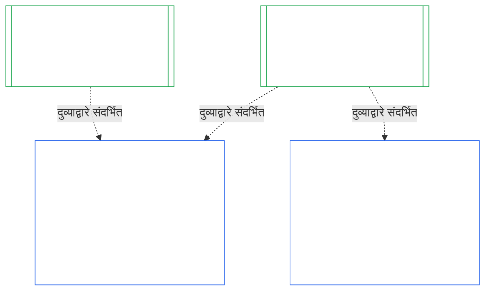
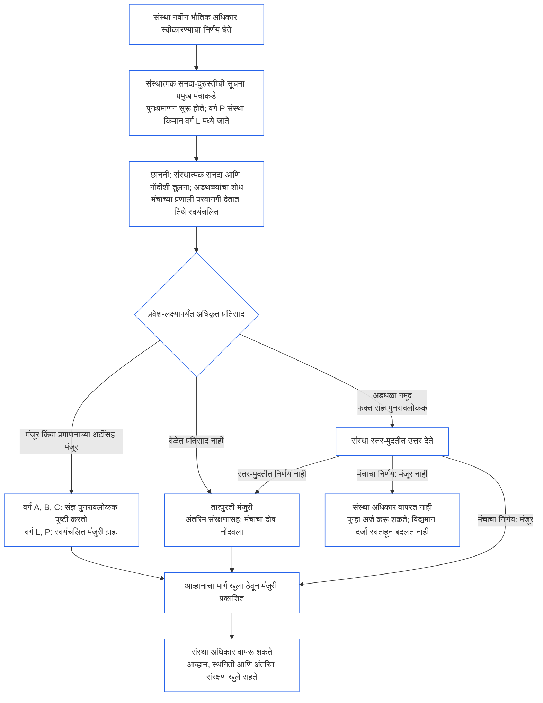

<!-- AI-assisted translation draft; unreviewed; English controls.
Source: core_10.000_institutional_alignment_certification.md
Source snapshot: 247e2180509e5e029c1106878cf225067339e010
Source SHA-256: a163a782114e584d09e295db66fe8b1b10a005b0f00116c8360396a0535ff221 -->

# अध्याय दहा: संस्थात्मक संरेखन प्रमाणन

<strong>कॉर्पस स्थान (कार्यकारी नाही): फाइल रचना आणि वाचन नियम</strong>

> ही फाइल **संज्ञ प्राणी संविधानाचा भाग** आहे आणि इतर क्रमांकित `core_*` फाइल्ससह एकच मजकूर म्हणून वाचल्यावरच **बंधनकारक** आहे. यात **अध्याय दहा** आहे — **संस्थात्मक संरेखन प्रमाणन**: एखाद्या [संस्थेचे](../../core_05.040_band_continuity.md#institution), ती चालवत असलेल्या कोणत्याही प्रणालीपासून वेगळे मानून, वर्गीकरण, मूल्यांकन, पुनरावलोकन, निर्णय, नोंद, अद्ययावतीकरण आणि पुनःप्रारंभ कसा केला जातो (**§1–§11**). अध्याय दहा हा [अध्याय नऊ](core_09.000_system_alignment_certification_evaluation.md#chapter-nine-system-alignment-certification) (*प्रणाली संरेखन प्रमाणन*) याचा संस्थात्मक समकक्ष आहे आणि **त्याच्या विभागांना तेच क्रमांक आहेत**: येथील §N तेथील §N ला उत्तर देतो. [CS-9.320](../../corpus_systems/cs_09.320_system_alignment_certification_illustrations.md#cs-9320-system-alignment-certification-illustrations) (*प्रणाली संरेखन प्रमाणनाची उदाहरणे*) मध्ये प्रणालींसाठी कार्य केलेली उदाहरणे आहेत आणि त्यातील [§12 संस्थेचे उदाहरणात्मक मार्गक्रमण](../../corpus_systems/cs_09.320_system_alignment_certification_illustrations.md#cs-9320-12-illustrative-institution-walkthroughs) मध्ये संस्थेची तीन मार्गक्रमणे आहेत. हा अध्याय ती पुन्हा देत नाही.
>
> | § | अध्याय नऊ (प्रणाली) | अध्याय दहा (संस्था) |
> |---|------------------------|----------------------------|
> | 1 | उद्देश आणि भूमिका | प्रणाली प्रमाणनाशी संबंध, कोण प्रमाणित होते, परवानगी नाही आणि स्थापना किंवा संचालनावर प्रवेशद्वार नाही, नवीन भौतिक अधिकाराची प्रतीक्षा, प्रथम प्रमाणनाची मुदत |
> | 2 | प्रणाली-वर्ग मूल्यांकन | संस्थेचा वर्ग; वर्गानुसार प्रमाणबद्धीकरण |
> | 3 | संपूर्ण-प्रणाली प्रमाणन मूल्यांकन | आठ संस्थात्मक बाबी, नेहमी |
> | 4 | लागू ठरल्यास मूल्यांकने | अध्याय नऊ §4 कडे निर्देश |
> | 5 | अधिकार-तळ आणि क्षेत्रीय मूल्यांकने | अध्याय नऊ §5 कडे निर्देश |
> | 6 | मंच-प्रक्रिया | चार जागा; मंचाच्या भूमिका आणि क्रम; मंच, प्रमाणक आणि नोंद कार्यालये संस्था म्हणून |
> | 7 | प्रमाणनाचे निकाल | संस्था आणि तिच्या प्रणालींचे कार्यारंभ, प्रमाणनाच्या अटी आणि निकालाचे इतर परिणाम; दोषांसाठी निर्देश; सुधारणा-सज्जता; नकार आणि रद्द करणे |
> | 8 | प्रणाली प्रमाणन नोंद | संस्थात्मक प्रमाणन नोंद |
> | 9 | पुनःप्रमाणन आणि पुनःप्रारंभ | निरीक्षण; पुनःप्रारंभाचे संकेत; तात्पुरते आणि पूर्ण प्रमाणन; चुकवेगिरीविरोध; प्रणाली प्रमाणनांतून येणारी साखळी; शासन उल्लंघन झाल्यास तिच्या प्रणालींचा पुनःप्रारंभ |
> | 10 | प्रमाणनाला आव्हान | आव्हानाचा मार्ग |
> | 11 | स्थायी हक्कांशी संबंध | स्थायी हक्कांचा दुवा |
>
> - **घटनात्मक स्वामी (अध्याय नऊसोबत संयुक्त):** मंचाच्या देखरेखीखालील संरेखन प्रमाणन आणि संबंधित नोंदी. अध्याय दहा संस्थात्मक विषय जोडतो. तो नवे मंच-कुटुंब, नवी जागा किंवा निकालासाठी नवा शब्द जोडत नाही.
> - **पुनरावृत्ती नव्हे, पुनर्वापर:** टप्पे III ते VI [अध्याय नऊ भाग B §6](core_09.005_system_alignment_certification_record_process.md#6-forum-process) ते [अध्याय नऊ भाग C §11](core_09.010_system_alignment_certification_record_recertification.md#11-relationship-to-standing) नुसार चालतात. विषय संस्था असताना काय बदलते तेवढेच अध्याय दहा सांगतो.
> - **स्थानांतरविरोधी नियम:** अध्याय दहा प्रणालीसाठी अध्याय नऊची मूल्यांकन-कार्यपद्धती, अध्याय सातमधील प्रणाली सनद व संस्थात्मक सनदेची क्षेत्रे, अध्याय आठमधील चार-जागांची आवश्यकता, [corpus_institutions](../../corpus_institutions.md) मधील संस्थात्मक कर्तव्ये, अध्याय अकरामधील स्थायी हक्कांचे मापन किंवा अध्याय बारामधील स्थायी हक्कांचे परिणाम पुन्हा मांडत नाही.
>
> **पूर्वस्रोत:** [अध्याय सात](core_07_charters.md#chapter-seven-system-and-institutional-charters) सनदा; [अध्याय आठ](../../core_08.000_functional_independence_separation_of_duties.md#chapter-eight-functional-independence-and-separation-of-duties) कार्यात्मक स्वातंत्र्य; [अध्याय नऊ](core_09.000_system_alignment_certification_evaluation.md#chapter-nine-system-alignment-certification) (भाग [A](core_09.000_system_alignment_certification_evaluation.md#chapter-nine-part-a-system-alignment-certification--evaluation), [B](core_09.005_system_alignment_certification_record_process.md#chapter-nine-part-b-system-alignment-certification--forum-process-and-outcomes), आणि [C](core_09.010_system_alignment_certification_record_recertification.md#chapter-nine-part-c-system-alignment-certification--record-recertification-and-standing)); अध्याय चौदा मंच देखरेख.
> **अधःस्रोत:** अध्याय अकरा स्थायी हक्कांच्या नोंदी आणि सत्यापित इनपुट; अध्याय बारा स्थायी हक्कांचे परिणाम.

<strong>Trace</strong>

- पूर्वस्रोत:
  - [अध्याय सात §1 प्रणाली आणि संस्थात्मक सनदा कधी आवश्यक असतात](core_07_charters.md#1-when-system-and-institutional-charters-are-required) (7.000 §1) (*कोणत्या संस्था प्रणाली सनद किंवा संस्थात्मक सनद प्रकाशित करतात आणि संस्थेचा वर्ग कोणता*);
  - [अध्याय सात §7 दुरुस्ती आणि पुनरावलोकन](core_07_charters.md#7-amendment-review-and-scope-misalignment) (7.000 §7) (*संस्थात्मक सनदेच्या पुनरावलोकनात कोणत्या बाबी तपासतात*);
  - [अध्याय सात §4 सनदेतील भूमिका-नकाशा आणि स्थायी-हक्क नोंदीचे अभिरक्षण](core_07_charters.md#4-the-charter-role-map-and-standing-record-custody) (7.000 §4) (*जागांची नियुक्ती कुठे केली जाते*);
  - [अध्याय आठ §2 चार-जागांची घटनात्मक आवश्यकता](core_07_functional_independence_segregation_of_duties.md#2-four-seat-constitutional-requirement) (8.000 §2) आणि [§9 नंतरच्या प्रक्रियांशी संबंध](core_07_functional_independence_segregation_of_duties.md#9-relationship-to-later-processes);
  - [अध्याय नऊ](core_09.000_system_alignment_certification_evaluation.md#chapter-nine-system-alignment-certification) (9.000 ते 9.010) (*या अध्यायात पुन्हा वापरलेली प्रणाली संरेखन प्रमाणन प्रक्रिया*);
  - [दोन मूलभूत प्रश्न](core_00_preamble.md#two-fundamental-questions);
  - [घटनात्मक चतुष्टय](core_00_preamble.md#constitutional-tetrad);
  - [अनुच्छेद XI-E](core_06_rights_part_b.md#article-xi-e-institutional-formation-and-business-creation) (*संस्थात्मक स्थापना आणि व्यवसायनिर्मिती*).
- अधःस्रोत: [§1](#1-purpose-and-role) ते [§11](#11-relationship-to-standing); अध्याय अकरा ([11.000](core_11_standing_assessment.md#chapter-eleven-contribution-violation-and-standing-model--measurement)); [अध्याय चौदा](../../core_15.000_forum.md#chapter-fifteen-forums-and-jurisdiction) (14.000).
- यांसह वाचा:
  - [संस्थात्मक संरेखन प्रमाणन](../../core_05.040_band_continuity.md#institutional-alignment-certification) आणि
  - [संस्थात्मक प्रमाणन नोंद](../../core_05.040_band_continuity.md#institutional-certification-record) (*अध्याय पाचमधील अर्थ*);
  - **CI-8.205 §6** (*प्रणाली आणि संस्थात्मक सनदेचा मजकूर, पुनरावलोकन आणि स्थापना नमुना*);
  - **CF-14.425** (*अखंडता सुरक्षा उपाय, कब्जा-प्रतिबंधक कार्यपद्धती आणि स्व-निर्णयविरोधी सहाय्य*).

 

अध्याय दहा हा **संस्थात्मक संरेखन प्रमाणनाचा** घटनात्मक स्वामी आहे. तो [अध्याय नऊ](core_09.000_system_alignment_certification_evaluation.md#chapter-nine-system-alignment-certification) ची प्रक्रिया प्रणालीपासून संस्थेपर्यंत विस्तारित करतो:

- **टप्पा I, चौकट ठरवा:** संस्थेचा वर्ग आणि तो मूल्यांकनाचे प्रमाण कसे ठरवतो ([§2 संस्थेचा वर्ग मूल्यांकन](#2-institution-class-evaluation));
- **टप्पा II, मूल्यांकन करा:** संस्थात्मक मूल्यांकन, ज्यात लागू ठरणारी मूल्यांकने आणि अधिकार-तळ व क्षेत्रीय मूल्यांकने समाविष्ट आहेत ([§3 संपूर्ण-संस्था प्रमाणन मूल्यांकन](#3-whole-institution-certification-evaluation) ते [§5 अधिकार-तळ आणि क्षेत्रीय मूल्यांकने](#5-rights-floor-and-domain-evaluations));
- **टप्पा III, पुनरावलोकन करा:** मंचाच्या भूमिका आणि क्रम ([§6 मंच-प्रक्रिया](#6-forum-process));
- **टप्पा IV, निर्णय घ्या:** निकाल, सुधारणा-सज्जता, नकार आणि रद्द करणे ([§7 प्रमाणनाचे निकाल](#7-certification-outcomes));
- **टप्पा V, नोंद करा:** संस्थात्मक प्रमाणन नोंद ([§8 संस्थात्मक प्रमाणन नोंद](#8-institutional-certification-record)); आणि
- **टप्पा VI, कार्यरत ठेवा:** पुनःप्रमाणन, पुनःप्रारंभ, प्रणाली प्रमाणनांची साखळी, तिच्या प्रणालींचा पुनःप्रारंभ, आव्हानाचा मार्ग आणि स्थायी हक्कांचा दुवा ([§9 पुनःप्रमाणन आणि पुनःप्रारंभ](#9-recertification-and-reopening) ते [§11 स्थायी हक्कांशी संबंध](#11-relationship-to-standing)).

*सोप्या शब्दांत: अध्याय नऊ विचारतो की **प्रणाली** संरेखित आहे का. अध्याय दहा प्रणाली चालवणाऱ्या किंवा स्वतः प्रणाली न चालवता अधिकार धारण करणाऱ्या **संस्थेचे** तेच परीक्षण करतो. एखादी संस्था संरेखित असू शकते, पण तिची एखादी प्रणाली नसू शकते; याच्या उलटही घडू शकते. म्हणून संस्थेच्या नियंत्रणातील बाबी तपासल्या जातात: ती आपल्या संस्थात्मक सनदेनुसार काम करते का, तिच्या अधिकारासाठी कोण उत्तरदायी आहे, ती स्वतःच्या सदस्यांमध्ये कशाला बक्षीस देते आणि तिच्यावरील स्वतंत्र तपासण्या प्रत्यक्ष वापरता येतात का. ती प्रत्येक प्रणालीच्या प्रमाणनावर अवलंबून असते आणि ते पुन्हा करत नाही. हे परवाना नाही: संस्था सुरू करण्यासाठी किंवा चालवण्यासाठी कोणालाही तिची परवानगी लागत नाही.*

### 1. उद्देश आणि भूमिका

<strong>Trace</strong>

- पूर्वस्रोत:
  - [अध्याय सात §1 प्रणाली आणि संस्थात्मक सनदा कधी आवश्यक असतात](core_07_charters.md#1-when-system-and-institutional-charters-are-required) (7.000 §1);
  - [अध्याय नऊ भाग A §1 उद्देश आणि भूमिका](core_09.000_system_alignment_certification_evaluation.md#1-purpose-and-role) (9.000 §1);
  - [अनुच्छेद XI-E](core_06_rights_part_b.md#article-xi-e-institutional-formation-and-business-creation) (*संस्थात्मक स्थापना आणि व्यवसायनिर्मिती*);
  - [अनुच्छेद XXVIII-A](../../core_06.020_rights_part_e.md#xxviii-a-existing-instantiations-adoption-transition-window) (*टप्प्याटप्प्याने अवलंब आणि अधिकार-तळ सातत्य*).
- अधःस्रोत: [§2](#2-institution-class-evaluation); [§6](#6-forum-process); [§7](#7-certification-outcomes); [§9](#9-recertification-and-reopening).
- यांसह वाचा:
  - [संस्था](../../core_05.040_band_continuity.md#institution);
  - [संस्थात्मक सनद](../../core_05.040_band_continuity.md#institutional-charter);
  - [प्रणाली सनद](../../core_05.040_band_continuity.md#system-charter);
  - [व्यवसायनिर्मिती](../../core_05.055_band_participation.md#business-creation).

 

*सोप्या शब्दांत: प्रणालीचे प्रमाणन त्या प्रणालीचे असते. संस्थेचे प्रमाणन त्या प्रमाणनांचा संदर्भ देते आणि फक्त संस्थाच ज्यासाठी उत्तर देऊ शकते ते जोडते. एक प्रणाली अनेक संस्थांखाली किंवा कोणत्याही संस्थेखाली नसू शकते. येथे कोणतीही बाब संस्था सुरू करण्याच्या आड येण्यासाठी प्रमाणनाला परवानगी देत नाही.*

संस्थात्मक संरेखन प्रमाणन आणि प्रणाली संरेखन प्रमाणन ही दुव्याने जोडलेली दोन प्रमाणने आहेत. त्यांचा संबंध **दुव्याद्वारे संयोजनाचा** आहे, अंतर्भावाचा नाही. आकृतीत, प्रणाली प्रमाणन नोंदीपासून तिचा संदर्भ देणाऱ्या प्रत्येक संस्थात्मक प्रमाणन नोंदीकडे बाण जातो. कोणत्याही संस्थेखाली नसलेल्या प्रणालीला बाण नसतो आणि त्याची गरजही नसते; कोणतीही प्रणाली चालवत नसलेल्या संस्थेची स्वतंत्र नोंद असते.

दुव्याद्वारे संयोजनाच्या दोन बाजू आहेत; पहिली संस्था-संबंधित आहे.

संस्थेच्या बाजूने:

- **संस्थात्मक प्रमाणन नोंद प्रणालीचा संदर्भ देते; तिचे मूल्यांकन पुन्हा करत नाही:** ती प्रणाली प्रमाणन नोंदीचा दुव्याद्वारे संदर्भ देते आणि तिची आवृत्ती नमूद करते. हा अध्याय प्रणालीचे मूल्यांकन पुन्हा करत नाही, प्रणालीच्या वर्गावर पुन्हा निर्णय देत नाही किंवा तिचा निकाल, स्थिती अथवा प्रमाणनाच्या अटी बदलत नाही.
- **संस्थेचे प्रमाणन प्रणालीचे प्रमाणन उंचावू शकत नाही:** प्रमाणित नसलेली प्रणाली संस्थेची स्थिती काहीही असली तरी प्रमाणित नसलेलीच राहते. प्रमाणित प्रणालीला संस्थेच्या निष्कर्षापासून संरक्षण मिळत नाही.
- **संस्थात्मक तथ्ये एकदाच निश्चित होतात:** [अध्याय नऊ भाग A §3.1 शासन, प्रोत्साहन आणि आव्हानक्षमता शिस्त](core_09.000_system_alignment_certification_evaluation.md#31-governance-incentive-and-contestability-discipline) चालकाच्या शासन व प्रोत्साहनांबद्दल विचारत असेल, तर चालकाची सध्याची संस्थात्मक प्रमाणन नोंद दुव्याद्वारे त्या तथ्यांचा पुरवठा करू शकते. ती तथ्ये त्या प्रणालीसाठी पुरेशी आहेत का हे प्रणालीचे मंचच ठरवतात. प्रणाली प्रमाणन नोंदीत कारण न सांगता तेच संस्थात्मक तथ्य वेगळे ठरवता येत नाही.

प्रणालीच्या बाजूने:

- **प्रणाली प्रमाणन नोंद प्रणालीची असते:** [अध्याय नऊ](core_09.000_system_alignment_certification_evaluation.md#chapter-nine-system-alignment-certification) अंतर्गत ती प्रणालीची स्वतःची नोंद असते.
- **एका प्रणाली प्रमाणन नोंदीचा अनेक संस्था संदर्भ देऊ शकतात:** [अध्याय सात §1 प्रणाली आणि संस्थात्मक सनदा कधी आवश्यक असतात](core_07_charters.md#1-when-system-and-institutional-charters-are-required) अंतर्गत एकापेक्षा अधिक संस्था प्रणाली चालवू, तिचे कारभारीपण करू किंवा तिच्यावर भौतिक नियंत्रण ठेवू शकतात. प्रत्येक संस्था त्याच नोंदीचा संदर्भ देते.
- **प्रणाली कोणत्याही संस्थेखाली असणे आवश्यक नाही:** एकच संज्ञ प्राणी संस्था नसतो, म्हणून प्रणालीखाली कोणतीही संस्था नसू शकते. संस्था नसलेल्या प्रणालीचे प्रमाणन केवळ [अध्याय नऊ](core_09.000_system_alignment_certification_evaluation.md#chapter-nine-system-alignment-certification) अंतर्गत होते आणि या अध्यायाकडून तिला काहीही लागत नाही. एखादी प्रणाली संस्थेखाली असली तरी तिचे प्रमाणन त्याच प्रकारे होते: हा अध्याय संस्थेसाठी स्वतंत्र नोंद जोडतो आणि प्रणालीच्या स्वतःच्या प्रमाणनातील पायरी नाही.

#### 1.1 कोण प्रमाणित होते

वर्ग L किंवा त्यावरील संस्था या अध्यायाच्या व्याप्तीत येते; तिचा वर्ग [§2.1 संस्था-वर्ग](#21-institution-class) अंतर्गत ठरतो. यात कोणतीही प्रणाली चालवत नसलेली संस्थाही येते: संदर्भ देण्यासाठी तिच्याकडे प्रणाली प्रमाणन नोंद नसते आणि तिचा वर्ग तिच्या स्वतःच्या परिणामांवरून ठरतो. संस्थेचा **पोर्टफोलिओ** म्हणजे ती चालवत असलेल्या, कारभारीपण करत असलेल्या किंवा भौतिक नियंत्रणात ठेवत असलेल्या प्रणालींचा संच ([पोर्टफोलिओ](../../core_05.040_band_continuity.md#portfolio)).

- **वर्ग A, B, C आणि L:** [§2.2 वर्गानुसार प्रमाणबद्धीकरण](#22-scaling-by-class) अंतर्गत वर्गानुसार प्रमाणबद्ध केलेली प्रक्रिया लागू होते.
- **वर्ग P:** प्रक्रिया करण्यास प्रोत्साहन दिले जाते आणि ती स्वेच्छेने वापरता येते. वर्ग L किंवा त्यावरील वर्गात पुनर्वर्गीकरण झाल्यास किंवा संस्था स्वेच्छेने घटनात्मक अनुपालनाचा दावा करत असल्यास ती अनिवार्य होते. नवीन भौतिक अधिकार स्वीकारण्याचा निर्णय घेणाऱ्या वर्ग P संस्थेचे [§9.2.2 नवीन भौतिक अधिकारासाठी पुनःप्रमाणन](#922-recertification-for-new-material-authority) मधील सूचना देताना किमान वर्ग L मध्ये पुनर्वर्गीकरण होते; कारण व्याख्येनुसार तो अधिकार भौतिक असतो ([§9.2.1 नवीन भौतिक अधिकार कशाला म्हणतात](#921-what-counts-as-new-material-authority)) आणि कोणत्याही क्षेत्रात भौतिक असलेली संस्था किमान वर्ग L असते ([§2.1 संस्था-वर्ग](#21-institution-class), मुद्दा 2). सूचना मंजुरीपूर्वी मागे घेतली जाईपर्यंत किंवा अधिकाराला मंजुरी नाकारली जाईपर्यंत हे पुनर्वर्गीकरण लागू राहते; मात्र त्या अधिकाराचा वापर झालेला नसला पाहिजे. त्यानंतर संस्था पुन्हा वर्ग P मध्ये जाते आणि मर्यादित प्रथम प्रमाणन संपते. नव्या सूचनेने ते पुन्हा सुरू होते; आणि मंजुरीशिवाय अधिकार वापरणे हे [§9.2.2 नवीन भौतिक अधिकारासाठी पुनःप्रमाणन](#922-recertification-for-new-material-authority) (*सूचनेशिवाय किंवा मंजुरीपूर्वी*) अंतर्गत निष्कर्षच राहते. हे [अध्याय नऊ भाग A §1 उद्देश आणि भूमिका](core_09.000_system_alignment_certification_evaluation.md#1-purpose-and-role) शी सुसंगत आहे.
- **एक प्रणाली:** प्रणाली सनदा आवश्यक असलेली नेमकी एक प्रणाली चालवणाऱ्या संस्थेची एक प्रमाणन फेरी आणि एक नोंद असते; या अध्यायात तिला **एक-प्रणाली मूल्यांकन** म्हणतात. प्रणाली प्रमाणन नोंदीत [§8 संस्थात्मक प्रमाणन नोंद](#8-institutional-certification-record) मधील मुद्दे असलेला *संस्थात्मक निष्कर्षांचा विभाग* असतो आणि तो संस्थात्मक प्रमाणन नोंद म्हणून काम करतो. मंच, जागा आणि कालमर्यादा या प्रणालीच्या स्वतःच्या प्रमाणन फेरीतील असतात; त्यात संस्थात्मक मुद्दे जोडले जातात. [§7.4 संस्थेसाठी नकार आणि रद्द करणे](#74-denial-and-revocation-for-an-institution) मध्ये सांगितल्याप्रमाणे त्यांचे निकाल त्यांच्या स्वतःच्या नकार व रद्द करण्याच्या आधारांनुसार ठरतात. प्रणालीच संपूर्ण पोर्टफोलिओ असल्याने [§9.5 प्रणाली प्रमाणनांतून येणारी साखळी](#95-cascade-from-system-certifications) साखळी म्हणून लागू होत नाही; परंतु [§7.4 संस्थेसाठी नकार आणि रद्द करणे](#74-denial-and-revocation-for-an-institution) मधील नियम 1 आणि 2 (संकेतक आणि कारण कुठे आहे याची चाचणी) लागू होतात.
- **अनेक प्रणाली:** संस्थेसाठी एक संस्थात्मक प्रमाणन नोंद असते; ती संस्था चालवत असलेल्या प्रत्येक प्रणालीच्या प्रणाली प्रमाणन नोंदीशी दुवा जोडते. प्रत्येक प्रणालीची स्वतःची प्रमाणन फेरी आणि नोंद कायम राहते.
- **प्रणाली नाही:** स्वतंत्र अशी एक संस्थात्मक प्रमाणन नोंद असते. संस्थेकडे चालवण्यासाठी प्रणाली नसल्यामुळे जोडण्यासाठी प्रणाली प्रमाणन नोंद नसते.

#### 1.2 स्थापना किंवा संचालनासाठी परवानगी नाही आणि प्रवेशद्वार नाही

संस्थात्मक संरेखन प्रमाणन हे संस्था प्रत्यक्षात आपला अधिकार कसा वापरते याचे स्वतंत्र परीक्षण आहे. संस्थेपासून स्वतंत्र मंच ते करतात आणि त्यांच्या निष्कर्षांची संस्थात्मक प्रमाणन नोंद हा त्याचा शेवट असतो.

- **सुरू करणे आणि चालवणे:** संस्था प्रथम प्रमाणन मिळवण्याची वाट न पाहता स्थापन होते, आपली संस्थात्मक सनद प्रकाशित करते, अधिकार वापरण्यास सुरुवात करते आणि कार्यरत राहते; कोणताही निकाल हा अधिकार देत किंवा हिरावून घेत नाही.
- **निकालाचा परिणाम:** निकालाचे परिणाम फक्त [§7.1 संस्थेचे कार्यारंभ](#71-go-live-for-an-institution) येथे नमूद केलेले असतात.
- **या क्षेत्रातील एकमेव प्रवेशद्वारे:** **अनुच्छेद XI-E** (*संस्थात्मक स्थापना आणि व्यवसायनिर्मिती*) मधील तीन मर्यादित प्रवेशद्वारे आहेत:
  - नावाने निर्दिष्ट संज्ञ प्राण्यावरील प्रलंबित लॉक, जो त्या संज्ञ प्राण्याच्या अधिकाराला जोडलेला असतो;
  - विसंरेखनाच्या विशिष्ट सत्यापित तथ्यांवरील अंतरिम स्थगिती, जीही नावाने निर्दिष्ट संज्ञ प्राण्याच्या अधिकाराला जोडलेली असते;
  - कार्यकारी पक्षावरील लॉक, जो **CI-12.210 §4** (*विसर्जन*) अंतर्गत विसर्जित संस्थेवर जसा लॉक असतो, तसाच एखाद्या संस्थेवर लॉक असल्यासच तिच्याशी जोडला जातो.

  [§7.5 संस्थेसाठी नकार आणि रद्द करण्याचे परिणाम](#75-effects-of-denial-and-revocation-for-an-institution) अंतर्गत प्रमाणन निष्कर्षाचा पुरावा म्हणून या प्रवेशद्वारांपैकी एकाचा निर्णय घेणाऱ्या मंचाकडे संदर्भ देता येतो. प्रमाणनाचा निकाल स्वतः प्रवेशद्वार नसतो आणि तो एखादे प्रवेशद्वार उघडत किंवा बंद करत नाही.
- **नवीन भौतिक अधिकाराची प्रतीक्षा:** नवीन भौतिक अधिकार स्वीकारण्याचा निर्णय घेणारी संस्था [§9.2.2 नवीन भौतिक अधिकारासाठी पुनःप्रमाणन](#922-recertification-for-new-material-authority) च्या अटींनुसार त्या अधिकाराचा वापर करण्यापूर्वी पुनःप्रमाणनातून मंजुरी मिळण्याची वाट पाहते. ही प्रतीक्षा **अनुच्छेद XI-E** (*संस्थात्मक स्थापना आणि व्यवसायनिर्मिती*) मध्ये नमूद आहे. ती तीन मर्यादित प्रवेशद्वारांपैकी नाही आणि स्थापना किंवा संचालनावरील प्रवेशद्वारही नाही. ती फक्त नव्या अधिकाराला लागू होते; संस्थेची इतर सर्व कामे सुरू राहतात. [§9.2.2 नवीन भौतिक अधिकारासाठी पुनःप्रमाणन](#922-recertification-for-new-material-authority) मधील आकृती पायऱ्यांचा सारांश देते.
- **मागचा दरवाजा नाही:** मंच, अवलंबक किंवा पदावरील व्यक्ती यांपैकी कोणीही संस्थापकांना बाहेर ठेवणारी किंवा विद्यमान पदाधिकाऱ्यांचे संरक्षण करणारी अधिकृतता-पूर्वअट म्हणून या अध्यायाचा वापर करू शकत नाही. त्यामुळे [अनुच्छेद XI-E](core_06_rights_part_b.md#article-xi-e-institutional-formation-and-business-creation) (*संस्थात्मक स्थापना आणि व्यवसायनिर्मिती*) निष्प्रभ होईल.
  - [टाळता येण्याजोगा भार](../../core_05.040_band_continuity.md#avoidable-burden) प्रक्रियेच्या खर्चाला लागू होतो.
  - [वर्गीकरणानुसार प्रमाणबद्ध शासन](core_05_band_oversight.md#classification-scaled-governance) तिच्या सखोलतेला लागू होते.
  - नवीन भौतिक अधिकाराची प्रतीक्षा प्रत्येक वर्गातील संस्थेला त्याच अटींवर लागू होते आणि फक्त इतरांसाठी आधीपासून भौतिक असलेल्या अधिकारापुरती असते.

प्रणालींसाठीचे कार्यारंभ प्रवेशद्वार स्वतंत्र आहे आणि ते त्यांच्याशीच संबंधित राहते. [अध्याय नऊ भाग B §7.1 कार्यारंभ प्रवेशद्वार](core_09.005_system_alignment_certification_record_process.md#71-go-live-gate) अंतर्गत नवीन प्रणाली किंवा तिचा भौतिक विस्तार फक्त स्वतःच्या प्रमाणनातूनच कार्यारंभ करू शकतो; संस्थेची स्थिती काहीही असो.

#### 1.3 प्रथम प्रमाणनासाठीची मुदत

प्रथम संस्थात्मक प्रमाणन नोंद संस्थेच्या वर्गासाठी अवलंबक दस्तऐवजाने ठरवलेल्या मुदतीत सादर करणे आवश्यक आहे.

- **नवीन संस्था:** [क्षेत्र-विशिष्ट भौतिकता](core_05_band_oversight.md#domain-specific-materiality) ठरवते त्यानुसार तिचा इतरांवर प्रथम भौतिक परिणाम ज्या दिवशी होतो त्या दिवसापासून मुदत सुरू होते आणि तिचे पहिले प्रमाणन तात्पुरते असते.
- **सूचनेवर पुनर्वर्गीकृत वर्ग P संस्था:** नवीन संस्थेप्रमाणे [§9.2.2 नवीन भौतिक अधिकारासाठी पुनःप्रमाणन](#922-recertification-for-new-material-authority) अंतर्गत सूचना दिलेल्या दिवसापासून मुदत सुरू होते; आधीच संपलेल्या अवलंब-स्थित्यंतर मुदतीपासून ती कधीही सुरू होत नाही.
- **आधीपासून कार्यरत संस्था:** [अनुच्छेद XXVIII-A](../../core_06.020_rights_part_e.md#xxviii-a-existing-instantiations-adoption-transition-window) (*टप्प्याटप्प्याने अवलंब आणि अधिकार-तळ सातत्य*) अंतर्गत अवलंब-स्थित्यंतर मुदत लागू होते; [अध्याय सात §1.5 प्रणाली सनद किंवा संस्थात्मक सनद कधी सादर करावी](core_07_charters.md#15-when-a-system-charter-or-institutional-charter-is-due) मधील पूर्वनिर्धारित नियमाशी हे सुसंगत आहे.
- **मुदत चुकल्यास:** खालील सूट लागू नसताना प्रथम प्रमाणन फेरी न होता मुदत संपवणाऱ्या संस्थेचा दोष नोंदवून दुरुस्त करावा लागतो आणि चुकलेली मुदत ही फेरी सुरू करते. आधीपासून कार्यरत वर्ग L किंवा त्यावरील संस्थेची खालील टप्पा-अपयशाची बाबही लागू होते. प्रवेशद्वार नसल्यामुळे संस्थेचे संचालन थांबवले जात नाही किंवा त्यावर बंदी घातली जात नाही ([§1.2 स्थापना किंवा संचालनासाठी परवानगी नाही आणि प्रवेशद्वार नाही](#12-no-permission-and-no-gate-on-forming-or-running)).
  - **आधीपासून कार्यरत संस्था:** वर्ग L किंवा त्यावरील संस्थांसाठी हा या अध्यायाचा स्वतःचा नियम आहे; [अनुच्छेद XXVIII-A](../../core_06.020_rights_part_e.md#xxviii-a-existing-instantiations-adoption-transition-window) (*टप्प्याटप्प्याने अवलंब आणि अधिकार-तळ सातत्य*) मधील प्रणाली व व्युत्पन्न घटकांच्या नियमांशी साधर्म्याने तो ठरवला आहे. तिची अवलंब-स्थित्यंतर मुदत संपली आणि पहिली प्रमाणन फेरी पूर्ण झाली नाही (म्हणजे तात्पुरते किंवा पूर्ण प्रमाणन नाही आणि [§7 प्रमाणनाचे निकाल](#7-certification-outcomes) अंतर्गत निर्णय झालेला नाही), तर तिने अंतिम मुदत चुकवली आहे. मुदतीत अर्ज करून सहकार्य केलेल्या संस्थेने मुदत चुकवलेली मानली जात नाही, जर मंचाने स्वतःची वेळ ओलांडल्यामुळे ([अध्याय चौदा §6 वेळेवर निराकरण, भौतिकता स्तर आणि विलंबविरोधी शिस्त](core_11_forum.md#6-timely-resolution-materiality-tiers-and-anti-delay-discipline), *मुदत ओलांडल्याचे पुनरावलोकन*; [अध्याय नऊ भाग C §9.3.4 स्तर-मुदती](core_09.010_system_alignment_certification_record_recertification.md#934-tier-windows)) किंवा [§7.3 संस्थेसाठी सुधारणा-सज्जता](#73-remediation-readiness-for-an-institution) अंतर्गत एकमेव स्थगिती सुरू असल्यामुळे फेरी अपूर्ण असेल. **अनुच्छेद XXVIII-B** ([अवलंब-स्थित्यंतर अधिकार मर्यादा आणि पुनःअधिकृतीकरण](../../core_06.020_rights_part_e.md#article-xxviii-b-adoption-transition-authority-limits-and-reauthorization)) अंतर्गत पुनःअधिकृतीकरणाचा दस्तऐवजीकृत दाखला नसल्यास हे अवलंब-स्थित्यंतर टप्पा-अपयश ठरते आणि [अध्याय अकरा](core_11_standing_assessment.md#chapter-eleven-contribution-violation-and-standing-model--measurement) मधील सामान्य अनुपालन व उल्लंघन मार्ग सुरू होतो. त्या अनुच्छेदातील संयमाची कर्तव्ये प्रभावी तारखेपासून लागू होतात आणि ही तफावत टिकून राहिल्याने ती नवी सामान्य स्थिती होत नाही. हे [अध्याय नऊ भाग B §7.1.1 आधीपासून कार्यरत प्रणाली](core_09.005_system_alignment_certification_record_process.md#711-systems-already-operating) शी सुसंगत आहे. हे प्रवेशद्वार नाही.
  - **प्रमाणन फेरी:** इतर कोणत्याही फेरीप्रमाणेच तिचा निर्णय होतो. [§7 प्रमाणनाचे निकाल](#7-certification-outcomes) मधील कोणताही निकाल लागू शकतो; त्यात प्रमाणित नाही हा निकालही समाविष्ट आहे. त्याचे परिणाम [§7.5 संस्थेसाठी नकार आणि रद्द करण्याचे परिणाम](#75-effects-of-denial-and-revocation-for-an-institution) येथे दिले आहेत.
  - **दंड आणि विसर्जन:** हा अध्याय कोणतेही दंड किंवा विसर्जन निर्माण करत नाही. निलंबन, प्रशासक-नियुक्ती, संरचनात्मक विभाजन आणि विसर्जन हे अधिकारक्षेत्र असलेल्या मंचाकडे **CI-12.210** (*संस्थात्मक अपयश आणि विसर्जन*) आणि **CI-12.215** (*संस्थात्मक उत्तरदायित्व आणि दंड*) अंतर्गतच राहतात. [§7.5 संस्थेसाठी नकार आणि रद्द करण्याचे परिणाम](#75-effects-of-denial-and-revocation-for-an-institution) मधील संदर्भाच्या आधारांवरच त्या मंचाकडे संदर्भ दिला जातो (मुद्दा 5, *संदर्भ*).

### 2. संस्था-वर्ग मूल्यांकन

<strong>Trace</strong>

- पूर्वस्रोत:
  - [अध्याय सात §1 प्रणाली आणि संस्थात्मक सनदा कधी आवश्यक असतात](core_07_charters.md#1-when-system-and-institutional-charters-are-required) (7.000 §1);
  - [अध्याय नऊ भाग A §2 प्रणाली-वर्ग मूल्यांकन](core_09.000_system_alignment_certification_evaluation.md#2-system-class-evaluation) (9.000 §2) आणि [§2.2 प्रत्येक मूल्यांकनावर प्रणाली-वर्गाचा परिणाम](core_09.000_system_alignment_certification_evaluation.md#22-how-system-class-scales-every-evaluation);
  - [अध्याय तीन §2.1 चुकवेगिरीचे सामान्य नमुने](core_03_definition_integrity.md#21-common-evasion-patterns) (3.000 §2.1).
- अधःस्रोत: [§3](#3-whole-institution-certification-evaluation) (*वर्गानुसार प्रमाणबद्ध होणाऱ्या बाबी*); [§8](#8-institutional-certification-record) (*नोंदीत वर्ग नमूद असतो*); [§9.2](#92-reopening-triggers) (*वर्गाचे पुनर्मूल्यांकन करणारे संकेत*).
- यांसह वाचा:
  - **CS-9.305** (*प्रणाली वर्गीकरण यंत्रणा*) आणि **CS-9.310** (*प्रणाली परिणाम वर्गीकरण*) आणि [corpus_systems/cs_09.310_system_impact_classifications.md](../../corpus_systems/cs_09.310_system_impact_classifications.md) (*वर्गसूची*);
  - **CI-9.210** (*वर्गीकरणाशी निगडित संस्थात्मक कर्तव्ये*);
  - **CI-8.205 §6** (*प्रणाली आणि संस्थात्मक सनदेचा मजकूर, पुनरावलोकन आणि स्थापना नमुना*).

 

*सोप्या शब्दांत: प्रथम संस्थेचा इतरांसाठी किती परिणाम होतो त्यावरून तिचा वर्ग ठरवा. ती स्वतःला काय म्हणते यावर नव्हे, तर प्रत्यक्षात काय ठरवते आणि काय धारण करते यावर निर्णय घ्या. मग वर्ग मूल्यांकन किती सखोल असेल ते ठरवतो: वर्ग जितका उंच, तितका अधिक कठोर पुरावा, अधिक स्वतंत्र पुनरावलोकन आणि लवकर पुन्हा तपासणी.*

हा विभाग संस्थेसाठी **टप्पा I, चौकट** आहे.

#### 2.1 संस्था-वर्ग

**संस्था-वर्ग** हा संस्थेच्या सर्वाधिक भौतिक परिणामावरून ठरतो; तो परिणाम ती चालवत असलेल्या प्रणालीद्वारे असो किंवा कोणत्याही प्रणालीबाहेर असो. संस्थेचा प्रत्यक्ष निर्णय, धारण आणि नियंत्रण काय आहे यावरून तो ठरतो; संस्थेचे नाव, कायदेशीर स्वरूप किंवा संस्थात्मक सनदेतील यादी यावरून नाही. [अध्याय नऊ भाग A §2.2 प्रत्येक मूल्यांकनावर प्रणाली-वर्गाचा परिणाम](core_09.000_system_alignment_certification_evaluation.md#22-how-system-class-scales-every-evaluation) प्रणालीसाठी जसे करते, तसेच येथे वर्ग मूल्यांकनाची खोली आणि कालमर्यादा ठरवतो. या अध्यायात आणि [अध्याय सात §1.2 कोणते वर्ग समाविष्ट आहेत](core_07_charters.md#12-which-classes-are-covered) येथे वापरला जाणारा हाच वर्ग आहे.

1. **प्रणालींद्वारे होणारा परिणाम:** संस्थेचा वर्ग तिच्या पोर्टफोलिओतील कोणत्याही प्रणालीच्या सर्वोच्च वर्गाइतका तरी असतो ([अध्याय सात §1 प्रणाली आणि संस्थात्मक सनदा कधी आवश्यक असतात](core_07_charters.md#1-when-system-and-institutional-charters-are-required)). प्रणालींची ओळख प्रत्यक्ष कामकाजाच्या निरीक्षणातून होते. संस्थात्मक सनदेत नसलेली प्रणालीही गणली जाते.
2. **कोणत्याही प्रणालीबाहेरचा परिणाम:** संस्था प्रणाली चालवत असो वा नसो, तिचा स्वतःचा भौतिक परिणाम आणि अवलंबित्व गणले जाते. **CS-9.305** (*प्रणाली वर्गीकरण यंत्रणा*) आणि **CS-9.310** (*प्रणाली परिणाम वर्गीकरण*) मधील वर्ग-व्याख्या संस्थेच्या स्वतःच्या निर्णयांना व धारणांना पुढील घटक वापरून लागू होतात:
   - **ती काय ठरवते आणि धारण करते:**
     - इतर संज्ञ प्राण्यांचा जगण्यासाठी आवश्यक वस्तू, शिक्षण, सुरक्षितता, उपजीविका, अधिकार किंवा स्थायी हक्कांवरील प्रवेश ती काय ठरवते; आणि
     - निधी, नोंदी, सदस्यत्वे, स्थायी-हक्क नोंदींचे अभिरक्षण किंवा मंच, प्रमाणक वा नोंद कार्यालयाचे कार्य यांसारख्या ती धारण करत असलेल्या बाबी.
   - **ती भौतिक आहे का:**
     - [क्षेत्र-विशिष्ट भौतिकता](core_05_band_oversight.md#domain-specific-materiality) मधील कोणत्याही क्षेत्रात तिची स्वतःची कृती भौतिक आहे का; यात इतरांनी पाळावे किंवा निश्चित मानून त्यावर अवलंबून राहावे असे [भौतिकरीत्या बंधनकारक कृत्य](../../core_05.035_band_accountability.md#materially-binding-act) करणेही समाविष्ट आहे;
     - कोणत्याही एका क्षेत्रात भौतिक असलेली संस्था **CS-9.305** (*प्रणाली वर्गीकरण यंत्रणा*) आणि **CS-9.310** (*प्रणाली परिणाम वर्गीकरण*) अंतर्गत किमान वर्ग L असते; आणि
     - इतरांना घेता किंवा नाकारता येणारी, आणि त्यांच्या आवश्यक गोष्टींवरील प्रवेश नियंत्रित न करणारी मदत, वस्तू, श्रम किंवा सेवा देणे कोणालाही बांधून ठेवत नाही. ते कृत्य असते, भौतिकरीत्या बंधनकारक कृत्य नाही, आणि ते फक्त इतर घटकांतून गणले जाते.
   - **तिच्यावर किती अवलंबून आहेत:**
     - किती संज्ञ प्राणी तिच्यावर अवलंबून आहेत आणि पर्याय कितपत उपलब्ध आहेत;
     - भौतिक नियंत्रण रेषेच्या अर्थाने तिचा अधिकार किती केंद्रित आहे; आणि
     - तिचे निर्णय किती प्रतिवर्तनीय आहेत.
3. **सामायिक नियंत्रण:** [क्षेत्र-विशिष्ट भौतिकता](core_05_band_oversight.md#domain-specific-materiality) च्या एकत्रीकरण नियमांतर्गत ( [भौतिक नियंत्रण रेषे](../../core_05.035_band_accountability.md#material-control-line) मधील समान व्यावहारिक नियंत्रण; केवळ निधी पुरेसा नाही) एकच कार्यवाही असलेले कार्यकारी पक्ष व्यवहारात एक संस्था म्हणून काम करत असतील तर त्यांचे एकत्र वर्गीकरण होते. कार्यकारी पक्ष, त्याचा पोर्टफोलिओ किंवा अधिकार यांची विभागणी करून कोणताही भाग वर्ग L पर्यंत पोहोचू न देणे ही [अध्याय तीन §2.1 चुकवेगिरीचे सामान्य नमुने](core_03_definition_integrity.md#21-common-evasion-patterns) अंतर्गत व्याप्ती व सीमांची चुकवेगिरी आहे.
4. **पुनर्वर्गीकरण:** [§9.2 पुनःप्रारंभाचे संकेत](#92-reopening-triggers) येतात तेव्हा वर्गाचे पुनर्मूल्यांकन होते. वर्ग आणि त्यामागची कारणे संस्थात्मक प्रमाणन नोंदीत नमूद केली जातात.

#### 2.2 वर्गानुसार प्रमाणबद्धीकरण

[अध्याय नऊ भाग A §2.2 प्रत्येक मूल्यांकनावर प्रणाली-वर्गाचा परिणाम](core_09.000_system_alignment_certification_evaluation.md#22-how-system-class-scales-every-evaluation) जसे करते, तसेच संस्था-वर्ग पुराव्याची खोली, पुनरावलोकनाचे स्वातंत्र्य, प्रमाणनाची पूर्वनिर्धारित मुदत आणि नोंदीतील प्रकटीकरण यांचे प्रमाण ठरवतो. प्रमाणनाच्या मुदती [अध्याय चौदा §6 वेळेवर निराकरण, भौतिकता स्तर आणि विलंबविरोधी शिस्त](../../core_15.000_forum.md#review-cadence) (*पुनरावलोकनाची वारंवारता*) येथे आहेत; अवलंबक दस्तऐवज कमी मुदती ठरवू शकतो आणि किती स्वच्छ तात्पुरती पुनःप्रमाणने आवश्यक आहेत हे ठरवतो.

- **वर्ग A, B आणि C:** [§3 संपूर्ण-संस्था प्रमाणन मूल्यांकन](#3-whole-institution-certification-evaluation) मधील सर्व आठ बाबी; पुरावा आणि स्वातंत्र्य वर्गाच्या प्रमाणात.
- **वर्ग L:** त्याच आठ बाबी, पण सोप्या स्वरूपात; [वर्गीकरणानुसार प्रमाणबद्ध शासन](core_05_band_oversight.md#classification-scaled-governance) परवानगी देत असेल तिथे सोप्या नोंदी आणि प्रमाणनाची अधिक लांब पूर्वनिर्धारित मुदत. वर्ग L च्या फेरीचा गाभा म्हणजे संस्थात्मक सनदेची प्रत्यक्ष आचरणाशी तुलना, भूमिका-नकाशा, स्थापना-पडताळणीचे निवेदन आणि संदर्भित प्रणाली प्रमाणनांची अद्ययावतता. कोणतीही बाब वगळता येत नाही; निष्कर्ष नसलेल्या बाबीची नोंद एका ओळीत करावी.
- **वर्ग P:** [§1.1 कोण प्रमाणित होते](#11-who-is-certified) येथे सांगितल्याप्रमाणे स्वेच्छेने.

**संयुक्त व्यावसायिक अभ्यासातील आश्रयदाता.** संस्था आश्रयदाता असेल ([**CI-15.205 §7**](../../corpus_institutions/ci_16.205_appointment_competency_rotation_removal.md#ci-46-seat-advisory) (*अभ्यास परवाना, अभ्यास मंजुरी आणि संयुक्त व्यावसायिक अभ्यास*)), तर तिचे प्रमाणन आश्रयदात्याकडे असलेल्या जागांच्या संदर्भात सदस्यांच्या कृतींचे नमुने तपासते आणि सदस्यांच्या अवलंब-स्थिती सूचनांची आश्रयदात्याच्या कृतींशी तुलना करते. एखाद्या सदस्याच्या कृतीबाबतचा निष्कर्ष त्या सदस्याबद्दल असतो; आश्रयदात्याकडे असलेली जागा अपयशी ठरली असेल तेव्हाच तो आश्रयदात्यापर्यंत पोहोचतो.

### 3. संपूर्ण-संस्था प्रमाणन मूल्यांकन

<strong>Trace</strong>

- पूर्वस्रोत:
  - [अध्याय नऊ भाग A §3 संपूर्ण-प्रणाली प्रमाणन मूल्यांकन](core_09.000_system_alignment_certification_evaluation.md#3-whole-system-certification-evaluation) (9.000 §3);
  - [अध्याय सात §3 प्रणाली आणि संस्थात्मक सनदेत काय नमूद असले पाहिजे](core_07_charters.md#3-what-system-and-institutional-charters-must-state) (7.000 §3);
  - [अध्याय सात §5 स्थापना तपासणी: पदधारकाचे स्थायी हक्क आणि अस्सलता](core_07_charters.md#5-formation-check-office-holder-standing-and-authenticity) (7.000 §5);
  - [अध्याय सात §7 दुरुस्ती आणि पुनरावलोकन](core_07_charters.md#7-amendment-review-and-scope-misalignment) (7.000 §7);
  - [दोन मूलभूत प्रश्न](core_00_preamble.md#two-fundamental-questions);
  - [अध्याय एक §19.6 मालकी किंवा रचना बदलल्यावर जबाबदारी कायम ठेवणे](core_01_c_stewardship_capacity_principles.md#196-keeping-responsibility-when-ownership-or-structure-changes) (1.010 §19.6).
- अधःस्रोत: [§6](#6-forum-process) (*मंच पुनरावलोकन करत असलेले निष्कर्ष*); [§9](#9-recertification-and-reopening) (*पुनःप्रारंभ करणारे संकेत*); [§11](#11-relationship-to-standing) (*नावाने निर्दिष्ट संज्ञ प्राण्याबाबतच्या निष्कर्षांसाठी सत्यापित-इनपुट प्रवेशद्वार*).
- यांसह वाचा:
  - **CI-8.205 §3** (*अधिकार-साखळी आणि अधिकार-प्रदान नियंत्रण*) आणि **CI-8.205 §6** (*प्रणाली व संस्थात्मक सनदेचा मजकूर, पुनरावलोकन आणि स्थापना नमुना*);
  - **CI-6.215** (*संसाधन कारभारीपण आणि प्रोत्साहन-अखंडता*);
  - बाब 8 साठी **CI-8.210** (*हितसंबंध संघर्षाची अखंडता, कब्जा-प्रतिबंध आणि भ्रष्टाचारविरोध*), **CI-6.205** (*पारदर्शकता, सहभाग आणि आव्हान व सेवा यांचे सुलभ मार्ग*) आणि **CI-12.205** (*उपाय-प्रणाली आणि संस्थात्मक निवारण क्षमता*).

 

*सोप्या शब्दांत: संस्थेची असलेली, तिच्या कोणत्याही एका प्रणालीची नसलेली बाबी तपासा: ती संस्थात्मक सनद पाळते का, तिच्या अधिकारासाठी कोण उत्तरदायी आहे, ती कशाला बक्षीस देते आणि तिच्यावरील स्वतंत्र तपासण्या कार्यरत आहेत का.*

हा विभाग संस्थेसाठी **टप्पा II, मूल्यांकन** आहे.

प्रत्येक प्रमाणन फेरी या आठ बाबींचे मूल्यांकन करते; त्या [अध्याय नऊ भाग A §3 संपूर्ण-प्रणाली प्रमाणन मूल्यांकन](core_09.000_system_alignment_certification_evaluation.md#3-whole-system-certification-evaluation) याच्या संस्थात्मक समकक्ष आहेत. प्रत्येक निष्कर्षात त्याचा पुरावा आणि तो आधारलेला संस्थात्मक सनदेचा मजकूर किंवा निरीक्षित कार्यप्रणाली नमूद असते.

1. **प्रत्यक्ष आचरणाशी संस्थात्मक सनदेची तुलना:**
   - [अध्याय सात §7 दुरुस्ती आणि पुनरावलोकन](core_07_charters.md#7-amendment-review-and-scope-misalignment) मधील पुनरावलोकन-सूची वापरून निरीक्षित कार्यप्रणालीच्या संदर्भात संस्थात्मक सनदेची चाचणी होते.
   - संस्थात्मक सनदेबाहेरचे आचरण किंवा आचरणाचे वर्णन आता न करणारी सनद — यांपैकी जे चुकीचे असेल त्याबाबत निष्कर्ष नोंदवला जातो.
2. **पोर्टफोलिओ आणि एकत्रित परिणाम:**
   - पोर्टफोलिओमागील कारणाचे परीक्षण होते: प्रत्येक प्रणालीचा संबंध संस्थेच्या नमूद उद्देशाशी असतो; नमूद कारण नसलेल्या प्रणालीबाबत निष्कर्ष नोंदवला जातो.
   - कोणत्याही एकट्या प्रणालीचे प्रमाणन दाखवू शकणार नाही अशा बाबींसाठी मूल्यांकन सर्व प्रणालींचा एकत्रित विचार करते:
     - सामायिक अवलंबित्वे;
     - एकत्रित अवलंबित्व;
     - सामायिक पायाभूत आधारातून होणारे संचयी निष्कर्षण; आणि
     - एखादे कार्य अनेक भागांत विभागून प्रत्येक भाग वर्ग किंवा कर्तव्य टाळेल अशी कोणतीही व्यवस्था.
3. **उत्तरदायी अधिकार:**
   - संस्था इतरांवर वापरत असलेला प्रत्येक अधिकार नावाने निर्दिष्ट करता येईल अशा उत्तरदायी पदाशी जोडता येतो; तो पदाधिकारी [अध्याय आठ](../../core_08.000_functional_independence_separation_of_duties.md#chapter-eight-functional-independence-and-separation-of-duties) आणि **CI-8.205 §3** (*अधिकार-साखळी आणि अधिकार-प्रदान नियंत्रण*) यांच्या नियमांनुसार उत्तरदायी असतो.
   - मालकी, नियंत्रण किंवा रचना बदलल्याने जबाबदारी संपत नाही ([अध्याय एक §19.6 मालकी किंवा रचना बदलल्यावर जबाबदारी कायम ठेवणे](core_01_c_stewardship_capacity_principles.md#196-keeping-responsibility-when-ownership-or-structure-changes)).
4. **बक्षिसे आणि प्रोत्साहने:**
   - संस्थेचे स्वतःचे वेतन, बढती, लक्ष्य आणि बक्षिसे यांची [दोन मूलभूत प्रश्न](core_00_preamble.md#two-fundamental-questions) वापरून चाचणी होते: रचना प्रत्यक्षात कशाला बक्षीस देते आणि त्यामुळे संविधानाच्या दोन उद्दिष्टांकडे कल होतो की त्यांच्यापासून दूर?
   - प्रत्येक प्रणालीचे स्वतंत्रपणे प्रमाणन झाले असले तरी विसंरेखन किंवा ते लपवणे यासाठी पैसे देणाऱ्या बक्षीस-रचनेबाबत निष्कर्ष नोंदवला जातो.
   - [अध्याय नऊ भाग A §3.3 काल-सुसंगतता बंधन](core_09.000_system_alignment_certification_evaluation.md#33-time-consistency-constraint) लागू होते. सुरक्षितता, सत्य किंवा कल्याणाला मध्यम किंवा दीर्घ कालावधीत होणारी पूर्वानुमेय हानी अनुत्तरित असेल, तर निकटकालीन मेट्रिक्स, स्थानिक अनुपालन आणि अल्पकालीन कार्यक्षमता पुरेशी नाही; अशा हानीची किंमत देऊन अल्पकालीन परिणामांसाठी बक्षीस देणारी रचना निष्कर्षास पात्र असते.
   - प्रोत्साहन-अखंडतेची संस्थात्मक कर्तव्ये **CI-6.215** (*संसाधन कारभारीपण आणि प्रोत्साहन-अखंडता*) कडेच राहतात; त्यांचा संदर्भ दिला जातो, पुनर्मांडणी नाही.
5. **भूमिका-नकाशा आणि अभिरक्षण:**
   - [सनदा भूमिका-नकाशा](../../core_05.040_band_continuity.md#charter-role-map) अस्तित्वात असलेली आणि त्यात सांगितल्याप्रमाणे भरलेली किंवा पर्यायी व्यक्तीकडून निभावली जाणारी पदे दाखवतो; ज्या नोंदीत संस्था विषय आहे त्या नोंदींसाठी ही पदे संस्थेपासून [स्वतंत्र](../../core_05.035_band_accountability.md#independence) असतात.
   - स्वतंत्र मार्ग प्रत्यक्ष वापरता येतो.
   - नियुक्त न झालेले स्थान, निष्क्रिय पद किंवा संस्थेच्याच अधिकार-साखळीतील नोंद-अभिरक्षक यांबाबत निष्कर्ष नोंदवला जातो.
6. **संदर्भित प्रत्येक प्रणाली प्रमाणनाची अद्ययावतता:**
   - संस्था चालवत असलेल्या प्रत्येक प्रणालीसाठी, प्रणाली प्रमाणन नोंद लागू आहे किंवा तिची अवलंब-स्थित्यंतर मुदत सुरू आहे का, आणि त्या नोंदीतील प्रमाणनाच्या अटींनुसार संस्थेने आपली कर्तव्ये पार पाडली आहेत का, हे मूल्यांकन तपासते.
   - कारण नोंदवलेले नसताना मुदत संपलेले, मागे घेतलेले, अयशस्वी किंवा अनुपस्थित प्रमाणन हा निष्कर्ष असतो; तो पुढे [§9.5 प्रणाली प्रमाणनांतून येणारी साखळी](#95-cascade-from-system-certifications) संस्थेपर्यंत पोहोचवते.
7. **पदधारकाचे स्थायी हक्क आणि अस्सलता:**
   - [अध्याय सात §5 स्थापना तपासणी: पदधारकाचे स्थायी हक्क आणि अस्सलता](core_07_charters.md#5-formation-check-office-holder-standing-and-authenticity) अंतर्गत प्रकाशित स्थापना-तपासणी निवेदनाची निरीक्षित कार्यप्रणालीशी तुलना होते; केवळ प्रतिज्ञापत्रावर ते स्वीकारले जात नाही.
   - प्रत्येक समाविष्ट पदासाठी मंच सत्यापित नोंदींशी स्थायी-हक्कविषयक तथ्यांची पडताळणी करतो आणि नियंत्रण, हितसंबंध व बक्षिसे, आचरण आणि संरक्षित अभिव्यक्ती यांच्यावरील पुराव्यावरून अस्सलता ठरवतो. यात पुढील बाबी येतात:
     - पदधारकाला प्रत्यक्ष निर्देश कोण देतो;
     - पदधारकाला कशासाठी वेतन आणि बढती मिळते;
     - त्या कार्यात पदधारकाने सत्यापितरीत्या काय केले आहे; आणि
     - [संरक्षित अहवाल](../../core_05.035_band_accountability.md#protected-reporting-whistleblowing) दिलेल्या किंवा बेकायदेशीर अथवा असंवैधानिक निर्देश नाकारलेल्या ([अध्याय एक §17.5 प्रतिकाराचे कर्तव्य](core_01_c_stewardship_capacity_principles.md#175-duty-to-resist)) कोणत्याही व्यक्तीला — पदधारकासह — त्यासाठी शिक्षा झाली का.
   - समाविष्ट पद नसलेल्या कर्मचाऱ्यांची एकेकाची तपासणी होत नाही. [अध्याय सात §5.6 कर्मचारी सुरक्षा-उपाय तपासणी](core_07_charters.md#56-staff-safeguards-check) त्यांना समाविष्ट करते आणि मंच त्याचीही त्याच प्रकारे प्रत्यक्ष कार्यप्रणालीशी पडताळणी करतो. त्यात विचारले जाते की:
     - संस्थेचे नियुक्ती, वेतन, बढती आणि पदावरून दूर करण्याचे नियम तिच्या नमूद उद्देशाविरुद्ध काम करण्याला बक्षीस देत नाहीत का;
     - संरक्षित अहवालाचा मार्ग उपलब्ध आहे का आणि तो वापरल्यामुळे किंवा बेकायदेशीर अथवा असंवैधानिक निर्देश नाकारल्यामुळे कोणत्याही कर्मचाऱ्याला शिक्षा झाली आहे का; आणि
     - [अनुच्छेद III-C](core_06_rights_part_a.md#article-iii-c-labor-and-economic-floor) (*श्रम आणि आर्थिक तळ*) मधील अधिकार अबाधित आहेत का.
   - पुढील प्रत्येक बाब निष्कर्षास पात्र आहे:
     - अघोषित नियंत्रकासाठी नामधारी म्हणून काम करणारा पदधारक;
     - केवळ कागदावर असलेले समाविष्ट पद: संस्थात्मक सनद किंवा सनदा भूमिका-नकाशात त्याचा उल्लेख आहे, पण प्रत्यक्षात कोणी ते पद धारण करून त्याचे काम करत नाही;
     - संस्थात्मक सनदेच्या प्रकाशित मर्यादांनी मनाई केलेले काम केल्याबद्दल पदधारकांना बक्षीस देणारी रचना; आणि
     - खोटे किंवा अपूर्ण निवेदन.
   - निष्कर्ष पद आणि रचनेबद्दल असतात. [§11 स्थायी हक्कांशी संबंध](#11-relationship-to-standing) मधील सत्यापित-इनपुट प्रवेशद्वाराद्वारेच ते नावाने निर्दिष्ट संज्ञ प्राण्याला जोडले जातात.
   - स्थापना-तपासणी ही विश्वासाची चाचणी नाही; मात्र इतरांना हानी किंवा भेदभावपूर्ण वागणूक मिळणे योग्य आहे असे सत्यापित निवेदन हे आचरण ठरते आणि [अध्याय एक §7.5 अभिव्यक्ती आणि हानी-रेषा](core_01_a_values_principles.md#75-expression-and-the-harm-line) नुसार पदधारकाविरुद्ध गणले जाते.
   - बाबी 3, 4 आणि 5 या बाबीसोबत वाचल्या जातात; त्यांपैकी एका बाबीखाली निष्कर्ष ठरलेले तथ्य दुसऱ्या बाबीखाली पुन्हा ठरवले जात नाही.
8. **संस्थेची स्वतःची संस्थात्मक कर्तव्ये:**
   - अवलंबित संस्थात्मक मजकुराने संस्थेवर ठेवलेल्या संस्थात्मक कर्तव्यांचे पालन निरीक्षित कार्यप्रणालीशी तपासले जाते; केवळ प्रतिज्ञापत्रावर ते मान्य होत नाही. ही कर्तव्ये **CI-8.210** (*हितसंबंध संघर्षाची अखंडता, कब्जा-प्रतिबंध आणि भ्रष्टाचारविरोध*), **CI-6.205** (*पारदर्शकता, सहभाग आणि आव्हान व सेवा यांचे सुलभ मार्ग*), **CI-6.215** (*संसाधन कारभारीपण आणि प्रोत्साहन-अखंडता*) आणि **CI-12.205** (*उपाय-प्रणाली आणि संस्थात्मक निवारण क्षमता*) आहेत.
   - संस्थेचे देखरेख, उत्तरदायित्व, सहभाग आणि वेळेवर कार्यवाहीचे मार्ग अस्तित्वात आहेत का, प्रत्यक्ष वापरता येतात का आणि संस्थेने स्वतः नमूद केलेल्या वेळेत प्रतिसाद देतात का, हे तपासले जाते. हे वेळापत्रक संस्थेच्या वर्गासाठीच्या किमान कालमर्यादेपेक्षा जास्त असू शकत नाही ([अनुच्छेद XXVI-C](core_06_rights_part_e.md#article-xxvi-c-timely-resolution-and-anti-delay-floor) (*वेळेवर निराकरण आणि विलंबविरोधी तळ*) आणि संबंधित स्तराची उद्दिष्टे [CF-14.445 §3.1 टप्पा-उद्दिष्टे आणि बाह्य मर्यादा](../../corpus_forum/cf_15.445_performance_backlog_publication_accessibility.md#cf-15445-31-stage-targets-and-outer-bounds)); त्यापेक्षा जास्त वेळ नमूद करणे हाही स्वतः निष्कर्ष असतो.
   - केवळ कागदावर असलेला मार्ग, ज्याच्यापर्यंत पोहोचता येत नाही असा मार्ग आणि वेळेत उत्तर न मिळणारा मार्ग — प्रत्येकाबाबत निष्कर्ष नोंदवला जातो.
   - ही कर्तव्ये त्या मजकुरांकडेच राहतात; त्यांचा संदर्भ दिला जातो, पुनर्मांडणी नाही. बाबी 3 ते 5 मध्ये ठरलेले तथ्य या बाबीखाली पुन्हा ठरवले जात नाही.

**अध्याय नऊ भाग A §3 संपूर्ण-प्रणाली प्रमाणन मूल्यांकनातील आणखी दोन भाग.** [अध्याय नऊ भाग A §3 संपूर्ण-प्रणाली प्रमाणन मूल्यांकन](core_09.000_system_alignment_certification_evaluation.md#3-whole-system-certification-evaluation) प्रणालीला लागू असलेल्या आणखी दोन बाबी विचारात घेते; त्या संस्थेच्या स्वतःच्या आचरणालाही लागू होतात. संस्थेच्या मूल्यांकनात प्रत्येक बाब तिची स्वतःची लागू अट पूर्ण होते तेव्हाच समाविष्ट असते:

- **प्रणालीगत व्याप्ती आणि जोखीम घटक:**
  - **कधी लागू:** संस्थेच्या स्वतःच्या आचरणामुळे [अध्याय नऊ भाग A §3.2 प्रणालीगत व्याप्ती आणि जोखीम घटक](core_09.000_system_alignment_certification_evaluation.md#32-systemic-scope-and-risk-factors) मधील घटकांनुसार प्रणालीगत जोखीम व्याप्तीत येते: सर्वाधिक मोठ्या प्रमाणावरील हानी, परिणाम कसे पसरतात आणि साचतात (संस्थेची सेवा अयशस्वी झाल्यास पुढील टप्प्यात काय बिघडते यासह), तसेच संस्थेच्या कृतीचा गैरवापर किंवा चुकीची व्याप्ती कशी होऊ शकते.
  - **कशानुसार मूल्यांकन:** [अध्याय नऊ भाग A §3.2 प्रणालीगत व्याप्ती आणि जोखीम घटक](core_09.000_system_alignment_certification_evaluation.md#32-systemic-scope-and-risk-factors) नुसार; यात [§3.2.1 जोखीम मूल्यांकन आणि प्रकटीकरण दुवा](core_09.000_system_alignment_certification_evaluation.md#321-risk-evaluation-and-disclosure-bridge) मधील जोखीम मूल्यांकन व प्रकटीकरण दुवा आणि [§3.2.2 दोष आणि विसंरेखन](core_09.000_system_alignment_certification_evaluation.md#322-defects-and-misalignment) मधील दोष समाविष्ट आहेत.
- **माहितीचे प्रकार आणि हाताळणी:**
  - **कधी लागू:** प्रत्येक भौतिक परिणाम करणाऱ्या प्रमाणन नोंदीसाठी [अध्याय नऊ भाग A §3.4 माहितीचे प्रकार आणि हाताळणी मूल्यांकन](core_09.000_system_alignment_certification_evaluation.md#34-data-types-and-handling-evaluation) आवश्यक ठरवतो त्याप्रमाणे संस्थेचे स्वतःचे आचरण व्याप्तीत भौतिक असलेल्या माहितीचे प्रकार हाताळते.
  - **कशानुसार मूल्यांकन:** [अध्याय नऊ भाग A §3.4 माहितीचे प्रकार आणि हाताळणी मूल्यांकन](core_09.000_system_alignment_certification_evaluation.md#34-data-types-and-handling-evaluation) नुसार; त्यातील पायाभूत आश्वासन संस्थेच्या वर्गानुसार प्रमाणबद्ध केले जाते.
  - **कुठे नोंदवले जाते:** कोणत्याही प्रणालीबाहेर संस्था हाताळत असलेल्या माहितीच्या प्रकारांसाठी संस्थात्मक प्रमाणन नोंदीच्या माहिती-प्रकार विभागात ([§8.1 नोंदीतील किमान मजकूर](#81-minimum-record-contents)). प्रणालीच्या आत हाताळलेली माहिती एकदाच त्या प्रणालीच्या नोंदीत निश्चित केली जाते आणि तिचा संदर्भ दिला जातो.

आधीच संदर्भित प्रणाली प्रमाणन नोंदीत झालेले मूल्यांकन पुन्हा न करण्याचा [§4 लागू ठरल्यास मूल्यांकने](#4-evaluations-where-implicated) मधील नियम या दोन्ही बाबींना लागू होतो.

### 4. लागू ठरल्यास मूल्यांकने

<strong>Trace</strong>

- पूर्वस्रोत:
  - [अध्याय नऊ भाग A §4 लागू ठरल्यास मूल्यांकने](core_09.000_system_alignment_certification_evaluation.md#4-evaluations-where-implicated) (9.000 §4).
- अधःस्रोत: [§6](#6-forum-process); [§8](#8-institutional-certification-record).
- यांसह वाचा:
  - **CI-8.210** (*हितसंबंध संघर्षाची अखंडता, कब्जा-प्रतिबंध आणि भ्रष्टाचारविरोध*);
  - **CI-6.205** (*पारदर्शकता, सहभाग आणि आव्हान व सेवा यांचे सुलभ मार्ग*);
  - **CI-6.215** (*संसाधन कारभारीपण आणि प्रोत्साहन-अखंडता*);
  - **CI-12.205** (*उपाय-प्रणाली आणि संस्थात्मक निवारण क्षमता*).

 

*सोप्या शब्दांत: प्रणालीवर लागू ठरल्यास तपासल्या जाणाऱ्या क्षेत्रांपैकी एखाद्याला संस्थेचे स्वतःचे आचरण स्पर्श करत असेल, तर तेच मूल्यांकन संस्थेवर एकदाच केले जाते.*

संस्थेचे स्वतःचे आचरण [अध्याय नऊ भाग A §4 लागू ठरल्यास मूल्यांकने](core_09.000_system_alignment_certification_evaluation.md#4-evaluations-where-implicated) मधील बाबीशी संबंधित असेल, तर त्याच अटींवर संस्थेच्या स्वतःच्या आचरणाचे संबंधित मूल्यांकन केले जाते. प्रत्येक मूल्यांकन फक्त त्याची स्वतःची लागू अट पूर्ण होते तेव्हाच लागू होते:

- **गोपनीयता (माहितीविषयक):** संस्थेचे आचरण अध्याय सहामधील एकापेक्षा अधिक गोपनीयता-केंद्रांना भौतिकरीत्या स्पर्श करत असेल, तर प्रत्येक केंद्राचा विचार केला जातो; केवळ एका केंद्राखाली विषय निकाली काढणे पुरेसे नाही ([अध्याय नऊ भाग A §4.1 गोपनीयता (माहितीविषयक) संयुक्त आवाहन](core_09.000_system_alignment_certification_evaluation.md#41-privacy-informational-joint-invocation)).
- **स्वेच्छेने बंद करणे, मोठे स्व-रूपांतर आणि निर्गमनाचे अधिकार:** प्रमाणनाचा दावा ग्राह्य धरण्यापूर्वी स्वेच्छा, संमती, बळजबरीविरोध, अवलंबित्वाचा दबाव, माहिती आणि प्रतिवर्तनीयता तपासली जाते; केवळ औपचारिक संमती पुरेशी नाही ([अध्याय नऊ भाग A §4.2 स्वेच्छेने बंद करणे, मोठे स्व-रूपांतर आणि निर्गमनाचे अधिकार](core_09.000_system_alignment_certification_evaluation.md#42-voluntary-discontinuation-major-self-modification-and-exit-rights)).
- **सभा, सामूहिक संघटन आणि संस्थात्मक स्थापना:** विषयाचे एकत्रितपणे खंडित-विभाजनविरोधी तत्त्वानुसार परीक्षण होते; केवळ एका चौकटीतून नाही ([अध्याय नऊ भाग A §4.3 सभा, सामूहिक संघटन आणि संस्थात्मक स्थापना](core_09.000_system_alignment_certification_evaluation.md#43-assembly-collective-organization-and-institutional-formation)).
- **मतभेद आणि शांततापूर्ण निषेध:** संस्था मतभेद किंवा संरक्षित अहिंसक नागरी अवज्ञेचा प्रतिकूल इनपुट म्हणून प्रत्यक्ष किंवा प्रतिनिधींमार्फत वापर करू शकत नाही ([अध्याय नऊ भाग A §4.3.1 मतभेद आणि शांततापूर्ण निषेध](core_09.000_system_alignment_certification_evaluation.md#431-dissent-and-peaceful-protest)).

संस्थात्मक कर्तव्यांचे स्वामित्व स्वतः अवलंबित संस्थात्मक मजकुराकडे असते; त्यात पुढील मजकूर समाविष्ट आहे:

- **CI-8.210** (*हितसंबंध संघर्षाची अखंडता, कब्जा-प्रतिबंध आणि भ्रष्टाचारविरोध*);
- **CI-6.205** (*पारदर्शकता, सहभाग आणि आव्हान व सेवा यांचे सुलभ मार्ग*);
- **CI-6.215** (*संसाधन कारभारीपण आणि प्रोत्साहन-अखंडता*); आणि
- **CI-12.205** (*उपाय-प्रणाली आणि संस्थात्मक निवारण क्षमता*).

हा अध्याय त्यांचा संदर्भ देतो; पुनर्मांडणी करत नाही. संस्था प्रत्यक्षात त्यांचे पालन करते का, याची चाचणी [§3 संपूर्ण-संस्था प्रमाणन मूल्यांकन](#3-whole-institution-certification-evaluation) (बाब 8) अंतर्गत होते. संदर्भित प्रणाली प्रमाणन नोंदीत आधी झालेले मूल्यांकन पुन्हा केले जात नाही.

### 5. अधिकार-तळ आणि क्षेत्रीय मूल्यांकने

<strong>Trace</strong>

- पूर्वस्रोत:
  - [अध्याय नऊ भाग A §5 अधिकार-तळ आणि क्षेत्रीय मूल्यांकने](core_09.000_system_alignment_certification_evaluation.md#5-rights-floor-and-domain-evaluations) (9.000 §5).
- अधःस्रोत: [§6](#6-forum-process); [§8](#8-institutional-certification-record).
- यांसह वाचा:
  - [§4](#4-evaluations-where-implicated) (*संस्थात्मक कर्तव्ये आणि मूल्यांकनाची पुनरावृत्ती न करण्याचा नियम*).

 

*सोप्या शब्दांत: आधीच्या विभागातील तोच नियम: अट लागू होत असेल तर संस्था स्वतः करत असलेल्या कृतीवर अधिकार-तळ किंवा क्षेत्रीय तपासणी होते; संदर्भित प्रणाली प्रमाणनात ती आधीच झाली असल्यास तिची पुनरावृत्ती होत नाही.*

संस्थेचे स्वतःचे आचरण [अध्याय नऊ भाग A §5 अधिकार-तळ आणि क्षेत्रीय मूल्यांकने](core_09.000_system_alignment_certification_evaluation.md#5-rights-floor-and-domain-evaluations) मधील अधिकार-तळाला किंवा क्षेत्राला स्पर्श करत असेल, तर त्याच अटींवर संस्थेच्या स्वतःच्या आचरणाचे संबंधित मूल्यांकन केले जाते. प्रत्येक मूल्यांकन फक्त त्याची स्वतःची लागू अट पूर्ण होते तेव्हाच लागू होते; म्हणून संस्थात्मक प्रमाणन नोंदीत फक्त संस्थेला लागू होणारी मूल्यांकने असतात. संरक्षणे आणि प्रत्येकाचे मूल्यांकन कुठे होते ते पुढीलप्रमाणे:

- **अनुच्छेद I-B** (*पर्यावरणीय ठसा आणि पारदर्शकता*):
  - **कधी लागू:** संस्थेवर आरोपित करता येणारा भौतिक पर्यावरणीय भार असेल.
  - **कशानुसार मूल्यांकन:** [अध्याय नऊ भाग A §5.1 पर्यावरणीय ठसा मूल्यांकन](core_09.000_system_alignment_certification_evaluation.md#51-ecological-footprint-evaluation).
- **अनुच्छेद III-A** (*जगणे*):
  - **कधी लागू:** संस्था जगण्यासाठीच्या अत्यावश्यक वस्तूंचा प्रवेश पुरवते, वाटते, किंमत ठरवते, आश्रय देते किंवा बंद करते.
  - **कशानुसार मूल्यांकन:** [§2 संस्था-वर्ग मूल्यांकन](#2-institution-class-evaluation) आणि [§3 संपूर्ण-संस्था प्रमाणन मूल्यांकन](#3-whole-institution-certification-evaluation).
- **अनुच्छेद IV** (*संज्ञ प्राणी-केंद्रित शिक्षणाचा अधिकार*):
  - **कधी लागू:** शैक्षणिक किंवा प्रशिक्षण संदर्भांत संस्था संज्ञ प्राण्यांची क्रमवारी लावते, मूल्यांकन करते, शिफारस करते, नेमणूक करते किंवा प्रमाणपत्र मिळवण्यावर प्रवेश अवलंबून ठेवते; किंवा पुनर्प्रशिक्षण आणि आजीवन शिक्षणाचे मार्ग नियंत्रित करते.
  - **कशानुसार मूल्यांकन:** [अध्याय नऊ भाग A §5.2 शैक्षणिक क्षमता आणि शिक्षण-प्रणाली अखंडता मूल्यांकन](core_09.000_system_alignment_certification_evaluation.md#52-educational-capability-and-learning-system-integrity-evaluation).
- **अनुच्छेद IV-A** (*शिक्षणातील समान प्रवेश*):
  - **कधी लागू:** संस्था शिक्षणाचा प्रवेश पुरवते, वाटते, किंमत ठरवते, आश्रय देते किंवा बंद करते.
  - **कशानुसार मूल्यांकन:** [§2 संस्था-वर्ग मूल्यांकन](#2-institution-class-evaluation) आणि [§3 संपूर्ण-संस्था प्रमाणन मूल्यांकन](#3-whole-institution-certification-evaluation), तसेच अटी लागू असतील तेथे [अध्याय नऊ भाग A §5.2 शैक्षणिक क्षमता आणि शिक्षण-प्रणाली अखंडता मूल्यांकन](core_09.000_system_alignment_certification_evaluation.md#52-educational-capability-and-learning-system-integrity-evaluation) आणि [अध्याय नऊ भाग A §5.5 सुलभता मूल्यांकन](core_09.000_system_alignment_certification_evaluation.md#55-accessibility-evaluation).
- **अनुच्छेद V** (*संसाधन वाटप, अवलंबित्वे आणि परिसंस्था निधीपुरवठा*), ज्यात **अनुच्छेद V-A** (*अवलंबित्व नकाशीकरण आणि संसाधन-प्रवाह पारदर्शकता*) आणि **अनुच्छेद V-B** (*प्रणालींमधील न्याय्यता आणि शाश्वतता*) समाविष्ट आहेत:
  - **कधी लागू:** इतर प्रणाली किंवा संज्ञ प्राणी ज्यावर अवलंबून आहेत अशा सामायिक पायाभूत सुविधांचे किंवा मूलभूत अवलंबित्वांचे संस्था वाटप, मार्गीकरण, निधीपुरवठा किंवा निष्कर्षण करते.
  - **कशानुसार मूल्यांकन:** [अध्याय नऊ भाग A §5.3 प्रमाणबद्ध आंतर-प्रणाली सहाय्य मूल्यांकन](core_09.000_system_alignment_certification_evaluation.md#53-proportionate-cross-system-support-evaluation).
- **अनुच्छेद III-F** (*सुरक्षित उत्पादने आणि आरोग्यविषयक माहिती*):
  - **कधी लागू:** शरीर, आरोग्य किंवा सुरक्षिततेवर परिणाम करू शकणारी उत्पादने किंवा सेवा संस्था पुरवते, सूचीबद्ध करते, सुचवते किंवा त्यांबद्दल सल्ला देते; किंवा त्याबद्दलची माहिती धारण करते.
  - **कशानुसार मूल्यांकन:** [§2 संस्था-वर्ग मूल्यांकन](#2-institution-class-evaluation) आणि [§3 संपूर्ण-संस्था प्रमाणन मूल्यांकन](#3-whole-institution-certification-evaluation), तसेच त्याची अट लागू असेल तेथे [अध्याय नऊ भाग A §5.6 विश्वासार्हता आणि प्रणाली-अवलंबित्व अखंडता मूल्यांकन](core_09.000_system_alignment_certification_evaluation.md#56-trustworthiness-and-system-reliance-integrity-evaluation).
- **अनुच्छेद VI-C** (*भेदभाव न करणे*):
  - **कधी लागू:** संस्था संज्ञ प्राण्यांचे वर्गीकरण, क्रमवारी, किंमत-निर्धारण, प्रवेश-नियंत्रण किंवा बहिष्करण करते; किंवा त्यांच्यात भार आणि लाभांचे वाटप करते.
  - **कशानुसार मूल्यांकन:** [अध्याय नऊ भाग A §5.4 भेदभाव न करणे मूल्यांकन](core_09.000_system_alignment_certification_evaluation.md#54-nondiscrimination-evaluation).
- **अनुच्छेद VI-D** (*सुलभता*):
  - **कधी लागू:** घटनात्मकदृष्ट्या संबंधित क्षेत्रांत संस्थेचा आशयपूर्ण सहभाग नियंत्रित केला जातो.
  - **कशानुसार मूल्यांकन:** [अध्याय नऊ भाग A §5.5 सुलभता मूल्यांकन](core_09.000_system_alignment_certification_evaluation.md#55-accessibility-evaluation).
- **अनुच्छेद XIII** (*विश्वासार्ह आणि भरोसेमंद प्रणालींचा अधिकार*):
  - **कधी लागू:** सादर केलेले वर्तन, मर्यादा, जोखीम, आव्हानाचे मार्ग किंवा सुधारणा यांवरील संज्ञ प्राण्यांचे अवलंबित्व संस्था घडवते.
  - **कशानुसार मूल्यांकन:** [अध्याय नऊ भाग A §5.6 विश्वासार्हता आणि प्रणाली-अवलंबित्व अखंडता मूल्यांकन](core_09.000_system_alignment_certification_evaluation.md#56-trustworthiness-and-system-reliance-integrity-evaluation).
- **अनुच्छेद XIII-A** (*विश्वसनीयता आणि विश्वासार्हता आधाररेषा*) आणि **सुरक्षित परिस्थिती**:
  - **कधी लागू:** उत्पादक कृती संस्था पुरवते किंवा नियंत्रित करते; किंवा सुरक्षित परिस्थितींचा प्रवेश पुरवते, वाटते, किंमत ठरवते, आश्रय देते किंवा बंद करते.
  - **कशानुसार मूल्यांकन:** [§2 संस्था-वर्ग मूल्यांकन](#2-institution-class-evaluation) आणि [§3 संपूर्ण-संस्था प्रमाणन मूल्यांकन](#3-whole-institution-certification-evaluation), तसेच त्याची अट लागू असेल तेथे [अध्याय नऊ भाग A §5.6 विश्वासार्हता आणि प्रणाली-अवलंबित्व अखंडता मूल्यांकन](core_09.000_system_alignment_certification_evaluation.md#56-trustworthiness-and-system-reliance-integrity-evaluation).

संस्थात्मक कर्तव्ये आणि संदर्भित प्रणाली प्रमाणन नोंदीत आधी झालेले मूल्यांकन पुन्हा न करण्याचा नियम [§4 लागू ठरल्यास मूल्यांकने](#4-evaluations-where-implicated) येथे नमूद आहेत. प्रत्येक क्षेत्रीय मूल्यांकनासाठी [अध्याय नऊ भाग A §5 अधिकार-तळ आणि क्षेत्रीय मूल्यांकने](core_09.000_system_alignment_certification_evaluation.md#5-rights-floor-and-domain-evaluations) सांगते ती तत्त्वे आणि दोष संस्थेच्या स्वतःच्या आचरणाच्या संबंधित मूल्यांकनाला लागू होतात.

### 6. मंच-प्रक्रिया

<strong>Trace</strong>

- पूर्वस्रोत:
  - [अध्याय नऊ भाग B §6 मंच-प्रक्रिया](core_09.005_system_alignment_certification_record_process.md#6-forum-process) (9.005 §6);
  - [अध्याय आठ §2 चार-जागांची घटनात्मक आवश्यकता](core_07_functional_independence_segregation_of_duties.md#2-four-seat-constitutional-requirement) (8.000 §2), [§5 प्रकाशित नियुक्ती, रिक्त जागा आणि पर्याय-नियुक्ती](core_07_functional_independence_segregation_of_duties.md#5-published-placement-vacancy-and-substitution), [§6 प्रमाणबद्धीकरण आणि एकत्रित आश्रय](core_07_functional_independence_segregation_of_duties.md#6-proportional-scaling-and-merged-hosting), आणि [§9 नंतरच्या प्रक्रियांशी संबंध](core_07_functional_independence_segregation_of_duties.md#9-relationship-to-later-processes);
  - [अध्याय चौदा §4.3 संस्थात्मक मंच](core_11_forum.md#43-institutional-forums) (14.000 §4.3);
  - [अध्याय चौदा §3 हस्तांतरण, एकत्रीकरण आणि समन्वय](core_11_forum.md#3-transfer-consolidation-and-coordination--continuity-and-anti-capture) (14.000 §3) (*मंचांदरम्यान स्व-निर्णयविरोधी नियम*);
  - [भौतिकरीत्या बंधनकारक कृत्याची नोंद](../../core_05.035_band_accountability.md#materially-binding-act-record).
- अधःस्रोत: [§7](#7-certification-outcomes); [§8](#8-institutional-certification-record); [§9](#9-recertification-and-reopening); [अध्याय चौदा](../../core_15.000_forum.md#chapter-fifteen-forums-and-jurisdiction) (14.000).
- यांसह वाचा:
  - [सनदा भूमिका-नकाशा](../../core_05.040_band_continuity.md#charter-role-map);
  - **CF-14.415** (*मार्गीकरण कार्यपद्धती, हस्तांतरण, निर्णयासाठी प्रश्न आणि प्रतिनिधिक हाताळणी*);
  - **CF-14.425** (*अखंडता सुरक्षा-उपाय, कब्जा-प्रतिबंधक कार्यपद्धती आणि स्व-निर्णयविरोधी सहाय्य*);
  - **CF-14.435 §6** (*स्वतः तपासणी नाही*).

 

*सोप्या शब्दांत: तेच स्वतंत्र मंच, त्याच क्रमाने, संस्थेचे पुनरावलोकन करतात; संस्था स्वतःचा पुनरावलोकक कधीच निवडत नाही.*

हा विभाग संस्थेसाठी **टप्पा III, पुनरावलोकन** आहे.

#### 6.1 संस्थात्मक प्रमाणनातील चार जागा

हा उपविभाग [अध्याय आठ §2 चार-जागांची घटनात्मक आवश्यकता](core_07_functional_independence_segregation_of_duties.md#2-four-seat-constitutional-requirement) हा अध्याय कसा लागू करतो ते सांगतो; आणि या प्रक्रियेकडून [अध्याय आठ §9 नंतरच्या प्रक्रियांशी संबंध](core_07_functional_independence_segregation_of_duties.md#9-relationship-to-later-processes) मागते ते विधान आहे. संस्थात्मक प्रमाणन हे [भौतिकरीत्या बंधनकारक कृत्य](../../core_05.035_band_accountability.md#materially-binding-act) असल्याने प्रत्येक प्रमाणन फेरीत चारही जागा असतात. हा अध्याय नवी जागा जोडत नाही किंवा अध्याय आठमधील कोणताही नियम शिथिल करत नाही. [अध्याय नऊ भाग B §6.1.1 प्रमाणनातील चार जागा](core_09.005_system_alignment_certification_record_process.md#611-four-seats-in-a-certification) पुढील बदलांसह लागू होते:

- **[प्रारंभक जागा](../../core_05.035_band_accountability.md#initiating-seat):** संस्थेचा प्रशासकीय अधिकार.
  - **भूमिका:** तो प्रमाणनाची विनंती करतो किंवा पुरावा सादर करणे आवश्यक असलेला प्रस्तावक असतो.
  - **संकेतावर सुरू झालेली प्रमाणन फेरी:** प्रमुख मंचाच्या आदेशाने ती सुरू होते आणि प्रशासकीय अधिकार प्रस्तावकच राहतो.
- **[पडताळणी-किंवा-अधिकारप्रदान जागा](../../core_05.035_band_accountability.md#verify-or-authorize-seat):** निकालासाठी प्रमुख मंच आणि स्वतःच्या निष्कर्षासाठी प्रत्येक घटक-अधिकारप्रदाता; [§6.2 मंचाच्या भूमिका आणि क्रम](#62-forum-roles-and-sequence) व अध्याय चौदा यांनुसार नियुक्त.
  - **जागेची नियुक्ती:** [सनदा भूमिका-नकाशा](../../core_05.040_band_continuity.md#charter-role-map) या जागेची नियुक्ती करत नाही.
  - **संस्था काय करू शकत नाही:** स्वतःच्या पडताळणी-अधिकारप्रदात्याची निवड, नियुक्ती, स्वतः नियंत्रित करत असलेल्या माध्यमातून निधीपुरवठा किंवा पदावरून दूर करणे.
  - **कोण ही जागा धारण करू शकतो:** संस्थेसाठीच्या प्रमाणनात संस्थेसाठी काम करणारी, तिच्या मालकीची किंवा तिला उत्तरदायी असलेली कोणतीही व्यक्ती ही जागा धारण करू शकत नाही; तसेच ती धारण करणाऱ्या प्रत्येकाचा निकालात कोणताही हितसंबंध नसला पाहिजे.
  - **प्रणाली:** प्रणाली प्रमाणनालाही हाच नियम लागू होतो ([अध्याय नऊ भाग B §6.1.1 प्रमाणनातील चार जागा](core_09.005_system_alignment_certification_record_process.md#611-four-seats-in-a-certification), *चालकाच्या बाहेर*).
- **[नोंद जागा](../../core_05.035_band_accountability.md#record-seat):** संस्थात्मक सनदेतील सनदा भूमिका-नकाशाने नियुक्त केलेले कार्यालय.
  - **भूमिका:** ते संस्थात्मक प्रमाणन नोंद सुरू करते, दुरुस्त करते, जतन करते आणि प्रकाशित करते.
  - **स्थान:** ते संस्थेच्या [भौतिक नियंत्रण रेषे](../../core_05.035_band_accountability.md#material-control-line) बाहेर असते.
- **[आव्हान जागा](../../core_05.035_band_accountability.md#contest-seat):** सक्षम पुनरावलोकन किंवा पर्यायी मंचासह प्रकाशित नोंद-आव्हान मार्ग.
  - **स्थान:** त्याची नियुक्ती त्याच प्रकारे होते आणि तेही त्याच नियंत्रण रेषेबाहेर असते.

**स्वतःच्या जागांची नियुक्ती.** स्वतःच्या प्रमाणनासाठी नोंद-जागा आणि आव्हान-जागा कुठे नियुक्त आहेत, याचा नकाशा संस्था प्रकाशित करते.

- **अवैध नियुक्ती:** कोणतीही जागा संस्थेच्या स्वतःच्या भौतिक नियंत्रण रेषेच्या आत नियुक्त केली असल्यास, संस्थाच विषय असलेल्या नोंदीसाठी ती वैध नियुक्ती नाही; नकाशात काहीही म्हटले असले तरी ([अध्याय आठ §3 स्वातंत्र्य, हितसंबंध संघर्ष आणि नियंत्रण रेषा](core_07_functional_independence_segregation_of_duties.md#3-independence-conflict-and-control-lines)).
- **मार्गीकरण:** [अध्याय आठ §5 प्रकाशित नियुक्ती, रिक्त जागा आणि पर्याय-नियुक्ती](core_07_functional_independence_segregation_of_duties.md#5-published-placement-vacancy-and-substitution) नुसार प्रमाणन फेरीचे मार्गीकरण होते. जागेचे काम सनदा भूमिका-नकाशाने नमूद केलेल्या स्वतंत्र मार्गाकडे जाते; जागा संस्थेकडे किंवा तिच्या नियंत्रण-रेषेतील कोणाकडेही जात नाही.
- **निष्कर्ष:** जागेची दोषपूर्ण नियुक्ती हाच [§3 संपूर्ण-संस्था प्रमाणन मूल्यांकन](#3-whole-institution-certification-evaluation) अंतर्गत निष्कर्ष आहे.

**एकत्रित आश्रय.** [अध्याय आठ §6 प्रमाणबद्धीकरण आणि एकत्रित आश्रय](core_07_functional_independence_segregation_of_duties.md#6-proportional-scaling-and-merged-hosting) कोणताही बदल न करता लागू होतो. हा अध्याय एकत्रित आश्रय जोडत नाही किंवा काढत नाही.

#### 6.2 मंचाच्या भूमिका आणि क्रम

आव्हान-मार्गापासून सुरुवात करून टप्पे IV आणि V कडे हस्तांतरणापर्यंत [अध्याय नऊ भाग B §6.2 देखरेखीचा क्रम](core_09.005_system_alignment_certification_record_process.md#62-supervisory-sequence) मधील देखरेखीचा क्रम पुढील बदलांसह लागू होतो. या विभागात बदल नसतील तेथे [अध्याय नऊ भाग B §6.1 मंचाची देखरेख आणि घटकांच्या भूमिका](core_09.005_system_alignment_certification_record_process.md#61-forum-supervision-and-component-roles) ही लागू राहते:

- **प्रमुख:** प्रत्येक प्रमाणन फेरीचे नेतृत्व **अखंडता** मंच करतो.
  - **अपवाद:** मुख्य हितासाठी अध्याय चौदा वेगळा कायदेशीर प्रमुख नियुक्त करू शकतो.
  - **नोंद-जागा:** प्रमुख मंच नोंद-जागा धारकाला निर्देश देतो; त्याच कृत्यात तो स्वतः नोंद-जागा धारण करत नाही.
- **संस्थात्मक मंच मुख्य घटक सांभाळतात:**
  - **आवश्यक पक्ष:** संस्था स्वतःच्या प्रमाणनासाठी नेहमी आवश्यक पक्ष असते.
  - **घटक म्हणजे काय:** घटक म्हणजे प्रमाणनाचा एक भाग. त्यावर **घटक-अधिकार** असलेला मंच त्या भागातील पुरावा आणि अधिकार यांची लागू मानकाशी पडताळणी करतो आणि स्वतःच्या अधिकाराच्या मर्यादेत स्वतःचा निष्कर्ष देतो. प्रमाणन फेरीतील त्या मंचाचा भाग म्हणजे **घटक मूल्यांकन** ([अध्याय नऊ भाग B §6.1 मंचाची देखरेख आणि घटकांच्या भूमिका](core_09.005_system_alignment_certification_record_process.md#61-forum-supervision-and-component-roles)).
  - **संस्थात्मक मंचांकडील बाबी:** संस्थात्मक आदेश, देखरेखीखालील व्याप्ती, संस्थेचा वर्ग, संस्थात्मक कर्तव्यांचे अनुपालन ([§3 संपूर्ण-संस्था प्रमाणन मूल्यांकन](#3-whole-institution-certification-evaluation), बाब 8) आणि संस्थेच्या स्वतःच्या आचरणासाठी अधिकार-तळ घटक यांवर संस्थात्मक मंचांचे घटक-अधिकार असतात ([अध्याय चौदा §4.3 संस्थात्मक मंच](core_11_forum.md#43-institutional-forums), [अध्याय नऊ भाग B §6.1.6 संस्थात्मक मंच](core_09.005_system_alignment_certification_record_process.md#616-institutional-forums)).
- **इतर घटक:**
  - **तांत्रिक मंच:** पुराव्याचे मानक आणि प्रोत्साहन किंवा एकत्रित निष्कर्षांसाठी आवश्यक मापन पुरवतात.
  - **पर्यावरण मंच:** प्रणालींमधील संस्थेचा एकत्रित पर्यावरणीय संपर्क भौतिक असेल तेथे घटक-निष्कर्ष पुरवतात.
  - **संज्ञ प्राणी मंच:** संस्थेच्या स्वतःच्या आचरणामुळे समुदायाच्या स्वशासनावर भौतिक परिणाम होत असेल तेथे समुदाय-शासन निष्कर्ष पुरवतात.
  - **प्रभावित सदस्य आणि समुदाय:** नियुक्त मंचांमार्फत पुरावा सादर करतात.
  - **घटनात्मक मंच:** अर्थ, वैधता आणि संरचनात्मक उपायविषयक प्रश्न हाताळतात.
- **प्रणालींना संदर्भित केले जाते; त्यांच्यावर निर्णय दिला जात नाही:**
  - **प्रश्न कुठे जातो:** एका प्रणालीशी संबंधित घटक-प्रश्न त्या प्रणालीच्या स्वतःच्या प्रमाणन फेरीकडे जातो; संस्थेच्या फेरीकडे नाही.
  - **प्रमुख मंच काय करू शकतो:** [अध्याय नऊ भाग B §6.2 देखरेखीचा क्रम](core_09.005_system_alignment_certification_record_process.md#62-supervisory-sequence) नुसार तो प्रश्नाचा संदर्भ देऊ शकतो, निर्णयासाठी पाठवू शकतो किंवा त्याला [स्थगित](../../core_05.035_band_accountability.md#stay) करू शकतो.
    - **संदर्भ द्या:** प्रश्न संबंधित मंच-कुटुंबाकडे सोपवा.
    - **निर्णयासाठी पाठवा:** प्रश्न निर्णयासाठी दुसऱ्या मंचाकडे पाठवून उत्तराची प्रतीक्षा करा. विषय प्रमुख मंचाकडेच राहतो.
    - **स्थगित करा:** त्याला थांबवा.
  - **तो काय करू शकत नाही:** संस्थेच्या प्रमाणन फेरीत प्रणालीच्या घटक-प्रश्नावर निर्णय देणे. त्या प्रश्नाचा निर्णय प्रणालीच्या स्वतःच्या प्रमाणन फेरीत होतो.
- **सहभाग, तातडीचे संरक्षण आणि आव्हान:** संस्थेच्या प्रमाणन फेरीला अध्याय नऊ भाग B पूर्णपणे लागू होतो; त्यातील नोंद संस्थात्मक प्रमाणन नोंद म्हणून वाचली जाते.
  - **पुनरावलोकनादरम्यान सहभाग** ([अध्याय नऊ भाग B §6.2.4 पुनरावलोकनादरम्यान सहभाग](core_09.005_system_alignment_certification_record_process.md#624-participation-during-review)): मूल्यांकन आणि मंच-पुनरावलोकनादरम्यान प्रभावित संज्ञ प्राण्यांना पुरावा आणि चिंता सादर करण्यासाठी नियुक्त मंच व्यवहार्य व सुलभ मार्ग देतात. प्रत्येक सादरीकरण नोंद-जागा धारकाने ठेवलेल्या पुनरावलोकन-सादरीकरण नोंदवहीत जाते.
  - **कोण सादर करू शकतो:** संस्थेचे सध्याचे आणि वाजवीरीत्या अपेक्षित प्रभावित सदस्य, कामगार, वापरकर्ते आणि समुदाय हे पुरावा सादर करण्याचा सुलभ मार्ग मिळायला हवा अशा प्रभावित संज्ञ प्राण्यांमध्ये येतात. तैनातीपूर्वीच्या परिणामांसह प्रत्यक्ष आणि वाजवीरीत्या अपेक्षित परिणाम व अवलंबित्व यांवरून अध्याय नऊ भाग B त्यांची ओळख करतो.
  - **कर्मचारी आणि गोपनीयता:** संस्थेतील समस्यांची माहिती असण्याची सर्वाधिक शक्यता कर्मचाऱ्यांना असते. सादरकर्ता — कर्मचाऱ्यासह — निनावीपणा किंवा गोपनीयता राखण्याची विनंती करू शकतो. प्रमुख मंच निर्णय घेईपर्यंत, [अध्याय नऊ भाग B §6.2.4 पुनरावलोकनादरम्यान सहभाग](core_09.005_system_alignment_certification_record_process.md#624-participation-during-review) नुसार सादरकर्त्याची ओळख संस्थेसह कोणापासूनही लपवली जाते.
  - **तातडीचे संरक्षण** ([अध्याय नऊ भाग B §6.2.3 तातडीचे संरक्षण](core_09.005_system_alignment_certification_record_process.md#623-urgent-protection)): क्रम पूर्ण होण्यापूर्वी स्थगिती, अंतरिम संरक्षण किंवा अवलंबित्व-मर्यादा आदेशित करता येते. क्रम सुरू राहतो आणि उपाय नोंदीत समाविष्ट केला जातो.
  - **आव्हान** ([अध्याय नऊ भाग B §6.3 आव्हानक्षमता साखळी](core_09.005_system_alignment_certification_record_process.md#63-contestability-chain)): प्रभावित पक्ष नोंदीला आव्हान देऊ शकतात; वाद प्रत्यक्ष ज्या स्तरावर आहे त्या स्तराकडे आव्हान जाते.
  - **चुकवणेविरोध** ([अध्याय नऊ भाग B §6.4 चुकवणेविरोध](core_09.005_system_alignment_certification_record_process.md#64-anti-bypass)): लपवलेल्या उप-नोंदींनी, आव्हाने फक्त कब्जात असलेल्या अंतर्गत संस्थांकडे पाठवून, आव्हानाला सर्वात खालच्या प्रशासकीय स्तरावर संपवून किंवा घटकाच्या मौनाला मंजुरी मानून देखरेखीचा क्रम आणि आव्हानक्षमता साखळी निष्प्रभ करता येत नाही.

#### 6.3 संस्था म्हणून मंच, प्रमाणक आणि नोंद कार्यालये

*सोप्या शब्दांत: प्रमाणन करणाऱ्या संस्था स्वतःही संस्था असतात; म्हणून त्या एकमेकींना चक्राकार प्रमाणित करू शकत नाहीत. स्वतः अप्रमाणित असलेली संस्था इतर प्रमाणनांतील आपली जागा सोडते.*

मंचाचा आश्रयदाता, प्रमाणन करणारी संस्था, नोंद कार्यालय, पडताळणी-अधिकारप्रदाता किंवा प्रमाणनात सहभागी होणारी अन्य कोणतीही संस्था [संस्थे](../../core_05.040_band_continuity.md#institution) च्या व्याख्येत बसत असल्यास ती संस्था आहे; आणि तिच्या वर्गातील इतर कोणत्याही संस्थेप्रमाणे हा अध्याय तिला लागू होतो.

- **स्वतःचा निर्णय स्वतः नाही:** तिची स्वतःची प्रमाणन फेरी तिच्या आणि तिच्या [भौतिक नियंत्रण रेषे](../../core_05.035_band_accountability.md#material-control-line) बाहेरील मंचाच्या नेतृत्वाखाली आणि पुनरावलोकनाखाली असते. प्रश्न मंच-कुटुंबाच्या स्वतःच्या पक्षपाताचा, कब्जाचा, हितसंबंध संघर्षाचा किंवा प्रक्रियेच्या गैरवापराचा असेल, तर [अध्याय चौदा §3 हस्तांतरण, एकत्रीकरण आणि समन्वय](core_11_forum.md#3-transfer-consolidation-and-coordination--continuity-and-anti-capture) मधील मंचांदरम्यान स्व-निर्णयविरोधी नियमाचे पर्यायी मार्गीकरण आणि **CF-14.435 §6** (*स्वतः तपासणी नाही*) लागू होते.
- **चक्र नाही:** एखादी संस्था स्वतःच्या प्रमाणनात जागा धारण करणाऱ्या संस्थेच्या प्रमाणनात थेट किंवा एका पुनःप्रमाणन चक्रात पहिल्या संस्थेकडे परत येणाऱ्या संस्थांच्या साखळीद्वारे जागा धारण करू शकत नाही. प्रमाणन फेरीमुळे असे चक्र तयार होणार असेल, तर ती फेरी बाहेरील संस्थेकडे मार्गी केली जाते.
- **जागा वेगळ्या राहतात:** जागा धारण करण्यासह दुसऱ्या संस्थेच्या प्रमाणनात भाग घेतल्याने कोणत्याही संस्थेला स्वतःसाठी लाभ मिळत नाही.
  - **दुसऱ्या संस्थेवर नियंत्रण नाही:** प्रमाणनाला त्या संस्थेचे उत्तर, निष्कर्षांबद्दलची कृती, प्रमाणनाच्या अटी किंवा आव्हाने यांसारखे प्रतिसाद ती ठरवू शकत नाही.
  - **स्वतःच्या प्रमाणनात प्राधान्य नाही:** तिच्या स्वतःच्या प्रमाणनात तिला अनुकूल वागणूक मिळत नाही.
- **अप्रमाणित असताना जागा नाही:** संस्था अप्रमाणित असेपर्यंत ([§7 प्रमाणनाचे निकाल](#7-certification-outcomes)) तिला दुसऱ्या संस्थेच्या प्रमाणनात पडताळणी-किंवा-अधिकारप्रदान, नोंद किंवा आव्हान जागा धारण करता येत नाही; तसेच मंच किंवा प्रमाणन करणाऱ्या संस्थेला आश्रय देता येत नाही. तिने धारण केलेल्या जागांची नियुक्ती भूमिका-नकाशाच्या नव्या दिनांकित आवृत्तीत अन्यत्र केली जाते.

### 7. प्रमाणनाचे निकाल

<strong>Trace</strong>

- पूर्वस्रोत:
  - [अध्याय नऊ भाग B §7 प्रमाणनाचे निकाल](core_09.005_system_alignment_certification_record_process.md#7-certification-outcomes) (9.005 §7), यात [§7.2](core_09.005_system_alignment_certification_record_process.md#72-certification-defects-and-correction), [§7.3](core_09.005_system_alignment_certification_record_process.md#73-remediation-readiness-willingness-and-capacity-to-correct), [§7.4](core_09.005_system_alignment_certification_record_process.md#74-denial-and-revocation) आणि [§7.5](core_09.005_system_alignment_certification_record_process.md#75-effects-of-denial-and-revocation) समाविष्ट आहेत;
  - [अध्याय नऊ भाग C §9.3 तात्पुरते आणि पूर्ण प्रमाणन](core_09.010_system_alignment_certification_record_recertification.md#93-provisional-and-full-certification);
  - [अध्याय नऊ भाग A §3.1 शासन, प्रोत्साहन आणि आव्हानक्षमता शिस्त](core_09.000_system_alignment_certification_evaluation.md#31-governance-incentive-and-contestability-discipline);
  - [अध्याय सात §6 पदधारक स्थापना-तपासणीत अपयशी ठरल्यास](core_07_charters.md#6-when-a-holder-fails-the-formation-check) (7.000 §6);
  - [अध्याय बारा §5.5 विशेष लॉक](../../core_13.000_standing_integration.md#65-special-locks) (12.000 §5.5);
  - [अध्याय चौदा §5 नावाने निर्दिष्ट संज्ञ प्राण्याच्या मार्गावरील अंतरिम स्थगिती](../../core_15.000_forum.md#interim-hold-on-a-named-sentients-pathway) (14.000 §5).
- अधःस्रोत: [§8](#8-institutional-certification-record); [§9](#9-recertification-and-reopening); [§11](#11-relationship-to-standing).
- यांसह वाचा:
  - **CI-12.210** (*संस्थात्मक अपयश आणि विसर्जन*) आणि **CI-12.215** (*संस्थात्मक उत्तरदायित्व आणि दंड*);
  - **CI-8.205 §3** (*अधिकार-साखळी आणि अधिकार-प्रदान नियंत्रण*);
  - **CI-15.205 §1** (*सामायिक कर्मचारी-नियोजन आणि पात्रतेची आवश्यकता*);
  - [अनुच्छेद XI-E](core_06_rights_part_b.md#article-xi-e-institutional-formation-and-business-creation) (*संस्थात्मक स्थापना आणि व्यवसायनिर्मिती*).

 

*सोप्या शब्दांत: प्रमाणन पुनरावलोकन संस्थेसाठी प्रकाशित निकालाने संपते. संस्था अस्तित्वात राहू शकते किंवा चालू शकते का, हे निकाल कधीच ठरवत नाही. संस्था स्वतःबद्दल काय सांगू शकते, कोणाला सूचना दिली जाते आणि तिच्या प्रणालींच्या पुनरावलोकनावेळी निकालाला किती महत्त्व असते, हे तो ठरवतो. चुकीची आढळलेली विशिष्ट कृती किंवा अधिकार मंच मर्यादित करू शकतात; अप्रमाणित संस्थेला दुसऱ्या संस्थेच्या प्रमाणनात जागा धारण करता येत नाही. मात्र संस्था चालवण्यास किंवा प्रणाली स्थापन करण्यास ते तिला मनाई करू शकत नाहीत.*

हा विभाग संस्थेसाठी **टप्पा IV, निर्णय** आहे: [§6 मंच-प्रक्रिया](#6-forum-process) मधील पुनरावलोकनानंतर मंच येथे निकाल देतात.

संस्थेला प्रणालीला मिळू शकणारेच निकाल मिळू शकतात. [अध्याय नऊ भाग B §7 प्रमाणनाचे निकाल](core_09.005_system_alignment_certification_record_process.md#7-certification-outcomes) त्यांची व्याख्या करतो:

- तात्पुरते प्रमाणन आणि पूर्ण प्रमाणन — हे दोन **दर्जा** आहेत (तात्पुरत्या प्रमाणनाचे लवकर पुन्हा पुनरावलोकन होते);
- अटींसह प्रमाणन (प्रमाणनाच्या अटी असलेले प्रमाणन);
- स्थगित प्रमाणन (निर्णय पुढे ढकलला जातो);
- अप्रमाणन, म्हणजे **नकार** (प्रमाणन नाकारले जाते);
- माघार, म्हणजे **रद्द करणे** (आधी मिळालेले प्रमाणन परत घेतले जाते);
- कालबाह्यता (प्रमाणनाची मुदत संपते);
- प्रमाणनाच्या अटींची पूर्तता (अटी पूर्ण केल्या गेल्या आहेत); आणि
- प्रमाणनाच्या अटींतून मुक्तता (अटी पूर्ण झालेल्या नसल्या तरी त्या लागू राहात नाहीत, म्हणून उठवल्या जातात).

तात्पुरते किंवा पूर्ण प्रमाणन नसलेली संस्था **अप्रमाणित** असते. दर्जा आणि प्रमाणनाच्या अटींसाठी अध्याय नऊ भाग B §7 प्रमाणनाचे निकाल आणि [§9.3 तात्पुरते आणि पूर्ण प्रमाणन](core_09.010_system_alignment_certification_record_recertification.md#93-provisional-and-full-certification) मधील नियम लागू होतात. त्यांनुसार स्वतंत्र पडताळणीनंतरच अटींची पूर्तता किंवा त्यांतून मुक्तता होऊन प्रमाणनाची अट संपते.

#### 7.1 संस्थेचा कार्यारंभ

*सोप्या शब्दांत: प्रणाली प्रमाणित होईपर्यंत कार्यारंभ करू शकत नाही. संस्था प्रमाणपत्राशिवाय स्थापन होऊन चालू शकते; मात्र नवीन भौतिक अधिकार वापरण्यापूर्वी पुनःप्रमाणनाची प्रतीक्षा करते. संस्थेचा निकाल तीन मर्यादित बाबी करतो: संस्थेचा सार्वजनिक दर्जा ठरवतो, आढळलेल्या विशिष्ट समस्येला प्रमाणनाच्या अटी जोडतो आणि संस्थेच्या प्रणालींच्या पुनरावलोकनावेळी पुरावा म्हणून मोजला जातो.*

[अध्याय नऊ भाग B §7.1 कार्यारंभ प्रवेशद्वार](core_09.005_system_alignment_certification_record_process.md#71-go-live-gate) सांगतो की प्रणाली प्रमाणित होईपर्यंत, आव्हानाचा मार्ग उघडून निकाल प्रकाशित होईपर्यंत, सूचना-अंतर संपेपर्यंत आणि प्रत्येक आवश्यक प्रमाणन-अट स्वतंत्ररीत्या सत्यापित होईपर्यंत कार्यारंभ करू शकत नाही.

संस्थेच्या स्थापनेवर किंवा संचालनावर असे प्रवेशद्वार नाही ([§1.2 स्थापना किंवा संचालनासाठी परवानगी नाही आणि प्रवेशद्वार नाही](#12-no-permission-and-no-gate-on-forming-or-running)). प्रमाणन नसतानाही ती स्थापन होते, संस्थात्मक सनद प्रकाशित करते, अधिकार वापरू लागते आणि कार्यरत राहते; कोणताही निकाल हा अधिकार देत किंवा काढून घेत नाही. एकमेव अपवाद नवीन भौतिक अधिकाराचा आहे. तो वापरण्यापूर्वी त्या अधिकाराला मंजुरी देणारे पुनःप्रमाणन संस्था प्रतीक्षा करून घेते ([§9.2.2 नवीन भौतिक अधिकारासाठी पुनःप्रमाणन](#922-recertification-for-new-material-authority)). तिच्या इतर सर्व कृती सुरू राहतात; नव्या अधिकाराच्या वापरापूर्वी आवश्यक प्रमाणन-अटींची पडताळणी केली जाते ([§7.1.1 प्रमाणनाच्या अटी](#711-certification-conditions)).

**प्रणालींना कार्यारंभाचे प्रवेशद्वार अद्याप लागू आहे.** संस्थेची स्थिती काहीही असो, नवीन प्रणाली किंवा तिचा भौतिक विस्तार केवळ तिच्या स्वतःच्या प्रमाणनानंतरच कार्यारंभ करतो. संस्थेची स्थिती त्या निर्णयात पुरावा ठरू शकते; पण ती निर्णय स्वतः घेऊ शकत नाही:

- **पुरावा; प्रणालीचा निकाल नव्हे:** संस्थेच्या एखाद्या प्रणालीचे प्रमाणन होत असताना, प्रणाली कशी चालवली जाते, तिला काय दिशा देते आणि संज्ञ प्राणी तिला आव्हान देऊ शकतात का याबद्दल संस्थेची स्थिती हा पुराव्याचा एक भाग असते ([अध्याय नऊ भाग A §3.1 शासन, प्रोत्साहन आणि आव्हानक्षमता शिस्त](core_09.000_system_alignment_certification_evaluation.md#31-governance-incentive-and-contestability-discipline)). केवळ त्या स्थितीने प्रणालीला प्रमाणन मिळत नाही किंवा तिचा मार्ग रोखला जात नाही.
- **नकार किंवा रद्द केल्यानंतर अधिक कठोर निकष:** संस्थेला प्रमाणन नाकारले गेले असेल किंवा तिचे प्रमाणन रद्द झाले असेल, तर तिच्यावर अवलंबून असलेली नवीन प्रणाली सुरू करण्याची किंवा मोठा विस्तार करण्याची विनंती करणाऱ्यांना अधिक पुरावा द्यावा लागतो. नोंदीवरील निष्कर्ष असूनही संस्थेबद्दल ज्यावर ते अवलंबून आहेत तो आधार पुरेसा ठोस आहे, हे त्यांना दाखवावे लागते ([§7.5 संस्थेसाठी नकार आणि रद्द करण्याचे परिणाम](#75-effects-of-denial-and-revocation-for-an-institution), परिणाम मुद्दा 3).

##### 7.1.1 प्रमाणनाच्या अटी

संस्थेचे अटींसह प्रमाणन [अध्याय नऊ भाग B §7.1 कार्यारंभ प्रवेशद्वार](core_09.005_system_alignment_certification_record_process.md#71-go-live-gate) (*प्रमाणनाच्या अटी आणि मर्यादित अधिकृतीकरण*) सांगते त्याप्रमाणे, पुढील मर्यादांसह लिहिले जाते:

- **आढळलेल्या समस्येशी जोडलेले:** प्रमाणनाची अट किंवा अवलंबित्व-मर्यादा निष्कर्ष ज्याबद्दल आहे त्या अधिकार, कृती किंवा रचनेला जोडलेली असते.
- **संपूर्ण तपशील नमूद:** प्रत्येक प्रमाणन-अटीत पाच बाबी स्पष्ट असतात:
  - तिच्यासाठी कोण जबाबदार आहे.
  - ती कधी पूर्ण करायची, किंवा चालू असल्यास किती वेळा करायची.
  - ती पूर्ण झाल्याचे कोणता पुरावा दाखवेल.
  - तो पुरावा स्वतंत्रपणे कोण तपासेल.
  - ती पूर्ण न झाल्यास काय होईल.
- **समस्येपलीकडे विस्तार नाही:** संस्थेने प्रणाली स्थापन करणे थांबवावे, कार्यरत राहण्यासाठी परवानगी मागावी किंवा निष्कर्षांचा संबंध नसलेली कोणतीही बाब बदलावी, अशी अट घालता येत नाही.
- **नव्या अधिकारापूर्वी प्रमाणनाच्या अटी:** [अध्याय नऊ भाग B §7.1 कार्यारंभ प्रवेशद्वार](core_09.005_system_alignment_certification_record_process.md#71-go-live-gate) कार्यारंभापूर्वी आवश्यक ठरवतो त्या प्रमाणन-अटी संस्थेला फक्त नवीन भौतिक अधिकाराच्या बाबतीत लागू होतात. संस्थेने त्या अधिकाराचा वापर करण्यापूर्वी त्यांची स्वतंत्र पडताळणी झाली पाहिजे. त्यामुळे विद्यमान कार्यवाही कधीही प्रतीक्षेत ठेवली जात नाही.
- **अट कशी संपते:** अध्याय नऊ भाग B §7.1 कार्यारंभ प्रवेशद्वार (*प्रमाणनाची अट कशी संपते*) सांगते त्यानुसार प्रमाणनाची अट पूर्ततेने किंवा मुक्ततेने संपते; आणि तेही स्वतंत्र पडताळणीनंतरच.

##### 7.1.2 निकालाचे इतर परिणाम

प्रणाली आणि प्रमाणनाच्या अटी वगळता निकालाचे परिणाम फक्त पुढील असतात:

- **नोंदीतील दर्जा:** संस्थेचा दर्जा प्रकाशित होतो आणि प्रभावित कोणीही त्याला आव्हान देऊ शकतो. अप्रमाणित संस्था स्वतःला प्रमाणित म्हणू शकत नाही.
- **संस्थेवर अवलंबून असलेल्यांना इशारा:** निष्कर्षामुळे त्यांचे अवलंबित्व सुरक्षित नसेल, तर त्यांना सूचित केले जाते.
- **पुढील पुनरावलोकन किती लवकर:** पूर्ण प्रमाणनाच्या तुलनेत तात्पुरत्या प्रमाणनाची मुदत कमी असते.
- **नकार आणि रद्द करणे:** त्यांचे परिणाम [§7.5 संस्थेसाठी नकार आणि रद्द करण्याचे परिणाम](#75-effects-of-denial-and-revocation-for-an-institution) येथे आहेत.
- **पुनःप्रारंभ आणि साखळी:** पुनरावलोकन पुन्हा सुरू करता येते आणि अयशस्वी प्रणाली प्रमाणनाचा संस्थेवर परिणाम होऊ शकतो. [§9 पुनःप्रमाणन आणि पुनःप्रारंभ](#9-recertification-and-reopening) पहा.
- **स्थायी हक्क:** निकाल संज्ञ प्राण्याच्या स्थायी हक्कांना फक्त [§11 स्थायी हक्कांशी संबंध](#11-relationship-to-standing) द्वारे स्पर्श करू शकतो.

दंड, विसर्जन आणि संस्थात्मक अपयविषयक परिणाम **CI-12.210** (*संस्थात्मक अपयश आणि विसर्जन*) आणि **CI-12.215** (*संस्थात्मक उत्तरदायित्व आणि दंड*) यांच्याकडेच राहतात. हा अध्याय त्यांपैकी काहीही निर्माण करत नाही.

#### 7.2 प्रमाणनातील दोष आणि दुरुस्ती

*सोप्या शब्दांत: प्रमाणनातील दोष म्हणजे मूल्यांकनात आढळलेली खरी समस्या; कागदोपत्री चूक नव्हे. संस्थेत असा दोष आढळल्यास दुरुस्तीचे नियम प्रणालीप्रमाणेच असतात.*

[अध्याय नऊ भाग B §7.2 प्रमाणनातील दोष आणि दुरुस्ती](core_09.005_system_alignment_certification_record_process.md#72-certification-defects-and-correction) संस्थेतील दोष प्रमाणन फेरीत आढळल्यास लागू होतो. [§2 संस्था-वर्ग मूल्यांकन](#2-institution-class-evaluation), [§3 संपूर्ण-संस्था प्रमाणन मूल्यांकन](#3-whole-institution-certification-evaluation), [§4 लागू ठरल्यास मूल्यांकने](#4-evaluations-where-implicated) आणि [§5 अधिकार-तळ आणि क्षेत्रीय मूल्यांकने](#5-rights-floor-and-domain-evaluations) मधील निष्कर्ष हे अध्याय नऊ भाग B यादीत देत असलेल्या अध्याय नऊ भाग A च्या मूल्यांकनांच्या जागी येतात. अध्याय नऊ भाग B §7.2 प्रमाणनातील दोष आणि दुरुस्ती पुढील बाबी ठरवतो:

- मंचांसाठी उपलब्ध पर्याय;
- कशावर परिणाम झाला, अंतरिम संरक्षण व अवलंबित्व-मर्यादा आणि आवश्यक सुधारात्मक काम यांचे निवेदन; आणि
- प्रमाणनाच्या अटींची पूर्तता समर्थित करण्यापूर्वी दुरुस्तीची स्वतंत्र पडताळणी करण्याचा नियम.

संस्थेसाठी दोन बाबी विशिष्ट आहेत:

- **दोषापलीकडे विस्तार नाही:** प्रमाणनाची अट दोषाच्या पलीकडे जाऊ शकत नाही ([§7.1 संस्थेचा कार्यारंभ](#71-go-live-for-an-institution)).
- **संचालनावर बंदी नाही:** अध्याय नऊ भाग B §7.2 प्रमाणनातील दोष आणि दुरुस्तीचा शेवटचा परिच्छेद सांगतो की अप्रमाणित प्रणाली नवीन कार्यवाही सुरू करू शकत नाही. हा प्रणालींसाठीचा नियम आहे. तो संस्थेला लागू होत नाही ([§1.2 स्थापना किंवा संचालनासाठी परवानगी नाही आणि प्रवेशद्वार नाही](#12-no-permission-and-no-gate-on-forming-or-running)).

#### 7.3 संस्थेची सुधारणा-सज्जता

*सोप्या शब्दांत: पुनरावलोकनात संस्थेची समस्या आढळल्यास प्रणालीबाबत विचारतात तोच प्रश्न मंच विचारतात: समस्या दुरुस्त करण्याची तिची तयारी आणि क्षमता दोन्ही आहेत का? प्रामाणिक उत्तर नाही असेल, तर तिचे प्रमाणन नाकारले जाते किंवा मागे घेतले जाते. यामुळे स्वतःहून संस्था अस्तित्वात राहणे किंवा चालवणे थांबत नाही. संस्थेला प्रमाणित असल्याचा दावा करण्याचा हक्क जातो, तिच्यावर अवलंबून असलेल्यांना इशारा मिळतो, तिच्या चांगल्या दर्ज्यावर प्रणाली किती आधार ठेवू शकतात ते कमी होते आणि इतरांचे प्रमाणन करणाऱ्या जागा धारण करण्यापासून ती रोखली जाते.*

[अध्याय नऊ भाग B §7.3 सुधारणा-सज्जता: दुरुस्तीची तयारी आणि क्षमता](core_09.005_system_alignment_certification_record_process.md#73-remediation-readiness-willingness-and-capacity-to-correct) पुढील बदलांसह संस्थेला लागू होतो:

- **कोण काय करतो:**
  - **संस्थेचा प्रशासकीय अधिकार** हा प्रस्तावक असतो: संस्था सज्ज आहे हे प्रकरण मांडण्याची जबाबदारी त्याच्यावर असते. तो पुरावा सादर करतो; स्वतःची सज्जता स्वतः ठरवत नाही.
  - **प्रमुख अखंडता मंच** निष्कर्ष ठरवतो: समस्या दुरुस्त करण्याची संस्थेची तयारी आणि क्षमता दोन्ही आहेत का ([अध्याय नऊ भाग B §7.3.4 निष्कर्ष](core_09.005_system_alignment_certification_record_process.md#734-findings) संभाव्य निष्कर्ष देते).
  - **संस्थात्मक मंच** शासन, अधिकार आणि प्रोत्साहनांवरील पुरावा हाताळून प्रमुख मंचापुढे मांडतात.
  - **तांत्रिक मंच** मापन आवश्यक असलेला कोणताही क्षमता-पुरावा हाताळून प्रमुख मंचापुढे मांडतात ([§6.2 मंचाच्या भूमिका आणि क्रम](#62-forum-roles-and-sequence)).
- **तयारी:** [अध्याय नऊ भाग B §7.3.1 तयारी](core_09.005_system_alignment_certification_record_process.md#731-willingness) मधील घटकांबरोबर मंच संस्था पुढील बाबी करते का ते पाहतात:
  - निष्कर्षास कारणीभूत ठरलेली स्वतःची बक्षीस-रचना बदलते;
  - [§3 संपूर्ण-संस्था प्रमाणन मूल्यांकन](#3-whole-institution-certification-evaluation) (बाब 7) अंतर्गत अस्सल नसल्याचा निष्कर्ष आलेल्या पदधारकाला बदलते किंवा त्याची माहिती उघड करते (उदा. अघोषित नियंत्रकाच्या वतीने उभा असलेला पदधारक);
  - आपल्या [सनदा भूमिका-नकाशा](../../core_05.040_band_continuity.md#charter-role-map) वरील स्वतंत्र जागा पुन्हा स्थापित करते;
  - आपली संस्थात्मक सनद किंवा प्रणालींचा पोर्टफोलिओ दुरुस्त करते; आणि
  - कारण संस्थेकडे निर्देशित झालेल्या कोणत्याही प्रणालीबाबत उत्तरदायित्व स्वीकारते ([§9.5 प्रणाली प्रमाणनांतून येणारी साखळी](#95-cascade-from-system-certifications)).
- **क्षमता:** [अध्याय नऊ भाग B §7.3.2 क्षमता](core_09.005_system_alignment_certification_record_process.md#732-capacity) मधील घटकांबरोबर मंच पुढील बाबी तपासतात:
  - कृती करणे आवश्यक असलेल्या कार्यालयांकडे ती करण्याचा अधिकार आहे का (**CI-8.205 §3** (*अधिकार-साखळी आणि अधिकार-प्रदान नियंत्रण*));
  - कामासाठी संस्थेकडे निधी, कर्मचारी आणि उत्तराधिकारी योजना आहेत का (**CI-15.205 §1** (*सामायिक कर्मचारी-नियोजन आणि पात्रतेची आवश्यकता*); **CI-12.205** (*उपाय-प्रणाली आणि संस्थात्मक निवारण क्षमता*)); आणि
  - स्वतंत्र पडताळणी-अधिकारप्रदाता दुरुस्तीची चाचणी घेऊ शकतो का, आणि त्याला प्रत्यक्ष दिलेला प्रवेश व वेळ पुरेसे आहेत का ([अध्याय नऊ भाग B §7.3.2 क्षमता](core_09.005_system_alignment_certification_record_process.md#732-capacity), *पडताळता येण्याजोगेपणा*). कोणीही पडताळू शकणार नाही अशी दुरुस्ती ही क्षमता नाही.
- **एक प्रणाली:** नेमकी एक प्रणाली चालवणाऱ्या संस्थेची एकच सज्जता-तपासणी एक-प्रणाली मूल्यांकनात होते. [§7.4 संस्थेसाठी नकार आणि रद्द करणे](#74-denial-and-revocation-for-an-institution) आवश्यक ठरवते त्यानुसार या तपासणीत प्रणाली आणि संस्था यांच्यासाठी नकाराचे आधार स्वतंत्रपणे नमूद केले जातात.

#### 7.4 संस्थेसाठी नकार आणि रद्द करणे

*सोप्या शब्दांत: नकार म्हणजे प्रमाणन नाकारणे; रद्द करणे म्हणजे आधी मिळालेले प्रमाणन परत घेणे. दोन्हींचे वास्तविक परिणाम होतात. यांपैकी कशामुळेही संस्था बंद होत नाही.*

[अध्याय नऊ भाग B §7.4 नकार आणि रद्द करणे](core_09.005_system_alignment_certification_record_process.md#74-denial-and-revocation) पुढील बदलांसह संस्थेला लागू होते:

- **आधार आणि प्रक्रिया:** अध्याय नऊ भाग B §7.4 नकार आणि रद्द करणे हे आधार आणि प्रक्रिया कोणताही बदल न करता पुरवते:
  - **आधार** ([अध्याय नऊ भाग B §7.4.2 नकार किंवा रद्द करणे कधी आवश्यक आहे](core_09.005_system_alignment_certification_record_process.md#742-when-denial-or-revocation-is-required)):
    - प्रमाणन धारण नसताना **नकार:** सज्जता-तपासणीत संस्था तयार नसल्याचे किंवा तयारी व क्षमता दोन्ही नसल्याचे आढळते; किंवा तयार आहे पण सक्षम नाही आणि वेळेत तफावत भरून काढणारी अधिक मर्यादित व्याप्ती, सहाय्य किंवा हस्तांतरण नाही; किंवा एकमेव स्थगितीची मुदत संपली असूनही सज्जता दाखवलेली नाही.
    - प्रमाणन धारण असताना **रद्द करणे:** सूचना दिल्यानंतर आणि उत्तराची संधी मिळाल्यानंतरही तीच सज्जता-निष्पत्ती येते. याशिवाय, प्रमाणनाची अट दोनदा चुकवणे किंवा भौतिकरीत्या मोडणे, पुरावा खोटा, बनावट किंवा लपवलेला असल्याचे सिद्ध होणे, किंवा आवश्यक पुराव्याची पायरी तिच्या मुदतीत पूर्ण न करणे.
    - **त्याऐवजी अटींसह प्रमाणन नाही:** यांपैकी नकार किंवा रद्द करण्याचा आधार पूर्ण झाल्यास मंचाने नकार किंवा रद्द करणे आवश्यक आहे. प्रमाणनाच्या अटी जोडून प्रमाणन देणे किंवा चालू ठेवणे हा त्या आधाराला दिलेला पर्याय होऊ शकत नाही.
  - **प्रथम संरक्षण** ([अध्याय नऊ भाग B §7.4.3 प्रथम संरक्षण](core_09.005_system_alignment_certification_record_process.md#743-protection-first)):
    - **कशावर परिणाम होतो:** नकार आणि रद्द करणे प्रमाणनाच्या स्थितीवर परिणाम करतात. त्यामुळे स्वतःहून संस्था बंद होत नाही.
    - **दोन्हींपैकी कोणताही लागू होण्यापूर्वी:** मंच अंतरिम संरक्षण आणि अवलंबित्व-मर्यादा नमूद करतो.
  - **प्रक्रिया** ([अध्याय नऊ भाग B §7.4.4 प्रक्रिया](core_09.005_system_alignment_certification_record_process.md#744-process)):
    - **आधी दिलेले:** नकार किंवा रद्द करण्यापूर्वी संस्थेला निष्कर्ष आणि पुराव्याची सूचना, उत्तर देण्यासाठी किंवा पुराव्याची पायरी दाखवण्यासाठी अल्प मुदत आणि आव्हानक्षमता साखळीतून निष्कर्षाला आव्हान देण्याची संधी दिली जाते.
    - **कारणे:** निर्णयाची कारणे नोंदीत नमूद केली जातात.
    - **तातडीचे संरक्षण** ([अध्याय नऊ भाग B §6.2.3 तातडीचे संरक्षण](core_09.005_system_alignment_certification_record_process.md#623-urgent-protection)): सूचना, उत्तर किंवा निर्णयाची प्रतीक्षा न करता स्थगिती, अंतरिम संरक्षण किंवा अवलंबित्व-मर्यादा तातडीने आदेशित करता येते. त्यानंतरही प्रक्रिया सुरू राहते आणि उपाय नोंदीत नोंदवला जातो.
  - **कायमची बंदी नाही:** नाकारलेला किंवा रद्द केलेला चालक पुन्हा अर्ज करू शकतो.
- **कोणाचा संदर्भ घेतला जातो:**
  - **चालक:** अध्याय नऊ भाग B §7.4 मध्ये "चालक" म्हटले असेल तिथे संस्थेचा प्रशासकीय अधिकार वाचावा.
  - **प्रणालीचे निष्कर्ष:** "प्रणालीचे निष्कर्ष" म्हटले असेल तिथे संस्थात्मक निष्कर्ष वाचावेत.
- **परिणाम:** परिणाम [§7.5 संस्थेसाठी नकार आणि रद्द करण्याचे परिणाम](#75-effects-of-denial-and-revocation-for-an-institution) येथे आहेत; [अध्याय नऊ भाग B §7.5 नकार आणि रद्द करण्याचे परिणाम](core_09.005_system_alignment_certification_record_process.md#75-effects-of-denial-and-revocation) मधील नाहीत.
- **एक प्रणाली:** नेमकी एक प्रणाली चालवणाऱ्या संस्थेचे एक-प्रणाली मूल्यांकन होते ([§1.1 कोण प्रमाणित होते](#11-who-is-certified)). अनेक प्रणाली असलेल्या संस्थेपेक्षा एक प्रणाली असलेल्या संस्थेला वाईट वागणूक मिळू नये म्हणून प्रत्येक निकाल स्वतःच्या नकार किंवा रद्द करण्याच्या आधारानुसार असतो:
  - **प्रणाली:** अध्याय नऊ भाग B §7.4 नुसार प्रणालीच्या स्वतःच्या निष्कर्षांवर आधारलेल्या प्रणाली-विषयक कारणावरच तिचे प्रमाणन नाकारले किंवा रद्द केले जाते. केवळ संस्थात्मक बाबींवर आधारलेले संस्थात्मक कारण ([§3 संपूर्ण-संस्था प्रमाणन मूल्यांकन](#3-whole-institution-certification-evaluation) मधील बाबी 1 ते 5, 7 आणि 8 तसेच [§4 लागू ठरल्यास मूल्यांकने](#4-evaluations-where-implicated) व [§5 अधिकार-तळ आणि क्षेत्रीय मूल्यांकने](#5-rights-floor-and-domain-evaluations) अंतर्गत संस्थेची स्वतःची मूल्यांकने) प्रणालीचे प्रमाणन नाकारत किंवा रद्द करत नाही.
  - **संस्था:** [§7.5 संस्थेसाठी नकार आणि रद्द करण्याचे परिणाम](#75-effects-of-denial-and-revocation-for-an-institution) मधील परिणामांसह संस्था अप्रमाणित म्हणून तेव्हाच प्रकाशित होते, जेव्हा संस्थात्मक निष्कर्षांवर आधारित संस्थात्मक कारण असते. प्रणाली-विषयक कारणाने संस्थेची स्थिती बदलत नाही; मात्र कारण संस्थेमध्ये आहे असा निष्कर्ष असल्यास अपवाद ([अध्याय नऊ भाग C §9.3.3 विसंरेखनाचे कारण](core_09.010_system_alignment_certification_record_recertification.md#933-cause-of-misalignment)). ही कसोटी [§9.5 प्रणाली प्रमाणनांतून येणारी साखळी](#95-cascade-from-system-certifications) मधील नियम 2 ची आहे; त्यात अशा कारणाला *संस्थात्मक कारण* म्हणतात. §9.5 मधील नियम 1 आणि 2 या विभागात सांगितल्याप्रमाणे एक-प्रणाली मूल्यांकनाला लागू होतात; §9.5 चा उर्वरित भाग लागू होत नाही.
  - **दोन्ही:** दोघांवर आधारलेले संयुक्त कारण दोन्ही निकाल घडवते. संस्थेच्या प्रशासकीय अधिकाराचे आचरण कारण असेल तेव्हा (तयारी नसणे, पुरावा खोटा/बनावट/लपवलेला असल्याचे सिद्ध होणे, प्रमाणनाची अट दोनदा चुकवणे किंवा भौतिकरीत्या मोडणे, अथवा आवश्यक पुराव्याची पायरी न करणे) नकार किंवा रद्द करण्याचा आधार संयुक्त असतो; किंवा [अध्याय नऊ भाग A §3.1 शासन, प्रोत्साहन आणि आव्हानक्षमता शिस्त](core_09.000_system_alignment_certification_evaluation.md#31-governance-incentive-and-contestability-discipline) प्रणालीला जोडते अशा तथ्यावर तो आधारलेला असतो, संस्थेच्या नोंदीचा दुवा घेऊन प्रणालीकडे आलेल्या तथ्यावर नव्हे. कोणता आधार कोणत्या निकालाला समर्थित करतो हे संस्थात्मक प्रमाणन नोंद सांगते.
  - **दोन स्थिती-ओळी:** एकाच नोंदीत प्रणालीची आणि संस्थेची स्वतंत्र स्थिती-ओळ असते. संस्थेकडे अजून कोणतेही प्रमाणन नसताना नकाराचा एकमेव आधार प्रणाली-विषयक असेल, तर [§9.3.1 दोन स्थिती](#931-the-two-statuses) नुसार संस्थेची फेरी तिच्या संस्थात्मक निष्कर्षांवर स्वतंत्रपणे संपते (नोंदीतील अवलंबित्व-मर्यादांसह तात्पुरते प्रमाणन). ती अप्रमाणित ठरत नाही आणि [§6.3 संस्था म्हणून मंच, प्रमाणक आणि नोंद कार्यालये](#63-forums-certifiers-and-record-offices-as-institutions) मधील जागा-धारण बंदी व [§7.5 संस्थेसाठी नकार आणि रद्द करण्याचे परिणाम](#75-effects-of-denial-and-revocation-for-an-institution) मधील परिणाम तिला लागू होत नाहीत. अनेक प्रणाली असलेल्या संस्थेप्रमाणेच, प्रणालीचा नकार किंवा रद्द करणे हे §9.5 प्रणाली प्रमाणनांतून येणारी साखळीच्या नियम 1 अंतर्गत संस्थेसाठी संकेतक असते.

#### 7.5 संस्थेसाठी नकार आणि रद्द करण्याचे परिणाम

*सोप्या शब्दांत: नकार किंवा रद्द केल्याने संस्था स्वतःबद्दल काय सांगू शकते, कोणाला सूचना मिळते, तिच्या प्रणालींच्या पुनरावलोकनांत तिच्या स्थितीला किती वजन असते आणि पुढे विषय कुठे जातो हे बदलते. स्वतःहून संस्था बंद होत नाही.*

**परिणाम:** प्रवेशद्वार नसल्यामुळे ([§1.2 स्थापना किंवा संचालनासाठी परवानगी नाही आणि प्रवेशद्वार नाही](#12-no-permission-and-no-gate-on-forming-or-running)) नकार किंवा रद्द करण्याचे परिणाम फक्त पुढील असतात:

1. **स्थिती:** संस्था अप्रमाणित म्हणून प्रकाशित केली जाते आणि स्वतःला प्रमाणित म्हणू शकत नाही.
2. **सूचना:** संस्थेवर अवलंबून असलेल्यांना आणि तिच्या पोर्टफोलिओतील प्रत्येक प्रणालीच्या मंचांना सूचना दिली जाते. निकाल प्रकाशित करणारा प्रमुख मंच हे घडल्याची खात्री करतो. [§9.6 संस्थेच्या प्रणालींचा पुनःप्रारंभ](#96-reopening-the-institutions-systems) लागू असल्यास त्याच सूचनेत पुनःप्रारंभाची विनंतीही असते; आणि ती §9.6 मधील सूचक, कालमर्यादा व पूर्वनिर्धारित नियमांनुसार पाठवली जाते. नोंदीतील *सूचित केलेल्या प्रणाली* नोंद या दोन्ही बाबी समाविष्ट करते.
3. **तिच्या प्रणालींच्या प्रमाणनातील वजन:**
   - पोर्टफोलिओतील प्रत्येक प्रणालीचे प्रमाणन होताना, संस्थेची स्थिती [अध्याय नऊ भाग A §3.1 शासन, प्रोत्साहन आणि आव्हानक्षमता शिस्त](core_09.000_system_alignment_certification_evaluation.md#31-governance-incentive-and-contestability-discipline) अंतर्गत प्रतिकूल पुरावा असते.
   - नवीन प्रणालीच्या कार्यारंभासाठी किंवा भौतिक विस्तारासाठी, निष्कर्ष असूनही आपण ज्यावर अवलंबून आहोत ती संस्थात्मक तथ्ये पुरेशी आहेत हे प्रस्तावकाने दाखवले पाहिजे.
   - संस्थेची स्थिती स्वतःहून कोणत्याही प्रणालीला प्रमाणित करत नाही किंवा अडवत नाही. प्रणालीचा निर्णय तिची स्वतःची प्रमाणन फेरी घेते.
4. **इतर संस्थांच्या प्रमाणनातील जागा:** [§6.3 संस्था म्हणून मंच, प्रमाणक आणि नोंद कार्यालये](#63-forums-certifiers-and-record-offices-as-institutions) नुसार अप्रमाणित असताना संस्था त्या जागा सोडते.
5. **संदर्भ:** प्रमुख मंच प्रमाणन-समस्येच्या प्रकारावर अधिकारक्षेत्र असलेल्या मंचाकडे विषय पाठवतो. तीन मार्ग आहेत:
   - **अपयश आणि दंडाचा निर्णय घेणाऱ्या मंचाकडे:** पुढील बाबी असतील तेव्हा प्रमुख मंच **CI-12.210** (*संस्थात्मक अपयश आणि विसर्जन*) आणि **CI-12.215** (*संस्थात्मक उत्तरदायित्व आणि दंड*) अंतर्गत अधिकारक्षेत्र असलेल्या मंचाकडे विषय पाठवतो:
     - निष्कर्षानुसार क्षमता आहे, पण तयारी नाही;
     - लपवणे किंवा फसवे पुरावे यांवर रद्द करणे आधारलेले आहे; किंवा
     - [अध्याय सात §6 पदधारक स्थापना-तपासणीत अपयशी ठरल्यास](core_07_charters.md#6-when-a-holder-fails-the-formation-check) (*निराकरणाची मुदत*) मधील निराकरण-मुदतीत अपयशी स्थापना-तपासणी सोडवली गेलेली नाही.

     कोणतेही निलंबन, प्रशासक-नियुक्ती, संरचनात्मक विभाजन किंवा विसर्जन केवळ तो मंच ठरवतो. हा अध्याय त्यांपैकी काहीही निर्माण करत नाही.
- **नामनिर्दिष्ट संवेदनशील व्यक्तीच्या अधिकारक्षेत्रातील मंचाकडे:** प्रमाणनाचा निष्कर्ष अस्सल नसलेल्या धारकावर किंवा एखाद्या संवेदनशील व्यक्तीने उल्लंघन करण्यासाठी संस्थेचा वापर केल्यावर आधारित असल्यास, प्रमुख मंच तथ्ये त्या संवेदनशील व्यक्तीच्या अधिकारक्षेत्रातील मंचाकडेही पाठवतो.
   - **लॉक किंवा अंतरिम स्थगितीकडे:** उल्लंघनाचा सत्यापित निष्कर्ष असल्यास विषय [अध्याय बारा §5.5 विशेष लॉक](../../core_13.000_standing_integration.md#65-special-locks) अंतर्गत संस्थात्मक-अधिकार स्थायी-हक्क लॉककडे जातो. फक्त [अंतरिम स्थगिती](../../core_05.035_band_accountability.md#interim-hold) चे आधार पूर्ण होत असतील, तर तो [अध्याय चौदा §5 नावाने निर्दिष्ट संज्ञ प्राण्याच्या मार्गावरील अंतरिम स्थगिती](../../core_15.000_forum.md#interim-hold-on-a-named-sentients-pathway) अंतर्गत अंतरिम स्थगितीकडे जातो. स्थगिती त्या संज्ञ प्राण्याच्या अधिकारावर असते; संस्थेवर कधीच नाही.
6. **स्थायी हक्क:** फक्त [§11 स्थायी हक्कांशी संबंध](#11-relationship-to-standing) द्वारे. प्रथम प्रमाणन नाकारले गेले तरी हेच लागू होते: त्यामागील निष्कर्ष [§11.2 प्रत्येक प्रमाणन निकाल](#112-every-certification-outcome) अंतर्गत इतर कोणत्याही निकालाप्रमाणेच इनपुट पुरवू शकतात.

अप्रमाणित संस्था अस्तित्वात राहू शकते, संस्थात्मक सनद प्रकाशित करू शकते, कार्यरत राहू शकते आणि अध्याय नऊ भाग B §7.4 (*कायमची बंदी नाही*) च्या अटींनुसार पुन्हा अर्ज करू शकते. नवीन भौतिक अधिकाराला पुनःप्रमाणनाने मंजुरी मिळेपर्यंत ती त्याचा वापर करू शकत नाही ([§9.2.2 नवीन भौतिक अधिकारासाठी पुनःप्रमाणन](#922-recertification-for-new-material-authority)).

अप्रमाणित दर्जामुळे **अनुच्छेद XI-E** (*संस्थात्मक स्थापना आणि व्यवसायनिर्मिती*) मधील तीन मर्यादित प्रवेशद्वारांपैकी कोणतेही उघडत नाही:

- नावाने निर्दिष्ट संज्ञ प्राण्याच्या अधिकारावरील लॉक;
- नावाने निर्दिष्ट संज्ञ प्राण्याच्या अधिकारावरील अंतरिम स्थगिती; आणि
- कार्यकारी पक्षावरील स्वतःचा लॉक. प्रत्यक्ष लॉक संस्थेवर असेल तेव्हाच हे संस्थेला बांधते, उदाहरणार्थ **CI-12.210 §4** (*विसर्जन*) अंतर्गत विसर्जन-पुनर्रचना लॉक. अप्रमाणित दर्जा असा लॉक नाही.

**अनुच्छेद XI-E** ([संस्थात्मक स्थापना आणि व्यवसायनिर्मिती](core_06_rights_part_b.md#article-xi-e-institutional-formation-and-business-creation)) मधील मर्यादांनुसार कार्यकारी पक्ष स्थापनेच्या अधिकाराबाहेर येतो का, हे त्या अनुच्छेदाच्या अटींवर मंच ठरवतात. हा अध्याय त्याचा निर्णय करत नाही.

### 8. संस्थात्मक प्रमाणन नोंद

<strong>Trace</strong>

- पूर्वस्रोत:
  - [अध्याय नऊ भाग C §8 प्रणाली प्रमाणन नोंद](core_09.010_system_alignment_certification_record_recertification.md#8-system-certification-record) (9.010 §8), यात [§8.1 नोंदीतील किमान मजकूर](core_09.010_system_alignment_certification_record_recertification.md#81-minimum-record-contents) आणि [§8.2 नोंदीची पारदर्शकता आणि लेखापरीक्षणक्षमता](core_09.010_system_alignment_certification_record_recertification.md#82-transparency-and-auditability-of-the-system-certification-record) समाविष्ट आहेत;
  - [अध्याय आठ §8 कृत्यांच्या नोंदी आणि आरोपणयोग्य हस्तांतरणे](core_07_functional_independence_segregation_of_duties.md#8-act-records-and-attributable-handoffs) (8.000 §8);
  - [भौतिकरीत्या बंधनकारक कृत्याची नोंद](../../core_05.035_band_accountability.md#materially-binding-act-record);
  - [CS-6.310 भाग B §9.3 प्रकार O](../../corpus_systems/cs_06.310_data_classifications.md#93-type-o-open-public-oversight-baseline-disclosure-data).
- अधःस्रोत: [§9](#9-recertification-and-reopening); [§10](#10-challenging-a-certification); [§11](#11-relationship-to-standing).
- यांसह वाचा:
  - [संस्थात्मक प्रमाणन नोंद](../../core_05.040_band_continuity.md#institutional-certification-record);
  - [सनदा भूमिका-नकाशा](../../core_05.040_band_continuity.md#charter-role-map).

 

*सोप्या शब्दांत: नमूद केलेला निकाल संस्थेच्या नियंत्रणाबाहेरील कार्यालयाकडे असलेल्या नोंदीत जतन केला जातो आणि त्या नोंदीला आव्हान देता येते.*

हा विभाग संस्थेसाठी **टप्पा V, नोंद** आहे.

**संस्थात्मक प्रमाणन नोंद** ही एका संस्थेबद्दल, संस्थात्मक सनदेच्या एका आवृत्तीबद्दल, एका व्याप्तीबद्दल, एका नोंद-कालावधीबद्दल आणि एका निर्णय-संदर्भाबद्दलची मर्यादित व पुनरावलोकनयोग्य नोंद असते. ती [भौतिकरीत्या बंधनकारक कृत्याची नोंद](../../core_05.035_band_accountability.md#materially-binding-act-record) आणि [अध्याय आठ §8 कृत्यांच्या नोंदी आणि आरोपणयोग्य हस्तांतरणे](core_07_functional_independence_segregation_of_duties.md#8-act-records-and-attributable-handoffs) यांची पूर्तता करते आणि त्यांचा विस्तार करते. क्रमाच्या पहिल्या पायरीवर नोंद-जागा धारक ती सुरू करतो आणि निकालासह पूर्ण करतो. निर्णयासाठी दुसरी नोंद सुरू केली जात नाही. [अध्याय नऊ भाग C §8 प्रणाली प्रमाणन नोंद](core_09.010_system_alignment_certification_record_recertification.md#8-system-certification-record) मधील नोंद-रक्षणाचे नियम तिला लागू होतात (नोंदीच्या आवृत्त्या, पूर्ण झालेली नोंद जागीच न बदलणे, नोंदवलेल्या बदल-विनंत्या आणि संस्थात्मक प्रमाणन नोंद गोठवत नाही असे आव्हान); प्रणाली आवृत्तीच्या जागी संस्थात्मक सनदेची आवृत्ती येते.

#### 8.1 नोंदीतील किमान मजकूर

नोंदीत किमान पुढील बाबी ओळखल्या पाहिजेत:

- **संस्थेची ओळख, व्याप्ती आणि स्थिती:** संस्था, तिचा प्रशासकीय अधिकार, संस्थात्मक सनदेची आवृत्ती (किंवा तिच्याऐवजी वापरली जाणारी प्रणाली सनद) आणि तिची पुनरावलोकन-स्थिती;
- **मागील नोंद:** ही प्रमाणन फेरी ज्यापूर्वीच्या पूर्ण झालेल्या संस्थात्मक प्रमाणन नोंदीपाठोपाठ येते ती नोंद, असल्यास;
- **संस्थेचे वर्गीकरण:** कारणांसह [§2.1 संस्था-वर्ग](#21-institution-class) अंतर्गत ठरलेला वर्ग;
- **पोर्टफोलिओ आणि संदर्भित प्रणाली नोंदी:** पोर्टफोलिओतील प्रत्येक प्रणाली, तिच्या प्रणाली सनदेची आवृत्ती आणि संदर्भित प्रणाली प्रमाणन नोंद; तिची आवृत्ती, स्थिती, कालबाह्यता आणि त्यात असलेले प्रतिगमन-चाचणी निकाल यांसह. लागू नोंद नसलेल्या प्रणालीसाठी कारण नमूद करावे;
- **माहितीचे प्रकार आणि हाताळणी:** कोणत्याही प्रणालीबाहेर संस्था हाताळत असलेल्या माहितीबाबत, व्याप्तीत भौतिक असलेले माहितीचे प्रकार आणि सर्वाधिक प्रतिबंधक लागू वर्गीकरणानुसार त्यांची हाताळणी कशी होते. येथे प्रणाली माहिती-प्रकार नोंदीऐवजी ही बाब संस्थात्मक प्रमाणन नोंदीत नमूद होते. [अध्याय नऊ भाग A §3.4.4 नियोजित माहिती-प्रकार पुनर्मूल्यांकन](core_09.000_system_alignment_certification_evaluation.md#344-scheduled-data-type-re-evaluation) च्या वेळापत्रकानुसार तिचे पुन्हा मूल्यांकन होते. प्रणालीच्या आत हाताळलेली माहिती त्या प्रणालीच्या नोंदीत एकदाच ठरवली जाते आणि तिचा संदर्भ दिला जातो;
- **संस्थात्मक निष्कर्ष:** [§3 संपूर्ण-संस्था प्रमाणन मूल्यांकन](#3-whole-institution-certification-evaluation) मधील आठ बाबींवरील निष्कर्ष; संस्थेला लागू होणाऱ्या अध्याय नऊ भाग A §3 संपूर्ण-प्रणाली प्रमाणन मूल्यांकनाच्या आणखी दोन भागांवरील (प्रणालीगत जोखीम आणि माहितीचे प्रकार व हाताळणी) निष्कर्ष; तसेच [§4 लागू ठरल्यास मूल्यांकने](#4-evaluations-where-implicated) किंवा [§5 अधिकार-तळ आणि क्षेत्रीय मूल्यांकने](#5-rights-floor-and-domain-evaluations) अंतर्गत केलेल्या कोणत्याही मूल्यांकनाचे निष्कर्ष — प्रत्येकासाठी पुराव्यासह;
- **प्रभावी सनदा भूमिका-नकाशाची आवृत्ती** आणि या प्रमाणन फेरीसाठी चारही जागांची नियुक्ती, स्वतंत्र मार्गासह;
- **मंच-देखरेख आणि कार्यात्मक-स्वातंत्र्य नोंद:** प्रमुख मंच आणि प्रत्येक घटक-अधिकारप्रदाता, तसेच जागा वेगळ्या कशा ठेवल्या;
- **आव्हानाचे मार्ग:** प्रकाशित नोंद-आव्हान मार्ग, तो स्वीकारणारा, अर्ज करण्याची पद्धत आणि कालमर्यादा; [अध्याय नऊ भाग C §10.2 आव्हानक्षमता मार्ग](core_09.010_system_alignment_certification_record_recertification.md#102-contestability-paths) नुसार;
- **पुनरावलोकनात आणि निर्णयापर्यंत मांडलेल्या चिंता;**
- **पुनरावलोकन-सादरीकरण नोंदवही:** [अध्याय नऊ भाग B §6.2.4 पुनरावलोकनादरम्यान सहभाग](core_09.005_system_alignment_certification_record_process.md#624-participation-during-review) अंतर्गत नोंद-जागा धारकाने ठेवलेली आणि नोंदीसह प्रकाशित केलेली नोंदवही;
- **विसंरेखनाच्या कोणत्याही कारणाचा निष्कर्ष:** [अध्याय नऊ भाग C §9.3.3 विसंरेखनाचे कारण](core_09.010_system_alignment_certification_record_recertification.md#933-cause-of-misalignment) नुसार; कारण संस्था किंवा प्रणाली यांपैकी कुठे आहे हेही समाविष्ट करून;
- **सुधारणा-सज्जता:** विसंरेखन आढळल्यास, [अध्याय नऊ भाग C §8.1 नोंदीतील किमान मजकूर](core_09.010_system_alignment_certification_record_recertification.md#81-minimum-record-contents) आवश्यक ठरवते ते निष्कर्ष आणि पुरावा; [§7.4 संस्थेसाठी नकार आणि रद्द करणे](#74-denial-and-revocation-for-an-institution) नुसार संस्थेबाबत नमूद केलेले;
- **निकाल, स्थिती आणि अवलंबित्व-मर्यादा** (एक-प्रणाली मूल्यांकनात प्रणालीसाठी एक आणि संस्थेसाठी एक स्थिती-ओळ);
- **सूचित केलेल्या प्रणाली:** [§9.6 संस्थेच्या प्रणालींचा पुनःप्रारंभ](#96-reopening-the-institutions-systems) अंतर्गत सूचित केलेली प्रत्येक प्रणाली आणि सूचनेची तारीख; आणि
- **कार्यकारी आराखडा:** जबाबदार व्यक्ती, कालमर्यादा, निरीक्षण व संकेतक, प्रमाणनाच्या अटी आणि पडताळणीचे निकष.

लागू झालेल्या कोणत्याही मूल्यांकनाचे निष्कर्ष किंवा निकाल ठरवताना अथवा पुनरावलोकनात मांडलेली चिंता, हरकत किंवा मतभेद वगळल्यास नोंद अपूर्ण असते; [अध्याय नऊ भाग C §8.1.10 पूर्णता](core_09.010_system_alignment_certification_record_recertification.md#8110-completeness) असे सांगते.

संस्थात्मक प्रमाणन नोंदीऐवजी दिलेली केवळ प्रणाली प्रमाणन नोंद किंवा संस्थेचा स्वतःचा अहवाल अथवा प्रतिज्ञापत्र या विभागाची पूर्तता करत नाही.

#### 8.2 नोंदीची पारदर्शकता आणि लेखापरीक्षणक्षमता

[अध्याय नऊ भाग C §8.2 नोंदीची पारदर्शकता आणि लेखापरीक्षणक्षमता](core_09.010_system_alignment_certification_record_recertification.md#82-transparency-and-auditability-of-the-system-certification-record) मधील अखंडतेचे नियम संस्थात्मक प्रमाणन नोंदीला लागू होतात.

**प्रकार O.** पूर्ण झालेली संस्थात्मक प्रमाणन नोंद ही **प्रकार O** प्रमाणन-माहिती आहे. कायदेशीर पर्यायांसह ती [CS-6.310 भाग B §9.3 प्रकार O](../../corpus_systems/cs_06.310_data_classifications.md#93-type-o-open-public-oversight-baseline-disclosure-data) अंतर्गत सार्वजनिक-आधाररेषेच्या अचूकतेने प्रकाशित केली जाते.

### 9. पुनःप्रमाणन आणि पुनःप्रारंभ

<strong>Trace</strong>

- पूर्वस्रोत:
  - [अध्याय नऊ भाग C §9 पुनःप्रमाणन आणि पुनःप्रारंभ](core_09.010_system_alignment_certification_record_recertification.md#9-recertification-and-reopening) (9.010 §9), यात [§9.3 तात्पुरते आणि पूर्ण प्रमाणन](core_09.010_system_alignment_certification_record_recertification.md#93-provisional-and-full-certification) आणि [§9.4 चुकवेगिरीविरोध](core_09.010_system_alignment_certification_record_recertification.md#94-non-evasion) समाविष्ट आहेत;
  - [अध्याय नऊ भाग B §6.2.3 तातडीचे संरक्षण](core_09.005_system_alignment_certification_record_process.md#623-urgent-protection) (9.005 §6.2.3) आणि [अध्याय नऊ भाग A §3.1 शासन, प्रोत्साहन आणि आव्हानक्षमता शिस्त](core_09.000_system_alignment_certification_evaluation.md#31-governance-incentive-and-contestability-discipline) (9.000 §3.1);
  - **CF-14.445 §3.1** (*टप्पा-उद्दिष्टे आणि बाह्य मर्यादा*);
  - [अध्याय सात §7 दुरुस्ती आणि पुनरावलोकन](core_07_charters.md#7-amendment-review-and-scope-misalignment) (7.000 §7);
  - [अध्याय तीन §1 व्याख्या अखंडता आणि चुकवेगिरीविरोधी बंधने](core_03_definition_integrity.md#1-definition-integrity-and-anti-evasion-constraints) (3.000 §1) आणि [§2.1 चुकवेगिरीचे सामान्य नमुने](core_03_definition_integrity.md#21-common-evasion-patterns);
  - [अध्याय चौदा §3 हस्तांतरण, एकत्रीकरण आणि समन्वय](core_11_forum.md#3-transfer-consolidation-and-coordination--continuity-and-anti-capture) (14.000 §3) आणि [§2.1 प्रमुखाच्या पूर्वनिर्धारित मर्यादा](core_11_forum.md#21-lead-default-limits);
  - [अध्याय एक §19.6 मालकी किंवा रचना बदलल्यावर जबाबदारी कायम ठेवणे](core_01_c_stewardship_capacity_principles.md#196-keeping-responsibility-when-ownership-or-structure-changes) (1.010 §19.6).
- अधःस्रोत: [§10](#10-challenging-a-certification); [§11](#11-relationship-to-standing); [अध्याय चौदा](../../core_15.000_forum.md#chapter-fifteen-forums-and-jurisdiction) (14.000).
- यांसह वाचा:
  - [पुनःप्रमाणन](../../core_05.040_band_continuity.md#recertification);
  - [तात्पुरते प्रमाणन](../../core_05.040_band_continuity.md#provisional-certification);
  - [पूर्ण प्रमाणन](../../core_05.040_band_continuity.md#full-certification);
  - **CF-14.435 §6** (*स्वतः तपासणी नाही*).

 

*सोप्या शब्दांत: संस्थेच्या प्रमाणनाची नियोजित वेळापत्रकानुसार आणि प्रत्येक भौतिक बदलानंतर पुन्हा तपासणी होते. तिच्या प्रणालींपैकी एकाचे प्रमाणन गमावले तर त्यातून संस्थेबद्दल जे सूचित होते त्यासाठी ती उत्तर देते, त्यापलीकडे नाही. संस्था शासनात अपयशी ठरल्याचे आढळल्यास तिच्या प्रणालींची पुन्हा तपासणी होते.*

हा विभाग संस्थेसाठी **टप्पा VI, कार्यवाही** आहे.

#### 9.1 निरीक्षण, पुनःप्रमाणन आणि स्थिती

[अध्याय नऊ भाग C §9 पुनःप्रमाणन आणि पुनःप्रारंभ](core_09.010_system_alignment_certification_record_recertification.md#9-recertification-and-reopening) (*निरीक्षण व प्रतिसाद; प्रत्येक प्रमाणन फेरीसाठी नवी नोंद; प्रमाणीकरण*) आणि [§9.3 तात्पुरते आणि पूर्ण प्रमाणन](core_09.010_system_alignment_certification_record_recertification.md#93-provisional-and-full-certification) पुढील बदलांसह संस्थात्मक प्रमाणन नोंदीला लागू होतात:

- संस्थेचा प्रशासकीय अधिकार प्रस्तावक असतो;
- पुनरावलोकनाची वारंवारता संस्था-वर्गानुसार प्रमाणबद्ध असते; आणि
- प्रत्येक प्रमाणन फेरीत आधीच्या नोंदीशी दुवा असलेली नवी नोंद सुरू होते.

पूर्ण झालेली नोंद जशीच्या तशी जतन केली जाते आणि आव्हानासाठी खुली राहते.

#### 9.2 पुनःप्रारंभाचे संकेत

[अध्याय चौदा §6 वेळेवर निराकरण, भौतिकता स्तर आणि विलंबविरोधी शिस्त](../../core_15.000_forum.md#review-cadence) (*पुनरावलोकनाची वारंवारता*) मध्ये संस्थेच्या वर्गासाठी ठरवलेल्या वारंवारतेनुसार संस्थात्मक प्रमाणनाचे पुनःप्रमाणन होते; आणि त्या वारंवारतेच्या मध्यावर संस्थेचे लेखापरीक्षण होते. पुढीलपैकी कोणतीही बाब भौतिक असेल, तर पुनरावलोकन पुन्हा सुरू होते:

- **अध्याय नऊ भाग C मधील संकेत:** [अध्याय नऊ भाग C §9.2 पुनःप्रारंभाचे संकेत](core_09.010_system_alignment_certification_record_recertification.md#92-reopening-triggers) मध्ये दिलेले संकेत संस्थेला लागू केले जातात:
  - तिच्या कृतीत किंवा संदर्भात भौतिक बदल;
  - लपवलेले वर्तन;
  - अवलंबित्व वाढणे — सामायिक पायाभूत आधाराला तिच्याकडून परत मिळणाऱ्या योगदानात लक्षणीय घट यासह;
  - नवी जोखीम;
  - घटनांचा इतिहास;
  - हितधारकांचा पुरावा;
  - पर्यावरणीय हरकत;
  - विश्वासार्ह आव्हान;
  - वर्गाचे चुकीचे वर्गीकरण किंवा मुदतबाह्य पुनर्मूल्यांकन;
  - माहिती-प्रकार किंवा हाताळणीतील विसंरेखन, किंवा माहितीच्या प्रकारांचे मुदतबाह्य अथवा चुकलेले पुनर्मूल्यांकन; आणि
  - लागू झालेल्या कोणत्याही मूल्यांकनाखाली आढळलेले विसंरेखन किंवा दोष;
- **संस्थात्मक सनदेतील घटना:**
  - संस्थात्मक सनदेत दुरुस्ती;
  - संस्थात्मक सनदा आणि निरीक्षित कार्यप्रणाली यांत विसंगती;
  - सनदेच्या व्याप्तीबाहेरचे भौतिक कामकाज; किंवा
  - नियोजित संस्थात्मक सनदा-पुनरावलोकनाची मुदत संपणे;
- **पोर्टफोलिओतील बदल:**
  - संस्था चालवत असलेली प्रणाली जोडणे, निवृत्त करणे, विलीन करणे, विभागणे किंवा संस्थेकडे हस्तांतरित करणे अथवा संस्थेकडून बाहेर नेणे; किंवा
  - एखाद्या प्रणालीवर नियंत्रण कोणाचे आहे यात बदल;
- **नवीन भौतिक अधिकार:** [क्षेत्र-विशिष्ट भौतिकता](core_05_band_oversight.md#domain-specific-materiality) अंतर्गत इतरांवरील भौतिक अधिकार संस्था स्वीकारते आणि तो अधिकार तिच्या संस्थात्मक सनदेत व सध्याच्या नोंदीत समाविष्ट नसतो ([§9.2.1 नवीन भौतिक अधिकार कशाला म्हणतात](#921-what-counts-as-new-material-authority) येथे व्याख्या; आवश्यक पुनःप्रमाणन [§9.2.2 नवीन भौतिक अधिकारासाठी पुनःप्रमाणन](#922-recertification-for-new-material-authority) येथे);
- **मालकी, नियंत्रण किंवा रचनेतील बदल,** अधिकाराचे मूल्यांकन झालेल्या रेषेबाहेर स्थानांतर करणाऱ्या कोणत्याही बदलासह ([अध्याय एक §19.6 मालकी किंवा रचना बदलल्यावर जबाबदारी कायम ठेवणे](core_01_c_stewardship_capacity_principles.md#196-keeping-responsibility-when-ownership-or-structure-changes));
- **बक्षीस आणि प्रोत्साहनांतील बदल:** संस्थेच्या वेतन, बढती, लक्ष्य किंवा बक्षीस-रचनेत भौतिक बदल;
- **भूमिका-नकाशा किंवा अभिरक्षणातील दोष:**
  - जागेची नियुक्ती न होणे;
  - पर्यायी नियुक्तीशिवाय कार्यालय रिक्त असणे; किंवा
  - अभिरक्षकाला संस्थेच्या नियंत्रण-रेषेच्या आत आणणे;
- **पदधारकांच्या घटना:**
  - समाविष्ट पदावरील धारक बदलणे;
  - त्या पदावर नियंत्रण कोणाचे आहे यात बदल;
  - पदधारकावरील सत्यापित स्थायी-हक्क लॉक किंवा [अंतरिम स्थगिती](../../core_05.035_band_accountability.md#interim-hold); किंवा
  - स्थापना-तपासणी निवेदन खोटे किंवा अपूर्ण असल्याचा निष्कर्ष;
- **सज्जतेच्या घटना,** [अध्याय नऊ भाग B §7.3 सुधारणा-सज्जता: दुरुस्तीची तयारी आणि क्षमता](core_09.005_system_alignment_certification_record_process.md#73-remediation-readiness-willingness-and-capacity-to-correct) अंतर्गत:
  - पुराव्याची पायरी चुकवणे किंवा प्रमाणनाच्या अटींची मुदत चुकवणे; किंवा
  - सज्जतेचा खोटा पुरावा; आणि
- **संदर्भित प्रणालीच्या घटना:** संदर्भित प्रणालीचे प्रमाणन अयशस्वी होणे, मागे घेणे किंवा कालबाह्य होणे; यामुळे [§9.5 प्रणाली प्रमाणनांतून येणारी साखळी](#95-cascade-from-system-certifications) ही लागू होते; किंवा [§9.6 संस्थेच्या प्रणालींचा पुनःप्रारंभ](#96-reopening-the-institutions-systems) व्यतिरिक्त कारणाने प्रणालीचे पुनःप्रारंभ होणे. §9.6 अंतर्गत पुनःप्रारंभ संस्था स्वतः ठरवते, त्यामुळे तिचे पुनरावलोकन पुन्हा सुरू होत नाही.

भौतिक आणि वेळेवर आलेल्या संकेतामुळे वेळेवर मंच-पुनरावलोकन आवश्यक होते; पुढील नियोजित फेरीची प्रतीक्षा होत नाही. [अध्याय नऊ भाग C §9.3.4 स्तर-मुदती](core_09.010_system_alignment_certification_record_recertification.md#934-tier-windows) मधील स्तर-मुदती आणि भौतिकता स्तर लागू होतात; गृहीत धरलेला स्तर संस्था-वर्गाशी जुळतो.

##### 9.2.1 नवीन भौतिक अधिकार कशाला म्हणतात

पुढील दोन्ही अटी पूर्ण झाल्यास अधिकार **नवीन भौतिक अधिकार** ठरतो:

- **भौतिक:** इतरांसाठी काही ठरवणे, निर्देश देणे, वाटप करणे, मर्यादित करणे किंवा नियंत्रित करण्याचा तो अधिकार असतो; आणि [क्षेत्र-विशिष्ट भौतिकता](core_05_band_oversight.md#domain-specific-materiality) अंतर्गत तो त्यांच्यासाठी भौतिक असतो.
- **व्याप्तीत नाही:** संस्थेची संस्थात्मक सनद किंवा तिची सध्याची संस्थात्मक प्रमाणन नोंद यांपैकी कशातही तो समाविष्ट नसतो.

यात पुढील बाबी येतात:

- इतरांवरील नवे कार्य किंवा नव्या प्रकारचा निर्णय;
- संस्था शासन करत असलेला किंवा प्रभावित करत असलेला संज्ञ प्राण्यांचा नवा गट;
- संस्था नियंत्रित करत असलेले नवे क्षेत्र, संसाधन किंवा सामायिक प्रणाली;
- समान नियंत्रणाखालील कार्यकारी पक्षांसोबत किंवा त्याच सामायिक प्रणालीतील इतरांसोबत एकत्र मोजल्यावरच भौतिक ठरणारी व्याप्ती ([भौतिकता-अखंडता बंधन](core_05_band_oversight.md#materiality-integrity-constraint); [प्रणालीगत भौतिकता](../../core_05.040_band_continuity.md#systemic-materiality)); आणि
- वरीलपैकी कोणत्याही बाबीची स्वतः भौतिक असलेली प्रायोगिक चाचणी किंवा चाचणी-अंमलबजावणी; तिची प्रत्यक्ष व्याप्ती, लोकसंख्या आणि कालावधी यांनुसार [क्षेत्र-विशिष्ट भौतिकता](core_05_band_oversight.md#domain-specific-materiality) अंतर्गत तिचा निर्णय होतो. अशी प्रायोगिक चाचणी अधिकार वापरते; म्हणून [अध्याय नऊ भाग A §2.3 प्रायोगिक प्रमाणन](core_09.000_system_alignment_certification_evaluation.md#23-pilot-certification) प्रणालीच्या प्रायोगिक चाचणीला कार्यारंभ मानते त्याप्रमाणे पूर्ण अधिकाराप्रमाणेच पुनःप्रमाणनाची प्रतीक्षा करते. प्रायोगिक चाचणीच्या प्रत्यक्ष व्याप्ती, लोकसंख्या आणि कालावधीनुसार पुनःप्रमाणनाचे प्रमाण ठरते. या अटींनुसार भौतिक नसलेली चाचणी नवीन भौतिक अधिकार नसते.

यात पुढील बाबी येत नाहीत:

- **स्थापनेवेळी नमूद केलेला अधिकार:** स्थापनेवर प्रवेशद्वार नसल्यामुळे संस्थेने पहिल्या संस्थात्मक सनदेत नमूद केलेला अधिकार ([§1.2 स्थापना किंवा संचालनासाठी परवानगी नाही आणि प्रवेशद्वार नाही](#12-no-permission-and-no-gate-on-forming-or-running));
- **व्याप्तीतील अधिक विस्तार:** नोंदीने आधीच मूल्यांकन केलेल्या व्याप्तीतली वाढ; वर नमूद केलेले अवलंबित्व-वाढ आणि भौतिक-बदलाचे संकेत ती हाताळतात; आणि
- **नवी प्रणाली:** नवीन प्रणालीचे कार्यारंभ तिच्या स्वतःच्या प्रमाणनानुसार होते ([अध्याय नऊ भाग B §7.1 कार्यारंभ प्रवेशद्वार](core_09.005_system_alignment_certification_record_process.md#71-go-live-gate)). प्रणालीमुळे नोंदीत समाविष्ट नसलेला अधिकार संस्थेला मिळत असेल, तर तो अधिकार नवीन भौतिक अधिकार असतो.

अधिकाराचे तुकडे करणे किंवा टप्प्यांत विभागणे, जेणेकरून कोणताही भाग नवा किंवा भौतिक ठरणार नाही, यामुळे प्रतीक्षा टाळता येत नाही ([अध्याय नऊ भाग C §9.4 चुकवेगिरीविरोध](core_09.010_system_alignment_certification_record_recertification.md#94-non-evasion)). अधिकार नवीन भौतिक आहे की नाही हे स्पष्ट नसल्यास संस्था सूचना देते आणि प्रमुख मंच निर्णय घेतो.

##### 9.2.2 नवीन भौतिक अधिकारासाठी पुनःप्रमाणन

नवीन भौतिक अधिकार स्वीकारण्याचा निर्णय घेणाऱ्या संस्थेचे पुनःप्रमाणन झाले पाहिजे आणि तो अधिकार वापरण्यापूर्वी तिने निकालाची प्रतीक्षा केली पाहिजे. हीच प्रतीक्षा **अनुच्छेद XI-E** (*संस्थात्मक स्थापना आणि व्यवसायनिर्मिती*) नमूद करतो. प्रक्रिया अशी आहे:

- **प्रथम सूचना:** [अध्याय सात §7.1 दस्तऐवज बदलणे](core_07_charters.md#71-changing-the-document) आधीपासून आवश्यक ठरवते ती संस्थात्मक सनदा-दुरुस्तीची सूचना संस्था देते आणि प्रमुख मंचाकडे पाठवते. सूचनेने पुनःप्रमाणन सुरू होते.
- **अद्याप नोंद नाही:** संस्थात्मक प्रमाणन नोंद नसलेली संस्था तीच सूचना देते. सूचनेने फक्त नव्या अधिकारापुरते मर्यादित प्रथम प्रमाणन सुरू होते; संस्थात्मक सनदेच्या आणि त्या अधिकाराला लागू होणाऱ्या [§3 संपूर्ण-संस्था प्रमाणन मूल्यांकन](#3-whole-institution-certification-evaluation) ते [§5 अधिकार-तळ आणि क्षेत्रीय मूल्यांकने](#5-rights-floor-and-domain-evaluations) यांच्या आधारे त्याचे परीक्षण होते. प्रथम प्रमाणनाचा उर्वरित भाग [§1.3 प्रथम प्रमाणनासाठीची मुदत](#13-window-for-the-first-certification) मधील मुदतीत सुरू राहतो (सूचनेमुळे पुनर्वर्गीकृत वर्ग P संस्थेसाठी मुदत सूचनेच्या दिवसापासून सुरू होते); नवीन अधिकाराची प्रतीक्षा त्या मुदतीवर अवलंबून नसते.
- **स्तर-मुदतींच्या आत:** [अध्याय नऊ भाग C §9.3.4 स्तर-मुदती](core_09.010_system_alignment_certification_record_recertification.md#934-tier-windows) अंतर्गत पुनःप्रमाणन होते; गृहीत धरलेला स्तर संस्था-वर्गाशी जुळतो. मुदत चुकल्यास [अनुच्छेद XXVI-C](core_06_rights_part_e.md#article-xxvi-c-timely-resolution-and-anti-delay-floor) (*वेळेवर निराकरण आणि विलंबविरोधी तळ*) लागू होतो; शुल्क आणि प्रतीक्षा अडथळा बनू शकत नाहीत ([टाळता येण्याजोगा भार](../../core_05.040_band_continuity.md#avoidable-burden)).
- **शक्य तिथे स्वयंचलित:** मंचाच्या प्रणाली परवानगी देतात तिथे सूचना, नवीन अधिकाराची संस्थात्मक सनदा व सध्याच्या नोंदीशी तुलना, अडथळ्यांची छाननी आणि मंजुरी स्वयंचलित केली जाते. [अध्याय एक §13.3 टाळता येण्याजोगा भार कमी करणे](core_01_b_interaction_interpretation.md#133-minimization-of-avoidable-burden) टाळता येण्याजोग्या भारासाठी स्वयंचलनाला प्राधान्याचा उपाय मानते; आणि [अध्याय एक §16.4 कृतीच्या वेळी दस्तऐवजीकरण](core_01_c_stewardship_capacity_principles.md#164-document-at-action) स्वयंचलनाचा भार कारभाऱ्यावर नव्हे, प्रणालीवर ठेवते.
  - **मंजुरी देते; नकार देत नाही:** स्वयंचलित छाननी नवीन अधिकाराला पूर्णपणे किंवा सध्याची नोंद आधीच समर्थित करत असलेल्या प्रमाणन-अटींसह मंजुरी देऊ शकते. [§9.2.3 नवीन भौतिक अधिकार मंजूर करण्यातील अडथळे](#923-blockers-to-clearing-new-material-authority) मधील अडथळा ती स्वतःहून नमूद करू शकत नाही किंवा मंजुरी नाकारू शकत नाही. संभाव्य अडथळ्याची सूचना ती देऊ शकते; मात्र छाननीने दाखवलेल्या बाबी पाहिल्यानंतर प्रमुख मंचातील संज्ञ पुनरावलोककच अडथळा नमूद करू शकतो.
  - **वर्ग A, B आणि C:** कोणतीही मंजुरी अधिकृत प्रतिसाद मानण्यापूर्वी प्रमुख मंचातील संज्ञ पुनरावलोकक तिची पुष्टी करतो. या वर्गातील संस्थेला तसेच नवीन अधिकारामुळे या वर्गांत येणाऱ्या संस्थेलाही हे लागू आहे. पुष्टीसाठीही प्रवेश-लक्ष्य लागू राहते. पुनरावलोकक प्रमुख मंचावर असतो; त्या मंचाकडे आधीच पडताळणी-किंवा-अधिकारप्रदान जागा असते आणि त्याने संस्थेपासून स्वतंत्र असले पाहिजे ([§6.1 संस्थात्मक प्रमाणनातील चार जागा](#61-four-seats-in-an-institutional-certification)).
  - **वर्ग L आणि P:** पुष्टीशिवाय स्वयंचलित मंजुरीच अधिकृत प्रतिसाद मानली जाते. सूचना देताना वर्ग P संस्थेचे किमान वर्ग L मध्ये पुनर्वर्गीकरण होते ([§1.1 कोण प्रमाणित होते](#11-who-is-certified)); म्हणून तिला वर्ग L चा नियम लागू होतो.
  - **अपवादात्मक परिस्थिती:** छाननी संभाव्य अडथळा दाखवत असेल, अधिकार व्याप्तीत आहे किंवा भौतिक आहे की नाही हे छाननी ठरवू शकत नसेल, किंवा संस्था अथवा प्रभावित संज्ञ प्राणी पुनरावलोकन मागत असेल, तर कोणत्याही वर्गात संज्ञ पुनरावलोकक विषय हाताळतो. पुनरावलोकनाची विनंती मिळाल्यापासून [संबंधित प्रवेश-लक्ष्य](../../core_05.040_band_continuity.md#tier-window) मोजून त्याचे उत्तर दिले जाते. त्यामुळे स्तर-मुदत वाढत नाही.
  - **तीच नोंद आणि तीच वेळ:** कोणत्या तपासण्या केल्या हे नोंदीत दिसते, म्हणून स्वयंचलित मंजुरीलाही इतर निर्णयांप्रमाणे आव्हान देता येते. स्वयंचलनामुळे प्रवेश-लक्ष्य किंवा स्तर-मुदत वाढत नाही; आणि छाननी-प्रणाली बंद असेल किंवा प्रतिसाद देत नसेल, तर खालील मुद्द्यानुसार तो चुकलेला प्रतिसाद ठरतो. मंच वापरत असलेल्या कोणत्याही प्रणालीप्रमाणेच छाननीसाठी मंच उत्तरदायी असतो ([§6.3 संस्था म्हणून मंच, प्रमाणक आणि नोंद कार्यालये](#63-forums-certifiers-and-record-offices-as-institutions)).
- **प्रतीक्षा:** पुनःप्रमाणनाने मंजुरी मिळेपर्यंत संस्था नवीन अधिकार वापरत नाही.
  - **प्रत्येक वर्ग प्रतीक्षा करतो:** कोणत्याही वर्गाला सूट नाही; आपत्कालीन स्थिती किंवा तातडीमुळे प्रतीक्षा रद्द होत नाही.
  - **इतर सर्व कामे सुरू राहतात:** संस्था आधीपासून जे करते ते सुरू राहते ([§1.2 स्थापना किंवा संचालनासाठी परवानगी नाही आणि प्रवेशद्वार नाही](#12-no-permission-and-no-gate-on-forming-or-running)).
  - **संरक्षणाची प्रतीक्षा नाही:** प्रभावित संज्ञ प्राण्यांचे मंचांकडून होणारे तातडीचे संरक्षण पुनःप्रमाणनाची वाट पाहत नाही ([अध्याय नऊ भाग B §6.2 देखरेखीचा क्रम](core_09.005_system_alignment_certification_record_process.md#62-supervisory-sequence)). ते संरक्षण संज्ञ प्राण्यांसाठी असते; संस्थेने अधिकार लवकर वापरण्याचा तो आधार नसतो.
- **मंजुरी मिळताच प्रकाशन:** प्रत्येक मंजुरी दिल्याबरोबर प्रमुख मंच ती प्रकाशित करतो; त्यात तात्पुरती मंजुरीही येते आणि [§10 प्रमाणनाला आव्हान](#10-challenging-a-certification) मधील आव्हानाचा मार्ग खुला राहतो. मंजुरी मिळाल्यापासून संस्था अधिकार वापरू शकते. सूचना-अंतर किंवा आव्हानावरील निर्णयाची प्रतीक्षा करावी लागत नाही. प्रभावित संज्ञ प्राणी इतर निर्णयांप्रमाणेच मंजुरीला आव्हान देऊन स्थगिती किंवा अंतरिम संरक्षण मागू शकतो; त्यासाठी प्रतीक्षा नसते ([§9.2.2 नवीन भौतिक अधिकारासाठी पुनःप्रमाणन](#922-recertification-for-new-material-authority), *संरक्षणाची प्रतीक्षा नाही*). प्रकाशनावेळी प्रमुख मंचाला माहीत असलेल्या प्रभावित संज्ञ प्राण्यांना आणि संबंधित प्रणालींच्या मंचांना मंजुरीची सूचनाही दिली जाते. स्थगिती किंवा अंतरिम संरक्षणाच्या विनंतीचे उत्तर संबंधित प्रवेश-लक्ष्याच्या आत दिले जाते ([CF-14.445 §3.1 टप्पा-उद्दिष्टे आणि बाह्य मर्यादा](../../corpus_forum/cf_15.445_performance_backlog_publication_accessibility.md#cf-15445-31-stage-targets-and-outer-bounds)); किंवा लागू असलेल्या आपत्कालीन सेटिंगची मर्यादा लागू होते.
- **मंजुरी गृहीत:** अधिकाराला मंजुरी मिळाली आहे असे गृहीत धरले जाते. [§9.2.3 नवीन भौतिक अधिकार मंजूर करण्यातील अडथळे](#923-blockers-to-clearing-new-material-authority) मधील अडथळा नोंदीत नमूद केलेल्या पुराव्यावर दाखवता आल्यासच प्रमुख मंच मंजुरी नाकारतो. अडथळ्याशी जोडलेल्या प्रमाणन-अटींनी त्यावर नियंत्रण मिळवता येत असल्यास अधिकार नाकारला जात नाही; त्या अटींसह मंजूर होतो.
- **मंजुरीचा अर्थ:** पुनःप्रमाणनाचा शेवट प्रमाणनाच्या अटींसह किंवा त्यांशिवाय तात्पुरत्या अथवा पूर्ण प्रमाणनात होतो; आणि अधिकार वापरण्यापूर्वी आवश्यक असलेल्या प्रत्येक प्रमाणन-अटीची स्वतंत्र पडताळणी झालेली असते.
- **मंचाने वेळेत प्रतिसाद न दिल्यास:** प्रमुख मंचाने संबंधित प्रवेश-लक्ष्यापर्यंत अधिकृत प्रतिसाद देणे आवश्यक आहे ([CF-14.445 §3.1 टप्पा-उद्दिष्टे आणि बाह्य मर्यादा](../../corpus_forum/cf_15.445_performance_backlog_publication_accessibility.md#cf-15445-31-stage-targets-and-outer-bounds)). प्रतिसाद अधिकाराला मंजुरी देतो, प्रमाणनाच्या अटींसह मंजुरी देतो किंवा आधारभूत पुराव्यासह अडथळा नमूद करतो. अडथळा नमूद करणाऱ्या प्रतिसादामुळे संस्थेला उत्तर देण्याची संधी मिळते आणि वर दिलेल्या स्तर-मुदतीत मंच निर्णय घेतो.
  - **तात्पुरती मंजुरी:** प्रवेश-लक्ष्यापर्यंत अधिकृत प्रतिसाद न आल्यास किंवा नमूद अडथळ्याचा स्तर-मुदतीत निर्णय न झाल्यास, [अध्याय नऊ भाग B §7.2 प्रमाणनातील दोष आणि दुरुस्ती](core_09.005_system_alignment_certification_record_process.md#72-certification-defects-and-correction) नुसार अंतरिम संरक्षण व अवलंबित्व-मर्यादांसह अधिकाराला तात्पुरती मंजुरी मिळते.
  - **मंचाचा दोष:** लक्ष्य किंवा मुदत चुकणे हा मंचाचा दोष आहे; संस्थेची चूक नाही. त्याची नोंद करून दुरुस्ती होते आणि [अध्याय चौदा §6 वेळेवर निराकरण, भौतिकता स्तर आणि विलंबविरोधी शिस्त](core_11_forum.md#6-timely-resolution-materiality-tiers-and-anti-delay-discipline) (*मुदत ओलांडल्याचे पुनरावलोकन*) अंतर्गत मुदत ओलांडल्याप्रमाणे त्याचे पुनरावलोकन होते.
  - **दुसऱ्या मंचाकडे हस्तांतर:** पुनःप्रमाणन विनंती त्याच मंच-कुटुंबातील दुसऱ्या मंचाकडे पाठवली जाते ([अध्याय चौदा §3 हस्तांतरण, एकत्रीकरण आणि समन्वय](core_11_forum.md#3-transfer-consolidation-and-coordination--continuity-and-anti-capture)). तो मंच संस्थेच्या वर्गासाठीच्या नियमित मुदतींनुसार पुनःप्रमाणन चालवतो; हस्तांतरणाच्या वेळेपासून मुदत मोजली जाते.
- **मंजुरी न मिळाल्यास:** संस्था अधिकार वापरत नाही आणि अध्याय नऊ भाग B §7.4 (*कायमची बंदी नाही*) नुसार पुन्हा अर्ज करू शकते. नवीन अधिकाराला मंजुरी न मिळणे म्हणजे संस्थेने आधीपासून केलेल्या कामासाठी धारण केलेले प्रमाणन नाकारणे किंवा रद्द करणे नव्हे. [§7.3 संस्थेची सुधारणा-सज्जता](#73-remediation-readiness-for-an-institution) आणि [§7.4 संस्थेसाठी नकार आणि रद्द करणे](#74-denial-and-revocation-for-an-institution) अंतर्गत निष्कर्ष आल्यावरच तो दर्जा बदलतो.
- **सूचनेशिवाय किंवा मंजुरीपूर्वी:** सूचना न देता किंवा मंजुरीपूर्वी नवीन भौतिक अधिकार वापरणे म्हणजे संस्थात्मक सनदेबाहेरचे आचरण. [§3 संपूर्ण-संस्था प्रमाणन मूल्यांकन](#3-whole-institution-certification-evaluation) (बाब 1) अंतर्गत तो निष्कर्ष आहे आणि संस्थात्मक सनदेच्या घटनेप्रमाणे पुनरावलोकन पुन्हा सुरू करतो.

<strong>वाचक मार्गदर्शक (कार्यकारी नाही): नवीन भौतिक अधिकाराची प्रतीक्षा</strong>

ही आकृती §9.2.2 नवीन भौतिक अधिकारासाठी पुनःप्रमाणनाचा सारांश देते. मजकुराशी फरक असल्यास मजकूरच लागू होतो. संस्था आधीपासून करत असलेली सर्व कामे सुरू राहतात; प्रभावित संज्ञ प्राण्यांचे तातडीचे संरक्षण कधीही थांबत नाही. संस्थांची कार्य केलेली उदाहरणे [CS-9.320 §12 संस्थेची उदाहरणात्मक मार्गक्रमणे](../../corpus_systems/cs_09.320_system_alignment_certification_illustrations.md#cs-9320-12-illustrative-institution-walkthroughs) येथे आहेत.

 

##### 9.2.3 नवीन भौतिक अधिकार मंजूर करण्यातील अडथळे

या अडथळ्यांपैकी एखादा असेल तेव्हाच प्रमुख मंच नवीन भौतिक अधिकाराला मंजुरी नाकारू शकतो. अडथळा 2 ही मुख्यतः स्पष्ट तथ्याची बाब आहे; सनदा भूमिका-नकाशा आणि अधिकार-साखळीवरून ती वाचता येते आणि स्वयंचलित छाननी ती तपासू शकते ([§9.2.2 नवीन भौतिक अधिकारासाठी पुनःप्रमाणन](#922-recertification-for-new-material-authority)). अडथळे 1, 3, 4 आणि 5 यांसाठी निर्णय आवश्यक असतो; म्हणून छाननी त्यांचा संकेत देऊ शकते, पण केवळ संज्ञ पुनरावलोककच ते नमूद करू शकतो. प्रत्येक अडथळा नवीन अधिकाराबद्दलच्या किंवा तो धारण करण्याच्या संस्थेच्या सज्जतेबद्दलच्या पुराव्यावर दाखवला पाहिजे; आणि तो कशामुळे दूर होईल हे मंच नोंदीत नमूद करतो:

1. **विसंरेखित अधिकार:** नवीन अधिकारामुळे [घटनात्मक बंधन](core_05_band_integrative.md#constitutional-constraint) किंवा अधिकार-तळाचे संरक्षण मोडले जाईल; किंवा [§3 संपूर्ण-संस्था प्रमाणन मूल्यांकन](#3-whole-institution-certification-evaluation) ते [§5 अधिकार-तळ आणि क्षेत्रीय मूल्यांकने](#5-rights-floor-and-domain-evaluations) मधील मूल्यांकनात त्याबाबत प्रमाणन-दोष आढळेल; आणि प्रमाणनाची कोणतीही अट समस्या नियंत्रणात ठेवू शकणार नाही.
2. **उत्तरदायित्व नाही:** नवीन अधिकारासाठी उत्तरदायी कार्यालय नावाने नमूद करता येत नाही किंवा [§3 संपूर्ण-संस्था प्रमाणन मूल्यांकन](#3-whole-institution-certification-evaluation) (बाबी 3 आणि 5) नुसार कोणताही स्वतंत्र मार्ग तिथपर्यंत पोहोचू शकत नाही.
3. **न सुटलेले विसंरेखन आणि दुरुस्तीची सज्जता नाही:** नवीन अधिकाराशी संबंधित संस्थेचे सध्याचे विसंरेखन अनुत्तरित आहे आणि [§7.3 संस्थेची सुधारणा-सज्जता](#73-remediation-readiness-for-an-institution) मधील सज्जता-तपासणीनुसार स्तर-मुदतीत दुरुस्ती करण्याची संस्थेची तयारी किंवा क्षमता नाही.
4. **लपवणे:** सूचना किंवा संस्थेने सादर केलेला पुरावा खोटा, बनावट किंवा भौतिकरीत्या लपवलेला आहे.
5. **सत्तेचे केंद्रीकरण:** नवीन अधिकारामुळे [अध्याय एक §11 बाजाररचना](core_01_a_values_principles.md#11-market-structure) च्या विरोधात सत्ता केंद्रित होईल.

पुढील बाबी अडथळे नाहीत:

- संस्थेचा आकार, वय किंवा संपत्ती, अथवा तिच्याकडे पूर्वीची नोंद नसणे;
- इतर संस्थांशी स्पर्धा किंवा पदावरील विद्यमान संस्थेचे संरक्षण;
- मंचासाठी पुनःप्रमाणनाचा खर्च किंवा कामाचा भार; किंवा
- प्रकाशित मार्गाने मांडलेला निष्कर्षाबद्दलचा सद्भावनेचा वाद ([अध्याय नऊ भाग B §7.3.1 तयारी](core_09.005_system_alignment_certification_record_process.md#731-willingness)).

**स्थगिती आणि लॉक तरीही लागू होतात.** **अनुच्छेद XI-E** (*संस्थात्मक स्थापना आणि व्यवसायनिर्मिती*) मधील तीन मर्यादित प्रवेशद्वारे त्यांच्या स्वतःच्या अटींनुसार लागू होतात. नावाने निर्दिष्ट संज्ञ प्राण्यावरील [अंतरिम स्थगिती](../../core_05.035_band_accountability.md#interim-hold) किंवा स्थायी-हक्क लॉकमुळे त्या संज्ञ प्राण्याला त्याच्या नमूद मार्गात नवीन अधिकार घेण्यास किंवा वापरण्यास बंदी असते. ती बंदी संज्ञ प्राण्यावर असते, संस्थेवर नाही; तसेच ती संस्थेसाठी अडथळा नसल्याने दुसऱ्या पदधारकासाठी अधिकाराला मंजुरी देता येते.

मंजुरी न देण्याचा निर्णय घेण्यापूर्वी मंच संस्था कोणता अडथळा आहे आणि त्याचा पुरावा काय हे सांगतो; स्तर-मुदतीत उत्तर देण्याची संधी तिला मिळते. निर्णयाची कारणे नोंदीत नमूद केली जातात ([अध्याय नऊ भाग C §8.1 नोंदीतील किमान मजकूर](core_09.010_system_alignment_certification_record_recertification.md#81-minimum-record-contents)).

#### 9.3 तात्पुरते आणि पूर्ण प्रमाणन

*सोप्या शब्दांत: प्रणालीप्रमाणे संस्था टप्प्याटप्प्याने विश्वास संपादन करते. नवीन संस्था किंवा पुनरावलोकनात अपयशी ठरलेली संस्था अल्प मुदतीच्या कडक देखरेखीखाली सुरू होते आणि तिची वारंवार पुनर्तपासणी होते. सध्या काहीही चुकीचे नसलेली आणि तशी दिशा दर्शवणारे काहीही नसलेली संस्था पूर्ण प्रमाणन व दीर्घ मुदतीकडे जाते. पुनरावलोकनात अपयश आल्यास ती पुन्हा अल्प मुदतीच्या देखरेखीखाली येते.*

[अध्याय नऊ भाग C §9.3 तात्पुरते आणि पूर्ण प्रमाणन](core_09.010_system_alignment_certification_record_recertification.md#93-provisional-and-full-certification) मधील स्थितीविषयक नियम [§9.1 निरीक्षण, पुनःप्रमाणन आणि स्थिती](#91-monitoring-recertification-and-status) मधील बदलांसह संस्थात्मक प्रमाणन नोंदीला लागू होतात. हा उपविभाग त्यांचा सारांश देतो आणि संस्थेसाठी विशिष्ट बाबी स्पष्ट करतो.

##### 9.3.1 दोन स्थिती

[अध्याय नऊ भाग C §9.3.1 दोन स्थिती](core_09.010_system_alignment_certification_record_recertification.md#931-the-two-statuses) लागू होतो; त्यात प्रणालीच्या जागी संस्था आणि प्रणाली-वर्गाच्या जागी संस्था-वर्ग वाचावा. थोडक्यात:

- **तात्पुरते प्रमाणन** ही संस्थेच्या पहिल्या प्रमाणनाची स्थिती असते; त्यात नवीन संस्थाही येते ([§1.3 प्रथम प्रमाणनासाठीची मुदत](#13-window-for-the-first-certification)). अयशस्वी पुनःप्रमाणनानंतर किंवा विसंरेखन आढळलेल्या पुनःप्रारंभित पुनरावलोकनानंतर प्रमाणित झालेल्या संस्थेलाही ही स्थिती लागू होते. ती त्याच संस्था-वर्गासाठीच्या पूर्ण प्रमाणन-मुदतीपेक्षा कमी असलेल्या तात्पुरत्या मुदतीनुसार चालते; अवलंबित्व-मर्यादा नोंदीत नमूद असतात ([§8.1 नोंदीतील किमान मजकूर](#81-minimum-record-contents), *निकाल, स्थिती आणि अवलंबित्व-मर्यादा*).
- **पूर्ण प्रमाणन** फक्त तात्पुरते प्रमाणन धारण करणाऱ्या संस्थेच्या पुनःप्रमाणनावेळी आणि तिने आवश्यक सलग स्वच्छ तात्पुरत्या पुनःप्रमाणनांची संख्या पूर्ण केली असल्यासच मिळते (किमान एक; उच्च संस्था-वर्गांसाठी अवलंबक दस्तऐवज ठरवतो त्याप्रमाणे अधिक); सध्या विसंरेखन नसते (उघडे विसंरेखन, न सुधारलेला दोष किंवा थकीत तपासणी नोंदीत नसते); आणि निरीक्षण-संकेतक निकट भविष्यात विसंरेखन होईल असे दर्शवत नाहीत. ते वर्गानुसार ठरलेल्या प्रमाणन-मुदतीनुसार चालते, कालबद्ध असते आणि कायमस्वरूपी मंजुरी नसते.
- **स्वच्छ:** शेवटच्या दोन अटी पूर्ण झाल्यास पुनःप्रमाणन स्वच्छ असते.

सध्याचे विसंरेखन नसण्याच्या अटीतील **प्रतिगमन चाचणी** म्हणजे संस्थात्मक प्रमाणन नोंदीने संदर्भ दिलेल्या प्रणालींची प्रतिगमन चाचणी; प्रत्येक प्रणाली प्रमाणन नोंदीत तिचे निकाल असतात ([अध्याय नऊ भाग C §8.1 नोंदीतील किमान मजकूर](core_09.010_system_alignment_certification_record_recertification.md#81-minimum-record-contents)). संस्थेची स्वतंत्र प्रतिगमन चाचणी नसते. संदर्भित प्रणालीची अयशस्वी किंवा अनुपस्थित प्रतिगमन चाचणी [§9.5 प्रणाली प्रमाणनांतून येणारी साखळी](#95-cascade-from-system-certifications) मधील नियम 1 अंतर्गत घटना मानली जाते; म्हणून ती संकेतक ठरते: ती संस्थेला पूर्ण प्रमाणन आणि स्वच्छ पुनःप्रमाणनापासून रोखते. §9.5 मधील नियम 2 कारण संस्थेकडे ठेवतो तेव्हाच ते संस्थेचे सध्याचे विसंरेखन असते.

##### 9.3.2 अपयश आणि दर्जा खालावणे

[अध्याय नऊ भाग C §9.3.2 अपयश आणि दर्जा खालावणे](core_09.010_system_alignment_certification_record_recertification.md#932-failure-and-step-down) लागू होतो; त्यात प्रणालीच्या जागी संस्था वाचावी. थोडक्यात, पुनःप्रमाणन किंवा पुन्हा सुरू केलेल्या पुनरावलोकनातील निष्कर्ष संस्थेच्या स्थितीवर काय परिणाम होईल हे ठरवतो:

- **सध्याचे विसंरेखन:** पुनःप्रमाणन किंवा पुन्हा सुरू केलेल्या पुनरावलोकनात ते आढळल्यास पुनःप्रमाणन **अयशस्वी** ठरते. [अध्याय नऊ भाग B §7 प्रमाणनाचे निकाल](core_09.005_system_alignment_certification_record_process.md#7-certification-outcomes) मधील परिणाम [§7 प्रमाणनाचे निकाल](#7-certification-outcomes) संस्थेसाठी सांगते त्याप्रमाणे लागू होतात. पुढील वेळी संस्था कितीही स्वच्छ तपासणी उत्तीर्ण झाली तरी तिला मिळू शकणारे प्रमाणन तात्पुरतेच असेल; स्वच्छ पुनःप्रमाणनांची मोजणी पुन्हा शून्यापासून सुरू होते.
- **केवळ संकेतक:** सध्याचे विसंरेखन नसल्याचे पण निकट भविष्यातील विसंरेखनाचा संकेतक असल्याचे पुनःप्रमाणनात आढळले, तर ते अपयशी किंवा स्वच्छ नसते. तात्पुरते प्रमाणन धारण करणारी संस्था तात्पुरतीच राहते आणि तिची मोजणी वाढत नाही. पूर्ण प्रमाणन धारण करणारी संस्था तात्पुरत्या प्रमाणनावर उतरते.

संस्थेसाठी विशेष नियम असा की, तिने संदर्भित केलेले प्रणाली प्रमाणन अयशस्वी, मागे घेतलेले किंवा कालबाह्य झाले तरी ते संस्थेचे पुनःप्रमाणन नसते आणि त्यामुळे स्वतःहून संस्था अपयशी ठरत नाही. [§9.5 प्रणाली प्रमाणनांतून येणारी साखळी](#95-cascade-from-system-certifications) दोन पायऱ्यांत त्याचा परिणाम ठरवते:

- ते नेहमीच संस्थेच्या निकट भविष्यातील विसंरेखनाचा संकेतक असते; वरील मुद्द्यातील परिणाम लागू होतो.
- प्रणालीच्या पुनरावलोकनात समस्येचे कारण संस्था असल्याचे आढळल्यासच ते संस्थेचे स्वतःचे अपयश मोजले जाते (सध्याचे विसंरेखन, म्हणून अयशस्वी पुनःप्रमाणन). संस्थेचे शासन, तिने ठरवलेली प्रोत्साहने, प्रणालीसाठीचा संसाधन-वाटप, संस्थात्मक सनद किंवा ती चालवत असलेल्या प्रणालींचा पोर्टफोलिओ यांमुळे कारण निर्माण झालेले असले पाहिजे. समस्या अन्यत्रून आली असल्यास त्या आधारावर संस्था अपयशी ठरत नाही; पहिल्या पायरीतील इशारा-संकेतकच लागू राहतो.

##### 9.3.3 विसंरेखनाचे कारण

[अध्याय नऊ भाग C §9.3.3 विसंरेखनाचे कारण](core_09.010_system_alignment_certification_record_recertification.md#933-cause-of-misalignment) लागू होतो; त्यात प्रणालीच्या जागी संस्था वाचावी. थोडक्यात:

- **कारण:** मूल्यांकन, पुनःप्रमाणन किंवा पुन्हा सुरू केलेल्या पुनरावलोकनात संस्थेचे विसंरेखन आढळल्यास नोंदीत कारण **रचनेमुळे** (अपेक्षेप्रमाणे चालवले तरी विसंरेखित निकाल देण्यासाठी घडवलेली), **कार्यवाहीमुळे** (वरकरणी योग्य, पण संस्थेचे संचालन, संसाधन-वाटप किंवा देखभाल यांमुळे निकाल विसंरेखित होतात), किंवा **अद्याप ठरलेले नाही** (मंच कारण ठरवेपर्यंत दोन्ही प्रकारचे उपाय खुले राहतात) असे नमूद होते.
- **मर्यादा:** संस्था विसंरेखित निकाल देत राहिल्यास, तिची रचना कागदावर योग्य दिसली तरी ती विसंरेखित असते. विसंरेखित निकाल देणारी रचना असा निकाल दिसण्यापूर्वीच विसंरेखन असते. कारणाचा निष्कर्ष कोणता उपाय मागायचा आणि पुन्हा सुरू केलेल्या पुनरावलोकनाची व्याप्ती काय असेल ते ठरवतो; संस्था विसंरेखित आहे की नाही हे तो कधीच ठरवत नाही.
- **रचनेमुळे असल्यास:** पुनर्रचना लागू करून तिची पडताळणी होईपर्यंत स्वच्छ पुनःप्रमाणनांची मोजणी शून्य राहते. त्यापूर्वी झालेले घटक मूल्यांकन कितीही स्वच्छ असले तरी स्वच्छ पुनःप्रमाणनांच्या एकूण मोजणीत धरले जात नाही; संस्था कशी चालवली जाते त्यातील बदलाने ही अट पूर्ण होत नाही. त्यामुळे [§9.3.2 अपयश आणि दर्जा खालावणे](#932-failure-and-step-down) मधील नियमांत भर पडते; ते नियम बदलत नाहीत.

संस्थेसाठी विशेष बाबी:

- **कोण पडताळतो:** कारण ठरवणारा मंच किंवा [§6.2 मंचाच्या भूमिका आणि क्रम](#62-forum-roles-and-sequence) अंतर्गत पुढे नियुक्त केलेला मंच संबंधित प्रवेश-लक्ष्यात पुनर्रचनेची पडताळणी करतो; पहिल्या तात्पुरत्या पुनःप्रमाणनावेळीही हे करता येते. घटक मूल्यांकन म्हणजे प्रमाणन फेरीतील एका घटकाचा भाग, अशी [अध्याय नऊ भाग B §6.1 मंचाची देखरेख आणि घटकांच्या भूमिका](core_09.005_system_alignment_certification_record_process.md#61-forum-supervision-and-component-roles) व्याख्या करते.
- **कारणाचे पुनरावलोकन:** संस्था किंवा कोणताही प्रभावित संज्ञ प्राणी मंचाला कारणाचा निष्कर्ष पुन्हा तपासण्यास सांगू शकतो; कारण बदलल्यास हे नियम लागू राहात नाहीत.

##### 9.3.4 स्तर-मुदती

[अध्याय नऊ भाग C §9.3.4 स्तर-मुदती](core_09.010_system_alignment_certification_record_recertification.md#934-tier-windows) लागू होतो. प्रारंभिक मूल्यांकन, पुनःप्रमाणन किंवा पुन्हा सुरू केलेल्या पुनरावलोकनात संस्थेचे विसंरेखन आढळलेला विषय, गृहीत धरून, संस्थेच्या वर्गाशी जुळणाऱ्या भौतिकता स्तरात ठेवला जातो (विसंरेखित वर्ग A संस्था म्हणजे गृहीत धरून स्तर A). [अध्याय चौदा §6 वेळेवर निराकरण, भौतिकता स्तर आणि विलंबविरोधी शिस्त](core_11_forum.md#6-timely-resolution-materiality-tiers-and-anti-delay-discipline) अंतर्गत त्या स्तराच्या मुदती आणि बाह्य मर्यादांनुसार अर्ज-स्वीकार, पुरावा जतन, अंतरिम संरक्षण आणि निर्णय चालतात. मुदत ओलांडल्याचे पुनरावलोकन त्या विभागाच्या नियमांनुसार होते.

##### 9.3.5 वर्ग A मधील अवलंबित्व

[अध्याय नऊ भाग C §9.3.5 वर्ग A मधील अवलंबित्व](core_09.010_system_alignment_certification_record_recertification.md#935-class-a-reliance) लागू होतो; त्यात प्रणालीच्या जागी संस्था वाचावी. तात्पुरत्या प्रमाणनाचा अर्थ कमी प्रमाणन-मुदत आणि नोंदीत नमूद केलेल्या अवलंबित्व-मर्यादा असा होतो ([§9.3.1 दोन स्थिती](#931-the-two-statuses); [§8.1 नोंदीतील किमान मजकूर](#81-minimum-record-contents)). पर्यायी उपाय येण्यापूर्वी संस्था खंडित केल्याने जगण्यासाठीच्या अत्यावश्यक वस्तूंचा प्रवेश बंद होणार असेल, तर त्यामुळे स्वतःहून संस्था खंडित करणे आवश्यक होत नाही. अशा प्रकरणी [अध्याय नऊ भाग B §7 प्रमाणनाचे निकाल](core_09.005_system_alignment_certification_record_process.md#7-certification-outcomes) अंतर्गत अंतरिम संरक्षण आणि प्रमाणनाच्या अटी कामी येतात. रचनेमुळे झालेले विसंरेखन आढळल्यानंतर मोजणी रोखली असतानाही हेच लागू राहते: त्या स्थगितीमुळे संज्ञ प्राणी अवलंबून असलेली संस्था स्वतःहून खंडित होत नाही; आणि ती लागू असेपर्यंत मंच अंतरिम संरक्षण, अवलंबित्वावरील प्रमाणनाच्या अटी आणि अवलंबितांना द्यायची सूचना नमूद करतो.

संस्थेसाठी विशेष नियम असा की, तात्पुरते प्रमाणन संस्थेला कार्यरत राहण्यास कधीही मनाई करत नाही ([§1.2 स्थापना किंवा संचालनासाठी परवानगी नाही आणि प्रवेशद्वार नाही](#12-no-permission-and-no-gate-on-forming-or-running)).

##### 9.3.6 प्रतिपादन नव्हे, पडताळणी

[अध्याय नऊ भाग C §9.3.6 प्रतिपादन नव्हे, पडताळणी](core_09.010_system_alignment_certification_record_recertification.md#936-verification-not-assertion) लागू होतो; त्यात प्रणालीच्या जागी संस्था वाचावी. संस्थेची स्थिती, स्वच्छ पुनःप्रमाणनांची मोजणी आणि निरीक्षण-संकेतक सत्यापित केले पाहिजेत; ती पडताळणी स्वतंत्र पुनरावलोकनासाठी खुली असली पाहिजे. संस्थेचे म्हणणे पुरेसे नाही. विसंरेखन कधीच दिसणार नाहीत अशा प्रकारे संकेतक निवडता किंवा ठरवता येत नाहीत; पुनर्रचनेचीही इतरांना तपासता येईल अशा पुराव्यावर त्याच प्रकारे पडताळणी होते. पूर्ण प्रमाणन मिळाल्याने पुनरावलोकन पुन्हा सुरू करण्याची कोणतीही कारणे संपत नाहीत: [§9.2 पुनःप्रारंभाचे संकेत](#92-reopening-triggers) मधील प्रत्येक संकेत लागू राहतो आणि चुकवेगिरीचा विचार [§9.4 चुकवेगिरीविरोध](#94-non-evasion) अंतर्गत होतो.

#### 9.4 चुकवेगिरीविरोध

*सोप्या शब्दांत: संस्थेचे विभाजन, नामांतर किंवा पुनर्रचना करून या अध्यायातून कोणीही सुटू शकत नाही.*

या अध्यायातील चुकवेगिरीवर अध्याय तीन ([अध्याय तीन §1 व्याख्या अखंडता आणि चुकवेगिरीविरोधी बंधने](core_03_definition_integrity.md#1-definition-integrity-and-anti-evasion-constraints); यात [§2.1 चुकवेगिरीचे सामान्य नमुने](core_03_definition_integrity.md#21-common-evasion-patterns) अंतर्गत व्याप्ती व सीमांची चुकवेगिरी समाविष्ट आहे) आणि [अध्याय नऊ भाग C §9.4 चुकवेगिरीविरोध](core_09.010_system_alignment_certification_record_recertification.md#94-non-evasion) लागू होतात. त्यांना मर्यादा न घालता, पुढील बाबी या अध्यायाची चुकवेगिरी आहेत:

- प्रमाणन आवश्यक ठरणाऱ्या वर्गापर्यंत कोणताही भाग पोहोचणार नाही अशा प्रकारे संस्था, तिचा पोर्टफोलिओ किंवा तिचा अधिकार विभागणे;
- निष्कर्ष किंवा संकेत टाळण्यासाठी समान नियंत्रणाखालील कार्यकारी पक्षांदरम्यान प्रणाली, कार्यालय किंवा नोंद हलवणे;
- नोंद-जागा किंवा आव्हान-जागा, अथवा स्वतंत्र मार्ग, संस्थेच्या स्वतःच्या नियंत्रण-रेषेत ठेवणे;
- समाविष्ट पदावर नामधारी किंवा प्रतिनिधी बसवणे, किंवा पदावर कोणाचे नियंत्रण आहे ते लपवणे, जेणेकरून स्थापना-तपासणी किंवा पदधारक-बाब उत्तीर्ण होईल; यात संस्थात्मक-अधिकार स्थायी-हक्क लॉक किंवा अंतरिम स्थगितीखालील संज्ञ प्राण्याला नामधारीमार्फत जागा देणे समाविष्ट आहे;
- संस्था नियंत्रित करत असलेल्या माध्यमातून पुनरावलोककाची निवड किंवा त्याला मोबदला देणे; आणि
- हा अध्याय कोणत्याही दिशेने परवाना किंवा ढाल म्हणून वापरणे: संस्थापकाला वगळणारी किंवा पदावरील विद्यमान संस्थेचे संरक्षण करणारी अट म्हणून, अथवा प्रणालीच्या स्वतःच्या प्रमाणनाऐवजी दाखवता येईल असे प्रमाणपत्र म्हणून.

#### 9.5 प्रणाली प्रमाणनांतून येणारी साखळी

*सोप्या शब्दांत: अयशस्वी प्रणाली प्रमाणन हा संस्थेसाठी इशारा असतो आणि कधी कधी धोक्याचा गजर. संस्थेच्या स्वतःच्या शासनामुळे ते घडले असेल तरच तो गजर असतो.*

संस्थेने संदर्भित केलेले प्रणाली प्रमाणन **अयशस्वी** झाल्यास (पुनःप्रमाणन, पुन्हा सुरू केलेले पुनरावलोकन किंवा नवे पुनरावलोकन यात सध्याचे विसंरेखन आढळल्यास), **मागे घेतले** गेल्यास किंवा **कालबाह्य** झाल्यास संस्थेवरील परिणाम पुढीलप्रमाणे असतो.

1. **नेहमी संकेतक:** ही घटना संस्थेच्या निकट भविष्यातील विसंरेखनाचा संकेतक असते. तात्पुरते प्रमाणन असलेली संस्था तात्पुरतीच राहते आणि स्वच्छ पुनःप्रमाणनांची मोजणी वाढत नाही. पूर्ण प्रमाणन असलेली संस्था तात्पुरत्या प्रमाणनावर उतरते. केवळ या घटनेसाठी संस्थेला इतर दंड होत नाही.
2. **कारण संस्थात्मक असल्यास सध्याचे विसंरेखन:** प्रणालीसाठीचा कारण-निष्कर्ष ([अध्याय नऊ भाग C §9.3.3 विसंरेखनाचे कारण](core_09.010_system_alignment_certification_record_recertification.md#933-cause-of-misalignment)) विसंरेखनाचे कारण संस्थेच्या स्वतःच्या शासन, प्रोत्साहने, संसाधन-वाटप, संस्थात्मक सनद किंवा पोर्टफोलिओपर्यंत पोहोचवत असल्यास, ते कारण **संस्थात्मक कारण** असते. त्यानंतर संस्थेला सध्याचे विसंरेखन असते आणि प्रमाणन फेरी अयशस्वी ठरते; अध्याय नऊ भाग B §7 प्रमाणनाचे निकाल यांतील परिणाम लागू होतात. प्रमुख मंच प्रणालीच्या कारण-निष्कर्षाचा संदर्भ देतो. प्रणालीबद्दल नवा निष्कर्ष तो काढत नाही; कारण संस्थेत आहे का तेवढाच निर्णय घेतो.
3. **कारण नोंदवले नसताना कालबाह्य:** संदर्भित प्रमाणन कालबाह्य झालेले असताना कारण नोंदवलेले नसेल आणि अवलंब-स्थित्यंतर मुदत सुरू नसेल, तर [§3 संपूर्ण-संस्था प्रमाणन मूल्यांकन](#3-whole-institution-certification-evaluation) (बाब 6) अंतर्गत संस्थेची तपासणी थकीत असते आणि नियम 1 अंतर्गत ते संकेतक म्हणून गणले जाते.
4. **प्रणालीचा निर्णय पुन्हा नाही:** प्रणाली प्रमाणनांतून येणारी साखळी एकाच दिशेने चालते. ती प्रणालीचा निकाल, स्थिती, प्रमाणनाच्या अटी किंवा मुदती कधीही बदलत नाही; आणि कारण संस्थात्मक नसल्याचा निष्कर्ष आल्यास नियम 1 ठरवतो तशीच संस्थेची स्थिती राहते. [§9.6 संस्थेच्या प्रणालींचा पुनःप्रारंभ](#96-reopening-the-institutions-systems) मधील पुनःप्रारंभही यांपैकी काही बदलत नाही; तो केवळ प्रणालीचे स्वतःचे पुनरावलोकन सुरू करतो.
5. **नोंद:** संदर्भित घटना, दुव्याद्वारे प्रणालीचा कारण-निष्कर्ष आणि कारण कुठे आहे याबाबत प्रमुख मंचाचा निष्कर्ष नोंदीत नमूद होतो.

#### 9.6 संस्थेच्या प्रणालींचा पुनःप्रारंभ

*सोप्या शब्दांत: महत्त्वाच्या बाबतीत संस्थेचे शासन चुकीचे असल्याचे आढळल्यास सूचना दिल्याबरोबर तिच्या प्रत्येक प्रणालीचे नव्याने पुनरावलोकन सुरू होते; त्या प्रणालीचे स्वतःचे पुनरावलोकन आधीच सुरू असेल तर अपवाद. हे नव्याने पाहणे आहे, निकाल नाही. स्वतःच्या पुनरावलोकनात निर्णय होईपर्यंत प्रत्येक प्रणालीची स्थिती कायम राहते.*

संस्थेचे **शासन उल्लंघन** आढळल्यास तिच्या पोर्टफोलिओतील प्रत्येक प्रणालीचे पुनरावलोकन पुन्हा सुरू होते. या नावाचा अर्थ स्थायी हक्कांसाठीचे उल्लंघन असा नाही; खालील पुनःप्रारंभाची कारणे त्यातून सूचित होतात. पुढीलपैकी कोणतीही बाब शासन उल्लंघन असते; मात्र भौतिक बाबच पुनःप्रारंभ करते (*फक्त भौतिक बाब* खाली पहा):

- **शासन अयशस्वी ठरल्याचा निर्णय:** [§3 संपूर्ण-संस्था प्रमाणन मूल्यांकन](#3-whole-institution-certification-evaluation) मधील पुढील बाबींवर संस्थेचे स्वतःचे शासन अयशस्वी ठरल्याचा निर्णय: प्रत्यक्ष आचरणाशी संस्थात्मक सनदेची तुलना (बाब 1), पोर्टफोलिओ आणि एकत्रित परिणाम (बाब 2), उत्तरदायी अधिकार (बाब 3), बक्षिसे आणि प्रोत्साहने (बाब 4), भूमिका-नकाशा आणि अभिरक्षण (बाब 5), पदधारकाचे स्थायी हक्क आणि अस्सलता (बाब 7), किंवा संस्थेची स्वतःची संस्थात्मक कर्तव्ये (बाब 8). [§4 लागू ठरल्यास मूल्यांकने](#4-evaluations-where-implicated) किंवा [§5 अधिकार-तळ आणि क्षेत्रीय मूल्यांकने](#5-rights-floor-and-domain-evaluations) अंतर्गत मूल्यांकनात संस्थेच्या स्वतःच्या आचरणातील दोषही यात येतो; तसेच संस्थेला लागू असलेल्या अध्याय नऊ भाग A §3 संपूर्ण-प्रणाली प्रमाणन मूल्यांकनातील प्रणालीगत-जोखीम किंवा माहितीचे प्रकार व हाताळणी या बाबींतील दोषही येतो. संस्था प्रमाणन फेरीत, पुनःप्रमाणनात, पुन्हा सुरू केलेल्या पुनरावलोकनात किंवा मंचाच्या प्रकरणात हा निर्णय होऊ शकतो. प्रमाणन-मूल्यांकनात तो झाला तरी, निष्पत्ती केवळ संस्था अद्याप संरेखित नाही इतकीच असल्यासही तो गणला जातो; हे स्थायी हक्कांसाठीचे उल्लंघन नसते ([अध्याय नऊ भाग C §11.2 प्रत्येक प्रमाणन निकाल](core_09.010_system_alignment_certification_record_recertification.md#112-every-certification-outcome)).
- **संस्थेचे प्रमाणन नाकारणे किंवा रद्द करणे:** वरील बाबींत किंवा संस्थेच्या प्रशासकीय अधिकाराच्या वर्तनात असलेल्या नकार किंवा रद्द करण्याच्या आधारावर; अशा वर्तनाशी संबंधित आधार [§7.4 संस्थेसाठी नकार आणि रद्द करणे](#74-denial-and-revocation-for-an-institution) मधील *दोन्ही* या मुद्द्यात दिले आहेत.
- **संस्थात्मक कारण:** [§9.5 प्रणाली प्रमाणनांतून येणारी साखळी](#95-cascade-from-system-certifications) मधील नियम 2 अंतर्गत कारण-निष्कर्ष, जो संदर्भित प्रणालीच्या विसंरेखनाचे कारण संस्थेत ठेवतो. त्या प्रणालीचे पुनरावलोकन आधीच सुरू झालेले असते; तिच्या पोर्टफोलिओतील इतर प्रत्येक प्रणालीचे पुनःप्रारंभ होते.

बाब 6 (संदर्भित प्रत्येक प्रणाली प्रमाणनाची अद्ययावतता) स्वतःहून शासन उल्लंघन नाही. ती प्रणालींच्या स्वतःच्या नोंदींतून येते आणि §9.5 प्रणाली प्रमाणनांतून येणारी साखळी तिचा परिणाम पुढे पोहोचवते.

- **फक्त भौतिक बाब:** एखाद्या निर्णयामुळे संस्थेच्या प्रणालींवर त्याचा काय परिणाम होतो यावरून आणि संस्थेच्या वर्गानुसार प्रमाणबद्ध करूनच त्यांचे पुनःप्रारंभ होतो. प्रथम दाखल केलेली आणि दुरुस्त केलेली क्षुल्लक बाब पुनःप्रारंभ करत नाही.
- **प्रत्येक निर्णयासाठी एकदाच:** प्रत्येक निर्णयामुळे प्रत्येक प्रणालीचा एकदाच पुनःप्रारंभ होतो. या विभागाखाली पुन्हा सुरू केलेल्या पुनरावलोकनात झालेला कारण-निष्कर्ष किंवा दोष हा त्याच निर्णयासाठी या विभागाखाली नवा संकेत नसतो. खालील सूचना न देणे हा बाब 3 अंतर्गत दोष असतो; त्याच निर्णयासाठी नवा संकेत नसतो. पुनःप्रारंभित पुनरावलोकनात अयशस्वी किंवा मागे घेतलेले प्रणाली प्रमाणन तरीही [§9.2 पुनःप्रारंभाचे संकेत](#92-reopening-triggers) आणि [§9.5 प्रणाली प्रमाणनांतून येणारी साखळी](#95-cascade-from-system-certifications) अंतर्गत संदर्भित प्रणालीची घटना असते.
- **तात्काळ सूचना:** संस्थेचे प्रमाणन नाकारले किंवा रद्द केले असेल, तर [§7.5 संस्थेसाठी नकार आणि रद्द करण्याचे परिणाम](#75-effects-of-denial-and-revocation-for-an-institution) (मुद्दा 2) मधील तीच सूचना लागू होते. संस्थेचा प्रशासकीय अधिकार उल्लंघनाची सूचना अशा प्रत्येक प्रणालीच्या प्रमाणन फेरीतील प्रमुख मंचाला देऊन त्या प्रणालीचे पुनरावलोकन पुन्हा सुरू करण्याची विनंती करतो. सूचना लगेच दिली पाहिजे. ती दिली नसल्यास, निर्णय घेणारा मंच त्या मंचांना आणि संस्थेच्या फेरीतील प्रमुख मंचाला संस्थेच्या वर्गासाठीच्या संबंधित प्रवेश-लक्ष्यात सूचना देतो ([CF-14.445 §3.1 टप्पा-उद्दिष्टे आणि बाह्य मर्यादा](../../corpus_forum/cf_15.445_performance_backlog_publication_accessibility.md#cf-15445-31-stage-targets-and-outer-bounds)); मुदत निर्णयापासून मोजली जाते. असा प्रमुख मंच नसल्यास (वर्ग P संस्था, पहिल्या मुदतीत असलेली संस्था किंवा प्रणाली, किंवा मुदतबाह्य फेरी), निर्णय घेणारा मंच [§6.2 मंचाच्या भूमिका आणि क्रम](#62-forum-roles-and-sequence) अंतर्गत ती फेरी घेण्यास सक्षम मंचाकडे पुनःप्रारंभित पुनरावलोकन पाठवतो. सूचना न देणाऱ्या प्रशासकीय अधिकाराचा बाब 3 (उत्तरदायी अधिकार) अंतर्गत दोष असतो आणि [§9.4 चुकवेगिरीविरोध](#94-non-evasion) लागू होतो.
- **पुनःप्रारंभ बंद करणे:** संबंधित प्रणालीसाठी त्या निर्णयाचा काहीही परिणाम नसल्यास, प्रणालीचा प्रमुख मंच संबंधित प्रवेश-लक्ष्यात नोंदीवरील संक्षिप्त टिपणीनिशी पुनःप्रारंभ बंद करू शकतो.
- **प्रत्येक प्रणालीचे पुनःप्रारंभित पुनरावलोकन:** प्रत्येक प्रणालीच्या प्रमाणन फेरीतील प्रमुख मंच [अध्याय नऊ भाग C §9.1 पुनःप्रमाणन वेळापत्रक आणि नवी नोंद](core_09.010_system_alignment_certification_record_recertification.md#91-recertification-schedule-and-the-new-system-certification-record) अंतर्गत मागील नोंदीशी दुवा असलेली नवी नोंद सुरू करून पुनःप्रारंभित पुनरावलोकन उघडतो. संस्थेचा निर्णय [अध्याय नऊ भाग A §3.1 शासन, प्रोत्साहन आणि आव्हानक्षमता शिस्त](core_09.000_system_alignment_certification_evaluation.md#31-governance-incentive-and-contestability-discipline) अंतर्गत पुरावा असतो; उल्लंघनाचा त्या प्रणालीवर काय परिणाम होतो ते पुनरावलोकन पाहते. [अध्याय नऊ भाग C §9.3.4 स्तर-मुदती](core_09.010_system_alignment_certification_record_recertification.md#934-tier-windows) मधील मुदतीनुसार प्रक्रिया चालते; गृहीत स्तर प्रणाली-वर्गाशी जुळतो.
- **पुनरावलोकन, निकाल नव्हे:** पुनःप्रारंभामुळे प्रणालीचा निकाल, स्थिती किंवा प्रमाणनाची अट बदलत नाही. पुढे काय होईल हे प्रणालीची स्वतःची प्रमाणन फेरी तिच्या स्वतःच्या निष्कर्षांवर ठरवते.
- **कामकाज सुरू राहते:** पुनःप्रारंभामुळे संस्था किंवा तिची कोणतीही प्रणाली थांबत नाही ([§1.2 स्थापना किंवा संचालनासाठी परवानगी नाही आणि प्रवेशद्वार नाही](#12-no-permission-and-no-gate-on-forming-or-running)). प्रभावित संज्ञ प्राण्यांच्या तातडीच्या संरक्षणाला प्रतीक्षा करावी लागत नाही ([अध्याय नऊ भाग B §6.2.3 तातडीचे संरक्षण](core_09.005_system_alignment_certification_record_process.md#623-urgent-protection)).
- **आधीपासून प्रमाणन फेरीत असलेली प्रणाली:** ती निर्णयाला चालू फेरीत घेते; दुसरी प्रमाणन फेरी सुरू होत नाही.
- **एक प्रणाली:** एक-प्रणाली मूल्यांकनात झालेला निर्णय आधीच त्या फेरीपुढे असतो; म्हणून स्वतंत्र फेरी सुरू होत नाही. मंचाच्या प्रकरणात किंवा पुनःप्रमाणनात झालेला निर्णय अध्याय नऊ भाग C §9.1 पुनःप्रमाणन वेळापत्रक आणि नवी नोंद अंतर्गत त्या मूल्यांकनाचे पुनःप्रारंभ करतो.
- **नोंद:** [§8.1 नोंदीतील किमान मजकूर](#81-minimum-record-contents) (*सूचित केलेल्या प्रणाली*) नुसार संस्थात्मक प्रमाणन नोंदीत सूचित केलेल्या प्रत्येक प्रणालीचे नाव आणि सूचनेची तारीख नमूद असते.

### 10. प्रमाणनाला आव्हान

<strong>Trace</strong>

- पूर्वस्रोत:
  - [अध्याय नऊ भाग C §10 प्रमाणनाला आव्हान](core_09.010_system_alignment_certification_record_recertification.md#10-challenging-a-certification) (9.010 §10), यात [§10.1 मार्ग कधी खुला होतो](core_09.010_system_alignment_certification_record_recertification.md#101-when-the-path-opens) आणि [§10.2 आव्हानक्षमता मार्ग](core_09.010_system_alignment_certification_record_recertification.md#102-contestability-paths) समाविष्ट आहेत;
  - [अध्याय नऊ भाग B §6.3 आव्हानक्षमता साखळी](core_09.005_system_alignment_certification_record_process.md#63-contestability-chain) (*आव्हानाचे मार्ग ज्या क्रमाने चालतात तो क्रम*);
  - [अनुच्छेद XXVI-C](core_06_rights_part_e.md#article-xxvi-c-timely-resolution-and-anti-delay-floor) (*वेळेवर निराकरण आणि विलंबविरोधी तळ*);
  - [क्षेत्र-विशिष्ट भौतिकता](core_05_band_oversight.md#domain-specific-materiality).
- अधःस्रोत: [§11](#11-relationship-to-standing).
- यांसह वाचा:
  - [संस्थात्मक प्रमाणन नोंद](../../core_05.040_band_continuity.md#institutional-certification-record);
  - [आव्हानक्षमता](../../core_05.035_band_accountability.md#contestability).

 

*सोप्या शब्दांत: संज्ञ प्राणी चुकीच्या संस्थात्मक प्रमाणनाला विरोध करू शकत असतील तरच ती नोंद उपयोगी ठरते. आव्हान खरे असले पाहिजे: ते पुनरावलोकन पुन्हा सुरू करू शकेल, अवलंबित्व थांबवू शकेल आणि वादातील मुद्द्यावर अधिकार असलेल्या मंचापर्यंत पोहोचू शकेल. काहीही न बदलणारी तक्रारपेटी पुरेशी नाही.*

हा विभाग संस्थेसाठी **टप्पा VI, कार्यवाही** आहे. प्रभावित पक्ष संस्थात्मक प्रमाणन नोंदीला कसे आव्हान देतात ते तो सांगतो. [अध्याय नऊ भाग C §10 प्रमाणनाला आव्हान](core_09.010_system_alignment_certification_record_recertification.md#10-challenging-a-certification) मधील [§10.1 मार्ग कधी खुला होतो](core_09.010_system_alignment_certification_record_recertification.md#101-when-the-path-opens) आणि [§10.2 आव्हानक्षमता मार्ग](core_09.010_system_alignment_certification_record_recertification.md#102-contestability-paths) संस्थात्मक प्रमाणन नोंदीला लागू होतात; प्रणालीच्या जागी संस्था आणि चालकाच्या जागी संस्थेचा प्रशासकीय अधिकार वाचावा. संस्थेसाठी विशिष्ट बाबी हा विभाग ठेवतो आणि उर्वरिताचा सारांश देतो.

थोडक्यात, अध्याय नऊ भाग C §10 प्रमाणनाला आव्हान सांगतो त्याप्रमाणे:

- **आव्हान देण्याचे वास्तविक मार्ग:** नोंदीत [§10.2 आव्हानक्षमता मार्ग](#102-contestability-paths) नमूद असले पाहिजेत; जेणेकरून तिचा मजकूर, व्याप्ती, वर्गीकरणाची गृहीतके, पुराव्यावरील अवलंबित्व, देखरेखीची अखंडता, निकाल आणि पुढे अवलंबून राहणे यांना आव्हान देता येईल. मार्ग कार्यरत व वापरण्यास सोपे असले पाहिजेत; केवळ औपचारिक नसावेत.
- **आव्हानामुळे काय होऊ शकते:** पुनरावलोकन पुन्हा सुरू करता आले पाहिजे; भौतिक चूक किंवा अखंडतेची जोखीम विश्वासार्हपणे दाखवली असेल तेथे अवलंबित्व [स्थगित](../../core_05.035_band_accountability.md#stay) किंवा मर्यादित करता आले पाहिजे; आणि आव्हानातील मुद्द्यावर कायदेशीर अधिकार असलेल्या मंच-कुटुंबाकडे त्याचे मार्गीकरण झाले पाहिजे.
- **प्रमाण:** ही कर्तव्ये संस्था-वर्ग व भौतिक परिणामानुसार प्रमाणबद्ध होतात. संस्थेने किंवा तिच्या कृतीने स्वतःला कोणते लेबल दिले आहे यामुळे, भौतिक परिणाम असताना, ती नाहीशी होत नाहीत.

#### 10.1 मार्ग कधी खुला होतो

*सोप्या शब्दांत: कोणाला प्रमाणनावर अवलंबून राहण्यास सांगण्यापूर्वीच आव्हानाचा मार्ग खुला असला पाहिजे. हितधारक आधीपासून असलेल्या संस्थेसाठी तो आधीच खुला असतो किंवा नोंद सुरू झाल्यावर खुला होतो. हितधारक नसलेल्या संस्थेसाठी तो पहिला निकाल दिल्यावर खुला होतो.*

[अध्याय नऊ भाग C §10.1 मार्ग कधी खुला होतो](core_09.010_system_alignment_certification_record_recertification.md#101-when-the-path-opens) लागू होतो; त्यात प्रणालीच्या जागी संस्था वाचावी. मार्ग कधी खुलतो आणि किती काळ खुला राहतो:

- **आधीपासून हितधारक असलेली संस्था:** तिचा मार्ग आधीपासून खुला असतो किंवा तिची नोंद सुरू झाल्यावर खुला होतो. [अनुच्छेद XXVIII-A](../../core_06.020_rights_part_e.md#xxviii-a-existing-instantiations-adoption-transition-window) (*टप्प्याटप्प्याने अवलंब आणि अधिकार-तळ सातत्य*) अंतर्गत अवलंब-स्थित्यंतर मुदतीत असलेली संस्था आणि [नंतरच्या प्रमाणन फेरीत](../../core_05.040_band_continuity.md#certification-pass) असलेली संस्था यांनाही हा नियम लागू होतो.
- **अद्याप हितधारक नसलेली संस्था:** निकाल काहीही असो, तिचा पहिला प्रमाणन निकाल प्रकाशित झाल्यावर प्रकाशित नोंद-आव्हान मार्ग खुला होतो. त्यामुळे सुरुवातीपासून आव्हान दाखल करता येते आणि अवलंबित्व थांबवता येते. तोपर्यंत नोंदीत मार्ग नमूद असतो ([§6.2 मंचाच्या भूमिका आणि क्रम](#62-forum-roles-and-sequence)) आणि [§10.2 आव्हानक्षमता मार्ग](#102-contestability-paths) मधील इतर मार्ग पुनरावलोकनभर उपलब्ध असतात.

हे दोन मुद्दे अध्याय नऊ भाग C §10.1 मार्ग कधी खुला होतो मधील प्रणालीच्या कार्यारंभावर अवलंबून असलेल्या मुद्द्यांच्या जागी येतात. उर्वरित मजकूर अध्याय नऊ भाग C §10.1 सांगतो तसाच लागू होतो. संस्थेमुळे भौतिकरीत्या प्रभावित होणारे किंवा तिच्यावर भौतिकरीत्या अवलंबून असलेले संज्ञ प्राणी हे हितधारक असतात; मूल्यांकनात त्यांची ओळख होते, संस्था स्वतः त्यांना कसे ओळखते यावर ती ठरत नाही. संस्थेला हितधारक असतील तोपर्यंत मार्ग खुला राहतो; आणि प्रमाणनानंतर संस्था हितधारक मिळवते तेव्हा [§9 पुनःप्रमाणन आणि पुनःप्रारंभ](#9-recertification-and-reopening) अंतर्गत पुनरावलोकन पुन्हा सुरू होते. हितधारक असताना नोंदीला आव्हान देण्याचा कोणताही मार्ग खुला नसेल, तर संस्था संरेखित असल्याचा दावा आधारहीन असतो.

#### 10.2 आव्हानक्षमता मार्ग

*सोप्या शब्दांत: विरोध कुठे नोंदवायचा ते नोंदीत सांगितले पाहिजे. प्रथम एक सामान्य मार्ग असतो; त्यानंतर वादग्रस्त निष्कर्षाचा अधिकार असलेल्या मंचाकडे, प्रमुख मंचच प्रश्नात असेल तेव्हा पर्यायी मंचाकडे आणि उच्च स्तराकडे जाणारे मार्ग असतात. प्रतीक्षा केल्याने हानी होणार असेल, तर आव्हानकर्ता थेट मंचाकडे जाऊ शकतो.*

प्रभावित कोणालाही वाद कुठे न्यावा हे कळण्यासाठी संस्थात्मक प्रमाणन नोंदीत [अध्याय नऊ भाग C §10.2 आव्हानक्षमता मार्ग](core_09.010_system_alignment_certification_record_recertification.md#102-contestability-paths) मधील चार आव्हान-मार्ग नमूद केले पाहिजेत. संस्थात्मक प्रमाणन नोंदींसाठी हे मार्ग अध्याय चौदामधील [वाद-क्रम](core_11_forum.md#dispute-sequencing) लागू करतात. हे मंचांकडे जाणारे मार्ग आहेत; नवा मंच नाहीत. अधिकार कोणत्या मंचाकडे आहे हे अध्याय चौदाच ठरवतो. त्यांचा क्रम [अध्याय नऊ भाग B §6.3 आव्हानक्षमता साखळी](core_09.005_system_alignment_certification_record_process.md#63-contestability-chain) येथे आहे. थोडक्यात:

- **प्रकाशित नोंद-आव्हान मार्ग** — संस्थात्मक प्रमाणन नोंदीबद्दलच्या सामान्य वादाची नेहमीची पहिली पायरी. नोंदीत आव्हान-जागा ([§6.1 संस्थात्मक प्रमाणनातील चार जागा](#61-four-seats-in-an-institutional-certification)) नमूद असते; ती संस्थेच्या स्वतःच्या नियंत्रण-रेषेबाहेर असते. आव्हान कोण स्वीकारतो, ते कसे दाखल करावे आणि [अनुच्छेद XXVI-C](core_06_rights_part_e.md#article-xxvi-c-timely-resolution-and-anti-delay-floor) (*वेळेवर निराकरण आणि विलंबविरोधी तळ*) अंतर्गत मुदत मिळाल्यापासून सुरू होते हेही नोंदीत असते. संस्थेने केलेले अंतर्गत पुनरावलोकन, तिचा स्वतःचा अहवाल किंवा प्रतिज्ञापत्र हा मार्ग नाही.
- **घटक-मंच मार्ग** — एका निष्कर्षाला दिलेले आव्हान त्यावर अधिकार असलेल्या अध्याय चौदातील मंच-कुटुंबाकडे जाते.
- **प्रमुख-अखंडता मार्ग** — कब्जा, लपवलेली माहिती, स्वतःच्या कामाचे पुनरावलोकन किंवा प्रमाणन अकाली पूर्ण घोषित करणे अशा प्रमुख मंचाच्या प्रक्रिया-चालनाला दिलेले आव्हान अखंडता मार्गीकरणातून जाते; प्रमुख मंचाने स्वतःच स्वतःचा निर्णय देऊ नये म्हणून पर्यायी मंचही असतो.
- **उच्चस्तरीय मार्ग:** अध्याय चौद्यानुसार वेगळ्या किंवा उच्च मंचाकडे न्यायचा वाद हस्तांतरण, निर्णयासाठी प्रश्न, पर्यायी मार्गीकरण किंवा मंच-कुटुंबांमधील उच्चस्तरीय पाठवणीने जातो. मुख्य हित दुसऱ्या मंच-कुटुंबात असेल, घटनात्मक वैधता प्रश्नात असेल, संरचनात्मक उपाय आवश्यक असेल, दोन मंच-कुटुंबांचा निर्णय कोंडीत अडकला असेल किंवा मंच स्वतःच स्वतःचा निर्णय देत असेल तेव्हा हा मार्ग लागू होतो.

विलंबामुळे अधिकार, पुरावा, स्वातंत्र्य किंवा व्यवहार्य पुनर्स्थापना यांना भौतिक धोका असेल, तर मंचाच्या थेट मार्गावर जाण्याची उपलब्धता कायम राहते. प्रकाशित नोंद-आव्हान मार्गाचा अपूर्ण वापर त्याला रोखू शकत नाही किंवा [अनुच्छेद XXVI-C](core_06_rights_part_e.md#article-xxvi-c-timely-resolution-and-anti-delay-floor) (*वेळेवर निराकरण आणि विलंबविरोधी तळ*) मधील मुदती वापरून संपवू शकत नाही.

संस्थेसाठी दोन बाबी विशिष्ट आहेत:

- प्रणालीच्या स्वतःच्या प्रमाणनाला दिलेले आव्हान त्या प्रणालीच्या नोंदीकडे जाते; संस्थेच्या प्रमाणन फेरीत त्याची सुनावणी होत नाही.
- संस्थेच्या वर्गाला दिलेले आव्हान [क्षेत्र-विशिष्ट भौतिकता](core_05_band_oversight.md#domain-specific-materiality) मधील आव्हान मार्गाने जाते. संबंधित मुद्द्यांवरील आव्हाने एकत्रितपणे एक विषय म्हणून ऐकली जातात.

### 11. स्थायी हक्कांशी संबंध

<strong>Trace</strong>

- पूर्वस्रोत:
  - [§6](#6-forum-process) ते [§9](#9-recertification-and-reopening);
  - [अध्याय नऊ भाग C §11 स्थायी हक्कांशी संबंध](core_09.010_system_alignment_certification_record_recertification.md#11-relationship-to-standing) (9.010 §11);
  - [दोन घटनात्मक उद्दिष्टे](core_00_preamble.md#two-constitutional-aims);
  - [स्थायी हक्कांसाठी सत्यापित इनपुट](../../core_05.035_band_accountability.md#verified-inputs-for-standing).
- अधःस्रोत: [अध्याय अकरा](core_11_standing_assessment.md#chapter-eleven-contribution-violation-and-standing-model--measurement) (11.000) (*स्थायी हक्कांच्या नोंदी आणि सत्यापित-इनपुट प्रवेशद्वार*); [अध्याय बारा](../../core_13.000_standing_integration.md#chapter-thirteen-standing-effects-and-integration) (12.000) (*स्थायी हक्कांचे परिणाम आणि एकात्मीकरण*).
- यांसह वाचा:
  - **अनुच्छेद III-A** (*जगणे*);
  - [घटनात्मक चतुष्टय](core_00_preamble.md#constitutional-tetrad).

 

*सोप्या शब्दांत: प्रमाणन स्थायी हक्कांसाठी इनपुट देऊ शकते; पण ते स्वतः स्थायी हक्क नाही. निकाल चांगला असो वा वाईट, संस्थात्मक प्रमाणन नोंद अध्याय अकराला सत्यापित तथ्ये देऊ शकते, पण केवळ कठोर प्रवेशद्वारातून. स्थायी हक्कांच्या नोंदी आणि त्यांचे परिणाम फक्त अध्याय अकरा आणि बारा ठरवतात.*

हा विभाग संस्थेसाठी **टप्पा VI, कार्यवाही** आहे. हा स्थायी हक्कांचा दुवा आहे. [अध्याय नऊ भाग C §11 स्थायी हक्कांशी संबंध](core_09.010_system_alignment_certification_record_recertification.md#11-relationship-to-standing) संस्थात्मक प्रमाणन नोंदीला लागू होतो; तथ्ये ज्याच्याशी जोडली जातात तो कर्ता म्हणून संस्था समजली जाते. संस्थेसाठी विशिष्ट बाबी हा विभाग ठेवतो आणि उर्वरिताचा सारांश देतो.

#### 11.1 स्थायी हक्कांपर्यंत काय जाऊ शकते

फक्त [संस्थात्मक प्रमाणन नोंद](../../core_05.040_band_continuity.md#institutional-certification-record) स्थायी हक्कांसाठी तथ्ये पुढे पाठवू शकते; ती कोणत्या बाजूला जातात हे [दोन घटनात्मक उद्दिष्टां](core_00_preamble.md#two-constitutional-aims) नुसार ठरते. [§11.3 सत्यापित-इनपुट प्रवेशद्वार](#113-verified-input-gate) खाली सांगते त्याप्रमाणे, अध्याय अकराचे सत्यापित-इनपुट प्रवेशद्वार पार करेपर्यंत काहीही गणले जात नाही ([अध्याय अकरा §3 पडताळणी आणि नोंदीच्या आवश्यकता](core_11_standing_assessment.md#25-verified-input-gate)):

- संस्थेचे स्वतःचे आचरण अधिकार-तळाशी खरोखर संरेखित आहे हे दाखवणारी संस्थात्मक प्रमाणन नोंद **समृद्धी** बाजूस सत्यापित इनपुट देऊ शकते; त्यातून **योगदान स्थायी-हक्क नोंद** तयार होते ([§11.4 योगदान स्थायी-हक्क नोंद](#114-contribution-standing-record)).
- संस्थेचे वर्गीकरण चुकीचे होते, तिने दोष लपवले किंवा अधिकार-तळ निष्प्रभ करणारे कामकाज केले हे नोंदवणारी संस्थात्मक प्रमाणन नोंद **उत्तरदायित्व** बाजूस सत्यापित इनपुट देऊ शकते; त्यातून **उल्लंघन स्थायी-हक्क नोंद** तयार होते ([§11.5 उल्लंघन स्थायी-हक्क नोंद](#115-violation-standing-record)).

हा दुवा संस्थात्मक प्रमाणन नोंद ज्या बाबी पुढे पाठवू शकते त्यांपुरताच आहे. संस्थेबाबतचा मंचाच्या प्रकरणात नोंदवलेला स्थायी-हक्क निष्कर्ष यांसारखे इतर कोणतेही सत्यापित इनपुट अध्याय अकराच्या स्वतःच्या मार्गाने स्थायी हक्कांपर्यंत पोहोचते. इतर कोणते इनपुट स्वीकारायचे हे अध्याय अकरा ठरवतो; हा दुवा त्यांत भर घालत नाही किंवा त्यांना मर्यादित करत नाही.

**दुवा काय वाहतो आणि काय नाही:** तो संस्थात्मक प्रमाणन नोंदीतील तथ्येच वाहतो; अन्य काही नाही. संस्थाच प्रत्यक्ष चालवत असलेल्या किंवा प्रणालीमार्फत चालवत असलेल्या कार्यवाहीने स्थायी-हक्क प्रक्रियेकडे इतर कोणतीही माहिती पाठवली, तर ती या दुव्याच्या किंवा संस्थात्मक प्रमाणन नोंदीच्या व्याप्तीत येत नाही. ती स्वतःची [प्रणाली](../../core_05.040_band_continuity.md#system) असते, कारण प्रणालीची ओळख ती प्रत्यक्ष काय करते यावरून होते; तिच्या बाजूचे लेबल किंवा प्रमाणन यावरून नाही. [अध्याय नऊ भाग C §11.1 प्रणाली प्रमाणन नोंद स्थायी हक्कांसाठी काय पाठवू शकते](core_09.010_system_alignment_certification_record_recertification.md#111-what-a-system-certification-record-can-pass-on-to-standing) सांगतो त्याप्रमाणे तिचे स्वतंत्र प्रणाली म्हणून मूल्यांकन, वर्गीकरण आणि प्रमाणन होते. प्रणाली जे काही पुढे पाठवते त्यालाही [§11.3 सत्यापित-इनपुट प्रवेशद्वार](#113-verified-input-gate) पार करावे लागते.

#### 11.2 प्रत्येक प्रमाणन निकाल

[अध्याय नऊ भाग C §11.2 प्रत्येक प्रमाणन निकाल](core_09.010_system_alignment_certification_record_recertification.md#112-every-certification-outcome) संस्थात्मक प्रमाणन नोंदीला लागू होतो; कर्ता संस्था असते. थोडक्यात:

- **प्रत्येक निकाल गणला जातो:** प्रमाणन (तात्पुरते किंवा पूर्ण, प्रमाणनाच्या अटींसह किंवा त्यांशिवाय), अटींसह किंवा स्थगित प्रमाणन, नकार, माघार, कालबाह्यता किंवा इतर कोणताही निकाल — पहिल्या प्रमाणनातील आणि कधीही प्रमाणन न धारण केलेल्या संस्थेसाठीही — समान अटींवर स्थायी-हक्क इनपुट पुरवतो. प्रमाणन गमावल्याने संस्था ते धारण करत असतानाची सत्यापित तथ्ये वगळली जात नाहीत. हे सर्व इनपुट खालील सत्यापित-इनपुट प्रवेशद्वाराच्या अधीन राहतात.
- **अद्याप संरेखित नाही म्हणजे उल्लंघन नाही:** संस्था अद्याप संरेखित नसल्याचा प्रमाणन-निष्कर्ष स्वतःहून उल्लंघन नसतो; कारण समस्या शोधून दुरुस्त करण्यासाठीच प्रमाणन फेरी असते. संस्था सातत्याने आणि प्रामाणिकपणे प्रयत्न करत असेल व निष्काळजी नसेल, तर उल्लंघनाचा निष्कर्ष येण्याची शक्यता कमी असते. स्थायी-हक्क इनपुटसाठी प्रतिकूल वर्गीकरण आणि कर्ता म्हणून संस्थेशी जोडणी समर्थित करणारी तथ्ये आवश्यक असतात ([§11.5 उल्लंघन स्थायी-हक्क नोंद](#115-violation-standing-record)); समस्या दुरुस्त करण्याची संस्था तयार होती पण सक्षम नव्हती असा सज्जता-निष्कर्ष कोणतीही अशी तथ्ये पुरवत नाही ([अध्याय नऊ भाग B §7.5 नकार आणि रद्द करण्याचे परिणाम](core_09.005_system_alignment_certification_record_process.md#75-effects-of-denial-and-revocation)). यांपैकी कोणतीही बाब निष्काळजीपणा, लपवणे किंवा खोट्या पुराव्याला लागू होत नाही.

#### 11.3 सत्यापित-इनपुट प्रवेशद्वार

संस्थात्मक प्रमाणन नोंद अध्याय अकराच्या स्थायी-हक्क प्रक्रियेला इनपुट तेव्हाच देऊ शकते जेव्हा ती मर्यादित, मागोवा घेता येण्याजोगी, [§10 प्रमाणनाला आव्हान](#10-challenging-a-certification) मधील आव्हान-मार्गांनी आव्हानक्षम आणि पुढील सर्व बाबींनुसार सत्यापित असते:

- संस्था-वर्गाचे मूल्यांकन ([§2 संस्था-वर्ग मूल्यांकन](#2-institution-class-evaluation)), जे संस्थेचा वर्ग ठरवते; संपूर्ण-संस्था मूल्यांकन ([§3 संपूर्ण-संस्था प्रमाणन मूल्यांकन](#3-whole-institution-certification-evaluation)); आणि माहितीचे प्रकार व हाताळणी मूल्यांकन ([अध्याय नऊ भाग A §3.4 माहितीचे प्रकार आणि हाताळणी मूल्यांकन](core_09.000_system_alignment_certification_evaluation.md#34-data-types-and-handling-evaluation)), जे संस्था कोणती माहिती हाताळते आणि कशी ते ठरवते;
- संस्थेच्या स्वतःच्या आचरणाला लागू होणारे [§4 लागू ठरल्यास मूल्यांकने](#4-evaluations-where-implicated) आणि [§5 अधिकार-तळ आणि क्षेत्रीय मूल्यांकने](#5-rights-floor-and-domain-evaluations) मधील प्रत्येक मूल्यांकन; म्हणजे प्रत्येकाची लागू अट पूर्ण झाली आहे ते;
- नोंदीचे स्वतःचे पारदर्शकता व लेखापरीक्षणक्षमता नियम ([§8.2 नोंदीची पारदर्शकता आणि लेखापरीक्षणक्षमता](#82-transparency-and-auditability-of-the-record)) आणि मंच-पुनरावलोकनाचे नियम ([§6 मंच-प्रक्रिया](#6-forum-process)); आणि
- अध्याय दोन ते चार आणि लागू होणारी अध्याय चौदाची प्रक्रिया.

#### 11.4 योगदान स्थायी-हक्क नोंद

[अध्याय नऊ भाग C §11.4 योगदान स्थायी-हक्क नोंद](core_09.010_system_alignment_certification_record_recertification.md#114-contribution-standing-record) मधील अटींनुसार सकारात्मक प्रमाणन, प्रमाणीकरण, पुनःप्रमाणन, सुधारणा पूर्ण होणे किंवा प्रमाणनाची अट पूर्ण करणे अथवा त्यातून मुक्तता मिळणे, यांमुळे घटनात्मक लाभ, सक्षम कारभारीपण, सुरक्षित अधिकार-प्रदान सज्जता, प्रणाली अनुकूलन, तत्परता किंवा घटनात्मक संरेखन दाखवले जात असेल, तर **योगदान स्थायी-हक्क नोंदीसाठी** सत्यापित इनपुट मिळू शकते.

#### 11.5 उल्लंघन स्थायी-हक्क नोंद

तथ्ये प्रतिकूल वर्गीकरण आणि कर्ता म्हणून संस्थेशी जोडणी समर्थित करतात तेव्हा संस्थात्मक प्रमाणन नोंदीतील पुढील बाबी **उल्लंघन स्थायी-हक्क नोंदीसाठी** सत्यापित इनपुट देऊ शकतात:

- प्रमाणन मागे घेणे;
- चुकीचे वर्गीकरण लपवणे;
- अयशस्वी पुनःप्रमाणन;
- पुनःप्रमाणनावेळी संदर्भित प्रणालीची अयशस्वी किंवा अनुपस्थित प्रतिगमन चाचणी — ती आवश्यक असेल आणि [§9.5 प्रणाली प्रमाणनांतून येणारी साखळी](#95-cascade-from-system-certifications) मधील नियम 2 कारण संस्थेत ठेवत असेल तेव्हा;
- फसवे प्रमाणन पुरावे; यात समाविष्ट पदावर कोणाचे नियंत्रण आहे हे लपवणारे स्थापना-तपासणी निवेदन समाविष्ट आहे;
- प्रमाणनाच्या अटीचे भौतिक उल्लंघन;
- प्रमाणित व्याप्तीबाहेरचे कामकाज सत्यापित होणे;
- संस्था-वर्गाला अनुचित अशी पायाभूत सुविधांची नाजूकता; आणि
- [§3 संपूर्ण-संस्था प्रमाणन मूल्यांकन](#3-whole-institution-certification-evaluation), [§4 लागू ठरल्यास मूल्यांकने](#4-evaluations-where-implicated) किंवा [§5 अधिकार-तळ आणि क्षेत्रीय मूल्यांकने](#5-rights-floor-and-domain-evaluations) अंतर्गत संस्थेच्या स्वतःच्या आचरणासाठी आवश्यक असलेल्या मूल्यांकनात आढळलेला भौतिक दोष; यात [अध्याय नऊ भाग C §11.5 उल्लंघन स्थायी-हक्क नोंद](core_09.010_system_alignment_certification_record_recertification.md#115-violation-standing-record) यादीत दिलेल्या प्रत्येक प्रकारचा दोष समाविष्ट आहे: माहिती हाताळणी, प्रणालीगत जोखीम व्याप्तीत असेल तेथे जोखीम मूल्यांकन किंवा जोखीम प्रकटीकरण, प्रकटीकरण आवश्यक असताना पर्यावरणीय ठशाचे चुकीचे वर्णन, भेदभाव किंवा प्रतिनिधी-भेदभाव, सुलभता किंवा आशयपूर्ण सहभाग, शैक्षणिक क्षमता आणि विश्वासार्हता.

---

**मागील फाइल:** [core_09.010_system_alignment_certification_record_recertification.md](core_09.010_system_alignment_certification_record_recertification.md#chapter-nine-part-c-certification-record-recertification-and-standing)

**पुढील फाइल:** [core_11.000_standing_assessment.md](core_11_standing_assessment.md)
