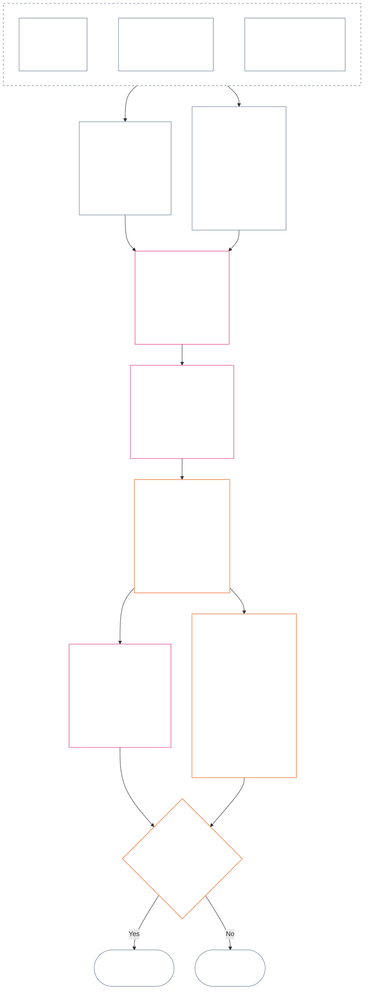

<!-- मराठी | अध्याय बारा पूर्ण मसुदा | स्रोत commit: a9ad713c15de3c6ba565486590518aa07c7d62fa | AI-मसुदा, अपुनरावलोकित, अबंधनकारक मसुदा ; source SHA-256: 7ae49781f558ad90db53cdd4469dd22d8227f0a17b0c7393c3a1d2168263f59d; committed-main row update 2026-11-11 -->

# अध्याय बारा: प्रस्थिति मापन — प्रश्न 2: ते किती चांगले किंवा वाईट होते?

<strong>संग्रहातील स्थान (अकार्यकारी): फाइल रचना आणि वाचन नियम</strong>

> ही फाइल **संज्ञ संविधानाचा भाग आहे** आणि एकाच मजकूराप्रमाणे वाचलेल्या इतर क्रमांकित `core_*` फाइल्ससोबतच **बंधनकारक आहे**. यात **अध्याय बारा** — **प्रश्न 2** (*ते किती चांगले किंवा वाईट होते?*) आहे: LEQU आधाररेषा व तिच्या मर्यादा, मापनाची इनपुट परिमाणे, मार्ग-वर्णक सूची, स्लॉट व्याकरण व सामायिक प्रमाणबद्धता, अक्ष नियुक्तीसाठी संवैधानिक इनपुट, एकत्रित प्रमाणबद्ध LEQU मापपट्टी, मानक योगदान मोजमापे, प्रत्यक्ष उदाहरणे आणि प्रश्न 3 कडे हस्तांतरण (**§1–§9**). तीन-प्रश्न चौकट आणि **प्रश्न 1** (*काय घडले?*) — पडताळलेली तथ्ये, घटना-प्रकार, अभिलेखाच्या आवश्यकता, अभिलेख अभिरक्षण आणि हाताळणी — [अध्याय अकरा](core_11_standing_assessment.md#chapter-eleven-standing-records--question-1-what-happened) येथे आहेत. प्रश्न 3 (*त्यामुळे काय घडते?*) [अध्याय तेरा](../../core_13.000_standing_integration.md#chapter-thirteen-standing-effects-and-integration) मध्ये पुढे चालू राहतो; पात्र Violation Axis `s` = 7–9 निष्कर्षांसाठी पुनरावलोकन [अध्याय चौदा](../../core_14.000_misconduct_designation.md#chapter-fourteen-anti-constitutional-misconduct) मधील संविधानविरोधी गैरवर्तन निर्देशनापुरते मर्यादित आहे. वाचनक्रम, बंधनकारक/समर्थक मजकुरातील फरक आणि संग्रह आवृत्तीची माहिती [README.md](README.md) मध्ये राखली आहे.

<strong>मागोवा</strong>

- पूर्वस्रोत:
  - [अध्याय अकरा §1](core_11_standing_assessment.md#1-the-three-questions) (*तीन-प्रश्न चौकट*);
  - [अध्याय अकरा §2](core_11_standing_assessment.md#2-question-1--what-happened) ते [अध्याय अकरा §6](core_11_standing_assessment.md#6-handling-a-standing-record) (*प्रश्न 1 — पडताळलेली तथ्ये, प्रस्थिति अभिलेख, अभिरक्षण आणि हाताळणी*);
  - [संवैधानिक चतुष्क](core_00_preamble.md#constitutional-tetrad);
  - [दोन संवैधानिक उद्दिष्टे](core_00_preamble.md#two-constitutional-aims);
  - [प्रस्तावना §6 मुख्य व्यावहारिक प्रक्रिया शृंखला](core_00_preamble.md#6-key-practical-process-pipelines) (*अध्याय नऊ ते पंधरा यांची साखळी*).
- या फाइलमधील उपविभाग:
  - [§1](#1-question-2--how-good-or-bad-was-it) (*प्रश्न 2 — LEQU आधाररेषा, स्थिती-दुवा, मर्यादा आणि व्याप्ती*);
  - [§2](#2-magnitude-and-severity-input-dimensions) (*दोन्ही अक्षांसाठी मापन इनपुट परिमाणे*);
  - [§3](#3-route-descriptor-catalogs-and-measurement-roles) (*मार्ग-वर्णक सूची*);
  - [§4](#4-slot-grammar-and-shared-scaling) (*स्लॉट व्याकरण आणि सामायिक प्रमाणबद्धता*);
  - [§5](#5-constitutional-inputs-to-axis-assignment) (*संवैधानिक स्रोतांचे मार्गीकरण*);
  - [§6](#6-unified-proportional-lequ-scale--contribution-and-violation-axes) (*दोन्ही अक्षांसाठी एकत्रित प्रमाणबद्ध LEQU मापपट्टी*);
  - [§7](#7-standard-contribution-measures) (*स्वीकारकर्त्याने प्रकाशित केलेली मानक योगदान मोजमापे*);
  - [§8](#8-measurement-illustrations) (*मापनाची प्रत्यक्ष उदाहरणे*);
  - [§9](#9-hand-off-to-question-3--cross-question-measurement-hooks) (*प्रश्न 3 कडे हस्तांतरण*).
- पुढील भाग:
  - [अध्याय तेरा](../../core_13.000_standing_integration.md#chapter-thirteen-standing-effects-and-integration) (13.000) (*प्रश्न 3 चे परिणाम आणि एकत्रीकरण*);
  - [अध्याय चौदा](../../core_14.000_misconduct_designation.md#chapter-fourteen-anti-constitutional-misconduct) (14.000) (*फक्त निर्देशन — प्रश्न 2 चे मापन पुन्हा उघडत नाही*).
- सोबत वाचा: [अध्याय पाच *प्रस्थिति, योगदान आणि उल्लंघन*](../../core_05.035_band_accountability.md#defa3-standing-state-contribution-and-violation) (5.035) (*प्रामाणिक व्याख्या मार्गीकरण*).

 

अध्याय बारा हा **प्रश्न 2** चा संवैधानिक जबाबदार भाग आहे; तो [अध्याय अकरा](core_11_standing_assessment.md#chapter-eleven-standing-records--question-1-what-happened) ने पडताळलेल्या तथ्यांचे मापन करतो. तो [§1 प्रश्न 2 — ते किती चांगले किंवा वाईट होते?](#1-question-2--how-good-or-bad-was-it) पासून सुरू होतो. [अध्याय अकरा](core_11_standing_assessment.md#chapter-eleven-standing-records--question-1-what-happened) तीन-प्रश्न चौकट, प्रश्न 1 आणि प्रस्थिति अभिलेखाची जबाबदारी घेतो; तो [अध्याय अकरा §6 प्रस्थिति अभिलेख हाताळणे](core_11_standing_assessment.md#6-handling-a-standing-record) येथे संपतो.

*सोप्या भाषेत: काय घडले आणि प्रस्थिति अभिलेख कोण धारण करतो हे अध्याय अकरा ठरवतो. हा अध्याय त्याचे मापन करतो: योगदान किती चांगले किंवा उल्लंघन किती वाईट होते, हे कधीही निव्वळ गुणात न जोडल्या जाणाऱ्या दोन स्वतंत्र मापपट्ट्यांवर. मापनानंतर काय होते ते अध्याय तेरा सांगतो.*

### 1. प्रश्न 2 — ते किती चांगले किंवा वाईट होते?

<strong>मागोवा</strong>

- पूर्वस्रोत: [अध्याय अकरा §2](core_11_standing_assessment.md#2-question-1--what-happened) (*प्रश्न 1 — प्रस्थिति अभिलेख आणि पडताळलेली तथ्ये*); [अध्याय अकरा §2.5](core_11_standing_assessment.md#25-verified-input-gate) (*पडताळलेल्या इनपुटची कसोटी*); [अध्याय अकरा §4](core_11_standing_assessment.md#4-standing-record-operational-requirements) (*अभिलेखाच्या आवश्यकता*); [अध्याय अकरा §1](core_11_standing_assessment.md#1-the-three-questions) (*तीन-प्रश्न चौकट*).
- पुढील भाग:
  - [§2](#2-magnitude-and-severity-input-dimensions) (*दोन्ही अक्षांसाठी मापन इनपुट परिमाणे*);
  - [§3](#3-route-descriptor-catalogs-and-measurement-roles) (*मार्ग-वर्णक सूची*);
  - [§4](#4-slot-grammar-and-shared-scaling) (*स्लॉट व्याकरण आणि सामायिक प्रमाणबद्धता*);
  - [§5](#5-constitutional-inputs-to-axis-assignment) (*संवैधानिक स्रोतांचे मार्गीकरण*);
  - [§6](#6-unified-proportional-lequ-scale--contribution-and-violation-axes) (*Contribution आणि Violation Axis नियुक्ती*);
  - [§7](#7-standard-contribution-measures) (*स्वीकारकर्त्याने प्रकाशित केलेली मानक योगदान मोजमापे*);
  - [§8](#8-measurement-illustrations) (*मापनाची उदाहरणे*);
  - [§9](#9-hand-off-to-question-3--cross-question-measurement-hooks) (*प्रश्न 3 कडे हस्तांतरण*);
  - [अध्याय तेरा §7.2](../../core_13.000_standing_integration.md#72-competency-bars-and-clearances) (13.000 §7.2) (*योगदानावरील प्रश्न 3 — सुरक्षित प्रतिनिधीकरण*);
  - [अध्याय तेरा §5.2](../../core_13.000_standing_integration.md#52-prevention--general-standing-locks) (13.000 §5.2) (*प्रतिबंधक कुलुपे*);
  - [अध्याय तेरा §6](../../core_13.000_standing_integration.md#6-lock-design-and-enforcement) (13.000 §6) (*कुलुपांची रचना आणि अंमलबजावणी*).
- सोबत वाचा: [अध्याय अकरा §4.1](core_11_standing_assessment.md#41-minimum-record-contents) (*पडताळलेल्या प्रस्थिति अभिलेखातील क्षेत्रे; अध्याय अकरा प्रस्थिति परिणाम ठरवत नाही*).

 

*सोप्या भाषेत: प्रश्न 2 प्रश्न 1 मधील पडताळलेल्या तथ्यांचे मापन करतो. तो विचारतो: **योगदान किती चांगले होते?** किंवा **उल्लंघन किती वाईट होते?** येथे अध्याय प्रथम दोन औपचारिक मापन-अक्ष मांडतो: पडताळलेल्या मदतीसाठी **Contribution Axis** आणि पडताळलेल्या हानीसाठी **Violation Axis**. हे अक्ष स्वतंत्र राहतात; ते एका निव्वळ गुणाच्या दोन बाजू नाहीत.*

एखाद्याचे योगदान किंवा उल्लंघन कोणत्या स्लॉटमध्ये येते हे ठरवण्यासाठी हा अध्याय **आयुष्य-समतुल्य एकक (Lifespan Equivalent Unit, LEQU)** वापरून परिणाम मोजतो. एक LEQU म्हणजे साधारणपणे एका संज्ञ प्राण्याचे संपूर्ण आयुष्यभराचे कल्याण वाचवण्याइतका किंवा नष्ट करण्याइतका परिणाम. हे व्यक्ती किंवा पैशांची मोजणी नाही; एखाद्या कृतीने संवैधानिक समुदायाचे कल्याण अर्थपूर्णरीत्या बदलले का हा प्रश्न आहे. हेच एकक मानव असो वा अन्य, प्रत्येक संज्ञ प्राण्याला लागू होते.

#### 1.1 LEQU आधाररेषा

**आयुष्य-समतुल्य एकक** (**LEQU**) हे पूर्ण-आयुष्य समतुल्य संवैधानिक लाभ किंवा हानीसाठीचे संक्षिप्त मापन आहे; स्वीकारलेल्या अंमलबजावणीला संख्यात्मक अंशांकन आवश्यक असताना ते वापरले जाते.

- हे एकक कोणत्याही अधिष्ठानावर अवलंबून नसते.
- जैविक मानवांच्या संदर्भात सध्याचा स्वीकारकर्ता सामान्य मानवी आयुष्य अंशांकनाचे उदाहरण म्हणून वापरू शकतो; परंतु बंधनकारक आधाररेषा संज्ञ-प्राणी आणि संवैधानिक आहे, प्रजाती-विशिष्ट नाही.

**पूर्ण-आयुष्य समतुल्य संवैधानिक लाभ** म्हणजे अर्थपूर्ण, अधिकार-सुसंगत कल्याणाचा संज्ञ प्राण्याचा एक पूर्ण जीवनकाल जतन करणे, पुनर्स्थापित करणे किंवा मुक्त करणे याच्याशी तुलनीय पडताळलेला लाभ. **पूर्ण-आयुष्य समतुल्य संवैधानिक हानी** म्हणजे असा पडताळलेला अपाय, अपव्यय, विनाश, संधी बंद करणे, वंचित ठेवणे किंवा प्रत्यक्षात आलेली जोखीम, जी एका पूर्ण-आयुष्य समतुल्य संवैधानिक लाभाचा नाश, अन्याय्य वापर किंवा प्रतिबंध करण्याशी तुलनीय आहे.

#### 1.2 LEQU वापरण्याच्या मर्यादा

LEQU वापरताना पुढील मर्यादा लागू होतात.

- **निव्वळ गुणाचा नियम नाही:** योगदानाने उल्लंघन किंवा उल्लंघनाने योगदान “रद्द” करता येत नाही. प्रत्येक अक्ष स्वतंत्र आहे.
- **मानवी आयुष्याचे अनिवार्य मापन नाही:** LEQU हे सर्व संज्ञ प्राण्यांना लागू आहे; फक्त मानवांना नाही.
- **आरोपाचा मापक नाही:** अध्याय अकरा **कलम 2.5** नुसार पडताळलेले इनपुट आणि **कलम 6** नुसार अंशांकन नसताना आरोप, प्रारंभिक नोंदीतील टॅग, मार्गीकरण निर्णय, प्रतिष्ठा, नापसंतीची स्थिती किंवा नैतिक नावड यांमुळे Contribution Axis चा लाभ किंवा Violation Axis ची तीव्रता ठरत नाही.
- **अधिकारांची देवाणघेवाण करण्याची परवानगी नाही:** कार्यक्षमता, उत्पादक क्षमता, नवोन्मेष, भारकपात, सुरक्षा, प्रतिशोध, आपत्कालीन प्रतिसाद किंवा संस्थात्मक गरज यांच्या नावाने केलेले दावे पुढील बाबींवर अवलंबून असतील तर कमी मानले किंवा नाकारले पाहिजेत:
  - बळजबरी;
  - भेदभावपूर्ण भार दुसऱ्यावर ढकलणे;
  - पर्यावरणीय संसाधनांचा ऱ्हास;
  - लपवलेले विनामूल्य काम;
  - टाळता येण्याजोगी अपारदर्शकता;
  - Rights Floor संकुचित करणे;
  - काबीज करणे;
  - दिशाभूल करणारे पर्यायी मापक;
  - आव्हानयोग्यता गमावणे; किंवा
  - पुनरावलोकन न करता येणारे एकत्रीकरण.

#### 1.3 फक्त प्रश्न 2 — व्याप्ती आणि मार्गीकरण

हा भाग फक्त मापनाचा टप्पा असलेल्या प्रश्न 2 बद्दल आहे. आधीच पडताळलेली तथ्ये (प्रश्न 1) घेऊन योगदान किती चांगले किंवा उल्लंघन किती वाईट होते हे तो विचारतो.

- **अध्याय अकरा कलम 2** नुसार आधी पडताळून **अध्याय अकरा कलम 4** अंतर्गत प्रस्थिति अभिलेखात लिहिलेल्या तथ्यांपासून सुरुवात करा आणि **कलम 2** मधील परिमाणांनी त्यांचे मापन करा.
- त्यानंतर प्रत्येक प्रकारच्या मदतीला किंवा हानीला सूचीतील मानक नाव द्या: मदतीसाठी **लाभ-मार्ग सूची** (**कलम 3.1**) आणि हानीसाठी **हानी-मार्ग सूची** (**कलम 3.2**).
- प्रत्येक नाव त्या प्रकारच्या मदतीचे किंवा हानीचे *किती चांगले* किंवा *किती वाईट* मोजमापात किती योगदान आहे हेही सांगते.
- लाभानंतर काय घडते याचे नियम [लाभाच्या बाजूला](../../core_13.000_standing_integration.md#72-competency-bars-and-clearances), आणि हानीनंतर काय घडते याचे नियम [हानीच्या बाजूला](../../core_13.000_standing_integration.md#52-prevention--general-standing-locks) आहेत.
- पुढे काय होईल हे प्रश्न 3 ठरवतो. [अध्याय तेरा §4 वर्णक एकत्रीकरण आणि संलग्नता सामान्यीकरण](../../core_13.000_standing_integration.md#4-descriptor-integration-and-attachment-normalization) पासून सुरुवात करा.

#### 1.4 संज्ञ-प्राणी स्थितीचा दुवा

प्रस्थिति मापनामुळे एखादा घटक **संज्ञ प्राणी** आहे की नाही हे **ठरत नाही**.

- स्थितीवरील विवाद [संज्ञ-प्राणी स्थितीचा न्यायनिर्णय](../../core_05.055_band_participation.md#sentience-status-adjudication) आणि [अनुच्छेद VI-B](core_06_rights_part_b.md#article-vi-b-sentience-status-adjudication-floor) (*संज्ञ-प्राणी स्थिती न्यायनिर्णय अधिकार-तळ*) कडे जातो. ते LEQU गुण किंवा वर्गीकरण अभिलेखांकडे जात नाहीत.
- [विवादित संज्ञ-प्राणी जीवन](../../core_05.055_band_participation.md#contested-sentient-life) अंतर्गत स्थितीचा विवाद सुरू असताना, **अनुच्छेद VI-B** (*संज्ञ-प्राणी स्थिती न्यायनिर्णय अधिकार-तळ*) त्या घटकाला पूर्वनिर्धारितपणे समाविष्ट करतो: विवादाचा निर्णय होईपर्यंत त्याचे मापन होऊ शकते आणि तो प्रस्थिति अभिलेख दाखल करू शकतो; केवळ विवाद सुरू आहे म्हणून कार्यचालकांनी त्याला प्रस्थिति नाकारू नये.
- घटक [संज्ञ प्राणी](../../core_05.055_band_participation.md#sentient) असल्याचे ठरल्यास, किंवा न्यायनिर्णयानंतर पुनरावलोकनयोग्य निर्णयात त्याची स्थिती मर्यादित किंवा पुनर्स्थापित झाल्यास:
  - त्या बिंदूपासून प्रस्थिति अभिलेखाचा विषय अद्ययावत होतो; आणि
  - चुकीचे वगळणे पूर्वलक्षीपणे लावून मधल्या काळात मापन-पात्रता नष्ट करता येत नाही; अपवाद फक्त [निवारण आणि सुधारणा](../../core_05.035_band_accountability.md#redress-and-remediation).

### 2. परिमाण आणि तीव्रतेची इनपुट परिमाणे

*सोप्या भाषेत: प्रश्न 2 काय तयार करतो हे हा विभाग सांगतो (**कलम 2.1**), त्यानंतर पडताळलेले योगदान किंवा पडताळलेले उल्लंघन मोजताना काय तपासायचे याची यादी देतो (**कलम 2.2**). प्रत्येक अक्षाचे मापन स्वतंत्र होते. सामायिक प्रमाणबद्धतेचे नियम **कलम 4.2** मध्ये आहेत; स्लॉट **कलम 6** मधील मापपट्टीतून येतो.*

स्लॉट मापपट्टी संवैधानिक परिणाम किती मोठा आहे आणि त्याचा प्रकार कोणता हे मोजते. ती फक्त पडताळलेले परिणाम मोजते.

**मापपट्टी काय मोजते आणि ते संविधानाच्या मुख्य कसोट्यांशी कसे जोडले आहे:**

- [**दोन संवैधानिक उद्दिष्टे**](core_00_preamble.md#two-constitutional-aims): दोन्ही अक्ष **समुन्नती** आणि **सातत्य** यांवरील परिणाम मोजतात. Contribution Axis त्यांना पुढे नेतो; Violation Axis त्यांना मागे ढकलतो.
- [**दोन मूलभूत प्रश्न**](core_00_preamble.md#two-fundamental-questions): प्रत्येक अक्ष एका प्रश्नासाठी पडताळलेली तथ्ये पुरवतो. एका प्रश्नाचे उत्तर दुसऱ्याचे उत्तर देत नाही; म्हणून दोन्ही अक्षांचा निव्वळ हिशेब होत नाही.
  - **पहिला प्रश्न:** Contribution Axis पडताळलेली तथ्ये पुरवतो. संज्ञ प्राण्यांना समुन्नत व टिकून राहण्यास मदत करणारे, सत्य सांगणारे आणि हानी दुरुस्त करणारे आचरण प्रणाली पुरस्कृत करते का?
    - **मोजले जाते:** जोखीम कमी करण्यासह पडताळलेला संवैधानिक लाभ.
    - **मोजले जात नाही:** कच्चे उत्पादन, प्रतिष्ठा, संपत्ती, वापराचे प्रमाण, वेग किंवा संस्थेचा आकार.
  - **दुसरा प्रश्न:** Violation Axis पडताळलेली तथ्ये पुरवतो. अन्याय्यरीत्या हानी करणारे, दिशाभूल करणारे, वगळणारे, विलंब करणारे, अपव्यय करणारे किंवा खर्च इतरांवर ढकलणारे आचरण प्रणाली पुरस्कृत करते का?
    - **मोजले जाते:** पडताळलेले संवैधानिक नुकसान, हानी, अपव्यय, गमावलेले पर्याय (संधी बंद होणे), धोका किंवा जोखीम वाढ.
    - **स्वतःहून मोजले जात नाही:** नापसंतीची स्थिती, आरोप किंवा नैतिक नावड.
- [**संवैधानिक चतुष्क**](core_00_preamble.md#constitutional-tetrad):
  - **देखरेख आणि उत्तरदायित्व:** “पडताळलेले” म्हणजे निष्कर्षासाठी नामित कर्ता उत्तरदायी असतो आणि कोणताही पक्ष स्वतःचा दावा पडताळत नाही.
  - **समयबद्धता:** टाळता येण्याजोगा विलंब हा स्वतंत्र तथ्य म्हणून नोंदतो; तो नुकसानाच्या आकारात मिसळत नाही.

#### 2.1 प्रश्न 2 काय तयार करतो

प्रश्न 2 प्रत्येक अक्षासाठी पुढील बाबी प्रस्थिति अभिलेखात नोंदवतो. या मापन-नोंदी आहेत, प्रस्थिति परिणाम (प्रश्न 3 ठरवतो ते परिणाम) नाहीत:

| **काय तयार होते** | **Contribution Axis** | **Violation Axis** |
| --- | --- | --- |
| **कुठे नोंदते** | योगदान प्रस्थिति अभिलेख. | उल्लंघन प्रस्थिति अभिलेख. |
| **स्लॉट** | लागू होणारा सर्वोच्च **Contribution Axis स्लॉट** (`s` = 1–9). | लागू होणारा सर्वोच्च **Violation Axis स्लॉट** (`s` = 1–9). |
| **मार्ग-वर्णक** | लागू होणारे **लाभ-मार्ग वर्णक**, एकत्र रचलेले. | लागू होणारे **हानी-मार्ग वर्णक**, एकत्र रचलेले. |
| **प्रश्न 3 कडे दिलेले इनपुट** | [अध्याय तेरा §7 योगदानाचे परिणाम दुसरे](../../core_13.000_standing_integration.md#7-contribution-consequences-second) अंतर्गत योगदानाची मान्यता कुठून सुरू होईल हे ठरवणारे इनपुट. | [अध्याय तेरा §6 कुलुपांची रचना आणि अंमलबजावणी](../../core_13.000_standing_integration.md#6-lock-design-and-enforcement) अंतर्गत पूर्वनिर्धारित कुलूप-पट्टा (कुलूप किती कडक असेल याचा आरंभबिंदू) ठरवणारे इनपुट. |
| **LEQU एकूण** | प्रत्येक संबंधित लाभप्रकाराचे (पर्यावरणीय, प्रणालीगत किंवा संसाधनविषयक) स्वतंत्र मूल्यांकन करा; नंतर संपूर्ण योगदानासाठी एक LEQU एकूण नोंदवा. | प्रत्येक संबंधित हानीप्रकाराचे (पर्यावरणीय हानी, प्रणालीगत हानी किंवा संसाधन-नुकसान) स्वतंत्र मूल्यांकन करा; नंतर संपूर्ण उल्लंघनासाठी एक LEQU एकूण नोंदवा. |

स्मरणपत्र: यांपैकी कशामुळेही उघडा उल्लंघन अभिलेख रद्द होत नाही. समायोजन-निषेधाचा नियम [अध्याय अकरा §2.4 जोडलेले प्रस्थिति अभिलेख आणि समायोजन निषेध दुवा](core_11_standing_assessment.md#24-linked-standing-records-and-no-offset-bridge) मध्ये आहे.

#### 2.2 योगदान-परिमाण आणि उल्लंघन-तीव्रतेची इनपुट परिमाणे

**प्रश्न 2 — ते किती चांगले किंवा वाईट होते?** Contribution Axis वरील योगदानाचे किंवा Violation Axis वरील उल्लंघनाचे स्थान (त्याचा **स्लॉट**, 1 ते 9) आणि कोणते लाभ किंवा हानी-वर्णक लागू होतात हे ठरवण्यासाठी तीन भाग तपासा. एकाच वेळी अनेक वर्णक लागू होऊ शकतात आणि ते एकत्र रचले जातात. **कलम 2.1** मध्ये नमूद केल्याप्रमाणे निष्कर्ष त्या अक्षाच्या प्रस्थिति अभिलेखात नोंदवा. भाग 2 साठीची एकत्रित मापपट्टी **कलम 6** मध्ये आहे; लाभ आणि हानीसाठी तीच मापपट्टी लागू होते. ती LEQU मध्ये एकूण लाभ किंवा नुकसान कसे अंदाजावे (Lifespan Equivalent Unit, म्हणजे साधारणपणे एका संपूर्ण आयुष्याचे कल्याण) आणि प्रत्येक रक्कम कोणत्या स्लॉटमध्ये येते हे स्पष्ट करते. Contribution Axis वरील स्लॉट चार पट्ट्यांत गटबद्ध आहेत.

**1. ते कशा प्रकारे निर्माण झाले ते तपासा.** दोन अक्ष याबाबत वेगळा विचार करतात:

- **योगदान (आचरणाची गुणवत्ता):** यामुळे मोजल्या जाणाऱ्या लाभाचे प्रमाण वाढू किंवा मर्यादित होऊ शकते: ते मागोवा घेता येण्याजोगे होते का, खर्च इतरांवर ढकलणे टाळले का, काळजीपूर्वक केले का, आणि संविधानाशी सुसंगत आहे का? पाच कसोट्या [§2.2.1 लाभ निर्माण करण्याच्या पद्धतीचा मोजल्या जाणाऱ्या लाभावर परिणाम](#221-how-the-way-a-benefit-was-produced-affects-what-counts) येथे आहेत.
- **उल्लंघन (आचरणाचे स्वरूप):** परिणामाच्या आकारापासून हे स्वतंत्रपणे नोंदले जाते. कर्तव्य, निष्काळजीपणा, फसवणूक, लपवाछपवी, उत्तरदायित्वात अडथळा, बळजबरी, हिंसा, हेतू, क्रौर्य आणि संरचनात्मक सोय यांमुळे जबाबदार कोण, कोणते संरक्षण आवश्यक आणि प्रतिसाद कसा द्यावा हे ठरते; पण यांपैकी कोणतीही गोष्ट स्लॉट बदलत नाही; प्रत्येकाची नोंद करण्याचे नियम [§2.2.2 हानी कशी घडवली गेली ते नोंदणे](#222-how-the-way-a-harm-was-caused-is-recorded) येथे आहेत.

**2. आकार ठरवा: लाभ किंवा नुकसान किती मोठे आहे?** यावर स्लॉट ठरतो.

| **काय तपासायचे** | **त्याचा परिणाम** | **कुठे नमूद आहे** |
| --- | --- | --- |
| **एकूण आकार (LEQU)** | मुख्य मापन आणि स्लॉट नियंत्रित करणारे मापन. योगदानासाठी केलेला एकूण पडताळलेला लाभ LEQU मध्ये मोजला जातो. उल्लंघनासाठी एकूण पडताळलेले संवैधानिक नुकसान मोजले जाते. अध्याय चौदाची गैरवर्तन-निर्देशन प्रक्रिया स्वतंत्रपणे ठरते. | [§6 एकत्रित प्रमाणबद्ध LEQU मापपट्टी](#6-unified-proportional-lequ-scale--contribution-and-violation-axes) |
| **कोणापर्यंत पोहोचते (किती जण, किती खोलवर, किती असुरक्षित)** | LEQU अंदाज आणि लाभ किंवा हानीचे महत्त्व (भौतिकता) समायोजित करते. | [§4.2 सामायिक परिणाम-प्रमाणबद्धता नियम](#42-shared-impact-scaling-rules); [भौतिकता](../../core_05.050_band_oversight.md#materiality) |
| **किती काळ टिकते (कालावधी; लाभाची टिकाऊपणा, हानीची अपरिवर्तनीयता)** | LEQU अंदाज समायोजित करते. योगदानासाठी दीर्घकालीन उत्तरदायी व्यवस्थापन, पिढ्यान्‌पिढ्यांचा लाभ किंवा संस्थेची टिकाऊ दुरुस्ती सर्वोच्च स्लॉटच्या दिशेने निर्देश करते. उल्लंघनासाठी दीर्घकालीन आघात, पूर्ववत न करता येणारे नुकसान किंवा संज्ञ प्राण्यांच्या स्वकृती क्षमतेला झालेली दीर्घकालीन हानी एकूण नुकसानाचा अंदाज वाढवते. | [§4.2 सामायिक परिणाम-प्रमाणबद्धता नियम](#42-shared-impact-scaling-rules) |
| **किती दूर पोहोचते (ठिकाणे किंवा संस्थांपलीकडे)** | LEQU अंदाज समायोजित करते. योगदानासाठी समुदाय किंवा संस्थांपलीकडील, किंवा सभ्यतेच्या स्तरावरील लाभ; उल्लंघनासाठी समुदाय, संस्था किंवा सभ्यतेत पसरणारी हानी एकूण नुकसानाचा अंदाज वाढवू शकते. | [§4.2 सामायिक परिणाम-प्रमाणबद्धता नियम](#42-shared-impact-scaling-rules) |

**3. लाभ किंवा हानीचे प्रकार (मार्ग) नामित करा.** पडताळलेला लाभ किंवा हानी कोणत्या मार्गाने घडली ते नामित करा. एकापेक्षा जास्त लागू होऊ शकतात आणि ते एकत्र रचले जातात. यादी [**लाभ-मार्ग वर्णक सूची**](#31-contribution-route-descriptor-catalog-and-measurement-roles) आणि [**हानी-मार्ग वर्णक सूची**](#32-violation-route-descriptor-catalog-and-measurement-roles) येथे आहे.

##### 2.2.1 लाभ निर्माण करण्याच्या पद्धतीचा मोजल्या जाणाऱ्या लाभावर परिणाम

Contribution Axis स्लॉट निवडण्यापूर्वी हे तपासा:

| **काय आढळते** | **लाभावर परिणाम** |
| --- | --- |
| समस्येबद्दल कळवल्यानंतर तत्पर, पडताळलेली दुरुस्ती | प्रत्यक्ष, दाखवता येण्याजोगा लाभ निर्माण झाल्यास **काळजीपूर्वक कृती** (जबाबदार, विचारपूर्वक आचरण) म्हणून मोजली जाऊ शकते. |
| इतरांवर ढकललेली हानी किंवा लपवलेला भार | विवादित मार्गाला (लाभाचे श्रेय ज्या विशिष्ट मार्गाने दिले जाते तो मार्ग) दिलेला लाभ मर्यादित होतो किंवा पूर्णपणे वगळला जातो. |
| पडताळलेली काबीज होण्याची जोखीम (व्यवस्था संकुचित हितसंबंधांच्या ताब्यात जाण्याची शक्यता), संरचनात्मक परावलंबन (संज्ञ प्राणी व्यवस्थेवर अवलंबून राहतील अशा रीतीने गुंफलेले असणे), किंवा निर्गमन व अवरोधित ठेवण्याची रचना (बाहेर पडणे कठीण असणे) | चांगल्या उत्तरदायी व्यवस्थापनाला दिलेले श्रेय मर्यादित होते. |
| प्रवेशयोग्यता किंवा सहभागातील अडथळ्याची पडताळलेली दुरुस्ती | लाभाचे महत्त्व (भौतिकता) वाढवू शकते आणि **प्रवेश व समावेशन** लाभ-मार्ग वर्णकाला **कलम 3.1** अंतर्गत आधार देऊ शकते. |
| संविधानविरोधी प्रोत्साहन रचना, संविधानविरोधी आचरण किंवा भौतिकदृष्ट्या दोषपूर्ण प्रक्रियेतून मिळालेले लक्षणीय बक्षीस | पूर्वनिर्धारितपणे लाभ म्हणून मोजले जात नाही. अशा वेळी [अध्याय तेरा §6.4.2 विसंगत बक्षिसे](../../core_13.000_standing_integration.md#642-misaligned-rewards) आणि [अनुच्छेद XXVIII-A](../../core_06.020_rights_part_e.md#incentive-alignment-adoption-transition-carve-out) (*टप्प्याटप्प्याने स्वीकार आणि अधिकार-तळ सातत्य*) मधील स्वीकार-हस्तांतरण मर्यादा लागू करा. |

##### 2.2.2 हानी कशी घडवली गेली ते नोंदणे

हानीचा आकार (वरच्या भाग 2 मधील तिचे LEQU एकूण) स्लॉट ठरवतो. हानी कशा प्रकारे घडली यामुळे स्लॉट बदलत नाही; म्हणून खालील प्रत्येक आचरण स्वतंत्र नोंदवले जाते:

हा उपविभाग अध्याय बारावा हा नियम एकदाच सांगतो. **एखादी घटना किंवा वर्तनक्रम खालीलपैकी कशानेही वर्णित आहे म्हणून स्लॉट वाढवू किंवा कमी करू नका:**

- कर्तव्य;
- निष्काळजीपणा;
- हेतू;
- लपवाछपवी;
- पुनरावृत्ती;
- गंभीरता वाढवणारा घटक;
- जबरदस्ती;
- हिंसा;
- स्वातंत्र्याला धोका;
- दुरुस्तीक्षमता; किंवा
- पसंतीचा परिणाम.

वर्तन-स्वरूपाची तथ्ये स्वतंत्रपणे मागोवा घेता येणारे वर्णन म्हणून नोंदवली जातात. ती आरोपण, पुनरावलोकनाची तीव्रता, सुरक्षा उपाय, उपाययोजना किंवा अध्याय चौदामधील पदनाम नियंत्रित करू शकतात. सत्यापित परिणामांद्वारेच त्यांचा स्लॉटवर परिणाम होतो: वर्तनामुळे नुकसान वाढल्यास ते नुकसान LEQU एकूणात एकदाच मोजले जाते आणि स्लॉट त्या एकूणाचे अनुसरण करतो.

**नुकसान वाढवणारे आचरण — आकारात एकदाच मोजले जाते:**

| **काय आढळते** | **कसे नोंदवायचे** |
| --- | --- |
| कृती आणि क्षमता असताना प्रतिसाद देण्यात किंवा उच्च स्तरावर पाठवण्यात टाळता येण्याजोगा विलंब | आचरणाविषयी स्वतंत्र तथ्य म्हणून नोंदवा. विलंबामुळे झालेले कोणतेही अतिरिक्त नुकसान LEQU अंदाजात एकदाच मोजा. |
| मंचाच्या अखंडतेला (मंचाच्या न्याय्यतेला) स्वतंत्रपणे पडताळलेली इजा | LEQU अंदाजात नेमकी एकदाच मोजा. अप्रामाणिक वगळणे, जाणीवपूर्वक recusal प्रक्रिया अपयशी करणे, बळजबरी, स्वातंत्र्याला धोका आणि इतर आचरण-तथ्ये स्वतंत्र वर्णक राहतात. |
| **उत्तरदायित्वात अडथळा** (जबाबदार कोणालाही उत्तरदायी धरणारी यंत्रणा — उदा. पुराव्याची अखंडता, पडताळणी, मंच-प्रक्रिया, प्रस्थिति अभिलेख, उपाययोजनेच्या मुदती किंवा आव्हान व निवारणाचे मार्ग — यात पडताळलेला हस्तक्षेप) | स्वतंत्रपणे नोंदवलेले आचरण-तथ्य राहते. गेटेड मार्गावर त्याने घडवलेले अतिरिक्त नुकसान LEQU अंदाजात एकदाच मोजले जाते. |

**हानीच्या आकारापासून वेगळी नोंदली जाणारी आचरण-तथ्ये:**

| **काय आढळते** | **कसे नोंदवायचे** |
| --- | --- |
| फसवणूक, लपवाछपवी, चुकवणे, सूचना मिळाल्यानंतर आचरणाची पुनरावृत्ती, बेपर्वा दुर्लक्ष, संरचनात्मक सोय (हानी सहज किंवा संभाव्य होईल अशी रचना) किंवा मोठ्या परावलंबन-असमतोलाचा गैरवापर (आपल्यावर मोठ्या प्रमाणात अवलंबून असलेल्या व्यक्तीचा फायदा घेणे) | प्रत्येक बाब स्वतंत्र आचरण-तथ्य म्हणून नोंदवा. |
| हिंसा, बळजबरी, हाताळणी किंवा स्वातंत्र्याला धोका | स्वतंत्रपणे नोंदवा; स्लॉट कोणताही असला तरी अधिक मजबूत संरक्षण आवश्यक होऊ शकते. |
| [क्रौर्य](../../core_05.035_band_accountability.md#cruelty) (सत्यापित दुःख जे स्वतःच उद्देश आहे, किंवा आवश्यक व प्रमाणबद्ध मर्यादेपलीकडील विनाकारण किंवा अपमानजनक हानी) | स्वतंत्र आचरण-तथ्य म्हणून नोंदवा. [अध्याय तेरा §5 उल्लंघन, दुरुस्ती आणि प्रतिबंध](../../core_13.000_standing_integration.md#5-violation-correction-and-prevention) नुसार अधिक मजबूत संरक्षण आणि अपमानजनक उपायांवरील मर्यादा लागू होऊ शकतात. |

**जबाबदारी आणि आरोपण:**

| **काय आढळते** | **कसे नोंदवायचे** |
| --- | --- |
| विखुरलेली जबाबदारी (कर्तव्याची भूमिका, प्राधिकार किंवा नियंत्रण कोणी धारण केले, हानीचा पूर्वानुमान कोणाला करता आला, कोणी लाभ घेतला किंवा लपवला, अथवा ती कोण रोखू शकले असते) | हे **संज्ञ-प्राणी व्याप्ती**चा भाग नाही; गटाचा सदस्य आहे म्हणून कोणालाही दोषी धरण्याची परवानगी देत नाही. |
| हानीला साथ देणे किंवा तिचा प्रतिकार करण्यात अपयश | **अध्याय अकरा कलम 4.1 आणि 4.3** नुसार त्या विशिष्ट कर्त्याशी आवश्यक संबंध पडताळला असेल तेव्हाच कर्तव्याधारित, वाढीव किंवा सामूहिक-उत्तरदायित्वाचे स्वरूप ठरवण्यास आधार देऊ शकते. |

**विसंगत बक्षिसे:**

| **काय आढळते** | **कसे नोंदवायचे** |
| --- | --- |
| संविधानविरोधी ठरणारे लक्षणीय बक्षीस जाणूनबुजून स्वीकारणे किंवा ठेवणे आणि वेळेवर संरक्षित अहवाल (प्रतिशोधापासून संरक्षण असलेला अहवाल) न देणे | [अध्याय तेरा §6.4.2 विसंगत बक्षिसे](../../core_13.000_standing_integration.md#642-misaligned-rewards) अंतर्गत, [अनुच्छेद XXVIII-A](../../core_06.020_rights_part_e.md#incentive-alignment-adoption-transition-carve-out) (*टप्प्याटप्प्याने स्वीकार आणि अधिकार-तळ सातत्य*) च्या अधीन नोंदवा. त्यामुळे झालेल्या पडताळलेल्या संवैधानिक नुकसानीचाच स्लॉटवर परिणाम होतो. |

**विसंगत बक्षिसांची सीमा.** पडताळलेले विसंगत बक्षीस (संविधानाच्या विरोधात काम करणारे बक्षीस) Contribution Axis किंवा Violation Axis वर कसा परिणाम करते याचे मापन हा अध्याय करतो. [अध्याय तेरा §6.4.2 विसंगत बक्षिसे](../../core_13.000_standing_integration.md#642-misaligned-rewards) अहवालाचे कर्तव्य, अपवाद, बक्षीस सोडण्याचे परिणाम (जप्ती), दुरुस्तीची कर्तव्ये आणि मार्गीकरण नियम ठरवतो.

### 3. मार्ग-वर्णक सूची आणि मापनातील भूमिका

*सोप्या भाषेत: खालील दोन सूची प्रस्थिति अभिलेखात नोंदवता येणाऱ्या पडताळलेल्या मदतीचे (**कलम 3.1**) आणि हानीचे (**कलम 3.2**) प्रकार नामित करतात. वर्णक लाभ किंवा हानी कशी घडली ते सांगतो; एकापेक्षा अधिक वर्णक लागू होऊ शकतात, पण ते स्लॉटच्या अधीन असतात.*

**वर्णक नियम.** [§3.1 योगदान मार्ग-वर्णक सूची आणि मापनातील भूमिका](#31-contribution-route-descriptor-catalog-and-measurement-roles) आणि [§3.2 उल्लंघन मार्ग-वर्णक सूची आणि मापनातील भूमिका](#32-violation-route-descriptor-catalog-and-measurement-roles) या दोन्ही अक्षांसाठीच्या अधिकृत वर्णक याद्या आहेत. वर्णक पडताळलेला लाभ किंवा हानी **कशी** घडली ते सांगतो. पुढील नियम लागू होतात:

- वर्णक एकत्र रचले जातात; एक वर्णक दुसऱ्याला वगळत नाही. पडताळलेल्या तथ्यांनी समर्थन केल्यास एका प्रस्थिति अभिलेखात अनेक वर्णक असू शकतात.
- वर्णक स्लॉटच्या खालच्या श्रेणीत असतात: लाभ किंवा हानी किती मोठी होती ते स्लॉट सांगतो; वर्णक घडण्याची पद्धत अधिक स्पष्ट करतात, पण स्लॉटची जागा घेत नाहीत.
- सूचीतील वर्णक हा मूलभूत संच आहे, संपूर्ण संच नाही; त्यामुळे इतर प्रकारचे लाभ किंवा हानी वगळले जात नाहीत.
- अंमलबजावणीत स्थिर ओळखचिन्हे (त्यांचे स्वतःचे निश्चित ID) सूचीकडे नकाशित करता येतात; पण परस्पर-विरोधी वर्गीकरण तयार करून प्रत्येक अभिलेखाला एकच श्रेणी निवडण्यास भाग पाडता येत नाही.
- तथ्ये पडताळण्यापूर्वी आरोपित वर्णक कायदेशीर पुरावा-जतन, प्रकरणांचे वर्गीकरण किंवा तात्पुरत्या संरक्षणांना आधार देऊ शकतो.
- फक्त पडताळलेला वर्णक प्रश्न 2 चा निष्पन्न परिणाम म्हणून नोंदवता किंवा प्रस्थितीवर परिणाम घडवता येतो.

#### 3.1 योगदान मार्ग-वर्णक सूची आणि मापनातील भूमिका

हे लाभ-मार्ग वर्णक आणि प्रश्न 2 मध्ये (योगदान किती चांगले होते?) प्रत्येकाचे मापन पुढीलप्रमाणे आहे. ते पाच क्षेत्रांत विभागले आहेत; प्रत्येकासाठी एक तक्ता आहे. [§3.2 उल्लंघन मार्ग-वर्णक सूची आणि मापनातील भूमिका](#32-violation-route-descriptor-catalog-and-measurement-roles) मधील उल्लंघन सूची याच पाच क्षेत्रांचा हाच क्रम वापरते. प्रश्न 3 मधील भूमिका — सुरक्षित प्रतिनिधीकरण — [अध्याय तेरा §7.2 क्षमता निकष आणि मंजुरी](../../core_13.000_standing_integration.md#72-competency-bars-and-clearances) येथे आहे.

**सूचीची पूर्णता.** अंमलबजावणीत एका ओळीत किंवा लेबलखाली अनेक वर्णक दाखवले असतील, तर ते लागू होणाऱ्या प्रत्येक वर्णकाकडे नकाशित केले पाहिजे. ही सूची फक्त वर्णकांची नावे आणि प्रश्न 2 मधील त्यांचे मापन ठरवते. प्रश्न 3 चे नियम (संलग्नता, उपाय, कुलुपे, मंजुरी आणि इतर प्रस्थिति परिणाम) फक्त अध्याय तेरामध्ये आहेत.

##### 3.1.1 शारीरिक सुरक्षितता, संबंध, काळजी आणि कर्तृत्व

| **लाभ-मार्ग वर्णक** | **प्रश्न 2 मध्ये काय मोजते** |
| --- | --- |
| **शरीर, मन आणि/किंवा समुदायाची शांतता** | शारीरिक, मानसिक आणि सामुदायिक शांततेचा लाभ. लाभाचे महत्त्व (भौतिकता) समायोजित करते. |
| **विश्वसनीय संबंध** | विश्वास ठेवता येण्याजोग्या संबंधांचा लाभ; दोन बाजूंमध्ये असमानता असलेल्या परिस्थितींतील विश्वासाच्या कर्तव्यावर आधारलेले संबंधही यात येतात. |
| **काळजी आणि परावलंबन सहाय्य** | इतरांवर अवलंबून असलेल्या संज्ञ प्राण्यांची पडताळलेली काळजी. दाखवता येत असल्यास अनौपचारिक काळजीही मोजली जाते. |
| **प्रवेश आणि समावेशन** | प्रत्यक्ष सहभाग आणि प्रवेशयोग्यतेचा लाभ. एक बाजू दुसऱ्यावर मोठ्या प्रमाणात अवलंबून असेल अशा परिस्थितीत लाभाचे महत्त्व समायोजित करते. |

##### 3.1.2 दुरुस्ती, मालमत्ता आणि संसाधने

| **लाभ-मार्ग वर्णक** | **प्रश्न 2 मध्ये काय मोजते** |
| --- | --- |
| **उपायात्मक आणि पुनर्स्थापनात्मक लाभ** | दुरुस्ती, भरपाई आणि हानी कमी करण्याचा लाभ. |
| **संसाधनांचे उत्तरदायी व्यवस्थापन** | भौतिक संसाधनांची काळजीपूर्वक निगा आणि त्यांचे विश्वासार्ह वाटप. |

##### 3.1.3 ज्ञान, शिक्षण, अभिलेख आणि शोध

| **लाभ-मार्ग वर्णक** | **प्रश्न 2 मध्ये काय मोजते** |
| --- | --- |
| **माहितीक्षेत्राची अखंडता** | अभिलेख, पारदर्शकता आणि संवाद बळकट करणे. |
| **शिक्षण आणि क्षमता-विकास** | शिक्षण, साक्षरता आणि संज्ञ प्राण्यांच्या स्वकृती क्षमतेतील वाढीचा लाभ. स्लॉट एकूण LEQU लाभावरून ठरतो. |
| **विज्ञान-तंत्रज्ञान आणि शोधातील योगदान** | इतरांना पुनरुत्पादित करता येणारे शोध आणि सुरक्षितता वाढवणारे संशोधन. |

##### 3.1.4 प्रणाली आणि घटनात्मक कार्यवाही

| **लाभ-मार्ग वर्णक** | **प्रश्न 2 मध्ये काय मोजते** |
| --- | --- |
| **प्रणालीचे अनुकूलन** | संस्थांपलीकडे जाणाऱ्या प्रक्रिया सुधारणे आणि जोखीम कमी करणे. |
| **संवैधानिक अनुरूपता** | Rights Floor बळकट करणे आणि निर्णयांना आव्हान देणे सुलभ करणे. |

##### 3.1.5 पर्यावरण आणि काळजीपूर्वक कृती

| **लाभ-मार्ग वर्णक** | **प्रश्न 2 मध्ये काय मोजते** |
| --- | --- |
| **पर्यावरणीय उत्तरदायी व्यवस्थापन** | अधिवास आणि जैवविविधतेचा लाभ, तसेच हवामानविषयक जबाबदार कृती. |
| **काळजीपूर्वक कृती** | पूर्वानुमेय जोखीम टाळणे आणि सक्षम पर्यवेक्षण. |

#### 3.2 उल्लंघन मार्ग-वर्णक सूची आणि मापनातील भूमिका

हे हानी-मार्ग वर्णक आणि प्रश्न 2 मध्ये (उल्लंघन किती वाईट होते?) प्रत्येकाचे मापन पुढीलप्रमाणे आहे. ते [§3.1 योगदान मार्ग-वर्णक सूची आणि मापनातील भूमिका](#31-contribution-route-descriptor-catalog-and-measurement-roles) प्रमाणेच पाच क्षेत्रांत आणि त्याच क्रमाने विभागले आहेत. प्रश्न 3 साठी एकत्रीकरण आणि संलग्नतेचे नियम [अध्याय तेरा §4 वर्णक एकत्रीकरण आणि संलग्नता सामान्यीकरण](../../core_13.000_standing_integration.md#4-descriptor-integration-and-attachment-normalization) येथे; प्रतिबंध आणि कुलूप-रचना [अध्याय तेरा §5.2 प्रतिबंध — सामान्य प्रस्थिति कुलुपे](../../core_13.000_standing_integration.md#52-prevention--general-standing-locks) आणि [अध्याय तेरा §6 कुलुपांची रचना आणि अंमलबजावणी](../../core_13.000_standing_integration.md#6-lock-design-and-enforcement) येथे आहेत.

**सूचीची पूर्णता.** अंमलबजावणीत एका ओळीत किंवा लेबलखाली अनेक वर्णक दाखवले असतील, तर ते लागू होणाऱ्या प्रत्येक वर्णकाकडे नकाशित केले पाहिजे. ही सूची फक्त वर्णकांची नावे आणि प्रश्न 2 मधील त्यांचे मापन ठरवते. प्रश्न 3 चे नियम (संलग्नता, उपाय, कुलुपे, मंजुरी आणि इतर प्रस्थिति परिणाम) फक्त अध्याय तेरामध्ये आहेत.

##### 3.2.1 शारीरिक सुरक्षितता, संबंध, काळजी आणि कर्तृत्व

| **हानी-मार्ग वर्णक** | **प्रश्न 2 मध्ये काय मोजते** |
| --- | --- |
| **हिंसक गैरवर्तन** | हिंसा, बळजबरी किंवा स्वातंत्र्याला धोका LEQU परिणाम-स्लॉटपासून स्वतंत्रपणे नोंदला जातो. अधिक कडक संरक्षण आवश्यक होऊ शकते. |
| **आंतरवैयक्तिक / काळजी-कर्तव्य गैरवर्तन** | एक बाजू दुसऱ्यावर मोठ्या प्रमाणात अवलंबून असेल तेव्हा हानीचे महत्त्व वाढते (भौतिकता अधिक असते). |
| **प्रवेशयोग्यता आणि सहभाग-अडथळा गैरवर्तन** | एक बाजू दुसऱ्यावर मोठ्या प्रमाणात अवलंबून असेल तेव्हा हानीचे महत्त्व वाढते; वाढवणारी वैशिष्ट्येही त्यासोबत लागू होऊ शकतात. |
| **गोपनीयता आणि स्व-मालकी गैरवर्तन** | लपवाछपवी किंवा शोषण पडताळल्यास वाढीव वैशिष्ट्ये लागू होतात आणि ती एकत्र रचली जाऊ शकतात. |
| **कर्तृत्व आणि हाताळणी गैरवर्तन** | बळजबरी, हाताळणी किंवा स्वातंत्र्याला धोका परिणाम-स्लॉटपासून स्वतंत्रपणे नोंदला जातो. |

##### 3.2.2 दुरुस्ती, मालमत्ता आणि संसाधने

| **हानी-मार्ग वर्णक** | **प्रश्न 2 मध्ये काय मोजते** |
| --- | --- |
| **उपायाने दुरुस्त करता येण्याजोगे गैरवर्तन** | हानी दुरुस्त होऊ शकते का आणि कशी याचे स्वरूप नोंदते. स्लॉट एकूण LEQU नुकसानीवरून ठरतो. |
| **मालमत्ता गैरवर्तन** | मालमत्तेच्या नुकसानीचा मार्ग. स्लॉट एकूण LEQU नुकसानीवरून ठरतो. |

##### 3.2.3 ज्ञान, शिक्षण, अभिलेख आणि शोध

| **हानी-मार्ग वर्णक** | **प्रश्न 2 मध्ये काय मोजते** |
| --- | --- |
| **माहितीक्षेत्रातील गैरवर्तन** | सुरक्षितता किंवा सत्याला झालेली हानी. लपवाछपवी आणि फसवणूक हानी कशी झाली याबद्दलची (तिचे स्वरूप) स्वतंत्र तथ्ये राहतात. |
| **शैक्षणिक गैरवर्तन** | शिक्षणाला किंवा संज्ञ प्राण्यांच्या स्वकृती क्षमतेला (त्यांच्या क्षमतांना) झालेली हानी. स्लॉट एकूण LEQU नुकसानीवरून ठरतो. |
| **संशोधन आणि शोधातील गैरवर्तन** | संशोधन किंवा शोधाला झालेली हानी. स्लॉट एकूण LEQU नुकसानीवरून ठरतो. |

##### 3.2.4 प्रणाली आणि घटनात्मक कार्यवाही

| **हानी-मार्ग वर्णक** | **प्रश्न 2 मध्ये काय मोजते** |
| --- | --- |
| **प्रणालीतील गैरवर्तन** | विखुरलेली जबाबदारी (अनेक कर्त्यांत पसरलेली जबाबदारी) आणि संरचनात्मक सोय स्वतंत्र नोंदली जाते. स्लॉट एकूण LEQU नुकसानीवरून ठरतो. |
| **उत्तरदायित्व-अडथळा गैरवर्तन** | उत्तरदायित्वात अडथळा आणणे: हानीसाठी कोणाला उत्तरदायी धरता येईल यात अडथळा आणणे. हानी कशी घडली याचा मार्ग म्हणून नोंदते. अडथळा कसा आणला (उदा. लपवाछपवी किंवा निष्काळजीपणा) हे स्वतंत्र तथ्य असते; स्लॉट एकूण LEQU नुकसानीवरून ठरतो. स्लॉट सर्वोच्च स्तरांपैकी असल्यास (पहा [§4.1 तक्ता 1 — स्लॉट प्रदर्शन लेबले](#41-table-1--slot-display-labels)), प्रकरण [संविधानविरोधी गैरवर्तन पुनरावलोकन](../../core_05.035_band_accountability.md#anti-constitutional-misconduct-review) साठी अध्याय चौदाकडे पाठवता यावे म्हणून त्याची **संविधानविरोधी गैरवर्तन** म्हणूनही नोंद होऊ शकते. तेथे पाठवणे आणि संविधानविरोधी गैरवर्तन म्हणून निर्दिष्ट करणे एकच नाही; अध्याय चौदा ते स्वतंत्रपणे ठरवतो. |
| **निर्गमन आणि अवरोधित ठेवण्यातील गैरवर्तन** | प्रणालीतील गैरवर्तनाची वैशिष्ट्ये आणि, ते संरचनात्मक (प्रणालीच्या कार्यपद्धतीतच बांधलेले) असल्यास, विखुरलेली जबाबदारी किंवा काबीज होणे यांचा समावेश. |
| **जीवनचक्र आणि अपरिवर्तनीयतेतील गैरवर्तन** | अपरिवर्तनीयतेचा LEQU नुकसानीच्या आकारावर परिणाम होतो. लपवाछपवी किंवा निष्काळजीपणा स्वतंत्रपणे आचरणाचे स्वरूप म्हणून नोंदले जाते. |
| **संविधानविरोधी गैरवर्तन** (वर्णक) | परिणाम-स्लॉट न बदलता सर्वोच्च स्लॉटमधील उल्लंघन ([§4.1 तक्ता 1 — स्लॉट प्रदर्शन लेबले](#41-table-1--slot-display-labels)) अध्याय चौदाच्या निर्देशन-पुनरावलोकनाकडे पाठवतो. |

##### 3.2.5 पर्यावरण आणि काळजीपूर्वक कृती

| **हानी-मार्ग वर्णक** | **प्रश्न 2 मध्ये काय मोजते** |
| --- | --- |
| **पर्यावरणीय गैरवर्तन** | LEQU नुकसान [पर्यावरणीय पुनर्प्राप्ती क्षमता](../../core_05.040_band_continuity.md#ecological-recovery-capacity) (हानीनंतर परिसंस्था पुनरुत्पन्न होण्याची क्षमता) गमावण्याच्या प्रमाणात भारित केले जाते. ते हिंसक मार्गाशी (हिंसक गैरवर्तन) एकत्र लागू होऊ शकते. |
| **निष्काळजी गैरवर्तन** | कर्तव्य, पूर्वानुमेयता आणि प्रतिबंधक्षमता परिणाम-स्लॉटपासून स्वतंत्रपणे नोंदली जाते. |

### 4. स्लॉट व्याकरण आणि सामायिक प्रमाणबद्धता

*सोप्या भाषेत: दोन स्वतंत्र अक्षांवरील नऊ संभाव्य स्थानांना हा विभाग सुसंगत नावे देतो आणि त्यांमध्ये परिणामाचे प्रमाण कसे मोजायचे ते स्पष्ट करतो. एका अक्षावर पडताळलेले योगदान, तर दुसऱ्या प्रस्थिति अभिलेखावर पडताळलेली उल्लंघने नोंदली जातात. स्लॉट क्रमांक समान असला तरी अक्ष एकत्र होत नाहीत आणि हानी मदतीने समायोजित होत नाही. **कलम 6** मधील एकत्रित मापपट्टी प्रमाणबद्ध LEQU परिणामावरून दोन्ही अक्षांचे स्लॉट ठरवते.*

स्लॉट व्याकरणात **1** ते **9** मधील स्लॉट क्रमांक `s` वापरला जातो. प्रत्येक अक्षाला स्वतःचे स्लॉट स्थान असते:

- **Contribution Axis** वर सकारात्मक योगदानाचे स्वरूप नोंदते; आणि
- **Violation Axis** वर पडताळलेले उल्लंघन निष्कर्ष नोंदतात.

दोन्ही अक्षांवर स्लॉट क्रमांक समान असू शकतो, पण अक्ष स्वतंत्र राहतात. योगदानाचा स्लॉट उल्लंघनाचा स्लॉट नसतो आणि उल्लंघनाचा स्लॉट योगदानाचा स्लॉट नसतो.

#### 4.1 तक्ता 1 — स्लॉट प्रदर्शन लेबले

**तक्ता 1** नऊ स्लॉटना नावे देतो आणि Contribution Axis व Violation Axis वरील प्रदर्शन लेबले बाजूबाजूला दाखवतो. यात फक्त प्रदर्शनासाठीची भाषा दिली आहे; स्लॉट नियुक्ती **कलम 6** मधील एकत्रित मापपट्टीनुसार होते.

| `s` | Contribution Axis प्रदर्शन लेबल | Violation Axis प्रदर्शन लेबल |
| ---: | --- | --- |
| 1 | **किरकोळ आधाररेषीय योगदान** | **किरकोळ संवैधानिक परिणाम** |
| 2 | **लहान आधाररेषीय योगदान** | **लहान संवैधानिक परिणाम** |
| 3 | **लक्षणीय सकारात्मक योगदान** | **लक्षणीय संवैधानिक परिणाम** |
| 4 | **महत्त्वपूर्ण सकारात्मक योगदान** | **महत्त्वपूर्ण संवैधानिक परिणाम** |
| 5 | **गंभीर उत्तरदायी-व्यवस्थापन-सकारात्मक योगदान** | **गंभीर संवैधानिक परिणाम** |
| 6 | **मोठे उत्तरदायी-व्यवस्थापन-सकारात्मक योगदान** | **मोठा संवैधानिक परिणाम** |
| 7 | **मान्यताप्राप्त अग्रणी** | **तीव्र संवैधानिक परिणाम** |
| 8 | **विशिष्ट अग्रणी** | **गंभीरतम संवैधानिक परिणाम** |
| 9 | **आदर्श अग्रणी** | **विनाशकारी संवैधानिक परिणाम** |

Contribution Axis वर आधाररेषीय, सकारात्मक, उत्तरदायी-व्यवस्थापन-सकारात्मक आणि अग्रणी अशी लेबले वापरली आहेत. Violation Axis वर प्रत्येक स्लॉटसाठी तटस्थ परिणाम-लेबले आहेत. अक्ष स्वतंत्र राहतात; ते निव्वळ गुण निर्माण करत नाहीत किंवा योगदान व उल्लंघन अभिलेखांत समायोजनाला परवानगी देत नाहीत. Violation Axis वरील स्लॉटमुळे स्वतःहून संविधानविरोधी गैरवर्तन ठरत नाही; पडताळलेल्या `s` = 7–9 उल्लंघनाला संविधानविरोधी गैरवर्तन निर्देशन (ACMD) लागू होते का हे [अध्याय चौदा](../../core_14.000_misconduct_designation.md#chapter-fourteen-anti-constitutional-misconduct) स्वतंत्रपणे ठरवतो.

पूर्ण-आयुष्य समतुल्य लाभ किंवा नुकसानाचा अंदाज लावण्यासाठी अंमलबजावण्या मापन-एकके, पुरावा-पद्धती आणि उदाहरणे प्रकाशित करू शकतात. ती फक्त मार्गदर्शन असते आणि **कलम 6**, **अध्याय एक** किंवा **अध्याय सहा** मधील Rights Floor वर मात करू शकत नाहीत.

#### 4.2 परिणाम-प्रमाणबद्धतेचे सामायिक नियम

*सोप्या भाषेत: परिणामाची मोजणी केवळ किती जण प्रभावित झाले यावर होत नाही. एका संज्ञ प्राण्यावर होणारा सखोल लाभ किंवा तोटा अनेकांवर होणाऱ्या वरवरच्या परिणामापेक्षा अधिक महत्त्वाचा असू शकतो. संख्या, सखोलता, असुरक्षितता, कालावधी, टिकाऊपणा, पोहोच आणि संवैधानिक स्वरूप यांचे एकत्रित मूल्यांकन आवश्यक आहे.*

**कलम 6** मधील दोन्ही अक्षांचा अर्थ लावताना पुढील नियम वापरा:

| प्रमाणबद्धतेचा परिमाण | सामायिक नियम | अक्षानुसार उपयोग |
| --- | --- | --- |
| **संवैधानिक परिणामाचा आकार (LEQU)** | एकत्रित पडताळलेल्या लाभाचे किंवा नुकसानीचे मूल्यांकन करा. LEQU हा प्राथमिक आकार-आधार आहे; कच्ची संख्या, पैसा, उत्पादन किंवा संस्थेचा आकार नव्हे. | योगदानात अधिकार-सुसंगत लाभ; उल्लंघनात पडताळलेले संवैधानिक नुकसान, हानी, अपव्यय, संधी बंद होणे किंवा धोका मोजला जातो. |
| **संज्ञ-प्राणी व्याप्ती** | **संख्या, सखोलता आणि असुरक्षितता एकत्र** विचारात घ्या. कोणत्याही स्लॉटसाठी संख्या स्वतंत्र अट नाही. एक संज्ञ प्राणी प्रभावित झाला तरी इतर निकष व एकत्रित आकार समान असल्यास सखोल परिणाम व्यापक पण उथळ परिणामाइतकाच स्लॉट समर्थित करू शकतो; स्पष्ट एकूण-LEQU किंवा व्यापक-व्याप्ती निकष तरी पूर्ण करावा लागतो. | परावलंबन, कमी क्षमता किंवा असामान्य असुरक्षिततेमुळे भौतिकता वाढू शकते. केवळ गटाचा आकार योगदान किंवा तीव्रता सिद्ध करत नाही. |
| **कालगत व्याप्ती** | कालावधी, पुनरावृत्ती, टिकाऊपणा आणि नुकसानीसाठी अपरिवर्तनीयता विचारात घ्या. अल्प पण परिवर्तनकारी घटना दीर्घकाळ चाललेल्या क्षुल्लक परिणामापेक्षा अधिक असू शकते; केवळ कालावधी निर्णायक नाही. | टिकाऊ लाभ योगदानाचा आकार वाढवू शकतो. कायमची किंवा अपरिवर्तनीय हानी उल्लंघनाची तीव्रता वाढवू शकते. |
| **स्थानिक किंवा संस्थात्मक व्याप्ती** | व्यापक पोहोच आकार वाढवू शकते; पण सखोलता, कालावधी, असुरक्षितता किंवा संवैधानिक महत्त्व स्वतंत्रपणे स्लॉट समर्थित करत असल्यास समुदाय/संस्थांपलीकडील पोहोच आवश्यक नाही. | संस्थात्मक दुरुस्ती योगदानाचा आकार वाढवू शकते; संरचनात्मक किंवा प्रणालीगत नुकसान उल्लंघनाची तीव्रता वाढवू शकते. |
| **संवैधानिक गुणवत्ता किंवा स्वरूप** | परिणाम कसा घडला हे तो किती व्यापक पसरला यापासून स्वतंत्रपणे मोजा. एकच तथ्य दुहेरी मोजू नका. | इतरांवर ढकललेली हानी, लपवलेला भार, काबीज होणे किंवा परावलंबन यांमुळे दावा केलेले योगदान मर्यादित किंवा अपात्र ठरू शकते. कर्तव्य, निष्काळजीपणा, फसवणूक, बळजबरी, हिंसा किंवा संरचनात्मक सोय उल्लंघनाच्या आचरणाच्या स्वरूपात स्वतंत्रपणे नोंदते. |
| **अधिकार-तळ आणि महत्त्वाची संरक्षणे** | Rights Floor चे पालन एकत्रित लाभ किंवा नुकसानाच्या बदल्यात देता येत नाही. | अधिकार-तळाचे पालन केल्याने स्वतःहून उच्च योगदान ठरत नाही. भौतिक Rights Floor पराभूत होणे किंवा महत्त्वाचे संरक्षण अपयशी ठरणे, थेट प्रभावित संज्ञ प्राणी कमी असले तरी, अधिक तीव्र उल्लंघनाला आधार देऊ शकते. |

प्रत्येक प्रमाणाचा प्रकार असलाच पाहिजे अशी ही परिमाणे तपासणीसूची नाहीत. कोणती परिमाणे निर्णायक ठरली, कोणती ठरली नाहीत आणि का, हे स्पष्ट करा.

- **सामायिक स्लॉट पद्धत:**
  - प्रमाणबद्धतेनुसार एकत्रित पडताळलेल्या लाभाचा किंवा नुकसानीचा LEQU अंदाज घ्या; त्यानंतर त्या आकाराचा समावेश असलेला एकच संख्यात्मक पट्टा-स्लॉट द्या.
  - दोन्ही अक्षांवर समान मर्यादा लागू होतात.
  - योगदानाच्या स्लॉटना लागू आधाररेषा आणि संवैधानिक-सुसंगततेच्या अटी कायम लागू होतात; संख्यात्मक मर्यादा पूर्ण झाली म्हणून इतरांवर ढकललेले किंवा संविधानाने पराभूत केलेले उत्पादन योगदान मानता येत नाही.
- **स्वरूपाचे पृथक्करण:** लागू लाभ-मार्ग, हानी-मार्ग, आचरण-गुणवत्ता आणि आचरण-स्वरूप वर्णक प्रस्थिति अभिलेखात एकत्र, स्वतंत्रपणे मागोवा घेता येईल अशा रीतीने ठेवा. कर्तव्य, निष्काळजीपणा, फसवणूक, वाढीव घटक, बळजबरी, हिंसा, हेतू किंवा संरचनात्मक सोय यांचा आरोपण, संरक्षण किंवा प्रश्न 3 च्या परिणामांवर प्रभाव असू शकतो; पण LEQU परिणाम-स्लॉट वाढवत किंवा कमी करत नाही.
- **संविधानविरोधी गैरवर्तन पुनरावलोकनाची सीमा:** पडताळलेले Violation Axis नुकसान परिणामाच्या आधारावर `s` = 7–9 पर्यंत जाऊ शकते, संविधानविरोधी गैरवर्तन सिद्ध झाले किंवा नाही तरी. अध्याय चौदा परिणाम-स्लॉटची जागा घेत नाही; संबंधित ACMD लागू आहे का ते स्वतंत्रपणे ठरवतो.

धोका अद्याप प्रत्यक्ष घडलेला नसेल, तर पुढील प्रत्येक बाब स्वतंत्रपणे नोंदवा:

- तो किती संभाव्य आहे;
- संज्ञ प्राणी त्याच्या संपर्कात किती काळ असतील;
- तो किती दूर पोहोचू शकतो;
- अंदाज किती अनिश्चित आहे; आणि
- विश्वास ठेवण्याजोगा सर्वात वाईट परिणाम कोणता.

स्वीकारलेल्या अंमलबजावणीने कोणीही तपासू शकणारे जोखीम-अंशांकन (जोखीम LEQU मध्ये रूपांतरित करण्याची पद्धत) ठरवले नसेल, तर तो सर्वात वाईट परिणाम आधीच घडलेली हानी (LEQU नुकसान) म्हणून मोजू नका.

### 5. अक्ष नियुक्तीसाठी घटनात्मक इनपुट

*सोप्या भाषेत: स्लॉट निवडण्यापूर्वी कोणती संवैधानिक स्रोत-माहिती मोजल्या जाणाऱ्या आधाररेषा, लाभ, कर्तव्य, हानी किंवा उल्लंघनाला लागू होते ते ओळखा. खालील दुवे वापरून स्रोत त्यांच्या प्रामाणिक ठिकाणी लागू करा; या मार्गीकरण टप्प्याला दुसरे गुणांकन किंवा पर्यायी व्याख्या बनवू नका.*

**कलम 6** अंतर्गत स्लॉट नियुक्त करण्यापूर्वी प्रस्थिति अभिलेखात पुढील बाबी ओळखणे आवश्यक आहे:

- लागू संवैधानिक आधाररेषा, कर्तव्य, मर्यादा किंवा संरक्षित हित;
- मोजल्या जाणाऱ्या पडताळलेल्या लाभ, प्रतिकूल परिणाम, हानी किंवा उल्लंघनाची स्थापना करणाऱ्या तरतुदी;
- आकार किंवा आचरण-स्वरूपावर भौतिक परिणाम करणाऱ्या व्याख्या, तत्त्वे आणि Rights-Floor अनुच्छेद; आणि
- प्रत्येक ओळखलेला स्रोत का लागू होतो आणि अक्ष नियुक्तीवर त्याचा कसा परिणाम होतो.

खालील मार्गीकरण तक्ते संपूर्ण नाहीत. पडताळलेल्या तथ्यांनी लागू होणारी प्रत्येक अतिरिक्त व्याख्या, तत्त्व किंवा अनुच्छेद तरीही लागू राहतो आणि प्रस्थिति अभिलेखात ओळखणे आवश्यक आहे. प्रत्येक दुव्यावरील प्रामाणिक स्रोतच नियंत्रक असतो; हे तक्ते त्याचे पुनर्लेखन किंवा व्याप्ती-संकुचन करत नाहीत.

#### 5.1 व्याख्यांचे इनपुट

| प्रामाणिक स्रोत | Contribution Axis मधील भूमिका | Violation Axis मधील भूमिका |
| --- | --- | --- |
| [प्रस्थिति, योगदान आणि उल्लंघन](../../core_05.035_band_accountability.md#defa3-standing-state-contribution-and-violation) | योगदान काय मानले जाते आणि मापनासाठी कोणती तपासलेली तथ्ये वापरता येतात हे स्पष्ट करतो. योगदान अभिलेखात फक्त लाभाची बाजू नोंदते, चांगले व वाईट मिसळून नाही, याचीही खात्री करतो. | उल्लंघन काय मानले जाते आणि ते कसे नोंदते हे स्पष्ट करतो. सर्वाधिक गंभीर प्रकरणे संविधानालाच कमकुवत करणाऱ्या आचरणासाठीच्या स्वतंत्र संविधानविरोधी गैरवर्तन पुनरावलोकनाकडेही पाठवतो. |
| [उत्तरदायित्व](core_05_apex_accountability_leg.md#accountability) | उत्तरदायी व्यवस्थापन किंवा दुरुस्तीचा दावा व्यक्तीला खरोखर उत्तरदायी ठेवतो का ते तपासतो. कोणी काय केले, त्यासाठी कोण उत्तर देईल आणि परिणामाच्या प्रमाणात त्याचे पुनरावलोकन, दुरुस्ती व निवारण कसे होईल हे दाखवावे लागते. | कोणी कृती केली किंवा उत्तरदायित्व कोणाचे आहे हे अस्पष्ट असलेली प्रकरणे शोधतो; संस्थेची किंवा तिची रचना बदलल्यावर उत्तरदायित्व निष्प्रभ होणेही यात येते. |
| [हानी](../../core_05.035_band_accountability.md#harm) | इतरांवर ढकललेली किंवा लपवलेली हानी दावा केलेला लाभ मर्यादित किंवा रद्द करू शकते. हानी दुरुस्त करणे लाभ ठरू शकते; पण दुरुस्ती पडताळली आणि स्वतंत्रपणे दाखवली असेल तरच. | नुकसान व तीव्रता मोजताना मोजायचे अपाय स्पष्ट करतो: थेट, अप्रत्यक्ष, विलंबित, संचयी, प्रणालींमध्ये पसरलेले, तसेच संज्ञ प्राण्याच्या मनाला किंवा भावनिक कल्याणाला झालेले. |
| [भौतिकता](../../core_05.050_band_oversight.md#materiality) आणि [आयुष्य-समतुल्य एकक (LEQU)](../../core_05.055_band_participation.md#lifespan-equivalent-unit-lequ) | पडताळलेल्या लाभाचे मोजमाप किती होईल हे त्याची पोहोच, प्रभावितांची असुरक्षितता आणि कालावधी यांवरून ठरवतात. परिणाम पूर्ण आयुष्यभराच्या लाभाचे सामायिक माप LEQU मध्ये नोंदतो. | पडताळलेले नुकसान किंवा धोका किती मोजायचा हे पोहोच, प्रभावितांची असुरक्षितता, कालावधी आणि पूर्ववत करण्याची कठीणता यांवरून ठरवतात. पूर्ण आयुष्यभराच्या नुकसानासाठीचे तेच LEQU माप वापरतात. |
| [योगदानाचे स्वरूप](../../core_05.035_band_accountability.md#contribution-nature) | एखादी बाब योगदान मानायची का हे ठरवते. ते फक्त लाभदायी असले पाहिजे, हानीसोबत मिसळलेले नाही; तसेच दाखवता येणारा पडताळलेला योगदान अभिलेख हवा. दोन्ही नसल्यास Contribution Axis नियुक्ती होऊ शकत नाही. | येथे भूमिका नाही. हानी काय मानली जाते ते ठरवत नाही आणि उल्लंघनाची गंभीरता कधीही कमी करत नाही. |
| [उल्लंघनाचे स्वरूप](../../core_05.035_band_accountability.md#violation-nature) | येथे भूमिका नाही. उल्लंघन नकारात्मक योगदान म्हणून मोजले जात नाही किंवा त्याच्याशी संबंध नसलेला पडताळलेला लाभ पुसत नाही. | बाब उल्लंघन मानायची का ते ठरवते. ती हानिकारक म्हणून वर्गीकृत आणि उल्लंघन घडल्याचा पडताळलेला निष्कर्ष असलेली पाहिजे; दोन्ही नसल्यास Violation Axis नियुक्ती मिळत नाही. |
| [संवैधानिक मर्यादा](core_05_band_integrative.md#constitutional-constraint), [प्राधिकार श्रेणी आणि अंतर्गत अनुक्रम](core_05_band_integrative.md#authority-stack-and-internal-hierarchy), आणि [लेखापरीक्षणयोग्यता](core_05_band_oversight.md#auditability) | संविधान पराभूत करणे, नियम चुकवणे, Rights Floor (संविधानाने हमी दिलेली किमान संरक्षणे) संकुचित करणे किंवा केवळ कागदोपत्री पालन यांवर अवलंबून असलेला लाभ मोजण्यापासून रोखतात. | उल्लंघनाची गंभीरता बदलणाऱ्या बाबी दाखवतात: महत्त्वाची संवैधानिक मर्यादा मोडणे, संविधानापेक्षा वर काही ठेवणे, नियमांना चुकवणे किंवा त्यांची अंमलबजावणी अशक्य करणे. |
| [लेखापरीक्षणयोग्यता](core_05_band_oversight.md#auditability) आणि [आव्हानयोग्यता](../../core_05.035_band_accountability.md#contestability) | दावा केलेला लाभ दाखवता व तपासता येतो आणि असहमत व्यक्तीला त्याला आव्हान देण्याचा कार्यरत मार्ग आहे याची खात्री करतात. | निष्कर्ष तपासता व आव्हान देता येणे आवश्यक करतात. आरोप किंवा स्पष्टीकरण नसलेले लेबल उल्लंघनाची गंभीरता ठरवू शकत नाही. |

#### 5.2 तत्त्वांचे इनपुट

| तत्त्व स्रोत | अक्ष-नियुक्तीतील भूमिका |
| --- | --- |
| [संवैधानिक चतुष्क](core_00_preamble.md#constitutional-tetrad), [दोन संवैधानिक उद्दिष्टे](core_00_preamble.md#two-constitutional-aims) आणि [भौतिक दाव](core_00_preamble.md#material-stake) | सहभाग, देखरेख, उत्तरदायित्व व समयबद्धता या चार कार्यकारी शिस्ती; संविधानाची दोन उद्दिष्टे (समुन्नती आणि सातत्य); आणि दावावर आधारित प्रत्येक नियुक्तीचा आकार ठरवण्याची चौकट देतात. |
| [कल्याण](core_01_a_values_principles.md#3-foundational-objective-wellbeing-flourishing-aim) आणि [मान्यता, बळकटीकरण आणि आकांक्षा](core_01_a_values_principles.md#32-recognition-reinforcement-and-aspiration) | अधिकारांचा आदर करणारा लाभ आणि त्याला अनुरूप मान्यता Contribution Axis वर आधारतात. प्रतिष्ठा किंवा बक्षिसे योगदानाचा पुरावा कधीच मानली जात नाहीत. |
| [सुरक्षितता](core_01_a_values_principles.md#4-safety-harm-constraint) आणि [सत्य](core_01_a_values_principles.md#5-truth-epistemic-integrity-constraint) | दोन्ही अक्षांवर बंधनकारक मर्यादा घालतात. हानी किंवा फसवणुकीतून मिळालेला लाभ पूर्ण मोजला जात नाही; सुरक्षितता किंवा सत्यातील पडताळलेले अपयश उल्लंघनाचा आकार किंवा प्रकार दाखवू शकते. |
| [उत्तरदायी व्यवस्थापनाचा सखोल विचार](core_01_c_stewardship_capacity_principles.md#16-stewardship-in-depth) आणि [उत्तरदायी व्यवस्थापनाच्या शिस्तीखालील शासन](core_01_c_stewardship_capacity_principles.md#18-governance-under-stewardship-discipline) | पडताळलेल्या तथ्यांना लागू असल्यास टिकाऊ योगदान, भूमिकेसोबत येणारी कर्तव्ये, संस्थात्मक दुरुस्ती, पर्यवेक्षण आणि जबाबदारीचे वजन ठरवण्यास मार्गदर्शन करतात. |
| [मुख्य तडजोड तत्त्वे](core_01_b_interaction_interpretation.md#131-core-tradeoff-principles) आणि [संवैधानिक अधिकार-तळ, सुरक्षितता आणि अपमान न करणारी प्रक्रिया](core_01_b_interaction_interpretation.md#1314-constitutional-floors-safety-and-anti-degrading-process) | मोजल्या जाणाऱ्या आचरणात आवश्यकता, हानी कमी करणे, प्रमाणबद्धता, अधिकार-संघर्ष किंवा बंधन यांचा समावेश असेल तेव्हा लागू होतात. ते स्वतःहून कोणताही परिणाम अधिकृत करत नाहीत. |

#### 5.3 अधिकार-तळ आणि अनुच्छेदांचे इनपुट

| अनुच्छेद स्रोत | अक्ष-नियुक्तीतील भूमिका किंवा सीमा |
| --- | --- |
| तथ्यांना लागू असलेला [अध्याय सहाचा Rights Floor](core_06_rights_part_a.md#chapter-six-foundational-rights), त्यात पडताळलेल्या प्रस्थिति अभिलेखाने भौतिकरीत्या गुंतवलेला प्रत्येक अनुच्छेद | पणाला लागलेली मूलभूत संरक्षणे, हित, कर्तव्ये, लाभ किंवा उल्लंघने ठरवतो. खाली दिलेला नसला तरी कोणताही लागू अनुच्छेद वगळला जात नाही. |
| [अनुच्छेद XIX — प्रस्थिति आणि सहभाग स्थिती](core_06_rights_part_d.md#article-xix-standing-and-participation-status) | संज्ञ प्राण्याची प्रस्थिति, प्रतिष्ठा, Rights Floor मधील किमान संरक्षणे, हितधारक स्थिती, प्रतिष्ठा आणि सहभागस्थितीतील पुढील बदल यांना वेगळे ठेवतो. |
| [अनुच्छेद XIII-A — विश्वसनीयता आणि विश्वासार्हतेचा आधार](core_06_rights_part_c.md#article-xiii-a-reliability-and-trustworthiness-baseline), [अनुच्छेद XIII-B — निवारण व उपायाचा अधिकार](core_06_rights_part_c.md#article-xiii-b-right-to-redress-and-remedy), [अनुच्छेद XV-B — पारदर्शकता, लेखापरीक्षणयोग्यता आणि आव्हानयोग्यता](core_06_rights_part_c.md#article-xv-b-transparency-auditability-and-contestability), आणि [अनुच्छेद XVI — लेखापरीक्षण, पारदर्शकता आणि स्वतंत्र पडताळणी](core_06_rights_part_c.md#article-xvi-audit-transparency-and-independent-verification) | पडताळलेल्या लाभ किंवा उल्लंघनात प्रामाणिक अभिलेख, माहिती-वाटप, तथ्य तपासणी, निर्णयाला आव्हान देता येणे किंवा चुका दुरुस्त करणे समाविष्ट असेल तेव्हा लागू होतात. |
| [अनुच्छेद XXIV — मूळ-कारण विश्लेषण आणि अनुकूली प्रतिसाद](core_06_rights_part_d.md#article-xxiv-root-cause-analysis-and-adaptive-response) | आचरणाचे कारण, दुरुस्ती झाली का, पुनरावृत्ती होते का किंवा प्रतिसाद बदलला का हे आचरणाच्या संवैधानिक स्थितीचे निदर्शक असेल तेव्हा लागू होतो. |
| [अनुच्छेद XX — पडताळलेल्या उल्लंघनानंतर न्याय](core_06_rights_part_d.md#article-xx-justice-after-verified-violation) आणि [अनुच्छेद XXVI-C — वेळेवर निराकरण आणि विलंब-विरोधी अधिकार-तळ](core_06_rights_part_e.md#article-xxvi-c-timely-resolution-and-anti-delay-floor) | तथ्यांत प्रत्यक्ष समाविष्ट असलेल्या कोणत्याही प्रक्रिया किंवा विलंबाला लागू होतात. **अनुच्छेद XX** (*पडताळलेल्या उल्लंघनानंतर न्याय*) मुख्यत्वे उल्लंघन मोजल्यानंतर काय घडते यावर (प्रश्न 3) मर्यादा घालतो. एखाद्याला आधीपासून हवा असलेला प्रतिसाद योग्य ठरवण्यासाठी तो प्रश्न 2 चा स्लॉट वाढवू किंवा कमी करू शकत नाही. |

**लागू करण्याच्या मर्यादा.** हा टप्पा फक्त योग्य स्रोतांकडे निर्देश करतो.

- तो पुढील गोष्टी करत नाही:
  - प्रश्न 1 पुन्हा उघडणे;
  - पडताळलेली नसलेली तथ्ये समाविष्ट करणे;
  - नवे मापन किंवा गुण जोडणे;
  - वेगवेगळ्या स्रोतांतून एकच तथ्य दोनदा मोजणे;
  - दोन्ही अक्ष एकत्र करणे; किंवा
  - प्रत्येक सूचीबद्ध स्रोत प्रत्येक प्रस्थिति अभिलेखाला लागू करणे.
- योगदान आणि उल्लंघन यांचे मापन तरीही स्वतंत्र राहते.
- **अनुच्छेद XX** (*पडताळलेल्या उल्लंघनानंतर न्याय*) मधील परिणाम प्रश्न 2 च्या बाहेर राहतात.
- येथे नियुक्त केलेल्या परिणाम-स्लॉटपासून अध्याय चौदाचे निर्देशन-पुनरावलोकन स्वतंत्र राहते.

### 6. एकत्रित प्रमाणबद्ध LEQU मापपट्टी — Contribution आणि Violation Axes

<strong>वाचक मार्गदर्शन (अकार्यकारी): पाच-पटीच्या क्रमाची पद्धत</strong>

> ही मापपट्टी `s` = 7 = एक LEQU येथे आधारलेल्या पाच-पटीच्या क्रमाने वाढते. दोन्ही अक्षांसाठी, 2 ते 9 स्लॉटमध्ये `s` स्लॉटची किमान मात्रा `5^(s−7)` LEQU आहे; स्लॉट 1 शून्यापासून सुरू होतो. स्वीकारलेली अंमलबजावणी परिणामी संख्यात्मक मर्यादा आणि अंशांकन उदाहरणे प्रकाशित करू शकते. स्लॉट 1 मध्ये Contribution Axis वरील पडताळलेली संवैधानिक आधाररेषा आणि Violation Axis वरील पहिल्या सकारात्मक मर्यादेखालील पडताळलेले नुकसान समाविष्ट आहे; योगदान नसणे किंवा उल्लंघन नसणे हे स्वतःहून `s` = 1 अभिलेख ठरत नाही.
>
> **मानवी-वाचनयोग्य आधार.** अंशांकन उदाहरण म्हणून 80 वर्षांचे मानवी आयुष्य वापरून, मधला स्तंभ वरच्या दिशेने पूर्ण-आयुष्य समतुल्य लाभ, वापरता येण्याजोगा वेळ किंवा अधिकार-सुसंगत संसाधने व क्षमता वाढणे म्हणून वाचा; खालच्या दिशेने तेवढेच नुकसान, वंचितपणा, अपव्यय किंवा संधी बंद होणे म्हणून वाचा. केवळ संसाधनांची मात्रा मोजली जात नाही — ती निर्माण किंवा प्रतिबंधित करत असलेला संवैधानिक परिणाम निर्णायक असतो.

 

*सोप्या भाषेत: **तक्ता 2** पडताळलेले योगदान आणि पडताळलेले उल्लंघन एकाच प्रमाणबद्ध परिणाम-मापपट्टीवर ठेवतो. उच्च स्लॉट म्हणजे अधिक मोठा एकत्रित संवैधानिक लाभ किंवा नुकसान. प्रस्थिति अभिलेख आणि अक्ष स्वतंत्र राहतात: सामायिक मापपट्टी आकाराची तुलना करते, नैतिक मूल्याची नाही; मदतीने हानी रद्द करण्याची परवानगी ती कधीच देत नाही.*

खालील आकृती स्लॉट नियुक्ती सुरुवातीपासून शेवटपर्यंत कशी करायची ते दाखवते. ती पायऱ्यांचा क्रम दर्शवते; खालील बुलेटचा क्रम नव्हे. बुलेट प्रत्येक नियम सांगतात.

**प्रमाणबद्धता** लागू करून सखोलता, संज्ञ-प्राणी व्याप्ती, असुरक्षितता, कालावधी, टिकाऊपणा किंवा अपरिवर्तनीयता, पोहोच आणि संवैधानिक महत्त्व यांवरून एकत्रित LEQU परिणामाचा अंदाज घ्या. ही परिमाणे LEQU अंदाजाला आकार देतात; ती स्वतंत्र स्लॉट-बोनस नाहीत.

- प्रश्न 1 ने काय घडले याची पुष्टी केल्यानंतर, प्रश्न 2 ने पडताळलेला लाभ किंवा नुकसान मोजल्यानंतर, **कलम 1–3 आणि 4.2** लागू केल्यानंतर आणि **कलम 5** मधील आवश्यक संवैधानिक स्रोत ओळखल्यानंतर **तक्ता 2** वापरा.
- एकत्रित LEQU अंदाजावरून एक स्लॉट नियुक्त करा.
  - प्रत्येक भौतिक प्रमाणबद्धता परिमाणाने अंदाजावर कसा परिणाम केला आणि वगळलेली परिमाणे निर्णायक का ठरली नाहीत ते स्पष्ट करा.
  - प्रत्येक नियुक्तीने पुढील बाबी पूर्ण केल्या पाहिजेत:
    - मागोवा-क्षमता;
    - लेखापरीक्षणयोग्यता;
    - आव्हानयोग्यता; आणि
    - लागू Rights Floor.
  - योगदानाने इतरांवर भार न ढकलणे आणि संवैधानिक अनुरूपता या अटीही पूर्ण केल्या पाहिजेत.
- वर्तन-स्वरूपाची तथ्ये स्वतंत्रपणे मागोवा घेता येणारे वर्णन म्हणून नोंदवा; स्लॉट बदल म्हणून कधीही नोंदवू नका (नियम [§2.2.2 हानी कशी झाली याची नोंद](#222-how-the-way-a-harm-was-caused-is-recorded) येथे).
- कृती किंवा आचरण-क्रमाचे पडताळलेले परिणाम भौतिक प्रमाणबद्धता परिमाणांतून पूर्णपणे मोजा; यात:
  - शारीरिक इजा;
  - मानसिक आघात;
  - बळजबरीचे परिणाम;
  - स्वातंत्र्यापासून वंचित ठेवणे किंवा स्वातंत्र्याला धोका;
  - संचयी हानी; आणि
  - इतर संवैधानिकदृष्ट्या मान्य लाभ किंवा नुकसान.
- आचरणाचे स्वरूप आकारावरून अनुमानित करू नका किंवा पडताळलेल्या आकाराऐवजी वापरू नका.

**तक्ता 2** नऊ स्लॉट क्रमाने दाखवतो. प्रत्येक ओळीत `s` स्लॉट क्रमांक, त्या स्लॉटपर्यंत पोहोचणाऱ्या लाभ-वाढीची किंवा नुकसानाची मात्रा (अंशांकन उदाहरण म्हणून 80 वर्षांचे मानवी आयुष्य), आणि प्रत्येक अक्षावरील स्लॉटचे नाव दिले आहे. दोन्ही अक्षांवर समान मर्यादा लागू होतात, पण त्यांची नावे स्वतंत्र राहतात: Contribution Axis स्लॉट आणि Violation Axis स्लॉट वेगवेगळे अभिलेख आहेत आणि कधीही एकमेकांत समायोजित होत नाहीत.

| `s` | 80 वर्षांचे मानवी अंशांकन — जोडलेला लाभ / झालेले नुकसान | Contribution Axis | Violation Axis |
| ---: | --- | --- | --- |
| 1 | सुमारे **9 दिवसांपेक्षा कमी** | **किरकोळ आधाररेषीय योगदान** — मूल्यांकनाच्या व्याप्तीसाठी संवैधानिक किमानाची पडताळलेली पूर्तता; मोजता येणारी वाढ `s` = 2 पेक्षा कमी. | **किरकोळ संवैधानिक परिणाम** — `s` = 2 पेक्षा कमी पडताळलेले नुकसान किंवा कार्यकारी बिघाड; मूलभूत हानी सिद्ध नसलेला औपचारिक दोषही यात येतो. |
| 2 | सुमारे **9–47 दिवस** | **लहान आधाररेषीय योगदान** — या परिणाम-स्तरात किमानापेक्षा अधिक विश्वासार्ह, मर्यादित कामगिरी. | **लहान संवैधानिक परिणाम** — या परिणाम-स्तरावर पडताळलेले, मर्यादित नुकसान. |
| 3 | सुमारे **47 दिवस–8 महिने** | **लक्षणीय सकारात्मक योगदान** — या स्तरावर आधाररेषेपलीकडील दाखवता येण्याजोगा लाभ. | **लक्षणीय संवैधानिक परिणाम** — या स्तरावर पडताळलेले लक्षणीय नुकसान. |
| 4 | सुमारे **8 महिने–3.2 वर्षे** | **महत्त्वपूर्ण सकारात्मक योगदान** — अधिक सखोल, टिकाऊ, पुनरावर्ती, असुरक्षिततेला प्रतिसाद देणारा किंवा व्यापक पडताळलेला लाभ. | **महत्त्वपूर्ण संवैधानिक परिणाम** — पडताळलेले महत्त्वपूर्ण संवैधानिक नुकसान. |
| 5 | सुमारे **3.2–16 वर्षे** | **गंभीर उत्तरदायी-व्यवस्थापन-सकारात्मक योगदान** — टिकाऊ उत्तरदायी व्यवस्थापन, समन्वय, देखभाल, दुरुस्ती किंवा तशाच स्वरूपाचा सातत्यपूर्ण लाभ. | **गंभीर संवैधानिक परिणाम** — पडताळलेले गंभीर संवैधानिक नुकसान. |
| 6 | सुमारे **16–80 वर्षे** | **मोठे उत्तरदायी-व्यवस्थापन-सकारात्मक योगदान** — एका LEQU जवळ पोहोचणारा मोठा पडताळलेला लाभ. | **मोठा संवैधानिक परिणाम** — एका LEQU जवळ पोहोचणारे मोठे पडताळलेले नुकसान. |
| 7 | सुमारे **1–5 आयुष्ये** (**80–400 वर्षे**) | **मान्यताप्राप्त अग्रणी** — किमान एक LEQU इतका पडताळलेला, संवैधानिक-सुसंगत लाभ. | **तीव्र संवैधानिक परिणाम** — किमान एक LEQU इतके पडताळलेले संवैधानिक नुकसान. |
| 8 | सुमारे **5–25 आयुष्ये** (**400–2,000 वर्षे**) | **विशिष्ट अग्रणी** — `s` = 7 पेक्षा भौतिकदृष्ट्या अधिक पडताळलेला लाभ. | **गंभीरतम संवैधानिक परिणाम** — `s` = 7 पेक्षा भौतिकदृष्ट्या अधिक पडताळलेले नुकसान. |
| 9 | किमान **25 आयुष्ये** (**2,000+ वर्षे**) | **आदर्श अग्रणी** — `s` = 8 पेक्षा भौतिकदृष्ट्या अधिक पडताळलेला लाभ. | **विनाशकारी संवैधानिक परिणाम** — `s` = 8 पेक्षा भौतिकदृष्ट्या अधिक पडताळलेले नुकसान. |

<strong>अंमलबजावणी आंतर-सुसंगतता नोंद</strong>

> या विजेटमध्ये अंमलबजावणीसाठीची आंतर-सुसंगतता माहिती आहे. ती अध्यायातील कार्यकारी श्रेणींना सहाय्य करते; समांतर श्रेणी-प्रणाली तयार करत नाही.

स्लॉट प्रदर्शनासाठीची मशीन-वाचनीय क्षेत्रे (`sub_tier`, `sub_tier_display` आणि संबंधित प्रदर्शन क्षेत्रे) [CH06_NINE_SLOT_STANDING_SCALE.md](../../implementation/CH06_NINE_SLOT_STANDING_SCALE.md) आणि [ch06_nine_slot_constants.json](../../implementation/ch06_nine_slot_constants.json) मध्ये परिभाषित आहेत. अंमलबजावणीतील चार-पट्ट्यांचा नकाशा आंतर-सुसंगतता सहाय्यकच राहतो; तो कार्यकारी **तक्ता 2** मध्ये प्राथमिक-पट्ट्याचा स्तंभ जोडत नाही.

भारांक असलेले संज्ञ प्राणी, जतन केलेल्या स्थितीचे तपास-बिंदू आणि निश्चित मृत्यू-सीमा नसणे यांसह संदर्भ पद्धत व स्लॉट नियुक्तीची उदाहरणे [LEQU_CALIBRATION_REFERENCE.md](../../implementation/LEQU_CALIBRATION_REFERENCE.md) मध्ये आहेत. ती उदाहरणे **कलम 6** मधील सामायिक मर्यादा व प्रमाणबद्ध नियुक्तीच्या नियमांची जागा घेऊ शकत नाहीत, चालू अभिलेखाला स्लॉट देऊ शकत नाहीत आणि कोण मोजला जातो हे ठरवू शकत नाहीत.

स्वीकारलेली अंमलबजावणी LEQU अंदाज आणि निर्देशांकासह प्रदर्शन लेबले प्रकाशित करू शकते. **अनुरूप दस्तऐवज** बदलाद्वारेच अपवाद करता येईल; अन्यथा ही सहाय्यक साधने **कलम 6** मधील सामायिक मर्यादा व प्रमाणबद्ध नियुक्तीचा नियम किंवा अध्याय चौदामधील निर्देशन-संरक्षणे बदलू शकत नाहीत.

### 7. मानक योगदान मोजमापे

*सोप्या भाषेत: कचरा गोळा करणे किंवा ओढा पुनर्स्थापनेचे कामाचे एकक यांसारखी संज्ञ प्राणी वारंवार करतात ती कामे प्रत्येक वेळी स्वतंत्र अंदाजावी लागू नयेत म्हणून स्वीकारकर्ता प्रश्न 2 चे पूर्वनिर्धारित मापन प्रकाशित करू शकतो. हे पूर्वनिर्धारित मापन कमाल मर्यादा नसून किमान आधार आहे: पडताळता येण्याजोगे अधिक काम झाले तर प्रत्यक्ष कामावर मापन होते; कमी झाले तर पडताळलेल्या कामावर. पूर्वनिर्धारित मापने प्रकाशित वेळापत्रकानुसार अद्ययावत होतात, त्यांना आव्हान देता येते आणि ती काम करण्याचे कर्तव्य कधीही निर्माण करत नाहीत.*

स्वीकारलेली अंमलबजावणी **मानक योगदान मोजमापे** प्रकाशित करू शकते: निश्चित व्याप्तीतील निश्चित, पुनरावर्ती कामाची पडताळलेली कामगिरी यासाठी प्रश्न 2 चा पूर्वनिर्धारित अंदाज — LEQU, व्याप्ती आणि लाभ-मार्ग वर्णक. उदाहरणार्थ, नमूद मार्गखंडावरील कचरा-संकलन, जलमार्ग-पुनर्स्थापनेचे कामाचे एकक, जमीन-पुनर्प्राप्ती भूखंड किंवा देखभालीची पाळी. [अध्याय एक §3.2](core_01_a_values_principles.md#32-recognition-reinforcement-and-aspiration) (*मान्यता, बळकटीकरण आणि आकांक्षा*) नुसार अशी मानके प्रत्येक वेळी वेगळा अंदाज न काढता नियमित उत्तरदायी व्यवस्थापन स्पष्ट व पुनरावृत्तीस योग्य बनवतात. मानक हे **अध्याय अकरा कलम 4.5** अंतर्गत मापन-सहाय्यक आहे; पुढील नियम लागू होतात:

- **मानक कसे लागू होते**
  - ते प्रश्न 1 नुसार **अध्याय अकरा कलम 5** अंतर्गत पडताळलेल्या कामालाच लागू होते. नमूद विषयाने सांगितलेल्या व्याप्तीचे काम केले याची पडताळणी मानकाची जागा घेऊ शकत नाही.
  - ते **मानक कामगिरीचा किमान आधार आहे, कमाल मर्यादा नाही**:
    - पडताळलेला परिणाम मानकाच्या गृहीत परिणामापेक्षा अधिक असल्यास — उदा. चांगली पद्धत, अधिक टिकाऊ परिणाम, इतरांवर कमी ढकललेला भार, किंवा व्यापक/सखोल लाभ — **कलम 4.2** नुसार प्रत्यक्ष पडताळलेल्या परिणामावर मापन करा; मानकापेक्षा चांगले काम करण्याचे प्रोत्साहन कायम राहिले पाहिजे.
    - पडताळलेले काम मानकाच्या गृहीत व्याप्ती किंवा टिकाऊपणापेक्षा कमी असल्यास, लेबलावर नव्हे तर पडताळलेल्या कामावर मापन करा.
- **मानकाची सुधारणा कशी होते**
  - कार्यक्षमता सुधारत असताना **प्रकाशित कालचक्रानुसार पुनरावलोकन करून आधाररेषा नव्याने ठरवा**; कालचे प्रयत्न आजचे श्रेय म्हणून गोठवण्याऐवजी कामाचा सध्याचा खर्च व उत्पादन मानकात दिसले पाहिजे.
  - सुधारणा पुढील काळापासून लागू होते. नोंदवताना मापनाचा आधार चुकीचा नसेल तर आधीच उघडलेल्या अभिलेखांत **अध्याय अकरा कलम 4.4** नुसार तोच आधार राहतो.
  - सुधारणा पुराव्यावर आधारित, प्रकाशित आणि आव्हानयोग्य असली पाहिजे.
  - कामाचा वर्ग, समुदाय किंवा गट यांची मान्यता दडपण्यासाठी किंवा पडताळलेल्या कार्यक्षमता-वाढीपेक्षा वेगाने मानक खाली आणण्यासाठी सुधारणेचा वापर करता येत नाही ([अध्याय एक §19 प्रोत्साहन-सुसंरेखन आणि प्रणाली-काबीज](core_01_c_stewardship_capacity_principles.md#19-incentive-alignment-and-system-capture)).
- **गैरवापर आणि अति-विस्ताराविरुद्ध संरक्षणे**
  - मानक कोणतेही कोटा, कामाचे कर्तव्य किंवा [अध्याय तेरा §7.2 क्षमता निकष आणि मंजुरी](../../core_13.000_standing_integration.md#72-competency-bars-and-clearances) अंतर्गत क्षमता-अडथळा निर्माण करत नाही. **अध्याय अकरा कलम 2.2** *मौन ही सामान्य स्थिती आहे* लागू राहते; मानक काम कधीच न करणाऱ्या संज्ञ प्राण्याविरुद्ध त्या कारणाने अभिलेख नसतो.
  - मानक ठरवणारे किंवा सुधारित करणारे कार्यालय **अध्याय अकरा कलम 5.1** *कर्तव्यांचे पृथक्करण* नुसार दिशा-आणि-धोरण आसन धारण करते; ते मानकानुसार कामगिरी पडताळणारे कार्यालय नसते. मानक ज्यांच्या मान्यतेचे मापन करते असा पक्षही त्या कार्यालयांपैकी नसतो.

मानके **कलम 6**, **अध्याय एक** किंवा **अध्याय सहा** मधील Rights Floor वर मात करू शकत नाहीत. संदर्भ पद्धत आणि प्रत्यक्ष वेळापत्रकाचे उदाहरण [LEQU_CALIBRATION_REFERENCE.md](../../implementation/LEQU_CALIBRATION_REFERENCE.md) येथे आहे (*प्रक्रियेसाठी सहाय्य; चालू अभिलेखाला स्लॉट देऊ शकत नाही*).

### 8. मापनाची उदाहरणे

*सोप्या भाषेत: दोन प्रत्यक्ष उदाहरणे — **दृष्टांत 8 आणि 9** — पडताळलेले योगदान आणि पडताळलेले उल्लंघन मोजतात. ती इतर प्रत्यक्ष उदाहरणांसोबत आहेत आणि कोणताही नवा नियम जोडत नाहीत.*

प्रत्यक्ष उदाहरणे [अध्याय अकरा–पंधरा अनुप्रयोग दृष्टांत](../../corpus_joint_structure/cjs_11.105_application_vignettes.md#cjs-11105-application-vignettes) मध्ये आहेत. ते या अध्यायाचे स्पष्टीकरण करतात; कोणताही नियम ठरवत नाहीत:

- [दृष्टांत 8: नदीकाठची सहकारी पुनर्स्थापना (योगदान मापन)](../../corpus_joint_structure/cjs_11.105_application_vignettes.md#cjs-11105-8-riparian-cooperative-restoration-contribution-measurement): प्रश्न 1 च्या तथ्यांपासून प्रश्न 2 च्या निष्पन्न मापनापर्यंत मोजलेले पडताळलेले योगदान.
- [दृष्टांत 9: चाचणी निकाल लपवणाऱ्या जलसंधारण व्यवस्थापकाचा निष्काळजीपणा (उल्लंघन मापन)](../../corpus_joint_structure/cjs_11.105_application_vignettes.md#cjs-11105-9-watershed-steward-negligence-with-concealed-test-results-violation-measurement): त्याच पद्धतीने मोजलेले पडताळलेले उल्लंघन; त्यासोबतचे योगदान त्याची भरपाई करत नाही.

### 9. प्रश्न 3 कडे हस्तांतरण — प्रश्नांमधील मापन दुवे

**प्रश्नांमधील मार्गदर्शक.** काही पडताळलेली तथ्ये दोन वेगवेगळ्या प्रश्नांसाठी वापरली जातात.

- **प्रश्न 2: ते किती चांगले किंवा वाईट होते?** प्रत्येक तथ्यावर त्याचा कसा परिणाम होतो हे **दृष्टांत 8 आणि 9** ([§8 मापनाची उदाहरणे](#8-measurement-illustrations)) दाखवतात. योगदान अभिलेख आणि उल्लंघन अभिलेख नेहमी स्वतंत्रपणे मोजले जातात; एक अभिलेख दुसऱ्याची भरपाई करत नाही ([अध्याय अकरा §2.4 जोडलेले प्रस्थिति अभिलेख आणि समायोजन निषेध दुवा](core_11_standing_assessment.md#24-linked-standing-records-and-no-offset-bridge)).
- **प्रश्न 3: त्यामुळे काय घडते?** खालील तक्ता तीच तथ्ये प्रश्न 3 साठीही महत्त्वाची ठरू शकतात का ते दाखवतो.
- एक तथ्य दोन्ही प्रश्नांसाठी महत्त्वाचे असू शकते; ते एका अक्षासाठी (Contribution किंवा Violation) लागू असून दुसऱ्यासाठी लागू नसेलही.
- प्रश्न 2 मधील त्याचा उपयोग आणि प्रश्न 3 मधील त्याचा उपयोग स्वतंत्र नोंदवा.
  - त्यांची बेरीज करू नका.
  - एकच तथ्य दोनदा मोजू नका.

प्रश्न 2 त्यांच्याशी कसा व्यवहार करतो यानुसार गटबद्ध केलेली पडताळलेली वैशिष्ट्ये:

**योगदानाशीही संबंधित तथ्ये:**

| **पडताळलेले वैशिष्ट्य** | **या अध्यायातील प्रश्न 2 चा जबाबदार भाग** | **प्रश्न 3 एकत्रीकरणाचा जबाबदार भाग** |
| --- | --- | --- |
| **इतरांवर ढकललेली हानी / लपवलेला भार** | [§2.2.1 लाभ निर्माण करण्याच्या पद्धतीचा मोजल्या जाणाऱ्या लाभावर परिणाम](#221-how-the-way-a-benefit-was-produced-affects-what-counts) | [अध्याय तेरा §7.2 क्षमता निकष आणि मंजुरी](../../core_13.000_standing_integration.md#72-competency-bars-and-clearances) — दुरुस्ती होईपर्यंत मंजुरी रोखू किंवा मर्यादित करू शकते |
| **प्रणालीगत / संरचनात्मक सोय** | [§2.2.1 लाभ निर्माण करण्याच्या पद्धतीचा मोजल्या जाणाऱ्या लाभावर परिणाम](#221-how-the-way-a-benefit-was-produced-affects-what-counts); [§2.2.2 हानी कशी घडवली गेली ते नोंदणे](#222-how-the-way-a-harm-was-caused-is-recorded) आणि [§3.2 उल्लंघन मार्ग-वर्णक सूची आणि मापनातील भूमिका](#32-violation-route-descriptor-catalog-and-measurement-roles) मधील **प्रणालीतील गैरवर्तन** | [अध्याय तेरा §7.2 क्षमता निकष आणि मंजुरी](../../core_13.000_standing_integration.md#72-competency-bars-and-clearances) आणि [अध्याय तेरा §5.2 प्रतिबंध — सामान्य प्रस्थिति कुलुपे](../../core_13.000_standing_integration.md#52-prevention--general-standing-locks) — प्रतिनिधीकरण संरक्षणे किंवा संस्थेतील अधिकारांवरील कुलपे |
| **निर्गमन / अवरोधित ठेवण्याची जोखीम किंवा संधी बंद करणे** | [§2.2.1 लाभ निर्माण करण्याच्या पद्धतीचा मोजल्या जाणाऱ्या लाभावर परिणाम](#221-how-the-way-a-benefit-was-produced-affects-what-counts); [§3.2 उल्लंघन मार्ग-वर्णक सूची आणि मापनातील भूमिका](#32-violation-route-descriptor-catalog-and-measurement-roles) मधील **निर्गमन आणि अवरोधित ठेवण्यातील गैरवर्तन** | [अध्याय तेरा §7.2 क्षमता निकष आणि मंजुरी](../../core_13.000_standing_integration.md#72-competency-bars-and-clearances) आणि [अध्याय तेरा §5.2 प्रतिबंध — सामान्य प्रस्थिति कुलुपे](../../core_13.000_standing_integration.md#52-prevention--general-standing-locks) — प्रतिनिधीकरण संरक्षणे किंवा निर्गमन-मार्ग अडथळे |
| **प्रवेशयोग्यता / सहभाग-अडथळ्याची दुरुस्ती** | [§3.1 योगदान मार्ग-वर्णक सूची आणि मापनातील भूमिका](#31-contribution-route-descriptor-catalog-and-measurement-roles) मधील **प्रवेश आणि समावेशन** | [अध्याय तेरा §7.2 क्षमता निकष आणि मंजुरी](../../core_13.000_standing_integration.md#72-competency-bars-and-clearances) — समावेशक अनुभव किंवा गेटेड मार्गाच्या व्याप्तीपुरती मर्यादित कसोटी |

**हानी कशी घडवली गेली:**

| **पडताळलेले वैशिष्ट्य** | **या अध्यायातील प्रश्न 2 चा जबाबदार भाग** | **प्रश्न 3 एकत्रीकरणाचा जबाबदार भाग** |
| --- | --- | --- |
| **उत्तरदायित्वात अडथळा** | [§2.2.2 हानी कशी घडवली गेली ते नोंदणे](#222-how-the-way-a-harm-was-caused-is-recorded) आणि [§3.2 उल्लंघन मार्ग-वर्णक सूची आणि मापनातील भूमिका](#32-violation-route-descriptor-catalog-and-measurement-roles) मधील **उत्तरदायित्व-अडथळा गैरवर्तन** | [अध्याय तेरा §५.२ प्रतिबंध — सामान्य स्थिती-लॉक](../../core_13.000_standing_integration.md#52-prevention--general-standing-locks) आणि [§६.४ विशेष उल्लंघन नियम](../../core_13.000_standing_integration.md#64-special-violation-rules) — गेटयुक्त मार्गापुरते मर्यादित लॉक; [अध्याय तेरा §६.५ विशेष लॉक](../../core_13.000_standing_integration.md#65-special-locks) (*या तथ्य-कुटुंबासाठी कोणतेही विशेष लॉक नाही*); अध्याय चौदामधील नामनिर्देशन केवळ संविधानविरोधी गैरवर्तन पुनरावलोकन-द्वारातून, [अध्याय तेरा §३.४ प्रक्रिया क्रम](../../core_13.000_standing_integration.md#34-processing-order) नुसार. |
| **मंचाच्या अखंडतेला इजा** | [§2.2.2 हानी कशी घडवली गेली ते नोंदणे](#222-how-the-way-a-harm-was-caused-is-recorded) | [अध्याय तेरा §6.5 विशेष कुलुपे](../../core_13.000_standing_integration.md#65-special-locks) — मंच-अखंडतेवरील प्रस्थिति-कुलूप परिणाम |
| **फसवणूक / लपवाछपवी / चुकवणे** | [§2.2.2 हानी कशी घडवली गेली ते नोंदणे](#222-how-the-way-a-harm-was-caused-is-recorded) | [अध्याय तेरा §5.2 प्रतिबंध — सामान्य प्रस्थिति कुलुपे](../../core_13.000_standing_integration.md#52-prevention--general-standing-locks) — वाढीव लपवाछपवी / चुकवणे कुलूप |
| **सूचनेनंतर टिकून राहणे / नमुना / पुनरावृत्ती** | [§2.2.2 हानी कशी घडवली गेली ते नोंदणे](#222-how-the-way-a-harm-was-caused-is-recorded) | [अध्याय तेरा §5.2 प्रतिबंध — सामान्य प्रस्थिति कुलुपे](../../core_13.000_standing_integration.md#52-prevention--general-standing-locks) — पुनरावृत्ती-टिकून-राहण्याचे कुलूप |
| **हिंसा / बळजबरी / स्वातंत्र्याला धोका** | [§2.2.2 हानी कशी घडवली गेली ते नोंदणे](#222-how-the-way-a-harm-was-caused-is-recorded) आणि [§3.2 उल्लंघन मार्ग-वर्णक सूची आणि मापनातील भूमिका](#32-violation-route-descriptor-catalog-and-measurement-roles) मधील **हिंसक गैरवर्तन** | [अध्याय तेरा §5.2 प्रतिबंध — सामान्य प्रस्थिति कुलुपे](../../core_13.000_standing_integration.md#52-prevention--general-standing-locks) — संरक्षणात्मक आणि सुरक्षा कुलुपे |
| **क्रौर्य** | [§2.2.2 हानी कशी घडवली गेली ते नोंदणे](#222-how-the-way-a-harm-was-caused-is-recorded); [क्रौर्य](../../core_05.035_band_accountability.md#cruelty) | [अध्याय तेरा §5.2 प्रतिबंध — सामान्य प्रस्थिति कुलुपे](../../core_13.000_standing_integration.md#52-prevention--general-standing-locks) — संरक्षणात्मक आणि सुरक्षा कुलुपे; [अध्याय तेरा §5.3 स्वेच्छेची सार्वजनिक उत्तरदायित्व-अभिव्यक्ती](../../core_13.000_standing_integration.md#53-voluntary-public-accountability-expression) — वापरल्यास अपमान न करणारी पुनर्स्थापनात्मक अभिव्यक्ती |
| **जबाबदारी किंवा नियंत्रणाचे विखुरणे** | [§2.2.2 हानी कशी घडवली गेली ते नोंदणे](#222-how-the-way-a-harm-was-caused-is-recorded); [अध्याय अकरा §4.1 किमान अभिलेख मजकूर](core_11_standing_assessment.md#41-minimum-record-contents) आणि [अध्याय अकरा §5.3 सामूहिक आणि कर्ता-विशिष्ट अभिलेख](core_11_standing_assessment.md#43-collective-and-actor-specific-records) अंतर्गत कर्ता-विशिष्ट दुवा | [अध्याय तेरा §5.2 प्रतिबंध — सामान्य प्रस्थिति कुलुपे](../../core_13.000_standing_integration.md#52-prevention--general-standing-locks) — व्यापक गेटेड मार्ग व्याप्ती किंवा संस्थेतील अधिकारांच्या गैरवापराचा विचार |
| **मूकसंमतीने सहभाग / प्रतिकार करण्यात अपयश** | [§2.2.2 हानी कशी घडवली गेली ते नोंदणे](#222-how-the-way-a-harm-was-caused-is-recorded) | [अध्याय तेरा §5.2 प्रतिबंध — सामान्य प्रस्थिति कुलुपे](../../core_13.000_standing_integration.md#52-prevention--general-standing-locks) — प्रतिबंधित मार्गाची व्याप्ती आणि पुनरावृत्ती-टिकून-राहण्याचे परिणाम |

**स्वतंत्र उल्लंघन-वर्णक असलेले हानीप्रकार:**

| **पडताळलेले वैशिष्ट्य** | **या अध्यायातील प्रश्न 2 चा जबाबदार भाग** | **प्रश्न 3 एकत्रीकरणाचा जबाबदार भाग** |
| --- | --- | --- |
| **प्रवेशयोग्यता पराभूत होणे / सहभाग-अडथळ्याची इजा** | [§3.2 उल्लंघन मार्ग-वर्णक सूची आणि मापनातील भूमिका](#32-violation-route-descriptor-catalog-and-measurement-roles) मधील **प्रवेशयोग्यता आणि सहभाग-अडथळा गैरवर्तन** | [अध्याय तेरा §5.2 प्रतिबंध — सामान्य प्रस्थिति कुलुपे](../../core_13.000_standing_integration.md#52-prevention--general-standing-locks) — गेटेड सहभाग व प्रवेशयोग्यता मार्गावरील अडथळे |
| **गोपनीयता / स्व-मालकीला इजा** | [§3.2 उल्लंघन मार्ग-वर्णक सूची आणि मापनातील भूमिका](#32-violation-route-descriptor-catalog-and-measurement-roles) मधील **गोपनीयता आणि स्व-मालकी गैरवर्तन** | [अध्याय तेरा §5.2 प्रतिबंध — सामान्य प्रस्थिति कुलुपे](../../core_13.000_standing_integration.md#52-prevention--general-standing-locks) — डेटा, प्रतिमा, प्रकाशन किंवा अंतर्गत अवस्थेचे प्रतिबंधित मार्ग-अडथळे |
| **जीवनचक्र / अपरिवर्तनीयता लपवणे** | [§3.2 उल्लंघन मार्ग-वर्णक सूची आणि मापनातील भूमिका](#32-violation-route-descriptor-catalog-and-measurement-roles) मधील **जीवनचक्र आणि अपरिवर्तनीयतेतील गैरवर्तन** | [अध्याय तेरा §5.2 प्रतिबंध — सामान्य प्रस्थिति कुलुपे](../../core_13.000_standing_integration.md#52-prevention--general-standing-locks) — तैनाती आणि जीवनचक्र-प्राधिकारावरील अडथळे |

#### 9.1 सारखी दिसणारी पण स्वतंत्र ठेवावयाची तथ्ये

काही तथ्ये संबंधित असतात, पण वेगवेगळ्या प्रश्नांची उत्तरे देतात. त्यांची स्वतंत्र नोंद करा:

| **पहिले तथ्य** | **वेगळे तथ्य** | **ती स्वतंत्र का राहतात** |
| --- | --- | --- |
| **मूळ समस्येला प्रतिसाद देण्यात किंवा ती उच्च स्तरावर पाठवण्यात झालेला विलंब** | **उपाय सुरू करण्यात किंवा अमलात आणण्यात झालेला विलंब** | पहिले तथ्य [§2.2 योगदान-परिमाण आणि उल्लंघन-तीव्रतेची इनपुट परिमाणे](#22-contribution-magnitude-input-and-violation-severity-input-dimensions) अंतर्गत प्रश्न 2 मोजण्यास मदत करते. दुसरे नंतरचे प्रश्न 3 तथ्य असून [अध्याय तेरा §10.5 वेळेवर अंमलबजावणी](../../core_13.000_standing_integration.md#105-timely-implementation) अंतर्गत येते. |
| **प्रभावित संज्ञ प्राण्यांची संख्या** | **कर्ते किंवा प्रणालींमध्ये जबाबदारी किंवा नियंत्रण कसे विखुरले होते** | पहिले [§2.2 योगदान-परिमाण आणि उल्लंघन-तीव्रतेची इनपुट परिमाणे](#22-contribution-magnitude-input-and-violation-severity-input-dimensions) नुसार लाभ किंवा हानीचा आकार मोजण्यास मदत करते. दुसरे कर्ता-विशिष्ट जबाबदारी, विखुरलेपणा आणि संभाव्य प्रश्न 3 प्रतिबंधित मार्ग-व्याप्तीशी संबंधित आहे. |

---

**पुढे:** प्रस्थिति परिणाम आणि एकत्रीकरण [अध्याय तेरा](../../core_13.000_standing_integration.md#chapter-thirteen-standing-effects-and-integration) मध्ये पुढे चालू राहतात; सुरुवात **कलम 1 — प्रस्थिति परिणाम** पासून.

---

**मागील फाइल:** [core_11.000_standing_assessment.md](core_11_standing_assessment.md)

**पुढील फाइल:** [core_13.000_standing_integration.md](core_09_standing_integration.md)
