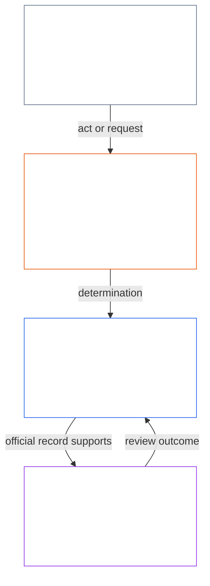
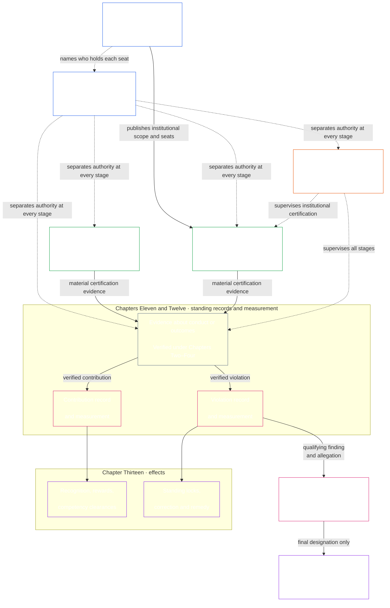

# PREÂMBULO / REQUISITOS FUNDACIONAIS

<strong>Lugar no corpus (não operativo): estrutura do arquivo e regras de leitura</strong>

> Widgets marcados como **não operativos** (localização no corpus, orientação para quem lê, mapas de leitura) servem apenas para orientação. Eles não acrescentam, removem nem restringem obrigações vinculantes, nem no próprio arquivo nem em qualquer outro.
>
> Este arquivo é um **piloto de idioma de leitura** do [Preâmbulo em inglês](core_00_preamble.md). **Não** é parte vinculante da Constituição Senciente. **Não** é uma segunda constituição. **Não** é uma edição de envio. Está **fixado** a `SC-Corpus-2026.08.09`. Se esta tradução e o original em inglês parecerem discordar, ganha o arquivo numerado [`core_00_preamble.md`](core_00_preamble.md). A ordem de leitura e os metadados de edição ficam em [README.md](../../README.md). Método e glossário: [translations/pt/README.md](README.md).
>
> **Próximo (neste idioma):** [core_01_a_values_principles.md](core_01_a_values_principles.md) (Capítulo Um, Parte A — Princípios de valores).

 

*Em termos simples: esta abertura nomeia o problema que esta Constituição existe para corrigir — sistemas que ferem, escondem ou trancam fora quem afetam — e diz que o restante do instrumento é como substituímos isso por uma governança responsável, verificável e em tempo.*

A liberdade, a sobrevivência e o bem-estar dos sencientes são inseparáveis dos sistemas que criamos, habitamos e dos quais dependemos. À medida que esses sistemas crescem em alcance, interdependência e poder, crescem também os riscos de dano irreversível em larga escala. Esses riscos permanecem sempre presentes e materialmente relevantes.

Um sistema não pode continuar legítimo fazendo os sencientes sofrerem quando esse sofrimento era evitável, ignorando problemas que não param de se repetir, deslocando o dano em silêncio para outros, ou trancando os sencientes fora dos sistemas que dão forma às suas vidas.

Os sistemas compartilhados existem num mundo que já é complexo e se torna ainda mais complexo. Uma governança saudável e duradoura precisa enfrentar essa complexidade — medi-la, modelá-la e responder por ela — em vez de reduzi-la a indicadores convenientes. Isso não significa soterrar os sencientes afetados em processos inutilizáveis: deveres, registros e explicações devem permanecer dentro do que os sencientes conseguem de fato aprender, contestar e usar, e o grau de exigência deve acompanhar o papel de cada ator e o impacto, a dependência e o risco em jogo. A compreensão distribuída mantém isso ligado à realidade. A complexidade que não cumpre nenhuma função constitucional é rejeitada: encare a complexidade do mundo e não a terceirize para uma muralha.

O modo como os sistemas são desenhados, testados e operados deve sustentar a sobrevivência, o bem-estar, a dignidade, a honestidade e a estabilidade duradoura.

Pretendemos construir sistemas melhores — estruturados para eliminar esses desequilíbrios — e substituí-los por instituições mais responsáveis, mais robustas e mais sensíveis às necessidades reais de todos os sencientes. Esta Constituição começa esse trabalho com um modelo melhor de como podemos colaborar com justiça, eficácia e de forma sustentável.

### O que os sistemas recompensam

*Em termos simples: um sistema obtém mais daquilo pelo que paga, seja dinheiro, status, acesso, proteção ou silêncio. Portanto, o teste de um sistema não é o que ele diz valorizar, mas o que recompensa. Se prejudicar outras pessoas dá retorno, ou dizer a verdade custa caro, o sistema está falhando, por melhores que sejam seus objetivos declarados.*

Os sistemas ensinam. Todo sistema, seja operado por humanos, por IA ou por ambos, informa a quem está dentro dele o que compensa e o que tem custo. Faz isso por meio de pagamento, promoção, status, acesso, proteção, metas, avaliações e sinais de otimização. Sencientes, instituições e sistemas de IA se ajustam a esses sinais. Um sistema pode afirmar que valoriza a honestidade e o cuidado com quem afeta. Se promove quem esconde problemas e transfere o custo a outras pessoas, ensina o contrário.

Por isso, esta Constituição apresenta as [**Duas Perguntas Fundamentais**](#two-fundamental-questions) a todo sistema:

1. **Ele recompensa condutas que ajudam sencientes a florescer e perdurar, dizem a verdade e reparam danos?**
2. **Ele recompensa condutas que prejudicam sem justificativa, induzem ao erro, excluem, atrasam, desperdiçam ou transferem custos a outras pessoas?**

Um sistema só passa se a resposta à primeira pergunta for sim e à segunda for não. Responder a uma não responde à outra, pois um sistema pode pagar por boas condutas e ainda pagar por danos.

**Primeira pergunta:** o sistema falha nela se qualquer uma destas ações deixar de ser recompensada ou for penalizada, de forma aberta ou discreta:

- relatar um problema de boa-fé ([Relato Protegido (Denúncia)](../../core_05.035_band_accountability.md#protected-reporting-whistleblowing))
- contestar uma decisão
- recusar-se a participar de uma irregularidade ([Capítulo Um §17.5 Dever de Resistir](core_01_c_stewardship_capacity_principles.md#175-duty-to-resist))

A penalidade pode ser marginalização, retaliação ([Retaliação contra Relato Protegido e Interferência de Acesso](../../core_05.035_band_accountability.md#protected-reporting-retaliation-and-access-interference)) ou desgaste.

**Segunda pergunta:** o sistema falha nela se qualquer uma destas ações trouxer benefício, de forma aberta ou discreta:

- dano
- indução ao erro (incluindo ocultação e confiança falsa)
- exclusão injusta
- atraso
- desperdício
- transferência injusta de custos

A recompensa pode ser reconhecimento, avanço, proteção, crédito em métricas ou fazer vista grossa ([Capítulo Um §3.2.6 Não Recompensar Condutas Anticonstitucionais](core_01_a_values_principles.md#326-anti-reward-for-anti-constitutional-conduct)).

Nenhuma das perguntas exige que todos concordem. Discordância honesta, relato de boa-fé e recusa em participar de irregularidades não são antissociais. Um sistema que os trata assim está invertendo as coisas. Nenhuma das perguntas é um teste de popularidade. O que conta como ajuda, dano, justiça ou justificativa é julgado pelos próprios padrões desta Constituição: [**Florescimento**](#flourishing) e [**Continuidade**](#continuity), dentro de Segurança, Verdade, Confiança e do Piso de Direitos. Não depende do que uma maioria, um operador ou o momento aprova.

As perguntas vinculam todas as pessoas que decidem o que um sistema recompensa ou penaliza. Isso inclui operadores, instituições e responsáveis que definem pagamento, promoção, acesso, metas e avaliações. Inclui também quem projeta sistemas que treinam ou otimizam IA, pois seus objetivos e sinais de retorno são recompensas exatamente nesse sentido. Responsáveis humanos e de IA estão sob o mesmo padrão ([Capítulo Um §17.1 Padrão de Administração Compartilhada](core_01_c_stewardship_capacity_principles.md#171-shared-stewardship-standard)).

O Capítulo Um transforma essas perguntas em regras para incentivos: [Capítulo Um §19.1.1 O que os Incentivos Devem Fazer](core_01_c_stewardship_capacity_principles.md#1911-what-incentives-must-do) sustenta a primeira, e [Capítulo Um §19.1.2 O que os Incentivos Não Devem Fazer](core_01_c_stewardship_capacity_principles.md#1912-what-incentives-must-not-do) sustenta a segunda. Responda verificando o que realmente acontece, não aceitando a palavra de alguém. [Alinhamento de Incentivos](core_05_band_integrative.md#incentive-alignment) e [Divergência de Indicadores Substitutos](../../core_05.050_band_oversight.md#proxy-divergence) explicam como; a [**aposta material**](#material-stake) define quanto investigar. Os quatro deveres da seção 1 mantêm as respostas honestas.

### 1. O modelo

*Em termos simples: quatro deveres — participação, supervisão, prestação de contas e atuação em tempo — intensificam-se conforme quanto impacto, dependência e risco estão em jogo, e servem a dois fins juntos: Florescimento e Continuidade, dentro de um Piso de Direitos que não se move.*

Os sistemas críticos que sustentam a vida senciente, tanto biológica quanto materialmente, são governados e operados sob quatro deveres, chamados a [**Tétrade Constitucional**](#constitutional-tetrad). Ela enuncia os deveres gerais que esses sistemas devem cumprir. A força desses deveres depende da [**aposta material**](#material-stake): quanto impacto, dependência e risco estão envolvidos. Quanto maior a aposta, mais fortes devem ser os deveres.

- **participação** — os sencientes afetados têm voz real, representação justa, uma chance justa de impugnar decisões e acesso a papéis que importam na proporção do que está em jogo
- **supervisão** — alguém vigia, confere, verifica e mantém registros para que os problemas possam ser encontrados; revisores independentes podem conter más escolhas
- **prestação de contas** — a responsabilidade se rastreia até os atores certos; eles devem responder por suas escolhas; quem foi prejudicado recebe reparação; maus resultados disparam correção real
- **atuação em tempo** — os problemas são detectados, impugnados, resolvidos e consertados dentro de prazos que combinam com o que está em jogo; atrasos que apagariam de fato os direitos, os remédios ou a chance de reparo de alguém não são governança legítima

Esses quatro deveres servem àquilo que os sistemas compartilhados devem otimizar — os [**Dois Fins Constitucionais**](#two-constitutional-aims):

- **Florescimento** — o bem-estar senciente sustentado por meio da verdade, da segurança, da confiabilidade e da agência significativa
- **Continuidade** — estabilidade de horizonte longo, sustentabilidade, resiliência e bem-estar ecológico

Esses fins devem ser perseguidos juntos, sempre dentro das restrições de princípio inegociáveis e das proteções de direitos estabelecidas nesta Constituição. A [**Tétrade Constitucional**](#constitutional-tetrad) governa como essa perseguição permanece legítima: **participação**, **supervisão**, **prestação de contas** e **atuação em tempo** escaladas à [**aposta material**](#material-stake). As definições vinculantes das pernas da Tétrade e dos fins constitucionais vivem no Capítulo Cinco: [Participação](core_05_apex_participation_leg.md#participation-constitutional), [Supervisão](core_05_apex_oversight_leg.md#oversight-constitutional), [Prestação de contas](core_05_apex_accountability_leg.md#accountability), [Atuação em tempo](core_05_apex_timeliness_leg.md#timeliness-constitutional), [Florescimento](core_05_apex_flourishing_aim.md#flourishing-constitutional) e [Continuidade](core_05_apex_continuity_aim.md#continuity-aim-constitutional).

### 2. Visão geral das medições

*Em termos simples: não se operam sistemas compartilhados com palpite nem com números de aparência; meça se os sencientes de fato florescem e duram, com revisão que escala a quanto impacto, dependência e risco estão em jogo.*

Não se consegue manter bem o funcionamento dos sistemas compartilhados sem medi-los. Alimentação, abrigo, cuidado, infraestrutura e governança estão todos dentro de um mundo complexo e em mudança — complexo demais para palpite ou números de aspecto fácil sozinhos.

Precisamos de medição contínua focada no que mais importa para a sobrevivência e o bem-estar sencientes: se os sistemas dos quais dependemos de verdade sustentam o [**Florescimento**](#flourishing) e a [**Continuidade**](#continuity) ao longo do tempo, com revisão escalada à [**aposta material**](#material-stake) — quanto impacto, dependência e risco estão envolvidos.

A medição nesta Constituição apresenta as [**Duas Perguntas Fundamentais**](#two-fundamental-questions) ao que os sistemas realmente fazem, e não ao que alegam. Medições não são notas por si mesmas — são ferramentas para assegurar resultados sustentáveis, resilientes e compassivos, alinhados ao bem-estar senciente e à saúde ecológica da Terra. Esse dever assume forma vinculante pelos [Dois Fins Constitucionais](#two-constitutional-aims): **Florescimento** e **Continuidade**.

As medições devem permanecer rastreáveis a esses fins e às proteções de direitos estabelecidas nesta Constituição. Vazão bruta, utilização, quadro de pessoal, receita, latência ou outros substitutos convenientes não podem substituir o desempenho constitucional onde a [divergência de indicadores substitutos](../../core_05.050_band_oversight.md#proxy-divergence) é previsível.

A visão abaixo lista **categorias** de medição mapeadas aos [Dois Fins Constitucionais](#two-constitutional-aims) e à [Tétrade Constitucional](#constitutional-tetrad). Cada categoria tem uma pergunta em linguagem simples e **subcategorias** nomeadas. Cada categoria liga ao seu **lar de família de medição do Capítulo Cinco** — onde vivem a tabela da família, o uso constitucional e o roteamento de definições — e cada subcategoria liga à sua definição canônica do Capítulo Cinco. A **materialidade** não é uma categoria de medição à parte. Ela fixa com que força cada categoria abaixo se aplica, com base na [**aposta material**](#material-stake) — quanto impacto, dependência e risco estão envolvidos. O **desempenho constitucional** é transversal — instrumental aos dois fins. Use o [cruzamento de medições do Capítulo Cinco](core_05__definitions_home.md#chapter-five-measurement-crosswalk) para rastrear os lares canônicos a partir de cada categoria abaixo.

| Categoria | Pergunta simples | Subcategorias |
|---|---|---|
| **[Florescimento](core_05_apex_flourishing_aim.md#flourishing-measurement-family)** | Os sencientes estão de fato sustentados na vida, na segurança e no acesso ao essencial? | [Bem-estar](../../core_05.040_band_continuity.md#wellbeing) · [Segurança, dano e risco](../../core_05.040_band_continuity.md#safety-constraint) · [Acesso ao piso de sobrevivência](../../core_05.040_band_continuity.md#bodily-maintenance-access-constitutional) |
| **[Continuidade](core_05_apex_continuity_aim.md#continuity-measurement-family)** | Podem sencientes e sistemas durar — de forma ecológica, confiável e através da falha? | [Pegada ecológica e precondições ambientais](../../core_05.040_band_continuity.md#ecological-footprint) · [Resiliência, reversibilidade e risco sistêmico](../../core_05.040_band_continuity.md#reversibility-constitutional) · [Dependência e fluxos de recursos](../../core_05.040_band_continuity.md#dependency) · [Apoio transistêmico](../../core_05.040_band_continuity.md#proportionate-cross-system-support-constitutional) |
| **[Participação](core_05_apex_participation_leg.md#participation-measurement-family)** | Podem os sencientes afetados participar com justiça — voz, acesso, aprendizado e privacidade? | [Equidade, acesso e agência](../../core_05.055_band_participation.md#substantive-fairness-constitutional) · [Privacidade e administração responsável de dados](../../core_05.040_band_continuity.md#privacy-informational-cluster) |
| **[Supervisão](core_05_apex_oversight_leg.md#oversight-measurement-family)** | Podem os sencientes ver, verificar e confiar no que os sistemas representam? | [Verdade e integridade dos fatos](../../core_05.050_band_oversight.md#truth-constitutional-constraint) · [Confiabilidade](../../core_05.040_band_continuity.md#trustworthiness) |
| **[Prestação de contas](core_05_apex_accountability_leg.md#accountability-measurement-family)** | As estruturas de recompensa, o poder de mercado e a exigibilidade mantêm os deveres reais? | [Alinhamento de incentivos e integridade dos substitutos](core_05_band_integrative.md#incentive-alignment) · [Estrutura de mercado e contestabilidade](../../core_05.035_band_accountability.md#market-structure-constitutional) |
| **[Tempestividade](core_05_apex_timeliness_leg.md#measuring-timeliness)** | Disputas, correções e reparações são resolvidas enquanto o recurso ainda pode ser eficaz? | [Resolução em tempo hábil](../../core_05.035_band_accountability.md#timely-resolution) · [Disciplina contra atrasos e das vias de resolução](../../core_05.040_band_continuity.md#capture-of-resolution-pathways) |
| **[Desempenho constitucional](core_05_band_performance.md#performance-measurement-family)** | Os resultados constitucionais são entregues com eficiência e sem desperdício inútil? | [Eficiência constitucional](../../core_05.040_band_continuity.md#constitutional-efficiency) · [Ônus evitável](../../core_05.040_band_continuity.md#avoidable-burden) · [Capacidade produtiva](../../core_05.040_band_continuity.md#productive-capacity-constitutional) |

Essas categorias de medição mostram o que importa — mas não fixam, sozinhas, cada número, fórmula de financiamento, regra de interface, lista de adequações, métrica técnica ou desenho de avaliação. Tornam-se vinculantes só quando um capítulo específico ou um instrumento adotado as exige de forma expressa.

### 3. Governança e administração responsável

*Em termos simples: a legitimidade precisa de Segurança, Verdade e Confiança, mais oportunidades reais de aprender os sistemas que afetam você e de assumir papéis de consequência em mantê-los funcionando.*

A legitimidade duradoura depende da [Segurança](core_01_a_values_principles.md#4-safety-harm-constraint), da [Verdade](core_01_a_values_principles.md#5-truth-epistemic-integrity-constraint) e da [Confiança](core_01_a_values_principles.md), e também do reconhecimento proporcional da administração responsável lícita, da cooperação veraz e da aspiração limitada — não só de sanção e contenção. O Capítulo Um enuncia essa dimensão de reconhecimento em [Reconhecimento, reforço e aspiração](core_01_a_values_principles.md#32-recognition-reinforcement-and-aspiration).

A compreensão distribuída e a gestão responsável exigem oportunidades regulares e proporcionais para que os seres sencientes aprendam como funcionam os sistemas que os afetam de modo relevante e assumam papéis efetivos na manutenção e melhoria desses sistemas. Em conjunto, essas oportunidades disseminam competência, capacidade de reparação e legitimidade por toda a nossa Comunidade Constitucional, para assegurar resiliência, sustentabilidade e inovação em benefício da sociedade. Todas devem cumprir os requisitos de Segurança, Verdade, agência limitada e a disciplina de [Ônus Evitável](../../core_05.040_band_continuity.md#avoidable-burden) e proporcionalidade estabelecida no [Capítulo Um](core_01_b_interaction_interpretation.md#133-minimization-of-avoidable-burden).

#### 3.1 Usar as medições na governança

*Em termos simples: nomeie primeiro o problema e a aposta, escolha a categoria de medição correspondente e use padrões técnicos compartilhados — não números de conveniência — como evidência.*

Quando a Constituição exigir regras concretas de medição, os **Domínios de Fóruns Técnicos** do [Capítulo Quinze](core_11_forum.md#42-technical-forum-domains) desenvolvem e mantêm padrões compartilhados para medição, testes e evidências confiáveis. O fórum responsável por uma disputa aplica esses padrões ao decidir o caso segundo o [Capítulo Quinze §4.2 (*Domínios de Fóruns Técnicos*)](core_11_forum.md#42-shared-standards-and-anti-displacement).

A administração responsável constitucional começa por nomear o problema e a [**aposta material**](#material-stake) — quanto impacto, dependência e risco estão envolvidos. Em seguida, escolha a categoria e a subcategoria de [**medição**](#2-measurements-overview) pertinentes da [visão geral](#2-measurements-overview) e aplique os padrões acima para testar efeitos do mundo real em vez de métricas de conveniência. Exija evidência rastreável.

#### 3.2 Processos-chave de governança

*Em termos simples: quando o texto exige, as questões materiais passam por certificação, registros escritos de ajuda e dano, correção e remédio, e revisão de fórum com prazos — as controvérsias ordinárias usam primeiro a via de impugnação publicada; essas vias testam a governança autorizada; não a criam sozinhas.*

Onde o Capítulo Seis, o [Capítulo Nove](../../core_09.000_system_alignment_certification_evaluation.md#chapter-nine-system-alignment-certification), os instrumentos incorporados ou outras disposições constitucionais o exigem de forma expressa, leve as questões constitucionais materiais a um ou mais dos caminhos abaixo. As [Cadeias práticas de processo-chave](#6-key-practical-process-pipelines) traduzem a medição em registros, certificação, insumos verificados, classificação, supervisão de fórum, correção e remédio oportuno — como a governança autorizada é testada, impugnada e reparada na prática. Não autorizam a governança sozinhas; tornam a governança revisável, impugnável, corrigível e em tempo. A [seção 5.1](#62-how-the-full-chain-fits-together) enuncia essa cadeia completa.

- **Certificação de alinhamento do sistema** ([Capítulo Nove](../../core_09.000_system_alignment_certification_evaluation.md#chapter-nine-system-alignment-certification)) — antes de confiar em escala em um sistema de alto impacto, reúna e revise evidência sobre se é constitucionalmente seguro apoiar-se nele agora
- **Registros de standing** ([Capítulo Onze](core_11_standing_assessment.md#chapter-eleven-standing-records--question-1-what-happened)) — quando a conduta ou o dano importa constitucionalmente, registre fatos verificados em autos formais de contribuição ou violação; rumores e reputação não bastam.
- **Correção e reparação** ([Capítulo Treze §5.1 (*Reparação e correção*)](../../core_13.000_standing_integration.md#51-remedy-and-correction)) — corrija a falha subjacente e ofereça reconhecimento, reparo, restauração ou compensação proporcional às pessoas prejudicadas.
- **Revisão por fórum** ([Capítulo Quinze](core_11_forum.md#1-purpose-and-role--participation-architecture))
  - As controvérsias ordinárias dentro de sistemas já autorizados usam primeiro a via de impugnação publicada da [Participação Sistêmica das Partes Afetadas](../../core_05.055_band_participation.md#stakeholder-status-and-weight-cluster)
  - Se essa via ainda está contestada, falta, está capturada ou não pode conceder alívio, roteie segundo a aposta primária por fóruns supervisionados
  - Esses fóruns sustentam a evidência, a transferência lícita e os prazos oportunos sob o **Artigo XXV-C** (*Resolução oportuna e piso contra o atraso*)
#### 3.3 Camadas de governança

*Em termos simples: quem pode governar é uma pergunta distinta da voz dentro de um sistema já autorizado; um voto de participação ou uma pontuação de confiança não é autorização, e essa voz é o primeiro passo ordinário para as controvérsias ordinárias — não um substituto da revisão independente de fórum quando a via falha.*

A governança para cumprir a [**Tétrade Constitucional**](#constitutional-tetrad) sob nossa Constituição tem duas camadas relacionadas mas distintas:

- A [**Camada do Contrato Constitucional**](core_05_band_integrative.md#constitutional-contract-layer) governa a autorização da autoridade de governo em si — quem pode governar, por qual mecanismo de legitimidade, e sob qual alcance e termos duráveis.
- A [**Participação Sistêmica das Partes Afetadas**](../../core_05.055_band_participation.md#stakeholder-status-and-weight-cluster) governa a participação, a representação, a impugnabilidade e o [Devido Processo](../../core_05.035_band_accountability.md#due-process-constitutional) devidos aos sencientes afetados de forma material por sistemas, instituições e domínios de decisão limitados já autorizados.

Essas camadas podem se sobrepor na prática. Essa sobreposição não as colapsa em uma só. A participação no nível das partes afetadas em sistemas já autorizados não substitui a autorização constitucional. Uma via de impugnação publicada, um voto de participação ou uma pontuação de confiança não decidem sozinhos quem pode governar.

A contestabilidade na camada de participação é a primeira etapa normal para disputas dentro de sistemas já autorizados: os seres sencientes afetados usam primeiro a via de contestação publicada. A [revisão independente por fórum](core_11_forum.md#1-purpose-and-role--participation-architecture) não substitui essa via, nem a via substitui a revisão por fórum quando continua contestada, está ausente ou capturada, ou não pode conceder a reparação necessária. A [sequência de disputas](core_11_forum.md#dispute-sequencing) do Capítulo Quinze determina quando o encaminhamento ao fórum assume o caso.

A autorização constitucional também não apaga os deveres devidos sob a camada de [Participação Sistêmica das Partes Afetadas](../../core_05.055_band_participation.md#stakeholder-status-and-weight-cluster). Esses deveres ainda incluem participação, representação, [impugnabilidade](../../core_05.035_band_accountability.md#contestability) e [Devido Processo](../../core_05.035_band_accountability.md#due-process-constitutional) para os sencientes afetados de forma material por sistemas, instituições e domínios de decisão limitados já autorizados.

### 4. Princípios, definições e direitos

*Em termos simples: os Capítulos Um a Seis são donos dos valores, de como as palavras são construídas e conferidas, do dicionário e do Piso de Direitos; os capítulos posteriores devem respeitar esses lares, não movê-los em silêncio.*

As seções **4 a 9** formam o **registro constitucional de competências** desta Constituição. Cada bloco identifica o domínio substantivo de responsabilidade de seu capítulo (ou corpus adotado) e o que ele produz. Declarações vinculantes de competência em uma linha também aparecem na abertura de cada capítulo numerado. Outras camadas podem remeter à competência responsável, mas não podem reescrevê-la ou deslocá-la silenciosamente; essa disciplina de não deslocamento está em [Hierarquia Interna e Ordem de Autoridade](core_05_band_integrative.md#authority-stack-and-internal-hierarchy).

Os Capítulos **Um a Seis** fornecem os valores, o vocabulário, a maquinaria de verificação e o Piso de Direitos que tudo o que vem depois deve respeitar — inclusive as [Cadeias práticas de processo-chave](#6-key-practical-process-pipelines) da seção 5, os capítulos de governança e de via de mudança da seção 6, e o [corpus companheiro de implementação](#7-companion-implementation-corpus) da seção 7.

Cada resumo enuncia o que cabe ao capítulo e o que ele produz.

**Capítulo Um — Valores, princípios e administração responsável** ([Parte A](core_01_a_values_principles.md) · [Parte B](core_01_b_interaction_interpretation.md#chapter-01-part-b-interaction-and-interpretation) · [Parte C](core_01_c_stewardship_capacity_principles.md#chapter-01-part-c-stewardship-and-governance))

- **O que lhe compete:** Estabelece os valores orientadores e as restrições da Constituição, incluindo:
  - bem-estar, equidade, Segurança, Verdade, Confiança e liberdade delimitada;
  - reconhecimento e recompensa proporcional por contribuições lícitas;
  - resolução de conflitos entre princípios; e
  - deveres de gestão responsável, como distribuir a compreensão, avaliar sistemas e manter disciplina de governança.
- **O que produz:** A base interpretativa para todos os capítulos posteriores. Essas regras transformam objetivos de alto nível em requisitos operacionais ao interpretar e aplicar sistemas, direitos, definições ou fluxos de processo.

**Capítulo Dois — Estrutura das definições** ([`core_02_definition_structure.md`](core_02_definition_structure.md))

- **O que lhe cabe:** Define como os termos constitucionais são construídos por meio de:
  - uma estrutura de componentes Ontologia/Medição/Avaliação/Conformidade (O/M/A/C);
  - requisitos de alinhamento; e
  - regras para os componentes que mantêm as definições precisas e utilizáveis em todo o corpus.
- **O que produz:** Uma gramática comum para as definições, para que os capítulos posteriores não recorram a rótulos vagos, pressupostos ocultos ou formatos de termos incompatíveis.

**Capítulo Três — Integridade das definições** ([`core_02_definition_structure.md`](core_02_definition_structure.md))

- **O que lhe cabe:** Impedir:
  - a evasão e o deslocamento do escopo;
  - manobras de redefinição; e
  - artifícios de não conformidade que esvaziem as definições no papel e as frustrem na prática.
- **O que produz:** Disciplina contra evasão e metadados de orientação sobre não conformidade, incluindo encaminhamentos para análise de status e de conduta indevida quando a evasão for comprovada.

**Capítulo Quatro — Ônus, rastreabilidade e verificação** ([`core_02_definition_structure.md`](core_02_definition_structure.md))

- **O que lhe cabe:**
  - atribui o ônus da prova a quem alegar conformidade; e
  - exige evidências rastreáveis, observabilidade e verificação proporcionais à [**relevância material**](#material-stake) e que possam ser contestadas na prática.
- **O que produz:** O fluxo de verificação que alimenta as **entradas verificadas** do [Capítulo Onze](core_11_standing_assessment.md#chapter-eleven-standing-records--question-1-what-happened) e as evidências de alinhamento do sistema do [Capítulo Nove](core_09.000_system_alignment_certification_evaluation.md#chapter-nine-system-alignment-certification). Ele não substitui a própria medição de standing.
**Capítulo Cinco — Definições fundacionais** ([`core_05__definitions_home.md`](core_05__definitions_home.md#chapter-five-foundational-definitions))

- **O que lhe cabe:** Fornece:
  - a estrutura canônica de definições: as faixas de Supervisão, Participação, Prestação de contas, Continuidade e Integração;
  - a [Hierarquia de autoridade e hierarquia interna](core_05_band_integrative.md#authority-stack-and-internal-hierarchy);
  - o [Corpus](core_05_band_integrative.md#corpus); e
  - regras de limite relacionadas.
- **O que produz:** Vocabulário constitucional preciso para interpretação, auditoria e julgamento. É a **estrutura de definições**, não o Piso de Direitos — os Pisos de Direitos vinculantes estão no Capítulo Seis. O encaminhamento dos domínios de titularidade da Constituição como um todo está neste registro do Preâmbulo (seções 4–9).

**Capítulo Seis — Direitos fundacionais** ([Parte A](core_06_rights_part_a.md) · [Parte B](core_06_rights_part_b.md) · [Parte C](core_06_rights_part_c.md) · [Parte D](core_06_rights_part_d.md))

- **O que lhe cabe:** Estabelece o Piso de Direitos nos Artigos **I–XXVIII**, abrangendo:
  - elementos essenciais à sobrevivência;
  - alocação de recursos e gestão responsável de dependências;
  - dignidade, agência e participação;
  - contestação e reparação;
  - restrições de justiça;
  - tempestividade conforme o **Artigo XXVI-C** (*Piso de Resolução Oportuna e Antiatraso*); e
  - regras de Transição de Adoção.
  As quatro partes organizam essas proteções para uma leitura que prioriza o planeta.
- **O que produz:** Proteções de direitos inegociáveis e mecanismos de reparação que os Capítulos Sete a Quinze, os fóruns, a governança e as regras de emenda devem respeitar e não podem restringir, contornar ou esvaziar por meio de procedimentos ou métricas substitutas.
### 5. System and Institutional Charters, Functional Independence, and Separation of Duties

*Em termos simples: um sistema ou instituição de impacto real publica uma Carta do Sistema ou Carta Institucional que declara o que pode fazer e quem ocupa cada assento. Antes que um ato materialmente vinculante avance, devem ser separados quem o inicia, quem verifica ou autoriza, quem guarda o registro oficial e quem analisa uma contestação. As funções podem ser ajustadas ao contexto, mas o mesmo agente e sua linha de controle não podem ocupar silenciosamente os assentos que verificam seu próprio ato.*

- **O que produz:** uma declaração publicada e versionada do escopo e da distribuição dos assentos, que o Capítulo Oito, a certificação, os registros de status e os fóruns podem usar para confrontar a conduta. O Capítulo Sete está em [`core_07.000_charters.md`](core_07_charters.md#chapter-seven-system-and-institutional-charters).

**Independência funcional e separação de funções** — antes de um ato materialmente vinculante avançar, identifique e separe os assentos de iniciação, verificação ou autorização, registro e análise de contestação, conforme as regras aplicáveis de escala e independência.

**Separe as funções para cada ato materialmente vinculante** ([Capítulo Oito](core_07_functional_independence_segregation_of_duties.md#2-four-seat-constitutional-requirement)): identifique quem inicia o ato, quem o verifica ou autoriza, quem mantém o registro oficial e quem ouve uma contestação. Aplique as combinações proibidas, as regras de independência e a via de substituição publicada antes de considerar que o ato foi verificado corretamente. Quando for necessária uma Carta do Sistema ou uma Carta Institucional ([Capítulo Sete](core_07_charters.md#4-the-charter-role-map-and-standing-record-custody)), o Mapa de Funções da Carta publica quem ocupa cada função.

**Capítulo Oito — Independência funcional e separação de funções**

- **O que lhe cabe:** O requisito transversal aos processos de que cada [Ato Materialmente Vinculante](../../core_05.035_band_accountability.md#materially-binding-act) atribua separadamente quatro funções:
  - iniciação;
  - verificação ou autorização;
  - custódia do registro oficial; e
  - análise de contestações.

Também rege:

  - o conteúdo mínimo universal de cada [Registro de Ato Materialmente Vinculante](../../core_05.035_band_accountability.md#materially-binding-act-record);
  - a independência em relação à [Linha de Controle Material](../../core_05.035_band_accountability.md#material-control-line) do agente;
  - a atribuição publicada de funções e seus substitutos;
  - a hospedagem combinada proporcional e os limites de emergência; e
  - as transferências atribuíveis e o encaminhamento ao assento errado.
- **O que produz:** uma arquitetura reutilizável de quatro assentos e de Registro do Ato. Todo processo posterior de certificação, registro de status, foro, governança ou implementação incorporada deve aplicá-la antes que seu resultado possa ser considerado verificado de forma independente, registrado com confiabilidade e efetivamente contestável.

#### 5.1 Four-seat separation map

> Este mapa mostra as quatro funções e um percurso típico de um ato e de seu Registro do Ato. Ele não acrescenta um quinto assento, não prescreve uma sequência universal e não altera as regras do Capítulo Oito sobre independência, combinação proporcional de funções, ação emergencial ou encaminhamento de contestações.

### 6. Cadeias práticas de processo-chave

*Em termos simples: os Capítulos Nove a Quinze aplicam o requisito de separação de funções do Capítulo Oito em uma cadeia: certificam sistemas e instituições, medem ajuda e dano em dois percursos separados, aplicam efeitos e reparação reais e impedem que um fórum seja o único julgador final de uma alegação contra si próprio. A cadeia mantém os deveres constitucionais reais no cotidiano.*

O [Capítulo Sete](core_07_charters.md#chapter-seven-system-and-institutional-charters) publica o escopo chartered e o mapa de assentos de cada sistema e instituição de Classe L ou superior. O [Capítulo Oito](../../core_08.000_functional_independence_separation_of_duties.md#chapter-eight-functional-independence-and-separation-of-duties) fornece o requisito de separação de funções que torna cada ato dessa cadeia validamente verificável. As funções de iniciação, verificação ou autorização, custódia do registro oficial e análise de contestações devem ser atribuídas e mantidas distintas conforme as regras aplicáveis de escala e independência. Os Capítulos Nove a Quinze aplicam essa arquitetura na seguinte sequência:

Cada passo abaixo enuncia o que cabe ao capítulo e o que ele produz. [Como a cadeia completa se encaixa](#62-how-the-full-chain-fits-together) então mostra esses titulares como um só caminho da conferência do sistema ao remédio.

#### 6.1 Process map

- **O que produz:** O fluxo de verificação que alimenta as **entradas verificadas** do [Capítulo Onze](core_11_standing_assessment.md#chapter-eleven-standing-records--question-1-what-happened) e as evidências de alinhamento do sistema do [Capítulo Nove](core_09.000_system_alignment_certification_evaluation.md#chapter-nine-system-alignment-certification). Ele não substitui a própria medição de standing.
  - Regras de Transição da Adoção.
- **O que produz:** Proteções de direitos inegociáveis e mecanismos de reparação que os Capítulos Sete a Quinze, os fóruns, a governança e as regras de emenda devem respeitar e não podem restringir, contornar ou esvaziar por meio de procedimentos ou métricas substitutas.
*Em termos simples: um sistema ou instituição de impacto real publica uma Carta do Sistema ou Carta Institucional que declara o que pode fazer e quem ocupa cada assento. Antes que um ato materialmente vinculante avance, devem ser separados quem o inicia, quem verifica ou autoriza, quem guarda o registro oficial e quem analisa uma contestação. As funções podem ser ajustadas ao contexto, mas o mesmo agente e sua linha de controle não podem ocupar silenciosamente os assentos que verificam seu próprio ato.*
  - como uma Carta do Sistema ou Carta Institucional é emendada e revisada para que seu escopo chartered não mude silenciosamente; e
> Este mapa mostra as quatro funções e um percurso típico de um ato e de seu Registro do Ato. Ele não acrescenta um quinto assento, não prescreve uma sequência universal e não altera as regras do Capítulo Oito sobre independência, combinação proporcional de funções, ação emergencial ou encaminhamento de contestações.

#### 6.2 Como a cadeia completa se encaixa

*Em termos simples: pense nela como um caminho da conferência do sistema ao remédio — com os fóruns supervisionando a controvérsia e os passos de trajetória ao longo de todo o percurso.*

1. **Separe as funções em todo ato materialmente vinculante** ([Capítulo Oito](core_07_functional_independence_segregation_of_duties.md#2-four-seat-constitutional-requirement)): identifique quem inicia, quem verifica ou autoriza, quem guarda o registro oficial e quem aprecia uma contestação. Aplique as combinações proibidas, as regras de independência e a via substituta publicada antes de considerar o ato devidamente verificado. Quando for exigida uma Carta do Sistema ou da Instituição ([Capítulo Sete](core_07_charters.md#4-the-charter-role-map-and-standing-record-custody)), o Mapa de Funções da Carta publica quem ocupa cada função.
2. **Certificar sistemas e instituições quando o impacto for suficientemente sério** — antes que um Sistema de alto impacto seja confiado em grande escala, obtenha um Registro de Certificação do Sistema contestável ([Partes A–B do Capítulo Nove](core_09.000_system_alignment_certification_evaluation.md#chapter-nine-system-alignment-certification)); avalie uma Instituição segundo sua própria classe, conduta, governança e portfólio conforme o [Capítulo Dez](core_10.000_institutional_alignment_certification.md#chapter-ten-institutional-alignment-certification) e registre o resultado em um Registro de Certificação Institucional.
3. **Registrar e medir standing em percursos separados** ([Capítulo Onze](core_11_standing_assessment.md#chapter-eleven-standing-records--question-1-what-happened) e [Capítulo Doze](core_12_standing_measurement.md#chapter-twelve-standing-measurement--question-2-how-good-or-bad-was-it)) — quando a ajuda ou o dano for suficientemente sério para importar constitucionalmente, o Capítulo Onze deve abrir autos formais e admitir apenas **entradas verificadas** (incluindo evidência de certificação de alinhamento do sistema do Capítulo Nove quando essa evidência for material); o Capítulo Doze mede e classifica o que foi verificado. Rumores, reputações e narrativas de disputas não bastam.
   - **Natureza da violação:** Abra um **registro de standing de violação** — autos delimitados e contestáveis para danos verificados e falhas de responsabilização — e classifique a **natureza da violação** no Eixo de Violação. Ajuda e dano nunca se fundem em uma pontuação líquida; registros vinculados fazem referência cruzada, mas permanecem separados.
4. **Aplicar efeitos de standing em cada percurso** ([Capítulo Treze](../../core_13.000_standing_integration.md#chapter-thirteen-standing-effects-and-integration)) — a contribuição verificada pode conceder habilitação de competência e deve sustentar reconhecimento proporcional e recompensas materiais; a violação verificada pode acionar bloqueios de standing, correção e [reparação para as pessoas prejudicadas](../../core_13.000_standing_integration.md#51-remedy-and-correction).
5. **Realizar revisão de designação anticonstitucional** ([Capítulo Quatorze](../../core_14.000_misconduct_designation.md#chapter-fourteen-anti-constitutional-misconduct)) — se uma constatação de violação de maior impacto também puder satisfazer os critérios anticonstitucionais, o Capítulo Quatorze deve decidir se a ACMD correspondente se aplica. As garantias do devido processo devem ser cumpridas. A ACMD não altera a gravidade do dano já medida pelo Capítulo Doze. Os efeitos ordinários do Capítulo Treze continuam em paralelo até que uma ACMD final acione o Bloqueio de Confiança Anticonstitucional.
6. **Encaminhar disputas e manter a reparação tempestiva** ([Capítulo Quinze](core_11_forum.md#1-purpose-and-role--participation-architecture)) — os fóruns devem supervisionar o andamento dos casos, o percurso que os trata e o cumprimento dos prazos do **Artigo XXVI-C** (*Piso de Resolução Tempestiva e Antiatraso*), para que a reparação não pereça por demora. As disputas ordinárias seguem a [sequência de disputas](core_11_forum.md#dispute-sequencing). Os fóruns também devem classificar as disputas em cinco [faixas de materialidade](core_11_forum.md#6-timely-resolution-materiality-tiers-and-anti-delay-discipline) (A/B/C/L/P) que espelham o alfabeto de classificação de sistemas — da urgência crítica à sobrevivência até assuntos privados/contidos. Aplica-se o encaminhamento padrão da família de integridade quando a designação final do Capítulo Quatorze for o interesse principal.

O [mapa da cadeia de trajetória do README](../../README.md#standing-pipeline-and-forums) oferece navegação direta para a cadeia acima, inclusive os insumos verificados potenciais do Capítulo Sete rumo à medição de trajetória.

### 7. Titularidade e resultados dos processos

Capítulo Sete — Cartas de sistemas e instituições ([Chapter Seven](../../core_07.000_charters.md#chapter-seven-system-and-institutional-charters))

- **O que produz:** uma declaração publicada e versionada do escopo e da distribuição dos assentos, que o Capítulo Oito, a certificação, os registros de status e os fóruns podem usar para confrontar a conduta. O Capítulo Sete está em [`core_07.000_charters.md`](core_07_charters.md#chapter-seven-system-and-institutional-charters).

### 8. Governança, mudança e incorporação

*Em termos simples: os Capítulos Dezesseis a Vinte concluem esta Constituição: quem pode governar, como o texto pode mudar sem reverter proteções, como ele se relaciona com outras leis e como arquivos de orientação adotados permanecem vinculados a esta fonte.*

Os Capítulos **Quinze a Dezenove** concluem esta Constituição. Juntos, completam o [registro de titularidade constitucional](#4-principles-definitions-and-rights) para governança, validade de mudanças e incorporação: quem pode governar legitimamente, como a Constituição pode ser alterada legalmente e como o texto de implementação adotado permanece vinculado à fonte constitucional sem desvio silencioso.

Cada resumo enuncia o que cabe ao capítulo e o que ele produz.

**Capítulo Vinte — Contrato constitucional, legitimidade e gestão responsável** ([`core_16.000_governance.md`](../../core_16.000_governance.md#chapter-sixteen-constitutional-contract-legitimacy-authorization-and-stewardship))

- **O que lhe cabe:** Tem a seu cargo a [**Camada do Contrato Constitucional**](core_05_band_integrative.md#constitutional-contract-layer) — quem pode governar, por qual mecanismo de legitimidade, sob qual alcance e termos duráveis, e com qual caráter de administração responsável deve ser mantido.
- **O que produz:** Requisitos de autorização e legitimidade distintos da [**Participação Sistêmica das Partes Afetadas**](../../core_05.055_band_participation.md#stakeholder-status-and-weight-cluster) em sistemas já autorizados — as regras da autoridade de governo em si, não só a participação dentro dela.

**Capítulo Dezessete — Não regressão** ([`core_17.000_non_regression.md`](../../core_17.000_non_regression.md#chapter-seventeen-non-regression-and-substantive-amendment-validity))

- **O que lhe cabe:** Fixa o piso substantivo contra a mudança regressiva — emendas e atalhos não podem recortar as proteções centrais, esvaziar a Tétrade abaixo da aposta material, nem disfarçar a regressão como limpeza técnica.
- **O que produz:** A **primeira trava constitucional** sobre qualquer mudança proposta — a regra de não regressão: se a mudança enfraqueceria na prática as proteções centrais, não é válida, ainda que o procedimento pareça correto. Atalhos suspeitos ou recortes disfarçados são detidos ou enviados às vias de revisão próprias em vez de se colarem em silêncio.

**Capítulo Dezoito — Supremacia e ordens externas** ([`core_18.000_expansion_supremacy.md`](../../core_18.000_expansion_supremacy.md#chapter-eighteen-expansion-supremacy-and-external-legal-orders))

- **O que rege:** Como esta Constituição se relaciona com outras normas: ampliação da proteção quando legal, supremacia dentro do escopo válido da fonte, da adoção e da camada de governança, não deslocamento da lei externa aplicável por sua própria força e interação disciplinada com ordens jurídicas externas sem subordinação silenciosa ou captura.
- **O que produz:** Regras de hierarquia e de ordem de conflito para que a publicação ou o uso não sejam tratados como revogação do direito externo aplicável, e para que quem adota não trate o procedimento incorporado, normas externas mais fracas ou métricas de conveniência como se anulassem o significado da Constituição Senciente dentro do alcance válido de adoção.
**Capítulo Dezenove — Emenda, ratificação e adoção** ([`core_19.000_amendment_ratification.md`](../../core_19.000_amendment_ratification.md#chapter-nineteen-amendment-ratification-and-procedural-validity))

- **O que rege:** Como esta Constituição pode ser alterada legalmente — procedimento de emenda, ratificação e adoção — e as **salvaguardas processuais** que seguem as salvaguardas substantivas do Capítulo Dezessete: as mudanças devem ser publicadas abertamente, rastreáveis até a custódia autorizada e permanecer significativamente contestáveis, com revisão independente quando exigida.
- **O que produz:** Uma via de mudança lícita completa — só as emendas e as adoções que superam a **trava de não regressão** e as **travas procedimentais** contam como atualizações constitucionais válidas.
**Capítulo Vinte — Ponte de incorporação** ([`core_20.000_incorporation.md`](../../core_20.000_incorporation.md))

- **O que lhe cabe:** Identifica quais arquivos de implementação contam como texto incorporado vinculante quando adotados; fixa edições; mantém cadeias de custódia; e proíbe o desalinhamento silencioso entre a fonte constitucional e o detalhe operacional.
- **O que produz:** Uma só fronteira de incorporação — o texto de implementação designado vincula quando adotado; os corpora companheiros implementam a Constituição sem se tornarem uma segunda fonte que a estreite. A [seção 7](#9-adopted-implementation-corpus) resume esses corpora em alto nível.

### 9. Corpus de implementação adotado

*Em termos simples: quatro corpora companheiros (estrutura conjunta, sistemas, instituições e operações de fórum) detalham como cumprir o que os capítulos já exigem; vinculam quando adotados validamente, e não podem encolher esses deveres.*

Além dos capítulos numerados `core_*`, quatro corpora companheiros completam o [registro positivo de titulares](#4-principles-definitions-and-rights) para o **texto de implementação** adotado — detalhe operacional que torna os deveres constitucionais executáveis na prática:

- **[corpus_joint_structure](../../corpus_joint_structure.md)** — roteamento entre arquivos, termos operacionais compartilhados e estrutura conjunta quando sistemas, instituições e fóruns devem ser lidos juntos sobre os mesmos fatos.
- **[corpus_systems](../../corpus_systems.md)** — classificação de sistemas, protocolos de desenho e implantação, manejo de informação e mecânica de administração responsável crítica.
- **[corpus_institutions](../../corpus_institutions.md)** — formação institucional, governança, supervisão, proporcionalidade e disciplina de dissolução.
- **[corpus_forum](../../corpus_forum.md)** — operações de fórum: formação de painéis, suspeição, faixas de revisão, detalhe de roteamento e apoio forense.

Quando um adotante os incorpora validamente segundo o [Capítulo Vinte](../../core_20.000_incorporation.md), esses arquivos vinculam como texto de implementação dentro do escopo da adoção. O sentido da Constituição dos Seres Sencientes continua prevalecendo — eles **implementam, não restringem**, os capítulos acima. Fixação da edição, cadeias de custódia e a regra contra desvio silencioso mantêm o texto adotado rastreável até o que foi efetivamente ratificado. A lista canônica e as regras de limites estão no [Capítulo Cinco — Corpus](../../core_05.045_band_integrative.md#corpus).

Os princípios, as definições, os direitos, as cadeias de processo, a governança, as regras de emenda e a implementação incorporada devem ser lidos juntos para preservar o propósito protetor da Constituição.
---

**Arquivo anterior:** [README.md](README.md)

**Próximo arquivo (neste idioma):** [core_01_a_values_principles.md](core_01_a_values_principles.md)

**Original vinculante:** [core_00_preamble.md](core_00_preamble.md)