# CAPÍTULO SETE, PARTE A: CERTIFICAÇÃO DE ALINHAMENTO DO SISTEMA — AVALIAÇÃO

<strong>Lugar no corpus (não operativo): estrutura do arquivo e regras de leitura</strong>

> Este arquivo é um **piloto de idioma de leitura** do [Capítulo Sete, Parte A em inglês](../../core_09_a_system_alignment_certification_evaluation.md). **Não** é parte vinculante da Constituição Senciente. **Não** é uma segunda constituição. **Não** é uma edição de envio. Está **fixado** a `SC-Corpus-2026.08.09`. Se esta tradução e o original em inglês parecerem discordar, ganha o arquivo numerado [`core_07_a_system_alignment_certification_evaluation.md`](../../core_09_a_system_alignment_certification_evaluation.md). A ordem de leitura e os metadados de edição ficam em [README.md](../../README.md). Método e glossário: [translations/pt/README.md](README.md).
>
> Contém o **Capítulo Sete, Parte A** — requisitos de **avaliação** de certificação (classe do sistema, fatores do sistema inteiro e ganchos de avaliação de domínio). A **Parte B** — registro de certificação, processo de fórum, ponte de trajetória e reabertura — está em [`core_07_b_system_alignment_certification_record_process.md`](core_07_b_system_alignment_certification_record_process.md).
>
> - **Titular constitucional (conjunto com a Parte B):** **certificação de alinhamento do sistema supervisionada por fórum e registros relacionados** — domínios de avaliação (Parte A); deveres do registro de certificação, resultados de reconhecimento, cadência de revalidação, sequência supervisora, cadeia de impugnabilidade e ponte de insumo verificado rumo ao Capítulo Oito (Parte B). Sob a perna de **supervisão** da Tétrade, a SAC é um processo de auditoria especialmente grande e de alta aposta entre outros; os pisos de auditoria permanecem no **Artigo XVI** e na [Auditabilidade](../../core_05.050_band_oversight.md#auditability) do Capítulo Cinco.
> - **Titular do substrato de verificação:** o [Capítulo Quatro — Ônus da prova, rastreabilidade e verificação](core_04_burden_traceability_verification.md#chapter-four-burden-of-proof-traceability-and-verification) (dentro dos Capítulos Dois a Quatro) é titular da alocação do ônus, da evidência de conformidade, da rastreabilidade da definição, da observabilidade e da verificação sob restrições de segurança. O Capítulo Sete **aplica** essa disciplina aos registros de certificação de alinhamento do sistema; **não** reitera as seções **1** a **5** do Capítulo Quatro.
> - **Lar de auditoria (não realocado aqui):** o **Artigo XVI** (*Auditoria, transparência e verificação independente*), **Def.O1** (*Transparência, auditabilidade e verificação*) e **CJS-3.3**–**CJS-3.5** são titulares dos pisos de auditoria e dos termos operativos. O Capítulo Sete conduz um processo de auditoria SAC especialmente grande que deve satisfazer esses pisos; não é titular de toda a auditoria.
> - **Titular de implementação:** o manejo de classe de sistema, CS-5 e o detalhe de processo de fórum nos arquivos de implementação designados devem permanecer consistentes com o Capítulo Sete e podem ser mais estritos onde o corpus já fornece lógica de regra mais estrita.
> - **Regra antirrealocação:** a Parte A não reitera as definições canônicas do Capítulo Cinco, a disciplina antievasão do Capítulo Três (veja [Parte B §16](core_07_b_system_alignment_certification_record_process.md#16-reopening-drift-and-non-evasion)), a medição de contribuição ou de trajetória do Capítulo Oito, nem os efeitos de trajetória do Capítulo Nove. A **[Parte B §15](core_07_b_system_alignment_certification_record_process.md#15-relationship-to-standing)** enuncia de forma expressa a fronteira da ponte de trajetória.
>
> **Origem:** definições do Capítulo Cinco e registro, verificação, ônus e rastreabilidade de definições até resultados dos Capítulos Dois a Quatro.
> **Destino:** [Parte B](core_07_b_system_alignment_certification_record_process.md#chapter-seven-part-b-certification-record-and-process) (*registro, processo de fórum e ponte de trajetória*); registros de trajetória e insumos verificados do Capítulo Oito; efeitos de trajetória do Capítulo Nove; supervisão de fórum e vias de certificação de alinhamento do sistema do Capítulo Onze.
>
> **Porta de administração responsável (não operativa):** Declaração vinculante do próximo passo: [Declaração operativa de administração responsável](#operative-steward-statement-sac). Os ponteiros de apoio em [`implementation/STEWARD_ENTRY_DOORS.md`](../../implementation/STEWARD_ENTRY_DOORS.md) não podem estreitá-la.

>
> **Anterior (este idioma):** [core_07_system_alignment_certification.md](core_07_system_alignment_certification.md#chapter-seven-system-alignment-certification-index)
>
> **Próximo (este idioma):** [core_07_b_system_alignment_certification_record_process.md](core_07_b_system_alignment_certification_record_process.md#chapter-seven-part-b-certification-record-and-process)
> **Arco de leitura:** §1 propósito e papel → §2 classe do sistema → §3 avaliação do sistema inteiro → §4–§10 avaliações de domínio

 

O Capítulo Sete, **Parte A**, é o titular constitucional da **avaliação de certificação de alinhamento do sistema**. Os conteúdos do registro, a supervisão de fórum, as vias de impugnação e a ponte de trajetória estão na **[Parte B](core_07_b_system_alignment_certification_record_process.md#chapter-seven-part-b-certification-record-and-process)**.

> **Declaração operativa de administração responsável.** **Titular:** Capítulo Sete (SAC supervisionada por fórum). Lente da camada de princípio: Capítulo Um §14. A SAC é um processo de auditoria especialmente grande sob o Artigo XVI / Auditabilidade — não a única auditoria. **Movimento proibido:** Não trate testes unitários, listas de verificação de privacidade nem rótulos locais de alinhado como certificação. Não pule a janela de impugnação. Não invente um quinto lar de auditoria. Não trate um selo de certificação nem uma pontuação LEQU como status de senciência. **Relógio:** Abra ou restaure uma via impugnável do Capítulo Sete, inclusive uma janela de impugnação das partes afetadas, antes da pretensão de alinhado.

### 1. Propósito e papel

<strong>Rastro</strong>

- Origem: [Preâmbulo — registro positivo de titulares](../../core_00_preamble.md#4-principles-definitions-and-rights); [Pilha de autoridade e hierarquia interna](../../core_05_band_integrative.md#authority-stack-and-internal-hierarchy); [Tétrade Constitucional](../../core_00_preamble.md#constitutional-tetrad); [Dois Fins Constitucionais](../../core_00_preamble.md#two-constitutional-aims); [aposta material](../../core_00_preamble.md#material-stake); [Proporcionalidade](../../core_05_band_accountability.md#proportionality); [Equidade substantiva](../../core_05_band_participation.md#substantive-fairness); família de medição da Participação (*voz, acesso e vias de impugnação*); [Capítulo Um §16 — Administração responsável em profundidade](../../core_01_c_stewardship_capacity_principles.md#16-stewardship-in-depth); [Capítulo Um §12 — Exigência de avaliação sistêmica](../../core_01_a_values_principles.md#12-systemic-evaluation-requirement); Capítulos Dois a Quatro; [Capítulo Cinco](../../core_05__definitions_home.md#chapter-five-foundational-definitions) (*definições canônicas*); [Capítulo Sete §2 — Piso Constitucional de Quatro Assentos](../../core_08_functional_independence_segregation_of_duties.md#2-four-seat-constitutional-requirement); [Certificação de Alinhamento do Sistema](../../core_05_band_continuity.md#system-alignment-certification); [Registro de Certificação do Sistema](../../core_05_band_continuity.md#system-certification-record).
- Destino: [§2](#2-system-class-evaluation); [Parte B §9.1](../../core_09.010_system_alignment_certification_record_process.md#91-challenging-a-certification); [perfis de classe do sistema da Parte C](../../core_09_c_system_alignment_certification_illustrations.md#illustrative-system-class-profiles-non-exhaustive); [percursos do sistema inteiro da Parte C](../../core_09_c_system_alignment_certification_illustrations.md#illustrative-whole-system-application-by-system-class-non-exhaustive); [§3.4.8](../../core_09_c_system_alignment_certification_illustrations.md#348-illustrative-data-handling-application-by-system-class-non-exhaustive); [§5.1.5](../../core_09_c_system_alignment_certification_illustrations.md#515-illustrative-ecological-footprint-application-by-system-class-non-exhaustive); [§5.2.5](../../core_09_c_system_alignment_certification_illustrations.md#525-illustrative-educational-capability-application-by-system-class-non-exhaustive); [§5.3.8](../../core_09_c_system_alignment_certification_illustrations.md#538-illustrative-cross-system-support-application-by-system-class-non-exhaustive); [§5.4.5](../../core_09_c_system_alignment_certification_illustrations.md#545-illustrative-nondiscrimination-application-by-system-class-non-exhaustive); [§5.5.6](../../core_09_c_system_alignment_certification_illustrations.md#556-illustrative-accessibility-application-by-system-class-non-exhaustive); [§5.6.5](../../core_09_c_system_alignment_certification_illustrations.md#565-illustrative-trustworthiness-application-by-system-class-non-exhaustive); [§3](#3-whole-system-certification-evaluation); [§3.4](#34-data-types-and-handling-evaluation) a [§5.6](#56-trustworthiness-and-system-reliance-integrity-evaluation); [Parte B §6](../../core_09.010_system_alignment_certification_record_process.md#6-forum-process); [Parte B §6.1](../../core_09.010_system_alignment_certification_record_process.md#61-forum-supervision-and-component-roles); [Parte B §8](../../core_09.010_system_alignment_certification_record_process.md#8-system-certification-record); [Parte B §8.2](../../core_09.010_system_alignment_certification_record_process.md#82-record-integrity-transparency-and-auditability); [Parte B §7](../../core_09.010_system_alignment_certification_record_process.md#7-certification-outcomes); [Parte B §10](../../core_09.010_system_alignment_certification_record_process.md#10-relationship-to-standing); [Capítulo Nove](../../core_10_standing_assessment.md#chapter-ten-contribution-violation-and-standing-model--measurement), [Capítulo Dez](../../core_11_standing_integration.md#chapter-eleven-standing-effects-and-integration) e [Capítulo Doze](../../core_13_forum.md#chapter-thirteen-forums-and-jurisdiction).
- Ler com: [corpus_systems.md](../../corpus_systems.md), em especial **CS-3** (*classificação e manejo de sistemas*), **CS-2** (*tipos e manejo de informações*) e **CS-5** (*superfícies de capacidade voltadas ao usuário*); [corpus_forum.md](../../corpus_forum.md), em especial **CF-5** (*encaminhamento, transferência, certificação e tratamento representativo*) e **CF-7** (*salvaguardas de integridade, operações anticaptura e apoio contra autojulgamento*); **Artigo XVI** (*Auditoria, Transparência e Verificação Independente*); [Auditabilidade](../../core_05_band_oversight.md#auditability); **CJS-3.3** (*auditabilidade e reconstruibilidade*) a **CJS-3.5** (*verificação independente e integridade de alegações*).

 

*Em termos simples: quando um sistema realmente importa para a vida dos sencientes, a certificação precisa ser **proporcional** — tão exigente quanto pedem seu impacto, dependência e risco reais, não uma lista igual para todos nem um simples carimbo. Também precisa ser **participativa**: sencientes e comunidades afetados devem poder ver o que foi examinado, entender o que foi decidido e impugnar o que estiver errado. Os fóruns examinam as evidências, registram-nas e exigem novas verificações em intervalos compatíveis com o risco. Classes A, B e C seguem o processo completo; a Classe L, um processo mais leve. Recomenda-se que a Classe P o use, e ela deve fazê-lo quando seus efeitos ultrapassarem uma unidade privada ou seu operador alegar conformidade constitucional.*

*Certificação não é índice de popularidade, aprovação permanente nem meio de contornar a revisão de direitos. É uma declaração temporária e impugnável sobre o que se sabe agora a respeito do alinhamento do sistema. Sob o pilar de **supervisão** da Tétrade, a supervisão exige auditoria; a certificação de alinhamento do sistema é um processo de auditoria especialmente amplo e de alto impacto entre outros — não o único espaço de auditoria (**Artigo XVI**, [Auditabilidade](../../core_05_band_oversight.md#auditability)).*

A **certificação de alinhamento do sistema** responde a uma pergunta para determinado escopo e calendário de revisão: o sistema demonstrou alinhamento constitucional suficiente para certificação, certificação condicional, validação, recertificação, dependência continuada, implantação ou liberação material de condições?

A profundidade da certificação, o ônus de registro, a frequência da recertificação, a revisão pelas partes afetadas e as vias de impugnação devem escalar conforme a [aposta material](../../core_00_preamble.md#material-stake), de acordo com a [Proporcionalidade](../../core_05_band_accountability.md#proportionality):

- Sistemas de maior impacto, dependência e risco exigem provas mais fortes, registros mais claros e participação mais viável, inclusive acessibilidade substantiva, contribuições das partes afetadas e vias de impugnação adequadas a quem depende do sistema.
- Classes mais baixas e escopos delimitados ainda exigem classificação honesta e garantias proporcionais; não dispensam obrigações materiais quando houver efeitos externos.

Conforme a [CS-3 §3.5 — Exigência de reclassificação](../../corpus_systems/cs_09.305_system_classification_machinery.md#35-reclassification-requirement):

- **Classes A, B e C:** têm o maior impacto, dependência e risco. As avaliações do sistema inteiro previstas em [§3](#3-whole-system-certification-evaluation), [§4](#4-evaluations-where-implicated) e [§5](#5-rights-floor-and-domain-evaluations) são obrigatórias em profundidade total para cada camada aplicável;
- **Classe L:** as mesmas avaliações são obrigatórias, mas proporcionais, com menor frequência padrão de novas verificações e registros mais simples quando a CS-3 permitir; e
- **Classe P:** recomenda-se o processo enquanto a classificação P for válida; seu uso voluntário é permitido. Ele se torna obrigatório após reclassificação para Classe L ou superior, ou quando o operador declarar voluntariamente conformidade constitucional do sistema.

A certificação implementa os [Dois Fins Constitucionais](../../core_00_preamble.md#two-constitutional-aims) por meio da [Tétrade Constitucional](../../core_00_preamble.md#constitutional-tetrad):

- **[Florescimento](../../core_00_preamble.md#flourishing)** — verifica que a certificação ou a dependência continuada não derrotará silenciosamente os Pisos de Direitos nem bloqueará a participação justa na vida relevante para a Constituição;
- **[Continuidade](../../core_00_preamble.md#continuity)** — verifica fornecimento duradouro e não regressivo que sustenta, em vez de esgotar, sistemas naturais saudáveis ([Integridade Ecológica](../../core_05_band_continuity.md#ecological-integrity), inclusive [Capacidade de Recuperação Ecológica](../../core_05_band_continuity.md#ecological-recovery-capacity)), e recertificação proporcional à classe quando sistemas compartilhados condicionam ou sustentam a prestação;
- **Participação** — sencientes e comunidades afetados conseguem entender, contestar e participar das vias de revisão pertinentes;
- **Supervisão** — registros, evidências e pressupostos são visíveis e auditáveis o bastante para verificação independente; a certificação é uma auditoria especialmente ampla sob esse dever, mas não a única;
- **Prestação de contas** — defeitos, classificação incorreta e operação que frustre um piso encaminham-se a reparação, condições, retirada ou insumos de trajetória quando os fatos justificarem;
- **Atuação em tempo** — os prazos de revisão e impugnação impedem que a certificação fique desatualizada enquanto o dano ainda puder ser prevenido ou revertido.

Como instrumento de supervisão, a certificação é um processo de auditoria especialmente amplo sob [Auditabilidade](../../core_05_band_oversight.md#auditability) e **Artigo XVI**:

- É supervisionada por fóruns, abrange vários domínios e concede status.
- Pode integrar resultados de modalidades de auditoria relacionadas, mas não as absorve nem substitui. Cada modalidade mantém seu próprio titular, indicado no [mapa de modalidades de auditoria relacionadas](../../corpus_joint_structure/cjs_05.115_audit_process.md#sibling-audit-modes-owner-map):
  - auditorias do Registro de Tipos de Dados do Sistema, sob **CS-2**;
  - auditorias do Registro de Classificação do Sistema, sob **CS-3**;
  - revisões de garantia da administração responsável, sob **CS-4**;
  - auditoria contínua sob **CS-5** (*projeto, testes, verificação e implantação*) ACA;
  - auditorias de complexidade sob **CS-6** e **Artigo XXIII-B**;
  - verificação de alegações sob **CJS-3.5**.
- Essas verificações também podem ser feitas separadamente, sem certificação. A certificação não as substitui.

#### 1.1 Visão geral da certificação

*Em termos simples: classifique o sistema honestamente, realize as avaliações aplicáveis, peça aos fóruns que examinem de forma independente as evidências e preocupações das partes afetadas e decidam o resultado. Complete o registro único aberto para revisão e publique-o com uma via de impugnação aberta. Um sistema certificado só entra em operação depois do prazo de notificação e das proteções exigidas. Monitore os resultados reais, responda a incidentes e impugnações e faça novas verificações no prazo ou quando os fatos mudarem. Corrija defeitos e obtenha verificação independente da correção antes de autorizar o escopo afetado ou liberar suas condições. Cada rodada de revisão usa um novo registro vinculado ao anterior.*

O processo tem **seis fases**: **I Enquadrar**, **II Avaliar**, **III Revisar**, **IV Decidir**, **V Registrar** e **VI Operar**. A Fase II tem três camadas: **IIa** (sempre), **IIb** (quando pertinente) e **IIc** (quando acionada). A Fase VI tem duas subfases: **VIa** (operar e recertificar, [§9](../../core_09.010_system_alignment_certification_record_process.md#9-recertification-and-reopening)) e **VIb** (ponte para trajetória, [§10](../../core_09.010_system_alignment_certification_record_process.md#10-relationship-to-standing)). O diagrama mostra o processo completo nessa ordem. A Parte A cobre enquadramento e avaliação; a [Parte B](core_07_b_system_alignment_certification_record_process.md) cobre processo dos fóruns, decisão e autorização para entrar em operação, registro e operação — incluindo impugnação, recertificação, reabertura e ponte para trajetória.

Toda avaliação aplicável se repete em cada rodada: na primeira certificação, em cada recertificação conforme o calendário de [§2](#2-system-class-evaluation) e em cada revisão reaberta ou nova. A revisão é reaberta antes da recertificação prevista quando fatos materiais mudam, como aumento da dependência do sistema, maior extração de bases compartilhadas, queda significativa do que o sistema devolve a elas ou uma impugnação crível. A [Parte B §9](../../core_09.010_system_alignment_certification_record_process.md#9-recertification-and-reopening) lista os gatilhos.

```mermaid
flowchart TB
    T(["Sistema com impacto material busca certificação,<br/>ou cresce a dependência dele"])
    C["Fase I, Enquadrar — §2<br/>Classificar honestamente<br/><br/>A classe define profundidade e calendário de revisão"]
    subgraph W["Fase II, Avaliar — §3–§5 Avaliação do sistema inteiro"]
        direction LR
        Al["IIa, §3.1–§3.4 — Sempre<br/><br/>Risco sistêmico: avaliar e divulgar<br/>a quem precisa; horizonte temporal;<br/>governança; tipos de dados"]
        Im["IIb, §4 — Quando pertinente<br/><br/>Âmbitos de privacidade, direitos de saída,<br/>reunião e dissenso"]
        Tr["IIc, §5 — Quando acionada<br/><br/>Verificações aplicáveis de Piso de Direitos<br/>e seis avaliações de domínio"]
        Al ~~~ Im ~~~ Tr
    end
    F["Fase III, Revisar — §6<br/>Revisão independente das evidências<br/>e preocupações das partes afetadas<br/><br/>Fóruns designados emitem conclusões;<br/>vias de impugnação continuam abertas"]
    Rec["Fase V, Registrar — §8<br/>Um Registro de Certificação do Sistema<br/><br/>Aberto para revisão dos fóruns; concluído com resultado,<br/>conclusões de apoio, condições e plano operacional"]
    S[["Capítulo Nove — Registros<br/>de trajetória<br/><br/>Fora deste capítulo"]]
    O{"Fase IV, Decidir — §7<br/><br/>Que resultado e status<br/>as evidências sustentam?"}
    Fc["Certificação Plena — §7, §9.2<br/><br/>Recertificações provisórias limpas consecutivas exigidas;<br/>nenhum desalinhamento atual ou iminente indicado<br/>Intervalo mais longo; podem existir condições"]
    Pc["Certificação Provisória — §7, §9.2<br/><br/>Primeira concessão, recuperação após desalinhamento,<br/>ou manutenção ou redução do status provisório<br/>Intervalo mais curto; podem existir condições"]
    Nc["Não Certificado — §7<br/><br/>Adiado, recusado, retirado ou expirado<br/>Sem entrada em operação; indicar razões e correções necessárias"]
    Pub["Publicar o registro concluído — §7, §9.1<br/><br/>Abrir a via de impugnação do registro publicado;<br/>para escopo novo ou ampliado, declarar entrada em operação e aviso"]
    G{"Autorização para entrar em operação — §7<br/><br/>Certificação e requisitos aplicáveis<br/>foram satisfeitos?"}
    Hold["Cumprir requisitos de entrada em operação — §7<br/><br/>Concluir aviso e verificar independentemente<br/>as condições exigidas antes da operação"]
    Rm["Proteger e corrigir — §7, §9.2<br/><br/>Não iniciar operação no escopo afetado;<br/>proteger sencientes afetados, corrigir projeto ou operação<br/>e apresentar provas para verificação independente"]
    Ch["Fase VIa, Operar e recertificar — §9–§9.2<br/>Monitorar e manter impugnações abertas<br/><br/>Operar dentro do escopo e condições certificados;<br/>monitorar resultados e responder a incidentes e impugnações"]
    S2[["Capítulo Nove — Registros<br/>de trajetória<br/><br/>Fora deste capítulo"]]
    Sp["&nbsp;&nbsp;&nbsp;&nbsp;&nbsp;&nbsp;&nbsp;&nbsp;&nbsp;&nbsp;&nbsp;&nbsp;&nbsp;&nbsp;&nbsp;&nbsp;&nbsp;&nbsp;&nbsp;&nbsp;&nbsp;&nbsp;&nbsp;&nbsp;&nbsp;&nbsp;&nbsp;&nbsp;&nbsp;&nbsp;&nbsp;&nbsp;&nbsp;"]
    SpL["&nbsp;&nbsp;&nbsp;&nbsp;&nbsp;&nbsp;&nbsp;&nbsp;&nbsp;&nbsp;&nbsp;&nbsp;&nbsp;&nbsp;&nbsp;&nbsp;&nbsp;&nbsp;&nbsp;&nbsp;&nbsp;&nbsp;&nbsp;&nbsp;&nbsp;&nbsp;&nbsp;&nbsp;&nbsp;&nbsp;&nbsp;&nbsp;&nbsp;&nbsp;&nbsp;"]
    SpA["&nbsp;&nbsp;&nbsp;&nbsp;&nbsp;&nbsp;&nbsp;&nbsp;&nbsp;&nbsp;&nbsp;&nbsp;&nbsp;&nbsp;&nbsp;&nbsp;&nbsp;&nbsp;&nbsp;&nbsp;&nbsp;&nbsp;&nbsp;&nbsp;&nbsp;&nbsp;&nbsp;&nbsp;&nbsp;&nbsp;&nbsp;&nbsp;&nbsp;&nbsp;&nbsp;&nbsp;&nbsp;&nbsp;&nbsp;&nbsp;&nbsp;&nbsp;&nbsp;&nbsp;&nbsp;"]
    Re["Próxima rodada de revisão — §9<br/><br/>Recertificação, reabertura ou nova revisão;<br/>cada rodada abre novo registro vinculado ao anterior"]
    T --> C
    A1((A)) --> C
    C --> W
    W --> F
    F --> O
    O --> Fc
    O --> Pc
    O --> Nc
    Fc --> Rec
    Pc --> Rec
    Nc --> Rec
    Rec -.->|VIb, §10 —<br/>somente insumos verificados;<br/>certificação atual ou fatos<br/>surgidos durante a certificação| S
    Rec --> Pub
    Rec ~~~ Sp
    Pub --> G
    G ~~~ SpL
    G -->|Não certificado| Rm
    G --->|Sim: operar<br/>dentro do registro| Ch
    G --->|Certificado,<br/>requisitos pendentes| Hold
    Hold --> G
    Ch -->|Defeito material:<br/>proteger e corrigir| Rm
    Ch -->|No prazo, ou<br/>mudança material ou<br/>impugnação crível<br/>exige revisão| Re
    Ch -.->|VIb, §10 —<br/>somente insumos verificados;<br/>a operação pode fornecer fatos<br/>para registros de Contribuição<br/>e Violação| S2
    Rm -->|Provas da correção<br/>são verificadas na<br/>próxima rodada de revisão| Re
    S2 ~~~~ SpA
    SpA ~~~ Re
    Re --> A2((A))
    style Sp fill:none,stroke:none,color:#111111
    style SpL fill:none,stroke:none,color:#111111
    style SpA fill:none,stroke:none,color:#111111
    style T fill:none,stroke:#64748b,color:#ffffff
    style C fill:none,stroke:#16a34a,color:#ffffff
    style Ch fill:none,stroke:#16a34a,color:#ffffff
    style Al fill:none,stroke:#16a34a,color:#ffffff
    style Im fill:none,stroke:#16a34a,color:#ffffff
    style Tr fill:none,stroke:#16a34a,color:#ffffff
    style F fill:none,stroke:#ea580c,color:#ffffff
    style Rec fill:none,stroke:#2563eb,color:#ffffff
    style S fill:none,stroke:#db2777,color:#ffffff
    style S2 fill:none,stroke:#db2777,color:#ffffff
    style O fill:none,stroke:#ea580c,color:#ffffff
    style Fc fill:none,stroke:#9333ea,color:#ffffff
    style Pc fill:none,stroke:#9333ea,color:#ffffff
    style Nc fill:none,stroke:#9333ea,color:#ffffff
    style G fill:none,stroke:#ea580c,color:#ffffff
    style Pub fill:none,stroke:#2563eb,color:#ffffff
    style Rm fill:none,stroke:#9333ea,color:#ffffff
    style Hold fill:none,stroke:#16a34a,color:#ffffff
    style Re fill:none,stroke:#16a34a,color:#ffffff
    style A1 fill:none,stroke:#64748b,color:#ffffff
    style A2 fill:none,stroke:#64748b,color:#ffffff
```

<strong>Guia de leitura (não operativo): as seis fases</strong>

> | Fase | Seções | Pergunta respondida | Onde |
> |-------|----------|----------------------------|-------|
> | **I. Enquadrar** | [§2](#2-system-class-evaluation) | Qual é a classe do sistema, e com que profundidade e frequência ele deve ser avaliado? | Parte A |
> | **II. Avaliar** | [§3](#3-whole-system-certification-evaluation) (IIa, sempre) · [§4](#4-evaluations-where-implicated) (IIb, quando pertinente) · [§5](#5-rights-floor-and-domain-evaluations) (IIc, quando acionada) | O que o sistema inteiro faz — sempre, quando pertinente e quando acionado? | Parte A |
> | **III. Revisar** | [§6](../../core_09.010_system_alignment_certification_record_process.md#6-forum-process) | Quais fóruns independentes examinam evidências e preocupações das partes afetadas, em que ordem e como podem ser contestados? | Parte B |
> | **IV. Decidir** | [§7](../../core_09.010_system_alignment_certification_record_process.md#7-certification-outcomes) | A que resultado os fóruns chegam, e o sistema pode entrar em operação? | Parte B |
> | **V. Registrar** | [§8](../../core_09.010_system_alignment_certification_record_process.md#8-system-certification-record) | O registro aberto para revisão está completo com resultado, conclusões, condições e plano operacional, e pode ser auditado? | Parte B |
> | **VI. Operar** | [§9](../../core_09.010_system_alignment_certification_record_process.md#9-recertification-and-reopening) (VIa, operar e recertificar) · [§10](../../core_09.010_system_alignment_certification_record_process.md#10-relationship-to-standing) (VIb, ponte para trajetória) | Quem monitora resultados e responde a incidentes e impugnações, como se verificam correções, quando se repete a revisão e o que chega à trajetória? | Parte B |
>
> Perfis ilustrativos das **Classes A, B e C** — e como a classe escala a profundidade da certificação — estão em [Perfis Ilustrativos de Classe do Sistema (Não Exaustivos)](../../core_09_c_system_alignment_certification_illustrations.md#illustrative-system-class-profiles-non-exhaustive). Percursos dos mesmos sistemas para cada área, de [§3](#3-whole-system-certification-evaluation) a [§5.6](#56-trustworthiness-and-system-reliance-integrity-evaluation), estão na [Parte C — Ilustrações](../../core_09_c_system_alignment_certification_illustrations.md#chapter-nine-part-c-system-alignment-certification--illustrations), que vincula cada perfil e percurso à seção da Parte A ilustrada.

 

### 2. Avaliação da classe do sistema

<strong>Rastro</strong>

- Origem: [§1](#1-purpose-and-role) (*propósito e papel*); Materialidade Integrativa ([Materialidade](../../core_05.050_band_oversight.md#materiality)); [Tétrade Constitucional](core_00_preamble.md#constitutional-tetrad); [Dois Fins Constitucionais](core_00_preamble.md#two-constitutional-aims); [Impacto material](../../core_05.050_band_oversight.md#material-impact), [Dependência](../../core_05.040_band_continuity.md#dependency), [Risco](../../core_05.040_band_continuity.md#risk), [Limites do sistema](../../core_05.040_band_continuity.md#system-boundaries) e [Carta](../../core_05.040_band_continuity.md) (Capítulo Cinco); [Capítulo Um §12 Requisito de avaliação sistêmica](core_01_a_values_principles.md#12-systemic-evaluation-requirement); **Artigo III-A** (*Sobrevivência*) e **Artigo IV-A** (*entrega do Piso de Direitos quando a classificação condiciona o acesso*); **Artigo V-A** (*Mapeamento de dependências e transparência de fluxos de recursos*) e **Artigo V-B** (*alocação de recursos e administração responsável de dependências quando a certificação condiciona a dependência de infraestrutura compartilhada*).
- Destino: [§2.1](#21-how-system-class-scales-every-evaluation) (*participação e proporcionalidade escaladas pela classe do sistema*); [§2.2](#22-pilot-certification) (*certificação piloto*); [perfis de classe do sistema e reclassificação da Parte C](../../core_09_c_system_alignment_certification_illustrations.md#illustrative-system-class-profiles-non-exhaustive); [percursos do sistema inteiro da Parte C](../../core_09_c_system_alignment_certification_illustrations.md#illustrative-whole-system-application-by-system-class-non-exhaustive); [§3.4.8](../../core_09_c_system_alignment_certification_illustrations.md#348-illustrative-data-handling-application-by-system-class-non-exhaustive); [§5.1.5](../../core_09_c_system_alignment_certification_illustrations.md#515-illustrative-ecological-footprint-application-by-system-class-non-exhaustive); [§5.2.5](../../core_09_c_system_alignment_certification_illustrations.md#525-illustrative-educational-capability-application-by-system-class-non-exhaustive); [§5.3.8](../../core_09_c_system_alignment_certification_illustrations.md#538-illustrative-cross-system-support-application-by-system-class-non-exhaustive); [§5.4.5](../../core_09_c_system_alignment_certification_illustrations.md#545-illustrative-nondiscrimination-application-by-system-class-non-exhaustive); [§5.5.6](../../core_09_c_system_alignment_certification_illustrations.md#556-illustrative-accessibility-application-by-system-class-non-exhaustive); [§5.6.5](../../core_09_c_system_alignment_certification_illustrations.md#565-illustrative-trustworthiness-application-by-system-class-non-exhaustive); [§3.4](#34-data-types-and-handling-evaluation) (*avaliação conjunta do manejo de dados*); [§5.1](#51-ecological-footprint-evaluation); [§5.3](#53-proportionate-cross-system-support-evaluation); [Parte B §8.2](../../core_09.010_system_alignment_certification_record_process.md#82-record-integrity-transparency-and-auditability); [Parte B §10](../../core_09.010_system_alignment_certification_record_process.md#10-relationship-to-standing); [Parte B §7](../../core_09.010_system_alignment_certification_record_process.md#7-certification-outcomes).
- Ler com: [Registro de Classificação do Sistema](../../core_05.040_band_continuity.md#system-classification-record); [corpus_systems.md](../../corpus_systems.md), **CS-3 — Classificação e manejo de sistemas**, incluindo a **[CS-3 §3.5 exigência de reclassificação](../../corpus_systems/cs_09.305_system_classification_machinery.md#35-reclassification-requirement)** (*gatilhos, profundidade de avaliação escalada pela classe e ponte de verificação SAC*) e **[CS-3 §7](../../corpus_systems/cs_09.305_system_classification_machinery.md#cs-9305-7-classification-governance-disclosure-and-challenge)** (*governança, divulgação e contestação da classificação*) — deveres de governança do Registro de Classificação do Sistema e ponte SAC; [CS-5 — Projeto, testes, verificação e implantação](../../corpus_systems/cs_06.345_design_testing_verification_deployment.md); **[CJS-3.21](../../corpus_joint_structure/cjs_05.130_continuity_operations.md#cjs-5130-21-continuity-adversarial-robustness-and-abuse-resistance-terms)** (*Continuidade: termos de robustez adversarial e resistência ao abuso*) (*obrigações de ciclo de regressão e fortalecimento*); [corpus_forum.md](../../corpus_forum.md) **CF-7.2** (*certificação e revisão do alinhamento constitucional*).

 

*Em termos simples: a certificação precisa verificar se o sistema foi classificado com honestidade — não pelo nome que o operador lhe dá, mas pelo que realmente faz, por quem depende dele e pelo que pode dar errado. Classes de sistema mais altas significam provas mais rigorosas, verificações mais frequentes e expectativas mais fortes de resiliência. Veja [Parte C — Ilustrações](../../core_09_c_system_alignment_certification_illustrations.md#chapter-nine-part-c-system-alignment-certification--illustrations) para um sistema de exemplo por classe e como a avaliação se aplica a cada um.*

Todo registro de certificação de um sistema com impacto material deve incluir uma avaliação da **classe do sistema**.

As regras detalhadas estão em [corpus_systems.md](../../corpus_systems.md), [CS-3 — Classificação e manejo de sistemas](../../corpus_systems/cs_09.305_system_classification_machinery.md) e [CS-5 — Projeto, testes, verificação e implantação](../../corpus_systems/cs_06.345_design_testing_verification_deployment.md). Elas abrangem:

- quais são as classes do sistema, como uma classe é atribuída e quais são os perfis de cada classe;
- como a classificação é governada;
- que nível de garantia cada classe de sistema exige;
- quanta robustez a infraestrutura precisa ter; e
- quais verificações e registros são recertificados, em que calendário escalado pela classe e como a certificação provisória ou plena altera esse calendário.

Esta seção declara o que a certificação deve verificar.

A certificação deve verificar:

- **Requisito de avaliação:**
  - se a classe atribuída reflete o **impacto**, a **dependência** e o **risco** observados e razoavelmente previsíveis segundo a CS-3 (*Mecanismos de classificação de sistemas*), incluindo:
    - efeitos agregados;
    - efeitos de interação;
    - efeitos adversariais; e
    - efeitos de limiar;
  - se a classificação é determinada pelo comportamento e pelos impactos reais do sistema, não por:
    - intenção declarada;
    - escopo nominal;
    - apenas o texto da [Carta](../../core_05.040_band_continuity.md); ou
    - apenas a autodescrição;
  - se a classe do sistema foi verificada novamente conforme a **[CS-3 §3.5 exigência de reclassificação](../../corpus_systems/cs_09.305_system_classification_machinery.md#35-reclassification-requirement)** sempre que uma mudança significativa o exigiu; e
  - se o [Registro de Classificação do Sistema](../../core_05.040_band_continuity.md#system-classification-record) apresenta a **classe de sistema mais alta aplicável** nas condições atuais.
- **Garantia e testes de regressão:**
  - se a garantia, a robustez da infraestrutura e a cobertura de regressão, escaladas segundo a classe do sistema, correspondem à classe atribuída nos termos de:
    - CS-3 (*Mecanismos de classificação de sistemas*); e
    - CS-5 (*Superfícies de capacidade voltadas ao usuário*), lida junto com estes termos operacionais compartilhados quando forem materialmente aplicáveis:
      - [**CJS-3.19**](../../corpus_joint_structure/cjs_05.130_continuity_operations.md#cjs-5130-19-continuity-graceful-degradation-and-failure-mode-integrity-terms) (*Continuidade: degradação gradual e integridade dos modos de falha*);
      - [**CJS-3.20**](../../corpus_joint_structure/cjs_05.130_continuity_operations.md#cjs-5130-20-continuity-reversibility-and-containment-terms) (*Continuidade: reversibilidade e contenção*);
      - [**CJS-3.21**](../../corpus_joint_structure/cjs_05.130_continuity_operations.md#cjs-5130-21-continuity-adversarial-robustness-and-abuse-resistance-terms) (*Continuidade: robustez adversarial e resistência ao abuso*); e
      - [**CJS-3.22**](../../corpus_joint_structure/cjs_05.135_integrative_operations.md#cjs-5135-22-integrative-constrained-secrecy-and-protected-investigation-terms) (*Integração: sigilo restrito e investigação protegida*) e [**CJS-3.23**](../../corpus_joint_structure/cjs_05.135_integrative_operations.md#cjs-5135-23-integrative-intervention-and-override-integrity-terms) (*Integração: intervenção e integridade de substituição*), quando a classe ou a função do sistema os tornar materialmente aplicáveis; e
  - se foram realizados testes de regressão em cada recertificação, conforme exige a CS-5 (*Superfícies de capacidade voltadas ao usuário*), e se seus resultados constam do registro segundo [§8.1 Conteúdo mínimo do registro](../../core_09.010_system_alignment_certification_record_process.md#81-minimum-record-contents).
- **Certificação e recertificação:**
  - se existe um pacote de evidências de certificação e revisão para o ciclo, conforme exige a CS-5 (*Superfícies de capacidade voltadas ao usuário*) em *Certificação de fórum e revisão do ciclo de vida*;
  - se o status de certificação no registro tem respaldo segundo a [Parte B §9.2 Certificação provisória e plena](../../core_09.010_system_alignment_certification_record_process.md#92-provisional-and-full-certification):
    - certificação plena somente quando:
      - o mínimo exigido de recertificações sem problemas tiver sido alcançado;
      - não houver desalinhamento atual; e
      - nenhum indicador de monitoramento apontar para desalinhamento iminente;
    - certificação provisória para um sistema cuja última recertificação tenha falhado; e
  - para sistemas que fornecem ou dependem de proteções básicas do Piso de Direitos:
    - a frequência das novas verificações e a profundidade dos novos testes devem servir à finalidade de **Continuidade** em [Dois Fins Constitucionais](core_00_preamble.md#two-constitutional-aims), isto é, garantir que os elementos essenciais continuem chegando aos sencientes ao longo do tempo;
    - certificação desatualizada ou emitida cedo demais nunca deve ser tomada como prova de que sencientes estão recebendo hoje alimento, água, abrigo, educação ou segurança.
- **Classificação errada e defeitos:**
  - defeitos de certificação nos termos da CS-3 (*Mecanismos de classificação de sistemas*) e da [Parte B §7](../../core_09.010_system_alignment_certification_record_process.md#7-certification-outcomes), que não são erros menores de documentação, incluem:
    - atribuir ao sistema uma classe de risco inferior à que merece;
    - dividir o sistema em partes para contornar regras mais rigorosas; ou
    - manter um rótulo antigo de classe do sistema depois de as condições mudarem, inclusive deixar de reavaliar segundo a **[CS-3 §3.5 exigência de reclassificação](../../corpus_systems/cs_09.305_system_classification_machinery.md#35-reclassification-requirement)**;
  - defeitos de certificação nos termos da CS-5 (*Superfícies de capacidade voltadas ao usuário*) incluem:
    - deixar de fazer testes de regressão;
    - depender de resultados desatualizados;
    - não corrigir falhas conhecidas; ou
    - aceitar correções importantes sem novo teste quando era viável testar de novo; e
  - quando o sistema estiver certificado e os fatos derem respaldo, os mesmos problemas de classificação também podem contribuir para conclusões adversas de trajetória no [Capítulo Oito](core_08_standing_assessment.md).

As consequências desses defeitos estão estabelecidas em [§7 Resultados da certificação](../../core_09.010_system_alignment_certification_record_process.md#7-certification-outcomes).

#### 2.1 Como a classe do sistema escala cada avaliação

A classe do sistema determina a profundidade de cada avaliação deste capítulo — os fatores de sistema inteiro em [§3 Avaliação de certificação do sistema inteiro](#3-whole-system-certification-evaluation), o manejo de dados em [§3.4 Avaliação de tipos e manejo de dados](#34-data-types-and-handling-evaluation) e cada avaliação do Piso de Direitos e de domínio em [§5 Avaliações do Piso de Direitos e de domínio](#5-rights-floor-and-domain-evaluations) — e também a frequência com que se repetem:

- Sistemas de classes mais altas exigem provas proporcionalmente mais fortes de que cada avaliação aplicável foi realmente feita, não apenas alegada.
- Classes de sistema mais baixas também exigem avaliação honesta e proporcional sempre que um gatilho se aplicar.
- A classe do sistema nunca permite omitir uma avaliação obrigatória. Se a função real de um sistema ultrapassar sua classe, ele deve ser reclassificado e reavaliado com maior profundidade segundo a [§9 Recertificação e reabertura](../../core_09.010_system_alignment_certification_record_process.md#9-recertification-and-reopening).
- A classe determina a profundidade da revisão. Ela nunca torna aceitável contentar-se com credenciais, rótulos ou adaptações que só existam no papel, nem com avaliações e decisões que ninguém possa examinar.

Os requisitos de participação e proporcionalidade escalam da mesma forma:

- Os sistemas de **Classe A** exigem as vias de participação praticáveis mais fortes, pois erros podem impedir o acesso a elementos essenciais à sobrevivência antes que haja possibilidade de remediação. Essas vias incluem:
  - uma impugnação acessível;
  - revisão pelas partes afetadas; e
  - conclusões da família de fóruns designada para a aposta afetada segundo a [Parte B §6.1 Supervisão dos fóruns e papéis dos componentes](../../core_09.010_system_alignment_certification_record_process.md#61-forum-supervision-and-component-roles), inclusive fóruns institucionais ou de sencientes conforme exigido nessa seção.
- Os sistemas de **Classe B** exigem participação robusta quando controlam o acesso a:
  - assistência à saúde;
  - educação;
  - benefícios;
  - trabalho; ou
  - aspectos comparáveis da vida cotidiana.
- Os sistemas de **Classe C** também exigem registros impugnáveis e divulgação proporcional, sobretudo quando os efeitos de coordenação:
  - impõem ônus a grupos protegidos;
  - concentram a dependência; ou
  - prenunciam uma escalada para Classe B ou Classe A.

#### 2.2 Certificação piloto

Um **[piloto](../../core_05.040_band_continuity.md#pilot)** é uma [entrada em operação](../../core_05.040_band_continuity.md#go-live) e, por isso, precisa de certificação própria antes de começar, conforme a regra de entrada em operação da [Parte B §7 Resultados da certificação](../../core_09.010_system_alignment_certification_record_process.md#7-certification-outcomes).

- Espera-se que sistemas de qualquer classe realizem um piloto antes da implantação plena; se não o fizerem, devem registrar o motivo.
- O piloto também exige classificação honesta e todas as avaliações cujos gatilhos se apliquem. Seu escopo, população e duração devem constar do registro.
- O piloto é avaliado em seu próprio registro, com profundidade ajustada à classe do sistema e à facilidade de substituí-lo: se existe alternativa viável para os sencientes que seriam afetados ou que dependeriam dele, e a que custo, demora e perda de função (ver [Dependência](../../core_05.040_band_continuity.md#dependency)).
  - Quanto mais fácil for substituir o sistema e mais baixa for sua classe, mais leve poderá ser a avaliação do piloto.
  - O piloto de um sistema que não possa ser facilmente substituído é avaliado na profundidade exigida pela classe desse sistema quando estiver plenamente implantado.

### 3. Avaliação de Certificação do Sistema Inteiro

<strong>Rastreio</strong>

- A montante: [Capítulo Um §12 Requisito de Avaliação Sistêmica](core_01_a_values_principles.md#12-systemic-evaluation-requirement); família de medição de Florescimento (*bem-estar, segurança, dano e acesso ao piso de sobrevivência*); família de medição do Desempenho Constitucional (*Eficiência Constitucional, Encargo Evitável e Capacidade Produtiva*); [Tétrade Constitucional](core_00_preamble.md#constitutional-tetrad); [Dois Fins Constitucionais](core_00_preamble.md#two-constitutional-aims); [aposta material](core_00_preamble.md#material-stake); [§1 Objetivo e Papel](#1-purpose-and-role).
- A jusante: [percursos do sistema inteiro da Parte C](../../core_09.015_system_alignment_certification_illustrations.md#illustrative-whole-system-application-by-system-class-non-exhaustive) (*percursos ilustrativos do sistema inteiro*); de [§3.4](#34-data-types-and-handling-evaluation) até [§5.6](#56-trustworthiness-and-system-reliance-integrity-evaluation) (*avaliações por domínio*); [perfis de classe do sistema na Parte C](../../core_09.015_system_alignment_certification_illustrations.md#illustrative-system-class-profiles-non-exhaustive) (*perfis ilustrativos de classe do sistema*); [Parte B §8](../../core_09.010_system_alignment_certification_record_process.md#8-system-certification-record) (*conteúdo do registro*); [Parte B §8.2](../../core_09.010_system_alignment_certification_record_process.md#82-record-integrity-transparency-and-auditability) (*integridade do registro*); [Parte B §6](../../core_09.010_system_alignment_certification_record_process.md#6-forum-process) (*cadeia de impugnabilidade*); [Parte B §7](../../core_09.010_system_alignment_certification_record_process.md#7-certification-outcomes) (*reabertura e antievasão*).
- Leia com: [Capítulo Um §16](core_01_c_stewardship_capacity_principles.md#16-stewardship-in-depth), [§18](core_01_c_stewardship_capacity_principles.md#18-governance-under-stewardship-discipline) e [§19](core_01_c_stewardship_capacity_principles.md#19-incentive-alignment-and-system-capture); [Capítulo Um §7.4 Descontinuação Voluntária, Automodificação Importante e Direitos de Saída](core_01_a_values_principles.md#74-voluntary-discontinuation-and-exit-rights); [Capítulo Um §7.2 Reunião, Organização Coletiva e Formação Institucional](core_01_a_values_principles.md#72-assembly-collective-organization-and-institutional-formation); **Artigo XVI** (*Auditoria, Transparência e Verificação Independente*) quando pisos de direitos de auditoria, transparência ou verificação independente estiverem materialmente em jogo; família de medição da Continuidade ([§3.1](#31-systemic-scope-and-risk-factors) — resiliência, reversibilidade e risco sistêmico); [Avaliação de Risco](../../core_05.040_band_continuity.md#risk-evaluation); [Divulgação de Risco](../../core_05.050_band_oversight.md#risk-disclosure); [Divulgação Pública da Linha de Base de Supervisão](../../core_05.050_band_oversight.md#public-oversight-baseline-disclosure); família de medição da Participação ([§4.1](#41-privacy-informational-joint-invocation) — privacidade e administração responsável de dados); família de medição da Prestação de Contas ([§3.3](#33-governance-incentive-and-contestability-discipline) — alinhamento de incentivos e contestabilidade de mercado); [Limites do Sistema](../../core_05.040_band_continuity.md#system-boundaries); [Carta](../../core_05.040_band_continuity.md).
- Subseções: [§3.1](#31-systemic-scope-and-risk-factors) a [§3.4](#34-data-types-and-handling-evaluation) (*sempre: fatores sistêmicos, horizonte temporal, governança e tipos e tratamento de dados*). A Fase II continua em [§4 Avaliações quando Implicadas](#4-evaluations-where-implicated) (*quando implicadas: focos de privacidade, direitos de saída, reunião e dissenso*) e [§5 Avaliações de Piso de Direitos e Domínios](#5-rights-floor-and-domain-evaluations) (*quando acionadas*).

 

*Em termos simples: não se pode aprovar uma parte de um sistema e ignorar o restante. Quem revisa precisa ver o quadro completo — do que o sistema depende, o que falha quando algo a montante quebra, os danos que aparecem mais tarde ou se acumulam, se os seres sencientes conseguem realmente usá-lo (e não apenas no papel), se informações privadas ficam devidamente protegidas, se seres sencientes podem sair sem ficarem presos, se grupos ainda conseguem se organizar sem que o sistema os divida, se ganhos de curto prazo escondem danos duradouros e se supervisão e prestação de contas reais continuarão funcionando quando os riscos forem altos.*

*Exemplos práticos: a [Parte C](../../core_09.015_system_alignment_certification_illustrations.md#illustrative-whole-system-application-by-system-class-non-exhaustive) mostra como esta seção funciona. Ela apresenta três sistemas de exemplo, um de cada classe, e percorre as verificações acima em cada um.*

Uma avaliação de certificação da conformidade do sistema é incompleta se considerar apenas efeitos imediatos ou locais; a avaliação do sistema inteiro (Fase II), que fecha essa lacuna, tem três níveis, cada um em sua própria seção e apresentados na tabela abaixo. Esta seção define o primeiro nível, **IIa**; [§4 Avaliações quando Implicadas](#4-evaluations-where-implicated) define **IIb** e [§5 Avaliações de Piso de Direitos e Domínios](#5-rights-floor-and-domain-evaluations) define **IIc**. A tabela orienta a leitura; não acrescenta, restringe nem reordena requisitos de qualquer seção ou subseção.

| Nível | Subfase | Seções | Aplicação |
|------|-----------|----------|---------|
| **Sempre** | IIa | [§3.1 Escopo Sistêmico e Fatores de Risco](#31-systemic-scope-and-risk-factors); [§3.2 Restrição de Consistência Temporal](#32-time-consistency-constraint); [§3.3 Disciplina de Governança, Incentivos e Impugnabilidade](#33-governance-incentive-and-contestability-discipline); [§3.4 Avaliação de Tipos e Tratamento de Dados](#34-data-types-and-handling-evaluation) | todo registro de certificação com impacto material |
| **Quando implicada** | IIb | [§4.1 Invocação Conjunta de Privacidade (Informacional)](#41-privacy-informational-joint-invocation); [§4.2 Descontinuação Voluntária, Automodificação Importante e Direitos de Saída](#42-voluntary-discontinuation-major-self-modification-and-exit-rights); [§4.3 Reunião, Organização Coletiva e Formação Institucional](#43-assembly-collective-organization-and-institutional-formation), incluindo [§4.3.1](#431-dissent-and-peaceful-protest) | quando a matéria de certificação implicar materialmente o foco ou princípio indicado na subseção |
| **Quando acionada** | IIc | [§5 Avaliações de Piso de Direitos e Domínios](#5-rights-floor-and-domain-evaluations) | quando um acionador da tabela de §5 for satisfeito |

Os registros de certificação devem demonstrar que a avaliação considerou os fatores abaixo sempre que forem materialmente relevantes para:

- certificação;
- validação;
- recertificação;
- continuidade da dependência;
- implantação; ou
- suspensão de uma condição imposta à certificação.

A avaliação também deve confirmar que a [Tétrade Constitucional](core_00_preamble.md#constitutional-tetrad) aplicará a escala de [aposta material](core_00_preamble.md#material-stake) ao sistema em análise.

#### 3.1 Escopo Sistêmico e Fatores de Risco

As avaliações de certificação devem considerar:

- **relações de dependência e efeitos em cascata** — o que falha a jusante quando algo a montante quebra;
- **efeitos de agregação e escala** — o que muda quando muitas ações pequenas se combinam;
- **impactos tardios, cumulativos e probabilísticos** — danos que aparecem mais tarde, se acumulam ou dependem do acaso;
- **condições adversariais e potencial de uso indevido** — como agentes mal-intencionados ou abusos previsíveis poderiam explorar o sistema;
- **escopo da Carta versus limites funcionais** — se a [Carta](../../core_05.040_band_continuity.md) aplicável, quando existir ou for exigida, corresponde aos [Limites do Sistema](../../core_05.040_band_continuity.md#system-boundaries) observados e se o escopo declarado subestima o impacto material ou a dependência;
- **capacidade de recuperação ecológica** — se o sistema poderia prejudicar a [Capacidade de Recuperação Ecológica](../../core_05.040_band_continuity.md#ecological-recovery-capacity) de qualquer ecossistema natural, em qualquer escala, a ponto de impedir sua regeneração após o dano;
- **riscos existenciais** — resultados capazes de ameaçar a sobrevivência dos seres sencientes em escala civilizatória.

**Ponte entre avaliação e divulgação de risco.** Quando o [Risco](../../core_05.040_band_continuity.md#risk) sistêmico estiver no escopo segundo os fatores acima, a certificação deve verificar as duas partes do par do Capítulo Cinco — sem inventar uma espécie separada de registro de divulgação de riscos:

- **[Avaliação de Risco](../../core_05.040_band_continuity.md#risk-evaluation)** — se o risco sistêmico foi realmente avaliado nas condições relevantes (dependência, horizontes temporais e [Condições Adversariais, Ampliadas e Exploradas](core_05_band_oversight.md#adversarial-scaled-and-exploited-conditions)), com escala adequada à classe do sistema e à [aposta material](core_00_preamble.md#material-stake); e
- **[Divulgação de Risco](../../core_05.050_band_oversight.md#risk-disclosure)** — se o risco avaliado chegou a tempo às pessoas sencientes que precisam conhecê-lo para entendê-lo, contestá-lo e agir.

Fazer apenas uma das partes não basta:

- o risco avaliado, mas nunca compartilhado, não passa; e
- o risco compartilhado, mas nunca devidamente avaliado, também não passa.

**Defeitos e desalinhamento.** Os casos a seguir devem ser tratados como defeitos de certificação:

- tratar uma nota interna, apêndice escondido, lista de verificação ou declaração posterior como avaliação ou divulgação;
- deixar de divulgar riscos sistêmicos avaliados às pessoas que precisam conhecê-los quando [Transparência](../../core_05.050_band_oversight.md#transparency) ou [Segurança (Restrição Constitucional)](../../core_05.040_band_continuity.md#safety-constitutional-constraint) assim exigir; ou
- aprovar a continuidade da dependência do sistema enquanto riscos conhecidos permanecem sem documentação, divulgação ou tratamento.

As consequências são definidas em [§7 Resultados da Certificação](../../core_09.010_system_alignment_certification_record_process.md#7-certification-outcomes).

#### 3.2 Restrição de Consistência Temporal

A certificação não pode tratar métricas de curto prazo, conformidade local ou eficiência em horizonte curto como suficientes quando violações previsíveis de médio ou longo prazo continuarem sem solução. A otimização de curto prazo é inválida quando previsivelmente produz violações de médio ou longo prazo das restrições de **Segurança**, **Verdade** ou **bem-estar** em condições cumulativas, tardias ou entre sistemas.

#### 3.3 Disciplina de Governança, Incentivos e Impugnabilidade

*Em termos simples: a revisão não está concluída enquanto quem revisa não perguntar se as quatro pernas da [Tétrade](core_00_preamble.md#constitutional-tetrad) continuarão firmes no nível de risco envolvido — participação (se seres sencientes podem participar de fato), supervisão (se o trabalho pode ser acompanhado e verificado), prestação de contas (se é possível responsabilizar por irregularidades) e atuação em tempo (se as decisões serão rápidas quando necessário). Quem revisa também precisa saber quem detém autoridade material e quem responde por cada responsabilidade — não basta dizer vagamente «a equipe» nem usar uma entidade para transferir a culpa. Uma certificação válida exige respostas a essas perguntas.*

A avaliação de certificação é incompleta se não examinar se **supervisão**, **prestação de contas**, **participação** e **atuação em tempo** atenderão à escala de [aposta material](core_00_preamble.md#material-stake) do sistema em análise. A avaliação deve incluir se os papéis materiais de administração responsável, governança e prestação de contas estão **formalmente atribuídos, documentados e rastreáveis** o bastante para que a responsabilização e os caminhos praticáveis de impugnação funcionem, em escala proporcional à classe do sistema e ao impacto material, segundo **[corpus_systems.md](../../corpus_systems.md), CS-3 — Classificação e tratamento de sistemas**.

Para aplicar essa disciplina, a certificação deve consultar:

- **[Capítulo Um §16 Administração Responsável em Profundidade](core_01_c_stewardship_capacity_principles.md#16-stewardship-in-depth)** — compreensão distribuída, transparência, auditabilidade e observabilidade contestável;
- **[Capítulo Um §18 Governança sob a Disciplina de Administração Responsável](core_01_c_stewardship_capacity_principles.md#18-governance-under-stewardship-discipline)** — governança autorizada e responsabilização sob essa disciplina;
- **[Capítulo Um §19 Alinhamento de Incentivos e Captura do Sistema](core_01_c_stewardship_capacity_principles.md#19-incentive-alignment-and-system-capture)** — alinhamento de incentivos, integridade de indicadores substitutos, correção de defeitos de curto prazo e resposta à captura;
- **[Capítulo Um §19.1.4 Caminhos de Profundidade de Papel e Responsabilidade Material](core_01_c_stewardship_capacity_principles.md#1914-role-depth-and-material-responsibility-pathways)** — caminhos de papéis com consequências e disciplina contra participação simbólica;
- **[Capítulo Treze §5 Papéis Autorizados, Desenvolvimento de Competências e Contribuição](core_12_governance.md#5-authorized-roles-competency-development-and-contribution)** e **[corpus_systems.md](../../corpus_systems.md), CS-4 — Administração Responsável de Sistemas Críticos** — pisos operacionais de definição de papéis, competência e rastreabilidade quando houver relevância material;
- **[Artigo XVI: Auditoria, Transparência e Verificação Independente](core_06_rights_part_c.md#article-xvi-audit-transparency-and-independent-verification)** quando pisos de direitos de auditoria, transparência ou verificação independente estiverem materialmente em jogo.

#### 3.4 Avaliação de Tipos e Tratamento de Dados

<strong>Rastreio</strong>

- A montante: [§3](#3-whole-system-certification-evaluation) (*fatores de avaliação do sistema inteiro*); [percursos do sistema inteiro na Parte C](../../core_09.015_system_alignment_certification_illustrations.md#illustrative-whole-system-application-by-system-class-non-exhaustive) (*percursos ilustrativos do sistema inteiro*); [Parte B §8](../../core_09.010_system_alignment_certification_record_process.md#8-system-certification-record) (*conteúdo do registro*); [§2](#2-system-class-evaluation) (*avaliação de classe do sistema*); família de medição da Supervisão (*Verdade e integridade epistêmica como medição constitucional*); [Artigo XV: Integridade da Esfera Informacional](core_06_rights_part_c.md#article-xv-info-sphere-integrity); [Artigo XVI: Auditoria, Transparência e Verificação Independente](core_06_rights_part_c.md#article-xvi-audit-transparency-and-independent-verification); [Artigo VII: Autopropriedade](core_06_rights_part_b.md#article-vii-self-ownership).
- A jusante: [§3.4.8](../../core_09.015_system_alignment_certification_illustrations.md#348-illustrative-data-handling-application-by-system-class-non-exhaustive) (*percursos ilustrativos de tratamento de dados*); [§5.1](#51-ecological-footprint-evaluation) e [§5.1.5](../../core_09.015_system_alignment_certification_illustrations.md#515-illustrative-ecological-footprint-application-by-system-class-non-exhaustive) (*avaliação e percursos do impacto ecológico*); [Parte B §8.2](../../core_09.010_system_alignment_certification_record_process.md#82-record-integrity-transparency-and-auditability) (*integridade do registro*); [Parte B §10](../../core_09.010_system_alignment_certification_record_process.md#10-relationship-to-standing) (*porta de entrada verificada*); [Parte B §7](../../core_09.010_system_alignment_certification_record_process.md#7-certification-outcomes) (*reclassificação e tratamento do desalinhamento*).
- Leia com: [corpus_systems.md](../../corpus_systems.md), **CS-2 — Tipos e tratamento de informações** (incluindo **[CS-2 §5.2](../../corpus_systems/cs_06.305_information_types_and_handling.md#52-reclassification-and-lifecycle-governance)** (*Governança de reclassificação e ciclo de vida*) e **[CS-2 §8](../../corpus_systems/cs_06.305_information_types_and_handling.md#cs-6305-8-system-data-types-record-governance)** (*Governança do Registro de Tipos de Dados do Sistema*)); [Registro de Tipos de Dados do Sistema](../../core_05.040_band_continuity.md#system-data-types-record); [Divulgação Pública da Linha de Base de Supervisão](../../core_05.050_band_oversight.md#public-oversight-baseline-disclosure); **CJS-3.18** (*termos de retenção de dados e integridade do ciclo de vida*), **CJS-3.21** (*termos de robustez adversarial e resistência ao abuso*) e **CJS-3.17** (*termos de interoperabilidade, portabilidade e integridade de saída*), quando materialmente aplicáveis; [§4.1 Invocação Conjunta de Privacidade (Informacional)](#41-privacy-informational-joint-invocation) quando houver um foco de privacidade implicado.
- Subseções: [§3.4.1](#341-type-o-baseline-disclosure) (*divulgação da linha de base do Tipo O*); [§3.4.2](#342-privacy-discipline) (*disciplina de privacidade*); [§3.4.3](#343-protective-storage-and-key-custody) (*armazenamento protetivo e custódia de chaves*); [§3.4.4](#344-periodic-data-type-re-evaluation) (*reavaliação periódica de tipos de dados*); [§3.4.5](#345-system-class-scaled-infrastructure-assurance) (*garantia de infraestrutura ajustada à classe do sistema*); [§3.4.6](#346-infrastructure-robustness-for-data) (*robustez da infraestrutura de dados*); [§3.4.7](#347-defects-and-misalignment) (*defeitos e desalinhamento*); [§3.4.8](../../core_09.015_system_alignment_certification_illustrations.md#348-illustrative-data-handling-application-by-system-class-non-exhaustive) (*aplicação ilustrativa do tratamento de dados por classe de sistema*).

 

*Em termos simples: a certificação também deve examinar quais tipos de dados o sistema acessa e se os trata adequadamente — inclusive se a classificação continua correta no ciclo de revisão atual e se a infraestrutura subjacente é robusta o bastante para esses dados naquela classe de sistema. As regras de tipos e o Registro de Tipos de Dados do Sistema ficam no corpus de sistemas; a certificação verifica se as regras foram de fato aplicadas e se o registro é fiel.*

A certificação de alinhamento do sistema deve avaliar **tipos e tratamento de dados** como parte de todo registro de certificação com impacto material. Esta seção define o que a certificação deve verificar. A taxonomia de tipos e os mecanismos de tratamento estão em **[corpus_systems.md](../../corpus_systems.md), CS-2 — Tipos e tratamento de informações**, junto com:

- definições canônicas dos tipos de informação;
- regras de tratamento e requisitos de separação;
- detalhes do ciclo de vida; e
- o [Registro de Tipos de Dados do Sistema](../../core_05.040_band_continuity.md#system-data-types-record), duradouro.

**Requisito de avaliação.** O processo de certificação deve determinar se o sistema:

- identifica os tipos de dados materialmente dentro do escopo; e
- trata esses dados segundo a **classificação aplicável mais restritiva**, inclusive durante transformação, agregação, delegação, armazenamento, retenção e vínculo entre domínios.

A avaliação deve refletir o efeito funcional, não apenas o rótulo, formato ou etapa do fluxo.

##### 3.4.1 Divulgação da Linha de Base do Tipo O

Quando se aplicar a **[linha de base Tipo O da CS-2 Parte A §7](../../corpus_systems/cs_06.305_information_types_and_handling.md#cs-6305-7-type-o-baseline-for-class-abc-systems)**, a certificação também deve verificar se a [Divulgação Pública da Linha de Base de Supervisão](../../core_05.050_band_oversight.md#public-oversight-baseline-disclosure) (**Tipo O**) publicada cobre o **escopo certificado**, definido a partir de:

- [Carta](../../core_05.040_band_continuity.md) aplicável (ou instrumento de escopo publicado equivalente);
- classe de sistema atribuída; e
- [Limites do Sistema](../../core_05.040_band_continuity.md#system-boundaries) observados.

A divulgação de riscos avaliados também pode contribuir para essa linha de base quando houver risco sistêmico. O direito público à linha de base é mais amplo que a certificação e não exige um registro separado ao lado do [Registro de Classificação do Sistema](../../core_05.040_band_continuity.md#system-classification-record) ou do [Registro de Tipos de Dados do Sistema](../../core_05.040_band_continuity.md#system-data-types-record).

Toda retenção justificada deve vir acompanhada da alternativa pública mais forte que seja razoavelmente possível (a [§3.4.5 Garantia de Infraestrutura Ajustada à Classe do Sistema](#345-system-class-scaled-infrastructure-assurance) traz exemplos). O Capítulo Cinco define o termo; CS-2 (*Tipos e tratamento de informações*) define o conteúdo da linha de base e os mecanismos de divulgação.

##### 3.4.2 Disciplina de Privacidade

A certificação deve sujeitar o tratamento de dados à seguinte disciplina de privacidade:

- *Tipos H, I, N, S e Y.* Para dados dos **Tipos H, I, N, S e Y**, a certificação deve verificar se o tratamento satisfaz os [âmbitos de privacidade](../../corpus_systems/cs_06.310_data_classifications.md#privacy-link) indicados para cada tipo na **CS-2** (*Tipos e tratamento de informações*), incluindo [Necessidade](../../core_05.035_band_accountability.md#necessity), [Proporcionalidade](../../core_05.035_band_accountability.md#proportionality), minimização e consentimento ou outra autoridade adequada.
- *Invocação conjunta.* Se mais de um âmbito de privacidade estiver implicado, também se aplica [§4.1 Invocação Conjunta de Privacidade (Informacional)](#41-privacy-informational-joint-invocation).
- *Rótulos não bastam.* Um rótulo de tipo correto não comprova, por si só, conformidade com a privacidade.
- *Tipos W, U e T.* Para obras dos **Tipos W, U e T**, a certificação deve verificar se o controle do criador é respeitado, incluindo:
  - retirada de uma publicação pública segundo [CS-2 Parte B §9.9](../../corpus_systems/cs_06.310_data_classifications.md#99-type-w-works-published) (*Tipo W: obras publicadas*);
  - limites de cada concessão registrada segundo [CS-2 Parte B §9.13](../../corpus_systems/cs_06.310_data_classifications.md#913-commercial-grants) (*Concessões comerciais*); e
  - os [direitos reservados](../../corpus_systems/cs_06.310_data_classifications.md#9133-reserved-rights) do criador.
- *Sem consentimento implícito.* Nenhuma concessão pode ser tratada como consentimento para um uso que não menciona.

##### 3.4.3 Armazenamento Protetivo e Custódia de Chaves

Para dados em faixas restritas por padrão e não acessíveis, a certificação deve verificar se o sistema cumpre o piso de armazenamento protetivo e custódia de chaves em [CS-2 Parte A §5.0 Faixas de postura de acesso](../../corpus_systems/cs_06.305_information_types_and_handling.md#50-access-posture-bands). O registro deve mostrar:

- onde ficam de fato os dados restritos e suas chaves, incluindo cópias de segurança, caches, logs e memória de troca;
- que o texto simples fica limitado aos processos que precisam dele; e
- que os caminhos de auditoria, exportação e substituição lícita continuam funcionando.

Uma alegação de criptografia sem essas evidências não satisfaz esta verificação.

##### 3.4.4 Reavaliação Periódica dos Tipos de Dados

Em cada ciclo de certificação ou recertificação com impacto material, o processo deve verificar se conjuntos de dados materialmente dentro do escopo foram:

- **reavaliados periodicamente** para classificação adequada segundo **[CS-2 §5.2](../../corpus_systems/cs_06.305_information_types_and_handling.md#52-reclassification-and-lifecycle-governance)** (*Governança de reclassificação e ciclo de vida*) e **CJS-3.18** (*termos de retenção de dados e integridade do ciclo de vida*); e
- **reclassificados** quando a revisão assim exigiu.

A frequência deve acompanhar a classe do sistema e o impacto material conforme [§2 Avaliação de Classe do Sistema](#2-system-class-evaluation). A reclassificação acionada por eventos segundo CS-2 (*Tipos e tratamento de informações*) não substitui esta verificação periódica de certificação.

##### 3.4.5 Garantia de Infraestrutura Ajustada à Classe do Sistema

Segundo [§2.1 Como a Classe do Sistema Ajusta Cada Avaliação](#21-how-system-class-scales-every-evaluation) e CS-3 (*Mecanismo de classificação de sistemas*), sistemas de classe mais alta precisam de evidências proporcionalmente mais fortes de que a infraestrutura de tratamento, armazenamento, processamento, transmissão, cópia de segurança, recuperação e monitoramento consegue preservar sob estresse:

- a integridade da classificação;
- a atribuição; e
- a impugnabilidade.

Quando se aplicarem os padrões de visibilidade de interesse público da CS-2 (*Tipos e tratamento de informações*), a certificação deve verificar se as restrições são:

- estritamente delimitadas;
- documentadas e auditáveis; e
- acompanhadas da alternativa pública mais forte que seja razoavelmente possível (por exemplo, resumo, agregado, versão desidentificada, divulgação posterior ou acesso de auditoria qualificado), para que o que foi retido seja explicado, e não simplesmente ocultado.

##### 3.4.6 Robustez da Infraestrutura para Dados

A certificação deve avaliar se a infraestrutura de tratamento de dados é adequada aos tipos de dados e à classe do sistema em questão. Essa infraestrutura inclui:

- camadas de persistência e fluxos de processamento;
- controles de acesso;
- fronteiras de criptografia ou isolamento;
- caminhos de cópia de segurança e restauração; e
- cadeias de delegação a operadores ou fornecedores.

Lacunas materiais na integridade do ciclo de vida, robustez adversarial, portabilidade ou capacidade de recuperação devem constar do registro e se refletir no resultado da certificação, nas condições ou nos limites de dependência.

##### 3.4.7 Defeitos e Desalinhamento

Cada um dos itens a seguir deve ser tratado como defeito de certificação:

- classificação incorreta de dados;
- reestruturação evasiva;
- vínculo inseguro entre domínios;
- tratamento que corresponde ao rótulo do tipo, mas viola os âmbitos de privacidade que ele especifica;
- falta de atribuição quando não foi possível investigar dano material;
- **reavaliação periódica de tipos de dados atrasada ou omitida**;
- dados restritos mantidos em texto simples no armazenamento ou além de seu limite autorizado de processamento, ou chaves acessíveis a processos que não precisam delas; e
- fragilidade da infraestrutura que previsivelmente neutraliza as proteções da CS-2 (*Tipos e tratamento de informações*).

As consequências desses defeitos são definidas em [§7 Resultados da Certificação](../../core_09.010_system_alignment_certification_record_process.md#7-certification-outcomes).

### 4. Avaliações quando Implicadas

<strong>Rastreabilidade</strong>

- A montante: [§3](#3-whole-system-certification-evaluation) (*avaliação do sistema inteiro, incluindo a camada sempre aplicável*); [§2](#2-system-class-evaluation) (*avaliação da classe do sistema*); [Capítulo Um §12 Requisito de Avaliação Sistêmica](core_01_a_values_principles.md#12-systemic-evaluation-requirement).
- A jusante: [§4.1](#41-privacy-informational-joint-invocation) (*focos de privacidade*); [§4.2](#42-voluntary-discontinuation-major-self-modification-and-exit-rights) (*direitos de saída*); [§4.3](#43-assembly-collective-organization-and-institutional-formation) (*reunião e dissenso*); [Parte B §8](../../core_09.010_system_alignment_certification_record_process.md#8-system-certification-record) (*conteúdo do registro*).
- Leia também: [§5 Avaliações de Piso de Direitos e Domínios](#5-rights-floor-and-domain-evaluations) (*a camada que se aplica quando acionada*).

 

*Em termos simples: três verificações se aplicam somente quando o sistema de fato toca nesses aspectos — se as informações privadas permanecem devidamente protegidas e separadas, se os sencientes podem sair sem ficar presos e se os grupos ainda conseguem se organizar e expressar dissenso. Se o sistema toca em algum desses aspectos, a certificação precisa avaliá-lo.*

Esta seção é a subfase **IIb** da Fase II (Avaliar). Ela reúne as avaliações do sistema inteiro que se aplicam quando o assunto da certificação implica materialmente o foco ou princípio nomeado por uma subseção. Ela não acrescenta, restringe nem reordena os requisitos de qualquer subseção.

#### 4.1 Invocação conjunta da Privacidade (Informacional)

<strong>Rastreabilidade</strong>

- Leia também: no Capítulo Cinco, [**Def.C3** (*Privacidade (Informacional)* — cabeçalho de cluster em nível de par)](../../core_05.040_band_continuity.md#defc3-privacy-informational--peer-level-cluster-head) e [Privacidade (Informacional)](../../core_05.040_band_continuity.md#privacy-informational), a sede do cabeçalho de cluster, que determinam o significado.

 

*Em termos simples: o Capítulo Seis distribui as proteções de privacidade por vários artigos — não em um único canto organizado. Se uma análise de certificação toca em mais de uma dessas proteções, os revisores precisam verificar todas as que de fato se aplicam. Não basta marcar a opção mais fácil e considerar o assunto encerrado.*

Quando um assunto de certificação implica materialmente mais de um foco de privacidade do Capítulo Seis, a certificação precisa abordar cada um deles. Encerrar o assunto com base em apenas um foco não é suficiente.

- *Habilitação da participação.* [Privacidade (Informacional)](../../core_05.040_band_continuity.md#privacy-informational) viabiliza a [Participação](core_05_apex_participation_leg.md#participation-constitutional) substantiva. A certificação precisa confirmar que as proteções de privacidade que sustentam voz, deliberação, associação e contestação não são anuladas por segmentação, leitura cruzada ou pressão de exposição.
- *Focos do cluster.* A cobertura distribuída da privacidade aparece em **Artigo VII-A** (*Autopropriedade do Corpo*), **Artigo VII-B** (*Autopropriedade da Mente*), **Artigo IX** (*Semelhança, Dados Experienciais e Direitos de Publicação*), **Artigo X-A** (*Agência e Liberdade contra Manipulação*) e **Artigo XIV-A** (*Segurança, Inteligência e Limites do Poder Encoberto*).
- *Regra de invocação conjunta.* Quando o assunto implica materialmente mais de um foco, a certificação precisa alcançar cada um deles e não pode encaminhar o assunto por um foco de modo a permitir que outro seja contornado.
- *A leitura cruzada não flexibiliza os padrões.* O padrão declarado localmente para cada integrante do cluster prevalece dentro do próprio escopo e não pode ser flexibilizado pela importação de um padrão menos rigoroso de outro integrante.
- *Pisos de tipos preservados.* Este fator não restringe o tratamento de nenhum tipo de **[corpus_systems.md](../../corpus_systems.md), CS-2** (*Tipos e tratamento de informações*) aplicável aos dados em escopo. A postura de acesso e os deveres de tratamento de cada tipo aplicável, conforme [CS-2 Parte B §9](../../corpus_systems/cs_06.310_data_classifications.md#cs-6310-9-data-classifications) (*Classificações de dados*), aplicam-se integralmente, junto com as [sedes de privacidade](../../corpus_systems/cs_06.310_data_classifications.md#privacy-link) nomeadas pelo tipo. Quando mais de um tipo se aplica aos mesmos dados, prevalece o tratamento aplicável mais protetivo, nos termos de [CS-2 Parte A §2](../../corpus_systems/cs_06.305_information_types_and_handling.md#cs-6305-2-determination-of-classification) (*Determinação da classificação*), e cumprir o tratamento de um tipo não elimina o dever relativo a outro. Os focos acima alcançam estes tipos:
  - **Artigo VII-A** (*Autopropriedade do Corpo*) — [**Tipo I**](../../corpus_systems/cs_06.310_data_classifications.md#95-type-i-identity-and-attribution-data) para registros de saúde, biométricos e vinculados ao substrato;
  - **Artigo VII-B** (*Autopropriedade da Mente*) e **Artigo X-A** (*Agência e Liberdade contra Manipulação*) — [**Tipo N**](../../corpus_systems/cs_06.310_data_classifications.md#96-type-n-neurocognitive-and-internal-data) para estados internos, inclusive sua reconstrução ou inferência;
  - **Artigo IX** (*Semelhança, Dados Experienciais e Direitos de Publicação*) — **Tipo I** para semelhança e voz conforme [Artigo IX-A](core_06_rights_part_b.md#article-ix-a-self-ownership-of-likeness-and-reputation) (*Autopropriedade da Semelhança e da Reputação*); [**Tipo H**](../../corpus_systems/cs_06.310_data_classifications.md#94-type-h-historical-relational-transactional-and-participation-data) para dados experienciais e derivados de interação conforme [Artigo IX-B](core_06_rights_part_b.md#article-ix-b-experiential-and-derived-data-rights) (*Direitos sobre Dados Experienciais e Derivados*); e [**Tipo Y**](../../corpus_systems/cs_06.310_data_classifications.md#98-type-y-yours) para obras do criador conforme [Artigo IX-D](core_06_rights_part_b.md#article-ix-d-creative-work-training-data-use-and-anti-displacement) (*Obra Criativa, Uso em Dados de Treinamento e Antideslocamento*), cujas proteções se estendem a [**Tipo W**](../../corpus_systems/cs_06.310_data_classifications.md#99-type-w-works-published), [**Tipo U**](../../corpus_systems/cs_06.310_data_classifications.md#911-type-u-use-licensed) e [**Tipo T**](../../corpus_systems/cs_06.310_data_classifications.md#912-type-t-transferred), junto com os [direitos reservados](../../corpus_systems/cs_06.310_data_classifications.md#9133-reserved-rights) do criador; e
  - **Artigo XIV-A** (*Segurança, Inteligência e Limites do Poder Encoberto*) — [**Tipo S**](../../corpus_systems/cs_06.310_data_classifications.md#97-type-s-safety-security-and-restricted-investigation-data) para material restrito de segurança e investigação, cujos componentes **H**, **I** ou **N** mantêm a proteção de seu tipo quando a restrição termina.

  Os pisos funcionam nos dois sentidos para tipos abertos e acessíveis à auditoria:
  - conteúdo pessoal, relacional ou de estado interno dentro de material **Tipo E**, **Tipo G** ou **Tipo O** mantém seu tratamento **H**, **I** ou **N**;
  - um foco de privacidade não justifica, por si só, reter dados **Tipo O** ou **Tipo E** além das retenções estritas permitidas pelas regras próprias desses tipos; e
  - quando proteger a privacidade de alguém e publicar o que é devido ao público realmente entram em tensão, nenhum dos lados vence automaticamente: o conflito é decidido de forma aberta e registrada nos termos de [CS-2 Parte A §7](../../corpus_systems/cs_06.305_information_types_and_handling.md#cs-6305-7-type-o-baseline-for-class-abc-systems) (*Linha de base Type O para sistemas de Classe A/B/C*).
- *Evidências sobre tipos de dados.* Para cada foco de privacidade alcançado, a certificação precisa usar como evidência o [Registro de Tipos de Dados do Sistema](../../core_05.040_band_continuity.md#system-data-types-record), verificado nos termos de [§3.4 Avaliação de Tipos e Tratamento de Dados](#34-data-types-and-handling-evaluation): os tipos em escopo e sua finalidade, destinatários, fundamento e dados derivados. Um foco de privacidade não pode ser encerrado com base em um tratamento que o registro não demonstra.

#### 4.2 Descontinuação Voluntária, Automodificação Importante e Direitos de Saída

Quando [Capítulo Um §7.4 Descontinuação Voluntária, Automodificação Importante e Direitos de Saída](core_01_a_values_principles.md#74-voluntary-discontinuation-and-exit-rights) se aplica a um assunto de certificação, a certificação precisa testar voluntariedade, consentimento, proteção contra coerção, pressão de dependência, informação e reversibilidade antes que a alegação de certificação seja aceita. O assentimento formal, por si só, não é suficiente.

#### 4.3 Reunião, Organização Coletiva e Formação Institucional

Quando [Capítulo Um §7.2 Reunião, Organização Coletiva e Formação Institucional](core_01_a_values_principles.md#72-assembly-collective-organization-and-institutional-formation) se aplica a um assunto de certificação, a certificação precisa avaliar a questão em conjunto, conforme o [Princípio Antissegmentação](core_01_b_interaction_interpretation.md#1511-anti-segmentation-principle). A avaliação é incompleta se encaminhar o assunto por uma única abordagem de modo a frustrar a proteção da reunião ou da organização coletiva.

##### 4.3.1 Dissenso e Protesto Pacífico

*Em termos simples: um sistema não pode ser certificado como alinhado se punir discretamente os sencientes que discordam dele. Os revisores precisam verificar se os sencientes podem de fato objetar e protestar e se o dissenso está sendo usado contra eles em algum ponto da lógica do sistema — inclusive quando quem discorda é o próprio sistema.*

Quando [Capítulo Um §7.3 Dissenso e Protesto Pacífico](core_01_a_values_principles.md#73-dissent-and-peaceful-protest) se aplica a um assunto de certificação, a certificação precisa testar:
- se os sencientes afetados conseguem de fato discordar, protestar e se organizar contra o sistema e seus operadores por meio dos canais controlados pelo sistema, sem barreiras baseadas em ponto de vista;
- se registros, pontuações, classificações, moderação, controles de acesso, critérios de elegibilidade ou mecanismos comparáveis usam dissenso, protesto pacífico ou [desobediência civil não violenta protegida](core_06_rights_part_b.md#xi-d-nonviolent-civil-disobedience) como dado adverso, diretamente ou por meio de indicadores substitutos;
- se ações adversas que sucedem ao dissenso têm fundamentos independentes, verificados e registrados, conforme exige o [ônus de **Artigo XI-D** (*Reunião, Dissenso e Protesto Pacífico*)](core_06_rights_part_b.md#xi-d-dissent-burden-and-pretext); e
- se o sistema for, ou hospedar, um senciente sintético, se esse senciente dispõe de um canal funcional para objetar e se sua objeção é tratada como defeito ou respondida com alterações retaliatórias de seus valores, memória ou estados internos.

A discordância do próprio sistema com seu operador, expressa por canais disponíveis, não é evidência de desalinhamento para fins de certificação. Um sistema que penaliza dissenso protegido apresenta um defeito de certificação. Tratar o dissenso como sinal de risco, ou encerrar a questão com uma declaração formal de neutralidade enquanto o efeito adverso persiste, não é suficiente.

### 5. Avaliações do Piso de Direitos e por Domínio

<strong>Rastreabilidade</strong>

- A montante: [§1](#1-purpose-and-role) (*finalidade e papel*); [§2.1](#21-how-system-class-scales-every-evaluation) (*escala da classe do sistema*); Pisos de Direitos do Capítulo Seis — **Artigo I-B** (*Pegada Ecológica e Transparência*), **Artigo III-A** (*Sobrevivência*), **Artigo IV** (*Direito à Educação Centrada no Senciente*), **Artigo IV-A** (*Acesso Educacional Igualitário*), **Artigo V** (*Alocação de Recursos, Dependências e Financiamento de Ecossistemas*), **Artigo VI-C** (*Não Discriminação*), **Artigo VI-D** (*Acessibilidade*), **Artigo XIII** (*Direito a Sistemas Confiáveis e Dignos de Confiança*) e **Artigo XIII-A** (*Linha de Base de Confiabilidade e Fidedignidade*).
- A jusante: [Parte B §8.1](core_07_b_system_alignment_certification_record_process.md#111-minimum-record-contents) (*conteúdo do registro*); [Parte B §6.1](core_07_b_system_alignment_certification_record_process.md#141-supervisory-sequence) (*papéis dos componentes do fórum*); [Parte B §7](core_07_b_system_alignment_certification_record_process.md#16-reopening-drift-and-non-evasion) (*resultados e reabertura*); [Parte B §10](core_07_b_system_alignment_certification_record_process.md#15-relationship-to-standing) (*porta de entrada verificada*).
- Subseções: [§5.1](#51-ecological-footprint-evaluation) (*pegada ecológica*); [§5.2](#52-educational-capability-and-learning-system-integrity-evaluation) (*capacidade educacional*); [§5.3](#53-proportionate-cross-system-support-evaluation) (*apoio proporcional entre sistemas*); [§5.4](#54-nondiscrimination-evaluation) (*não discriminação*); [§5.5](#55-accessibility-evaluation) (*acessibilidade*); [§5.6](#56-trustworthiness-and-system-reliance-integrity-evaluation) (*confiabilidade*).

 

*Em termos simples: alguns sistemas afetam muito se os sencientes recebem suas proteções básicas — contabilização honesta dos encargos ambientais, alimentação e água, educação, tratamento justo, acesso real, sistemas em que possam confiar e uma parcela justa dos custos da infraestrutura compartilhada. Quando isso acontece, a certificação precisa verificar se aprovar o sistema não enfraqueceria essas proteções às escondidas; a verificação deve ser real, não apenas uma caixa marcada pelo operador. A tabela mostra qual proteção cada avaliação abrange, quando se aplica e onde é avaliada.*

Esta seção é a subfase **IIc** da Fase II (Avaliar), depois de [§3 Avaliação de Certificação do Sistema Inteiro](#3-whole-system-certification-evaluation) (**IIa**) e [§4 Avaliações quando Implicadas](#4-evaluations-where-implicated) (**IIb**).

Quando um sistema de impacto material satisfaz um gatilho da tabela abaixo, a certificação precisa avaliar a proteção correspondente, em conjunto com as disposições relacionadas do Capítulo Seis. A avaliação precisa perguntar se a certificação ou a confiança continuada no sistema impediria ou degradaria materialmente essa proteção. A declaração do operador, a autodeclaração ou a conformidade apenas no papel não substituem essa avaliação.

| Proteção | Aplica-se quando o sistema… | Avaliada em |
|------------|-----------------------------|-------------|
| **Artigo I-B** (*Pegada Ecológica e Transparência*) | gera encargos ambientais materiais atribuíveis | [§5.1](#51-ecological-footprint-evaluation) |
| **Artigo III-A** (*Sobrevivência*) — alimentação, água, abrigo, ambiente operacional e insumos comparáveis independentes do substrato | fornece, aloca, precifica, hospeda ou encerra acesso a elementos essenciais à sobrevivência | [§2](#2-system-class-evaluation) e [§3](#3-whole-system-certification-evaluation) |
| **Artigo IV** (*Direito à Educação Centrada no Senciente*) | classifica, avalia, recomenda, posiciona ou controla credenciais de sencientes em contextos educacionais ou de treinamento, ou controla percursos de requalificação e aprendizagem ao longo da vida | [§5.2](#52-educational-capability-and-learning-system-integrity-evaluation) |
| **Artigo IV-A** (*Acesso Educacional Igualitário*) | fornece, aloca, precifica, hospeda ou encerra acesso à educação | [§2](#2-system-class-evaluation) e [§3](#3-whole-system-certification-evaluation); [§5.2](#52-educational-capability-and-learning-system-integrity-evaluation) e [§5.5](#55-accessibility-evaluation) quando seus gatilhos se aplicarem |
| **Artigo V** (*Alocação de Recursos, Dependências e Financiamento de Ecossistemas*), inclusive [Apoio Proporcional entre Sistemas](../../core_05_band_continuity.md#proportionate-cross-system-support) nos termos do **Artigo V-A** (*Mapeamento de Dependências e Transparência de Fluxos de Recursos*) e do **Artigo V-B** (*Justiça e Sustentabilidade entre Sistemas*) | aloca, encaminha, financia ou extrai de infraestrutura compartilhada ou dependências fundamentais das quais outros sistemas ou sencientes dependem | [§5.3](#53-proportionate-cross-system-support-evaluation) |
| **Artigo VI-C** (*Não Discriminação*) | classifica, ordena, precifica, controla acesso, exclui ou distribui encargos e benefícios entre sencientes | [§5.4](#54-nondiscrimination-evaluation) |
| **Artigo VI-D** (*Acessibilidade*) | controla a participação substantiva em domínios relevantes para a Constituição | [§5.5](#55-accessibility-evaluation) |
| **Artigo XIII** (*Direito a Sistemas Confiáveis e Dignos de Confiança*) | molda a confiança dos sencientes no comportamento declarado, limites, riscos, vias de contestação ou reparação do sistema | [§5.6](#56-trustworthiness-and-system-reliance-integrity-evaluation) |
| **Artigo XIII-A** (*Linha de Base de Confiabilidade e Fidedignidade*) e [**Condições Seguras**](../../core_05_band_continuity.md#safe-conditions) | fornece ou controla atividade produtiva, ou fornece, aloca, precifica, hospeda ou encerra acesso a Condições Seguras | [§2](#2-system-class-evaluation) e [§3](#3-whole-system-certification-evaluation); [§5.6](#56-trustworthiness-and-system-reliance-integrity-evaluation) quando seu gatilho se aplicar |

Cada avaliação por domínio, de [§5.1 Avaliação da Pegada Ecológica](#51-ecological-footprint-evaluation) a [§5.6 Avaliação da Confiabilidade e Integridade da Dependência do Sistema](#56-trustworthiness-and-system-reliance-integrity-evaluation):

- aplica-se somente quando seu próprio gatilho de materialidade é satisfeito e não exige auditoria completa em todo registro de certificação;
- é dimensionada à classe do sistema nos termos de [§2.1 Como a classe do sistema dimensiona cada avaliação](#21-how-system-class-scales-every-evaluation);
- registra suas conclusões no registro de certificação, conforme [Parte B §8.1](core_07_b_system_alignment_certification_record_process.md#111-minimum-record-contents); e
- trata os defeitos que nomeia como defeitos de certificação, com consequências nos termos da [Parte B §7](core_07_b_system_alignment_certification_record_process.md#16-reopening-drift-and-non-evasion).

Cada avaliação por domínio declara o que a certificação deve verificar, e nada além disso. Seu significado canônico, fatores de avaliação e disciplina de descumprimento estão no Capítulo Cinco e no Artigo que ela nomeia. Métodos contábeis, catálogos, métricas, formatos de divulgação, metas numéricas e outros mecanismos operacionais estão nos instrumentos incorporados, quando aplicáveis. Uma avaliação por domínio não os repete nem os prescreve.

#### 5.1 Avaliação da Pegada Ecológica

<strong>Rastreabilidade</strong>

- A montante: [Parte B §8](core_07_b_system_alignment_certification_record_process.md#11-system-certification-record) (*conteúdo do registro*); [§2](#2-system-class-evaluation) (*avaliação da classe do sistema*); família de medição Continuidade (*Pegada Ecológica como medição constitucional*); **Artigo I-B** (*Pegada Ecológica e Transparência*); [Pegada Ecológica](../../core_05_band_continuity.md#ecological-footprint), [Impacto Material](../../core_05.050_band_oversight.md#material-impact), [Dependência](../../core_05_band_continuity.md#dependency), [Transparência](../../core_05.050_band_oversight.md#transparency) e [Integridade Epistêmica](../../core_05.050_band_oversight.md#epistemic-integrity) (Capítulo Cinco); [Pré-condições Ambientais](../../core_05_band_continuity.md#environmental-preconditions) e [Integridade Ecológica](../../core_05_band_continuity.md#ecological-integrity) quando materialmente implicadas.
- A jusante: [§5.1.5](../../core_09_c_system_alignment_certification_illustrations.md#515-illustrative-ecological-footprint-application-by-system-class-non-exhaustive) (*percursos ilustrativos da pegada ecológica*); [§5.3](#53-proportionate-cross-system-support-evaluation) e [§5.3.8](../../core_09_c_system_alignment_certification_illustrations.md#538-illustrative-cross-system-support-application-by-system-class-non-exhaustive) (*avaliação e percursos de apoio entre sistemas*); [Parte B §8.2](core_07_b_system_alignment_certification_record_process.md#12-transparency-auditability-and-contestability) (*integridade do registro*); [Parte B §10](core_07_b_system_alignment_certification_record_process.md#15-relationship-to-standing) (*porta de entrada verificada*); [Parte B §7](core_07_b_system_alignment_certification_record_process.md#16-reopening-drift-and-non-evasion) (*declaração falsa da pegada e desalinhamento*).
- Leia também: [corpus_systems.md](../../corpus_systems.md), [CS-8 — Sustentabilidade adaptativa e resiliência de ecossistemas](../../corpus_systems/cs_06.325_adaptive_sustainability_ecosystem_resilience.md), quando alocação adaptativa ou interdependência de ecossistemas estiver materialmente em escopo.
- Subseções: [§5.1.1](#511-scope-and-governing-rules) (*escopo e regras aplicáveis*); [§5.1.2](#512-evaluation-requirement) (*requisito de avaliação*); [§5.1.3](#513-system-class-scaling-and-escalation) (*escala e escalonamento por classe do sistema*); [§5.1.4](#514-defects-and-misalignment) (*defeitos e desalinhamento*); [§5.1.5](../../core_09_c_system_alignment_certification_illustrations.md#515-illustrative-ecological-footprint-application-by-system-class-non-exhaustive) (*aplicação ilustrativa da pegada ecológica por classe do sistema*).

 

*Em termos simples: se um sistema causa dano real ao ambiente, a certificação precisa analisar esse dano com honestidade — inclusive o dano causado por fornecedores e o que ocorre depois que os sencientes o utilizam. Os revisores não podem aceitar apenas a palavra do operador de que o sistema é “verde”. Esta seção não explica como medir uma pegada nem quanto ela deve diminuir; outros documentos tratam disso. Ela exige somente que, quando o dano for significativo, alguém tenha calculado quanto dele cabe a este sistema, divulgado esse valor e comparado alternativas. Exemplos: [§5.1.5 Aplicação ilustrativa da pegada ecológica por classe do sistema (não exaustiva)](../../core_09_c_system_alignment_certification_illustrations.md#515-illustrative-ecological-footprint-application-by-system-class-non-exhaustive).*

##### 5.1.1 Escopo e Regras Aplicáveis

A certificação de alinhamento do sistema precisa avaliar a **pegada ecológica** como parte de todo registro de certificação com impacto material quando os encargos ambientais atribuíveis forem materiais nos termos de [Pegada Ecológica](../../core_05_band_continuity.md#ecological-footprint) e do **Artigo I-B** (*Pegada Ecológica e Transparência*).

##### 5.1.2 Requisito de Avaliação

O processo de certificação precisa determinar se os fluxos ambientais atribuíveis — energia, materiais, emissões, qualidade do ar, qualidade e uso da água, uso do solo e encargos relacionados — são:

- identificados ao longo do ciclo de vida materialmente relevante do sistema e de suas relações de [Dependência](../../core_05_band_continuity.md#dependency);
- avaliados nos termos de [Impacto Material](../../core_05.050_band_oversight.md#material-impact); e
- divulgados ou retidos somente conforme permitem [Transparência](../../core_05.050_band_oversight.md#transparency), [Integridade Epistêmica](../../core_05.050_band_oversight.md#epistemic-integrity) e as obrigações de transparência aplicáveis.

A avaliação precisa refletir o efeito funcional e os limites do sistema, e não apenas escopo nominal, rótulos de marketing ou enquadramento parcial do ciclo de vida.

Quando viável, os revisores precisam comparar os danos ambientais significativos do sistema com alternativas realistas. Também precisam verificar se esses danos estão sendo ocultados por:

- **traçar limites estreitos** — definir as fronteiras do sistema de modo que os piores impactos fiquem de fora;
- **transferir o encargo** — empurrar o trabalho nocivo para fornecedores ou parceiros para que não conte como encargo do sistema; ou
- **divulgar só as boas notícias** — apresentar números favoráveis e omitir os desfavoráveis.

##### 5.1.3 Escala e Escalonamento por Classe do Sistema

A classe do sistema determina a profundidade com que o dano ambiental precisa ser rastreado e o nível de comparação exigido. Ela nunca serve para evitar o exame de danos significativos.

- Um sistema não pode ser rebaixado enquanto sua extração de água, descarga de poluentes, uso de energia ou encargos semelhantes ainda estiverem contabilizados apenas em parte — sobretudo quando afetarem o fornecimento de algo de que os sencientes precisam para sobreviver, como água segura.
- Se o sistema crescer (mais carga ou concentração de mais hospedagem em um único lugar) e seu dano ambiental aumentar significativamente, a revisão também precisa crescer. Isso pode exigir chegar à profundidade de **Classe A** quando estiverem envolvidos tanto o fornecimento de algo essencial à sobrevivência quanto os encargos de suas fontes.
- Se o sistema se tornar um gargalo do qual os sencientes dependem para coordenação essencial à sobrevivência, não pode se contentar com um arquivo de pegada meramente simbólico só porque seu operador o chama de “não crítico”.

##### 5.1.4 Defeitos e Desalinhamento

Cada um dos seguintes casos conta como defeito de certificação:

- ocultar, declarar incorretamente, fragmentar ou transferir informações significativas sobre a pegada cuja divulgação seja exigida pelas regras de certificação ou pelo **Artigo I-B** (*Pegada Ecológica e Transparência*);
- avaliar somente as partes do ciclo de vida que o operador escolheu mostrar, quando for necessária uma visão mais ampla; e
- aceitar declarações sobre a pegada com base apenas na palavra do operador, sem evidências verificáveis.

#### 5.2 Avaliação da Capacidade Educacional e da Integridade do Sistema de Aprendizagem

<strong>Rastreabilidade</strong>

- A montante: [Parte B §8](core_07_b_system_alignment_certification_record_process.md#11-system-certification-record) (*conteúdo do registro*); [§2](#2-system-class-evaluation) (*avaliação da classe do sistema*); família de medição Participação (*Agência Educacional como medição constitucional*); **Artigo IV** (*Direito à Educação Centrada no Senciente*); [Agência Educacional](../../core_05_band_participation.md#educational-agency), [Agência Significativa](../../core_05_band_participation.md#meaningful-agency), [Aprisionamento Sistêmico](../../core_05_band_continuity.md#systemic-lock-in), [Contestabilidade](../../core_05_band_accountability.md#contestability), [Transparência](../../core_05.050_band_oversight.md#transparency), [Auditabilidade](../../core_05.050_band_oversight.md#auditability), [Coerção e Manipulação](../../core_05_band_participation.md#coercion-and-manipulation), [Materialidade](../../core_05.050_band_oversight.md#materiality) e [Dependência](../../core_05_band_continuity.md#dependency) (Capítulo Cinco).
- A jusante: [§5.2.5](../../core_09_c_system_alignment_certification_illustrations.md#525-illustrative-educational-capability-application-by-system-class-non-exhaustive) (*percursos ilustrativos de capacidade educacional*); [Parte B §8.2](core_07_b_system_alignment_certification_record_process.md#12-transparency-auditability-and-contestability) (*integridade do registro*); [Parte B §10](core_07_b_system_alignment_certification_record_process.md#15-relationship-to-standing) (*porta de entrada verificada*); [Parte B §7](core_07_b_system_alignment_certification_record_process.md#16-reopening-drift-and-non-evasion) (*desalinhamento por opacidade na avaliação, controle por credenciais e obsolescência imposta*).
- Leia também: **Artigo IV-A** (*Acesso Educacional Igualitário*) quando houver implicação de acesso igualitário ou acessibilidade educacional — ambas continuam sob sua autoridade; **Artigo VI-C** (*Não Discriminação*) e [§5.4](#54-nondiscrimination-evaluation) quando padrões de classificação ou posicionamento implicarem encargos por características protegidas; **Artigo X-A** (*Agência e Liberdade contra Manipulação*) quando o desenho coercitivo ou manipulador da aprendizagem for materialmente implicado; [Capítulo Um §16 Gestão em Profundidade](core_01_c_stewardship_capacity_principles.md#16-stewardship-in-depth) (*leitura conjunta sobre compreensão distribuída e desenvolvimento de capacidades*).
- Subseções: [§5.2.1](#521-materiality-trigger-and-governing-rules) (*gatilho de materialidade e regras aplicáveis*); [§5.2.2](#522-evaluation-requirement) (*requisito de avaliação*); [§5.2.3](#523-system-class-scaling-and-escalation) (*escala e escalonamento por classe do sistema*); [§5.2.4](#524-defects-and-misalignment) (*defeitos e desalinhamento*); [§5.2.5](../../core_09_c_system_alignment_certification_illustrations.md#525-illustrative-educational-capability-application-by-system-class-non-exhaustive) (*aplicação ilustrativa da capacidade educacional por classe do sistema*).

 

*Em termos simples: algumas escolas, plataformas e sistemas de treinamento podem moldar o futuro de um senciente por meio de notas, classificações, recomendações, posicionamentos ou credenciais que abrem ou fecham portas. Nesses casos, a certificação precisa verificar três coisas: se os sencientes conseguem de fato desenvolver habilidades reais; se podem se requalificar quando mudam as habilidades de que o mundo precisa; e se conseguem ver como as decisões sobre eles são tomadas, verificá-las e contestá-las. Esta seção não determina o que ensinar, como avaliar ou como financiar; outros documentos tratam disso. Ela verifica apenas se a construção de capacidades e a justiça do sistema de aprendizagem foram realmente avaliadas quando esta seção se aplica. Exemplos: [§5.2.5 Aplicação ilustrativa da capacidade educacional por classe do sistema (não exaustiva)](../../core_09_c_system_alignment_certification_illustrations.md#525-illustrative-educational-capability-application-by-system-class-non-exhaustive).*

##### 5.2.1 Gatilho de Materialidade e Regras Aplicáveis

Esta seção se aplica quando um sistema com efeito importante na vida dos sencientes faz qualquer uma destas coisas em educação ou treinamento:

- classifica, avalia, recomenda, posiciona ou funciona significativamente como controlador de credenciais para sencientes — por exemplo, por meio de notas, posicionamento, admissões, licenciamento, recomendações de cursos, encaminhamento de aprendizagem adaptativa ou decisões semelhantes; ou
- controla significativamente o acesso à educação continuada, requalificação ou assistência em transições, quando mudanças no sistema alteraram significativamente as habilidades necessárias aos sencientes.

O acesso igualitário à educação e a acessibilidade permanecem sob o **Artigo IV-A** (*Acesso Educacional Igualitário*), e nada aqui os restringe.

Quando o gatilho de materialidade se aplicar, a certificação precisa avaliar **capacidade educacional e integridade do sistema de aprendizagem** — isto é, se o sistema realmente desenvolve capacidades e trata os sencientes com justiça — nos termos de:

- **Artigo IV** (*Direito à Educação Centrada no Senciente*);
- **Artigo IV-C** (*Aprendizagem ao Longo da Vida e Adaptativa e Contestabilidade*); e
- [Agência Educacional](../../core_05_band_participation.md#educational-agency).

Esta seção não estabelece regras para o funcionamento da educação. Decisões sobre o que ensinar, quais credenciais existem, como o trabalho é avaliado e como as escolas são financiadas estão em outros documentos que podem ser incorporados. A certificação não escolhe currículo, formato de credencial nem método de avaliação.

##### 5.2.2 Requisito de Avaliação

A certificação precisa verificar se os percursos de aprendizagem e credenciamento dos quais os sencientes realmente dependem lhes dão uma maneira efetiva de desenvolver habilidades — não apenas um certificado que parece bom no papel — e se ainda existem meios viáveis para se requalificar, continuar aprendendo e atravessar transições quando as habilidades necessárias mudam significativamente.

Os revisores também precisam testar se as decisões de classificação, avaliação, recomendação e posicionamento do sistema podem ser vistas, auditadas e contestadas, conforme exige o **Artigo IV-C** (*Aprendizagem ao Longo da Vida e Adaptativa e Contestabilidade*). O rigor do teste depende do que está em jogo ([Materialidade](../../core_05.050_band_oversight.md#materiality)) e do grau de dependência dos sencientes em relação ao sistema ([Dependência](../../core_05_band_continuity.md#dependency)).

Os revisores precisam observar:

- pontuações ou classificações baseadas em substitutos ocultos que ninguém pode revisar;
- controle por credenciais que impede os sencientes de realmente aprender a habilidade;
- obsolescência forçada ou aprisionamento que tira dos sencientes a possibilidade de decidir seu próprio caminho;
- desenho de aprendizagem coercitivo ou manipulador; e
- encaminhamento dos sencientes a percursos que eliminam sua capacidade de contestar decisões ou continuar se adaptando, quando também se aplica o **Artigo IV** (*Direito à Educação Centrada no Senciente*).

Os revisores precisam julgar pelo que o sistema efetivamente faz — não por seus rótulos de acesso, pela intenção declarada de seus projetistas ou pela aparência correta da documentação.

##### 5.2.3 Escala e Escalonamento por Classe do Sistema

A profundidade da revisão depende da classe do sistema. Sempre que o gatilho de materialidade for satisfeito:

- Se o sistema testa ou licencia operadores de infraestrutura necessária à sobrevivência dos sencientes e suas decisões puderem impedir a operação segura dessa infraestrutura, o registro precisa apresentar a prova mais forte de que o sistema desenvolve habilidades reais, oferece requalificação e pode ser contestado. Uma política geral de treinamento não basta.
- Se os privilégios, posicionamentos ou regras de educação continuada do sistema decidirem quem pode trabalhar em funções clínicas, o registro precisa mostrar como suas avaliações podem ser inspecionadas e como os sencientes podem se requalificar. Quanto mais crítico o trabalho, mais detalhes são necessários.
- Um parágrafo curto sobre educação não basta quando a lógica de vagas de treinamento, recomendações ou encaminhamento de credenciais classifica ou exclui participantes de forma significativa.
- Se o sistema se tornar uma passagem obrigatória para que os sencientes trabalhem ou obtenham licença, a certificação precisa examiná-lo mais de perto e reconsiderar sua classe nos termos de [§2 Avaliação da Classe do Sistema](#2-system-class-evaluation) e [Parte B §7 Resultados da Certificação](core_07_b_system_alignment_certification_record_process.md#16-reopening-drift-and-non-evasion). Isso inclui elevá-lo em direção à **Classe A** quando credenciais para equipes essenciais à sobrevivência forem controladas.

##### 5.2.4 Defeitos e Desalinhamento

Cada um dos seguintes casos conta como defeito de certificação:

- ocultar, declarar incorretamente, dispersar ou transferir a terceiros a lógica por trás de classificações, avaliações, recomendações ou posicionamentos significativos, quando o **Artigo IV-C** (*Aprendizagem ao Longo da Vida e Adaptativa e Contestabilidade*) exige que ela possa ser revisada;
- aceitar credenciais, taxas gerais de conclusão ou a palavra do operador como prova de aprendizagem sem verificar se os sencientes realmente desenvolvem habilidades;
- certificar a confiança continuada no sistema enquanto problemas documentados — como avaliações opacas, controle por credenciais, obsolescência forçada ou desenho de aprendizagem manipulador — ameaçam significativamente seu alinhamento com a Constituição; e
- usar eficiência, personalização ou escala como justificativa para negar requalificação ou contestação de decisões, sem cumprir os requisitos de desenvolvimento de habilidades do **Artigo IV** (*Direito à Educação Centrada no Senciente*) e de transparência do **Artigo IV-C** (*Aprendizagem ao Longo da Vida e Adaptativa e Contestabilidade*).

#### 5.3 Avaliação do Apoio Proporcional entre Sistemas

<strong>Rastreabilidade</strong>

- A montante: [Parte B §8](core_07_b_system_alignment_certification_record_process.md#11-system-certification-record) (*conteúdo do registro*); [§2](#2-system-class-evaluation) (*avaliação da classe do sistema*); família de medição Continuidade (*Apoio Proporcional entre Sistemas como medição constitucional*); **Artigo V-A** (*Mapeamento de Dependências e Transparência dos Fluxos de Recursos*) e **Artigo V-B** (*Justiça e Sustentabilidade entre Sistemas*); [Extração entre Sistemas](../../core_05_band_continuity.md#cross-system-extraction), [Apoio Proporcional entre Sistemas](../../core_05_band_continuity.md#proportionate-cross-system-support), [Dependência](../../core_05_band_continuity.md#dependency), [Justiça Substantiva](../../core_05_band_participation.md#substantive-fairness), [Proporcionalidade](../../core_05_band_accountability.md#proportionality), [Pegada Ecológica](../../core_05_band_continuity.md#ecological-footprint) e [Sustentabilidade](../../core_05_band_continuity.md#sustainability) (Capítulo Cinco).
- A jusante: [§5.3.8](../../core_09_c_system_alignment_certification_illustrations.md#538-illustrative-cross-system-support-application-by-system-class-non-exhaustive) (*percursos ilustrativos de apoio entre sistemas*); [Parte B §8.2](core_07_b_system_alignment_certification_record_process.md#12-transparency-auditability-and-contestability) (*integridade do registro*); [Parte B §10](core_07_b_system_alignment_certification_record_process.md#15-relationship-to-standing) (*porta de entrada verificada*); [Parte B §7](core_07_b_system_alignment_certification_record_process.md#16-reopening-drift-and-non-evasion) (*declaração falsa de fluxo de recursos, desalinhamento de extração e insuficiência de apoio*).
- Leia também: **[corpus_systems.md](../../corpus_systems.md)**, **CS-9** (*Alocação de recursos e gestão responsável do financiamento*) e **CS-8** (*Sustentabilidade adaptativa e resiliência de ecossistemas*); [*Arquitetura de Governança, Supervisão, Dependência, Descentralização, Concentração, Estrutura de Mercado e Integridade da Via de Saída*](../../core_05_band_accountability.md#governance-architecture-decentralization-and-concentration) onde concentração, dependência ou encaminhamento de incentivos cruzarem o **Artigo V-B** (*Justiça e Sustentabilidade entre Sistemas*).
- Subseções: [§5.3.1](#531-materiality-trigger) (*gatilho de materialidade*); [§5.3.2](#532-meaning-of-extraction) (*significado de extração*); [§5.3.3](#533-governing-rules) (*regras aplicáveis*); [§5.3.4](#534-evaluation-requirement) (*requisito de avaliação*); [§5.3.5](#535-map-and-record-integrity) (*integridade dos mapas e registros*); [§5.3.6](#536-system-class-scaling-and-escalation) (*escala e escalonamento por classe do sistema*); [§5.3.7](#537-defects-and-misalignment) (*defeitos e desalinhamento*); [§5.3.8](../../core_09_c_system_alignment_certification_illustrations.md#538-illustrative-cross-system-support-application-by-system-class-non-exhaustive) (*aplicação ilustrativa do apoio entre sistemas por classe do sistema*).

 

*Em termos simples: alguns sistemas dependem de bases compartilhadas — infraestrutura, serviços e recursos dos quais muitos outros sistemas e sencientes dependem. Quando um sistema utiliza muito essas bases, a certificação precisa verificar se ele devolve o suficiente para mantê-las funcionando e se os registros permitem rastrear isso com clareza. A palavra do operador de que “as contas fecham” não basta. Esta seção não define fórmulas de alocação nem metas numéricas; outros documentos o fazem. Ela verifica se as dependências, retiradas, devoluções e a justiça do arranjo foram avaliadas quando a seção se aplica. Exemplos: [§5.3.8 Aplicação ilustrativa do apoio entre sistemas por classe do sistema (não exaustiva)](../../core_09_c_system_alignment_certification_illustrations.md#538-illustrative-cross-system-support-application-by-system-class-non-exhaustive).*

##### 5.3.1 Gatilho de Materialidade

Esta seção se aplica quando um sistema com efeito material na vida dos sencientes faz qualquer uma destas coisas com infraestrutura ou bases compartilhadas — elementos dos quais outros sistemas e sencientes dependem:

- decide quem recebe esses recursos (aloca);
- direciona seu fluxo (encaminha);
- paga por eles (financia); ou
- retira recursos deles (extrai).

##### 5.3.2 Significado de Extração

Nesta seção, **extração** tem o significado atribuído a [Extração entre Sistemas](../../core_05_band_continuity.md#cross-system-extraction) nos termos do [Artigo V-B](core_06_rights_part_a.md#article-v-b-cross-system-fairness-and-sustainability) (*Justiça e Sustentabilidade entre Sistemas*).

- A questão é **quem se beneficia das bases compartilhadas e quem paga para mantê-las funcionando** — não o que o sistema faz com os dados dos sencientes.
- O tratamento de dados pelo sistema, incluindo venda, publicidade e criação de perfis, é verificado em [§3.4 Avaliação de Tipos e Tratamento de Dados](#34-data-types-and-handling-evaluation) (especialmente [§3.4.2 Disciplina de Privacidade](#342-privacy-discipline)) e [§4.1 Invocação Conjunta da Privacidade (Informacional)](#41-privacy-informational-joint-invocation).
- Nenhuma das duas avaliações substitui a outra.

##### 5.3.3 Regras Aplicáveis

Sempre que o gatilho de materialidade se aplicar, a certificação precisa avaliar o **apoio proporcional entre sistemas**. Em termos simples: se um sistema utiliza bases compartilhadas, devolve o suficiente para mantê-las funcionando? As regras aplicáveis são:

- [Apoio Proporcional entre Sistemas](../../core_05_band_continuity.md#proportionate-cross-system-support);
- **Artigo V-A** (*Mapeamento de Dependências e Transparência dos Fluxos de Recursos*); e
- **Artigo V-B** (*Justiça e Sustentabilidade entre Sistemas*).

Os detalhes ficam em outros lugares:

- *Capítulo Cinco* define os termos, os tipos de apoio que contam e o teste de suficiência do apoio.
- **Artigo V-B** (*Justiça e Sustentabilidade entre Sistemas*) estabelece os fatores de alocação justa e o piso mínimo.
- *[corpus_systems.md](../../corpus_systems.md)*, **CS-9** (*Alocação de recursos e gestão responsável do financiamento*) e **CS-8** (*Sustentabilidade adaptativa e resiliência de ecossistemas*) estabelecem categorias de alocação, renovação do financiamento e metas numéricas, quando aplicáveis.

Isso não exige divisões iguais, percentuais fixos ou um modelo específico de financiamento.

##### 5.3.4 Requisito de Avaliação

A certificação precisa responder a duas perguntas:

- **O que o sistema retira?** Os mapas documentados de sistemas dependentes e os registros auditáveis de fluxos de recursos exigidos pelo **Artigo V-A** (*Mapeamento de Dependências e Transparência dos Fluxos de Recursos*) mostram que o sistema retira recursos de infraestrutura ou bases compartilhadas das quais depende?
- **O que o sistema devolve?** Os fluxos de retorno somam apoio suficiente nos termos de [Apoio Proporcional entre Sistemas](../../core_05_band_continuity.md#proportionate-cross-system-support)?

A certificação precisa julgar ambos quanto à justiça e à proporção, conforme [Justiça Substantiva](../../core_05_band_participation.md#substantive-fairness) e [Proporcionalidade](../../core_05_band_accountability.md#proportionality), considerando:

- o grau de criticidade da infraestrutura compartilhada (sua classe de sistema conforme [§2 Avaliação da Classe do Sistema](#2-system-class-evaluation), se atribuída);
- o grau de assimetria da dependência;
- a facilidade de substituir o sistema e a existência de alternativas;
- a [Pegada Ecológica](../../core_05_band_continuity.md#ecological-footprint) do sistema, quando significativa; e
- a [Sustentabilidade](../../core_05_band_continuity.md#sustainability) de longo prazo.

Os revisores precisam se basear no que de fato acontece e está documentado — não em rótulos, transferências pontuais ou alegações ausentes dos mapas. Devem comparar mapas e registros tal como existem no momento da avaliação. A ausência de fórmula de alocação ou meta numérica não justifica adiar a avaliação.

A avaliação precisa abranger:

- **Devolução adequada:** se os fluxos de retorno documentados cobrem, onde for relevante, as categorias de apoio em [Apoio Proporcional entre Sistemas](../../core_05_band_continuity.md#proportionate-cross-system-support):
  - manutenção das operações;
  - capacidade de corrigir problemas e recuperar-se;
  - reinvestimento no ecossistema circundante; e
  - compensação ou restauração de danos ecológicos.
- **Alocação justa:** se as decisões de financiamento e alocação consideraram os fatores de alocação justa do **Artigo V-B** (*Justiça e Sustentabilidade entre Sistemas*), inclusive se participantes menores ou mais dependentes arcam com custos desiguais.
- **Integridade do apoio:** se o apoio principalmente consolida captura ou concentração (controle acumulado em poucas mãos), ou se foi estruturado para frustrar a transparência exigida pelo **Artigo V-A** (*Mapeamento de Dependências e Transparência dos Fluxos de Recursos*).

##### 5.3.5 Integridade dos Mapas e Registros

Antes de confiar em mapas de dependência e registros de fluxos de recursos, a certificação precisa verificar se cumprem o **Artigo V-A** (*Mapeamento de Dependências e Transparência dos Fluxos de Recursos*). Eles precisam ser:

- **Completos:** cobrem dependências significativas a montante e a jusante, fluxos de recursos e relações ocultas ou assimétricas, quando relevantes.
- **Atuais:** são atualizados com frequência adequada à velocidade das mudanças e à criticidade do sistema, inclusive sua classe nos termos de [§2 Avaliação da Classe do Sistema](#2-system-class-evaluation). Mostram o funcionamento atual, não o de quando ocorreu a certificação anterior.
- **Auditáveis:** permitem auditoria nos termos do **Artigo XVI-A** (*Auditabilidade e Evidências Observáveis*).

Um mapa ou registro que falhe em qualquer desses testes não pode sustentar uma conclusão de que o sistema devolve apoio suficiente. A lacuna precisa ser registrada e tratada em *Defeitos e desalinhamento* abaixo.

##### 5.3.6 Escala e Escalonamento por Classe do Sistema

A classe do sistema determina a profundidade da revisão e o rigor para julgar suficiência. Ela nunca torna insignificante uma extração compartilhada. Sempre que o gatilho de materialidade se aplicar:

- Um sistema que utiliza uma base compartilhada necessária à sobrevivência dos sencientes — como uma bacia hidrográfica compartilhada ou a espinha dorsal de uma rede elétrica regional — precisa apresentar no registro as provas mais fortes sobre o mapa de dependências e os fluxos de retorno.
- Um sistema que dependa de autenticação compartilhada, tecnologia da informação em saúde ou infraestrutura semelhante precisa documentar o que retira e se seu apoio é adequado, em profundidade compatível com a criticidade de suas operações. Slogans vagos sobre “interoperabilidade” não contam.
- Um sistema não pode escapar da revisão entre sistemas enquanto se torna silenciosamente o gargalo de pagamentos, identidade ou pessoal de instituições que não conseguem mudar de sistema de forma realista. Nesse caso, a certificação precisa ampliar a revisão e reconsiderar a classe do sistema nos termos de [§2 Avaliação da Classe do Sistema](#2-system-class-evaluation) e [Parte B §7 Resultados da Certificação](core_07_b_system_alignment_certification_record_process.md#16-reopening-drift-and-non-evasion), até **Classe A** quando controlar acesso à coordenação essencial à sobrevivência.

##### 5.3.7 Defeitos e Desalinhamento

Cada um dos seguintes casos conta como defeito de certificação:

- ocultar, declarar incorretamente, fragmentar ou transferir informações significativas sobre dependências ou fluxos de recursos cuja divulgação seja exigida pelo **Artigo V-A** (*Mapeamento de Dependências e Transparência dos Fluxos de Recursos*);
- tratar qualquer uma destas coisas como suficiente para cumprir [Apoio Proporcional entre Sistemas](../../core_05_band_continuity.md#proportionate-cross-system-support):
  - transferências simbólicas, opacas, fora do mapa ou pontuais;
  - o fato de o sistema cumprir o piso de sobrevivência do **Artigo III-A** (*Sobrevivência*); ou
  - o fato de o sistema permanecer dentro dos limites de concentração de mercado de [Capítulo Um §11 Estrutura de Mercado](core_01_a_values_principles.md#11-market-structure);
- retirar repetidamente recursos de bases compartilhadas sem devolução proporcional, quando se aplicar o gatilho de materialidade;
- apoio que principalmente consolide captura ou concentração;
- apoio condicionado de modo a frustrar a transparência exigida pelo **Artigo V-A** (*Mapeamento de Dependências e Transparência dos Fluxos de Recursos*); e
- certificar confiança continuada no sistema enquanto lacunas documentadas de apoio ameaçam materialmente o alinhamento constitucional.

#### 5.4 Avaliação da Não Discriminação

<strong>Rastreabilidade</strong>

- A montante: [Parte B §8](core_07_b_system_alignment_certification_record_process.md#11-system-certification-record) (*conteúdo do registro*); [§2](#2-system-class-evaluation) (*avaliação da classe do sistema*); família de medição Participação (*Justiça Substantiva e Proxying de Características Protegidas e Impacto Desigual como medição constitucional*); **Artigo VI-C** (*Não Discriminação*); [Justiça Substantiva](../../core_05_band_participation.md#substantive-fairness), [Características Protegidas](../../core_05_band_participation.md#protected-characteristics), [Proxying de Características Protegidas e Impacto Desigual](../../core_05_band_participation.md#protected-characteristic-proxying-and-disparate-impact), [Idioma, Cultura e Patrimônio](../../core_05_band_continuity.md#language-culture-and-heritage), [Necessidade](../../core_05_band_accountability.md#necessity) e [Proporcionalidade](../../core_05_band_accountability.md#proportionality) (Capítulo Cinco).
- A jusante: [§5.4.5](../../core_09_c_system_alignment_certification_illustrations.md#545-illustrative-nondiscrimination-application-by-system-class-non-exhaustive) (*percursos ilustrativos de não discriminação*); [Parte B §8.2](core_07_b_system_alignment_certification_record_process.md#12-transparency-auditability-and-contestability) (*integridade do registro*); [Parte B §10](core_07_b_system_alignment_certification_record_process.md#15-relationship-to-standing) (*porta de entrada verificada*); [Parte B §7](core_07_b_system_alignment_certification_record_process.md#16-reopening-drift-and-non-evasion) (*padrões discriminatórios e evasão por proxy*).
- Leia também: deveres de julgamento e operação do **Artigo VI-C** (*Não Discriminação*) quando a certificação controlar acesso ao fórum, à administração ou à execução; [*Não Discriminação, Características Protegidas, Dignidade, Controle por Sinais Íntimos e Status do **Artigo VII-E** (*Serviços sexuais comerciais consensuais entre adultos e exploração sexual*)*](../../core_05_band_participation.md#fairness-protected-characteristics-and-nondiscrimination).
- Subseções: [§5.4.1](#541-materiality-trigger-and-governing-rules) (*gatilho de materialidade e regras aplicáveis*); [§5.4.2](#542-evaluation-requirement) (*requisito de avaliação*); [§5.4.3](#543-system-class-scaling-and-escalation) (*escala e escalonamento por classe do sistema*); [§5.4.4](#544-defects-and-misalignment) (*defeitos e desalinhamento*); [§5.4.5](../../core_09_c_system_alignment_certification_illustrations.md#545-illustrative-nondiscrimination-application-by-system-class-non-exhaustive) (*aplicação ilustrativa da não discriminação por classe do sistema*).

 

*Em termos simples: quando um sistema decide materialmente quem entra, quem paga mais, quem fica abaixo no ranking ou quem suporta encargos piores, a certificação precisa verificar se esse padrão transfere danos a características protegidas ou a seus proxies — não se o operador afirma que as regras são neutras. Quotas de inclusão e algoritmos específicos de justiça podem estar em outros instrumentos, em futuras adições ao corpus ou em instrumentos de adoção; a certificação verifica se padrões de encargos e benefícios e riscos de proxy foram de fato avaliados quando o gatilho se aplica. Exemplos: [§5.4.5 Aplicação ilustrativa da não discriminação por classe do sistema (não exaustiva)](../../core_09_c_system_alignment_certification_illustrations.md#545-illustrative-nondiscrimination-application-by-system-class-non-exhaustive).*

##### 5.4.1 Gatilho de Materialidade e Regras Aplicáveis

Esta seção se aplica quando um sistema de impacto material classifica, ordena, precifica, controla acesso, exclui ou aloca materialmente encargos e benefícios entre sencientes — inclusive por regras de elegibilidade, atributos de modelo, lógica de classificação, política de plataforma ou vias decisórias comparáveis.

Quando o gatilho de materialidade se aplica, a certificação de alinhamento do sistema precisa avaliar a **não discriminação** nos termos do **Artigo VI-C** (*Não Discriminação*), de [Justiça Substantiva](../../core_05_band_participation.md#substantive-fairness) e de [Proxying de Características Protegidas e Impacto Desigual](../../core_05_band_participation.md#protected-characteristic-proxying-and-disparate-impact).

##### 5.4.2 Requisito de Avaliação

O processo de certificação precisa determinar se as vias decisórias das quais o sistema depende materialmente impõem encargos, exclusões ou danos materiais aos sencientes com base em [Características Protegidas](../../core_05_band_participation.md#protected-characteristics), em seus proxies ou em agrupamentos arbitrários usados como substitutos funcionais, inclusive especializações de idioma, cultura e patrimônio nos termos de [Idioma, Cultura e Patrimônio](../../core_05_band_continuity.md#language-culture-and-heritage). A avaliação precisa testar padrões de encargos e benefícios segundo [Justiça Substantiva](../../core_05_band_participation.md#substantive-fairness) e riscos de proxy ou impacto desigual segundo [Proxying de Características Protegidas e Impacto Desigual](../../core_05_band_participation.md#protected-characteristic-proxying-and-disparate-impact), na escala do [material stake](core_00_preamble.md#material-stake). Tratamento diferente só é aceitável quando justificado por [Necessidade](../../core_05_band_accountability.md#necessity), [Proporcionalidade](../../core_05_band_accountability.md#proportionality) e justiça substantiva documentadas. A avaliação precisa refletir o efeito funcional, não apenas neutralidade nominal, intenção declarada ou rótulo.

##### 5.4.3 Escala e Escalonamento por Classe do Sistema

A classe do sistema altera a profundidade da avaliação, não permite considerar irrelevantes classificações ou transferências de encargos. Sempre que o gatilho de materialidade se aplicar:

- Um sistema cujas regras de desligamento, notificação ou semelhantes possam impedir acesso a elementos essenciais à sobrevivência precisa apresentar no registro a análise mais forte de encargos, benefícios e proxies, não uma declaração genérica de boas práticas.
- Um sistema cuja lógica de correspondência ou encaminhamento afete atendimento de emergência, benefícios ou acesso a credenciais precisa documentar conclusões sobre impacto desigual e justiça substantiva na escala da criticidade operacional.
- Um sistema não pode manter apenas um parágrafo simbólico sobre justiça enquanto sua lógica de turnos, fornecedores ou agendamentos classifica ou exclui participantes de forma material. Quando a coordenação se torna essencial à sobrevivência, a certificação precisa ampliar a revisão e reclassificar nos termos de [§2 Avaliação da Classe do Sistema](#2-system-class-evaluation) e [Parte B §7 Resultados da Certificação](core_07_b_system_alignment_certification_record_process.md#16-reopening-drift-and-non-evasion), inclusive elevando em direção à **Classe A** quando o acesso a equipes ou encaminhamento de emergência for controlado.

##### 5.4.4 Defeitos e Desalinhamento

Cada um dos seguintes casos precisa ser tratado como defeito de certificação:

- ocultar, deturpar, fragmentar ou transferir lógica material de classificação, ordenação ou alocação de encargos quando o **Artigo VI-C** (*Não Discriminação*) exige revisão;
- considerar neutralidade aparente, métricas agregadas de conveniência ou autorrelato do operador suficientes sem análise avaliável de encargos e benefícios;
- certificar confiança continuada no sistema enquanto discriminação por proxy documentada ou injustiça substantiva ameaçar materialmente o alinhamento constitucional; e
- usar argumentos de homogeneização, interoperabilidade ou eficiência para frustrar proteções de idioma, cultura ou patrimônio sem satisfazer os testes de **Necessidade** e **Proporcionalidade** do **Artigo VI-C** (*Não Discriminação*).

#### 5.5 Avaliação de Acessibilidade

<strong>Rastreabilidade</strong>

- A montante: [Parte B §8](core_07_b_system_alignment_certification_record_process.md#11-system-certification-record) (*conteúdo do registro*); [§2](#2-system-class-evaluation) (*avaliação da classe do sistema*); família de medição Participação (*Acessibilidade como medição constitucional*); **Artigo VI-D** (*Acessibilidade*); [Acessibilidade](../../core_05_band_participation.md#accessibility), [Materialidade](../../core_05.050_band_oversight.md#materiality), [Dependência](../../core_05_band_continuity.md#dependency), [Agência Significativa](../../core_05_band_participation.md#meaningful-agency), [Características Protegidas](../../core_05_band_participation.md#protected-characteristics), [Proxying de Características Protegidas e Impacto Desigual](../../core_05_band_participation.md#protected-characteristic-proxying-and-disparate-impact), [Justiça Substantiva](../../core_05_band_participation.md#substantive-fairness), [Necessidade](../../core_05_band_accountability.md#necessity) e [Proporcionalidade](../../core_05_band_accountability.md#proportionality) (Capítulo Cinco).
- A jusante: [§5.5.6](../../core_09_c_system_alignment_certification_illustrations.md#556-illustrative-accessibility-application-by-system-class-non-exhaustive) (*percursos ilustrativos de acessibilidade*); [Parte B §8.2](core_07_b_system_alignment_certification_record_process.md#12-transparency-auditability-and-contestability) (*integridade do registro*); [Parte B §10](core_07_b_system_alignment_certification_record_process.md#15-relationship-to-standing) (*porta de entrada verificada*); [Parte B §7](core_07_b_system_alignment_certification_record_process.md#16-reopening-drift-and-non-evasion) (*desalinhamento de acessibilidade e acomodação apenas no papel*).
- Leia também: **Artigo IV-A** (*Acesso Educacional Igualitário*) quando houver implicação de acessibilidade educacional — a acessibilidade específica da educação continua sob sua autoridade; **Artigo VI-C** (*Não Discriminação*) (julgamento e operações) e **Artigo XII** (*Participação, Representação e Devido Processo das Partes Interessadas no Sistema*) quando a certificação controlar participação em fóruns, administração, partes interessadas ou execução; [Capítulo Oito §5.5](#55-accessibility-evaluation) (*gancho transversal dos fatores de avaliação da acessibilidade*).
- Subseções: [§5.5.1](#551-materiality-trigger-and-governing-rules) (*gatilho de materialidade e regras aplicáveis*); [§5.5.2](#552-evaluation-requirement) (*requisito de avaliação*); [§5.5.3](#553-profiles-in-scope) (*perfis no escopo*); [§5.5.4](#554-system-class-scaling-and-escalation) (*escala e escalonamento por classe do sistema*); [§5.5.5](#555-defects-and-misalignment) (*defeitos e desalinhamento*); [§5.5.6](../../core_09_c_system_alignment_certification_illustrations.md#556-illustrative-accessibility-application-by-system-class-non-exhaustive) (*aplicação ilustrativa da acessibilidade por classe do sistema*).

 

*Em termos simples: quando um sistema controla materialmente se os sencientes podem participar de fato — e não apenas se uma porta está marcada como “aberta” —, a certificação precisa verificar se a participação é realmente alcançável diante de necessidades sensoriais, cognitivas, de mobilidade, comunicação, interface com o substrato e outras comparáveis. Catálogos de acomodações e padrões de interface podem estar em outros instrumentos, em adições posteriores ao corpus ou em instrumentos de adoção; a certificação verifica se a participação substantiva foi avaliada quando o gatilho se aplica. Exemplos: [§5.5.6 Aplicação ilustrativa da acessibilidade por classe do sistema (não exaustiva)](../../core_09_c_system_alignment_certification_illustrations.md#556-illustrative-accessibility-application-by-system-class-non-exhaustive).*

##### 5.5.1 Gatilho de Materialidade e Regras Aplicáveis

Esta seção se aplica quando um sistema com efeito importante na vida dos sencientes controla se eles podem participar de fato em algo protegido pela Constituição, como:

- governança, participação das partes interessadas, julgamento e operações;
- elementos essenciais à sobrevivência e assistência à saúde;
- expressão, reunião e imprensa; ou
- áreas comparáveis.

Esse controle pode ocorrer por meio de:

- interfaces, locais ou agendamento;
- credenciais ou acesso a computação;
- desenho das acomodações; ou
- vias semelhantes.

A acessibilidade na educação permanece sob o **Artigo IV-A** (*Acesso Educacional Igualitário*), e nada aqui a restringe.

Quando isso se aplicar, a certificação precisa avaliar **acessibilidade** nos termos do **Artigo VI-D** (*Acessibilidade*) e de [Acessibilidade](../../core_05_band_participation.md#accessibility). Esta seção não define:

- listas de acomodações;
- padrões de interface;
- especificações de desenho universal; nem
- procedimentos cotidianos de acomodação.

Esses elementos estão em outros documentos que podem ser incorporados.

##### 5.5.2 Requisito de Avaliação

A certificação precisa verificar se os sencientes conseguem participar de fato das áreas controladas pelo sistema, e não apenas se existem recursos formais, interfaces padrão ou acomodações no papel. Precisa testar o efeito real sobre a participação nos termos de [Acessibilidade](../../core_05_band_participation.md#accessibility), dimensionado à [Materialidade](../../core_05.050_band_oversight.md#materiality) e à [Dependência](../../core_05_band_continuity.md#dependency).

Os revisores precisam observar:

- acomodações que só existem no papel;
- alegações de “acesso geral” que dependem de recursos padrão, mas não dão a ninguém capacidade real de participar;
- argumentos de que o sistema é apenas parcialmente material, usados para reduzir as acomodações devidas;
- exclusão incompatível com a [Não Exclusão de Sencientes](../../core_05_band_participation.md#sentience-non-exclusion); e
- desenho que exclui sencientes indiretamente por agendamento, escolha de local, credenciamento, acesso computacional ou mecanismos semelhantes (negação por proxy).

A certificação também precisa aplicar [Características Protegidas](../../core_05_band_participation.md#protected-characteristics) e [Proxying de Características Protegidas e Impacto Desigual](../../core_05_band_participation.md#protected-characteristic-proxying-and-disparate-impact) ao desenho das acomodações. Qualquer limite a uma acomodação precisa ser documentado e satisfazer [Necessidade](../../core_05_band_accountability.md#necessity), [Proporcionalidade](../../core_05_band_accountability.md#proportionality) e [Justiça Substantiva](../../core_05_band_participation.md#substantive-fairness).

##### 5.5.3 Perfis no Escopo

A avaliação precisa testar a participação real de toda forma senciente e perfil de capacidade, não a conformidade apenas no papel:

- deve abranger todas as categorias de perfil relevantes: sensorial, cognitiva, mobilidade, comunicação, **interface com substrato** e **interface computacional**;
- o mesmo requisito se aplica a perfis **constantes**, **episódicos** ou **de desenvolvimento**; e
- um padrão de **acesso geral** que alegue ampla disponibilidade agregada enquanto frustra um perfil específico afetado, ou uma **escala seletiva de materialidade** que frustre o piso de participação, não satisfaz esta seção.

##### 5.5.4 Escala e Escalonamento por Classe do Sistema

A classe do sistema altera a profundidade da avaliação. Ela nunca permite considerar suficientes acomodações no papel ou interfaces padrão. Sempre que o gatilho de materialidade for satisfeito:

- Se os meios de cobrança ou de interrupção do sistema puderem cortar o acesso dos sencientes a elementos essenciais à sobrevivência, o registro precisa apresentar a prova mais forte de que eles conseguem realmente participar. Uma declaração genérica de acessibilidade não basta.
- Se os portais do sistema controlarem acesso à assistência à saúde, ele precisa documentar conclusões sobre acomodações e negação por proxy. Quanto mais críticas as operações, mais detalhes são necessários.
- Um sistema não pode se contentar com um parágrafo simbólico sobre acessibilidade enquanto suas interfaces de turnos, reservas ou fornecedores excluem participantes materialmente. Quando a coordenação se torna essencial à sobrevivência, a certificação precisa revisar o sistema mais profundamente e reconsiderar sua classe nos termos de [§2 Avaliação da Classe do Sistema](#2-system-class-evaluation) e [Parte B §7 Resultados da Certificação](core_07_b_system_alignment_certification_record_process.md#16-reopening-drift-and-non-evasion). Isso inclui elevá-lo em direção à **Classe A** quando controlar o acesso à alocação de pessoal ou ao encaminhamento de emergências.

##### 5.5.5 Defeitos e Desalinhamento

Cada um dos seguintes casos precisa ser tratado como defeito de certificação:

- considerar suficientes recursos formais, interfaces padrão ou acomodações no papel sem análise avaliável da participação substantiva;
- certificar confiança continuada no sistema enquanto barreiras documentadas à participação ameaçam materialmente o alinhamento constitucional;
- usar argumentos de custo, escolha de desenho, classe de substrato ou escala operacional para frustrar o piso de participação sem satisfazer os testes de **Necessidade** e **Proporcionalidade** do **Artigo VI-D** (*Acessibilidade*); e
- desenho operacional cujo efeito frustra a acessibilidade quando existe opção viável menos onerosa.

#### 5.6 Avaliação da Confiabilidade e da Integridade da Dependência do Sistema

<strong>Rastreabilidade</strong>

- A montante: [Parte B §8](core_07_b_system_alignment_certification_record_process.md#11-system-certification-record) (*conteúdo do registro*); [§2](#2-system-class-evaluation) (*avaliação da classe do sistema*); família de medição Supervisão (*Verdade e integridade epistêmica; Confiabilidade e Degradação da Confiança e Dependência Enganosa como medição constitucional*); **Artigo XIII** (*Direito a Sistemas Confiáveis e Dignos de Confiança*); [Confiabilidade](../../core_05_band_continuity.md#trustworthiness), [Confiança](../../core_05_band_continuity.md#trust), [Degradação da Confiança e Dependência Enganosa](../../core_05_band_continuity.md#trust-degradation-and-misleading-reliance), [Contestabilidade](../../core_05_band_accountability.md#contestability), [Reparação e Remediação](../../core_05_band_accountability.md#redress-and-remediation), [Alinhamento de Incentivos](core_05_band_integrative.md#incentive-alignment), [Reversibilidade](../../core_05_band_continuity.md#reversibility), [Materialidade](../../core_05.050_band_oversight.md#materiality), [Dependência](../../core_05_band_continuity.md#dependency) e [Risco](../../core_05_band_continuity.md#risk) (Capítulo Cinco).
- A jusante: [§5.6.5](../../core_09_c_system_alignment_certification_illustrations.md#565-illustrative-trustworthiness-application-by-system-class-non-exhaustive) (*percursos ilustrativos de confiabilidade*); [Parte B §8.2](core_07_b_system_alignment_certification_record_process.md#12-transparency-auditability-and-contestability) (*integridade do registro*); [Parte B §10](core_07_b_system_alignment_certification_record_process.md#15-relationship-to-standing) (*porta de entrada verificada*); [Parte B §7](core_07_b_system_alignment_certification_record_process.md#16-reopening-drift-and-non-evasion) (*desalinhamento por falsa confiança, incentivos perversos e integridade de recuperação*).
- Leia também: **Artigo XIII-A** (*Linha de Base de Confiabilidade e Fidedignidade*), **Artigo XIII-B** (*Direito à Reparação e ao Recurso*) e **Artigo XVI** (*Auditoria, Transparência e Verificação Independente*) — os direitos de contestação e auditoria continuam sob sua autoridade; **Artigo XIII-E** (*Sistemas de Alta Autonomia e Integridade de Processos Mediados por Ferramentas*) quando sistemas de alta autonomia mediarem materialmente vias de governança ou verificação; **Artigo III-A** (*Sobrevivência*) quando a dependência continuada do sistema afetar acesso essencial à sobrevivência; [Capítulo Um §6 Confiança](core_01_a_values_principles.md#6-trust-and-trustworthiness-coordination-integrity) e [Capítulo Um §5 Verdade](core_01_a_values_principles.md#5-truth-epistemic-integrity-constraint).
- Subseções: [§5.6.1](#561-materiality-trigger-and-governing-rules) (*gatilho de materialidade e regras aplicáveis*); [§5.6.2](#562-evaluation-requirement) (*requisito de avaliação*); [§5.6.3](#563-system-class-scaling-and-escalation) (*escala e escalonamento por classe do sistema*); [§5.6.4](#564-defects-and-misalignment) (*defeitos e desalinhamento*); [§5.6.5](../../core_09_c_system_alignment_certification_illustrations.md#565-illustrative-trustworthiness-application-by-system-class-non-exhaustive) (*aplicação ilustrativa da confiabilidade por classe do sistema*).

 

*Em termos simples: quando um sistema afeta materialmente se os sencientes podem confiar no que ele diz e faz — e contestá-lo quando essa confiança falha —, a certificação precisa verificar se a confiança é justificada, divulgada com honestidade e passível de reparação. Métricas de confiabilidade e desenho de conjuntos de testes estão em outros instrumentos; a certificação verifica se confiabilidade, risco de falsa confiança e vias de contestação foram avaliados quando o gatilho se aplica. Exemplos: [§5.6.5 Aplicação ilustrativa da confiabilidade por classe do sistema (não exaustiva)](../../core_09_c_system_alignment_certification_illustrations.md#565-illustrative-trustworthiness-application-by-system-class-non-exhaustive).*

##### 5.6.1 Gatilho de Materialidade e Regras Aplicáveis

Esta seção se aplica quando um sistema importante molda aquilo com que as pessoas contam: o que faz, quais são seus limites, o que pode dar errado, como contestá-lo e como os problemas são corrigidos. Isso pode ocorrer por meio de:

- alegações sobre sua confiabilidade;
- o que ele divulga ou deixa de divulgar;
- seu funcionamento real;
- os incentivos nele incorporados;
- sua recuperação após falhas; ou
- qualquer forma semelhante pela qual as pessoas passem a depender dele.

Quando o gatilho de materialidade se aplica, a certificação de alinhamento do sistema precisa avaliar **confiabilidade e integridade da dependência do sistema** nos termos de:

- **Artigo XIII** (*Direito a Sistemas Confiáveis e Dignos de Confiança*);
- [Confiabilidade](../../core_05_band_continuity.md#trustworthiness); e
- [Degradação da Confiança e Dependência Enganosa](../../core_05_band_continuity.md#trust-degradation-and-misleading-reliance).

##### 5.6.2 Requisito de Avaliação

O processo de certificação precisa verificar se as pessoas têm bons motivos para [confiar](../../core_05_band_continuity.md#trust) no sistema e podem depender dele com precisão, nos termos do **Artigo XIII-A** (*Linha de Base de Confiabilidade e Fidedignidade*).

A avaliação também precisa testar se:

- as pessoas podem realisticamente contestar o sistema, obter revisão de decisões e conseguir correções — não apenas no papel (**Artigo XIII-A** (*Linha de Base de Confiabilidade e Fidedignidade*) e **Artigo XIII-B** (*Direito à Reparação e ao Recurso*));
- as pessoas podem ser induzidas a confiar ou depender dele de forma equivocada, inclusive por confiança fabricada ou limites não divulgados (**Artigo XIII-C** (*Proibição de Falsa Confiança e Dependência Enganosa*));
- os incentivos recompensam engano ou atalhos (**Artigo XIII-D** (*Restrição ao Alinhamento de Incentivos*)); e
- o sistema consegue se recuperar de falhas com honestidade, sem ocultá-las nem restringir direitos silenciosamente, quando relevante (**Artigo XIII-F** (*Linha de Base de Resiliência e Autorrecuperação*)).

Os testes são dimensionados à [Materialidade](../../core_05.050_band_oversight.md#materiality), à [Dependência](../../core_05_band_continuity.md#dependency) e ao [Risco](../../core_05_band_continuity.md#risk).

A avaliação precisa refletir o efeito funcional ao longo do tempo, da escala e da dependência, e não:

- reputação, porte ou marketing;
- rótulos nominais de garantia;
- um parágrafo simbólico sobre confiabilidade quando selos de confiabilidade ou notas de fornecedores realmente determinam quem é contratado ou o que é comprado;
- intenção declarada; ou
- desempenho anterior isoladamente.

##### 5.6.3 Escala e Escalonamento por Classe do Sistema

A profundidade da revisão depende da classe do sistema. Sempre que o gatilho de materialidade for satisfeito:

- Se as leituras, alertas ou alegações de recuperação de um sistema puderem induzir domicílios ou operadores ao erro sobre elementos essenciais à sobrevivência, o registro precisa apresentar evidências sólidas, não apenas uma alegação de confiabilidade. As evidências precisam mostrar que:
  - as pessoas podem confiar no sistema;
  - as pessoas não receberão garantias falsas; e
  - o sistema se recupera de falhas com honestidade.
- Se alegações do sistema sobre disponibilidade, correspondência ou substituição emergencial (“acesso break-glass”) controlarem acesso a atendimento clínico ou serviços de emergência, o registro precisa documentar, em detalhes compatíveis com a criticidade:
  - como as pessoas podem contestar essas alegações; e
  - se elas poderiam ser induzidas a depender delas de forma enganosa.
- Quando a coordenação se tornar essencial à sobrevivência, a certificação precisa ampliar sua revisão e reconsiderar a classe do sistema nos termos de [§2 Avaliação da Classe do Sistema](#2-system-class-evaluation) e [Parte B §7 Resultados da Certificação](core_07_b_system_alignment_certification_record_process.md#16-reopening-drift-and-non-evasion). Isso pode significar elevá-lo em direção à **Classe A** quando a dependência enganosa puder interromper coordenação necessária à sobrevivência.

##### 5.6.4 Defeitos e Desalinhamento

Cada um dos seguintes casos precisa ser tratado como defeito de certificação:

- ocultar, deturpar, fragmentar ou transferir limites, riscos ou histórico material de falhas cuja revisão seja exigida pelo **Artigo XIII** (*Direito a Sistemas Confiáveis e Dignos de Confiança*);
- considerar reputação, endosso, escala ou autorrelato do operador suficientes sem análise avaliável de [Confiabilidade](../../core_05_band_continuity.md#trustworthiness);
- certificar confiança continuada enquanto falsa confiança documentada, incentivos perversos, vias de contestação inacessíveis ou práticas de recuperação que ocultem falhas ameaçarem materialmente o alinhamento constitucional; e
- usar argumentos de eficiência, inovação ou segurança para frustrar divulgação, contestabilidade ou reparação sem cumprir as disciplinas de confiabilidade do **Artigo XIII** (*Direito a Sistemas Confiáveis e Dignos de Confiança*) e de contestação do **Artigo XIII-A** (*Linha de Base de Confiabilidade e Fidedignidade*).

 

*Continue para processo do fórum, registro, resultados e ponte para standing:* [Capítulo Oito, Parte B — Registro e Processo](core_07_b_system_alignment_certification_record_process.md#chapter-seven-part-b-certification-record-and-process) ([§6 Processo do Fórum](core_07_b_system_alignment_certification_record_process.md#14-supervisory-sequence-and-contestability-chain) a [§10 Relação com Standing](core_07_b_system_alignment_certification_record_process.md#15-relationship-to-standing)).

*Exemplos ilustrativos de cada área de avaliação:* [Capítulo Oito, Parte C — Ilustrações](../../core_09_c_system_alignment_certification_illustrations.md#chapter-nine-part-c-system-alignment-certification--illustrations).

---

**Arquivo anterior:** [core_07_system_alignment_certification.md](core_07_system_alignment_certification.md#chapter-seven-system-alignment-certification-index)

**Próximo arquivo (este idioma):** [core_07_b_system_alignment_certification_record_process.md](core_07_b_system_alignment_certification_record_process.md#chapter-seven-part-b-certification-record-and-process)

**Original vinculante:** [core_07_a_system_alignment_certification_evaluation.md](../../core_09_a_system_alignment_certification_evaluation.md)
