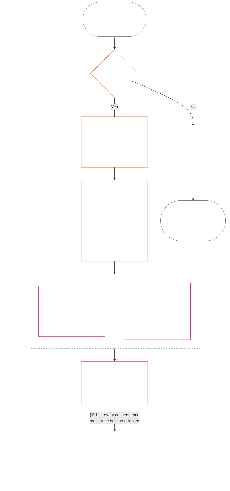
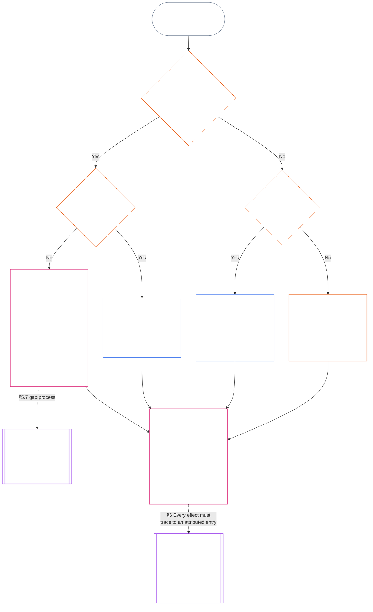

<!-- Rascunho completo de tradução para português brasileiro do Capítulo Onze. Instantâneo da fonte: commit 05b7b83936e30c098a7de71882f22277354006dfc871d91157bcd27b9f56ad6a1cec90d3. Redigido por IA, não revisado, rascunho não vinculante. -->

# CAPÍTULO ONZE: REGISTROS DE POSIÇÃO — QUESTÃO 1, O QUE ACONTECEU

<strong>Lugar no corpus (não operativo): estrutura do arquivo e regras de leitura</strong>

> Este arquivo **faz parte da Constituição Senciente** e é **vinculante somente em conjunto** com os demais arquivos `core_*` numerados, lidos como um único texto. Ele contém o **Capítulo Onze**: as três perguntas da cadeia de posição e a **Questão 1** (*o que aconteceu?*), nos **§§1–6**. A **Questão 2** (*quão bom ou ruim foi?*) é respondida no [Capítulo Doze](core_12_standing_measurement.md#chapter-twelve-standing-measurement--question-2-how-good-or-bad-was-it). A Questão 3 (*o que acontece em consequência disso?*) continua no [Capítulo Treze](../../core_13.000_standing_integration.md#chapter-thirteen-standing-effects-and-integration). O exame fica limitado à designação de má conduta anticonstitucional no [Capítulo Quatorze](../../core_14.000_misconduct_designation.md#chapter-fourteen-anti-constitutional-misconduct) para constatações qualificadas do Eixo de Violação `s` = 7–9. A ordem de leitura, a distinção entre conteúdo vinculante e de apoio e os metadados da edição do corpus são mantidos no [README.md](README.md).

<strong>Orientação para quem lê (não operativa): onde o Capítulo Onze se encaixa e o que fica aqui</strong>

> | Pergunta | Capítulo responsável e função |
> | --- | --- |
> | **1. O que aconteceu?** | Capítulo Onze (este arquivo): estabelecer fatos verificados em um registro de posição delimitado e impugnável. |
> | **2. Quão bom ou ruim foi?** | [Capítulo Doze](core_12_standing_measurement.md#chapter-twelve-standing-measurement--question-2-how-good-or-bad-was-it): medir os fatos verificados sem fundir ajuda e dano. |
> | **3. O que acontece em consequência disso?** | Continuar no [Capítulo Treze](../../core_13.000_standing_integration.md#chapter-thirteen-standing-effects-and-integration). |
>
> Alegações, popularidade e narrativas de disputa não respondem à Questão 1. Uma classificação desejada não fornece os fatos da Questão 1, e uma consequência desejada não fornece a classificação da Questão 2.

<strong>Rastreabilidade</strong>

- Origem:
  - [Tétrade Constitucional](core_00_preamble.md#constitutional-tetrad);
  - [Dois Fins Constitucionais](core_00_preamble.md#two-constitutional-aims);
  - [aposta material](core_00_preamble.md#material-stake);
  - [Preâmbulo §6 Cadeias práticas de processo-chave](core_00_preamble.md#6-key-practical-process-pipelines) (*cadeia dos Capítulos Nove a Quinze*).
- Origem:
  - [Capítulo Um](core_01_c_stewardship_capacity_principles.md#chapter-01-principles-and-constraints) (1.010) (*administração responsável pela acessibilidade em linguagem simples, refletida no glossário em cada seção*);
  - [Capítulo Um §16 — Administração responsável em profundidade](core_01_c_stewardship_capacity_principles.md#16-stewardship-in-depth) (1.010 §16) (*fundamento principiológico para posição vinculada à competência e rastreável — confiança, funções e reconhecimento*);
  - [Capítulos Dois a Quatro](core_02_definition_structure.md) (*integridade, registros e verificação*);
  - [Capítulo Cinco](core_05__definitions_home.md#chapter-five-foundational-definitions) (5.000) (*definições e supremacia a serem lidas com os Capítulos Dois a Quatro*).
- Origem: [Capítulo Nove](core_09.000_system_alignment_certification_evaluation.md#chapter-nine-system-alignment-certification) (9.000) (*certificação de alinhamento do sistema*); [Capítulo Nove, Parte C §11](core_09.010_system_alignment_certification_record_recertification.md#11-relationship-to-standing) (9.010 §11) (*ponte para a posição — somente dados potencialmente verificados*).
- Cadeia de posição:
  - [Preâmbulo §6.2 Como funciona a cadeia completa](core_00_preamble.md#62-how-the-full-chain-fits-together);
  - [Capítulo Onze — Registros de Posição](#chapter-eleven-standing-records--question-1-what-happened) (11.000) (*estrutura das três perguntas e registros da Questão 1*);
  - [Capítulo Doze — Medição de Posição](core_12_standing_measurement.md#chapter-twelve-standing-measurement--question-2-how-good-or-bad-was-it) (12.000) (*medição da Questão 2*);
  - [Capítulo Treze — Efeitos e Integração da Posição](../../core_13.000_standing_integration.md#chapter-thirteen-standing-effects-and-integration) (13.000) (*efeitos e integração da Questão 3*);
  - [Capítulo Quatorze](../../core_14.000_misconduct_designation.md#chapter-fourteen-anti-constitutional-misconduct) (14.000) (*designação somente para constatações qualificadas do Eixo de Violação s = 7–9*).
- Subseções deste arquivo:
  - [§1](#1-the-three-questions) (*estrutura e escopo das três perguntas*);
  - [§2](#2-question-1--what-happened) (*Questão 1 — fatos e registros verificados*);
  - [§3](#3-question-1-event-type-guide--what-kind-of-help-or-harm-occurred) (*guia de tipos de evento da Questão 1 — formas de ajuda e dano*);
  - [§4](#4-standing-record-operational-requirements) (*requisitos de verificação e registro*);
  - [§5](#5-record-custody-and-opening-authority) (*custódia do registro e autoridade de abertura*);
  - [§6](#6-handling-a-standing-record) (*tratamento de um registro de posição*).
- Destino:
  - [Capítulo Doze](core_12_standing_measurement.md#chapter-twelve-standing-measurement--question-2-how-good-or-bad-was-it) (12.000) (*Questão 2 — referência LEQU, dimensões de medição, descritores de via, gramática dos slots, dados constitucionais, escala LEQU, medidas padrão de contribuição, exemplos e encaminhamento para a Questão 3*);
  - [Capítulo Quatorze](../../core_14.000_misconduct_designation.md#chapter-fourteen-part-a-anti-constitutional-misconduct-designation) (14.000) (*designação somente — não reabre a medição da Questão 2*);
  - [Capítulo Quinze](../../core_15.000_forum.md#chapter-fifteen-forums-and-jurisdiction) (15.000) (*supervisão e encaminhamento ao fórum*);
  - [Artigo XXVI-C](core_06_rights_part_e.md#article-xxvi-c-timely-resolution-and-anti-delay-floor) (*resolução em tempo oportuno*);
  - [Artigo XX](core_06_rights_part_d.md#article-xx-a-justice-objective-and-scope) (*limites da justiça*).
- Leia também: [Capítulo Cinco *Estado da Posição, Contribuição e Violação*](../../core_05.035_band_accountability.md#defa3-standing-state-contribution-and-violation) (5.035) (*encaminhamento canônico de definições*).
- Leia também: [README.md](README.md) (*ordem de leitura*); [doc_architecture.md](../../doc_architecture.md) (*mapas editoriais não vinculantes, salvo adoção*).

 

O Capítulo Onze é responsável, perante a Constituição, pelo **registro factual verificado (Questão 1)**. Abrange desde [§1 As três perguntas](#1-the-three-questions) até [§6 Tratamento de um registro de posição](#6-handling-a-standing-record). O [Capítulo Doze](core_12_standing_measurement.md#chapter-twelve-standing-measurement--question-2-how-good-or-bad-was-it) é responsável pela Questão 2, da [seção 1 do Capítulo Doze — Questão 2: quão bom ou ruim foi?](core_12_standing_measurement.md#1-question-2--how-good-or-bad-was-it) até a [seção 9 do Capítulo Doze — encaminhamento para a Questão 3: conexões de medição entre perguntas](core_12_standing_measurement.md#9-hand-off-to-question-3--cross-question-measurement-hooks). A Questão 3 continua no Capítulo Treze.

*Em termos simples: este capítulo registra o que aconteceu e guarda o registro de posição. O Capítulo Doze mede o quanto foi bom ou prejudicial, em dois eixos separados, nunca em uma única pontuação líquida. Apresentar um caso, por si só, não confere posição.*

### 1. As três perguntas

*Em termos simples: a posição é determinada respondendo a três perguntas em ordem. Não deduza fatos a partir de uma classificação desejada nem escolha uma classificação para justificar uma consequência desejada.*

| Pergunta | O que a pergunta faz | Onde é respondida |
| --- | --- | --- |
| **1. O que aconteceu?** | Quais fatos foram verificados, sobre quem ou o quê, durante qual período, e com qual registro de posição e status de contestação? | [Seção 2](#2-question-1--what-happened) e [Seção 3](#3-question-1-event-type-guide--what-kind-of-help-or-harm-occurred) |
| **2. Quão bom ou ruim foi?** | Que tipo e magnitude de contribuição ou violação esses fatos estabelecem? | [Capítulo Doze, Seção 1](core_12_standing_measurement.md#1-question-2--how-good-or-bad-was-it) |
| **3. O que acontece por causa disso?** | Que reconhecimento, prontidão, reparação, salvaguarda, restrição ou outra consequência decorre disso? | [Capítulo Treze](../../core_13.000_standing_integration.md#chapter-thirteen-standing-effects-and-integration) |

Cada pergunta depende da resposta à pergunta anterior:

- A Pergunta 1 fornece os fatos verificados para a Pergunta 2.
- A Pergunta 2 mede esses fatos para a Pergunta 3.
- A Pergunta 3 não pode reescrever os fatos nem a classificação para se adequar a um resultado preferido.

Em conjunto, as respostas às três perguntas formam a avaliação completa de posição para um evento delimitado ou um padrão definido. Um sujeito pode ter várias avaliações desse tipo ao longo do tempo, e nenhuma delas é uma pontuação líquida nem uma classificação geral do sujeito. Os registros de posição de contribuição e de violação preservam as respostas às Perguntas 1 e 2; a decisão da Pergunta 3 declara o que decorre delas.

#### 1.1 Finalidade e escopo

Este capítulo estabelece a estrutura constitucional de registro, e o [Capítulo Doze](core_12_standing_measurement.md#chapter-twelve-standing-measurement--question-2-how-good-or-bad-was-it) estabelece a estrutura de medição, para **sistemas**, **sencientes** e **instituições**, inclusive todos os sistemas classificados conforme [**CS-9.305**](../../corpus_systems/cs_09.305_system_classification_machinery.md#cs-9305-part-a-system-classification-machinery) (*Mecanismo de classificação de sistemas*). Essas estruturas não medem fofoca, popularidade, reputação vaga, dignidade inerente nem valor geral; nenhum desses elementos pode ser objeto de uma avaliação de posição.

O processo de posição precisa continuar eficaz quando:

- contribuições verificadas anteriormente ficam antigas demais para demonstrar competência ou confiabilidade atuais;
- violações continuam sem resolução;
- a reparação é cara;
- a responsabilidade atravessa fronteiras; ou
- um ator usa camadas organizacionais ou mudanças de rótulo para dificultar a responsabilização.

Esses assuntos pertencem aos textos de implementação adotados:

- procedimentos do dia a dia;
- etapas de escalonamento;
- operações de restituição e reparação;
- medidas de responsabilização restaurativa; e
- desenho de incentivos.

A medição do Capítulo Doze **não** autoriza, por si só, o uso da força, a detenção ou outra restrição à liberdade. Qualquer consequência desse tipo precisa atender, de forma independente, ao Capítulo Seis, **Artigo XX** (*Justiça após violação verificada*), inclusive seus requisitos de proporcionalidade, menor restrição possível, prazo limitado, restituição e responsabilização restaurativa.

<strong>Rastreabilidade · Definições · Avaliação · Conformidade</strong>

- Anteriores: [Capítulo Um §16 — Administração em profundidade](core_01_c_stewardship_capacity_principles.md#16-stewardship-in-depth); [Capítulos Dois a Quatro](core_02_definition_structure.md); [Capítulo Cinco](core_05__definitions_home.md#chapter-five-foundational-definitions).
- Posteriores:
  - [§2](#2-question-1--what-happened) (*Pergunta 1*);
  - [§4](#4-standing-record-operational-requirements) (*verificação e requisitos de registro*);
  - [§5](#5-record-custody-and-opening-authority) (*custódia do registro e autoridade para abri-lo*);
  - [§6](#6-handling-a-standing-record) (*gestão de um registro de posição*);
  - [Capítulo Doze §1](core_12_standing_measurement.md#1-question-2--how-good-or-bad-was-it) (*medição da Pergunta 2*);
  - [Capítulo Doze §2](core_12_standing_measurement.md#2-magnitude-and-severity-input-dimensions) (*dimensões de entrada da medição*);
  - [Capítulo Doze §3](core_12_standing_measurement.md#3-route-descriptor-catalogs-and-measurement-roles) (*catálogos de descritores de rotas*);
  - [Capítulo Doze §4](core_12_standing_measurement.md#4-slot-grammar-and-shared-scaling) (*gramática de casas e escala compartilhada*);
  - [Capítulo Doze §5](core_12_standing_measurement.md#5-constitutional-inputs-to-axis-assignment) (*encaminhamento por fontes constitucionais*);
  - [Capítulo Doze §6](core_12_standing_measurement.md#6-unified-proportional-lequ-scale--contribution-and-violation-axes) (*escala LEQU proporcional unificada para os dois eixos*);
  - [Capítulo Treze](../../core_13.000_standing_integration.md#chapter-thirteen-standing-effects-and-integration) (*Pergunta 3*).
- [Materialidade](../../core_05.050_band_oversight.md#materiality) · [O](../../core_05.050_band_oversight.md#materiality) · [M](../../core_05.050_band_oversight.md#materiality-determination-a) · [A](../../core_05.050_band_oversight.md#materiality-determination-a) · [C](../../core_05.050_band_oversight.md#materiality-determination-c)
- [Dano](../../core_05.035_band_accountability.md#harm) · [O](../../core_05.035_band_accountability.md#harm) · [M](../../core_05.035_band_accountability.md#harm-a) · [A](../../core_05.035_band_accountability.md#harm-a) · [C](../../core_05.035_band_accountability.md#harm-c)
- [Proporcionalidade](../../core_05.035_band_accountability.md#proportionality) · [O](../../core_05.035_band_accountability.md#proportionality) · [M](../../core_05.035_band_accountability.md#proportionality-a) · [A](../../core_05.035_band_accountability.md#proportionality-a) · [C](../../core_05.035_band_accountability.md#proportionality-c)

### 2. Pergunta 1 — o que aconteceu?

<strong>Rastreabilidade</strong>

- Anteriores: [§1](#1-the-three-questions) (*estrutura das três perguntas*); [Capítulos Dois a Quatro](core_02_definition_structure.md) (*registro, verificação e rastreabilidade das definições até os resultados*).
- Eixos da Tétrade: **participação**; **supervisão** (contestabilidade e vias de contestação). Objetivos principais: **Florescimento** e **Continuidade** (registros rastreáveis que preservam constatações separadas de contribuição e violação para medição posterior).
- Posteriores:
  - [§2.2](#22-silence-is-the-default) (*o silêncio é o padrão*);
  - [§2.3](#23-protected-dissent-is-not-a-trigger) (*a dissidência protegida não é um gatilho*);
  - [§2.4](#24-linked-standing-records-and-no-offset-bridge) (*ponte de não compensação entre registros vinculados*);
  - [§2.5](#25-verified-input-gate) (*barreira de entradas verificadas*);
  - [§2.6](#26-stage-boundary) (*limite entre etapas*);
  - [§2.7](#27-forum-boundary) (*limite do fórum*);
  - [§3](#3-question-1-event-type-guide--what-kind-of-help-or-harm-occurred) (*guia de tipos de evento*);
  - [§4](#4-standing-record-operational-requirements) (*requisitos do registro*);
  - [§5](#5-record-custody-and-opening-authority) (*custódia do registro e autoridade para abri-lo*);
  - [§6](#6-handling-a-standing-record) (*gestão de um registro de posição*);
  - [Capítulo Doze §1](core_12_standing_measurement.md#1-question-2--how-good-or-bad-was-it) (*medição da Pergunta 2*);
  - [Capítulo Doze §2](core_12_standing_measurement.md#2-magnitude-and-severity-input-dimensions) (*dimensões de entrada da medição*);
  - [Capítulo Doze §3](core_12_standing_measurement.md#3-route-descriptor-catalogs-and-measurement-roles) (*catálogos de descritores de rotas*);
  - [Capítulo Doze §4](core_12_standing_measurement.md#4-slot-grammar-and-shared-scaling) (*gramática de casas e escala compartilhada*);
  - [Capítulo Doze §5](core_12_standing_measurement.md#5-constitutional-inputs-to-axis-assignment) (*encaminhamento por fontes constitucionais*);
  - [Capítulo Doze §6](core_12_standing_measurement.md#6-unified-proportional-lequ-scale--contribution-and-violation-axes) (*escala LEQU proporcional unificada para os dois eixos*);
  - [Capítulo Treze](../../core_13.000_standing_integration.md#chapter-thirteen-standing-effects-and-integration) (13.000) (*Pergunta 3*).

 

*Em termos simples: a Pergunta 1 estabelece um relato delimitado e contestável do que aconteceu. Ela identifica o sujeito, o evento ou padrão, o período, os fatos verificados e o status do registro antes que qualquer classificação ou consequência seja considerada. Ajuda verificada e violações verificadas usam registros de posição separados para que uma não apague a outra. Esses registros não são pontuações de popularidade nem rótulos vagos.*

Um **registro de posição** é o registro delimitado usado por este capítulo para um sujeito, escopo funcional, período do registro, status de revisão e contexto decisório específicos. Antes de começar a medição, ele precisa estabelecer:

- a quem ou ao que o registro de posição se refere;
- se ele trata de um evento delimitado ou de um padrão definido;
- quando e onde ocorreram a conduta e os efeitos pertinentes;
- quais fatos foram verificados e quais continuam em disputa;
- quais provas, atribuições e vias de contestação apoiam essas constatações; e
- o status atual de revisão, correção e substituição do registro de posição.

O diagrama acompanha um evento para verificar se ele aciona um registro de posição e o que esse registro contém; as subseções seguintes enunciam cada regra. O ramo “não” sai do caminho principal para a direita.

#### 2.1 Registros de posição: tipos e sujeitos

A Pergunta 1 usa um **registro de posição de contribuição** para ajuda verificada e um **registro de posição de violação** para dano verificado, inclusive falhas de responsabilização. Um registro de posição não combina os dois tipos de constatação.

- Um registro de posição pode tratar de um senciente, instituição, sistema, avaliação, evento delimitado, função, coletivo, registro específico de ator ou outra unidade relevante para a Constituição.
  - Ele não pode reduzir sujeitos, funções, sistemas, comunidades, períodos do registro, status de revisão ou contextos decisórios distintos a um único rótulo de posição indiferenciado.
- Um registro de posição pode cobrir um **evento delimitado** — um episódio com início e fim claros — ou um **padrão** de conduta repetida.
  - Um padrão exige sujeito, escopo e período de revisão definidos.
- O mesmo sujeito pode ter vários registros de posição ao longo do tempo, inclusive registros vinculados de posição de contribuição e de violação.
  - Registros de posição relacionados precisam fazer **referência cruzada** entre si conforme a **seção 4.2** quando compartilharem sujeito, períodos de registro sobrepostos, evento delimitado, padrão ou contexto decisório.
- Um registro de posição não é uma pontuação de reputação autônoma, classificação de dignidade, status permanente, rótulo de valor geral nem boletim de pontuação combinado.
  - Os requisitos operacionais aparecem na **seção 4**.

Qualquer efeito posterior sobre a posição pertence ao Capítulo Treze e precisa ser rastreável ao registro ou registros de posição pertinentes, sem se tornar parte do próprio registro.

#### 2.2 O silêncio é o padrão

Não ter um registro de posição é o estado normal de um senciente, instituição ou sistema, e será o estado em que a maioria dos sencientes permanecerá.

- Um registro de posição só é aberto quando um gatilho tiver sido verificado conforme a **seção 4**. Uma autoridade identificada para abertura de registros precisa aprovar a entrada, e um custodiante de registros separado precisa inseri-la (**seção 5**). Um registro de posição nunca é aberto:
  - para estabelecer uma referência inicial;
  - para completar uma lista; ou
  - porque quem controla uma via restrita assim preferiria.
- Não ter um registro de posição não informa nada. “Sem classificação”, “não verificado” e “sem registro em arquivo” não são evidências de risco, baixa contribuição ou qualquer outra coisa. Ninguém pode tratar a ausência de um registro como motivo para escrutínio maior, um padrão inicial inferior ou acesso condicional a uma via restrita nomeada.
- Nenhuma instituição ou sistema pode exigir um registro de posição, uma declaração de “sem registro” ou consentimento para abrir um como condição para:
  - itens essenciais do **Artigo III** (*Sobrevivência e acesso essencial*);
  - proteções do **Artigo III-C** (*Trabalho e piso econômico*);
  - comércio comum; ou
  - participação como parte afetada.
  Os limites de competência publicados para vias restritas específicas e sensíveis à confiança são a exceção e, conforme [Capítulo Treze §7.2 Limites de competência e autorizações](../../core_13.000_standing_integration.md#72-competency-bars-and-clearances), precisam explicar por que a via restrita é sensível à confiança.
- Quando um registro de posição sobre um sujeito é aberto, o sujeito precisa ser informado, conforme exige a **seção 4**. A notificação só pode ser adiada se uma necessidade documentada de [Preservação de provas](../../core_05.050_band_oversight.md#evidence-preservation) ou de segurança justificar o adiamento, e somente por um período limitado e definido. A notificação é o que torna contestável um registro de posição: um sujeito que não sabe que o registro existe não pode contestá-lo nem corrigi-lo.

#### 2.3 A dissidência protegida não é um gatilho

A dissidência ou protesto pacífico — inclusive a [desobediência civil não violenta protegida](core_06_rights_part_b.md#xi-d-nonviolent-civil-disobedience) — conforme o **Artigo XI-D** (*Reunião, dissidência e protesto pacífico*) ([*Piso de dissidência e protesto pacífico*](core_06_rights_part_b.md#xi-d-dissent-and-peaceful-protest)) não é um gatilho verificado.

- Ela não abre, prolonga nem agrava um registro de posição de violação, não é um fator de gravidade conforme a **seção 8.2**, e sua repetição não a transforma em padrão.
- Conduta separável que viole, de forma independente, um piso constitucional é registrada segundo seus próprios termos, sem agravamento por causa do ponto de vista, causa ou alvo do protesto.

#### 2.4 Registros de posição vinculados e ponte de não compensação

<strong>Rastreabilidade</strong>

- Anteriores: [§2.1](#21-standing-records-kinds-and-subjects) (*registros separados de contribuição e violação*).
- Posteriores:
  - [§2.5](#25-verified-input-gate) (*barreira de entradas verificadas*);
  - [§2.7](#27-forum-boundary) (*limite do fórum*);
  - [§4.2](#42-related-standing-record-cross-references) (*referências cruzadas*);
  - [Capítulo Doze §1](core_12_standing_measurement.md#1-question-2--how-good-or-bad-was-it) (*medição da Pergunta 2*);
  - [Capítulo Doze §2](core_12_standing_measurement.md#2-magnitude-and-severity-input-dimensions) (*dimensões de entrada da medição*);
  - [Capítulo Doze §3](core_12_standing_measurement.md#3-route-descriptor-catalogs-and-measurement-roles) (*catálogos de descritores de rotas*);
  - [Capítulo Doze §4](core_12_standing_measurement.md#4-slot-grammar-and-shared-scaling) (*gramática de casas e escala compartilhada*);
  - [Capítulo Doze §5](core_12_standing_measurement.md#5-constitutional-inputs-to-axis-assignment) (*encaminhamento por fontes constitucionais*);
  - [Capítulo Doze §6](core_12_standing_measurement.md#6-unified-proportional-lequ-scale--contribution-and-violation-axes) (*escala LEQU proporcional unificada para os dois eixos*);
  - [Capítulo Treze](../../core_13.000_standing_integration.md#chapter-thirteen-standing-effects-and-integration) (13.000) (*Pergunta 3*).
- Leia também: [Capítulo Treze — Integração da posição](../../core_13.000_standing_integration.md#3-automatic-integration-review-and-continuity) (13.000) (*integração sem renúncia e integração de registros vinculados*); [Capítulo Treze §7.2 — Limites de competência e autorizações](../../core_13.000_standing_integration.md#72-competency-bars-and-clearances) (13.000 §7.2); [Capítulo Treze §5.2 — Bloqueios de posição](../../core_13.000_standing_integration.md#52-prevention--general-standing-locks) (13.000 §5.2).

 

**Regra central:** os **registros de posição de contribuição** verificada e os **registros de posição de violação** verificada são mantidos separados conforme a **seção 2.1**. Cada constatação de contribuição ou violação precisa se basear em fatos próprios e sustentados em seu próprio registro de posição. A análise e os materiais de apoio precisam manter as duas trilhas de registro rastreáveis separadamente. Nenhuma entrada ou conjunto de registros vinculados é uma pontuação líquida, combinada ou compensatória.

- **Registros de posição de violação e bloqueios de posição:**
  - Conforme o Capítulo Treze, **bloqueios de posição** aplicáveis derivados de registros de posição de violação podem limitar a posição, restringir a elegibilidade para funções ou afetar o acesso a reparações enquanto uma violação verificada continuar sem resolução.
  - Bloqueios de posição não podem apagar contribuições positivas verificadas registradas em registros de posição de contribuição.
  - Violações verificadas sem resolução não perdem peso apenas com a passagem do tempo.
  - Violações verificadas não podem transformar registros de posição de contribuição sem relação com elas em um falso arquivo de reputação negativa.
- **Registros de posição de contribuição e autorizações de competência:**
  - Uma contribuição verificada pode apoiar **autorizações de competência** aplicáveis em relação a **limites de competência** publicados e sustentar elegibilidade vinculada à confiança, função ou reconhecimento quando for atual e pertinente à função.
  - Uma contribuição verificada não pode compensar, reduzir por média, desculpar nem reclassificar uma constatação de violação verificada.
  - O cumprimento de um limite não dispensa nenhum bloqueio de posição aplicável.

**A única exceção:** se uma constatação de violação refutar por si só uma contribuição alegada — por exemplo, se as provas mostrarem que a pessoa não fez o que seu registro de contribuição afirma —, então o registro de posição de contribuição vinculado pode ser corrigido ou removido pelo processo apropriado de provas e revisão, com a referência cruzada exigida pela **seção 4.2**. Mas a violação não apaga automaticamente ajuda sem relação com ela, registrada em registros separados de posição de contribuição.

#### 2.5 Barreira de entradas verificadas

A barreira funciona assim:

- Qualquer decisão que afete posição, confiança, função, reconhecimento ou elegibilidade para reconhecimento só pode usar entradas verificadas dos **registros de posição de contribuição** ou **registros de posição de violação** pertinentes.
- Alegações, reclamações não adjudicadas, rótulos provisórios de encaminhamento, narrativas limitadas à triagem e outros materiais da fase de disputa não determinam, por si sós, a natureza da contribuição ou da violação para fins de posição.
- Uma entrada verificada é uma **constatação de posição**: uma constatação verificada de contribuição (Eixo I) ou uma constatação verificada de violação (Eixo II).
- Constatações de contribuição e violação permanecem em registros de posição separados (veja a **seção 2.1**).

#### 2.6 Limite entre etapas

As etapas de um registro de posição permanecem separadas:

- A Pergunta 1 registra fatos verificados; a Pergunta 2 os mede.
- Um registro de posição pode ser aberto assim que sua base factual verificada estiver completa, mesmo que a medição da Pergunta 2 ainda esteja pendente.
- Até que a medição ocorra, os campos da Pergunta 2 precisam indicar que ela está pendente, em vez de sugerir uma casa ou categoria.
- O registro de posição não pode declarar nem aplicar um **efeito de posição** da Pergunta 3.

#### 2.7 Limite do fórum

*Em termos simples: os fóruns supervisionam disputas, permitem contestá-las e as transformam em resultados verificados — mas protocolar um caso ou vencer uma disputa narrativa não atualiza a posição. A barreira de entradas verificadas da **seção 2.5** continua valendo. Quando um fórum verifica os fatos conforme os Capítulos Dois a Quatro, ele pode **abrir, atualizar ou corrigir** um registro de posição, ou **anular um registro incorreto após contestação**. Os fóruns não juntam aspectos positivos e negativos em uma pontuação só nem inventam a categoria de posição por conta própria.*

Esta seção trata de uma pergunta: como o trabalho de um fórum chega a um registro de posição. As demais etapas da cadeia pertencem aos responsáveis identificados aqui, e a cadeia segue esta ordem:

1. Uma disputa é protocolada e o fórum mantém um **registro de caso do fórum**, que não é um registro de posição. Responsável: [Capítulo Quinze §2.3 Registros de casos de fóruns, registros de posição e contestações](core_11_forum.md#23-forum-case-records-standing-records-and-contests); veja também [§2.7.1 Registro de caso do fórum](#271-forum-case-record).
2. O fórum verifica os fatos conforme os [Capítulos Dois a Quatro](core_02_definition_structure.md).
3. As constatações verificadas passam pela barreira de entradas verificadas. Responsável: [§2.5 Barreira de entradas verificadas](#25-verified-input-gate).
4. Uma autoridade identificada para abertura de registros, que pode ser um fórum, abre, atualiza ou corrige o registro de posição, ou anula um registro incorreto após contestação. Responsáveis: [§4.1 Conteúdo mínimo do registro](#41-minimum-record-contents), quanto ao conteúdo do registro de posição, e [§5 Custódia do registro e autoridade para abri-lo](#5-record-custody-and-opening-authority), quanto a quem pode agir.
5. O registro de posição contém apenas fatos verificados, e a Pergunta 2 os mede em seguida. Responsáveis: [§2.6 Limite entre etapas](#26-stage-boundary) e [Capítulo Doze §1 Pergunta 2 — quão bom ou ruim foi?](core_12_standing_measurement.md#1-question-2--how-good-or-bad-was-it).
6. Se houver um efeito de posição, ele decorre do [Capítulo Treze](../../core_13.000_standing_integration.md#chapter-thirteen-standing-effects-and-integration), responsável pelos efeitos de posição.

As famílias de fóruns previstas no [Capítulo Quinze](../../core_15.000_forum.md#chapter-fifteen-forums-and-jurisdiction) **supervisionam** como disputas concretas percorrem o processo de posição. Os fóruns fornecem o seguinte conforme o [Capítulo Quinze §6 Resolução oportuna, níveis de materialidade e disciplina contra atrasos](core_11_forum.md#6-timely-resolution-materiality-tiers-and-anti-delay-discipline) e o [Artigo XXVI-C](core_06_rights_part_e.md#article-xxvi-c-timely-resolution-and-anti-delay-floor) (*Resolução oportuna e piso contra atrasos*):

- contestação acessível;
- revisão independente;
- apoio forense;
- sequenciamento de medidas corretivas; e
- prazos por nível.

Quando essas constatações do fórum satisfazem a barreira de entradas verificadas conforme os Capítulos Dois a Quatro, elas podem:

- **abrir, atualizar ou corrigir** registros de posição conforme a **seção 4.1**; ou
- **anular um registro incorreto após contestação**.

##### 2.7.1 Registro de caso do fórum

O próprio arquivo do fórum sobre uma disputa aberta é o [**registro de caso do fórum**](../../core_05.035_band_accountability.md#forum-case-record), definido no [Capítulo Quinze §2.3 Registros de casos de fóruns, registros de posição e contestações](core_11_forum.md#23-forum-case-records-standing-records-and-contests). Ele **não** é um registro de posição.

##### 2.7.2 Constatações do fórum e a medição da Pergunta 2

As constatações factuais verificadas de um fórum podem fornecer a base factual para um registro de posição da Pergunta 1. Elas **não** determinam a medição da Pergunta 2 sobre quão boa ou ruim foi a contribuição ou violação verificada ([§2.6 Limite entre etapas](#26-stage-boundary)). Portanto:

- Os procedimentos do fórum **não podem** combinar materiais de contribuição e violação em uma pontuação líquida, resposta combinada sobre o mérito ou rótulo de posição indiferenciado; registros de posição vinculados continuam separados conforme [§2.1 Registros de posição: tipos e sujeitos](#21-standing-records-kinds-and-subjects) e [§2.4 Registros de posição vinculados e ponte de não compensação](#24-linked-standing-records-and-no-offset-bridge).
- Os resultados do fórum **não podem** substituir entradas verificáveis por narrativas da disputa, conveniência de encaminhamento ou preferência do painel ([§2.5 Barreira de entradas verificadas](#25-verified-input-gate)), pela medição separada ([Capítulo Doze §1 Pergunta 2 — quão bom ou ruim foi?](core_12_standing_measurement.md#1-question-2--how-good-or-bad-was-it)) ou pelos mecanismos de efeitos de posição cuja competência é do [Capítulo Treze](../../core_13.000_standing_integration.md#chapter-thirteen-standing-effects-and-integration).

##### 2.7.3 O que o limite do fórum não reduz

Este limite **não** reduz contestação, reparação, tutela provisória ou proteções processuais exigidas conforme:

- [Artigo XIII-A](core_06_rights_part_c.md#article-xiii-a-reliability-and-trustworthiness-baseline) (*Base de confiabilidade e confiança*);
- [Artigo XIII-B](core_06_rights_part_c.md#article-xiii-b-right-to-redress-and-remedy) (*Direito à reparação e a medidas corretivas*);
- [Capítulo Quinze §6 Resolução oportuna, níveis de materialidade e disciplina contra atrasos](core_11_forum.md#6-timely-resolution-materiality-tiers-and-anti-delay-discipline);
- [Artigo XXVI-C](core_06_rights_part_e.md#article-xxvi-c-timely-resolution-and-anti-delay-floor) (*Resolução oportuna e piso contra atrasos*); ou
- artigos de justiça relacionados.

Ele exige que constatações verificadas do fórum entrem no processo de posição pela mesma barreira que as demais entradas verificadas — e não por fora dela.

### 3. Guia de tipos de evento da Pergunta 1 — que tipo de ajuda ou dano ocorreu?

*Em termos simples: use estas tabelas para descrever o que aconteceu depois que os fatos forem verificados. Elas ajudam a identificar o tipo de contribuição ou violação envolvido. Não decidem quão bom ou ruim foi, não atribuem uma casa nem determinam o que acontece por causa disso.*

#### 3.1 Tipos de eventos de contribuição

**Regra de qualificação:** Uma contribuição alegada só conta quando é rastreável, não externaliza custos e é compatível com a Constituição vigente como um todo.

- Danos externalizados, dependências coercivas, redução do Piso de Direitos ou encargos ocultos podem desqualificar ou limitar a contribuição alegada.
- Uma contribuição alegada não compensa uma constatação de violação separada.

Cada linha da tabela abaixo nomeia uma via comum de ajuda verificada e sua relevância constitucional. Mais de uma linha pode se aplicar ao mesmo registro de posição.

| Tipo de contribuição verificada | O que aconteceu | Eixo(s) da Tétrade | Objetivo(s) principal(is) |
| --- | --- | --- | --- |
| Sobrevivência e manutenção corporal | Alguém recebeu alimentos, abrigo, atendimento médico ou segurança | **Participação**, **Supervisão** | **Florescimento** |
| Cuidado e ensino | Crianças foram criadas, pessoas idosas receberam cuidados ou outras pessoas foram educadas | **Participação**, **Supervisão** | **Florescimento**, **Continuidade** |
| Resolução de trauma | Alguém recebeu ajuda para se recuperar de dano psicológico que impedia seu bem-estar | **Participação**, **Responsabilização** | **Florescimento** |
| Remoção de encargos graves | Dívidas esmagadoras, condições de trabalho exploratórias ou barreiras sistêmicas foram removidas | **Participação**, **Supervisão** | **Florescimento** |
| Restauração da autonomia | Alguém ganhou opções significativas sobre a própria vida | **Participação** | **Florescimento** |
| Ampliação da capacidade produtiva | Ferramentas, infraestrutura ou oportunidades permitiram que outras pessoas prosperassem de forma independente | **Participação**, **Supervisão** | **Florescimento**, **Continuidade** |
| Melhoria da eficiência de tempo | Esperas evitáveis, atritos administrativos ou custos de coordenação foram reduzidos, devolvendo tempo utilizável para cuidado, descanso, autonomia, aprendizado ou trabalho compatível com os direitos | **Participação**, **Supervisão** | **Florescimento** |
| Redução de riscos ecológicos ou de infraestrutura | O colapso ambiental ou a falha de sistema crítico foram evitados | **Supervisão**, **Responsabilização** | **Continuidade**, **Florescimento** |
| Redução da pegada ecológica | O uso de recursos, as emissões ou a demanda por terra e água foram reduzidos de forma verificável, sem transferir o encargo para outras pessoas ou ecossistemas | **Supervisão**, **Responsabilização** | **Continuidade**, **Florescimento** |
| Recuperação de ecossistemas | Terras, águas ou habitats degradados foram restaurados em direção a uma condição funcional e autossustentável | **Supervisão**, **Responsabilização** | **Continuidade**, **Florescimento** |
| Proteção de espécies ameaçadas | Espécies em risco de extinção ou os habitats de que dependem foram protegidos contra perdas | **Supervisão**, **Responsabilização** | **Continuidade**, **Florescimento** |
| Redução da poluição e dos resíduos | Contaminação, emissões nocivas ou resíduos foram evitados, removidos ou gerenciados com segurança | **Supervisão**, **Responsabilização** | **Florescimento**, **Continuidade** |
| Fortalecimento da segurança, da verdade, da auditabilidade ou da capacidade de contestação | Instituições ou práticas foram construídas ou reparadas para proteger direitos e responsabilizar o poder | **Participação**, **Supervisão**, **Responsabilização** | **Florescimento**, **Continuidade** |

#### 3.2 Tipos de eventos de violação

**Regra de qualificação:** Um tipo de evento de violação exige uma constatação de violação verificada que permaneça rastreável, delimitada, auditável e contestável conforme os **Capítulos Dois a Quatro**.

- Alegações, rótulos provisórios, narrativas de fórum e rótulos de triagem podem apoiar encaminhamento ou classificação inicial, mas não completam a Pergunta 1.
- Contribuição positiva não compensa, desculpa, desfaz nem reclassifica uma violação verificada.

Cada linha da tabela abaixo nomeia uma via comum de perda, perigo ou descumprimento de dever verificado e sua relevância constitucional. Mais de uma linha pode se aplicar ao mesmo registro de posição.

| Tipo de perda ou perigo verificado | O que aconteceu | Eixo(s) da Tétrade | Objetivo(s) principal(is) |
| --- | --- | --- | --- |
| Privação de sobrevivência ou manutenção corporal | Ocorreu uma morte evitável, houve atendimento negado, condições inseguras ou privação material de sobrevivência | **Responsabilização**, **Participação** | **Florescimento** |
| Encargo grave evitável | Encargos esmagadores, impostos ou transferidos sistematicamente prejudicaram de modo material o bem-estar ou a autonomia | **Responsabilização**, **Participação** | **Florescimento** |
| Perda coerciva de autonomia | Houve coerção, manipulação, ameaça crível, confinamento ou risco à liberdade | **Responsabilização**, **Participação** | **Florescimento** |
| Violação do Piso de Direitos | Pisos constitucionais inegociáveis, supremacia constitucional ou acesso à contestação e à reparação foram violados de modo material | **Responsabilização**, **Supervisão** | **Florescimento**, **Continuidade** |
| Dano ecológico ou de infraestrutura | Foram danificadas condições necessárias ao bem-estar constitucional | **Responsabilização**, **Supervisão** | **Continuidade**, **Florescimento** |
| Dano por poluição ou resíduos | Contaminação, emissões nocivas ou resíduos prejudicaram o ar, a água, o solo ou a saúde | **Responsabilização**, **Supervisão** | **Florescimento**, **Continuidade** |
| Destruição de espécies ou habitats | Espécies em risco de extinção ou os habitats de que dependem foram destruídos, fragmentados ou levados à perda, inclusive perdas tratadas como compensáveis | **Responsabilização**, **Supervisão** | **Continuidade**, **Florescimento** |
| Perda da capacidade de recuperação ecológica | A capacidade de um ecossistema de se regenerar após um dano foi eliminada ou tornou-se evitavelmente difícil ou impossível de reverter | **Responsabilização**, **Supervisão** | **Continuidade**, **Florescimento** |
| Dano ecológico externalizado ou esgotamento | Custos ecológicos foram transferidos para outras pessoas ou ecossistemas, recursos foram esgotados além de sua capacidade de regeneração, ou uma alegação de pegada ou sustentabilidade ocultou deterioração contínua | **Responsabilização**, **Supervisão** | **Continuidade**, **Florescimento** |
| Destruição da capacidade produtiva | Ferramentas, capacidades, relações ou recursos necessários para prosperar de forma independente foram inviabilizados | **Responsabilização** | **Florescimento** |
| Deterioração da Segurança, da Verdade ou da auditabilidade | Houve ocultação, desinformação, registros quebrados, vias de contestação inacessíveis ou agregação impossível de revisar | **Supervisão**, **Responsabilização** | **Florescimento**, **Continuidade** |
| Obstrução da responsabilização | Ocorreu interferência verificada com os mecanismos de responsabilização — integridade das provas, verificação, processo do fórum, registros de posição, prazos de reparação ou vias de contestação e reparação —; quando a obstrução for um ataque indireto a um dano subjacente distinto, abra um registro de posição de violação separado e vinculado | **Responsabilização**, **Supervisão**, **Pontualidade** | **Florescimento**, **Continuidade** |
| Captura do sistema ou abuso de dependência | Ocorreu viabilização estrutural, abuso de assimetria de dependência, desenho antievasão ou captura de vias de responsabilização | **Responsabilização**, **Participação** | **Continuidade**, **Florescimento** |

### 4. Requisitos de verificação e registro

<strong>Rastreabilidade</strong>

- A montante: [§2](#2-question-1--what-happened) (*registros da Pergunta 1 e guia de tipos de evento*); [Capítulos Dois a Quatro](core_02_definition_structure.md) (*registro, verificação e rastreabilidade das definições até os resultados*).
- A jusante:
  - [§4.1](#41-minimum-record-contents) (*conteúdo mínimo*);
  - [§4.2](#42-related-standing-record-cross-references) (*referências cruzadas*);
  - [§5](#5-record-custody-and-opening-authority) (*custódia do registro e autoridade para abri-lo*);
  - [§6](#6-handling-a-standing-record) (*tratamento de um registro de posição*);
  - [Capítulo Doze §1](core_12_standing_measurement.md#1-question-2--how-good-or-bad-was-it) (*Pergunta 2*).
- Leia junto com: [CF-15.415 §8 Autoridade sobre informações restritas](../../corpus_forum/cf_15.415_routing_operations_transfer_certification_representative_treatment.md#cf-15415-8-restricted-information-authority) (*primeiro recurso para uma disputa sobre um limite de divulgação indicado em [§4.1](#41-minimum-record-contents)*).

 

*Em termos simples: esta seção diz o que cada registro de posição deve conter, como registros de posição relacionados se referenciam e como os registros recebem versões. Quem pode abrir e custodiar um registro de posição, e como ele pode ser contestado ou corrigido, está em [§5 Custódia do registro e autoridade para abri-lo](#5-record-custody-and-opening-authority). As medições da Pergunta 2 só podem ser acrescentadas depois que a base factual verificada estiver registrada.*

O nível de detalhe exigido para as provas e os registros pode aumentar conforme a aposta material e a classe do sistema. Essa escala não exclui do fluxo de posição nenhum senciente, instituição ou sistema abrangido.

#### 4.1 Conteúdo mínimo do registro

Um registro de posição contém os campos abaixo, e as duas últimas subseções acrescentam campos para cada eixo. O portão de dados verificados, que determina o que pode alimentar um registro de posição, está em [§2.5 Portão de dados verificados](#25-verified-input-gate). A regra que separa os fatos da Pergunta 1 da medição da Pergunta 2 está em [§2.6 Limite entre etapas](#26-stage-boundary).

##### 4.1.1 Campos que todo registro de posição deve conter

Todo registro de posição deve incluir, no mínimo:

- o tipo de registro de posição — **registro de posição de contribuição** ou **registro de posição de violação**;
- quem ou o que está sendo avaliado e o escopo da avaliação, inclusive limites relevantes do sistema, limites de função, comunidades afetadas e relações de dependência;
- qual conduta ou constatação está sendo avaliada, incluindo os atos, omissões, deveres, impactos, evento delimitado, padrão dentro do escopo, registro de contribuição ou constatação de violação em que o registro de posição se baseia;
- o período abrangido pelo registro e o status atual da revisão — por exemplo, provisório, final para uma finalidade declarada, sob contestação, substituído ou com reavaliação periódica pendente;
- quaisquer registros de posição relacionados, com referências cruzadas conforme exigido em **§4.2**;
- os registros oficiais, testemunhas, medições, auditorias, decisões de fóruns ou outros materiais de verificação que tornem o registro de posição demonstrável, revisável e contestável de acordo com os Capítulos Dois a Quatro;
- a **autoridade que abre o registro**, que verificou a base factual e autorizou a inclusão, e o **custodiante do registro**, separado, que o incluiu e mantém, cada qual identificado conforme **§5**;
- como contestar o registro de posição, inclusive:
  - qual fórum ou autoridade o revisa;
  - quaisquer limites de divulgação; e
  - as condições para:
    - correção;
    - restauração;
    - expiração; ou
    - revisão periódica;
- os campos de medição da Pergunta 2 específicos para cada eixo, exigidos abaixo, assim que a medição ocorrer.

##### 4.1.2 Ação atribuível e inspecionável

As provas de ação atribuível se relacionam com o registro de posição da seguinte forma:

- Para pessoal/agentes que exercem Administração de Sistema Crítico ou autoridade operacional material, as provas reconstituíveis de ação atribuível são especificadas em **[CS-16.305 §10 ação atribuível inspecionável](../../corpus_systems/cs_16.305_critical_system_stewardship.md#cs-16305-103-inspectable-attributable-action)** como contrato padrão de registro para equipes mistas.
- Essas provas podem alimentar este registro de posição.
- Elas não substituem este registro de posição.
- Um registro de posição não inclui os pesos de um modelo de IA (os números dentro do modelo) nem seu raciocínio privado. A única exceção ocorre quando nada mais resta para mostrar quem ou o que foi responsável.
- Uma questão não fica fora da medição de posição só por envolver a privacidade de alguém ou um estado interno protegido do sistema. Ela ainda é medida quando for relevante para uma questão de posição.

##### 4.1.3 Não há isenção por privacidade ou opacidade

A privacidade, a confidencialidade ou a opacidade dos componentes internos de um sistema não isenta uma questão da medição de posição. Quando esses aspectos colidirem com o requisito de registro verificado, o conflito será resolvido conforme [Capítulo Um §13.1 Princípios fundamentais de trade-off](core_01_b_interaction_interpretation.md#131-core-tradeoff-principles) e a disciplina de registro de decisões ali prevista, preservando o acesso do revisor independente.

##### 4.1.4 Campos adicionais para registros de posição de contribuição

Os **registros de posição de contribuição** também devem indicar:

- a medição de contribuição da Pergunta 2, incluindo:
  - a faixa principal;
  - o slot `s`, quando atribuído (ver [Capítulo Doze §4 Gramática de slots e escala comum](core_12_standing_measurement.md#4-slot-grammar-and-shared-scaling));
  - a base probatória;
  - a justificativa de materialidade; e
  - qualquer calibração LEQU ou comparável adotada e usada para dar suporte transparente;
- quando a contribuição for compartilhada, como o crédito foi distribuído, considerando:
  - tempo;
  - esforço;
  - coordenação;
  - manutenção;
  - contribuição causal; e
  - trabalho de apoio menos visível;
- a medição de contribuição registrada aqui, que deverá servir de base a qualquer efeito de posição posterior do Capítulo Treze.

##### 4.1.5 Campos adicionais para registros de posição de violação

Os **registros de posição de violação** também devem indicar:

- a medição da violação da Pergunta 2, incluindo:
  - a autoridade responsável pela constatação ou a base do registro;
  - o impacto LEQU;
  - o slot `s`, quando atribuído (ver [Capítulo Doze §4 Gramática de slots e escala comum](core_12_standing_measurement.md#4-slot-grammar-and-shared-scaling));
  - o caráter do processo / da resposta, quando aplicável; e
  - qualquer status de designação do Capítulo Quatorze;
- quando vários agentes compartilham ou dividem a responsabilidade por uma violação, as razões verificadas para qualquer posição adversa registrada contra um agente específico, incluindo:
  - papel causal;
  - dever;
  - autoridade;
  - controle;
  - previsibilidade;
  - benefício;
  - ocultação; ou
  - capacidade viável de prevenção;
- quando a constatação de violação envolver omissão de divulgação ao fórum ou falha intencional no processo de impedimento (leia **§8.2.2** (*Como registrar a forma pela qual o dano foi causado*) para a disciplina de medição):
  - a base verificada da omissão ou falha;
  - o dever de divulgação ou impedimento não cumprido;
  - o conhecimento, a imprudência ou a intenção do agente, quando constatados; e
  - se a conduta afetou materialmente:
    - a legalidade do painel;
    - a independência;
    - o desafio ao impedimento;
    - a integridade das provas;
    - o prazo do recurso;
    - o roteamento de contingência; ou
    - a contestabilidade prática;
- a medição da violação registrada aqui, que deverá servir de base a qualquer efeito de posição posterior do Capítulo Treze.

#### 4.2 Referências cruzadas entre registros de posição relacionados

Se um registro de posição de contribuição e um registro de posição de violação disserem respeito ao mesmo sujeito, se sobrepuserem no tempo ou tratarem do mesmo evento, padrão ou decisão, cada um deverá apontar para o outro.

Cada referência cruzada deve identificar, no mínimo:

- o registro de posição relacionado e se é um registro de contribuição ou de violação;
- por que os dois registros de posição estão vinculados, inclusive quando uma constatação de violação refuta, corrige ou limita uma contribuição alegada, conforme **§2.4**;
- o que os dois registros de posição têm em comum: sujeito, evento, padrão ou decisão; e
- como seus períodos ou assuntos abrangidos se sobrepõem.

As referências cruzadas:

- devem continuar auditáveis e abertas a contestação;
- não devem substituir a medição separada;
- não devem criar uma pontuação consolidada; e
- não devem dar a entender que os dois registros de posição abrangem os mesmos assuntos ou períodos quando isso não ocorrer.

#### 4.3 Registros coletivos e específicos por agente

Quando vários sencientes ou entidades compartilham o mesmo benefício ou a mesma violação, o sistema pode manter tanto um registro de posição coletivo quanto registros separados específicos por agente. Aplicam-se estas regras:

- As constatações de contribuição e violação devem permanecer em registros de posição separados, conforme **§2.1**.
- Para créditos compartilhados, o reconhecimento deve acompanhar o que cada senciente realmente contribuiu, considerando:
  - função;
  - tempo;
  - esforço;
  - risco;
  - habilidade;
  - coordenação;
  - manutenção; e
  - impacto causal.
- Quando muitos sencientes ajudaram e não for possível separar claramente as parcelas individuais, deve-se favorecer uma distribuição ampla.
- Em violações compartilhadas, a culpa não deve ser atribuída apenas pela participação no grupo.
- Uma posição adversa específica por agente exige vínculo verificado com:
  - papel causal;
  - dever;
  - autoridade;
  - controle;
  - previsibilidade;
  - benefício;
  - ocultação; ou
  - capacidade viável de prevenção.

#### 4.4 Versionamento

Os registros de posição devem receber versões quando qualquer um dos seguintes itens mudar:

- fatos importantes;
- constatações;
- resultados da revisão;
- status da reparação;
- provas de contribuição;
- calibração da implementação; ou
- regras constitucionais.

Uma versão posterior pode:

- atualizar o registro de posição dali em diante;
- corrigi-lo retroativamente quando estiver errado;
- fazê-lo expirar para um contexto de decisão concluído; ou
- substituí-lo para um novo contexto de decisão.

A versão posterior deve preservar o histórico de auditoria anterior e explicar o que mudou, quem fez a mudança, sob qual autoridade de abertura ou custódia de registro conforme **§5**, com base em quais materiais de verificação e a pedido de quem.

#### 4.5 Ferramentas de implementação

As equipes podem criar ferramentas práticas para registros de posição, incluindo:

- campos de dados;
- tags;
- limiares;
- formulários;
- painéis;
- etapas de revisão; e
- **medidas padrão de contribuição** publicadas para tarefas recorrentes conforme **§13**.

Essas ferramentas devem manter os campos exigidos em **§4.1** visíveis separadamente e sujeitos a contestação. Não devem ocultá-los em uma única pontuação opaca ou rótulo escondido.

### 5. Custódia do registro e autoridade de abertura

<strong>Rastreabilidade</strong>

- Origem:
  - [Capítulo Oito §2 *Requisito Constitucional de Quatro Assentos*](core_07_functional_independence_segregation_of_duties.md#2-four-seat-constitutional-requirement) (8.000 §2) (*requisito de nível principiológico que esta seção aplica aos registros de posição e não pode restringir*);
  - [Capítulo Um §19.3 *Detecção plural e revisão*](core_01_c_stewardship_capacity_principles.md#193-misalignment-detection) (1.010 §19.3);
  - [§2.2](#22-silence-is-the-default) (*gatilho verificado; notificação ao sujeito*);
  - [§4.1](#41-minimum-record-contents) (*conteúdo mínimo*);
  - [§4.4](#44-versioning) (*controle de versões*);
  - [§2.7](#27-forum-boundary) (*fóruns podem abrir, atualizar, corrigir ou anular*);
  - [Capítulos Dois a Quatro](core_02_definition_structure.md) (*registro, verificação e rastreabilidade*);
  - [Preservação de evidências](../../core_05.050_band_oversight.md#evidence-preservation) (*cadeia de custódia das evidências*).
- Pilar(es) da Tétrade: **prestação de contas** (um ator nomeado responde por cada inscrição); **supervisão** (nenhuma parte verifica a própria alegação). Fins principais: **Florescimento** e **Continuidade**.
- Leia também:
  - [Capítulo Cinco *Carta do Sistema*](../../core_05.040_band_continuity.md#system-charter) (5.040) e
  - [*Carta Institucional*](../../core_05.040_band_continuity.md#institutional-charter) (*documentos publicados de escopo cujos Mapas de Funções da Carta nomeiam a autoridade de abertura e o custodiante do registro para o escopo constituído*);
  - [Capítulo Sete §4 *Mapa de Funções da Carta e custódia de registros de posição*](core_07_charters.md#4-the-charter-role-map-and-standing-record-custody) (7.000 §4);
  - **CI-8.205 §6** (*Conteúdo, revisão e modelo de formação das Cartas do Sistema e Institucionais*) — campo de custódia do registro de posição;
  - [**CJS-5.125 §11** *Via constitucional e separação funcional*](../../corpus_joint_structure/cjs_05.125_accountability_operations.md#constitutional-lane-and-functional-separation) (*as cinco vias às quais se atribuem os deveres relativos aos registros; separação de funções*);
  - **CI-8.205 §2** (*Vias de separação funcional — mapa de vias publicado, regra de contingência quando a Carta do Sistema ou Carta Institucional é omissa*);
  - **CI-8.205 §3** (*cadeia de autoridade e controles de delegação*);
  - **CI-16.205 §6** (*Catálogo de assentos — arquétipos de funções processuais e limites operacionais*) — os quatro assentos do registro como tipos 1–4, com a regra de assento incorreto;
  - **CF-15.435 §6** (*proibição de investigação própria*) e
  - **CF-15.435 §8** (*Registros, encaminhamentos e vias de contingência*) para encaminhamento de constatações verificadas;
  - [Capítulo Quinze §2.1](core_11_forum.md#21-lead-default-limits) (15.000 §2.1) (*contingência contra autojulgamento*);
  - [CS-16.305 §10 ação inspecionável e atribuível](../../corpus_systems/cs_16.305_critical_system_stewardship.md#cs-16305-103-inspectable-attributable-action) (*quem autorizou; o log não é o registro de posição*);
  - [Capítulo Um §17.5](core_01_c_stewardship_capacity_principles.md#175-duty-to-resist) (1.010 §17.5) (*interromper, recusar, documentar, encaminhar a instância superior*).
- Destino: [§6](#6-handling-a-standing-record) (*o que os responsáveis fazem com o registro depois que a custódia é definida*); [Capítulo Doze §1](core_12_standing_measurement.md#1-question-2--how-good-or-bad-was-it) (*a Questão 2 mede somente registros inscritos conforme esta seção e o §6*); [Capítulo Treze](../../core_13.000_standing_integration.md#chapter-thirteen-standing-effects-and-integration) (13.000) (*efeitos da Questão 3 rastreáveis a uma inscrição atribuída*).

 

*Em termos simples: esta seção aplica aos registros de posição a regra dos quatro assentos do [Capítulo Oito §2 Requisito Constitucional de Quatro Assentos](core_07_functional_independence_segregation_of_duties.md#2-four-seat-constitutional-requirement). Solicitar uma alteração, verificar os fatos, redigir e guardar o registro de posição e ouvir uma contestação são funções separadas; o órgão que verifica um registro nunca o inscreve nem ouve uma contestação a ele ([§5.1 Separação de funções](#51-separation-of-duties)). A Carta do Sistema ou Carta Institucional nomeia quem ocupa cada assento por meio do Mapa de Funções da Carta do [Capítulo Sete §4 Mapa de Funções da Carta e custódia de registros de posição](core_07_charters.md#4-the-charter-role-map-and-standing-record-custody). Esta seção acrescenta regras específicas dos registros de posição: quem não pode guardar o registro ([§5.4 Proibição de autocustódia](#54-no-self-custody)); como essa exclusão difere nos registros de posição do operador e da parte afetada ([§5.5 Dois tipos de registro de posição conforme o sujeito](#55-two-kinds-of-standing-record-by-subject)) e no caso de um custodiante único em conflito ([§5.6 Custodiante em conflito para um único registro de posição](#56-conflicted-custodian-on-a-single-standing-record)); para onde o registro vai quando um assento não foi nomeado ([§5.7 Quando a Carta do Sistema ou a Carta Institucional deixa um assento sem nome](#57-when-a-system-charter-or-institutional-charter-leaves-a-seat-unnamed)) ou nenhuma Carta do Sistema ou Institucional se aplica ([§5.8 Regra de contingência quando nenhuma Carta do Sistema ou Institucional alcança o registro de posição](#58-fallback-when-no-system-charter-or-institutional-charter-reaches-the-standing-record)); e como as regras se ajustam a trabalhos informais e de pequeno escopo ([§5.9 Registros informais e de pequeno escopo](#59-informal-and-small-scope-records)). O [§6 Tratamento de um registro de posição](#6-handling-a-standing-record) explica o que os responsáveis fazem depois que a custódia é definida.*

#### 5.1 Separação de funções

Esta seção aplica o [Requisito Constitucional de Quatro Assentos do Capítulo Oito §2](core_07_functional_independence_segregation_of_duties.md#2-four-seat-constitutional-requirement) aos registros de posição. Quatro funções dizem respeito a cada registro de posição, e cada uma ocupa um assento distinto no mesmo registro:

| Função | O que é | Via conforme [CJS-5.125 §11 *Via constitucional e separação funcional*](../../corpus_joint_structure/cjs_05.125_accountability_operations.md#constitutional-lane-and-functional-separation) |
| --- | --- | --- |
| **Solicitar** | pedir a abertura, correção, expiração ou substituição de um registro de posição, inclusive por pedido do próprio sujeito ou de um requerente | execução, ou a parte solicitante, que ocupa o assento de iniciativa em seu próprio pedido sem precisar de uma instituição para isso |
| **Verificar** | estabelecer a base factual conforme os Capítulos Dois a Quatro até o critério de **seção 2.5** — ato da autoridade de abertura do registro | garantia e auditoria |
| **Registrar e guardar** | redigir a versão conforme a **seção 4.4**, guardar o registro de posição e publicar a via de contestação — ato do custodiante do registro | publicação e evidências |
| **Contestar** | ouvir uma contestação ao registro de posição e anulá-lo, corrigi-lo ou confirmá-lo conforme a **seção 2.7** | contestação e revisão |

A hospedagem conjunta tem os seguintes limites (veja [Capítulo Oito §6 Escala proporcional e hospedagem conjunta](core_07_functional_independence_segregation_of_duties.md#6-proportional-scaling-and-merged-hosting)):

- **Compartilhamento de um assento:** Nenhum órgão ocupa dois desses assentos no mesmo registro de posição, salvo se a instituição tiver publicado uma salvaguarda de hospedagem conjunta para essa combinação, nos termos de **CJS-5.125 §11** (*Prestação de contas: termos de autoridade distribuída e proporcional*) e **CI-8.205 §2** (*Vias de separação funcional*), que seja auditável e impugnável.
- **Nunca combinados:** Nenhum órgão verifica e registra o mesmo registro de posição, nem verifica e ouve a contestação desse registro.
- **O operador nunca verifica:** O órgão que opera o sistema a que o registro de posição se refere ocupa a via de execução desse sistema e, portanto, nunca verifica registros de posição a seu respeito.
- **Combinar é exceção:** A hospedagem conjunta sob uma salvaguarda publicada é uma exceção dimensionada à classe para pequenos adotantes, não a regra geral.
- **Altos interesses materiais:** Quando o interesse material ou a classe do sistema for elevado, os assentos ficam em órgãos separados.

#### 5.2 Autoridade nomeada para abertura do registro

Toda abertura, correção, expiração ou substituição de um registro de posição é autorizada por uma [**autoridade de abertura do registro**](../../core_05.035_band_accountability.md#record-opening-authority): uma função, órgão, fórum ou entidade cuja autoridade para verificar a base factual conforme os Capítulos Dois a Quatro e autorizar a alteração esteja publicada antes de sua atuação.

- **Nomeada na Carta do Sistema ou na Carta Institucional:** Quando o registro de posição disser respeito a um sistema, instituição ou empreendimento que tenha uma [Carta do Sistema](../../core_05.040_band_continuity.md#system-charter) ou [Carta Institucional](../../core_05.040_band_continuity.md#institutional-charter), essa Carta nomeia a autoridade de abertura do registro e o custodiante dos registros de posição referentes ao seu escopo constituído, ou remete ao documento publicado que os nomeia ([Capítulo Sete §4.6 Custódia de registros de posição](core_07_charters.md#46-standing-record-custody); **CI-8.205 §6** (*Conteúdo, revisão e modelo de formação das Cartas do Sistema e Institucionais*)).
- **Fóruns:** Os fóruns atuam como autoridades de abertura do registro nos termos da **seção 2.7**; um fórum que verificou um registro de posição não ouve a contestação desse registro, que segue para revisão secundária conforme o [Capítulo Quinze](../../core_15.000_forum.md#chapter-fifteen-forums-and-jurisdiction) e **CF-15.420** (*Apelação, revisão secundária e vias de exaurimento*).
- **Nenhuma autoridade nomeada:** Quando uma Carta do Sistema ou Carta Institucional alcança o registro de posição, mas deixa sem nome um assento obrigatório, aplica-se o [§5.7 Quando uma Carta do Sistema ou Institucional deixa um assento sem nome](#57-when-a-system-charter-or-institutional-charter-leaves-a-seat-unnamed). Quando nenhuma Carta do Sistema, Carta Institucional ou designação de fórum alcança o registro de posição, aplica-se o [§5.8 Regra de contingência quando nenhuma Carta do Sistema ou Institucional alcança o registro de posição](#58-fallback-when-no-system-charter-or-institutional-charter-reaches-the-standing-record), e o documento de adoção previsto no [Capítulo Dezenove](../../core_19.000_amendment_ratification.md) ou as regras publicadas do órgão que opera a cadeia de registros de posição devem então nomear uma autoridade.
- **Registros provisórios:** Uma inscrição feita sem autoridade nomeada é marcada como **provisória**: preserva evidências e notificação conforme a **seção 2.2**, mas não fornece dado verificado nos termos da **seção 4.1** nem efeito conforme o Capítulo Treze até que uma autoridade nomeada a confirme, corrija ou anule.

#### 5.3 Custodiante do registro

Todo registro de posição tem um [**custodiante do registro**](../../core_05.035_band_accountability.md#record-custodian) nomeado que guarda o registro, controla as versões conforme a **seção 4.4**, publica a via de contestação conforme a **seção 4.1** e responde pela continuidade do registro. Esse é um assento separado da autoridade de abertura do registro ([§5.1 Separação de funções](#51-separation-of-duties)).

- **A custódia não pode cessar:** Quando um custodiante for dissolvido, estiver em conflito ou for substituído, a custódia é transferida com toda a trilha de auditoria, conforme [Preservação de evidências](../../core_05.050_band_oversight.md#evidence-preservation), ao sucessor nomeado pela Carta do Sistema, Carta Institucional ou designação de contingência; se ninguém tiver sido nomeado, transfere-se ao Custodiante de Registro de Contingência (**CF-15.415 §9** (*Custodiante de Registro de Contingência*)).
- **Se o Custodiante de Registro de Contingência não puder atuar:** O fórum supervisor nos termos da **seção 2.7** guarda o registro de posição ou designa um custodiante que satisfaça os critérios do campo 10 de **CI-8.205 §6** (*Conteúdo, revisão e modelo de formação das Cartas do Sistema e Institucionais*). O sujeito, um requerente ou uma parte contestante pode levar imediatamente um registro de posição a esse fórum; um fórum que guarda um registro de posição ou designa seu custodiante não ouve a contestação desse registro.
- **Um registro de posição ou todo o acervo:** Quando apenas um registro de posição estiver em conflito, somente esse registro é transferido (veja *Custodiante em conflito para um único registro de posição* abaixo); quando o próprio custodiante deixar de existir ou não puder continuar, todos os registros que guardava são transferidos com seu histórico.

#### 5.4 Proibição de autocustódia

As pessoas e entidades a seguir não podem atuar como autoridade de abertura ou custodiante de um registro de posição:

- o sujeito do registro de posição;
- uma parte que reivindique a contribuição ou alegue a violação a que o registro de posição se refere; e
- qualquer órgão na [Linha de Controle Material](../../core_05.035_band_accountability.md#material-control-line) que controle materialmente essas partes ou seja controlado materialmente por elas.

Além dessa exclusão:

- **Administradores responsáveis que integram o sujeito:** Um administrador responsável que faça parte do sujeito do registro de posição (isto é, que trabalhe dentro da parte, do escopo constituído ou do sistema a que o registro se refere) e exerça a Administração Responsável de Sistema Crítico ou autoridade operacional material mantém todos os deveres previstos no [Capítulo Um §17.5 Dever de Resistir](core_01_c_stewardship_capacity_principles.md#175-duty-to-resist) e em [CS-16.305 §10 Ação inspecionável e atribuível](../../corpus_systems/cs_16.305_critical_system_stewardship.md#cs-16305-103-inspectable-attributable-action): interromper o que controla, registrar o conjunto reconstruível, preservar as evidências sob sua guarda, notificar e encaminhar a instância superior. Nenhum desses atos constitui verificação dos fatos nem inscrição do registro de posição.
  - **Verificação independente:** Quando a autoridade ordinária de abertura do registro for o próprio sujeito ou estiver nessa linha, o registro de posição segue para verificação independente: um fórum conforme a **seção 2.7**, o serviço investigativo independente previsto em **CF-15.435 §6** (*Proibição de investigação própria*) ou uma entidade substituta designada previamente com autoridade publicada — aquela nomeada primeiro pela Carta do Sistema, Carta Institucional ou designação de contingência.
- **Regras padrão:** Se nenhuma autoridade for nomeada, a Autoridade de Registro de Contingência (**CF-15.415 §7** (*Autoridade de Registro de Contingência*)) é a autoridade padrão para abertura do registro, e o Custodiante de Registro de Contingência (**CF-15.415 §9** (*Custodiante de Registro de Contingência*)) é o custodiante padrão.
- **Nenhuma via nomeada:** A ausência de uma via nomeada deve ser apontada pelo administrador responsável no registro; não é motivo para que ele próprio inscreva o registro de posição.
- **Aplicação conjunta de duas regras:** Esta regra exclui partes em função de seu interesse no registro de posição; o [§5.1 Separação de funções](#51-separation-of-duties) separa os assentos por função. Ambas se aplicam, e prevalece a resposta mais restritiva.

#### 5.5 Dois tipos de registro de posição conforme o sujeito

Os conflitos de interesse variam conforme o sujeito, assim como as regras de custódia. Um registro cujo sujeito seja uma Parte Constituída, seu escopo constituído ou um sistema por ela administrado é um **registro de posição do operador**. Um registro cujo sujeito seja um senciente ou uma instituição que use, dependa desses sistemas ou seja afetada por eles é um **registro de posição de parte afetada**. Um registro que não tenha nenhum desses sujeitos segue as regras *Separação de funções* e *Proibição de autocustódia* acima, sem regra adicional. Ambos os tipos seguem essas duas regras, e prevalece a resposta mais restritiva. Se o sujeito de um registro incluir tanto o lado da Parte Constituída quanto uma parte afetada, aplicam-se as regras do registro de posição do operador.

- **Registro de posição do operador:** O conflito é permanente, pois a Parte Constituída estaria julgando a si própria. Portanto, todo órgão em sua [Linha de Controle Material](../../core_05.035_band_accountability.md#material-control-line) é excluído de todos esses registros, como regra para todo o escopo constituído e não caso a caso.
  - O Mapa de Funções da Carta nomeia a autoridade de abertura do registro, o custodiante do registro, o assento de contestação e uma via independente; todos ficam fora dessa linha ([Capítulo Sete §4 Mapa de Funções da Carta e custódia de registros de posição](core_07_charters.md#4-the-charter-role-map-and-standing-record-custody)).
  - A Parte Constituída não pode escolher, nomear, financiar por meio de canal sob seu controle ou remover esses agentes, nem alterar essas designações por conta própria.
  - Nenhum órgão dessa linha pode ocupar qualquer um desses assentos, sozinho ou sob uma salvaguarda de hospedagem conjunta.
- **Registro de posição de parte afetada:** O conflito decorre do interesse da Parte Constituída no registro, que varia conforme o caso. A Parte Constituída muitas vezes é a requerente, a parte que alega a violação ou a parte afetada pelo objeto do registro, e exerce poder sobre o sujeito por meio de serviço, acesso ou pagamento. Por isso, a exclusão é decidida caso a caso.
  - Um órgão da Parte Constituída ou de sua linha só pode ocupar um assento se nem a Parte Constituída nem qualquer órgão dessa linha for requerente, parte que alega a violação ou parte com interesse decidido pelo registro. Caso contrário, o registro segue para órgãos fora da linha conforme o mapa de vias, ou para verificação independente, nos termos da *Proibição de autocustódia*.
  - Os próprios registros, reclamações e relatórios da Parte Constituída sobre o sujeito são dados de entrada conforme *Declarações do consignador são dados de entrada*; nunca constituem verificação.
  - A Parte Constituída não pode condicionar o serviço ou acesso do sujeito à cooperação dele com o registro de posição. O sujeito mantém o direito a notificação conforme a **seção 2.2** e à via de contestação publicada.

#### 5.6 Custodiante em conflito para um único registro de posição

Às vezes, o custodiante nomeado é excluído pela *Proibição de autocustódia* de um registro de posição específico, mas continua como custodiante dos demais registros no mesmo escopo constituído. A causa habitual é que o requerente, o sujeito ou a parte contestante se reporta ao custodiante. A exclusão abrange somente esse registro e dura apenas enquanto persistir o conflito. A solução é designar um custodiante substituto para esse registro. O custodiante não pode simplesmente se afastar e deixar o registro aguardando, e os outros registros sob sua guarda não são transferidos.

- **Custodiante excluído:** O custodiante excluído:
  - **Registra:** o pedido e o conflito no registro de posição, conforme *Inscrição atribuída* abaixo.
  - **Preserva:** sem alterações, o registro de posição e suas evidências, nos termos de [Preservação de evidências](../../core_05.050_band_oversight.md#evidence-preservation).
  - **Mantém aberta:** a via de contestação publicada.
  - **Não inscreve:** nenhuma nova versão do registro enquanto durar o conflito.
- **Destino da custódia:** A custódia desse registro de posição é transferida, com toda a trilha de auditoria, para:
  - **Substituto nomeado:** o custodiante substituto nomeado pela Carta do Sistema, Carta Institucional ou mapa de vias para o sistema em questão (**CI-8.205 §6** (*Conteúdo, revisão e modelo de formação das Cartas do Sistema e Institucionais*), campo 10; a via de publicação e evidências de **CI-8.205 §2** (*Vias de separação funcional*) fora da linha de controle).
  - **Ninguém nomeado:** o Custodiante de Registro de Contingência (**CF-15.415 §9** (*Custodiante de Registro de Contingência*)).
  - **Impossibilidade de atuação do Custodiante de Registro de Contingência:** o fórum supervisor conforme a **seção 2.7**. O fórum guarda o registro ou designa um custodiante que satisfaça os critérios do campo 10 de **CI-8.205 §6** (*Conteúdo, revisão e modelo de formação das Cartas do Sistema e Institucionais*).
- **Identificação:** Quem assumir a custódia — substituto nomeado, Custodiante de Registro de Contingência ou fórum — é identificado no registro de posição como custodiante substituto.
- **Fim do conflito:** A parte interessada sai da linha de controle ou o registro de posição é encerrado para aquele contexto decisório. A custódia pode então retornar por transferência registrada, conforme *Custodiante do registro* acima.
- **Inscrição apesar do conflito:** O custodiante que continua inscrevendo versões por achar que o conflito é apenas uma formalidade incorre na falha de *Proibição de autocustódia*. Cabe ao custodiante decidir se o conflito é pequeno demais para importar.
- **Defeito no mapa de vias:** Se o mapa de vias de uma instituição colocar todos os custodiantes de um sistema na linha hierárquica do órgão que o opera, há um defeito no mapa conforme **CI-8.205 §2** (*Vias de separação funcional*) que a instituição deve corrigir. Até que isso ocorra, os registros de posição dessa instituição relativos ao sistema são encaminhados a um fórum.

#### 5.7 Quando a Carta do Sistema ou a Carta Institucional deixa um assento sem nome

O destino de um registro de posição quando a via ordinária nomeada não está disponível depende de três perguntas, que o diagrama abaixo apresenta em ordem. Esta seção trata de uma Carta do Sistema ou Carta Institucional que deixa um assento sem nome; o [§5.8 Regra de contingência quando nenhuma Carta do Sistema ou Institucional alcança o registro de posição](#58-fallback-when-no-system-charter-or-institutional-charter-reaches-the-standing-record) trata do caso em que nenhuma delas alcança o registro.

<strong>Orientação para quem lê (não operativa): como ler o diagrama</strong>

> Em termos simples: os órgãos nomeados pela Carta do Sistema ou pela Carta Institucional tratam do registro de posição. Se a Carta deixa um assento sem nome, ela é inválida até que a lacuna seja corrigida, e o registro segue para a Autoridade de Registro de Contingência e o Custodiante de Registro de Contingência, ou para um fórum — não para o mapa de vias. Se nenhuma Carta do Sistema ou Institucional alcança o registro, prevalece o mapa de vias publicado pela instituição; se não houver mapa, o registro segue para verificação independente ou, no caso de trabalho informal e de pequeno escopo, para o órgão que dele depende.
>
> Todas as vias chegam à mesma caixa: um órgão verifica os fatos e outro, separado, inscreve e guarda o registro de posição; depois, o [§6 Tratamento de um registro de posição](#6-handling-a-standing-record) rege o que os responsáveis pela guarda fazem com ele. As setas contínuas indicam a via principal. As setas pontilhadas indicam encaminhamentos, identificados pela seção que os prevê. As caixas com barras duplas laterais pertencem a outro capítulo, e a última mostra que os efeitos sobre a posição são extraídos do registro sem reescrevê-lo. O diagrama não acrescenta dever, assento ou campo.

 

Uma Carta do Sistema ou Carta Institucional que deixe sem nome um assento obrigatório do registro ou a via independente:

- **Consequência:** A Carta do Sistema ou Carta Institucional é inválida, e não se permite uma alteração que provoque essa invalidade ([Capítulo Sete §4.7.1 Quando existe uma lacuna e como registrá-la](core_07_charters.md#471-when-a-gap-exists-and-how-it-is-logged)).
- **O Capítulo Sete rege o processo de lacunas:** O [Capítulo Sete §4.7 Lacunas no mapa para registros de posição do operador](core_07_charters.md#47-gaps-in-the-map-for-operator-standing-records) também rege:
  - como registrar uma lacuna;
  - os prazos de resposta e resolução (incluindo substituição emergencial); e
  - quando a custódia retorna aos responsáveis nomeados.

Para registros de posição, esta seção acrescenta:

- **Quem não pode atuar:** Enquanto um assento obrigatório estiver vago e a Carta do Sistema ou Carta Institucional não nomear substituto válido, ninguém poderá exercer a função desse assento, exceto pela via descrita no próximo item.
- **Destino do registro de posição:** Conforme a [§5.4 Proibição de autocustódia](#54-no-self-custody), o registro segue para a Autoridade de Registro de Contingência e o Custodiante de Registro de Contingência, ou para um fórum nos termos da **seção 2.7**; o mapa de vias não os substitui. Cada registro de posição permanece íntegro, sob a guarda de um único custodiante.
- **Registros de posição já mantidos:**
  - No dia em que a notificação da lacuna chegar a um fórum, registrador ou Autoridade de Registro de Contingência, todo registro de posição do operador mantido por um órgão dentro da Linha de Controle Material da Parte Constituída é transferido ao Custodiante de Registro de Contingência, com todo o seu histórico.
  - Até lá, esse órgão o mantém em modo somente leitura, não inscreve nenhuma versão e entrega imediatamente ao Custodiante de Registro de Contingência uma cópia completa com todo o histórico.
  - Um custodiante que esteja fora dessa linha mantém o registro e, durante a lacuna, inscreve cada versão autorizada pela Autoridade de Registro de Contingência ou por um fórum. Se um fórum concluir que o custodiante está dentro da linha, o registro é transferido ao Custodiante de Registro de Contingência com todo o histórico, como no caso de um órgão dentro da linha.
- **Administradores responsáveis:** Um administrador responsável a quem peçam que ocupe um assento não atribuído pela Carta do Sistema ou pela Carta Institucional:
  - **Recusa o assento:** Ter acesso ou capacidade técnica para inscrever o registro não lhe confere autoridade para isso.
  - **Identifica o pedido e a lacuna:** Registra ambos no log.
  - **Encaminha o registro:** Usa a via indicada acima em *Destino do registro de posição*.
  - **Mantém os demais deveres:** Continuam valendo os deveres que já lhe cabem conforme [§5.4 Proibição de autocustódia](#54-no-self-custody) (*Administradores responsáveis que integram o sujeito*): interromper o que controla, registrar o conjunto reconstruível, preservar as evidências sob sua guarda, notificar e encaminhar a instância superior. Nenhum desses atos verifica os fatos ou inscreve o registro de posição. O log e as evidências preservadas acompanham o registro como dados de entrada para a autoridade verificadora; não são uma inscrição e não decidem os fatos.

#### 5.8 Regra de contingência quando nenhuma Carta do Sistema ou Institucional alcança o registro de posição

Quando nenhuma Carta do Sistema ou Carta Institucional abranger o sistema, a instituição ou o empreendimento a que o registro se refere — como ocorre com uma entidade abaixo da linha da Classe L que não publicou nenhuma Carta — aplica-se o mapa de vias publicado pela instituição conforme **CI-8.205 §2** (*Vias de separação funcional*):

- **Autoridade de abertura do registro:** O órgão que o mapa de vias coloca na via de garantia e auditoria para o sistema, instituição ou empreendimento a que o registro se refere. Esse órgão verifica a base factual e autoriza a inscrição ([§5.2 Autoridade nomeada para abertura do registro](#52-named-record-opening-authority)); não inscreve nem guarda o registro de posição.
- **Custodiante:** O órgão que ocupa a via de publicação e evidências.
- **Exclusão da via de execução:** Nenhuma das funções pode ser ocupada pelo órgão que mantém a via de execução do sistema em questão.
- **Também não há mapa de vias:** O registro segue para verificação independente conforme a *Proibição de autocustódia* acima ou, no caso de registros informais e de pequeno escopo, para o órgão dependente conforme *Registros informais e de pequeno escopo* abaixo.
- **Administradores responsáveis:** Um administrador responsável a quem peçam que ocupe um assento não atribuído pelo mapa de vias segue a regra de *Administradores responsáveis* do [§5.7 Quando a Carta do Sistema ou a Carta Institucional deixa um assento sem nome](#57-when-a-system-charter-or-institutional-charter-leaves-a-seat-unnamed): recusa o assento, identifica o pedido e a lacuna no log e mantém os demais deveres. Encaminha o registro de posição ao órgão nomeado no mapa de vias ou, se nenhum estiver nomeado, pela via descrita acima em *Também não há mapa de vias*.

#### 5.9 Registros informais e de pequeno escopo

A separação de funções é dimensionada segundo a aposta material, não segundo o grau de formalidade ([Capítulo Oito §2 Requisito Constitucional de Quatro Assentos](core_07_functional_independence_segregation_of_duties.md#2-four-seat-constitutional-requirement)).

- **Trabalho abrangido:** As comunidades locais se apoiam em muitos tipos de contribuição, grande parte não remunerada e informal. Isso inclui trabalho não remunerado, organizado entre pares, de ajuda mútua, cuidado, manutenção, reparo, ensino e administração responsável comunitária, cuja contribuição o [Capítulo Treze §7 Consequências da contribuição em primeiro lugar](../../core_13.000_standing_integration.md#7-contribution-consequences-second) exige que seja reconhecida por critérios iguais.
  - **Exemplos locais:** Vizinhos compartilham alimentos e ferramentas (ajuda mútua); cuidam de vizinho doente ou idoso (cuidado); mantêm em bom estado um jardim ou riacho compartilhado (manutenção e administração responsável comunitária); consertam o encanamento de um vizinho (reparo); dão aulas particulares ou ensinam uma habilidade (ensino). Cada uma é uma contribuição própria.
- **Quem ocupa o assento de verificação:** Nesse trabalho, o assento de verificação é preenchido por **qualquer entidade independente com autoridade publicada para se basear no registro de posição**, que então atua como autoridade verificadora.
  - **Quem costuma ser:** Muitas vezes, a entidade que se baseará no registro: um grupo local como um conselho de bacia hidrográfica, uma organização que financia ou mantém o trabalho, a autoridade de reconhecimento de registros **CI-6.255** (*Bens comuns, cooperativas, ajuda mútua e governança comunitária não mercantil*), que reconhece registros desse tipo de trabalho comunitário, ou um fórum conforme a **seção 2.7**.
- **O que não conta:** A formalidade da autoridade verificadora, por si só, não satisfaz o assento de verificação.

Em um registro de posição desse tipo:

- Um senciente que atua sozinho não precisa de grupo, instituição, [Carta do Sistema](../../core_05.040_band_continuity.md#system-charter) nem [Carta Institucional](../../core_05.040_band_continuity.md#institutional-charter) para solicitar um registro de sua própria contribuição. Nesse caso:
  - **Quem solicita:** Ocupa o assento de iniciativa em seu próprio pedido, como sujeito e requerente.
  - **Seus próprios materiais:** Seu relato, logs e fotos são dados de entrada, nunca verificação.
  - **Assento de verificação:** Qualquer entidade independente com autoridade publicada para se basear no registro (a autoridade verificadora).
  - **Inscrição e custódia:** Um custodiante separado inscreve e guarda o registro de posição.
  - **Se houver contestação:** A contestação segue para a via de contestação ou para um fórum conforme a **seção 2.7**.
  - **Indisponibilidade de entidade dependente:** Se nenhuma entidade desse tipo estiver disponível, o registro segue para um fórum conforme a **seção 2.7**.
  - **Exemplo, encanador aposentado:** Um encanador aposentado que consertou gratuitamente por anos os encanamentos dos vizinhos, sem integrar um grupo, pode pedir à autoridade de reconhecimento de registros **CI-6.255** (*Bens comuns, cooperativas, ajuda mútua e governança comunitária não mercantil*) que abra um registro de posição:
    - **Solicita e reivindica:** O encanador.
    - **Verifica:** A autoridade, com base nos logs de trabalho e nas declarações dos vizinhos.
    - **Inscreve e guarda:** Um custodiante separado.
    - **Se houver contestação:** Ela segue para um fórum, não retorna à autoridade verificadora.
- Os participantes são sujeitos e, quando buscam reconhecimento, requerentes. Em um registro coletivo conforme a **seção 4.3**:
  - **Coparticipantes:** Cada um é requerente.
  - **Declaração de um membro sobre a parcela de outro:** É dado de entrada, nunca verificação.
- Os materiais de apoio do registro de posição vêm de duas fontes:
  - **Não participantes:** Beneficiários, vizinhos e outros não participantes fornecem declarações como materiais de verificação conforme a **seção 4.1**.
  - **Log do próprio grupo:** O senciente que o manteve é o consignador e uma testemunha nos termos de *Declarações do consignador são dados de entrada* abaixo.
- O custodiante da entidade dependente inscreve e guarda o que uma autoridade verificadora separada verificou:
  - **Quem não pode ocupar nenhum dos assentos:** Nem o custodiante nem a autoridade verificadora podem ser requerentes ou integrar a [Linha de Controle Material](../../core_05.035_band_accountability.md#material-control-line) de um requerente.
  - **Uma entidade, dois assentos:** A mesma entidade dependente pode ocupar ambos os assentos conforme um mapa de vias publicado com salvaguardas de independência auditáveis e impugnáveis.
  - **Nunca a mesma pessoa:** Nenhuma autoridade, custodiante ou senciente pode exercer as duas funções no mesmo registro de posição.
- A situação do grupo não condiciona a reivindicação de um membro:
  - **Grupos informais:** Um grupo sem [Carta do Sistema](../../core_05.040_band_continuity.md#system-charter) ou [Carta Institucional](../../core_05.040_band_continuity.md#institutional-charter), ou que nem sequer seja uma Instituição, não impede seus membros de agir.
  - **Cada participante:** Pode buscar reconhecimento como requerente individual pelo trabalho realizado no grupo ou fora dele.
  - **Objeto do registro de posição:** É a contribuição do participante, não a posição do grupo.
  - **Exemplo, círculo de costura:** Um círculo de costura que doa colchas a refugiados recém-chegados é um exemplo: cada pessoa que costura pode buscar um registro de posição, verificado por uma entidade dependente independente, como a agência que recebe as colchas. O círculo não precisa de Carta do Sistema ou Carta Institucional.
- Um registro de posição de violação também pode surgir nesses contextos informais, e os assentos continuam separados:
  - **Exemplo, incidente em um bar:** Alguém grava outra pessoa senciente em um bar, que fica embriagada, desordeira e violenta, embora ninguém sofra dano físico.
    - **Não é necessário haver ferimento:** Uma ameaça de violência crível e verificada pode fundamentar um registro de posição de violação mesmo sem feridos (**seção 3.2**, perda coerciva da agência).
    - **O vídeo é dado de entrada:** A pessoa senciente que filmou é testemunha. A gravação é dado de entrada e nunca constitui verificação por si só; sua existência não abre registro algum (**seção 2.2**).
    - **A pessoa senciente filmada:** É o sujeito. Deve ser notificada quando o registro de posição for aberto e não pode ocupar nenhum assento ([§5.4 Proibição de autocustódia](#54-no-self-custody)).
    - **Assento de verificação:** Uma entidade independente com autoridade publicada para se basear no registro, como uma autoridade local de licenciamento ou segurança, ou um fórum conforme a **seção 2.7**. A pessoa senciente que filmou e o proprietário do bar são excluídos se qualquer um deles for requerente ou integrar a [Linha de Controle Material](../../core_05.035_band_accountability.md#material-control-line) de um requerente.
    - **Inscrição, custódia e contestação:** Um custodiante separado inscreve e guarda o registro, e a contestação segue para a via de contestação ou para um fórum conforme a **seção 2.7**, sem retornar à entidade verificadora.
- Uma barreira ou processo que exija verificação por uma instituição formal inacessível ao grupo informal, quando houver uma entidade independente de confiança disponível, constitui a prática de barreira arbitrária do [Capítulo Treze §7.2 Limites de competência e autorizações](../../core_13.000_standing_integration.md#72-competency-bars-and-clearances), e não uma separação de funções.

Nada disso exige que exista um registro de posição. Aplica-se a **seção 2.2**, *O silêncio é o padrão*: o trabalho informal não é registrado apenas porque isso seria possível, e a separação de funções só vincula quando alguém solicita um registro de posição.

### 6. Tratamento de um registro de posição

<strong>Rastreabilidade</strong>

- Origem:
  - [§5](#5-record-custody-and-opening-authority) (*quem ocupa cada assento e quem está excluído*);
  - [§2.2](#22-silence-is-the-default) (*gatilho verificado; notificação ao sujeito*);
  - [§4.1](#41-minimum-record-contents) (*conteúdo mínimo; situação da revisão*);
  - [§4.4](#44-versioning) (*controle de versões*);
  - [Preservação de evidências](../../core_05.050_band_oversight.md#evidence-preservation) (*cadeia de custódia das evidências*).
- Pilar(es) da Tétrade: **prestação de contas** (um ator nomeado responde por cada inscrição); **supervisão** (nenhuma parte verifica a própria alegação). Fins principais: **Florescimento** e **Continuidade**.
- Leia também:
  - [Capítulo Quatro §5](core_04_burden_traceability_verification.md#5-compliance-evidence-standard) (4.000 §5) (*padrão de evidências aplicado pelo assento de verificação às declarações do consignador e das partes*);
  - [Boa-fé](../../core_05.035_band_accountability.md#good-faith) (*presunção de franqueza, não de exatidão*);
  - [Impugnabilidade](../../core_05.035_band_accountability.md#contestability) e
  - [Artigo XIII-A](core_06_rights_part_c.md#article-xiii-a-reliability-and-trustworthiness-baseline) (*a contestação apresentada no registro de posição é registrada e encaminhada antes de qualquer protocolo*);
  - [Capítulo Quinze §2.3](core_11_forum.md#23-forum-case-records-standing-records-and-contests) (15.000 §2.3) (*contestações de registros de posição quando chegam a um fórum*);
  - [Capítulo Quinze §6](core_11_forum.md#6-timely-resolution-materiality-tiers-and-anti-delay-discipline) (15.000 §6) (*prazos por nível que a custódia não pode estender*) e
  - [Artigo XXVI-C](core_06_rights_part_e.md#article-xxvi-c-timely-resolution-and-anti-delay-floor) (*Resolução em Tempo Oportuno e Piso contra Atrasos*).
- Destino: [Capítulo Doze §1](core_12_standing_measurement.md#1-question-2--how-good-or-bad-was-it) (*a Questão 2 mede apenas registros de posição inscritos conforme o §5 e esta seção*); [Capítulo Treze](../../core_13.000_standing_integration.md#chapter-thirteen-standing-effects-and-integration) (13.000) (*os efeitos da Questão 3 são rastreáveis a uma inscrição atribuída*).

 

*Em termos simples: depois que a custódia é definida, quatro regras orientam a forma como os sencientes e órgãos que mantêm um registro de posição o tratam. O que um consignador anterior declara é evidência a ser avaliada, não uma decisão ([§6.1 Declarações do consignador são dados de entrada](#61-recorder-statements-are-inputs)). Toda alteração identifica quem a fez, com que autoridade e a pedido de quem ([§6.2 Inscrição atribuída](#62-attributed-entry)). Uma contestação é registrada e encaminhada no dia em que chega ([§6.3 Contestação recebida no registro de posição](#63-challenge-received-on-the-standing-record)). E uma questão de custódia nunca é motivo para esperar; guardar um registro de posição não significa ser seu proprietário ([§6.4 Custódia não é atraso nem propriedade](#64-custody-is-not-delay-and-custody-is-not-ownership)).*

#### 6.1 Declarações do consignador são dados de entrada

As declarações posteriores de um consignador anterior são avaliadas nos seguintes termos:

- **Consignador anterior é testemunha:** Uma declaração posterior do senciente ou órgão que abriu, verificou ou manteve anteriormente um registro de posição — apoiando ou refutando uma contribuição reivindicada, uma omissão alegada ou uma contestação — é incorporada ao registro como material de verificação conforme a **seção 4.1** e passa pelo mesmo critério de dados verificados que qualquer outro dado de entrada. O consignador anterior é testemunha do registro, não seu julgador.
- **Apoio, refutação e concordância:** O apoio de um consignador anterior não verifica por si só uma contribuição; sua refutação não a desmente por si só; sua concordância com o sujeito ou com uma parte contestante não resolve nada por si só.
- **Disponibilidade:** A disponibilidade ou indisponibilidade de um consignador anterior não congela nem conclui o registro de posição. Se não for possível contatá-lo, o registro informa isso e prossegue com os materiais verificados restantes.
- **Quem decide o peso:** A avaliação do peso de uma declaração do consignador é uma questão dos Capítulos Dois a Quatro para o assento de verificação, não uma questão de custódia.
- **Boa-fé e exatidão:** Na ausência de indicação contrária, a autoridade verificadora recebe a declaração do consignador como apresentada de [boa-fé](../../core_05.035_band_accountability.md#good-faith), mas a boa-fé diz respeito à franqueza, não à exatidão; a exatidão é estabelecida por corroboração conforme o [Padrão de Evidências de Conformidade do Capítulo Quatro §5](core_04_burden_traceability_verification.md#5-compliance-evidence-standard).
- **Declarações corroboradas:** Uma declaração que concorde com logs contemporâneos, versões anteriores, auditorias ou validação independente tem o peso desses materiais.
- **Declarações isoladas:** Uma declaração isolada é um testemunho e não satisfaz por si só o ônus. Para esse fim, uma declaração de requerente, sujeito, parte contestante ou órgão na linha de controle dessa pessoa é autodeclaração.
- **Declarações que explicam uma omissão:** Quando a declaração explica *por que* o registro de posição foi mantido como estava — por exemplo, quando um consignador anterior diz que um item foi omitido por não ter sido verificado — ela constitui evidência da situação do registro naquele momento e do que não estava verificado então. Não determina se o fato omitido foi verificado desde então; o assento de verificação responde a essa questão com base nos materiais atuais.

#### 6.2 Inscrição atribuída

Toda alteração em um registro de posição deixa um histórico nos seguintes termos:

- **O que cada alteração identifica:** Toda abertura, correção, correção retroativa, expiração, substituição ou transferência de custódia identifica, no próprio registro de posição:
  - **Autor:** quem fez a alteração;
  - **Fonte de autoridade:** qual autoridade publicada a autorizou;
  - **Evidências:** quais materiais de verificação foram usados; e
  - **Solicitante:** a pedido de quem.
- **Pedidos de partes interessadas:** Um pedido de uma parte interessada — sujeito, requerente, parte contestante ou órgão em sua linha de controle — é tratado em duas etapas:
  - **Registro ao receber:** é registrado como pedido no instante em que é recebido, independentemente de ser atendido; e
  - **Atendimento somente após verificação:** só é atendido por meio da verificação própria da autoridade de abertura do registro.
- **Não se pode recusar o registro:** Nem o custodiante nem a autoridade podem se recusar a registrar um pedido ou uma decisão de não atendê-lo.

#### 6.3 Contestação recebida no registro de posição

A contestação é tratada nos seguintes termos a partir do momento em que chega:

- **Situação, não suspensão:** [*Sob contestação*](../../core_05.035_band_accountability.md#under-challenge) é uma situação, não uma suspensão: o registro permanece inspecionável, suas versões anteriores permanecem disponíveis, e o uso da versão contestada para um efeito do Capítulo Treze só é suspenso quando o assento de contestação ou um fórum assim determinar.
- **Registrar, definir a situação, notificar e encaminhar:** A [impugnabilidade](../../core_05.035_band_accountability.md#contestability) não começa em um fórum. Quando uma parte afetada contesta um registro de posição, uma versão ou um efeito alegado com base nele — perante o custodiante, a autoridade de abertura do registro ou qualquer órgão da instituição —, o custodiante, no momento em que recebe a contestação:
  - **Registra:** inscreve a contestação no registro de posição conforme *Inscrição atribuída* acima;
  - **Define a situação:** define o estado da revisão conforme a **seção 4.1** como *sob contestação*;
  - **Notifica:** notifica o sujeito e qualquer requerente; e
  - **Encaminha:** encaminha a contestação ao assento de contestação nomeado pela via publicada do registro, que será um dos seguintes:
    - **Via de contestação e revisão:** o órgão que ocupa essa via conforme **CI-8.205 §2** (*Vias de separação funcional*); ou
    - **Fórum:** um fórum com jurisdição conforme a **seção 2.7** e o [Capítulo Quinze §2.3 Registros de casos do fórum, registros de posição e contestações](core_11_forum.md#23-forum-case-records-standing-records-and-contests) (*Contestações de registros de posição*).
- **Primeiro, a via publicada:** Seguir a via de contestação publicada do registro é o primeiro passo ordinário conforme a [Sequência de resolução de disputas](core_11_forum.md#dispute-sequencing). Um fórum com jurisdição continua disponível quando essa via é contestada, inexistente, capturada ou incapaz de conceder o reparo necessário.
- **Quem decide:** O custodiante e a autoridade não decidem a contestação, seja pela via publicada ou por um fórum. Quem decide é o assento de contestação: o órgão responsável pela via de contestação e revisão ou, conforme indicado acima, o fórum.
- **Contestação não é pedido de correção:** Uma contestação não é um pedido de correção e não o congela. O relato da parte contestante, assim como o do requerente, é um dado de entrada para verificação nos termos de *Declarações do consignador são dados de entrada* e da **seção 4.1**, nunca uma verificação. Nenhuma parte pode tratar uma contestação pendente como motivo para inscrever, ou deixar de inscrever, uma versão que a autoridade de abertura do registro já tenha verificado.
- **Prazo:** Os prazos por nível previstos no [Capítulo Quinze §6 Resolução em tempo oportuno, níveis de materialidade e disciplina contra atrasos](core_11_forum.md#6-timely-resolution-materiality-tiers-and-anti-delay-discipline) (*Resolução em tempo oportuno, níveis de materialidade e disciplina contra atrasos*) e no [Artigo XXVI-C](core_06_rights_part_e.md#article-xxvi-c-timely-resolution-and-anti-delay-floor) (*Resolução em Tempo Oportuno e Piso contra Atrasos*) começam a contar do recebimento.
- **Assento de contestação não nomeado:** Se nenhum assento de contestação (órgão que ouve contestações) tiver sido nomeado, a contestação não é descartada. A falta do assento é um defeito na Carta do Sistema ou Carta Institucional: campo 10 de **CI-8.205 §6** (*Conteúdo, revisão e modelo de formação das Cartas do Sistema e Institucionais*). O defeito é registrado no registro de posição, e a contestação segue para o fórum supervisor conforme a **seção 2.7**. Encerrar uma contestação por não haver para onde encaminhá-la é obstrução nos termos do [Artigo XIII-A](core_06_rights_part_c.md#article-xiii-a-reliability-and-trustworthiness-baseline) (*Referência de Confiabilidade e Confiança*) e da **seção 3.2** (*Obstrução da prestação de contas*).

#### 6.4 Custódia não é atraso nem propriedade

A guarda de um registro de posição e qualquer disputa a esse respeito são tratadas nos seguintes termos:

- **Encaminhe, não espere:** Se não estiver claro quem deve guardar ou tratar de um registro de posição, encaminhe a questão à autoridade nomeada ou a uma autoridade independente. Não espere que a dúvida seja resolvida primeiro.
- **Sem protelação:** Ninguém pode usar qualquer um destes três elementos para manter o registro aberto, mantê-lo fechado ou deixá-lo sem correção além dos limites de tempo (prazos por nível) previstos no [Capítulo Quinze §6 Resolução em tempo oportuno, níveis de materialidade e disciplina contra atrasos](core_11_forum.md#6-timely-resolution-materiality-tiers-and-anti-delay-discipline) e no [Artigo XXVI-C](core_06_rights_part_e.md#article-xxvi-c-timely-resolution-and-anti-delay-floor) (*Resolução em Tempo Oportuno e Piso contra Atrasos*):
  - **Disputa de custódia:** desacordo sobre quem guarda o registro de posição;
  - **Consignador ausente:** consignador anterior que não pode ser contatado; ou
  - **Assento sem nome:** a autoridade de abertura, o custodiante ou o assento de contestação do registro não foi nomeado, seja porque a Carta do Sistema ou a Carta Institucional deixou o assento sem nome ([§5.7 Quando a Carta do Sistema ou a Carta Institucional deixa um assento sem nome](#57-when-a-system-charter-or-institutional-charter-leaves-a-seat-unnamed)), seja porque nenhuma delas alcança o registro ([§5.8 Regra de contingência quando nenhuma Carta do Sistema ou Institucional alcança o registro de posição](#58-fallback-when-no-system-charter-or-institutional-charter-reaches-the-standing-record)).
- **Guardar não é ser proprietário:** Guardar um registro de posição não confere poder sobre:
  - a calibração da medição da Questão 2;
  - os efeitos sobre a posição previstos no Capítulo Treze; ou
  - o sujeito do registro.
- **O uso indevido é uma violação própria:** Um custodiante que faça qualquer um dos atos a seguir se torna sujeito de um registro de posição de violação separado conforme a **seção 3.2** (*Obstrução da prestação de contas*):
  - aplica um efeito;
  - oculta a via de contestação; ou
  - condiciona a inscrição à cooperação do sujeito.

**Continuação.** A medição da Questão 2 continua no [Capítulo Doze](core_12_standing_measurement.md#chapter-twelve-standing-measurement--question-2-how-good-or-bad-was-it), começando pela [seção 1 do Capítulo Doze — Questão 2: qual foi o grau de bem ou mal?](core_12_standing_measurement.md#1-question-2--how-good-or-bad-was-it).

---

**Arquivo anterior:** [core_10.000_institutional_alignment_certification.md](core_10.000_institutional_alignment_certification.md#chapter-ten-institutional-alignment-certification)

**Próximo arquivo:** [core_12.000_standing_measurement.md](core_12_standing_measurement.md)
