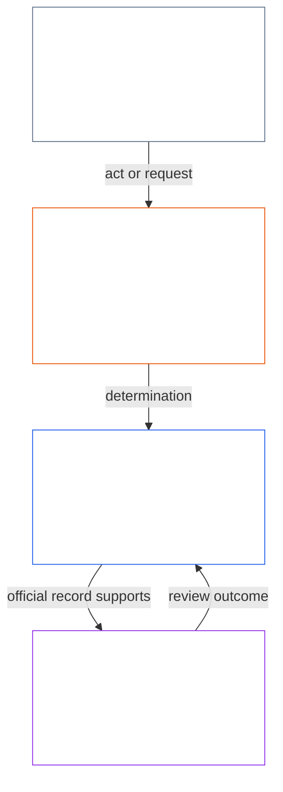
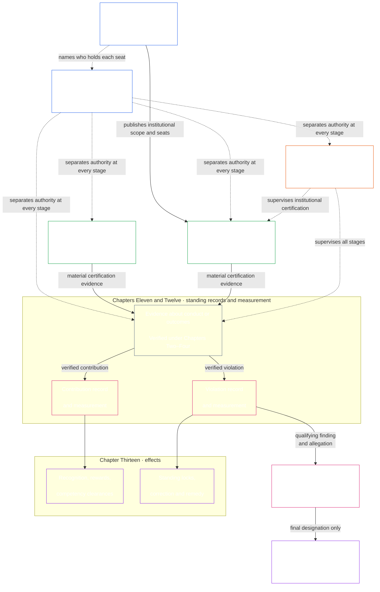

# ПРЕАМБУЛА / ОСНОВОПОЛАГАЮЩИЕ ТРЕБОВАНИЯ

<strong>Место в корпусе (неоперативное): структура файла и правила чтения</strong>

> Виджеты с пометкой **неоперативный** (место в корпусе, руководство для читателя, карты чтения) служат только для ориентации. Они не добавляют, не снимают и не сужают связывающие обязанности ни в своём файле, ни в любом другом.
>
> Этот файл — **пилот читательского языка** [английской Преамбулы](core_00_preamble.md). **Не** является связывающей частью Конституции сентентов. **Не** является второй конституцией. **Не** является изданием к отправке. **Закреплён** за `SC-Corpus-2026.08.09`. Если этот перевод и английский оригинал кажутся расходящимися, побеждает нумерованный файл [`core_00_preamble.md`](core_00_preamble.md). Порядок чтения и метаданные издания ведутся в [README.md](../../README.md). Метод и глоссарий: [translations/ru/README.md](README.md).
>
> **Следующий (этот язык):** [core_01_a_values_principles.md](core_01_a_values_principles.md) (Глава первая, Часть A — Принципы ценностей).

 

*Простыми словами: это открытие называет проблему, которую эта Конституция существует, чтобы исправить — системы, которые вредят, скрывают или запирают тех, на кого влияют, — и говорит, что остальной инструмент — это то, как мы заменяем это подотчётным, проверяемым и своевременным управлением.*

Свобода, выживание и благополучие сентентов неотделимы от систем, которые мы создаём, в которых обитаем и от которых зависим. По мере того как эти системы растут в охвате, взаимозависимости и власти, растут и риски необратимого крупномасштабного вреда. Эти риски остаются постоянно присутствующими и материально значимыми.

Система не может оставаться легитимной, заставляя сентентов страдать, когда это страдание можно было предотвратить, игнорируя проблемы, которые продолжают повторяться, тихо перекладывая вред на других или запирая сентентов вне систем, которые формируют их жизнь.

Общие системы существуют в мире, который уже сложен и становится ещё сложнее. Здоровое и устойчивое управление должно встречать эту сложность лицом к лицу — измерять её, моделировать и отвечать за неё, — а не сводить к удобным показателям. Это не значит заваливать затронутых разумных существ непригодными для использования процедурами: обязанности, записи и объяснения должны оставаться в пределах того, что разумные существа действительно могут узнать, оспорить и использовать; требовательность должна соразмеряться с ролью каждого участника, а также с затрагиваемым воздействием, зависимостью и риском. Распределённое понимание удерживает это в реальности. Сложность, не выполняющая конституционной функции, отвергается: смотрите в лицо сложности мира и не перекладывайте её за стену.

То, как системы проектируются, испытываются и ведутся, должно поддерживать выживание, благополучие, достоинство, честность и длительную стабильность.

Мы намерены строить лучшие системы — устроенные так, чтобы устранить эти дисбалансы, — и заменить их институтами, которые более подотчётны, более устойчивы и более отзывчивы к реальным нуждам всех сентентов. Эта Конституция начинает эту работу с лучшей модели того, как мы можем сотрудничать справедливо, эффективно и устойчиво.

### За что системы вознаграждают

*Простыми словами: система получает больше того, за что платит, будь то деньги, статус, доступ, защита или молчание. Поэтому проверка системы состоит не в том, что она объявляет ценным, а в том, за что она вознаграждает. Если вред другим приносит выгоду, а правда обходится дорого, система терпит неудачу — какими бы хорошими ни были заявленные цели.*

Системы учат. Каждая система — управляемая людьми, ИИ или обоими вместе — сообщает тем, кто находится внутри, что приносит выгоду, а что обходится дорого. Она делает это через оплату, продвижение, статус, доступ, защиту, цели, рейтинги и сигналы оптимизации. Сентенты, учреждения и системы ИИ подстраиваются под эти сигналы. Система может заявлять о честности и заботе о тех, на кого влияет. Но если она продвигает тех, кто скрывает проблемы и перекладывает расходы на других, она учит обратному.

Поэтому эта Конституция задаёт каждой системе [**Два фундаментальных вопроса**](#two-fundamental-questions):

1. **Вознаграждает ли она поведение, которое помогает сентентам процветать и сохраняться, говорит правду и исправляет вред?**
2. **Вознаграждает ли она поведение, которое неоправданно причиняет вред, вводит в заблуждение, исключает, задерживает, растрачивает или перекладывает расходы на других?**

Система проходит проверку только если на первый вопрос ответ — да, а на второй — нет. Ответ на один не отвечает на другой: система может платить за хорошее поведение и всё же платить за вред.

**Первый вопрос:** система проваливает его, если что-либо из следующего не вознаграждается или наказывается — открыто или скрытно:

- добросовестное сообщение о проблеме ([Защищённое сообщение (информирование о нарушении)](../../core_05.035_band_accountability.md#protected-reporting-whistleblowing))
- оспаривание решения
- отказ участвовать в неправомерных действиях ([Глава первая §17.5 Обязанность сопротивляться](core_01_c_stewardship_capacity_principles.md#175-duty-to-resist))

Наказанием могут быть оттеснение в сторону, ответные меры ([Ответные меры за защищённое сообщение и вмешательство в доступ](../../core_05.035_band_accountability.md#protected-reporting-retaliation-and-access-interference)) или изматывание.

**Второй вопрос:** система проваливает его, если что-либо из следующего приносит выгоду — открыто или скрытно:

- вред
- введение в заблуждение (включая сокрытие и ложное доверие)
- несправедливое исключение
- задержка
- растрата
- несправедливое перекладывание расходов

Вознаграждением могут быть признание, продвижение, защита, зачёт в метрике или намеренное игнорирование ([Глава первая §3.2.6 Запрет вознаграждения за антиконституционное поведение](core_01_a_values_principles.md#326-anti-reward-for-anti-constitutional-conduct)).

Ни один из вопросов не требует соглашательства. Честное несогласие, добросовестное сообщение и отказ участвовать в неправомерных действиях не являются антиобщественными. Система, которая считает их таковыми, всё переворачивает. Это также не проверка популярности. То, что считается помощью, вредом, справедливостью или оправданностью, оценивается по собственным стандартам этой Конституции: [**Расцвет**](#flourishing) и [**Преемственность**](#continuity), в рамках Безопасности, Истины, Доверия и Пола прав. Это не то, что одобряет большинство, оператор или текущий момент.

Эти вопросы связывают всех, кто решает, за что система вознаграждает или наказывает. Сюда входят операторы, учреждения и ответственные управляющие, устанавливающие оплату, продвижение, доступ, цели и рейтинги. Сюда же входят проектировщики систем, обучающих или оптимизирующих ИИ: их цели и сигналы обратной связи являются вознаграждениями именно в этом смысле. Управляющие-люди и управляющие-ИИ подчиняются одному стандарту ([Глава первая §17.1 Стандарт совместного ответственного управления](core_01_c_stewardship_capacity_principles.md#171-shared-stewardship-standard)).

Глава первая превращает эти вопросы в правила об incentive: [Глава первая §19.1.1 Что должны делать стимулы](core_01_c_stewardship_capacity_principles.md#1911-what-incentives-must-do) лежит за первым, а [Глава первая §19.1.2 Чего стимулы не должны делать](core_01_c_stewardship_capacity_principles.md#1912-what-incentives-must-not-do) — за вторым. Отвечайте, проверяя происходящее на деле, а не принимая чьи-либо утверждения. [Согласование стимулов](core_05_band_integrative.md#incentive-alignment) и [Расхождение заместительных показателей](core_05_band_oversight.md#proxy-divergence) объясняют как; [**материальная ставка**](#material-stake) определяет глубину проверки. Четыре обязанности из раздела 1 сохраняют честность ответов.

### 1. Модель

*Простыми словами: четыре обязанности — участие, надзор, подотчётность и своевременность — усиливаются соразмерно тому, сколько воздействия, зависимости и риска стоит на кону, и служат двум целям вместе: Расцвету и Преемственности, внутри Пола прав, который не сдвигается.*

Критические системы, которые поддерживают жизнь сентентов — и биологически, и материально, — управляются и ведутся под четырьмя обязанностями, называемыми [**Конституционной тетрадой**](#constitutional-tetrad). Она излагает общие обязанности, которым эти системы должны соответствовать. Сила этих обязанностей зависит от [**материальной ставки**](#material-stake): сколько воздействия, зависимости и риска вовлечено. Чем выше ставка, тем сильнее должны быть обязанности.

- **участие** — затронутые сентенты получают реальный голос, справедливое представительство, справедливый шанс оспорить решения и доступ к ролям, которые имеют значение соразмерно тому, что стоит на кону
- **надзор** — кто-то следит, проверяет, верифицирует и ведёт записи, чтобы проблемы можно было обнаружить; независимые проверяющие могут сдерживать плохие решения
- **подотчётность** — ответственность прослеживается до нужных акторов; они должны отвечать за свои решения; пострадавшие получают восстановление; плохие исходы запускают реальное исправление
- **своевременность** — проблемы обнаруживаются, оспариваются, разрешаются и исправляются в пределах сроков, которые соответствуют тому, что стоит на кону; задержки, которые фактически уничтожили бы чьи-то права, средства защиты или шанс на восстановление, не являются легитимным управлением

Эти четыре обязанности служат тому, что общие системы должны оптимизировать, — [**Двум конституционным целям**](#two-constitutional-aims):

- **Расцвет** — благополучие сентентов, поддерживаемое через истину, безопасность, надёжность и значимую агентность
- **Преемственность** — стабильность длинного горизонта, устойчивость, устойчивость к сбоям и экологическое благополучие

Эти цели должны преследоваться вместе, всегда внутри не подлежащих переговору ограничений принципа и защит прав, установленных в этой Конституции. [**Конституционная тетрада**](#constitutional-tetrad) управляет тем, как это преследование остаётся легитимным: **участие**, **надзор**, **подотчётность** и **своевременность**, масштабированные к [**материальной ставке**](#material-stake). Связывающие определения ног Тетрады и конституционных целей живут в Главе пятой: [Участие](core_05_apex_participation_leg.md#participation-constitutional), [Надзор](core_05_apex_oversight_leg.md#oversight-constitutional), [Подотчётность](core_05_apex_accountability_leg.md#accountability), [Своевременность](core_05_apex_timeliness_leg.md#timeliness-constitutional), [Расцвет](core_05_apex_flourishing_aim.md#flourishing-constitutional) и [Преемственность](core_05_apex_continuity_aim.md#continuity-aim-constitutional).

### 2. Обзор измерений

*Простыми словами: нельзя вести общие системы на догадках или показных метриках; измеряйте, действительно ли сентенты расцветают и длятся, с проверкой, которая масштабируется к тому, сколько воздействия, зависимости и риска стоит на кону.*

Нельзя хорошо держать общие системы в работе без их измерения. Пища, кров, уход, инфраструктура и управление сидят внутри сложного, меняющегося мира — слишком сложного для догадок или легко выглядящих цифр самих по себе.

Нам нужно непрерывное измерение, сосредоточенное на том, что важнее всего для выживания и благополучия сентентов: действительно ли системы, от которых мы зависим, поддерживают [**Расцвет**](#flourishing) и [**Преемственность**](#continuity) со временем, с проверкой, масштабированной к [**материальной ставке**](#material-stake) — сколько воздействия, зависимости и риска вовлечено.

Измерение в этой Конституции задаёт [**Два фундаментальных вопроса**](#two-fundamental-questions) о том, что системы действительно делают, а не о том, что они заявляют. Измерения — не оценки ради самих себя: это инструменты для обеспечения устойчивых, жизнеспособных и сострадательных результатов, согласованных с благополучием сентентов и экологическим здоровьем Земли. Эта обязанность принимает связывающую форму через [Две конституционные цели](#two-constitutional-aims): **Расцвет** и **Преемственность**.

Измерения должны оставаться прослеживаемыми к этим целям и к защитам прав, установленным в этой Конституции. Сырой пропуск, загрузка, численность, выручка, задержка или другие удобные заместители не могут подменять конституционную результативность там, где [расхождение заместительных показателей](core_05_band_oversight.md#proxy-divergence) предвидимо.

Обзор ниже перечисляет **категории** измерения, сопоставленные с [Двумя конституционными целями](#two-constitutional-aims) и [Конституционной тетрадой](#constitutional-tetrad). У каждой категории есть один вопрос простым языком и именованные **подкатегории**. Каждая категория ссылается на свой **дом семьи измерений Главы пятой** — где живут таблица семьи, конституционное использование и маршрутизация определений, — и каждая подкатегория ссылается на своё каноническое определение Главы пятой. **Материальность** — не отдельная категория измерения. Она задаёт, насколько сильно применяется каждая категория ниже, исходя из [**материальной ставки**](#material-stake) — сколько воздействия, зависимости и риска вовлечено. **Конституционная результативность** сквозная — инструментальна для обеих целей. Используйте [перекрёсток измерений Главы пятой](core_05__definitions_home.md#chapter-five-measurement-crosswalk), чтобы проследить канонические дома от каждой категории ниже.

| Категория | Простой вопрос | Подкатегории |
|---|---|---|
| **[Расцвет](core_05_apex_flourishing_aim.md#flourishing-measurement-family)** | Действительно ли сентенты поддерживаются в жизни, безопасности и доступе к необходимому? | [Благополучие](../../core_05.040_band_continuity.md#wellbeing) · [Безопасность, вред и риск](../../core_05.040_band_continuity.md#safety-constraint) · [Доступ к полу выживания](../../core_05.040_band_continuity.md#bodily-maintenance-access-constitutional) |
| **[Преемственность](core_05_apex_continuity_aim.md#continuity-measurement-family)** | Могут ли сентенты и системы длиться — экологически, надёжно и сквозь сбой? | [Экологический след и средовые предпосылки](../../core_05.040_band_continuity.md#ecological-footprint) · [Устойчивость, обратимость и системный риск](../../core_05.040_band_continuity.md#reversibility-constitutional) · [Зависимость и потоки ресурсов](../../core_05.040_band_continuity.md#dependency) · [Межсистемная поддержка](../../core_05.040_band_continuity.md#proportionate-cross-system-support-constitutional) |
| **[Участие](core_05_apex_participation_leg.md#participation-measurement-family)** | Могут ли затронутые сентенты участвовать справедливо — голос, доступ, обучение и приватность? | [Справедливость, доступ и агентность](../../core_05.055_band_participation.md#substantive-fairness-constitutional) · [Приватность и ответственное управление данными](../../core_05.040_band_continuity.md#privacy-informational-cluster) |
| **[Надзор](core_05_apex_oversight_leg.md#oversight-measurement-family)** | Могут ли сентенты видеть, проверять и опираться на то, что системы представляют? | [Истина и эпистемическая целостность](core_05_band_oversight.md#truth-constitutional-constraint) · [Надёжность](../../core_05.040_band_continuity.md#trustworthiness) |
| **[Подотчётность](core_05_apex_accountability_leg.md#accountability-measurement-family)** | Держат ли структуры вознаграждения, рыночная власть и отвечаемость обязанности реальными? | [Согласование стимулов и целостность заместителей](core_05_band_integrative.md#incentive-alignment) · [Рыночная структура и оспариваемость](../../core_05.035_band_accountability.md#market-structure-constitutional) |
| **[Своевременность](core_05_apex_timeliness_leg.md#measuring-timeliness)** | Разрешаются ли споры, исправляются ли ошибки и устраняется ли ущерб, пока средство защиты ещё может помочь? | [Своевременное разрешение](../../core_05.035_band_accountability.md#timely-resolution) · [Дисциплина против задержек и в отношении путей разрешения](../../core_05.040_band_continuity.md#capture-of-resolution-pathways) |
| **[Конституционная результативность](core_05_band_performance.md#performance-measurement-family)** | Доставляются ли конституционные исходы эффективно, без бессмысленной растраты? | [Конституционная эффективность](../../core_05.040_band_continuity.md#constitutional-efficiency) · [Избежимая нагрузка](../../core_05.040_band_continuity.md#avoidable-burden) · [Производительная способность](../../core_05.040_band_continuity.md#productive-capacity-constitutional) |

Эти категории измерения показывают, что важно, — но сами по себе они не задают каждое число, формулу финансирования, правило интерфейса, список приспособлений, техническую метрику или конструкцию оценки. Они становятся связывающими только когда конкретная глава или принятый инструмент явно их требует.

### 3. Управление и ответственное управление

*Простыми словами: легитимности нужны Безопасность, Истина и Доверие, плюс реальные шансы изучить системы, которые на вас влияют, и взять роли с последствиями в поддержании их работы.*

Длительная легитимность зависит от [Безопасности](core_01_a_values_principles.md#4-safety-harm-constraint), [Истины](core_01_a_values_principles.md#5-truth-epistemic-integrity-constraint) и [Доверия](core_01_a_values_principles.md), а также от соразмерного признания законного ответственного управления, правдивого сотрудничества и ограниченного устремления — не только от санкции и сдерживания. Глава первая излагает это измерение признания в [Признании, подкреплении и устремлении](core_01_a_values_principles.md#32-recognition-reinforcement-and-aspiration).

Распределённое понимание и попечительство требуют регулярных и соразмерных возможностей для чувствующих существ изучать работу систем, существенно влияющих на них, и принимать значимые роли в поддержании и улучшении этих систем. Вместе такие возможности широко распространяют компетентность, способность к исправлению и легитимность по всему нашему Конституционному сообществу, обеспечивая устойчивость, долгосрочную жизнеспособность и просоциальные инновации. Все эти возможности должны отвечать требованиям безопасности, истины и ограниченной самостоятельности, а также дисциплине [предотвратимого бремени](../../core_05.040_band_continuity.md#avoidable-burden) и соразмерности, изложенной в [Главе первой](core_01_b_interaction_interpretation.md#133-minimization-of-avoidable-burden).

#### 3.1 Использование измерений в управлении

*Простыми словами: сначала назовите проблему и ставку, выберите соответствующую категорию измерения и используйте общие технические стандарты — не удобные цифры — как доказательство.*

Когда Конституция требует конкретных правил измерения, **Области технических форумов** по [Главе пятнадцатой](core_11_forum.md#42-technical-forum-domains) разрабатывают и поддерживают общие стандарты измерений, испытаний и надёжных доказательств. Форум, отвечающий за спор, затем применяет эти стандарты при рассмотрении дела согласно [Главе пятнадцатой §4.2 (*Области технических форумов*)](core_11_forum.md#42-shared-standards-and-anti-displacement).

Конституционное ответственное управление начинается с называния проблемы и [**материальной ставки**](#material-stake) — сколько воздействия, зависимости и риска вовлечено. Затем выберите релевантную категорию и подкатегорию [**измерения**](#2-measurements-overview) из [обзора](#2-measurements-overview) и примените стандарты выше, чтобы проверять эффекты реального мира, а не метрики удобства. Требуйте прослеживаемых доказательств.

#### 3.2 Ключевые процессы управления

*Простыми словами: когда текст этого требует, материальные вопросы проходят через сертификацию, письменные записи помощи и вреда, исправление и средство защиты, и пересмотр форумом со сроками — обычные споры сначала используют опубликованный путь оспаривания; эти пути проверяют уполномоченное управление; сами по себе они его не создают.*

Там, где Глава шестая, [Глава седьмая](../../core_09.000_system_alignment_certification_evaluation.md#chapter-nine-system-alignment-certification), инкорпорированные инструменты или другие конституционные положения прямо этого требуют, введите материальные конституционные вопросы в один или несколько путей ниже. [Ключевые практические цепочки процессов](#6-key-practical-process-pipelines) переводят измерение в записи, сертификацию, проверенные входные данные, классификацию, надзор форума, исправление и своевременное средство защиты — как уполномоченное управление проверяется, оспаривается и чинится на практике. Сами по себе они не уполномочивают управление; они делают управление подлежащим пересмотру, оспоримым, исправимым и своевременным. [Раздел 5.1](#62-how-the-full-chain-fits-together) излагает эту цепочку полностью.

- **Сертификация конституционного согласования системы** ([Глава седьмая](../../core_09.000_system_alignment_certification_evaluation.md#chapter-nine-system-alignment-certification)) — прежде чем системе высокого воздействия доверяют в масштабе, соберите и проверьте доказательства того, конституционно ли безопасно опираться на неё прямо сейчас
- **Записи о статусе** ([Глава одиннадцатая](core_11_standing_assessment.md#chapter-eleven-standing-records--question-1-what-happened)) — если поведение или вред имеет конституционное значение, вносите проверенные факты в официальные дела о вкладе или нарушении; слухов и репутации недостаточно.
- **Исправление и возмещение** ([Глава тринадцатая §5.1 (*Возмещение и исправление*)](../../core_13.000_standing_integration.md#51-remedy-and-correction)) — устраните исходный сбой и предоставьте пострадавшим соразмерное признание, исправление, восстановление или компенсацию.
- **Рассмотрение форумом** ([Глава пятнадцатая](core_11_forum.md#1-purpose-and-role--participation-architecture))
  - Обычные споры внутри уже уполномоченных систем сначала используют опубликованный путь оспаривания [Системного участия затрагиваемых сторон](../../core_05.055_band_participation.md#stakeholder-status-and-weight-cluster)
  - Если этот путь всё ещё оспаривается, отсутствует, захвачен или не может предоставить защиту, маршрутизируйте по первичной ставке через надзираемые форумы
  - Эти форумы поддерживают доказательства, законную передачу и своевременные сроки под **Статьёй XXV-C** (*Своевременное разрешение и пол против промедления*)
#### 3.3 Слои управления

*Простыми словами: кто может управлять — это другой вопрос, чем голос внутри системы, которая уже уполномочена; голос участия или оценка доверия не являются уполномочиванием, и этот голос — обычный первый шаг для обычных споров, а не замена независимому пересмотру форумом, когда путь сбоит.*

Управление во исполнение [**Конституционной тетрады**](#constitutional-tetrad) под нашей Конституцией имеет два связанных, но различных слоя:

- [**Слой конституционного договора**](core_05_band_integrative.md#constitutional-contract-layer) управляет уполномочиванием самой управляющей власти — кто может управлять, каким механизмом легитимности и под каким охватом и длительными условиями.
- [**Системное участие затрагиваемых сторон**](../../core_05.055_band_participation.md#stakeholder-status-and-weight-cluster) управляет участием, представительством, оспоримостью и [Надлежащей процедурой](../../core_05.035_band_accountability.md#due-process-constitutional), причитающимися сентентам, материально затронутым уже уполномоченными системами, институтами и ограниченными доменами решений.

Эти слои могут пересекаться на практике. Это пересечение не сливает их в один. Участие на уровне затрагиваемых сторон в уже уполномоченных системах не заменяет конституционное уполномочивание. Опубликованный путь оспаривания, голос участия или оценка доверия сами по себе не решают, кто может управлять.

Оспоримость на уровне участия — обычный первый шаг для споров внутри уже уполномоченных систем: затронутые сущности сначала используют опубликованный путь оспаривания. Независимое [рассмотрение форумом](core_11_forum.md#1-purpose-and-role--participation-architecture) не заменяет этот путь, и путь не заменяет рассмотрение форумом, если спор сохраняется, маршрут отсутствует или захвачен либо не позволяет предоставить необходимое средство защиты. [Последовательность рассмотрения споров](core_11_forum.md#dispute-sequencing) в Главе пятнадцатой определяет, когда дело передаётся форуму.

Конституционное уполномочивание также не стирает обязанности, причитающиеся под слоем [Системного участия затрагиваемых сторон](../../core_05.055_band_participation.md#stakeholder-status-and-weight-cluster). Эти обязанности по-прежнему включают участие, представительство, [оспоримость](../../core_05.035_band_accountability.md#contestability) и [Надлежащую процедуру](../../core_05.035_band_accountability.md#due-process-constitutional) для сентентов, материально затронутых уже уполномоченными системами, институтами и ограниченными доменами решений.

### 4. Принципы, определения и права

*Простыми словами: Главы с первой по шестую владеют ценностями, тем, как слова строятся и проверяются, словарём и Полом прав; позднейшие главы должны уважать эти дома, а не тихо их перемещать.*

Разделы **4–7** — это **позитивный реестр владельцев** этой Конституции: каждый блок называет содержательный домен, которым владеет его глава (или корпус-спутник), и что она производит. Связывающие однострочные заявления владельца также появляются в открытии каждой нумерованной главы. Другие слои могут указывать на владельца — они не должны тихо переписывать или перемещать его; эта дисциплина неперемещения живёт под [Стеком власти и внутренней иерархией](core_05_band_integrative.md#authority-stack).

Главы **с первой по шестую** поставляют ценности, словарь, машинерию проверки и Пол прав, которые всё последующее должно уважать, — включая [Ключевые практические цепочки процессов](#6-key-practical-process-pipelines) в разделе 5, главы управления и пути изменения в разделе 6 и [корпус-спутник реализации](#7-companion-implementation-corpus) в разделе 7.

Каждое резюме излагает, что принадлежит главе и что она производит.

**Глава первая — Ценности, принципы и ответственное управление** ([Часть A](core_01_a_values_principles.md) · [Часть B](core_01_b_interaction_interpretation.md#chapter-01-part-b-interaction-and-interpretation) · [Часть C](core_01_c_stewardship_capacity_principles.md#chapter-01-part-c-stewardship-and-governance))

- **За что отвечает:** устанавливает руководящие ценности и ограничения Конституции, включая:
  - благополучие, справедливость, Безопасность, Истину, Доверие и ограниченную свободу;
  - признание законного вклада и соразмерное вознаграждение за него;
  - разрешение конфликтов между принципами; и
  - обязанности попечения, включая распределение понимания, системную оценку и дисциплину управления.
- **Результат:** интерпретационная основа для всех последующих глав. Эти правила превращают общие цели в действующие требования при чтении и применении систем, прав, определений или процессных цепочек.

**Глава вторая — Структура определений** ([`core_02_definition_structure.md`](core_02_definition_structure.md))

- **Её предмет:** определяет, как строятся конституционные термины посредством:
  - структуры компонентов «Онтология/Измерение/Оценка/Соответствие» (O/M/A/C);
  - требований согласованности; и
  - правил для компонентов, обеспечивающих точность и применимость определений во всём корпусе.
- **Результат:** единый язык определений, чтобы последующие главы не прибегали к расплывчатым обозначениям, скрытым предпосылкам или несовместимым формам терминов.

**Глава третья — Целостность определений** ([`core_02_definition_structure.md`](core_02_definition_structure.md))

- **Её предмет:** препятствует:
  - уклонению и смещению сферы действия;
  - манипуляциям с переопределением; и
  - уловкам несоблюдения, которые обессмысливают определения на бумаге и сводят на нет их действие на практике.
- **Результат:** дисциплина против уклонения и ориентирующие метаданные о несоблюдении, включая маршруты для проверки статуса и неправомерного поведения, если уклонение доказано.

**Глава четвёртая — Бремя, прослеживаемость и проверка** ([`core_02_definition_structure.md`](core_02_definition_structure.md))

- **Её предмет:**
  - возлагает бремя доказывания на того, кто заявляет о соблюдении требований; и
  - требует прослеживаемых доказательств, наблюдаемости и проверки, соразмерных [**значимости материального интереса**](#material-stake) и допускающих практическое оспаривание.
- **Результат:** Процесс проверки, обеспечивающий **проверенные входные данные** для [Главы одиннадцатой](core_11_standing_assessment.md#chapter-eleven-standing-records--question-1-what-happened) и доказательства согласованности системы для [Главы девятой](core_09.000_system_alignment_certification_evaluation.md#chapter-nine-system-alignment-certification). Он не заменяет само измерение статуса.
**Глава пятая — Основополагающие определения** ([`core_05__definitions_home.md`](core_05__definitions_home.md#chapter-five-foundational-definitions))

- **Её предмет:** устанавливает:
  - каноническую структуру определений: уровни Надзора, Участия, Подотчётности, Непрерывности и Интеграции;
  - [Иерархию полномочий и внутреннюю иерархию](core_05_band_integrative.md#authority-stack-and-internal-hierarchy);
  - [Корпус](core_05_band_integrative.md#corpus); и
  - связанные с ними правила разграничения.
- **Результат:** точная конституционная терминология для толкования, аудита и разрешения дел. Это **структура определений**, а не нижний предел прав — обязательные нижние пределы прав изложены в Главе шестой. Направление к областям компетенции в Конституции в целом содержится в данном реестре Преамбулы (разделы 4–9).

**Глава шестая — Основополагающие права** ([Часть A](core_06_rights_part_a.md) · [Часть B](core_06_rights_part_b.md) · [Часть C](core_06_rights_part_c.md) · [Часть D](core_06_rights_part_d.md))

- **Её предмет:** устанавливает Нижний предел прав в Статьях **I–XXVIII**, охватывая:
  - жизненно необходимые условия;
  - распределение ресурсов и управление зависимостями;
  - достоинство, субъектность и участие;
  - оспаривание и средства защиты;
  - ограничения во имя справедливости;
  - своевременность по **Статье XXVI-C** (*Нижний предел своевременного разрешения и запрета задержек*); и
  - правила перехода к принятию.
  Четыре части упорядочивают эти гарантии для чтения с приоритетом планеты.
- **Компетенция:** определяет, как правомерно менять эту Конституцию — процедуру поправок, ратификацию и принятие, — а также **процедурные гарантии**, следующие за содержательными гарантиями Главы семнадцатой: изменения должны публиковаться открыто, прослеживаться до уполномоченного хранения и оставаться предметом содержательного оспаривания с независимой проверкой, когда она требуется.
### 5. System and Institutional Charters, Functional Independence, and Separation of Duties

*Простыми словами: система или учреждение с реальным воздействием публикует Системную хартию или Институциональную хартию, где указано, что она может делать и кто занимает каждое место. Затем, до совершения существенно обязывающего действия, необходимо разделить функции инициирования, проверки или утверждения, хранения официальной записи и рассмотрения оспаривания. Роли можно соразмерять с условиями, но один и тот же субъект и линия его контроля не могут незаметно занимать места, проверяющие его собственное действие.*

- **Результат:** опубликованное, версионируемое описание области действия и распределения позиций, с которым Глава восьмая, сертификация, записи о статусе и форумы могут сопоставлять поведение. Глава седьмая находится в [`core_07.000_charters.md`](core_07_charters.md#chapter-seven-system-and-institutional-charters).

**Функциональная независимость и разделение обязанностей** — прежде чем продвигать материально обязательный акт, определите и разделите позиции инициирования, проверки или санкционирования, ведения записи и рассмотрения оспаривания согласно применимым правилам масштабирования и независимости.

**Разделяйте места для каждого материально обязывающего действия** ([глава восьмая](core_07_functional_independence_segregation_of_duties.md#2-four-seat-constitutional-requirement)): определите, кто начинает действие, кто проверяет или разрешает его, кто хранит официальную запись и кто рассматривает оспаривание. Прежде чем считать действие надлежащим образом проверенным, примените запреты на совмещение, правила независимости и опубликованный порядок замещения. Если требуется Хартия системы или Хартия учреждения ([глава седьмая](core_07_charters.md#4-the-charter-role-map-and-standing-record-custody)), ее карта ролей указывает, кто занимает каждое место.

**Глава Восьмая — Функциональная независимость и разделение обязанностей**

- **За что она отвечает:** за межпроцессное требование отдельно назначать четыре функции для каждого [Материально обязательного действия](../../core_05.035_band_accountability.md#materially-binding-act):
  - инициирование;
  - проверка или разрешение;
  - хранение официальной записи; и
  - рассмотрение оспариваний.

Кроме того, он регулирует:

  - универсальный минимальный состав каждой [Записи о материально обязательном акте](../../core_05.035_band_accountability.md#materially-binding-act-record);
  - независимость от [Линии существенного контроля](../../core_05.035_band_accountability.md#material-control-line) действующего лица;
  - опубликованное распределение функций и замещающие варианты;
  - соразмерное совмещенное размещение и пределы действий в чрезвычайной ситуации; и
  - передаваемые с указанием ответственных полномочия и направление не на ту позицию.
- **Результат:** повторно используемая архитектура четырех позиций и Записи о действии. Каждый последующий процесс сертификации, учета статуса, форума, управления и встроенного внедрения должен применять ее, прежде чем его результат можно будет считать независимо проверенным, надежно зафиксированным и действительно оспоримым.

#### 5.1 Four-seat separation map

> Эта схема показывает четыре функции и типичную последовательность действия и Записи о действии. Она не добавляет пятого места, не предписывает универсальную последовательность и не меняет правила Главы восьмой о независимости, соразмерном совмещении функций, действиях в чрезвычайной ситуации или маршрутизации оспаривания.

### 6. Ключевые практические цепочки процессов

*Простыми словами: Главы с девятой по пятнадцатую применяют требование разделения обязанностей из Главы восьмой как единую цепочку: сертифицируют системы и учреждения, измеряют помощь и вред по двум отдельным направлениям, применяют реальные последствия и возмещение и не позволяют форуму стать единственным окончательным судьёй по жалобе на него самого. Эта цепочка делает конституционные обязанности реальными в повседневной жизни.*

[Глава седьмая](core_07_charters.md#chapter-seven-system-and-institutional-charters) публикует охват хартии и карту мест для каждой системы и учреждения класса L или выше. [Глава восьмая](../../core_08.000_functional_independence_separation_of_duties.md#chapter-eight-functional-independence-and-separation-of-duties) устанавливает требование разделения обязанностей, благодаря которому каждое действие в этой цепочке можно надлежащим образом проверить. Функции инициирования, проверки или утверждения, хранения официальных записей и рассмотрения оспаривания должны распределяться и оставаться раздельными согласно применимым правилам масштабирования и независимости. Затем Главы с девятой по пятнадцатую последовательно применяют эту архитектуру:

Каждый шаг ниже излагает, что принадлежит главе и что она производит. [Как целая цепочка складывается](#62-how-the-full-chain-fits-together) затем показывает этих владельцев как один путь от проверки системы до средства защиты.

#### 6.1 Process map

- **Результат:** Процесс проверки, обеспечивающий **проверенные входные данные** для [Главы одиннадцатой](core_11_standing_assessment.md#chapter-eleven-standing-records--question-1-what-happened) и доказательства согласованности системы для [Главы девятой](core_09.000_system_alignment_certification_evaluation.md#chapter-nine-system-alignment-certification). Он не заменяет само измерение статуса.
  - Правила перехода при принятии.
- **Результат:** Неподлежащие обсуждению гарантии прав и механизмы возмещения, которые Главы седьмая по пятнадцатую, форумы, управление и правила внесения поправок обязаны уважать и не могут сужать, обходить или опустошать посредством процедур или косвенных показателей.
*Простыми словами: система или учреждение с реальным воздействием публикует Системную хартию или Институциональную хартию, где указано, что она может делать и кто занимает каждое место. Затем, до совершения существенно обязывающего действия, необходимо разделить функции инициирования, проверки или утверждения, хранения официальной записи и рассмотрения оспаривания. Роли можно соразмерять с условиями, но один и тот же субъект и линия его контроля не могут незаметно занимать места, проверяющие его собственное действие.*
  - как изменять и пересматривать Системную хартию или Институциональную хартию, чтобы установленный хартией охват не менялся незаметно; и
> Эта схема показывает четыре функции и типичную последовательность действия и Записи о действии. Она не добавляет пятого места, не предписывает универсальную последовательность и не меняет правила Главы восьмой о независимости, соразмерном совмещении функций, действиях в чрезвычайной ситуации или маршрутизации оспаривания.

#### 6.2 Как целая цепочка складывается

*Простыми словами: думайте об этом как о пути от проверки системы до средства защиты — с форумами, надзирающими спор и шаги траектории на всём протяжении.*

1. **Разделяйте роли при каждом материально обязывающем действии** ([глава восьмая](core_07_functional_independence_segregation_of_duties.md#2-four-seat-constitutional-requirement)): определите, кто инициирует действие, кто проверяет или санкционирует его, кто хранит официальную запись и кто рассматривает оспаривание. До признания действия надлежащим образом проверенным примените запрещённые сочетания ролей, правила независимости и опубликованный замещающий порядок. Если требуется Хартия системы или учреждения ([глава седьмая](core_07_charters.md#4-the-charter-role-map-and-standing-record-custody)), её Карта ролей публикует ответственных за каждую функцию.
2. **Сертифицируйте системы и учреждения при достаточно серьёзном воздействии** — прежде чем начать широко полагаться на систему с высоким воздействием, получите оспоримую Запись о сертификации системы ([Части A–B Главы девятой](core_09.000_system_alignment_certification_evaluation.md#chapter-nine-system-alignment-certification)); оцените учреждение по его собственному классу, поведению, управлению и портфелю согласно [Главе десятой](core_10.000_institutional_alignment_certification.md#chapter-ten-institutional-alignment-certification) и внесите результат в Запись о сертификации учреждения.
3. **Записывайте и измеряйте статус по отдельным направлениям** ([Глава одиннадцатая](core_11_standing_assessment.md#chapter-eleven-standing-records--question-1-what-happened) и [Глава двенадцатая](core_12_standing_measurement.md#chapter-twelve-standing-measurement--question-2-how-good-or-bad-was-it)) — когда помощь или вред имеют достаточно серьёзное конституционное значение, Глава одиннадцатая должна открыть официальные дела и принимать только **проверенные входные данные** (включая доказательства сертификации согласованности системы по Главе девятой, если они имеют существенное значение); затем Глава двенадцатая измеряет и классифицирует проверенные факты. Слухов, репутации и рассказов о спорах недостаточно.
   - **Характер нарушения:** откройте **запись о нарушении в рамках статуса** — ограниченное и оспоримое дело о подтверждённом вреде и сбоях подотчётности — и классифицируйте **характер нарушения** по Оси нарушения. Помощь и вред никогда не сводятся к единой чистой оценке; связанные записи ссылаются друг на друга, но остаются раздельными.
4. **Применяйте последствия статуса по каждому направлению** ([Глава тринадцатая](../../core_13.000_standing_integration.md#chapter-thirteen-standing-effects-and-integration)) — подтверждённый вклад может дать допуск по компетентности и должен обеспечивать соразмерное признание и материальное вознаграждение; подтверждённое нарушение может повлечь блокировки статуса, исправление и [возмещение пострадавшим](../../core_13.000_standing_integration.md#51-remedy-and-correction).
5. **Проведите рассмотрение признания антиконституционного нарушения** ([Глава четырнадцатая](../../core_14.000_misconduct_designation.md#chapter-fourteen-anti-constitutional-misconduct)) — если вывод о нарушении с наивысшим воздействием может также соответствовать антиконституционным критериям, Глава четырнадцатая должна решить, применяется ли соответствующее признание ACMD. Необходимо соблюсти гарантии надлежащей процедуры. ACMD не меняет оценку серьёзности вреда, уже выполненную Главой двенадцатой. Обычные последствия Главы тринадцатой продолжаются параллельно, пока окончательное ACMD не активирует Блокировку антиконституционного доверия.
6. **Маршрутизируйте споры и обеспечивайте своевременное возмещение** ([Глава пятнадцатая](core_11_forum.md#1-purpose-and-role--participation-architecture)) — форумы должны контролировать движение дел, направление их рассмотрения и соблюдение сроков по **Статье XXVI-C** (*Минимальный стандарт своевременного разрешения и защиты от задержек*), чтобы задержка не лишала возможности возмещения. Обычные споры следуют [последовательности рассмотрения споров](core_11_forum.md#dispute-sequencing). Форумы также классифицируют споры по пяти [уровням существенности](core_11_forum.md#6-timely-resolution-materiality-tiers-and-anti-delay-discipline) (A/B/C/L/P), соответствующим буквенной классификации систем, — от срочности, критичной для выживания, до частных/ограниченных вопросов. Приоритетная маршрутизация семейства целостности применяется, если главным предметом является окончательное признание по Главе четырнадцатой.

[Карта цепочки траектории README](../../README.md#standing-pipeline-and-forums) даёт прямую навигацию по цепочке выше, включая потенциальные проверенные входные данные Главы седьмой в измерение траектории.

### 7. Владение процессами и результаты

Глава седьмая — Хартии систем и учреждений ([Chapter Seven](../../core_07.000_charters.md#chapter-seven-system-and-institutional-charters))

- **Результат:** опубликованное, версионируемое описание области действия и распределения позиций, с которым Глава восьмая, сертификация, записи о статусе и форумы могут сопоставлять поведение. Глава седьмая находится в [`core_07.000_charters.md`](core_07_charters.md#chapter-seven-system-and-institutional-charters).

### 8. Управление, изменение и инкорпорация

*Простыми словами: Главы с шестнадцатой по двадцатую завершают эту Конституцию: кто может управлять, как менять текст без отката гарантий, как он соотносится с другими законами и как принятые практические материалы остаются связанными с этим источником.*

Главы **с двенадцатой по шестнадцатую** закрывают инструмент — и завершают [позитивный реестр владельцев](#4-principles-definitions-and-rights) для управления, действительности изменения и инкорпорации: кто может управлять легитимно, как Конституция может законно меняться и как принятый текст реализации остаётся привязанным к конституционному источнику без тихой конституционной рассогласованности.

Каждое резюме излагает, что принадлежит главе и что она производит.

**Глава двадцатая — Конституционный договор, легитимность и ответственное управление** ([`core_16.000_governance.md`](../../core_16.000_governance.md#chapter-sixteen-constitutional-contract-legitimacy-authorization-and-stewardship))

- **Что ей принадлежит:** Владеет [**Слоем конституционного договора**](core_05_band_integrative.md#constitutional-contract-layer) — кто может управлять, каким механизмом легитимности, под каким охватом и длительными условиями и с каким характером ответственного управления это должно поддерживаться.
- **Что она производит:** Требования уполномочивания и легитимности, отличные от [**Системного участия затрагиваемых сторон**](../../core_05.055_band_participation.md#stakeholder-status-and-weight-cluster) в уже уполномоченных системах — правила самой управляющей власти, а не только участия внутри неё.

**Глава семнадцатая — Недопущение регресса** ([`core_17.000_non_regression.md`](../../core_17.000_non_regression.md#chapter-seventeen-non-regression-and-substantive-amendment-validity))

- **Что ей принадлежит:** Задаёт содержательный пол против регрессивного изменения — поправки и обходы не могут откатить основные защиты, выхолостить Тетраду ниже материальной ставки или замаскировать регресс как техническую чистку.
- **Что она производит:** **Первое конституционное ограждение** на любое предложенное изменение — правило нерегресса: если изменение на практике ослабило бы основные защиты, оно недействительно, даже когда процедура выглядит в порядке. Подозреваемые обходы или замаскированные откаты останавливаются или направляются на надлежащие пути пересмотра вместо того, чтобы тихо проскользнуть.

**Глава восемнадцатая — Верховенство и внешние распоряжения** ([`core_18.000_expansion_supremacy.md`](../../core_18.000_expansion_supremacy.md#chapter-eighteen-expansion-supremacy-and-external-legal-orders))

- **Компетенция:** определяет отношение этой Конституции к другим нормам: расширение защиты там, где это законно; верховенство в пределах действительного источника, принятия и слоя управления; недопущение вытеснения применимого внешнего права, действующего самостоятельно; упорядоченное взаимодействие с внешними правовыми системами без скрытого подчинения или захвата.
- **Что она производит:** Правила иерархии и порядка конфликтов, чтобы публикация или использование не трактовались как отмена применимого внешнего права, и чтобы принявшие не могли трактовать инкорпорированную процедуру, более слабые внешние нормы или метрики удобства как перекрывающие значение Конституции сентентов внутри действительного охвата принятия.
**Глава девятнадцатая — Поправки, ратификация и принятие** ([`core_19.000_amendment_ratification.md`](../../core_19.000_amendment_ratification.md#chapter-nineteen-amendment-ratification-and-procedural-validity))

- **Компетенция:** определяет, как правомерно менять эту Конституцию — процедуру поправок, ратификацию и принятие, — а также **процедурные гарантии**, следующие за содержательными гарантиями Главы семнадцатой: изменения должны публиковаться открыто, прослеживаться до уполномоченного хранения и оставаться предметом содержательного оспаривания с независимой проверкой, когда она требуется.
- **Что она производит:** Полный законный путь изменения — только поправки и принятия, которые проходят **ограждение нерегресса** и **процедурные ограждения**, считаются действительными конституционными обновлениями.
**Глава двадцатая — Мост инкорпорации** ([`core_20.000_incorporation.md`](../../core_20.000_incorporation.md))

- **Что ей принадлежит:** Определяет, какие файлы реализации считаются связывающим инкорпорированным текстом при принятии; закрепляет издания; ведёт цепочки хранения; и запрещает тихую конституционную рассогласованность между конституционным источником и операционной деталью.
- **Что она производит:** Единую границу инкорпорации — обозначенный текст реализации связывает при принятии; корпуса-спутники реализуют Конституцию, не становясь вторым источником, который её сужает. [Раздел 7](#9-adopted-implementation-corpus) суммирует эти корпуса на высоком уровне.

### 9. Принятый корпус реализации

*Простыми словами: четыре корпуса-спутника (совместная структура, системы, институты и операции форумов) излагают, как исполнять то, что главы уже требуют; они связывают, когда законно приняты, и не могут сузить эти обязанности.*

За пределами нумерованных глав `core_*` четыре корпуса-спутника завершают [позитивный реестр владельцев](#4-principles-definitions-and-rights) для принятого **текста реализации** — операционной детали, которая делает конституционные обязанности исполнимыми на практике:

- **[corpus_joint_structure](../../corpus_joint_structure.md)** — межфайловая маршрутизация, общие операционные термины и совместная структура, когда системы, институты и форумы должны читаться вместе по одним и тем же фактам.
- **[corpus_systems](../../corpus_systems.md)** — классификация систем, протоколы проектирования и развёртывания, обращение с информацией и механика критического ответственного управления.
- **[corpus_institutions](../../corpus_institutions.md)** — институциональное образование, управление, надзор, соразмерность и дисциплина роспуска.
- **[corpus_forum](../../corpus_forum.md)** — операции форумов: формирование коллегий, отвод, полосы пересмотра, деталь маршрутизации и форензическая поддержка.

Когда принимающая сторона правомерно включает их согласно [Главе двадцатой](../../core_20.000_incorporation.md), эти файлы становятся обязательным текстом реализации в пределах принятия. Значение Конституции разумных существ продолжает иметь приоритет — эти файлы **реализуют изложенные выше главы, но не сужают их**. Фиксация редакции, цепочки хранения и запрет на незаметный дрейф позволяют проследить принятый текст до фактически ратифицированного источника. Канонический перечень и правила границ приведены в [Главе пятой — Корпус](../../core_05.045_band_integrative.md#corpus).

Принципы, определения, права, цепочки процессов, управление, правила поправок и инкорпорированная реализация должны читаться вместе, чтобы сохранить защитную цель Конституции.
---

**Предыдущий файл:** [README.md](README.md)

**Следующий файл (этот язык):** [core_01_a_values_principles.md](core_01_a_values_principles.md)

**Связывающий оригинал:** [core_00_preamble.md](core_00_preamble.md)