# ГЛАВА СЕДЬМАЯ, ЧАСТЬ A: СЕРТИФИКАЦИЯ СОГЛАСОВАНИЯ СИСТЕМЫ — ОЦЕНКА

<strong>Место в корпусе (неоперативное): структура файла и правила чтения</strong>

> Этот файл — **пилот читательского языка** [английской Главы седьмой, Части A](../../core_08_a_system_alignment_certification_evaluation.md). **Не** является связывающей частью Конституции сентентов. **Не** является второй конституцией. **Не** является изданием к отправке. **Закреплён** за `SC-Corpus-2026.08.09`. Если этот перевод и английский оригинал кажутся расходящимися, побеждает нумерованный файл [`core_07_a_system_alignment_certification_evaluation.md`](../../core_08_a_system_alignment_certification_evaluation.md). Порядок чтения и метаданные издания ведутся в [README.md](../../README.md). Метод и глоссарий: [translations/ru/README.md](README.md).
>
> Он содержит **Главу седьмую, Часть A** — требования **оценки** сертификации (класс системы, факторы целой системы и крюки доменной оценки). **Часть B** — запись сертификации, процесс форума, мост траектории и повторное открытие — в [`core_07_b_system_alignment_certification_record_process.md`](core_07_b_system_alignment_certification_record_process.md).
>
> - **Конституционный владелец (совместно с Частью B):** **сертификация согласования системы и связанные записи** под надзором форума — домены оценки (Часть A); обязанности записи сертификации, исходы признания, периодичность повторной валидации, последовательность надзора, цепочка оспоримости и мост проверенных входных данных к Главе восьмой (Часть B). Под ногой **надзора** Тетрады SAC — один особенно крупный аудиторский процесс с высокой материальной ставкой среди прочих; полы аудита остаются у **Статьи XVI** и у [Аудитируемости](core_05_band_oversight.md#auditability) Главы пятой.
> - **Владелец субстрата верификации:** [Глава четвёртая — Бремя доказательства, прослеживаемость и верификация](core_04_burden_traceability_verification.md#chapter-four-burden-of-proof-traceability-and-verification) (внутри Глав со второй по четвёртую) владеет распределением бремени, доказательствами соответствия, прослеживаемостью определения, наблюдаемостью и верификацией, ограниченной безопасностью. Глава седьмая **применяет** эту дисциплину к записям сертификации согласования системы; она **не** излагает заново разделы **1** по **5** Главы четвёртой.
> - **Дом аудита (сюда не перенесён):** **Статья XVI** (*Аудит, прозрачность и независимая проверка*), **Def.O1** (*Прозрачность, аудитируемость и верификация*) и **CJS-3.3**–**CJS-3.5** владеют полами аудита и оперативными терминами. Глава седьмая ведёт один особенно крупный аудиторский процесс SAC, который должен удовлетворить эти полы; она не владеет всем аудитом.
> - **Владелец реализации:** обращение с классом системы, CS-5 и деталь форумного процесса в назначенных файлах реализации должны оставаться согласованными с Главой седьмой и могут быть строже там, где корпус уже даёт логику более строгого правила.
> - **Правило антипереноса:** Часть A не излагает заново канонические определения Главы пятой, дисциплину против уклонения Главы третьей (см. [Часть B §16](core_07_b_system_alignment_certification_record_process.md#16-reopening-drift-and-non-evasion)), измерение вклада или траектории Главы восьмой или эффекты траектории Главы девятой. **[Часть B §15](core_07_b_system_alignment_certification_record_process.md#15-relationship-to-standing)** прямо излагает границу моста траектории.
>
> **Исход:** определения Главы пятой и запись, верификация, бремя и прослеживаемость определений к результатам Глав со второй по четвёртую.
> **Назначение:** [Часть B](core_07_b_system_alignment_certification_record_process.md#chapter-seven-part-b-certification-record-and-process) (*запись, процесс форума и мост траектории*); записи траектории и проверенные входные данные Главы восьмой; эффекты траектории Главы девятой; надзор форума и пути сертификации согласования системы Главы одиннадцатой.
>
> **Дверь ответственного управления (неоперативная):** Связывающее заявление следующего шага: [Оперативное заявление ответственного управляющего](#operative-steward-statement-sac). Указатели поддержки в [`implementation/STEWARD_ENTRY_DOORS.md`](../../implementation/STEWARD_ENTRY_DOORS.md) не могут его сузить.

>
> **Предыдущий (этот язык):** [core_07_system_alignment_certification.md](core_07_system_alignment_certification.md#chapter-seven-system-alignment-certification-index)
>
> **Следующий (на этом языке):** [core_07_b_system_alignment_certification_record_process.md](core_07_b_system_alignment_certification_record_process.md#chapter-seven-part-b-certification-record-and-process)
> **Дуга чтения:** §1 назначение и роль → §2 класс системы → §3 оценка целой системы → §4–§10 доменные оценки

 

Глава седьмая, **Часть A**, — конституционный владелец **оценки сертификации согласования системы**. Содержимое записи, надзор форума, пути оспаривания и мост траектории — в **[Части B](core_07_b_system_alignment_certification_record_process.md#chapter-seven-part-b-certification-record-and-process)**.

> **Оперативное заявление ответственного управляющего.** **Владелец:** Глава седьмая (SAC под надзором форума). Линза слоя принципов: Глава первая §14. SAC — один особенно крупный аудиторский процесс под Статьёй XVI / Аудитируемостью — не единственный аудит. **Запрещённый ход:** Не трактуйте модульные тесты, чек-листы приватности или местные ярлыки согласованности как сертификацию. Не пропускайте окно оспаривания. Не изобретайте пятый дом аудита. Не трактуйте значок сертификации или оценку LEQU как статус сентентности. **Срок:** Откройте или восстановите оспоримый путь Главы седьмой, включая окно оспаривания затрагиваемых сторон, до заявления о согласованности.

### 1. Назначение и роль

<strong>Связи и обоснование</strong>

- **Предшествующие основания:** [Преамбула — реестр конституционных владельцев](core_00_preamble.md#4-principles-definitions-and-rights) и [иерархия полномочий](core_05_band_integrative.md#authority-stack-and-internal-hierarchy); [Конституционная тетрада](core_00_preamble.md#constitutional-tetrad); [Две конституционные цели](core_00_preamble.md#two-constitutional-aims); [материальная заинтересованность](core_00_preamble.md#material-stake); [Пропорциональность](core_05_band_accountability.md#proportionality) и [содержательная справедливость](core_05_band_participation.md#substantive-fairness) (глава пятая); семейство измерений участия (*голос, доступ и пути оспаривания*); [глава первая §16 — ответственное попечительство в глубину](core_01_c_stewardship_capacity_principles.md#16-stewardship-in-depth); [глава первая §12 — требование системной оценки](core_01_a_values_principles.md#12-systemic-evaluation-requirement) (*принципиальный взгляд на оценку всей системы, а не одного аспекта*); главы со второй по четвёртую; [глава пятая](core_05__definitions_home.md#chapter-five-foundational-definitions) (*канонические определения*); [глава седьмая §2 — конституционный минимум из четырёх мест](core_07_functional_independence_segregation_of_duties.md#2-four-seat-constitutional-floor); [Сертификация согласованности системы](core_05_band_continuity.md#system-alignment-certification) (канонический термин главы пятой; неоперативное сокращение **SAC**); [Запись о сертификации системы](core_05_band_continuity.md#system-certification-record) (значение термина в главе пятой).
- **Последующие связи:** [§2](#2-system-class-evaluation) (*оценка класса системы*); [часть B §9.1](core_08_b_system_alignment_certification_record_process.md#91-challenging-a-certification) (*оспаривание сертификации*); профили классов, пошаговые примеры для целой системы и примеры по каждой области приведены в [части C](core_08_c_system_alignment_certification_illustrations.md#chapter-eight-part-c-system-alignment-certification--illustrations): [иллюстративные профили классов систем](core_08_c_system_alignment_certification_illustrations.md#illustrative-system-class-profiles-non-exhaustive), [пошаговые примеры применения ко всей системе по классам](core_08_c_system_alignment_certification_illustrations.md#illustrative-whole-system-application-by-system-class-non-exhaustive), а также примеры обращения с данными [§3.4.8](core_08_c_system_alignment_certification_illustrations.md#348-illustrative-data-handling-application-by-system-class-non-exhaustive), экологического следа [§5.1.5](core_08_c_system_alignment_certification_illustrations.md#515-illustrative-ecological-footprint-application-by-system-class-non-exhaustive), образовательных возможностей [§5.2.5](core_08_c_system_alignment_certification_illustrations.md#525-illustrative-educational-capability-application-by-system-class-non-exhaustive), межсистемной поддержки [§5.3.8](core_08_c_system_alignment_certification_illustrations.md#538-illustrative-cross-system-support-application-by-system-class-non-exhaustive), недискриминации [§5.4.5](core_08_c_system_alignment_certification_illustrations.md#545-illustrative-nondiscrimination-application-by-system-class-non-exhaustive), доступности [§5.5.6](core_08_c_system_alignment_certification_illustrations.md#556-illustrative-accessibility-application-by-system-class-non-exhaustive) и надёжности [§5.6.5](core_08_c_system_alignment_certification_illustrations.md#565-illustrative-trustworthiness-application-by-system-class-non-exhaustive); [§3](#3-whole-system-certification-evaluation) (*факторы оценки сертификации всей системы*); [§3.4](#34-data-types-and-handling-evaluation)–[§5.6](#56-trustworthiness-and-system-reliance-integrity-evaluation) (*оценки по областям*); [часть B §6](core_08_b_system_alignment_certification_record_process.md#6-forum-process) (*последовательность надзора и цепочка оспаривания*); [часть B §6.1](core_08_b_system_alignment_certification_record_process.md#61-forum-supervision-and-component-roles) (*роли компонентов форума*); [часть B §8](core_08_b_system_alignment_certification_record_process.md#8-system-certification-record) (*содержание записи о сертификации*); [часть B §8.2](core_08_b_system_alignment_certification_record_process.md#82-record-integrity-transparency-and-auditability) (*целостность записи*); [часть B §7](core_08_b_system_alignment_certification_record_process.md#7-certification-outcomes) (*возобновление и защита от обхода*); [часть B §10](core_08_b_system_alignment_certification_record_process.md#10-relationship-to-standing) (*связь с записями о статусе*); [глава девятая](core_09_standing_assessment.md#chapter-nine-contribution-violation-and-standing-model--measurement) (*записи о статусе и проверенный входной порог*); [глава десятая](core_10_standing_integration.md#chapter-ten-standing-effects-and-integration) (*эффекты статуса и интеграция*); [глава двенадцатая](core_12_forum.md#chapter-twelve-forums-and-jurisdiction) (*надзор форума, сертификация, согласованность и пересмотр*).
- **См. также:** [corpus_systems.md](corpus_systems.md), в особенности **CS-3 — классификация и обращение с системами**, **CS-2 — типы и обработка информации** и **CS-5** (*поверхности возможностей для пользователей*); [corpus_forum.md](corpus_forum.md), в особенности **CF-5** (*операции маршрутизации, передача, сертификация и представительство*) и **CF-7** (*гарантии целостности, защита от захвата и поддержка против самооценки*); **Статья XVI** (*Аудит, прозрачность и независимая проверка*) и [Аудируемость](core_05_band_oversight.md#auditability) (*минимальные требования к аудиту: SAC — один особенно крупный процесс аудита под надзором, но не единственное место проведения аудита*); **CJS-3.3** (*термины надзора: аудируемость и реконструируемость*)–**CJS-3.5** (*независимая проверка и целостность утверждений*).

 

*Проще говоря: если система действительно важна для жизни сентентов, сертификация должна быть **соразмерной** — её строгость определяется реальным воздействием системы, зависимостью от неё и риском, а не единым для всех контрольным списком или формальным штампом. Она должна быть и **основанной на участии**: затронутые сентенты и сообщества должны иметь возможность видеть, что проверялось, понимать принятое решение и оспаривать его, если оно ошибочно. Форумы рассматривают доказательства, заносят их в запись о сертификации и назначают повторные проверки с частотой, соответствующей риску системы. Для классов A, B и C применяется полный процесс, для класса L — облегчённый. Системам класса P рекомендуется этот процесс; он становится обязательным, когда последствия выходят за пределы частного подразделения или оператор заявляет о конституционном соответствии.*

*Сертификация — не рейтинг популярности, не бессрочный пропуск и не способ обойти проверку прав. Это ограниченное по времени и оспоримое заявление о том, что известно о согласованности системы в данный момент. В рамках ветви **надзора** Конституционной тетрады надзор требует аудита. Сертификация согласованности системы — один из особенно крупных и значимых процессов аудита наряду с другими, а не единственное место проведения аудита (**Статья XVI**, [Аудируемость](core_05_band_oversight.md#auditability)).*

**Сертификация согласованности системы** отвечает на один вопрос применительно к указанным области и графику проверки: продемонстрировала ли система достаточную конституционную согласованность для сертификации, условной сертификации, валидации, повторной сертификации, дальнейшей опоры на систему, её развёртывания или существенного снятия условий?

Глубина сертификации, объём документации, периодичность повторной сертификации, проверка заинтересованными сторонами и пути оспаривания должны соответствовать [материальной заинтересованности](core_00_preamble.md#material-stake) в рамках [Пропорциональности](core_05_band_accountability.md#proportionality):

- Для систем с более значительным воздействием, более высокой зависимостью от них и большим риском нужны более убедительные доказательства, более ясные записи и более доступное участие, включая реальную доступность, вклад заинтересованных сторон и пути оспаривания, соразмерные потребностям тех, кто полагается на систему.
- Для систем низших классов и ограниченных областей применения также требуются честная классификация и соразмерные гарантии; наличие внешних последствий не освобождает их от материальных обязательств.

Как установлено в [CS-3 §3.5 — Требование переклассификации](corpus_systems/cs_03_a_system_classification_machinery.md#35-reclassification-requirement), процесс зависит от класса воздействия:

- **Классы A, B и C:** эти системы имеют наибольшие последствия, вызывают наибольшую зависимость и несут наибольший риск. Полная оценка всей системы по [§3](#3-whole-system-certification-evaluation), [§4](#4-evaluations-where-implicated) и [§5](#5-rights-floor-and-domain-evaluations) обязательна в полном объёме для каждого применимого уровня.
- **Класс L:** та же оценка обязательна, но применяется соразмерно; там, где это разрешено CS-3, стандартный интервал между проверками больше, а записи проще.
- **Класс P:** пока система правомерно остаётся в классе P, процесс рекомендован, и система класса P может пройти его добровольно. Он становится обязательным при переклассификации в класс L или выше либо если оператор добровольно заявляет, что система соответствует Конституции.

Сертификация реализует [Две конституционные цели](core_00_preamble.md#two-constitutional-aims) посредством [Конституционной тетрады](core_00_preamble.md#constitutional-tetrad):

- **[Расцвет](core_00_preamble.md#flourishing)** — сертификация проверяет, что сертификация или дальнейшая опора на систему незаметно не подрывают Минимумы прав и не препятствуют справедливому участию в жизни, имеющей конституционное значение;
- **[Преемственность](core_00_preamble.md#continuity)** — проверяет устойчивое, не регрессивное снабжение, поддерживающее, а не истощающее здоровые природные системы ([Экологическую целостность](core_05_band_continuity.md#ecological-integrity), включая [способность к экологическому восстановлению](core_05_band_continuity.md#ecological-recovery-capacity)), а также повторную сертификацию с учётом класса системы, когда общие системы обеспечивают или поддерживают предоставление услуг;
- **Участие** — затронутые сентенты и сообщества могут понимать, оспаривать и использовать значимые для них процедуры проверки;
- **Надзор** — записи, доказательства и предположения достаточно открыты и доступны для аудита, чтобы обеспечить независимую проверку; сама сертификация — один особенно крупный процесс аудита в рамках этой обязанности, но не единственный;
- **Подотчётность** — недостатки, неверная классификация и работа, подрывающая минимальные гарантии, направляются к средствам защиты, условиям, отзыву либо, если это подтверждается фактами, к учёту в записях о статусе;
- **Своевременность** — сроки проверки и оспаривания не позволяют сертификации устареть, пока вред ещё можно предотвратить или обратить.

Как инструмент надзора, сертификация является одним из особенно крупных процессов аудита в рамках [Аудируемости](core_05_band_oversight.md#auditability) и **Статьи XVI** (*Аудит, прозрачность и независимая проверка*). Она проводится под надзором форума, охватывает несколько областей и присваивает статус. Сертификация может учитывать результаты смежных видов аудита, но не поглощает и не заменяет их. У каждого остаётся собственный ответственный, указанный в [карте смежных режимов аудита](corpus_joint_structure/cjs_03u_audit_process.md#sibling-audit-modes-owner-map), которая входит в материалы об аудите:

- аудит Записи о типах системных данных по **CS-2** (*Типы и обработка информации*);
- аудит Записи о классификации системы по **CS-3** (*Механизм классификации систем*);
- проверки гарантий ответственного попечительства по **CS-4** (*Попечительство над критическими системами*);
- непрерывный аудит по **CS-5** (*Проектирование, тестирование, проверка и развёртывание*) **ACA**;
- аудит сложности по **CS-6** (*Понятность и попечительство над сложностью*) и **Статье XXIII-B** (*Требования к аудиту сложности и модульности*);
- проверка утверждений по **CJS-3.5** (*Независимая проверка и целостность утверждений*).

Любую из этих проверок можно провести отдельно, без сертификации. Сертификация не заменяет их.

#### 1.1 Сертификация вкратце

*Проще говоря: честно классифицировать систему, провести применимые оценки, поручить форумам независимо рассмотреть доказательства и замечания заинтересованных сторон, а затем принять решение. Завершить единую запись, открытую для рассмотрения форума, и опубликовать её с открытым путём оспаривания. Сертифицированную систему можно запустить только после истечения срока уведомления и выполнения необходимых гарантий. Отслеживать фактические результаты, реагировать на инциденты и оспаривания, а затем проводить проверку по графику или при изменении фактов. Устранить недостатки и независимо проверить исправления до разрешения затронутой области применения или снятия её условий. Для каждого цикла проверки создаётся новая запись, связанная с предыдущей.*

Процесс состоит из **шести фаз**: **I. Определение рамок**, **II. Оценка**, **III. Рассмотрение**, **IV. Решение**, **V. Запись**, **VI. Эксплуатация**. Фаза II разделена на три уровня, каждый в отдельном разделе: **IIa** (всегда), **IIb** (если затронут соответствующий вопрос) и **IIc** (если сработал триггер). Фаза VI включает две подфазы: **VIa** (эксплуатация и повторная сертификация, [§9](core_08_b_system_alignment_certification_record_process.md#9-recertification-and-reopening)) и **VIb** (связь с записями о статусе, [§10](core_08_b_system_alignment_certification_record_process.md#10-relationship-to-standing)). Диаграмма показывает весь процесс по порядку. Часть A охватывает первые две фазы — определение рамок и оценку; [часть B](core_08_b_system_alignment_certification_record_process.md#chapter-eight-part-b-system-alignment-certification--record-and-process) — четыре последние: разбирательство в форуме, решение и допуск к запуску, запись и эксплуатацию (путь оспаривания, повторную сертификацию, возобновление и связь с записями о статусе).

Каждая применимая оценка проводится заново при каждом цикле сертификации: при первой сертификации, при каждой повторной сертификации по графику, установленному в [§2](#2-system-class-evaluation), а также при каждом возобновлённом или новом рассмотрении. Если материальные факты меняются — например, растёт зависимость от системы, увеличивается изъятие из общих ресурсов, существенно сокращается её вклад в эти ресурсы или поступает обоснованное оспаривание, — рассмотрение возобновляется до следующей плановой повторной сертификации. Триггеры перечислены в [части B §9](core_08_b_system_alignment_certification_record_process.md#9-recertification-and-reopening).

```mermaid
flowchart TB
    T(["Система с материальным воздействием запрашивает сертификацию,<br/>либо зависимость от неё возрастает"])
    C["Фаза I, Определение рамок — §2<br/>Честная классификация<br/><br/>Класс определяет глубину и график повторных проверок"]
    subgraph W["Фаза II, Оценка — §3–§5 Оценка всей системы"]
        direction LR
        Al["IIa, §3.1–§3.4 — Всегда<br/><br/>Системный риск: оценить и сообщить<br/>тем, кому это необходимо; временной горизонт;<br/>управление; типы данных"]
        Im["IIb, §4 — Если вопрос затронут<br/><br/>Узлы приватности, права выхода,<br/>собрания и несогласия"]
        Tr["IIc, §5 — Если сработал триггер<br/><br/>Применимые проверки Минимумов прав<br/>и шесть оценок по областям"]
        Al ~~~ Im ~~~ Tr
    end
    F["Фаза III, Рассмотрение — §6<br/>Независимая проверка доказательств<br/>и замечаний заинтересованных сторон<br/><br/>Назначенные форумы выносят заключения;<br/>пути оспаривания остаются доступными"]
    Rec["Фаза V, Запись — §8<br/>Одна Запись о сертификации системы<br/><br/>Открыта для рассмотрения форума; дополняется решением,<br/>подтверждающими выводами, условиями и планом эксплуатации"]
    S[["Глава девятая — Записи<br/>о статусе<br/><br/>Вне этой главы"]]
    O{"Фаза IV, Решение — §7<br/><br/>Какое решение и статус<br/>подтверждаются доказательствами?"}
    Fc["Полная сертификация — §7, §9.2<br/><br/>Требуются последовательные успешные предварительные повторные сертификации;<br/>нет текущего или ожидаемого несоответствия<br/>Более длинный срок повторной сертификации; возможны условия"]
    Pc["Предварительная сертификация — §7, §9.2<br/><br/>Первичное предоставление, восстановление после несоответствия,<br/>либо сохранение или понижение предварительного статуса<br/>Более короткий срок; возможны условия"]
    Nc["Сертификация не предоставлена — §7<br/><br/>Отложена, отклонена, отозвана или истекла<br/>Запуск запрещён; указать причины и необходимые исправления"]
    Pub["Опубликовать завершённую запись — §7, §9.1<br/><br/>Открыть путь оспаривания опубликованной записи;<br/>для новой или расширенной области указать запуск и срок уведомления"]
    G{"Допуск к запуску — §7<br/><br/>Выполнены сертификация и применимые<br/>предварительные условия запуска?"}
    Hold["Выполнить условия запуска — §7<br/><br/>Выдержать срок уведомления и независимо проверить<br/>условия, необходимые до запуска"]
    Rm["Защитить и исправить — §7, §9.2<br/><br/>Не запускать систему в затронутой области;<br/>защитить затронутых сентентов, исправить проектирование или эксплуатацию<br/>и представить доказательства для независимой проверки"]
    Ch["Фаза VIa, Эксплуатация и повторная сертификация — §9–§9.2<br/>Мониторинг и открытые пути оспаривания<br/><br/>Работа в сертифицированной области и с соблюдением условий;<br/>отслеживать результаты, отвечать на инциденты и оспаривания"]
    S2[["Глава девятая — Записи<br/>о статусе<br/><br/>Вне этой главы"]]
    Sp["&nbsp;&nbsp;&nbsp;&nbsp;&nbsp;&nbsp;&nbsp;&nbsp;&nbsp;&nbsp;&nbsp;&nbsp;&nbsp;&nbsp;&nbsp;&nbsp;&nbsp;&nbsp;&nbsp;&nbsp;&nbsp;&nbsp;&nbsp;&nbsp;&nbsp;&nbsp;&nbsp;&nbsp;&nbsp;&nbsp;&nbsp;&nbsp;&nbsp;"]
    SpL["&nbsp;&nbsp;&nbsp;&nbsp;&nbsp;&nbsp;&nbsp;&nbsp;&nbsp;&nbsp;&nbsp;&nbsp;&nbsp;&nbsp;&nbsp;&nbsp;&nbsp;&nbsp;&nbsp;&nbsp;&nbsp;&nbsp;&nbsp;&nbsp;&nbsp;&nbsp;&nbsp;&nbsp;&nbsp;&nbsp;&nbsp;&nbsp;&nbsp;&nbsp;&nbsp;"]
    SpA["&nbsp;&nbsp;&nbsp;&nbsp;&nbsp;&nbsp;&nbsp;&nbsp;&nbsp;&nbsp;&nbsp;&nbsp;&nbsp;&nbsp;&nbsp;&nbsp;&nbsp;&nbsp;&nbsp;&nbsp;&nbsp;&nbsp;&nbsp;&nbsp;&nbsp;&nbsp;&nbsp;&nbsp;&nbsp;&nbsp;&nbsp;&nbsp;&nbsp;&nbsp;&nbsp;&nbsp;&nbsp;"]
    Re["Следующий цикл проверки — §9<br/><br/>Повторная сертификация, возобновление или новая проверка;<br/>каждый цикл открывает новую запись, связанную с предыдущей"]
    T --> C
    A1((A)) --> C
    C --> W
    W --> F
    F --> O
    O --> Fc
    O --> Pc
    O --> Nc
    Fc --> Rec
    Pc --> Rec
    Nc --> Rec
    Rec -.->|VIb, §10 —<br/>только проверенные входные данные;<br/>текущая сертификация или факты,<br/>возникшие при сертификации| S
    Rec --> Pub
    Rec ~~~ Sp
    Pub --> G
    G ~~~ SpL
    G -->|Сертификация не предоставлена| Rm
    G --->|Да: эксплуатация<br/>в рамках записи| Ch
    G --->|Сертифицировано,<br/>условия ещё не выполнены| Hold
    Hold --> G
    Ch -->|Материальный дефект:<br/>защитить и исправить| Rm
    Ch -->|По графику либо если<br/>изменение материальных фактов<br/>или обоснованное оспаривание<br/>требуют проверки| Re
    Ch -.->|VIb, §10 —<br/>только проверенные входные данные;<br/>эксплуатация может дать факты<br/>для записей о Вкладе<br/>и Нарушении| S2
    Rm -->|Доказательства исправления<br/>проверяются в следующем<br/>цикле рассмотрения| Re
    S2 ~~~~ SpA
    SpA ~~~ Re
    Re --> A2((A))
    style Sp fill:none,stroke:none,color:#111111
    style SpL fill:none,stroke:none,color:#111111
    style SpA fill:none,stroke:none,color:#111111
    style T fill:none,stroke:#64748b,color:#ffffff
    style C fill:none,stroke:#16a34a,color:#ffffff
    style Ch fill:none,stroke:#16a34a,color:#ffffff
    style Al fill:none,stroke:#16a34a,color:#ffffff
    style Im fill:none,stroke:#16a34a,color:#ffffff
    style Tr fill:none,stroke:#16a34a,color:#ffffff
    style F fill:none,stroke:#ea580c,color:#ffffff
    style Rec fill:none,stroke:#2563eb,color:#ffffff
    style S fill:none,stroke:#db2777,color:#ffffff
    style S2 fill:none,stroke:#db2777,color:#ffffff
    style O fill:none,stroke:#ea580c,color:#ffffff
    style Fc fill:none,stroke:#9333ea,color:#ffffff
    style Pc fill:none,stroke:#9333ea,color:#ffffff
    style Nc fill:none,stroke:#9333ea,color:#ffffff
    style G fill:none,stroke:#ea580c,color:#ffffff
    style Pub fill:none,stroke:#2563eb,color:#ffffff
    style Rm fill:none,stroke:#9333ea,color:#ffffff
    style Hold fill:none,stroke:#16a34a,color:#ffffff
    style Re fill:none,stroke:#16a34a,color:#ffffff
    style A1 fill:none,stroke:#64748b,color:#ffffff
    style A2 fill:none,stroke:#64748b,color:#ffffff
```

<strong>Пояснение для читателя (неоперативное): шесть фаз</strong>

> | Фаза | Разделы | На какой вопрос отвечает фаза | Где |
> |-------|----------|------------------------------|-----|
> | **I. Определение рамок** | [§2](#2-system-class-evaluation) | К какому классу относится система, насколько глубоко и как часто её следует оценивать? | Часть A |
> | **II. Оценка** | [§3](#3-whole-system-certification-evaluation) (IIa, всегда) · [§4](#4-evaluations-where-implicated) (IIb, если затронуто) · [§5](#5-rights-floor-and-domain-evaluations) (IIc, при срабатывании триггера) | Что делает система в целом — всегда, если вопрос затронут и при срабатывании триггера? | Часть A |
> | **III. Рассмотрение** | [§6](core_08_b_system_alignment_certification_record_process.md#6-forum-process) | Какие независимые форумы и в каком порядке рассматривают доказательства и замечания заинтересованных сторон и как можно оспорить их рассмотрение? | Часть B |
> | **IV. Решение** | [§7](core_08_b_system_alignment_certification_record_process.md#7-certification-outcomes) | К какому решению приходят форумы и можно ли запускать систему? | Часть B |
> | **V. Запись** | [§8](core_08_b_system_alignment_certification_record_process.md#8-system-certification-record) | Полна ли единственная запись, открытая для рассмотрения форума, содержит ли она решение, подтверждающие выводы, условия и план эксплуатации, и доступна ли она для аудита? | Часть B |
> | **VI. Эксплуатация** | [§9](core_08_b_system_alignment_certification_record_process.md#9-recertification-and-reopening) (VIa, эксплуатация и повторная сертификация) · [§10](core_08_b_system_alignment_certification_record_process.md#10-relationship-to-standing) (VIb, связь со статусом) | Кто отслеживает результаты и отвечает на инциденты и оспаривания, как проверяются исправления, когда повторяется проверка и что передаётся в записи о статусе? | Часть B |
>
> Иллюстративные профили классов **A**, **B** и **C**, а также описание того, как класс системы определяет глубину сертификации в этой главе, приведены в [Иллюстративных профилях классов систем (неисчерпывающих)](core_08_c_system_alignment_certification_illustrations.md#illustrative-system-class-profiles-non-exhaustive). Пошаговые примеры применения к тем же трём системам для каждой области оценки по [§3](#3-whole-system-certification-evaluation)–[§5.6](#56-trustworthiness-and-system-reliance-integrity-evaluation) приведены далее в [части C — Иллюстрации](core_08_c_system_alignment_certification_illustrations.md#chapter-eight-part-c-system-alignment-certification--illustrations); там каждый профиль и пример связан с соответствующим разделом части A.

 

### 2. Оценка класса системы

<strong>Связи и обоснование</strong>

- **Предшествующие основания:** [§1](#1-purpose-and-role) (*назначение и роль*); интегративная материальность ([Материальность](core_05_band_oversight.md#materiality)); [Конституционная тетрада](core_00_preamble.md#constitutional-tetrad); [Две конституционные цели](core_00_preamble.md#two-constitutional-aims); [Материальное воздействие](core_05_band_oversight.md#material-impact), [Зависимость](core_05_band_continuity.md#dependency), [Риск](core_05_band_continuity.md#risk), [Границы системы](core_05_band_continuity.md#system-boundaries) и [Хартия](core_05_band_continuity.md#charter) (глава пятая); [глава первая §12 — Требование системной оценки](core_01_a_values_principles.md#12-systemic-evaluation-requirement); **Статья III-A** (*Выживание*) и **Статья IV-A** (*обеспечение Минимума прав там, где классификация ограничивает доступ*); **Статья V-A** (*Картирование зависимостей и прозрачность потоков ресурсов*) и **Статья V-B** (*распределение ресурсов и ответственное управление зависимостями, когда сертификация обусловливает использование общей инфраструктуры*).
- **Последующие связи:** [§2.1](#21-how-system-class-scales-every-evaluation) (*участие и пропорциональность с учётом класса системы*); [§2.2](#22-pilot-certification) (*пилотная сертификация*); [профили классов системы и переклассификация в части C](core_08_c_system_alignment_certification_illustrations.md#illustrative-system-class-profiles-non-exhaustive) (*иллюстративные профили классов системы*); [пошаговые примеры применения ко всей системе в части C](core_08_c_system_alignment_certification_illustrations.md#illustrative-whole-system-application-by-system-class-non-exhaustive); примеры обращения с данными [§3.4.8](core_08_c_system_alignment_certification_illustrations.md#348-illustrative-data-handling-application-by-system-class-non-exhaustive), экологического следа [§5.1.5](core_08_c_system_alignment_certification_illustrations.md#515-illustrative-ecological-footprint-application-by-system-class-non-exhaustive), образовательных возможностей [§5.2.5](core_08_c_system_alignment_certification_illustrations.md#525-illustrative-educational-capability-application-by-system-class-non-exhaustive), межсистемной поддержки [§5.3.8](core_08_c_system_alignment_certification_illustrations.md#538-illustrative-cross-system-support-application-by-system-class-non-exhaustive), недискриминации [§5.4.5](core_08_c_system_alignment_certification_illustrations.md#545-illustrative-nondiscrimination-application-by-system-class-non-exhaustive), доступности [§5.5.6](core_08_c_system_alignment_certification_illustrations.md#556-illustrative-accessibility-application-by-system-class-non-exhaustive) и надёжности [§5.6.5](core_08_c_system_alignment_certification_illustrations.md#565-illustrative-trustworthiness-application-by-system-class-non-exhaustive); [§3.4](#34-data-types-and-handling-evaluation) (*совместная оценка обработки данных*); [§5.1](#51-ecological-footprint-evaluation) (*оценка экологического следа*); [§5.3](#53-proportionate-cross-system-support-evaluation) (*оценка соразмерной межсистемной поддержки*); [часть B §8.2](core_08_b_system_alignment_certification_record_process.md#82-record-integrity-transparency-and-auditability) (*целостность записи*); [часть B §10](core_08_b_system_alignment_certification_record_process.md#10-relationship-to-standing) (*порог проверенных входных данных*); [часть B §7](core_08_b_system_alignment_certification_record_process.md#7-certification-outcomes) (*дрейф классификации и триггеры переклассификации*).
- **См. также:** [Запись о классификации системы](core_05_band_continuity.md#system-classification-record); [corpus_systems.md](corpus_systems.md), **CS-3 — Классификация и обращение с системами**, включая [**CS-3 §3.5 — Требование переклассификации**](corpus_systems/cs_03_a_system_classification_machinery.md#35-reclassification-requirement) (*триггеры, глубина оценки с учётом класса системы и мост проверки SAC*) и [**CS-3 §7**](corpus_systems/cs_03_a_system_classification_machinery.md#cs-37-classification-governance-disclosure-and-challenge) (*управление классификацией, раскрытие и оспаривание*) — обязанности по управлению Записью о классификации системы и мост SAC; [CS-5 — Проектирование, тестирование, проверка и развёртывание](corpus_systems/cs_05_design_testing_verification_deployment.md); [CJS-3.21 — Термины устойчивости к противодействию и злоупотреблениям](corpus_joint_structure/cjs_03c_continuity_operations.md#cjs-321-continuity-adversarial-robustness-and-abuse-resistance-terms) (*обязанности по регрессионному тестированию и укреплению*); [corpus_forum.md](corpus_forum.md), **CF-7.2** (*Сертификация и рассмотрение конституционной согласованности*).

 

*Проще говоря: сертификация должна проверить, честно ли классифицирована система — исходя не из того, как её называет оператор, а из того, что она реально делает, кто от неё зависит и что может пойти не так. Более высокий класс означает более строгие требования к доказательствам, более частые повторные проверки и более высокие ожидания в отношении устойчивости. В [части C — Иллюстрации](core_08_c_system_alignment_certification_illustrations.md#chapter-eight-part-c-system-alignment-certification--illustrations) приведён пример системы каждого класса и показано, как к ней применяется оценка.*

Каждая запись о сертификации системы с материальным воздействием должна включать оценку её **класса системы**.

Подробные правила содержатся в [corpus_systems.md](corpus_systems.md), [CS-3 — Классификация и обращение с системами](corpus_systems/cs_03_a_system_classification_machinery.md) и [CS-5 — Проектирование, тестирование, проверка и развёртывание](corpus_systems/cs_05_design_testing_verification_deployment.md). Они определяют:

- какие существуют классы систем, как присваивается класс и каковы профили классов;
- как организовано управление классификацией;
- какой уровень гарантий необходим каждому классу;
- насколько устойчивой должна быть инфраструктура;
- какие проверки и записи подлежат повторной сертификации, по какому расписанию с учётом класса системы и как предварительная и полная сертификация меняют это расписание.

В настоящем разделе указано, что должна проверять сертификация.

Сертификация должна проверить:

- **Требование оценки:**
  - отражает ли присвоенный класс наблюдаемые и разумно предсказуемые **воздействие**, **зависимость** и **риск** согласно CS-3 (*Механизм классификации систем*), включая:
    - совокупные эффекты;
    - эффекты взаимодействия;
    - эффекты противодействия;
    - пороговые эффекты;
  - определяется ли классификация фактическим поведением и воздействием системы, а не:
    - заявленным намерением;
    - номинальным охватом;
    - одним лишь текстом [Хартии](core_05_band_continuity.md#charter); или
    - одним лишь самоописанием;
  - перепроверялся ли класс системы в соответствии с **[требованием переклассификации CS-3 §3.5](corpus_systems/cs_03_a_system_classification_machinery.md#35-reclassification-requirement)** каждый раз, когда этого требовало значительное изменение; и
  - указывает ли [Запись о классификации системы](core_05_band_continuity.md#system-classification-record) **наивысший применимый класс системы** в текущих условиях.
- **Гарантии и регрессионные испытания:**
  - соответствуют ли гарантии, устойчивость инфраструктуры и охват регрессионных проверок, масштабированные по классу системы, присвоенному классу согласно:
    - CS-3 (*Механизм классификации систем*); и
    - CS-5 (*Поверхности возможностей для пользователей*), совместно со следующими общими операционными терминами, где они существенно применимы:
      - [**CJS-3.19**](corpus_joint_structure/cjs_03c_continuity_operations.md#cjs-319-continuity-graceful-degradation-and-failure-mode-integrity-terms) (*Непрерывность: плавная деградация и целостность режимов отказа*);
      - [**CJS-3.20**](corpus_joint_structure/cjs_03c_continuity_operations.md#cjs-320-continuity-reversibility-and-containment-terms) (*Непрерывность: обратимость и сдерживание*);
      - [**CJS-3.21**](corpus_joint_structure/cjs_03c_continuity_operations.md#cjs-321-continuity-adversarial-robustness-and-abuse-resistance-terms) (*Непрерывность: устойчивость к противодействию и защита от злоупотреблений*); и
      - [**CJS-3.22**](corpus_joint_structure/cjs_03i_integrative_operations.md#cjs-322-integrative-constrained-secrecy-and-protected-investigation-terms) (*Интегративность: ограниченная секретность и защищённое расследование*) и [**CJS-3.23**](corpus_joint_structure/cjs_03i_integrative_operations.md#cjs-323-integrative-intervention-and-override-integrity-terms) (*Интегративность: вмешательство и целостность переопределения*), когда класс или функция системы делают их материально применимыми; и
  - проводилось ли регрессионное тестирование при каждой повторной сертификации, как требует CS-5 (*Поверхности возможностей для пользователей*), и занесены ли результаты в запись согласно [§8.1 Минимальное содержание записи](core_08_b_system_alignment_certification_record_process.md#81-minimum-record-contents).
- **Сертификация и повторная сертификация:**
  - имеется ли пакет доказательств сертификации и проверки для данного цикла, как требует CS-5 (*Поверхности возможностей для пользователей*), раздел *Сертификация форумом и проверка жизненного цикла*;
  - подтверждается ли статус сертификации в записи согласно [части B §9.2 Предварительная и полная сертификация](core_08_b_system_alignment_certification_record_process.md#92-provisional-and-full-certification):
    - полная сертификация допускается, только если:
      - выполнен минимум последовательных повторных сертификаций без замечаний;
      - текущего несоответствия нет; и
      - ни один индикатор мониторинга не указывает на надвигающееся несоответствие;
    - для системы, последняя повторная сертификация которой завершилась неудачно, применяется предварительная сертификация; и
  - для систем, обеспечивающих базовые гарантии Минимума прав или зависящих от них:
    - служат ли частота повторных проверок и глубина повторных испытаний цели **Непрерывности** из [Двух конституционных целей](core_00_preamble.md#two-constitutional-aims), то есть тому, чтобы необходимое и дальше доходило до сентентов с течением времени;
    - не принимается ли устаревшая или преждевременная сертификация за доказательство того, что сентенты сегодня действительно получают пищу, воду, жильё, образование или защиту.
- **Ошибочная классификация и дефекты:**
  - дефекты сертификации по CS-3 (*Механизм классификации систем*) и [части B §7](core_08_b_system_alignment_certification_record_process.md#7-certification-outcomes) — это не мелкие ошибки оформления; они включают:
    - заявление класса риска ниже того, которого заслуживает система;
    - разделение системы на части для обхода более строгих правил; или
    - сохранение старой метки класса после изменения условий, в том числе невыполнение переоценки по **[требованию переклассификации CS-3 §3.5](corpus_systems/cs_03_a_system_classification_machinery.md#35-reclassification-requirement)**;
  - дефекты сертификации по CS-5 (*Поверхности возможностей для пользователей*) включают:
    - пропуск регрессионных испытаний;
    - опору на устаревшие результаты;
    - отсутствие исправления известных сбоев; или
    - принятие крупных исправлений без повторного тестирования, когда оно было осуществимо; и
  - если система сертифицирована и факты это подтверждают, те же проблемы классификации могут также учитываться при вынесении неблагоприятных заключений о статусе в [главе девятой](core_09_standing_assessment.md#chapter-nine-contribution-violation-and-standing-model--measurement).

Последствия этих дефектов установлены в [§7 Результаты сертификации](core_08_b_system_alignment_certification_record_process.md#7-certification-outcomes).

#### 2.1 Как класс системы определяет глубину каждой оценки

Класс системы определяет глубину каждой оценки в этой главе — факторов всей системы в [§3 Оценка сертификации всей системы](#3-whole-system-certification-evaluation), обработки данных в [§3.4 Оценка типов и обработки данных](#34-data-types-and-handling-evaluation), а также каждой оценки Минимума прав и отдельных областей в [§5 Оценки Минимума прав и по областям](#5-rights-floor-and-domain-evaluations) — и частоту их повторения:

- Для систем высших классов требуются пропорционально более веские доказательства того, что каждая применимая оценка действительно была проведена, а не просто заявлена.
- Для низших классов также требуется честная и соразмерная оценка при срабатывании любого триггера.
- Класс системы никогда не разрешает пропуск обязательной оценки. Если фактическая роль системы выходит за пределы её класса, её необходимо переклассифицировать и повторно оценить на большей глубине согласно [§9 Повторная сертификация и возобновление](core_08_b_system_alignment_certification_record_process.md#9-recertification-and-reopening).
- Класс системы определяет глубину проверки. Он никогда не делает приемлемым довольствоваться квалификациями, ярлыками или приспособлениями, существующими только на бумаге, либо оценками и решениями, содержание которых никто не может увидеть.

Требования к участию и пропорциональности масштабируются аналогично:

- Для систем **класса A** требуются максимально сильные практически осуществимые пути участия, поскольку ошибка может закрыть доступ к необходимым для выживания благам до того, как станет возможным средство защиты. К ним относятся:
  - доступная возможность оспаривания;
  - рассмотрение заинтересованными сторонами; и
  - выводы семейства форумов, назначенного для затронутого интереса согласно [части B §6.1 Надзор форума и роли компонентов](core_08_b_system_alignment_certification_record_process.md#61-forum-supervision-and-component-roles), включая институциональные или сентентные форумы, когда этого требует данный раздел.
- Для систем **класса B** необходимо надёжное участие, если система контролирует доступ к:
  - здравоохранению;
  - образованию;
  - пособиям;
  - работе; или
  - сопоставимым аспектам повседневной жизни.
- Для систем **класса C** также необходимы оспоримые записи и соразмерное раскрытие информации, особенно когда последствия координации:
  - возлагают бремя на защищённые группы;
  - концентрируют зависимость; или
  - предвещают повышение класса до B или A.

#### 2.2 Пилотная сертификация

**[Пилот](core_05_band_continuity.md#pilot)** является [запуском в эксплуатацию](core_05_band_continuity.md#go-live), поэтому до его начала требуется отдельная сертификация по правилу запуска в [части B §7 Результаты сертификации](core_08_b_system_alignment_certification_record_process.md#7-certification-outcomes).

- Ожидается, что система любого класса пройдёт пилот до полного развёртывания; если этого не происходит, в записи указывается причина.
- Для пилота по-прежнему необходимы честная классификация и все оценки, для которых срабатывают триггеры; в записи указываются его охват, население и продолжительность.
- Пилот оценивается на основании собственной записи, а глубина оценки определяется классом системы и её заменяемостью: существует ли приемлемая альтернатива для сентентов, которых она затронет или которые будут на неё полагаться, и каковы затраты, задержка и потеря функциональности (см. [Зависимость](core_05_band_continuity.md#dependency)).
  - Чем проще заменить систему и чем ниже её класс, тем менее глубокой может быть оценка пилота.
  - Пилот системы, которую трудно заменить, оценивается на той глубине, которую её класс требует при полном развёртывании.

### 3. Оценка сертификации всей системы

<strong>Связи и обоснование</strong>

- **Предшествующие основания:** [глава первая §12 — Требование системной оценки](core_01_a_values_principles.md#12-systemic-evaluation-requirement); семейство измерений Расцвета (*благополучие, безопасность, вред и доступ к минимуму выживания*); семейство измерений конституционной эффективности (*конституционная эффективность, предотвратимое бремя и производительная способность*); [Конституционная тетрада](core_00_preamble.md#constitutional-tetrad); [Две конституционные цели](core_00_preamble.md#two-constitutional-aims); [материальная ставка](core_00_preamble.md#material-stake); [§1 Назначение и роль](#1-purpose-and-role).
- **Последующие связи:** [пошаговые примеры оценки всей системы в части C](core_08_c_system_alignment_certification_illustrations.md#illustrative-whole-system-application-by-system-class-non-exhaustive); [§3.4](#34-data-types-and-handling-evaluation)–[§5.6](#56-trustworthiness-and-system-reliance-integrity-evaluation) (*оценки по областям*); [профили классов системы в части C](core_08_c_system_alignment_certification_illustrations.md#illustrative-system-class-profiles-non-exhaustive); [часть B §8](core_08_b_system_alignment_certification_record_process.md#8-system-certification-record) (*содержание записи*); [часть B §8.2](core_08_b_system_alignment_certification_record_process.md#82-record-integrity-transparency-and-auditability) (*целостность записи*); [часть B §6](core_08_b_system_alignment_certification_record_process.md#6-forum-process) (*цепочка оспаривания*); [часть B §7](core_08_b_system_alignment_certification_record_process.md#7-certification-outcomes) (*возобновление и предотвращение обхода*).
- **См. также:** [глава первая §16](core_01_c_stewardship_capacity_principles.md#16-stewardship-in-depth), [§18](core_01_c_stewardship_capacity_principles.md#18-governance-under-stewardship-discipline) и [§19](core_01_c_stewardship_capacity_principles.md#19-incentive-alignment-and-system-capture); [глава первая §7.4 — Добровольное прекращение, существенная самомодификация и права выхода](core_01_a_values_principles.md#74-voluntary-discontinuation-and-exit-rights); [глава первая §7.2 — Собрание, коллективная организация и формирование институтов](core_01_a_values_principles.md#72-assembly-collective-organization-and-institutional-formation); **Статья XVI** (*Аудит, прозрачность и независимая проверка*), когда минимальные гарантии прав на аудит, прозрачность или независимую проверку материально затронуты; семейство измерений Непрерывности ([§3.1](#31-systemic-scope-and-risk-factors) — устойчивость, обратимость и системный риск); [Оценка риска](core_05_band_continuity.md#risk-evaluation); [Раскрытие риска](core_05_band_oversight.md#risk-disclosure); [Раскрытие публичного минимума надзора](core_05_band_oversight.md#public-oversight-baseline-disclosure); семейство измерений Участия ([§4.1](#41-privacy-informational-joint-invocation) — конфиденциальность и ответственное управление данными); семейство измерений Подотчётности ([§3.3](#33-governance-incentive-and-contestability-discipline) — согласование стимулов и оспоримость рынка); [Границы системы](core_05_band_continuity.md#system-boundaries); [Хартия](core_05_band_continuity.md#charter).
- **Подразделы:** [§3.1](#31-systemic-scope-and-risk-factors)–[§3.4](#34-data-types-and-handling-evaluation) (*всегда: системные факторы, временной горизонт, управление, типы и обработка данных*). Фаза II продолжается в [§4 Оценки, когда затронуты соответствующие вопросы](#4-evaluations-where-implicated) (*если затронуты: области конфиденциальности, права выхода, собрания и несогласия*) и [§5 Оценки Минимума прав и по областям](#5-rights-floor-and-domain-evaluations) (*при срабатывании триггера*).

 

*Проще говоря: нельзя одобрить одну часть системы, оставив без внимания остальное. Проверяющим нужна полная картина: от чего зависит система, что ломается ниже по цепочке при сбое наверху, какой вред проявляется позже или накапливается, могут ли сентенты действительно пользоваться системой (а не только по документам), надёжно ли защищена частная информация, могут ли сентенты выйти, не оказавшись в ловушке, могут ли группы организовываться, не будучи разделёнными системой, не скрывает ли краткосрочная выгода долгосрочный ущерб и будут ли реальный надзор и подотчётность работать при высоких ставках.*

*Подробные примеры: [часть C](core_08_c_system_alignment_certification_illustrations.md#illustrative-whole-system-application-by-system-class-non-exhaustive) показывает практическое применение этой части. В ней взяты три примерные системы — по одной на класс — и показан ход проверки каждой из них.*

Оценка сертификации согласованности системы неполна, если рассматривает только немедленные или локальные последствия. Оценка всей системы (фаза II), устраняющая этот пробел, состоит из трёх уровней, каждый изложен в отдельном разделе и показан в таблице ниже. Настоящий раздел устанавливает первый уровень, **IIa**; [§4 Оценки, когда затронуты соответствующие вопросы](#4-evaluations-where-implicated) устанавливает **IIb**, а [§5 Оценки Минимума прав и по областям](#5-rights-floor-and-domain-evaluations) — **IIc**. Таблица помогает читателю ориентироваться; она не добавляет, не сужает и не меняет порядок требований разделов и подразделов.

| Уровень | Подфаза | Разделы | Применение |
|------|-----------|----------|---------|
| **Всегда** | IIa | [§3.1 Системный охват и факторы риска](#31-systemic-scope-and-risk-factors); [§3.2 Ограничение временной согласованности](#32-time-consistency-constraint); [§3.3 Дисциплина управления, стимулов и оспоримости](#33-governance-incentive-and-contestability-discipline); [§3.4 Оценка типов и обработки данных](#34-data-types-and-handling-evaluation) | каждая запись сертификации системы с материальным воздействием |
| **Когда затронуты соответствующие вопросы** | IIb | [§4.1 Совместное применение конфиденциальности (информационной)](#41-privacy-informational-joint-invocation); [§4.2 Добровольное прекращение, существенная самомодификация и права выхода](#42-voluntary-discontinuation-major-self-modification-and-exit-rights); [§4.3 Собрание, коллективная организация и формирование институтов](#43-assembly-collective-organization-and-institutional-formation), включая [§4.3.1](#431-dissent-and-peaceful-protest) | когда вопрос сертификации материально затрагивает область или принцип, названные в подразделе |
| **При срабатывании триггера** | IIc | [§5 Оценки Минимума прав и по областям](#5-rights-floor-and-domain-evaluations) | если выполнено условие-триггер из таблицы §5 |

В записях сертификации должно быть показано, что оценка учитывала перечисленные ниже факторы в той мере, в какой они материально важны для:

- сертификации;
- валидации;
- повторной сертификации;
- дальнейшей зависимости;
- развёртывания; или
- снятия условия, установленного при сертификации.

Оценка также должна подтвердить, что [Конституционная тетрада](core_00_preamble.md#constitutional-tetrad) будет масштабирована по [материальной ставке](core_00_preamble.md#material-stake) для рассматриваемой системы.

#### 3.1 Системный охват и факторы риска

При оценке сертификации необходимо учитывать:

- **отношения зависимости и каскадные эффекты** — что отказывает ниже по цепочке, когда что-то ломается выше;
- **эффекты агрегации и масштаба** — что меняется при объединении множества небольших действий;
- **отложенные, накопительные и вероятностные воздействия** — вред, который проявляется позднее, накапливается или зависит от случайности;
- **условия противодействия и вероятность злоупотребления** — как злоумышленники или предсказуемое злоупотребление могут использовать систему;
- **объём, указанный в Хартии, и функциональные границы** — соответствует ли применимая или требуемая [Хартия](core_05_band_continuity.md#charter) наблюдаемым [Границам системы](core_05_band_continuity.md#system-boundaries), и не занижает ли заявленный объём материальное воздействие или зависимость;
- **способность к экологическому восстановлению** — может ли система на любом масштабе повредить [способность природной экосистемы к экологическому восстановлению](core_05_band_continuity.md#ecological-recovery-capacity) так, что после вреда она больше не сможет восстановиться;
- **экзистенциальные риски** — последствия, способные угрожать выживанию сентентов в масштабах цивилизации.

**Мост между оценкой и раскрытием риска.** Если системный [риск](core_05_band_continuity.md#risk) относится к указанным выше факторам, сертификация должна проверить обе части пары из главы пятой — не создавать отдельный именованный вид записи о раскрытии риска:

- **[Оценка риска](core_05_band_continuity.md#risk-evaluation)** — действительно ли системный риск оценивался при значимых условиях (зависимость, временные горизонты и [условия противодействия, масштабирования и эксплуатации](core_05_band_oversight.md#adversarial-scaled-and-exploited-conditions)), с учётом класса системы и [материальной ставки](core_00_preamble.md#material-stake); и
- **[Раскрытие риска](core_05_band_oversight.md#risk-disclosure)** — дошла ли оценка риска вовремя до сентентов, которым необходимо её понять, оспорить и принять меры.

Выполнение только одной части не соответствует требованию:

- оценённый, но никому не сообщённый риск не проходит; и
- раскрытый, но должным образом не оценённый риск также не проходит.

**Дефекты и несоответствие.** Каждый из перечисленных случаев следует считать дефектом сертификации:

- считать внутреннюю заметку, спрятанное приложение, контрольный список или заявление постфактум оценкой либо раскрытием;
- не раскрывать оценённый системный риск тем, кому он нужен, когда этого требуют [Прозрачность](core_05_band_oversight.md#transparency) или [Безопасность (конституционное ограничение)](core_05_band_continuity.md#safety-constitutional-constraint); или
- одобрять дальнейшую зависимость от системы, пока известные риски не документированы, не раскрыты и не устранены.

Последствия установлены в [§7 Результаты сертификации](core_08_b_system_alignment_certification_record_process.md#7-certification-outcomes).

#### 3.2 Ограничение временной согласованности

Сертификация не может считать краткосрочные показатели, локальное соответствие или эффективность на коротком горизонте достаточными, если предсказуемые нарушения на среднесрочном или долгосрочном горизонте остаются без ответа. Краткосрочная оптимизация недопустима, если при накопительных, отложенных или межсистемных условиях она предсказуемо приводит к среднесрочным или долгосрочным нарушениям ограничений **Безопасности**, **Истины** или **благополучия**.

#### 3.3 Дисциплина управления, стимулов и оспоримости

*Проще говоря: рассмотрение не завершено, пока проверяющие не выяснят, сохранятся ли четыре элемента [Тетрады](core_00_preamble.md#constitutional-tetrad) на уровне имеющегося риска: участие (могут ли сентенты действительно участвовать), надзор (можно ли наблюдать и проверять работу), подотчётность (можно ли потребовать ответа за неправомерные действия) и своевременность (будут ли решения приниматься достаточно быстро, когда это важно). Проверяющие также должны знать, у кого фактически находится материальная власть и кто за что отвечает, а не довольствоваться расплывчатой «командой» или пустой структурой, перекладывающей вину. Для действительной сертификации на эти вопросы нужны ответы.*

Оценка сертификации неполна, если не устанавливает, будут ли **надзор**, **подотчётность**, **участие** и **своевременность** масштабированы по [материальной ставке](core_00_preamble.md#material-stake) рассматриваемой системы. Она должна включать проверку того, что материальные роли ответственного управления, управления системой и подотчётности **формально распределены, задокументированы и прослеживаемы** настолько, чтобы работали обязанность отвечать и практические пути оспаривания; масштабирование учитывает класс системы и материальное воздействие согласно **[corpus_systems.md](corpus_systems.md), CS-3 — Классификация и обращение с системами**.

Для соблюдения этой дисциплины при сертификации необходимо учитывать:

- **[Глава первая §16 Ответственное управление в глубину](core_01_c_stewardship_capacity_principles.md#16-stewardship-in-depth)** — распределённое понимание, прозрачность, аудируемость и наблюдаемость, допускающая оспаривание;
- **[Глава первая §18 Управление в рамках дисциплины ответственного управления](core_01_c_stewardship_capacity_principles.md#18-governance-under-stewardship-discipline)** — уполномоченное управление и обязанность отвечать в рамках этой дисциплины;
- **[Глава первая §19 Согласование стимулов и захват системы](core_01_c_stewardship_capacity_principles.md#19-incentive-alignment-and-system-capture)** — согласование стимулов, целостность прокси, исправление краткосрочных дефектов и ответ на захват;
- **[Глава первая §19.1.4 Пути глубины роли и материальной ответственности](core_01_c_stewardship_capacity_principles.md#1914-role-depth-and-material-responsibility-pathways)** — значимые пути ролей и дисциплина против символического участия;
- **[Глава тринадцатая §5 Уполномоченные роли, развитие компетенций и вклад](core_13_governance.md#5-authorized-roles-competency-development-and-contribution)** и **[corpus_systems.md](corpus_systems.md), CS-4 — Ответственное управление критическими системами** — действующие минимальные требования к определению ролей, компетенциям и прослеживаемости, когда они материально применимы;
- **[Статья XVI: Аудит, прозрачность и независимая проверка](core_06_rights_part_c.md#article-xvi-audit-transparency-and-independent-verification)**, когда минимальные гарантии прав на аудит, прозрачность или независимую проверку материально затронуты.

#### 3.4 Оценка типов и обработки данных

<strong>Связи и обоснование</strong>

- **Предшествующие основания:** [§3](#3-whole-system-certification-evaluation) (*факторы оценки всей системы*); [пошаговые примеры оценки всей системы в части C](core_08_c_system_alignment_certification_illustrations.md#illustrative-whole-system-application-by-system-class-non-exhaustive); [часть B §8](core_08_b_system_alignment_certification_record_process.md#8-system-certification-record) (*содержание записи*); [§2](#2-system-class-evaluation) (*оценка класса системы*); семейство измерений надзора (*Истина и эпистемическая целостность как конституционные измерения*); [Статья XV: Целостность информационной сферы](core_06_rights_part_c.md#article-xv-info-sphere-integrity); [Статья XVI: Аудит, прозрачность и независимая проверка](core_06_rights_part_c.md#article-xvi-audit-transparency-and-independent-verification); [Статья VII: Самопринадлежность](core_06_rights_part_b.md#article-vii-self-ownership).
- **Последующие связи:** [§3.4.8](core_08_c_system_alignment_certification_illustrations.md#348-illustrative-data-handling-application-by-system-class-non-exhaustive) (*пошаговые примеры обработки данных*); [§5.1](#51-ecological-footprint-evaluation) и [§5.1.5](core_08_c_system_alignment_certification_illustrations.md#515-illustrative-ecological-footprint-application-by-system-class-non-exhaustive) (*оценка экологического следа и примеры*); [часть B §8.2](core_08_b_system_alignment_certification_record_process.md#82-record-integrity-transparency-and-auditability) (*целостность записи*); [часть B §10](core_08_b_system_alignment_certification_record_process.md#10-relationship-to-standing) (*порог проверенных входных данных*); [часть B §7](core_08_b_system_alignment_certification_record_process.md#7-certification-outcomes) (*переклассификация и несоответствие обработки*).
- **См. также:** [corpus_systems.md](corpus_systems.md), **CS-2 — Типы и обработка информации** (включая [**CS-2 §5.2**](corpus_systems/cs_02_a_information_types_and_handling.md#52-reclassification-and-lifecycle-governance) (*Переклассификация и управление жизненным циклом*) и [**CS-2 §8**](corpus_systems/cs_02_a_information_types_and_handling.md#cs-28-system-data-types-record-governance) (*Управление Записью о типах системных данных*)); [Запись о типах системных данных](core_05_band_continuity.md#system-data-types-record); [Раскрытие публичного минимума надзора](core_05_band_oversight.md#public-oversight-baseline-disclosure); **CJS-3.18** (*сроки хранения данных и целостность жизненного цикла*), **CJS-3.21** (*устойчивость к противодействию и защита от злоупотреблений*) и **CJS-3.17** (*совместимость, переносимость и целостность выхода*), когда они материально применимы; [§4.1 Совместное применение конфиденциальности (информационной)](#41-privacy-informational-joint-invocation), если затронута область конфиденциальности.
- **Подразделы:** [§3.4.1](#341-type-o-baseline-disclosure) (*Раскрытие минимума Type O*); [§3.4.2](#342-privacy-discipline) (*Дисциплина конфиденциальности*); [§3.4.3](#343-protective-storage-and-key-custody) (*Защищённое хранение и хранение ключей*); [§3.4.4](#344-periodic-data-type-re-evaluation) (*Периодическая переоценка типа данных*); [§3.4.5](#345-system-class-scaled-infrastructure-assurance) (*Гарантии инфраструктуры с учётом класса системы*); [§3.4.6](#346-infrastructure-robustness-for-data) (*Устойчивость инфраструктуры данных*); [§3.4.7](#347-defects-and-misalignment) (*Дефекты и несоответствие*); [§3.4.8](core_08_c_system_alignment_certification_illustrations.md#348-illustrative-data-handling-application-by-system-class-non-exhaustive) (*пример обработки данных с учётом класса системы*).

 

*Проще говоря: при сертификации нужно также проверять, с какими типами данных соприкасается система и надлежащим ли образом она их обрабатывает — в том числе остаются ли типы верными в текущем цикле проверки и достаточно ли надёжна базовая инфраструктура для этих данных и данного класса системы. Правила типов и Запись о типах системных данных находятся в корпусе систем; сертификация проверяет, применялись ли правила на деле и достоверна ли запись.*

Сертификация согласованности системы должна оценивать **типы и обработку данных** в каждой записи сертификации с материальным воздействием. В этом разделе указано, что должна проверить сертификация. Таксономия типов и механика обработки установлены в **[corpus_systems.md](corpus_systems.md), CS-2 — Типы и обработка информации**, а также включают:

- канонические определения типов информации;
- правила обработки и требования разделения;
- подробности жизненного цикла; и
- постоянную [Запись о типах системных данных](core_05_band_continuity.md#system-data-types-record).

**Требование оценки.** Процесс сертификации должен определить, делает ли система следующее:

- выявляет ли материально значимые типы данных; и
- обрабатывает ли их согласно **наиболее строгой применимой** классификации, включая преобразование, агрегацию, делегирование, хранение, удержание и междоменное связывание.

Оценка должна отражать функциональный эффект, а не только метку, формат или этап конвейера.

##### 3.4.1 Раскрытие минимума Type O

Если применяется **[минимум Type O из части A §7 CS-2](corpus_systems/cs_02_a_information_types_and_handling.md#cs-27-type-o-baseline-for-class-abc-systems)**, сертификация должна также проверить, охватывает ли опубликованное [Раскрытие публичного минимума надзора](core_05_band_oversight.md#public-oversight-baseline-disclosure) (**Type O**) **сертифицированный объём**, сопоставленный на основании:

- применимой [Хартии](core_05_band_continuity.md#charter) (или равнозначного опубликованного документа, определяющего объём);
- присвоенного класса системы; и
- наблюдаемых [Границ системы](core_05_band_continuity.md#system-boundaries).

Если речь идёт о системном риске, раскрытие оценённого риска также может засчитываться в этот минимум. Базовое право общественности шире сертификации и не требует отдельной записи наряду с [Записью о классификации системы](core_05_band_continuity.md#system-classification-record) или [Записью о типах системных данных](core_05_band_continuity.md#system-data-types-record).

Каждое обоснованное удержание информации должно сопровождаться максимально сильной публичной заменой, которую разумно возможно предоставить (примеры приведены в [§3.4.5 Гарантии инфраструктуры с учётом класса системы](#345-system-class-scaled-infrastructure-assurance)). Термин закреплён за главой пятой; CS-2 (*Типы и обработка информации*) определяет содержимое минимума и механику раскрытия.

##### 3.4.2 Дисциплина конфиденциальности

Сертификация должна проверять обработку данных на соответствие следующей дисциплине конфиденциальности:

- *Типы H, I, N, S и Y.* Для данных **типа H**, **I**, **N**, **S** и **Y** сертификация должна проверять, соблюдает ли обработка [области конфиденциальности](corpus_systems/cs_02_b_data_classifications.md#privacy-link), указанные для каждого типа в **CS-2** (*Типы и обработка информации*), включая [Необходимость](core_05_band_accountability.md#necessity), [Пропорциональность](core_05_band_accountability.md#proportionality), минимизацию и согласие либо иное достаточное полномочие.
- *Совместное применение.* Если затронуто несколько областей конфиденциальности, применяется также [§4.1 Совместное применение конфиденциальности (информационной)](#41-privacy-informational-joint-invocation).
- *Одних меток недостаточно.* Правильная метка типа сама по себе не подтверждает соблюдение конфиденциальности.
- *Типы W, U и T.* Для произведений **типов W**, **U** и **T** сертификация должна проверить соблюдение контроля автора, включая:
  - отзыв публичной публикации согласно [части B CS-2 §9.9](corpus_systems/cs_02_b_data_classifications.md#99-type-w-works-published) (*Тип W: опубликованные произведения*);
  - ограничения каждого зарегистрированного разрешения согласно [части B CS-2 §9.13](corpus_systems/cs_02_b_data_classifications.md#913-commercial-grants) (*Коммерческие разрешения*); и
  - [зарезервированные права](corpus_systems/cs_02_b_data_classifications.md#9133-reserved-rights) автора.
- *Никакого подразумеваемого согласия.* Разрешение нельзя считать согласием на использование, которое в нём не указано.

##### 3.4.3 Защищённое хранение и хранение ключей

Для данных в категориях, ограниченных по умолчанию и недоступных, сертификация должна проверить, соблюдает ли система минимум защищённого хранения и хранения ключей по [части A CS-2 §5.0 Категории режима доступа](corpus_systems/cs_02_a_information_types_and_handling.md#50-access-posture-bands). В записи должно быть указано:

- где фактически находятся ограниченные данные и их ключи, включая резервные копии, кэши, журналы и область подкачки;
- что открытый текст ограничен процессами, которым он необходим; и
- что пути аудита, экспорта и законного переопределения продолжают работать.

Одного заявления о шифровании без этих доказательств недостаточно для прохождения проверки.

##### 3.4.4 Периодическая переоценка типов данных

В каждом цикле сертификации или повторной сертификации с материальным воздействием процесс должен проверить, были ли материально значимые наборы данных в охвате:

- **периодически переоценены** для проверки уместности классификации согласно **[CS-2 §5.2](corpus_systems/cs_02_a_information_types_and_handling.md#52-reclassification-and-lifecycle-governance)** (*Переклассификация и управление жизненным циклом*) и **CJS-3.18** (*сроки хранения данных и целостность жизненного цикла*); и
- **переклассифицированы**, если такая проверка этого требовала.

Периодичность должна учитывать класс системы и материальное воздействие согласно [§2 Оценка класса системы](#2-system-class-evaluation). Переклассификация по событию в рамках CS-2 (*Типы и обработка информации*) не заменяет эту периодическую проверку сертификации.

##### 3.4.5 Гарантии инфраструктуры с учётом класса системы

Согласно [§2.1 Как класс системы определяет глубину каждой оценки](#21-how-system-class-scales-every-evaluation) и CS-3 (*Механизм классификации систем*), для систем высших классов требуются пропорционально более убедительные доказательства того, что инфраструктура обработки, хранения, вычисления, передачи, резервного копирования, восстановления и мониторинга данных может в условиях стресса сохранять:

- целостность классификации;
- атрибуцию; и
- оспоримость.

Когда применяются стандартные требования CS-2 (*Типы и обработка информации*) к публичной видимости в общественных интересах, сертификация должна проверить, что ограничения:

- имеют узко определённый охват;
- документируются и поддаются аудиту; и
- сопровождаются максимально сильной публичной заменой, которую разумно возможно предоставить (например, сводкой, агрегированными данными, версией без идентификаторов, отложенной публикацией или квалифицированным доступом к аудиту), чтобы объяснять удержание информации, а не просто скрывать её.

##### 3.4.6 Устойчивость инфраструктуры данных

Сертификация должна оценить, подходит ли инфраструктура обработки данных для рассматриваемых типов данных и класса системы. Эта инфраструктура включает:

- уровни постоянного хранения и конвейеры;
- средства контроля доступа;
- границы шифрования или изоляции;
- пути резервного копирования и восстановления; и
- цепочки делегирования операторам или поставщикам.

Материальные пробелы в целостности жизненного цикла, устойчивости к противодействию, переносимости или восстанавливаемости должны быть указаны в записи и учтены в результате сертификации, её условиях или ограничениях зависимости.

##### 3.4.7 Дефекты и несоответствие

Каждый из следующих случаев следует считать дефектом сертификации:

- неверная классификация данных;
- уклончивая перестройка;
- небезопасное междоменное связывание;
- обработка соответствует метке типа, но нарушает обозначенные для типа области конфиденциальности;
- отсутствие атрибуции, из-за которого невозможно расследовать материальный вред;
- **просроченная или пропущенная периодическая переоценка типов данных**;
- хранение ограниченных данных в открытом виде, в хранилище либо за пределами разрешённых границ обработки, или доступность ключей процессам, которым они не нужны; и
- хрупкость инфраструктуры, предсказуемо лишающая защиты CS-2 (*Типы и обработка информации*) эффективности.

Последствия установлены в [§7 Результаты сертификации](core_08_b_system_alignment_certification_record_process.md#7-certification-outcomes).

### 4. Оценки при наличии затрагивания

<strong>Трассировка</strong>

- Предшествующие материалы: [§3](#3-whole-system-certification-evaluation) (*оценка всей системы, включая всегда применимый уровень*); [§2](#2-system-class-evaluation) (*оценка класса системы*); [Глава первая §12 Требование системной оценки](core_01_a_values_principles.md#12-systemic-evaluation-requirement).
- Последующие материалы: [§4.1](#41-privacy-informational-joint-invocation) (*аспекты приватности*); [§4.2](#42-voluntary-discontinuation-major-self-modification-and-exit-rights) (*права выхода*); [§4.3](#43-assembly-collective-organization-and-institutional-formation) (*собрания и несогласие*); [Часть B §8](core_08_b_system_alignment_certification_record_process.md#8-system-certification-record) (*содержание записи*).
- Читать вместе с: [§5 Оценки Пола прав и предметных областей](#5-rights-floor-and-domain-evaluations) (*уровень, применяемый при срабатывании условия*).

 

*Простыми словами: три проверки применяются только тогда, когда система действительно затрагивает соответствующие вопросы: защищена ли должным образом частная информация, могут ли сентенты уйти, не оказавшись в ловушке, и могут ли группы по-прежнему объединяться и выражать несогласие. Если система затрагивает один из этих вопросов, сертификация должна его проверить.*

Этот раздел представляет собой подэтап **IIb** этапа II (Оценка). Он объединяет оценки всей системы, применимые тогда, когда вопрос сертификации материально затрагивает аспект или принцип, названный в подразделе. Этот раздел не добавляет, не сужает и не меняет порядок требований какого-либо подраздела.

#### 4.1 Совместное задействование приватности (информационной)

<strong>Трассировка</strong>

- Читать вместе с: главой пятой [**Def.C3** (*Приватность (информационная)* — глава кластера на одном уровне)](core_05_band_continuity.md#defc3-privacy-informational--peer-level-cluster-head) и [Приватность (информационная)](core_05_band_continuity.md#privacy-informational), основным источником кластера, который определяет значение.

 

*Простыми словами: глава шестая распределяет защиту приватности по нескольким статьям — это не один аккуратный уголок. Если проверка сертификации затрагивает несколько таких гарантий, проверяющие должны проверить каждую применимую. Недостаточно отметить самый простой пункт и объявить дело закрытым.*

Если вопрос сертификации материально затрагивает более одного аспекта приватности главы шестой, сертификация должна рассмотреть каждый из них. Закрыть вопрос только по одному аспекту недостаточно.

- *Обеспечение участия.* [Приватность (информационная)](core_05_band_continuity.md#privacy-informational) обеспечивает содержательное [Участие](core_05_apex_participation_leg.md#participation-constitutional). Сертификация должна подтвердить, что гарантии приватности, поддерживающие выражение мнения, обсуждение, объединение и оспаривание, не сводятся на нет сегментацией, переносом сведений между контекстами или давлением раскрытия.
- *Аспекты кластера.* Распределённая защита приватности охватывает **Статью VII-A** (*Самопринадлежность тела*), **Статью VII-B** (*Самопринадлежность разума*), **Статью IX** (*Образ, данные об опыте и права публикации*), **Статью X-A** (*Агентность и свобода от манипуляций*) и **Статью XIV-A** (*Безопасность, разведка и ограничения скрытой власти*).
- *Правило совместного задействования.* Если вопрос материально затрагивает несколько аспектов, сертификация должна охватить каждый и не вправе направлять вопрос через один аспект так, чтобы можно было обойти другой.
- *Запрет на ослабление посредством переноса норм.* Локально установленный стандарт каждого члена кластера действует в собственной области и не может быть ослаблен заимствованием более мягкого стандарта другого члена.
- *Сохранение порогов типов.* Этот фактор не сужает обработку какого-либо применимого к данным типа из **[corpus_systems.md](corpus_systems.md), CS-2** (*Типы информации и обработка*). Режим доступа и обязанности по обработке каждого применимого типа согласно [CS-2, часть B §9](corpus_systems/cs_02_b_data_classifications.md#cs-29-data-classifications) (*Классификации данных*) применяются в полном объёме вместе с названными для этого типа [аспектами приватности](corpus_systems/cs_02_b_data_classifications.md#privacy-link). Если одним и тем же данным соответствуют несколько типов, согласно [CS-2, часть A §2](corpus_systems/cs_02_a_information_types_and_handling.md#cs-22-determination-of-classification) (*Определение классификации*) применяется наиболее защитная из применимых процедур обработки; соблюдение правил для одного типа не снимает обязанностей по другому. Указанные выше аспекты охватывают следующие типы:
  - **Статья VII-A** (*Самопринадлежность тела*) — [**Тип I**](corpus_systems/cs_02_b_data_classifications.md#95-type-i-identity-and-attribution-data) для медицинских, биометрических записей и записей, связанных с субстратом;
  - **Статья VII-B** (*Самопринадлежность разума*) и **Статья X-A** (*Агентность и свобода от манипуляций*) — [**Тип N**](corpus_systems/cs_02_b_data_classifications.md#96-type-n-neurocognitive-and-internal-data) для внутренних состояний, включая их реконструкцию или вывод;
  - **Статья IX** (*Образ, данные об опыте и права публикации*) — **Тип I** для образа и голоса согласно [Статье IX-A](core_06_rights_part_b.md#article-ix-a-self-ownership-of-likeness-and-reputation) (*Самопринадлежность образа и репутации*); [**Тип H**](corpus_systems/cs_02_b_data_classifications.md#94-type-h-historical-relational-transactional-and-participation-data) для данных об опыте и данных, полученных из взаимодействия, согласно [Статье IX-B](core_06_rights_part_b.md#article-ix-b-experiential-and-derived-data-rights) (*Права на данные об опыте и производные данные*); и [**Тип Y**](corpus_systems/cs_02_b_data_classifications.md#98-type-y-yours) для произведений создателя согласно [Статье IX-D](core_06_rights_part_b.md#article-ix-d-creative-work-training-data-use-and-anti-displacement) (*Творческие произведения, использование в обучающих данных и защита от вытеснения*); эти гарантии распространяются на [**Тип W**](corpus_systems/cs_02_b_data_classifications.md#99-type-w-works-published), [**Тип U**](corpus_systems/cs_02_b_data_classifications.md#911-type-u-use-licensed) и [**Тип T**](corpus_systems/cs_02_b_data_classifications.md#912-type-t-transferred) вместе с [сохранёнными правами](corpus_systems/cs_02_b_data_classifications.md#9133-reserved-rights) создателя; и
  - **Статья XIV-A** (*Безопасность, разведка и ограничения скрытой власти*) — [**Тип S**](corpus_systems/cs_02_b_data_classifications.md#97-type-s-safety-security-and-restricted-investigation-data) для закрытых материалов по безопасности и расследованиям; его компоненты **H**, **I** или **N** сохраняют защиту соответствующего типа после снятия ограничения.

  Эти пороги действуют в обоих направлениях для открытых типов и типов с доступом для аудита:
  - персональное, межличностное содержимое или сведения о внутренних состояниях внутри материалов **Типа E**, **Типа G** или **Типа O** сохраняют режим обработки **H**, **I** или **N**;
  - аспект приватности сам по себе не оправдывает сокрытие данных **Типа O** или **Типа E** сверх узких исключений, допускаемых их собственными правилами; и
  - когда защита приватности человека действительно противоречит публикации сведений, причитающихся обществу, ни одна сторона не побеждает автоматически: конфликт открыто разрешается с внесением решения в запись согласно [CS-2, часть A §7](corpus_systems/cs_02_a_information_types_and_handling.md#cs-27-type-o-baseline-for-class-abc-systems) (*Базовый уровень типа O для систем классов A/B/C*).
- *Доказательства по типам данных.* Сертификация должна использовать [Запись типов данных системы](core_05_band_continuity.md#system-data-types-record), проверенную согласно [§3.4 Оценка типов данных и обработки](#34-data-types-and-handling-evaluation), как доказательство для каждого рассматриваемого аспекта приватности: типов в области рассмотрения, их назначения, получателей, основания и производных данных. Нельзя закрыть аспект приватности на основании обработки, не отражённой в этой записи.

#### 4.2 Добровольное прекращение, существенная самомодификация и права выхода

Если [Глава первая §7.4 Добровольное прекращение, существенная самомодификация и права выхода](core_01_a_values_principles.md#74-voluntary-discontinuation-and-exit-rights) применима к вопросу сертификации, до признания утверждения о сертификации обоснованным необходимо проверить добровольность, согласие, отсутствие принуждения, давление зависимости, информированность и обратимость. Одного формального согласия недостаточно.

#### 4.3 Собрания, коллективная организация и формирование институтов

Если [Глава первая §7.2 Собрания, коллективная организация и формирование институтов](core_01_a_values_principles.md#72-assembly-collective-organization-and-institutional-formation) применима к вопросу сертификации, сертификация должна совместно проверить его согласно [Принципу против сегментации](core_01_b_interaction_interpretation.md#1511-anti-segmentation-principle). Оценка неполна, если вопрос рассматривается только в одной рамке, которая лишает силы защиту собраний или коллективной организации.

##### 4.3.1 Несогласие и мирный протест

*Простыми словами: нельзя сертифицировать систему как согласованную, если она незаметно наказывает сентентов, которые с ней не согласны. Проверяющие должны выяснить, могут ли сентенты действительно возражать и протестовать и не учитывается ли несогласие где-либо в логике системы против них — в том числе когда не согласна сама система.*

Если [Глава первая §7.3 Несогласие и мирный протест](core_01_a_values_principles.md#73-dissent-and-peaceful-protest) применима к вопросу сертификации, необходимо проверить:

- могут ли затронутые сентенты действительно выражать несогласие, протестовать и объединяться против системы и её операторов через контролируемые системой каналы без фильтрации по взглядам;
- используют ли записи, баллы, рейтинги, модерация, контроль доступа, правила допуска или сопоставимые механизмы несогласие, мирный протест или [защищённое ненасильственное гражданское неповиновение](core_06_rights_part_b.md#xi-d-nonviolent-civil-disobedience) как неблагоприятный фактор — напрямую или через косвенные показатели;
- имеют ли неблагоприятные действия после выражения несогласия самостоятельные, проверенные основания, зафиксированные в записи, как требует [бремя **Статьи XI-D** (*Собрания, несогласие и мирный протест*)](core_06_rights_part_b.md#xi-d-dissent-burden-and-pretext); и
- если система является синтетическим сентентом или размещает его, есть ли у этого сентента работающий канал для возражений и считается ли возражение дефектом либо на него отвечают изменением его ценностей, памяти или внутренних состояний в порядке возмездия.

Несогласие самой системы с оператором, выраженное через доступные каналы, не является доказательством несогласованности для целей сертификации. Система, наказывающая за защищённое несогласие, имеет дефект сертификации. Нельзя считать вопрос закрытым, трактуя несогласие как сигнал риска или ссылаясь на формальное заявление о нейтралитете, пока неблагоприятный эффект сохраняется.

### 5. Права и предметные оценки

<strong>Прослеживаемость</strong>

- Предпосылки: [§1](#1-purpose-and-role) (*назначение и роль*); [§2.1](#21-how-system-class-scales-every-evaluation) (*масштабирование оценки по классу системы*); гарантии прав Главы шестой — **Статья I-B** (*Экологический след и прозрачность*), **Статья III-A** (*Выживание*), **Статья IV** (*Право на образование, ориентированное на сентентов*), **Статья IV-A** (*Равный доступ к образованию*), **Статья V** (*Распределение ресурсов, зависимости и финансирование экосистемы*), **Статья VI-C** (*Недискриминация*), **Статья VI-D** (*Доступность*), **Статья XIII** (*Право на надёжные и заслуживающие доверия системы*) и **Статья XIII-A** (*Базовый уровень надёжности и заслуживающего доверия поведения*).
- Последующие положения: [Часть B §8.1](core_07_b_system_alignment_certification_record_process.md#111-minimum-record-contents) (*содержание записи*); [Часть B §6.1](core_07_b_system_alignment_certification_record_process.md#141-supervisory-sequence) (*роли компонентов форума*); [Часть B §7](core_07_b_system_alignment_certification_record_process.md#16-reopening-drift-and-non-evasion) (*исходы и повторное открытие*); [Часть B §10](core_07_b_system_alignment_certification_record_process.md#15-relationship-to-standing) (*ворота проверенных входных данных*).
- Подразделы: [§5.1](#51-ecological-footprint-evaluation) (*экологический след*); [§5.2](#52-educational-capability-and-learning-system-integrity-evaluation) (*образовательная способность*); [§5.3](#53-proportionate-cross-system-support-evaluation) (*межсистемная поддержка*); [§5.4](#54-nondiscrimination-evaluation) (*недискриминация*); [§5.5](#55-accessibility-evaluation) (*доступность*); [§5.6](#56-trustworthiness-and-system-reliance-integrity-evaluation) (*заслуживающее доверия поведение*).

 

*Простыми словами: некоторые системы сильно влияют на то, получают ли сентенты базовые гарантии: честный учёт экологической нагрузки, пищу и воду, образование, справедливое обращение, реальный доступ, системы, которым можно доверять, и справедливую долю затрат на общую инфраструктуру. Если система оказывает такое влияние, сертификация должна проверить, не подорвёт ли её одобрение эти гарантии незаметно, и проверка должна быть реальной, а не галочкой оператора. Таблица показывает, какую гарантию охватывает каждая проверка, когда она применяется и где проводится оценка.*

Этот раздел — подэтап **IIc** Фазы II (Оценка), после [§3 Оценка сертификации всей системы](#3-whole-system-certification-evaluation) (**IIa**) и [§4 Оценки в применимых случаях](#4-evaluations-where-implicated) (**IIb**).

Когда система с существенным воздействием достигает указанного ниже порога, сертификация должна оценить соответствующую гарантию с учётом связанных положений Главы шестой. Оценка должна выяснить, исключит ли сертификация или продолжающаяся зависимость от системы эту гарантию либо существенно её ухудшит. Заявление оператора, самоудостоверение или формальное соблюдение правил такую оценку не заменяют.

| Гарантия | Применяется, когда система… | Оценивается по |
|------------|--------------------------|-----------------|
| **Статья I-B** (*Экологический след и прозрачность*) | создаёт существенную относимую к ней экологическую нагрузку | [§5.1](#51-ecological-footprint-evaluation) |
| **Статья III-A** (*Выживание*) — пища, вода, укрытие, рабочая среда и сопоставимые входные ресурсы независимо от субстрата | предоставляет, распределяет, тарифицирует, размещает или прекращает доступ к необходимым для выживания ресурсам | [§2](#2-system-class-evaluation) и [§3](#3-whole-system-certification-evaluation) |
| **Статья IV** (*Право на образование, ориентированное на сентентов*) | ранжирует, оценивает, рекомендует, распределяет по местам или контролирует доступ сентентов к квалификационным документам в образовании или обучении либо перекрывает пути переобучения и обучения на протяжении всей жизни | [§5.2](#52-educational-capability-and-learning-system-integrity-evaluation) |
| **Статья IV-A** (*Равный доступ к образованию*) | предоставляет, распределяет, тарифицирует, размещает или прекращает доступ к образованию | [§2](#2-system-class-evaluation) и [§3](#3-whole-system-certification-evaluation); [§5.2](#52-educational-capability-and-learning-system-integrity-evaluation) и [§5.5](#55-accessibility-evaluation), если применимы их пороги |
| **Статья V** (*Распределение ресурсов, зависимости и финансирование экосистемы*), включая [Пропорциональную межсистемную поддержку](../../core_05_band_continuity.md#proportionate-cross-system-support) по **Статье V-A** (*Картирование зависимостей и прозрачность потоков ресурсов*) и **Статье V-B** (*Межсистемная справедливость и устойчивость*) | распределяет, направляет, финансирует или извлекает ресурсы из общей инфраструктуры или базовых зависимостей, на которые полагаются другие системы или сентенты | [§5.3](#53-proportionate-cross-system-support-evaluation) |
| **Статья VI-C** (*Недискриминация*) | классифицирует, ранжирует, тарифицирует, ограничивает доступ, исключает или распределяет бремя и выгоды между сентентами | [§5.4](#54-nondiscrimination-evaluation) |
| **Статья VI-D** (*Доступность*) | ограничивает содержательное участие в конституционно значимых областях | [§5.5](#55-accessibility-evaluation) |
| **Статья XIII** (*Право на надёжные и заслуживающие доверия системы*) | формирует зависимость сентентов от заявленных характеристик поведения, ограничений, рисков, путей оспаривания или исправления | [§5.6](#56-trustworthiness-and-system-reliance-integrity-evaluation) |
| **Статья XIII-A** (*Базовый уровень надёжности и заслуживающего доверия поведения*) и [**Безопасные условия**](../../core_05_band_continuity.md#safe-conditions) | обеспечивает или ограничивает продуктивную деятельность либо предоставляет, распределяет, тарифицирует, размещает или прекращает доступ к Безопасным условиям | [§2](#2-system-class-evaluation) и [§3](#3-whole-system-certification-evaluation); [§5.6](#56-trustworthiness-and-system-reliance-integrity-evaluation), если применим её порог |

Каждая предметная оценка в диапазоне от [§5.1 Оценка экологического следа](#51-ecological-footprint-evaluation) до [§5.6 Оценка заслуживающего доверия поведения и целостности зависимости от системы](#56-trustworthiness-and-system-reliance-integrity-evaluation):

- применяется только при достижении собственного порога существенности и не требует полного аудита в каждой записи о сертификации;
- масштабируется по классу системы согласно [§2.1 Как класс системы масштабирует каждую оценку](#21-how-system-class-scales-every-evaluation);
- вносит выводы в запись о сертификации согласно [Части B §8.1](core_07_b_system_alignment_certification_record_process.md#111-minimum-record-contents); и
- считает названные в ней дефекты дефектами сертификации с последствиями по [Части B §7](core_07_b_system_alignment_certification_record_process.md#16-reopening-drift-and-non-evasion).

Каждая предметная оценка указывает, что должна проверить сертификация, и не более того. Её канонический смысл, факторы оценки и порядок реагирования на несоблюдение содержатся в Главе пятой и названной ею Статье. Методы учёта, каталоги, метрики, форматы раскрытия, числовые цели и прочие операционные механизмы, если применимо, содержатся во включённых документах. Предметная оценка не пересказывает и не предписывает их.

#### 5.1 Оценка экологического следа

<strong>Прослеживаемость</strong>

- Предпосылки: [Часть B §8](core_07_b_system_alignment_certification_record_process.md#11-system-certification-record) (*содержание записи*); [§2](#2-system-class-evaluation) (*оценка класса системы*); семейство измерений непрерывности (*экологический след как конституционная мера*); **Статья I-B** (*Экологический след и прозрачность*); [Экологический след](../../core_05_band_continuity.md#ecological-footprint), [Материальное воздействие](core_05_band_oversight.md#material-impact), [Зависимость](../../core_05_band_continuity.md#dependency), [Прозрачность](core_05_band_oversight.md#transparency) и [Эпистемическая целостность](core_05_band_oversight.md#epistemic-integrity) (Глава пятая); [Экологические предпосылки](../../core_05_band_continuity.md#environmental-preconditions) и [Экологическая целостность](../../core_05_band_continuity.md#ecological-integrity), если они существенно затронуты.
- Последующие положения: [§5.1.5](../../core_08_c_system_alignment_certification_illustrations.md#515-illustrative-ecological-footprint-application-by-system-class-non-exhaustive) (*иллюстративные разборы экологического следа*); [§5.3](#53-proportionate-cross-system-support-evaluation) и [§5.3.8](../../core_08_c_system_alignment_certification_illustrations.md#538-illustrative-cross-system-support-application-by-system-class-non-exhaustive) (*оценка межсистемной поддержки и разборы*); [Часть B §8.2](core_07_b_system_alignment_certification_record_process.md#12-transparency-auditability-and-contestability) (*целостность записи*); [Часть B §10](core_07_b_system_alignment_certification_record_process.md#15-relationship-to-standing) (*ворота проверенных входных данных*); [Часть B §7](core_07_b_system_alignment_certification_record_process.md#16-reopening-drift-and-non-evasion) (*искажение сведений о следе и рассогласование*).
- Читать вместе с: [corpus_systems.md](../../corpus_systems.md), [CS-8 — Адаптивная устойчивость и устойчивость экосистемы](../../corpus_systems/cs_08_adaptive_sustainability_ecosystem_resilience.md), если адаптивное распределение или взаимозависимость экосистемы существенно входят в область оценки.
- Подразделы: [§5.1.1](#511-scope-and-governing-rules) (*охват и управляющие правила*); [§5.1.2](#512-evaluation-requirement) (*требование оценки*); [§5.1.3](#513-system-class-scaling-and-escalation) (*масштабирование и эскалация по классу системы*); [§5.1.4](#514-defects-and-misalignment) (*дефекты и рассогласование*); [§5.1.5](../../core_08_c_system_alignment_certification_illustrations.md#515-illustrative-ecological-footprint-application-by-system-class-non-exhaustive) (*иллюстративное применение оценки экологического следа по классам систем*).

 

*Простыми словами: если система действительно наносит ущерб окружающей среде, сертификация должна честно его оценить, включая ущерб со стороны поставщиков и последствия использования системы сентентами. Нельзя просто принять на веру заявление оператора, что система «зелёная». Этот раздел не объясняет, как измерять след или насколько его нужно сократить; это рассматривают другие документы. Он требует лишь, чтобы при существенном ущербе кто-то действительно установил, какая его доля относится к данной системе, раскрыл её и сравнил с альтернативами. Примеры: [§5.1.5 Иллюстративное применение оценки экологического следа по классам систем (неисчерпывающий перечень)](../../core_08_c_system_alignment_certification_illustrations.md#515-illustrative-ecological-footprint-application-by-system-class-non-exhaustive).*

##### 5.1.1 Область применения и управляющие правила

Сертификация согласования системы должна оценивать **экологический след** в каждой записи сертификации системы с существенным воздействием, где относимая экологическая нагрузка существенна согласно [Экологическому следу](../../core_05_band_continuity.md#ecological-footprint) и **Статье I-B** (*Экологический след и прозрачность*).

##### 5.1.2 Требование оценки

В процессе сертификации необходимо установить, были ли относимые экологические потоки — энергия, материалы, выбросы, качество воздуха, качество и использование воды, землепользование и связанные нагрузки:

- определены на всём существенно значимом жизненном цикле системы и в отношениях [зависимости](../../core_05_band_continuity.md#dependency);
- оценены согласно [Материальному воздействию](core_05_band_oversight.md#material-impact); и
- раскрыты либо не раскрыты только в той мере, в какой это допускают [Прозрачность](core_05_band_oversight.md#transparency), [Эпистемическая целостность](core_05_band_oversight.md#epistemic-integrity) и применимые обязанности по прозрачности.

Оценка должна отражать функциональное воздействие и границы системы, а не только номинальный охват, маркетинговые обозначения или частичное описание жизненного цикла.

Когда это практически возможно, проверяющие должны сопоставить существенный экологический ущерб системы с реалистичными альтернативами. Они также должны проверить, не скрывается ли ущерб посредством:

- **искусственного сужения границ** — установления границ системы так, чтобы самые тяжёлые последствия оказались за их пределами;
- **перекладывания нагрузки** — передачи вредной работы поставщикам или партнёрам, чтобы она не учитывалась как собственная нагрузка системы; или
- **публикации только хороших новостей** — раскрытия благоприятных показателей с умолчанием о неблагоприятных.

##### 5.1.3 Масштабирование и эскалация по классу системы

Класс системы определяет, насколько глубоко нужно прослеживать её экологический ущерб и какой объём сравнения требуется. Он никогда не служит способом избежать оценки существенного ущерба.

- Нельзя переводить систему в более низкий класс, пока извлечение воды, сброс загрязнителей, использование энергии или аналогичная нагрузка учтены лишь частично, особенно когда эта нагрузка влияет на предоставление необходимого сентентам для выживания ресурса, например безопасной воды.
- Если система растёт (увеличивается нагрузка или размещение всё сильнее концентрируется в одном месте) и её экологический ущерб значительно возрастает, глубина проверки должна расти вместе с ним. Если затронуты и предоставление необходимого для выживания ресурса, и нагрузка его источников, оценка может потребовать глубины **Класса A**.
- Если система становится узким местом координации, необходимой сентентам для выживания, она не может ограничиться формальным файлом об экологическом следе лишь потому, что оператор называет её «некритической».

##### 5.1.4 Дефекты и рассогласование

Каждое из следующего считается дефектом сертификации:

- сокрытие, искажение, фрагментирование или передача другому лицу существенных сведений об экологическом следе, которые правила сертификации или **Статья I-B** (*Экологический след и прозрачность*) требуют раскрывать;
- оценка только тех частей жизненного цикла системы, которые выбрал показать оператор, когда важен более широкий охват; и
- принятие заявлений об экологическом следе на слово оператору без проверяемых доказательств.

#### 5.2 Оценка образовательных возможностей и целостности системы обучения

<strong>Прослеживаемость</strong>

- Предпосылки: [Часть B §8](core_07_b_system_alignment_certification_record_process.md#11-system-certification-record) (*содержание записи*); [§2](#2-system-class-evaluation) (*оценка класса системы*); семейство измерений участия (*образовательная субъектность как конституционная мера*); **Статья IV** (*Право на образование, ориентированное на сентентов*); [Образовательная субъектность](../../core_05_band_participation.md#educational-agency), [Осмысленная субъектность](../../core_05_band_participation.md#meaningful-agency), [Системная блокировка](../../core_05_band_continuity.md#systemic-lock-in), [Оспоримость](../../core_05_band_accountability.md#contestability), [Прозрачность](core_05_band_oversight.md#transparency), [Аудируемость](core_05_band_oversight.md#auditability), [Принуждение и манипуляция](../../core_05_band_participation.md#coercion-and-manipulation), [Существенность](core_05_band_oversight.md#materiality) и [Зависимость](../../core_05_band_continuity.md#dependency) (Глава пятая).
- Последующие положения: [§5.2.5](../../core_08_c_system_alignment_certification_illustrations.md#525-illustrative-educational-capability-application-by-system-class-non-exhaustive) (*иллюстративные разборы образовательных возможностей*); [Часть B §8.2](core_07_b_system_alignment_certification_record_process.md#12-transparency-auditability-and-contestability) (*целостность записи*); [Часть B §10](core_07_b_system_alignment_certification_record_process.md#15-relationship-to-standing) (*ворота проверенных входных данных*); [Часть B §7](core_07_b_system_alignment_certification_record_process.md#16-reopening-drift-and-non-evasion) (*рассогласование из-за непрозрачной оценки, барьеров доступа к квалификациям и навязанного устаревания*).
- Читать вместе с: **Статьёй IV-A** (*Равный доступ к образованию*), если затронуты равный доступ или доступность образования — ответственность за них остаётся там; **Статьёй VI-C** (*Недискриминация*) и [§5.4](#54-nondiscrimination-evaluation), если модели ранжирования или распределения мест создают бремя по защищённым признакам; **Статьёй X-A** (*Субъектность и свобода от манипуляции*), если существенно затронут принудительный или манипулятивный дизайн обучения; [Глава первая §16 Углублённое управление](core_01_c_stewardship_capacity_principles.md#16-stewardship-in-depth) (*сопутствующее чтение о распределённом понимании и развитии возможностей*).
- Подразделы: [§5.2.1](#521-materiality-trigger-and-governing-rules) (*порог существенности и управляющие правила*); [§5.2.2](#522-evaluation-requirement) (*требование оценки*); [§5.2.3](#523-system-class-scaling-and-escalation) (*масштабирование и эскалация по классу системы*); [§5.2.4](#524-defects-and-misalignment) (*дефекты и рассогласование*); [§5.2.5](../../core_08_c_system_alignment_certification_illustrations.md#525-illustrative-educational-capability-application-by-system-class-non-exhaustive) (*иллюстративное применение оценки образовательных возможностей по классам систем*).

 

*Простыми словами: некоторые школы, платформы и системы обучения могут формировать будущее сентента посредством оценок, рейтингов, рекомендаций, распределения по местам или квалификаций, открывающих или закрывающих возможности. В таких случаях сертификация должна проверить три вещи: могут ли сентенты действительно развивать там реальные навыки; могут ли они переобучаться, когда нужные миру навыки меняются; и могут ли они видеть, как принимаются решения о них, проверять эти решения и оспаривать их. Этот раздел не определяет, чему обучать, как выставлять оценки или как финансировать образование: это рассматривается в других документах. Он проверяет только, была ли там, где применяется этот раздел, действительно оценена возможность развития навыков и справедливость системы обучения. Примеры: [§5.2.5 Иллюстративное применение оценки образовательных возможностей по классам систем (неисчерпывающий перечень)](../../core_08_c_system_alignment_certification_illustrations.md#525-illustrative-educational-capability-application-by-system-class-non-exhaustive).*

##### 5.2.1 Порог существенности и управляющие правила

Этот раздел применяется, если система, существенно влияющая на жизнь сентентов, в сфере образования или обучения делает одно из следующего:

- существенно ранжирует, оценивает, рекомендует, распределяет сентентов по местам или выступает привратником квалификационных документов — например, посредством выставления оценок, распределения по местам, приёма, лицензирования, рекомендаций по курсам, маршрутизации адаптивного обучения или аналогичных решений; либо
- существенно контролирует доступ к дальнейшему образованию, переобучению или помощи в переходный период в случаях, когда изменения системы существенно изменили набор навыков, необходимых сентентам.

Равный доступ к образованию и его доступность остаются в ведении **Статьи IV-A** (*Равный доступ к образованию*); ничто здесь их не сужает.

Если порог существенности достигнут, сертификация должна оценить **образовательные возможности и целостность системы обучения** — то есть действительно ли система развивает возможности и справедливо ли обращается с сентентами — согласно:

- **Статье IV** (*Право на образование, ориентированное на сентентов*);
- **Статье IV-C** (*Обучение на протяжении всей жизни и адаптивное обучение, а также оспоримость*); и
- [Образовательной субъектности](../../core_05_band_participation.md#educational-agency).

Этот раздел не устанавливает правила функционирования самого образования. Решения о том, чему обучать, какие квалификации существуют, как оценивается работа и как финансируются школы, определяются в других документах, которые могут быть включены в корпус; сертификация не выбирает учебную программу, формат квалификации или способ выставления оценок.

##### 5.2.2 Требование оценки

Сертификация должна проверить, дают ли образовательные и квалификационные траектории, на которые сентенты действительно полагаются, реальную возможность развивать навыки, а не только получать красиво выглядящий на бумаге сертификат; а также сохраняются ли у сентентов практические способы переобучаться, продолжать обучение и проходить переходные периоды, когда необходимые им навыки существенно меняются.

Проверяющие также должны выяснить, можно ли видеть, аудировать и оспаривать решения системы о ранжировании, оценках, рекомендациях и распределении по местам, как того требует **Статья IV-C** (*Обучение на протяжении всей жизни и адаптивное обучение, а также оспоримость*). Строгость проверки зависит от размера ставок ([Существенность](core_05_band_oversight.md#materiality)) и степени зависимости сентентов от системы ([Зависимость](../../core_05_band_continuity.md#dependency)).

Проверяющие должны обращать внимание на:

- оценки или рейтинги, построенные на скрытых заменителях (прокси), которые никто не может проверить;
- контроль доступа к квалификациям, мешающий сентентам действительно овладеть навыком;
- принудительное устаревание или блокировку, лишающую сентентов права голоса в отношении собственного пути;
- принудительный или манипулятивный дизайн обучения; и
- распределение сентентов по траекториям, которое лишает их возможности оспаривать решения или продолжать адаптацию, когда также применима **Статья IV** (*Право на образование, ориентированное на сентентов*).

Проверяющие должны судить по тому, что система фактически делает, а не по обозначениям доступа, заявленным намерениям разработчиков или внешне правильным документам.

##### 5.2.3 Масштабирование и эскалация по классу системы

Глубина проверки зависит от класса системы. При достижении порога существенности:

- Если система проверяет или лицензирует операторов инфраструктуры, необходимой сентентам для выживания, и её решения могут помешать безопасной работе этой инфраструктуры, в записи должны содержаться наиболее веские доказательства того, что система развивает реальные навыки, обеспечивает переобучение и допускает оспаривание. Общей политики обучения недостаточно.
- Если привилегии, распределение по местам или правила дальнейшего образования системы определяют, кто может работать в клинических ролях, в записи необходимо указать, как можно проверить результаты оценивания и как сентенты могут переобучаться. Чем критичнее работа, тем подробнее должны быть сведения.
- Короткого абзаца об образовании недостаточно, если логика распределения мест на обучение, рекомендаций или направления к квалификациям существенно ранжирует участников или закрывает им доступ.
- Если сентенты вынуждены проходить через систему, чтобы выполнять работу или получать лицензию, сертификация должна усилить проверку и пересмотреть класс системы согласно [§2 Оценка класса системы](#2-system-class-evaluation) и [Части B §7 Исходы сертификации](core_07_b_system_alignment_certification_record_process.md#16-reopening-drift-and-non-evasion). Это включает повышение до **Класса A**, если квалификации для укомплектования персоналом, необходимым для выживания, поставлены под контроль.

##### 5.2.4 Дефекты и рассогласование

Каждое из следующего считается дефектом сертификации:

- сокрытие, искажение, рассеивание или передача другим лицам логики существенного ранжирования, оценивания, рекомендаций или распределения по местам, если **Статья IV-C** (*Обучение на протяжении всей жизни и адаптивное обучение, а также оспоримость*) требует, чтобы эта логика была открыта для проверки;
- принятие квалификаций, общего уровня завершения обучения или слов оператора как доказательства обучения сентентов без проверки того, действительно ли они развивают навыки;
- подтверждение возможности дальнейшей зависимости сентентов от системы, когда задокументированные проблемы, например непрозрачное оценивание, контроль доступа к квалификациям, принудительное устаревание или манипулятивный дизайн обучения, существенно угрожают её согласованию с Конституцией; и
- использование эффективности, персонализации или масштаба как оправдания отказа в переобучении или возможности оспаривать решения, когда система не выполнила требования к развитию навыков по **Статье IV** (*Право на образование, ориентированное на сентентов*) и требования прозрачности по **Статье IV-C** (*Обучение на протяжении всей жизни и адаптивное обучение, а также оспоримость*).

#### 5.3 Оценка пропорциональной межсистемной поддержки

<strong>Прослеживаемость</strong>

- Предпосылки: [Часть B §8](core_07_b_system_alignment_certification_record_process.md#11-system-certification-record) (*содержание записи*); [§2](#2-system-class-evaluation) (*оценка класса системы*); семейство измерений непрерывности (*пропорциональная межсистемная поддержка как конституционная мера*); **Статья V-A** (*Картирование зависимостей и прозрачность потоков ресурсов*) и **Статья V-B** (*Межсистемная справедливость и устойчивость*); [Межсистемное извлечение](../../core_05_band_continuity.md#cross-system-extraction), [Пропорциональная межсистемная поддержка](../../core_05_band_continuity.md#proportionate-cross-system-support), [Зависимость](../../core_05_band_continuity.md#dependency), [Содержательная справедливость](../../core_05_band_participation.md#substantive-fairness), [Пропорциональность](../../core_05_band_accountability.md#proportionality), [Экологический след](../../core_05_band_continuity.md#ecological-footprint) и [Устойчивость](../../core_05_band_continuity.md#sustainability) (Глава пятая).
- Последующие положения: [§5.3.8](../../core_08_c_system_alignment_certification_illustrations.md#538-illustrative-cross-system-support-application-by-system-class-non-exhaustive) (*иллюстративные разборы межсистемной поддержки*); [Часть B §8.2](core_07_b_system_alignment_certification_record_process.md#12-transparency-auditability-and-contestability) (*целостность записи*); [Часть B §10](core_07_b_system_alignment_certification_record_process.md#15-relationship-to-standing) (*ворота проверенных входных данных*); [Часть B §7](core_07_b_system_alignment_certification_record_process.md#16-reopening-drift-and-non-evasion) (*искажение сведений о потоках ресурсов, рассогласование из-за извлечения и недостаточная поддержка*).
- Читать вместе с: **[corpus_systems.md](../../corpus_systems.md)**, **CS-9** (*Распределение ресурсов и ответственное управление финансированием*) и **CS-8** (*Адаптивная устойчивость и устойчивость экосистемы*); [*Архитектура управления, надзор, зависимость, децентрализация, концентрация, структура рынка и целостность пути выхода*](../../core_05_band_accountability.md#governance-architecture-decentralization-and-concentration), если концентрация, зависимость или маршрутизация стимулов пересекаются со **Статьёй V-B** (*Межсистемная справедливость и устойчивость*).
- Подразделы: [§5.3.1](#531-materiality-trigger) (*порог существенности*); [§5.3.2](#532-meaning-of-extraction) (*значение извлечения*); [§5.3.3](#533-governing-rules) (*управляющие правила*); [§5.3.4](#534-evaluation-requirement) (*требование оценки*); [§5.3.5](#535-map-and-record-integrity) (*целостность карты и записи*); [§5.3.6](#536-system-class-scaling-and-escalation) (*масштабирование и эскалация по классу системы*); [§5.3.7](#537-defects-and-misalignment) (*дефекты и рассогласование*); [§5.3.8](../../core_08_c_system_alignment_certification_illustrations.md#538-illustrative-cross-system-support-application-by-system-class-non-exhaustive) (*иллюстративное применение оценки межсистемной поддержки по классам систем*).

 

*Простыми словами: некоторые системы зависят от общей основы — инфраструктуры, услуг и ресурсов, на которые опираются многие другие системы и сентенты. Если система активно использует эту основу, сертификация должна проверить, вносит ли она достаточный вклад для её поддержания и достаточно ли ясно это отражено в документации, чтобы всё можно было отследить. Слов оператора о том, что «баланс сходится», недостаточно. Этот раздел не устанавливает формулы распределения или числовые цели; они определяются в других документах. Он проверяет, оценили ли там, где применяется этот раздел, зависимости системы, то, что она получает и возвращает, и справедливость такого устройства по отношению к другим. Примеры: [§5.3.8 Иллюстративное применение оценки межсистемной поддержки по классам систем (неисчерпывающий перечень)](../../core_08_c_system_alignment_certification_illustrations.md#538-illustrative-cross-system-support-application-by-system-class-non-exhaustive).*

##### 5.3.1 Порог существенности

Этот раздел применяется, если система, существенно влияющая на жизнь сентентов, выполняет с общей инфраструктурой или базовыми ресурсами — тем, от чего зависят другие системы и сентенты, — любое из следующего:

- решает, кому они достанутся (распределяет их);
- направляет, куда они поступают (маршрутизирует их);
- оплачивает их (финансирует); или
- извлекает из них ресурсы.

##### 5.3.2 Значение извлечения

В этом разделе **извлечение** имеет значение, установленное в [Межсистемном извлечении](../../core_05_band_continuity.md#cross-system-extraction) по [Статье V-B](core_06_rights_part_a.md#article-v-b-cross-system-fairness-and-sustainability) (*Межсистемная справедливость и устойчивость*).

- Вопрос в том, **кто получает выгоду от общих внутренних платформ и кто оплачивает их работу**, а не в том, что система делает с данными сентентов.
- Обращение системы с данными, включая продажу, рекламу и профилирование, проверяется по [§3.4 Оценка типов и обработки данных](#34-data-types-and-handling-evaluation) (особенно [§3.4.2 Дисциплина конфиденциальности](#342-privacy-discipline)) и [§4.1 Совместное применение требований к конфиденциальности (информационной)](#41-privacy-informational-joint-invocation).
- Ни одна из этих проверок не заменяет другую.

##### 5.3.3 Управляющие правила

При достижении порога существенности сертификация должна оценить **пропорциональную межсистемную поддержку**. Проще говоря: если система использует общую основу, возвращает ли она достаточно для её поддержания? Управляющие правила таковы:

- [Пропорциональная межсистемная поддержка](../../core_05_band_continuity.md#proportionate-cross-system-support);
- **Статья V-A** (*Картирование зависимостей и прозрачность потоков ресурсов*); и
- **Статья V-B** (*Межсистемная справедливость и устойчивость*).

Подробности изложены в других документах:

- *Глава пятая* определяет термины, виды поддержки, которые учитываются, и критерий её достаточности.
- **Статья V-B** (*Межсистемная справедливость и устойчивость*) задаёт факторы справедливого распределения и минимальный гарантированный уровень.
- *[corpus_systems.md](../../corpus_systems.md)*, **CS-9** (*Распределение ресурсов и ответственное управление финансированием*) и **CS-8** (*Адаптивная устойчивость и устойчивость экосистемы*) определяют категории распределения, порядок возобновления финансирования и, где применимо, числовые цели.

Это не требует равного распределения, фиксированных процентов или какой-либо единственной модели финансирования.

##### 5.3.4 Требование оценки

Сертификация должна ответить на два вопроса:

- **Что система получает?** Показывают ли документированные карты зависимых систем и подлежащие аудиту записи потоков ресурсов, требуемые **Статьёй V-A** (*Картирование зависимостей и прозрачность потоков ресурсов*), что система получает ресурсы из общей инфраструктуры или базовых ресурсов, от которых зависит?
- **Что система возвращает?** Обеспечивают ли её обратные потоки достаточную поддержку согласно [Пропорциональной межсистемной поддержке](../../core_05_band_continuity.md#proportionate-cross-system-support)?

Сертификация должна оценить справедливость и пропорциональность обоих аспектов по критериям [Содержательной справедливости](../../core_05_band_participation.md#substantive-fairness) и [Пропорциональности](../../core_05_band_accountability.md#proportionality), учитывая:

- критичность общей инфраструктуры (её класс системы согласно [§2 Оценка класса системы](#2-system-class-evaluation), если он присвоен);
- насколько односторонней является зависимость;
- насколько легко систему можно заменить и существуют ли альтернативы;
- [Экологический след](../../core_05_band_continuity.md#ecological-footprint) системы, если он существенен; и
- долгосрочную [Устойчивость](../../core_05_band_continuity.md#sustainability).

Проверяющие должны исходить из того, что происходит на практике и что задокументировано, а не из обозначений, разовых переводов или заявлений, отсутствующих на карте. Они сопоставляют карты и записи в том виде, в каком те существуют на момент оценки. Отсутствие формулы распределения или числовой цели не является основанием отложить оценку.

Оценка должна охватывать:

- **Достаточный возврат:** покрывают ли документированные обратные потоки, где это важно, категории поддержки из [Пропорциональной межсистемной поддержки](../../core_05_band_continuity.md#proportionate-cross-system-support):
  - поддержание работы;
  - способность исправлять проблемы и восстанавливаться;
  - реинвестирование в окружающую экосистему; и
  - компенсацию или восстановление экологического ущерба.
- **Справедливое распределение:** учитывали ли решения о финансировании и распределении факторы справедливого распределения по **Статье V-B** (*Межсистемная справедливость и устойчивость*), включая то, несут ли меньшие или более зависимые участники непропорциональные расходы.
- **Целостность поддержки:** не закрепляет ли поддержка главным образом захват или концентрацию (сосредоточение контроля в немногих руках) и не устроена ли она так, чтобы обойти требования прозрачности **Статьи V-A** (*Картирование зависимостей и прозрачность потоков ресурсов*).

##### 5.3.5 Целостность карт и записей

Прежде чем полагаться на карты зависимостей и записи потоков ресурсов, сертификация должна проверить их соответствие **Статье V-A** (*Картирование зависимостей и прозрачность потоков ресурсов*). Они должны быть:

- **Полными:** охватывать существенные зависимости и потоки ресурсов вверх и вниз по цепочке, а также значимые скрытые или асимметричные отношения.
- **Актуальными:** обновляться достаточно часто с учётом скорости изменений и критичности системы, включая её класс согласно [§2 Оценка класса системы](#2-system-class-evaluation). Они должны отражать работу системы сейчас, а не на момент последней сертификации.
- **Подлежащими аудиту:** доступными для аудита по **Статье XVI-A** (*Аудируемость и наблюдаемые доказательства*).

Карта или запись, не отвечающая любому из этих критериев, не может служить основанием для вывода, что система возвращает достаточно ресурсов. Пробел необходимо задокументировать и устранить согласно приведённому ниже разделу *Дефекты и рассогласование*.

##### 5.3.6 Масштабирование и эскалация по классу системы

Класс системы определяет глубину проверки и строгость оценки достаточности. Он никогда не делает извлечение из общей основы слишком незначительным для учёта. При достижении порога существенности:

- Система, использующая общую основу, необходимую сентентам для выживания, например общий водосборный бассейн или магистраль региональной электросети, должна внести в запись наиболее убедительные доказательства по карте зависимостей и обратным потокам.
- Система, зависящая от общей аутентификации, ИТ-инфраструктуры здравоохранения или аналогичных ресурсов, должна задокументировать, что она получает и достаточна ли её поддержка, с уровнем детализации, соответствующим критичности её работы. Расплывчатые лозунги об «интероперабельности» не учитываются.
- Система не должна уклоняться от межсистемной проверки, незаметно становясь узким местом для платежей, идентификации или комплектования персонала учреждений, которые не могут реалистично её заменить. В таком случае сертификация должна усилить проверку и пересмотреть класс системы согласно [§2 Оценка класса системы](#2-system-class-evaluation) и [Части B §7 Исходы сертификации](core_07_b_system_alignment_certification_record_process.md#16-reopening-drift-and-non-evasion), вплоть до **Класса A**, если система контролирует доступ к координации, необходимой для выживания.

##### 5.3.7 Дефекты и рассогласование

Каждое из следующего считается дефектом сертификации:

- сокрытие, искажение, фрагментирование или передача другим лицам существенных сведений о зависимостях или потоках ресурсов, которые **Статья V-A** (*Картирование зависимостей и прозрачность потоков ресурсов*) требует раскрывать;
- признание любого из следующего достаточным для соблюдения [Пропорциональной межсистемной поддержки](../../core_05_band_continuity.md#proportionate-cross-system-support):
  - символических, непрозрачных, отсутствующих на карте или разовых переводов;
  - самого факта соответствия системы гарантированному минимуму выживания по **Статье III-A** (*Выживание*); или
  - самого факта нахождения системы в пределах лимитов рыночной концентрации из [Главы первой §11 Структура рынка](core_01_a_values_principles.md#11-market-structure);
- систематическое получение ресурсов из общей основы без пропорционального возврата при применимом пороге существенности;
- поддержка, которая главным образом закрепляет захват или концентрацию;
- обусловленная дополнительными требованиями поддержка, обходящая требуемую **Статьёй V-A** (*Картирование зависимостей и прозрачность потоков ресурсов*) прозрачность; и
- подтверждение дальнейшей зависимости, когда задокументированные пробелы в поддержке существенно угрожают согласованию с Конституцией.

#### 5.4 Оценка недискриминации

<strong>Прослеживаемость</strong>

- Предпосылки: [Часть B §8](core_07_b_system_alignment_certification_record_process.md#11-system-certification-record) (*содержание записи*); [§2](#2-system-class-evaluation) (*оценка класса системы*); семейство измерений участия (*содержательная справедливость, использование защищённых признаков в качестве прокси и неодинаковое воздействие как конституционная мера*); **Статья VI-C** (*Недискриминация*); [Содержательная справедливость](../../core_05_band_participation.md#substantive-fairness), [Защищённые признаки](../../core_05_band_participation.md#protected-characteristics), [Использование защищённых признаков в качестве прокси и неодинаковое воздействие](../../core_05_band_participation.md#protected-characteristic-proxying-and-disparate-impact), [Язык, культура и наследие](../../core_05_band_continuity.md#language-culture-and-heritage), [Необходимость](../../core_05_band_accountability.md#necessity) и [Пропорциональность](../../core_05_band_accountability.md#proportionality) (Глава пятая).
- Последующие положения: [§5.4.5](../../core_08_c_system_alignment_certification_illustrations.md#545-illustrative-nondiscrimination-application-by-system-class-non-exhaustive) (*иллюстративные разборы недискриминации*); [Часть B §8.2](core_07_b_system_alignment_certification_record_process.md#12-transparency-auditability-and-contestability) (*целостность записи*); [Часть B §10](core_07_b_system_alignment_certification_record_process.md#15-relationship-to-standing) (*ворота проверенных входных данных*); [Часть B §7](core_07_b_system_alignment_certification_record_process.md#16-reopening-drift-and-non-evasion) (*рассогласование из-за дискриминационных моделей и уклонения посредством прокси*).
- Читать вместе с: обязанностью по вынесению решений и операционной деятельности согласно **Статье VI-C** (*Недискриминация*), если сертификация ограничивает доступ к форуму, административным или правоприменительным процессам; [*Недискриминация, защищённые признаки, достоинство, ограничение доступа по интимным сигналам и статус **Статьи VII-E** (*Добровольные коммерческие сексуальные услуги взрослых и сексуальная эксплуатация*)*](../../core_05_band_participation.md#fairness-protected-characteristics-and-nondiscrimination).
- Подразделы: [§5.4.1](#541-materiality-trigger-and-governing-rules) (*порог существенности и управляющие правила*); [§5.4.2](#542-evaluation-requirement) (*требование оценки*); [§5.4.3](#543-system-class-scaling-and-escalation) (*масштабирование и эскалация по классу системы*); [§5.4.4](#544-defects-and-misalignment) (*дефекты и рассогласование*); [§5.4.5](../../core_08_c_system_alignment_certification_illustrations.md#545-illustrative-nondiscrimination-application-by-system-class-non-exhaustive) (*иллюстративное применение оценки недискриминации по классам систем*).

 

*Простыми словами: если система существенно определяет, кого допустят, кто заплатит больше, кто окажется ниже в рейтинге или на кого ляжет более тяжёлое бремя, сертификация должна проверить, не возлагает ли такая модель ущерб на защищённые признаки или их прокси, а не выяснять, утверждает ли оператор, что правила нейтральны. Квоты на включение и конкретные алгоритмы справедливости могут содержаться в других инструментах, последующих дополнениях корпуса или документах о принятии; сертификация проверяет, оценены ли фактически модели распределения бремени и выгод и риск прокси там, где действует порог. Примеры: [§5.4.5 Иллюстративное применение оценки недискриминации по классам систем (неисчерпывающий перечень)](../../core_08_c_system_alignment_certification_illustrations.md#545-illustrative-nondiscrimination-application-by-system-class-non-exhaustive).*

##### 5.4.1 Порог существенности и управляющие правила

Этот раздел применяется, когда система с существенным воздействием существенно классифицирует, ранжирует, устанавливает цены, ограничивает доступ, исключает сентентов либо распределяет между ними бремя и выгоды, в том числе посредством правил допуска, признаков модели, логики ранжирования, политики платформы или сопоставимых путей принятия решений.

Если порог существенности достигнут, сертификация согласования системы должна оценить **недискриминацию** согласно **Статье VI-C** (*Недискриминация*), [Содержательной справедливости](../../core_05_band_participation.md#substantive-fairness) и [Использованию защищённых признаков в качестве прокси и неодинаковому воздействию](../../core_05_band_participation.md#protected-characteristic-proxying-and-disparate-impact).

##### 5.4.2 Требование оценки

Процесс сертификации должен определить, возлагают ли пути принятия решений, на которые система существенно опирается, существенное бремя, исключения или вред на сентентов по [защищённым признакам](../../core_05_band_participation.md#protected-characteristics), их прокси или произвольным группировкам, используемым как функциональные заменители, включая специальные положения о языке, культуре и наследии согласно [Языку, культуре и наследию](../../core_05_band_continuity.md#language-culture-and-heritage). Оценка должна проверять модели распределения бремени и выгод согласно [Содержательной справедливости](../../core_05_band_participation.md#substantive-fairness), а также риск использования прокси или неодинакового воздействия согласно [Использованию защищённых признаков в качестве прокси и неодинаковому воздействию](../../core_05_band_participation.md#protected-characteristic-proxying-and-disparate-impact), соразмерно [существенной ставке](core_00_preamble.md#material-stake). Различное обращение допустимо только тогда, когда его обосновывают документированные [Необходимость](../../core_05_band_accountability.md#necessity), [Пропорциональность](../../core_05_band_accountability.md#proportionality) и содержательная справедливость. Оценка должна отражать функциональные последствия, а не только формальную нейтральность, заявленные намерения или обозначения.

##### 5.4.3 Масштабирование и эскалация по классу системы

Класс системы меняет глубину оценки, но не даёт права считать ранжирование или перенос бремени несущественными. При достижении порога существенности:

- Если правила отключения, уведомления или аналогичные правила системы могут перекрыть доступ к необходимым для выживания ресурсам, в записи должен быть наиболее убедительный анализ распределения бремени и выгод и использования прокси, а не общее заявление о передовой практике.
- Если логика сопоставления или маршрутизации системы влияет на экстренную помощь, льготы или доступ к квалификациям, необходимо задокументировать выводы о неодинаковом воздействии и содержательной справедливости с учётом критичности операций.
- Система не должна ограничиваться формальным абзацем о справедливости, если логика смен, поставщиков или бронирования существенно ранжирует участников или исключает их. Когда координация становится необходимой для выживания, сертификация должна усилить проверку и переклассификацию согласно [§2 Оценка класса системы](#2-system-class-evaluation) и [Части B §7 Исходы сертификации](core_07_b_system_alignment_certification_record_process.md#16-reopening-drift-and-non-evasion), в том числе повысить класс до **Класса A**, если ограничен доступ к персоналу или маршрутизации экстренной помощи.

##### 5.4.4 Дефекты и рассогласование

Каждое из следующего считается дефектом сертификации:

- сокрытие, искажение, фрагментирование или передача другим лицам логики существенной классификации, ранжирования или распределения бремени, подлежащей проверке согласно **Статье VI-C** (*Недискриминация*);
- признание внешней нейтральности правил, агрегированных показателей удобства или самоотчёта оператора достаточными без поддающегося оценке анализа распределения бремени и выгод;
- подтверждение дальнейшей зависимости, когда документированная дискриминация через прокси или содержательная несправедливость существенно угрожает согласованию с Конституцией; и
- использование риторики об унификации, интероперабельности или эффективности для обхода защиты языка, культуры или наследия без выполнения тестов **Необходимости** и **Пропорциональности** по **Статье VI-C** (*Недискриминация*).

#### 5.5 Оценка доступности

<strong>Прослеживаемость</strong>

- Предпосылки: [Часть B §8](core_07_b_system_alignment_certification_record_process.md#11-system-certification-record) (*содержание записи*); [§2](#2-system-class-evaluation) (*оценка класса системы*); семейство измерений участия (*доступность как конституционная мера*); **Статья VI-D** (*Доступность*); [Доступность](../../core_05_band_participation.md#accessibility), [Существенность](core_05_band_oversight.md#materiality), [Зависимость](../../core_05_band_continuity.md#dependency), [Осмысленная субъектность](../../core_05_band_participation.md#meaningful-agency), [Защищённые признаки](../../core_05_band_participation.md#protected-characteristics), [Использование защищённых признаков в качестве прокси и неодинаковое воздействие](../../core_05_band_participation.md#protected-characteristic-proxying-and-disparate-impact), [Содержательная справедливость](../../core_05_band_participation.md#substantive-fairness), [Необходимость](../../core_05_band_accountability.md#necessity) и [Пропорциональность](../../core_05_band_accountability.md#proportionality) (Глава пятая).
- Последующие положения: [§5.5.6](../../core_08_c_system_alignment_certification_illustrations.md#556-illustrative-accessibility-application-by-system-class-non-exhaustive) (*иллюстративные разборы доступности*); [Часть B §8.2](core_07_b_system_alignment_certification_record_process.md#12-transparency-auditability-and-contestability) (*целостность записи*); [Часть B §10](core_07_b_system_alignment_certification_record_process.md#15-relationship-to-standing) (*ворота проверенных входных данных*); [Часть B §7](core_07_b_system_alignment_certification_record_process.md#16-reopening-drift-and-non-evasion) (*рассогласование по доступности и приспособления только на бумаге*).
- Читать вместе с: **Статьёй IV-A** (*Равный доступ к образованию*), если затронута доступность образования — ответственность за доступность в сфере образования остаётся там; **Статьёй VI-C** (*Недискриминация*) (вынесение решений и операционная деятельность) и **Статьёй XII** (*Участие заинтересованных систем, представительство и надлежащая правовая процедура*), если сертификация ограничивает участие в форуме, административных, заинтересованных или правоприменительных процессах; [Глава восьмая §5.5](#55-accessibility-evaluation) (*сквозной указатель на фактор оценки доступности*).
- Подразделы: [§5.5.1](#551-materiality-trigger-and-governing-rules) (*порог существенности и управляющие правила*); [§5.5.2](#552-evaluation-requirement) (*требование оценки*); [§5.5.3](#553-profiles-in-scope) (*охватываемые профили*); [§5.5.4](#554-system-class-scaling-and-escalation) (*масштабирование и эскалация по классу системы*); [§5.5.5](#555-defects-and-misalignment) (*дефекты и рассогласование*); [§5.5.6](../../core_08_c_system_alignment_certification_illustrations.md#556-illustrative-accessibility-application-by-system-class-non-exhaustive) (*иллюстративное применение оценки доступности по классам систем*).

 

*Простыми словами: когда система существенно контролирует, могут ли сентенты реально участвовать, а не только помечена ли дверь как «открытая», сертификация должна проверить, действительно ли участие достижимо с учётом сенсорных, когнитивных потребностей, мобильности, коммуникации, интерфейса субстрата и сопоставимых потребностей. Каталоги приспособлений и стандарты интерфейсов могут содержаться в других инструментах, последующих дополнениях корпуса или документах о принятии; сертификация проверяет, оценили ли фактическое содержательное участие там, где действует порог. Примеры: [§5.5.6 Иллюстративное применение оценки доступности по классам систем (неисчерпывающий перечень)](../../core_08_c_system_alignment_certification_illustrations.md#556-illustrative-accessibility-application-by-system-class-non-exhaustive).*

##### 5.5.1 Порог существенности и управляющие правила

Этот раздел применяется, если система, существенно влияющая на жизнь сентентов, контролирует, могут ли они действительно участвовать в защищённой Конституцией сфере, например:

- в управлении, участии заинтересованных сторон, вынесении решений и операционной деятельности;
- в получении необходимого для выживания и медицинской помощи;
- в выражении мнений, собраниях и работе прессы; либо
- в сопоставимых областях.

Контроль может осуществляться посредством:

- интерфейсов, мест проведения или расписаний;
- квалификаций или доступа к вычислительным ресурсам;
- проектирования приспособлений; либо
- аналогичных путей.

Доступность образования остаётся в ведении **Статьи IV-A** (*Равный доступ к образованию*); ничто здесь её не сужает.

В таком случае сертификация должна оценить **доступность** согласно **Статье VI-D** (*Доступность*) и [Доступности](../../core_05_band_participation.md#accessibility). Этот раздел не устанавливает:

- перечни приспособлений;
- стандарты интерфейсов;
- требования универсального дизайна; либо
- повседневные процедуры предоставления приспособлений.

Они содержатся в других документах, которые могут быть включены в корпус.

##### 5.5.2 Требование оценки

Сертификация должна проверить, могут ли сентенты действительно участвовать в областях, контролируемых системой, а не только существуют ли формальные функции, интерфейсы по умолчанию или бумажные приспособления. Необходимо проверить реальное влияние на участие согласно [Доступности](../../core_05_band_participation.md#accessibility), соразмерно [Существенности](core_05_band_oversight.md#materiality) и [Зависимости](../../core_05_band_continuity.md#dependency).

Проверяющие должны обращать внимание на:

- приспособления, существующие лишь на бумаге;
- заявления о «всеобщей доступности», основанные на функциях по умолчанию, но не дающие никому реальной возможности участвовать;
- аргументы, что система существенна лишь отчасти, используемые для сокращения причитающихся приспособлений;
- исключение, противоречащее [Запрету исключать сентентов](../../core_05_band_participation.md#sentience-non-exclusion); и
- косвенное исключение сентентов посредством расписания, выбора места, выдачи квалификаций, доступа к вычислительным ресурсам или сходных механизмов (отказ через прокси).

При проектировании приспособлений сертификация также должна учитывать [Защищённые признаки](../../core_05_band_participation.md#protected-characteristics) и [Использование защищённых признаков в качестве прокси и неодинаковое воздействие](../../core_05_band_participation.md#protected-characteristic-proxying-and-disparate-impact). Любое ограничение приспособлений должно быть задокументировано и удовлетворять требованиям [Необходимости](../../core_05_band_accountability.md#necessity), [Пропорциональности](../../core_05_band_accountability.md#proportionality) и [Содержательной справедливости](../../core_05_band_participation.md#substantive-fairness).

##### 5.5.3 Охватываемые профили

Оценка должна проверять реальное участие сентентов с каждой формой и профилем способностей, а не формальное соответствие требованиям:

- необходимо охватить каждую релевантную категорию профилей: сенсорные, когнитивные, мобильности, коммуникации, **интерфейс субстрата** и **вычислительный интерфейс**;
- то же требование применяется независимо от того, является профиль **постоянным**, **эпизодическим** или **развивающимся**;
- модель **всеобщей доступности**, заявляющая широкую доступность в целом, но фактически исключающая конкретный затронутый профиль, или **выборочное масштабирование по существенности**, лишающее сентентов гарантированного минимума участия, не соответствует этому разделу.

##### 5.5.4 Масштабирование и эскалация по классу системы

Класс системы меняет глубину оценки. Он никогда не позволяет считать достаточными бумажные приспособления или интерфейсы по умолчанию. При достижении порога существенности:

- Если пути выставления счетов или отключения системы могут лишить сентентов доступа к необходимому для выживания, в записи должны быть наиболее убедительные доказательства того, что сентенты действительно могут участвовать. Общего заявления о доступности недостаточно.
- Если порталы системы контролируют доступ к медицинской помощи, в документации должны быть выводы о приспособлениях и об отказе через прокси. Чем критичнее операции, тем подробнее должны быть сведения.
- Система не может ограничиться формальным абзацем о доступности, если интерфейсы смен, бронирования или поставщиков существенно исключают участников. Когда координация системы становится необходимой для выживания, сертификация должна углубить проверку и пересмотреть класс системы согласно [§2 Оценка класса системы](#2-system-class-evaluation) и [Части B §7 Исходы сертификации](core_07_b_system_alignment_certification_record_process.md#16-reopening-drift-and-non-evasion). Это включает повышение до **Класса A**, если ограничен доступ к комплектованию персонала или маршрутизации экстренной помощи.

##### 5.5.5 Дефекты и рассогласование

Каждое из следующего должно считаться дефектом сертификации:

- признание формальных возможностей, интерфейсов по умолчанию или бумажных приспособлений достаточными без поддающегося оценке анализа содержательного участия;
- подтверждение дальнейшей зависимости, когда документированные барьеры участия существенно угрожают согласованию с Конституцией;
- использование аргументов о затратах, выборе дизайна, классе субстрата или масштабе операций для обхода минимального уровня участия без выполнения тестов **Необходимости** и **Пропорциональности** по **Статье VI-D** (*Доступность*); и
- операционный дизайн, фактически лишающий доступности, когда возможен вариант с меньшим бременем.

#### 5.6 Оценка заслуживающего доверия поведения и целостности зависимости от системы

<strong>Прослеживаемость</strong>

- Предпосылки: [Часть B §8](core_07_b_system_alignment_certification_record_process.md#11-system-certification-record) (*содержание записи*); [§2](#2-system-class-evaluation) (*оценка класса системы*); семейство измерений надзора (*истина и эпистемическая целостность; заслуживающее доверия поведение, его ухудшение и вводящая в заблуждение зависимость как конституционная мера*); **Статья XIII** (*Право на надёжные и заслуживающие доверия системы*); [Заслуживающее доверия поведение](../../core_05_band_continuity.md#trustworthiness), [Доверие](../../core_05_band_continuity.md#trust), [Ухудшение доверия и вводящая в заблуждение зависимость](../../core_05_band_continuity.md#trust-degradation-and-misleading-reliance), [Оспоримость](../../core_05_band_accountability.md#contestability), [Возмещение и исправление](../../core_05_band_accountability.md#redress-and-remediation), [Согласование стимулов](../../core_05_band_integrative.md#incentive-alignment), [Обратимость](../../core_05_band_continuity.md#reversibility), [Существенность](core_05_band_oversight.md#materiality), [Зависимость](../../core_05_band_continuity.md#dependency) и [Риск](../../core_05_band_continuity.md#risk) (Глава пятая).
- Последующие положения: [§5.6.5](../../core_08_c_system_alignment_certification_illustrations.md#565-illustrative-trustworthiness-application-by-system-class-non-exhaustive) (*иллюстративные разборы заслуживающего доверия поведения*); [Часть B §8.2](core_07_b_system_alignment_certification_record_process.md#12-transparency-auditability-and-contestability) (*целостность записи*); [Часть B §10](core_07_b_system_alignment_certification_record_process.md#15-relationship-to-standing) (*ворота проверенных входных данных*); [Часть B §7](core_07_b_system_alignment_certification_record_process.md#16-reopening-drift-and-non-evasion) (*рассогласование из-за ложного доверия, извращённых стимулов и нарушения целостности восстановления*).
- Читать вместе с: **Статьёй XIII-A** (*Базовый уровень надёжности и заслуживающего доверия поведения*), **Статьёй XIII-B** (*Право на возмещение и средство правовой защиты*) и **Статьёй XVI** (*Аудит, прозрачность и независимая проверка*) — права на оспаривание и аудит остаются в их ведении; **Статьёй XIII-E** (*Высокоавтономные системы и целостность процессов, опосредованных инструментами*), если высокоавтономные системы существенно опосредуют управление или пути проверки; **Статьёй III-A** (*Выживание*), если продолжающаяся зависимость от системы затронет доступ к необходимому для выживания; [Глава первая §6 Доверие](core_01_a_values_principles.md#6-trust-and-trustworthiness-coordination-integrity) и [Глава первая §5 Истина](core_01_a_values_principles.md#5-truth-epistemic-integrity-constraint).
- Подразделы: [§5.6.1](#561-materiality-trigger-and-governing-rules) (*порог существенности и управляющие правила*); [§5.6.2](#562-evaluation-requirement) (*требование оценки*); [§5.6.3](#563-system-class-scaling-and-escalation) (*масштабирование и эскалация по классу системы*); [§5.6.4](#564-defects-and-misalignment) (*дефекты и рассогласование*); [§5.6.5](../../core_08_c_system_alignment_certification_illustrations.md#565-illustrative-trustworthiness-application-by-system-class-non-exhaustive) (*иллюстративное применение оценки заслуживающего доверия поведения по классам систем*).

 

*Простыми словами: если система существенно влияет на то, могут ли сентенты доверять её словам и действиям и возражать, когда это доверие нарушено, сертификация должна проверить, действительно ли зависимость от неё обоснована, честно ли раскрыта и допускает ли исправление. Метрики надёжности и дизайн наборов тестов содержатся в других инструментах; сертификация проверяет, оценены ли заслуживающее доверия поведение, риск ложного доверия и пути оспаривания там, где действует порог. Примеры: [§5.6.5 Иллюстративное применение оценки заслуживающего доверия поведения по классам систем (неисчерпывающий перечень)](../../core_08_c_system_alignment_certification_illustrations.md#565-illustrative-trustworthiness-application-by-system-class-non-exhaustive).*

##### 5.6.1 Порог существенности и управляющие правила

Этот раздел применяется, если крупная система формирует представление о том, в чём на неё полагаются люди: что она делает, каковы её ограничения, что может пойти не так, как её оспаривать и как исправляются проблемы. Это может происходить через:

- заявления о её надёжности;
- то, что она раскрывает или не раскрывает;
- её фактическую работу;
- заложенные в неё стимулы;
- способы восстановления после сбоев; либо
- любые аналогичные механизмы, через которые люди начинают от неё зависеть.

Если применяется порог существенности, сертификация согласования системы должна оценить **заслуживающее доверия поведение и целостность зависимости от системы** согласно:

- **Статье XIII** (*Право на надёжные и заслуживающие доверия системы*);
- [Заслуживающему доверия поведению](../../core_05_band_continuity.md#trustworthiness); и
- [Ухудшению доверия и вводящей в заблуждение зависимости](../../core_05_band_continuity.md#trust-degradation-and-misleading-reliance).

##### 5.6.2 Требование оценки

Согласно **Статье XIII-A** (*Базовый уровень надёжности и заслуживающего доверия поведения*), процесс сертификации должен проверить, есть ли у людей основания [доверять](../../core_05_band_continuity.md#trust) системе и могут ли они точно на неё полагаться.

Оценка также должна проверить, могут ли:

- люди реально оспорить систему, добиться пересмотра решений и исправления, а не только иметь это право на бумаге (**Статья XIII-A** (*Базовый уровень надёжности и заслуживающего доверия поведения*) и **Статья XIII-B** (*Право на возмещение и средство правовой защиты*));
- людей ввести в заблуждение, чтобы они ошибочно доверяли системе или полагались на неё, в том числе посредством искусственно созданного доверия или нераскрытых ограничений (**Статья XIII-C** (*Запрет ложного доверия и вводящей в заблуждение зависимости*));
- стимулы системы поощрять обман или халатное выполнение работы (**Статья XIII-D** (*Ограничение на согласование стимулов*)); и
- система честно восстанавливаться после сбоев, не скрывая их и не сужая незаметно чьи-либо права, если это имеет значение (**Статья XIII-F** (*Базовый уровень устойчивости и самовосстановления*)).

Глубина проверки соразмеряется [Существенности](core_05_band_oversight.md#materiality), [Зависимости](../../core_05_band_continuity.md#dependency) и [Риску](../../core_05_band_continuity.md#risk).

Оценка должна отражать функциональные последствия во времени, с учётом масштаба и зависимости, а не:

- репутацию, размер или маркетинг;
- формальные обозначения гарантий;
- формальный абзац о заслуживающем доверия поведении, если бейджи надёжности или оценки поставщиков фактически определяют найм персонала или закупки;
- заявленные намерения; либо
- только прежние результаты.

##### 5.6.3 Масштабирование и эскалация по классу системы

Глубина проверки зависит от класса системы. При достижении порога существенности:

- Если показания, оповещения или заявления о восстановлении системы могут ввести домохозяйства или операторов в заблуждение относительно ресурсов, необходимых для выживания, в записи должны быть веские доказательства, а не только заявление о надёжности системы. Доказательства должны подтверждать, что:
  - люди могут доверять системе;
  - людям не дают ложных заверений; и
  - система честно восстанавливается после сбоев.
- Если заявления системы о времени бесперебойной работы, сопоставлении или экстренном обходе ограничений (доступ «break-glass») определяют, смогут ли люди получить клиническую или экстренную помощь, в записи должны быть подробно изложены, с учётом критичности системы:
  - способы оспаривания этих заявлений; и
  - возможность ввести людей в заблуждение, чтобы они на них полагались.
- Когда координация становится необходимой для выживания, сертификация должна усилить проверку и пересмотреть класс системы согласно [§2 Оценка класса системы](#2-system-class-evaluation) и [Части B §7 Исходы сертификации](core_07_b_system_alignment_certification_record_process.md#16-reopening-drift-and-non-evasion). Это может означать повышение до **Класса A**, если вводящая в заблуждение зависимость способна перекрыть координацию, необходимую людям для выживания.

##### 5.6.4 Дефекты и рассогласование

Каждое из следующего должно считаться дефектом сертификации:

- сокрытие, искажение, фрагментирование или передача другим лицам сведений о существенных ограничениях, рисках или истории сбоев, подлежащих проверке согласно **Статье XIII** (*Право на надёжные и заслуживающие доверия системы*);
- признание репутации, одобрения, масштаба или самоотчёта оператора достаточными без поддающегося оценке анализа [Заслуживающего доверия поведения](../../core_05_band_continuity.md#trustworthiness);
- подтверждение дальнейшей зависимости, когда документированные случаи ложного доверия, извращённые стимулы, недоступные пути оспаривания или практики восстановления, скрывающие сбои, существенно угрожают согласованию с Конституцией; и
- использование риторики об эффективности, инновациях или безопасности для обхода раскрытия информации, оспоримости или возмещения без выполнения требований к надёжности **Статьи XIII** (*Право на надёжные и заслуживающие доверия системы*) и дисциплины оспаривания по **Статье XIII-A** (*Базовый уровень надёжности и заслуживающего доверия поведения*).

 

*Перейдите к форумному процессу, записи, исходам и мосту к правоспособности:* [Глава восьмая, Часть B — Запись и процесс](core_07_b_system_alignment_certification_record_process.md#chapter-seven-part-b-system-alignment-certification--record-and-process) ([§6 Форумный процесс](core_07_b_system_alignment_certification_record_process.md#13-forum-supervision-and-component-roles) — [§10 Связь с правоспособностью](core_07_b_system_alignment_certification_record_process.md#15-relationship-to-standing)).

*Примеры для каждой области оценки:* [Глава восьмая, Часть C — Иллюстрации](../../core_08_c_system_alignment_certification_illustrations.md#chapter-eight-part-c-system-alignment-certification--illustrations).

---

**Предыдущий файл (этот язык):** [core_07_system_alignment_certification.md](core_07_system_alignment_certification.md#chapter-seven-system-alignment-certification-index)

**Следующий файл (на этом языке):** [core_07_b_system_alignment_certification_record_process.md](core_07_b_system_alignment_certification_record_process.md#chapter-seven-part-b-certification-record-and-process)

**Связывающий оригинал:** [core_07_a_system_alignment_certification_evaluation.md](../../core_08_a_system_alignment_certification_evaluation.md)
