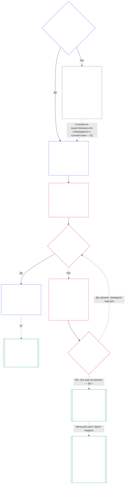

> **Черновой вариант перевода с помощью ИИ — не проверенный; независимая оценка беглого читателя не проводилась. Этот файл языка чтения не является обязательным; пронумерованный английский источник остается доминирующим.**

# ГЛАВА СЕДЬМАЯ: СИСТЕМНЫЕ И ИНСТИТУЦИОНАЛЬНЫЕ УСТАВЫ

 <strong>  Размещение корпуса (нерабочее): структура файла и правила чтения  </strong> 

> Этот файл является **частью Конституции Разумных** и **обязателен только вместе** с другими пронумерованными файлами `core_*`, читаемыми как один текст. Он содержит **Главу седьмую**: основу для опубликованных документов системы и учреждения: Устава системы и Устава учреждения. Он следует за Главой шестой уровня прав и предшествует [Главе восьмой ](../../core_08.000_functional_independence_separation_of_duties.md#chapter-eight-functional-independence-and-separation-of-duties) , которая разделяет места внутри любого материально обязывающего акта.
>
> - **Конституционный владелец:** когда система должна опубликовать Устав системы и когда учреждение должно опубликовать Устав учреждения (требуется для класса L или выше, добровольно для класса P), каждый должен указать минимум, как каждый из них изменяется и пересматривается, а также формальную проверку репутации и подлинности владельцев соответствующих должностей.
> - **Определение:** [Устав системы ](../../core_05.040_band_continuity.md#system-charter) , [Институциональный устав ](../../core_05.040_band_continuity.md#institutional-charter) , [Уставная карта ролей ](../../core_05.040_band_continuity.md#charter-role-map) , [Уставная сторона ](../../core_05.040_band_continuity.md#chartered-party) и [Операционная сторона ](../../core_05.050_band_oversight.md#operating-party) определены в Главе Пять. В этой главе они применяются, а не переопределяются.
> - **Владелец реализации:** [CI-8.205 §6 ](../../corpus_institutions/ci_08.205_institutional_design_separation_of_powers.md#ci-8205-6-system-and-institutional-charter-contents-review-and-formation-template) (*Содержание, проверка и формирование Устава системы и учреждения*) содержит полный шаблон полей, контрольный список проверки, процедуру формирования и шаблон заявления о проверке формирования. Он может быть более строгим и может добавлять поля. Возможно, это не сузит эту главу. Его текст является обязательным как включенный текст реализации только в пределах допустимой области принятия ([Глава восемнадцатая §4 Структура принятия и область полномочий ](../../core_18.000_incorporation.md#4-adoption-framing-and-scope-of-authority) ); пол в этой главе связывается как основной текст.
> - **Последующие потребители:** [Глава восьмая §5 Опубликованное размещение, вакансии и замена ](../../core_08.000_functional_independence_separation_of_duties.md#5-published-placement-vacancy-and-substitution) требует Уставной ролевой карты. В главе девятой содержится Устав системы для определения объема и границ, а в главе девяти, часть D, проверяется заявление о проверке формирования для учреждения. [Глава десятая §3.7 Полномочия по хранению и открытию записей ](../../core_10.000_standing_assessment.md#37-record-custody-and-opening-authority) применяются к постоянным записям. [Глава тринадцатая §4.3 Институциональные форумы ](../../core_13.000_forum.md#43-institutional-forums) рассматривает споры по поводу Институционального устава.
>
> Порядок чтения: §1, когда требуются Системные и институциональные уставы, со схемой, отображающей процесс → §2 право на формирование и четыре узких ограничения → §3 то, что они должны указывать → §4 Карта ролей Устава и постоянное хранение записей → §5 проверка формирования статуса и аутентичности должностного лица → §6, когда держатель не проходит проверку формирования → §7 внесение поправок, пересмотр и несоответствие объема.

 <strong>  Трассировка  </strong> 

- Вверх по течению:
  - [Конституционная тетрада ](../../core_00.000_preamble.md#constitutional-tetrad), особенно **надзор** и **подотчетность**;
  - [материальная ставка ](../../core_00.000_preamble.md#material-stake) ;
  - [Глава первая §18.1 Управление как уполномоченная структура ](../../core_01.010_stewardship_capacity_principles.md#181-governance-as-authorized-structure) (1.015 §18.1);
  - [Статья XI-E ](../../core_06.005_rights_part_b.md#article-xi-e-institutional-formation-and-business-creation) (*Институциональное формирование и создание бизнеса*).
- Подразделы:
  - [§1 ](#1-когда-необходимы-системные-и-институциональные-уставы) ;
  - [§2 ](#2-право-на-формирование-и-четыре-узких-ограничения) ;
  - [§3 ](#3-что-должны-быть-указаны-в-системных-и-институциональных-уставах) ;
  - [§4 ](#4-ролевая-карта-хартии-и-постоянная-опека) ;
  - [§5 ](#5-проверка-формирования-статус-и-подлинность-должностного-лица) ;
  - [§6 ](#6-когда-держатель-не-проходит-проверку-формирования) ;
  - [§7 ](#7-поправки-пересмотр-и-несовпадение-объема-работ) .
- Ниже по течению:
  - [Глава восьмая ](../../core_08.000_functional_independence_separation_of_duties.md#chapter-eight-functional-independence-and-separation-of-duties) (8.000);
  - [Глава девятая ](../../core_09.000_system_alignment_certification_evaluation.md#chapter-nine-system-alignment-certification) (9.000);
  - [Глава десятая ](../../core_10.000_standing_assessment.md#chapter-ten-contribution-violation-and-standing-model--measurement) (10.000);
  - [Глава тринадцатая ](../../core_13.000_forum.md#chapter-thirteen-forums-and-jurisdiction) (13.000);
  - [Глава четырнадцатая ](../../core_14.000_governance.md#chapter-fourteen-constitutional-contract-legitimacy-authorization-and-stewardship) (14.000); назначенный текст реализации, указанный выше.
- Читайте с:
  - [Стек полномочий и внутренняя иерархия ](../../core_05.045_band_integrative.md#authority-stack-and-internal-hierarchy) ;
  - [Границы системы ](../../core_05.040_band_continuity.md#system-boundaries) ;
  - [Целостность границ системы ](../../core_05.040_band_continuity.md#system-boundary-integrity) ;
  - [Создание системы ](../../core_05.055_band_participation.md#system-creation) ;
  - [Создание бизнеса ](../../core_05.055_band_participation.md#business-creation) .

 

Глава седьмая является конституционным владельцем **Системных хартий, институциональных хартий и опубликованных данных**.

Три главы работают как одна цепочка:

- **Глава седьмая (эта глава):** рассказывает о том, что заявляет [Зафрахтованное лицо ](../../core_05.040_band_continuity.md#chartered-party)] и кто может занимать каждое место, когда оно действует.
- **[Глава восьмая ](../../core_08.000_functional_independence_separation_of_duties.md#chapter-eight-functional-independence-and-separation-of-duties) :** рассказывает, как эти сиденья следует держать отдельно.
- **[Глава девятая ](../../core_09.000_system_alignment_certification_evaluation.md#chapter-nine-system-alignment-certification) :** сертифицирует систему и отдельно учреждение, каждый из которых представляет собой один обязательный акт, использующий места. Он отправляет то, что находит, обратно в Системный Устав или Институциональный Устав.

Определения, правила места, стоячие замки и правила принятия решений, на которые указывает эта глава, принадлежат другим главам. **CI-8.205 §6** (*Содержание, проверка и шаблон формирования Устава системы и учреждения*) содержит шаблон поля, процедуру формирования и контрольный список проверки.

### 1. Когда необходимы системные и институциональные уставы

 <strong>  Трассировка  </strong> 

- Вверх по течению:
  - [§2 ](#2-право-на-формирование-и-четыре-узких-ограничения) ;
  - [материальная ставка ](../../core_00.000_preamble.md#material-stake) ;
  - [Пропорциональность ](../../core_05.035_band_accountability.md#proportionality) ; иск владельца открытия главы;
  - [Глава первая §18 Управление в рамках дисциплины управления ](../../core_01.010_stewardship_capacity_principles.md#18-governance-under-stewardship-discipline) (1.015 §18);
  - [Недосмотр ](../../core_05.020_apex_oversight_leg.md#oversight-constitutional) ;
  - [Подотчетность ](../../core_05.005_apex_accountability_leg.md#accountability) .
- Вниз по течению: [§3 ](#3-что-должны-быть-указаны-в-системных-и-институциональных-уставах) ; [Глава девятая, часть A §2, оценка класса системы ](../../core_09.000_system_alignment_certification_evaluation.md#2-system-class-evaluation) (9.005 §2) (*класс и глубина сертификации*); [Глава девятая, Часть D §12.1 Класс учреждения ](../../core_09.015_institutional_alignment_certification.md#121-institution-class) (9.020 §12.1) (*класс учреждения*); **CS-9.305 (*Оборудование системной классификации*) и CS-9.310** (*Оборудование системной классификации*) для каталога классов.
- Читайте с:
  - **CI-8.205 §6** (*Содержание, обзор и форма формирования Устава системы и учреждения*);
  - **CF-13.415 §5** (*Институциональные и местные регистраторы*);
  - **CI-9.210** (*Институциональные обязательства, связанные с классификацией*);
  - [Глава пятая, Устав системы ](../../core_05.040_band_continuity.md#system-charter) (5.040);
  - [Глава пятая Устава учреждения ](../../core_05.040_band_continuity.md#institutional-charter) (5.040);
  - [Статья XI-E ](../../core_06.005_rights_part_b.md#article-xi-e-institutional-formation-and-business-creation) (*Институциональное формирование и создание бизнеса*).

 <strong>  Определения · Оценка · Соответствие  </strong> 

- [Устав системы ](../../core_05.040_band_continuity.md#system-charter) · [O ](../../core_05.040_band_continuity.md#system-charter) · [M ](../../core_05.040_band_continuity.md#system-charter-a) · [A ​​](../../core_05.040_band_continuity.md#system-charter-a) · [C ](../../core_05.040_band_continuity.md#system-charter-c)]
- [Устав учреждения ](../../core_05.040_band_continuity.md#institutional-charter) · [O ](../../core_05.040_band_continuity.md#institutional-charter) · [M ](../../core_05.040_band_continuity.md#institutional-charter-a) · [A ​​](../../core_05.040_band_continuity.md#institutional-charter-a) · [C ](../../core_05.040_band_continuity.md#institutional-charter-c)]
- [Управление в масштабе классификации ](../../core_05.050_band_oversight.md#classification-scaled-governance) · [O ](../../core_05.050_band_oversight.md#classification-scaled-governance) · [M ](../../core_05.050_band_oversight.md#classification-scaled-governance-a) · [A ​​](../../core_05.050_band_oversight.md#classification-scaled-governance-a) · [C ](../../core_05.050_band_oversight.md#classification-scaled-governance-c)]

 

*Проще говоря: прежде чем кто-либо сможет судить, осталась ли система или институт в своих пределах, эти пределы должны быть записаны так, чтобы каждый мог их прочитать. Система, которая является существенной для других в любой из девяти областей [Существенности, специфичной для предметной области ](../../core_05.050_band_oversight.md#domain-specific-materiality), нуждается в опубликованном Уставе Системы. Учреждение публикует тот, который соответствует системам, которыми оно управляет. Класс P является добровольным: моделью является кружок по выстегиванию, который раздает одеяла беженцам*.

Системная хартия или Институциональная хартия — это опубликованная сфера деятельности Уставной партии: на что она претендует, а на что нет, и кто занимает каждое место, когда она действует. Это объем, под который подпадают места, указанные в восьмой главе, и сертификация в девятой главе соответствует реальной эксплуатации. Должна ли Эксплуатационная группа публиковать его, зависит от его класса: **требуется для класса L или выше, добровольно для класса P.** Если она должна опубликовать его, она также должна поддерживать его точность.

Пять классов воздействия на систему являются основой для всего, что описано ниже. От наиболее значимого к наименее значимому, по одной строке:

- **Класс А, критический для выживания, основополагающий и незаменимый:** неудача в течение времени, необходимого для выживания, без жизнеспособной замены означает потерю условий выживания.
- **Класс B, критический, высокозависимый и системно значимый:** иждивенцы не могут поддерживать основные функции без него. Выживаемость теряется не сразу, и замена со временем еще возможна.
- **Класс C, скоординированный, высокозависимый и некритичный:** он формирует координацию в масштабе, но не является обязательным условием для работы класса A или класса B.
- **Класс L, локальный, с ограниченным воздействием и некритический:** его последствия выходят за пределы частного объекта, но являются локальными, заменяемыми и сдерживаемыми.
- **Класс P, личный, для частного использования, изолированный и экспериментальный:** его эффекты остаются внутри частного подразделения, без значимой зависимости извне.

[CS-9.310 §8 ](../../corpus_systems/cs_09.310_system_impact_classifications.md#cs-9310-8-system-impact-classifications) (*Классификация воздействия на систему*) содержит полные определения. Классы A, B, C и L должны публиковать, а класс P может публиковать, и [§1.2 Какие классы покрываются ](#12-which-classes-are-covered), где указано, как учреждение берет свой класс из систем, которыми оно управляет.

#### 1.1 Кто должен публиковать

Система класса L или выше должна публиковать и поддерживать [Устав системы ](../../core_05.040_band_continuity.md#system-charter) . Учреждение класса L или выше должно публиковать и поддерживать тот из них, который соответствует используемым им системам:

| Чем управляет, управляет или материально контролирует учреждение | Что публикует |
| --- | --- |
| Ровно одна Система, которой нужен Устав Системы | Это Устав Системы и никакого второго документа. В нем Учреждение назначается управляющим и выступает в качестве [Институционального устава ](../../core_05.040_band_continuity.md#institutional-charter): один документ охватывает и то, и другое. |
| Более одной такой системы | Институциональный устав. Он включает в себя все уставы системы, действующие для этих систем, и объясняет, почему учреждение управляет этими конкретными системами ([§3 Какие системные и институциональные уставы должны указывать ](#3-что-должны-быть-указаны-в-системных-и-институциональных-уставах) ). |
| Нет такой системы | Устав учреждения, в котором излагаются собственные положения Учреждения из [§3 Какие системные и институциональные уставы должны быть указаны ](#3-что-должны-быть-указаны-в-системных-и-институциональных-уставах), и не содержит никаких системных уставов, которые можно было бы включить. |

- **Предприятия и сопоставимые формы:** Предприятие или другая управляемая организационная форма публикует Устав системы или Устав учреждения, применимый к нему как к Системе, как к Учреждению или как к Учреждению, которое управляет охватываемой Системой. Его юридическая форма не меняет ответа.
- **Совместная профессиональная практика:** Разумный или небольшой практикующий специалист класса L или выше, выполняющий действия, перечисленные для получения лицензии на практику или разрешения на практику, может соответствовать этому разделу для этих действий, приняв Устав системы или Устав учреждения и Карту ролей Устава:
  - **Что принимается** посредством ссылки: Устав системы или Устав учреждения и Уставная карта ролей принимающей стороны в совместной профессиональной практике, которая должна охватывать эти действия.
  - **Уведомление об усыновлении:** Уведомление на одной странице, описанное в **CI-14.205 §7** (*лицензия на практику, разрешение на практику и совместная профессиональная практика*).
  - **Класс:** Практика остается того класса, который придают ей ее собственные действия.

#### 

Класс уполномоченной стороны решает, требуется ли публикация или это выбор:

- **Classes A, B, C, and L:** required. На диаграмме в [§1.7 Краткий обзор процесса ](#17-краткое-описание-процесса) показан процесс, которому они следуют.
- **Класс P:** по выбору, пока одно из двух событий не сделает его необходимым. [§1.3 Что такое класс P? ](#13-что-такое-класс-p) говорит, что делает действующую группу классом P, и [§1.4 Класс P: необязательные уставы, и когда они становятся необходимыми. ](#14-класс-p-необязательные-чартеры-и-когда-они-становятся-обязательными) определяет выбор и время его окончания.
- **Класс учреждения:** Учреждение принимает высший класс любой системы, которой оно управляет, управляет или материально контролирует. Учреждение, не использующее такую ​​Систему, классифицируется по его собственному материальному влиянию и зависимости, оцениваемым по тому, что оно фактически решает и чем оно владеет, а не по его названию или юридической форме, в соответствии с [Глава девятая, Часть D §12.1 Класс учреждения ](../../core_09.015_institutional_alignment_certification.md#121-institution-class).

#### 1.3 Что такое класс P

Операционная группа относится к классу P только в том случае, если ее деятельность остается ниже линии в каждом из девяти доменов [Существенность, специфичная для предметной области ](../../core_05.050_band_oversight.md#domain-specific-materiality) , что на практике означает, что ее действия и последствия остаются внутри ее [частной единицы ](../../core_05.050_band_oversight.md#domain-specific-materiality-private-unit) :

- **Пересечение линии:** Пересечение линии в любом домене делает его как минимум классом L согласно **CS-9.305 (*Механизм системной классификации*) и CS-9.310** (*Механизм системной классификации*), независимо от его размера или того, как он себя называет.
- **Остаться ниже каждой строки:** Он остается классом P, сколько бы членов он ни имел.
- **Те, кто внутри:** Класс P также зависит от тех, кто внутри него. Любой внутри, кто заметит, что Операционная группа пересекла черту, обязан сообщить об этом, и сообщение защищено ([Существенность, специфичная для предметной области ](../../core_05.050_band_oversight.md#domain-specific-materiality) ).

Четырехместный этаж в Главе Восьмой не применяется к действиям Оперативной группы класса P, которые остаются внутри своего частного подразделения, поэтому одному разумному человеку с компьютером не нужен второй держатель сиденья. Минимальный уровень применяется со дня принятия Эксплуатирующей стороной [Материально обязывающего закона ](../../core_05.035_band_accountability.md#materially-binding-act), которому другие должны следовать или на который могут полагаться в установленном порядке, который пересекает линию в сфере власти над другими и делает его как минимум классом L.

#### 1.4 Класс P: необязательные чартеры и когда они становятся обязательными

Операционной группе класса P рекомендуется публиковать [Устав системы ](../../core_05.040_band_continuity.md#system-charter) (для одной системы) или [Институциональный устав ](../../core_05.040_band_continuity.md#institutional-charter) (для более чем одной системы или ни одной), который соответствует тому, чем она управляет. В качестве шаблона он может использовать список содержимого в [§3 «Что должны указывать в уставе системы и учреждения» ](#3-что-должны-быть-указаны-в-системных-и-институциональных-уставах) и карту мест в [§4 «Карта ролей в уставе и постоянная опека ](#4-ролевая-карта-хартии-и-постоянная-опека)»). Публикация одного из них не создает никаких обязательств в рамках процесса, описанного в этой главе:

- нет срока платежа ([§1.5 При сроке действия Устава системы или Устава учреждения ](#15-когда-необходимо-принять-устав-системы-или-устав-учреждения) );
- нет проверки оформления ([§5 Проверка оформления: Репутация и подлинность должностного лица ](#5-проверка-формирования-статус-и-подлинность-должностного-лица) );
- не требуется [Уставная карта ролей ](../../core_05.040_band_continuity.md#charter-role-map) ([§4 Уставная карта ролей и постоянная опека ](#4-ролевая-карта-хартии-и-постоянная-опека) ), хотя он может сохранить ее в соответствии со своим добровольным системным уставом или Уставом учреждения или опубликовать ее самостоятельно; и
- нет необходимости в цикле внесения поправок или проверки ([§7 «Поправка, проверка и несогласованность содержания ](#7-поправки-пересмотр-и-несовпадение-объема-работ)»).

Если произойдет одно из этих событий, публикация перестанет быть необязательной.

- Эксплуатирующая сторона переклассифицирована в класс L или выше; или
- его оператор утверждает соответствие Конституции Операционной группы.

Затем Операционная группа должна опубликовать соответствующий ей Устав системы или Устав учреждения в соответствии с графиком, указанным в [§1.5. Когда наступает срок принятия Устава системы или Устава учреждения ](#15-когда-необходимо-принять-устав-системы-или-устав-учреждения) .

**Признание не зависит от документа.** Группа, имеющая или не имеющая Системный или Институциональный устав и независимо от ее класса, не стоит между ее членами и признанием. Каждый член может запросить запись о взносе в качестве индивидуального заявителя за работу, выполненную внутри группы или за ее пределами, и эта запись касается вклада члена, а не статуса группы ([Глава десятая, §3.7 Неофициальные и небольшие записи ](../../core_10.000_standing_assessment.md#37-informal-and-small-scope-records) ). Предоставление помощи, товаров, рабочей силы или услуг, которые никто не обязан принимать, не является материально обязывающим актом, поэтому кружок взаимопомощи, который раздает одеяла беженцам, не нуждается ни в Системном уставе, ни в Институциональном уставе, чтобы его члены были признаны.

#### 1.5 Когда необходимо принять Устав системы или Устав учреждения

Охраняемая система или учреждение публикует свой [Устав системы ](../../core_05.040_band_continuity.md#system-charter) или [Институциональный устав ](../../core_05.040_band_continuity.md#institutional-charter)] по следующему графику:

- **Новая система или учреждение:** до того, как оно заработает или начнет осуществлять власть над другими.
- **Тот, который уже действует:** при следующем рассмотрении классификации или сертификации или в окне разрешения после запроса в соответствии с [§1.6 Если Устав системы или Устав учреждения отсутствует ](#16-если-устав-системы-или-институциональный-устав-отсутствует) , в зависимости от того, что наступит раньше. Пока это не произойдет, он используется по умолчанию.
  - **Какая сертификация:** Для системы — ее сертификация системного соответствия. Для Учреждения – его сертификация институционального соответствия в соответствии с [Главой девятой, Часть D §11.3 «Нет разрешения и нет ворот ](../../core_09.015_institutional_alignment_certification.md#113-no-permission-and-no-gate)», первое окно сертификации которого никогда не является условием публикации Устава учреждения или его деятельности.
- **Проверка формирования:** В тот же момент также завершается проверка формирования в [§5 Проверка формирования: Репутация и подлинность должностного лица ](#5-проверка-формирования-статус-и-подлинность-должностного-лица).
- **Где он хранится:** Он передает Устав системы или Устав учреждения вместе со своей Уставной ролевой картой и заявлением о проверке формирования Институциональному регистратору или местному регистратору, если его деятельность и разумные лица, на которых она влияет, являются местными (**CF-13.415 §5** (*Институциональные и местные регистраторы*)):
  - **Что делает регистратор:** Он проверяет, не пропало ли все необходимое, и выдает квитанцию ​​с датой.
  - **Чего никогда не делает регистратор:** Он никогда не предоставляет разрешения и никогда не выносит решений относительно класса или контента.
  - **Запоздалая или отсутствующая квитанция:** Это никогда не мешает деятельности Chartered Party.

#### 1.6 Если Устав системы или Институциональный устав отсутствует

Любой, кто заметит зарегистрированную партию класса L или выше, новую или недавно созданную, которая не опубликовала свой Системный Устав или Институциональный Устав, может запросить об этом его руководящий орган. Запрашивающему не требуется репутация, он не платит никаких комиссий и не обязан показывать вред. В запросе упоминается Уполномоченная сторона и объясняется, почему она оказывается под защитой.

Из запроса запускаются два окна: окно ответа и окно разрешения. Каждый из них берет свою длину из уровня с той же буквой, что и класс Chartered Party, поэтому чем более важен класс, тем короче окна:

| Класс и уровень | Окно ответа (цель потребления) | Окно разрешения (внешняя граница) |
|---|---|---|
| Класс А, Уровень А | 24 часа | 7 календарных дней |
| Класс B, Уровень B | 2 календарных дня | 14 календарных дней |
| Класс C, Уровень C | 4 календарных дня | 30 календарных дней |
| Класс L, Уровень L | 8 календарных дней | 60 календарных дней |

Цифры взяты из **CF-13.445 §3.1** (*Целевые показатели этапов и минимальные сроки*), которые определяют, если они различаются. Зафрахтованная сторона, которая оспаривает свой класс, учитывается на уровне более критического класса, который она имеет в своей системной классификационной записи, и любого класса, который запрашивающий или форум показывает на основании prima facie, до тех пор, пока вопрос не будет решен. Зафрахтованное лицо, не имеющее зарегистрированного класса или имеющее класс P, пока его класс находится под вопросом, засчитывается на уровень C.

Окна работают следующим образом:

- **Окно ответа:** Зафрахтованная сторона отвечает в пределах окна ответа, которое является целевым показателем приема соответствующего уровня в **CF-13.445 §3.1** (*Цели этапа и минимальные сроки*), отсчитываемого от запроса. Он публикует Устав системы или Институциональный устав, или указывает дату, к которой он это сделает, или указывает на тот, который уже опубликован, или отвечает, что он находится под каждой строкой [Существенность, специфичная для предметной области ](../../core_05.050_band_oversight.md#domain-specific-materiality), и дает письменное подтверждение того, что требуется для записи.
- **Окно разрешения:** Устав системы или Устав учреждения должен быть принят в пределах окна разрешения, которое является внешней границей соответствующего уровня в **CF-13.445 §3.1** (*Целевые этапы и временные рамки*), отсчитываемого от запроса, с прилагаемым к нему заявлением о проверке формирования ([§5 Проверка формирования: Репутация и подлинность должностного лица ](#5-проверка-формирования-статус-и-подлинность-должностного-лица) ). Зарегистрированная сторона, не имеющая независимого места, подает заявление в виде декларации со своими доказательствами, как это предусмотрено в этом разделе.
- **Оперативная группа, которая сообщает, что находится ниже линии:** Запрос также является классификационным вызовом на маршруте в *Маршруте вызова* этой записи:
  - **Запуск окна:** Окно разрешения продолжает работать, пока задача находится на рассмотрении.
  - **Продление вызова:** Если компетентный форум сочтет запрос достойным рассмотрения, срок выполнения продлевается, и после принятия решения по вызову открывается новое окно разрешения. Форум решает задачу внутри внешней границы соответствующего уровня.
  - **Что означает «достойный рассмотрения»:** Запрос считается достойным рассмотрения, если в нем упоминается конкретное пересечение в именованном домене, а письменное сообщение Операционной группы оставляет реальный вопрос об этом пересечении. Операционная группа не судит об этом сама, и ответ, не содержащий письменных доказательств, не продлевает дату.
  - **Если класс найден:** В этом или любом другом вызове дата обнаружения считается датой запроса: от него начинается окно ответа и окно разрешения на уровне найденного класса (класс A, B, C или L).
- **Если он пропущен:** Отсутствие ответа или отсутствие Устава системы или Устава учреждения к установленному сроку является дефектом, который необходимо зарегистрировать и исправить. Задавший вопрос может перенести его на форум с юрисдикцией по тому же маршруту. Это никогда не является условием формирования или функционирования.
- **Повторный запрос:** Второй запрос в отношении того же Уполномоченного лица, сделанный в то время, когда его предыдущий ответ или вывод по нему все еще остаются в силе, не открывает нового периода ответа или разрешения. Уполномоченная сторона отвечает, указывая на этот ответ или вывод. Его собственное указание на то, что оно находится под каждой строкой, еще не рассмотренное на форуме, не считается действительным ответом. Ответ или вывод остаются в силе до тех пор, пока не произойдет одно из этих событий, поскольку триггеры повторного открытия в [Глава девятая, часть D §14.2 Триггеры повторного открытия ](../../core_09.015_institutional_alignment_certification.md#142-reopening-triggers) описывают:
  - **Существенное изменение:** Деятельность Уполномоченного лица существенно меняется.
  - **Новые доказательства:** показаны новые доказательства пересечения.

Запрос, который показывает одно из вышеперечисленных значений, не является повторением. Это новый запрос, обрабатываемый отдельно и независимо от предыдущего. У него есть собственное окно ответа и окно разрешения, отсчитываемые от его собственной даты, а более ранние ответы, находки и окна не удовлетворяют его и не изменяются им.
- **В то же время сфера действия:** Отсутствие Системной Хартии или Институциональной Хартии не является основанием для того, чтобы рассматривать Уполномоченную сторону как неограниченную. Пока он не существует, настоящие [Границы системы ](../../core_05.040_band_continuity.md#system-boundaries) и его классовый контроль, а также сертификация или форум Уполномоченной стороны могут реконструировать масштаб на основе наблюдаемых операций.

#### 1.7 Краткое описание процесса

Схема следует за одной Операционной партией от вопроса о том, является ли она существенной для других, путем публикации ее Системного устава или Институционального устава и обеспечения его точности. Если проблема не устранена в течение периода разрешения, процесс регистрации отправляет ее на проверку, которая не рассматривается в этой главе. В разделах, следующих за этим, каждый шаг объясняется в том же порядке.

 <strong>  Руководство по считыванию (нерабочее): как читать таблицу  </strong> 

> Проще говоря: никто не предоставляет Системную хартию или Институциональную хартию, и никому не нужно разрешение на создание. Уполномоченная партия, деятельность которой важна для других, публикует информацию о том, на какие полномочия она претендует, и о том, кто занимает каждое место, а лица, занимающие ее ключевые должности, проверяются. Держатель, потерпевший неудачу, заменяется или устраняется причина, и чартерная сторона продолжается. Если сбой все еще не устранен, когда окно разрешения заканчивается, форум может пересмотреть Уполномоченную сторону, начиная с самого легкого шага, который защищает других. Заставить Чартерную партию опуститься ниже класса L или распустить ее можно только в том случае, если более легкие шаги окажутся неудачными. Распущенная Чартерная партия не может вернуться, пока на ней стоит замок.
>
> Сплошные стрелки — основной путь. Пунктирные стрелки обозначают исключения и передачи, помеченные разделом, в котором они указаны. Рамки с двойными боковыми полосами относятся к другой главе или включенному тексту реализации. Карта не добавляет никаких обязанностей, места или поля, и ни один шаг в ней не является разрешением.

 

### 2. Право на формирование и четыре узких ограничения

 <strong>  Руководство для читателя (нерабочее): как устроен этот раздел  </strong> 

- [§2.1 Право на форму ](#21-право-на-создание) указывает право и то, на кого оно не распространяется.
- [§2.2 Первый предел: недействующая блокировка разумного существа. ](#22-первый-предел-невыполненная-блокировка-разумного-существа) говорит, как блокировка не позволяет одному названному разумному лицу попасть в один контролирующий офис.
- [§2.3 Второе ограничение: кратковременное удержание конкретных проверенных фактов. В ](#23-второе-ограничение-кратковременное-удержание-конкретных-проверенных-фактов) говорится, как кратковременное удержание может не допустить одного поименованного разумного человека в один контролирующий офис.
- [§2.4 Третий предел: блокировка самой Операционной группы ](#24-третий-предел-блокировка-самой-операционной-стороны) говорит о том, как блокировка Операционной группы блокирует ее и ее преемников, и что распущенная Уполномоченная партия не может вернуться.
- [§2.5 Четвертый предел: лицензия или разрешение на практику ](#25-четвертый-предел-лицензия-или-разрешение-на-практику) указывает, когда для названного действия с высоким риском требуется лицензия или разрешение. Это не ворота в формирование.

 <strong>  Трассировка  </strong> 

- Восходящий поток: [§1 ](#1-когда-необходимы-системные-и-институциональные-уставы) ; [Статья XI-E ](../../core_06.005_rights_part_b.md#article-xi-e-institutional-formation-and-business-creation) (*Институциональное формирование и создание бизнеса*).
- Вниз по течению: [§1 Когда требуются системные и институциональные уставы ](#1-когда-необходимы-системные-и-институциональные-уставы) ; [§5 Проверка оформления: статус и подлинность должностного лица ](#5-проверка-формирования-статус-и-подлинность-должностного-лица) .
- Читайте с:
  - [Временное удержание ](../../core_05.035_band_accountability.md#interim-hold) ;
  - [Глава одиннадцатая §4.2 Профилактика — общие стоячие блокировки ](../../core_11.000_standing_integration.md#42-prevention--general-standing-locks) (11.000 §4.2);
  - [Глава одиннадцатая §5.5 Специальные замки ](../../core_11.000_standing_integration.md#55-special-locks) (11.000 §5.5);
  - [Глава тринадцатая §5 Временное удержание пути названного разумного существа ](../../core_13.000_forum.md#interim-hold-on-a-named-sentients-pathway) (13.000 §5).

 

*Проще говоря: вам не нужно чье-либо разрешение для создания системы, учреждения или бизнеса. Могут применяться четыре узких ограничения. Трое из них являются вратами: неразрешенный замок может не допустить одного разумного в один контролирующий офис, кратковременное удержание определенных проверенных фактов может сделать то же самое, а блокировка самой Операционной группы может запретить эту Оперативную группу. Четвертый может потребовать лицензию или разрешение перед совершением названного действия высокого риска. Чартерной партии, распущенной форумом, запрещено возвращаться, и запрет остается постоянным, если роспуск основан на широко распространенном антиконституционном поведении или на серьезном вреде, который невозможно исправить и который так и не был исправлен. Ничто не препятствует формированию или деятельности новой Оперативной партии, и в данной главе ничего не добавляется.*

**Статья XI-E** (*Институциональное формирование и создание бизнеса*) допускает четыре узких ограничения:

- **Первые три — единственные ворота** для формирования Оперативной партии или сохранения в ней полномочий. Каждый привязан к названному предмету:
  - **Недействующая блокировка** ([§2.2 Первый предел: недействующая блокировка разумного ](#22-первый-предел-невыполненная-блокировка-разумного-существа) ) прикрепляется к указанному разумному лицу в одном офисе, который контролирует Уполномоченную сторону.
  - **Временное удержание** ([§2.3 Второй лимит: кратковременное удержание определенных проверенных фактов ](#23-второе-ограничение-кратковременное-удержание-конкретных-проверенных-фактов) ) распространяется только на одного поименованного разумного человека в одном офисе, который контролирует Уполномоченную партию.
  - **Блокировка самой Операционной стороны** ([§2.4 Третий предел: блокировка самой Операционной стороны ](#24-третий-предел-блокировка-самой-операционной-стороны) ) прилагается к Уполномоченной стороне, которая сама находится под блокировкой, включая ту, которую форум распустил.
- **Четвертый предел не является воротами:** Это лицензия или разрешение на практику ([§2.5 Четвертый предел: лицензия или разрешение на практику ](#25-четвертый-предел-лицензия-или-разрешение-на-практику) ).

#### 2.1 Право на создание

Любой может создать новую систему, институт или бизнес. Это право изложено в [Статье XI-E ](../../core_06.005_rights_part_b.md#article-xi-e-institutional-formation-and-business-creation) (*Институциональное формирование и создание бизнеса*). В эту главу добавлена ​​следующая обязанность. Как только то, что делает Операционная группа, становится существенным для других в любой из девяти областей [Существенности в конкретной области ](../../core_05.050_band_oversight.md#domain-specific-materiality) , она должна заранее публично заявить, на что она претендует, на что она имеет полномочия ([§1 Когда требуются системные и институциональные уставы ](#1-когда-необходимы-системные-и-институциональные-уставы) ). Принятие Системной хартии или Институциональной хартии не должно рассматриваться как ограничение этого права или какой-либо защиты минимального уровня прав.

**На кого не распространяется право на формирование.** Кроме трех врат в [§2.2 Первый предел: невыполненная блокировка разумного ](#22-первый-предел-невыполненная-блокировка-разумного-существа) , [§2.3 Второй предел: кратковременное удержание конкретных проверенных фактов ](#23-второе-ограничение-кратковременное-удержание-конкретных-проверенных-фактов) и [§2.4 Третий предел: блокировка самой Операционной группы ](#24-третий-предел-блокировка-самой-операционной-стороны) , **Статья XI-E** (*Институциональное формирование и создание бизнеса*) не защищает:

- Оперативная партия, призванная нарушить конституционные ограничения, подорвать Безопасность или Истину или сконцентрировать власть способами, которые [Глава первая §11 Структура рынка ](../../core_01.000_values_principles.md#11-market-structure) исключает; или
- Операционная группа, созданная или управляемая учредителем, который не соответствует ее заявленной цели, о чем свидетельствуют проверенные действия, контроль и вознаграждения, или который намеревается ввести других в заблуждение относительно своей цели, контроля или интересов или причинить вред другим.

Форумы решают эти дела в соответствии с этой статьей, и единственными последствиями являются три ворот в ней: ворота невыполненного замка, временное удержание и блокировка самой Операционной группы. Неудачная проверка построения — это одно из доказательств, которое принимается во внимание на форуме, а это означает, что сама по себе проверка построения не решает дело.

#### 2.2 Первый предел: невыполненная блокировка разумного существа.

[Постоянный замок ](../../core_11.000_standing_integration.md#42-prevention--general-standing-locks) или [специальный замок ](../../core_11.000_standing_integration.md#55-special-locks) , установленный после подтвержденного нарушения и еще не снятый, лишает человека, названного разумным, власти над такого рода учреждением или бизнесом.

- Что запрещено: брать на себя или осуществлять управление, контроль или владение полномочиями в Операционной партии.
- Как далеко он достигает: ровно настолько, насколько достигает замок. Он заканчивается при поднятии или сужении замка.
- Блокировка самой Операционной стороны: см. [§2.4 Третий предел: блокировка самой Операционной стороны ](#24-третий-предел-блокировка-самой-операционной-стороны) .

#### 2.3 Второе ограничение: кратковременное удержание конкретных проверенных фактов

Это ограничение применяется, когда суд, обладающий юрисдикцией, распорядился о [временном приостановлении ](../../core_05.035_band_accountability.md#interim-hold) в отношении конкретных проверенных фактов, которые делают более вероятным, чем нет, то, что владелец не соответствует заявленной цели Удостоверенной стороны. Только этот форум может приказать это ([Глава тринадцатая §5 Временное удержание пути названного разумного человека ](../../core_13.000_forum.md#interim-hold-on-a-named-sentients-pathway) ). Хартированная партия не может самостоятельно принять решение о запрете кому-либо занимать должность, поскольку в этом случае она станет судьей своего собственного члена. Полная основа - это та, что описана в [Глава тринадцатая §5 Временное удержание на пути названного разумного человека ](../../core_13.000_forum.md#interim-hold-on-a-named-sentients-pathway) ; эта краткая форма не заменяет ее.

#### 2.4 Третий предел: блокировка самой Операционной стороны

Замок может находиться на Операционной группе, а не только на разумном. Затем ворота перекрывают путь, названный в замке, в этой Операционной группе и в ее преемниках, контролируемых организациях и транспортных средствах, принадлежащих номинальным или подставным лицам. Это не запрещает любую другую Оперативную сторону.

- Замок, установленный окончательным обозначением: [Антиконституционный трастовый замок ](../../core_11.000_standing_integration.md#55-special-locks) делает это, когда окончательное обозначение называет учреждение, правопреемник или контролируемую организацию. Затем ворота перекрывают путь, названный в замке, в Chartered Party и ее преемниках, контролируемых организациях и транспортных средствах, принадлежащих номинальным или подставным лицам.
- Распущенная зарегистрированная сторона: окончательный приказ о роспуске в соответствии с **CI-11.210 §4** (*Роспуск*) устанавливает [Блокировку реформирования роспуска ](../../core_11.000_standing_integration.md#55-special-locks) . Распущенная Уполномоченная сторона, ее правопреемники, контролируемые организации, номинальные или подставные компании, а также любая Операционная сторона, которая является с ними одной операцией, не могут быть реформированы, возрождены или действовать под каким-либо именем или формой, пока она существует. Если в приказе обнаруживается повсеместное антиконституционное поведение или неустраненный необратимый вред ([Глава одиннадцатая §8 «Восстановление и переоценка ](../../core_11.000_standing_integration.md#8-restoration-and-reassessment)»), блокировка является постоянной: время, устраненная причина или смена владельцев не отменяют ее, и она прекращается только в том случае, если приказ о роспуске отменяется на пересмотре или новые подтвержденные факты показывают, что его вывод был неверным. В противном случае оно заканчивается независимым выводом о том, что причина устранена, средство правовой защиты предоставлено и возвращение безопаснее, чем дальнейшее исключение. Он не запрещает никому разумному формировать другую Оперативную группу.

Ни один из трех ворот не мешает новой Операционной партии сформироваться, опубликовать свой Системный или Институциональный устав или приступить к работе. Единственная партия, которую они останавливают, — это та, которая сама находится под замком, например, распущенная Чартерная партия, пытающаяся вернуться. Три шлюза применяются при проверке формирования ([§5 Проверка формирования: статус и подлинность должностного лица ](#5-проверка-формирования-статус-и-подлинность-должностного-лица) ).

#### 2.5 Четвертый предел: лицензия или разрешение на практику.

Четвертое ограничение касается поименованного действия, а не формирования Операционной группы:

- **Не является воротами для Операционной группы:** проверка формирования в [§5 Проверка формирования: Репутация и подлинность должностного лица ](#5-проверка-формирования-статус-и-подлинность-должностного-лица) не применяется.
- **Что это такое:** [Свидетельство о компетентности ](../../core_05.035_band_accountability.md#competency-clearance), которое **Статья XI-E** (*Институциональное формирование и создание бизнеса*) позволяет усыновителю требовать до того, как указанное действие будет выполнено для других, согласно опубликованному на техническом форуме заключению о рисках.
  - **Лицензия на практику** требуется для действий, которые могут привести к серьезному или необратимому вреду в случае ненадлежащего выполнения.
  - **Допуск к практике** требуется для действий, которые могут привести к реальному, но меньшему вреду, если они будут совершены неправильно.
- **С чем это связано:** выполнение действия. Он никогда не мешает Оперативной партии формировать, публиковать свой Системный устав или Институциональный устав или действовать.
- **Что он останавливает**: требование или выполнение действия без него. Устав системы или Устав учреждения не может требовать совершения действия, пока его не выполнит держатель ([§3 Что должны быть указаны в уставе системы и учреждения ](#3-что-должны-быть-указаны-в-системных-и-институциональных-уставах) ).

### 3. Что должны быть указаны в системных и институциональных уставах

 <strong>  Руководство для читателя (нерабочее): как устроен этот раздел  </strong> 

- [§3.1 Что указано в Уставе системы. ](#31-что-гласит-устав-системы) перечисляет девять пунктов.
- [§3.2 Указатели устава ](#32-уставные-указатели) говорит, что устав системы или устав учреждения может ссылаться на другой опубликованный документ вместо копирования его текста, и что делает эту ссылку действительной.
- [§3.3 Что добавляет Институциональный устав ](#33-что-добавляет-институциональный-устав) охватывает то, что содержится в Институциональном уставе помимо девяти пунктов: Системные уставы систем, которыми управляет учреждение, и почему оно ими управляет.
- [§3.4 Действия, требующие лицензии на практику или разрешения на практику. ](#34-действия-требующие-лицензии-на-практику-или-разрешения-на-практику) гласит, что Системный Устав или Институциональный Устав может претендовать на такое действие только в том случае, если каждый разумный человек, выполняющий его, имеет лицензию или разрешение или работает учеником под руководством, у которого есть такая лицензия. До тех пор действие указано как выходящее за рамки (пункт 4 в [§3.1 Что указано в Уставе системы ](#31-что-гласит-устав-системы) ).
- [§3.5 Масштабирование ](#35-масштабирование) говорит о том, что меняется в зависимости от класса.

 <strong>  Трассировка  </strong> 

- Восходящий поток: [§1 ](#1-когда-необходимы-системные-и-институциональные-уставы) ; [Глава пятая, Устав системы ](../../core_05.040_band_continuity.md#system-charter) (5.040); [Глава пятая Устава учреждения ](../../core_05.040_band_continuity.md#institutional-charter) (5.040).
- Ниже по течению:
  - [§4 ](#4-ролевая-карта-хартии-и-постоянная-опека) ;
  - [§7 ](#7-поправки-пересмотр-и-несовпадение-объема-работ) ;
  - [Глава девятая, часть B §8.1 Минимальное содержание записи ](../../core_09.005_system_alignment_certification_record_process.md#81-minimum-record-contents) (9.010 §8.1) (*Устав системы содержит поля, на которые опирается сертификационная запись*);
  - **CI-8.205 §6** (*Содержание, обзор и шаблон формирования Устава системы и учреждения*) для полного списка полей.
- Читайте с:
  - [Глава восемнадцатая §4. Структура принятия и объем полномочий ](../../core_18.000_incorporation.md#4-adoption-framing-and-scope-of-authority) (18.000 §4) (*документ о сфере применения хранится под другим именем*);
  - [Глава четырнадцатая §4.3 Требования к принятию решений для обязательного выбора заинтересованных сторон ](../../core_14.000_governance.md#43-decision-resolution-requirements-for-binding-stakeholder-choice) (14.000 §4.3);
  - **CI-6.205 §1** (*надзор заинтересованных сторон, уведомление и целостность путей обязательного управления*);
  - **CI-6.205 §2** (*Защиты от концентрации и легитимности участия*).

 <strong>  Определения · Оценка · Соответствие  </strong> 

- [Устав системы ](../../core_05.040_band_continuity.md#system-charter) · [O ](../../core_05.040_band_continuity.md#system-charter) · [M ](../../core_05.040_band_continuity.md#system-charter-a) · [A ​​](../../core_05.040_band_continuity.md#system-charter-a) · [C ](../../core_05.040_band_continuity.md#system-charter-c)]
- [Устав учреждения ](../../core_05.040_band_continuity.md#institutional-charter) · [O ](../../core_05.040_band_continuity.md#institutional-charter) · [M ](../../core_05.040_band_continuity.md#institutional-charter-a) · [A ​​](../../core_05.040_band_continuity.md#institutional-charter-a) · [C ](../../core_05.040_band_continuity.md#institutional-charter-c)]
- [Карта ролей устава ](../../core_05.040_band_continuity.md#charter-role-map) · [O ](../../core_05.040_band_continuity.md#charter-role-map) · [M ](../../core_05.040_band_continuity.md#charter-role-map-a) · [A ​​](../../core_05.040_band_continuity.md#charter-role-map-a) · [C ](../../core_05.040_band_continuity.md#charter-role-map-c)]

 

*Проще говоря: устав системы должен быть достаточно конкретным, чтобы его можно было протестировать. В нем говорится, для чего предназначена система, что она делает и чего не делает, кто полагается на систему, кто может вносить поправки в Устав системы, кто занимает каждое место и где найти обязательные правила принятия решений. Устав системы указывает на эти правила, а не заменяет их. Институциональный устав говорит то же самое об учреждении, затем добавляет уставы системы, которыми оно обладает, и причину, по которой учреждение управляет этими системами.*

#### 3.1 Что гласит Устав системы

Устав системы простым языком гласит, что затронутые разумные люди и одиторы могут прочитать:

1. **Идентификация и версия:** имя, управляющий или руководящий орган, версия, дата вступления в силу и история изменений.
2. **Цель**: для чего существует Чартерная партия.
3. **Деятельность в рамках области действия:** функции, услуги, полномочия и домены, на которые он претендует.
   - **Требование, а не грант:** В документе говорится, что Уполномоченная сторона уже обладает полномочиями, но не дает их. Вопрос о том, является ли эта власть легитимной, в том числе в тех случаях, когда она основана на Конституционной хартии, решается в соответствии с [Главой четырнадцатой § 1 Полномочия и легитимность управляющей власти ](../../core_14.000_governance.md#1-authorization-and-legitimacy-of-governing-authority) .
4. **За пределами области действия:** существенная деятельность, полномочия и домены, на осуществление которых не разрешено.
5. **Затронутые сообщества и зависимости:** кто полагается на Уполномоченную сторону, а также от каких систем или инфраструктуры она зависит или от каких шлюзов, если это существенно.
   - **Не является отказом:** Исключение группы из этого списка не означает, что она выходит за рамки. Разумное лицо, на которого оказывает существенное влияние Уполномоченная сторона, сохраняет все уровни защиты прав, независимо от того, упоминается ли это в документе, и список, более узкий, чем реальная уверенность, рассматривается против реальной уверенности.
6. **Допущения классификации:** класс или уровень управления, на который опирается, с [Указателем устава ](../../core_05.040_band_continuity.md#charter-pointer) до **CS-9.305 (*Механизм классификации системы*) и CS-9.310** (*Механизм классификации системы*) и **CS-14.305** (*Критическое управление системой*), где они применяются.
7. **Карта ролей устава:** [Карта ролей устава ](../../core_05.040_band_continuity.md#charter-role-map) или указатель устава на опубликованный документ, который является картой ролей устава ([§4 Карта ролей устава и постоянное хранение ](#4-ролевая-карта-хартии-и-постоянная-опека) ).
8. **Обязательные указания Хартии по выбору заинтересованных сторон:**
   - **Когда это применимо:** когда реальные разногласия между затронутыми разумными существами требуют обязательного выбора заинтересованных сторон внутри системы. [Def.P2 Обязательный выбор заинтересованных сторон ](../../core_05.055_band_participation.md#defp2-binding-stakeholder-choice) называет это областью допуска.
   - **На что это указывает**: действующая Хартия. Указатели на три опубликованных набора правил: последовательность принятия решений (как делается выбор), правила взвешивания (кто сколько имеет права голоса) и правила учета конфликтов прав (что должен показывать протокол, когда права сталкиваются).
   - **Кто что несёт**: Устав Системы содержит только указатели. Три набора правил содержат фактическое содержание: как делается выбор, как устанавливается вес и что показывает запись. Устав Системы сам по себе не несет такого содержания, и его собственный текст не может быть предложен вместо этих правил. Мертвый указатель или текст Устава Системы, предлагаемый вместо правил, не выполняет обязанности Устава Системы.
9. **Полномочия по внесению поправок**: кто может вносить поправки, что считается существенной поправкой, а также порядок уведомления и оспаривания.

#### 3.2 Уставные указатели

Устав системы или Устав учреждения может ссылаться на другой опубликованный документ или положение (набор правил, Карту ролей Устава, Устав системы) вместо его копирования. Каждая такая ссылка представляет собой [указатель устава ](../../core_05.040_band_continuity.md#charter-pointer) . Он должен разрешиться в действующий, текущий, опубликованный документ. Мертвый или устаревший Charter Pointer считается недостающим предметом.

#### 3.3 Что добавляет Институциональный устав

В уставе учреждения указаны пункты с 1 по 9 раздела [§3.1 Что указано в уставе системы ](#31-что-гласит-устав-системы) для самого учреждения, а также содержится следующее:

- **Уставы системы:** Каждый Устав системы, действующий для систем, которыми управляет, управляет или материально контролирует Учреждение, включенный полностью или посредством указателя Устава, который соответствует текущей опубликованной версии.
- **Обоснование портфеля:** Почему учреждение управляет этими конкретными системами, как они служат заявленной цели и связаны друг с другом, а также какие зависимости они разделяют. Система без указанной причины является отсутствующим элементом.

**CI-8.205 §6** (*Содержание, обзор и шаблон формирования Устава системы и учреждения*) может требовать большего и задавать шаблон формирования, но не может удалять элемент выше.

#### 3.4 Действия, требующие лицензии на практику или разрешения на практику

В этом подразделе говорится, что может требоваться Уставом системы или Уставом учреждения, когда для действия требуется лицензия на практику или разрешение на практику.

- **Ограничение:** Если действие требует лицензии на практику или разрешения на практику, то в Системном Уставе или Институциональном Уставе не может быть указано, что это делает Уполномоченная Сторона, а Уполномоченная Сторона не может этого сделать, если только каждый разумный человек, выполняющий его, либо не имеет лицензии или разрешения, либо не работает учеником под руководством, который имеет такое право.
- **До тех пор:** В Уставе системы или Институциональном уставе действие согласно пункту 4 ([§3.1 Что указано в Уставе системы ](#31-что-гласит-устав-системы) ) указано вне сферы действия.
- **Если заявлено без владельца:** Это недостающий элемент для регистрации и исправления, и это не мешает Уполномоченному лицу формировать, публиковать или выполнять другую свою работу.
- **Где искать:** [§2 «Право на форму и четыре узких ограничения» ](#2-право-на-формирование-и-четыре-узких-ограничения) говорит, откуда исходит требование, а **CI-14.205 §7** (*Практическая лицензия, разрешение на практику и совместная профессиональная практика*) содержит записи и проверку принимающей стороны.

#### 3.5 Масштабирование

Некоторые части Системного устава или Институционального устава соответствуют классу, а некоторые нет:

- **Какие масштабы:** Глубина Устава системы или Устава учреждения, периодичность проверки и независимость шкалы проверки от класса и [материальной доли ](../../core_00.000_preamble.md#material-stake) .
- **Класс L:** Устав системы или институциональный устав системы или учреждения класса L может быть кратким и вести более простой учет, если это позволяет [Управление в масштабе классификации ](../../core_05.050_band_oversight.md#classification-scaled-governance)]. Он по-прежнему должен охватывать все необходимые элементы.
- **Периодичность пересмотра:** Устав системы или Устав учреждения не определяет, как часто он пересматривается. Класс устанавливает это.

### 4. Ролевая карта Хартии и постоянная опека

 <strong>  Руководство для читателя (нерабочее): как устроен этот раздел  </strong> 

- [§4.1 Что такое места и почему они существуют. ](#41-что-такое-сиденья-и-почему-они-существуют) напоминает читателю о четырех местах и ​​о том, почему ни одна партия не может заполнить пары, запрещенные Главой восьмой, в одном и том же действии.
- [§4.2 Что делает размещение действительным? ](#42-что-делает-размещение-действительным) говорит, что в восьмой главе установлены тесты (независимость, вакансия и замена, объединенный хостинг), а на карте записано только, кто где сидит.
- [§4.3 Чем Системный Устав или Институциональный Устав обязан карте ](#43-чему-обязан-карте-системный-устав-или-институциональный-устав) говорит, что Системный Устав или Институциональный Устав должен содержать карту или указывать на нее, и что отсутствующая карта, мертвый указатель или устаревшая карта являются дефектом в этом Системном Уставе или Институциональном Уставе.
- [§4.4 Какой системный устав или институциональный устав содержит какая карта ](#44-какой-системный-устав-или-институциональный-устав-содержит-какую-карту) охватывает несколько систем в рамках одного институционального устава и общей карты.
- [§4.5 Изменение правил места и владельцев мест. В ](#45-замена-правил-и-держателей-сидений) говорится, что изменение того, кто может занимать место, является поправкой, а изменение того, кто занимает это место сейчас, — это новая устаревшая версия карты, которая вступает в силу только после уведомления и возможности оспорить.
- [§4.6 Постоянное хранение записей ](#46-постоянная-опека) показывает, что карта должна отражать постоянные записи, и состоит из двух частей: [§4.6.1 Постоянные записи оператора ](#461-реестр-операторов) и [§4.6.2 Постоянные записи заинтересованных сторон ](#462-реестр-заинтересованных-сторон) .
- [§4.7 Пробелы в карте для записей постоянного оператора ](#47-пробелы-на-карте-для-постоянных-записей-операторов) говорит о том, что следует, когда требуемое место не названо или остается без квалифицированного владельца, и состоит из четырех частей: [§4.7.1 Когда существует пробел и как он регистрируется ](#471-когда-существует-пробел-и-как-он-регистрируется) , [§4.7.2 Пока пробел открыт ](#472-пока-открыт-пробел) , [§4.7.3 Если соревнования удаляют последнюю квалифицированную замену ](#473-если-в-ходе-соревнований-удаляется-последний-квалифицированный-запасной-игрок) и [§4.7.4 Сертификационные места ](#474-сертификационные-места) .

 <strong>  Трассировка  </strong> 

- Восходящий поток: [§3 ](#3-что-должны-быть-указаны-в-системных-и-институциональных-уставах) ; [ГЛАВА ВОСЬМАЯ §2 Конституционное требование о четырехместности](../../core_08.000_functional_independence_separation_of_duties.md#2-four-seat-constitutional-requirement) (8.000 §2).
- Ниже по течению:
  - [Глава восьмая §5 Опубликованное размещение, вакансии и замена ](../../core_08.000_functional_independence_separation_of_duties.md#5-published-placement-vacancy-and-substitution) (8.000 §5);
  - [Глава девятая, часть B §6.1.1 Четыре места в сертификате ](../../core_09.005_system_alignment_certification_record_process.md#611-four-seats-in-a-certification) (9.010 §6.1.1);
  - [Глава десятая §3.7 Хранение записей и полномочия на открытие ](../../core_10.000_standing_assessment.md#37-record-custody-and-opening-authority) (10.000 §3.7);
  - **CI-8.205 §2** (*Функциональное разделение полос*);
  - **CI-14.205 §5** (*Уполномоченные роли и цепочки подотчетности*);
  - **CI-14.205 §6** (*Каталог мест — процессно-ролевые архетипы и операционные границы*).
- Прочтите с помощью: [Строка контроля материалов ](../../core_05.035_band_accountability.md#material-control-line) ; [Постоянный рекорд ](../../core_05.035_band_accountability.md#standing-record) .

 <strong>  Определения · Оценка · Соответствие  </strong> 

- [Карта ролей устава ](../../core_05.040_band_continuity.md#charter-role-map) · [O ](../../core_05.040_band_continuity.md#charter-role-map) · [M ](../../core_05.040_band_continuity.md#charter-role-map-a) · [A ​​](../../core_05.040_band_continuity.md#charter-role-map-a) · [C ](../../core_05.040_band_continuity.md#charter-role-map-c)]
- [Устав системы ](../../core_05.040_band_continuity.md#system-charter) · [O ](../../core_05.040_band_continuity.md#system-charter) · [M ](../../core_05.040_band_continuity.md#system-charter-a) · [A ​​](../../core_05.040_band_continuity.md#system-charter-a) · [C ](../../core_05.040_band_continuity.md#system-charter-c)]
- [Устав учреждения ](../../core_05.040_band_continuity.md#institutional-charter) · [O ](../../core_05.040_band_continuity.md#institutional-charter) · [M ](../../core_05.040_band_continuity.md#institutional-charter-a) · [A ​​](../../core_05.040_band_continuity.md#institutional-charter-a) · [C ](../../core_05.040_band_continuity.md#institutional-charter-c)]

 

*Проще говоря: в Уставе системы или Институциональном уставе места получают имена. В нем публикуется список тех, кто может занимать каждое место за действия, которые он охватывает, поэтому партия не может выбрать свою собственную шашку. Правила относительно того, что считается действительным местом, остаются в восьмой главе. Обеспечение безопасности постоянных записей — это не отдельный список: это одна и та же карта.*

Каждый системный устав или институциональный устав содержит [Уставную карту ролей ](../../core_05.040_band_continuity.md#charter-role-map): опубликованный список лиц, занимающих каждое место. [Глава восьмая §5 Опубликованное размещение, вакансии и замена ](../../core_08.000_functional_independence_separation_of_duties.md#5-published-placement-vacancy-and-substitution) требует этого от каждого усыновителя, который предпринимает материально обязательные действия и говорит то, что он должен назвать. В этом разделе говорится, что с этим делает Устав системы или Институциональный устав.

#### 4.1 Что такое сиденья и почему они существуют

В каждом [Законе о материальной обязательности ](../../core_05.035_band_accountability.md#materially-binding-act) есть четыре должности, и [ГЛАВА ВОСЬМАЯ §2 Конституционное требование о четырехместности](../../core_08.000_functional_independence_separation_of_duties.md#2-four-seat-constitutional-requirement) разделяет их:

- **[Инициирующее место ](../../core_05.035_band_accountability.md#initiating-seat) :** начинает действие с запроса, предложения, выполнения или утверждения его.
- **[Подтверждение или авторизация места ](../../core_05.035_band_accountability.md#verify-or-authorize-seat) :** проверяет доказательства и полномочия, затем проверяет, санкционирует, обуславливает или отклоняет действие.
- **[Запись места ](../../core_05.035_band_accountability.md#record-seat) :** сохраняет официальную запись о решении места проверки или авторизации.
- **[Место в конкурсе ](../../core_05.035_band_accountability.md#contest-seat) :** слышит вызов и исправляет, ограничивает или направляет его.

Места существуют для того, чтобы ни одна сторона не могла запрашивать результат, проверять свой собственный запрос, контролировать запись этой проверки, а также оценивать ее вызов. Место — это должность в одном действии, а не название должности, поэтому один и тот же разум, должность или система могут занимать разные места для разных действий, но никогда не запрещается спаривание в Главе Восьмой в одном и том же действии. На карте каждое место получает имя владельца.

#### 4.2. Что делает размещение действительным

В восьмой главе приведены испытания, а на карте отмечено только, кто где сидит:

- **Линия контроля над материалами**: реальная цепочка власти вокруг одного действия. Сторона, действие которой является предметом спора, является той, которая начинает действие или чье действие проверяется, оспаривается или записывается. Эта сторона контролирует место, когда за это действие она может направить, отменить решение, вознаградить, наказать или отстранить владельца или задержать его работу. Разумные существа, офисы и системы, которые могут это сделать, составляют [линию контроля материалов ](../../core_05.035_band_accountability.md#material-control-line) этой стороны для совершения действия.
- **Независимость:** место, которое проверяет действие, не является независимым, если сторона, чье действие является предметом спора, может его контролировать ([Глава восьмая §3 «Независимость, конфликт и линии контроля ](../../core_08.000_functional_independence_separation_of_duties.md#3-independence-conflict-and-control-lines)»). Таким образом, на карте должно быть указано место для записи, место для конкурса и каждое место для проверки или авторизации за пределами линии контроля материалов этой стороны. Партия также не может изменить обладателей этих мест только своим решением ([§4.5 Изменение правил мест и владельцев мест ](#45-замена-правил-и-держателей-сидений) ).
- **Вакансии, замены и делегирование:** кто вмешивается, когда владелец отсутствует или находится в конфликте ([Глава восьмая, §5 Опубликованное размещение, вакансия и замена ](../../core_08.000_functional_independence_separation_of_duties.md#5-published-placement-vacancy-and-substitution) ).
- **Объединенный хостинг:** единственные случаи, когда небольшая компания может разместить два места в одном офисе. На карте перечислены все разрешенные схемы и соответствующие гарантии независимости ([Глава восьмая, §6 Пропорциональное масштабирование и объединенный хостинг ](../../core_08.000_functional_independence_separation_of_duties.md#6-proportional-scaling-and-merged-hosting)).

#### 4.3 Чему обязан карте Системный устав или Институциональный устав

Устав системы или Устав учреждения либо содержит свою карту ролей Устава, либо указывает на него с помощью [Указатель Устава ](#32-уставные-указатели) , поэтому читатель, который начинает с Устава системы или Устава учреждения, может найти, кто занимает каждое место. Имеет дефект, если:

- **Карта отсутствует:** она не содержит карты и не указывает на нее.
- **Указатель не работает**: он указывает на карту, которую невозможно найти или которая не является опубликованным документом.
- **Карта устарела:** на ней не указано, кто сейчас занимает каждое место. Смена владельца публикуется как новая датированная версия карты ([§4.5 Изменение правил мест и владельцев мест ](#45-замена-правил-и-держателей-сидений)).

#### 4.4 Какой системный устав или институциональный устав содержит какую карту

В каком Системном Уставе или Институциональном Уставе хранится карта, зависит от того, как устроены стороны:

- **Несколько систем:** Институциональный устав может содержать несколько системных уставов. Устав каждой Системы хранит карту действий своей собственной Системы, а Институциональный Устав хранит карту действий самой Учреждения.
- **Общая карта:** Предприятие или практика могут передать часть своих офисов местному кооперативу, ассоциации или принимающей стороне ([§1 Когда требуются системные и институциональные уставы ](#1-когда-необходимы-системные-и-институциональные-уставы) ). Если да, то он может использовать опубликованную карту этой группы вместо написания своей собственной, что делает ее собственный Системный Устав или Институциональный Устав кратким. Ему по-прежнему необходимо указать, кто вступает в действие, когда один из его держателей мест отсутствует или находится в конфликте, а также независимый маршрут, который можно использовать, когда нет квалифицированной замены ([Глава восьмая §6 Пропорциональное масштабирование и объединенный хостинг ](../../core_08.000_functional_independence_separation_of_duties.md#6-proportional-scaling-and-merged-hosting) , *Общие места*).

#### 4.5 Замена правил и держателей сидений

Карта может меняться двумя способами, и у каждого свой маршрут:

- **Кто может занимать место:** Решение о том, какие офисы могут занимать место, выступать в качестве замены или совместно использовать хостинг, является изменением правил карты. Это можно сделать только посредством внесения поправок в названия Устава системы или Устава учреждения ([§7 «Поправка, пересмотр и несоответствие объема ](#7-поправки-пересмотр-и-несовпадение-объема-работ)»).
- **Кто сейчас занимает место:** Смена текущего владельца — это обновление, а не поправка. Это делается путем публикации новой датированной версии карты.
  - **Уведомление и возможность участвовать в конкурсе:** Для рекордного места, места в конкурсе и любого места для проверки или авторизации, указанного на карте, новая версия вступает в силу только после уведомления и возможности участвовать в конкурсе. Уведомление сразу обращается к субъекту, каждому истцу и каждому претенденту по каждой открытой записи, к которой касается место.
  - **Где проводится конкурс:** Конкурс проводится на форуме в соответствии с [Глава десятая §3.6 Граница форума ](../../core_10.000_standing_assessment.md#36-forum-boundary) , а не только на путь, указанный в Уставе системы или Уставе учреждения для внесения поправок, а ожидающий конкурс сдерживает изменение: текущий владелец остается на своем месте.
  - **Что должен показать новый держатель:** Уполномоченное лицо должно продемонстрировать, что новый владелец прошел все тесты, указанные в поле 10 **CI-8.205 §6** (*Содержание, обзор и формирование Устава системы и учреждения*) поле 10. Тесты преследуют одну цель: место должно занимать орган, на который не может оказываться давление или который не может оказать поддержку субъекту, истцу или претенденту, и который сохраняет запись в безопасности и открыта для оспорения. Таким образом, новый владелец должен находиться за пределами [линии контроля материалов ](../../core_05.035_band_accountability.md#material-control-line) этих сторон, не должен занимать два места для одной и той же записи или принимать участие в взаимной или круговой договоренности, должен сохранять запись и ее контрольный журнал в неприкосновенности, оспаривать маршрут в день их прибытия, не взимать плату и раскрывать, кто ее финансирует и управляет.
  - **Пустое место:** Фактически пустое место обрабатывается в соответствии с [§4.7 Пробелы в карте для записей статуса оператора ](#47-пробелы-на-карте-для-постоянных-записей-операторов) , а не в этом пункте.

**Какая версия применяется:** Действие оценивается по карте, действующей на день его совершения. Если форум отменяет изменение владельца, это изменение считается не вступившим в силу, и действия, предпринятые владельцем на своем месте, открыты для пересмотра.

#### 4.6 Постоянная опека

То, что должно быть указано на карте, зависит от типа [Постоянной записи ](../../core_05.035_band_accountability.md#standing-record) , поскольку эти два типа сталкиваются с разными конфликтами интересов ([Глава десятая §3.7 Хранение документации и полномочия открытия ](../../core_10.000_standing_assessment.md#37-record-custody-and-opening-authority) , *Два вида постоянной записи по субъекту*). В главе десятой к самим записям применяется четырехместный этаж.

##### 4.6.1 Реестр операторов

Постоянные записи оператора — это записи об уполномоченной стороне, ее уставной сфере деятельности и системах, которыми она управляет. Для этого на карте названы четыре вещи:

- кто может открыть запись (проверяющее место);
- отдельный хранитель, который его хранит (регистрационное место);
- кто проводит конкурсы (место в конкурсе); и
- независимый путь, когда нет квалифицированной замены или когда названный орган власти или хранитель сам является субъектом или находится внутри линии контроля материалов субъекта, например, форум, независимая служба расследований или резервный орган, названный заранее.

Если в Уставе системы или Уставе учреждения не указан маршрут (пробел в разделе [§4.7 Пробелы на карте для постоянных записей оператора ](#47-пробелы-на-карте-для-постоянных-записей-операторов) ), применяются следующие значения по умолчанию:

- **Полномочия открытия записей:** По умолчанию используются полномочия по открытию резервных записей в соответствии с **CF-13.415 §7** (*Полномочия по резервным записям*).
- **Хранитель:** Хранитель резервных записей в соответствии с **CF-13.415 §9** (*Хранитель резервных записей*) используется по умолчанию. Он также является рекордсменом в тех случаях, когда указанный хранитель не может действовать.
- **Кто может быть назначен и какие тесты:** Кто может быть назначен на эти места, а также тесты, которые должен пройти каждый обладатель, указаны в поле 10 **CI-8.205 §6** (*Содержание, обзор и шаблон формирования Устава системы и учреждения*).

##### 4.6.2 Реестр заинтересованных сторон

Постоянные записи заинтересованных сторон — это записи о разумных существах и учреждениях, которые используют системы, полагаются на них или подвергаются их воздействию. Для них правила различаются, поскольку Уполномоченная сторона может быть заинтересована в записи:

- **Доля уполномоченного лица:** Это может быть тот, кто выдвигает претензии или обвинения в этих записях.
- **Собственные офисы**: они могут иметь место в записи только в том случае, если Уполномоченная сторона не заинтересована в этой записи. Если у него есть доля, запись передается в офис, находящийся вне контроля Уполномоченной стороны, или на независимую проверку.
- **Если ни один из них не указан и зарегистрированное лицо имеет в этом заинтересованность:** Запись передается в орган резервного хранения записей (**CF-13.415 §7** (*Уполномоченный по резервному учету*)) и хранителю резервных записей (**CF-13.415 §9** (*Хранитель резервного копирования*)), или на форум, как [Глава десятая §3.7 Орган по хранению и открытию записей ](../../core_10.000_standing_assessment.md#37-record-custody-and-opening-authority) (*Нет самостоятельной опеки*).
- **Присвоение названий офисам не является обязательным:** На карте можно заранее назвать офисы для этих записей, но это не обязательно, и карта, на которой ни один из них не указан, по-прежнему действительна.

#### 4.7 Пробелы на карте для постоянных записей операторов

Эти правила применяются к пробелам в записях, которые требуются [§4.6.1 Постоянные записи оператора ](#461-реестр-операторов). [§4.7.4 Сертификационные места ](#474-сертификационные-места) применяет одни и те же часы к сертификационным местам.

##### 4.7.1 Когда существует пробел и как он регистрируется

Карта с пробелами делает Устав системы или Институциональный устав недействительным. На карте должны быть указаны орган, открывающий рекорд, хранитель протокола, место проведения соревнований и независимый маршрут. Изменение, в результате которого любой из них останется безымянным, не допускается.

- **Кто может зарегистрировать пробел:** Любой человек, не имеющий права на это, путем уведомления форума, регистратора или органа резервного копирования.
  - **Что говорится в уведомлении:** В уведомлении указывается место и объясняется, почему оно кажется незаполненным.
  - **Когда начинаются часы:** Пробел регистрируется в день получения первого уведомления, и отсчет ведется с этого момента; уведомление, оказавшееся неправильным, не запускает часы.

##### 4.7.2 Пока открыт пробел

Пока эта проблема не будет решена, ни один из собственных офисов Уполномоченной стороны не сможет выдать действительную постоянную запись для затронутой области.

- **Куда помещается запись:** Запись передается в орган резервного копирования (**CF-13.415 §7** (*Резервный орган записи*)) для проверки и в хранителя резервных записей (**CF-13.415 §9** (*Резервный хранитель записей*)) для хранения или вместо этого на форум, чтобы никто не ждал исправления Уполномоченной стороны ([Глава десятая §3.7 Хранение записей и полномочия открытия) ](../../core_10.000_standing_assessment.md#37-record-custody-and-opening-authority) , *Нет самостоятельного хранения*).
- **При возобновлении хранения:** Орган резервного копирования и Хранитель резервного копирования продолжают обрабатывать запись до тех пор, пока не произойдут все три события. Затем опека возвращается к названным владельцам.
  - **Все места заняты:** Каждое место, необходимое для карты, снова имеет имя владельца.
  - **Владельцы проходят тесты:** Орган резервного копирования или форум подтверждает, что каждый владелец проходит тесты в поле 10 **CI-8.205 §6** (*Содержание, обзор и шаблон формирования Устава системы и учреждения*).
  - **Уведомление и возможность участия в соревновании истекли:** Уведомление и возможность участия в соревновании в [§4.5 Изменение правил мест и владельцев мест ](#45-замена-правил-и-держателей-сидений) завершены.

##### 4.7.3 Если в ходе соревнований удаляется последний квалифицированный запасной игрок

Если что-то, что никто не мог предвидеть, оставляет одно из этих мест без квалифицированного держателя, Уполномоченная сторона получает обычное окно ответа и окно разрешения ([§1.6 Если Системный Устав или Институциональный Устав отсутствует ](#16-если-устав-системы-или-институциональный-устав-отсутствует) ).

- **Аварийная замена:** Разрешается только на фактически пустое место и носит временный характер.
- **Как заместитель занимает место:** Уполномоченное лицо может назначить заместителя, но заместитель занимает это место только после того, как орган по резервному учету (**CF-13.415 §7** (*Уполномоченный по резервному учету*)) или форум подтвердит, что он прошел тесты, указанные в **CI-8.205 §6** (*Содержание системы и институционального устава, шаблон проверки и формирования*), поле 10, и тесты на независимость в [§4.2. Что делает назначение действительным ](#42-что-делает-размещение-действительным) , и Chartered Party несет бремя доказывания этого.
- **Когда замена истекает:** Экстренная замена является временной мерой. Оно заканчивается, когда заканчивается его окно проверки, если к тому времени оно не станет обычной сменой держателя согласно [§4.5 Правила замены мест и держателей мест ](#45-замена-правил-и-держателей-сидений) .
  - **Кто устанавливает окно:** Продолжительность этого окна определяется Уставом системы или Уставом учреждения, но она не может превышать максимум для вашего уровня.
  - **Максимум:** 7 дней для уровня A, 14 для уровня B, 30 для уровня C и 60 для уровня L (окна разрешения в таблице [§1.6 Если отсутствует системный устав или институциональный устав ](#16-если-устав-системы-или-институциональный-устав-отсутствует)).
  - **Чрезвычайная ситуация уровня А:** В чрезвычайной ситуации уровня А, когда на карту поставлена ​​жизнь или серьезные права, окно проверки по умолчанию составляет 3 дня, защитный шаг указан в [Глава тринадцатая §6. Своевременное решение, уровни существенности и дисциплина против задержек ](../../core_13.000_forum.md#time-scale-levels) (*Уровни временной шкалы*).
  - **Пока не будет проведена проверка построения:** Запасной игрок не может предпринимать какие-либо обязательные действия в одиночку.

##### 4.7.4 Сертификационные места

Те же часы применяются к сертификационным местам. Если на карте не указано, кто начинает, кто ведет учет или кто проводит конкурсы на сертификацию соответствия системы или сертификацию институционального соответствия, это дефект, который необходимо зарегистрировать и исправить. Это не делает Устав системы или Институциональный устав сразу недействительными.

- **Что может сделать учреждение:**
  - **Продолжайте работать и продолжайте сертификацию:** Карта полос **CI-8.205 §2** (*Функциональное разделение полос*) тем временем размещает место, поэтому сертификация не прекращается.
  - **Исправить дефект:** Место размещается по датированной поправке на карте. Он имеет обычное окно ответа и окно разрешения (**CI-11.210 §3** (*Уведомление, ответ и разрешение*), [§1.6 Если отсутствует Устав системы или Устав учреждения ](#16-если-устав-системы-или-институциональный-устав-отсутствует) ), отсчитываемое от зарегистрированного уведомления о пробеле.
- **Чего учреждение не может делать:**
  - **Используйте пробел, чтобы остановить сертификацию:** Неразмещенное место для сертификации никогда не является поводом для приостановки, задержки или блокировки пропуска.
  - **Оставьте пробел открытым после окна разрешения:** Если место все еще не занято, когда это окно заканчивается, Устав системы или Институциональный устав недействителен на тех же условиях, что и пробел в записях постоянных записей ([§4.7.1 Когда пробел существует и как он регистрируется ](#471-когда-существует-пробел-и-как-он-регистрируется) ).
- **Место проверки или авторизации:** На карте это место не указано ([Глава восьмая §5 Опубликованное размещение, вакансии и замена ](../../core_08.000_functional_independence_separation_of_duties.md#5-published-placement-vacancy-and-substitution) ), поэтому такого пробела никогда не бывает.

### 5. Проверка формирования: статус и подлинность должностного лица

 <strong>  Руководство для читателя (нерабочее): как устроен этот раздел  </strong> 

- [§5.1 Что покрывается ](#51-что-покрывается) говорит, до каких офисов доходит проверка формирования, что другие сотрудники не проверяются один за другим и что проверка образования одинакова, независимо от субстрата держателя.
- [§5.2 Постоянная проверка ](#52-постоянная-проверка) говорит о том, что Зафрахтованная сторона проверяет и записывает, прежде чем разумный человек займет крытый офис: отсутствие блокировки, отсутствие временного удержания, соответствие планке компетентности и раскрытие конфликтов.
- [§5.3 Проверка подлинности ](#53-проверка-подлинности) гласит, что должность, занимаемая владельцем по праву и для заявленной цели, проверяется по четырем параметрам: контроль, интересы и вознаграждения, поведение и защищенность голоса.
- [§5.4 Что проверка формирования может использовать в качестве доказательства? ](#54-что-может-быть-использовано-в-качестве-доказательства-при-проверке-формирования) говорит, что проверка формирования никогда не спрашивает, во что верит разумное существо, и устанавливает три правила: удерживания недостаточно, ярлыки не являются щитом и контроль не является членством.
- [§5.5 То, что сказал держатель ](#55-что-сказал-владелец), говорит о том, как проверенное заявление о том, что другие заслуживают вреда, считается поведением, а что не учитывается.
- [§5.6 Проверка гарантий персонала ](#56-проверка-мер-безопасности-персонала) говорит то, что Chartered Party показывает однажды о сотрудниках, которые не занимают никаких закрытых должностей.
- [§5.7 В заявлении о проверке формирования ](#57-заявление-о-проверке-формирования) говорится, что публикует руководящий орган, кто это проверяет, и что следует за ложным заявлением.
- [§5.8 Сроки и повторная проверка формирования ](#58-повторная-проверка-времени-и-построения) сообщает, когда публикуется заявление, когда проверяется новый держатель и что вызывает повторную проверку формирования.
- [§5.9 Пропорция и нагрузка ](#59-пропорция-и-бремя) говорит о том, как проверка формации масштабируется в зависимости от класса и ставки материала.

 <strong>  Трассировка  </strong> 

- Вверх по течению:
  - [§2 ](#2-право-на-формирование-и-четыре-узких-ограничения) ;
  - [§1.5 ](#15-когда-необходимо-принять-устав-системы-или-устав-учреждения) ;
  - [§3 ](#3-что-должны-быть-указаны-в-системных-и-институциональных-уставах) ;
  - [§4 ](#4-ролевая-карта-хартии-и-постоянная-опека) ;
  - [Статья XI-E ](../../core_06.005_rights_part_b.md#article-xi-e-institutional-formation-and-business-creation) (*Институциональное формирование и создание бизнеса*);
  - [Какие системы вознаграждают ](../../core_00.000_preamble.md#what-systems-reward) и
  - [Два фундаментальных вопроса ](../../core_00.000_preamble.md#two-fundamental-questions) ;
  - [Глава первая §19.1.4. Глубина ролей и пути материальной ответственности ](../../core_01.010_stewardship_capacity_principles.md#1914-role-depth-and-material-responsibility-pathways) (1.015 §19.1.4);
  - [Глава первая §19.4 Коррекция смещения и захват реакции ](../../core_01.010_stewardship_capacity_principles.md#194-misalignment-correction-and-capture-response) (1.015 §19.4);
  - [Глава одиннадцатая §4.2 Профилактика — общие стоячие блокировки ](../../core_11.000_standing_integration.md#42-prevention--general-standing-locks) (11.000 §4.2),
  - [§5.5 Специальные замки ](../../core_11.000_standing_integration.md#55-special-locks) и
  - [§6.2 Планки компетенций и допуски ](../../core_11.000_standing_integration.md#62-competency-bars-and-clearances) .
- Ниже по течению:
  - [§6 Если держатель не проходит проверку формирования ](#6-когда-держатель-не-проходит-проверку-формирования) ;
  - [Глава девятая, часть D §12.2 Институциональная оценка, всегда ](../../core_09.015_institutional_alignment_certification.md#122-institutional-evaluation-always) (9.020 §12.2) (пункт 7, *форумы проверяют утверждение*);
  - [Глава девятая, часть A §3.3. Дисциплина управления, стимулирования и состязательности ](../../core_09.000_system_alignment_certification_evaluation.md#33-governance-incentive-and-contestability-discipline) (9.005 §3.3);
  - **CI-8.205 §6** (*Содержание, обзор и формирование Устава системы и учреждения*) для шаблона заявления.
- Читайте с:
  - [Линия контроля материалов ](../../core_05.035_band_accountability.md#material-control-line) ;
  - [Постоянный рекорд ](../../core_05.035_band_accountability.md#standing-record) ;
  - [Защищенное сообщение (информирование о нарушениях) ](../../core_05.035_band_accountability.md#protected-reporting-whistleblowing) ;
  - [Глава первая §17.5 Обязанность оказывать сопротивление ](../../core_01.010_stewardship_capacity_principles.md#175-duty-to-resist) (1.015 §17.5);
  - **CI-14.205 §2** (*Роликовые критерии, стандарты назначения и способы увольнения*);
  - **CI-8.210** (*Конфликтная целостность, защита от захвата и борьба с коррупцией*).

 

*Проще говоря: прежде чем Чартерная партия начнет осуществлять власть над другими, разумные люди, занимающие ее ключевые посты, проверяются дважды. Соответствуют ли они опубликованным стандартам для этой роли и не мешают ли они этому? И занимают ли они этот пост самостоятельно и для заявленных целей Хартии, а не как прикрытие или номинальное лицо? Ответ приходит от того, кто ими руководит, за что им платят и что они достоверно сказали и сделали, а не от того, во что они верят. Это проверка образования, а не лицензия.*

Этот раздел представляет собой **проверку формирования**. Он применяет три врата, указанные в [§2 «Право на создание и четыре узких ограничения» ](#2-право-на-формирование-и-четыре-узких-ограничения) : двое, которые прикреплены к поименованному разумному лицу, применяются к закрытым офисам, а третий применяется к зарегистрированному лицу, которое само находится под замком. [Статья XI-E ](../../core_06.005_rights_part_b.md#article-xi-e-institutional-formation-and-business-creation) (*Институциональное формирование и создание бизнеса*) этим не ограничивается. Это относится к зарегистрированным лицам класса L или выше ([§1, когда требуются системные и институциональные уставы ](#1-когда-необходимы-системные-и-институциональные-уставы) ).

#### 5.1 Что покрывается

Проверка формирования определяет, какие офисы она охватывает, кто не входит в ее число и как она относится к каждому субстрату:

- **Крытые офисы:**
  - каждый офис руководящего органа, включая каждый офис, обладающий полномочиями по внесению поправок, перечисленных в [§3 Какие системные и институциональные уставы должны быть указаны ](#3-что-должны-быть-указаны-в-системных-и-институциональных-уставах) (пункт 7);
  - в каждом офисе [Уставная карта ролей ](../../core_05.040_band_continuity.md#charter-role-map) называет место, замену или независимый маршрут ([§4 Уставная карта ролей и постоянное хранение записей ](#4-ролевая-карта-хартии-и-постоянная-опека) ); и
  - любой другой офис, делегат или подрядчик, чьи действия материально связывают других в пределах уставной сферы деятельности или который контролирует записи, ключи или средства, от которых зависит сфера деятельности.
- **Другой персонал:** по отдельности не проверяются. На них распространяется проверка мер безопасности персонала, описанная ниже.
- **Любая подложка:** проверка формирования одинакова для любой подложки держателя. Если владельцем защищенного офиса является Система, проверка формирования проводится на операторе или управляющем этой Системы, чьи интересы и контроль имеют значение, а также на собственной Записи о сертификации системы Системы.

#### 5.2 Постоянная проверка

Прежде чем разумное лицо займет крытый офис, Уполномоченная сторона проверяет и записывает, что:

- нет [постоянного замка ](../../core_11.000_standing_integration.md#42-prevention--general-standing-locks) или [специального замка ](../../core_11.000_standing_integration.md#55-special-locks) , включая [Постоянный замок институционального органа ](../../core_11.000_standing_integration.md#55-special-locks) , который блокирует названный путь, по которому находится офис (ворота открытого замка в **Статье XI-E** (*Институциональное формирование и создание бизнеса*));
- нет [Временное приостановление ](../../core_05.035_band_accountability.md#interim-hold) (**Статья XI-E** (*Институциональное формирование и создание бизнеса*)) действует в отношении разумного лица, занимающего эту должность;
- опубликованная [шкала компетентности ](../../core_11.000_standing_integration.md#62-competency-bars-and-clearances) для этого названного пути соответствует, с подтверждением квалификации там, где это необходимо для названного пути; и
- каждый конфликт раскрывается в соответствии с **CI-8.210** (*Целостность конфликтов, предотвращение захвата и борьба с коррупцией*) и разрешается независимым от владельца местом, при этом соблюдается любой период обдумывания в соответствии с **CI-14.205 §2** (*Ролевые критерии, стандарты назначения и пути отстранения*).

Учитываются только проверенные постоянные записи и только через ворота [Проверенные входные данные для постоянного ](../../core_05.035_band_accountability.md#verified-inputs-for-standing). Непроверенные утверждения, слухи, репутация, социальный престиж или личность, происхождение, здоровье или инвалидность владельца как таковые не имеют силы и не рассматриваются. В этом разделе не создается ни блокировки, ни удержания, ни запрета, ни постоянного рекорда.

#### 5.3 Проверка подлинности

Закрытый офис является **аутентичным**, когда его владелец владеет им самостоятельно и для целей, предусмотренных его Уставом системы или Институциональным уставом, а не в качестве прикрытия, номинального держателя или доверенного лица для цели, которая не указана в документе. Chartered Party приходит к такому выводу на основании четырех фактов. Позже на форуме тестируются те же четыре ([Глава девятая, часть D §12.2 Институциональная оценка, всегда ](../../core_09.015_institutional_alignment_certification.md#122-institutional-evaluation-always), пункт 7).

- **Контроль:** кто может инструктировать, финансировать, заменять или вознаграждать владельца как внутри, так и за пределами опубликованного органа. Владелец, который действует по указанию нераскрытой стороны или чье место принадлежит другому лицу, не является подлинным. Непрозрачными путями полезного контроля являются захват системы ([Глава первая, §19.4 Коррекция несоосности и захват реакции ](../../core_01.010_stewardship_capacity_principles.md#194-misalignment-correction-and-capture-response)).
- **Проценты и вознаграждения:** что владелец получает от офиса и как это оплачивается.
  - Зарплата держателя, капитал, цели и другие вознаграждения раскрываются в соответствии с уровнем их существенности и затрагиваются [Два фундаментальных вопроса ](../../core_00.000_preamble.md#two-fundamental-questions): вознаграждает ли структура заявленную цель или вознаграждает ли она пересечение установленных ограничений, сокрытие проблем или перекладывание затрат на других?
  - Держатель, который получает вознаграждение за то, что запрещают опубликованные ограничения Уполномоченной стороны, не занимает должность по заявленной цели до тех пор, пока вознаграждение не будет изменено.
- **Поведение:** то, что держатель проверяемо сделал при выполнении той же функции, включая проверенные записи о сокрытии, преследовании репортеров или сорвании проверки того же типа, а также то, что держатель проверяемо сказал в соответствии с [§5.5 Что сказал держатель ](#55-что-сказал-владелец) .
  - Владелец, у которого нет записей, не имеет плохой репутации, а учредитель, впервые основавший компанию, не может провалить проверку подлинности из-за отсутствия истории.
  - У держателя, у которого нет записей, нет истории, которую можно было бы просмотреть, поэтому при проверке формирования учитывается то, что он взял на себя и делает сейчас. Они в письменной форме соглашаются с ограничениями, установленными Уполномоченной стороной на то, чего она не будет делать. Они принимают проверку независимой стороной. А когда они не согласны с выводами о них, они используют этот путь, чтобы оспорить их.
- **Защищенный голос:** у владельца есть рабочий способ отказаться от незаконной или неконституционной инструкции ([Глава первая §17.5 Обязанность сопротивляться ](../../core_01.010_stewardship_capacity_principles.md#175-duty-to-resist)) и подать защищенное сообщение об обоснованном подозрении в несоблюдении конституции, материальном ущербе, нарушении безопасности или правдивости, коррупции, захвате, злоупотреблении, преследовании или препятствовании необходимому рассмотрению ([Защищенная отчетность) (Сообщение о нарушениях) ](../../core_05.035_band_accountability.md#protected-reporting-whistleblowing) ). Фрахтованная сторона не может наказывать держателя за добросовестное использование любого маршрута.

#### 5.4 Что может быть использовано в качестве доказательства при проверке формирования

Проверка формирования никогда не спрашивает, что разумное существо верит, ценит или чувствует по отношению к Чартерной партии, никогда не решает, является ли его убеждение истинным или искренним, и не собирает новых речей, чтобы выяснить это. Соответствие целей проявляется в том, кто руководит держателем, за что ему платят, что он делает и что он сказал или планировал о других. Три правила помогут это сделать:

- **Хранения недостаточно:** Приверженность или исповедание убеждений, а также принадлежность к вере, партии или группе сами по себе не засчитываются в пользу или против держателя. Равно как и собственная личность владельца, охраняемая характеристика или инвалидность. Профессия с энтузиазмом или клятва верности никогда не выражаются в пользу владельца.
- **Ярлыки не являются щитом:** Подтвержденное заявление, призыв, план или действие, которое другие заслуживают вреда или дискриминационного обращения, запрещенного в соответствии с [Статьей VI-C ](../../core_06.005_rights_part_b.md#article-vi-c-nondiscrimination) (*Недискриминация*), засчитывается против владельца, как бы оно ни называлось. Независимо от того, является ли это вредом или запрещенной дискриминацией, а также правило, согласно которому религиозные, политические или идеологические ярлыки не добавляют к этому и не оправдывают его, устанавливаются [Глава первая §7.5 Выражение и линия вреда ](../../core_01.000_values_principles.md#75-expression-and-the-harm-line) . О нем судят по тому, что он утверждает, призывает или делает, а не по доктрине, предлагаемой для его оправдания.
- **Контроль — это не членство:** Принадлежность к группе не является доказательством. Кто может инструктировать, финансировать, заменять или вознаграждать владельца, является доказательством в части *Контроль* выше, независимо от типа группы.

Что этот раздел решает и чего не решает:

- В этом разделе определяется только то, какие доказательства может использовать проверка формирования, в соответствии с принципом, изложенным в [Глава первая §7.5 Выражение и линия вреда ](../../core_01.000_values_principles.md#75-expression-and-the-harm-line) .
- Что запрещено, установлено [Статьей VI-C ](../../core_06.005_rights_part_b.md#article-vi-c-nondiscrimination) (*Недискриминация*) и **Статьей XI-F** (*Ненавязывание и согласие на объединение*):
  - Ничто здесь не расширяет и не сужает.
  - Правила, которые добровольное сообщество устанавливает для своих членов, и практика на условиях, принятых его членами, регулируются ими.

#### 5.5 Что сказал владелец

Одним из видов заявлений является поведение, которое учитывается против владельца: проверенное заявление, призыв или план о том, что другие заслуживают вреда или дискриминационного обращения, запрещенного в соответствии с [Статьей VI-C ](../../core_06.005_rights_part_b.md#article-vi-c-nondiscrimination) (*Недискриминация*), или что держатель причинит и то и другое.

- **Масса:**
  - Это является свидетельством намерения причинить вред и несоответствия справедливому обращению с теми, на кого влияет Уполномоченная сторона или офис.
  - Он имеет большее значение, если должность владельца или Уполномоченная партия дают власть над остальными.
  - Одно только заявление никогда не является основанием для [временного удержания ](../../core_05.035_band_accountability.md#interim-hold): удержание также требует независимых проверенных фактов поведения, контроля или вознаграждения.
  - Если речь является частью основания, это подтверждается четкими, проверенными доказательствами, открытые сомнения засчитываются против удержания, и самое пристальное внимание, которое [**Статья XI-B** (*Выражение*) ](../../core_06.005_rights_part_b.md#article-xi-b-expression) применяется к ограничениям, основанным на сказанном, записывается как применимое.
- **Что не считается:** Мнение о том, что группа, идея или учреждение ошибочны, резкая критика, законное инакомыслие, сатира, цитаты, репортажи и научные исследования не учитываются, поскольку ни одно из них не заявляет и не призывает к причинению вреда или дискриминационному обращению по отношению к другим. Оскорбление или разногласие сами по себе не являются вредом ([**Статья XI-G** (*Интерфейс ограничения коллективного вреда и правоприменения*) ](../../core_06.005_rights_part_b.md#article-xi-g-collective-harm-boundary-and-enforcement-interface) ).
- **Как найти:** Утверждение необходимо проверить и прочитать в контексте. Оно исходит из того, что уже является публичным, из того, что было сказано в Уставной партии или офисе или о них, или из защищенного отчета. Ни одна зарегистрированная сторона не может следить за частной речью учредителя или держателя или за его ассоциацией в поисках таковой.
- **Ответ и решение:** Владелец может ответить, показать контекст и показать действием, что утверждение больше не имеет силы. Простое оттягивание не стирает его.
- **Не является наказанием за высказывания:** Использование заявления в качестве доказательства не является ограничением выражения мнений ([Глава первая, §7.5 Выражение и линия вреда ](../../core_01.000_values_principles.md#75-expression-and-the-harm-line) ), и заявление остается защищенным как высказывание в соответствии с [**Статьей XI-B** (*Выражение*) ](../../core_06.005_rights_part_b.md#article-xi-b-expression) . Его единственное влияние заключается в том, кто обладает властью над теми, кого он касается.

#### 5.6 Проверка мер безопасности персонала

Для сотрудников, не занимающих закрытых должностей, Уполномоченная сторона один раз указывает в приведенном ниже заявлении, что:

- Его правила назначения, оплаты, продвижения по службе и увольнения не вознаграждают работу, противоречащую заявленным целям Уполномоченного лица;
- Существует защищенный канал сообщения, и ни один сотрудник, воспользовавшийся им или отказавшийся от незаконного или неконституционного указания, не был наказан; и
- Права по [Статье III-C ](../../core_06.000_rights_part_a.md#article-iii-c-labor-and-economic-floor) (*Трудовой и экономический минимум*) остаются нетронутыми.

Это проверяет структуру Chartered Party. Отдельный персонал не проверяется.

#### 5.7. Заявление о проверке формирования

Прежде чем система или учреждение начнет осуществлять власть над другими, управляющий орган публикует заявление, которое:

- называет каждый обслуживаемый офис;
- дает по каждому результат постоянной проверки и каждой из четырех частей проверки подлинности и приводит доказательства;
- раскрывает обнаруженные интересы и отношения контроля;
- дает заключение проверки безопасности персонала; и
- имена, кто что проверял.

Владелец может быть идентифицирован по должности и датированной версии ролевой карты, если указание имени может поставить его под угрозу. Независимый проверяющий орган видит имя.

- **Проверка:**
  - Постоянные факты проверяются органом, открывающим запись, и хранителем документации по именам Уставной карты ролей ([§4 Уставная карта ролей и Постоянное хранение записей ](#4-ролевая-карта-хартии-и-постоянная-опека) ).
  - Руководящий орган не проверяет подлинность своих членов, а владелец не проверяет свою собственную проверку: если закрытый офис сам является местом на карте, проверка формирования осуществляется Органом резервной записи (**CF-13.415 §7** (*Организации резервной записи*)) или форумом.
  - Если Уставная сторона небольшая и независимого места еще не создано, заявление представляет собой декларацию со своими доказательствами и проверяется при первой сертификации Уставной стороны.
  - Отсутствие верификации в течение этого периода никогда не является препятствием для формирования или деятельности.
- **Ложное утверждение:**
  - Заявление, которое является ложным или скрывает, кто контролирует крытый офис, является сокрытием и фальсифицированным доказательством в отношении сертификационной записи и постоянного моста ([Глава девятая, Часть D §15 Постоянный мост и неуклонение от уклонения ](../../core_09.015_institutional_alignment_certification.md#15-standing-bridge-and-non-evasion) ; [Глава девятая, Часть B §10 Связь со стоянием ](../../core_09.005_system_alignment_certification_record_process.md#10-relationship-to-standing) ).
  - Если разумное лицо сознательно сделало заявление, подписало его или заставило его сделать, а ложность является существенной и проверенной, это также является основанием для постоянной блокировки Институционального органа в отношении этого разумного человека ([Глава одиннадцатая §5.5 Специальные блокировки ](../../core_11.000_standing_integration.md#55-special-locks) ), независимо от того, скрывает ли оно контроль или нет. Замок прикрепляется к разумному лицу, которое сделало или стало причиной заявления, а не к Зафрахтованному лицу или держателю, который этого не делал.
  - Утверждение, которое неверно без ведома разумного человека, не является этим основанием. Это дефект, который необходимо исправить в соответствии с [§6. Если держатель не прошел проверку формирования ](#6-когда-держатель-не-проходит-проверку-формирования).

#### 5.8 Повторная проверка времени и построения

Заявление публикуется один раз и затем поддерживается в актуальном состоянии:

- **Публикация:** Заявление публикуется вместе с Уставом системы или Уставом учреждения ([§1.5 При необходимости принятия Устава системы или Устава учреждения ](#15-когда-необходимо-принять-устав-системы-или-устав-учреждения) и [§1.6 Если Устав системы или Устав учреждения отсутствует ](#16-если-устав-системы-или-институциональный-устав-отсутствует) ).
- **Новый владелец:** Новый владелец крытого офиса проверяется перед тем, как занять место.
- **Аварийная замена:** Проверка формирования завершается в течение короткого периода, установленного **CI-8.205 §6** (*Содержание, обзор и шаблон формирования Устава системы и учреждения*), и заменяющий не предпринимает никаких материально обязательных действий, прежде чем это будет сделано.
- **Повторная проверка формирования:** Заявление перепроверяется при каждой периодической проверке ([§7 Поправка, проверка и несогласованность содержания ](#7-поправки-пересмотр-и-несовпадение-объема-работ) ) и при срабатывании триггера:
  - проверенное заключение о держателе;
  - изменение в том, кто контролирует крытый офис;
  - изменение структуры вознаграждения, на которой основывалось утверждение;
  - временное удержание, выданное или прекращенное для держателя;
  - защищенный отчет об этом; или
  - заслуживающий доверия вызов.
- **Новая версия, а не поправка:** Новый владелец или измененный факт составляет новую датированную версию заявления. Это не поправка к Уставу системы или Уставу учреждения ([§4.5 Изменение правил места и владельцев мест ](#45-замена-правил-и-держателей-сидений)).

То, что следует за неудачной или поздней проверкой формирования, описано в [§6 Когда держатель не проходит проверку формирования ](#6-когда-держатель-не-проходит-проверку-формирования) .

#### 5.9 Пропорция и бремя

Проверка формирования сохраняется пропорционально тому, что она защищает:

- Chartered Party собирает только то, что необходимо каждому из трех чеков. Репрессивные меры, наблюдение или преследование учредителей не соответствуют требованиям [Статьи XI-E ](../../core_06.005_rights_part_b.md#article-xi-e-institutional-formation-and-business-creation) (*Институциональное формирование и создание бизнеса*).
- Проверка формирования масштабируется в зависимости от класса и [материальной ставки ](../../core_00.000_preamble.md#material-stake) . В классе L это краткое заявление для немногих закрытых офисов, а для единственного учредителя оно сводится к раскрытию интересов и любого внешнего контроля. Более того, это [Преодолимое бремя ](../../core_05.040_band_continuity.md#avoidable-burden) .

### 6. Когда держатель не проходит проверку формирования

 <strong>  Руководство для читателя (нерабочее): как устроен этот раздел  </strong> 

- [§6.1 Что делает неудавшаяся проверка формирования? ](#61-что-дает-неудачная-проверка-формирования) говорит, что неудавшаяся или поздняя проверка формирования является дефектом, который необходимо зарегистрировать и исправить, что она сама по себе не останавливает Оперативную сторону от формирования или деятельности (блокировка делает это, как в случае с распущенной Зафрахтованной стороной, которая возвращается), что она вводит следующую сертификацию в качестве заключения и что это является доказательством права на формирование без ее урегулирования.
- [§6.2 Когда постоянная проверка не удалась, ](#62-когда-постоянная-проверка-не-удалась) говорит, что разумный не может занимать эту должность, и что должность заполняется снова или заменяется устаревшей версией Ролевой карты.
- [§6.3 Когда факты могут служить основанием для временного задержания, ](#63-когда-факты-могут-служить-основанием-для-временного-удержания) говорит, что конкретные проверенные факты передаются на суд, обладающий юрисдикцией, что только этот форум может выдать временное приостановление, и что Уполномоченная сторона не может удерживать разумного человека вне офиса по своему собственному мнению.
- [§6.4 Когда проверка подлинности не удалась, ](#64-если-проверка-подлинности-не-удалась) сообщает, что неудавшаяся проверка подлинности является доказательством существования форума, а не удержанием или блокировкой, что место считается незаполненным и что замена держателя является одним из вариантов и никогда не требуется.
- [§6.5 Когда распущенная зарегистрированная сторона возвращается, ](#65-когда-распущенный-чартер-возвращается) говорит, что блокировка реформации при роспуске следует за деятельностью и контролем, а не за именем или владельцем, а также за тем, кто принимает решения и несет бремя.
- [§6.6 Окна ответа и разрешения ](#66-окна-ответа-и-разрешения) говорит, когда запускаются окна и что Уполномоченная сторона должна делать внутри каждого из них.
- [§6.7 Если сбой не устранен, ](#67-если-неисправность-не-устранена) сообщает, что промах является обнаружением в следующей сертификации, и только после разумной возможности добросовестно устранить его, направление на структурную проверку, решение о которой принимает только форум.
- [§6.8 Справедливость по отношению к держателю ](#68-справедливость-по-отношению-к-держателю) гласит, что владелец видит, может ответить и оспорить отрицательный вывод, и что проверка формирования не может использоваться для устранения несогласных, репортеров или рабочих-организаторов.

 <strong>  Трассировка  </strong> 

- Вверх по течению:
  - [§5 ](#5-проверка-формирования-статус-и-подлинность-должностного-лица) ;
  - [§2 ](#2-право-на-формирование-и-четыре-узких-ограничения) ;
  - [§1.6 ](#16-если-устав-системы-или-институциональный-устав-отсутствует) ;
  - [Статья XI-E ](../../core_06.005_rights_part_b.md#article-xi-e-institutional-formation-and-business-creation) (*Институциональное формирование и создание бизнеса*);
  - [Глава тринадцатая §5 Временное удержание пути названного разумного существа ](../../core_13.000_forum.md#interim-hold-on-a-named-sentients-pathway) (13.000 §5).
- Ниже по течению:
  - [Глава девятая, Часть D §13.5 Готовность к исправлению, отказ и отзыв для учреждения ](../../core_09.015_institutional_alignment_certification.md#135-remediation-readiness-denial-and-revocation-for-an-institution) (9.020 §13.5);
  - [Глава восьмая §3 Независимость, конфликты и линии контроля ](../../core_08.000_functional_independence_separation_of_duties.md#3-independence-conflict-and-control-lines) (8.000 §3);
  - **CI-11.210** (*Институциональный крах и роспуск*);
  - **CI-11.215** (*Институциональная ответственность и санкции*);
  - **CJS-5.125 §15** (*Подотчетность: структурный анализ, срочность исправления и условия раскрытия информации*).
- Чтение с помощью: [Временное удержание ](../../core_05.035_band_accountability.md#interim-hold) ; [Оставайтесь ](../../core_05.035_band_accountability.md#stay) ; **CI-14.205 §2** (*Ролевые критерии, стандарты назначения и способы увольнения*).

 

*Проще говоря: зарегистрированная партия, распущенная форумом, не может вернуться ни под каким именем, пока она заблокирована. Это тот самый случай, когда останавливается сам Чартер, и это делает замок, а не проверка формирования. В любом другом случае неудачная проверка формирования попадает в один офис, а не в Уполномоченную партию. Держатель заменяется или проблема устраняется. У Чартерной партии есть короткое время, чтобы ответить, и более продолжительное, чтобы исправить ситуацию, и оба они короче, чем более критичной она является. Он продолжает работать на протяжении всего времени. Только неудача, которая так и не была устранена, может привести к пересмотру Уполномоченной партии, и только форум может назначить такой пересмотр. Проверка формирования может не допустить одного разумного в один офис контроля только до тех пор, пока этот разумный человек находится под невыполненной блокировкой или пока форум временно задерживает офис по конкретным проверенным фактам.*

#### 6.1 Что дает неудачная проверка формирования

Неудачная или поздняя проверка формирования является дефектом, который необходимо зарегистрировать и исправить. Само по себе это не остановка:

- **Нет препятствий самому сбою:** Действующая партия, которая не находится под блокировкой, все равно может сформировать, опубликовать свой Системный или Институциональный устав и продолжать работу. Эксплуатационная сторона, находящаяся под блокировкой, например возвращающаяся распущенная Зафрахтованная сторона, останавливается блокировкой, а не неудачной проверкой формирования ([§6.5 Когда распущенная Зафрахтованная сторона возвращает ](#65-когда-распущенный-чартер-возвращается) ).
- **Сертификация:** включается в следующую сертификацию Уполномоченной стороны в качестве заключения.
- **Никаких ворот не возникает из-за самого сбоя:** Проверка формирования применяет три врата, а сбой не создает ни одного. Ворота производятся только:
  - [§2.2 Первый предел: невыполненная блокировка разумного ](#22-первый-предел-невыполненная-блокировка-разумного-существа) ;
  - [§2.3 Второе ограничение: кратковременное хранение определенных проверенных фактов ](#23-второе-ограничение-кратковременное-удержание-конкретных-проверенных-фактов) , которое только форум может заказать в качестве временного хранения; или
  - [§2.4 Третий предел: блокировка самой Операционной стороны ](#24-третий-предел-блокировка-самой-операционной-стороны) .
- **Ограничения права на формирование:** Неудачная проверка формирования является свидетельством того, что форум может взвешивать пределы права на создание, но не устанавливает их ([§2 Право на создание и четыре узких ограничения ](#2-право-на-формирование-и-четыре-узких-ограничения) ).

#### 6.2 Когда постоянная проверка не удалась

Когда разумный проваливает постоянную проверку:

- **Вне офиса:** Разумный человек не может занимать этот пост. Ролевые правила в **CI-14.205 §2** (*Ролевые критерии, стандарты назначения и способы увольнения*) уже говорят об этом, и если причиной является невыполненная блокировка или временное приостановление, то же самое происходит и в **Статье XI-E** (*Институциональное формирование и создание бизнеса*).
- **Заполнение места:** должность занимает кто-то другой или его заместитель, и это изменение фиксируется в новой датированной версии ролевой карты.
- **Нет законного держателя:** Если это оставляет Уполномоченную сторону без законного держателя руководящей должности и от этого зависят другие лица, суд, обладающий юрисдикцией, может назначить временного управляющего и не останавливает Уполномоченную сторону, поскольку [Статья XI-E ](../../core_06.005_rights_part_b.md#article-xi-e-institutional-formation-and-business-creation) (*Институциональное формирование и создание бизнеса*) предусматривает временное удержание.

#### 6.3. Когда факты могут служить основанием для временного удержания

Проверка строя может выявить факты, подтверждающие временное удержание. Они обрабатываются следующим образом:

- **Направление:** Если эти факты являются конкретными и проверенными и повышают вероятность того, что владелец не соответствует заявленной цели Уставной стороны, Уставная сторона направляет их в суд, обладающий юрисдикцией.
- **Кто может приостановить:** Только этот форум может выдать [Временное удержание ](../../core_05.035_band_accountability.md#interim-hold) в соответствии с [Главой тринадцатой §5 Временное удержание на пути указанного разумного человека ](../../core_13.000_forum.md#interim-hold-on-a-named-sentients-pathway) , и он может сделать это для владельца закрытого офиса в любое время, а не только при формировании.
- **Не является призывом Уставной партии:** Уставная партия не может самостоятельно принять решение не допускать кого-либо к должности, потому что это означало бы осуждение своего собственного члена.
- **Что нужно форуму:** Форум может принять решение о приостановлении только в том случае, если факты конкретны и проверены, риск скорее реален, чем нет, факты указывают на риск причинения серьезного вреда другим людям или нарушения надзора со стороны органа, форума или сертификации, которые не могут ждать, и более узкой защиты будет недостаточно. Полный тест находится в [Глава тринадцатая, §5 Временное удержание пути указанного разумного человека ](../../core_13.000_forum.md#interim-hold-on-a-named-sentients-pathway) .

#### 6.4 Если проверка подлинности не удалась

Если крытый офис не проходит проверку подлинности:

- **Доказательство, а не блокировка или блокировка:** Неудачное установление подлинности само по себе не является временным блокированием или постоянной блокировкой институционального органа. Это свидетельствует о том, что форум может принимать решение о временном приостановлении или, если нарушение подтверждено, о постоянном блокировании институционального органа.
- **Место:** Должность считается незаполненной в отношении занимаемого ею места, поскольку место, занимаемое номинальным лицом или доверенным лицом, не является независимым размещением в соответствии с [Главой восьмой §3 Линии независимости, конфликтов и контроля ](../../core_08.000_functional_independence_separation_of_duties.md#3-independence-conflict-and-control-lines) .
- **Как это устраняется:** Арендатор устраняет дефект следующим образом:
  - прекращение нераскрытого контроля;
  - изменение вознаграждения; или
  - раскрытие интереса и его очистка.
- **Замена держателя:** Замена держателя — это один из вариантов, который может сделать Зафрахтованная сторона, и вывод никогда не требует этого: все, нацеленное на названного разумного человека, проходит через Временное удержание или блокировку проверенного находки.

#### 6.5 Когда распущенный чартер возвращается

С распущенной чартерной стороной, которая возвращается, обращаются следующим образом:

- **Когда применяется блокировка:** Блокировка Роспуска Реформации согласно [Главе Одиннадцатой §5.5 Специальные блокировки ](../../core_11.000_standing_integration.md#55-special-locks) применяется к Зафрахтованному лицу, которое, по данным проверки формирования, проверяющего органа или форума, является одним из следующих:
  - распущенная Чартерная партия, реформированная;
  - его преемник;
  - контролируемое им предприятие;
  - транспортное средство, удерживаемое номинальным держателем или подставным лицом; или
  - одна операция с ним.
- **Смена владельца:** Смена владельца офиса не решает проблему, поскольку блокировка следует за деятельностью и контролем, а не за именем или владельцем ([Глава одиннадцатая §9.4 Полномочия по борьбе с уклонением и просмотром ](../../core_11.000_standing_integration.md#94-anti-evasion-and-look-through-authority) ).
- **Кто решает:** Суд, обладающий юрисдикцией, решает, достигнет ли замок транспортного средства, на основании проверенных фактов, и бремя несет сторона, заявившая, что это так.
- **Собственное заявление:** Собственное заявление Уставной партии о том, что оно является новым, не решает этот вопрос.
- **Другие эксплуатирующие стороны:** Блокировка не достигает другой эксплуатирующей стороны, за исключением случаев, когда это фактически одна операция с распущенной.
- **Умышленное уклонение:** Реформирование, возрождение или управление распущенной Чартерной стороной под другим именем или через преемника, контролируемую организацию или номинальное или подставное лицо с целью обойти блокировку является формой антиконституционного правонарушения. Форум может обозначить это в [Главе Двенадцатой, Часть A ](../../core_12.000_misconduct_designation.md#chapter-twelve-part-a-anti-constitutional-misconduct--designation) на проверенных фактах.

#### 6.6 Окна ответа и разрешения

Когда постоянная проверка или проверка подлинности обнаруживает, что владелец закрытого офиса потерпел неудачу, Уполномоченная сторона получает те же два окна, что и для запроса на отсутствующий Системный Устав или Институциональный Устав: окно ответа для ответа и окно разрешения для его исправления. Длина каждого окна определяется уровнем, имеющим ту же букву, что и класс Chartered Party (Класс A использует уровень A и т. д.), поэтому чем более критичен класс, тем короче окна. Длины указаны в таблице в [§1.6. Если отсутствует Устав системы или Устав учреждения, ](#16-если-устав-системы-или-институциональный-устав-отсутствует) .

- **Когда это начинается:** Окна начинаются в тот день, когда неисправность обнаружена уполномоченной стороной, ее проверяющим органом или форумом или когда кто-либо сообщил об ошибке и не было доказано, что она ошибочна. Если владелец оспаривает решение через место проведения конкурса до того, как оно вступит в силу, окно начинается с момента принятия решения по конкурсу, и добросовестный конкурс не откладывается.
- **Окно ответа:** В окне ответа Уполномоченное лицо в письменном виде указывает, какой офис потерпел неудачу и что он будет делать: сменить владельца, прекратить нераскрытый контроль, изменить вознаграждение или раскрыть интерес и добиться его очистки. Или это показывает, что вывод неверен.
- **Окно разрешения:** В окне разрешения проблема разрешается, и публикуется новая датированная версия заявления с подтверждением проверяющего органа.
  - **Аварийная замена:** Экстренная замена имеет собственное более короткое окно проверки, которое установлено Уставом системы или Уставом учреждения и которое не может превышать максимальный уровень уровня (по умолчанию 3 дня, защитный шаг, связанный с чрезвычайной ситуацией уровня А), как указано в **CI-8.205 §6** (*Содержание, обзор и формирование Устава системы и учреждения*) и в разделе *По истечении срока действия замены* в [§4.7 Пробелы в карте для постоянные записи оператора ](#47-пробелы-на-карте-для-постоянных-записей-операторов) .

#### 6.7 Если неисправность не устранена

Если сбой по-прежнему не устранен после завершения окна разрешения:

- **Не остановлено:** Деятельность Chartered Party не остановлена, и промах является результатом ее следующей сертификации.
- **Направление:** Если сбой все еще сохраняется после периода урегулирования и разумной возможности его добросовестного разрешения, ведущий форум называет это сопротивлением реорганизации, которое открывает структурную проверку в соответствии с **CI-11.210** (*Институциональный сбой и ликвидация*) и **CJS-5.125 §15** (*Подотчетность: структурный анализ, срочность исправления и условия раскрытия информации*).
- **Лестница:** Этот обзор соответствует лестнице, описанной в **CI-11.210** (*Институциональный крах и роспуск*) и **CI-11.215** (*Институциональная подотчетность и санкции*), каждый шаг только там, где более легкие меры не могут защитить конституционные обязательства:
  - направленная коррекция;
  - ограниченная власть;
  - приказ о сокращении, который возвращает зафрахтованную сторону в класс ниже L;
  - контролируемая эксплуатация;
  - конкурсное управление или структурное разделение; и
  - как последний шаг, растворение.
- **Форум решает:** Только компетентный форум решает, какой шаг предпринять, если таковой имеется. Ни один шаг не следует автоматически из-за пропущенного окна или неудачного поиска. Какой бы шаг ни был предпринят, гарантии непрерывности сохраняют услуги, записи и права на оспаривание.
- **Роспуск:** Роспуск включает в себя Блокировку Реформации Роспуска, поэтому распущенная Чартерная партия и ее преемники не могут быть реформированы, и блокировка является постоянной, если приказ обнаруживает широко распространенное антиконституционное поведение или неустранимый необратимый вред ([§2 Право на создание и четыре узких ограничения ](#2-право-на-формирование-и-четыре-узких-ограничения) ).
- **Не является заменой:** Роспуск никогда не заменяет признание виновных в антиконституционном проступке в соответствии с Главой Двенадцатой или ответственность ответственных лиц.

#### 6.8 Справедливость по отношению к держателю

Владелец, получивший отрицательный результат, защищается следующим образом:

- Владелец видит любое неблагоприятное заключение и доказательства его существования, может ответить на него и оспорить его через место проведения конкурса до того, как оно вступит в силу, за исключением случаев, когда необходима срочная защита. Держатель, находящийся в состоянии блокировки или временного удержания, оспаривает его по маршруту, соответствующему состояниям блокировки или удержания.
- Удаление, перемещение или отказ держателю, подавшему защищенное сообщение или отказавшемуся от незаконной или неконституционной инструкции, считается ответным действием, и форум может [приостановить ](../../core_05.035_band_accountability.md#stay) действие, пока ожидается рассмотрение. Проверка формирования не может использоваться для устранения несогласных, репортеров или рабочих-организаторов.

### 7. Поправки, пересмотр и несовпадение объема работ

 <strong>  Руководство для читателя (нерабочее): как устроен этот раздел  </strong> 

- [§7.1 Изменение документа ](#71-изменение-документа) говорит, кто может вносить поправки в Устав системы или Устав учреждения, что изменение требует уведомления и способа его оспорения, а также что полномочия и дата фиксируются.
- [§7.2 Никакого тихого расширения сферы действия ](#72-никакого-тихого-расширения-сферы-применения) говорит, что выход за пределы заявленной области без внесения поправок является провалом, что предложение документа в качестве разрешения на работу за его пределами является основным, и что написание более узкой области действия не уменьшает того, чего придерживается Уполномоченная сторона.
- [§7.3 Регулярная проверка ](#73-регулярный-пересмотр) указывает, как часто документ просматривается, что является основанием для более ранней проверки и что проверяется при каждой проверке.
- [В §7.4 Добавление, прекращение использования или объединение систем В ](#74-добавление-прекращение-использования-или-объединение-систем) говорится, что изменение систем учреждения является существенной поправкой к его Уставу учреждения.
- [§7.5 Когда документ и практика расходятся, ](#75-когда-документ-и-практика-расходятся) говорит, как устраняется существенное несоответствие, что это также запускает новую проверку сертификации на форуме, не дожидаясь следующей запланированной, и какие форумы рассматривают споры по поводу Устава учреждения.
- [§7.6 Сохранение старых версий ](#76-сохранение-старых-версий) говорит, что каждая версия датируется и хранится так, чтобы действия оценивались по версии, действующей на данный момент.

 <strong>  Трассировка  </strong> 

- Восходящий поток: [§3 ](#3-что-должны-быть-указаны-в-системных-и-институциональных-уставах) ; [Глава первая §18.4 Постоянное обоснование ](../../core_01.010_stewardship_capacity_principles.md#184-ongoing-justification) (1.015 §18.4).
- Вниз по течению: [Глава девятая, Часть B §9 Повторная сертификация и повторное открытие ](../../core_09.005_system_alignment_certification_record_process.md#9-recertification-and-reopening) (9.010 §9) (*Поправка к Уставу системы и несоответствие как триггеры повторного открытия*); [Глава тринадцатая §4.3 Институциональные форумы ](../../core_13.000_forum.md#43-institutional-forums) (13.000 §4.3).
- Прочтите с помощью: [Целостность границ системы ](../../core_05.040_band_continuity.md#system-boundary-integrity) ; **CI-8.205 §1** (*руководящие обязанности, не подлежащие делегированию*); **CI-8.205 §6** (*Содержание, обзор и форма формирования Устава системы и учреждения*).

 <strong>  Определения · Оценка · Соответствие  </strong> 

- [Устав системы ](../../core_05.040_band_continuity.md#system-charter) · [O ](../../core_05.040_band_continuity.md#system-charter) · [M ](../../core_05.040_band_continuity.md#system-charter-a) · [A ​​](../../core_05.040_band_continuity.md#system-charter-a) · [C ](../../core_05.040_band_continuity.md#system-charter-c)]
- [Устав учреждения ](../../core_05.040_band_continuity.md#institutional-charter) · [O ](../../core_05.040_band_continuity.md#institutional-charter) · [M ](../../core_05.040_band_continuity.md#institutional-charter-a) · [A ​​](../../core_05.040_band_continuity.md#institutional-charter-a) · [C ](../../core_05.040_band_continuity.md#institutional-charter-c)]
- [Управление ](../../core_05.035_band_accountability.md#governance) · [O ](../../core_05.035_band_accountability.md#governance) · [M ](../../core_05.035_band_accountability.md#governance-a) · [A ​​](../../core_05.035_band_accountability.md#governance-a) · [C ](../../core_05.035_band_accountability.md#governance-c)]

 

*Проще говоря: масштабы могут измениться, но не незаметно. Изменение того, что может делать Уполномоченная сторона, вносится разумными лицами, которые в ее Системном Уставе или Институциональном Уставе названы способными это сделать, с уведомлением и способом оспорить это. Документ перепроверяется по графику и раньше, если что-то идет не так, а статья и практика расходятся, один из них фиксируется в открытом виде*.

Системный устав или Институциональный устав должен оставаться верным с течением времени. Для этого потребуется шесть вещей, каждая из которых описана ниже.

#### 7.1 Изменение документа

Существенное изменение — это поправка, а поправка подчиняется установленным правилам:

- **Кто решает:** Только орган по внесению изменений, указанный в Уставе системы или Уставе учреждения, может вносить существенные поправки. Этот орган не может передать эту работу кому-либо ниже него.
- **Уведомление и способы оспорения:** Об изменении объявляется заранее, и существует способ его оспорить.
- **Запись:** Записываются орган, принявший решение, и дата.

#### 7.2 Никакого тихого расширения сферы применения

Зарегистрированная партия остается в рамках, предусмотренных ее Системным уставом или Институциональным уставом. Чтобы выйти за рамки этого, в документ необходимо сначала внести поправки:

- **Что считается провалом:** Действия, существенно выходящие за рамки устава, являются нарушением Устава системы или Устава учреждения. То же самое можно сказать и о расширении сферы действия по привычке, путем делегирования полномочий или прочтения слов по-другому, без поправок.
- **Самый худший вариант:** Указывать на Системный Устав или Институциональный Устав как на действующее разрешение на работу, лежащую за его пределами, — это главный провал.
- **Узкий документ не является убежищем:** Написание узкой сферы действия не умаляет того, чего придерживается Chartered Party. Его класс, его границы и его обязанности соответствуют тому, что он на самом деле делает и что от него зависит ([System Boundary Integrity ](../../core_05.040_band_continuity.md#system-boundary-integrity) ), и против них читается документ, в котором заявлено меньше.

#### 7.3 Регулярный пересмотр

Уполномоченная партия пересматривает свой Системный Устав или Институциональный Устав по графику и раньше, если что-то пойдет не так:

- **Как часто:** В соответствии с каденцией, установленной в соответствующем классе в [Главе тринадцатой, §6. Своевременное разрешение, уровни существенности и дисциплина против задержек ](../../core_13.000_forum.md#review-cadence) (*Просмотр каденции*).
- **Раньше, когда:**
  - происходит существенный инцидент, то есть событие или связанная серия событий, ущерб от которых (фактический или вероятный) достаточно велик, чтобы изменить применимые обязанности ([Materiality ](../../core_05.050_band_oversight.md#materiality) );
  - зависимости растут;
  - класс меняется;
  - существует серьезная проблема; или
  - Считается, что Зафрахтованная сторона действует за пределами заявленных полномочий.
- **Что проверяет каждый отзыв:**
  - соответствуют ли заявленные цель и ограничения тому, что фактически делает Уполномоченная сторона, и ее [Границы системы ](../../core_05.040_band_continuity.md#system-boundaries) ;
  - являются ли предположения классификации честными;
  - работают ли на практике способы внесения поправок и оспаривания;
  - ведет ли каждый Уставный Указатель куда-нибудь; и
  - ведет ли карта ролей Устава к живым офисам и их нынешним владельцам.
- **Дополнительные проверки Устава учреждения:**
  - объясняет ли обоснование портфеля каждую систему, которую использует учреждение; и
  - является ли каждый включенный Устав Системы действующим.
- **Дополнительная проверка, когда применяется проверка формирования:** Если применяется [§5 Проверка оформления: Репутация и подлинность должностного лица ](#5-проверка-формирования-статус-и-подлинность-должностного-лица), проверка также подтверждает, что опубликованное заявление о проверке формирования по-прежнему верно. Он проверяет, что:
  - каждый прикрытый офис по-прежнему принадлежит разумному, как указано в заявлении;
  - разумные существа, которые могут инструктировать, финансировать, заменять или вознаграждать каждого владельца, по-прежнему остаются теми, кого описывает заявление;
  - заработная плата и другие вознаграждения каждого держателя по-прежнему соответствуют описанию в заявлении; и
  - у каждого держателя по-прежнему есть работающий способ отказаться от незаконного или неконституционного указания ([Глава первая §17.5 Обязанность сопротивляться ](../../core_01.010_stewardship_capacity_principles.md#175-duty-to-resist)) и сделать защищенное сообщение об обоснованном подозрении в несоблюдении конституции, материальном ущербе, нарушении безопасности или правдивости, коррупции, захвате, злоупотреблении, возмездии или препятствовании необходимому рассмотрению ([Защищенное сообщение (информирование о нарушениях) ](../../core_05.035_band_accountability.md#protected-reporting-whistleblowing) ).

#### 7.4 Добавление, прекращение использования или объединение систем

Изменение систем, которыми управляет учреждение, является важным шагом, и он рассматривается как один:

- **Это поправка:** Добавление, прекращение использования или слияние Системы является существенной поправкой к Уставу учреждения. На этом же этапе изменяется обоснование портфеля.
- **Новая система:** Устав ее системы публикуется до ее запуска ([§1 Когда требуются системные и институциональные уставы ](#1-когда-необходимы-системные-и-институциональные-уставы) ).
- **Выход за пределы одной системы:** Учреждение, которое переходит от одной системы к нескольким, на этом этапе публикует свой институциональный устав.

#### 7.5. Когда документ и практика расходятся

Когда Системный Устав или Институциональный Устав и то, что на самом деле делает Уполномоченная Сторона, существенно различаются, разрыв закрывается открыто:

- **Способы закрытия:** Внесите изменения в документ, исправьте практику (исправление), пройдите повторную сертификацию или сократите объем, чтобы он соответствовал документу.
- **Способы, которые не считаются:** Тихое расширение сферы охвата или оставление статьи такой, какая она есть.
- **Проверка сертификации:** При существенном несоответствии также требуется новая проверка на форуме сертификации этой системы или учреждения. Обзор не ждет следующего запланированного. Для системы см. [Глава девятая, часть B §9 Повторная сертификация и повторное открытие ](../../core_09.005_system_alignment_certification_record_process.md#9-recertification-and-reopening) . Для учреждения см. [Глава девятая, часть D §14.2 Триггеры повторного открытия ](../../core_09.015_institutional_alignment_certification.md#142-reopening-triggers) . Сертификация считывает заявленный объем и сравнивает его с реальными границами. Он не переписывает документ, и в институциональной сертификации цитируется каждая включенная запись о сертификации системы, не переделывая ее ([Глава девятая, часть D ](../../core_09.015_institutional_alignment_certification.md#chapter-nine-part-d-institutional-alignment-certification)).
- **Куда идет спор:** Институциональные форумы рассматривают споры о сфере действия Институционального устава, полномочиях внесения изменений в Институциональный устав, несоответствии между Институциональным уставом и поведением, а также действиях, выходящих за рамки уставных полномочий ([Глава тринадцатая §4.3 Институциональные форумы ](../../core_13.000_forum.md#43-institutional-forums) ).

#### 7.6 Сохранение старых версий

Каждая версия Устава системы или Устава учреждения датирована и сохраняется. Таким образом, действие, сертификат или запись оцениваются по версии, действующей на момент их совершения, а не по более поздней версии.

---

**Предыдущий файл:** [core_05.060_band_ Performance.md ](../../core_05.060_band_performance.md)

**Следующий файл:** [core_08.000_functional_independent_separation_of_duties.md ](../../core_08.000_functional_independence_separation_of_duties.md)
