<!-- AI-assisted translation draft; unreviewed. Complete Chapter Nine Part B full draft; source SHA-256 c35fb170bf1d5c5feb22099772a0262ae5e7cf22c15f407d9a9103cfa0e5213f. Baseline source snapshot 2026-10-25. Draft only; do not synchronize into translations/. -->

# ГЛАВА ДЕВЯТАЯ, ЧАСТЬ B: СЕРТИФИКАЦИЯ СОГЛАСОВАНИЯ СИСТЕМЫ — ПРОЦЕСС ФОРУМА И РЕЗУЛЬТАТЫ

<strong>Место в корпусе (неоперативное): структура файла и правила чтения</strong>

> Этот файл **является частью Конституции чувствующих существ** и **обязателен только вместе с** другими нумерованными файлами `core_*`, читаемыми как единый текст. Он содержит **Главу девятую, Часть B** — **процесс форума** (роли компонентов, последовательность надзора и цепочка оспоримости) и **результаты** сертификации с порогом начала эксплуатации (**§6–§7**, продолжение Части A §§1–5). **Часть A** — цель, рамка (класс системы) и требования оценки — находится в [`core_09.000_system_alignment_certification_evaluation.md`](core_09.000_system_alignment_certification_evaluation.md). **Часть C** — **запись** сертификации и её целостность, путь **обжалования** с повторной сертификацией и возобновлением, а также мост к **статусу** (**§8–§10**) — находится в [`core_09.010_system_alignment_certification_record_recertification.md`](core_09.010_system_alignment_certification_record_recertification.md).
>
> - **Конституционная ответственность (совместно с Частями A и C):** сертификация согласования системы и связанные записи под надзором форума. В опоре **надзора** Тетрады SAC — один из особенно крупных и высокорисковых процессов аудита; минимальные требования аудита остаются в **Article XVI** (*Аудит, прозрачность и независимая проверка*) и в [Аудируемости](core_05_band_oversight.md#auditability) Главы пятой.
> - **Входные данные оценки:** [Часть A §2](core_09.000_system_alignment_certification_evaluation.md#2-system-class-evaluation)–[§5](core_09.000_system_alignment_certification_evaluation.md#5-rights-floor-and-domain-evaluations) дают результаты оценки, которые рассматривают форумы и на которых основывается решение.
> - **Правило против переноса:** Часть B не повторяет механику оценки Части A, канонические определения Главы пятой, измерение статуса Главы десятой или последствия для статуса Главы одиннадцатой. Граница моста к статусу изложена в [Части C §10](core_09.010_system_alignment_certification_record_recertification.md#11-relationship-to-standing). Часть B также не переносит ответственность за аудит с **Article XVI** (*Аудит, прозрачность и независимая проверка*) / **Def.O1** / **CJS-5.110 §3 и CJS-5.115 §3** (*Основной раздел процесса аудита*)–**CJS-5.110 §5**.
>
> **Предшествует:** [Часть A](core_09.000_system_alignment_certification_evaluation.md#chapter-nine-part-a-system-alignment-certification--evaluation); [Глава восьмая](../../core_08.000_functional_independence_separation_of_duties.md#chapter-eight-functional-independence-and-separation-of-duties): функциональная независимость и разделение обязанностей; надзор форумов Главы тринадцатой; дисциплина проверки Глав со второй по четвертую.
> **Продолжается в:** [Части C](core_09.010_system_alignment_certification_record_recertification.md#chapter-nine-part-c-system-alignment-certification--record-recertification-and-standing); записи статуса и проверенные входные данные Главы десятой; последствия для статуса Главы одиннадцатой.

<strong>Прослеживаемость</strong>

- Предшествует:
  - [Часть A §1](core_09.000_system_alignment_certification_evaluation.md#1-purpose-and-role) (9.000 §1) (*цель сертификации и обзор процесса*);
  - [Часть A §2](core_09.000_system_alignment_certification_evaluation.md#2-system-class-evaluation) (9.000 §2)–
  - [§5](core_09.000_system_alignment_certification_evaluation.md#5-rights-floor-and-domain-evaluations) (*результаты оценки для записи*);
  - [Глава восьмая §2 Конституционное требование четырёх мест](core_07_functional_independence_segregation_of_duties.md#2-four-seat-constitutional-requirement) (8.000 §2);
  - [Конституционная тетрада](core_00_preamble.md#constitutional-tetrad);
  - [Две конституционные цели](core_00_preamble.md#two-constitutional-aims).
- Продолжается в:
  - [§6](#6-forum-process)
  - [§7](#7-certification-outcomes);
  - [Части C §8](core_09.010_system_alignment_certification_record_recertification.md#8-system-certification-record);
  - [§10](core_09.010_system_alignment_certification_record_recertification.md#11-relationship-to-standing) (*запись, повторная сертификация и мост к статусу*);
  - [Главе десятой](core_11_standing_assessment.md#chapter-eleven-contribution-violation-and-standing-model--measurement) (10.000);
  - [Главе тринадцатой](../../core_15.000_forum.md#chapter-fifteen-forums-and-jurisdiction) (13.000).
- Читать вместе с: **[CF-13.415](../../corpus_forum/cf_15.415_routing_operations_transfer_certification_representative_treatment.md#cf-15415-routing-operations-transfer-questions-for-ruling-and-representative-treatment)** (*Маршрутизация операций, передача, сертификация и представительное обращение*) и **[CF-13.425](../../corpus_forum/cf_15.425_integrity_safeguards_anti_capture_anti_self_judging.md#cf-15425-integrity-safeguards-anti-capture-operations-and-anti-self-judging-support)** (*Гарантии целостности, защита от захвата и поддержка против самооценивания*).

 

**Глава девятая, Часть B** несёт конституционную ответственность за следующие части сертификации согласования системы:

- **Фаза III, Рассмотрение:** **процесс под надзором форума** ([§6 Процесс форума](#6-forum-process)); и
- **Фаза IV, Решение:** **результаты** ([§7 Результаты сертификации](#7-certification-outcomes)).

**Часть C** продолжает **Фазой V, Запись** и **Фазой VI, Эксплуатация** (повторная сертификация, возобновление и мост к статусу): [Часть C §8 Запись сертификации системы](core_09.010_system_alignment_certification_record_recertification.md#8-system-certification-record), [§9 Повторная сертификация и возобновление](core_09.010_system_alignment_certification_record_recertification.md#9-recertification-and-reopening) и [§10 Связь со статусом](core_09.010_system_alignment_certification_record_recertification.md#11-relationship-to-standing).

Требования оценки изложены в **[Части A](core_09.000_system_alignment_certification_evaluation.md#chapter-nine-part-a-system-alignment-certification--evaluation)** (**Фаза I, Формирование рамки** и **Фаза II, Оценка**), завершающейся на [§5 Оценки правового минимума и областей](core_09.000_system_alignment_certification_evaluation.md#5-rights-floor-and-domain-evaluations). Настоящая Часть продолжает главу с **§6** (*Процесс форума*), а Часть C — с **§8** (*Запись сертификации системы*). [Часть A §1.2 Сертификация вкратце](core_09.000_system_alignment_certification_evaluation.md#12-certification-at-a-glance) показывает весь процесс.

*Проще говоря: Часть A объясняет, как **задать рамку** системы и **оценить** её. Часть B объясняет, что происходит дальше. Форумы рассматривают выводы и выносят **решение**, а система не начинает работу до сертификации. Часть C охватывает то, что следует за решением: **запись**, путь **обжалования**, поддержание сертификации в актуальном состоянии и связь со **статусом**.*

Сертификация по настоящей Части:

- находится под надзором форумов и может оспариваться согласно [§6 Процесс форума](#6-forum-process); путь обжалования опубликованной записи открывается согласно [Части C §9.1 Обжалование сертификации](core_09.010_system_alignment_certification_record_recertification.md#10-challenging-a-certification); и
- завершается заявленным результатом согласно [§7 Результаты сертификации](#7-certification-outcomes), а система не начинает работу до сертификации.

Результат вносится в одну ограниченную по объёму **Запись сертификации системы** согласно [Части C §8 Запись сертификации системы](core_09.010_system_alignment_certification_record_recertification.md#8-system-certification-record), поддерживается актуальной согласно [Части C §9 Повторная сертификация и возобновление](core_09.010_system_alignment_certification_record_recertification.md#9-recertification-and-reopening) и может передавать проверенные входные данные Главе десятой только через [Часть C §10 Связь со статусом](core_09.010_system_alignment_certification_record_recertification.md#11-relationship-to-standing).

Диаграмма ниже — часть процесса Частей B и C из схемы в [Части A §1.2 Сертификация вкратце](core_09.000_system_alignment_certification_evaluation.md#12-certification-at-a-glance): от **Фазы III, Рассмотрение** до **Фазы VI, Эксплуатация** ([§6 Процесс форума](#6-forum-process) — [Часть C §10 Связь со статусом](core_09.010_system_alignment_certification_record_recertification.md#11-relationship-to-standing)). Часть B отвечает за узлы рассмотрения и решения ([§6 Процесс форума](#6-forum-process) и [§7 Результаты сертификации](#7-certification-outcomes)). Часть C отвечает за узлы записи, повторной сертификации и моста к статусу ([§8 Запись сертификации системы](core_09.010_system_alignment_certification_record_recertification.md#8-system-certification-record) — [§10 Связь со статусом](core_09.010_system_alignment_certification_record_recertification.md#11-relationship-to-standing)). Диаграмма начинается с формирования рамки и оценки в Части A, и каждый новый цикл рассмотрения возвращается туда через соединитель A.

```mermaid
flowchart TB
    PA["§2–§5 Часть A — Фазы I–II<br/><br/>Система классифицирована и оценена;<br/>выводы оценки переданы дальше"]
    F["§6 Фаза III, Рассмотрение<br/>Независимое рассмотрение доказательств<br/>и опасений заинтересованных сторон<br/><br/>Назначенные форумы выносят выводы;<br/>пути обжалования остаются открытыми"]
    Rec["§8 Фаза V, Запись<br/>Одна Запись сертификации системы<br/><br/>Открыта для рассмотрения форумом; завершена результатом,<br/>обосновывающими выводами, условиями и планом эксплуатации"]
    S[["Глава десятая — Записи<br/>статуса<br/><br/>Вне этой главы"]]
    O{"§7 Фаза IV, Решение<br/><br/>Какое решение и статус<br/>подтверждаются доказательствами?"}
    Fc["§7, §9.2 Полная сертификация<br/><br/>Требуются последовательные чистые повторные временные сертификации;<br/>текущего или ожидаемого несогласования не выявлено<br/>Полный интервал сертификации; возможны условия"]
    Pc["§7, §9.2 Временная сертификация<br/><br/>Первичная выдача, восстановление после несогласования,<br/>или продолжение/понижение временного статуса<br/>Более короткий временный интервал; возможны условия"]
    Nc["§7 Не сертифицировано<br/><br/>Отложено, отказано, отозвано или истекло<br/>Эксплуатация запрещена; указать причины и требуемую коррекцию"]
    Pub["§7, §9.1 Опубликовать завершённую запись<br/><br/>Открыть путь обжалования опубликованной записи;<br/>для нового/расширенного объёма указать срок запуска и уведомление"]
    G{"§7 Порог начала эксплуатации<br/><br/>Сертификация и применимые предварительные<br/>условия эксплуатации выполнены?"}
    Hold["§7 Выполнить условия запуска<br/><br/>Выдержать срок уведомления и независимо проверить<br/>условия, необходимые до начала эксплуатации"]
    Rm["§7 Защита и коррекция<br/><br/>Не запускать затронутый объём заново;<br/>защитить затронутых чувствующих существ, исправить проект или эксплуатацию,<br/>представить доказательства для независимой проверки"]
    Ch["§9–§9.2 Фаза VIa, Эксплуатация и повторная сертификация<br/>Мониторинг и открытые обжалования<br/><br/>Эксплуатация в сертифицированном объёме и условиях;<br/>мониторинг результатов и реакция на инциденты и обжалования"]
    S2[["Глава десятая — Записи<br/>статуса<br/><br/>Вне этой главы"]]
    Re["§9 Следующий цикл рассмотрения<br/><br/>Повторная сертификация, возобновление или новая проверка;<br/>каждый цикл открывает новую запись, связанную с прежней"]
    Sp["&nbsp;&nbsp;&nbsp;&nbsp;&nbsp;&nbsp;&nbsp;&nbsp;&nbsp;&nbsp;&nbsp;&nbsp;&nbsp;&nbsp;&nbsp;&nbsp;&nbsp;&nbsp;&nbsp;&nbsp;&nbsp;&nbsp;&nbsp;&nbsp;&nbsp;&nbsp;&nbsp;&nbsp;&nbsp;&nbsp;&nbsp;&nbsp;&nbsp;"]
    SpL["&nbsp;&nbsp;&nbsp;&nbsp;&nbsp;&nbsp;&nbsp;&nbsp;&nbsp;&nbsp;&nbsp;&nbsp;&nbsp;&nbsp;&nbsp;&nbsp;&nbsp;&nbsp;&nbsp;&nbsp;&nbsp;&nbsp;&nbsp;&nbsp;&nbsp;&nbsp;&nbsp;&nbsp;&nbsp;&nbsp;&nbsp;&nbsp;&nbsp;&nbsp;&nbsp;"]
    SpA["&nbsp;&nbsp;&nbsp;&nbsp;&nbsp;&nbsp;&nbsp;&nbsp;&nbsp;&nbsp;&nbsp;&nbsp;&nbsp;&nbsp;&nbsp;&nbsp;&nbsp;&nbsp;&nbsp;&nbsp;&nbsp;&nbsp;&nbsp;&nbsp;&nbsp;&nbsp;&nbsp;&nbsp;&nbsp;&nbsp;&nbsp;&nbsp;&nbsp;&nbsp;&nbsp;&nbsp;&nbsp;&nbsp;&nbsp;&nbsp;&nbsp;&nbsp;&nbsp;&nbsp;&nbsp;"]
    A1((A)) --> PA
    PA --> F
    F --> O
    O --> Fc
    O --> Pc
    O --> Nc
    Fc --> Rec
    Pc --> Rec
    Nc --> Rec
    Rec -.->|VIb, §10 —<br/>только проверенные входные данные;<br/>текущая сертификация или факты,<br/>возникшие в ходе сертификации| S
    Rec --> Pub
    Rec ~~~ Sp
    Pub --> G
    G ~~~ SpL
    G -->|Не сертифицировано| Rm
    G --->|Да: эксплуатация<br/>в пределах записи| Ch
    G --->|Сертифицировано,<br/>условия ожидают выполнения| Hold
    Hold --> G
    Ch -->|Существенный дефект:<br/>защитить и исправить| Rm
    Ch -->|По графику, либо<br/>существенное изменение или<br/>достоверное обжалование<br/>требует проверки| Re
    Ch -.->|VIb, §10 —<br/>только проверенные входные данные;<br/>эксплуатация может дать факты<br/>для записей о Вкладе<br/>и Нарушении| S2
    Rm -->|Доказательства исправления<br/>проверяются в следующем<br/>цикле рассмотрения| Re
    S2 ~~~~ SpA
    SpA ~~~ Re
    Re --> A2((A))
    style Sp fill:none,stroke:none,color:#111111
    style SpL fill:none,stroke:none,color:#111111
    style SpA fill:none,stroke:none,color:#111111
    style PA fill:none,stroke:#16a34a,color:#ffffff
    style Ch fill:none,stroke:#16a34a,color:#ffffff
    style F fill:none,stroke:#ea580c,color:#ffffff
    style Rec fill:none,stroke:#2563eb,color:#ffffff
    style S fill:none,stroke:#db2777,color:#ffffff
    style S2 fill:none,stroke:#db2777,color:#ffffff
    style O fill:none,stroke:#ea580c,color:#ffffff
    style Fc fill:none,stroke:#9333ea,color:#ffffff
    style Pc fill:none,stroke:#9333ea,color:#ffffff
    style Nc fill:none,stroke:#9333ea,color:#ffffff
    style G fill:none,stroke:#ea580c,color:#ffffff
    style Pub fill:none,stroke:#2563eb,color:#ffffff
    style Rm fill:none,stroke:#9333ea,color:#ffffff
    style Hold fill:none,stroke:#16a34a,color:#ffffff
    style Re fill:none,stroke:#16a34a,color:#ffffff
    style A1 fill:none,stroke:#64748b,color:#ffffff
    style A2 fill:none,stroke:#64748b,color:#ffffff
```

### 6. Процесс форума

<strong>Trace</strong>

- Восходящий поток:
  - [Часть A §3 Сертификационная оценка всей системы](core_09.000_system_alignment_certification_evaluation.md#3-whole-system-certification-evaluation) (9.000 §3),
  - [§4 Оценки, где это замешано](core_09.000_system_alignment_certification_evaluation.md#4-evaluations-where-implicated), и
  - [§5 Оценка прав и доменов](core_09.000_system_alignment_certification_evaluation.md#5-rights-floor-and-domain-evaluations) (*результаты оценки, рассмотренные на форуме*);
  - [Глава восьмая §2 Конституционное требование о четырехместности](core_07_functional_independence_segregation_of_duties.md#2-four-seat-constitutional-requirement) (8.000 §2) и
  - [§9 Связь с последующими процессами](core_07_functional_independence_segregation_of_duties.md#9-relationship-to-later-processes) (*четыре места и обязанность указывать, как они используются при сертификации; применяется в
  - [§6.1.1](#611-four-seats-in-a-certification)*);
  - [Уставная ролевая карта](../../core_05.040_band_continuity.md#charter-role-map) (*где расположены места для сертификации*);
  - [Глава тринадцатая §4](core_11_forum.md#4-forum-family-definitions--accountability-through-adjudication) (13.000 §4) (*семейства форумов, сертификация соответствия требованиям целостности, направление компонентов и проверка*);
  - [Глава тринадцатая §3](core_11_forum.md#3-transfer-consolidation-and-coordination--continuity-and-anti-capture) (13.000 §3) (*Координация выравнивания на основе честности и отказ от самоосуждения*); Семейство измерений своевременности (*Своевременное разрешение и дисциплина против задержек*);
  - [Конституционная тетрада](core_00_preamble.md#constitutional-tetrad) — **участие**, **надзор**, **подотчетность** и **своевременность**;
  - [Состязательность](../../core_05.035_band_accountability.md#contestability).
- Ниже по течению:
  - [§7](#7-certification-outcomes) (*результаты и ввод в эксплуатацию*);
  - [Часть C §8](core_09.010_system_alignment_certification_record_recertification.md#8-system-certification-record) (*содержание и целостность записи*);
  - [Часть C §9](core_09.010_system_alignment_certification_record_recertification.md#9-recertification-and-reopening) (*повторная сертификация, повторное открытие и путь проверки*);
  - [Часть C §10](core_09.010_system_alignment_certification_record_recertification.md#11-relationship-to-standing) (*ворота проверенного входа*);
  - [Глава тринадцатая §5](../../core_15.000_forum.md#5-escalation-and-questions-for-ruling) (13.000 §5) (*эскалация от семьи к семье и конституционная сертификация*).
- Читайте с:
  - [Последовательность разрешения споров](core_11_forum.md#dispute-sequencing) согласно главе тринадцатой §1;
  - [Преамбула §3.3](core_00_preamble.md#33-governance-layers);
  - **CF-13.415** (*Операции маршрутизации, передача, сертификация и репрезентативный режим*),
  - **CF-13.425** (*Гарантии добросовестности, операции по предотвращению захвата и поддержка по борьбе с самооценкой*), и
  - **CF-13.440** (*Форумы технических специалистов и палаты специалистов*);
  - [Статья XIII-A](core_06_rights_part_c.md#article-xiii-a-reliability-and-trustworthiness-baseline) (*Базовый уровень надежности и достоверности*) и
  - [Статья XIII-B](core_06_rights_part_c.md#article-xiii-b-right-to-redress-and-remedy) (*Право на возмещение и средства правовой защиты*).
- Подразделы:
  - [§6.1](#61-forum-supervision-and-component-roles) (*роли компонентов форума*, с
  - [§6.1.1 Четыре места в сертификации](#611-four-seats-in-a-certification) и
  - [§6.1.2 Технические форумы](#612-technical-forums) до
  - [§6.1.7 Конституционные и другие обычные семейства форумов](#617-constitutional-and-other-regular-forum-families), по одному на каждое семейство форумов);
  - [§6.2](#62-supervisory-sequence) (*последовательность управления*, с
  - [§6.2.1 Первый путь испытания](#621-challenge-path-first),
  - [§6.2.2 Последовательность по умолчанию](#622-default-sequence),
  - [§6.2.3 Срочная защита](#623-urgent-protection), и
  - [§6.2.4 Участие в рассмотрении](#624-participation-during-review));
  - [§6.3](#63-contestability-chain) (*цепочка состязательности*);
  - [§6.4](#64-anti-bypass) (*антиобход*); читать с
  - [Часть C §9.1](core_09.010_system_alignment_certification_record_recertification.md#10-challenging-a-certification) (*оспаривание сертификации*) и
  - [Часть C §9.1.1](core_09.010_system_alignment_certification_record_recertification.md#102-contestability-paths) (*пути состязательности*).

 

*Проще говоря: сертификация – это не куча мнений из разных уголков мира. Оценочная работа может идти параллельно, но отсюда запись движется по порядку: рассмотрение, затем решение, затем опубликованный отчет. Каждый тип форума обрабатывает определенную часть обзора, а один ведущий форум объединяет эти части. Затронутые стороны могут оспорить решение на том уровне, на котором ведется спор, не теряясь во внутренней бюрократии и не перемещаясь между форумами.*

Этот раздел называется **Этап III, Обзор**. Он устанавливает конституционную **последовательность надзора** (порядок, в котором форумы контролируют запись о сертификации) и **цепочку оспаривания** (пути оспаривания в зависимости от места возникновения спора).

Для систем, оказывающих существенное влияние, процесс под надзором форума требуется в соответствии с Главой тринадцатой, если форум действует по сертификации. Эта работа делится на следующие этапы:

- **Этап III, Обзор** (данный раздел): независимый анализ доказательств и опасений заинтересованных сторон на каждом этапе;
- **Фаза IV, Принятие решения** ([§7 Результаты сертификации](#7-certification-outcomes)): результат. Это официальное конституционное соответствие **сертификация** (временная или полная, с условиями или без них), отсрочка, **отказ от сертификации**, **отзыв** или освобождение от условий;
- **Фаза V, Запись** ([Часть C §8 Запись о сертификации системы](core_09.010_system_alignment_certification_record_recertification.md#8-system-certification-record)): заполнение и публикация одной записи о сертификации системы; и
- **Фаза VIa, Эксплуатация и повторная сертификация** ([Часть C §9 Повторная сертификация и повторное открытие](core_09.010_system_alignment_certification_record_recertification.md#9-recertification-and-reopening)): **ресертификация**, **валидация** существующей системы, а также повторное открытие или новая проверка. Каждый начинает новый проход, который возвращается к Фазе I.

Истечение срока действия завершает сертификацию по часам. Для этого не требуется акт суда, но он все равно указывается в протоколе в разделе [Часть C §8 Запись о сертификации системы](core_09.010_system_alignment_certification_record_recertification.md#8-system-certification-record).

В соответствии с [Конституционной тетрадой](core_00_preamble.md#constitutional-tetrad):

- последовательность надзора обеспечивает **надзор** и **подотчетность** на практике во всех сообществах форумов; и
- цепочка состязательности воплощает в жизнь **участие** и **своевременность**, так что затронутые разумные существа могут оспорить сертификацию до того, как их зависимость станет необратимой от систем, которые обеспечивают необходимое выживание, образование или безопасность.

Подробный процесс форума остается на уровне владельца **Форумы и юрисдикция** ([Глава тринадцатая](../../core_15.000_forum.md#chapter-fifteen-forums-and-jurisdiction)). Подробности эксплуатации передаются в **[CS-9.315](../../corpus_systems/cs_09.315_system_alignment_certification_run_sheet.md#cs-9315-system-alignment-certification-run-sheet)** (*Протокол сертификации соответствия системы*) и системных правилах, на которые они указывают, в соответствии с [Преамбула — конституционный реестр владельцев](core_00_preamble.md#4-principles-definitions-and-rights) и [Стек полномочий и внутренняя иерархия](core_05_band_integrative.md#owner-non-relocation).

#### 6.1 Контроль за форумом и роли компонентов

*Проще говоря: для подтверждения того, что система соответствует конституционному соответствию, требуется независимый взгляд на доказательства и проблемы заинтересованных сторон. Каждый из разных типов форумов выполняет определенную часть этой работы. Пострадавшие разумные существа могут добавлять доказательства и оспаривать результаты проверки до того, как результаты будут опубликованы, с помощью маршрутов проверки компонентов и целостности. Ни одна специальность не может управлять всем процессом в одиночку, даже техническая проверка или координация добросовестности.*

В этом разделе каждому семейству форумов назначается **роль компонента** в сертификации соответствия системы. Это касается каждого прохождения сертификации, подтверждения или повторной сертификации, включая прохождение, которое заканчивается отзывом или несертификацией, а также соответствующие записи в соответствии с [Часть C §8 Запись о сертификации системы](core_09.010_system_alignment_certification_record_recertification.md#8-system-certification-record). Эти роли входят в последовательность надзора в [§6.2 Последовательность надзора](#62-supervisory-sequence). Полные определения форумов и подробности маршрутизации содержатся в [Главе тринадцатой](../../core_15.000_forum.md#chapter-fifteen-forums-and-jurisdiction) и [CF-13.405](../../corpus_forum/cf_15.405_forum_formation_chamber_structure.md#cf-15405-forum-formation-forum-structure-mapping-and-chamber-structure) (*Формирование форума, отображение структуры форума и структура палаты*) и [CF-13.415](../../corpus_forum/cf_15.415_routing_operations_transfer_certification_representative_treatment.md#cf-15415-routing-operations-transfer-questions-for-ruling-and-representative-treatment) (*Операции маршрутизации, передача, сертификация и представительский режим*). Здесь каждая семья получает лишь свою ограниченную роль в производстве, контроле или оспаривании сертификации, и ни одна семья не берет на себя работу, принадлежащую другой.

##### 6.1.1 Четыре места в сертификации

В этом подразделе описывается, как Глава Девятая применяет [Главу Восьмую §2 Конституционное Требование о четырехместности](core_07_functional_independence_segregation_of_duties.md#2-four-seat-constitutional-requirement). [Глава восьмая §9 Связь с более поздними процессами](core_07_functional_independence_segregation_of_duties.md#9-relationship-to-later-processes) требует, чтобы каждый последующий процесс указывал, как он назначает и использует все четыре места, и этот подраздел является тем заявлением для сертификации. Сертификация — это [Закон о материальной обязательности](../../core_05.035_band_accountability.md#materially-binding-act), поэтому каждый пропуск имеет четыре места, которые определяет Глава Восьмая, под названиями, которые дает им Глава Восьмая. Этот подраздел не добавляет места и не ослабляет ни одно правило Главы Восьмой. Другие правила в этой главе могут быть более строгими, но не более слабыми.

Для акта сертификации места распределяются следующим образом:

- **[Инициативное место](../../core_05.035_band_accountability.md#initiating-seat):** системный оператор, стюард, поставщик или другой сторонник, желающий пройти сертификацию. Он запрашивает, действует или требует согласования.
- **[Место проверки или авторизации](../../core_05.035_band_accountability.md#verify-or-authorize-seat):** форум или ограниченный компонентный орган, который проверяет доказательства и полномочия на соответствие руководящим стандартам и выдает свое заключение в рамках этих полномочий.
- **[Место записи](../../core_05.035_band_accountability.md#record-seat):** офис, который открывает, вводит, изменяет, сохраняет и публикует согласованную запись о сертификации системы. Эта запись является записью акта о сертификации (см. [Часть C §8.1 Минимальное содержание записи](core_09.010_system_alignment_certification_record_recertification.md#81-minimum-record-contents)).
- **[Место проведения конкурса](../../core_05.035_band_accountability.md#contest-seat):** опубликованный путь оспаривания записи вместе с компетентным обзорным или резервным форумом для оспариваемого действия (см. [Часть C §9.1.1 Пути оспаривания](core_09.010_system_alignment_certification_record_recertification.md#102-contestability-paths)).

**Где расположены сиденья:**

- В [Уставной карте ролей](../../core_05.040_band_continuity.md#charter-role-map) системы указаны инициирующие, рекордные и конкурсные места для сертификации. Для каждой из них перечислены подходящие должности, стюарды, которые теперь имеют право занимать их, и их заместители.
- Рекорд и места соревнований, названные в нем, находятся за пределами [Линии контроля материалов](../../core_05.035_band_accountability.md#material-control-line) оператора и инициатора.
- На карте не указано место проверки или авторизации. Ведущий форум и полномочия компонента назначаются в соответствии с [§6.2 Последовательность надзора](#62-supervisory-sequence) и Главой тринадцатой, поэтому оператор не может выбирать свой собственный проверяющий орган.
- В Записи о сертификации системы указывается версия Уставной ролевой карты, действующая для каждого прохода (см. [Часть C §8.1 Минимальное содержание записи](core_09.010_system_alignment_certification_record_recertification.md#81-minimum-record-contents)).
- Место, которое карта оставляет неразмещенным, является дефектом Устава системы, который необходимо зарегистрировать и исправить, а также маршруты прохождения, как указано в [Главе Восьмой §5 Опубликованное размещение, вакансии и замены](core_07_functional_independence_segregation_of_duties.md#5-published-placement-vacancy-and-substitution)].

**Вне оператора.** Каждый, кто имеет место проверки или авторизации в сертификации, должен находиться за пределами [Линии контроля материалов](../../core_05.035_band_accountability.md#material-control-line) оператора и инициатора и не должен быть заинтересован в том, чтобы результат решал. В частности:

- Оператор, управляющий, поставщик или другой инициатор не может выбирать, назначать, финансировать через канал, который он контролирует, или удалять форум или орган власти компонента, который его проверяет.
- Никто из тех, кто работает на него, принадлежит ему или отвечает на него, не может занимать место для его сертификации.
- Разумный человек, который не может выполнить это требование, должен отказаться от этого пропуска (отвод согласно главе тринадцатой).
- Размещение, которое не соответствует этому требованию, недействительно, что бы ни говорилось в любой ролевой карте Устава ([Глава восьмая §3 «Независимость, конфликт и линии контроля](core_07_functional_independence_segregation_of_duties.md#3-independence-conflict-and-control-lines)»).

Семья форума может занимать разные места в разных актах. Он не может использовать свой семейный ярлык для объединения мест, запрещенных [Главой восьмой § 2 Конституционного требования о четырехместности](core_07_functional_independence_segregation_of_duties.md#2-four-seat-constitutional-requirement) в одном и том же законе.

**Ведущий форум и рекордсмен:**

- Ведущий форум имеет право проверять или утверждать результат, а каждый форум или орган, дающий заключение по компоненту, сохраняет его для этого заключения.
- Ведущий форум руководит сценой, но не является рекордсменом в том же акте.
- Держатель записи, указанный в Карте ролей Устава, открывает, изменяет, сохраняет и публикует запись. Он вносит то, что определили решающие форумы, и сам ничего не решает.
- Обязанность «одной скоординированной записи» в главе тринадцатой — это обязанность ведущего форума координировать запись, а не хранить ее.

##### 6.1.2 Технические форумы

**Техническая часть:**

- Поддерживать и применять технические спецификации, методы измерений, протоколы испытаний, стандарты экспертных заключений, методы уменьшения неопределенности и заключения технической адекватности в пределах их законного объема;
- Предоставьте **заключения компонентов** для протокола сертификации. К ним относятся выводы по инфраструктуре обеспечения безопасности и обработки данных в масштабе системного класса в соответствии с [§2 Оценка системного класса](core_09.000_system_alignment_certification_evaluation.md#2-system-class-evaluation) и [§3.4 Типы данных и оценка обработки](core_09.000_system_alignment_certification_evaluation.md#34-data-types-and-handling-evaluation);
- Отвечать на технические вопросы, которые ведущий форум удостоверяет для записи о сертификации, как это разрешено [Главой тринадцатой §4.2 Домены Технического форума](core_11_forum.md#42-technical-forum-domains);
- Предоставлять результаты компонентов по информации о здоровье и безопасности, когда система предоставляет, перечисляет, рекомендует или консультирует по продуктам или услугам, которые могут повлиять на тело, здоровье или безопасность. [§5.6 Оценка надежности и целостности системы](core_09.000_system_alignment_certification_evaluation.md#56-trustworthiness-and-system-reliance-integrity-evaluation) проверяет это в соответствии со статьей III-F** (*Безопасные продукты и медицинская информация*). Технический вывод заключается в том, являются ли предупреждения, заявления о вреде для здоровья, факты о пищевой ценности, ингредиентах и ​​​​информации об аллергенах точными, подкреплены фактическими данными и поддерживаются ли в актуальном состоянии, а также ясно ли в них говорится о том, что неизвестно или непроверено; и
- Выполнять роль компонента [Вынесение решения о статусе чувствительности](../../core_05.055_band_participation.md#sentience-status-adjudication) (оценка показателей, экспертные данные и ограниченная неопределенность):
  - Это применяется в тех случаях, когда сертификация существенно влияет на то, кто считается **разумным** с точки зрения прав, статуса или защиты в соответствии со статьей VI-B](core_06.005_rights_part_b.md#article-vi-b-sentience-status-adjudication-floor) (*Минимальный уровень определения статуса разумности*).
  - Технические форумы являются ведущими по умолчанию в [Главе тринадцатой §4.2 Домены технических форумов](core_11_forum.md#42-technical-forum-domains) и [Главе тринадцатой §5 Эскалация и сертификация](../../core_15.000_forum.md#5-escalation-and-questions-for-ruling) (*привязка *вынесение решения по статусу чувствительности*).
  - Там, где этого требует глава тринадцатая, они передают дело на рассмотрение по специальным направлениям добросовестности, институциональных или конституционных мер под этим крючком.

##### 6.1.3 Форумы добросовестности

**Координация интересов по умолчанию:**

- Возглавить официальную сертификацию конституционного соответствия и постоянную проверку соответствия, если Глава Тринадцатая не определяет другую основную долю;
- Использовать стандарты технического форума там, где они существенно применимы; и
- Направлять, подтверждать или [оставаться](../../core_05.035_band_accountability.md#stay) (пауза) вопросы, относящиеся к другим семействам форумов, как того требует [§6.2 Последовательность действий](#62-supervisory-sequence)].

##### 6.1.4 Экологические форумы

**Забота об окружающей среде, когда экология имеет значение:**

- Выполнять роль компонента экологического выравнивания там, где существует существенное экологическое воздействие, зависимость от предварительных условий окружающей среды, бремени жизненного цикла, обязанности по восстановлению или разумно прогнозируемого экологического риска; и
- Включите [Атрибуцию, раскрытие и сравнение экологического следа](../../core_05.040_band_continuity.md#ecological-footprint) в раздел [§5.1 Оценка экологического следа](core_09.000_system_alignment_certification_evaluation.md#51-ecological-footprint-evaluation), где относящееся к этому экологическое бремя является существенным.

##### 6.1.5 Форумы Sentient

Если система существенно влияет на самоуправление сообщества, Sentient Forums:

- Предоставьте **выводы органов управления сообществом** о том, соответствуют ли решения системы опубликованным процессам сообществ, позволяют ли затрагиваемым членам быть услышаны и оспариваются, а также соответствуют ли применимые тесты Части А ([§4.3 Собрание, коллективная организация и институциональное формирование](core_09.000_system_alignment_certification_evaluation.md#43-assembly-collective-organization-and-institutional-formation), [§5.3 Оценка пропорциональной межсистемной поддержки](core_09.000_system_alignment_certification_evaluation.md#53-proportionate-cross-system-support-evaluation) и [§5.4 Недискриминация Оценка](core_09.000_system_alignment_certification_evaluation.md#54-nondiscrimination-evaluation)). Это охватывает членство, исключение, модерацию, доступ к общему процессу сообщества, совместный вклад и использование общего доступа, независимо от того, кто управляет системой ([Глава тринадцатая §4.1 Sentient Forums](core_11_forum.md#41-sentient-forums) описывает эти вопросы);
- Поддерживайте компонент «Минимальный уровень прав» для ставок на уровне сообщества, таких как исключение, доступ к совместному процессу сообщества или использование общего права. Институциональные форумы обсуждают более широкие вопросы о уровне прав в разделе [§6.1.6 Институциональные форумы](#616-institutional-forums). Если компонент не принадлежит ни одной семье, руководитель отдела добросовестности применяет минимальные уровни прав, используя результаты других компонентов;
- Уступить Институциональному форуму, если их выводы о минимальном уровне прав противоречат друг другу, поскольку последнее слово в этом вопросе остается за Институциональным форумом. Оба заключения остаются в протоколе в соответствии с [§6.2 Последовательность надзора](#62-supervisory-sequence), и конфликт остаётся открытым для оспаривания в соответствии с [§6.3 Цепочка оспариваемости](#63-contestability-chain);
- Слушать жалобы, ограничивающиеся выводами по управлению сообществом (путь форума компонента согласно [§6.3 Цепочка оспаривания](#63-contestability-chain)), и получать свидетельства и проблемы на уровне сообщества от затронутых участников во время проверки в рамках обязанностей по участию назначенных форумов в соответствии с [§6.2 Последовательность надзора](#62-supervisory-sequence); и
- Принять меры по исправлению и восстановлению разумных существ после того, как проход обнаружил вред членам сообщества, в соответствии с [Глава тринадцатая §4.1 Разумные форумы](core_11_forum.md#41-sentient-forums). Это следует за пасом и не создает второй дорожки достоинств.

##### 6.1.6 Институциональные форумы

Институциональные форумы, в которых участвует какое-либо учреждение:

- Предоставьте заключения по компонентам о том, что учреждению разрешено и поручено делать, в какой сфере оно контролируется, как оно классифицируется и выполняет ли оно свои обязанности, когда эти вопросы возникают при сертификации; и
- Решите, сохранит ли сертификация полы, защищенные конституцией, или разрушит их. Это применимо, когда эти полы существенно вовлечены и любое из следующих утверждений верно: учреждение является необходимой стороной; оператор или управляющий является институциональным; или институциональный мандат или контролируемое соблюдение являются основной ставкой. Этими этажами являются уровни прав Главы шестой в таблице [Часть A §5 — Уровень прав и оценки доменов](core_09.000_system_alignment_certification_evaluation.md#5-rights-floor-and-domain-evaluations)]. Решение включает оценку в соответствующем разделе домена там, где применяется его триггер. Этажи:
  - **Статья III-A** (*Выживание*);
  - **Статья IV-A** (*Равный доступ к образованию*);
  - **Статья IV** (*Право на образование, ориентированное на сознание*);
  - **Статья V** (*Распределение ресурсов, зависимости и финансирование экосистемы*);
  - **Статья VI-C** (*Недискриминация*);
  - **Статья VI-D** (*Доступность*);
  - **Статья XIII** (*Право на надежные и заслуживающие доверия системы*); и
  - **Статья XIII-A** (*Базовый уровень надежности и достоверности*) с [**Безопасными условиями**](../../core_05.040_band_continuity.md#safe-conditions).

#####6.1.7 Конституционные и другие регулярные семейства форумов

**Конституционные и остаточные доли:**

- Сохраняйте вопросы, которые дает им глава тринадцатая: действителен ли конституционный текст, что он означает, и должно ли общеклассовое исправление реструктурировать управление, а также любые другие вопросы, основная ставка которых в главе тринадцатая отдается семье, не названной выше;
- Ответьте на конституционные вопросы, которые ведущий форум удостоверяет их в соответствии с [Глава тринадцатая §5 Эскалация и сертификация](../../core_15.000_forum.md#5-escalation-and-questions-for-ruling): вопрос действительности, структурный вопрос о реструктуризации управления или конфликт между нижестоящими комиссиями по конституционному вопросу. Пока они не ответят, ведущий форум не может считать этот вопрос окончательно решенным ([§6.2 Последовательность действий](#62-supervisory-sequence), шаг 5); и
- Техническая экспертиза и координация добросовестности не должны брать верх над этими вопросами.

#### 6.2 Последовательность надзора

*Простыми словами: **приостановление** — это временная пауза. Оно откладывает окончательное одобрение, опору на систему или следующий этап рассмотрения, пока надлежащий форум не завершит свою проверку. Приостановление не является окончательным решением «да» или «нет».*

##### 6.2.1 Сначала — путь оспаривания

До одобрения сертификационной записи любым форумом в ней должен быть указан [путь оспаривания опубликованной записи](core_09.010_system_alignment_certification_record_recertification.md#102-contestability-paths) согласно [Части C §9.1 Оспаривание сертификации](core_09.010_system_alignment_certification_record_recertification.md#10-challenging-a-certification). Это означает, что нужно указать, кто принимает оспаривания, как их подавать и в какие сроки. Путь открывается после публикации результата. Если система уже работает, этот путь уже открыт (см. [Часть C §9.1.1 Пути оспаривания](core_09.010_system_alignment_certification_record_recertification.md#102-contestability-paths)). Запись, в которой путь не указан, не может быть одобрена. Для системы с заинтересованными сторонами нельзя сохранять сертификацию, пока не открыт доступный для оспаривания путь, независимо от содержания компонентных выводов.

##### 6.2.2 Последовательность по умолчанию

**Последовательность надзора** — это пошаговый порядок, в котором форумы осуществляют надзор за сертификационной записью. Глава Тринадцать может требовать иного законного порядка, если применимы первичные ставки, защита от самооценки или направление на сертификацию. В остальных случаях применяется следующая последовательность по умолчанию:

1. **Координация ведущего форума:** Форум **Integrity** ведет каждый цикл официальной конституционной сертификации согласованности, валидации или повторной сертификации, включая цикл, завершающийся отзывом или отказом в сертификации. Он поручает держателю места записи (см. [§6.1 Надзор форума и роли компонентов](#61-forum-supervision-and-component-roles)) открыть единую согласованную сертификационную запись для этого цикла, а держатель места записи ведет ее. Запись, открытая на этом этапе, завершается на Этапе V (см. шаг 6). Исключение действует, если Глава Тринадцать назначает другого законного ведущего форума для первичной ставки.
2. **Компонентные выводы:** Технические, Экологические, Институциональные, Разумных существ, Конституционные и другие назначенные семейства форумов представляют ограниченные компонентные выводы в пределах своей законной юрисдикции:
   - **Технические форумы** предоставляют спецификации, методы, испытания и выводы о технической достаточности. Сюда входят компонентные выводы по [Определению статуса разумного существа](../../core_05.055_band_participation.md#sentience-status-adjudication), когда [§6.1 Надзор форума и роли компонентов](#61-forum-supervision-and-component-roles) относит эту ставку к их компетенции.
   - **Экологические форумы** представляют обязательные компонентные выводы об экологической согласованности при существенном воздействии на экосистемы. Это включает оценку [Экологического следа](../../core_05.040_band_continuity.md#ecological-footprint) по [§5.1 Оценка экологического следа](core_09.000_system_alignment_certification_evaluation.md#51-ecological-footprint-evaluation), если относимая к системе экологическая нагрузка существенна.
   - **Институциональные форумы** представляют обязательные компонентные выводы о полномочиях учреждений и Защищаемом минимуме прав, если [§6.1 Надзор форума и роли компонентов](#61-forum-supervision-and-component-roles) относит эти ставки к их компетенции.
   - **Форумы разумных существ** представляют выводы об управлении сообществом, если система существенно влияет на то, как сообщество управляет собой, а также компонентный вывод о Защищаемом минимуме прав для ставок на уровне сообщества. При конфликте между двумя форумами окончательное решение принимают Институциональные форумы ([§6.1.5 Форумы разумных существ](#615-sentient-forums)).
   - **Конституционные** и другие назначенные семейства форумов представляют компонентные выводы по ставкам, отнесенным к их компетенции Главой Тринадцать.
3. **Передача, сертификация и приостановление:** Ведущий форум обязан передать, сертифицировать или [приостановить](../../core_05.035_band_accountability.md#stay) любой компонентный вопрос, который в основном относится к другому семейству форумов. Пока не завершена обязательная компонентная работа, необходимая для обоснования разрешения, ведущий форум не может разрешить затронутую область применения и не может снять или существенно ослабить ее условия. Обязательная компонентная работа включает:
   - каждый вывод, который обязан представить компонентный форум;
   - решение по каждому существенному возражению, способному повлиять на результат;
   - проверку выполнения каждого условия, обязательного до выдачи разрешения; и
   - ответ на каждый вопрос, направленный другому форуму (сертифицированный вопрос), если разрешение зависит от ответа.

   Следующие два правила не дают обойти этот порядок или остановить процесс:
   - **Ограниченная эксплуатация требует завершенного вывода:** Компонентный орган может вынести завершенный вывод, поддерживающий эксплуатацию в установленных пределах, при изложенных текущих условиях или корректирующих мерах (см. [§7.1 Ворота допуска к запуску](#71-go-live-gate)). В выводе необходимо объяснить, почему разрешенная область по-прежнему защищает применимые Пределы прав и что еще предстоит проверить.
   - **Молчание не означает одобрения:** Неотвеченное возражение, отсутствующий вывод или молчание компонента никогда не считается разрешением.
4. **Интеграция для принятия решения:** Ведущий форум объединяет компонентные выводы для принятия решения. Держатель места записи вносит их в единую сертификационную запись, открытую на шаге 1. В записи фиксируется положение на момент принятия решения: какой форум или орган представил каждый компонентный вывод, что в нем сказано, все нерешенные вопросы, все условия и все ограничения на опору.
5. **Конституционное решение:** Если существенным предметом рассмотрения являются смысл или действительность конституционной нормы либо структурное средство правовой защиты для всего класса, ведущий форум обязан сертифицировать вопрос или передать его на вышестоящий уровень согласно Главе Тринадцать, прежде чем считать его окончательно разрешенным в этой части.
6. **Передача к Этапам IV и V:** Ведущий форум объявляет результат согласно [§7 Результаты сертификации](#7-certification-outcomes) (Этап IV, Решение). Затем держатель места записи завершает запись согласно [Части C §8 Сертификационная запись системы](core_09.010_system_alignment_certification_record_recertification.md#8-system-certification-record) (Этап V, Запись), внося результат и опасения, высказанные при его достижении. Для этого решения не открывается вторая запись.

##### 6.2.3 Срочная защита

Срочная защита не ждет завершения последовательности. Приостановление, временная защита или ограничение опоры могут быть назначены до завершения последовательности, в том числе до принятия решения об отзыве. Такие меры регулируют следующие положения:

- [§7 Результаты сертификации](#7-certification-outcomes);
- [§6.3 Цепочка оспоримости](#63-contestability-chain);
- [Временная защита](core_11_forum.md#interim-protection) Главы Тринадцать; и
- [§6.1 Чрезвычайные меры и бремя продолжения](../../core_15.000_forum.md#61-emergency-measures-and-continuation-burden) Главы Тринадцать.

Последовательность продолжается, а принятая мера вносится в запись.

##### 6.2.4 Участие в ходе рассмотрения

Назначенные форумы обязаны предоставлять затронутым разумным существам практически осуществимые и доступные способы представления доказательств и опасений во время оценки и рассмотрения форумами, соразмерные классу системы и существенности ее воздействия.

- Оценка выявляет затронутых разумных существ с учетом фактических и разумно предвидимых последствий и зависимости, в том числе до развертывания системы. То, что система еще не работает, не означает, что никто не затронут.
- Компонентный путь, путь через ведущий форум Integrity и путь эскалации по [§6.3 Цепочка оспоримости](#63-contestability-chain) остаются доступными на протяжении всего рассмотрения.
- Открытие обычного пути оспаривания опубликованной записи вместе с результатом не откладывает эти пути участия и рассмотрения.

Каждая подача, сделанная в ходе рассмотрения, вносится в единый **журнал подач на рассмотрение**, который держатель места записи ведет как часть Сертификационной записи системы. Журнал работает следующим образом:

- **Куда направлять подачу:** держателю места записи или любому назначенному форуму. Форум, получивший подачу, передает ее держателю места записи в пределах целевого срока приема для уровня, соответствующего классу системы ([CF-13.445 §3.1](../../corpus_forum/cf_15.445_performance_backlog_publication_accessibility.md#cf-15445-31-stage-targets-and-outer-bounds) (*Целевые сроки этапов и предельные границы*)).
- **Действия держателя места записи:** он регистрирует дату подачи, ее источник и форум, к которому она относится. Он уведомляет подавшего о получении, передает подачу этому форуму, а затем вносит в запись действия форума.
- **Запрет на фильтрацию:** держатель места записи не оценивает относимость или вес подачи и не может отказать в ее приеме, удалить или задержать ее.
- **Анонимные и конфиденциальные подачи:** подавший может попросить сохранить анонимность или конфиденциальность. До решения ведущего форума личность подавшего и любые сведения в подаче, способные ее раскрыть, скрываются от всех, включая оператора. Если ведущий форум сочтет конфиденциальность обоснованной, как [Защищенное сообщение (информирование о нарушениях)](../../core_05.035_band_accountability.md#protected-reporting-whistleblowing) защищает сообщающего, личность остается скрытой, а подача регистрируется и передается дальше. Если форум сочтет конфиденциальность необоснованной, он сообщает об этом подавшему до раскрытия сведений, и подавший может отозвать свою подачу. Возмездие против подавшего или вмешательство в процесс подачи является [Возмездием за защищенное сообщение и препятствованием доступу](../../core_05.035_band_accountability.md#protected-reporting-retaliation-and-access-interference).
- **Кто может просматривать журнал:** любой. Журнал публикуется вместе с записью, и применяются правила раскрытия из [Части C §8.2 Прозрачность и аудируемость записи](core_09.010_system_alignment_certification_record_recertification.md#82-transparency-and-auditability-of-the-system-certification-record). Скрыть запись от просмотра можно только на основании ограничения, оправданного безопасностью или защищенностью.

#### 6.3 Цепочка оспоримости

**Цепочка оспоримости** — это способ, с помощью которого затронутые стороны могут оспорить сертификационную запись.

- **Два направления:** Она отражает последовательность надзора: надзор проверяет запись сверху, а оспаривания позволяют затронутым сторонам возражать снизу.
- **Надлежащий уровень:** Оспаривание направляется на тот уровень, где спор фактически существует.
- **Обычный первый шаг:** [Последовательность споров](core_11_forum.md#dispute-sequencing) по Главе Тринадцать §1 (*Цель и роль — архитектура участия*) описывает обычный первый шаг и то, когда дело принимает форум — формальный орган, заслушивающий споры.
- **Аварийные выходы:** При необходимости остаются доступны более широкие инструменты Главы Тринадцать: передача, сертификация, запасная маршрутизация и эскалация от одного семейства форумов к другому. Не начинайте с них. Сначала используйте указанный выше обычный первый шаг и прибегайте к этим инструментам, только если он не может разрешить спор.

Существуют четыре пути, которые [Часть C §9.1.1 Пути оспаривания](core_09.010_system_alignment_certification_record_recertification.md#102-contestability-paths) требует указать в записи. Это следующие пути:

1. **Путь оспаривания опубликованной записи:** Затронутые стороны могут оспаривать содержание, охват, предположения классификации, опору на доказательства, результат, ограничения на опору или целостность надзора в сертификационной записи. См. [Часть C §9.1 Оспаривание сертификации](core_09.010_system_alignment_certification_record_recertification.md#10-challenging-a-certification). Если система еще не работает, этот путь открывается вместе с результатом (см. [Часть C §9.1.1 Пути оспаривания](core_09.010_system_alignment_certification_record_recertification.md#102-contestability-paths)).
2. **Путь форума компонента:** Оспаривание, ограниченное одним компонентным выводом, направляется семейству форумов, обладающему юрисдикцией над этим компонентом. На время своевременного рассмотрения ведущий форум может [приостановить](../../core_05.035_band_accountability.md#stay) опору на оспариваемый компонент.
3. **Путь целостности ведущего форума:** Оспаривание того, как ведущий форум проводил процесс, рассматривается по правилам целостности и защиты от самооценки [Главы Тринадцать](../../core_15.000_forum.md#chapter-fifteen-forums-and-jurisdiction). Сюда входят:
   - захват;
   - сокрытие информации;
   - самостоятельный пересмотр;
   - злоупотребление порядком этапов;
   - преждевременное объявление сертификации завершенной; и
   - другие проблемы целостности ведущего форума.

   Если оспаривание касается предвзятости, захвата, конфликта интересов или злоупотребления процессом со стороны самого ведущего форума, применяются правила запасной маршрутизации Главы Тринадцать. Они могут направить оспаривание независимому запасному семейству форумов или на внешний путь рассмотрения, чтобы дело не оставалось на рассмотрении только того же ведущего форума.
4. **Путь эскалации:** Маршрутизация оспаривания продолжается через передачу, сертификацию, запасную маршрутизацию и эскалацию от семейства к семейству по Главе Тринадцать, когда этого требуют первичные ставки, конституционная действительность, структурное средство защиты, тупик между семействами или защита от самооценки.

**Как взаимодействуют эти пути:**

- **Начните с пути 1:** Начните с пути оспаривания опубликованной записи.
- **Когда пути 1 недостаточно:** Если оспаривание записи остается спорным, этот путь отсутствует или захвачен либо не может предоставить требуемую защиту, Глава Тринадцать направляет оспаривание с учетом первичной ставки.
- **Выберите подходящий путь:** Пути 2–4 предназначены для отдельных видов проблем и остаются открытыми в течение всего рассмотрения.
- **Ускоренный путь при опасной задержке:** Можно сразу обратиться по пути форума согласно [Части C §9.1.1 Путь оспаривания](core_09.010_system_alignment_certification_record_recertification.md#102-contestability-paths), если ожидание существенно подвергнет риску права, доказательства, независимость или практическую возможность исправить ситуацию.

**Ограничения на опору во время оспаривания.** Существенное и своевременное оспаривание может ограничить или приостановить опору на сертификационную запись в объеме, необходимом для того, чтобы:

- предотвратить предвидимый вред;
- сохранить доказательства; или
- предотвратить необратимую зависимость от оспариваемого вывода.

Рассмотрение начинается в пределах **срока оперативного рассмотрения** ([Глава Тринадцать §6 Своевременное разрешение, уровни существенности и дисциплина против задержек](../../core_15.000_forum.md#prompt-review) (*Оперативное рассмотрение*)) по [Статье XXVI-C](core_06_rights_part_e.md#article-xxvi-c-timely-resolution-and-anti-delay-floor) (*Своевременное разрешение и минимальные гарантии против задержек*).

#### 6.4 Запрет обхода

Субъекты не должны обходить последовательность надзора или цепочку оспоримости, совершая следующие действия:

- разделять одну сертификацию на скрытые подзаписи;
- направлять оспаривания только в подконтрольные внутренние органы;
- позволять оспариванию завершаться на самом низком административном уровне; или
- считать молчание компонента окончательным одобрением, если требуемый компонентный вывод не был законно издан.

Когда требуется оспаривание под надзором форума, его не могут заменить внутренняя проверка оператора, аттестация поставщика или техническое одобрение. У затронутых сторон должен оставаться реальный путь обращения к форуму по [Последовательности споров](core_11_forum.md#dispute-sequencing) и указанным [путям оспаривания](core_09.010_system_alignment_certification_record_recertification.md#102-contestability-paths).

### 7. Результаты сертификации

<strong>Трассировка</strong>

- Вышестоящие положения:
  - [§6](#6-forum-process) (*процесс в форуме и заслуживающее доверия оспаривание*);
  - от [Части A §2](core_09.000_system_alignment_certification_evaluation.md#2-system-class-evaluation) (9.000 §2) до
  - [§5](core_09.000_system_alignment_certification_evaluation.md#5-rights-floor-and-domain-evaluations) (*ошибочная классификация, несогласованность и дефекты, выявленные при оценке*);
  - [Две конституционные цели](core_00_preamble.md#two-constitutional-aims);
  - [Глава Третья §1](core_03_definition_integrity.md#1-definition-integrity-and-anti-evasion-constraints) (3.000 §1) и
  - [§2](core_03_definition_integrity.md#2-non-compliance-from-observable-system-behavior) (*целостность определений и уклонение*);
  - [Глава Третья §2.1 Распространенные схемы уклонения](core_03_definition_integrity.md#21-common-evasion-patterns) (3.000 §2.1) (*уклонение от требований к охвату и границам*);
  - [Устав системы](../../core_05.040_band_continuity.md#system-charter) (*несоответствие Устава системы и поведения, а также просроченный пересмотр*).
- Нижестоящие положения:
  - [Часть C §8](core_09.010_system_alignment_certification_record_recertification.md#8-system-certification-record) (*результат указывается в записи*);
  - [Часть C §9.1](core_09.010_system_alignment_certification_record_recertification.md#10-challenging-a-certification) (*путь оспаривания открывается вместе с результатом*);
  - [Часть C §9](core_09.010_system_alignment_certification_record_recertification.md#9-recertification-and-reopening) (*повторная сертификация и возобновление*);
  - [Часть C §10](core_09.010_system_alignment_certification_record_recertification.md#11-relationship-to-standing) (*шлюз проверенных данных, если факты обосновывают неблагоприятные выводы*);
  - [Глава Тринадцать](../../core_15.000_forum.md#chapter-fifteen-forums-and-jurisdiction) (13.000) (*надзор форума*);
  - [Глава Десять](core_11_standing_assessment.md#chapter-eleven-contribution-violation-and-standing-model--measurement) (10.000).
- Читать вместе с: **[CS-6.305 §5](../../corpus_systems/cs_06.305_information_types_and_handling.md#52-reclassification-and-lifecycle-governance)** (*Переклассификация и управление жизненным циклом*) — для плановой переоценки типов данных, и **[CS-9.305 §3](../../corpus_systems/cs_09.305_system_classification_machinery.md#35-reclassification-requirement)** (*Требование переклассификации*) — для триггеров переоценки класса системы и проверки SAC.
- Подразделы:
  - [§7.1](#71-go-live-gate) (*ворота допуска к запуску*, включая
  - [§7.1.1 Уже работающие системы](#711-systems-already-operating) и
  - [§7.1.2 Пилотные проекты](#712-pilots));
  - [§7.2](#72-certification-defects-and-correction) (*дефекты сертификации и исправление*);
  - [§7.3](#73-remediation-readiness-willingness-and-capacity-to-correct) (*готовность к исправлению: готовность действовать и способность исправить*, включая
  - [§7.3.1 Готовность действовать](#731-willingness),
  - [§7.3.2 Способность](#732-capacity),
  - [§7.3.3 Этап доказательства](#733-proof-step),
  - [§7.3.4 Выводы](#734-findings) и
  - [§7.3.5 Одинаковые условия для каждого оператора](#735-same-terms-for-every-operator));
  - [§7.4](#74-denial-and-revocation) (*отказ и отзыв*, включая
  - [§7.4.1 Что такое отказ и отзыв](#741-what-denial-and-revocation-are),
  - [§7.4.2 Когда требуется отказ или отзыв](#742-when-denial-or-revocation-is-required),
  - [§7.4.3 Защита прежде всего](#743-protection-first),
  - [§7.4.4 Процесс](#744-process),
  - [§7.4.5 Это не постоянный запрет](#745-not-a-permanent-bar)).
  - [§7.5 Последствия отказа и отзыва](#75-effects-of-denial-and-revocation),

 

*Простыми словами: каждый пересмотр сертификации заканчивается объявленным результатом, подтвержденным доказательствами и опасениями, высказанными в ходе процесса. Система не запускается, пока не сертифицирована, пока опубликованный результат не предоставит затронутым разумным существам практическую возможность оспорить его и пока не проверены меры защиты, необходимые до запуска.*

Этот раздел — **Этап IV, Решение**, следующий за [§6 Процесс в форуме](#6-forum-process) (**Этап III, Рассмотрение**). В нем рассматривается результат, к которому приходят форумы. [§7.1 Ворота допуска к запуску](#71-go-live-gate) устанавливает такие ворота, а [§7.2 Дефекты сертификации и исправление](#72-certification-defects-and-correction) определяет, что происходит при обнаружении дефекта.

Решение о сертификации должно указывать результат в записи согласно [Части C §8.1 Минимальное содержание записи](core_09.010_system_alignment_certification_record_recertification.md#81-minimum-record-contents), вместе с опасениями, возникшими при его принятии. Результат может быть одним из следующих:

- предварительная сертификация;
- полная сертификация;
- условная сертификация;
- отложенная сертификация;
- отказ в сертификации;
- отзыв;
- истечение срока; или
- снятие условий.

Система, не имеющая ни предварительной, ни полной сертификации, считается **Не сертифицированной**. Это относится к случаям, когда сертификация:

- отложена;
- отклонена;
- отозвана; или
- срок ее действия истек.

Предварительная и полная сертификация — два **статуса** сертификации. [Часть C §9.2 Предварительная и полная сертификация](core_09.010_system_alignment_certification_record_recertification.md#93-provisional-and-full-certification) объясняет, как система получает, сохраняет и утрачивает каждый из них. Условия условной сертификации могут применяться к любому из этих статусов.

#### 7.1 Ворота допуска к запуску

*Простыми словами: запуск — это разрешение, а не отдельный этап работы. Оно выдается, когда система сертифицирована, период уведомления истек, а необходимые до запуска условия независимо проверены. Условия указывают, что нужно сделать до начала работы, что должно соблюдаться во время работы и какие корректирующие меры могут быть приняты позднее в ограниченной области применения.*

**До сертификации [запуск](../../core_05.040_band_continuity.md#go-live) запрещен.** Система, которая существенно повлияет на разумных существ или на которую разумные существа будут существенно полагаться, не запускается, пока не выполнены все следующие условия:

- **Сертифицирована:** в Сертификационной записи системы указана предварительная или полная сертификация, с условиями или без них;
- **Опубликована и путь оспаривания открыт:** завершенный результат опубликован в доступной форме, а путь оспаривания опубликованной записи согласно [Части C §9.1 Оспаривание сертификации](core_09.010_system_alignment_certification_record_recertification.md#10-challenging-a-certification) открыт. Запуск происходит после объявления результата. Поэтому путь открывается при публикации результата, чтобы до запуска системы можно было подать оспаривание и приостановить опору на нее;
- **Период уведомления истек:** истек период уведомления, установленный в записи и объясненный ниже;
- **Условия проверены:** все условия, которые необходимо выполнить до запуска, независимо проверены; и
- **Нет запрета из-за приостановления или ограничения:** выполнены все применимые приостановления или ограничения на опору.

Система без статуса сертификации, в том числе с отложенной сертификацией или отказом в ней, не может быть запущена.

**Публикация и возможность оспаривания.** До первого запуска или существенного расширения форум, принимающий решение, должен внести в запись два положения:

- самое раннее разрешенное время запуска; и
- период уведомления между доступной публикацией завершенного результата и этим временем.

К периоду уведомления применяются следующие правила.

- Его продолжительность должна соответствовать классу системы, существенности воздействия и зависимости. Она также должна учитывать разумно необходимое затронутым разумным существам время на понимание результата, подачу оспаривания и запрос временной защиты до того, как опора станет необратимой.
- Форум должен указать причины выбора периода. Он должен определить орган, принимающий оспаривания, и орган, уполномоченный приостановить или ограничить опору в пределах **срока оперативного рассмотрения** ([Глава Тринадцать §6 Своевременное разрешение, уровни существенности и дисциплина против задержек](../../core_15.000_forum.md#prompt-review) (*Оперативное рассмотрение*)). Также следует указать применимые сроки по уровням согласно [§6.3 Цепочка оспоримости](#63-contestability-chain).
- Подача оспаривания сама по себе не вводит автоматическое приостановление. Временная защита определяется в соответствии с применимым процессом форума.
- Период уведомления не продлевает сроки ответа на оспаривание или рассмотрения по [Статье XXVI-C](core_06_rights_part_e.md#article-xxvi-c-timely-resolution-and-anti-delay-floor) (*Своевременное разрешение и минимальная гарантия против задержек*).

**Условия и ограниченное разрешение.** Условная сертификация должна различать три вида требований:

- **Условия до запуска:** выводы, корректирующие меры и меры защиты, которые необходимо независимо проверить до начала работы затронутой области применения;
- **Постоянные условия эксплуатации:** ограничения и гарантии, которые должны соблюдаться в течение всей разрешенной эксплуатации, с мониторингом и установленным ответом на нарушение; и
- **Корректирующая работа после разрешения:** работа, которая может выполняться во время эксплуатации системы, но только в явно ограниченной области применения с проверенными мерами защиты. Назначенный компонентный орган должен объяснить, почему эта область сохраняет применимые Пределы прав на время исправления.

Для каждого условия или корректирующей задачи в записи указываются:

- ответственный владелец;
- срок выполнения или периодичность постоянного выполнения;
- необходимые доказательства;
- независимый проверяющий орган; и
- последствия невыполнения или нарушения.

Условие не может откладывать меру защиты, необходимую разрешенной области применения для соблюдения Предела прав. Снятие условия требует независимой проверки доказательств, обосновывающих снятие, согласно [Главе Восемь](core_07_functional_independence_segregation_of_duties.md#2-four-seat-constitutional-requirement) и [§6.2 Последовательность надзора](#62-supervisory-sequence).

##### 7.1.1 Уже работающие системы

Если к моменту принятия организацией этой конституции система уже работала, в течение опубликованного льготного периода она не нарушает правило «сертификация до запуска».

- [Статья XXVIII-A](../../core_06.020_rights_part_e.md#xxviii-a-existing-instantiations-adoption-transition-window) (*Поэтапное принятие и непрерывность Предела прав*) устанавливает такое окно Перехода к принятию, соразмерное классу системы, чтобы привести ее в соответствие с этой главой.
- Обязанности по воздержанию, установленные этой Статьей, действуют с даты вступления в силу. Льготный период откладывает только работу по созданию необходимого, например получение сертификации. Он не откладывает запреты и запрет удалять или уничтожать систему, которая может обладать разумностью.
- Исключение действует только в период Перехода к принятию.
- Новая система или существенное расширение работающей системы не получает льготного периода. Как и любая другая новая система, она должна быть сертифицирована до запуска (указанные выше Ворота допуска к запуску).
- Если окно Перехода к принятию системы заканчивается, а у нее по-прежнему нет предварительной или полной сертификации, срок пропущен. Если нет документированного обоснования повторного разрешения по [Статье XXVIII-B](../../core_06.020_rights_part_e.md#article-xxviii-b-adoption-transition-authority-limits-and-reauthorization) (*Ограничения полномочий Перехода к принятию и повторное разрешение*), это означает невыполнение этапа Перехода к принятию, и открывается обычный путь соблюдения и нарушений по [Главе Десять](core_11_standing_assessment.md#chapter-eleven-contribution-violation-and-standing-model--measurement). Длительное существование пробела не делает его новой нормой.

##### 7.1.2 Пилотные проекты

Правило запуска применяется к [пилоту](../../core_05.040_band_continuity.md#pilot) так же, как к полному развертыванию. Пилот сертифицируется на основании отдельной записи, с масштабированием по [Части A §2.3 Сертификация пилота](core_09.000_system_alignment_certification_evaluation.md#23-pilot-certification). Сертификация охватывает только область применения, группу населения и срок, указанные в этой записи. Для полного развертывания нужна отдельная сертификация, которая может опираться на запись пилота.

#### 7.2 Дефекты сертификации и исправление

*Простыми словами: дефекты могут привести к установлению условий, отсрочке, отказу, отзыву или новому рассмотрению. Исправление необходимо независимо проверить, прежде чем оно станет основанием для разрешения или снятия условий. Выбор обязательной меры зависит от того, готов ли оператор исправить дефект и способен ли он это сделать ([§7.3 Готовность к исправлению: готовность действовать и способность исправить](#73-remediation-readiness-willingness-and-capacity-to-correct), [§7.4 Отказ и отзыв](#74-denial-and-revocation)).*

Дефекты сертификации, выявленные при любой оценке Части A, не являются мелкими ошибками в документах. К ним относятся:

- ошибочная классификация согласно [§2 Оценка класса системы](core_09.000_system_alignment_certification_evaluation.md#2-system-class-evaluation);
- дефекты оценки и раскрытия рисков согласно [§3.2.2 Дефекты и несогласованность](core_09.000_system_alignment_certification_evaluation.md#322-defects-and-misalignment);
- дефекты обработки данных согласно [§3.4 Оценка типов данных и их обработки](core_09.000_system_alignment_certification_evaluation.md#34-data-types-and-handling-evaluation); и
- дефекты в соответствующих областях, указанные от [§5.1 Оценка экологического следа](core_09.000_system_alignment_certification_evaluation.md#51-ecological-footprint-evaluation) до [§5.6 Оценка надежности и целостности зависимости от системы](core_09.000_system_alignment_certification_evaluation.md#56-trustworthiness-and-system-reliance-integrity-evaluation).

При выявлении такого дефекта форумы могут:

- сертифицировать систему с условиями;
- отложить сертификацию;
- отказать в сертификации;
- отозвать сертификацию;
- изменить период сертификации; или
- возобновить рассмотрение согласно [Части C §9 Повторная сертификация и возобновление](core_09.010_system_alignment_certification_record_recertification.md#9-recertification-and-reopening) либо назначить новое рассмотрение.

Выбор зависит от того, готов ли оператор или распорядитель исправить дефект и способен ли он это сделать. [§7.3 Готовность к исправлению: готовность действовать и способность исправить](#73-remediation-readiness-willingness-and-capacity-to-correct) устанавливает эту проверку, а [§7.4 Отказ и отзыв](#74-denial-and-revocation) указывает, когда требуются отказ или отзыв.

**Защита, исправление и проверка.** При выявлении дефекта форум должен указать:

- затронутую область применения;
- временную защиту и ограничения на опору; и
- требуемую корректирующую работу.

Форум использует вывод о причине и сроки по уровням из [Части C §9.2 Предварительная и полная сертификация](core_09.010_system_alignment_certification_record_recertification.md#93-provisional-and-full-certification).

Оператор или распорядитель предоставляет доказательства исправления. Назначенный орган независимо проверяет их до того, как они станут основанием для разрешения этой области применения или снятия ее условий. Исправление должно:

- устранить дефект и установленную причину; и
- подтвердить сохранение затронутых мер защиты, включая регрессионную проверку, когда этого требует [CS-6.345 §10 Повторная сертификация, регрессионное тестирование и дефекты сертификации](../../corpus_systems/cs_06.345_design_testing_verification_deployment.md#cs-6345-10-recertification-regression-testing-and-certification-defects).

Обещания исправить дефект или заявления оператора о завершении работ недостаточно. Оператор должен представить проверенные доказательства того, что каждое исправление непосредственно устраняет конкретную выявленную проблему. Доказательство выполненной оператором работы или того, что система теперь работает, не отвечает этому требованию, если оно не показывает, что выявленная проблема действительно устранена.

Не сертифицированная система не может начать новую эксплуатацию. Если в это время продолжают полагаться на уже работающую систему, этот вопрос решается отдельно в рамках применимого процесса форума и защиты жизненно необходимых условий согласно [Части C §9.2 Предварительная и полная сертификация](core_09.010_system_alignment_certification_record_recertification.md#93-provisional-and-full-certification).

#### 7.3 Готовность к исправлению: готовность действовать и способность исправить

*Простыми словами: если рассмотрение выявило несогласованность, следующий вопрос — готов ли оператор исправить проблему и способен ли он это сделать. Обещание не является ответом. Форумы изучают, что оператор фактически сделал после уведомления, меняет ли он причину проблемы и есть ли у него полномочия, навыки, деньги и время для этой работы. Если честный ответ отрицательный, результатом становятся отказ или отзыв. Не более длинный список условий.*

Это **проверка готовности к исправлению**. Она проводится на Этапе IV, при принятии решения, после получения компонентных выводов Этапа III. Проверка проводится всякий раз, когда оценка, повторная сертификация, возобновленное или новое рассмотрение выявляет несогласованность или дефект сертификации, но только после установления причины или ее обозначения как «пока не установлена» согласно [Части C §9.2 Предварительная и полная сертификация](core_09.010_system_alignment_certification_record_recertification.md#93-provisional-and-full-certification). Проверка задает один вопрос: **готов ли оператор или распорядитель и способен ли он исправить проблему в пределах срока соответствующего уровня?** Ответ основывается на действиях и доказательствах, а не на заявленных намерениях.

Кто что делает:

- **Оператор или распорядитель:** сторона, предлагающая систему. Она предоставляет доказательства, но не оценивает собственную готовность ([§6.1.1 Четыре места в сертификации](#611-four-seats-in-a-certification)).
- **Ведущий форум:** принимает вывод.
- **Технические форумы:** рассматривают доказательства способности.
- **Институциональные форумы:** рассматривают доказательства управления и стимулов, если в них заключается причина. Для Учреждения проверка проводится согласно [§7 Результаты сертификации](core_10.000_institutional_alignment_certification.md#7-certification-outcomes).
- **Затронутые разумные существа:** могут представить доказательства по пути из [§6.2 Последовательность надзора](#62-supervisory-sequence).

##### 7.3.1 Готовность действовать

Форум устанавливает по записи:

- **Действия после уведомления:** остановил или ограничил ли оператор вред, ввел ли временную защиту, сохранил ли доказательства и уведомил ли затронутых разумных существ в пределах сроков из [Части C §9.2 Предварительная и полная сертификация](core_09.010_system_alignment_certification_record_recertification.md#93-provisional-and-full-certification) либо, напротив, затягивал, преуменьшал или скрывал проблему.
- **Соответствие исправления причине:** направлено ли предлагаемое исправление на установленную причину или только на симптом, показатель либо видимость исправления ([Расхождение прокси](core_05_band_oversight.md#proxy-divergence)).
- **Стимулы:** меняется ли структура вознаграждений, породившая несогласованность, или она по-прежнему поощряет ее. Исправление, требующее от оператора затрат на то, что его собственная структура поощряет, но оставляющее эту структуру нетронутой, недостоверно ([Два фундаментальных вопроса](core_00_preamble.md#two-fundamental-questions)).
- **История:** были ли прежние выводы по этой системе или другим системам под общим контролем исправлены и проверены либо проблема возникла снова.
- **Сотрудничество:** принимает ли оператор независимую проверку, предоставляет ли записи по запросу, сохраняет ли открытый путь оспаривания, и не подвергался ли наказанию кто-либо, сообщивший о проблеме.

Добросовестный спор не означает отсутствия готовности. Оператор, оспаривающий вывод по опубликованному пути и сохраняющий на это время временную защиту, защищен ([§6.3 Цепочка оспоримости](#63-contestability-chain)).

##### 7.3.2 Способность

Форум устанавливает:

- **Полномочия:** контролируют ли названные ответственные за исправление причину — будь то проектирование, данные, финансирование, развертывание или решение по управлению. Ответственный, который не может изменить причину, — это не план.
- **Навыки:** выполняют ли работу квалифицированные разумные существа с резервной поддержкой, чтобы исправление не зависело от одного человека ([Глава Первая §17.6 Переносимая компетентность](core_01_c_stewardship_capacity_principles.md#176-portable-competence); **CI-14.205 §1** (*Требования к совместному персоналу и компетентности*)).
- **Ресурсы:** профинансирована ли работа и включена ли она в график, и не перекладываются ли ее затраты на затронутых разумных существ ([Глава Одиннадцать §9.1 Способность и финансирование исправления](../../core_13.000_standing_integration.md#101-remediation-capacity-and-funding); **CI-11.205** (*Системы возмещения и институциональная способность к возмещению*)).
- **Зависимости:** если причина связана с третьей стороной, например поставщиком, вышестоящей системой или материнским учреждением, может ли кто-либо заставить эту сторону действовать или заменить ее, и когда.
- **Проверяемость:** может ли независимый орган проверки испытать исправление при предоставленном доступе и в выделенное время. Исправление, которое никто не может проверить, не свидетельствует о способности.
- **Сроки:** укладывается ли план в срок уровня, установленный [Частью C §9.2 Предварительная и полная сертификация](core_09.010_system_alignment_certification_record_recertification.md#93-provisional-and-full-certification).

##### 7.3.3 Этап доказательства

Готовность подтверждается **этапом доказательства**: первым выполненным и независимо проверенным действием по исправлению или временной защите в срок, который форум устанавливает на основании уровня по [Части C §9.2 Предварительная и полная сертификация](core_09.010_system_alignment_certification_record_recertification.md#93-provisional-and-full-certification). Степень, в которой можно учитывать план, зависит от класса системы:

- **Системы класса A и класса B:** вывод о готовности не может основываться только на плане.
- **Системы класса C и класса L:** форум может принять датированный план, первый проверяемый этап которого укладывается в установленный срок.

##### 7.3.4 Выводы

Форум указывает один из вариантов:

- **Готов:** есть готовность действовать и способность. Условия и ограниченное разрешение применяются согласно [§7.1 Ворота допуска к запуску](#71-go-live-gate).
- **Готов при поддержке:** готовность есть, но не хватает одной способности, которую может обеспечить внешняя поддержка. Условия указывают поддержку, ее поставщика и срок.
- **Готов, но не способен:** оператор готов, но исправление невозможно выполнить в срок или вообще, поскольку причина находится вне его контроля или отсутствуют необходимые средства. Это не проступок и не дает основания для записи о нарушении. Прежде чем перейти к [§7.4 Отказ и отзыв](#74-denial-and-revocation), форум рассматривает сокращение области применения, передачу способному распорядителю или понижение статуса.
- **Способен, но не готов:** оператор способен, но отказывается, затягивает или препятствует исправлению.
- **Не готов и не способен:** оператор не готов и не способен.
- **Пока не доказано:** доказательств пока недостаточно для решения. Форум может один раз отсрочить решение на ограниченный срок с учетом класса, сохраняя временную защиту. Затем вопрос возвращается к [§7.4 Отказ и отзыв](#74-denial-and-revocation).

Условная сертификация не может основываться на плане, который проверка не признала готовым или готовым при поддержке.

##### 7.3.5 Одинаковые условия для каждого оператора

Проверка готовности оценивает необходимое исправление, а не размер, возраст или благосостояние оператора. Поэтому:

- **Малые, новые или конкурирующие операторы:** проверку нельзя использовать для отказа оператору, который готов действовать и может получить поддержку ([Статья XI-E](core_06_rights_part_b.md#article-xi-e-institutional-formation-and-business-creation) (*Создание учреждений и бизнеса*)).
- **Действующие операторы:** проверка применяется к ним на тех же условиях.

#### 7.4 Отказ и отзыв

*Простыми словами: отказ и отзыв — реальные результаты, а не угрозы. Если система еще не сертифицирована, а ее оператор не готов или не способен исправить проблему, в сертификации отказывают. Если система сертифицирована, а ее оператор не готов или не способен исправить проблему, сертификацию отзывают. В обоих случаях затронутых разумных существ уведомляют, опору ограничивают, и никто не лишается жизненно необходимых условий до появления замены.*

##### 7.4.1 Что такое отказ и отзыв

**Отказ** ([Отказ в сертификации](../../core_05.040_band_continuity.md#certification-denial)) — это результат отказа в сертификации ([§7 Результаты сертификации](#7-certification-outcomes)), достигаемый путем отказа в сертификации. **Отзыв** ([Отзыв сертификации](../../core_05.040_band_continuity.md#certification-revocation)) — это результат снятия, достигаемый путем отзыва уже имеющейся сертификации. Это простые названия результатов, уже перечисленных в [§7 Результаты сертификации](#7-certification-outcomes).

##### 7.4.2 Когда требуется отказ или отзыв

**Отказ обязателен** при первой сертификации, новом рассмотрении или цикле рассмотрения системы без статуса, если:

1. проверка установила, что оператор способен, но не готов действовать, либо не готов и не способен;
2. проверка установила, что оператор готов, но не способен, и сокращение области применения, поддержка или передача ответственности не устраняют этот разрыв в пределах самого длительного срока, допустимого для класса; или
3. закончилась единственная отсрочка согласно [§7.3 Готовность к исправлению: готовность действовать и способность исправить](#73-remediation-readiness-willingness-and-capacity-to-correct), а вывод по-прежнему не доказан.

**Отзыв обязателен** для сертифицированной системы при повторной сертификации или возобновленном рассмотрении, если:

1. после уведомления и предоставления возможности ответить проверка установила, что оператор способен, но не готов действовать, либо не готов и не способен;
2. срок выполнения условия дважды истек без его выполнения или существенно нарушено постоянное условие, а оператор не может представить проверенные доказательства причины, находящейся вне его контроля;
3. доказательства, представленные в подтверждение готовности, исправления или снятия условия, оказались ложными, сфабрикованными или скрытыми;
4. требуемый форумом этап доказательства не был выполнен в установленный срок при сохраняющейся несогласованности; или
5. проверка установила, что оператор готов, но не способен, а после введения временной защиты разрыв не устранен в срок, установленный форумом.

Форум не может выполнить ни одно из этих требований, выдав сертификацию или продолжив ее на условиях.

##### 7.4.3 Защита прежде всего

Отказ и отзыв влияют на статус сертификации. Сами по себе они не отключают систему.

- **До вступления любого из них в силу:** форум указывает временную защиту и ограничения на опору ([§7.2 Дефекты сертификации и исправление](#72-certification-defects-and-correction), *Защита, исправление и проверка*).
- **Система класса A, отключение которой лишило бы людей жизненно необходимых условий до появления замены:** статус меняется немедленно. Эксплуатация продолжается только как отдельно разрешенная временная опора согласно [Части C §9.2 Предварительная и полная сертификация](core_09.010_system_alignment_certification_record_recertification.md#93-provisional-and-full-certification) (*Опора класса A*), при наличии датированного плана замены или передачи распорядителю, способному обеспечить работу.

##### 7.4.4 Процесс

До отказа или отзыва оператору предоставляются:

- уведомление о выводе и доказательствах;
- указанный краткий срок для ответа или представления этапа доказательства (определяется по уровню согласно [Части C §9.2 Предварительная и полная сертификация](core_09.010_system_alignment_certification_record_recertification.md#93-provisional-and-full-certification)); и
- возможность оспорить вывод через [цепочку оспоримости](#63-contestability-chain) — пути оспаривания сертификационной записи.

В решении указываются основания в записи, включая выводы о готовности действовать и способности исправить ([Часть C §8.1 Минимальное содержание записи](core_09.010_system_alignment_certification_record_recertification.md#81-minimum-record-contents)). Срочная защита не ждет выполнения этих требований ([§6.2 Последовательность надзора](#62-supervisory-sequence)).

##### 7.4.5 Это не постоянный запрет

Оператор, которому отказали или чью сертификацию отозвали, может подать заявление повторно.

- **Что должно быть показано в новом заявлении:** что изменилось.
  - новая демонстрация готовности, при которой этап доказательства уже выполнен и проверен; и
  - если причина заключалась в управлении или стимулах, изменение действующей структуры.
- **Что не является новым:** правопреемник, переименованная, разделённая или переданная организация, сохраняющая того же оператора, контроль или Систему ([Часть C §9.4 Недопущение уклонения](core_09.010_system_alignment_certification_record_recertification.md#94-non-evasion); [Глава третья §2.1 Типичные схемы уклонения](core_03_definition_integrity.md#21-common-evasion-patterns)).
- **Периоды ожидания:** форум не может назначать период ожидания ради самого ожидания.

#### 7.5 Последствия отказа и отзыва

*Проще говоря: отказ или отзыв меняет то, что оператор может заявлять о своей системе, кого уведомляют, как далее рассматривается доверие к системе и куда передаётся дело. Само по себе это не отключает систему и не меняет ничьё положение.*

- **Статус:** система считается не сертифицированной. Она не может запускаться или существенно расширяться, а также не может именовать себя сертифицированной.
- **Уведомление:** уведомляются те, кто полагается на систему, и каждое Учреждение, которое ее эксплуатирует или сопровождает.
- **Эксплуатация:** дальнейшая опора на систему решается отдельно согласно защите жизненно необходимых условий в [Part C §9.3.5 доверие класса A](core_09.010_system_alignment_certification_record_recertification.md#935-class-a-reliance).
- **Учреждение:** отзыв сертификации, на которую ссылается Учреждение, считается отозванной сертификацией для каскада по [Части E §14.3 Каскад из системных сертификаций](core_10.000_institutional_alignment_certification.md#95-cascade-from-system-certifications).
- **Передача:** ведущий форум передаёт дело форуму, обладающему юрисдикцией в отношении выявленного типа проблемы сертификации. Эта Глава не решает ничего из того, что решает тот форум.
  - **В форум, рассматривающий дело названного разумного существа:** если вывод сертификации основан на том, что разумное существо использовало Систему для совершения нарушения, ведущий форум передаёт факты форуму, обладающему юрисдикцией в отношении этого существа.
  - **К блокировке или Временному удержанию:** при подтвержденном выводе о нарушении дело переходит к блокировке статуса, предусмотренной [Глава тринадцатая](../../core_13.000_standing_integration.md#6-lock-design-and-enforcement). Если соблюдены только основания для [Временного удержания](../../core_05.035_band_accountability.md#interim-hold), дело переходит к Временному удержанию согласно [Главе Пятнадцатой §5 Временное удержание на пути названного чувствующего существа](../../core_15.000_forum.md#interim-hold-on-a-named-sentients-pathway).
- **Статус участия:** отказ или отзыв сам по себе не меняет чей-либо статус участия. Решать это могут только [Глава одиннадцатая](core_11_standing_assessment.md#chapter-eleven-contribution-violation-and-standing-model--measurement) и [Глава тринадцатая](../../core_13.000_standing_integration.md#chapter-thirteen-standing-effects-and-integration). Факты, лежащие в его основе, могут стать входными данными записи о статусе нарушения, но только через [Часть C §10 Связь со статусом участия](core_09.010_system_alignment_certification_record_recertification.md#11-relationship-to-standing) и ее шлюз проверенных данных:
  - Отзыв из-за сокрытия, мошеннических доказательств, существенного нарушения условия или работы за пределами сертифицированной области может дать такие данные.
  - Вывод «готов, но не способен» не дает никаких данных.
  - Отказ системе, никогда не имевшей сертификации, не дает данных в рамках этой главы.

---

**Предыдущий файл:** [core_09.000_system_alignment_certification_evaluation.md](core_09.000_system_alignment_certification_evaluation.md#chapter-nine-part-a-certification-evaluation)

**Следующий файл:** [core_09.010_system_alignment_certification_record_recertification.md](core_09.010_system_alignment_certification_record_recertification.md#chapter-nine-part-c-certification-record-recertification-and-standing)
