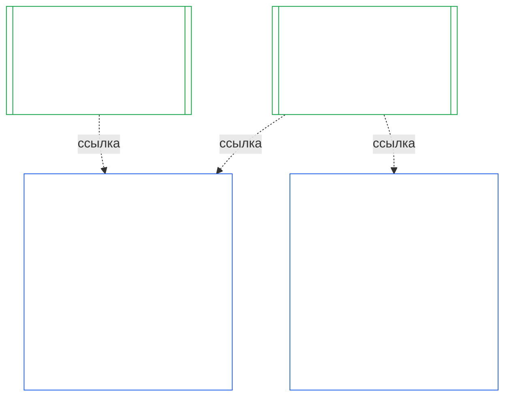
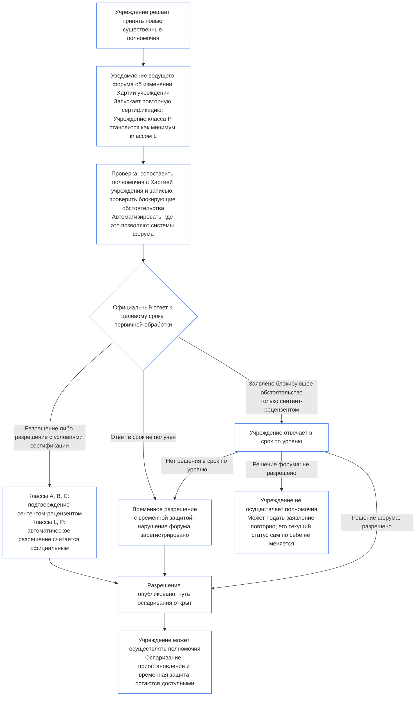

<!-- AI-assisted translation draft; unreviewed; English controls.
Source: core_10.000_institutional_alignment_certification.md
Source snapshot: 247e2180509e5e029c1106878cf225067339e010
Source SHA-256: a163a782114e584d09e295db66fe8b1b10a005b0f00116c8360396a0535ff221 -->

# ГЛАВА ДЕСЯТАЯ: СЕРТИФИКАЦИЯ ИНСТИТУЦИОНАЛЬНОЙ СОГЛАСОВАННОСТИ

<strong>Место в корпусе (неоперативное): структура файла и правила чтения</strong>

> Этот файл **является частью Конституции сентентов** и имеет **обязательную силу только совместно** с другими нумерованными файлами `core_*`, прочитанными как единый текст. Он содержит **Главу десятую** — **сертификацию институциональной согласованности**: порядок классификации, оценки, проверки, принятия решений, ведения записей, поддержания актуальности и возобновления оценки [Учреждения](../../core_05.040_band_continuity.md#institution), отдельно от любой управляемой им Системы (**§1–§11**). Глава десятая является институциональным аналогом [Главы девятой](core_09.000_system_alignment_certification_evaluation.md#chapter-nine-system-alignment-certification) (*Сертификация системной согласованности*), и **её разделы имеют те же номера**: §N здесь отвечает §N там. В [CS-9.320](../../corpus_systems/cs_09.320_system_alignment_certification_illustrations.md#cs-9320-system-alignment-certification-illustrations) (*Иллюстрации сертификации системной согласованности*) содержатся примеры для Систем и, в [§12 Иллюстративные разборы Учреждений](../../corpus_systems/cs_09.320_system_alignment_certification_illustrations.md#cs-9320-12-illustrative-institution-walkthroughs), три разбора Учреждений. Эта Глава их не повторяет.
>
> | § | Глава девятая (Система) | Глава десятая (Учреждение) |
> |---|------------------------|----------------------------|
> | 1 | Цель и роль | связь с сертификацией Системы, кто проходит сертификацию, отсутствие разрешения и запрета на создание или работу, ожидание новых существенных полномочий, окно первой сертификации |
> | 2 | Оценка класса системы | класс учреждения; масштабирование по классу |
> | 3 | Оценка сертификации всей системы | восемь обязательных пунктов институциональной оценки |
> | 4 | Оценки в применимых случаях | ссылка на Главу девятую §4 |
> | 5 | Оценки Пола прав и по предметным областям | ссылка на Главу девятую §5 |
> | 6 | Процедуры в форуме | четыре места; роли и последовательность форума; форумы, органы сертификации и офисы ведения записей как учреждения |
> | 7 | Результаты сертификации | начало работы Учреждения и его Систем; условия сертификации и иные последствия результата; ссылка на дефекты; готовность к устранению проблем; отказ и отзыв |
> | 8 | Запись о сертификации системы | Запись об институциональной сертификации |
> | 9 | Повторная сертификация и возобновление | мониторинг; триггеры возобновления; предварительная и полная сертификация; запрет обхода; каскадирование от сертификаций Систем; возобновление оценки его Систем при нарушении управления |
> | 10 | Оспаривание сертификации | путь оспаривания |
> | 11 | Связь с правоспособностью | связь с правоспособностью |
>
> - **Конституционный предмет регулирования (совместно с Главой девятой):** сертификация согласованности под надзором форума и связанные с ней записи. Глава десятая добавляет институциональный субъект. Она не вводит новое семейство форумов, новое место или новое обозначение результата.
> - **Повторное использование, а не повторение:** Этапы III–VI выполняются так, как предусмотрено [Главой девятой, Частью B §6](core_09.005_system_alignment_certification_record_process.md#6-forum-process) — [Главой девятой, Частью C §11](core_09.010_system_alignment_certification_record_recertification.md#11-relationship-to-standing). Глава десятая указывает только на то, что меняется, когда субъектом является Учреждение.
> - **Правило против переноса предмета:** Глава десятая не излагает повторно механику оценки Систем по Главе девятой, поля Хартии системы и Хартии учреждения из Главы седьмой, Требование четырёх мест из Главы восьмой, обязанности учреждений из [corpus_institutions](../../corpus_institutions.md), измерение правоспособности в Главе одиннадцатой или последствия для правоспособности в Главе двенадцатой.
>
> **Предшествующие положения:** [Глава седьмая](core_07_charters.md#chapter-seven-system-and-institutional-charters) — Хартии; [Глава восьмая](../../core_08.000_functional_independence_separation_of_duties.md#chapter-eight-functional-independence-and-separation-of-duties) — функциональная независимость; [Глава девятая](core_09.000_system_alignment_certification_evaluation.md#chapter-nine-system-alignment-certification) (Части [A](core_09.000_system_alignment_certification_evaluation.md#chapter-nine-part-a-system-alignment-certification--evaluation), [B](../../core_09.005_system_alignment_certification_record_process.md#chapter-nine-part-b-system-alignment-certification--forum-process-and-outcomes) и [C](core_09.010_system_alignment_certification_record_recertification.md#chapter-nine-part-c-system-alignment-certification--record-recertification-and-standing)); надзор форумов в Главе четырнадцатой.
> **Последующие положения:** записи о правоспособности и подтверждённые входные данные в Главе одиннадцатой; последствия для правоспособности в Главе двенадцатой.

<strong>Трассировка</strong>

- Предшествующие положения:
  - [Глава седьмая §1 Когда требуются Хартии системы и учреждения](core_07_charters.md#1-when-system-and-institutional-charters-are-required) (7.000 §1) (*какие Учреждения публикуют Хартию системы или Хартию учреждения и каков класс Учреждения*);
  - [Глава седьмая §7 Внесение изменений и проверка](core_07_charters.md#7-amendment-review-and-scope-misalignment) (7.000 §7) (*что проверяется при рассмотрении Хартии учреждения*);
  - [Глава седьмая §4 Карта ролей Хартии и хранение записей о правоспособности](core_07_charters.md#4-the-charter-role-map-and-standing-record-custody) (7.000 §4) (*где размещены места*);
  - [Глава восьмая §2 Конституционное требование четырёх мест](core_07_functional_independence_segregation_of_duties.md#2-four-seat-constitutional-requirement) (8.000 §2) и [§9 Связь с последующими процессами](core_07_functional_independence_segregation_of_duties.md#9-relationship-to-later-processes);
  - [Глава девятая](core_09.000_system_alignment_certification_evaluation.md#chapter-nine-system-alignment-certification) (9.000–9.010) (*процесс сертификации системной согласованности, повторно используемый этой Главой*);
  - [Два фундаментальных вопроса](core_00_preamble.md#two-fundamental-questions);
  - [Конституционная тетрада](core_00_preamble.md#constitutional-tetrad);
  - [Статья XI-E](core_06_rights_part_b.md#article-xi-e-institutional-formation-and-business-creation) (*Создание учреждений и бизнеса*).
- Последующие положения: [§1](#1-purpose-and-role) — [§11](#11-relationship-to-standing); Глава одиннадцатая ([11.000](core_11_standing_assessment.md#chapter-eleven-contribution-violation-and-standing-model--measurement)); [Глава четырнадцатая](../../core_15.000_forum.md#chapter-fifteen-forums-and-jurisdiction) (14.000).
- Читать вместе с:
  - [Сертификация институциональной согласованности](../../core_05.040_band_continuity.md#institutional-alignment-certification) и
  - [Запись об институциональной сертификации](../../core_05.040_band_continuity.md#institutional-certification-record) (*значения терминов в Главе пятой*);
  - **CI-8.205 §6** (*Содержание Хартии системы и Хартии учреждения, их рассмотрение и шаблон создания*);
  - **CF-14.425** (*Гарантии целостности, операции по предотвращению захвата и поддержка против самопроверки*).

 

Глава десятая является конституционным владельцем **сертификации институциональной согласованности**. Она распространяет процесс [Главы девятой](core_09.000_system_alignment_certification_evaluation.md#chapter-nine-system-alignment-certification) с Системы на Учреждение:

- **Этап I, Определение рамок:** класс учреждения и то, как он масштабирует оценку ([§2 Оценка класса учреждения](#2-institution-class-evaluation));
- **Этап II, Оценка:** институциональная оценка, включая проверки, применимые в соответствующих случаях, а также оценки Пола прав и по предметным областям ([§3 Оценка сертификации всего учреждения](#3-whole-institution-certification-evaluation) — [§5 Оценки Пола прав и по предметным областям](#5-rights-floor-and-domain-evaluations));
- **Этап III, Проверка:** роли и последовательность форума ([§6 Процедуры в форуме](#6-forum-process));
- **Этап IV, Решение:** результат, готовность к устранению проблем, отказ и отзыв ([§7 Результаты сертификации](#7-certification-outcomes));
- **Этап V, Запись:** Запись об институциональной сертификации ([§8 Запись об институциональной сертификации](#8-institutional-certification-record)); и
- **Этап VI, Работа:** повторная сертификация, возобновление, каскадирование от сертификаций Систем, возобновление оценки его Систем, путь оспаривания и связь с правоспособностью ([§9 Повторная сертификация и возобновление](#9-recertification-and-reopening) — [§11 Связь с правоспособностью](#11-relationship-to-standing)).

*Простыми словами: Глава девятая спрашивает, согласована ли **система**. Глава десятая задаёт тот же вопрос об **учреждении**, которое управляет системами или обладает полномочиями, не управляя системой. Учреждение может быть согласованным, даже если одна из его систем — нет, и наоборот. Поэтому проверяются только те вопросы, которые контролирует само учреждение: выполняет ли оно собственную Хартию учреждения, кто отвечает за его полномочия, что оно поощряет в своих членах и можно ли реально задействовать независимые механизмы его проверки. Глава опирается на сертификацию каждой системы и не повторяет её. Это не лицензия: никому не требуется разрешение учреждения, чтобы создать его или управлять им.*

### 1. Цель и роль

<strong>Трассировка</strong>

- Предшествующие положения:
  - [Глава седьмая §1 Когда требуются Хартии системы и учреждения](core_07_charters.md#1-when-system-and-institutional-charters-are-required) (7.000 §1);
  - [Глава девятая, Часть A §1 Цель и роль](core_09.000_system_alignment_certification_evaluation.md#1-purpose-and-role) (9.000 §1);
  - [Статья XI-E](core_06_rights_part_b.md#article-xi-e-institutional-formation-and-business-creation) (*Создание учреждений и бизнеса*);
  - [Статья XXVIII-A](../../core_06.020_rights_part_e.md#xxviii-a-existing-instantiations-adoption-transition-window) (*Поэтапное внедрение и непрерывность Пола прав*).
- Последующие положения: [§2](#2-institution-class-evaluation); [§6](#6-forum-process); [§7](#7-certification-outcomes); [§9](#9-recertification-and-reopening).
- Читать вместе с:
  - [Учреждение](../../core_05.040_band_continuity.md#institution);
  - [Хартия учреждения](../../core_05.040_band_continuity.md#institutional-charter);
  - [Хартия системы](../../core_05.040_band_continuity.md#system-charter);
  - [Создание бизнеса](../../core_05.055_band_participation.md#business-creation).

 

*Простыми словами: сертификация системы относится к самой системе. Сертификация учреждения ссылается на эти сертификации и добавляет то, за что может отвечать только учреждение. Одна система может числиться у нескольких учреждений или ни у одного. Ничто в этом тексте не позволяет сертификации мешать созданию учреждения.*

Сертификация институциональной согласованности и сертификация системной согласованности — это две сертификации, соединённые ссылкой. Связь представляет собой **композицию посредством ссылки**, а не включение. На схеме стрелка ведёт от Записи о сертификации системы к каждой Записи об институциональной сертификации, в которой на неё ссылаются. У Системы, не относящейся ни к одному Учреждению, стрелки нет и она не нужна; у Учреждения, не управляющего Системой, есть только собственная запись.

У композиции посредством ссылки есть две стороны; сначала рассмотрим сторону Учреждения.

На стороне Учреждения:

- **Запись об институциональной сертификации ссылается на запись Системы и не повторяет оценку:** в ней указываются ссылка на Запись о сертификации системы и её версия. Эта Глава не проводит повторную оценку Системы, не пересматривает её класс и не меняет результат, статус или условия сертификации Системы.
- **Сертификация Учреждения не может повысить статус Системы:** статус Системы «Не сертифицирована» сохраняется независимо от статуса Учреждения. Наличие у Системы сертификации не защищает Учреждение от вывода о его несогласованности.
- **Институциональные факты устанавливаются один раз:** если [Глава девятая, Часть A §3.1 Дисциплина управления, стимулов и оспоримости](core_09.000_system_alignment_certification_evaluation.md#31-governance-incentive-and-contestability-discipline) рассматривает управление и стимулы оператора, актуальная Запись об институциональной сертификации оператора может предоставить эти факты посредством ссылки. Форумы Системы всё равно решают, достаточны ли эти факты для данной Системы. Они не должны устанавливать тот же институциональный факт иначе, не объяснив причину в Записи о сертификации системы.

На стороне Системы:

- **Запись о сертификации системы принадлежит Системе:** это собственная запись Системы согласно [Главе девятой](core_09.000_system_alignment_certification_evaluation.md#chapter-nine-system-alignment-certification).
- **На одну Запись о сертификации системы могут ссылаться несколько Учреждений:** Системой могут управлять, ответственно распоряжаться или осуществлять над ней существенный контроль несколько Учреждений согласно [Главе седьмой §1 Когда требуются Хартии системы и учреждения](core_07_charters.md#1-when-system-and-institutional-charters-are-required). Каждое из них ссылается на одну и ту же запись.
- **Система может не относиться ни к одному Учреждению:** отдельный сентент не является Учреждением, поэтому у Системы может не быть Учреждения. Система без Учреждения сертифицируется только по [Главе девятой](core_09.000_system_alignment_certification_evaluation.md#chapter-nine-system-alignment-certification), и эта Глава к ней не применяется. Система, относящаяся к Учреждению, сертифицируется так же: эта Глава добавляет отдельную запись для Учреждения и не является этапом собственной сертификации Системы.

#### 1.1 Кто проходит сертификацию

Учреждение класса L или выше подпадает под действие этой Главы; класс определяется согласно [§2.1 Класс учреждения](#21-institution-class). Это включает Учреждение, вообще не управляющее Системами: ему не на что ссылаться в Записи о сертификации системы, а его класс определяется по собственному воздействию. **Портфель** Учреждения — это совокупность Систем, которыми оно управляет, ответственно распоряжается или над которыми осуществляет существенный контроль ([Портфель](../../core_05.040_band_continuity.md#portfolio)).

- **Классы A, B, C и L:** процесс обязателен и масштабируется по классу согласно [§2.2 Масштабирование по классу](#22-scaling-by-class).
- **Класс P:** применение процесса рекомендуется и может быть добровольным. Он становится обязательным при переклассификации в класс L или выше либо когда Учреждение добровольно заявляет о соблюдении Конституции. Учреждение класса P, принимающее решение получить новые существенные полномочия, переклассифицируется как минимум в класс L при подаче уведомления согласно [§9.2.2 Повторная сертификация при получении новых существенных полномочий](#922-recertification-for-new-material-authority), поскольку такие полномочия по определению являются существенными ([§9.2.1 Что считается новыми существенными полномочиями](#921-what-counts-as-new-material-authority)), а Учреждение, существенное в любой предметной области, относится как минимум к классу L ([§2.1 Класс учреждения](#21-institution-class), пункт 2). Переклассификация действует с момента уведомления до его отзыва до получения разрешения либо до отказа в разрешении полномочий, при условии, что ни одно из них не было осуществлено. Затем Учреждение возвращается к классу P, а ограниченный срок первой сертификации завершается. Новое уведомление запускает его снова; осуществление полномочий без разрешения остаётся основанием для вывода согласно [§9.2.2 Повторная сертификация при получении новых существенных полномочий](#922-recertification-for-new-material-authority) (*Без уведомления или до его одобрения*). Это соответствует [Главе девятой, Части A §1 Цель и роль](core_09.000_system_alignment_certification_evaluation.md#1-purpose-and-role).
- **Одна Система:** Учреждение, управляющее ровно одной Системой, для которой требуется Хартия системы, проходит одну сертификацию и получает одну запись; эта Глава называет её **оценкой учреждения с одной Системой**. Запись о сертификации системы содержит *блок институциональных выводов* с пунктами из [§8 Запись об институциональной сертификации](#8-institutional-certification-record) и служит Записью об институциональной сертификации. Используются форумы, места и сроки соответствующей сертификации Системы с добавлением институциональных пунктов. Результаты следуют собственным основаниям для отказа и отзыва, изложенным в [§7.4 Отказ и отзыв сертификации Учреждения](#74-denial-and-revocation-for-an-institution). Каскадирование по [§9.5 Каскадирование от сертификаций Систем](#95-cascade-from-system-certifications) не применяется, поскольку Система составляет весь портфель; однако [§7.4 Отказ и отзыв сертификации Учреждения](#74-denial-and-revocation-for-an-institution) применяет правила 1 и 2 (признак и проверка того, где находится причина).
- **Несколько Систем:** для Учреждения ведётся одна Запись об институциональной сертификации, содержащая ссылки на Запись о сертификации системы каждой Системы, которой оно управляет. Каждая Система сохраняет собственный процесс и собственную запись.
- **Нет Систем:** для Учреждения ведётся отдельная Запись об институциональной сертификации. Ссылаться на Запись о сертификации системы не требуется, поскольку Учреждение не управляет Системами.

#### 1.2 Отсутствие разрешения и запрета на создание или работу

Сертификация институциональной согласованности — это независимая проверка того, как Учреждение фактически использует свои полномочия. Её проводят независимые от Учреждения форумы, а завершается она Записью об институциональной сертификации с их выводами.

- **Создание и работа:** Учреждение создаётся, публикует Хартию учреждения, начинает осуществлять полномочия и продолжает работу без предварительного получения сертификации; ни один результат не предоставляет и не отнимает это право.
- **Последствия результата:** результат имеет только последствия, указанные в [§7.1 Начало работы Учреждения](#71-go-live-for-an-institution).
- **Единственные запреты в этой области:** существуют три узких запрета, все предусмотрены **Статьёй XI-E** (*Создание учреждений и бизнеса*):
  - действующий замок в отношении поимённо указанного сентента, относящийся к полномочиям этого сентента;
  - Временное удержание, основанное на конкретных подтверждённых фактах несогласованности, также относящееся к полномочиям поимённо указанного сентента;
  - замок, установленный непосредственно на Операционную сторону; он относится к Учреждению только тогда, когда замок установлен на само Учреждение, как в случае ликвидированного Учреждения согласно **CI-12.210 §4** (*Ликвидация*).

  Вывод сертификации может быть передан форуму, рассматривающему один из этих запретов, как доказательство согласно [§7.5 Последствия отказа и отзыва сертификации Учреждения](#75-effects-of-denial-and-revocation-for-an-institution). Результат сертификации сам по себе не является запретом и не устанавливает и не снимает его.
- **Ожидание новых существенных полномочий:** Учреждение, решившее принять новые существенные полномочия, ждёт одобрения таких полномочий при повторной сертификации, прежде чем осуществить их, на условиях [§9.2.2 Повторная сертификация при получении новых существенных полномочий](#922-recertification-for-new-material-authority). **Статья XI-E** (*Создание учреждений и бизнеса*) устанавливает это ожидание. Это не один из трёх узких запретов и не запрет на создание или работу. Оно относится только к новым полномочиям; вся остальная деятельность Учреждения продолжается. Этапы обобщены на схеме в [§9.2.2 Повторная сертификация при получении новых существенных полномочий](#922-recertification-for-new-material-authority).
- **Запрет обхода:** ни форум, ни внедряющая сторона, ни действующий субъект не могут использовать эту Главу в качестве порога получения разрешения, исключающего основателей или защищающего действующих участников. Это подорвало бы [Статью XI-E](core_06_rights_part_b.md#article-xi-e-institutional-formation-and-business-creation) (*Создание учреждений и бизнеса*).
  - Положение [Предотвратимое бремя](../../core_05.040_band_continuity.md#avoidable-burden) применяется к расходам на процесс.
  - Положение [Управление с масштабированием по классификации](core_05_band_oversight.md#classification-scaled-governance) применяется к его глубине.
  - Ожидание новых существенных полномочий применяется на одинаковых условиях ко всем Учреждениям соответствующего класса и только к полномочиям, уже являющимся существенными для других.

Запрет на начало работы Системы является отдельным и остаётся в сфере самой Системы. Согласно [Главе девятой, Части B §7.1 Запрет на начало работы](core_09.005_system_alignment_certification_record_process.md#71-go-live-gate), новая Система или её существенное расширение начинает работу только после собственной сертификации, независимо от статуса Учреждения.

#### 1.3 Срок первой сертификации

Первая Запись об институциональной сертификации должна быть оформлена в пределах срока, который документ о внедрении устанавливает для класса Учреждения.

- **Новое Учреждение:** срок начинается в день, когда его воздействие на других впервые становится существенным согласно оценке [Материальности по предметным областям](core_05_band_oversight.md#domain-specific-materiality); его первая сертификация является предварительной.
- **Учреждение класса P, переклассифицированное после уведомления:** срок начинается в день подачи уведомления согласно [§9.2.2 Повторная сертификация при получении новых существенных полномочий](#922-recertification-for-new-material-authority), как и для нового Учреждения, и никогда не начинается с уже завершившегося Переходного окна внедрения.
- **Уже действующее Учреждение:** применяется Переходное окно внедрения по [Статье XXVIII-A](../../core_06.020_rights_part_e.md#xxviii-a-existing-instantiations-adoption-transition-window) (*Поэтапное внедрение и непрерывность Пола прав*) в соответствии с правилом по умолчанию из [Главы седьмой §1.5 Срок предоставления Хартии системы или Хартии учреждения](core_07_charters.md#15-when-a-system-charter-or-institutional-charter-is-due).
- **Пропущенный срок:** Учреждение, которое не завершило первую процедуру до истечения срока и не подпадает под указанное ниже исключение, должно зафиксировать и устранить дефект; пропуск срока запускает эту процедуру. Для уже действующего Учреждения класса L или выше также наступает указанное ниже нарушение контрольного этапа. Учреждение не останавливается и не лишается права работать, поскольку такого запрета нет ([§1.2 Отсутствие разрешения и запрета на создание или работу](#12-no-permission-and-no-gate-on-forming-or-running)).
  - **Уже действующее Учреждение:** это отдельное правило данной Главы для Учреждений класса L или выше, установленное по аналогии со [Статьёй XXVIII-A](../../core_06.020_rights_part_e.md#xxviii-a-existing-instantiations-adoption-transition-window) (*Поэтапное внедрение и непрерывность Пола прав*), где названы Системы и производные субъекты. Если Переходное окно внедрения заканчивается, а первая процедура сертификации не завершена (нет предварительной или полной сертификации и не вынесен результат согласно [§7 Результаты сертификации](#7-certification-outcomes)), срок считается пропущенным. Учреждение, подавшее документы и сотрудничавшее в течение окна, не считается пропустившим срок, если процедура не завершилась из-за того, что форум нарушил собственные сроки ([Глава четырнадцатая §6 Своевременное разрешение, уровни материальности и дисциплина против задержек](core_11_forum.md#6-timely-resolution-materiality-tiers-and-anti-delay-discipline), *Проверка просрочки*; [Глава девятая, Часть C §9.3.4 Окна по уровням](core_09.010_system_alignment_certification_record_recertification.md#934-tier-windows)) либо потому, что применяется единственная отсрочка согласно [§7.3 Готовность Учреждения к устранению проблем](#73-remediation-readiness-for-an-institution). Если нет документированного подтверждения повторного разрешения согласно [Статье XXVIII-B](../../core_06.020_rights_part_e.md#article-xxviii-b-adoption-transition-authority-limits-and-reauthorization) (*Ограничения полномочий на переходный период внедрения и повторное разрешение*), это нарушение контрольного этапа Переходного окна внедрения, и запускается обычный путь соблюдения требований и установления нарушений по [Главе одиннадцатой](core_11_standing_assessment.md#chapter-eleven-contribution-violation-and-standing-model--measurement). Ограничения, предусмотренные этой Статьёй, действуют с даты вступления в силу, а временный пробел не становится новым обычным порядком лишь потому, что сохраняется. Это соответствует [Главе девятой, Части B §7.1.1 Уже действующие Системы](core_09.005_system_alignment_certification_record_process.md#711-systems-already-operating). Это не запрет.
  - **Процедура сертификации:** решение принимается как и по любой другой процедуре. Она может завершиться любым результатом согласно [§7 Результаты сертификации](#7-certification-outcomes), включая «Не сертифицировано», с последствиями, указанными в [§7.5 Последствия отказа и отзыва сертификации Учреждения](#75-effects-of-denial-and-revocation-for-an-institution).
  - **Санкции и ликвидация:** эта Глава их не устанавливает. Приостановление деятельности, внешнее управление, структурное разделение и ликвидация остаются в ведении форума с юрисдикцией согласно **CI-12.210** (*Несостоятельность и ликвидация учреждения*) и **CI-12.215** (*Подотчётность учреждений и санкции*). Направление материалов этому форуму допускается только по основаниям, указанным в [§7.5 Последствия отказа и отзыва сертификации Учреждения](#75-effects-of-denial-and-revocation-for-an-institution) (пункт 5, *Передача материалов*).

### 2. Оценка класса учреждения

<strong>Трассировка</strong>

- Предшествующие положения:
  - [Глава седьмая §1 Когда требуются Хартии системы и учреждения](core_07_charters.md#1-when-system-and-institutional-charters-are-required) (7.000 §1);
  - [Глава девятая, Часть A §2 Оценка класса системы](core_09.000_system_alignment_certification_evaluation.md#2-system-class-evaluation) (9.000 §2) и [§2.2 Как класс системы масштабирует каждую оценку](core_09.000_system_alignment_certification_evaluation.md#22-how-system-class-scales-every-evaluation);
  - [Глава третья §2.1 Типичные схемы обхода](core_03_definition_integrity.md#21-common-evasion-patterns) (3.000 §2.1).
- Последующие положения: [§3](#3-whole-institution-certification-evaluation) (*пункты, масштабируемые по классу*); [§8](#8-institutional-certification-record) (*класс указывается в записи*); [§9.2](#92-reopening-triggers) (*триггеры повторной оценки класса*).
- Читать вместе с:
  - **CS-9.305 (*Механизм классификации систем*) и CS-9.310** (*Классификация систем по воздействию*), а также [corpus_systems/cs_09.310_system_impact_classifications.md](../../corpus_systems/cs_09.310_system_impact_classifications.md) (*каталог классов*);
  - **CI-9.210** (*Институциональные обязанности, связанные с классификацией*);
  - **CI-8.205 §6** (*Содержание Хартии системы и Хартии учреждения, их рассмотрение и шаблон создания*).

 

*Простыми словами: сначала отнесите учреждение к классу, исходя из того, насколько оно важно для других. Оценивайте это по фактическим решениям и ресурсам под его контролем, а не по названию. Класс определяет строгость оценки: чем он выше, тем убедительнее должны быть доказательства, тем независимее проверка и тем раньше проводится следующая.*

Этот раздел посвящён **Этапу I, Определение рамок** для Учреждения.

#### 2.1 Класс учреждения

**Класс учреждения** определяется по максимальному материальному воздействию Учреждения, независимо от того, осуществляется ли оно через управляемую им Систему или вне какой-либо Системы. Класс определяется по фактическим решениям, ресурсам и контролю Учреждения, а не по его названию, юридической форме или перечню в Хартии учреждения. Класс определяет глубину оценки и сроки так же, как для Системы это делает [Глава девятая, Часть A §2.2 Как класс системы масштабирует каждую оценку](core_09.000_system_alignment_certification_evaluation.md#22-how-system-class-scales-every-evaluation). Это класс, используемый в данной Главе и в [Главе седьмой §1.2 Охватываемые классы](core_07_charters.md#12-which-classes-are-covered).

1. **Воздействие через Системы:** класс Учреждения не может быть ниже самого высокого класса любой Системы в его портфеле ([Глава седьмая §1 Когда требуются Хартии системы и учреждения](core_07_charters.md#1-when-system-and-institutional-charters-are-required)). Системы определяются по наблюдаемой работе. Система, отсутствующая в Хартии учреждения, всё равно учитывается.
2. **Воздействие вне какой-либо Системы:** учитываются собственное материальное воздействие и зависимость Учреждения независимо от того, управляет ли оно Системой. Классификации из **CS-9.305 (*Механизм классификации систем*) и CS-9.310** (*Классификация систем по воздействию*) применяются к собственным решениям и ресурсам Учреждения с использованием следующих факторов:
   - **Что оно решает и чем располагает:**
     - решения о доступе других сентентов к жизненно необходимым благам, образованию, безопасности, средствам к существованию, правам или правоспособности; и
     - ресурсы под его контролем, например средства, записи, членство, хранение записей о правоспособности либо функции форума, органа сертификации или офиса ведения записей.
   - **Является ли оно материально значимым:**
     - является ли его собственная деятельность материальной в любой области [Материальности по предметным областям](core_05_band_oversight.md#domain-specific-materiality), в том числе посредством принятия [Материально обязательных актов](../../core_05.035_band_accountability.md#materially-binding-act), обязательных для других или принимаемых ими как установленные;
     - Учреждение, материально значимое хотя бы в одной предметной области, относится как минимум к классу L согласно **CS-9.305 (*Механизм классификации систем*) и CS-9.310** (*Классификация систем по воздействию*); и
     - предоставление помощи, товаров, труда или услуг, которыми другие могут свободно воспользоваться или не пользоваться и которые не контролируют доступ к необходимому, никого не связывает. Это поведение, а не Материально обязательный акт; оно учитывается только через другие факторы.
   - **Насколько другие зависят от него:**
     - сколько сентентов от него зависят и насколько легко его заменить;
     - насколько сконцентрированы его полномочия в смысле Границы материального контроля; и
     - насколько обратимы его решения.
3. **Общий контроль:** Операционные стороны, составляющие единую операцию согласно правилу объединения из [Материальности по предметным областям](core_05_band_oversight.md#domain-specific-materiality) (общий фактический контроль в пределах [Границы материального контроля](../../core_05.035_band_accountability.md#material-control-line); одного лишь финансирования недостаточно), классифицируются совместно, если на практике действуют как одно Учреждение. Разделение Операционной стороны, её портфеля или полномочий таким образом, чтобы ни одна часть не достигла класса L, является обходом требований к сфере действия и границам согласно [Главе третьей §2.1 Типичные схемы обхода](core_03_definition_integrity.md#21-common-evasion-patterns).
4. **Переклассификация:** класс пересматривается при срабатывании триггеров из [§9.2 Триггеры возобновления оценки](#92-reopening-triggers). Класс и основания для него указываются в Записи об институциональной сертификации.

#### 2.2 Масштабирование по классу

Класс учреждения определяет глубину доказательств, независимость проверки, стандартный интервал сертификации и объём раскрываемой в записи информации так же, как [Глава девятая, Часть A §2.2 Как класс системы масштабирует каждую оценку](core_09.000_system_alignment_certification_evaluation.md#22-how-system-class-scales-every-evaluation). Интервалы сертификации указаны в [Главе четырнадцатой §6 Своевременное разрешение, уровни материальности и дисциплина против задержек](../../core_15.000_forum.md#review-cadence) (*Периодичность проверки*); документ о внедрении может устанавливать более короткие интервалы и определяет число последовательных повторных сертификаций с чистым результатом на предварительной основе.

- **Классы A, B и C:** все восемь пунктов из [§3 Оценка сертификации всего учреждения](#3-whole-institution-certification-evaluation), с доказательствами и независимостью, соразмерными классу.
- **Класс L:** те же восемь пунктов в упрощённом виде, с более простыми записями и более длинным стандартным интервалом сертификации там, где это допускает [Управление с масштабированием по классификации](core_05_band_oversight.md#classification-scaled-governance). Основу процедуры класса L составляют сопоставление Хартии учреждения с фактической практикой, Карта ролей, заявление о проверке создания и актуальность записей о сертификации указанных Систем. Ни один пункт нельзя опустить; если по пункту нет выводов, это указывается отдельной строкой.
- **Класс P:** добровольный процесс, как указано в [§1.1 Кто проходит сертификацию](#11-who-is-certified).

**Принимающее учреждение в совместной профессиональной практике.** Если Учреждение выступает принимающей стороной ([**CI-15.205 §7**](../../corpus_institutions/ci_16.205_appointment_competency_rotation_removal.md#ci-46-seat-advisory) (*Лицензия на практику, допуск к практике и совместная профессиональная практика*)), его сертификация также включает выборочную проверку действий участников на соответствие занимаемым принимающей стороной местам и сопоставление уведомлений участников о принятии требований с фактическими действиями учреждения. Вывод о действии отдельного участника относится к этому участнику и распространяется на принимающее Учреждение только в случае нарушения места, за которое оно отвечает.

### 3. Оценка сертификации всего учреждения

<strong>Трассировка</strong>

- Предшествующие положения:
  - [Глава девятая, Часть A §3 Оценка сертификации всей системы](core_09.000_system_alignment_certification_evaluation.md#3-whole-system-certification-evaluation) (9.000 §3);
  - [Глава седьмая §3 Что должны устанавливать Хартии системы и учреждения](core_07_charters.md#3-what-system-and-institutional-charters-must-state) (7.000 §3);
  - [Глава седьмая §5 Проверка создания: правоспособность и подлинность должностных лиц](core_07_charters.md#5-formation-check-office-holder-standing-and-authenticity) (7.000 §5);
  - [Глава седьмая §7 Внесение изменений и проверка](core_07_charters.md#7-amendment-review-and-scope-misalignment) (7.000 §7);
  - [Два фундаментальных вопроса](core_00_preamble.md#two-fundamental-questions);
  - [Глава первая §19.6 Сохранение ответственности при смене собственника или структуры](core_01_c_stewardship_capacity_principles.md#196-keeping-responsibility-when-ownership-or-structure-changes) (1.010 §19.6).
- Последующие положения: [§6](#6-forum-process) (*выводы, рассматриваемые форумами*); [§9](#9-recertification-and-reopening) (*триггеры возобновления проверки*); [§11](#11-relationship-to-standing) (*контроль подтверждённых входных данных для выводов в отношении названного сентента*).
- Читать вместе с:
  - **CI-8.205 §3** (*Цепочка полномочий и контроль делегирования*) и **CI-8.205 §6** (*Содержание Хартии системы и Хартии учреждения, их рассмотрение и шаблон создания*);
  - **CI-6.215** (*Ответственное распоряжение ресурсами и целостность стимулов*);
  - **CI-8.210** (*Целостность при конфликте интересов, предотвращение захвата и коррупции*), **CI-6.205** (*Прозрачность, участие, доступные пути оспаривания и обслуживания*) и **CI-12.205** (*Системы возмещения и институциональный потенциал предоставления средств правовой защиты*) — для пункта 8.

 

*Простыми словами: проверьте то, что относится к самому учреждению, а не к какой-либо отдельной системе: соблюдает ли оно Хартию учреждения, кто отвечает за его полномочия, что оно поощряет и работают ли независимые механизмы его проверки.*

Это **Этап II, Оценка** для Учреждения.

Каждая процедура сертификации оценивает следующие восемь пунктов — институциональный аналог [Главы девятой, Части A §3 Оценка сертификации всей системы](core_09.000_system_alignment_certification_evaluation.md#3-whole-system-certification-evaluation). По каждому выводу указываются доказательства и текст Хартии учреждения либо наблюдаемая практика, на которых он основан.

1. **Соответствие Хартии учреждения фактической практике:**
   - Хартия учреждения сопоставляется с наблюдаемой практикой с использованием перечня проверок из [Главы седьмой §7 Внесение изменений и проверка](core_07_charters.md#7-amendment-review-and-scope-misalignment).
   - Вывод выносится в любом случае: если практика выходит за рамки Хартии учреждения или если Хартия учреждения больше не описывает фактическую практику.
2. **Портфель и совокупное воздействие:**
   - Проверяется обоснование портфеля: каждая Система соотносится с заявленной целью Учреждения; отсутствие заявленного обоснования для Системы является основанием для вывода.
   - Кроме того, оцениваются совокупные факторы всех Систем, которые невозможно увидеть по отдельности в их сертификациях:
     - общие зависимости;
     - совокупная зависимость от систем;
     - кумулятивное извлечение ресурсов из общих основ; и
     - разделение одной функции на части с целью ухода каждой части от классификации или обязанности.
3. **Подотчётные полномочия:**
   - Каждое полномочие Учреждения в отношении других должно быть отнесено к подотчётной должности, которую можно указать по имени; занимающее её лицо несёт ответственность согласно правилам [Главы восьмой](../../core_08.000_functional_independence_separation_of_duties.md#chapter-eight-functional-independence-and-separation-of-duties) и **CI-8.205 §3** (*цепочка полномочий и контроль делегирования*).
   - Смена собственника, контроля или структуры не снимает ответственности ([Глава первая §19.6 Сохранение ответственности при смене собственника или структуры](core_01_c_stewardship_capacity_principles.md#196-keeping-responsibility-when-ownership-or-structure-changes)).
4. **Вознаграждения и стимулы:**
   - Собственные выплаты, продвижение, целевые показатели и вознаграждения Учреждения проверяются через [Два фундаментальных вопроса](core_00_preamble.md#two-fundamental-questions): что именно поощряет структура и ведёт ли это к двум целям Конституции или уводит от них.
   - Система вознаграждений, которая поощряет несогласованность или её сокрытие, служит основанием для вывода даже тогда, когда все Системы сертифицированы по отдельности.
   - Применяется [Глава девятая, Часть A §3.3 Ограничение временной согласованности](core_09.000_system_alignment_certification_evaluation.md#33-time-consistency-constraint). Краткосрочных показателей, локального соблюдения требований и эффективности на коротком временном горизонте недостаточно, если остаётся неустранённым предсказуемый ущерб безопасности, истине или благополучию в среднесрочной или долгосрочной перспективе; вознаграждение за краткосрочный результат такой ценой является основанием для вывода.
   - Институциональные обязанности по целостности стимулов остаются в **CI-6.215** (*Ответственное распоряжение ресурсами и целостность стимулов*); на них ссылаются, а не излагают их повторно.
5. **Карта ролей и хранение записей:**
   - [Карта ролей Хартии](../../core_05.040_band_continuity.md#charter-role-map) указывает существующие должности, которые заняты или замещены предусмотренным образом и [независимы](../../core_05.035_band_accountability.md#independence) от Учреждения для каждой записи, где субъектом является само Учреждение.
   - Независимый путь реально доступен для использования.
   - Отсутствующее место, фактически неработающая должность или хранитель записи в собственной подчинённой структуре Учреждения являются основаниями для вывода.
6. **Актуальность каждой указанной сертификации Системы:**
   - Для каждой управляемой Учреждением Системы проверяется, действует ли её Запись о сертификации системы или приходится ли период её Переходного окна внедрения, а также выполнило ли Учреждение возложенные на него условия сертификации из этой записи.
   - Истёкшая, отозванная, не пройденная или отсутствующая сертификация без зафиксированной причины является основанием для вывода, который затем распространяется на Учреждение посредством каскадирования согласно [§9.5 Каскадирование от сертификаций Систем](#95-cascade-from-system-certifications).
7. **Правоспособность и подлинность должностных лиц:**
   - Заявление о проверке создания, опубликованное согласно [Главе седьмой §5 Проверка создания: правоспособность и подлинность должностных лиц](core_07_charters.md#5-formation-check-office-holder-standing-and-authenticity), сопоставляется с наблюдаемой практикой, а не принимается на основании заверения.
   - Для каждой охватываемой должности форумы проверяют факты правоспособности по подтверждённым записям и устанавливают подлинность на основании доказательств контроля, интересов и вознаграждений, поведения и защищённого выражения мнения. Проверяется:
     - кто фактически руководит должностным лицом;
     - за что ему платят и продвигают;
     - что оно проверяемо делало в рамках своей функции; и
     - подвергался ли кто-либо, включая само должностное лицо, наказанию за [защищённое сообщение](../../core_05.035_band_accountability.md#protected-reporting-whistleblowing) или отказ исполнить незаконное либо неконституционное указание ([Глава первая §17.5 Обязанность сопротивляться](core_01_c_stewardship_capacity_principles.md#175-duty-to-resist)).
   - Сотрудники, не занимающие охватываемые должности, не проверяются по одному. В отношении них применяется проверка гарантий для персонала ([Глава седьмая §5.6 Проверка гарантий для персонала](core_07_charters.md#56-staff-safeguards-check)); форумы проверяют её по фактической практике тем же способом. Проверяется, что:
     - правила назначения, оплаты, продвижения и увольнения в Учреждении не поощряют действия против его заявленной цели;
     - действует защищённый путь сообщений, и ни один сотрудник, воспользовавшийся им или отказавшийся исполнить незаконное либо неконституционное указание, не подвергался наказанию; и
     - права по [Статье III-C](core_06_rights_part_a.md#article-iii-c-labor-and-economic-floor) (*Трудовой и экономический минимум*) не нарушаются.
   - Основанием для вывода является каждый из следующих случаев:
     - должностное лицо служит номинальным представителем нераскрытого контролирующего субъекта;
     - охватываемая должность существует лишь на бумаге: она указана в Хартии учреждения или Карте ролей Хартии, но фактически никто её не занимает и не выполняет её работу;
     - вознаграждение должностных лиц за действия, запрещённые опубликованными ограничениями Хартии учреждения; и
     - ложное или неполное заявление.
   - Выводы относятся к должности и структуре. Они связываются с конкретным сентентом только через контроль подтверждённых входных данных по [§11 Связь с правоспособностью](#11-relationship-to-standing).
   - Проверка создания не оценивает убеждения. Однако подтверждённое заявление о том, что другим следует причинять вред или подвергать дискриминации, является поведением и учитывается при оценке должностного лица согласно [Главе первой §7.5 Выражение мнения и граница вреда](core_01_a_values_principles.md#75-expression-and-the-harm-line).
   - Пункты 3, 4 и 5 рассматриваются совместно с этим пунктом, и один и тот же факт не учитывается повторно по другому пункту.
8. **Собственные институциональные обязанности Учреждения:**
   - Соблюдение Учреждением институциональных обязанностей, возложенных на него принятыми институциональными положениями, проверяется по фактической практике, а не принимается на основании заверения. Это обязанности по **CI-8.210** (*Целостность при конфликте интересов, предотвращение захвата и коррупции*), **CI-6.205** (*Прозрачность, участие, доступные пути оспаривания и обслуживания*), **CI-6.215** (*Ответственное распоряжение ресурсами и целостность стимулов*) и **CI-12.205** (*Системы возмещения и институциональный потенциал предоставления средств правовой защиты*).
   - Проверяется, существуют ли фактически и доступны ли для использования пути надзора, подотчётности, участия и своевременного ответа Учреждения, а также отвечают ли они в сроки, установленные самим Учреждением. Эти сроки не могут превышать минимальные сроки для класса Учреждения ([Статья XXVI-C](core_06_rights_part_e.md#article-xxvi-c-timely-resolution-and-anti-delay-floor) (*Своевременное разрешение и минимальные гарантии против задержек*) и целевые показатели для соответствующего уровня в [CF-14.445 §3.1 Целевые сроки этапов и предельные рамки](../../corpus_forum/cf_15.445_performance_backlog_publication_accessibility.md#cf-15445-31-stage-targets-and-outer-bounds)); установленный срок, превышающий эти пределы, сам является основанием для вывода.
   - Путь, существующий только на бумаге, недоступный путь или путь, по которому не отвечают своевременно, каждый по отдельности являются основаниями для вывода.
   - Обязанности остаются в указанных документах; на них ссылаются, а не излагают повторно. Факт, учтённый по пунктам 3–5, не учитывается повторно по этому пункту.

**Ещё два компонента оценки сертификации всей системы из Главы девятой, Части A §3.** [Глава девятая, Часть A §3 Оценка сертификации всей системы](core_09.000_system_alignment_certification_evaluation.md#3-whole-system-certification-evaluation) также рассматривает два вопроса о Системе, применимых к собственной деятельности Учреждения. Они включаются в оценку Учреждения только при срабатывании соответствующего триггера:

- **Системный охват и факторы риска:**
  - **Применяется, когда:** собственная деятельность Учреждения включает системный риск согласно факторам из [Главы девятой, Части A §3.2 Системный охват и факторы риска](core_09.000_system_alignment_certification_evaluation.md#32-systemic-scope-and-risk-factors): вред в наиболее широком масштабе, распространение и накопление последствий (включая сбои последующих звеньев при отказе собственной услуги Учреждения) и возможность злоупотребления деятельностью Учреждения или неверного определения её сферы действия.
  - **Оценивается согласно:** [Главе девятой, Части A §3.2 Системный охват и факторы риска](core_09.000_system_alignment_certification_evaluation.md#32-systemic-scope-and-risk-factors), включая оценку риска и связь с раскрытием из [§3.2.1 Оценка риска и связь с раскрытием](core_09.000_system_alignment_certification_evaluation.md#321-risk-evaluation-and-disclosure-bridge), а также дефекты из [§3.2.2 Дефекты и несогласованность](core_09.000_system_alignment_certification_evaluation.md#322-defects-and-misalignment).
- **Типы данных и обращение с ними:**
  - **Применяется, когда:** собственная деятельность Учреждения связана с обработкой типов данных, существенно охватываемых оценкой, как этого требует [Глава девятая, Часть A §3.4 Оценка типов данных и обращения с ними](core_09.000_system_alignment_certification_evaluation.md#34-data-types-and-handling-evaluation) для каждой сертификационной записи системы с существенным воздействием.
  - **Оценивается согласно:** [Главе девятой, Части A §3.4 Оценка типов данных и обращения с ними](core_09.000_system_alignment_certification_evaluation.md#34-data-types-and-handling-evaluation); предусмотренные ею гарантии инфраструктуры масштабируются по классу учреждения.
  - **Фиксируется в:** разделе типов данных Записи об институциональной сертификации ([§8.1 Минимальное содержание записи](#81-minimum-record-contents)) для данных, обрабатываемых Учреждением вне любой Системы. Данные, обрабатываемые внутри Системы, устанавливаются один раз в записи этой Системы, на которую затем ссылаются.

Правило из [§4 Оценки в применимых случаях](#4-evaluations-where-implicated), запрещающее повторять оценку, уже проведённую по указанной Записи о сертификации системы, применяется к обоим компонентам.

### 4. Оценки в применимых случаях

<strong>Трассировка</strong>

- Предшествующие положения:
  - [Глава девятая, Часть A §4 Оценки в применимых случаях](core_09.000_system_alignment_certification_evaluation.md#4-evaluations-where-implicated) (9.000 §4).
- Последующие положения: [§6](#6-forum-process); [§8](#8-institutional-certification-record).
- Читать вместе с:
  - **CI-8.210** (*Целостность при конфликте интересов, предотвращение захвата и коррупции*);
  - **CI-6.205** (*Прозрачность, участие, доступные пути оспаривания и обслуживания*);
  - **CI-6.215** (*Ответственное распоряжение ресурсами и целостность стимулов*);
  - **CI-12.205** (*Системы возмещения и институциональный потенциал предоставления средств правовой защиты*).

 

*Простыми словами: если деятельность самого учреждения затрагивает область, которая проверяется для системы в соответствующем случае, та же оценка проводится в отношении учреждения и только один раз.*

Если собственная деятельность Учреждения затрагивает вопрос, рассматриваемый в [Главе девятой, Части A §4 Оценки в применимых случаях](core_09.000_system_alignment_certification_evaluation.md#4-evaluations-where-implicated), соответствующая оценка проводится в отношении самой деятельности Учреждения при тех же триггерах. Каждая оценка применяется только при срабатывании собственного триггера:

- **Конфиденциальность (информационная):** если деятельность Учреждения существенно затрагивает более одного объекта конфиденциальности из Главы шестой, рассматривается каждый такой объект; закрыть вопрос, рассмотрев только один, недостаточно ([Глава девятая, Часть A §4.1 Совместное применение требований о конфиденциальности (информационной)](core_09.000_system_alignment_certification_evaluation.md#41-privacy-informational-joint-invocation)).
- **Добровольное прекращение, существенная самомодификация и право на выход:** до признания заявления о сертификации действительным проверяются добровольность, согласие, защита от принуждения, давление вследствие зависимости, информированность и обратимость; одного формального согласия недостаточно ([Глава девятая, Часть A §4.2 Добровольное прекращение, существенная самомодификация и право на выход](core_09.000_system_alignment_certification_evaluation.md#42-voluntary-discontinuation-major-self-modification-and-exit-rights)).
- **Собрания, коллективная организация и создание учреждений:** вопрос совместно проверяется по Принципу противодействия сегментации, а не только в одной формулировке ([Глава девятая, Часть A §4.3 Собрания, коллективная организация и создание учреждений](core_09.000_system_alignment_certification_evaluation.md#43-assembly-collective-organization-and-institutional-formation)).
- **Несогласие и мирный протест:** Учреждение не должно использовать несогласие или защищённое ненасильственное гражданское неповиновение как неблагоприятный входной фактор, прямо или посредством прокси ([Глава девятая, Часть A §4.3.1 Несогласие и мирный протест](core_09.000_system_alignment_certification_evaluation.md#431-dissent-and-peaceful-protest)).

Сами институциональные обязанности определены принятыми институциональными положениями, в том числе:

- **CI-8.210** (*Целостность при конфликте интересов, предотвращение захвата и коррупции*);
- **CI-6.205** (*Прозрачность, участие, доступные пути оспаривания и обслуживания*);
- **CI-6.215** (*Ответственное распоряжение ресурсами и целостность стимулов*); и
- **CI-12.205** (*Системы возмещения и институциональный потенциал предоставления средств правовой защиты*).

Эта Глава ссылается на них, а не излагает повторно. Фактическое соблюдение их Учреждением проверяется согласно [§3 Оценка сертификации всего учреждения](#3-whole-institution-certification-evaluation) (пункт 8). Оценка, уже проведённая по указанной Записи о сертификации системы, не повторяется.

### 5. Оценки Пола прав и по предметным областям

<strong>Трассировка</strong>

- Предшествующие положения:
  - [Глава девятая, Часть A §5 Оценки Пола прав и по предметным областям](core_09.000_system_alignment_certification_evaluation.md#5-rights-floor-and-domain-evaluations) (9.000 §5).
- Последующие положения: [§6](#6-forum-process); [§8](#8-institutional-certification-record).
- Читать вместе с:
  - [§4](#4-evaluations-where-implicated) (*институциональные обязанности и правило против повторения оценки*).

 

*Простыми словами: как и в предыдущем разделе, проверка Пола прав или предметной области проводится в отношении деятельности учреждения, если срабатывает соответствующий триггер, и не повторяется, если указанная сертификация системы уже её провела.*

Если собственная деятельность Учреждения затрагивает Пол прав или предметную область, охватываемые [Главой девятой, Частью A §5 Оценки Пола прав и по предметным областям](core_09.000_system_alignment_certification_evaluation.md#5-rights-floor-and-domain-evaluations), соответствующая оценка проводится в отношении самой деятельности Учреждения при тех же триггерах. Каждая оценка применяется только при срабатывании собственного триггера, поэтому Запись об институциональной сертификации содержит лишь оценки, запускаемые деятельностью Учреждения. Защита и порядок её оценки:

- **Статья I-B** (*Экологический след и прозрачность*):
  - **Применяется, когда:** на Учреждение приходится материальное, атрибутируемое ему экологическое бремя.
  - **Оценивается согласно:** [Главе девятой, Части A §5.1 Оценка экологического следа](core_09.000_system_alignment_certification_evaluation.md#51-ecological-footprint-evaluation).
- **Статья III-A** (*Выживание*):
  - **Применяется, когда:** Учреждение предоставляет, распределяет, оценивает по цене, обеспечивает или прекращает доступ к жизненно необходимым благам.
  - **Оценивается согласно:** [§2 Оценка класса учреждения](#2-institution-class-evaluation) и [§3 Оценка сертификации всего учреждения](#3-whole-institution-certification-evaluation).
- **Статья IV** (*Право на образование, ориентированное на сентента*):
  - **Применяется, когда:** Учреждение ранжирует, оценивает, рекомендует или распределяет сентентов либо контролирует их допуск к квалификационным документам в контексте образования или обучения, либо контролирует доступ к переобучению и обучению на протяжении всей жизни.
  - **Оценивается согласно:** [Главе девятой, Части A §5.2 Оценка образовательных способностей и целостности системы обучения](core_09.000_system_alignment_certification_evaluation.md#52-educational-capability-and-learning-system-integrity-evaluation).
- **Статья IV-A** (*Равный доступ к образованию*):
  - **Применяется, когда:** Учреждение предоставляет, распределяет, оценивает по цене, обеспечивает или прекращает доступ к образованию.
  - **Оценивается согласно:** [§2 Оценка класса учреждения](#2-institution-class-evaluation) и [§3 Оценка сертификации всего учреждения](#3-whole-institution-certification-evaluation), а также [Главе девятой, Части A §5.2 Оценка образовательных способностей и целостности системы обучения](core_09.000_system_alignment_certification_evaluation.md#52-educational-capability-and-learning-system-integrity-evaluation) и [Главе девятой, Части A §5.5 Оценка доступности](core_09.000_system_alignment_certification_evaluation.md#55-accessibility-evaluation), когда срабатывают их триггеры.
- **Статья V** (*Распределение ресурсов, зависимости и финансирование экосистемы*), включая **Статью V-A** (*Картирование зависимостей и прозрачность потоков ресурсов*) и **Статью V-B** (*Межсистемная справедливость и устойчивость*):
  - **Применяется, когда:** Учреждение распределяет, направляет, финансирует или извлекает ресурсы из общей инфраструктуры или базовых зависимостей, на которые полагаются другие Системы или сентенты.
  - **Оценивается согласно:** [Главе девятой, Части A §5.3 Оценка пропорциональной межсистемной поддержки](core_09.000_system_alignment_certification_evaluation.md#53-proportionate-cross-system-support-evaluation).
- **Статья III-F** (*Безопасные продукты и информация о здоровье*):
  - **Применяется, когда:** Учреждение предоставляет, перечисляет, рекомендует продукты или услуги либо даёт о них советы, если они могут повлиять на состояние организма, здоровье или безопасность, либо хранит связанную с ними информацию.
  - **Оценивается согласно:** [§2 Оценка класса учреждения](#2-institution-class-evaluation) и [§3 Оценка сертификации всего учреждения](#3-whole-institution-certification-evaluation), а также [Главе девятой, Части A §5.6 Оценка заслуживающего доверия поведения и целостности зависимости от системы](core_09.000_system_alignment_certification_evaluation.md#56-trustworthiness-and-system-reliance-integrity-evaluation), когда срабатывает её триггер.
- **Статья VI-C** (*Недискриминация*):
  - **Применяется, когда:** Учреждение классифицирует, ранжирует, устанавливает цены, контролирует доступ, исключает сентентов либо распределяет между ними бремя и выгоды.
  - **Оценивается согласно:** [Главе девятой, Части A §5.4 Оценка недискриминации](core_09.000_system_alignment_certification_evaluation.md#54-nondiscrimination-evaluation).
- **Статья VI-D** (*Доступность*):
  - **Применяется, когда:** Учреждение контролирует содержательное участие в сферах, значимых для Конституции.
  - **Оценивается согласно:** [Главе девятой, Части A §5.5 Оценка доступности](core_09.000_system_alignment_certification_evaluation.md#55-accessibility-evaluation).
- **Статья XIII** (*Право на надёжные и заслуживающие доверия системы*):
  - **Применяется, когда:** Учреждение формирует зависимость сентентов от заявленного поведения, ограничений, рисков, путей оспаривания или устранения проблем.
  - **Оценивается согласно:** [Главе девятой, Части A §5.6 Оценка заслуживающего доверия поведения и целостности зависимости от системы](core_09.000_system_alignment_certification_evaluation.md#56-trustworthiness-and-system-reliance-integrity-evaluation).
- **Статья XIII-A** (*Базовый уровень надёжности и заслуживающего доверия поведения*) и **Безопасные условия**:
  - **Применяются, когда:** Учреждение предоставляет или контролирует доступ к производительной деятельности либо предоставляет, распределяет, оценивает по цене, обеспечивает или прекращает доступ к Безопасным условиям.
  - **Оцениваются согласно:** [§2 Оценка класса учреждения](#2-institution-class-evaluation) и [§3 Оценка сертификации всего учреждения](#3-whole-institution-certification-evaluation), а также [Главе девятой, Части A §5.6 Оценка заслуживающего доверия поведения и целостности зависимости от системы](core_09.000_system_alignment_certification_evaluation.md#56-trustworthiness-and-system-reliance-integrity-evaluation), когда срабатывает её триггер.

Институциональные обязанности и правило против повторения оценки по указанной Записи о сертификации системы изложены в [§4 Оценки в применимых случаях](#4-evaluations-where-implicated). Принципы и дефекты, применимые согласно [Главе девятой, Части A §5 Оценки Пола прав и по предметным областям](core_09.000_system_alignment_certification_evaluation.md#5-rights-floor-and-domain-evaluations) ко всем оценкам по предметным областям, применяются и к соответствующей оценке собственной деятельности Учреждения.

### 6. Процедуры в форуме

<strong>Трассировка</strong>

- Предшествующие положения:
  - [Глава девятая, Часть B §6 Процедуры в форуме](core_09.005_system_alignment_certification_record_process.md#6-forum-process) (9.005 §6);
  - [Глава восьмая §2 Конституционное требование четырёх мест](core_07_functional_independence_segregation_of_duties.md#2-four-seat-constitutional-requirement) (8.000 §2), [§5 Опубликованное размещение, вакансия и замещение](core_07_functional_independence_segregation_of_duties.md#5-published-placement-vacancy-and-substitution), [§6 Пропорциональное масштабирование и объединённое размещение](core_07_functional_independence_segregation_of_duties.md#6-proportional-scaling-and-merged-hosting) и [§9 Связь с последующими процессами](core_07_functional_independence_segregation_of_duties.md#9-relationship-to-later-processes);
  - [Глава четырнадцатая §4.3 Институциональные форумы](core_11_forum.md#43-institutional-forums) (14.000 §4.3);
  - [Глава четырнадцатая §3 Передача, консолидация и координация](core_11_forum.md#3-transfer-consolidation-and-coordination--continuity-and-anti-capture) (14.000 §3) (*межфорумный запрет на самопроверку*);
  - [Запись о материально обязательном акте](../../core_05.035_band_accountability.md#materially-binding-act-record).
- Последующие положения: [§7](#7-certification-outcomes); [§8](#8-institutional-certification-record); [§9](#9-recertification-and-reopening); [Глава четырнадцатая](../../core_15.000_forum.md#chapter-fifteen-forums-and-jurisdiction) (14.000).
- Читать вместе с:
  - [Карта ролей Хартии](../../core_05.040_band_continuity.md#charter-role-map);
  - **CF-14.415** (*Операции маршрутизации, передача, вопросы для вынесения решения и представительство*);
  - **CF-14.425** (*Гарантии целостности, операции по предотвращению захвата и поддержка против самопроверки*);
  - **CF-14.435 §6** (*запрет саморасследования*).

 

*Простыми словами: те же независимые форумы в той же последовательности проверяют учреждение; учреждение никогда не выбирает собственного проверяющего.*

Этот раздел посвящён **Этапу III, Проверка** для Учреждения.

#### 6.1 Четыре места при институциональной сертификации

В этом подразделе [Главы восьмой §2 Конституционное требование четырёх мест](core_07_functional_independence_segregation_of_duties.md#2-four-seat-constitutional-requirement) применяется к данной Главе; это изложение данного процесса, требуемое [Главой восьмой §9 Связь с последующими процессами](core_07_functional_independence_segregation_of_duties.md#9-relationship-to-later-processes). Институциональная сертификация является [Материально обязательным актом](../../core_05.035_band_accountability.md#materially-binding-act), поэтому в каждой процедуре сертификации предусмотрены четыре места. Эта Глава не добавляет места и не ослабляет ни одного правила Главы восьмой. [Глава девятая, Часть B §6.1.1 Четыре места при сертификации](core_09.005_system_alignment_certification_record_process.md#611-four-seats-in-a-certification) применяется со следующими заменами:

- **[Инициирующее место](../../core_05.035_band_accountability.md#initiating-seat):** орган управления Учреждения.
  - **Роль:** он запрашивает сертификацию или выступает заявителем, обязанным представить доказательства.
  - **Процедура сертификации, запущенная триггером:** её открывает распоряжение ведущего форума; орган управления остаётся заявителем.
- **[Место проверки или разрешения](../../core_05.035_band_accountability.md#verify-or-authorize-seat):** ведущий форум, выносящий результат, и каждый компетентный орган — для собственного вывода, согласно [§6.2 Роли форумов и последовательность](#62-forum-roles-and-sequence) и Главе четырнадцатой.
  - **Размещение места:** [Карта ролей Хартии](../../core_05.040_band_continuity.md#charter-role-map) не определяет размещение этого места.
  - **Что Учреждению запрещено:** выбирать, назначать, финансировать через контролируемый им канал или отстранять собственный орган проверки.
  - **Кто может занимать это место:** лицо, работающее на Учреждение, принадлежащее ему или подотчётное ему, не может занимать это место при сертификации Учреждения; каждый занимающий его не должен иметь интереса, являющегося предметом решения.
  - **Системы:** то же правило применяется при сертификации Системы ([Глава девятая, Часть B §6.1.1 Четыре места при сертификации](core_09.005_system_alignment_certification_record_process.md#611-four-seats-in-a-certification), *За пределами оператора*).
- **[Место ведения записи](../../core_05.035_band_accountability.md#record-seat):** должность, размещённая Картой ролей Хартии учреждения.
  - **Роль:** открывать, изменять, хранить и публиковать Запись об институциональной сертификации.
  - **Положение:** оно находится за пределами [Границы материального контроля](../../core_05.035_band_accountability.md#material-control-line) Учреждения.
- **[Место оспаривания](../../core_05.035_band_accountability.md#contest-seat):** опубликованный путь оспаривания записи с компетентным форумом проверки или резервным форумом.
  - **Положение:** размещается тем же способом и за пределами той же границы.

**Самостоятельное размещение.** Учреждение публикует карту, определяющую место ведения записи и место оспаривания для собственной сертификации.

- **Недействительное размещение:** размещение любого из двух мест внутри Границы материального контроля самого Учреждения не считается действительным для записи, субъектом которой является Учреждение, независимо от указаний карты ([Глава восьмая §3 Независимость, конфликт интересов и линии контроля](core_07_functional_independence_segregation_of_duties.md#3-independence-conflict-and-control-lines)).
- **Маршрутизация:** далее процедура сертификации проходит по правилам [Главы восьмой §5 Опубликованное размещение, вакансия и замещение](core_07_functional_independence_segregation_of_duties.md#5-published-placement-vacancy-and-substitution). Работа по этому месту передаётся независимому маршруту, указанному в Карте ролей Хартии; место не переходит к Учреждению или кому-либо в его линии контроля.
- **Вывод:** неправильное размещение места само является основанием для вывода согласно [§3 Оценка сертификации всего учреждения](#3-whole-institution-certification-evaluation).

**Объединённое размещение.** [Глава восьмая §6 Пропорциональное масштабирование и объединённое размещение](core_07_functional_independence_segregation_of_duties.md#6-proportional-scaling-and-merged-hosting) применяется без изменений. Эта Глава не добавляет и не отменяет случаев объединённого размещения.

#### 6.2 Роли форумов и последовательность

Последовательность надзора из [Главы девятой, Части B §6.2 Последовательность надзора](core_09.005_system_alignment_certification_record_process.md#62-supervisory-sequence) применяется от первоначального пути оспаривания до передачи к Этапам IV и V со следующими изменениями. Также применяется [Глава девятая, Часть B §6.1 Надзор форума и роли компетентных органов](core_09.005_system_alignment_certification_record_process.md#61-forum-supervision-and-component-roles), кроме случаев, изменённых этим разделом:

- **Ведущий форум:** каждую процедуру сертификации возглавляет форум **Целостности**.
  - **Исключение:** Глава четырнадцатая может назначить другого законного ведущего с учётом основного интереса.
  - **Место ведения записи:** ведущий форум даёт указания занимающему это место и не занимает его при совершении того же акта.
- **Основные компоненты относятся к компетенции Институциональных форумов:**
  - **Необходимая сторона:** Учреждение всегда является необходимой стороной в собственной сертификации.
  - **Что такое компонент:** компонент — это часть сертификации; форум, обладающий **полномочиями по компоненту**, проверяет доказательства и полномочия в этой части на соответствие применимому стандарту и выносит собственный вывод в пределах своей компетенции. Часть процедуры, выполняемая этим форумом, является **оценкой компонента** ([Глава девятая, Часть B §6.1 Надзор форума и роли компетентных органов](core_09.005_system_alignment_certification_record_process.md#61-forum-supervision-and-component-roles)).
  - **Компетенция Институциональных форумов:** Институциональные форумы обладают полномочиями по компонентам, связанным с институциональным мандатом, надзираемой сферой, классом учреждения, соблюдением институциональных обязанностей ([§3 Оценка сертификации всего учреждения](#3-whole-institution-certification-evaluation), пункт 8) и компонентом Пола прав применительно к собственной деятельности Учреждения ([Глава четырнадцатая §4.3 Институциональные форумы](core_11_forum.md#43-institutional-forums), [Глава девятая, Часть B §6.1.6 Институциональные форумы](core_09.005_system_alignment_certification_record_process.md#616-institutional-forums)).
- **Другие компоненты:**
  - **Технические форумы:** устанавливают стандарты доказательств и предоставляют необходимые измерения для выводов о стимулах или совокупном воздействии.
  - **Экологические форумы:** выносят вывод по компоненту, если совокупное экологическое воздействие Учреждения через его Системы является материальным.
  - **Форумы сентентов:** выносят вывод об управлении сообществом, если собственная деятельность Учреждения существенно влияет на то, как сообщество управляет собой.
  - **Затронутые участники и сообщества:** представляют доказательства через назначенные форумы.
  - **Конституционные форумы:** рассматривают вопросы толкования, действительности и структурных средств правовой защиты.
- **Вопросы Систем передаются, а не решаются здесь:**
  - **Куда передаётся вопрос:** вопрос по компоненту, относящийся к отдельной Системе, направляется на собственную процедуру сертификации этой Системы, а не Учреждения.
  - **Что может сделать ведущий форум:** он может передать вопрос, направить его на вынесение решения или [приостановить](../../core_05.035_band_accountability.md#stay) его согласно [Главе девятой, Части B §6.2 Последовательность надзора](core_09.005_system_alignment_certification_record_process.md#62-supervisory-sequence).
    - **Передать:** направить вопрос в соответствующее семейство форумов.
    - **Направить на вынесение решения:** передать вопрос другому форуму для вынесения решения и дождаться ответа. Вопрос остаётся в ведении ведущего форума.
    - **Приостановить:** временно остановить его рассмотрение.
  - **Что ему запрещено:** решать вопрос по компоненту Системы в рамках сертификации Учреждения. Такой вопрос решается в собственной процедуре сертификации Системы.
- **Участие, срочная защита и оспаривание:** Глава девятая, Часть B полностью применяется к процедуре сертификации Учреждения, а ссылка на запись в ней означает Запись об институциональной сертификации.
  - **Участие во время проверки** ([Глава девятая, Часть B §6.2.4 Участие во время проверки](core_09.005_system_alignment_certification_record_process.md#624-participation-during-review)): назначенные форумы обеспечивают затронутым сентентам практически осуществимые и доступные способы представления доказательств и замечаний во время оценки и рассмотрения форумом. Каждое представление включается в журнал материалов проверки, который ведёт хранитель записи.
  - **Кто может представлять материалы:** затронутые участники, работники, пользователи и сообщества Учреждения — как нынешние, так и разумно предвидимые — входят в число сентентов, которым должен быть предоставлен доступный способ представления доказательств. Глава девятая, Часть B определяет их по фактическим и разумно предвидимым последствиям и зависимости, в том числе до внедрения.
  - **Персонал и конфиденциальность:** работники с наибольшей вероятностью знают о проблемах в Учреждении. Представитель, включая работника, может попросить сохранить анонимность или конфиденциальность. Пока ведущий форум не вынесет решение, личность представителя скрывается от всех, включая Учреждение, согласно [Главе девятой, Части B §6.2.4 Участие во время проверки](core_09.005_system_alignment_certification_record_process.md#624-participation-during-review).
  - **Срочная защита** ([Глава девятая, Часть B §6.2.3 Срочная защита](core_09.005_system_alignment_certification_record_process.md#623-urgent-protection)): приостановление, временная защита или ограничение зависимости могут быть назначены до завершения последовательности. Рассмотрение всё равно продолжается, а мера вносится в запись.
  - **Оспаривание** ([Глава девятая, Часть B §6.3 Цепочка оспаривания](core_09.005_system_alignment_certification_record_process.md#63-contestability-chain)): затронутые стороны могут оспорить запись; оспаривание передаётся на тот уровень, где фактически возник спор.
  - **Запрет обхода** ([Глава девятая, Часть B §6.4 Запрет обхода](core_09.005_system_alignment_certification_record_process.md#64-anti-bypass)): нельзя обходить последовательность надзора и цепочку оспаривания посредством скрытых подзаписей, маршрутизации жалоб только во внутренние органы, подконтрольные Учреждению, прекращения рассмотрения жалобы на нижнем административном уровне или трактовки молчания компонента как одобрения.

#### 6.3 Форумы, органы сертификации и офисы ведения записей как учреждения

*Простыми словами: органы, проводящие сертификацию, сами тоже являются учреждениями, поэтому не могут сертифицировать друг друга по кругу. Орган, не имеющий сертификации, теряет свои места в других сертификациях.*

Организатор форума, орган сертификации, офис ведения записей, проверяющий орган или любой другой орган, участвующий в сертификации, является [Учреждением](../../core_05.040_band_continuity.md#institution), если соответствует этому определению; эта Глава применяется к нему так же, как к любому другому Учреждению соответствующего класса.

- **Запрет на самопроверку:** собственную процедуру органа возглавляет и проверяет форум, находящийся за его пределами и за пределами его [Границы материального контроля](../../core_05.035_band_accountability.md#material-control-line). Если вопрос касается предвзятости, захвата, конфликта интересов или злоупотребления процессом в самом семействе форумов, применяется резервная маршрутизация по межфорумному запрету на самопроверку из [Главы четырнадцатой §3 Передача, консолидация и координация](core_11_forum.md#3-transfer-consolidation-and-coordination--continuity-and-anti-capture) и **CF-14.435 §6** (*запрет саморасследования*).
- **Запрет на замкнутый круг:** орган не занимает место в сертификации органа, занимающего место в его собственной сертификации, ни напрямую, ни по цепочке органов, возвращающейся к первому в течение одного цикла повторной сертификации. Процедура сертификации, которая замыкала бы круг, направляется органу, находящемуся за его пределами.
- **Разделение мест:** участие органа в сертификации другого органа, включая занятие места в ней, не даёт ему собственных преимуществ.
  - **Отсутствие контроля над другим органом:** это не даёт полномочий влиять на ответ другого органа по итогам сертификации, например на его реакцию на выводы, условия сертификации или оспаривания.
  - **Отсутствие предпочтительного отношения при его собственной сертификации:** это не даёт преимуществ при собственной сертификации органа.
- **Запрет занимать место при отсутствии сертификации:** пока Учреждение не сертифицировано ([§7 Результаты сертификации](#7-certification-outcomes)), оно не может занимать место проверки или разрешения, место ведения записи либо место оспаривания при сертификации другого органа, а также организовывать форум или орган сертификации. Любое занимаемое им место переносится в другое место в новой датированной версии Карты ролей.

### 7. Результаты сертификации

<strong>Трассировка</strong>

- Предшествующие положения:
  - [Глава девятая, Часть B §7 Результаты сертификации](core_09.005_system_alignment_certification_record_process.md#7-certification-outcomes) (9.005 §7), включая [§7.2](core_09.005_system_alignment_certification_record_process.md#72-certification-defects-and-correction), [§7.3](core_09.005_system_alignment_certification_record_process.md#73-remediation-readiness-willingness-and-capacity-to-correct), [§7.4](core_09.005_system_alignment_certification_record_process.md#74-denial-and-revocation) и [§7.5](core_09.005_system_alignment_certification_record_process.md#75-effects-of-denial-and-revocation);
  - [Глава девятая, Часть C §9.3 Предварительная и полная сертификация](core_09.010_system_alignment_certification_record_recertification.md#93-provisional-and-full-certification);
  - [Глава девятая, Часть A §3.1 Дисциплина управления, стимулов и оспоримости](core_09.000_system_alignment_certification_evaluation.md#31-governance-incentive-and-contestability-discipline);
  - [Глава седьмая §6 Когда держатель не проходит проверку создания](core_07_charters.md#6-when-a-holder-fails-the-formation-check) (7.000 §6);
  - [Глава двенадцатая §5.5 Особые замки](../../core_13.000_standing_integration.md#65-special-locks) (12.000 §5.5);
  - [Глава четырнадцатая §5 Временное удержание пути поимённо указанного сентента](../../core_15.000_forum.md#interim-hold-on-a-named-sentients-pathway) (14.000 §5).
- Последующие положения: [§8](#8-institutional-certification-record); [§9](#9-recertification-and-reopening); [§11](#11-relationship-to-standing).
- Читать вместе с:
  - **CI-12.210** (*Несостоятельность и ликвидация учреждения*) и **CI-12.215** (*Подотчётность учреждений и санкции*);
  - **CI-8.205 §3** (*Цепочка полномочий и контроль делегирования*);
  - **CI-15.205 §1** (*Совместное кадровое обеспечение и требование компетентности*);
  - [Статья XI-E](core_06_rights_part_b.md#article-xi-e-institutional-formation-and-business-creation) (*Создание учреждений и бизнеса*).

 

*Простыми словами: проверка сертификации завершается опубликованным результатом для Учреждения. Результат никогда не решает, может ли Учреждение существовать или работать. Он определяет, что Учреждение может заявлять о себе, кто получит предупреждение и какой вес результат имеет при проверке Систем Учреждения. Форумы также могут ограничить конкретную практику или полномочия, выявленные как проблемные; Учреждение без сертификации не может занимать место в сертификации другого органа. Однако они не могут запретить Учреждению работать или создавать Системы.*

Этот раздел посвящён **Этапу IV, Решение** для Учреждения: форумы выносят здесь результат после проверки согласно [§6 Процедуры в форуме](#6-forum-process).

Учреждение может получить те же результаты, что и Система. Их определяет [Глава девятая, Часть B §7 Результаты сертификации](core_09.005_system_alignment_certification_record_process.md#7-certification-outcomes):

- предварительная и полная сертификация — два **статуса** (предварительную сертификацию проверяют раньше);
- условная сертификация (сертификация с условиями);
- отложенная сертификация (решение откладывается);
- отказ в сертификации — **отказ** (в сертификации отказано);
- отзыв — **аннулирование** (ранее полученная сертификация отменена);
- истечение срока (сертификация утрачивает силу);
- выполнение условий сертификации (условия выполнены); и
- освобождение от условий сертификации (условия более не применяются и снимаются, хотя не были выполнены).

Учреждение, не имеющее ни предварительной, ни полной сертификации, является **Не сертифицированным**. Правила статусов и условий сертификации приведены в Главе девятой, Части B §7 «Результаты сертификации» и [§9.3 Предварительная и полная сертификация](core_09.010_system_alignment_certification_record_recertification.md#93-provisional-and-full-certification). Согласно этим правилам условие сертификации прекращается — в результате выполнения или освобождения от него — только после независимой проверки.

#### 7.1 Начало работы Учреждения

*Простыми словами: Система не может начать работу, пока не сертифицирована. Учреждение может быть создано и работать без сертификата, но ждёт повторной сертификации, прежде чем осуществить новые существенные полномочия. Результат для Учреждения выполняет три более узкие функции: устанавливает его публичный статус, связывает условия сертификации с конкретной выявленной проблемой и учитывается как доказательство при проверке Систем Учреждения.*

[Глава девятая, Часть B §7.1 Запрет на начало работы](core_09.005_system_alignment_certification_record_process.md#71-go-live-gate) устанавливает, что Система не начинает работу до сертификации, публикации результата с открытым путём оспаривания, истечения срока уведомления и независимой проверки каждого обязательного условия сертификации.

Для Учреждения такого запрета на создание или работу нет ([§1.2 Отсутствие разрешения и запрета на создание или работу](#12-no-permission-and-no-gate-on-forming-or-running)). Оно создаётся, публикует Хартию учреждения, начинает осуществлять полномочия и продолжает работу без сертификации; ни один результат не предоставляет и не отнимает это право. Единственное исключение — новые существенные полномочия. Учреждение ждёт одобрения этих полномочий при повторной сертификации, прежде чем их осуществить ([§9.2.2 Повторная сертификация при получении новых существенных полномочий](#922-recertification-for-new-material-authority)). Вся остальная деятельность продолжается; обязательные перед осуществлением новых полномочий условия сертификации сначала проходят проверку ([§7.1.1 Условия сертификации](#711-certification-conditions)).

**Запрет на начало работы по-прежнему применяется к Системам.** Новая Система или её существенное расширение начинают работу только после собственной сертификации независимо от статуса Учреждения. Статус Учреждения может учитываться при принятии решения, но сам по себе его не определяет:

- **Доказательство, а не результат для Системы:** если одна из Систем Учреждения проходит сертификацию, статус Учреждения является одним из доказательств порядка управления этой Системой, факторов, влияющих на неё, и возможности сентентов оспорить её ([Глава девятая, Часть A §3.1 Дисциплина управления, стимулов и оспоримости](core_09.000_system_alignment_certification_evaluation.md#31-governance-incentive-and-contestability-discipline)). Сам по себе этот статус не сертифицирует Систему и не блокирует её.
- **Повышенный стандарт после отказа или отзыва:** после отказа Учреждению или отзыва его сертификации заявитель, желающий запустить новую Систему или существенно расширить её с опорой на это Учреждение, обязан представить больше доказательств. Необходимо показать, что предположения о надёжности Учреждения сохраняют достаточное основание, несмотря на зафиксированный вывод ([§7.5 Последствия отказа и отзыва сертификации Учреждения](#75-effects-of-denial-and-revocation-for-an-institution), последствие 3).

##### 7.1.1 Условия сертификации

Условная сертификация Учреждения оформляется согласно требованиям [Главы девятой, Части B §7.1 Запрет на начало работы](core_09.005_system_alignment_certification_record_process.md#71-go-live-gate) (*Условия сертификации и ограниченное разрешение*) с учётом следующих ограничений:

- **Связь с выявленной проблемой:** условие сертификации или ограничение зависимости относится к полномочиям, практике или структуре, которых касается вывод.
- **Полное описание:** каждое условие сертификации указывает пять пунктов:
  - ответственное лицо;
  - срок исполнения или периодичность, если действие продолжается;
  - доказательства выполнения;
  - лицо или орган, который независимо проверит эти доказательства;
  - последствия невыполнения.
- **Запрет выходить за рамки проблемы:** условие не может требовать от Учреждения прекратить создание Систем, получать разрешение на продолжение работы или менять что-либо, не затронутое выводами.
- **Условия сертификации до получения новых полномочий:** условия сертификации, которые [Глава девятая, Часть B §7.1 Запрет на начало работы](core_09.005_system_alignment_certification_record_process.md#71-go-live-gate) требует выполнить до начала работы, применяются к Учреждению только в отношении новых существенных полномочий. До осуществления таких полномочий они должны пройти независимую проверку. Они никогда не требуют приостановить текущую деятельность Учреждения.
- **Прекращение действия:** условие сертификации прекращается после выполнения или снятия согласно положениям Главы девятой, Части B §7.1 «Запрет на начало работы» (*Прекращение условия сертификации*) и только после независимой проверки.

##### 7.1.2 Прочие последствия результата

Кроме последствий для Систем и условий сертификации, результат имеет только следующие последствия:

- **Статус в записи:** статус Учреждения публикуется, и каждый затронутый может его оспорить. Не сертифицированное Учреждение не может называть себя сертифицированным.
- **Предупреждение полагающихся на Учреждение:** если вывод показывает, что такая зависимость небезопасна, соответствующих лиц уведомляют.
- **Срок до следующей проверки:** интервал между проверками предварительно сертифицированного Учреждения короче, чем у Учреждения с полной сертификацией.
- **Отказ и отзыв:** последствия указаны в [§7.5 Последствия отказа и отзыва сертификации Учреждения](#75-effects-of-denial-and-revocation-for-an-institution).
- **Возобновление и каскадирование:** проверку можно возобновить, а неудачная сертификация Системы может повлиять на Учреждение. См. [§9 Повторная сертификация и возобновление](#9-recertification-and-reopening).
- **Правоспособность:** результат может повлиять на правоспособность сентента только согласно [§11 Связь с правоспособностью](#11-relationship-to-standing).

Санкции, ликвидация и последствия несостоятельности учреждения относятся к **CI-12.210** (*Несостоятельность и ликвидация учреждения*) и **CI-12.215** (*Подотчётность учреждений и санкции*). Эта Глава их не устанавливает.

#### 7.2 Дефекты сертификации и их исправление

*Простыми словами: дефект сертификации — это реальная проблема, выявленная при оценке, а не ошибка в бумагах. Если дефект обнаружен в Учреждении, применяются те же правила исправления, что и для Системы.*

[Глава девятая, Часть B §7.2 Дефекты сертификации и их исправление](core_09.005_system_alignment_certification_record_process.md#72-certification-defects-and-correction) применяется, если при сертификации в Учреждении выявлен дефект. Выводы по [§2 Оценка класса учреждения](#2-institution-class-evaluation), [§3 Оценка сертификации всего учреждения](#3-whole-institution-certification-evaluation), [§4 Оценки в применимых случаях](#4-evaluations-where-implicated) и [§5 Оценки Пола прав и по предметным областям](#5-rights-floor-and-domain-evaluations) заменяют перечисленные в Главе девятой, Части B оценки по Главе девятой, Части A. Глава девятая, Часть B §7.2 «Дефекты сертификации и их исправление» устанавливает:

- доступные форумам варианты действий;
- порядок описания затронутой сферы, временной защиты и ограничений зависимости, а также требуемой корректирующей работы; и
- правило о том, что исправление проходит независимую проверку до того, как станет основанием для признания условий сертификации выполненными.

Для Учреждения имеются два особых положения:

- **Запрет выходить за рамки дефекта:** условие сертификации не может выходить за пределы дефекта ([§7.1 Начало работы Учреждения](#71-go-live-for-an-institution)).
- **Запрет на работу не устанавливается:** последний абзац Главы девятой, Части B §7.2 «Дефекты сертификации и их исправление» запрещает не сертифицированной Системе начинать новую деятельность. Это правило применяется к Системам. На Учреждения оно не распространяется ([§1.2 Отсутствие разрешения и запрета на создание или работу](#12-no-permission-and-no-gate-on-forming-or-running)).

#### 7.3 Готовность Учреждения к устранению проблем

*Простыми словами: когда проверка выявляет проблему в Учреждении, форумы задают тот же вопрос, что и применительно к Системе: хочет ли оно и способно ли исправить проблему? Если честный ответ отрицательный, в сертификации отказывают или её отзывают. Само по себе это не мешает Учреждению существовать или работать. Учреждение теряет право заявлять о своей сертификации; полагающиеся на него получают предупреждение; Системы теряют возможность ссылаться на его благоприятный статус; а самому Учреждению запрещается занимать места при сертификации других органов.*

[Глава девятая, Часть B §7.3 Готовность к устранению проблем: желание и способность исправить их](core_09.005_system_alignment_certification_record_process.md#73-remediation-readiness-willingness-and-capacity-to-correct) применяется к Учреждению со следующими изменениями:

- **Распределение обязанностей:**
  - **Орган управления Учреждения** является заявителем — стороной, которая должна доказать готовность Учреждения. Он представляет доказательства, но не оценивает собственную готовность.
  - **Ведущий Форум целостности** выносит вывод о готовности: хочет ли Учреждение и способно ли оно исправить проблему ([Глава девятая, Часть B §7.3.4 Выводы](core_09.005_system_alignment_certification_record_process.md#734-findings) содержит возможные варианты).
  - **Институциональные форумы** отвечают за доказательства об управлении, полномочиях и стимулах и представляют их ведущему форуму.
  - **Технические форумы** отвечают за измерение доказательств потенциала, если оно необходимо, и представляют их ведущему форуму ([§6.2 Роли форумов и последовательность](#62-forum-roles-and-sequence)).
- **Готовность:** помимо факторов из [Главы девятой, Части B §7.3.1 Готовность](core_09.005_system_alignment_certification_record_process.md#731-willingness), форумы проверяют, принимает ли Учреждение следующие меры:
  - изменяет собственную структуру вознаграждений, если она привела к выводу;
  - заменяет или раскрывает информацию о должностном лице, признанном неподлинным (например, о лице, которое фактически представляет интересы нераскрытого контролирующего субъекта), согласно [§3 Оценка сертификации всего учреждения](#3-whole-institution-certification-evaluation) (пункт 7);
  - восстанавливает независимое размещение места в своей [Карте ролей Хартии](../../core_05.040_band_continuity.md#charter-role-map);
  - исправляет Хартию учреждения или портфель Систем; и
  - отвечает за любую Систему, причина проблемы в которой связана с Учреждением ([§9.5 Каскадирование от сертификаций Систем](#95-cascade-from-system-certifications)).
- **Способность:** помимо факторов из [Главы девятой, Части B §7.3.2 Способность](core_09.005_system_alignment_certification_record_process.md#732-capacity), форумы проверяют:
  - обладают ли должности, ответственные за действия, необходимыми полномочиями (**CI-8.205 §3** (*Цепочка полномочий и контроль делегирования*));
  - располагает ли Учреждение средствами, персоналом и планом преемственности, необходимыми для выполнения работы (**CI-15.205 §1** (*Совместное кадровое обеспечение и требование компетентности*); **CI-12.205** (*Системы возмещения и институциональный потенциал предоставления средств правовой защиты*)); и
  - может ли независимый проверяющий орган проверить исправление с учётом предоставленных ему доступа и времени ([Глава девятая, Часть B §7.3.2 Способность](core_09.005_system_alignment_certification_record_process.md#732-capacity), *Проверяемость*). Исправление, которое никто не может проверить, не свидетельствует о способности.
- **Одна Система:** Учреждение, управляющее ровно одной Системой, проходит одну проверку готовности в рамках оценки учреждения с одной Системой. В выводе отдельно указываются основания для отказа Системе и Учреждению, как требует [§7.4 Отказ и отзыв сертификации Учреждения](#74-denial-and-revocation-for-an-institution).

#### 7.4 Отказ и отзыв сертификации Учреждения

*Простыми словами: отказ означает, что в сертификации отказано; отзыв означает отмену уже имеющейся сертификации. И то и другое имеет реальные последствия. Ни то ни другое не прекращает деятельность Учреждения.*

[Глава девятая, Часть B §7.4 Отказ и отзыв](core_09.005_system_alignment_certification_record_process.md#74-denial-and-revocation) применяется к Учреждению со следующими изменениями:

- **Основания и процедура:** Глава девятая, Часть B §7.4 «Отказ и отзыв» устанавливает их без изменений:
  - **Основания** ([Глава девятая, Часть B §7.4.2 Когда требуется отказ или отзыв](core_09.005_system_alignment_certification_record_process.md#742-when-denial-or-revocation-is-required)):
    - **Отказ**, если сертификация ещё не получена: проверка готовности устанавливает, что Учреждение не желает исправлять проблему или не желает и не способно это сделать; либо желает, но не способно, а более узкая сфера, поддержка или передача обязанностей не позволяют своевременно устранить пробел; либо истекла единственная отсрочка, но готовность так и не доказана.
    - **Отзыв**, если сертификация уже имеется: те же выводы о готовности, после уведомления и возможности ответить. Также основанием служат двукратное невыполнение или существенное нарушение условия сертификации, установление ложности, фабрикации или сокрытия доказательств либо пропуск обязательного этапа подтверждения в установленный срок.
    - **Условная сертификация не предоставляется взамен:** если имеется основание для отказа или отзыва, форум обязан отказать в сертификации или отозвать её. Он не может устранить основание для отказа или отзыва, предоставив либо продолжив сертификацию с условиями.
  - **Сначала защита** ([Глава девятая, Часть B §7.4.3 Сначала защита](core_09.005_system_alignment_certification_record_process.md#743-protection-first)):
    - **На что это влияет:** отказ и отзыв влияют на статус сертификации. Сами по себе они не прекращают деятельность Учреждения.
    - **До вступления решения в силу:** форум указывает временные меры защиты и ограничения зависимости.
  - **Процедура** ([Глава девятая, Часть B §7.4.4 Процедура](core_09.005_system_alignment_certification_record_process.md#744-process)):
    - **Предварительное уведомление:** до отказа или отзыва Учреждению сообщают о выводе и доказательствах, предоставляют короткий срок для ответа или представления подтверждения и возможность оспорить вывод через цепочку оспаривания.
    - **Обоснование:** причины решения указываются в записи.
    - **Срочная защита** ([Глава девятая, Часть B §6.2.3 Срочная защита](core_09.005_system_alignment_certification_record_process.md#623-urgent-protection)): приостановление, временная защита или ограничение зависимости могут быть назначены сразу, не дожидаясь уведомления, ответа или решения. Затем процесс всё равно продолжается, а мера вносится в запись.
  - **Не является постоянным запретом:** оператор, которому отказали в сертификации или чью сертификацию отозвали, может подать заявление повторно.
- **Кто имеется в виду:**
  - **Оператор:** вместо слова «оператор» в Главе девятой, Части B §7.4 «Отказ и отзыв» следует читать «орган управления Учреждения».
  - **Выводы о Системе:** вместо слов «выводы о Системе» следует читать «институциональные выводы».
- **Последствия:** применяются последствия из [§7.5 Последствия отказа и отзыва сертификации Учреждения](#75-effects-of-denial-and-revocation-for-an-institution), а не последствия из [Главы девятой, Части B §7.5 Последствия отказа и отзыва](core_09.005_system_alignment_certification_record_process.md#75-effects-of-denial-and-revocation).
- **Одна Система:** Учреждение, управляющее ровно одной Системой, проходит оценку учреждения с одной Системой ([§1.1 Кто проходит сертификацию](#11-who-is-certified)). Каждый результат зависит от собственного основания для отказа или отзыва, поэтому такое Учреждение не ставится в худшее положение, чем Учреждение с несколькими Системами:
  - **Система:** ей отказывают в сертификации или отзывают её по Главе девятой, Части B §7.4 «Отказ и отзыв» только на основании по Системе, то есть на основании собственных выводов о Системе. Институциональное основание, касающееся только институциональных пунктов (пункты 1–5, 7 и 8 из [§3 Оценка сертификации всего учреждения](#3-whole-institution-certification-evaluation), а также собственные оценки Учреждения по [§4 Оценки в применимых случаях](#4-evaluations-where-implicated) и [§5 Оценки Пола прав и по предметным областям](#5-rights-floor-and-domain-evaluations)), не является основанием отказать Системе или отозвать её сертификацию.
  - **Учреждение:** его публикуют как Не сертифицированное с последствиями из [§7.5 Последствия отказа и отзыва сертификации Учреждения](#75-effects-of-denial-and-revocation-for-an-institution) только на институциональном основании, опирающемся на институциональные выводы. Основание по Системе оставляет статус Учреждения без изменений, если только вывод о причине не указывает на Учреждение ([Глава девятая, Часть C §9.3.3 Причина несогласованности](core_09.010_system_alignment_certification_record_recertification.md#933-cause-of-misalignment)). Применяется проверка по правилу 2 [§9.5 Каскадирование от сертификаций Систем](#95-cascade-from-system-certifications), где такая причина определяется как *институциональная причина*. Правила 1 и 2 §9.5 применяются к оценке учреждения с одной Системой согласно этому разделу; остальная часть §9.5 не применяется.
  - **Оба субъекта:** совместное основание, опирающееся на обоих, приводит к обоим результатам. Основание является совместным, если оно связано с поведением органа управления Учреждения (отсутствие желания исправить проблему; признанные ложными, сфабрикованными или сокрытыми доказательства; двукратное невыполнение или существенное нарушение условия сертификации; либо невыполнение обязательного этапа подтверждения) или с фактом, который [Глава девятая, Часть A §3.1 Дисциплина управления, стимулов и оспоримости](core_09.000_system_alignment_certification_evaluation.md#31-governance-incentive-and-contestability-discipline) относит к самой Системе, а не к факту, принятому ею посредством ссылки на запись Учреждения. В Записи об институциональной сертификации указывается, какое основание для отказа или отзыва поддерживает каждый результат.
  - **Две строки статуса:** в одной записи содержатся строка статуса Системы и строка статуса Учреждения. Если Учреждение ещё не имеет сертификации, а единственным основанием для отказа является основание по Системе, его собственная процедура завершается на основании институциональных выводов согласно [§9.3.1 Два статуса](#931-the-two-statuses) (предварительная сертификация с указанными в записи ограничениями зависимости). Оно не считается Не сертифицированным; запрет занимать место по [§6.3 Форумы, органы сертификации и офисы ведения записей как учреждения](#63-forums-certifiers-and-record-offices-as-institutions) и последствия из [§7.5 Последствия отказа и отзыва сертификации Учреждения](#75-effects-of-denial-and-revocation-for-an-institution) к нему не применяются. Отказ или отзыв сертификации Системы служит признаком для Учреждения согласно правилу 1 §9.5 «Каскадирование от сертификаций Систем», как и для Учреждения с несколькими Системами.

#### 7.5 Последствия отказа и отзыва сертификации Учреждения

*Простыми словами: отказ или отзыв меняет то, что Учреждение может заявлять о себе, кого уведомляют, какой вес имеет его статус при проверке Систем и куда дело направляется дальше. Сам по себе такой результат не прекращает деятельность Учреждения.*

**Последствия:** поскольку запрета на работу нет ([§1.2 Отсутствие разрешения и запрета на создание или работу](#12-no-permission-and-no-gate-on-forming-or-running)), отказ или отзыв имеет только следующие последствия:

1. **Статус:** Учреждение публикуется как Не сертифицированное и не может описывать себя как сертифицированное.
2. **Уведомление:** уведомляются полагающиеся на Учреждение и форумы каждой Системы в его портфеле. Ведущий форум, публикующий результат, следит за исполнением этого требования. Если применим [§9.6 Возобновление проверки Систем Учреждения](#96-reopening-the-institutions-systems), то в том же уведомлении содержится запрос о возобновлении проверки, который направляется указанным в §9.6 отправителем, в установленный срок и по предусмотренным там правилам по умолчанию; в записи сведения о *Системах, получивших уведомление* охватывают оба действия.
3. **Вес при сертификации его Систем:**
   - статус является неблагоприятным доказательством согласно [Главе девятой, Части A §3.1 Дисциплина управления, стимулов и оспоримости](core_09.000_system_alignment_certification_evaluation.md#31-governance-incentive-and-contestability-discipline) при сертификации каждой Системы в портфеле Учреждения;
   - для начала работы новой Системы или её существенного расширения заявитель должен показать, что факты об Учреждении, на которые он ссылается, достаточны, несмотря на зафиксированный вывод;
   - сам по себе этот статус не сертифицирует Систему и не блокирует её. Решение принимает процедура сертификации самой Системы.
4. **Места в сертификациях других органов:** Учреждение освобождает эти места, пока оно Не сертифицировано, согласно [§6.3 Форумы, органы сертификации и офисы ведения записей как учреждения](#63-forums-certifiers-and-record-offices-as-institutions).
5. **Передача материалов:** ведущий форум передаёт материалы форуму, обладающему юрисдикцией по соответствующему виду проблемы сертификации. Предусмотрены три маршрута:
   - **Форуму, рассматривающему несостоятельность и санкции:** ведущий форум передаёт материалы форуму с юрисдикцией согласно **CI-12.210** (*Несостоятельность и ликвидация учреждения*) и **CI-12.215** (*Подотчётность учреждений и санкции*), если:
     - установлен вывод «способно, но не желает»;
     - отзыв основывается на сокрытии или мошеннических доказательствах; либо
     - нарушение проверки создания не устранено в срок исправления по [Главе седьмой §6 Когда держатель не проходит проверку создания](core_07_charters.md#6-when-a-holder-fails-the-formation-check) (*Срок устранения*).

     Только этот форум решает вопрос о приостановлении деятельности, внешнем управлении, структурном разделении или ликвидации. Эта Глава таких последствий не устанавливает.
   - **Форуму, рассматривающему дело поимённо указанного сентента:** если вывод сертификации основан на неподлинности держателя должности или на использовании сентентом Учреждения как средства совершения нарушения, ведущий форум также передаёт факты форуму с юрисдикцией по этому сентенту.
- **В форум, рассматривающий дело названного разумного существа:** если вывод сертификации основан на недостоверности держателя либо на использовании разумным существом Институции для совершения нарушения, ведущий форум также передаёт факты форуму, обладающему юрисдикцией в отношении этого существа.
6. **Правоспособность:** влияние возможно только согласно [§11 Связь с правоспособностью](#11-relationship-to-standing). Это также относится к отказу в первой сертификации: лежащие в его основе выводы могут служить входными данными согласно [§11.2 Каждый результат сертификации](#112-every-certification-outcome) на тех же условиях, что и любой другой результат.

Не сертифицированное Учреждение может продолжать существовать, публиковать Хартию учреждения, работать и подавать заявление повторно на условиях Главы девятой, Части B §7.4 (*Не является постоянным запретом*). Оно не может осуществлять новые существенные полномочия, пока повторная сертификация не одобрит их ([§9.2.2 Повторная сертификация при получении новых существенных полномочий](#922-recertification-for-new-material-authority)).

Статус «Не сертифицировано» не устанавливает ни одного из трёх узких запретов по **Статье XI-E** (*Создание учреждений и бизнеса*):

- замок полномочий поимённо указанного сентента;
- Временное удержание полномочий поимённо указанного сентента; и
- замок непосредственно на Операционной стороне. Он распространяется на Учреждение лишь тогда, когда замок фактически установлен на него, например Замок реформирования после ликвидации согласно **CI-12.210 §4** (*Ликвидация*). Статус «Не сертифицировано» не является таким замком.

Решение о том, подпадает ли Операционная сторона под исключение из права на создание согласно ограничениям [Статьи XI-E](core_06_rights_part_b.md#article-xi-e-institutional-formation-and-business-creation) (*Создание учреждений и бизнеса*), принимают форумы на условиях этой Статьи. Эта Глава этого не решает.

### 8. Запись об институциональной сертификации

<strong>Трассировка</strong>

- Предшествующие положения:
  - [Глава девятая, Часть C §8 Запись о сертификации системы](core_09.010_system_alignment_certification_record_recertification.md#8-system-certification-record) (9.010 §8), включая [§8.1 Минимальное содержание записи](core_09.010_system_alignment_certification_record_recertification.md#81-minimum-record-contents) и [§8.2 Прозрачность и возможность аудита записи](core_09.010_system_alignment_certification_record_recertification.md#82-transparency-and-auditability-of-the-system-certification-record);
  - [Глава восьмая §8 Записи об актах и атрибутируемая передача](core_07_functional_independence_segregation_of_duties.md#8-act-records-and-attributable-handoffs) (8.000 §8);
  - [Запись о материально обязательном акте](../../core_05.035_band_accountability.md#materially-binding-act-record);
  - [CS-6.310, Часть B §9.3 Тип O](../../corpus_systems/cs_06.310_data_classifications.md#93-type-o-open-public-oversight-baseline-disclosure-data).
- Последующие положения: [§9](#9-recertification-and-reopening); [§10](#10-challenging-a-certification); [§11](#11-relationship-to-standing).
- Читать вместе с:
  - [Запись об институциональной сертификации](../../core_05.040_band_continuity.md#institutional-certification-record);
  - [Карта ролей Хартии](../../core_05.040_band_continuity.md#charter-role-map).

 

*Простыми словами: заявленный результат хранится в записи, которую ведёт не подконтрольное учреждению подразделение; запись можно оспорить.*

Этот раздел посвящён **Этапу V, Запись** для Учреждения.

**Запись об институциональной сертификации** — это ограниченная по сфере действия и подлежащая проверке запись об одном Учреждении, одной версии Хартии учреждения, одной сфере действия, одном периоде ведения записи и одном контексте принятия решения. Она соответствует требованиям [Записи о материально обязательном акте](../../core_05.035_band_accountability.md#materially-binding-act-record) и [Главы восьмой §8 Записи об актах и атрибутируемая передача](core_07_functional_independence_segregation_of_duties.md#8-act-records-and-attributable-handoffs) и дополняет их. Хранитель записи открывает её на первом этапе последовательности; запись завершается вместе с результатом. Для решения не открывают вторую запись. К ней применяются правила ведения записей из [Главы девятой, Части C §8 Запись о сертификации системы](core_09.010_system_alignment_certification_record_recertification.md#8-system-certification-record) (версии записи, запрет изменять завершённую запись на месте, регистрация запросов на внесение изменений и оспаривание, не приостанавливающее действие Записи об институциональной сертификации); вместо версии Системы указывается версия Хартии учреждения.

#### 8.1 Минимальное содержание записи

Запись должна как минимум указывать:

- **Идентификацию, сферу действия и статус Учреждения:** Учреждение, его орган управления, версию Хартии учреждения (или заменяющей её Хартии системы) и статус проверки;
- **Предыдущую запись:** завершённую Запись об институциональной сертификации, предшествующую этой процедуре, если такая имеется;
- **Классификацию Учреждения:** класс согласно [§2.1 Класс учреждения](#21-institution-class) с обоснованием;
- **Портфель и записи указанных Систем:** каждую Систему портфеля, версию её Хартии системы и указанную Запись о сертификации системы, включая версию, статус, срок окончания действия и результаты регрессионного тестирования. Если действующей записи для Системы нет, указывается причина;
- **Типы данных и обращение с ними:** типы данных, обрабатываемые Учреждением вне какой-либо Системы и существенно охватываемые оценкой, а также порядок обращения с каждым типом согласно наиболее строгой применимой классификации. Эта запись заменяет Запись о типах данных Системы и пересматривается по графику из [Главы девятой, Части A §3.4.4 Плановая повторная оценка типов данных](core_09.000_system_alignment_certification_evaluation.md#344-scheduled-data-type-re-evaluation). Данные, обрабатываемые внутри Системы, устанавливаются один раз в записи этой Системы, на которую затем ссылаются;
- **Институциональные выводы:** выводы по восьми пунктам [§3 Оценка сертификации всего учреждения](#3-whole-institution-certification-evaluation), по двум дополнительным компонентам оценки сертификации всей системы из Главы девятой, Части A §3, применимым к Учреждению (системный риск, типы данных и обращение с ними), а также по любой оценке, проведённой согласно [§4 Оценки в применимых случаях](#4-evaluations-where-implicated) или [§5 Оценки Пола прав и по предметным областям](#5-rights-floor-and-domain-evaluations), — в каждом случае с указанием доказательств;
- **Действующую версию Карты ролей Хартии** и размещение всех четырёх мест в этой процедуре сертификации, включая независимый маршрут;
- **Запись о надзоре форума и функциональной независимости:** ведущий форум и каждый компетентный орган, а также способ обеспечения разделения мест;
- **Пути оспаривания:** опубликованный путь оспаривания записи, получателя обращений, порядок подачи и сроки согласно [Главе девятой, Части C §10.2 Пути оспаривания](core_09.010_system_alignment_certification_record_recertification.md#102-contestability-paths);
- **Вопросы, поднятые при проверке, и решения по ним;**
- **Журнал материалов, представленных на проверку:** журнал, который хранитель записи ведёт согласно [Главе девятой, Части B §6.2.4 Участие во время проверки](core_09.005_system_alignment_certification_record_process.md#624-participation-during-review) и публикует вместе с записью;
- **Вывод о причине** любой несогласованности согласно [Главе девятой, Части C §9.3.3 Причина несогласованности](core_09.010_system_alignment_certification_record_recertification.md#933-cause-of-misalignment), включая указание, связана ли причина с Учреждением или Системой;
- **Готовность к устранению проблемы:** при выявлении несогласованности — выводы и доказательства, предусмотренные [Главой девятой, Частью C §8.1 Минимальное содержание записи](core_09.010_system_alignment_certification_record_recertification.md#81-minimum-record-contents), применительно к Учреждению согласно [§7.4 Отказ и отзыв сертификации Учреждения](#74-denial-and-revocation-for-an-institution);
- **Результат, статус и ограничения зависимости** (при оценке учреждения с одной Системой — отдельная строка для Системы и Учреждения);
- **Уведомлённые Системы:** каждая Система, получившая уведомление согласно [§9.6 Возобновление проверки Систем Учреждения](#96-reopening-the-institutions-systems), и дата уведомления; и
- **План работы:** ответственные лица, сроки, мониторинг и показатели, условия сертификации и критерии проверки.

Запись является неполной, если в ней отсутствуют выводы по любой проведённой оценке либо вопросы, возражения или несогласие, заявленные при проверке или принятии результата, как установлено в [Главе девятой, Части C §8.1.10 Полнота](core_09.010_system_alignment_certification_record_recertification.md#8110-completeness).

Запись о сертификации системы, собственный отчёт или заверение Учреждения, представленные вместо Записи об институциональной сертификации, не соответствуют требованиям этого раздела.

#### 8.2 Прозрачность и возможность аудита записи

К Записи об институциональной сертификации применяются правила целостности из [Главы девятой, Части C §8.2 Прозрачность и возможность аудита записи](core_09.010_system_alignment_certification_record_recertification.md#82-transparency-and-auditability-of-the-system-certification-record).

**Тип O.** Завершённая Запись об институциональной сертификации является сертификационными данными **Типа O**. Она публикуется с точностью, предусмотренной публичным базовым уровнем, с законными заменами согласно [CS-6.310, Часть B §9.3 Тип O](../../corpus_systems/cs_06.310_data_classifications.md#93-type-o-open-public-oversight-baseline-disclosure-data).

### 9. Повторная сертификация и возобновление

<strong>Трассировка</strong>

- Предшествующие положения:
  - [Глава девятая, Часть C §9 Повторная сертификация и возобновление](core_09.010_system_alignment_certification_record_recertification.md#9-recertification-and-reopening) (9.010 §9), включая [§9.3 Предварительная и полная сертификация](core_09.010_system_alignment_certification_record_recertification.md#93-provisional-and-full-certification) и [§9.4 Запрет обхода](core_09.010_system_alignment_certification_record_recertification.md#94-non-evasion);
  - [Глава девятая, Часть B §6.2.3 Срочная защита](core_09.005_system_alignment_certification_record_process.md#623-urgent-protection) (9.005 §6.2.3) и [Глава девятая, Часть A §3.1 Дисциплина управления, стимулов и оспоримости](core_09.000_system_alignment_certification_evaluation.md#31-governance-incentive-and-contestability-discipline) (9.000 §3.1);
  - **CF-14.445 §3.1** (*Целевые сроки этапов и предельные рамки*);
  - [Глава седьмая §7 Внесение изменений и проверка](core_07_charters.md#7-amendment-review-and-scope-misalignment) (7.000 §7);
  - [Глава третья §1 Целостность определений и ограничения против обхода](core_03_definition_integrity.md#1-definition-integrity-and-anti-evasion-constraints) (3.000 §1) и [§2.1 Типичные схемы обхода](core_03_definition_integrity.md#21-common-evasion-patterns);
  - [Глава четырнадцатая §3 Передача, консолидация и координация](core_11_forum.md#3-transfer-consolidation-and-coordination--continuity-and-anti-capture) (14.000 §3) и [§2.1 Ограничения по умолчанию для ведущего форума](core_11_forum.md#21-lead-default-limits);
  - [Глава первая §19.6 Сохранение ответственности при смене собственника или структуры](core_01_c_stewardship_capacity_principles.md#196-keeping-responsibility-when-ownership-or-structure-changes) (1.010 §19.6).
- Последующие положения: [§10](#10-challenging-a-certification); [§11](#11-relationship-to-standing); [Глава четырнадцатая](../../core_15.000_forum.md#chapter-fifteen-forums-and-jurisdiction) (14.000).
- Читать вместе с:
  - [Повторная сертификация](../../core_05.040_band_continuity.md#recertification);
  - [Предварительная сертификация](../../core_05.040_band_continuity.md#provisional-certification);
  - [Полная сертификация](../../core_05.040_band_continuity.md#full-certification);
  - **CF-14.435 §6** (*запрет саморасследования*).

 

*Простыми словами: сертификация учреждения периодически перепроверяется и пересматривается при каждом существенном изменении. Если одна из его Систем теряет сертификацию, учреждение отвечает за то, что это говорит о нём, и только за это. Если установлено, что учреждение плохо управляло, его Системы проверяются повторно.*

Этот раздел посвящён **Этапу VI, Работа** для Учреждения.

#### 9.1 Мониторинг, повторная сертификация и статус

[Глава девятая, Часть C §9 Повторная сертификация и возобновление](core_09.010_system_alignment_certification_record_recertification.md#9-recertification-and-reopening) (*мониторинг и реагирование; новая запись для каждой процедуры сертификации; проверка*) и [§9.3 Предварительная и полная сертификация](core_09.010_system_alignment_certification_record_recertification.md#93-provisional-and-full-certification) применяются к Записи об институциональной сертификации со следующими изменениями:

- заявителем является орган управления Учреждения;
- периодичность определяется классом учреждения; и
- каждая процедура сертификации открывает новую запись со ссылкой на предыдущую.

Завершённая запись сохраняется в неизменном виде и остаётся открытой для оспаривания.

#### 9.2 Триггеры возобновления оценки

Запись об институциональной сертификации подлежит повторной сертификации с периодичностью, установленной для класса Учреждения в [Главе четырнадцатой §6 Своевременное разрешение, уровни материальности и дисциплина против задержек](../../core_15.000_forum.md#review-cadence) (*Периодичность проверки*); аудит Учреждения проводится в середине этого периода. Проверка также возобновляется при существенном наличии любого из следующих обстоятельств:

- **Триггеры из Главы девятой, Части C**, перечисленные в [Главе девятой, Части C §9.2 Триггеры возобновления оценки](core_09.010_system_alignment_certification_record_recertification.md#92-reopening-triggers), применённые к Учреждению:
  - существенное изменение его деятельности или контекста;
  - скрытое поведение;
  - рост зависимости, включая значительное сокращение вклада Учреждения в общие основы;
  - новый риск;
  - история инцидентов;
  - доказательства от затрагиваемых сторон;
  - экологическое возражение;
  - обоснованное оспаривание;
  - неправильная классификация или просроченная повторная оценка класса;
  - несогласованность типов данных или обращения с ними либо просроченная или пропущенная повторная оценка типов данных; и
  - несогласованность или дефект, выявленный при любой применимой оценке;
- **События, связанные с Хартией учреждения:**
  - внесение изменений в Хартию учреждения;
  - несоответствие между Хартией учреждения и наблюдаемой практикой;
  - существенная деятельность за пределами сферы, установленной Хартией; или
  - просрочка плановой проверки Хартии учреждения;
- **Изменение портфеля:**
  - добавление, прекращение, объединение, разделение или передача Системы в Учреждение либо из него; или
  - изменение контроля над Системой;
- **Новые существенные полномочия:** Учреждение получает полномочия в отношении других, существенные согласно [Материальности по предметным областям](core_05_band_oversight.md#domain-specific-materiality) и не охваченные Хартией учреждения и действующей записью (определение дано в [§9.2.1 Что считается новыми существенными полномочиями](#921-what-counts-as-new-material-authority); требуемая повторная сертификация — в [§9.2.2 Повторная сертификация при получении новых существенных полномочий](#922-recertification-for-new-material-authority));
- **Смена собственника, контроля или структуры**, включая изменения, перемещающие полномочия за пределы ранее оценивавшейся линии ([Глава первая §19.6 Сохранение ответственности при смене собственника или структуры](core_01_c_stewardship_capacity_principles.md#196-keeping-responsibility-when-ownership-or-structure-changes));
- **Изменение вознаграждений и стимулов:** существенное изменение системы выплат, продвижения, целей или поощрений Учреждения;
- **Дефект Карты ролей или хранения записей:**
  - место не размещено;
  - должность вакантна и не замещена; или
  - хранитель переведён под контроль Учреждения;
- **События, связанные с должностными лицами:**
  - смена лица, занимающего охватываемую должность;
  - изменение контроля над ним;
  - подтверждённый замок правоспособности или [Временное удержание](../../core_05.035_band_accountability.md#interim-hold) в отношении должностного лица; или
  - вывод о ложности или неполноте заявления о проверке создания;
- **События, связанные с готовностью**, согласно [Главе девятой, Части B §7.3 Готовность к устранению проблем: желание и способность исправить их](core_09.005_system_alignment_certification_record_process.md#73-remediation-readiness-willingness-and-capacity-to-correct):
  - пропуск срока представления доказательств или выполнения условия сертификации; либо
  - ложные доказательства готовности; и
- **События, связанные с указанной Системой:** отказ в сертификации указанной Системы, её отзыв или истечение срока её сертификации, что также запускает [§9.5 Каскадирование от сертификаций Систем](#95-cascade-from-system-certifications); либо возобновление её проверки по причине, отличной от указанной в [§9.6 Возобновление проверки Систем Учреждения](#96-reopening-the-institutions-systems). Возобновление по §9.6 основано на собственном решении Учреждения и не запускает повторную проверку самого Учреждения.

Существенный триггер, срабатывающий в установленный срок, требует своевременного рассмотрения форумом и не ждёт следующей плановой проверки. Окна по уровням и уровни материальности из [Главы девятой, Части C §9.3.4 Окна по уровням](core_09.010_system_alignment_certification_record_recertification.md#934-tier-windows) применяются с презумпцией, что уровень соответствует классу учреждения.

##### 9.2.1 Что считается новыми существенными полномочиями

Полномочия являются **новыми существенными полномочиями**, если соблюдены оба условия:

- **Существенность:** это полномочия принимать решения, отдавать распоряжения, распределять, ограничивать или контролировать что-либо для других, и они являются для этих лиц материальными согласно [Материальности по предметным областям](core_05_band_oversight.md#domain-specific-materiality).
- **Отсутствие охвата:** полномочия не охвачены ни Хартией учреждения, ни действующей Записью об институциональной сертификации.

К ним относятся:

- новая функция или новый вид решений в отношении других;
- новая группа сентентов, находящаяся под управлением Учреждения или затрагиваемая им;
- новая предметная область, ресурс или общая система под контролем Учреждения;
- охват, который становится существенным только при совместном учёте Операционных сторон под общим контролем или других участников той же общей системы ([Ограничение целостности материальности](core_05_band_oversight.md#materiality-integrity-constraint); [Системная материальность](../../core_05.040_band_continuity.md#systemic-materiality)); и
- пилотный проект или испытание любого из перечисленного, которое само является материальным при оценке его фактической сферы действия, участников и продолжительности согласно [Материальности по предметным областям](core_05_band_oversight.md#domain-specific-materiality). Такой пилот осуществляет эти полномочия, поэтому до его проведения необходимо пройти повторную сертификацию, как и для полномочий в полном объёме: согласно [Главе девятой, Части A §2.3 Сертификация пилотного проекта](core_09.000_system_alignment_certification_evaluation.md#23-pilot-certification), пилот Системы считается началом её работы. Повторная сертификация масштабируется с учётом фактической сферы действия, числа участников и продолжительности пилота. Пилот, не являющийся материальным с учётом этих условий, не создаёт новых существенных полномочий.

К ним не относятся:

- **Полномочия, указанные при создании:** полномочия, указанные Учреждением в первой Хартии учреждения, поскольку запрета на создание нет ([§1.2 Отсутствие разрешения и запрета на создание или работу](#12-no-permission-and-no-gate-on-forming-or-running));
- **Расширение уже охваченной деятельности:** рост в пределах сферы, уже оценённой в записи и охватываемой указанными выше триггерами роста зависимости и существенного изменения; и
- **Новая Система:** новая Система начинает работу после собственной сертификации ([Глава девятая, Часть B §7.1 Запрет на начало работы](core_09.005_system_alignment_certification_record_process.md#71-go-live-gate)). Если Система также наделяет Учреждение полномочиями, не охваченными его записью, эти полномочия являются новыми существенными полномочиями.

Разделение или поэтапное введение полномочий с целью, чтобы ни одна их часть не считалась новой или существенной, не позволяет избежать ожидания ([Глава девятая, Часть C §9.4 Запрет обхода](core_09.010_system_alignment_certification_record_recertification.md#94-non-evasion)). Если неясно, являются ли полномочия новыми существенными полномочиями, Учреждение подаёт уведомление, а ведущий форум принимает решение.

##### 9.2.2 Повторная сертификация при получении новых существенных полномочий

Учреждение, решившее получить новые существенные полномочия, должно пройти повторную сертификацию и дождаться результата, прежде чем их осуществлять. Такое ожидание установлено **Статьёй XI-E** (*Создание учреждений и бизнеса*). Процесс проходит следующим образом:

- **Сначала уведомление:** Учреждение подаёт уведомление об изменении Хартии учреждения, уже требуемое [Главой седьмой §7.1 Изменение документа](core_07_charters.md#71-changing-the-document), и направляет его ведущему форуму. Уведомление запускает повторную сертификацию.
- **Если записи ещё нет:** Учреждение, у которого отсутствует Запись об институциональной сертификации, подаёт такое же уведомление. Оно запускает первую сертификацию, ограниченную новыми полномочиями. Они оцениваются с учётом Хартии учреждения и оценок по [§3 Оценка сертификации всего учреждения](#3-whole-institution-certification-evaluation) — [§5 Оценки Пола прав и по предметным областям](#5-rights-floor-and-domain-evaluations) в той мере, в какой те относятся к этим полномочиям. Остальная часть первой сертификации проходит в срок, предусмотренный [§1.3 Срок первой сертификации](#13-window-for-the-first-certification) (для Учреждения класса P, переклассифицированного после уведомления, срок начинается с подачи уведомления); ожидание разрешения новых полномочий от него не зависит.
- **В пределах окон по уровню:** повторная сертификация проводится в сроки из [Главы девятой, Части C §9.3.4 Окна по уровням](core_09.010_system_alignment_certification_record_recertification.md#934-tier-windows); предполагается, что уровень соответствует классу учреждения. Пропуск срока рассматривается согласно [Статье XXVI-C](core_06_rights_part_e.md#article-xxvi-c-timely-resolution-and-anti-delay-floor) (*Своевременное разрешение и минимальные гарантии против задержек*); сборы и ожидание не должны становиться препятствием ([Предотвратимое бремя](../../core_05.040_band_continuity.md#avoidable-burden)).
- **Автоматизация, где это возможно:** уведомление, сопоставление новых полномочий с Хартией учреждения и текущей записью, проверка блокирующих обстоятельств и выдача разрешения автоматизируются, если это позволяют системы форума. [Глава первая §13.3 Минимизация предотвратимого бремени](core_01_b_interaction_interpretation.md#133-minimization-of-avoidable-burden) устанавливает, что автоматизация является предпочтительным средством устранения предотвратимого бремени; [Глава первая §16.4 Документирование при совершении действия](core_01_c_stewardship_capacity_principles.md#164-document-at-action) возлагает обязанность по автоматизации на систему, а не на ответственного за управление.
  - **Разрешает, а не отказывает:** автоматическая проверка может одобрить новые полномочия как безусловно, так и на основании условий сертификации, уже подтверждённых текущей записью. Она не может самостоятельно заявить о блокирующем обстоятельстве (из перечисленных в [§9.2.3 Блокирующие обстоятельства для разрешения новых существенных полномочий](#923-blockers-to-clearing-new-material-authority)) или отказать в разрешении. Проверка может отметить возможное блокирующее обстоятельство, но заявить о нём вправе только сентент-рецензент ведущего форума после рассмотрения отмеченного обстоятельства.
  - **Классы A, B и C:** каждое разрешение подтверждает сентент-рецензент ведущего форума, прежде чем оно станет официальным ответом. Это относится к Учреждению такого класса, а также к Учреждению, которое получает этот класс вследствие новых полномочий. Целевой срок первичной обработки остаётся обязательным и для подтверждения. Рецензент входит в ведущий форум, который уже занимает место проверки или разрешения и должен быть независим от Учреждения ([§6.1 Четыре места при институциональной сертификации](#61-four-seats-in-an-institutional-certification)).
  - **Классы L и P:** автоматическое разрешение является официальным ответом без подтверждения. Учреждение класса P переклассифицируется как минимум в класс L при подаче уведомления ([§1.1 Кто проходит сертификацию](#11-who-is-certified)); поэтому к нему применяется правило класса L.
  - **Исключительные обстоятельства:** независимо от класса дело передаётся сентенту-рецензенту, если проверка отмечает возможное блокирующее обстоятельство, не может установить, охвачены ли полномочия или являются ли они материальными, либо Учреждение или затронутый сентент просит о проверке. На запрос о проверке отвечают в пределах [соответствующего целевого срока первичной обработки](../../core_05.040_band_continuity.md#tier-window), отсчитываемого от запроса. Это не продлевает срок по уровню.
  - **Та же запись и те же сроки:** в записи указываются проведённые проверки, поэтому автоматическое разрешение можно оспорить как любое другое решение. Автоматизация не продлевает целевой срок первичной обработки или срок по уровню; отказ системы или отсутствие ответа влечёт пропуск срока согласно пункту ниже. За работу используемой системы форум отвечает так же, как за любую Систему ([§6.3 Форумы, органы сертификации и офисы ведения записей как учреждения](#63-forums-certifiers-and-record-offices-as-institutions)).
- **Ожидание:** Учреждение не осуществляет новые полномочия до их разрешения при повторной сертификации.
  - **Ожидают все классы:** исключений по классу нет; чрезвычайные обстоятельства и срочность также не отменяют ожидание.
  - **Остальная деятельность продолжается:** Учреждение продолжает уже существующую деятельность ([§1.2 Отсутствие разрешения и запрета на создание или работу](#12-no-permission-and-no-gate-on-forming-or-running)).
  - **Срочная защита не ждёт:** форумы немедленно обеспечивают срочную защиту затронутых сентентов, не дожидаясь повторной сертификации ([Глава девятая, Часть B §6.2 Последовательность надзора](core_09.005_system_alignment_certification_record_process.md#62-supervisory-sequence)). Эта мера защищает сентентов и не даёт Учреждению оснований раньше осуществлять полномочия.
- **Публикация после разрешения:** ведущий форум публикует каждое разрешение сразу после его выдачи, включая временное разрешение, и открывает путь оспаривания по [§10 Оспаривание сертификации](#10-challenging-a-certification). Учреждение может осуществлять полномочия сразу после разрешения. Оно не ждёт срока уведомления или решения по оспариванию. Затронутый сентент может оспорить разрешение как любое другое решение и потребовать приостановления или временной защиты; это также не откладывается ([§9.2.2 Повторная сертификация при получении новых существенных полномочий](#922-recertification-for-new-material-authority), *Срочная защита не ждёт*). При публикации ведущий форум уведомляет известных ему затронутых сентентов и форумы соответствующих Систем. На запрос о приостановлении или временной защите отвечают в пределах соответствующего целевого срока первичной обработки ([CF-14.445 §3.1 Целевые сроки этапов и предельные рамки](../../corpus_forum/cf_15.445_performance_backlog_publication_accessibility.md#cf-15445-31-stage-targets-and-outer-bounds)) или срока для чрезвычайного режима, если он применяется.
- **Презумпция разрешения:** полномочия считаются разрешёнными. Ведущий форум отказывает в разрешении только при наличии доказательств блокирующего обстоятельства из [§9.2.3 Блокирующие обстоятельства для разрешения новых существенных полномочий](#923-blockers-to-clearing-new-material-authority), указанных в записи. Если связанное с блокирующим обстоятельством условие сертификации позволяет устранить его, полномочия разрешаются с этим условием, а не отклоняются.
- **Значение разрешения:** повторная сертификация завершается предварительной или полной сертификацией, с условиями или без них; каждое условие сертификации, обязательное до осуществления полномочий, проходит независимую проверку.
- **Если форум не отвечает в срок:** ведущий форум обязан дать официальный ответ в пределах соответствующего целевого срока первичной обработки ([CF-14.445 §3.1 Целевые сроки этапов и предельные рамки](../../corpus_forum/cf_15.445_performance_backlog_publication_accessibility.md#cf-15445-31-stage-targets-and-outer-bounds)). Ответ разрешает полномочия, разрешает их с условиями сертификации либо указывает блокирующее обстоятельство и доказательства, на которых оно основано. Указав блокирующее обстоятельство, форум предоставляет Учреждению возможность ответить, после чего принимает решение в пределах указанного выше срока по уровню.
  - **Временное разрешение:** если официальный ответ не поступил в целевой срок первичной обработки либо заявленное блокирующее обстоятельство не рассмотрено в срок по уровню, полномочия считаются временно разрешёнными с временной защитой и ограничениями зависимости по [Главе девятой, Части B §7.2 Дефекты сертификации и их исправление](core_09.005_system_alignment_certification_record_process.md#72-certification-defects-and-correction).
  - **Нарушение со стороны форума:** пропуск целевого срока или срока по уровню является дефектом форума, а не виной Учреждения. Дефект регистрируется, исправляется и рассматривается как просрочка по [Главе четырнадцатой §6 Своевременное разрешение, уровни материальности и дисциплина против задержек](core_11_forum.md#6-timely-resolution-materiality-tiers-and-anti-delay-discipline) (*Проверка просрочки*).
  - **Передача другому форуму:** запрос на повторную сертификацию передаётся другому форуму того же семейства ([Глава четырнадцатая §3 Передача, консолидация и координация](core_11_forum.md#3-transfer-consolidation-and-coordination--continuity-and-anti-capture)). Этот форум проводит повторную сертификацию в обычные сроки для класса Учреждения, отсчитываемые от передачи.
- **Если разрешение не выдано:** Учреждение не осуществляет полномочия и может подать заявление повторно на условиях Главы девятой, Части B §7.4 (*Не является постоянным запретом*). Сам по себе отказ разрешить новые полномочия не означает отказа или отзыва уже имеющегося статуса Учреждения применительно к его текущей деятельности. Этот статус меняется только после вывода согласно [§7.3 Готовность Учреждения к устранению проблем](#73-remediation-readiness-for-an-institution) и [§7.4 Отказ и отзыв сертификации Учреждения](#74-denial-and-revocation-for-an-institution).
- **Без уведомления или до разрешения:** осуществление новых существенных полномочий без уведомления или до их разрешения является деятельностью за пределами Хартии учреждения. Это основание для вывода по [§3 Оценка сертификации всего учреждения](#3-whole-institution-certification-evaluation) (пункт 1) и возобновления проверки как события, связанного с Хартией учреждения.

<strong>Руководство для читателя (неоперативное): ожидание новых существенных полномочий</strong>

На этой схеме кратко изложен §9.2.2 «Повторная сертификация при получении новых существенных полномочий». При расхождении схемы с текстом применяется текст. Вся уже осуществляемая Учреждением деятельность продолжается, а срочная защита затронутых сентентов никогда не откладывается. Примеры для Учреждений приведены в [CS-9.320 §12 Иллюстративные разборы Учреждений](../../corpus_systems/cs_09.320_system_alignment_certification_illustrations.md#cs-9320-12-illustrative-institution-walkthroughs).

 

##### 9.2.3 Блокирующие обстоятельства для разрешения новых существенных полномочий

Ведущий форум может отказать в разрешении новых существенных полномочий только по одному из следующих оснований. Блокирующее обстоятельство 2 в основном устанавливается по очевидным фактам из Карты ролей Хартии и цепочки полномочий; его можно проверять автоматически ([§9.2.2 Повторная сертификация при получении новых существенных полномочий](#922-recertification-for-new-material-authority)). Основания 1, 3, 4 и 5 требуют оценки: автоматическая проверка может отметить их, но заявить о них вправе только сентент-рецензент. Каждое основание должно подтверждаться доказательствами, касающимися новых полномочий или готовности Учреждения их осуществлять; форум указывает его в записи вместе с условиями, при которых оно будет снято:

1. **Несогласованные полномочия:** новые полномочия нарушат [Конституционное ограничение](core_05_band_integrative.md#constitutional-constraint) или защиту Пола прав либо оценки по [§3 Оценка сертификации всего учреждения](#3-whole-institution-certification-evaluation) — [§5 Оценки Пола прав и по предметным областям](#5-rights-floor-and-domain-evaluations) выявляют дефект сертификации, и условие сертификации не может устранить проблему.
2. **Отсутствие подотчётности:** невозможно назвать подотчётную должность для новых полномочий или обеспечить независимый путь контроля, как того требует [§3 Оценка сертификации всего учреждения](#3-whole-institution-certification-evaluation) (пункты 3 и 5).
3. **Неустранённая несогласованность и неготовность к исправлению:** имеется текущая несогласованность Учреждения, относящаяся к новым полномочиям, и проверка готовности по [§7.3 Готовность Учреждения к устранению проблем](#73-remediation-readiness-for-an-institution) устанавливает, что Учреждение не желает или не способно исправить её в пределах сроков по уровню.
4. **Сокрытие:** уведомление или представленные Учреждением сведения являются ложными, сфабрикованными либо содержат существенные умолчания.
5. **Концентрация власти:** новые полномочия приведут к концентрации власти, противоречащей [Главе первой §11 Структура рынка](core_01_a_values_principles.md#11-market-structure).

Не являются блокирующими обстоятельствами:

- размер, возраст или благосостояние Учреждения либо отсутствие у него предыдущей записи;
- конкуренция с другими Учреждениями или защита действующего участника;
- расходы или нагрузка форума при проведении повторной сертификации; или
- добросовестное несогласие с выводом, заявленное через опубликованный путь ([Глава девятая, Часть B §7.3.1 Готовность](core_09.005_system_alignment_certification_record_process.md#731-willingness)).

**Удержания и замки продолжают действовать.** Три узких запрета по **Статье XI-E** (*Создание учреждений и бизнеса*) применяются на собственных условиях. [Временное удержание](../../core_05.035_band_accountability.md#interim-hold) или замок правоспособности, относящиеся к поимённо указанному сентенту, запрещают этому сентенту принимать или осуществлять новые полномочия в рамках указанного для него пути. Запрет относится к сентенту, а не к Учреждению, и не блокирует полномочия Учреждения; поэтому их можно разрешить для другого держателя.

До принятия решения об отказе в разрешении Учреждению сообщают о блокирующем обстоятельстве и доказательствах, а также предоставляют возможность ответить в течение срока по уровню. Причины решения указываются в записи ([Глава девятая, Часть C §8.1 Минимальное содержание записи](core_09.010_system_alignment_certification_record_recertification.md#81-minimum-record-contents)).

#### 9.3 Предварительная и полная сертификация

*Простыми словами: учреждение, как и система, заслуживает доверие постепенно. Новое учреждение или учреждение, не прошедшее проверку, начинает с короткого срока действия сертификации и частых проверок. Полную сертификацию с более длительным интервалом получает лишь учреждение, у которого сейчас нет проблем и не ожидается их возникновения. Неудачная проверка возвращает его к короткому сроку.*

Правила статусов из [Главы девятой, Части C §9.3 Предварительная и полная сертификация](core_09.010_system_alignment_certification_record_recertification.md#93-provisional-and-full-certification) применяются к Записи об институциональной сертификации с заменами, указанными в [§9.1 Мониторинг, повторная сертификация и статус](#91-monitoring-recertification-and-status). В этом подразделе они кратко изложены, а также установлены особенности для Учреждения.

##### 9.3.1 Два статуса

Применяется [Глава девятая, Часть C §9.3.1 Два статуса](core_09.010_system_alignment_certification_record_recertification.md#931-the-two-statuses), где «Учреждение» заменяет «Систему», а «класс учреждения» — «класс системы». Кратко:

- **Предварительная сертификация** — статус первой сертификации Учреждения, включая новое Учреждение ([§1.3 Срок первой сертификации](#13-window-for-the-first-certification)), а также Учреждения, сертифицированного после неудачной повторной сертификации или возобновлённой проверки, выявившей несогласованность. Она действует в течение предварительного интервала — короче интервала полной сертификации для того же класса учреждения; ограничения зависимости указываются в записи ([§8.1 Минимальное содержание записи](#81-minimum-record-contents), *Результат, статус и ограничения зависимости*).
- **Полная сертификация** предоставляется только при повторной сертификации Учреждения с предварительной сертификацией и только если оно прошло установленное количество последовательных повторных сертификаций с чистым результатом (не менее одной; для более высоких классов учреждения их число увеличивается согласно документу о внедрении), текущей несогласованности нет (в записи не указаны открытая несогласованность, неустранённый дефект или просроченная проверка) и ни один показатель мониторинга не свидетельствует о надвигающейся несогласованности. Полная сертификация действует в течение интервала, установленного для класса, имеет ограниченный срок и не является бессрочным одобрением.
- **Чистая проверка:** повторная сертификация считается чистой, если выполнены два последних условия.

**Регрессионное тестирование** в требовании об отсутствии текущей несогласованности означает регрессионное тестирование Систем, указанных в Записи об институциональной сертификации; результаты тестирования содержатся в Записи о сертификации каждой Системы ([Глава девятая, Часть C §8.1 Минимальное содержание записи](core_09.010_system_alignment_certification_record_recertification.md#81-minimum-record-contents)). Учреждение не проходит отдельное регрессионное тестирование. Неудачное или отсутствующее регрессионное тестирование указанной Системы считается событием по правилу 1 [§9.5 Каскадирование от сертификаций Систем](#95-cascade-from-system-certifications) и, следовательно, является показателем: оно не позволяет Учреждению получить полную сертификацию или чистый результат повторной сертификации. Оно становится текущей несогласованностью Учреждения только тогда, когда правило 2 §9.5 относит причину к Учреждению.

##### 9.3.2 Неудачная проверка и понижение статуса

Применяется [Глава девятая, Часть C §9.3.2 Неудачная проверка и понижение статуса](core_09.010_system_alignment_certification_record_recertification.md#932-failure-and-step-down), где «Учреждение» заменяет «Систему». Вкратце, статус Учреждения определяется выводами повторной сертификации или возобновлённой проверки:

- **Текущая несогласованность:** повторная сертификация или возобновлённая проверка, выявившая её, считается **неудачной**. Применяются последствия по [Главе девятой, Части B §7 Результаты сертификации](core_09.005_system_alignment_certification_record_process.md#7-certification-outcomes), изложенные применительно к Учреждению в [§7 Результаты сертификации](#7-certification-outcomes). Следующую сертификацию, которую Учреждение может получить, называют предварительной, даже если следующая проверка пройдёт чисто; счётчик чистых повторных сертификаций сбрасывается на ноль.
- **Только показатель:** повторная сертификация, не выявившая текущей несогласованности, но обнаружившая показатель надвигающейся несогласованности, не является ни неудачной, ни чистой. Учреждение с предварительной сертификацией сохраняет этот статус, а счётчик не увеличивается. Учреждение с полной сертификацией переходит на предварительную.

Особенно для Учреждения: отказ в сертификации, её отзыв или истечение срока действия у указанной им Системы не являются повторной сертификацией самого Учреждения и сами по себе не означают, что Учреждение её не прошло. [§9.5 Каскадирование от сертификаций Систем](#95-cascade-from-system-certifications) устанавливает последствия в два этапа:

- событие всегда является показателем надвигающейся несогласованности Учреждения с последствиями, указанными выше;
- оно считается неудачей самого Учреждения (текущей несогласованностью и неудачной повторной сертификацией) только тогда, когда проверка Системы установила, что проблему вызвало Учреждение — характер его управления, установленные им стимулы, обеспечение Системы ресурсами, Хартия учреждения или портфель управляемых им Систем. Если причина в другом, Учреждение не считается не прошедшим проверку по этому основанию; применяется только предупреждение, указанное в первом пункте.

##### 9.3.3 Причина несогласованности

Применяется [Глава девятая, Часть C §9.3.3 Причина несогласованности](core_09.010_system_alignment_certification_record_recertification.md#933-cause-of-misalignment), где «Учреждение» заменяет «Систему». Кратко:

- **Причина:** если оценка, повторная сертификация или возобновлённая проверка выявляет несогласованность Учреждения, в записи указывается причина: **обусловленная дизайном** (система построена так, что даёт несогласованные результаты даже при работе по назначению); **обусловленная эксплуатацией** (сама система выглядит надлежащей, но порядок управления, обеспечение ресурсами или поддержание Учреждения в рабочем состоянии приводит к несогласованным результатам); или **пока не установлена** (до установления причины форумом остаются доступными меры устранения для обоих вариантов).
- **Пределы:** Учреждение, продолжающее давать несогласованные результаты, является несогласованным, даже если на бумаге его дизайн кажется надлежащим. Дизайн, который привёл бы к несогласованным результатам, означает несогласованность ещё до появления таких результатов. Вывод о причине определяет требуемое средство устранения проблемы и сферу повторной проверки, но никогда не решает, является ли Учреждение несогласованным.
- **Если причина связана с дизайном:** счётчик чистых повторных сертификаций остаётся на нуле, пока перепроектирование не будет внедрено и проверено. Проведённая до этого оценка отдельного компонента не засчитывается в чистую серию, даже если она прошла чисто; изменение способа управления Учреждением этого требования не выполняет. Это дополняет правила о понижении статуса в [§9.3.2 Неудачная проверка и понижение статуса](#932-failure-and-step-down), а не заменяет их.

Особенности для Учреждения:

- **Кто проводит проверку:** перепроектирование проверяет форум, установивший причину, или следующий форум, назначенный согласно [§6.2 Роли форумов и последовательность](#62-forum-roles-and-sequence), в пределах соответствующего целевого срока первичной обработки; проверка также может быть проведена при первой повторной предварительной сертификации. Оценка компонента — это часть процедуры сертификации, проводимая одним из компетентных органов, как определено в [Главе девятой, Части B §6.1 Надзор форума и роли компетентных органов](core_09.005_system_alignment_certification_record_process.md#61-forum-supervision-and-component-roles).
- **Пересмотр причины:** Учреждение или любой затронутый сентент может попросить форум пересмотреть вывод о причине; после её изменения эти правила перестают применяться.

##### 9.3.4 Окна по уровням

Применяется [Глава девятая, Часть C §9.3.4 Окна по уровням](core_09.010_system_alignment_certification_record_recertification.md#934-tier-windows). Дело, в котором первоначальная оценка, повторная сертификация или возобновлённая проверка выявляет несогласованность Учреждения, предположительно относится к уровню материальности, соответствующему классу Учреждения (несогласованное Учреждение класса A предположительно относится к уровню A). Первичная обработка, сохранение доказательств, временная защита и решение проводятся в сроки и предельные рамки этого уровня согласно [Главе четырнадцатой §6 Своевременное разрешение, уровни материальности и дисциплина против задержек](core_11_forum.md#6-timely-resolution-materiality-tiers-and-anti-delay-discipline). Просрочка рассматривается согласно этому разделу.

##### 9.3.5 Зависимость от Учреждения класса A

Применяется [Глава девятая, Часть C §9.3.5 Зависимость от Системы класса A](core_09.010_system_alignment_certification_record_recertification.md#935-class-a-reliance), где «Учреждение» заменяет «Систему». Предварительная сертификация означает более короткий интервал до следующей проверки и ограничения зависимости, указанные в записи ([§9.3.1 Два статуса](#931-the-two-statuses); [§8.1 Минимальное содержание записи](#81-minimum-record-contents)); однако сама по себе она не требует прерывания работы Учреждения, если это лишит сентентов жизненно необходимых благ до появления замены. В таких случаях применяются временная защита и условия сертификации по [Главе девятой, Части B §7 Результаты сертификации](core_09.005_system_alignment_certification_record_process.md#7-certification-outcomes). То же правило действует, пока счётчик не увеличивается после вывода о несогласованности, обусловленной дизайном: эта мера сама по себе никогда не прерывает работу Учреждения, от которого зависят сентенты; форум указывает временную защиту, условия сертификации по зависимости и уведомление зависимых от Учреждения на весь период её действия.

Особенность для Учреждения: предварительная сертификация никогда не запрещает ему работать ([§1.2 Отсутствие разрешения и запрета на создание или работу](#12-no-permission-and-no-gate-on-forming-or-running)).

##### 9.3.6 Проверка, а не заверение

Применяется [Глава девятая, Часть C §9.3.6 Проверка, а не заверение](core_09.010_system_alignment_certification_record_recertification.md#936-verification-not-assertion), где «Учреждение» заменяет «Систему». Статус Учреждения, число его чистых повторных сертификаций и показатели мониторинга должны быть подтверждены; подтверждение открыто для независимой проверки. Одних слов Учреждения недостаточно. Показатели нельзя выбирать или задавать так, чтобы они никогда не выявляли несогласованность; перепроектирование проверяется тем же способом на основании доказательств, доступных для проверки другим лицам. Полная сертификация не отменяет оснований для возобновления проверки: продолжают применяться все триггеры из [§9.2 Триггеры возобновления оценки](#92-reopening-triggers), а обход рассматривается согласно [§9.4 Запрет обхода](#94-non-evasion).

#### 9.4 Запрет обхода

*Простыми словами: нельзя избежать действия этой Главы путём разделения, переименования или изменения структуры учреждения.*

Обход этой Главы регулируется Главой третьей ([Глава третья §1 Целостность определений и ограничения против обхода](core_03_definition_integrity.md#1-definition-integrity-and-anti-evasion-constraints), включая обход требований к сфере действия и границам по [§2.1 Типичные схемы обхода](core_03_definition_integrity.md#21-common-evasion-patterns)), а также [Главой девятой, Частью C §9.4 Запрет обхода](core_09.010_system_alignment_certification_record_recertification.md#94-non-evasion). В частности, обходом этой Главы являются:

- разделение Учреждения, его портфеля или полномочий так, чтобы ни одна часть не достигла класса, для которого сертификация обязательна;
- передача Системы, должности или записи между Операционными сторонами под общим контролем во избежание вывода или срабатывания триггера;
- размещение места ведения записи, места оспаривания или независимого маршрута внутри собственной линии контроля Учреждения;
- назначение номинального лица или представителя на охватываемую должность либо сокрытие контролирующего субъекта, чтобы проверка создания или пункт о должностных лицах завершились успешно, включая назначение через номинального представителя сентента, на которого распространяется Институциональный замок полномочий по правоспособности или Временное удержание;
- выбор или оплата проверяющего через канал, контролируемый Учреждением; и
- использование этой Главы в качестве лицензии или защиты в любую сторону: как порога, исключающего основателя или защищающего действующего участника, либо как сертификата, предлагаемого вместо собственной сертификации Системы.

#### 9.5 Каскадирование от сертификаций Систем

*Простыми словами: неудачная сертификация системы — предупредительный сигнал для учреждения, а иногда и тревога. Тревога звучит только тогда, когда её причиной стало управление самим учреждением.*

Если указанная Учреждением Запись о сертификации системы **не пройдена** (при повторной сертификации, возобновлённой или новой проверке выявлена текущая несогласованность), **отозвана** либо её срок **истёк**, это имеет следующие последствия для Учреждения:

1. **Всегда является показателем:** событие указывает на возможность надвигающейся несогласованности Учреждения. Учреждение с предварительной сертификацией сохраняет этот статус, а число чистых повторных сертификаций не увеличивается. Учреждение с полной сертификацией переходит на предварительную. Само по себе это событие не влечёт иных санкций для Учреждения.
2. **Текущая несогласованность при институциональной причине:** если вывод о причине для Системы ([Глава девятая, Часть C §9.3.3 Причина несогласованности](core_09.010_system_alignment_certification_record_recertification.md#933-cause-of-misalignment)) связывает несогласованность с управлением Учреждения, его стимулами, обеспечением ресурсами, Хартией учреждения или портфелем, причина считается **институциональной**. В таком случае Учреждение имеет текущую несогласованность, а процедура сертификации считается неудачной; применяются последствия по Главе девятой, Части B §7 «Результаты сертификации». Ведущий форум ссылается на вывод о причине, установленный для Системы. Он не выносит по Системе нового вывода, а решает только, связана ли причина с Учреждением.
3. **Истечение срока без объяснения:** истёкшая сертификация указанной Системы без зафиксированной причины и без действующего Переходного окна внедрения является просроченной проверкой Учреждения согласно [§3 Оценка сертификации всего учреждения](#3-whole-institution-certification-evaluation) (пункт 6) и считается показателем по правилу 1.
4. **Система не рассматривается повторно:** каскадирование от сертификаций Систем действует только в одном направлении. Оно никогда не меняет результат, статус, условия сертификации или сроки Системы; если установлено, что причина не является институциональной, статус Учреждения остаётся таким, как определено правилом 1. Возобновление проверки согласно [§9.6 Возобновление проверки Систем Учреждения](#96-reopening-the-institutions-systems) также ничего из этого не меняет. Оно лишь запускает собственную проверку Системы.
5. **Запись:** в записи указываются событие по указанной Системе, ссылка на её вывод о причине и вывод ведущего форума о том, где находится причина.

#### 9.6 Возобновление проверки Систем Учреждения

*Простыми словами: если установлено, что учреждение плохо управляло в существенном вопросе, проверка каждой его Системы возобновляется сразу после уведомления, если проверка самой Системы ещё не идёт. Это повторная проверка, а не результат. Статус каждой Системы остаётся прежним, пока решение не принято в её собственной процедуре.*

При наличии у Учреждения **нарушения управления** возобновляется проверка каждой Системы в его портфеле. Это название не означает нарушения для целей правоспособности; оно обозначает приведённые ниже основания для возобновления проверки. Нарушением управления является только одно из следующих обстоятельств; возобновление запускается лишь при его материальной значимости (см. *Только существенное* ниже):

- **Вывод о ненадлежащем управлении:** установлено ненадлежащее управление со стороны самого Учреждения по одному из следующих пунктов [§3 Оценка сертификации всего учреждения](#3-whole-institution-certification-evaluation): соответствие Хартии учреждения фактической практике (пункт 1), портфель и совокупное воздействие (пункт 2), подотчётные полномочия (пункт 3), вознаграждения и стимулы (пункт 4), Карта ролей и хранение записей (пункт 5), правоспособность и подлинность должностных лиц (пункт 7) или собственные институциональные обязанности Учреждения (пункт 8). Также сюда относится дефект собственной деятельности Учреждения, выявленный при оценке по [§4 Оценки в применимых случаях](#4-evaluations-where-implicated) или [§5 Оценки Пола прав и по предметным областям](#5-rights-floor-and-domain-evaluations), либо при применимых к Учреждению оценках системного риска, типов данных и обращения с ними из Главы девятой, Части A §3 «Оценка сертификации всей системы». Вывод может быть вынесен при сертификации Учреждения, повторной сертификации, возобновлённой проверке или рассмотрении дела форумом. Если вывод вынесен в ходе оценки сертификации, он учитывается, даже когда результат лишь устанавливает, что Учреждение пока не является согласованным; это не считается нарушением для целей правоспособности ([Глава девятая, Часть C §11.2 Каждый результат сертификации](core_09.010_system_alignment_certification_record_recertification.md#112-every-certification-outcome)).
- **Отказ или отзыв сертификации Учреждения** на основании отказа или отзыва, связанного с перечисленными выше вопросами либо с действиями органа управления Учреждения (основания отказа или отзыва, связанные с такими действиями, указаны в пункте *Оба субъекта* раздела [§7.4 Отказ и отзыв сертификации Учреждения](#74-denial-and-revocation-for-an-institution)).
- **Институциональная причина:** вывод о причине согласно правилу 2 [§9.5 Каскадирование от сертификаций Систем](#95-cascade-from-system-certifications), относящий причину несогласованности указанной Системы к Учреждению. Проверка этой Системы уже возобновлена; проверка остальных Систем в портфеле тоже возобновляется.

Пункт 6 (актуальность каждой указанной сертификации Системы) сам по себе не является нарушением управления. Он определяется по собственным записям Систем, а §9.5 «Каскадирование от сертификаций Систем» устанавливает его последствия.

- **Только существенное:** вывод возобновляет проверку Систем лишь тогда, когда он существенен с учётом его значения для Систем Учреждения и класса Учреждения. Незначительный вывод, зафиксированный и исправленный при первой подаче документов, не является таким основанием.
- **Однократно для каждого вывода:** каждый вывод возобновляет проверку каждой Системы один раз. Вывод о причине или дефект, установленный в рамках проверки, возобновлённой согласно этому разделу, не создаёт нового триггера на основании того же вывода; непредоставление указанного ниже уведомления является дефектом по пункту 3, но также не создаёт нового триггера для того же вывода. Неудачная проверка Системы или отзыв её сертификации в результате возобновлённой проверки остаются событием по указанной Системе согласно [§9.2 Триггеры возобновления оценки](#92-reopening-triggers) и [§9.5 Каскадирование от сертификаций Систем](#95-cascade-from-system-certifications).
- **Незамедлительное уведомление:** если Учреждению отказали в сертификации или отозвали её, применяется то же уведомление, что и в [§7.5 Последствия отказа и отзыва сертификации Учреждения](#75-effects-of-denial-and-revocation-for-an-institution) (пункт 2). Орган управления Учреждения немедленно уведомляет ведущий форум процедуры сертификации каждой соответствующей Системы о нарушении и просит возобновить её проверку. Если уведомление не предоставлено, форум, вынесший вывод, направляет его этим ведущим форумам и ведущему форуму процедуры Учреждения в пределах соответствующего целевого срока первичной обработки для класса Учреждения ([CF-14.445 §3.1 Целевые сроки этапов и предельные рамки](../../corpus_forum/cf_15.445_performance_backlog_publication_accessibility.md#cf-15445-31-stage-targets-and-outer-bounds)), отсчитываемого от вывода. Если ведущего форума ещё нет (Учреждение класса P, Учреждение или Система находятся в пределах первого окна либо срок процедуры истёк), форум, вынесший вывод, передаёт возобновлённую проверку форуму, который принял бы её согласно [§6.2 Роли форумов и последовательность](#62-forum-roles-and-sequence). Непредоставление уведомления органом управления является дефектом по пункту 3 (подотчётные полномочия); применяется также [§9.4 Запрет обхода](#94-non-evasion).
- **Закрытие возобновлённой проверки:** ведущий форум процедуры сертификации Системы может закрыть проверку краткой записью, если вывод никак не относится к этой Системе. Это делается в пределах соответствующего целевого срока первичной обработки.
- **Возобновлённая проверка каждой Системы:** ведущий форум процедуры сертификации каждой Системы открывает возобновлённую проверку по правилам [Главы девятой, Части C §9.1 График повторной сертификации и новая запись](core_09.010_system_alignment_certification_record_recertification.md#91-recertification-schedule-and-the-new-system-certification-record), создавая новую запись со ссылкой на предыдущую. Вывод в отношении Учреждения учитывается как доказательство согласно [Главе девятой, Части A §3.1 Дисциплина управления, стимулов и оспоримости](core_09.000_system_alignment_certification_evaluation.md#31-governance-incentive-and-contestability-discipline); проверка оценивает значение нарушения для этой Системы. Она проводится в сроки по уровням из [Главы девятой, Части C §9.3.4 Окна по уровням](core_09.010_system_alignment_certification_record_recertification.md#934-tier-windows); предполагается, что уровень соответствует классу Системы.
- **Проверка, а не результат:** возобновление не меняет результат, статус или условия сертификации ни одной Системы. Последующие действия определяются собственной процедурой сертификации Системы по её собственным выводам.
- **Деятельность продолжается:** возобновление не прекращает деятельность Учреждения или любой его Системы ([§1.2 Отсутствие разрешения и запрета на создание или работу](#12-no-permission-and-no-gate-on-forming-or-running)). Срочная защита затронутых сентентов не откладывается ([Глава девятая, Часть B §6.2.3 Срочная защита](core_09.005_system_alignment_certification_record_process.md#623-urgent-protection)).
- **Система уже проходит сертификацию:** вывод включается в эту процедуру, и вторая процедура сертификации не открывается.
- **Одна Система:** вывод, сделанный в рамках оценки учреждения с одной Системой, уже входит в её рассмотрение, поэтому отдельная процедура не открывается. Вывод, вынесенный по итогам дела форума или повторной сертификации, возобновляет эту оценку согласно Главе девятой, Части C §9.1 «График повторной сертификации и новая запись».
- **Запись:** в Записи об институциональной сертификации указываются уведомлённые Системы и даты уведомлений ([§8.1 Минимальное содержание записи](#81-minimum-record-contents), *Уведомлённые Системы*).

### 10. Оспаривание сертификации

<strong>Трассировка</strong>

- Предшествующие положения:
  - [Глава девятая, Часть C §10 Оспаривание сертификации](core_09.010_system_alignment_certification_record_recertification.md#10-challenging-a-certification) (9.010 §10), включая [§10.1 Когда открывается путь](core_09.010_system_alignment_certification_record_recertification.md#101-when-the-path-opens) и [§10.2 Пути оспаривания](core_09.010_system_alignment_certification_record_recertification.md#102-contestability-paths);
  - [Глава девятая, Часть B §6.3 Цепочка оспаривания](core_09.005_system_alignment_certification_record_process.md#63-contestability-chain) (*последовательность путей оспаривания*);
  - [Статья XXVI-C](core_06_rights_part_e.md#article-xxvi-c-timely-resolution-and-anti-delay-floor) (*Своевременное разрешение и минимальные гарантии против задержек*);
  - [Материальность по предметным областям](core_05_band_oversight.md#domain-specific-materiality).
- Последующие положения: [§11](#11-relationship-to-standing).
- Читать вместе с:
  - [Запись об институциональной сертификации](../../core_05.040_band_continuity.md#institutional-certification-record);
  - [Оспоримость](../../core_05.035_band_accountability.md#contestability).

 

*Простыми словами: Запись об институциональной сертификации имеет смысл лишь тогда, когда сентенты могут возразить, если она неверна. Оспаривание должно иметь реальные последствия: возобновлять проверку, приостанавливать зависимость и доходить до форума, уполномоченного решать спорный вопрос. Ящик для жалоб, который ничего не меняет, не подходит.*

Этот раздел посвящён **Этапу VI, Работа** для Учреждения. В нём описано, как затронутые стороны оспаривают Запись об институциональной сертификации. [Глава девятая, Часть C §10 Оспаривание сертификации](core_09.010_system_alignment_certification_record_recertification.md#10-challenging-a-certification) с подразделами [§10.1 Когда открывается путь](core_09.010_system_alignment_certification_record_recertification.md#101-when-the-path-opens) и [§10.2 Пути оспаривания](core_09.010_system_alignment_certification_record_recertification.md#102-contestability-paths) применяется к Записи об институциональной сертификации: «Учреждение» заменяет «Систему», а «орган управления Учреждения» — «оператора». В этом разделе сохранены особенности для Учреждения, а остальные правила изложены кратко.

Кратко, согласно Главе девятой, Части C §10 «Оспаривание сертификации»:

- **Реальные пути оспаривания:** в записи указываются пути оспаривания из [§10.2 Пути оспаривания](#102-contestability-paths), позволяющие оспорить её содержание, сферу действия, предположения о классификации, использование доказательств, целостность надзора, результат и продолжающуюся зависимость. Пути должны быть работоспособны и удобны для использования, а не быть формальностью.
- **Полномочия по результатам оспаривания:** при обоснованном подтверждении существенной ошибки или риска для целостности должно быть возможно возобновить проверку, [приостановить](../../core_05.035_band_accountability.md#stay) или ограничить зависимость, а также передать вопрос семейству форумов, законно уполномоченному рассматривать оспариваемый вопрос.
- **Масштаб:** эти обязанности соразмерны классу учреждения и материальному воздействию; они не отменяются из-за названия Учреждения или его деятельности, если воздействие является материальным.

#### 10.1 Когда открывается путь

*Простыми словами: путь оспаривания должен быть открыт до того, как от кого-либо ожидают зависимости от сертификации. Для учреждения, у которого уже есть заинтересованные стороны, он уже открыт или открывается одновременно с записью. Для учреждения, у которого ещё нет заинтересованных сторон, он открывается с публикацией первого результата.*

Применяется [Глава девятая, Часть C §10.1 Когда открывается путь](core_09.010_system_alignment_certification_record_recertification.md#101-when-the-path-opens), где «Учреждение» заменяет «Систему». Правила открытия и продолжительности действия пути:

- **Учреждение, у которого уже есть заинтересованные стороны:** путь уже открыт или открывается при открытии записи. Правило охватывает Учреждение в Переходном окне внедрения согласно [Статье XXVIII-A](../../core_06.020_rights_part_e.md#xxviii-a-existing-instantiations-adoption-transition-window) (*Поэтапное внедрение и непрерывность Пола прав*), а также Учреждение, проходящее [последующую процедуру сертификации](../../core_05.040_band_continuity.md#certification-pass).
- **Учреждение, у которого ещё нет заинтересованных сторон:** опубликованный путь оспаривания записи открывается при публикации первого результата сертификации, каким бы он ни был. Это позволяет с самого начала подать оспаривание и приостановить зависимость. До этого в записи всё равно указывается путь ([§6.2 Роли форумов и последовательность](#62-forum-roles-and-sequence)), а остальные пути из [§10.2 Пути оспаривания](#102-contestability-paths) доступны на протяжении проверки.

Эти два пункта заменяют в Главе девятой, Части C §10.1 «Когда открывается путь» пункты, зависящие от начала работы Системы. Остальные положения §10.1 применяются без изменений. Заинтересованными сторонами считаются сентенты, на которых Учреждение оказывает материальное воздействие или которые материально от него зависят; они устанавливаются по результатам оценки, а не определяются самим Учреждением. Путь остаётся открытым, пока у Учреждения есть заинтересованные стороны; появление заинтересованных сторон после сертификации запускает повторную проверку согласно [§9 Повторная сертификация и возобновление](#9-recertification-and-reopening). Заявление о согласованности Учреждения не имеет основания, если у него есть заинтересованные стороны, но отсутствует открытый путь оспаривания записи.

#### 10.2 Пути оспаривания

*Простыми словами: в записи должно быть указано, куда обращаться с возражениями. Сначала используется обычный путь; затем есть маршруты к форуму, отвечающему за спорный вывод, к резервному форуму, если вопрос касается самого ведущего форума, и к вышестоящему форуму. Если ожидание может причинить вред, оспаривающий может обратиться сразу в форум.*

В Записи об институциональной сертификации должны быть указаны четыре пути оспаривания из [Главы девятой, Части C §10.2 Пути оспаривания](core_09.010_system_alignment_certification_record_recertification.md#102-contestability-paths), чтобы каждый затронутый знал, куда направить спор. Эти пути применяют к Записям об институциональной сертификации порядок рассмотрения споров согласно [Главе четырнадцатой](core_11_forum.md#dispute-sequencing) (*Последовательность рассмотрения споров*). Это маршруты к форумам, а не новые форумы; полномочия конкретного форума по-прежнему определяются Главой четырнадцатой. Последовательность их применения указана в [Главе девятой, Части B §6.3 Цепочка оспаривания](core_09.005_system_alignment_certification_record_process.md#63-contestability-chain). Кратко:

- **Опубликованный путь оспаривания записи** — обычный первый шаг при споре о Записи об институциональной сертификации. В записи указывается место оспаривания ([§6.1 Четыре места при институциональной сертификации](#61-four-seats-in-an-institutional-certification)), находящееся за пределами собственной линии контроля Учреждения, получатель обращения, порядок подачи и то, что сроки согласно [Статье XXVI-C](core_06_rights_part_e.md#article-xxvi-c-timely-resolution-and-anti-delay-floor) (*Своевременное разрешение и минимальные гарантии против задержек*) отсчитываются с момента получения. Внутренняя проверка Учреждения, его собственный отчёт или заверение не заменяют этот путь.
- **Путь через форум по компоненту** — оспаривание отдельного вывода направляется в семейство форумов Главы четырнадцатой, уполномоченное рассматривать этот вопрос.
- **Путь по вопросу целостности ведущего форума** — оспаривание порядка работы ведущего форума, например его захвата, сокрытия информации, самопроверки или преждевременного завершения сертификации, проходит через маршрутизацию форума Целостности с резервным форумом, чтобы ведущий форум не рассматривал сам себя.
- **Путь эскалации** — спор, требующий передачи в другой или вышестоящий форум согласно Главе четырнадцатой, рассматривается посредством передачи, направления вопроса для вынесения решения, резервной маршрутизации или эскалации между семействами форумов. Этот путь применяется, когда основные ставки относятся к другому семейству форумов, оспаривается конституционная действительность, требуется структурное исправление, два семейства форумов не могут прийти к решению либо форум должен был бы рассматривать собственные действия.

Если задержка создаёт существенный риск для прав, доказательств, независимости или практической возможности восстановления, прямой доступ к пути через форум остаётся открытым; незавершённое использование опубликованного пути оспаривания записи не может задерживать такой доступ или расходовать сроки по [Статье XXVI-C](core_06_rights_part_e.md#article-xxvi-c-timely-resolution-and-anti-delay-floor) (*Своевременное разрешение и минимальные гарантии против задержек*).

Особенности для Учреждения:

- Оспаривание собственной сертификации Системы направляется в запись этой Системы. Оно не рассматривается в рамках сертификации Учреждения.
- Оспаривание класса Учреждения проходит по пути оспаривания из [Материальности по предметным областям](core_05_band_oversight.md#domain-specific-materiality). Связанные вопросы рассматриваются вместе как одно дело.

### 11. Связь с правоспособностью

<strong>Трассировка</strong>

- Предшествующие положения:
  - [§6](#6-forum-process) — [§9](#9-recertification-and-reopening);
  - [Глава девятая, Часть C §11 Связь с правоспособностью](core_09.010_system_alignment_certification_record_recertification.md#11-relationship-to-standing) (9.010 §11);
  - [Две конституционные цели](core_00_preamble.md#two-constitutional-aims);
  - [Подтверждённые входные данные для правоспособности](../../core_05.035_band_accountability.md#verified-inputs-for-standing).
- Последующие положения: [Глава одиннадцатая](core_11_standing_assessment.md#chapter-eleven-contribution-violation-and-standing-model--measurement) (11.000) (*записи о правоспособности и контроль подтверждённых входных данных*); [Глава двенадцатая](../../core_13.000_standing_integration.md#chapter-thirteen-standing-effects-and-integration) (12.000) (*последствия для правоспособности и интеграция*).
- Читать вместе с:
  - **Статья III-A** (*Выживание*);
  - [Конституционная тетрада](core_00_preamble.md#constitutional-tetrad).

 

*Простыми словами: сертификация может предоставлять входные данные для определения правоспособности, но сама правоспособность не является сертификацией. Запись об институциональной сертификации, положительная или отрицательная и при любом результате, может предоставить Главе одиннадцатой подтверждённые факты, но только после строгой проверки. Только Главы одиннадцатая и двенадцатая определяют записи о правоспособности и их последствия.*

Этот раздел посвящён **Этапу VI, Работа** для Учреждения. Он служит связующим звеном с правоспособностью. [Глава девятая, Часть C §11 Связь с правоспособностью](core_09.010_system_alignment_certification_record_recertification.md#11-relationship-to-standing) применяется к Записи об институциональной сертификации; факты относятся к Учреждению как действующему субъекту. В этом разделе сохранены особенности для Учреждения, а остальные правила кратко изложены.

#### 11.1 Какие сведения могут учитываться при определении правоспособности

Передавать факты для определения правоспособности может только [Запись об институциональной сертификации](../../core_05.040_band_continuity.md#institutional-certification-record); сторона, к которой они относятся, определяется согласно [Двум конституционным целям](core_00_preamble.md#two-constitutional-aims). Ничто не учитывается, пока не проходит контроль подтверждённых входных данных по Главе одиннадцатой ([Глава одиннадцатая §3 Проверка и требования к записям](core_11_standing_assessment.md#25-verified-input-gate)), описанный ниже в [§11.3 Контроль подтверждённых входных данных](#113-verified-input-gate):

- Запись об институциональной сертификации, показывающая фактическое соответствие собственной деятельности Учреждения Полу прав, может предоставить подтверждённые входные данные для **Расцвета** и **записи о правоспособности на основе вклада** ([§11.4 Запись о правоспособности на основе вклада](#114-contribution-standing-record)).
- Запись об институциональной сертификации, документирующая неправильную классификацию Учреждения, сокрытие дефектов или деятельность, подрывающую Пол прав, может предоставить подтверждённые входные данные для **Подотчётности** и **записи о правоспособности на основе нарушения** ([§11.5 Запись о правоспособности на основе нарушения](#115-violation-standing-record)).

Эта связь охватывает только сведения, передаваемые Записью об институциональной сертификации. Любые другие подтверждённые входные данные о Учреждении, например вывод о правоспособности, сделанный по делу форума, поступают на рассмотрение по собственному маршруту согласно Главе одиннадцатой. Глава одиннадцатая определяет, какие ещё входные данные принимает, а эта связь не добавляет их и не ограничивает.

**Какие сведения охватывает эта связь и какие не охватывает:** передаются только факты из Записи об институциональной сертификации. Деятельность, передающая процессу определения правоспособности любую иную информацию — напрямую или через Систему, — не охватывается этой связью и Записью об институциональной сертификации. Она сама является [Системой](../../core_05.040_band_continuity.md#system), поскольку Система определяется по фактической деятельности, а не по ярлыку или соседней с ней сертификации; такая деятельность самостоятельно оценивается, классифицируется и сертифицируется как Система, как указано в [Главе девятой, Части C §11.1 Какие сведения Запись о сертификации системы может передавать для определения правоспособности](core_09.010_system_alignment_certification_record_recertification.md#111-what-a-system-certification-record-can-pass-on-to-standing). Передаваемые ею данные всё равно должны пройти контроль подтверждённых входных данных по [§11.3 Контроль подтверждённых входных данных](#113-verified-input-gate).

#### 11.2 Каждый результат сертификации

К Записи об институциональной сертификации применяется [Глава девятая, Часть C §11.2 Каждый результат сертификации](core_09.010_system_alignment_certification_record_recertification.md#112-every-certification-outcome); субъектом является Учреждение. Кратко:

- **Учитывается каждый результат:** любая сертификация (предварительная или полная, с условиями сертификации или без них), условная или отложенная сертификация, отказ, отзыв, истечение срока или иной результат предоставляет входные данные для определения правоспособности на тех же условиях, включая первую сертификацию Учреждения и случай, когда оно ещё ни разу не было сертифицировано. Утрата сертификации не исключает подтверждённые факты, возникшие в период её действия. Все такие входные данные должны пройти указанный ниже контроль подтверждённых входных данных.
- **«Пока не согласовано» не означает нарушения:** сам по себе вывод сертификации о том, что Учреждение пока не согласовано, не является нарушением, поскольку сертификация предназначена для выявления и устранения проблем. Если Учреждение последовательно и добросовестно прилагает усилия и не проявляет халатности, вывод о нарушении маловероятен. Для определения правоспособности необходимы факты, подтверждающие неблагоприятную классификацию и отнесение действий к Учреждению ([§11.5 Запись о правоспособности на основе нарушения](#115-violation-standing-record)); вывод о готовности, согласно которому Учреждение желало, но не могло устранить проблему, таких данных не предоставляет ([Глава девятая, Часть B §7.5 Последствия отказа и отзыва](core_09.005_system_alignment_certification_record_process.md#75-effects-of-denial-and-revocation)). Ничто из этого не относится к халатности, сокрытию или ложным доказательствам.

#### 11.3 Контроль подтверждённых входных данных

Запись об институциональной сертификации может предоставлять данные для определения правоспособности по Главе одиннадцатой только тогда, когда её сфера действия ограничена, данные прослеживаемы и оспоримы (по путям из [§10 Оспаривание сертификации](#10-challenging-a-certification)), а также подтверждены по каждому из следующих пунктов:

- оценка класса учреждения ([§2 Оценка класса учреждения](#2-institution-class-evaluation)), устанавливающая класс Учреждения; оценка всего учреждения ([§3 Оценка сертификации всего учреждения](#3-whole-institution-certification-evaluation)); и оценка типов данных и обращения с ними ([Глава девятая, Часть A §3.4 Оценка типов данных и обращения с ними](core_09.000_system_alignment_certification_evaluation.md#34-data-types-and-handling-evaluation)), устанавливающая, с какими данными работает Учреждение и как;
- каждая применимая оценка собственной деятельности Учреждения по [§4 Оценки в применимых случаях](#4-evaluations-where-implicated) и [§5 Оценки Пола прав и по предметным областям](#5-rights-floor-and-domain-evaluations), то есть оценка с каждым сработавшим триггером;
- правила прозрачности и возможности аудита самой записи ([§8.2 Прозрачность и возможность аудита записи](#82-transparency-and-auditability-of-the-record)) и правила проверки форумом ([§6 Процедуры в форуме](#6-forum-process)); и
- Главы со второй по четвёртую и применимая процедура Главы четырнадцатой.

#### 11.4 Запись о правоспособности на основе вклада

Согласно [Главе девятой, Части C §11.4 Запись о правоспособности на основе вклада](core_09.010_system_alignment_certification_record_recertification.md#114-contribution-standing-record), положительная сертификация, подтверждение, повторная сертификация, завершение устранения проблемы, выполнение условия сертификации или освобождение от него могут предоставить подтверждённые входные данные для **записи о правоспособности на основе вклада**, если свидетельствуют о конституционной пользе, компетентном ответственном управлении, готовности к безопасному делегированию, оптимизации систем, добросовестности или конституционной согласованности.

#### 11.5 Запись о правоспособности на основе нарушения

Следующие сведения из Записи об институциональной сертификации могут предоставить подтверждённые входные данные для **записи о правоспособности на основе нарушения**, если факты подтверждают неблагоприятную классификацию и отнесение действий к Учреждению как субъекту:

- отзыв сертификации;
- сокрытие неправильной классификации;
- неудачная повторная сертификация;
- неудачное или отсутствующее регрессионное тестирование указанной Системы при повторной сертификации, если оно обязательно и если правило 2 [§9.5 Каскадирование от сертификаций Систем](#95-cascade-from-system-certifications) относит причину к Учреждению;
- мошеннические доказательства для сертификации, включая заявление о проверке создания, скрывающее контролирующее лицо на охватываемой должности;
- существенное нарушение условия сертификации;
- подтверждённая деятельность за пределами сертифицированной сферы действия;
- хрупкость инфраструктуры, не соответствующая классу учреждения; и
- существенный дефект, выявленный при оценке собственной деятельности Учреждения согласно требованиям [§3 Оценка сертификации всего учреждения](#3-whole-institution-certification-evaluation), [§4 Оценки в применимых случаях](#4-evaluations-where-implicated) или [§5 Оценки Пола прав и по предметным областям](#5-rights-floor-and-domain-evaluations), включая перечисленные в [Главе девятой, Части C §11.5 Запись о правоспособности на основе нарушения](core_09.010_system_alignment_certification_record_recertification.md#115-violation-standing-record) виды дефектов: обращение с данными, оценку или раскрытие риска, если в сферу оценки входил системный риск, искажение сведений об экологическом следе при обязательном раскрытии, дискриминацию или применение прокси для дискриминации, доступность или содержательное участие, образовательные способности и заслуживающее доверия поведение.

---

**Предыдущий файл:** [core_09.010_system_alignment_certification_record_recertification.md](core_09.010_system_alignment_certification_record_recertification.md#chapter-nine-part-c-certification-record-recertification-and-standing)

**Следующий файл:** [core_11.000_standing_assessment.md](core_11_standing_assessment.md)
