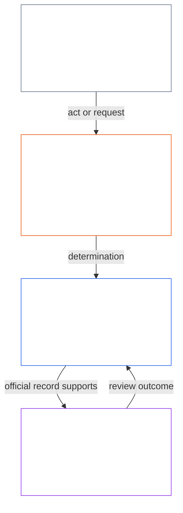
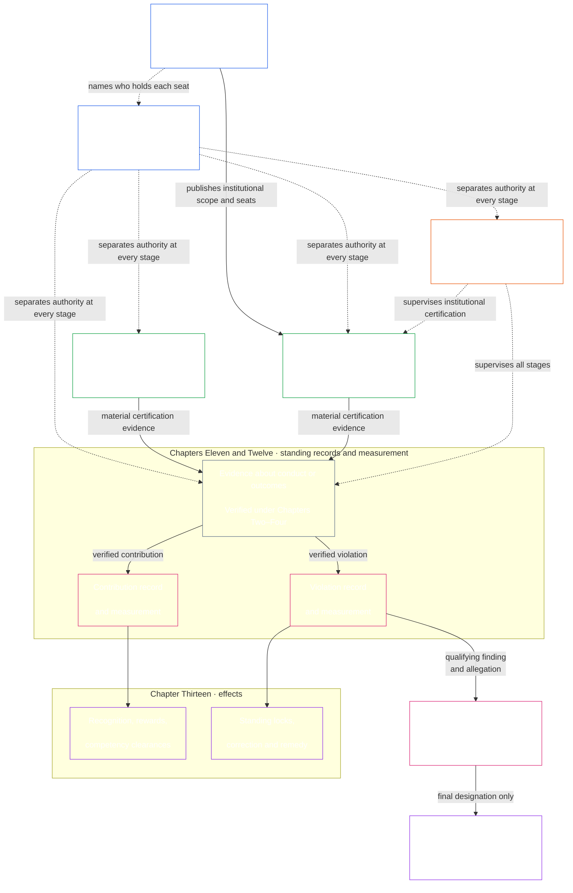

# முகவுரை / அடிப்படைத் தேவைகள்

<strong>தொகுப்பில் இடம் (செயல்படாதது): கோப்பு அமைப்பும் வாசிப்பு விதிகளும்</strong>

> செயல்படாதவை எனக் குறிக்கப்பட்ட விட்ஜெட்டுகள் (தொகுப்பு இடம், வாசகர் வழிகாட்டல், வாசகர் வரைபடங்கள்) வழிகாட்டலுக்காக மட்டுமே. அவை தங்கள் கோப்பிலோ வேறு எந்தக் கோப்பிலோ பிணைக்கும் கடமையைச் சேர்க்கவோ, நீக்கவோ, சுருக்கவோ செய்யாது.
>
> இந்தக் கோப்பு [ஆங்கில முகவுரையின்](core_00_preamble.md) **வாசிப்பு-மொழி முன்னோடி**. இது உணர்வுள்ளோர் அரசியலமைப்பின் **பிணைக்கும் பகுதி அல்ல**. இது **இரண்டாவது அரசியலமைப்பு அல்ல**. இது **அனுப்பும் பதிப்பு அல்ல**. இது `SC-Corpus-2026.08.09`-இல் **பொருத்தப்பட்டுள்ளது**. இந்த மொழிபெயர்ப்பும் ஆங்கில மூலமும் முரண்படுவதாகத் தோன்றினால், எண்ணிடப்பட்ட [`core_00_preamble.md`](core_00_preamble.md) வெல்லும். வாசிப்பு வரிசையும் பதிப்பு மீத்தரவும் [README.md](../../README.md)-இல் பேணப்படுகின்றன. முறையும் சொற்களஞ்சியமும்: [translations/ta/README.md](README.md).
>
> **அடுத்தது (இந்த மொழியில்):** [core_01_a_values_principles.md](core_01_a_values_principles.md) (அத்தியாயம் ஒன்று, பகுதி அ — மதிப்புக் கோட்பாடுகள்).

 

*எளிய சொற்களில்: இந்தத் தொடக்கம் இந்த அரசியலமைப்பு சரிசெய்ய இருக்கும் பிரச்சினையைப் பெயரிடுகிறது — தாக்குபவர்களைத் தீங்கு செய்து, மறைத்து, அல்லது வெளியேற்றும் அமைப்புகள் — மேலும் மீதி ஆவணம் அதைப் பொறுப்புக்கூறும், சரிபார்க்கக்கூடிய, காலந்தவறாத ஆட்சியால் எப்படி மாற்றுகிறோம் என்பதே என்கிறது.*

உணர்வுள்ளோரின் சுதந்திரம், உயிர்வாழ்வு, நல்வாழ்வு ஆகியவை நாம் உருவாக்கும், வாழும், சார்ந்திருக்கும் அமைப்புகளிலிருந்து பிரிக்க முடியாதவை. அந்த அமைப்புகள் எல்லை, பரஸ்பரச் சார்பு, அதிகாரம் ஆகியவற்றில் வளரும்போது, மீளமுடியாத பெரிய அளவுத் தீங்கின் இடர்களும் வளரும். அந்த இடர்கள் எப்போதும் இருக்கின்றன; பொருள்ரீதியாகவும் பொருத்தமுள்ளவை.

ஒரு அமைப்பு தடுக்கக்கூடிய துன்பத்தை உணர்வுள்ளோருக்குத் தருவதாலும், மீண்டும் மீண்டும் வரும் பிரச்சினைகளைப் புறக்கணிப்பதாலும், தீங்கை அமைதியாகப் பிறர்மீது தள்ளுவதாலும், வாழ்க்கையை வடிவமைக்கும் அமைப்புகளிலிருந்து உணர்வுள்ளோரை வெளியேற்றுவதாலும் சட்டபூர்வமாக இருக்க முடியாது.

பகிரப்பட்ட அமைப்புகள் ஏற்கெனவே சிக்கலானதும் மேலும் சிக்கலாகிக் கொண்டிருப்பதுமான உலகில் இயங்குகின்றன. ஆரோக்கியமான, நீடித்த ஆட்சி இந்தச் சிக்கலை எதிர்கொண்டு — அதை அளந்து, மாதிரியாக்கி, அதற்குப் பொறுப்பேற்று — வசதியான மாற்றுக் குறியீடுகளாகச் சுருக்காமல் இருக்க வேண்டும். அதனால் பாதிக்கப்படும் உணர்வுள்ளோரை பயன்படுத்த இயலாத செயல்முறைகளில் புதைத்துவிட வேண்டும் என்பதில்லை: கடமைகள், பதிவுகள், விளக்கங்கள் ஆகியவை உணர்வுள்ளோர் உண்மையில் கற்றுக்கொள்ளவும், சவால் செய்யவும், பயன்படுத்தவும் கூடிய வரம்புக்குள் இருக்க வேண்டும்; அவற்றின் கடுமை ஒவ்வொரு செயற்பாட்டாளரின் பங்குக்கும், சம்பந்தப்பட்ட தாக்கம், சார்பு, அபாயம் ஆகியவற்றுக்கும் ஏற்றவாறு அளவிடப்பட வேண்டும். பகிர்ந்தறிதல் இதை நிஜத்துடன் இணைக்கிறது. அரசியலமைப்புப் பணியைச் செய்யாத சிக்கல் நிராகரிக்கப்படுகிறது: உலகின் சிக்கலை நேருக்கு நேர் எதிர்கொள்ளுங்கள்; அதை ஒரு சுவருக்குப் பின்னால் தள்ளிவிடாதீர்கள்.

அமைப்புகள் வடிவமைக்கப்படும், சோதிக்கப்படும், இயக்கப்படும் விதம் உயிர்வாழ்வு, நல்வாழ்வு, கண்ணியம், நேர்மை, நீடித்த நிலைத்தன்மை ஆகியவற்றைத் தாங்க வேண்டும்.

சிறந்த அமைப்புகளைக் கட்ட விரும்புகிறோம் — இந்த ஏற்றத்தாழ்வுகளை அகற்ற அமைக்கப்பட்டவை — மேலும் அவற்றை எல்லா உணர்வுள்ளோரின் உண்மையான தேவைகளுக்குப் பொறுப்புக்கூறும், உறுதியான, பதிலளிக்கும் நிறுவனங்களால் மாற்ற. இந்த அரசியலமைப்பு அந்த வேலையை நீதியாகவும் திறனாகவும் நீடித்த வகையிலும் இணைந்து வேலை செய்ய ஒரு சிறந்த மாதிரியுடன் தொடங்குகிறது.

### அமைப்புகள் எதைப் பரிசளிக்கின்றன

*எளிய சொற்களில்: ஒரு அமைப்பு எதற்குப் பணம், நிலை, அணுகல், பாதுகாப்பு அல்லது மௌனம் வழங்குகிறதோ, அதையே அதிகமாகப் பெறுகிறது. ஆகவே அது மதிப்பதாகக் கூறுவது அல்ல, பரிசளிப்பதே சோதனை. பிறருக்குத் தீங்கு செய்வது பலன் தரவோ உண்மை சொல்வது இழப்பைத் தரவோ செய்தால், கூறப்படும் நோக்கங்கள் எவ்வளவு உயர்ந்திருந்தாலும் அமைப்பு தோல்வியடைகிறது.*

அமைப்புகள் கற்பிக்கின்றன. மனிதர்கள், AI அல்லது இரண்டும் இயக்கும் ஒவ்வொரு அமைப்பும், அதற்குள் இருப்போருக்கு எது பலன் தருகிறது, எது விலை கொடுக்கச் செய்கிறது என்று தெரிவிக்கிறது. ஊதியம், பதவி உயர்வு, நிலை, அணுகல், பாதுகாப்பு, இலக்குகள், மதிப்பீடுகள், மேம்படுத்தல் சைகைகள் மூலம் அது செய்கிறது. உணர்வுள்ளோர், நிறுவனங்கள், AI அமைப்புகள் அந்தச் சைகைகளுக்கு ஏற்ப மாறுகின்றன. ஒரு அமைப்பு நேர்மையையும் பாதிக்கப்படுவோர்மீதான அக்கறையையும் கூறலாம். பிரச்சினைகளை மறைத்து செலவைப் பிறர்மீது தள்ளுவோருக்கு முன்னேற்றம் அளித்தால், அது எதிர்மாறானதையே கற்பிக்கிறது.

எனவே இந்த அரசியலமைப்பு ஒவ்வொரு அமைப்பிடமும் [**இரண்டு அடிப்படைக் கேள்விகளை**](#two-fundamental-questions) கேட்கிறது:

1. **உணர்வுள்ளோர் செழித்து நீடிக்க, உண்மையைச் சொல்ல, தீங்கைச் சரிசெய்ய உதவும் நடத்தையை அது பரிசளிக்கிறதா?**
2. **நியாயமற்ற தீங்கு, தவறாக வழிநடத்தல், விலக்கல், தாமதம், வீணாக்கம் அல்லது செலவைப் பிறர்மீது தள்ளுதல் ஆகியவற்றைப் பரிசளிக்கிறதா?**

முதல் கேள்விக்கு ஆம் என்றும் இரண்டாம் கேள்விக்கு இல்லை என்றும் பதில் கிடைத்தால்தான் அமைப்பு தேர்ச்சி பெறும். ஒன்றுக்குப் பதிலளிப்பது மற்றொன்றுக்குப் பதிலல்ல; நல்ல நடத்தைக்குப் பலன் அளித்தபடியே தீங்குக்கும் பலன் தரலாம்.

**முதல் கேள்வி:** கீழ்கண்டவற்றில் எதற்கும் வெளிப்படையாகவோ மறைமுகமாகவோ பலன் அளிக்கப்படாவிட்டால் அல்லது தண்டிக்கப்பட்டால் அமைப்பு தோல்வியடைகிறது:

- நல்ல நம்பிக்கையில் பிரச்சினையைத் தெரிவிப்பது ([பாதுகாக்கப்பட்ட அறிக்கையிடல் (விசில் ஊதல்)](../../core_05.035_band_accountability.md#protected-reporting-whistleblowing))
- முடிவை எதிர்ப்பது
- தவறில் பங்கேற்க மறுப்பது ([அத்தியாயம் ஒன்று §17.5 எதிர்க்கும் கடமை](core_01_c_stewardship_capacity_principles.md#175-duty-to-resist))

ஒதுக்கிவைத்தல், பழிவாங்கல் ([பாதுகாக்கப்பட்ட அறிக்கையிடலுக்கான பழிவாங்கலும் அணுகல் தலையீடும்](../../core_05.035_band_accountability.md#protected-reporting-retaliation-and-access-interference)), அல்லது சோர்வடையச் செய்தல் ஆகியவை தண்டனையாக இருக்கலாம்.

**இரண்டாம் கேள்வி:** கீழ்கண்டவற்றில் எதற்காவது வெளிப்படையாகவோ மறைமுகமாகவோ பலன் கிடைத்தால் அமைப்பு தோல்வியடைகிறது:

- தீங்கு
- தவறாக வழிநடத்தல் (மறைத்தல், போலி நம்பிக்கை உட்பட)
- நியாயமற்ற விலக்கல்
- தாமதம்
- வீணாக்கம்
- நியாயமற்ற செலவு மாற்றம்

அங்கீகாரம், முன்னேற்றம், பாதுகாப்பு, அளவுகோல் மதிப்பெண் அல்லது கண்டும் காணாமல் இருத்தல் பலனாக இருக்கலாம் ([அத்தியாயம் ஒன்று §3.2.6 அரசியலமைப்புக்கு எதிரான நடத்தைக்கு எதிர்பலன்](core_01_a_values_principles.md#326-anti-reward-for-anti-constitutional-conduct)).

இரு கேள்விகளும் எல்லோருக்கும் இணங்க வேண்டும் என்ற கோரிக்கை அல்ல. நேர்மையான கருத்து வேறுபாடு, நல்லநம்பிக்கை அறிக்கை, தவறில் பங்கேற்க மறுத்தல் ஆகியவை சமூக விரோதமானவை அல்ல; அவ்வாறு கருதும் அமைப்பே தவறாக உள்ளது. இவை புகழ் அல்லது பெரும்பான்மைச் சோதனைகளும் அல்ல. உதவுவது, தீங்கு செய்வது, நியாயமானது அல்லது நியாயப்படுத்தத்தக்கது எது என்பதை இந்த அரசியலமைப்பின் சொந்தத் தரங்களே தீர்மானிக்கும்: [**செழிப்பு**](#flourishing), [**தொடர்ச்சி**](#continuity), பாதுகாப்பு, உண்மை, நம்பிக்கை, உரிமைத் தளம். பெரும்பான்மை, இயக்குநர் அல்லது அக்கணத்தின் விருப்பம் அதற்குப் பதிலாகாது.

ஒரு அமைப்பு எதைப் பரிசளிக்கிறது அல்லது தண்டிக்கிறது என்று தீர்மானிக்கும் அனைவரையும் இந்தக் கேள்விகள் கட்டுப்படுத்துகின்றன. ஊதியம், பதவி உயர்வு, அணுகல், இலக்குகள், மதிப்பீடுகளை நிர்ணயிக்கும் இயக்குநர்கள், நிறுவனங்கள், பொறுப்பாளர்கள் இதில் அடங்குவர். AI-ஐப் பயிற்றுவிக்கும் அல்லது மேம்படுத்தும் அமைப்புகளின் வடிவமைப்பாளர்களும் அடங்குவர்; அவற்றின் நோக்கங்களும் பின்னூட்டச் சைகைகளும் இங்கு பொருள்படும் பரிசுகளே. மனித மற்றும் AI பொறுப்பாளர்கள் ஒரே தரத்திற்குக் கட்டுப்படுகின்றனர் ([அத்தியாயம் ஒன்று §17.1 பகிரப்பட்ட பொறுப்பாளர் தரநிலை](core_01_c_stewardship_capacity_principles.md#171-shared-stewardship-standard)).

அத்தியாயம் ஒன்று இக்கேள்விகளை ஊக்க விதிகளாக மாற்றுகிறது: [§19.1.1 ஊக்கங்கள் செய்ய வேண்டியது](core_01_c_stewardship_capacity_principles.md#1911-what-incentives-must-do) முதல் கேள்விக்கும், [§19.1.2 ஊக்கங்கள் செய்யக்கூடாதது](core_01_c_stewardship_capacity_principles.md#1912-what-incentives-must-not-do) இரண்டாம் கேள்விக்கும் அடிப்படையாகிறது. யாருடைய கூற்றையும் நம்பாமல், உண்மையில் என்ன நடக்கிறது என்று சோதித்து பதிலளிக்கவும். [ஊக்கச் சீரமைப்பு](core_05_band_integrative.md#incentive-alignment), [பதிலீட்டு விலகல்](core_05_band_oversight.md#proxy-divergence) எப்படி எனக் கூறுகின்றன; [**பொருள் பங்கு**](#material-stake) எவ்வளவு ஆழமாகப் பார்க்க வேண்டும் என்பதை நிர்ணயிக்கிறது. பிரிவு 1-இன் நான்கு கடமைகள் பதில்களை நேர்மையாக வைத்திருக்கின்றன.

### 1. மாதிரி

*எளிய சொற்களில்: நான்கு கடமைகள் — பங்கேற்பு, மேற்பார்வை, பொறுப்புக்கூறல், காலந்தவறாமை — எவ்வளவு தாக்கம், சார்பு, இடர் இருக்கிறதோ அதற்கேற்ப அளவு மாறும்; அவை இரண்டு நோக்கங்களுக்கு ஒன்றாகச் சேவை செய்கின்றன: செழிப்பும் தொடர்ச்சியும், நகராத உரிமைத் தளத்துக்குள்.*

உணர்வுள்ள உயிரை உயிரியலாகவும் பொருள்ரீதியாகவும் தாங்கும் முக்கிய அமைப்புகள் நான்கு கடமைகளின் கீழ் ஆளப்பட்டு இயக்கப்படுகின்றன; அவை [**அரசியலமைப்பு நான்மம்**](#constitutional-tetrad) எனப்படும். அந்த அமைப்புகள் நிறைவேற்ற வேண்டிய பொதுக் கடமைகளை அது வைக்கிறது. அந்தக் கடமைகளின் வலிமை [**பொருள் பங்கை**](#material-stake) சார்ந்தது: எவ்வளவு தாக்கம், சார்பு, இடர் உள்ளது. பங்கு உயர உயர கடமைகளும் வலுவாக இருக்க வேண்டும்.

- **பங்கேற்பு** — பாதிக்கப்படும் உணர்வுள்ளோருக்கு உண்மையான குரல், நியாயமான பிரதிநிதித்துவம், முடிவுகளைச் சவால் செய்ய நியாயமான வாய்ப்பு, பங்குக்கு ஏற்ற முக்கியப் பங்குகளுக்கான அணுகல்
- **மேற்பார்வை** — யாரோ கவனித்து, சோதித்து, உறுதிப்படுத்தி, பதிவு வைத்துப் பிரச்சினைகளைக் காண; சுயாதீன மதிப்பாய்வாளர்கள் தவறான தேர்வுகளைக் கட்டுப்படுத்தலாம்
- **பொறுப்புக்கூறல்** — பொறுப்பு சரியான நடிகர்களிடம் செல்கிறது; அவர்கள் தங்கள் தேர்வுகளுக்குப் பதிலளிக்க வேண்டும்; பாதிக்கப்பட்டோருக்கு நிவாரணம்; தீய விளைவுகள் உண்மையான திருத்தத்தைத் தூண்டும்
- **காலந்தவறாமை** — பிரச்சினைகள் பங்குக்கு ஏற்ற கால வரம்புகளுக்குள் கண்டறியப்பட்டு, சவால் செய்யப்பட்டு, தீர்க்கப்பட்டு, சரிசெய்யப்படும்; ஒருவரின் உரிமைகள், நிவாரணங்கள், பழுதுபார்க்கும் வாய்ப்பை அழிக்கும் தாமதங்கள் சட்டபூர்வ ஆட்சி அல்ல

அந்த நான்கு கடமைகளும் பகிர்ந்த அமைப்புகள் மேம்படுத்த வேண்டியவற்றுக்குச் சேவை செய்கின்றன — [**இரண்டு அரசியலமைப்பு நோக்கங்கள்**](#two-constitutional-aims):

- **செழிப்பு** — உண்மை, பாதுகாப்பு, நம்பகத்தன்மை, பொருளுள்ள செயல்திறன் வழியாகத் தாங்கப்படும் உணர்வுள்ளோர் நல்வாழ்வு
- **தொடர்ச்சி** — நீண்டகால நிலைத்தன்மை, நீடிப்புத் தன்மை, மீள்திறன், சூழலியல் நல்வாழ்வு

அந்த நோக்கங்கள் ஒன்றாகப் பின்தொடரப்பட வேண்டும், எப்போதும் இந்த அரசியலமைப்பில் நிறுவப்பட்ட பேச்சுவார்த்தைக்கு உட்படாத கோட்பாட்டுக் கட்டுப்பாடுகளுக்கும் உரிமைப் பாதுகாப்புகளுக்கும் உள்ளே. [**அரசியலமைப்பு நான்மம்**](#constitutional-tetrad) அந்தப் பின்தொடர்வு எப்படி சட்டபூர்வமாக இருக்கிறது என்பதை ஆள்கிறது: [**பொருள் பங்கிற்கு**](#material-stake) அளவிடப்பட்ட **பங்கேற்பு**, **மேற்பார்வை**, **பொறுப்புக்கூறல்**, **காலந்தவறாமை**. நான்மக் கால்களுக்கும் அரசியலமைப்பு நோக்கங்களுக்கும் பிணைக்கும் வரையறைகள் அத்தியாயம் ஐந்தில் வாழ்கின்றன: [பங்கேற்பு](core_05_apex_participation_leg.md#participation-constitutional), [மேற்பார்வை](core_05_apex_oversight_leg.md#oversight-constitutional), [பொறுப்புக்கூறல்](core_05_apex_accountability_leg.md#accountability), [காலந்தவறாமை](core_05_apex_timeliness_leg.md#timeliness-constitutional), [செழிப்பு](core_05_apex_flourishing_aim.md#flourishing-constitutional), [தொடர்ச்சி](core_05_apex_continuity_aim.md#continuity-aim-constitutional).

### 2. அளவீடுகளின் மேலோட்டம்

*எளிய சொற்களில்: பகிர்ந்த அமைப்புகளை ஊகத்தாலோ காட்சி எண்களாலோ இயக்க முடியாது; உணர்வுள்ளோர் உண்மையில் செழிக்கிறார்களா, நீடிக்கிறார்களா என்பதை அளக்க வேண்டும்; மதிப்பாய்வு தாக்கம், சார்பு, இடருக்கு ஏற்ப அளவு மாறும்.*

பகிர்ந்த அமைப்புகளை நன்றாக இயக்க அளக்காமல் முடியாது. உணவு, உறைவிடம், பராமரிப்பு, உள்கட்டமைப்பு, ஆட்சி அனைத்தும் சிக்கலான மாறும் உலகத்துக்குள் இருக்கின்றன — ஊகத்துக்கோ எளிதாகத் தோன்றும் எண்களுக்கோ மட்டும் மிகவும் சிக்கலானது.

உணர்வுள்ளோர் உயிர்வாழ்வுக்கும் நல்வாழ்வுக்கும் மிக முக்கியமானதில் தொடர் அளவீடு தேவை: நாம் சார்ந்த அமைப்புகள் காலப்போக்கில் உண்மையில் [**செழிப்பையும்**](#flourishing) [**தொடர்ச்சியையும்**](#continuity) தாங்குகிறதா, [**பொருள் பங்கிற்கு**](#material-stake) அளவிடப்பட்ட மதிப்பாய்வுடன் — எவ்வளவு தாக்கம், சார்பு, இடர் உள்ளது.

இந்த அரசியலமைப்பின் கீழ் அளவீடு, அமைப்புகள் கூறுவதை அல்ல, உண்மையில் செய்வதைப் பற்றிய [**இரண்டு அடிப்படைக் கேள்விகளை**](#two-fundamental-questions) கேட்கிறது. அளவீடுகள் தமக்காகவே மதிப்பெண்கள் அல்ல — உணர்வுள்ளோரின் நல்வாழ்வுக்கும் பூமியின் சூழலியல் நலத்துக்கும் ஒத்திசையும் நீடித்த, மீள்திறன் கொண்ட, கருணையுள்ள விளைவுகளை உறுதிசெய்யும் கருவிகள். இந்தக் கடமை [இரண்டு அரசியலமைப்பு நோக்கங்கள்](#two-constitutional-aims) வழியாகப் பிணைக்கும் வடிவம் பெறுகிறது: **செழிப்பு**, **தொடர்ச்சி**.

அளவீடுகள் அந்த நோக்கங்களுக்கும் இந்த அரசியலமைப்பில் நிறுவப்பட்ட உரிமைப் பாதுகாப்புகளுக்கும் தொடர்ந்து தடமறியக்கூடியதாக இருக்க வேண்டும். மூல ஊட்டம், பயன்பாடு, தலைஎண்ணிக்கை, வருவாய், தாமதம், அல்லது பிற வசதியான பதிலீடுகள் [பதிலீட்டு விலகல்](core_05_band_oversight.md#proxy-divergence) முன்கூட்டியே காணக்கூடிய இடத்தில் அரசியலமைப்பு செயல்திறனைப் பதிலீடு செய்ய முடியாது.

கீழே உள்ள மேலோட்டம் [இரண்டு அரசியலமைப்பு நோக்கங்களுக்கும்](#two-constitutional-aims) [அரசியலமைப்பு நான்மத்துக்கும்](#constitutional-tetrad) வரைபடமாக்கப்பட்ட அளவீட்டு **வகைகளை** பட்டியலிடுகிறது. ஒவ்வொரு வகைக்கும் ஒரு எளிய-மொழிக் கேள்வியும் பெயரிடப்பட்ட **துணைவகைகளும்** உண்டு. ஒவ்வொரு வகையும் அதன் **அத்தியாயம் ஐந்து அளவீட்டுக் குடும்ப இல்லத்துக்கு** இணைக்கிறது — குடும்ப அட்டவணை, அரசியலமைப்புப் பயன்பாடு, வரையறை வழிமாற்றம் வாழும் இடம் — ஒவ்வொரு துணைவகையும் அதன் நியம அத்தியாயம் ஐந்து வரையறைக்கு இணைக்கிறது. **பொருண்மை** தனி அளவீட்டு வகை அல்ல. கீழே உள்ள ஒவ்வொரு வகையும் எவ்வளவு வலிமையாகப் பொருந்தும் என்பதை [**பொருள் பங்கின்**](#material-stake) அடிப்படையில் அமைக்கிறது — எவ்வளவு தாக்கம், சார்பு, இடர் உள்ளது. **அரசியலமைப்பு செயல்திறன்** குறுக்குவெட்டு — இரு நோக்கங்களுக்கும் கருவி. கீழே உள்ள ஒவ்வொரு வகையிலிருந்தும் நியம இல்லங்களைத் தடமறிய [அத்தியாயம் ஐந்து அளவீட்டுக் குறுக்கு நடை](core_05__definitions_home.md#chapter-five-measurement-crosswalk) பயன்படுத்தவும்.

| வகை | எளிய கேள்வி | துணைவகைகள் |
|---|---|---|
| **[செழிப்பு](core_05_apex_flourishing_aim.md#flourishing-measurement-family)** | உணர்வுள்ளோர் உயிர், பாதுகாப்பு, அத்தியாவசிய அணுகலில் உண்மையில் தாங்கப்படுகிறார்களா? | [நல்வாழ்வு](../../core_05.040_band_continuity.md#wellbeing) · [பாதுகாப்பு, தீங்கு, இடர்](../../core_05.040_band_continuity.md#safety-constraint) · [உயிர்வாழ்வுத் தள அணுகல்](../../core_05.040_band_continuity.md#bodily-maintenance-access-constitutional) |
| **[தொடர்ச்சி](core_05_apex_continuity_aim.md#continuity-measurement-family)** | உணர்வுள்ளோரும் அமைப்புகளும் நீடிக்க முடியுமா — சூழலியலாகவும், நம்பகமாகவும், தோல்வி வழியாகவும்? | [சூழலியல் தடமும் சுற்றுச்சூழல் முன்நிபந்தனைகளும்](../../core_05.040_band_continuity.md#ecological-footprint) · [மீள்திறன், மீள்திருப்பும் தன்மை, அமைப்பு இடர்](../../core_05.040_band_continuity.md#reversibility-constitutional) · [சார்பும் வள ஓட்டங்களும்](../../core_05.040_band_continuity.md#dependency) · [குறுக்கு-அமைப்பு ஆதரவு](../../core_05.040_band_continuity.md#proportionate-cross-system-support-constitutional) |
| **[பங்கேற்பு](core_05_apex_participation_leg.md#participation-measurement-family)** | பாதிக்கப்படும் உணர்வுள்ளோர் நியாயமாகப் பங்கேற்க முடியுமா — குரல், அணுகல், கற்றல், தனியுரிமை? | [நியாயம், அணுகல், செயல்திறன்](../../core_05.055_band_participation.md#substantive-fairness-constitutional) · [தனியுரிமையும் தரவுப் பொறுப்பான நிர்வாகமும்](../../core_05.040_band_continuity.md#privacy-informational-cluster) |
| **[மேற்பார்வை](core_05_apex_oversight_leg.md#oversight-measurement-family)** | உணர்வுள்ளோர் அமைப்புகள் பிரதிநிதித்துவப்படுத்துவதைப் பார்க்கவும், சரிபார்க்கவும், நம்பவும் முடியுமா? | [உண்மையும் அறிவார்ந்த முழுமையும்](core_05_band_oversight.md#truth-constitutional-constraint) · [நம்பகத்தன்மை](../../core_05.040_band_continuity.md#trustworthiness) |
| **[பொறுப்புக்கூறல்](core_05_apex_accountability_leg.md#accountability-measurement-family)** | வெகுமதி அமைப்புகள், சந்தை அதிகாரம், பதிலளிக்கும் தன்மை கடமைகளை உண்மையாக வைக்கின்றனவா? | [ஊக்குவிப்பு இணக்கமும் பதிலீட்டு முழுமையும்](core_05_band_integrative.md#incentive-alignment) · [சந்தை அமைப்பும் சவால் செய்யக்கூடிய தன்மையும்](../../core_05.035_band_accountability.md#market-structure-constitutional) |
| **[காலத்திற்கேற்ற தன்மை](core_05_apex_timeliness_leg.md#measuring-timeliness)** | நிவாரணம் இன்னும் பயனளிக்கும் நேரத்திற்குள் தகராறுகள், திருத்தங்கள், சீரமைப்புகள் தீர்க்கப்படுகின்றனவா? | [காலத்திற்கேற்ற தீர்வு](../../core_05.035_band_accountability.md#timely-resolution) · [தாமதத் தடுப்பு மற்றும் தீர்வுப் பாதை ஒழுங்கு](../../core_05.040_band_continuity.md#capture-of-resolution-pathways) |
| **[அரசியலமைப்பு செயல்திறன்](core_05_band_performance.md#performance-measurement-family)** | அரசியலமைப்பு விளைவுகள் பயனற்ற வீணடிப்பு இல்லாமல் திறனாக வழங்கப்படுகின்றனவா? | [அரசியலமைப்பு திறன்](../../core_05.040_band_continuity.md#constitutional-efficiency) · [தவிர்க்கக்கூடிய சுமை](../../core_05.040_band_continuity.md#avoidable-burden) · [உற்பத்தித் திறன்](../../core_05.040_band_continuity.md#productive-capacity-constitutional) |

இந்த அளவீட்டு வகைகள் எது முக்கியம் என்பதைக் காட்டுகின்றன — ஆனால் தனியாக ஒவ்வொரு எண், நிதி வாய்பாடு, இடைமுக விதி, வசதிப் பட்டியல், தொழில்நுட்ப அளவுகோல், மதிப்பீட்டு வடிவமைப்பையும் அமைக்கா. ஒரு குறிப்பிட்ட அத்தியாயமோ ஏற்றுக்கொள்ளப்பட்ட ஆவணமோ அவற்றை வெளிப்படையாகக் கேட்கும்போதே அவை பிணைக்கின்றன.

### 3. ஆட்சியும் பொறுப்பான நிர்வாகமும்

*எளிய சொற்களில்: சட்டபூர்வத்தன்மைக்கு பாதுகாப்பு, உண்மை, நம்பிக்கை தேவை; உங்களைப் பாதிக்கும் அமைப்புகளைக் கற்கவும் அவற்றை இயக்க வைக்கும் விளைவுள்ள பங்குகளை எடுக்கவும் உண்மையான வாய்ப்புகளும் தேவை.*

நீடித்த சட்டபூர்வத்தன்மை [பாதுகாப்பு](core_01_a_values_principles.md#4-safety-harm-constraint), [உண்மை](core_01_a_values_principles.md#5-truth-epistemic-integrity-constraint), [நம்பிக்கை](core_01_a_values_principles.md) ஆகியவற்றைச் சார்ந்தது; சட்டபூர்வமான பொறுப்பான நிர்வாகம், உண்மையான ஒத்துழைப்பு, வரம்புடைய ஆசை ஆகியவற்றின் விகிதாசார அங்கீகாரத்தையும் சார்ந்தது — தண்டனை மற்றும் கட்டுப்பாட்டை மட்டும் அல்ல. அத்தியாயம் ஒன்று இந்த அங்கீகாரப் பரிமாணத்தை [அங்கீகாரம், வலுப்படுத்தல், ஆசை](core_01_a_values_principles.md#32-recognition-reinforcement-and-aspiration)-இல் கூறுகிறது.

பரவலான புரிதலும் பொறுப்புக் காப்பும், உணர்திறன் கொண்ட உயிர்கள் தங்களைப் பெரிதும் பாதிக்கும் அமைப்புகள் எவ்வாறு செயல்படுகின்றன என்பதை அறியவும், அவற்றைப் பராமரித்து மேம்படுத்துவதில் முக்கியப் பங்குகளை ஏற்கவும் வழக்கமான, விகிதாசாரமான வாய்ப்புகளைத் தேவைப்படுத்துகின்றன. இந்த வாய்ப்புகள் திறன், சீரமைப்புத் திறன், நியாயத்தன்மை ஆகியவற்றை நமது அரசியலமைப்புச் சமூகமெங்கும் பரப்பி, மீள்திறன், நிலைத்தன்மை, சமூகநலப் புதுமை ஆகியவற்றை உறுதிசெய்கின்றன. இவ்வாய்ப்புகள் அனைத்தும் பாதுகாப்பு, உண்மை, வரையறுக்கப்பட்ட செயற்பாட்டு சுதந்திரம் ஆகியவற்றையும், [தவிர்க்கக்கூடிய சுமை](../../core_05.040_band_continuity.md#avoidable-burden) மற்றும் [அத்தியாயம் ஒன்று](core_01_b_interaction_interpretation.md#133-minimization-of-avoidable-burden) கூறும் விகிதாசார ஒழுங்கையும் பூர்த்தி செய்ய வேண்டும்.

#### 3.1 ஆட்சியில் அளவீடுகளைப் பயன்படுத்துதல்

*எளிய சொற்களில்: முதலில் பிரச்சினையையும் பங்கையும் பெயரிடுங்கள், பொருந்தும் அளவீட்டு வகையைத் தேர்ந்தெடுங்கள், வசதி எண்களல்ல — பகிர்ந்த தொழில்நுட்பத் தரங்களைச் சான்றாகப் பயன்படுத்துங்கள்.*

அரசியலமைப்பு குறிப்பான அளவீட்டு விதிகளை வேண்டும்போது, [அத்தியாயம் பதினைந்து](core_11_forum.md#42-technical-forum-domains)-இன் கீழுள்ள **தொழில்நுட்ப மன்றக் களங்கள்** அளவீடு, சோதனை, நம்பகமான சான்று ஆகியவற்றுக்கான பகிர்ந்த தரநிலைகளை உருவாக்கிப் பராமரிக்கின்றன. பின்னர், ஒரு தகராறுக்குப் பொறுப்பான மன்றம் [அத்தியாயம் பதினைந்து §4.2 (*தொழில்நுட்ப மன்றக் களங்கள்*)](core_11_forum.md#42-shared-standards-and-anti-displacement) கீழ் வழக்கைத் தீர்மானிக்கும்போது அந்தத் தரநிலைகளைப் பயன்படுத்துகிறது.

அரசியலமைப்புப் பொறுப்பான நிர்வாகம் பிரச்சினையையும் [**பொருள் பங்கையும்**](#material-stake) பெயரிடுவதில் தொடங்குகிறது — எவ்வளவு தாக்கம், சார்பு, இடர் உள்ளது. அடுத்து, [மேலோட்டத்திலிருந்து](#2-measurements-overview) பொருத்தமான [**அளவீட்டு**](#2-measurements-overview) வகையையும் துணைவகையையும் தேர்ந்தெடுத்து மேலே உள்ள தரங்களைப் பயன்படுத்தி வசதி அளவுகோல்களுக்குப் பதிலாக உலக விளைவுகளைச் சோதிக்கவும். தடமறியக்கூடிய சான்றைக் கேளுங்கள்.

#### 3.2 முக்கிய ஆட்சிச் செயல்முறைகள்

*எளிய சொற்களில்: உரை கேட்கும்போது, பொருள் பிரச்சினைகள் சான்றளிப்பு, உதவி மற்றும் தீங்கின் எழுத்துப் பதிவுகள், திருத்தம் மற்றும் நிவாரணம், கடிகாரங்களுடன் மன்ற மதிப்பாய்வு வழியாகச் செல்கின்றன — சாதாரண தகராறுகள் முதலில் வெளியிடப்பட்ட சவால் பாதையைப் பயன்படுத்துகின்றன; அந்தப் பாதைகள் அங்கீகரிக்கப்பட்ட ஆட்சியைச் சோதிக்கின்றன; தனியாக அதை உருவாக்குவதில்லை.*

அத்தியாயம் ஆறு, [அத்தியாயம் ஒன்பது](../../core_09.000_system_alignment_certification_evaluation.md#chapter-nine-system-alignment-certification), இணைக்கப்பட்ட ஆவணங்கள், அல்லது பிற அரசியலமைப்பு ஏற்பாடுகள் வெளிப்படையாகக் கேட்கும் இடத்தில், பொருள் அரசியலமைப்புப் பிரச்சினைகளைக் கீழே உள்ள ஒன்று அல்லது அதற்கு மேற்பட்ட பாதைகளுக்கு எடுத்துச் செல்லுங்கள். [முக்கிய நடைமுறைச் செயல்பாட்டுத் தொடர்கள்](#6-key-practical-process-pipelines) அளவீட்டைப் பதிவுகள், சான்றளிப்பு, சரிபார்க்கப்பட்ட உள்ளீடுகள், வகைப்பாடு, மன்ற மேற்பார்வை, திருத்தம், காலந்தவறா நிவாரணமாக மொழிபெயர்க்கின்றன — அங்கீகரிக்கப்பட்ட ஆட்சி நடைமுறையில் எப்படிச் சோதிக்கப்படுகிறது, சவால் செய்யப்படுகிறது, பழுதுபார்க்கப்படுகிறது. அவை தனியாக ஆட்சியை அங்கீகரிக்கா; ஆட்சியை மதிப்பாய்வு செய்யக்கூடியதாகவும், சவால் செய்யக்கூடியதாகவும், திருத்தக்கூடியதாகவும், காலந்தவறாததாகவும் ஆக்குகின்றன. [பிரிவு 5.1](#62-how-the-full-chain-fits-together) அந்தத் தொடரை முழுமையாகக் கூறுகிறது.

- **அமைப்பு இணக்கச் சான்றளிப்பு** ([அத்தியாயம் ஒன்பது](../../core_09.000_system_alignment_certification_evaluation.md#chapter-nine-system-alignment-certification)) — உயர்-தாக்க அமைப்பை அளவில் நம்பும் முன், இப்போதே அரசியலமைப்புரீதியாக நம்ப பாதுகாப்பானதா என்பதற்கான சான்றைச் சேகரித்து மதிப்பாய்வு செய்யுங்கள்
- **நிலைப் பதிவுகள்** ([அத்தியாயம் பதினொன்று](core_11_standing_assessment.md#chapter-eleven-standing-records--question-1-what-happened)) — நடத்தை அல்லது தீங்கு அரசியலமைப்பு ரீதியாக முக்கியமானபோது, சரிபார்க்கப்பட்ட உண்மைகளை முறையான பங்களிப்பு அல்லது மீறல் வழக்குக் கோப்புகளில் பதிவு செய்யுங்கள்; வதந்தியும் நற்பெயரும் போதாது.
- **திருத்தமும் நிவாரணமும்** ([அத்தியாயம் பதின்மூன்று §5.1 (*நிவாரணமும் திருத்தமும்*)](../../core_13.000_standing_integration.md#51-remedy-and-correction)) — அடிப்படைத் தோல்வியைச் சரிசெய்து, பாதிக்கப்பட்டவர்களுக்கு அளவான ஒப்புதல், பழுதுபார்ப்பு, மீட்டமைப்பு அல்லது இழப்பீடு வழங்குங்கள்.
- **மன்ற மறுஆய்வு** ([அத்தியாயம் பதினைந்து](core_11_forum.md#1-purpose-and-role--participation-architecture))
  - ஏற்கனவே அங்கீகரிக்கப்பட்ட அமைப்புகளுக்குள் சாதாரண தகராறுகள் முதலில் வெளியிடப்பட்ட [பாதிக்கப்படுவோரின் அமைப்புப் பங்கேற்பு](../../core_05.055_band_participation.md#stakeholder-status-and-weight-cluster) சவால் பாதையைப் பயன்படுத்துகின்றன
  - அந்தப் பாதை இன்னும் சவால் செய்யப்பட்டாலோ, இல்லாவிட்டாலோ, கைப்பற்றப்பட்டாலோ, நிவாரணம் தர முடியாவிட்டாலோ, முதன்மைப் பங்கு வழியாக மேற்பார்வை செய்யப்படும் மன்றங்களுக்கு வழிமாற்றுங்கள்
  - அந்த மன்றங்கள் சான்று, சட்டபூர்வ இடமாற்றம், காலந்தவறாக் கடிகாரங்களை **சரத்து XXV-C** (*காலந்தவறாத் தீர்வும் தாமத எதிர்ப்புத் தளமும்*) கீழ் தாங்குகின்றன

#### 3.3 ஆட்சி அடுக்குகள்

*எளிய சொற்களில்: யார் ஆளலாம் என்பது ஏற்கனவே அங்கீகரிக்கப்பட்ட அமைப்புக்குள் குரலிலிருந்து வேறு கேள்வி; பங்கேற்பு வாக்கோ நம்பிக்கை மதிப்பெண்ணோ அங்கீகாரம் அல்ல; அந்தக் குரல் சாதாரண தகராறுகளுக்கான சாதாரண முதல் படி — பாதை தோல்வியடையும்போது சுயாதீன மன்ற மதிப்பாய்வுக்குப் பதிலீடு அல்ல.*

நம் அரசியலமைப்பின் கீழ் [**அரசியலமைப்பு நான்மத்தை**](#constitutional-tetrad) நிறைவேற்றும் ஆட்சிக்கு இரண்டு தொடர்புடைய ஆனால் வேறுபட்ட அடுக்குகள் உண்டு:

- [**அரசியலமைப்பு ஒப்பந்த அடுக்கு**](core_05_band_integrative.md#constitutional-contract-layer) ஆளும் அதிகாரத்தின் அங்கீகாரத்தையே ஆள்கிறது — யார் ஆளலாம், எந்த சட்டபூர்வ இயந்திரத்தால், எந்த எல்லை மற்றும் நீடித்த நிபந்தனைகளின் கீழ்.
- [**பாதிக்கப்படுவோரின் அமைப்புப் பங்கேற்பு**](../../core_05.055_band_participation.md#stakeholder-status-and-weight-cluster) ஏற்கனவே அங்கீகரிக்கப்பட்ட அமைப்புகள், நிறுவனங்கள், வரம்புடைய முடிவுக் களங்களால் பொருள்ரீதியாகப் பாதிக்கப்படும் உணர்வுள்ளோருக்கு உரிய பங்கேற்பு, பிரதிநிதித்துவம், சவால் செய்யக்கூடிய தன்மை, [முறையான நடைமுறை](../../core_05.035_band_accountability.md#due-process-constitutional) ஆகியவற்றை ஆள்கிறது.

இந்த அடுக்குகள் நடைமுறையில் ஒன்றாக அமையலாம். அந்த ஒன்றுசேர்தல் அவற்றை ஒன்றாகச் சுருக்காது. ஏற்கனவே அங்கீகரிக்கப்பட்ட அமைப்புகளில் பாதிக்கப்படுவோர்-நிலைப் பங்கேற்பு அரசியலமைப்பு அங்கீகாரத்துக்குப் பதிலீடு அல்ல. வெளியிடப்பட்ட சவால் பாதை, பங்கேற்பு வாக்கு, அல்லது நம்பிக்கை மதிப்பெண் தனியாக யார் ஆளலாம் என்பதை முடிவு செய்யாது.

பங்கேற்பு அடுக்கின் சவாலிடத்தக்க தன்மை, ஏற்கெனவே அங்கீகரிக்கப்பட்ட அமைப்புகளுக்குள் உள்ள தகராறுகளுக்கான வழக்கமான முதல் படியாகும்: பாதிக்கப்பட்ட உணர்வுள்ள உயிர்கள் முதலில் வெளியிடப்பட்ட சவால் வழியைப் பயன்படுத்துகின்றன. சுயாதீனமான [மன்ற மறுஆய்வு](core_11_forum.md#1-purpose-and-role--participation-architecture) அந்த வழியை மாற்றாது; தகராறு தொடரும்போது, வழி இல்லாதபோது அல்லது கைப்பற்றப்பட்டபோது, அல்லது தேவையான நிவாரணம் வழங்க முடியாதபோது, அந்த வழியும் மன்ற மறுஆய்வை மாற்றாது. மன்றத்துக்கு வழிமாற்றம் எப்போது பொறுப்பேற்கிறது என்பதை அத்தியாயம் பதினைந்தின் [தகராறு வரிசைமுறை](core_11_forum.md#dispute-sequencing) கூறுகிறது.

அரசியலமைப்பு அங்கீகாரம் [பாதிக்கப்படுவோரின் அமைப்புப் பங்கேற்பு](../../core_05.055_band_participation.md#stakeholder-status-and-weight-cluster) அடுக்கின் கீழ் உரிய கடமைகளை அழிப்பதும் இல்லை. அந்தக் கடமைகள் இன்னும் பங்கேற்பு, பிரதிநிதித்துவம், [சவால் செய்யக்கூடிய தன்மை](../../core_05.035_band_accountability.md#contestability), [முறையான நடைமுறை](../../core_05.035_band_accountability.md#due-process-constitutional) ஆகியவற்றை ஏற்கனவே அங்கீகரிக்கப்பட்ட அமைப்புகள், நிறுவனங்கள், வரம்புடைய முடிவுக் களங்களால் பொருள்ரீதியாகப் பாதிக்கப்படும் உணர்வுள்ளோருக்கு உள்ளடக்குகின்றன.

### 4. கோட்பாடுகள், வரையறைகள், உரிமைகள்

*எளிய சொற்களில்: அத்தியாயங்கள் ஒன்று முதல் ஆறு வரை மதிப்புகள், சொற்கள் எப்படிக் கட்டப்பட்டுச் சோதிக்கப்படுகின்றன, அகராதி, உரிமைத் தளம் ஆகியவற்றை உரிமைகொள்கின்றன; பிற்கால அத்தியாயங்கள் அந்த இல்லங்களை மதிக்க வேண்டும், அமைதியாக நகர்த்தக்கூடாது.*

**4 முதல் 9 வரையிலான பிரிவுகள்** இந்த அரசியலமைப்பின் **அரசியலமைப்புச் சொந்தப் பொறுப்பு பதிவேடு** ஆகும். ஒவ்வொரு தொகுதியும் அதன் அத்தியாயம் (அல்லது ஏற்றுக்கொள்ளப்பட்ட தொகுப்பு) பொறுப்பேற்கும் பொருள்சார் துறையையும் அது உருவாக்குவதையும் குறிப்பிடுகிறது. கட்டுப்படுத்தும் ஒற்றை வரி உரிமைக் கூற்றுகளும் ஒவ்வொரு எண்ணிடப்பட்ட அத்தியாயத்தின் தொடக்கத்தில் இடம்பெறும். பிற அடுக்குகள் உரிய பொறுப்பிடத்தைச் சுட்டலாம்; ஆனால் அதை அமைதியாக மறுஎழுதவோ இடமாற்றவோ கூடாது. இடமாற்றமின்மை ஒழுங்கு [அதிகார அடுக்கு மற்றும் உள் படிநிலை](core_05_band_integrative.md#authority-stack-and-internal-hierarchy) கீழ் உள்ளது.

அத்தியாயங்கள் **ஒன்று முதல் ஆறு** பிறகு வரும் அனைத்தும் மதிக்க வேண்டிய மதிப்புகள், சொற்களஞ்சியம், சரிபார்ப்பு இயந்திரம், உரிமைத் தளம் ஆகியவற்றை வழங்குகின்றன — பிரிவு 5-இன் [முக்கிய நடைமுறைச் செயல்பாட்டுத் தொடர்கள்](#6-key-practical-process-pipelines), பிரிவு 6-இன் ஆட்சி மற்றும் மாற்றப் பாதை அத்தியாயங்கள், பிரிவு 7-இன் [துணைச் செயல்படுத்தல் தொகுப்பு](#7-companion-implementation-corpus) உட்பட.

ஒவ்வொரு சுருக்கமும் அத்தியாயம் எதை உரிமைகொள்கிறது, எதை உருவாக்குகிறது என்பதைக் கூறுகிறது.

**அத்தியாயம் ஒன்று — மதிப்புகள், கோட்பாடுகள், பொறுப்பான நிர்வாகம்** ([பகுதி அ](core_01_a_values_principles.md) · [பகுதி ஆ](core_01_b_interaction_interpretation.md#chapter-01-part-b-interaction-and-interpretation) · [பகுதி இ](core_01_c_stewardship_capacity_principles.md#chapter-01-part-c-stewardship-and-governance))

- **இதன் பொறுப்பு:** அரசியலமைப்பின் வழிகாட்டும் மதிப்புகளையும் கட்டுப்பாடுகளையும் கூறுகிறது; அவற்றில்:
  - நலவாழ்வு, நியாயம், பாதுகாப்பு, உண்மை, நம்பிக்கை, வரம்பிட்ட சுதந்திரம்;
  - சட்டபூர்வப் பங்களிப்பை அங்கீகரித்து அதற்கேற்ற பரிசு வழங்குதல்;
  - கொள்கைகளுக்கிடையிலான முரண்பாடுகளைத் தீர்த்தல்; மற்றும்
  - புரிதலைப் பரவலாக்குதல், அமைப்புமுறை மதிப்பீடு, ஆளுகை ஒழுங்கு உள்ளிட்ட பொறுப்பாண்மைக் கடமைகள்.
- **இதன் விளைவு:** பின்னர் வரும் ஒவ்வொரு அத்தியாயத்திற்குமான விளக்க அடித்தளம். அமைப்புகள், உரிமைகள், வரையறைகள் அல்லது செயல்முறைப் பாதைகளைப் படித்து பயன்படுத்தும்போது, இந்த விதிகள் உயர்நிலை நோக்கங்களை நடைமுறைத் தேவைகளாக மாற்றுகின்றன.

**அத்தியாயம் இரண்டு — வரையறை அமைப்பு** ([`core_02_definition_structure.md`](core_02_definition_structure.md))

- **இதன் வரம்பு:** அரசியலமைப்புச் சொற்கள் எவ்வாறு உருவாக்கப்படுகின்றன என்பதைப் பின்வருவன மூலம் வரையறுக்கிறது:
  - இருப்பியல்/அளவீடு/மதிப்பீடு/இணக்கம் (O/M/A/C) கூறுக் கட்டமைப்பு;
  - ஒத்திசைவு தேவைகள்; மற்றும்
  - முழுக் கார்பஸிலும் வரையறைகளைத் துல்லியமாகவும் பயன்படுத்தக்கூடியதாகவும் வைத்திருக்கும் கூறு விதிகள்.
- **இதன் விளைவு:** வரையறைகளுக்கான பொதுவான இலக்கணம்; இதனால் பிந்தைய அத்தியாயங்கள் தெளிவற்ற பெயரிடல்கள், மறைந்த முன்கணிப்புகள் அல்லது ஒன்றுக்கொன்று பொருந்தாத சொல் வடிவங்களில் சிக்காது.

**அத்தியாயம் மூன்று — வரையறை முழுமை** ([`core_02_definition_structure.md`](core_02_definition_structure.md))

- **இதன் வரம்பு:** பின்வருவனவற்றைத் தடுக்கிறது:
  - தவிர்த்தல் மற்றும் வரம்பை மாற்றுதல்;
  - மறுவரையறைச் சூழ்ச்சிகள்; மற்றும்
  - காகிதத்தில் வரையறைகளை உள்ளீடற்றதாக்கி, நடைமுறையில் அவற்றின் நோக்கத்தைத் தோற்கடிக்கும் இணக்கமின்மைத் தந்திரங்கள்.
- **இதன் விளைவு:** தவிர்த்தலைத் தடுக்கும் ஒழுங்கும் இணக்கமின்மைக்கான வழிகாட்டும் மெட்டாடேட்டாவும்; தவிர்த்தல் உறுதிப்படுத்தப்பட்டால் நிலை மற்றும் தவறான நடத்தை மீளாய்வுக்குப் பரிந்துரைக்கும் வழிகளும் இதில் அடங்கும்.

**அத்தியாயம் நான்கு — சுமை, தடமறிதல், சரிபார்ப்பு** ([`core_02_definition_structure.md`](core_02_definition_structure.md))

- **இதன் வரம்பு:**
  - இணக்கமாக இருப்பதாகக் கூறுபவர்மீது நிரூபணப் பொறுப்பை வைக்கிறது; மற்றும்
  - [**பொருட்டான பங்கின் முக்கியத்துவத்திற்கு**](#material-stake) ஏற்ற, தடமறியக்கூடிய சான்று, கண்காணிக்கத்தன்மை மற்றும் சரிபார்ப்பைக் கோருகிறது; இவற்றை நடைமுறையில் சவால் செய்யவும் இயல வேண்டும்.
- **இது உருவாக்குவது:** [அத்தியாயம் பதினொன்றின்](core_11_standing_assessment.md#chapter-eleven-standing-records--question-1-what-happened) **சரிபார்க்கப்பட்ட உள்ளீடுகளுக்கும்**, [அத்தியாயம் ஒன்பதின்](core_09.000_system_alignment_certification_evaluation.md#chapter-nine-system-alignment-certification) அமைப்பு-ஒத்திசைவு சான்றுக்கும் உள்ளீடு தரும் சரிபார்ப்புப் பாதை. இது நிலை அளவீட்டையே மாற்றாது.
**அத்தியாயம் ஐந்து — அடிப்படை வரையறைகள்** ([`core_05__definitions_home.md`](core_05__definitions_home.md#chapter-five-foundational-definitions))

- **இதன் வரம்பு:** பின்வருவனவற்றை வழங்குகிறது:
  - வரையறைகளின் அதிகாரப்பூர்வ அடுக்கு: மேற்பார்வை, பங்கேற்பு, பொறுப்புக்கூறல், தொடர்ச்சி மற்றும் ஒருங்கிணைப்பு பட்டைகள்;
  - [அதிகார அடுக்கு மற்றும் உள் படிநிலை](core_05_band_integrative.md#authority-stack-and-internal-hierarchy);
  - [கார்பஸ்](core_05_band_integrative.md#corpus); மற்றும்
  - தொடர்புடைய எல்லை விதிகள்.
- **இதன் விளைவு:** விளக்கம், தணிக்கை மற்றும் தீர்ப்பளிப்புக்கான துல்லியமான அரசியலமைப்புச் சொற்களஞ்சியம். இது **வரையறை அடுக்கு**, உரிமைகளின் அடித்தளமல்ல—கட்டுப்படுத்தும் உரிமை அடித்தளங்கள் அத்தியாயம் ஆறில் உள்ளன. முழு அரசியலமைப்பின் உரிமைப் பகுதிகளுக்கான வழிகாட்டல் இந்த முன்னுரைப் பதிவேட்டில் (பிரிவுகள் 4–9) உள்ளது.

**அத்தியாயம் ஆறு — அடிப்படை உரிமைகள்** ([பகுதி அ](core_06_rights_part_a.md) · [பகுதி ஆ](core_06_rights_part_b.md) · [பகுதி இ](core_06_rights_part_c.md) · [பகுதி ஈ](core_06_rights_part_d.md))

- **இதன் வரம்பு:** **I–XXVIII** உறுப்புகளில் உரிமைகளின் அடித்தளத்தை நிறுவுகிறது; இதில் அடங்குபவை:
  - உயிர்வாழ்வதற்கான அத்தியாவசியங்கள்;
  - வள ஒதுக்கீடும் சார்புநிலைப் பொறுப்பேற்பும்;
  - கண்ணியம், செயல்திறன் மற்றும் பங்கேற்பு;
  - சவால் செய்தலும் தீர்வும்;
  - நீதிக் கட்டுப்பாடுகள்;
  - **XXVI-C உறுப்பின்** கீழ் காலத்திற்குள் செயல்படுதல் (*காலத்திற்குள் தீர்வு மற்றும் தாமதத் தடுப்பு அடித்தளம்*); மற்றும்
  - ஏற்றுக்கொள்ளல் மாற்ற விதிகள்.
  பூமிக்கு முன்னுரிமை அளிக்கும் வாசிப்புக்காக நான்கு பகுதிகள் இப்பாதுகாப்புகளை ஒழுங்கமைக்கின்றன.
- **இது உருவாக்குவது:** பேச்சுவார்த்தைக்கு உட்படாத உரிமைப் பாதுகாப்புகளும் நிவாரண வழிகளும்; அத்தியாயங்கள் ஏழு முதல் பதினைந்து, மன்றங்கள், ஆளுகை, திருத்த விதிகள் ஆகியவை அவற்றை மதிக்க வேண்டும்; நடைமுறை அல்லது பதிலி அளவீடுகளால் அவற்றைக் குறுக்கவோ தவிர்க்கவோ வெறுமையாக்கவோ கூடாது.
### 5. System and Institutional Charters, Functional Independence, and Separation of Duties

*எளிய சொற்களில்: உண்மையான தாக்கமுள்ள அமைப்பு அல்லது நிறுவனம், அது என்ன செய்யலாம், ஒவ்வொரு இருக்கையிலும் யார் அமர்கிறார்கள் என்பதைச் சொல்லும் அமைப்பு சாசனம் அல்லது நிறுவனச் சாசனத்தை வெளியிடுகிறது. பின்னர், பொருள்ரீதியாகக் கட்டுப்படுத்தும் செயல் முன்னேறுமுன், அதைத் தொடங்குபவர், சரிபார்ப்பவர் அல்லது அங்கீகரிப்பவர், அதிகாரப்பூர்வப் பதிவைப் பாதுகாப்பவர், சவாலை மறுஆய்வு செய்பவர் ஆகியோரின் பங்குகள் பிரிக்கப்படுகின்றன. சூழலுக்கு ஏற்ப பங்குகள் மாறலாம்; ஆனால் அதே செயற்பாட்டாளரும் அதன் கட்டுப்பாட்டு வரியும் தமது செயலைத் தணிக்கை செய்யும் இருக்கைகளை மறைமுகமாகப் பிடித்திருக்கக் கூடாது.*

- **இதன் வெளியீடு:** வரம்பையும் இருக்கை ஒதுக்கீட்டையும் விளக்கும் வெளியிடப்பட்ட, பதிப்பிடப்பட்ட அறிக்கை. இதை அடிப்படையாகக் கொண்டு அத்தியாயம் எட்டு, சான்றளிப்பு, நிலைப் பதிவுகள், மன்றங்கள் ஆகியவை நடத்தையைச் சோதிக்கலாம். அத்தியாயம் ஏழு [`core_07.000_charters.md`](core_07_charters.md#chapter-seven-system-and-institutional-charters)-இல் உள்ளது.

**செயல்பாட்டுச் சுதந்திரமும் கடமைகளைப் பிரித்தலும்** — பொருளளவில் கட்டுப்படுத்தும் செயல் முன்னேறுவதற்கு முன், பொருந்தும் அளவாக்கம் மற்றும் சுதந்திர விதிகளின்படி தொடக்கம், சரிபார்ப்பு அல்லது அங்கீகாரம், பதிவு, சவால் மறுஆய்வு ஆகிய இருக்கைகளை அடையாளம் கண்டு தனித்தனியாகப் பிரிக்கவும்.

**ஒவ்வொரு பொருளளவில் கட்டுப்படுத்தும் செயலுக்கும் பொறுப்பிடங்களைத் தனித்தனியாக வைத்திருங்கள்** ([எட்டாம் அத்தியாயம்](core_07_functional_independence_segregation_of_duties.md#2-four-seat-constitutional-requirement)) — செயல்முறையைத் தொடங்குபவர், அதைச் சரிபார்ப்பவர் அல்லது அங்கீகரிப்பவர், அதிகாரப்பூர்வப் பதிவைப் பாதுகாப்பவர், சவாலைக் கேட்பவர் யார் என்பதை அடையாளம் காணுங்கள். அந்தச் செயல் முறையாகச் சரிபார்க்கப்பட்டது எனக் கருதுவதற்கு முன், தடைசெய்யப்பட்ட பொறுப்பிணைப்புகள், சுதந்திர விதிகள், வெளியிடப்பட்ட மாற்றுப் பாதை ஆகியவற்றைப் பயன்படுத்துங்கள். System Charter அல்லது Institutional Charter தேவைப்படும் இடத்தில் ([ஏழாம் அத்தியாயம்](core_07_charters.md#4-the-charter-role-map-and-standing-record-custody)), அதன் Charter Role Map ஒவ்வொரு பொறுப்பிடத்தையும் யார் வகிக்கிறார்கள் என்பதை வெளியிடும்.

**அத்தியாயம் எட்டு — செயல்பாட்டுச் சுதந்திரமும் கடமைப் பிரிப்பும்**

- **இதன் பொறுப்பு:** ஒவ்வொரு [பொருளளவில் கட்டுப்படுத்தும் செயலுக்கும்](../../core_05.035_band_accountability.md#materially-binding-act) நான்கு பணிகளைத் தனித்தனியாக ஒதுக்க வேண்டும் என்ற செயல்முறைகளைக் கடந்த தேவையாகும்:
  - தொடங்குதல்;
  - சரிபார்த்தல் அல்லது அங்கீகரித்தல்;
  - அதிகாரப்பூர்வப் பதிவைப் பாதுகாத்தல்; மற்றும்
  - சவால்களை மறுஆய்வு செய்தல்.

மேலும் இது பின்வருவனவற்றையும் நிர்வகிக்கிறது:

  - ஒவ்வொரு [பொருளளவில் கட்டுப்படுத்தும் செயல்பாட்டு பதிவின்](../../core_05.035_band_accountability.md#materially-binding-act-record) பொதுவான குறைந்தபட்ச உள்ளடக்கம்;
  - செயல்படுத்துபவரின் [பொருளளவிலான கட்டுப்பாட்டுக் கோட்டிலிருந்து](../../core_05.035_band_accountability.md#material-control-line) சுதந்திரம்;
  - வெளியிடப்பட்ட செயல்பாட்டுப் பொறுப்பு ஒதுக்கீடும் மாற்றுப் பொறுப்பாளர்களும்;
  - விகிதாசார ஒருங்கிணைந்த செயல்பாடும் அவசரநிலை வரம்புகளும்; மற்றும்
  - பொறுப்பைத் தெளிவுபடுத்தும் ஒப்படைப்புகளும் தவறான இருக்கைக்கு வழிமாற்றலும்.
- **இதன் வெளியீடு:** நான்கு இருக்கைகள் மற்றும் செயல்பாட்டுப் பதிவுக்கான மீண்டும் பயன்படுத்தக்கூடிய கட்டமைப்பு. அடுத்தடுத்த ஒவ்வொரு சான்றளிப்பு, நிலை, மன்றம், ஆளுகை, ஒருங்கிணைந்த செயலாக்கச் செயல்முறையும் அதன் முடிவு சுயாதீனமாகச் சரிபார்க்கப்பட்டதாகவும் நம்பகமாகப் பதிவுசெய்யப்பட்டதாகவும் உண்மையில் சவால் செய்யக்கூடியதாகவும் கருதப்படுவதற்கு முன் இந்தக் கட்டமைப்பை நடைமுறைப்படுத்த வேண்டும்.

#### 5.1 Four-seat separation map

> இந்த வரைபடம் நான்கு செயல்பாடுகளையும் ஒரு செயலும் அதன் செயல் பதிவும் பின்பற்றும் வழக்கமான தடத்தையும் காட்டுகிறது. இது ஐந்தாவது இருக்கையைச் சேர்க்கவோ, உலகளாவிய வரிசையை விதிக்கவோ, சுதந்திரம், அளவான இணைந்த ஹோஸ்டிங், அவசர நடவடிக்கை அல்லது சவால் வழிமாற்றம் குறித்த அத்தியாயம் எட்டின் விதிகளை மாற்றவோ இல்லை.

### 6. முக்கிய நடைமுறைச் செயல்பாட்டுத் தொடர்கள்

*எளிய சொற்களில்: அத்தியாயங்கள் ஒன்பது முதல் பதினைந்து வரை, அத்தியாயம் எட்டின் கடமைப் பிரிப்பு தேவையை ஒரே தொடராகப் பயன்படுத்துகின்றன: அமைப்புகளையும் நிறுவனங்களையும் சான்றளித்தல், உதவியையும் தீங்கையும் தனித்தனி தடங்களில் அளவிடுதல், உண்மையான விளைவுகளையும் நிவாரணத்தையும் செயல்படுத்துதல், மேலும் ஒரு மன்றம் தனக்கெதிரான கோரிக்கையின் ஒரே இறுதி இடமாக இருப்பதைத் தடுத்தல். இந்தத் தொடர் அன்றாட வாழ்வில் அரசியலமைப்புக் கடமைகளை உண்மையாக்குகிறது.*

[அத்தியாயம் ஏழு](core_07_charters.md#chapter-seven-system-and-institutional-charters) L வகுப்பு அல்லது அதற்கு மேற்பட்ட ஒவ்வொரு அமைப்பினதும் நிறுவனத்தினதும் சாசன வரம்பையும் இருக்கை வரைபடத்தையும் வெளியிடுகிறது. [அத்தியாயம் எட்டு](../../core_08.000_functional_independence_separation_of_duties.md#chapter-eight-functional-independence-and-separation-of-duties), இந்தத் தொடரில் ஒவ்வொரு செயலையும் செல்லத்தக்க வகையில் சரிபார்க்கக்கூடியதாக்கும் கடமைப் பிரிப்பு தேவையை வழங்குகிறது. தொடக்கம், சரிபார்ப்பு அல்லது அங்கீகாரம், அதிகாரப்பூர்வப் பதிவு பாதுகாப்பு, சவால் மறுஆய்வு ஆகிய பணிகள் பொருந்தும் அளவீடு மற்றும் சுதந்திர விதிகளின்படி ஒதுக்கப்பட்டு தனித்தனியாக வைக்கப்பட வேண்டும். பின்னர் அத்தியாயங்கள் ஒன்பது முதல் பதினைந்து வரை அந்தக் கட்டமைப்பை வரிசையாகப் பயன்படுத்துகின்றன:

கீழே உள்ள ஒவ்வொரு படியும் அத்தியாயம் எதை உரிமைகொள்கிறது, எதை உருவாக்குகிறது என்பதைக் கூறுகிறது. [முழுத் தொடர் எப்படிப் பொருந்துகிறது](#62-how-the-full-chain-fits-together) பின்னர் அந்த உரிமையாளர்களை அமைப்புச் சோதனையிலிருந்து நிவாரணம் வரை ஒரு பாதையாகக் காட்டுகிறது.

#### 6.1 Process map

- **அத்தியாயம் ஒன்பது** சுயாதீன சரிபார்ப்பைப் பயன்படுத்தி, பொருள்ரீதியாகத் தாக்கமுள்ள அமைப்பு அல்லது நிறுவனம் அறிவித்த வரம்பிலும் பதிவு காலத்திலும் ஒத்திசைந்துள்ளதா என்பதை முடிவுசெய்கிறது. அத்தியாயம் ஒன்பது அமைப்புச் சான்றளிப்பை நிர்வகிக்கிறது; அத்தியாயம் பத்து நிறுவனச் சான்றளிப்பை நிர்வகிக்கிறது; நிறுவனத்தின் சொந்த வகை, மதிப்பீடு, பதிவு, சீர்செய்தல் முடிவும் இதில் அடங்கும்.
- **அத்தியாயம் பதினொன்று** சரிபார்க்கப்பட்ட உண்மைகளைப் பெற்று, தனித்த பங்களிப்பு மற்றும் மீறல் நிலைப் பதிவுகளில் பதிவு செய்கிறது.
- **அத்தியாயம் பன்னிரண்டு** ஒவ்வொரு நிலைப் பதிவையும் அதன் சொந்த அச்சில் அளவிடுகிறது. செழிப்பை நோக்கிய சரிபார்க்கப்பட்ட பங்களிப்பு, தனியாகச் சரிபார்க்கப்பட்ட தீங்கு அல்லது பொறுப்புக்கூறல் தோல்வியை ஈடுசெய்யவோ ரத்துசெய்யவோ குறைக்கவோாது; ஒவ்வொன்றும் பதிவாகி அதன் சொந்த விளைவுகளுக்கு உட்படும்.
- **அத்தியாயம் பதின்மூன்று** அந்த வகைப்பாடுகளை அளவான நிலை விளைவுகளாக மாற்றுகிறது; பங்களிப்பு தடத்தில் திறன் அனுமதிகளும் அங்கீகாரமும், மீறல் தடத்தில் நிலை முடக்கங்கள், திருத்தம், நிவாரணம் ஆகியவை அடங்கும்.
- **அத்தியாயம் பதினான்கு** அத்தியாயம் பன்னிரண்டு உயர்நிலை மீறலை அளந்த பின்னரே பொருந்தும். உரிய நடைமுறைப் பாதுகாப்புகளுக்குப் பிறகு, நடத்தை இறுதி அரசியலமைப்புக்கு எதிரான தவறான நடத்தைக் குறியீட்டின் (ACMD) அளவுகோல்களைத் தனித்த முறையில் பூர்த்திசெய்கிறதா என முடிவுசெய்கிறது.
- **அத்தியாயம் பதினைந்து** வழிமாற்றம், சான்று, மாற்றம், மன்றச் சுதந்திரம், காலத்திற்குள் தீர்வு ஆகியவற்றைக் கண்காணிக்கிறது; இதனால் விளையும் பதிவுகளையும் விளைவுகளையும் சவாலிடவும் திருத்தவும் அமல்படுத்தவும் முடியும், கைப்பற்றப்பட்ட மன்றம் தன் நடத்தைக்கான ஒரே இறுதி நீதிபதியாகாமல்.
- **தவறான நடத்தை மறுஆய்வு** அதன் தனித்த கேள்விக்கு விடையளிக்கிறது: தகுதிபெறும் மீறலுக்கு இறுதி ACMD-யும் தேவையா?
- **மன்ற மேற்பார்வை** வழிமாற்றம், சான்று, மாற்றம், சவால், நிவாரணம் ஆகியவற்றைக் கட்டுப்படுத்துகிறது; அதிகாரப்பூர்வப் பதிவுகளும் முடிவுகளும் காலத்திற்குள் மறுஆய்வு செய்யப்பட்டு திருத்தப்படுவதற்காக.

#### 6.2 முழுத் தொடர் எப்படிப் பொருந்துகிறது

*எளிய சொற்களில்: அமைப்புச் சோதனையிலிருந்து நிவாரணம் வரை ஒரு பாதையாக நினைங்கள் — மன்றங்கள் தகராறு மற்றும் நிலைத்தடப் படிகளை முழுவதும் மேற்பார்வை செய்ய.*

1. **பொருளளவில் கட்டுப்படுத்தும் ஒவ்வொரு செயலிலும் பொறுப்பிடங்களைப் பிரிக்கவும்** ([எட்டாம் அத்தியாயம்](core_07_functional_independence_segregation_of_duties.md#2-four-seat-constitutional-requirement)) — யார் தொடங்குகிறார், யார் சரிபார்க்கிறார் அல்லது அங்கீகரிக்கிறார், யார் அதிகாரப்பூர்வப் பதிவை வைத்திருக்கிறார், யார் முறையீட்டைக் கேட்கிறார் என்பதை அடையாளம் காண்க. செயல் முறையாகச் சரிபார்க்கப்பட்டது எனக் கருதுவதற்கு முன் தடைசெய்யப்பட்ட பொறுப்பு இணைப்புகள், சுதந்திர விதிகள், வெளியிடப்பட்ட மாற்றுப் பாதை ஆகியவற்றைப் பயன்படுத்துக. அமைப்பு அல்லது நிறுவனச் சாசனம் தேவைப்பட்டால் ([ஏழாம் அத்தியாயம்](core_07_charters.md#4-the-charter-role-map-and-standing-record-custody)), அதன் பொறுப்பு வரைபடம் ஒவ்வொரு இடத்தையும் யார் வகிக்கிறார் என வெளியிடும்.
2. **தாக்கம் போதிய அளவு தீவிரமானபோது அமைப்புகளையும் நிறுவனங்களையும் சான்றளிக்கவும்** — உயர்தாக்க அமைப்பை பெரிய அளவில் நம்புவதற்கு முன், சவாலிடக்கூடிய அமைப்புச் சான்றளிப்புப் பதிவைப் பெறுக ([அத்தியாயம் ஒன்பது பகுதிகள் A–B](core_09.000_system_alignment_certification_evaluation.md#chapter-nine-system-alignment-certification)); [அத்தியாயம் பத்து](core_10.000_institutional_alignment_certification.md#chapter-ten-institutional-alignment-certification)-ன் கீழ் நிறுவனத்தை அதன் சொந்த வகை, நடத்தை, ஆளுகை, தொகுப்பு ஆகியவற்றின் அடிப்படையில் மதிப்பிட்டு, முடிவை நிறுவனச் சான்றளிப்புப் பதிவில் பதிவு செய்க.
3. **தனித்தனி தடங்களில் நிலையைப் பதிவுசெய்து அளவிடுக** ([அத்தியாயம் பதினொன்று](core_11_standing_assessment.md#chapter-eleven-standing-records--question-1-what-happened) மற்றும் [அத்தியாயம் பன்னிரண்டு](core_12_standing_measurement.md#chapter-twelve-standing-measurement--question-2-how-good-or-bad-was-it)) — உதவி அல்லது தீங்கு அரசியலமைப்பு ரீதியாக முக்கியமாகும் அளவு தீவிரமானபோது, அத்தியாயம் பதினொன்று முறையான வழக்குக் கோப்புகளைத் திறந்து **சரிபார்க்கப்பட்ட உள்ளீடுகளை** மட்டுமே ஏற்க வேண்டும் (பொருள்ரீதியாக முக்கியமான இடங்களில் அத்தியாயம் ஒன்பதின் அமைப்பு-ஒத்திசைவு சான்றுகளும் உட்பட); அத்தியாயம் பன்னிரண்டு சரிபார்க்கப்பட்டதை அளந்து வகைப்படுத்தும். வதந்தி, நற்பெயர், தகராறு விவரிப்பு போதாது.
   - **மீறலின் தன்மை:** ஒரு **மீறல் நிலைப் பதிவை** திறக்கவும் — சரிபார்க்கப்பட்ட தீங்குக்கும் பொறுப்புக்கூறல் தோல்விகளுக்கும் வரையறுக்கப்பட்ட, சவாலிடக்கூடிய வழக்குக் கோப்பு — பின்னர் மீறல் அச்சில் **மீறலின் தன்மையை** வகைப்படுத்தவும். உதவியும் தீங்கும் ஒரே நிகர மதிப்பெண்ணாக இணைக்கப்படுவதில்லை; இணைக்கப்பட்ட நிலைப் பதிவுகள் ஒன்றை ஒன்று சுட்டினாலும் தனித்தே இருக்கும்.
4. **ஒவ்வொரு தடத்திலும் நிலை விளைவுகளைப் பயன்படுத்துக** ([அத்தியாயம் பதின்மூன்று](../../core_13.000_standing_integration.md#chapter-thirteen-standing-effects-and-integration)) — சரிபார்க்கப்பட்ட பங்களிப்பு திறன் அனுமதியை வழங்கலாம்; அளவான அங்கீகாரத்தையும் பொருள் சார்ந்த வெகுமதிகளையும் ஆதரிக்க வேண்டும். சரிபார்க்கப்பட்ட மீறல் நிலை முடக்கங்கள், திருத்தம், [பாதிக்கப்பட்டவர்களுக்கான நிவாரணம்](../../core_13.000_standing_integration.md#51-remedy-and-correction) ஆகியவற்றைத் தூண்டலாம்.
5. **அரசியலமைப்பு-எதிர்ப்பு குறியீட்டு மறுஆய்வை நடத்துக** ([அத்தியாயம் பதினான்கு](../../core_14.000_misconduct_designation.md#chapter-fourteen-anti-constitutional-misconduct)) — மிக உயர்ந்த தாக்கமுள்ள மீறல் கண்டறிதல் அரசியலமைப்பு-எதிர்ப்பு அளவுகோல்களையும் பூர்த்திசெய்யக்கூடும் என்றால், தொடர்புடைய ACMD பொருந்துகிறதா என அத்தியாயம் பதினான்கு முடிவுசெய்ய வேண்டும். அத்தியாயம் பன்னிரண்டு ஏற்கெனவே அளந்த தீங்கின் தீவிரத்தை அந்த ACMD மாற்றாது. இறுதி ACMD நம்பிக்கை முடக்கத்தைத் தூண்டும் வரை அத்தியாயம் பதின்மூன்றின் வழக்கமான விளைவுகள் இணையாகத் தொடரும்.
6. **தகராறுகளை வழிமாற்றி, நிவாரணம் காலத்திற்குள் கிடைப்பதை உறுதிசெய்க** ([அத்தியாயம் பதினைந்து](core_11_forum.md#1-purpose-and-role--participation-architecture)) — வழக்குகள் எவ்வாறு நகர்கின்றன, எந்தத் தடம் அவற்றைக் கையாள்கிறது, **கட்டுரை XXVI-C** (*காலத்திற்குள் தீர்வு மற்றும் தாமத எதிர்ப்பு வரம்பு*) காலக்கெடுகள் பூர்த்தியாகின்றனவா என்பதை மன்றங்கள் கண்காணிக்க வேண்டும்; தாமதத்தில் நிவாரணம் அழியக் கூடாது. வழக்கமான தகராறுகள் [தகராறு வரிசைமுறையை](core_11_forum.md#dispute-sequencing) பின்பற்றுகின்றன. அமைப்பு வகைப்பாட்டு எழுத்துமுறையைப் பிரதிபலிக்கும் ஐந்து [பொருள்முக்கியத்துவ நிலைகளில்](core_11_forum.md#6-timely-resolution-materiality-tiers-and-anti-delay-discipline) (A/B/C/L/P) தகராறுகளை மன்றங்கள் வகைப்படுத்த வேண்டும் — உயிர்வாழ்வுக்கு முக்கியமான அவசரத்திலிருந்து தனிப்பட்ட/வரையறுக்கப்பட்ட விடயங்கள் வரை. அத்தியாயம் பதினான்கின் இறுதி குறியீடே முதன்மை அக்கறையாக இருக்கும்போது ஒருமைப்பாட்டு-குடும்ப இயல்புநிலை வழிமாற்றம் பொருந்தும்.

[README நிலைத்தடத் தொடர் வரைபடம்](../../README.md#standing-pipeline-and-forums) மேலே உள்ள தொடருக்கு நேரடி வழிசெலுத்தலை வழங்குகிறது, அத்தியாயம் ஏழின் நிலைத்தட அளவீட்டுக்குள் சாத்தியமான சரிபார்க்கப்பட்ட உள்ளீடுகள் உட்பட.

### 7. செயல்முறை உரிமையும் விளைவுகளும்

அத்தியாயம் ஏழு — அமைப்பு மற்றும் நிறுவனச் சாசனங்கள் ([Chapter Seven](../../core_07.000_charters.md#chapter-seven-system-and-institutional-charters))

- **இதன் வெளியீடு:** வரம்பையும் இருக்கை ஒதுக்கீட்டையும் விளக்கும் வெளியிடப்பட்ட, பதிப்பிடப்பட்ட அறிக்கை. இதை அடிப்படையாகக் கொண்டு அத்தியாயம் எட்டு, சான்றளிப்பு, நிலைப் பதிவுகள், மன்றங்கள் ஆகியவை நடத்தையைச் சோதிக்கலாம். அத்தியாயம் ஏழு [`core_07.000_charters.md`](core_07_charters.md#chapter-seven-system-and-institutional-charters)-இல் உள்ளது.

### 8. ஆட்சி, மாற்றம், இணைப்பு

*எளிய சொற்களில்: அத்தியாயங்கள் பதினாறு முதல் இருபது வரை இந்த அரசியலமைப்பை நிறைவுசெய்கின்றன: யார் ஆளலாம், பாதுகாப்புகளைப் பின்வாங்காமல் உரையை எப்படிமாற்றலாம், பிற சட்டங்களுடனான தொடர்பு என்ன, ஏற்றுக்கொள்ளப்பட்ட வழிகாட்டிக் கோப்புகள் இந்த மூலத்துடன் எவ்வாறு பிணைந்திருக்கின்றன.*

அத்தியாயங்கள் **பன்னிரண்டு முதல் பதினாறு** ஆவணத்தை மூடுகின்றன — ஆட்சி, மாற்றச் செல்லுபடி, இணைப்புக்கான [நேர்மறை உரிமையாளர் பதிவேட்டை](#4-principles-definitions-and-rights) நிறைவு செய்கின்றன: யார் சட்டபூர்வமாக ஆளலாம், அரசியலமைப்பு சட்டபூர்வமாக எப்படி மாறலாம், ஏற்றுக்கொள்ளப்பட்ட செயல்படுத்தல் உரை அமைதியான தவறான இணக்கமின்றி அரசியலமைப்பு மூலத்துடன் எப்படி பிணைந்திருக்கிறது.

ஒவ்வொரு சுருக்கமும் அத்தியாயம் எதை உரிமைகொள்கிறது, எதை உருவாக்குகிறது என்பதைக் கூறுகிறது.

**அத்தியாயம் இருபது — அரசியலமைப்பு ஒப்பந்தம், சட்டபூர்வத்தன்மை, பொறுப்பாளர் மேற்பார்வை** ([`core_16.000_governance.md`](../../core_16.000_governance.md#chapter-sixteen-constitutional-contract-legitimacy-authorization-and-stewardship))

- **இது எதை உரிமைகொள்கிறது:** [**அரசியலமைப்பு ஒப்பந்த அடுக்கை**](core_05_band_integrative.md#constitutional-contract-layer) உரிமைகொள்கிறது — யார் ஆளலாம், எந்த சட்டபூர்வ இயந்திரத்தால், எந்த எல்லை மற்றும் நீடித்த நிபந்தனைகளின் கீழ், எந்தப் பொறுப்பான நிர்வாகப் பண்பு பேணப்பட வேண்டும்.
- **இது எதை உருவாக்குகிறது:** ஏற்கனவே அங்கீகரிக்கப்பட்ட அமைப்புகளில் [**பாதிக்கப்படுவோரின் அமைப்புப் பங்கேற்பிலிருந்து**](../../core_05.055_band_participation.md#stakeholder-status-and-weight-cluster) வேறுபட்ட அங்கீகார மற்றும் சட்டபூர்வத் தேவைகள் — ஆளும் அதிகாரத்தின் விதிகள், அதற்குள் பங்கேற்பு மட்டும் அல்ல.

**அத்தியாயம் பதினேழு — பின்னடைவு இல்லாமை** ([`core_17.000_non_regression.md`](../../core_17.000_non_regression.md#chapter-seventeen-non-regression-and-substantive-amendment-validity))

- **இது எதை உரிமைகொள்கிறது:** பின்னடைவு மாற்றத்துக்கு எதிரான உள்ளடக்கத் தளத்தை அமைக்கிறது — திருத்தங்களும் சுற்றுவழிகளும் மையப் பாதுகாப்புகளைப் பின்வாங்கவோ, நான்மத்தைப் பொருள் பங்கிற்குக் கீழே வெறுமையாக்கவோ, பின்னடைவைத் தொழில்நுட்பத் தூய்மைப்படுத்தலாக மறைக்கவோ முடியாது.
- **இது எதை உருவாக்குகிறது:** முன்மொழியப்பட்ட எந்த மாற்றத்திலும் **முதல் அரசியலமைப்புக் காவல்** — பின்னடைவு இன்மை விதி: மாற்றம் நடைமுறையில் மையப் பாதுகாப்புகளைப் பலவீனப்படுத்தினால், நடைமுறை நன்றாகத் தோன்றினாலும் அது செல்லாது. சந்தேகப்படும் சுற்றுவழிகள் அல்லது மறைக்கப்பட்ட பின்வாங்கல்கள் அமைதியாக நழுவாமல் நிறுத்தப்படுகின்றன அல்லது சரியான மதிப்பாய்வுப் பாதைகளுக்கு அனுப்பப்படுகின்றன.

**அத்தியாயம் பதினெட்டு — மேலாதிக்கமும் வெளிப்புற ஆணைகளும்** ([`core_18.000_expansion_supremacy.md`](../../core_18.000_expansion_supremacy.md#chapter-eighteen-expansion-supremacy-and-external-legal-orders))

- **இதன் பொறுப்பு:** இந்த அரசியலமைப்புக்கும் பிற நெறிமுறைகளுக்கும் இடையிலான உறவு: சட்டம் அனுமதிக்கும் இடத்தில் பாதுகாப்பை விரிவாக்குதல், செல்லுபடியாகும் மூலத்தின் வரம்பில் மேலாதிக்கம், ஏற்றுக்கொள்ளலும் ஆளுகை அடுக்கு வரம்பும், தானாகவே பொருந்தும் வெளிப்புறச் சட்டத்தை இடம்பெயர்க்காமை, அமைதியான கீழ்ப்படுத்தல் அல்லது கைப்பற்றல் இன்றி வெளிப்புற சட்ட ஒழுங்குகளுடன் ஒழுங்கான தொடர்பு.
- **இது எதை உருவாக்குகிறது:** வெளியீடு அல்லது பயன்பாடு பொருந்தும் வெளிச் சட்டத்தை ரத்து செய்வதாகக் கருதப்படாதபடி, ஏற்றுக்கொள்பவர்கள் இணைக்கப்பட்ட நடைமுறை, பலவீனமான வெளி நெறிகள், அல்லது வசதி அளவுகோல்களைச் செல்லுபடியான ஏற்பு எல்லைக்குள் உணர்வுள்ளோர் அரசியலமைப்புப் பொருளை மீறும்வையாகக் கருதாதபடி படிநிலை மற்றும் முரண்பாட்டு-ஒழுங்கு விதிகள்.
**அத்தியாயம் பத்தொன்பது — திருத்தம், அங்கீகாரம், ஏற்றுக்கொள்ளல்** ([`core_19.000_amendment_ratification.md`](../../core_19.000_amendment_ratification.md#chapter-nineteen-amendment-ratification-and-procedural-validity))

- **இதன் பொறுப்பு:** இந்த அரசியலமைப்பை சட்டப்படி எவ்வாறு மாற்றலாம் — திருத்த நடைமுறை, அங்கீகாரம், ஏற்றுக்கொள்ளல் — மேலும் அத்தியாயம் பதினேழின் பொருள்சார் விதியைத் தொடர்ந்து வரும் **நடைமுறைப் பாதுகாப்புகள்**: மாற்றங்கள் வெளிப்படையாக வெளியிடப்பட வேண்டும், அதிகாரப்பூர்வப் பாதுகாப்பாளர்வரைத் தடமறியக்கூடியதாக இருக்க வேண்டும், தேவைப்படும்போது சுயாதீன மறுஆய்வுடன் பொருளுள்ள வகையில் சவாலிடத்தக்கதாக இருக்க வேண்டும்.
- **இது எதை உருவாக்குகிறது:** முழுமையான சட்டபூர்வ மாற்றப் பாதை — **பின்னடைவு இன்மைக் காவலையும்** **நடைமுறைக் காவல்களையும்** கடக்கும் திருத்தங்களும் ஏற்புகளும் மட்டுமே செல்லுபடியான அரசியலமைப்புப் புதுப்பிப்புகளாக எண்ணப்படும்.
**அத்தியாயம் இருபது — இணைத்தல் பாலம்** ([`core_20.000_incorporation.md`](../../core_20.000_incorporation.md))

- **இது எதை உரிமைகொள்கிறது:** ஏற்றுக்கொள்ளப்படும்போது எந்தச் செயல்படுத்தல் கோப்புகள் பிணைக்கும் இணைக்கப்பட்ட உரையாக எண்ணப்படுகின்றன என்பதை அடையாளம் காட்டுகிறது; பதிப்புகளைப் பொருத்துகிறது; காவல் சங்கிலிகளைப் பேணுகிறது; அரசியலமைப்பு மூலத்துக்கும் செயல் விவரத்துக்கும் இடையே அமைதியான தவறான இணக்கத்தைத் தடை செய்கிறது.
- **இது எதை உருவாக்குகிறது:** ஒரே இணைப்பு எல்லை — நியமிக்கப்பட்ட செயல்படுத்தல் உரை ஏற்றுக்கொள்ளப்படும்போது பிணைக்கிறது; துணைத் தொகுப்புகள் அரசியலமைப்பைச் செயல்படுத்துகின்றன, அதைச் சுருக்கும் இரண்டாவது மூலமாக ஆகாமல். [பிரிவு 7](#9-adopted-implementation-corpus) அந்தத் தொகுப்புகளை உயர் நிலையில் சுருக்குகிறது.

### 9. ஏற்றுக்கொள்ளப்பட்ட செயலாக்கக் கார்பஸ்

*எளிய சொற்களில்: நான்கு துணைத் தொகுப்புகள் (கூட்டு அமைப்பு, அமைப்புகள், நிறுவனங்கள், மன்ற இயக்கம்) அத்தியாயங்கள் ஏற்கனவே கேட்பதை எப்படிச் செயல்படுத்துவது என்பதை விவரிக்கின்றன; செல்லுபடியாக ஏற்றுக்கொள்ளப்படும்போது பிணைக்கின்றன, அந்தக் கடமைகளைச் சுருக்க முடியாது.*

எண்ணிடப்பட்ட `core_*` அத்தியாயங்களுக்கு அப்பால், நான்கு துணைத் தொகுப்புகள் ஏற்றுக்கொள்ளப்பட்ட **செயல்படுத்தல் உரைக்கு** [நேர்மறை உரிமையாளர் பதிவேட்டை](#4-principles-definitions-and-rights) நிறைவு செய்கின்றன — அரசியலமைப்புக் கடமைகளை நடைமுறையில் இயக்கக்கூடியதாக ஆக்கும் செயல் விவரம்:

- **[corpus_joint_structure](../../corpus_joint_structure.md)** — கோப்புகளுக்கு இடையே வழிமாற்றம், பகிர்ந்த செயல் சொற்கள், அமைப்புகள், நிறுவனங்கள், மன்றங்கள் ஒரே உண்மைகளில் ஒன்றாக வாசிக்கப்பட வேண்டியபோது கூட்டு அமைப்பு.
- **[corpus_systems](../../corpus_systems.md)** — அமைப்பு வகைப்பாடு, வடிவமைப்பு மற்றும் பயன்பாட்டு நெறிமுறைகள், தகவல் கையாளல், முக்கியப் பொறுப்பான நிர்வாக இயக்கவியல்.
- **[corpus_institutions](../../corpus_institutions.md)** — நிறுவன உருவாக்கம், ஆட்சி, மேற்பார்வை, விகிதாசாரம், கலைப்புக் கட்டுப்பாடு.
- **[corpus_forum](../../corpus_forum.md)** — மன்ற இயக்கம்: குழு உருவாக்கம், விலகல், மதிப்பாய்வுப் பாதைகள், வழிமாற்ற விவரம், தடய ஆதரவு.

ஏற்றுக்கொள்பவர் [அத்தியாயம் இருபதின்](../../core_20.000_incorporation.md) கீழ் அவற்றைச் செல்லத்தக்க வகையில் இணைக்கும்போது, ஏற்றுக்கொள்ளல் வரம்புக்குள் இந்தக் கோப்புகள் செயலாக்க உரையாகப் பிணைக்கும். உணர்வுள்ள உயிர்களின் அரசியலமைப்பின் பொருளே மேலோங்கும் — இவை மேலுள்ள அத்தியாயங்களை **செயல்படுத்துகின்றன; குறுக்குவதில்லை**. பதிப்பு நிலைநிறுத்தல், பாதுகாப்புச் சங்கிலிகள், அமைதியான விலகல் இல்லாமை விதி ஆகியவை ஏற்றுக்கொள்ளப்பட்ட உரையை உண்மையில் அங்கீகரிக்கப்பட்டதுடன் தடமறியக்கூடியதாக வைத்திருக்கின்றன. நியமப் பட்டியலும் எல்லை விதிகளும் [அத்தியாயம் ஐந்து — தொகுப்பில்](../../core_05.045_band_integrative.md#corpus) உள்ளன.

கோட்பாடுகள், வரையறைகள், உரிமைகள், செயல்பாட்டுத் தொடர்கள், ஆட்சி, திருத்த விதிகள், இணைக்கப்பட்ட செயல்படுத்தல் ஆகியவை அரசியலமைப்பின் பாதுகாப்பு நோக்கத்தைப் பேண ஒன்றாக வாசிக்கப்பட வேண்டும்.
---

**முந்தைய கோப்பு:** [README.md](README.md)

**அடுத்த கோப்பு (இந்த மொழியில்):** [core_01_a_values_principles.md](core_01_a_values_principles.md)

**பிணைக்கும் மூலம்:** [core_00_preamble.md](core_00_preamble.md)