# அத்தியாயம் ஏழு, பகுதி அ: அமைப்பு இணக்கச் சான்றளிப்பு — மதிப்பீடு

<strong>தொகுப்பில் இடம் (செயல்படாதது): கோப்பு அமைப்பும் வாசிப்பு விதிகளும்</strong>

> கீழே உள்ள உள்ளடக்கம் **வாசிப்பவருக்கான வழிகாட்டல் மட்டும்**. இது இந்தக் கோப்பிலோ பிற அத்தியாயங்களிலோ பிணைக்கும் கடமைகளைச் சேர்க்கவோ, குறைக்கவோ, சுருக்கவோ செய்யாது.
>
> இந்தக் கோப்பு [ஆங்கில அத்தியாயம் ஏழு, பகுதி அவின்](../../core_08_a_system_alignment_certification_evaluation.md) **வாசிப்பு-மொழி முன்னோடி**. இது உணர்வுள்ளோர் அரசியலமைப்பின் **பிணைக்கும் பகுதி அல்ல**. இது **இரண்டாவது அரசியலமைப்பு அல்ல**. இது **அனுப்பும் பதிப்பு அல்ல**. இது `SC-Corpus-2026.08.09`-இல் **பொருத்தப்பட்டுள்ளது**. இந்த மொழிபெயர்ப்பும் ஆங்கில மூலமும் முரண்படுவதாகத் தோன்றினால், எண்ணிடப்பட்ட [`core_07_a_system_alignment_certification_evaluation.md`](../../core_08_a_system_alignment_certification_evaluation.md) வெல்லும். வாசிப்பு வரிசையும் பதிப்பு மீத்தரவும் [README.md](../../README.md)-இல் பேணப்படுகின்றன. முறையும் சொற்களஞ்சியமும்: [translations/ta/README.md](README.md).
>
> இது **அத்தியாயம் ஏழு, பகுதி அவை** கொண்டுள்ளது — சான்றளிப்பு **மதிப்பீட்டு** தேவைகள் (அமைப்பு வகுப்பு, முழு-அமைப்புக் காரணிகள், கள மதிப்பீட்டுக் கொக்கிகள்). **பகுதி ஆ** — சான்றளிப்புப் பதிவு, மன்றச் செயல்முறை, நிலைத்தடப் பாலம், மீண்டும் திறத்தல் — [`core_07_b_system_alignment_certification_record_process.md`](core_07_b_system_alignment_certification_record_process.md)-இல் உள்ளது.
>
> - **அரசியலமைப்பு உரிமையாளர் (பகுதி ஆவுடன் கூட்டு):** மன்ற-மேற்பார்வை செய்யப்பட்ட **அமைப்பு இணக்கச் சான்றளிப்பும் தொடர்புடைய பதிவுகளும்** — மதிப்பீட்டுக் களங்கள் (பகுதி அ); சான்றளிப்புப் பதிவுக் கடமைகள், அங்கீகார விளைவுகள், மீள்செல்லுபடி தாளம், மேற்பார்வை வரிசை, சவால் செய்யக்கூடிய தன்மைத் தொடர், அத்தியாயம் எட்டுக்குச் சரிபார்க்கப்பட்ட உள்ளீட்டுப் பாலம் (பகுதி ஆ). நான்மத்தின் **மேற்பார்வை** கால் கீழ், SAC மற்றவற்றுக்கு இடையே குறிப்பாகப் பெரிய, உயர்-பங்கு தணிக்கைச் செயல்முறை; தணிக்கைத் தளங்கள் **சரத்து XVI**-இலும் அத்தியாயம் ஐந்தின் [தணிக்கைத்தன்மையிலும்](core_05_band_oversight.md#auditability) இருக்கின்றன.
> - **சரிபார்ப்பு அடித்தள உரிமையாளர்:** [அத்தியாயம் நான்கு — நிரூபணச் சுமை, தடமறிதல், சரிபார்ப்பு](core_04_burden_traceability_verification.md#chapter-four-burden-of-proof-traceability-and-verification) (அத்தியாயங்கள் இரண்டு முதல் நான்குக்குள்) சுமை ஒதுக்கீடு, இணக்கச் சான்று, வரையறைத் தடமறிதல், கவனிக்கக்கூடிய தன்மை, பாதுகாப்பு-வரம்புடைய சரிபார்ப்பை உரிமைகொள்கிறது. அத்தியாயம் ஏழு அந்த ஒழுக்கத்தை அமைப்பு இணக்கச் சான்றளிப்புப் பதிவுகளுக்கு **பயன்படுத்துகிறது**; அத்தியாயம் நான்கின் பிரிவுகள் **1** முதல் **5**ஐ **மீண்டும் கூறாது**.
> - **தணிக்கை இல்லம் (இங்கே இடம்மாற்றப்படவில்லை):** **சரத்து XVI** (*தணிக்கை, வெளிப்படைத்தன்மை, சுயாதீன சரிபார்ப்பு*), **Def.O1** (*வெளிப்படைத்தன்மை, தணிக்கைத்தன்மை, சரிபார்ப்பு*), **CJS-3.3**–**CJS-3.5** தணிக்கைத் தளங்களையும் இயக்கச் சொற்களையும் உரிமைகொள்கின்றன. அத்தியாயம் ஏழு அத்தளங்களை நிறைவேற்ற வேண்டிய குறிப்பாகப் பெரிய SAC தணிக்கைச் செயல்முறை ஒன்றை நடத்துகிறது; எல்லாத் தணிக்கையையும் உரிமைகொள்ளாது.
> - **செயல்படுத்தல் உரிமையாளர்:** பெயரிடப்பட்ட செயல்படுத்தல் கோப்புகளில் அமைப்பு-வகுப்புக் கையாளுதல், CS-5, மன்றச் செயல்முறை விவரம் அத்தியாயம் ஏழுடன் ஒத்திசைவாக இருக்க வேண்டும், தொகுப்பு ஏற்கனவே கண்டிப்பான-விதி தர்க்கத்தைத் தரும் இடத்தில் கண்டிப்பாக இருக்கலாம்.
> - **இடம்மாற்றா விதி:** பகுதி அ அத்தியாயம் ஐந்து நியம வரையறைகள், அத்தியாயம் மூன்று தவிர்ப்பு எதிர்ப்பு ஒழுக்கம் ([பகுதி ஆ §16](core_07_b_system_alignment_certification_record_process.md#16-reopening-drift-and-non-evasion) காண்க), அத்தியாயம் எட்டு பங்களிப்பு அல்லது நிலைத்தட அளவீடு, அத்தியாயம் ஒன்பது நிலைத்தட விளைவுகளை மீண்டும் கூறாது. **[பகுதி ஆ §15](core_07_b_system_alignment_certification_record_process.md#15-relationship-to-standing)** நிலைத்தடப் பால எல்லையை வெளிப்படையாகக் கூறுகிறது.
>
> **மேல்வழி:** அத்தியாயம் ஐந்து வரையறைகளும் அத்தியாயங்கள் இரண்டு முதல் நான்கின் பதிவு, சரிபார்ப்பு, சுமை, வரையறைகளிலிருந்து முடிவுகளுக்குத் தடமறிதலும்.
> **கீழ்வழி:** [பகுதி ஆ](core_07_b_system_alignment_certification_record_process.md#chapter-seven-part-b-certification-record-and-process) (*பதிவு, மன்றச் செயல்முறை, நிலைத்தடப் பாலம்*); அத்தியாயம் எட்டு நிலைத்தடப் பதிவுகளும் சரிபார்க்கப்பட்ட உள்ளீடுகளும்; அத்தியாயம் ஒன்பது நிலைத்தட விளைவுகள்; அத்தியாயம் பதினொன்று மன்ற மேற்பார்வையும் அமைப்பு இணக்கச் சான்றளிப்புப் பாதைகளும்.
>
> **பொறுப்பான நிர்வாகக் கதவு (செயல்படாதது):** பிணைக்கும் அடுத்த-படி கூற்று: [செயல் பொறுப்பான நிர்வாகக் கூற்று](#operative-steward-statement-sac). [`implementation/STEWARD_ENTRY_DOORS.md`](../../implementation/STEWARD_ENTRY_DOORS.md)-இல் ஆதரவு சுட்டிகள் அதைச் சுருக்க முடியாது.

>
> **முந்தையது (இந்த மொழியில்):** [core_07_system_alignment_certification.md](core_07_system_alignment_certification.md#chapter-seven-system-alignment-certification-index)
>
> **அடுத்தது (இந்த மொழியில்):** [core_07_b_system_alignment_certification_record_process.md](core_07_b_system_alignment_certification_record_process.md#chapter-seven-part-b-certification-record-and-process)
> **வாசிப்பு வளைவு:** §1 நோக்கமும் பங்கும் → §2 அமைப்பு வகுப்பு → §3 முழு-அமைப்பு மதிப்பீடு → §4–§10 கள மதிப்பீடுகள்

 

அத்தியாயம் ஏழு, **பகுதி அ**, **அமைப்பு இணக்கச் சான்றளிப்பு மதிப்பீட்டின்** அரசியலமைப்பு உரிமையாளர். பதிவு உள்ளடக்கங்கள், மன்ற மேற்பார்வை, சவால் பாதைகள், நிலைத்தடப் பாலம் **[பகுதி ஆவில்](core_07_b_system_alignment_certification_record_process.md#chapter-seven-part-b-certification-record-and-process)** உள்ளன.

> **செயல் பொறுப்பான நிர்வாகக் கூற்று.** **உரிமையாளர்:** அத்தியாயம் ஏழு (மன்ற-மேற்பார்வை SAC). கோட்பாட்டு அடுக்கு வில்லை: அத்தியாயம் ஒன்று §14. SAC சரத்து XVI / தணிக்கைத்தன்மை கீழ் குறிப்பாகப் பெரிய தணிக்கைச் செயல்முறை ஒன்று — ஒரே தணிக்கை அல்ல. **தடைசெய்யப்பட்ட நகர்வு:** அலகு சோதனைகள், தனியுரிமைச் சரிபார்ப்புப் பட்டியல்கள், உள்ளூர் இணக்க ஒட்டுகளைச் சான்றளிப்பாக நடத்தாதீர்கள். சவால் சாளரத்தைத் தவிர்க்காதீர்கள். ஐந்தாவது தணிக்கை இல்லத்தைக் கண்டுபிடிக்காதீர்கள். சான்றளிப்பு முத்திரையையோ LEQU மதிப்பெண்ணையோ உணர்வுள்ள நிலையாக நடத்தாதீர்கள். **கடிகாரம்:** இணக்கக் கூற்றுக்கு முன், பாதிக்கப்படுவோர் சவால் சாளரம் உட்பட சவால் செய்யக்கூடிய அத்தியாயம் ஏழு பாதையைத் திறங்கள் அல்லது மீட்டெடுங்கள்.

### 1. நோக்கமும் பங்கும்

<strong>தொடர்பு வழித்தடம்</strong>

- மேல்நிலை: [முகவுரை — அரசியலமைப்பு உரிமையாளர் பதிவேடு](../../core_00_preamble.md#4-principles-definitions-and-rights) மற்றும் [அதிகார அடுக்கு, உள் படிநிலை](../../core_05_band_integrative.md#authority-stack-and-internal-hierarchy); [அரசியலமைப்பு நான்மம்](../../core_00_preamble.md#constitutional-tetrad); [இரண்டு அரசியலமைப்பு நோக்கங்கள்](../../core_00_preamble.md#two-constitutional-aims); [பொருள் பங்கு](../../core_00_preamble.md#material-stake); [விகிதாசாரம்](../../core_05_band_accountability.md#proportionality) மற்றும் [சாரமுள்ள நியாயம்](../../core_05_band_participation.md#substantive-fairness) (அத்தியாயம் ஐந்து); பங்கேற்பு அளவீட்டுக் குடும்பம் (*குரல், அணுகல், சவால் வழிகள்*); [அத்தியாயம் ஒன்று §16 பொறுப்பான நிர்வாகம் விரிவாக](../../core_01_c_stewardship_capacity_principles.md#16-stewardship-in-depth); [அத்தியாயம் ஒன்று §12 அமைப்புமுழு மதிப்பீட்டுத் தேவை](../../core_01_a_values_principles.md#12-systemic-evaluation-requirement); அத்தியாயங்கள் இரண்டு முதல் நான்கு; [அத்தியாயம் ஐந்து](../../core_05__definitions_home.md#chapter-five-foundational-definitions) (*நியம வரையறைகள்*); [அத்தியாயம் ஏழு §2 நான்கு-இருக்கை அரசியலமைப்புத் தளம்](../../core_07_functional_independence_segregation_of_duties.md#2-four-seat-constitutional-floor); [அமைப்பு ஒத்திசைவு சான்றளிப்பு](../../core_05_band_continuity.md#system-alignment-certification) (அத்தியாயம் ஐந்தின் நியமச் சொல்; செயல்பாடற்ற சுருக்கம் **SAC**); [அமைப்பு சான்றளிப்புப் பதிவு](../../core_05_band_continuity.md#system-certification-record) (அத்தியாயம் ஐந்தின் பொருள்).
- கீழ்நிலை: [§2](#2-system-class-evaluation) (*அமைப்பு வகுப்பு மதிப்பீடு*); [பகுதி ஆ §9.1](core_07_b_system_alignment_certification_record_process.md#91-challenging-a-certification) (*சான்றளிப்பைச் சவால் செய்தல்*); [பகுதி இ அமைப்பு வகுப்பு சுயவிவரங்கள்](../../core_08_c_system_alignment_certification_illustrations.md#illustrative-system-class-profiles-non-exhaustive); [பகுதி இ அமைப்புமுழு விளக்கங்கள்](../../core_08_c_system_alignment_certification_illustrations.md#illustrative-whole-system-application-by-system-class-non-exhaustive); [§3.4.8](../../core_08_c_system_alignment_certification_illustrations.md#348-illustrative-data-handling-application-by-system-class-non-exhaustive); [§5.1.5](../../core_08_c_system_alignment_certification_illustrations.md#515-illustrative-ecological-footprint-application-by-system-class-non-exhaustive); [§5.2.5](../../core_08_c_system_alignment_certification_illustrations.md#525-illustrative-educational-capability-application-by-system-class-non-exhaustive); [§5.3.8](../../core_08_c_system_alignment_certification_illustrations.md#538-illustrative-cross-system-support-application-by-system-class-non-exhaustive); [§5.4.5](../../core_08_c_system_alignment_certification_illustrations.md#545-illustrative-nondiscrimination-application-by-system-class-non-exhaustive); [§5.5.6](../../core_08_c_system_alignment_certification_illustrations.md#556-illustrative-accessibility-application-by-system-class-non-exhaustive); [§5.6.5](../../core_08_c_system_alignment_certification_illustrations.md#565-illustrative-trustworthiness-application-by-system-class-non-exhaustive); [§3](#3-whole-system-certification-evaluation); [§3.4](#34-data-types-and-handling-evaluation) முதல் [§5.6](#56-trustworthiness-and-system-reliance-integrity-evaluation) வரை; [பகுதி ஆ §6](core_07_b_system_alignment_certification_record_process.md#6-forum-process); [பகுதி ஆ §6.1](core_07_b_system_alignment_certification_record_process.md#61-forum-supervision-and-component-roles); [பகுதி ஆ §8](core_07_b_system_alignment_certification_record_process.md#8-system-certification-record); [பகுதி ஆ §8.2](core_07_b_system_alignment_certification_record_process.md#82-record-integrity-transparency-and-auditability); [பகுதி ஆ §7](core_07_b_system_alignment_certification_record_process.md#7-certification-outcomes); [பகுதி ஆ §10](core_07_b_system_alignment_certification_record_process.md#10-relationship-to-standing); [அத்தியாயம் ஒன்பது](../../core_09_standing_assessment.md#chapter-nine-contribution-violation-and-standing-model--measurement); [அத்தியாயம் பத்து](../../core_10_standing_integration.md#chapter-ten-standing-effects-and-integration); [அத்தியாயம் பன்னிரண்டு](../../core_12_forum.md#chapter-twelve-forums-and-jurisdiction).
- இணைத்துப் படிக்க: [corpus_systems.md](../../corpus_systems.md), குறிப்பாக **CS-3 — அமைப்பு வகைப்பாடும் கையாளுதலும்**, **CS-2 — தகவல் வகைகளும் கையாளுதலும்**, மற்றும் **CS-5** (*பயனர்முனைத் திறன் மேற்பரப்புகள்*); [corpus_forum.md](../../corpus_forum.md), குறிப்பாக **CF-5** (*வழிப்படுத்தல், மாற்றல், சான்றளித்தல், பிரதிநிதி நடத்தல்*) மற்றும் **CF-7** (*ஒருமைப்பாட்டுப் பாதுகாப்புகள், கைப்பற்றல்-எதிர்ப்பு நடவடிக்கைகள், தன்னைத்தானே தீர்ப்பளித்தல்-எதிர்ப்பு ஆதரவு*); **கட்டுரை XVI** (*தணிக்கை, வெளிப்படைத்தன்மை, சுயாதீனச் சரிபார்ப்பு*) மற்றும் [தணிக்கைத்திறன்](../../core_05_band_oversight.md#auditability); **CJS-3.3** (*மேற்பார்வை: தணிக்கைத்திறன் மற்றும் மறுகட்டமைப்புச் சொற்கள் (இணைப்பு)*) முதல் **CJS-3.5** (*மேற்பார்வை: சுயாதீனச் சரிபார்ப்பு, கூற்றின் ஒருமைப்பாட்டுச் சொற்கள்*) வரை.

 

*எளிய சொற்களில்: ஓர் அமைப்பு உணர்வுள்ளோரின் வாழ்வில் உண்மையிலேயே முக்கியமானதாக இருந்தால், சான்றளிப்பு **விகிதாசாரமாக** இருக்க வேண்டும் — அதன் உண்மையான தாக்கம், சார்பு, இடர் கோரும் அளவுக்கு கடுமையாக; எல்லோருக்கும் ஒரே சரிபார்ப்புப் பட்டியலாகவோ வெறும் முத்திரையாகவோ அல்ல. அது **பங்கேற்புடனும்** இருக்க வேண்டும்: பாதிக்கப்படும் உணர்வுள்ளோரும் சமூகங்களும் எது மதிப்பாய்வு செய்யப்பட்டது என்று காணவும், முடிவு என்ன என்று புரிந்துகொள்ளவும், தவறு இருந்தால் சவால் செய்யவும் முடியும். மன்றங்கள் சான்றுகளை மதிப்பாய்வு செய்து சான்றளிப்புப் பதிவில் எழுதுகின்றன; அமைப்பின் இடருக்கு ஏற்ற கால இடைவெளியில் மறுசோதனை கோருகின்றன. A, B, C வகுப்புகளுக்கு முழுச் செயல்முறையும், L வகுப்புக்கு எளிய செயல்முறையும் பொருந்தும். P வகுப்பு இதைப் பயன்படுத்த ஊக்குவிக்கப்படுகிறது; அதன் விளைவுகள் தனியலகைத் தாண்டும்போதோ, இயக்குநர் அரசியலமைப்பு இணக்கத்தை உரிமைகோரும்போதோ இது கட்டாயமாகிறது.*

*சான்றளிப்பு என்பது புகழ் மதிப்பெண், நிரந்தர அனுமதி, அல்லது உரிமைகள் மதிப்பாய்வைத் தவிர்க்கும் வழி அல்ல. அமைப்பின் தற்போதைய ஒத்திசைவைப் பற்றி இப்போது அறிந்தவற்றைக் கூறும் காலவரையறையுள்ள, சவால் செய்யக்கூடிய கூற்று இது. நான்மத்தின் **மேற்பார்வை** காலின் கீழ் மேற்பார்வைக்கு தணிக்கை தேவை; அமைப்பு ஒத்திசைவு சான்றளிப்பு பலவற்றுள் ஒரு குறிப்பாகப் பெரிய, உயர்ந்த-பங்கு தணிக்கைச் செயல்முறை — தணிக்கைக்கான ஒரே தளம் அல்ல (**கட்டுரை XVI**, [தணிக்கைத்திறன்](../../core_05_band_oversight.md#auditability)).*

**அமைப்பு ஒத்திசைவு சான்றளிப்பு** அறிவிக்கப்பட்ட வரம்பு மற்றும் மதிப்பாய்வு அட்டவணைக்காக ஒரு கேள்விக்கு விடையளிக்கிறது: சான்றளிப்பு, நிபந்தனைச் சான்றளிப்பு, சரிபார்த்தல், மறுசான்றளிப்பு, தொடர்ந்த சார்பு, பயன்படுத்தல், அல்லது நிபந்தனைகளிலிருந்து பொருளுள்ள விடுவிப்பு ஆகியவற்றுக்குப் போதுமான அரசியலமைப்பு ஒத்திசைவை அமைப்பு காட்டியுள்ளதா?

சான்றளிப்பின் ஆழம், பதிவுச் சுமை, மறுசான்றளிப்பு இடைவெளி, பங்குதாரர் மதிப்பாய்வு, சவால் வழிகள் ஆகியவை [பொருள் பங்கிற்கு](../../core_00_preamble.md#material-stake) ஏற்ப [விகிதாசாரத்தின்படி](../../core_05_band_accountability.md#proportionality) அதிகரிக்க வேண்டும்:

- அதிக தாக்கம், சார்பு, இடர் கொண்ட அமைப்புகளுக்கு வலுவான சான்றுகள், தெளிவான பதிவுகள், நடைமுறையில் சாத்தியமான அதிக பங்கேற்பு தேவை — அடிப்படை அணுகல்தன்மை, பங்குதாரர் உள்ளீடு, அமைப்பைச் சார்ந்திருப்போருக்கேற்ற சவால் வழிகள் உட்பட.
- தாழ்ந்த அமைப்பு வகுப்புகளுக்கும் வரையறுக்கப்பட்ட வரம்புகளுக்கும் நேர்மையான வகைப்பாடும் விகிதாசார உத்தரவாதமும் தேவை; வெளிப்புற விளைவுகள் இருக்கும்போது அவை பொருளுள்ள கடமைகளிலிருந்து விலக்கப்படுவதில்லை.

[CS-3 §3.5 மறுவகைப்பாட்டுத் தேவை](../../corpus_systems/cs_03_a_system_classification_machinery.md#35-reclassification-requirement) கூறுவதுபோல், தாக்க வகுப்பின்படி செயல்முறை பொருந்தும்:

- **A, B, C வகுப்புகள்:** இவ்வமைப்புகள் மிக உயர்ந்த தாக்கம், சார்பு, இடர் கொண்டவை. [§3](#3-whole-system-certification-evaluation), [§4](#4-evaluations-where-implicated), [§5](#5-rights-floor-and-domain-evaluations) ஆகியவற்றின் அமைப்புமுழு மதிப்பீடுகள் பொருந்தும் ஒவ்வொரு அடுக்கிலும் முழு ஆழத்தில் கட்டாயம்;
- **L வகுப்பு:** அதே மதிப்பீடுகள் கட்டாயம், ஆனால் விகிதாசாரமாக; CS-3 அனுமதிக்கும் இடங்களில் இயல்பான மறுசோதனை இடைவெளி நீளமாகவும் பதிவுகள் எளிமையாகவும் இருக்கலாம்; மற்றும்
- **P வகுப்பு:** அமைப்பு செல்லுபடியாக P வகுப்பில் இருக்கும் காலத்தில் செயல்முறையைப் பயன்படுத்த ஊக்குவிக்கப்படுகிறது; விருப்பத்துடன் பயன்படுத்தலாம். L அல்லது அதற்கு மேல் மறுவகைப்படுத்தப்பட்டால், அல்லது இயக்குநர் தன்னார்வமாக அரசியலமைப்பு இணக்கத்தை உரிமைகோரினால், அது கட்டாயமாகிறது.

[இரண்டு அரசியலமைப்பு நோக்கங்களை](../../core_00_preamble.md#two-constitutional-aims) [அரசியலமைப்பு நான்மம்](../../core_00_preamble.md#constitutional-tetrad) வழியாகச் சான்றளிப்பு செயல்படுத்துகிறது:

- **[செழிப்பு](../../core_00_preamble.md#flourishing)** — சான்றளிப்போ தொடர்ந்த சார்போ உரிமைத் தளங்களை மறைமுகமாகத் தோற்கடிக்காது; அரசியலமைப்புக்கு பொருத்தமான வாழ்வில் நியாயமான பங்கேற்பைத் தடுக்காது என்று சான்றளிப்பு சரிபார்க்கிறது;
- **[தொடர்ச்சி](../../core_00_preamble.md#continuity)** — ஆரோக்கியமான இயற்கை அமைப்புகளைத் தாங்கும், சிதைக்காத நிலையான, பின்னடைவற்ற வழங்கலைச் சான்றளிப்பு சரிபார்க்கிறது ([சூழலியல் ஒருமைப்பாடு](../../core_05_band_continuity.md#ecological-integrity), அதில் [சூழலியல் மீட்புத் திறன்](../../core_05_band_continuity.md#ecological-recovery-capacity) உட்பட); பகிரப்பட்ட அமைப்புகள் வழங்கலைத் தடுத்து அல்லது தாங்கும் இடங்களில் வகுப்புக்கேற்ற மறுசான்றளிப்பையும் சரிபார்க்கிறது;
- **பங்கேற்பு** — பாதிக்கப்படும் உணர்வுள்ளோரும் சமூகங்களும் தங்களுக்கு முக்கியமான மதிப்பாய்வு வழிகளைப் புரிந்து, சவால் செய்து, பங்கேற்க முடியும்;
- **மேற்பார்வை** — சுயாதீனச் சரிபார்ப்புக்குப் பதிவுகள், சான்றுகள், முன்கோள்கள் போதிய அளவு காணக்கூடியதாகவும் தணிக்கத்தக்கதாகவும் இருக்கும்; சான்றளிப்பு அந்த மேற்பார்வைக் கடமையின் கீழுள்ள பெரிய தணிக்கைச் செயல்முறை, ஒரே ஒன்றல்ல;
- **பொறுப்புக்கூறல்** — குறைபாடுகள், தவறான வகைப்பாடு, உரிமைத் தளத்தைத் தோற்கடிக்கும் செயல்பாடு ஆகியவை உண்மைகள் ஆதரிக்கும் இடங்களில் நிவாரணம், நிபந்தனைகள், திரும்பப்பெறுதல், அல்லது நிலைத்தட உள்ளீட்டுக்கு வழிமாற்றப்படும்;
- **காலந்தவறாமை** — தீங்கை இன்னும் தடுக்கவோ மாற்றியமைக்கவோ இயலும் வரை சான்றளிப்பு காலாவதியாகாமல் மதிப்பாய்வு, சவால் காலக்கெடுகள் காக்கும்.

மேற்பார்வைக் கருவியாக, சான்றளிப்பு [தணிக்கைத்திறன்](../../core_05_band_oversight.md#auditability) மற்றும் **கட்டுரை XVI** (*தணிக்கை, வெளிப்படைத்தன்மை, சுயாதீனச் சரிபார்ப்பு*) கீழுள்ள சிறப்புப் பெரிய தணிக்கைச் செயல்முறை:

- இது மன்ற மேற்பார்வையுடனும் பல்துறை நோக்குடனும் நிலை வழங்கும் தன்மையுடனும் உள்ளது.
- தொடர்புடைய தணிக்கை முறைகளின் முடிவுகளை ஒருங்கிணைக்கலாம்; ஆனால் அவற்றை உட்கொள்ளவோ மாற்றீடு செய்யவோாது. தணிக்கைச் செயல்முறை இல்லத்தின் [சக தணிக்கை முறைகளின் உரிமையாளர் வரைபடத்தில்](../../corpus_joint_structure/cjs_03u_audit_process.md#sibling-audit-modes-owner-map) ஒவ்வொன்றுக்கும் தனி உரிமையாளர் குறிப்பிடப்படுகிறார்:
  - **CS-2** கீழுள்ள அமைப்பு தரவு-வகைப் பதிவுத் தணிக்கைகள்;
  - **CS-3** கீழுள்ள அமைப்பு வகைப்பாட்டுப் பதிவுத் தணிக்கைகள்;
  - **CS-4** கீழுள்ள பொறுப்பான நிர்வாக உத்தரவாத மதிப்பாய்வுகள்;
  - **CS-5** (*வடிவமைப்பு, சோதனை, சரிபார்த்தல், பயன்படுத்தல்*) கீழுள்ள தொடர்தணிக்கை ACA;
  - **CS-6** மற்றும் **கட்டுரை XXIII-B** கீழுள்ள சிக்கல்தன்மைத் தணிக்கைகள்;
  - **CJS-3.5** கீழுள்ள கூற்று சரிபார்ப்பு.
- சான்றளிப்புக்குச் செல்லாமல் இவற்றில் எந்தச் சோதனையையும் தனியாகச் செய்யலாம். சான்றளிப்பு அவற்றுக்கு மாற்றாகாது.

#### 1.1 சான்றளிப்பு ஒரு பார்வையில்

*எளிய சொற்களில்: அமைப்பை நேர்மையாக வகைப்படுத்துங்கள்; பொருந்தும் மதிப்பீடுகளைச் செய்யுங்கள்; சான்றுகளையும் பங்குதாரர் கவலைகளையும் மன்றங்கள் சுயாதீனமாக மதிப்பாய்வு செய்யச் செய்து முடிவெடுங்கள். மன்ற மதிப்பாய்வுக்காகத் திறந்த ஒரே பதிவை முழுமைப்படுத்தி, திறந்த சவால் வழியுடன் வெளியிடுங்கள். அறிவிப்பு இடைவெளியும் தேவையான பாதுகாப்புகளும் நிறைவேறிய பின்னரே சான்றளிக்கப்பட்ட அமைப்பு செயல்பாட்டுக்கு வரும். உண்மை விளைவுகளைக் கண்காணித்து, சம்பவங்களுக்கும் சவால்களுக்கும் பதிலளித்து, அட்டவணைப்படியோ உண்மைகள் மாறும்போதோ மீண்டும் சரிபாருங்கள். குறைபாடுகளைச் சரிசெய்து, பாதிக்கப்பட்ட வரம்பை அனுமதிக்கவோ அதன் நிபந்தனைகளை விடுவிக்கவோ முன் திருத்தத்தைச் சுயாதீனமாகச் சரிபார்க்கச் செய்யுங்கள். ஒவ்வொரு மதிப்பாய்வுச் சுற்றும் முந்தையதுடன் இணைக்கப்பட்ட புதிய பதிவைப் பயன்படுத்தும்.*

செயல்முறை **ஆறு கட்டங்களாக** இயங்குகிறது: **I கட்டமைத்தல்**, **II மதிப்பீடு**, **III மதிப்பாய்வு**, **IV முடிவு**, **V பதிவு**, **VI செயல்பாடு**. II கட்டத்தில் மூன்று அடுக்குகள் உள்ளன: **IIa** (எப்போதும்), **IIb** (தொடர்புடைய இடங்களில்), **IIc** (தூண்டப்படும் இடங்களில்). VI கட்டத்தில் இரண்டு துணைக்கட்டங்கள் உள்ளன: **VIa** (செயல்பாடு, மறுசான்றளிப்பு, [§9](core_07_b_system_alignment_certification_record_process.md#9-recertification-and-reopening)) மற்றும் **VIb** (நிலைத்தடப் பாலம், [§10](core_07_b_system_alignment_certification_record_process.md#10-relationship-to-standing)). விளக்கப்படம் முழுச் செயல்முறையையும் அந்த வரிசையில் காட்டுகிறது. பகுதி அ முதல் இரண்டு கட்டங்களான கட்டமைத்தல், மதிப்பீட்டை உள்ளடக்குகிறது; [பகுதி ஆ](core_07_b_system_alignment_certification_record_process.md#chapter-eight-part-b-system-alignment-certification--record-and-process) கடைசி நான்கான மன்ற செயல்முறை, முடிவு மற்றும் செயல்பாட்டுத் தொடக்க வாயில், பதிவு, செயல்பாடு (சவால் பாதை, மறுசான்றளிப்பு, மீண்டும் திறத்தல், நிலைத்தடப் பாலம்) ஆகியவற்றை உள்ளடக்குகிறது.

பொருந்தும் ஒவ்வொரு மதிப்பீடும் ஒவ்வொரு சான்றளிப்புச் சுற்றிலும் மீண்டும் செய்யப்படும்: முதல் சான்றளிப்பில், [§2](#2-system-class-evaluation) நிர்ணயித்த அட்டவணையிலான ஒவ்வொரு மறுசான்றளிப்பிலும், மீண்டும் திறக்கப்பட்ட அல்லது புதிய மதிப்பாய்விலும். பகிரப்பட்ட அடித்தளங்களிலிருந்து அதிகரிக்கும் பிரித்தெடுப்பு, அமைப்பு அவற்றுக்குத் திருப்பிச் சேர்க்கும் பங்களிப்பில் குறிப்பிடத்தக்க குறைவு, அமைப்பின் மீதான அதிகரிக்கும் சார்பு, அல்லது நம்பத்தகுந்த சவால் போன்ற பொருளுள்ள உண்மைகள் மாறினால், அடுத்த திட்டமிட்ட மறுசான்றளிப்புக்கு முன் மதிப்பாய்வு மீண்டும் திறக்கப்படும். தூண்டுதல்களை [பகுதி ஆ §9](core_07_b_system_alignment_certification_record_process.md#9-recertification-and-reopening) பட்டியலிடுகிறது.

```mermaid
flowchart TB
    T(["பொருள் தாக்கமுள்ள அமைப்பு சான்றளிப்பைக் கோருகிறது,<br/>அல்லது அதன் மீதான சார்பு வளர்கிறது"])
    C["கட்டம் I, கட்டமைத்தல் — §2<br/>நேர்மையாக வகைப்படுத்து<br/><br/>வகுப்பு ஆழத்தையும் மறுசோதனை அட்டவணையையும் நிர்ணயிக்கும்"]
    subgraph W["கட்டம் II, மதிப்பீடு — §3–§5 அமைப்புமுழு மதிப்பீடு"]
        direction LR
        Al["IIa, §3.1–§3.4 — எப்போதும்<br/><br/>அமைப்புமுறை இடர்: மதிப்பிட்டு,<br/>தேவைப்படுவோருக்குத் தெரிவி; கால எல்லை;<br/>ஆளுகை; தரவு வகைகள்"]
        Im["IIb, §4 — தொடர்புடைய இடங்களில்<br/><br/>தனியுரிமைத் தளங்கள், வெளியேறும் உரிமைகள்,<br/>ஒன்றுகூடல், எதிர்ப்பு"]
        Tr["IIc, §5 — தூண்டப்படும் இடங்களில்<br/><br/>பொருந்தும் உரிமைத் தளச் சோதனைகள்<br/>மற்றும் ஆறு துறை மதிப்பீடுகள்"]
        Al ~~~ Im ~~~ Tr
    end
    F["கட்டம் III, மதிப்பாய்வு — §6<br/>சான்றுகள் மற்றும் பங்குதாரர் கவலைகளின்<br/>சுயாதீன மதிப்பாய்வு<br/><br/>ஒதுக்கப்பட்ட மன்றங்கள் முடிவுகள் வழங்கும்;<br/>சவால் வழிகள் திறந்திருக்கும்"]
    Rec["கட்டம் V, பதிவு — §8<br/>ஒரு அமைப்பு சான்றளிப்புப் பதிவு<br/><br/>மன்ற மதிப்பாய்வுக்குத் திறந்து, முடிவு,<br/>ஆதரவு முடிவுகள், நிபந்தனைகள், செயல்திட்டத்துடன் முழுமைப்படுத்தப்படும்"]
    S[["அத்தியாயம் ஒன்பது — நிலைத்தடப்<br/>பதிவுகள்<br/><br/>இந்த அத்தியாயத்திற்கு வெளியே"]]
    O{"கட்டம் IV, முடிவு — §7<br/><br/>எந்த முடிவையும் நிலையையும்<br/>சான்றுகள் ஆதரிக்கின்றன?"}
    Fc["முழுச் சான்றளிப்பு — §7, §9.2<br/><br/>தேவையான தொடர்ச்சியான குறையற்ற தற்காலிக மறுசான்றளிப்புகள்;<br/>தற்போதைய அல்லது நெருங்கிவரும் ஒத்திசைவின்மை இல்லை<br/>நீண்ட மறுசான்றளிப்பு இடைவெளி; நிபந்தனைகள் இருக்கலாம்"]
    Pc["தற்காலிகச் சான்றளிப்பு — §7, §9.2<br/><br/>முதல் வழங்கல், ஒத்திசைவின்மைக்குப் பின் மீட்பு,<br/>தற்காலிக நிலையைத் தொடர்தல் அல்லது தாழ்த்தல்<br/>குறுகிய மறுசான்றளிப்பு இடைவெளி; நிபந்தனைகள் இருக்கலாம்"]
    Nc["சான்றளிக்கப்படவில்லை — §7<br/><br/>ஒத்திவைப்பு, மறுப்பு, திரும்பப்பெறுதல் அல்லது காலாவதி<br/>செயல்பாட்டுக்கு அனுமதி இல்லை; காரணம் மற்றும் திருத்தப் பணி கூறு"]
    Pub["முழுமையான பதிவை வெளியிடு — §7, §9.1<br/><br/>வெளியிடப்பட்ட பதிவுக்கான சவால் வழியைத் திற; புதிய அல்லது விரிவாக்கிய<br/>வரம்புக்கு செயல்பாட்டுத் தொடக்கத்தையும் அறிவிப்பையும் கூறு"]
    G{"செயல்பாட்டுத் தொடக்க வாயில் — §7<br/><br/>சான்றளிப்பும் பொருந்தும் தொடக்க முன்நிபந்தனைகளும்<br/>நிறைவேறினவா?"}
    Hold["செயல்பாட்டுத் தொடக்க முன்நிபந்தனைகளை நிறைவேற்று — §7<br/><br/>அறிவிப்பை முடித்து, தொடங்குமுன் தேவைப்படும்<br/>நிபந்தனைகளைச் சுயாதீனமாகச் சரிபார்"]
    Rm["பாதுகாத்து சரிசெய் — §7, §9.2<br/><br/>பாதிக்கப்பட்ட வரம்பில் புதிய செயல்பாட்டைத் தொடங்காதே;<br/>பாதிக்கப்பட்ட உணர்வுள்ளோரைப் பாதுகாத்து, வடிவமைப்பு அல்லது செயல்பாட்டைச் சரிசெய்து,<br/>சுயாதீனச் சரிபார்ப்புக்குச் சான்று சமர்ப்பி"]
    Ch["கட்டம் VIa, செயல்பாடு மற்றும் மறுசான்றளிப்பு — §9–§9.2<br/>கண்காணித்து சவால்களைத் திறந்துவை<br/><br/>சான்றளிக்கப்பட்ட வரம்பு, நிபந்தனைகளுக்குள் செயல்படுத்து;<br/>விளைவுகளைக் கண்காணித்து சம்பவங்கள், சவால்களுக்குப் பதிலளி"]
    S2[["அத்தியாயம் ஒன்பது — நிலைத்தடப்<br/>பதிவுகள்<br/><br/>இந்த அத்தியாயத்திற்கு வெளியே"]]
    Sp["&nbsp;&nbsp;&nbsp;&nbsp;&nbsp;&nbsp;&nbsp;&nbsp;&nbsp;&nbsp;&nbsp;&nbsp;&nbsp;&nbsp;&nbsp;&nbsp;&nbsp;&nbsp;&nbsp;&nbsp;&nbsp;&nbsp;&nbsp;&nbsp;&nbsp;&nbsp;&nbsp;&nbsp;&nbsp;&nbsp;&nbsp;&nbsp;&nbsp;"]
    SpL["&nbsp;&nbsp;&nbsp;&nbsp;&nbsp;&nbsp;&nbsp;&nbsp;&nbsp;&nbsp;&nbsp;&nbsp;&nbsp;&nbsp;&nbsp;&nbsp;&nbsp;&nbsp;&nbsp;&nbsp;&nbsp;&nbsp;&nbsp;&nbsp;&nbsp;&nbsp;&nbsp;&nbsp;&nbsp;&nbsp;&nbsp;&nbsp;&nbsp;&nbsp;&nbsp;"]
    SpA["&nbsp;&nbsp;&nbsp;&nbsp;&nbsp;&nbsp;&nbsp;&nbsp;&nbsp;&nbsp;&nbsp;&nbsp;&nbsp;&nbsp;&nbsp;&nbsp;&nbsp;&nbsp;&nbsp;&nbsp;&nbsp;&nbsp;&nbsp;&nbsp;&nbsp;&nbsp;&nbsp;&nbsp;&nbsp;&nbsp;&nbsp;&nbsp;&nbsp;&nbsp;&nbsp;&nbsp;&nbsp;&nbsp;&nbsp;&nbsp;&nbsp;&nbsp;&nbsp;&nbsp;&nbsp;"]
    Re["அடுத்த மதிப்பாய்வுச் சுற்று — §9<br/><br/>மறுசான்றளிப்பு, மீண்டும் திறத்தல் அல்லது புதிய மதிப்பாய்வு;<br/>ஒவ்வொரு சுற்றும் முந்தையதுடன் இணைந்த புதிய பதிவைத் திறக்கும்"]
    T --> C
    A1((A)) --> C
    C --> W
    W --> F
    F --> O
    O --> Fc
    O --> Pc
    O --> Nc
    Fc --> Rec
    Pc --> Rec
    Nc --> Rec
    Rec -.->|VIb, §10 —<br/>சரிபார்க்கப்பட்ட உள்ளீடுகள் மட்டும்;<br/>தற்போதைய சான்றளிப்பு அல்லது சான்றளிப்பின்போது<br/>எழுந்த உண்மைகள்| S
    Rec --> Pub
    Rec ~~~ Sp
    Pub --> G
    G ~~~ SpL
    G -->|சான்றளிக்கப்படவில்லை| Rm
    G --->|ஆம்: பதிவுக்குள்<br/>செயல்படுத்து| Ch
    G --->|சான்றளிக்கப்பட்டது,<br/>முன்நிபந்தனைகள் நிலுவை| Hold
    Hold --> G
    Ch -->|பொருளுள்ள குறை:<br/>பாதுகாத்துச் சரிசெய்| Rm
    Ch -->|அட்டவணைப்படி, அல்லது<br/>பொருளுள்ள மாற்றம் அல்லது<br/>நம்பத்தகுந்த சவால்<br/>மதிப்பாய்வைக் கோருகிறது| Re
    Ch -.->|VIb, §10 —<br/>சரிபார்க்கப்பட்ட உள்ளீடுகள் மட்டும்;<br/>செயல்பாடு பங்களிப்பு, மீறல்<br/>பதிவுகளுக்கான உண்மைகளை வழங்கலாம்| S2
    Rm -->|திருத்தச் சான்று அடுத்த<br/>மதிப்பாய்வுச் சுற்றில்<br/>சோதிக்கப்படும்| Re
    S2 ~~~~ SpA
    SpA ~~~ Re
    Re --> A2((A))
    style Sp fill:none,stroke:none,color:#111111
    style SpL fill:none,stroke:none,color:#111111
    style SpA fill:none,stroke:none,color:#111111
    style T fill:none,stroke:#64748b,color:#ffffff
    style C fill:none,stroke:#16a34a,color:#ffffff
    style Ch fill:none,stroke:#16a34a,color:#ffffff
    style Al fill:none,stroke:#16a34a,color:#ffffff
    style Im fill:none,stroke:#16a34a,color:#ffffff
    style Tr fill:none,stroke:#16a34a,color:#ffffff
    style F fill:none,stroke:#ea580c,color:#ffffff
    style Rec fill:none,stroke:#2563eb,color:#ffffff
    style S fill:none,stroke:#db2777,color:#ffffff
    style S2 fill:none,stroke:#db2777,color:#ffffff
    style O fill:none,stroke:#ea580c,color:#ffffff
    style Fc fill:none,stroke:#9333ea,color:#ffffff
    style Pc fill:none,stroke:#9333ea,color:#ffffff
    style Nc fill:none,stroke:#9333ea,color:#ffffff
    style G fill:none,stroke:#ea580c,color:#ffffff
    style Pub fill:none,stroke:#2563eb,color:#ffffff
    style Rm fill:none,stroke:#9333ea,color:#ffffff
    style Hold fill:none,stroke:#16a34a,color:#ffffff
    style Re fill:none,stroke:#16a34a,color:#ffffff
    style A1 fill:none,stroke:#64748b,color:#ffffff
    style A2 fill:none,stroke:#64748b,color:#ffffff
```

<strong>வாசிப்பு வழிகாட்டி (செயல்படாதது): ஆறு கட்டங்கள்</strong>

> கீழே உள்ள உள்ளடக்கம் **வாசிப்பவருக்கான வழிகாட்டல் மட்டும்**. இந்த அத்தியாயத்திலோ பிற அத்தியாயங்களிலோ உள்ள பிணைக்கும் கடமைகளை இது சேர்க்கவோ, நீக்கவோ, குறுக்கவோ செய்யாது.
>
> | கட்டம் | பிரிவுகள் | கட்டம் பதிலளிக்கும் கேள்வி | இடம் |
> |-------|----------|----------------------------|-------|
> | **I. கட்டமைத்தல்** | [§2](#2-system-class-evaluation) | அமைப்பின் வகுப்பு என்ன, எவ்வளவு ஆழமாகவும் எவ்வளவு அடிக்கடியும் மதிப்பிட வேண்டும்? | பகுதி அ |
> | **II. மதிப்பீடு** | [§3](#3-whole-system-certification-evaluation) (IIa, எப்போதும்) · [§4](#4-evaluations-where-implicated) (IIb, தொடர்புடைய இடங்களில்) · [§5](#5-rights-floor-and-domain-evaluations) (IIc, தூண்டப்படும் இடங்களில்) | முழு அமைப்பு என்ன செய்கிறது — எப்போதும், தொடர்புடைய இடங்களில், தூண்டப்படும் இடங்களில்? | பகுதி அ |
> | **III. மதிப்பாய்வு** | [§6](core_07_b_system_alignment_certification_record_process.md#6-forum-process) | சான்றுகளையும் பங்குதாரர் கவலைகளையும் எந்த சுயாதீன மன்றங்கள் எந்த வரிசையில் மதிப்பாய்வு செய்கின்றன, அவற்றை எவ்வாறு சவால் செய்யலாம்? | பகுதி ஆ |
> | **IV. முடிவு** | [§7](core_07_b_system_alignment_certification_record_process.md#7-certification-outcomes) | மன்றங்கள் என்ன முடிவெடுக்கின்றன, அமைப்பு செயல்பாட்டுக்கு வரலாமா? | பகுதி ஆ |
> | **V. பதிவு** | [§8](core_07_b_system_alignment_certification_record_process.md#8-system-certification-record) | மன்ற மதிப்பாய்வுக்காகத் திறக்கப்பட்ட ஒரே பதிவு முடிவு, ஆதார முடிவுகள், நிபந்தனைகள், செயல்திட்டத்துடன் முழுமையாக உள்ளதா, தணிக்க முடியுமா? | பகுதி ஆ |
> | **VI. செயல்பாடு** | [§9](core_07_b_system_alignment_certification_record_process.md#9-recertification-and-reopening) (VIa, செயல்பாடு மற்றும் மறுசான்றளிப்பு) · [§10](core_07_b_system_alignment_certification_record_process.md#10-relationship-to-standing) (VIb, நிலைத்தடப் பாலம்) | விளைவுகளைக் கண்காணித்து சம்பவங்கள், சவால்களுக்குப் பதிலளிப்பவர் யார்; திருத்தங்கள் எவ்வாறு சரிபார்க்கப்படுகின்றன; மதிப்பாய்வு எப்போது மீண்டும் செய்யப்படுகிறது; நிலைத்தடத்தை எது அடைகிறது? | பகுதி ஆ |
>
> **A, B, C வகுப்புகளின்** எடுத்துக்காட்டு சுயவிவரங்களும் இந்த அத்தியாயம் முழுவதும் வகுப்பு சான்றளிப்பு ஆழத்தை எவ்வாறு மாற்றுகிறது என்பதும் [எடுத்துக்காட்டு அமைப்பு வகுப்பு சுயவிவரங்கள் (முழுமையற்றவை)](../../core_08_c_system_alignment_certification_illustrations.md#illustrative-system-class-profiles-non-exhaustive) இல் உள்ளன. [§3](#3-whole-system-certification-evaluation) முதல் [§5.6](#56-trustworthiness-and-system-reliance-integrity-evaluation) வரையிலான ஒவ்வொரு மதிப்பீட்டுப் பகுதிக்கும் அதே மூன்று அமைப்புகளின் படிப்படியான விளக்கங்கள் [பகுதி இ — எடுத்துக்காட்டுகள்](../../core_08_c_system_alignment_certification_illustrations.md#chapter-eight-part-c-system-alignment-certification--illustrations) இல் உள்ளன; ஒவ்வொரு சுயவிவரமும் விளக்கமும் அது காட்டும் பகுதி அ பிரிவுடன் இணைக்கப்பட்டுள்ளது.

 

### 2. அமைப்பு வகுப்பு மதிப்பீடு

<strong>தொடர்பு வழித்தடம்</strong>

- மேல்நிலை: [§1](#1-purpose-and-role) (*நோக்கமும் பங்கும்*); ஒருங்கிணைந்த பொருள்நிலை ([பொருள்நிலை](core_05_band_oversight.md#materiality)); [அரசியலமைப்பு நான்மம்](core_00_preamble.md#constitutional-tetrad); [இரண்டு அரசியலமைப்பு நோக்கங்கள்](core_00_preamble.md#two-constitutional-aims); [பொருள் தாக்கம்](core_05_band_oversight.md#material-impact), [சார்பு](core_05_band_continuity.md#dependency), [இடர்](core_05_band_continuity.md#risk), [அமைப்பு எல்லைகள்](core_05_band_continuity.md#system-boundaries), [சாசனம்](core_05_band_continuity.md#charter) (அத்தியாயம் ஐந்து); [அத்தியாயம் ஒன்று §12 அமைப்புமுறை மதிப்பீட்டுத் தேவை](core_01_a_values_principles.md#12-systemic-evaluation-requirement); **கட்டுரை III-A** (*உயிர்வாழ்தல்*) மற்றும் **கட்டுரை IV-A** (*வகைப்பாடு அணுகலைத் தடுக்கும்போது உரிமைத் தளத்தை வழங்குதல்*); **கட்டுரை V-A** (*சார்பு வரைபடமிடலும் வள ஓட்ட வெளிப்படைத்தன்மையும்*) மற்றும் **கட்டுரை V-B** (*சான்றளிப்பு பகிரப்பட்ட உள்கட்டமைப்பு சார்பைத் தடுக்கும் இடங்களில் வள ஒதுக்கீடும் சார்பு நிர்வாகமும்*).
- கீழ்நிலை: [§2.1](#21-how-system-class-scales-every-evaluation) (*அமைப்பு வகுப்புக்கேற்ற பங்கேற்பும் விகிதாசாரமும்*); [§2.2](#22-pilot-certification) (*முன்னோடி சான்றளிப்பு*); [பகுதி இ அமைப்பு வகுப்பு சுயவிவரங்களும் மறுவகைப்பாடும்](../../core_08_c_system_alignment_certification_illustrations.md#illustrative-system-class-profiles-non-exhaustive); [பகுதி இ அமைப்புமுழு விளக்கங்கள்](../../core_08_c_system_alignment_certification_illustrations.md#illustrative-whole-system-application-by-system-class-non-exhaustive); [§3.4.8](../../core_08_c_system_alignment_certification_illustrations.md#348-illustrative-data-handling-application-by-system-class-non-exhaustive); [§5.1.5](../../core_08_c_system_alignment_certification_illustrations.md#515-illustrative-ecological-footprint-application-by-system-class-non-exhaustive); [§5.2.5](../../core_08_c_system_alignment_certification_illustrations.md#525-illustrative-educational-capability-application-by-system-class-non-exhaustive); [§5.3.8](../../core_08_c_system_alignment_certification_illustrations.md#538-illustrative-cross-system-support-application-by-system-class-non-exhaustive); [§5.4.5](../../core_08_c_system_alignment_certification_illustrations.md#545-illustrative-nondiscrimination-application-by-system-class-non-exhaustive); [§5.5.6](../../core_08_c_system_alignment_certification_illustrations.md#556-illustrative-accessibility-application-by-system-class-non-exhaustive); [§5.6.5](../../core_08_c_system_alignment_certification_illustrations.md#565-illustrative-trustworthiness-application-by-system-class-non-exhaustive); [§3.4](#34-data-types-and-handling-evaluation) (*தரவு கையாளுதலுக்கான கூட்டு மதிப்பீடு*); [§5.1](#51-ecological-footprint-evaluation); [§5.3](#53-proportionate-cross-system-support-evaluation); [பகுதி ஆ §8.2](core_07_b_system_alignment_certification_record_process.md#82-record-integrity-transparency-and-auditability); [பகுதி ஆ §10](core_07_b_system_alignment_certification_record_process.md#10-relationship-to-standing); [பகுதி ஆ §7](core_07_b_system_alignment_certification_record_process.md#7-certification-outcomes).
- இணைத்துப் படிக்க: [அமைப்பு வகைப்பாட்டுப் பதிவு](core_05_band_continuity.md#system-classification-record); [corpus_systems.md](../../corpus_systems.md), **CS-3 — அமைப்பு வகைப்பாடும் கையாளுதலும்**, அதில் **[CS-3 §3.5 மறுவகைப்பாட்டுத் தேவை](../../corpus_systems/cs_03_a_system_classification_machinery.md#35-reclassification-requirement)** (*தூண்டுதல்கள், வகுப்புக்கேற்ற மதிப்பீட்டு ஆழம், SAC சரிபார்ப்புப் பாலம்*) மற்றும் **[CS-3 §7](../../corpus_systems/cs_03_a_system_classification_machinery.md#cs-37-classification-governance-disclosure-and-challenge)** (*வகைப்பாட்டு ஆளுகை, வெளிப்படுத்தல், சவால்*) — வகைப்பாட்டு பதிவின் ஆளுகைக் கடமைகளும் SAC பாலமும்; **CS-5 — வடிவமைப்பு, சோதனை, சரிபார்த்தல், பயன்படுத்தல்**; **[CJS-3.21](../../corpus_joint_structure/cjs_03c_continuity_operations.md#cjs-321-continuity-adversarial-robustness-and-abuse-resistance-terms)** (*தொடர்ச்சி: எதிர்மறைச் சூழல் வலிமை, தவறான பயன்பாட்டு எதிர்ப்புச் சொற்கள்*) (*பின்னடைவு மற்றும் வலுப்படுத்தல் சுழற்சிக் கடமைகள்*); [corpus_forum.md](../../corpus_forum.md) **CF-7.2** (*அரசியலமைப்பு ஒத்திசைவு சான்றளிப்பும் மதிப்பாய்வும்*).

 

*எளிய சொற்களில்: அமைப்பு நேர்மையாக வகைப்படுத்தப்பட்டுள்ளதா என்பதைச் சான்றளிப்பு சரிபார்க்க வேண்டும் — இயக்குநர் அதற்கு என்ன பெயர் வைக்கிறார் என்பதைக் கொண்டு அல்ல; அது உண்மையில் என்ன செய்கிறது, யார் அதைச் சார்ந்திருக்கிறார்கள், என்ன தவறு நேரலாம் என்பதைக் கொண்டு. உயர்ந்த அமைப்பு வகுப்பு என்றால் கடுமையான சான்று, விரைவான மறுசோதனை, வலுவான மீள்திறன் எதிர்பார்ப்புகள். ஒவ்வொரு அமைப்பு வகுப்புக்கும் ஒரு எடுத்துக்காட்டு, மதிப்பீடு எவ்வாறு பொருந்துகிறது என்பதைக் காண [பகுதி இ — எடுத்துக்காட்டுகள்](../../core_08_c_system_alignment_certification_illustrations.md#chapter-eight-part-c-system-alignment-certification--illustrations) பார்க்கவும்.*

பொருளுள்ள தாக்கமுள்ள அமைப்பின் ஒவ்வொரு சான்றளிப்புப் பதிவிலும் அதன் **அமைப்பு வகுப்பு** மதிப்பீடு இடம்பெற வேண்டும்.

விரிவான விதிகள் [corpus_systems.md](../../corpus_systems.md), [CS-3 — அமைப்பு வகைப்பாடும் கையாளுதலும்](../../corpus_systems/cs_03_a_system_classification_machinery.md), [CS-5 — வடிவமைப்பு, சோதனை, சரிபார்த்தல், பயன்படுத்தல்](../../corpus_systems/cs_05_design_testing_verification_deployment.md) ஆகியவற்றில் உள்ளன. அவை கூறுவது:

- அமைப்பு வகுப்புகள் யாவை, வகுப்பு எவ்வாறு ஒதுக்கப்படுகிறது, அவற்றின் சுயவிவரங்கள் யாவை;
- வகைப்பாட்டை எவ்வாறு ஆளுகை செய்கிறார்கள்;
- ஒவ்வொரு வகுப்புக்கும் எவ்வளவு உத்தரவாதம் தேவை;
- உள்கட்டமைப்பு எவ்வளவு வலுவாக இருக்க வேண்டும்;
- எந்தச் சோதனைகளும் பதிவுகளும், வகுப்புக்கேற்ற எந்த அட்டவணையில் மறுசான்றளிக்கப்படுகின்றன; தற்காலிக, முழுச் சான்றளிப்புகள் அந்த அட்டவணையை எவ்வாறு மாற்றுகின்றன.

சான்றளிப்பு எதைச் சரிபார்க்க வேண்டும் என்பதை இந்தப் பிரிவு கூறுகிறது.

சான்றளிப்பு பின்வருவனவற்றைச் சரிபார்க்க வேண்டும்:

- **மதிப்பீட்டுத் தேவை:**
  - **CS-3** (*அமைப்பு வகைப்பாட்டு இயந்திரம்*) கீழ் ஒதுக்கப்பட்ட அமைப்பு வகுப்பு காணப்பட்ட, நியாயமாக முன்கணிக்கக்கூடிய **தாக்கம்**, **சார்பு**, **இடர்** ஆகியவற்றை பிரதிபலிக்கிறதா; இதில் அடங்குபவை:
    - மொத்த விளைவுகள்;
    - இடைவினை விளைவுகள்;
    - எதிர்மறைத் தாக்க விளைவுகள்;
    - வரம்புநிலை விளைவுகள்;
  - வகைப்பாடு அமைப்பின் உண்மையான நடத்தை, தாக்கங்களின் அடிப்படையில் நிர்ணயிக்கப்படுகிறது; இதன் அடிப்படையில் அல்ல:
    - அறிவிக்கப்பட்ட நோக்கம்;
    - பெயரளவு வரம்பு;
    - [சாசனத்தின்](core_05_band_continuity.md#charter) உரை மட்டும்; அல்லது
    - சுயவிவரிப்பு மட்டும்;
  - குறிப்பிடத்தக்க மாற்றம் கோரிய ஒவ்வொரு முறையும் **[CS-3 §3.5 மறுவகைப்பாட்டுத் தேவையின்](../../corpus_systems/cs_03_a_system_classification_machinery.md#35-reclassification-requirement)** படி அமைப்பு வகுப்பு மறுசோதிக்கப்பட்டதா; மற்றும்
  - தற்போதைய நிலைமைகளில் பொருந்தும் **மிக உயர்ந்த அமைப்பு வகுப்பை** [அமைப்பு வகைப்பாட்டுப் பதிவு](core_05_band_continuity.md#system-classification-record) காட்டுகிறதா.
- **உத்தரவாதமும் பின்னடைவு சோதனையும்:**
  - அமைப்பு வகுப்புக்கேற்ற உத்தரவாதம், உள்கட்டமைப்பு வலிமை, பின்னடைவு சோதனைப் பரப்பு ஆகியவை ஒதுக்கப்பட்ட வகுப்புடன் பொருந்துகின்றனவா என்பதைப் பின்வருவனவற்றின் கீழ் சரிபார்க்க வேண்டும்:
    - CS-3 (*அமைப்பு வகைப்பாட்டு இயந்திரம்*); மற்றும்
    - CS-5 (*பயனர்முனைத் திறன் மேற்பரப்புகள்*), பொருளுள்ள வகையில் பொருந்தும் இடங்களில் பின்வரும் பகிரப்பட்ட செயல்பாட்டுச் சொற்களுடன் சேர்த்துப் படிக்க வேண்டும்:
      - [**CJS-3.19**](../../corpus_joint_structure/cjs_03c_continuity_operations.md#cjs-319-continuity-graceful-degradation-and-failure-mode-integrity-terms) (*தொடர்ச்சி: படிப்படியான செயல்திறன் குறைவு, தோல்வி முறை ஒருமைப்பாடு*);
      - [**CJS-3.20**](../../corpus_joint_structure/cjs_03c_continuity_operations.md#cjs-320-continuity-reversibility-and-containment-terms) (*தொடர்ச்சி: மீள்திறன், கட்டுப்படுத்தல்*);
      - [**CJS-3.21**](../../corpus_joint_structure/cjs_03c_continuity_operations.md#cjs-321-continuity-adversarial-robustness-and-abuse-resistance-terms) (*தொடர்ச்சி: எதிர்மறைச் சூழல் வலிமை, தவறான பயன்பாட்டு எதிர்ப்பு*); மற்றும்
      - [**CJS-3.22**](../../corpus_joint_structure/cjs_03i_integrative_operations.md#cjs-322-integrative-constrained-secrecy-and-protected-investigation-terms) (*ஒருங்கிணைவு: கட்டுப்படுத்தப்பட்ட இரகசியம், பாதுகாக்கப்பட்ட விசாரணை*) மற்றும் [**CJS-3.23**](../../corpus_joint_structure/cjs_03i_integrative_operations.md#cjs-323-integrative-intervention-and-override-integrity-terms) (*ஒருங்கிணைவு: தலையீடு, மேலெழுதலின் ஒருமைப்பாடு*), அமைப்பின் வகுப்பு அல்லது செயல்பாடு அவற்றை பொருளுள்ள வகையில் பொருந்தச் செய்யும் இடங்களில்; மற்றும்
  - CS-5 (*பயனர்முனைத் திறன் மேற்பரப்புகள்*) கோருவதுபோல் ஒவ்வொரு மறுசான்றளிப்பிலும் பின்னடைவு சோதனை நடத்தப்பட்டதா; அதன் முடிவுகள் [§8.1 குறைந்தபட்சப் பதிவுப் பொருள்](core_07_b_system_alignment_certification_record_process.md#81-minimum-record-contents) கீழ் பதிவுசெய்யப்பட்டுள்ளனவா.
- **சான்றளிப்பும் மறுசான்றளிப்பும்:**
  - ஒவ்வொரு சான்றளிப்பு சுழற்சிக்கும் சான்றளிப்பு-மதிப்பாய்வு சான்றுப் பொதி உள்ளதா; இதை CS-5 (*பயனர்முனைத் திறன் மேற்பரப்புகள்*) இன் *மன்ற சான்றளிப்பு மற்றும் வாழ்க்கைச் சுழற்சி மதிப்பாய்வு* கோருகிறது;
  - பதிவிலுள்ள சான்றளிப்பு நிலைக்கு [பகுதி ஆ §9.2 தற்காலிக மற்றும் முழுச் சான்றளிப்பு](core_07_b_system_alignment_certification_record_process.md#92-provisional-and-full-certification) ஆதரவு உள்ளதா:
    - முழுச் சான்றளிப்பு அப்போது மட்டுமே:
      - குறையற்ற மறுசான்றளிப்புகளுக்கான குறைந்தபட்சம் நிறைவேறியிருக்க வேண்டும்;
      - தற்போதைய ஒத்திசைவின்மை இருக்கக்கூடாது; மற்றும்
      - கண்காணிப்புக் குறிகாட்டி எதுவும் விரைவில் ஏற்படக்கூடிய ஒத்திசைவின்மையைக் காட்டக்கூடாது;
    - கடைசி மறுசான்றளிப்பில் தோல்வியடைந்த அமைப்புக்கு தற்காலிகச் சான்றளிப்பு; மற்றும்
  - உரிமைத் தளத்தின் அடிப்படைப் பாதுகாப்புகளை வழங்கும் அல்லது அவற்றைச் சார்ந்திருக்கும் அமைப்புகளுக்கு:
    - எத்தனை முறை மறுசோதனை, எவ்வளவு ஆழமாக மீள்சோதனை செய்யப்படுகிறது என்பது [இரண்டு அரசியலமைப்பு நோக்கங்கள்](core_00_preamble.md#two-constitutional-aims) இன் **தொடர்ச்சி** நோக்கத்திற்குச் சேவை செய்ய வேண்டும்; அதாவது அத்தியாவசியங்கள் காலப்போக்கில் உணர்வுள்ளோரைத் தொடர்ந்து சென்றடைய வேண்டும்;
    - காலாவதியான அல்லது முன்கூட்டியே வழங்கிய சான்றளிப்பு, உணர்வுள்ளோர் இன்று உண்மையில் உணவு, நீர், தங்குமிடம், கல்வி, பாதுகாப்பு பெறுகிறார்கள் என்பதற்கான சான்றாக ஒருபோதும் எடுத்துக்கொள்ளப்படக் கூடாது.
- **தவறான வகைப்பாடும் குறைபாடுகளும்:**
  - CS-3 (*அமைப்பு வகைப்பாட்டு இயந்திரம்*) மற்றும் [பகுதி ஆ §7](core_07_b_system_alignment_certification_record_process.md#7-certification-outcomes) கீழான சான்றளிப்புக் குறைபாடுகள் சிறு ஆவணப் பிழைகள் அல்ல; அவற்றில் அடங்குபவை:
    - அமைப்புக்குரியதைவிடக் குறைந்த இடர் வகுப்பைக் கோருதல்;
    - கடுமையான விதிகளைத் தவிர்க்க அமைப்பைப் பகுதிகளாகப் பிரித்தல்; அல்லது
    - நிலைமைகள் மாறிய பின்னரும் பழைய அமைப்பு வகுப்புப் பெயரைத் தொடர்தல்; **[CS-3 §3.5 மறுவகைப்பாட்டுத் தேவையின்](../../corpus_systems/cs_03_a_system_classification_machinery.md#35-reclassification-requirement)** கீழ் மறுமதிப்பீடு செய்யத் தவறுவதும் இதில் அடங்கும்;
  - CS-5 (*பயனர்முனைத் திறன் மேற்பரப்புகள்*) கீழான சான்றளிப்புக் குறைபாடுகள்:
    - பின்னடைவு சோதனைகளைத் தவிர்த்தல்;
    - காலாவதியான முடிவுகளைச் சார்ந்திருத்தல்;
    - தெரிந்துள்ள தோல்விகளைச் சரிசெய்யாமல் விடுதல்; அல்லது
    - மீள்சோதனை சாத்தியமாக இருந்தும் பெரும் திருத்தங்களை மீள்சோதிக்காமல் ஏற்றுக்கொள்ளுதல்; மற்றும்
  - அமைப்புக்குச் சான்றளிக்கப்பட்டு, உண்மைகள் ஆதரிக்கும் இடங்களில், அதே வகைப்பாட்டுச் சிக்கல்கள் [அத்தியாயம் எட்டு](core_08_standing_assessment.md#chapter-nine-contribution-violation-and-standing-model--measurement) இன் பாதகமான நிலைத்தடக் கண்டறிதல்களுக்கும் பங்களிக்கக்கூடும்.

இந்தக் குறைபாடுகளின் விளைவுகள் [§7 சான்றளிப்பு முடிவுகள்](core_07_b_system_alignment_certification_record_process.md#7-certification-outcomes) இல் குறிப்பிடப்பட்டுள்ளன.

#### 2.1 ஒவ்வொரு மதிப்பீட்டின் அளவையும் அமைப்பு வகுப்பு எவ்வாறு தீர்மானிக்கிறது

இந்த அத்தியாயத்தின் ஒவ்வொரு மதிப்பீடும் எவ்வளவு ஆழமாக நடத்தப்பட வேண்டும் என்பதை அமைப்பு வகுப்பு நிர்ணயிக்கிறது — [§3 அமைப்புமுழு சான்றளிப்பு மதிப்பீடு](#3-whole-system-certification-evaluation) இன் அமைப்புமுழு காரணிகள், [§3.4 தரவு வகை மற்றும் கையாளுதல் மதிப்பீடு](#34-data-types-and-handling-evaluation) இன் தரவு கையாளுதல், [§5 உரிமைத் தள, துறை மதிப்பீடுகள்](#5-rights-floor-and-domain-evaluations) இன் ஒவ்வொரு மதிப்பீடும் — அவை எத்தனை முறை மீண்டும் செய்யப்பட வேண்டும் என்பதையும் தீர்மானிக்கிறது:

- உயர்ந்த வகுப்பு அமைப்புகளுக்கு, பொருந்தும் ஒவ்வொரு மதிப்பீடும் உண்மையில் செய்யப்பட்டதற்கான விகிதாசாரமாக வலுவான சான்றுகள் தேவை; வெறுமனே செய்ததாகக் கூறுவது போதாது.
- தூண்டுதல் பொருந்தும் இடங்களில் தாழ்ந்த அமைப்பு வகுப்புகளுக்கும் நேர்மையான, விகிதாசார மதிப்பீடு தேவை.
- தேவையான மதிப்பீட்டைத் தவிர்க்க அமைப்பு வகுப்பு ஒருபோதும் அனுமதிக்காது. அமைப்பின் உண்மையான பங்கு அதன் வகுப்பை மீறினால், அதை மறுவகைப்படுத்தி [§9 மறுசான்றளிப்பும் மீண்டும் திறத்தலும்](core_07_b_system_alignment_certification_record_process.md#9-recertification-and-reopening) கீழ் உயர்ந்த ஆழத்தில் மறுமதிப்பீடு செய்ய வேண்டும்.
- மதிப்பாய்வு எவ்வளவு ஆழமாகச் செல்லும் என்பதை அமைப்பு வகுப்பு தீர்மானிக்கிறது. தாளில் மட்டுமே உள்ள சான்றுகள், பெயர்ச் சீட்டுகள், வசதிகள் அல்லது யாரும் பார்க்க முடியாத மதிப்பீடுகள் மற்றும் முடிவுகளைக் கொண்டு சமாதானப்படுவது ஏற்றுக்கொள்ளத்தக்கதாக அது ஒருபோதும் மாற்றாது.

பங்கேற்பு, விகிதாசாரத் தேவைகளும் அதேபோல் அதிகரிக்கின்றன:

- **A வகுப்பு** அமைப்புகளுக்கு நடைமுறையில் சாத்தியமான மிக வலுவான பங்கேற்பு வழிகள் தேவை; ஏனெனில் தீர்வு சாத்தியமாகும் முன்பே பிழைகள் உயிர்வாழ்வுக்கான அத்தியாவசியங்களைத் தடுக்கலாம். இதில் அடங்குபவை:
  - அணுகத்தக்க சவால் வழி;
  - பங்குதாரர் மதிப்பாய்வு; மற்றும்
  - [பகுதி ஆ §6.1 மன்ற மேற்பார்வையும் கூறுப் பங்குகளும்](core_07_b_system_alignment_certification_record_process.md#61-forum-supervision-and-component-roles) கீழ் பாதிக்கப்பட்ட பங்குக்காக நியமிக்கப்பட்ட மன்றக் குடும்பத்தின் கண்டறிதல்கள்; அந்தப் பிரிவு கோருவதுபோல் நிறுவன அல்லது உணர்வுள்ளோர் மன்றங்களும் இதில் அடங்கும்.
- **B வகுப்பு** அமைப்புகள் பின்வருவனவற்றுக்கான அணுகலைத் தடுக்கும் இடங்களில் வலுவான பங்கேற்பு தேவை:
  - சுகாதாரப் பராமரிப்பு;
  - கல்வி;
  - நலன்கள்;
  - வேலை; அல்லது
  - அன்றாட வாழ்வின் ஒப்பிடத்தக்க அம்சங்கள்.
- **C வகுப்பு** அமைப்புகளுக்கும் சவால் செய்யக்கூடிய பதிவுகளும் விகிதாசார வெளிப்படுத்தலும் தேவை; குறிப்பாக ஒருங்கிணைப்பு விளைவுகள்:
  - பாதுகாக்கப்பட்ட குழுக்கள்மீது சுமை ஏற்றும்போது;
  - சார்பைக் குவிக்கும்போது; அல்லது
  - B அல்லது A வகுப்புக்கு உயர்வதற்கான முன்னறிவிப்பாக இருக்கும்போது.

#### 2.2 முன்னோடிச் சான்றளிப்பு

ஒரு **[முன்னோடி](core_05_band_continuity.md#pilot)** என்பதும் [செயல்பாட்டுத் தொடக்கம்](core_05_band_continuity.md#go-live) ஆகும்; எனவே [பகுதி ஆ §7 சான்றளிப்பு முடிவுகள்](core_07_b_system_alignment_certification_record_process.md#7-certification-outcomes) இன் செயல்பாட்டுத் தொடக்க விதிப்படி தொடங்குவதற்கு முன் அதற்கெனத் தனிச் சான்றளிப்பு தேவை.

- எந்த அமைப்பு வகுப்பிலுள்ள அமைப்பும் முழு அளவிலான பயன்பாட்டுக்கு முன் முன்னோடியை நடத்தும் என எதிர்பார்க்கப்படுகிறது; நடத்தாவிட்டால் ஏன் என்பதைப் பதிவு செய்ய வேண்டும்.
- முன்னோடிக்கும் நேர்மையான வகைப்பாடும், தூண்டுதல் பொருந்தும் ஒவ்வொரு மதிப்பீடும் தேவை; அதன் வரம்பு, மக்கள் தொகை, கால அளவு ஆகியவை அதன் பதிவில் குறிப்பிடப்பட வேண்டும்.
- அதற்கெனத் தனிப் பதிவின் அடிப்படையில் முன்னோடி மதிப்பிடப்படுகிறது; ஆழம் அமைப்பு வகுப்புக்கும் அமைப்பை மாற்றீடு செய்யக்கூடிய தன்மைக்கும் ஏற்ப இருக்கும்: பாதிக்கப்படக்கூடிய அல்லது அதைச் சார்ந்திருக்கும் உணர்வுள்ளோருக்கு நடைமுறைக்கு ஏற்ற மாற்று உள்ளதா, அதன் செலவு, தாமதம், செயல்பாட்டிழப்பு என்ன (பார்க்க [சார்பு](core_05_band_continuity.md#dependency)).
  - அமைப்பை மாற்றுவது எளிதாகவும் அதன் வகுப்பு தாழ்வாகவும் இருந்தால், முன்னோடி மதிப்பீடு எளிமையாக இருக்கலாம்.
  - எளிதில் மாற்ற முடியாத அமைப்பின் முன்னோடி, முழு அளவிலான பயன்பாட்டில் அந்த அமைப்பு வகுப்பு கோரும் ஆழத்தில் மதிப்பிடப்படும்.

### 3. முழு அமைப்பு சான்றளிப்பு மதிப்பீடு

<strong>தடமறிதல்</strong>

- மேல்நிலை: [அத்தியாயம் ஒன்று §12 அமைப்பு மதிப்பீட்டுத் தேவை](core_01_a_values_principles.md#12-systemic-evaluation-requirement); செழிப்பு அளவீட்டுக் குடும்பம் (*நலவாழ்வு, பாதுகாப்பு, தீங்கு, உயிர்வாழ்வு அடித்தள அணுகல்*); அரசியலமைப்பு செயல்திறன் அளவீட்டுக் குடும்பம் (*அரசியலமைப்பு திறன், தவிர்க்கக்கூடிய சுமை, உற்பத்தித் திறன்*); [அரசியலமைப்பு நான்மம்](core_00_preamble.md#constitutional-tetrad); [இரண்டு அரசியலமைப்பு நோக்கங்கள்](core_00_preamble.md#two-constitutional-aims); [பொருள்சார் பங்கு](core_00_preamble.md#material-stake); [§1 நோக்கமும் பங்கும்](#1-purpose-and-role).
- கீழ்நிலை: [பகுதி C முழு-அமைப்பு நடைமுறைப் பாதைகள்](core_08_c_system_alignment_certification_illustrations.md#illustrative-whole-system-application-by-system-class-non-exhaustive) (*முழு அமைப்புக்கான விளக்கப் பாதைகள்*); [§3.4](#34-data-types-and-handling-evaluation) முதல் [§5.6](#56-trustworthiness-and-system-reliance-integrity-evaluation) வரை (*துறை மதிப்பீடுகள்*); [பகுதி C அமைப்பு வகைப் படிவங்கள்](core_08_c_system_alignment_certification_illustrations.md#illustrative-system-class-profiles-non-exhaustive) (*அமைப்பு வகை விளக்கப் படிவங்கள்*); [பகுதி B §8](core_08_b_system_alignment_certification_record_process.md#8-system-certification-record) (*பதிவின் உள்ளடக்கம்*); [பகுதி B §8.2](core_08_b_system_alignment_certification_record_process.md#82-record-integrity-transparency-and-auditability) (*பதிவின் நேர்மை*); [பகுதி B §6](core_08_b_system_alignment_certification_record_process.md#6-forum-process) (*சவால் தொடர்வழி*); [பகுதி B §7](core_08_b_system_alignment_certification_record_process.md#7-certification-outcomes) (*மீண்டும் திறத்தல் மற்றும் ஏய்ப்பு தடுப்பு*).
- உடன் படிக்க: [அத்தியாயம் ஒன்று §16](core_01_c_stewardship_capacity_principles.md#16-stewardship-in-depth), [§18](core_01_c_stewardship_capacity_principles.md#18-governance-under-stewardship-discipline), [§19](core_01_c_stewardship_capacity_principles.md#19-incentive-alignment-and-system-capture); [அத்தியாயம் ஒன்று §7.4 தன்னார்வ நிறுத்தம், முக்கிய சுயமாற்றம் மற்றும் வெளியேறும் உரிமைகள்](core_01_a_values_principles.md#74-voluntary-discontinuation-and-exit-rights); [அத்தியாயம் ஒன்று §7.2 கூடுகை, கூட்டமைப்பு மற்றும் நிறுவன உருவாக்கம்](core_01_a_values_principles.md#72-assembly-collective-organization-and-institutional-formation); தணிக்கை, வெளிப்படைத்தன்மை அல்லது சுயாதீனச் சரிபார்ப்பு உரிமை அடித்தளங்கள் பொருள்சார் பங்காக இருக்கும் இடங்களில் **கட்டுரை XVI** (*தணிக்கை, வெளிப்படைத்தன்மை மற்றும் சுயாதீனச் சரிபார்ப்பு*); தொடர்ச்சி அளவீட்டுக் குடும்பம் ([§3.1](#31-systemic-scope-and-risk-factors) — மீள்திறன், மீள்திருப்பத்தன்மை, அமைப்புசார் ஆபத்து); [ஆபத்து மதிப்பீடு](core_05_band_continuity.md#risk-evaluation); [ஆபத்து வெளிப்படுத்தல்](core_05_band_oversight.md#risk-disclosure); [பொது மேற்பார்வை அடிப்படை வெளிப்படுத்தல்](core_05_band_oversight.md#public-oversight-baseline-disclosure); பங்கேற்பு அளவீட்டுக் குடும்பம் ([§4.1](#41-privacy-informational-joint-invocation) — தனியுரிமை மற்றும் தரவுப் பொறுப்பான நிர்வாகம்); பொறுப்புக்கூறல் அளவீட்டுக் குடும்பம் ([§3.3](#33-governance-incentive-and-contestability-discipline) — ஊக்க ஒத்திசைவு மற்றும் சந்தைச் சவால்தன்மை); [அமைப்பு எல்லைகள்](core_05_band_continuity.md#system-boundaries); [சாசனம்](core_05_band_continuity.md#charter).
- துணைப்பிரிவுகள்: [§3.1](#31-systemic-scope-and-risk-factors) முதல் [§3.4](#34-data-types-and-handling-evaluation) வரை (*எப்போதும்: அமைப்புசார் காரணிகள், கால எல்லை, ஆளுகை, தரவு வகைகள் மற்றும் கையாளல்*). இரண்டாம் கட்டம் [§4 பொருந்தும் இடங்களில் மதிப்பீடுகள்](#4-evaluations-where-implicated) (*பொருந்தும் போது: தனியுரிமை மையங்கள், வெளியேறும் உரிமைகள், கூடுகை மற்றும் எதிர்ப்பு*) மற்றும் [§5 உரிமை அடித்தள, துறை மதிப்பீடுகள்](#5-rights-floor-and-domain-evaluations) (*தூண்டப்படும்போது*) வழியாகத் தொடர்கிறது.

 

*எளிய சொற்களில்: அமைப்பின் ஒரு பகுதியை மட்டும் அனுமதித்து மற்றவற்றைப் புறக்கணிக்க முடியாது. ஆய்வாளர்கள் முழுப் படத்தையும் அறிய வேண்டும் — அமைப்பு எதைச் சார்ந்துள்ளது, மேல்நிலை ஒன்று தோல்வியுற்றால் எது உடைகிறது, பின்னர் தோன்றும் அல்லது காலப்போக்கில் சேரும் தீங்குகள் என்ன, உணர்வுள்ளோர் அதை உண்மையில் பயன்படுத்த முடியுமா (காகிதத்தில் மட்டும் அல்ல), தனிப்பட்ட தகவல்கள் முறையாகப் பாதுகாக்கப்படுகிறதா, உணர்வுள்ளோர் சிக்கிக்கொள்ளாமல் வெளியேற முடியுமா, அமைப்பு குழுக்களைப் பிரிக்காமல் அவை ஒன்றிணைய முடியுமா, குறுகியகால லாபங்கள் நீண்டகாலத் தீங்கை மறைக்கிறதா, அதிகப் பங்கு உள்ளபோதும் உண்மையான மேற்பார்வையும் பொறுப்புக்கூறலும் செயல்படுமா.*

*நடைமுறை எடுத்துக்காட்டுகள்: [பகுதி C](core_08_c_system_alignment_certification_illustrations.md#illustrative-whole-system-application-by-system-class-non-exhaustive) இந்தப் பிரிவின் நடைமுறைப் பயன்பாட்டைக் காட்டுகிறது. ஒவ்வொரு அமைப்பு வகைக்கும் ஒரு மாதிரி அமைப்பை எடுத்துக் கொண்டு மேலுள்ள சோதனைகள் வழியாக நடத்துகிறது.*

உடனடி அல்லது உள்ளூர் விளைவுகளை மட்டும் கருதினால், அமைப்பு ஒத்திசைவு சான்றளிப்பு மதிப்பீடு முழுமையற்றது. அந்தக் குறையை நிரப்பும் முழு-அமைப்பு மதிப்பீடு (கட்டம் II) மூன்று அடுக்குகளைக் கொண்டது; ஒவ்வொன்றும் தனிப்பிரிவில் கீழுள்ள அட்டவணையில் காட்டப்பட்டுள்ளது. இப்பிரிவு முதல் அடுக்கு **IIa**-ஐக் குறிப்பிடுகிறது; [§4 பொருந்தும் இடங்களில் மதிப்பீடுகள்](#4-evaluations-where-implicated) **IIb**-ஐயும், [§5 உரிமை அடித்தள, துறை மதிப்பீடுகள்](#5-rights-floor-and-domain-evaluations) **IIc**-ஐயும் குறிப்பிடுகின்றன. அட்டவணை வாசகருக்கு வழிகாட்டும்; எந்தப் பிரிவின் அல்லது துணைப்பிரிவின் தேவையையும் சேர்க்கவோ குறுக்கவோ மறுவரிசைப்படுத்தவோ செய்யாது.

| அடுக்கு | துணைக்கட்டம் | பிரிவுகள் | பொருந்தும் இடம் |
|------|-----------|----------|---------|
| **எப்போதும்** | IIa | [§3.1 அமைப்புசார் பரப்பு மற்றும் ஆபத்துக் காரணிகள்](#31-systemic-scope-and-risk-factors); [§3.2 கால ஒத்திசைவுக் கட்டுப்பாடு](#32-time-consistency-constraint); [§3.3 ஆளுகை, ஊக்கங்கள், சவால்தன்மை ஒழுங்கு](#33-governance-incentive-and-contestability-discipline); [§3.4 தரவு வகைகள் மற்றும் கையாளல் மதிப்பீடு](#34-data-types-and-handling-evaluation) | பொருள்சார் தாக்கமுள்ள ஒவ்வொரு சான்றளிப்பு பதிவும் |
| **பொருந்தும்போது** | IIb | [§4.1 தனியுரிமை (தகவல்) கூட்டு அழைப்பு](#41-privacy-informational-joint-invocation); [§4.2 தன்னார்வ நிறுத்தம், முக்கிய சுயமாற்றம், வெளியேறும் உரிமைகள்](#42-voluntary-discontinuation-major-self-modification-and-exit-rights); [§4.3 கூடுகை, கூட்டமைப்பு, நிறுவன உருவாக்கம்](#43-assembly-collective-organization-and-institutional-formation), [§4.3.1](#431-dissent-and-peaceful-protest) உட்பட | சான்றளிப்பு விவகாரம் துணைப்பிரிவு பெயரிடும் மையம் அல்லது கோட்பாட்டை பொருள்சார்ந்து தொடும் போது |
| **தூண்டப்படும்போது** | IIc | [§5 உரிமை அடித்தள, துறை மதிப்பீடுகள்](#5-rights-floor-and-domain-evaluations) | §5 அட்டவணையில் உள்ள தூண்டுதல் நிறைவேறும் போது |

கீழுள்ள காரணிகள் பொருள்சார்ந்து தொடர்புடைய இடங்களில் மதிப்பீடு அவற்றைக் கருத்தில் கொண்டதைச் சான்றளிப்பு பதிவுகள் காட்ட வேண்டும்:

- சான்றளிப்பு;
- சரிபார்த்தல்;
- மறுசான்றளிப்பு;
- தொடர்ந்த சார்பு;
- அமலாக்கம்; அல்லது
- சான்றளிப்பில் விதிக்கப்பட்ட நிபந்தனையை நீக்குதல்.

ஆய்விலுள்ள அமைப்புக்கு [அரசியலமைப்பு நான்மம்](core_00_preamble.md#constitutional-tetrad), [பொருள்சார் பங்கு](core_00_preamble.md#material-stake) அளவீட்டை நிறைவேற்றும் என்பதையும் மதிப்பீடு உறுதிப்படுத்த வேண்டும்.

#### 3.1 அமைப்புசார் பரப்பு மற்றும் ஆபத்துக் காரணிகள்

சான்றளிப்பு மதிப்பீடுகள் கருத வேண்டியவை:

- **சார்பு உறவுகளும் தொடர்ச்சியான விளைவுகளும்** — மேல்நிலை ஒன்று உடைந்தால் கீழ்நிலையில் என்ன தோல்வியுறுகிறது;
- **ஒட்டுமொத்தம் மற்றும் அளவின் விளைவுகள்** — பல சிறிய செயல்கள் இணையும் போது என்ன மாறுகிறது;
- **தாமதமான, குவியும், நிகழ்தகவு சார்ந்த தாக்கங்கள்** — பின்னர் தோன்றும், சேர்ந்து பெருகும் அல்லது வாய்ப்பைச் சார்ந்த தீங்குகள்;
- **எதிர்மறைச் சூழ்நிலைகளும் தவறான பயன்பாட்டு வாய்ப்பும்** — தீய நோக்குடையோர் அல்லது கணிக்கக்கூடிய தவறான பயன்பாடு அமைப்பை எவ்வாறு சுரண்டலாம்;
- **சாசன வரம்பு எதிர் செயல்பாட்டு எல்லைகள்** — ஆளும் [சாசனம்](core_05_band_continuity.md#charter), இருந்தாலோ தேவைப்பட்டாலோ, காணப்பட்ட [அமைப்பு எல்லைகளுடன்](core_05_band_continuity.md#system-boundaries) பொருந்துகிறதா; அறிவிக்கப்பட்ட வரம்பு பொருள்சார் தாக்கம் அல்லது சார்பைக் குறைத்துக் காட்டுகிறதா;
- **சுற்றுச்சூழல் மீட்புத் திறன்** — எந்த இயற்கைச் சூழலியலின் [சுற்றுச்சூழல் மீட்புத் திறனையும்](core_05_band_continuity.md#ecological-recovery-capacity) எந்த அளவிலும் அமைப்பு சேதப்படுத்தி, சேதத்திற்குப் பின் மீளுருவாக்க முடியாதபடி செய்யுமா;
- **இருத்தலியல் ஆபத்துகள்** — நாகரிக அளவில் உணர்வுள்ளோர் உயிர்வாழ்வை அச்சுறுத்தக்கூடிய விளைவுகள்.

**ஆபத்து மதிப்பீடு மற்றும் வெளிப்படுத்தல் இணைப்பு.** மேலுள்ள காரணிகளின்படி அமைப்புசார் [ஆபத்து](core_05_band_continuity.md#risk) வரம்பில் வந்தால், தனிப் பெயருடைய ஆபத்து வெளிப்படுத்தல் பதிவுவகையைப் புதிதாக உருவாக்காமல், அத்தியாயம் ஐந்தின் இணை இரு பகுதிகளையும் சான்றளிப்பு சரிபார்க்க வேண்டும்:

- **[ஆபத்து மதிப்பீடு](core_05_band_continuity.md#risk-evaluation)** — சார்பு, கால எல்லைகள், [எதிர்மறை, அளவுபடுத்தப்பட்ட, சுரண்டப்பட்ட சூழல்கள்](core_05_band_oversight.md#adversarial-scaled-and-exploited-conditions) போன்ற தொடர்புடைய நிலைகளில் அமைப்புசார் ஆபத்து உண்மையில் மதிப்பிடப்பட்டதா; அமைப்பு வகை மற்றும் [பொருள்சார் பங்கு](core_00_preamble.md#material-stake) அளவுக்கு ஏற்ப மதிப்பிடப்பட்டதா; மற்றும்
- **[ஆபத்து வெளிப்படுத்தல்](core_05_band_oversight.md#risk-disclosure)** — மதிப்பிடப்பட்ட ஆபத்து, அதை அறிய வேண்டிய உணர்வுள்ளோரிடம் புரிந்துகொள்ளவும் சவாலிடவும் செயல்படவும் போதிய நேரத்தில் சென்றடைந்ததா.

இவற்றில் ஒன்றை மட்டும் செய்வது போதாது:

- மதிப்பிடப்பட்டும் பகிரப்படாத ஆபத்து ஏற்கப்படாது; மற்றும்
- பகிரப்பட்டும் முறையாக மதிப்பிடப்படாத ஆபத்தும் ஏற்கப்படாது.

**குறைபாடுகளும் ஒத்திசைவின்மையும்.** பின்வருவன சான்றளிப்புக் குறைபாடுகளாகக் கருதப்பட வேண்டும்:

- உள் குறிப்பு, மறைக்கப்பட்ட இணைப்பு, சரிபார்ப்புப் பட்டியல் அல்லது நிகழ்வுக்குப் பிந்தைய அறிக்கையை மதிப்பீடாகவோ வெளிப்படுத்தலாகவோ கருதுதல்;
- [வெளிப்படைத்தன்மை](core_05_band_oversight.md#transparency) அல்லது [பாதுகாப்பு (அரசியலமைப்புக் கட்டுப்பாடு)](core_05_band_continuity.md#safety-constitutional-constraint) கோரும் இடத்தில், தேவைப்படுவோருக்கு மதிப்பிடப்பட்ட அமைப்புசார் ஆபத்தை வெளிப்படுத்தத் தவறுதல்; அல்லது
- அறியப்பட்ட ஆபத்துகள் ஆவணப்படுத்தப்படாமலும் வெளிப்படுத்தப்படாமலும் சரிசெய்யப்படாமலும் இருக்கும்போது, அமைப்பின் மீதான சார்பைத் தொடர ஒப்புதல் அளித்தல்.

இதன் விளைவுகள் [§7 சான்றளிப்பு முடிவுகள்](core_08_b_system_alignment_certification_record_process.md#7-certification-outcomes)-இல் குறிப்பிடப்பட்டுள்ளன.

#### 3.2 கால ஒத்திசைவுக் கட்டுப்பாடு

முன்கூட்டியே கணிக்கக்கூடிய நடுத்தர அல்லது நீண்டகால மீறல்கள் தீர்க்கப்படாமல் இருக்கும்போது, குறுகியகால அளவுகோல்கள், உள்ளூர் இணக்கம் அல்லது குறுகியகாலத் திறனைப் போதுமானதாக சான்றளிப்பு கருதக்கூடாது. சேர்க்கை, தாமதம் அல்லது அமைப்புகள் கடக்கும் சூழலில் **பாதுகாப்பு**, **உண்மை** அல்லது **நலவாழ்வு** கட்டுப்பாடுகளை நடுத்தர அல்லது நீண்டகாலத்தில் மீறும் என்று முன்கூட்டியே கணிக்கக்கூடிய குறுகியகால மேம்படுத்தல் செல்லாது.

#### 3.3 ஆளுகை, ஊக்கங்கள் மற்றும் சவால்தன்மை ஒழுங்கு

*எளிய சொற்களில்: சம்பந்தப்பட்ட ஆபத்து அளவில் [நான்மத்தின்](core_00_preamble.md#constitutional-tetrad) நான்கு கால்களும் நிலைத்திருக்குமா என்று ஆய்வாளர்கள் கேட்காவிட்டால் மதிப்பாய்வு முடிவடையாது — பங்கேற்பு (உணர்வுள்ளோர் உண்மையில் பங்கேற்க முடியுமா), மேற்பார்வை (செயலைக் கவனித்து சரிபார்க்க முடியுமா), பொறுப்புக்கூறல் (தவறுக்கு விடைபெறச் செய்ய முடியுமா), காலந்தவறாமை (தேவையான வேகத்தில் முடிவுகள் எடுக்கப்படுமா). பொருள்சார் அதிகாரம் உண்மையில் யாரிடம் உள்ளது, எதற்கு யார் பதிலளிக்க வேண்டும் என்பதையும் ஆய்வாளர்கள் அறிய வேண்டும் — தெளிவற்ற «குழு» அல்லது பழியைத் தள்ளும் போலி அமைப்பு அல்ல. செல்லுபடியான சான்றளிப்புக்கு இக்கேள்விகளுக்குப் பதில் தேவை.*

ஆய்விலுள்ள அமைப்புக்கு **மேற்பார்வை**, **பொறுப்புக்கூறல்**, **பங்கேற்பு**, **காலந்தவறாமை** ஆகியவை [பொருள்சார் பங்கு](core_00_preamble.md#material-stake) அளவீட்டை நிறைவேற்றுமா என்பதை மதிப்பிடாவிட்டால் சான்றளிப்பு மதிப்பீடு முழுமையற்றது. பொருள்சார் பொறுப்பான நிர்வாகம், ஆளுகை, பொறுப்புக்கூறல் பங்குகள், பதிலளிப்பு மற்றும் நடைமுறைச் சவால் வழிகள் செயல்படப் போதுமான அளவில் **முறையாக ஒதுக்கப்பட்டு, ஆவணப்படுத்தப்பட்டு, தடமறியக்கூடியவையாக** உள்ளனவா என்பதும் இதில் அடங்கும்; அமைப்பு வகை மற்றும் பொருள்சார் தாக்கத்துக்கு ஏற்ப **[corpus_systems.md](corpus_systems.md), CS-3 — அமைப்பு வகைப்படுத்தலும் கையாளலும்** அளவீட்டைப் பின்பற்ற வேண்டும்.

இந்த ஒழுங்கிற்காக சான்றளிப்பு பின்வருவனவற்றைப் படிக்க வேண்டும்:

- **[அத்தியாயம் ஒன்று §16 பொறுப்பான நிர்வாகம் ஆழமாக](core_01_c_stewardship_capacity_principles.md#16-stewardship-in-depth)** — பரவலாக்கப்பட்ட புரிதல், வெளிப்படைத்தன்மை, தணிக்கைத்தன்மை, சவால் செய்யக்கூடிய கண்காணிப்பு;
- **[அத்தியாயம் ஒன்று §18 பொறுப்பான நிர்வாக ஒழுங்கின் கீழ் ஆளுகை](core_01_c_stewardship_capacity_principles.md#18-governance-under-stewardship-discipline)** — அங்கீகரிக்கப்பட்ட ஆளுகையும் பொறுப்பான நிர்வாகத்தின் கீழான பதிலளிப்பும்;
- **[அத்தியாயம் ஒன்று §19 ஊக்க ஒத்திசைவும் அமைப்பு கைப்பற்றலும்](core_01_c_stewardship_capacity_principles.md#19-incentive-alignment-and-system-capture)** — ஊக்க ஒத்திசைவு, பதிலீட்டு அளவுகோல் நேர்மை, குறுகியகாலக் குறைபாடு திருத்தம், கைப்பற்றலுக்கான பதில்;
- **[அத்தியாயம் ஒன்று §19.1.4 பங்கு ஆழம் மற்றும் பொருள்சார் பொறுப்புப் பாதைகள்](core_01_c_stewardship_capacity_principles.md#1914-role-depth-and-material-responsibility-pathways)** — விளைவுள்ள பங்குப் பாதைகள், அடையாளப் பங்கேற்பு எதிர்ப்பு ஒழுங்கு;
- **[அத்தியாயம் பதின்மூன்று §5 அங்கீகரிக்கப்பட்ட பங்குகள், திறன் வளர்ச்சி மற்றும் பங்களிப்பு](core_13_governance.md#5-authorized-roles-competency-development-and-contribution)** மற்றும் **[corpus_systems.md](corpus_systems.md), CS-4 — முக்கிய அமைப்பு பொறுப்பான நிர்வாகம்** — பொருள்சார் இடங்களில் செயல்படும் பங்கு வரையறை, திறன், தடமறிதல் அடித்தளங்கள்;
- தணிக்கை, வெளிப்படைத்தன்மை அல்லது சுயாதீனச் சரிபார்ப்பு உரிமை அடித்தளங்கள் பொருள்சார் பங்காக இருக்கும் இடங்களில் **[கட்டுரை XVI: தணிக்கை, வெளிப்படைத்தன்மை மற்றும் சுயாதீனச் சரிபார்ப்பு](core_06_rights_part_c.md#article-xvi-audit-transparency-and-independent-verification)**.

#### 3.4 தரவு வகைகள் மற்றும் கையாளல் மதிப்பீடு

<strong>தடமறிதல்</strong>

- மேல்நிலை: [§3](#3-whole-system-certification-evaluation) (*முழு-அமைப்பு மதிப்பீட்டுக் காரணிகள்*); [பகுதி C முழு-அமைப்பு நடைமுறைப் பாதைகள்](core_08_c_system_alignment_certification_illustrations.md#illustrative-whole-system-application-by-system-class-non-exhaustive) (*முழு அமைப்பு விளக்கப் பாதைகள்*); [பகுதி B §8](core_08_b_system_alignment_certification_record_process.md#8-system-certification-record) (*பதிவின் உள்ளடக்கம்*); [§2](#2-system-class-evaluation) (*அமைப்பு வகை மதிப்பீடு*); மேற்பார்வை அளவீட்டுக் குடும்பம் (*அரசியலமைப்பு அளவீடாக உண்மையும் அறிவுசார் நேர்மையும்*); [கட்டுரை XV: தகவல்-வெளி நேர்மை](core_06_rights_part_c.md#article-xv-info-sphere-integrity); [கட்டுரை XVI: தணிக்கை, வெளிப்படைத்தன்மை மற்றும் சுயாதீனச் சரிபார்ப்பு](core_06_rights_part_c.md#article-xvi-audit-transparency-and-independent-verification); [கட்டுரை VII: சுய உரிமை](core_06_rights_part_b.md#article-vii-self-ownership).
- கீழ்நிலை: [§3.4.8](core_08_c_system_alignment_certification_illustrations.md#348-illustrative-data-handling-application-by-system-class-non-exhaustive) (*தரவு கையாளல் விளக்கப் பாதைகள்*); [§5.1](#51-ecological-footprint-evaluation) மற்றும் [§5.1.5](core_08_c_system_alignment_certification_illustrations.md#515-illustrative-ecological-footprint-application-by-system-class-non-exhaustive) (*சுற்றுச்சூழல் தட மதிப்பீடும் விளக்கப் பாதைகளும்*); [பகுதி B §8.2](core_08_b_system_alignment_certification_record_process.md#82-record-integrity-transparency-and-auditability) (*பதிவு நேர்மை*); [பகுதி B §10](core_08_b_system_alignment_certification_record_process.md#10-relationship-to-standing) (*சரிபார்க்கப்பட்ட உள்ளீட்டு வாயில்*); [பகுதி B §7](core_08_b_system_alignment_certification_record_process.md#7-certification-outcomes) (*மறுவகைப்படுத்தலும் ஒத்திசைவின்மை கையாளலும்*).
- உடன் படிக்க: [corpus_systems.md](corpus_systems.md), **CS-2 — தகவல் வகைகளும் கையாளலும்** (இதில் **[CS-2 §5.2](corpus_systems/cs_02_a_information_types_and_handling.md#52-reclassification-and-lifecycle-governance)** (*மறுவகைப்படுத்தல் மற்றும் வாழ்க்கைச் சுழற்சி ஆளுகை*) மற்றும் **[CS-2 §8](corpus_systems/cs_02_a_information_types_and_handling.md#cs-28-system-data-types-record-governance)** (*அமைப்பு தரவு வகைகள் பதிவேடு ஆளுகை*) அடங்கும்); [அமைப்பு தரவு வகைகள் பதிவேடு](core_05_band_continuity.md#system-data-types-record); [பொது மேற்பார்வை அடிப்படை வெளிப்படுத்தல்](core_05_band_oversight.md#public-oversight-baseline-disclosure); பொருள்சார் இடங்களில் **CJS-3.18** (*தரவு தக்கவைப்பு மற்றும் வாழ்க்கைச் சுழற்சி நேர்மைச் சொற்கள்*), **CJS-3.21** (*எதிர்மறைத் தாக்கத் தாங்குதிறன் மற்றும் தவறான பயன்பாட்டு எதிர்ப்புச் சொற்கள்*), **CJS-3.17** (*இணைந்து செயல்படுதல், எடுத்துச் செல்லுதல், வெளியேறும் நேர்மைச் சொற்கள்*); தனியுரிமை மையம் தொடர்புடைய இடங்களில் [§4.1 தனியுரிமை (தகவல்) கூட்டு அழைப்பு](#41-privacy-informational-joint-invocation).
- துணைப்பிரிவுகள்: [§3.4.1](#341-type-o-baseline-disclosure) (*வகை O அடிப்படை வெளிப்படுத்தல்*); [§3.4.2](#342-privacy-discipline) (*தனியுரிமை ஒழுங்கு*); [§3.4.3](#343-protective-storage-and-key-custody) (*பாதுகாப்பான சேமிப்பும் திறவுகோல் பொறுப்பும்*); [§3.4.4](#344-periodic-data-type-re-evaluation) (*தரவு வகைகளின் காலமுறை மறுமதிப்பீடு*); [§3.4.5](#345-system-class-scaled-infrastructure-assurance) (*அமைப்பு வகை அளவிலான உள்கட்டமைப்பு உறுதி*); [§3.4.6](#346-infrastructure-robustness-for-data) (*தரவுக்கான உள்கட்டமைப்புத் தாங்குதிறன்*); [§3.4.7](#347-defects-and-misalignment) (*குறைபாடுகளும் ஒத்திசைவின்மையும்*); [§3.4.8](core_08_c_system_alignment_certification_illustrations.md#348-illustrative-data-handling-application-by-system-class-non-exhaustive) (*அமைப்பு வகை அடிப்படையில் தரவு கையாளல் விளக்கம்*).

 

*எளிய சொற்களில்: அமைப்பு எந்த வகைத் தரவுகளைத் தொடுகிறது, அவற்றை முறையாகக் கையாளுகிறதா என்பதையும் சான்றளிப்பு பார்க்க வேண்டும் — தற்போதைய ஆய்வுச் சுற்றில் வகைப்பாடு இன்னும் சரியாக உள்ளதா, அந்த அமைப்பு வகையில் இத்தரவுக்கான அடிப்படை உள்கட்டமைப்பு வலுவானதா என்பதும் இதில் அடங்கும். வகை விதிகளும் அமைப்பு தரவு வகைகள் பதிவேடும் அமைப்புகள் தொகுப்பில் உள்ளன; விதிகள் உண்மையில் பயன்படுத்தப்பட்டனவா, பதிவு நேர்மையானதா என்பதைச் சான்றளிப்பு சரிபார்க்கிறது.*

ஒவ்வொரு பொருள்சார் தாக்கமுள்ள சான்றளிப்பு பதிவின் பகுதியாக அமைப்பு ஒத்திசைவு சான்றளிப்பு **தரவு வகைகளையும் கையாளலையும்** மதிப்பிட வேண்டும். சான்றளிப்பு எதைச் சரிபார்க்க வேண்டும் என்பதை இப்பிரிவு கூறுகிறது. வகை வகைப்பாடும் கையாளல் முறைகளும் **[corpus_systems.md](corpus_systems.md), CS-2 — தகவல் வகைகளும் கையாளலும்** ஆகியவற்றில், பின்வருவனவற்றுடன் உள்ளன:

- தகவல் வகைகளுக்கான நிலையான வரையறைகள்;
- கையாளல் விதிகளும் பிரிப்புத் தேவைகளும்;
- வாழ்க்கைச் சுழற்சி விவரங்கள்; மற்றும்
- நீடித்த [அமைப்பு தரவு வகைகள் பதிவேடு](core_05_band_continuity.md#system-data-types-record).

**மதிப்பீட்டுத் தேவை.** அமைப்பு:

- பொருள்சார்ந்து வரம்புக்குள் உள்ள தரவு வகைகளை அடையாளம் காண்கிறதா; மற்றும்
- மாற்றம், ஒருங்கிணைப்பு, ஒப்படைப்பு, சேமிப்பு, தக்கவைப்பு, துறைகள் கடந்த இணைப்பு உட்பட அவற்றுக்குப் **பொருந்தும் மிகக் கடுமையான** வகைப்பாட்டின் கீழ் கையாள்கிறதா என்பதைச் சான்றளிப்பு செயல்முறை தீர்மானிக்க வேண்டும்.

மதிப்பீடு, பெயர் அல்லது வடிவம் அல்லது செயலாக்கத் தொடரின் கட்டத்தை மட்டும் அல்லாமல் செயல்பாட்டு விளைவைப் பிரதிபலிக்க வேண்டும்.

##### 3.4.1 வகை O அடிப்படை வெளிப்படுத்தல்

**[CS-2 பகுதி A §7 வகை O அடிப்படை](corpus_systems/cs_02_a_information_types_and_handling.md#cs-27-type-o-baseline-for-class-abc-systems)** பொருந்தும் இடங்களில், வெளியிடப்பட்ட [பொது மேற்பார்வை அடிப்படை வெளிப்படுத்தல்](core_05_band_oversight.md#public-oversight-baseline-disclosure) (**வகை O**) **சான்றளிக்கப்பட்ட வரம்பை** உள்ளடக்கியதா என்பதையும் சான்றளிப்பு சரிபார்க்க வேண்டும். இந்த வரம்பு பின்வருவனவற்றிலிருந்து வரையறுக்கப்படும்:

- ஆளும் [சாசனம்](core_05_band_continuity.md#charter) (அல்லது அதற்கு இணையான வெளியிடப்பட்ட வரம்புக் கருவி);
- ஒதுக்கப்பட்ட அமைப்பு வகை; மற்றும்
- காணப்பட்ட [அமைப்பு எல்லைகள்](core_05_band_continuity.md#system-boundaries).

அமைப்புசார் ஆபத்து இருந்தால், மதிப்பிடப்பட்ட ஆபத்தைப் பகிர்வதும் இந்த அடித்தளத்திற்குப் பங்களிக்கலாம். பொது அடித்தள உரிமை சான்றளிப்பை விட விரிவானது; மேலும் [அமைப்பு வகைப்பாடு பதிவேடு](core_05_band_continuity.md#system-classification-record) அல்லது [அமைப்பு தரவு வகைகள் பதிவேடு](core_05_band_continuity.md#system-data-types-record) ஆகியவற்றுடன் தனிப் பதிவைக் கோராது.

நியாயப்படுத்தப்பட்ட ஒவ்வொரு மறைப்புக்கும் நியாயமாகச் சாத்தியமான வலுவான பொது மாற்று வழங்கப்பட வேண்டும் ([§3.4.5 அமைப்பு வகை அளவிலான உள்கட்டமைப்பு உறுதி](#345-system-class-scaled-infrastructure-assurance) எடுத்துக்காட்டுகள் அளிக்கிறது). சொல் ஐந்தாம் அத்தியாயத்துக்குரியது; அடிப்படை உள்ளடக்கமும் வெளியீட்டு முறைகளும் CS-2 (*தகவல் வகைகளும் கையாளலும்*)-க்குரியவை.

##### 3.4.2 தனியுரிமை ஒழுங்கு

தரவு கையாளல் பின்வரும் தனியுரிமை ஒழுங்கைப் பின்பற்றுவதைச் சான்றளிப்பு உறுதி செய்ய வேண்டும்:

- *H, I, N, S, Y வகைகள்.* **H**, **I**, **N**, **S**, **Y** வகைத் தரவுகளுக்கு, ஒவ்வொரு வகையும் **CS-2** (*தகவல் வகைகளும் கையாளலும்*)-இல் குறிப்பிடும் [தனியுரிமை மையங்களை](corpus_systems/cs_02_b_data_classifications.md#privacy-link) கையாளல் நிறைவேற்றுகிறதா எனச் சான்றளிப்பு உறுதிப்படுத்த வேண்டும்; இதில் [தேவை](core_05_band_accountability.md#necessity), [விகிதாசாரம்](core_05_band_accountability.md#proportionality), குறைத்தல், ஒப்புதல் அல்லது பிற போதிய அதிகாரம் ஆகியவை அடங்கும்.
- *கூட்டு அழைப்பு.* ஒன்றுக்கும் மேற்பட்ட தனியுரிமை மையங்கள் தொடர்புடைய இடங்களில் [§4.1 தனியுரிமை (தகவல்) கூட்டு அழைப்பு](#41-privacy-informational-joint-invocation) பொருந்தும்.
- *பெயர்ப்புகள் மட்டும் போதாது.* சரியான தரவு வகைப் பெயர் தனியாகத் தனியுரிமை இணக்கத்தைக் காட்டாது.
- *W, U, T வகைகள்.* **W**, **U**, **T** வகைப் படைப்புகளுக்கு, படைப்பாளரின் கட்டுப்பாடு மதிக்கப்படுகிறதா எனச் சான்றளிப்பு உறுதிப்படுத்த வேண்டும்; இதில்:
  - [CS-2 பகுதி B §9.9](corpus_systems/cs_02_b_data_classifications.md#99-type-w-works-published) (*W வகை: வெளியிடப்பட்ட படைப்புகள்*) படி பொது வெளியீட்டைத் திரும்பப் பெறுதல்;
  - [CS-2 பகுதி B §9.13](corpus_systems/cs_02_b_data_classifications.md#913-commercial-grants) (*வணிக அனுமதிகள்*) படி பதிவு செய்யப்பட்ட ஒவ்வொரு அனுமதியின் வரம்புகள்; மற்றும்
  - படைப்பாளரின் [ஒதுக்கப்பட்ட உரிமைகள்](corpus_systems/cs_02_b_data_classifications.md#9133-reserved-rights) அடங்கும்.
- *மறைமுக ஒப்புதல் இல்லை.* பெயரிடப்படாத பயன்பாட்டிற்கான ஒப்புதலாக எந்த அனுமதியையும் கருதக்கூடாது.

##### 3.4.3 பாதுகாப்பான சேமிப்பும் திறவுகோல் பொறுப்பும்

இயல்பாகக் கட்டுப்படுத்தப்பட்ட மற்றும் அணுக முடியாத தரவு வகைகளுக்கு, [CS-2 பகுதி A §5.0 அணுகல் நிலைப்பட்டைகள்](corpus_systems/cs_02_a_information_types_and_handling.md#50-access-posture-bands)-இல் உள்ள பாதுகாப்பான சேமிப்பு மற்றும் திறவுகோல் பொறுப்பு அடித்தளத்தை அமைப்பு நிறைவேற்றுகிறதா எனச் சான்றளிப்பு சரிபார்க்க வேண்டும். பதிவு காட்ட வேண்டியவை:

- காப்புப்பிரதிகள், இடைநினைவகங்கள், பதிவேடுகள், மாற்றிட நினைவகம் உட்பட கட்டுப்படுத்தப்பட்ட தரவும் அதன் திறவுகோல்களும் உண்மையில் எங்கு உள்ளன;
- எளிய உரை அதற்குத் தேவைப்படும் செயல்முறைகளுக்குள் மட்டும் உள்ளதா; மற்றும்
- தணிக்கை, ஏற்றுமதி, சட்டபூர்வ மேலாண்மை வழிகள் தொடர்ந்து செயல்படுகின்றனவா.

இந்த ஆதாரம் இல்லாத குறியாக்கக் கூற்று இச்சோதனையை நிறைவேற்றாது.

##### 3.4.4 தரவு வகைகளின் காலமுறை மறுமதிப்பீடு

ஒவ்வொரு பொருள்சார் தாக்கமுள்ள சான்றளிப்பு அல்லது மறுசான்றளிப்பு சுற்றிலும், வரம்பிலுள்ள பொருள்சார் தரவுத் தொகுப்புகள்:

- **காலமுறையாக மறுமதிப்பீடு** செய்யப்பட்டு, பொருத்தமான வகைப்பாட்டுக்கு **[CS-2 §5.2](corpus_systems/cs_02_a_information_types_and_handling.md#52-reclassification-and-lifecycle-governance)** (*மறுவகைப்படுத்தல் மற்றும் வாழ்க்கைச் சுழற்சி ஆளுகை*) மற்றும் **CJS-3.18** (*தரவு தக்கவைப்பு, வாழ்க்கைச் சுழற்சி நேர்மைச் சொற்கள்*) பின்பற்றப்பட்டனவா; மற்றும்
- அந்த மறுஆய்வு கோரிய இடங்களில் **மறுவகைப்படுத்தப்பட்டனவா** என்பதைச் செயல்முறை சரிபார்க்க வேண்டும்.

[§2 அமைப்பு வகை மதிப்பீடு](#2-system-class-evaluation) படி கால இடைவெளி அமைப்பு வகை மற்றும் பொருள்சார் தாக்கத்துடன் மாற வேண்டும். CS-2 (*தகவல் வகைகளும் கையாளலும்*) படி நிகழ்வால் தூண்டப்படும் வகைமாற்றம் இந்தக் காலமுறை சான்றளிப்பு சோதனைக்கு மாற்றாகாது.

##### 3.4.5 அமைப்பு வகை அளவிலான உள்கட்டமைப்பு உறுதி

[§2.1 அமைப்பு வகை ஒவ்வொரு மதிப்பீட்டின் அளவையும் தீர்மானிக்கும் விதம்](#21-how-system-class-scales-every-evaluation) மற்றும் CS-3 (*அமைப்பு வகைப்படுத்தல் வழிமுறை*) படி, உயர் வகை அமைப்புகள் அழுத்தநிலையிலும் கையாளல், சேமிப்பு, செயலாக்கம், பரிமாற்றம், காப்புப்பிரதி, மீட்பு, கண்காணிப்பு உள்கட்டமைப்புகள் பின்வருவனவற்றைப் பாதுகாக்கின்றன என்பதற்கு விகிதாசாரமாக வலுவான ஆதாரம் தேவை:

- வகைப்பாட்டு நேர்மை;
- காரண ஒதுக்கீடு; மற்றும்
- சவால் செய்யக்கூடிய தன்மை.

CS-2 (*தகவல் வகைகளும் கையாளலும்*) பொது நலன் சார்ந்த வெளிப்படைத்தன்மை இயல்புநிலைகள் பொருந்தும் இடங்களில், கட்டுப்பாடுகள்:

- குறுகிய வரம்பில் உள்ளன;
- ஆவணப்படுத்தப்பட்டு தணிக்கைக்குட்படுகின்றன; மற்றும்
- நியாயமாகச் சாத்தியமான வலுவான பொது மாற்றுடன் வருகின்றன (எ.கா., சுருக்கம், தொகுப்பு, அடையாளம்நீக்கிய பதிப்பு, தாமத வெளியீடு, தகுதிவாய்ந்த தணிக்கை அணுகல்); இதனால் மறைக்கப்பட்டவை வெறுமனே மறைக்கப்படாமல் விளக்கப்பட வேண்டும்.

##### 3.4.6 தரவுக்கான உள்கட்டமைப்புத் தாங்குதிறன்

தரவு வகைகளுக்கும் அமைப்பு வகைக்கும் தரவு கையாளல் உள்கட்டமைப்பு பொருத்தமானதா எனச் சான்றளிப்பு மதிப்பிட வேண்டும். அந்த உள்கட்டமைப்பில் அடங்குபவை:

- நிலைத்திருப்பு அடுக்குகளும் செயலாக்க வழிகளும்;
- அணுகல் கட்டுப்பாடுகள்;
- குறியாக்க அல்லது தனிமைப்படுத்தல் எல்லைகள்;
- காப்புப்பிரதி மற்றும் மீட்டெடுப்பு வழிகள்; மற்றும்
- இயக்குநர் அல்லது விற்பனையாளர் ஒப்படைப்பு சங்கிலிகள்.

வாழ்க்கைச் சுழற்சி நேர்மை, எதிர்மறைத் தாக்கத் தாங்குதிறன், எடுத்துச் செல்லும் திறன் அல்லது மீட்டெடுக்கும் திறனில் உள்ள பொருள்சார் இடைவெளிகள் பதிவில் குறிப்பிடப்பட்டு, சான்றளிப்பு முடிவு, நிபந்தனைகள் அல்லது சார்பு வரம்புகளில் பிரதிபலிக்க வேண்டும்.

##### 3.4.7 குறைபாடுகளும் ஒத்திசைவின்மையும்

பின்வருவன ஒவ்வொன்றும் சான்றளிப்புக் குறைபாடாகக் கருதப்பட வேண்டும்:

- தரவைத் தவறாக வகைப்படுத்துதல்;
- ஏய்ப்புக்காக மறுசீரமைத்தல்;
- பாதுகாப்பற்ற துறைகள் கடந்த இணைப்பு;
- வகைப் பெயருடன் பொருந்தினாலும் அத்தகைய வகை குறிப்பிடும் தனியுரிமை மையங்களை நிறைவேற்றாத கையாளல்;
- பொருள்சார் தீங்கை விசாரிக்க முடியாத இடத்தில் காரண ஒதுக்கீடு இல்லாமை;
- **காலமுறை தரவு வகை மறுமதிப்பீட்டைத் தாமதப்படுத்துதல் அல்லது தவிர்த்தல்**;
- கட்டுப்படுத்தப்பட்ட தரவைச் சேமிப்பில் எளிய உரையாகவோ அங்கீகரிக்கப்பட்ட செயலாக்க எல்லைக்கு வெளியேயோ வைத்தல்; அல்லது தேவையில்லாத செயல்முறைகளால் திறவுகோல்களை அணுக முடிதல்; மற்றும்
- CS-2 (*தகவல் வகைகளும் கையாளலும்*) பாதுகாப்புகளை முன்கூட்டியே கணிக்கக்கூடிய வகையில் தோற்கடிக்கும் உள்கட்டமைப்பு பலவீனம்.

இதன் விளைவுகள் [§7 சான்றளிப்பு முடிவுகள்](core_08_b_system_alignment_certification_record_process.md#7-certification-outcomes)-இல் குறிப்பிடப்பட்டுள்ளன.

### 4. தொடர்புடைய இடங்களில் மதிப்பீடுகள்

<strong>தடமறிதல்</strong>

- மேல்நிலை: [§3](#3-whole-system-certification-evaluation) (*எப்போதும் பொருந்தும் நிலை உட்பட முழு அமைப்பு மதிப்பீடு*); [§2](#2-system-class-evaluation) (*அமைப்பு வகுப்பு மதிப்பீடு*); [அத்தியாயம் ஒன்று §12 அமைப்புசார் மதிப்பீட்டுத் தேவை](core_01_a_values_principles.md#12-systemic-evaluation-requirement).
- கீழ்நிலை: [§4.1](#41-privacy-informational-joint-invocation) (*தனியுரிமை மையங்கள்*); [§4.2](#42-voluntary-discontinuation-major-self-modification-and-exit-rights) (*வெளியேறும் உரிமைகள்*); [§4.3](#43-assembly-collective-organization-and-institutional-formation) (*கூட்டம் மற்றும் கருத்து வேறுபாடு*); [பகுதி B §8](core_07_b_system_alignment_certification_record_process.md#11-system-certification-record) (*பதிவின் உள்ளடக்கம்*).
- இணைத்துப் படிக்க: [§5 உரிமைத் தளம் மற்றும் துறை மதிப்பீடுகள்](#5-rights-floor-and-domain-evaluations) (*தூண்டப்படும்போது பொருந்தும் நிலை*).

 

*எளிய சொற்களில்: அமைப்பு உண்மையில் தொடும் மூன்று அம்சங்களுக்கே இந்தச் சோதனைகள் பொருந்தும் — தனிப்பட்ட தகவல் முறையாகப் பாதுகாக்கப்பட்டு தனியே வைக்கப்படுகிறதா, உணர்வுள்ளோர் சிக்கிக்கொள்ளாமல் வெளியேற முடியுமா, குழுக்கள் தொடர்ந்து ஒருங்கிணைந்து கருத்து வேறுபாட்டை வெளிப்படுத்த முடியுமா. இவற்றில் ஏதேனும் ஒன்றை அமைப்பு தொடும்போது, சான்றளிப்பு அதை மதிப்பிட வேண்டும்.*

இந்தப் பகுதி இரண்டாம் கட்டத்தின் (மதிப்பிடு) துணைக் கட்டம் **IIb** ஆகும். சான்றளிப்பு விவகாரம் ஏதேனும் துணைப்பிரிவு பெயரிடும் மையம் அல்லது கொள்கையைப் பொருளளவில் தொடும் இடங்களில் பொருந்தும் முழு அமைப்பு மதிப்பீடுகளை இது தொகுக்கிறது. எந்தத் துணைப்பிரிவின் தேவையையும் இது சேர்க்கவோ குறுக்கவோ மறுவரிசைப்படுத்தவோ இல்லை.

#### 4.1 தனியுரிமை (தகவல் சார்ந்தது) கூட்டு அழைப்பு

<strong>தடமறிதல்</strong>

- இணைத்துப் படிக்க: ஐந்தாம் அத்தியாயத்தின் [**Def.C3** (*தனியுரிமை (தகவல் சார்ந்தது) — சமநிலைத் தொகுப்பின் தலைப்பு*)](../../core_05_band_continuity.md#defc3-privacy-informational--peer-level-cluster-head) மற்றும் [தனியுரிமை (தகவல் சார்ந்தது)](../../core_05_band_continuity.md#privacy-informational); பொருளை நிர்ணயிக்கும் தொகுப்புத் தலைப்பின் இருப்பிடம்.

 

*எளிய சொற்களில்: ஆறாம் அத்தியாயம் தனியுரிமைப் பாதுகாப்புகளை ஒரே நேர்த்தியான இடத்தில் அல்ல, பல கட்டுரைகளில் பரப்புகிறது. சான்றளிப்பு மதிப்பாய்வு ஒன்றுக்கு மேற்பட்ட பாதுகாப்புகளைத் தொட்டால், உண்மையில் பொருந்தும் ஒவ்வொன்றையும் மதிப்பாய்வாளர்கள் சோதிக்க வேண்டும். எளிய பெட்டியைத் தேர்ந்தெடுத்து முடித்துவிட்டதாகக் கூறுவது போதாது.*

சான்றளிப்பு விவகாரம் ஆறாம் அத்தியாயத்தின் ஒன்றுக்கு மேற்பட்ட தனியுரிமை மையங்களைப் பொருளளவில் தொடும்போது, ஒவ்வொரு மையத்தையும் சான்றளிப்பு கையாள வேண்டும். ஒரே ஒரு மையத்தின் கீழ் விவகாரத்தை முடிப்பது போதாது.

- *பங்கேற்பைச் சாத்தியமாக்குதல்.* [தனியுரிமை (தகவல் சார்ந்தது)](../../core_05_band_continuity.md#privacy-informational) பொருளுள்ள [பங்கேற்பை](core_05_apex_participation_leg.md#participation-constitutional) சாத்தியமாக்குகிறது. குரல், ஆலோசனை, சங்கம் மற்றும் சவாலை ஆதரிக்கும் தனியுரிமைப் பாதுகாப்புகள் பிரித்தல், குறுக்கு வாசிப்பு அல்லது வெளிப்படுத்தல் அழுத்தம் மூலம் தோற்கடிக்கப்படுவதில்லை என்பதை சான்றளிப்பு உறுதிப்படுத்த வேண்டும்.
- *தொகுப்பு மையங்கள்.* பரவலாகப் பகிரப்பட்ட தனியுரிமைக் காப்பு **கட்டுரை VII-A** (*உடலின் சுய உரிமை*), **கட்டுரை VII-B** (*மனத்தின் சுய உரிமை*), **கட்டுரை IX** (*தோற்ற ஒற்றுமை, அனுபவத் தரவு மற்றும் வெளியீட்டு உரிமைகள்*), **கட்டுரை X-A** (*செயலாண்மை மற்றும் கையாளுதலிலிருந்து விடுதலை*), மற்றும் **கட்டுரை XIV-A** (*பாதுகாப்பு, உளவுத்துறை மற்றும் மறைமுக அதிகார வரம்புகள்*) ஆகியவற்றில் உள்ளது.
- *கூட்டு அழைப்பு விதி.* விவகாரம் ஒன்றுக்கு மேற்பட்ட மையங்களைப் பொருளளவில் தொடும்போது, சான்றளிப்பு ஒவ்வொரு மையத்தையும் சென்றடைய வேண்டும்; மற்றொன்றைத் தவிர்க்கும் வகையில் ஒரு மையத்தின் வழியாக மட்டும் விவகாரத்தைச் செலுத்தக்கூடாது.
- *குறுக்கு வாசிப்பால் தளர்வு இல்லை.* தொகுப்பின் ஒவ்வொரு உறுப்பினரும் தனது வரம்புக்குள் உள்ளூரில் குறிப்பிட்ட தரமே கட்டுப்படுத்தும்; மற்றொரு உறுப்பினரின் தளர்வான தரத்தை இறக்குமதி செய்து அதைத் தளர்த்தக் கூடாது.
- *வகைத் தளங்கள் பாதுகாக்கப்படுகின்றன.* இந்தக் காரணி வரம்பிலுள்ள தரவுக்குப் பொருந்தும் **[corpus_systems.md](../../corpus_systems.md), CS-2** (*தகவல் வகைகள் மற்றும் கையாளுதல்*) வகைகளின் கையாளுதலைக் குறுக்காது. ஒவ்வொரு பொருந்தும் வகையின் அணுகல் நிலையும் கையாளுதல் கடமைகளும் [CS-2 பகுதி B §9](../../corpus_systems/cs_02_b_data_classifications.md#cs-29-data-classifications) (*தரவு வகைப்பாடுகள்*) படி முழுமையாகப் பொருந்தும்; அந்த வகை பெயரிடும் [தனியுரிமை இருப்பிடங்களும்](../../corpus_systems/cs_02_b_data_classifications.md#privacy-link) உடன் பொருந்தும். ஒரே தரவுக்கு ஒன்றுக்கு மேற்பட்ட வகைகள் பொருந்தினால், [CS-2 பகுதி A §2](../../corpus_systems/cs_02_a_information_types_and_handling.md#cs-22-determination-of-classification) (*வகைப்பாட்டைத் தீர்மானித்தல்*) படி பொருந்தக்கூடிய மிகப் பாதுகாப்பான கையாளுதலே கட்டுப்படுத்தும்; ஒரு வகையின் கையாளுதலைப் பூர்த்தி செய்வது மற்றொன்றின் கடமையை நீக்காது. மேலுள்ள மையங்கள் இந்த வகைகளை அடைகின்றன:
  - **கட்டுரை VII-A** (*உடலின் சுய உரிமை*) — உடல்நலம், உயிரளவியல் மற்றும் உடல் அடித்தளத்துடன் இணைந்த பதிவுகளுக்கான [**Type I**](../../corpus_systems/cs_02_b_data_classifications.md#95-type-i-identity-and-attribution-data);
  - **கட்டுரை VII-B** (*மனத்தின் சுய உரிமை*) மற்றும் **கட்டுரை X-A** (*செயலாண்மை மற்றும் கையாளுதலிலிருந்து விடுதலை*) — மறுகட்டமைப்பு அல்லது ஊகித்தல் உட்பட உள் நிலைகளுக்கான [**Type N**](../../corpus_systems/cs_02_b_data_classifications.md#96-type-n-neurocognitive-and-internal-data);
  - **கட்டுரை IX** (*தோற்ற ஒற்றுமை, அனுபவத் தரவு மற்றும் வெளியீட்டு உரிமைகள்*) — [கட்டுரை IX-A](core_06_rights_part_b.md#article-ix-a-self-ownership-of-likeness-and-reputation) (*தோற்ற ஒற்றுமை மற்றும் நற்பெயரின் சுய உரிமை*) கீழ் தோற்ற ஒற்றுமை மற்றும் குரலுக்கான **Type I**; [கட்டுரை IX-B](core_06_rights_part_b.md#article-ix-b-experiential-and-derived-data-rights) (*அனுபவ மற்றும் பெறப்பட்ட தரவு உரிமைகள்*) கீழ் அனுபவ மற்றும் தொடர்பிலிருந்து பெறப்பட்ட தரவுக்கான [**Type H**](../../corpus_systems/cs_02_b_data_classifications.md#94-type-h-historical-relational-transactional-and-participation-data); மேலும் [கட்டுரை IX-D](core_06_rights_part_b.md#article-ix-d-creative-work-training-data-use-and-anti-displacement) (*படைப்புப் பணி, பயிற்சித் தரவுப் பயன்பாடு மற்றும் இடப்பெயர்வு எதிர்ப்பு*) கீழ் படைப்பாளரின் பணிக்கான [**Type Y**](../../corpus_systems/cs_02_b_data_classifications.md#98-type-y-yours); இதன் பாதுகாப்புகள் படைப்பாளரின் [ஒதுக்கிவைத்த உரிமைகளுடன்](../../corpus_systems/cs_02_b_data_classifications.md#9133-reserved-rights) [**Type W**](../../corpus_systems/cs_02_b_data_classifications.md#99-type-w-works-published), [**Type U**](../../corpus_systems/cs_02_b_data_classifications.md#911-type-u-use-licensed), [**Type T**](../../corpus_systems/cs_02_b_data_classifications.md#912-type-t-transferred) ஆகியவற்றிலும் தொடரும்; மேலும்
  - **கட்டுரை XIV-A** (*பாதுகாப்பு, உளவுத்துறை மற்றும் மறைமுக அதிகார வரம்புகள்*) — கட்டுப்படுத்தப்பட்ட பாதுகாப்பு மற்றும் விசாரணைப் பொருளுக்கான [**Type S**](../../corpus_systems/cs_02_b_data_classifications.md#97-type-s-safety-security-and-restricted-investigation-data); கட்டுப்பாடு முடிந்தாலும் அதன் **H**, **I** அல்லது **N** கூறுகள் அந்த வகையின் பாதுகாப்பைத் தக்கவைக்கும்.

  திறந்த மற்றும் தணிக்கை அணுகல் கொண்ட வகைகளுக்கு தளங்கள் இரு திசையிலும் பொருந்தும்:
  - **Type E**, **Type G** அல்லது **Type O** பொருளில் உள்ள தனிப்பட்ட, உறவுசார் அல்லது உள்-நிலை உள்ளடக்கம் அதன் **H**, **I** அல்லது **N** கையாளுதலைத் தக்கவைக்கும்;
  - ஒரு தனியுரிமை மையம் மட்டும் தனது சொந்த விதிகள் அனுமதிக்கும் குறுகிய தடுப்பைத் தாண்டி **Type O** அல்லது **Type E** தரவைத் தடுக்க நியாயம் வழங்காது; மேலும்
  - ஒருவரின் தனியுரிமையைப் பாதுகாப்பதும் பொதுமக்களுக்கு உரியதை வெளியிடுவதும் உண்மையில் மோதும்போது எந்தத் தரப்பும் தானாக வெல்லாது: [CS-2 பகுதி A §7](../../corpus_systems/cs_02_a_information_types_and_handling.md#cs-27-type-o-baseline-for-class-abc-systems) (*Class A/B/C அமைப்புகளுக்கான Type O அடிப்படை*) படி மோதல் வெளிப்படையாகவும் பதிவிலும் தீர்மானிக்கப்படும்.
- *தரவு-வகைச் சான்று.* அது சென்றடையும் ஒவ்வொரு தனியுரிமை மையத்திற்கும் சான்றாக, [§3.4 தரவு வகைகள் மற்றும் கையாளுதல் மதிப்பீடு](#34-data-types-and-handling-evaluation) படி சரிபார்க்கப்பட்ட [அமைப்பு தரவு வகைகள் பதிவு](../../core_05_band_continuity.md#system-data-types-record)-ஐ சான்றளிப்பு பயன்படுத்த வேண்டும்: வரம்பிலுள்ள வகைகளும் அவற்றின் நோக்கம், பெறுநர்கள், அடிப்படை மற்றும் பெறப்பட்ட தரவும். அந்தப் பதிவு காட்டாத கையாளுதலின் அடிப்படையில் தனியுரிமை மையத்தை முடிக்கக்கூடாது.

#### 4.2 தன்னார்வ நிறுத்தம், பெரிய சுய-மாற்றம் மற்றும் வெளியேறும் உரிமைகள்

[அத்தியாயம் ஒன்று §7.4 தன்னார்வ நிறுத்தம், பெரிய சுய-மாற்றம் மற்றும் வெளியேறும் உரிமைகள்](core_01_a_values_principles.md#74-voluntary-discontinuation-and-exit-rights) சான்றளிப்பு விவகாரத்திற்குப் பொருந்தும்போது, சான்றளிப்பு கூற்று நிலைநிறுத்தப்படுவதற்கு முன் தன்னார்வம், ஒப்புதல், கட்டாயப்படுத்தல் எதிர்ப்பு, சார்பு அழுத்தம், தகவல் மற்றும் மீள்தன்மை ஆகியவற்றைச் சோதிக்க வேண்டும். முறையான ஒப்புதல் மட்டும் போதாது.

#### 4.3 கூட்டம், கூட்டமைப்பு மற்றும் நிறுவன உருவாக்கம்

[அத்தியாயம் ஒன்று §7.2 கூட்டம், கூட்டமைப்பு மற்றும் நிறுவன உருவாக்கம்](core_01_a_values_principles.md#72-assembly-collective-organization-and-institutional-formation) சான்றளிப்பு விவகாரத்திற்குப் பொருந்தும்போது, [பிரித்தல் எதிர்ப்புக் கொள்கை](core_01_b_interaction_interpretation.md#1511-anti-segmentation-principle) கீழ் அந்த விவகாரத்தை இணைத்தே சோதிக்க வேண்டும். கூட்டம் அல்லது கூட்டமைப்புப் பாதுகாப்பைத் தோற்கடிக்கும் வகையில் ஒரே ஒரு கட்டமைப்பின் வழியாக விவகாரத்தைச் செலுத்தினால் மதிப்பீடு முழுமையற்றது.

##### 4.3.1 கருத்து வேறுபாடு மற்றும் அமைதியான எதிர்ப்பு

*எளிய சொற்களில்: தன்னுடன் உடன்படாத உணர்வுள்ளோரை அமைதியாகத் தண்டிக்கும் அமைப்பை ஒத்திசைந்ததாகச் சான்றளிக்க முடியாது. உணர்வுள்ளோர் உண்மையில் எதிர்க்கவும் ஆர்ப்பாட்டம் செய்யவும் முடியுமா, மேலும் கருத்து வேறுபாடு அமைப்பின் தர்க்கத்தில் எங்காவது அவர்களுக்கு எதிராகக் கணக்கிடப்படுகிறதா என்பதை மதிப்பாய்வாளர்கள் சோதிக்க வேண்டும் — கருத்து வேறுபாடு தெரிவிப்பது அமைப்பே என்றாலும் இதே பொருந்தும்.*

[அத்தியாயம் ஒன்று §7.3 கருத்து வேறுபாடு மற்றும் அமைதியான எதிர்ப்பு](core_01_a_values_principles.md#73-dissent-and-peaceful-protest) சான்றளிப்பு விவகாரத்திற்குப் பொருந்தும்போது, சான்றளிப்பு இவற்றைச் சோதிக்க வேண்டும்:
- பாதிக்கப்பட்ட உணர்வுள்ளோர், பார்வை அடிப்படையிலான தடையின்றி, அமைப்பு கட்டுப்படுத்தும் வழிகள் மூலம் அமைப்பையும் அதன் இயக்குநர்களையும் உண்மையில் எதிர்க்கவும், ஆர்ப்பாட்டம் செய்யவும், ஒழுங்கமைக்கவும் முடியுமா;
- பதிவுகள், மதிப்பெண்கள், தரவரிசைகள், மிதப்படுத்தல், அணுகல் கட்டுப்பாடுகள், தகுதி தர்க்கம் அல்லது ஒத்த வழிமுறைகள் கருத்து வேறுபாடு, அமைதியான ஆர்ப்பாட்டம் அல்லது [பாதுகாக்கப்பட்ட அகிம்சை குடியுரிமை மறுப்பு](core_06_rights_part_b.md#xi-d-nonviolent-civil-disobedience)-ஐ நேரடியாகவோ பதிலீடுகள் மூலமாகவோ எதிர்மறை உள்ளீடாகப் பயன்படுத்துகின்றனவா;
- கருத்து வேறுபாட்டைத் தொடர்ந்து எடுக்கப்படும் எதிர்மறை நடவடிக்கைகளுக்கு [**கட்டுரை XI-D** (*கூட்டம், கருத்து வேறுபாடு மற்றும் அமைதியான எதிர்ப்பு*) சான்றுச் சுமை](core_06_rights_part_b.md#xi-d-dissent-burden-and-pretext) கோருவதுபோல், சுயாதீனமாகச் சரிபார்க்கப்பட்ட அடிப்படை பதிவில் உள்ளதா; மேலும்
- அமைப்பே செயற்கை உணர்வுள்ள உயிராக இருந்தால் அல்லது அத்தகைய உயிரைத் தங்கவைத்தால், அந்த உயிருக்கு எதிர்ப்புத் தெரிவிக்கச் செயல்படும் வழி உள்ளதா, அதன் எதிர்ப்பு குறைபாடாகக் கருதப்படுகிறதா அல்லது பழிவாங்கும் விதமாக அதன் மதிப்புகள், நினைவகம் அல்லது உள் நிலைகளை மாற்றி பதிலளிக்கப்படுகிறதா.

கிடைக்கக்கூடிய வழிகள் மூலம் தன் இயக்குநருடன் அமைப்பு கொண்டுள்ள கருத்து வேறுபாடு, சான்றளிப்பு நோக்கங்களுக்காக ஒத்திசைவின்மைக்கான சான்றல்ல. பாதுகாக்கப்பட்ட கருத்து வேறுபாட்டைத் தண்டிக்கும் அமைப்பில் சான்றளிப்பு குறைபாடு உள்ளது. கருத்து வேறுபாட்டை இடர் குறியாகக் கருதுவதோ, எதிர்மறை விளைவு தொடரும்போது நடுநிலை பற்றிய முறையான கூற்றால் கேள்வியை முடிப்பதோ அதைத் தீர்க்கப் போதாது.

### 5. உரிமைத் தளமும் துறைசார் மதிப்பீடுகளும்

<strong>தடமறிதல்</strong>

- மேல்நிலை: [§1](#1-purpose-and-role) (*நோக்கமும் பங்கும்*); [§2.1](#21-how-system-class-scales-every-evaluation) (*ஒவ்வொரு மதிப்பீட்டையும் அமைப்பு வகுப்பு எவ்வாறு அளவுபடுத்துகிறது*); அத்தியாயம் ஆறின் உரிமைத் தளங்கள் — **கட்டுரை I-B** (*சுற்றுச்சூழல் தடமும் வெளிப்படைத்தன்மையும்*), **கட்டுரை III-A** (*உயிர்வாழ்வு*), **கட்டுரை IV** (*உணர்வுள்ளோரை மையமாகக் கொண்ட கல்விக்கான உரிமை*), **கட்டுரை IV-A** (*கல்விக்குச் சம அணுகல்*), **கட்டுரை V** (*வள ஒதுக்கீடு, சார்புகள், சுற்றுச்சூழல் அமைப்பு நிதியளிப்பு*), **கட்டுரை VI-C** (*பாகுபாடின்மை*), **கட்டுரை VI-D** (*அணுகத்தன்மை*), **கட்டுரை XIII** (*நம்பகமான மற்றும் நம்பிக்கைக்குரிய அமைப்புகளுக்கான உரிமை*), மற்றும் **கட்டுரை XIII-A** (*நம்பகத்தன்மை மற்றும் நம்பிக்கைக்குரிய தன்மைக்கான அடிப்படை*).
- கீழ்நிலை: [பகுதி B §8.1](core_07_b_system_alignment_certification_record_process.md#111-minimum-record-contents) (*பதிவின் உள்ளடக்கம்*); [பகுதி B §6.1](core_07_b_system_alignment_certification_record_process.md#141-supervisory-sequence) (*மன்றக் கூறுகளின் பங்குகள்*); [பகுதி B §7](core_07_b_system_alignment_certification_record_process.md#16-reopening-drift-and-non-evasion) (*முடிவுகளும் மறுதிறப்பும்*); [பகுதி B §10](core_07_b_system_alignment_certification_record_process.md#15-relationship-to-standing) (*சரிபார்க்கப்பட்ட உள்ளீட்டு வாயில்*).
- துணைப்பிரிவுகள்: [§5.1](#51-ecological-footprint-evaluation) (*சுற்றுச்சூழல் தடம்*); [§5.2](#52-educational-capability-and-learning-system-integrity-evaluation) (*கல்வித் திறன்*); [§5.3](#53-proportionate-cross-system-support-evaluation) (*விகிதாசார அமைப்பிடை ஆதரவு*); [§5.4](#54-nondiscrimination-evaluation) (*பாகுபாடின்மை*); [§5.5](#55-accessibility-evaluation) (*அணுகத்தன்மை*); [§5.6](#56-trustworthiness-and-system-reliance-integrity-evaluation) (*நம்பிக்கைக்குரிய தன்மை*).

 

*எளிய சொற்களில்: சில அமைப்புகள் உணர்வுள்ளோருக்கான அடிப்படைப் பாதுகாப்புகள் கிடைக்குமா என்பதில் பெரும் தாக்கம் செலுத்துகின்றன—சுற்றுச்சூழல் சுமைகளின் நேர்மையான கணக்கீடு, உணவும் நீரும், கல்வி, நியாயமான நடத்தல், உண்மையான அணுகல், நம்பக்கூடிய அமைப்புகள், பகிரப்பட்ட உள்கட்டமைப்புச் செலவுகளில் நியாயமான பங்கு. ஓர் அமைப்புக்கு அத்தகைய தாக்கம் இருந்தால், அதை அங்கீகரிப்பது இந்தப் பாதுகாப்புகளை மறைமுகமாகப் பலவீனப்படுத்தாது என்பதைச் சான்றளிப்பு சரிபார்க்க வேண்டும்; இந்தச் சரிபார்ப்பு உண்மையானதாக இருக்க வேண்டும்—இயக்குநர் குறியிட்ட பெட்டியாக மட்டும் அல்ல. ஒவ்வொரு சரிபார்ப்பும் எந்தப் பாதுகாப்பை உள்ளடக்குகிறது, எப்போது பொருந்துகிறது, எங்கு மதிப்பிடப்படுகிறது என்பதை அட்டவணை காட்டுகிறது.*

இந்தப் பிரிவு, இரண்டாம் கட்டத்தின் (மதிப்பீடு) துணைக் கட்டம் **IIc** ஆகும்; இது [§3 முழு-அமைப்பு சான்றளிப்பு மதிப்பீடு](#3-whole-system-certification-evaluation) (**IIa**), [§4 தொடர்புடைய இடங்களில் மதிப்பீடுகள்](#4-evaluations-where-implicated) (**IIb**) ஆகியவற்றுக்குப் பின் வருகிறது.

கீழுள்ள அட்டவணையில் உள்ள தூண்டுதல் நிபந்தனையைப் பொருள் தாக்கம் கொண்ட ஓர் அமைப்பு எட்டும்போது, சான்றளிப்பு அதற்குரிய பாதுகாப்பை அத்தியாயம் ஆறின் தொடர்புடைய விதிகளுடன் சேர்த்து மதிப்பிட வேண்டும். சான்றளிப்போ அல்லது அமைப்பைத் தொடர்ந்து சார்ந்திருப்பதோ அந்தப் பாதுகாப்பைத் தடுக்குமா அல்லது பொருள்முறையில் சீர்குலைக்குமா என்பதை மதிப்பீடு கேட்க வேண்டும். இயக்குநரின் கூற்று, சுயச் சான்றுறுதி அல்லது காகிதத்தில் உள்ள இணக்கம் ஆகியவை அந்த மதிப்பீட்டுக்கு மாற்றாகாது.

| பாதுகாப்பு | அமைப்பு இவற்றைச் செய்யும்போது பொருந்தும்… | மதிப்பீடு |
|------------|--------------------------|-----------------|
| **கட்டுரை I-B** (*சுற்றுச்சூழல் தடமும் வெளிப்படைத்தன்மையும்*) | அதற்குக் காரணமாக ஒதுக்கக்கூடிய சுற்றுச்சூழல் சுமைகள் பொருள்முறையில் குறிப்பிடத்தக்கவை | [§5.1](#51-ecological-footprint-evaluation) |
| **கட்டுரை III-A** (*உயிர்வாழ்வு*) — உணவு, நீர், உறைவிடம், இயக்கச் சூழல் மற்றும் அடித்தள-பொருள் சார்பற்ற ஒப்பிடத்தக்க உள்ளீடுகள் | உயிர்வாழ்வுக்கு இன்றியமையாதவற்றுக்கான அணுகலை வழங்கும்போது, ஒதுக்கும்போது, விலை நிர்ணயிக்கும்போது, ஹோஸ்ட் செய்யும்போது அல்லது முடிக்கும்போது | [§2](#2-system-class-evaluation), [§3](#3-whole-system-certification-evaluation) |
| **கட்டுரை IV** (*உணர்வுள்ளோரை மையமாகக் கொண்ட கல்விக்கான உரிமை*) | கல்வி அல்லது பயிற்சிச் சூழலில் உணர்வுள்ளோரை தரவரிசைப்படுத்தும்போது, மதிப்பிடும்போது, பரிந்துரைக்கும்போது, இடமளிக்கும்போது அல்லது சான்றுத் தகுதிக்கான வாயிலைக் கட்டுப்படுத்தும்போது; அல்லது மறுபயிற்சி, வாழ்நாள் கற்றல் வழிகளைத் தடுக்கும்போது | [§5.2](#52-educational-capability-and-learning-system-integrity-evaluation) |
| **கட்டுரை IV-A** (*கல்விக்குச் சம அணுகல்*) | கல்விக்கான அணுகலை வழங்கும்போது, ஒதுக்கும்போது, விலை நிர்ணயிக்கும்போது, ஹோஸ்ட் செய்யும்போது அல்லது முடிக்கும்போது | [§2](#2-system-class-evaluation), [§3](#3-whole-system-certification-evaluation); அவற்றின் தூண்டுதல்கள் பொருந்தும் இடங்களில் [§5.2](#52-educational-capability-and-learning-system-integrity-evaluation), [§5.5](#55-accessibility-evaluation) |
| **கட்டுரை V** (*வள ஒதுக்கீடு, சார்புகள், சுற்றுச்சூழல் அமைப்பு நிதியளிப்பு*), **கட்டுரை V-A** (*சார்பு வரைபடமிடலும் வளப் பாய்வு வெளிப்படைத்தன்மையும்*), **கட்டுரை V-B** (*அமைப்பிடை நியாயமும் நிலைத்தன்மையும்*) ஆகியவற்றின் கீழுள்ள [விகிதாசார அமைப்பிடை ஆதரவு](../../core_05_band_continuity.md#proportionate-cross-system-support) உட்பட | பிற அமைப்புகள் அல்லது உணர்வுள்ளோர் சார்ந்திருக்கும் பகிரப்பட்ட உள்கட்டமைப்பு அல்லது அடிப்படைச் சார்புகளிலிருந்து வளங்களை ஒதுக்கும்போது, வழிப்படுத்தும்போது, நிதியளிக்கும்போது அல்லது எடுத்துக்கொள்ளும்போது | [§5.3](#53-proportionate-cross-system-support-evaluation) |
| **கட்டுரை VI-C** (*பாகுபாடின்மை*) | உணர்வுள்ளோரிடையே வகைப்படுத்தும்போது, தரவரிசைப்படுத்தும்போது, விலை நிர்ணயிக்கும்போது, வாயிலை மூடும்போது, விலக்கும்போது அல்லது சுமைகளையும் நன்மைகளையும் ஒதுக்கும்போது | [§5.4](#54-nondiscrimination-evaluation) |
| **கட்டுரை VI-D** (*அணுகத்தன்மை*) | அரசியலமைப்பு சார்ந்த களங்களில் பொருளுள்ள பங்கேற்புக்குத் தடையாக இருக்கும்போது | [§5.5](#55-accessibility-evaluation) |
| **கட்டுரை XIII** (*நம்பகமான மற்றும் நம்பிக்கைக்குரிய அமைப்புகளுக்கான உரிமை*) | அறிவிக்கப்பட்ட நடத்தை, வரம்புகள், இடர்கள், சவால் வழிகள் அல்லது நிவர்த்திகள் மீதான உணர்வுள்ளோரின் சார்பை வடிவமைக்கும்போது | [§5.6](#56-trustworthiness-and-system-reliance-integrity-evaluation) |
| **கட்டுரை XIII-A** (*நம்பகத்தன்மை மற்றும் நம்பிக்கைக்குரிய தன்மைக்கான அடிப்படை*) மற்றும் [**பாதுகாப்பான நிலைமைகள்**](../../core_05_band_continuity.md#safe-conditions) | உற்பத்திச் செயல்பாட்டை வழங்கும்போது அல்லது வாயிலை மூடும்போது; அல்லது பாதுகாப்பான நிலைமைகளுக்கான அணுகலை வழங்கும்போது, ஒதுக்கும்போது, விலை நிர்ணயிக்கும்போது, ஹோஸ்ட் செய்யும்போது அல்லது முடிக்கும்போது | [§2](#2-system-class-evaluation), [§3](#3-whole-system-certification-evaluation); அதன் தூண்டுதல் பொருந்தும் இடங்களில் [§5.6](#56-trustworthiness-and-system-reliance-integrity-evaluation) |

[§5.1 சுற்றுச்சூழல் தட மதிப்பீடு](#51-ecological-footprint-evaluation) முதல் [§5.6 நம்பிக்கைக்குரிய தன்மை மற்றும் அமைப்பு சார்பு ஒருமைப்பாட்டு மதிப்பீடு](#56-trustworthiness-and-system-reliance-integrity-evaluation) வரையிலான ஒவ்வொரு துறைசார் மதிப்பீடும்:

- அதன் சொந்த பொருள்தன்மைத் தூண்டுதல் எட்டப்படும் இடங்களில் மட்டுமே பொருந்தும்; ஒவ்வொரு சான்றளிப்பு பதிவிலும் முழு தணிக்கை தேவைப்படாது;
- [§2.1 ஒவ்வொரு மதிப்பீட்டையும் அமைப்பு வகுப்பு எவ்வாறு அளவுபடுத்துகிறது](#21-how-system-class-scales-every-evaluation) என்பதன்படி அமைப்பு வகுப்புக்கு ஏற்ற அளவில் செய்யப்படும்;
- [பகுதி B §8.1](core_07_b_system_alignment_certification_record_process.md#111-minimum-record-contents) படி அதன் கண்டறிதல்களைச் சான்றளிப்பு பதிவில் சேர்க்கும்; மற்றும்
- அது பெயரிடும் குறைபாடுகளைச் சான்றளிப்பு குறைபாடுகளாகக் கருதி, [பகுதி B §7](core_07_b_system_alignment_certification_record_process.md#16-reopening-drift-and-non-evasion) படி விளைவுகளை ஏற்படுத்தும்.

ஒவ்வொரு துறைசார் மதிப்பீடும் சான்றளிப்பு எதைச் சரிபார்க்க வேண்டும் என்பதை மட்டும் கூறுகிறது. அதன் நியமப் பொருள், மதிப்பீட்டுக் காரணிகள், இணங்காமைக்கான ஒழுங்கு ஆகியவை அத்தியாயம் ஐந்திலும் அது பெயரிடும் கட்டுரையிலும் உள்ளன. கணக்கீட்டு முறைகள், பட்டியல்கள், அளவீடுகள், வெளிப்படுத்தல் வடிவங்கள், எண் இலக்குகள் மற்றும் பிற செயல்பாட்டு நடைமுறைகள் பொருந்தும்போது இணைக்கப்பட்ட கருவிகளில் உள்ளன. துறைசார் மதிப்பீடு அவற்றை மீண்டும் கூறுவதில்லை அல்லது பரிந்துரைப்பதில்லை.

#### 5.1 சுற்றுச்சூழல் தட மதிப்பீடு

<strong>தடமறிதல்</strong>

- மேல்நிலை: [பகுதி B §8](core_07_b_system_alignment_certification_record_process.md#11-system-certification-record) (*பதிவு உள்ளடக்கம்*); [§2](#2-system-class-evaluation) (*அமைப்பு வகுப்பு மதிப்பீடு*); தொடர்ச்சி அளவீட்டுக் குடும்பம் (*அரசியலமைப்பு அளவீடாக சுற்றுச்சூழல் தடம்*); **கட்டுரை I-B** (*சுற்றுச்சூழல் தடமும் வெளிப்படைத்தன்மையும்*); [சுற்றுச்சூழல் தடம்](../../core_05_band_continuity.md#ecological-footprint), [பொருள் தாக்கம்](core_05_band_oversight.md#material-impact), [சார்பு](../../core_05_band_continuity.md#dependency), [வெளிப்படைத்தன்மை](core_05_band_oversight.md#transparency), [அறிவுசார் ஒருமைப்பாடு](core_05_band_oversight.md#epistemic-integrity) (அத்தியாயம் ஐந்து); பொருள்முறையில் தொடர்புடைய இடங்களில் [சுற்றுச்சூழல் முன்நிபந்தனைகள்](../../core_05_band_continuity.md#environmental-preconditions), [சுற்றுச்சூழல் ஒருமைப்பாடு](../../core_05_band_continuity.md#ecological-integrity).
- கீழ்நிலை: [§5.1.5](../../core_08_c_system_alignment_certification_illustrations.md#515-illustrative-ecological-footprint-application-by-system-class-non-exhaustive) (*சுற்றுச்சூழல் தடத்தின் விளக்க வழிநடைகள்*); [§5.3](#53-proportionate-cross-system-support-evaluation), [§5.3.8](../../core_08_c_system_alignment_certification_illustrations.md#538-illustrative-cross-system-support-application-by-system-class-non-exhaustive) (*அமைப்பிடை ஆதரவு மதிப்பீடும் வழிநடைகளும்*); [பகுதி B §8.2](core_07_b_system_alignment_certification_record_process.md#12-transparency-auditability-and-contestability) (*பதிவு ஒருமைப்பாடு*); [பகுதி B §10](core_07_b_system_alignment_certification_record_process.md#15-relationship-to-standing) (*சரிபார்க்கப்பட்ட உள்ளீட்டு வாயில்*); [பகுதி B §7](core_07_b_system_alignment_certification_record_process.md#16-reopening-drift-and-non-evasion) (*தடத் தவறான பிரதிநிதித்துவமும் ஒவ்வாமையும்*).
- உடன் படிக்க: [corpus_systems.md](../../corpus_systems.md), [CS-8 — தகவமைவு நிலைத்தன்மையும் சூழலமைப்பு மீள்திறனும்](../../corpus_systems/cs_08_adaptive_sustainability_ecosystem_resilience.md), தகவமைவு ஒதுக்கீடு அல்லது சூழலமைப்பு சார்பிணைப்பு பொருள்முறையில் வரம்புக்குள் வரும்போது.
- துணைப்பிரிவுகள்: [§5.1.1](#511-scope-and-governing-rules) (*வரம்பும் ஆளும் விதிகளும்*); [§5.1.2](#512-evaluation-requirement) (*மதிப்பீட்டுத் தேவை*); [§5.1.3](#513-system-class-scaling-and-escalation) (*அமைப்பு வகுப்பின்படி அளவுபடுத்தலும் உயர்த்தலும்*); [§5.1.4](#514-defects-and-misalignment) (*குறைபாடுகளும் ஒவ்வாமையும்*); [§5.1.5](../../core_08_c_system_alignment_certification_illustrations.md#515-illustrative-ecological-footprint-application-by-system-class-non-exhaustive) (*அமைப்பு வகுப்பின்படி சுற்றுச்சூழல் தட மதிப்பீட்டின் விளக்கப் பயன்பாடு*).

 

*எளிய சொற்களில்: ஓர் அமைப்பு சுற்றுச்சூழலுக்கு உண்மையான சேதம் செய்தால், அதன் வழங்குநர்கள் வழியாகவும் உணர்வுள்ளோர் அதைப் பயன்படுத்திய பின்பும் ஏற்படும் சேதம் உட்பட, சான்றளிப்பு அதை நேர்மையாகப் பார்க்க வேண்டும். அமைப்பு “பசுமையானது” என்று இயக்குநர் சொன்னதை மட்டும் மதிப்பாய்வாளர்கள் ஏற்கக்கூடாது. தடத்தை எவ்வாறு அளப்பது அல்லது எவ்வளவு குறைக்க வேண்டும் என்பதை இந்தப் பிரிவு விளக்குவதில்லை; மற்ற ஆவணங்கள் அதைப் பார்க்கின்றன. சேதம் குறிப்பிடத்தக்கதாக இருக்கும் இடத்தில், அதில் எவ்வளவு இந்த அமைப்புக்குரியது என்று உண்மையில் கணக்கிட்டு, வெளிப்படுத்தி, மாற்றுகளுடன் ஒப்பிட்டார்களா என்பதையே இது கோருகிறது. எடுத்துக்காட்டுகள்: [§5.1.5 அமைப்பு வகுப்பின்படி சுற்றுச்சூழல் தட மதிப்பீட்டின் விளக்கப் பயன்பாடு (முழுமையானதல்ல)](../../core_08_c_system_alignment_certification_illustrations.md#515-illustrative-ecological-footprint-application-by-system-class-non-exhaustive).*

##### 5.1.1 வரம்பும் ஆளும் விதிகளும்

[சுற்றுச்சூழல் தடம்](../../core_05_band_continuity.md#ecological-footprint) மற்றும் **கட்டுரை I-B** (*சுற்றுச்சூழல் தடமும் வெளிப்படைத்தன்மையும்*) அடிப்படையில், அமைப்புக்குக் காரணமாக ஒதுக்கக்கூடிய சுற்றுச்சூழல் சுமைகள் பொருள்முறையில் குறிப்பிடத்தக்கதாக இருக்கும் ஒவ்வொரு பொருள் தாக்கம் கொண்ட சான்றளிப்பு பதிவிலும், அமைப்பு சீரமைப்புச் சான்றளிப்பு **சுற்றுச்சூழல் தடத்தை** மதிப்பிட வேண்டும்.

##### 5.1.2 மதிப்பீட்டுத் தேவை

அமைப்பின் பொருள்முறையில் தொடர்புடைய வாழ்க்கைச் சுழற்சி மற்றும் [சார்பு](../../core_05_band_continuity.md#dependency) உறவுகள் முழுவதும், காரணமாக ஒதுக்கக்கூடிய சுற்றுச்சூழல் ஓட்டங்கள்—ஆற்றல், பொருட்கள், உமிழ்வுகள், காற்றுத் தரம், நீர்த் தரம், நீர் பயன்பாடு, நிலப் பயன்பாடு மற்றும் தொடர்புடைய சுமைகள்—கீழ்வருமாறு உள்ளனவா என்பதைச் சான்றளிப்புச் செயல்முறை தீர்மானிக்க வேண்டும்:

- அடையாளம் காணப்பட்டுள்ளனவா;
- [பொருள் தாக்கம்](core_05_band_oversight.md#material-impact) அடிப்படையில் மதிப்பிடப்பட்டுள்ளனவா; மற்றும்
- [வெளிப்படைத்தன்மை](core_05_band_oversight.md#transparency), [அறிவுசார் ஒருமைப்பாடு](core_05_band_oversight.md#epistemic-integrity), பொருந்தும் வெளிப்படைத்தன்மைக் கடமைகள் அனுமதிக்கும் வரையில் வெளிப்படுத்தப்பட்டுள்ளனவா அல்லது மறைக்கப்பட்டுள்ளனவா

மதிப்பீடு செயல்பாட்டுத் தாக்கத்தையும் அமைப்பு எல்லைகளையும் பிரதிபலிக்க வேண்டும்; பெயரளவு வரம்பு, சந்தைப்படுத்தல் முத்திரைகள் அல்லது பகுதி வாழ்க்கைச் சுழற்சி விளக்கம் மட்டும் போதாது.

நடைமுறையில் இயன்ற இடங்களில், அமைப்பின் குறிப்பிடத்தக்க சுற்றுச்சூழல் தீங்குகளை யதார்த்தமான மாற்றுகளுடன் மதிப்பாய்வாளர்கள் ஒப்பிட வேண்டும். மேலும் தீங்குகள் இவற்றால் மறைக்கப்படவில்லையா என்றும் சரிபார்க்க வேண்டும்:

- **எல்லைகளைச் சுருக்கமாக வரைவது** — மோசமான தாக்கங்கள் வெளியே விழுமாறு அமைப்பு எல்லைகளை அமைத்தல்;
- **சுமையைத் தள்ளிவிடுவது** — தீங்கு விளைவிக்கும் பணியை வழங்குநர்கள் அல்லது கூட்டாளிகளிடம் தள்ளி, அதை அமைப்பின் சொந்தச் சுமையாகக் கணக்கிடாமல் விடுதல்; அல்லது
- **நல்ல செய்தியை மட்டும் பகிர்வது** — சாதகமான எண்களை வெளியிட்டு, பாதகமானவற்றை விடுதல்.

##### 5.1.3 அமைப்பு வகுப்பின்படி அளவுபடுத்தலும் உயர்த்தலும்

சுற்றுச்சூழல் தீங்கை எவ்வளவு ஆழமாகத் தடமறிய வேண்டும், எந்த அளவு ஒப்பீடு தேவை என்பதை அமைப்பு வகுப்பு தீர்மானிக்கிறது. குறிப்பிடத்தக்க தீங்கைப் பார்க்காமல் தவிர்க்க இதை ஒருபோதும் பயன்படுத்தக்கூடாது.

- நீர் எடுத்தல், மாசு வெளியேற்றம், ஆற்றல் பயன்பாடு அல்லது ஒத்த சுமைகள் இன்னும் பகுதியாகவே கணக்கிடப்பட்டிருக்கும்போது அமைப்பைத் தாழ்ந்த வகுப்புக்கு மாற்றக்கூடாது—குறிப்பாக பாதுகாப்பான நீர் போன்ற, உணர்வுள்ளோர் உயிர்வாழத் தேவையானவற்றின் வழங்கலைச் சுமைகள் பாதிக்கும்போது.
- அமைப்பு வளரும்போது (சுமை அதிகரித்தல் அல்லது ஹோஸ்டிங் ஒரே இடத்தில் மேலும் குவிதல்) அதன் சுற்றுச்சூழல் தீங்கு குறிப்பிடத்தக்க வகையில் உயர்ந்தால், மதிப்பாய்வும் அதற்கேற்ப வளர வேண்டும். உயிர்வாழ்வுக்கு இன்றியமையாத வழங்கலும் அதன் மூலங்களின் சுமைகளும் இரண்டும் ஈடுபட்டால் **வகுப்பு A** ஆழம் வரை செல்ல வேண்டியிருக்கலாம்.
- உயிர்வாழ்வுக்கு இன்றியமையாத ஒருங்கிணைப்புக்காக உணர்வுள்ளோர் சார்ந்திருக்கும் இடுக்குப் புள்ளியாக ஓர் அமைப்பு மாறினால், இயக்குநர் அதை “முக்கியமற்றது” என்று அழைக்கிறார் என்பதற்காக மட்டும் பெயரளவிலான தடக் கோப்புடன் தப்பிக்க முடியாது.

##### 5.1.4 குறைபாடுகளும் ஒவ்வாமையும்

பின்வருவன ஒவ்வொன்றும் சான்றளிப்புக் குறைபாடாகக் கருதப்படும்:

- சான்றளிப்பு விதிகள் அல்லது **கட்டுரை I-B** (*சுற்றுச்சூழல் தடமும் வெளிப்படைத்தன்மையும்*) வெளியிடக் கோரும் குறிப்பிடத்தக்க தடத் தகவலை மறைத்தல், தவறாகக் கூறுதல், துண்டித்தல் அல்லது பிறரிடம் ஒப்படைத்தல்;
- விரிவான பார்வை முக்கியமானபோது, இயக்குநர் காட்டத் தேர்ந்தெடுத்த வாழ்க்கைச் சுழற்சிப் பகுதிகளை மட்டும் மதிப்பாய்வு செய்தல்; மற்றும்
- சரிபார்க்கக்கூடிய ஆதாரம் இல்லாமல் இயக்குநரின் சொல்லை நம்பி தடக் கூற்றுகளை ஏற்றுக்கொள்ளுதல்.

#### 5.2 கல்வித் திறன் மற்றும் கற்றல் அமைப்பு ஒருமைப்பாட்டு மதிப்பீடு

<strong>தடமறிதல்</strong>

- மேல்நிலை: [பகுதி B §8](core_07_b_system_alignment_certification_record_process.md#11-system-certification-record) (*பதிவின் உள்ளடக்கம்*); [§2](#2-system-class-evaluation) (*அமைப்பு வகுப்பு மதிப்பீடு*); பங்கேற்பு அளவீட்டுக் குடும்பம் (*அரசியலமைப்பு அளவீடாகக் கல்வி முகமை*); **கட்டுரை IV** (*உணர்வுள்ளோரை மையமாகக் கொண்ட கல்விக்கான உரிமை*); [கல்வி முகமை](../../core_05_band_participation.md#educational-agency), [பொருளுள்ள முகமை](../../core_05_band_participation.md#meaningful-agency), [அமைப்புசார் பூட்டு](../../core_05_band_continuity.md#systemic-lock-in), [சவால்தன்மை](../../core_05_band_accountability.md#contestability), [வெளிப்படைத்தன்மை](core_05_band_oversight.md#transparency), [தணிக்கத்தன்மை](core_05_band_oversight.md#auditability), [வற்புறுத்தலும் கையாளுதலும்](../../core_05_band_participation.md#coercion-and-manipulation), [பொருள்தன்மை](core_05_band_oversight.md#materiality), [சார்பு](../../core_05_band_continuity.md#dependency) (அத்தியாயம் ஐந்து).
- கீழ்நிலை: [§5.2.5](../../core_08_c_system_alignment_certification_illustrations.md#525-illustrative-educational-capability-application-by-system-class-non-exhaustive) (*கல்வித் திறனுக்கான விளக்க வழிநடைகள்*); [பகுதி B §8.2](core_07_b_system_alignment_certification_record_process.md#12-transparency-auditability-and-contestability) (*பதிவு ஒருமைப்பாடு*); [பகுதி B §10](core_07_b_system_alignment_certification_record_process.md#15-relationship-to-standing) (*சரிபார்க்கப்பட்ட உள்ளீட்டு வாயில்*); [பகுதி B §7](core_07_b_system_alignment_certification_record_process.md#16-reopening-drift-and-non-evasion) (*மதிப்பீட்டு ஒளிவுமறைவு, தகுதிச் சான்று வாயில்காப்பு, கட்டாய வழக்கொழிதல் ஆகியவற்றால் ஏற்படும் ஒவ்வாமை*).
- உடன் படிக்க: சம அணுகல் அல்லது கல்வி அணுகத்தன்மை தொடர்புடைய இடங்களில் **கட்டுரை IV-A** (*கல்விக்குச் சம அணுகல்*) — சம அணுகலும் கல்வி அணுகத்தன்மையும் அங்கேயே ஒதுக்கப்பட்டுள்ளன; தரவரிசை அல்லது இடமளிப்பு முறை பாதுகாக்கப்பட்ட பண்புகளின் அடிப்படையில் சுமையை ஏற்படுத்தும் இடங்களில் **கட்டுரை VI-C** (*பாகுபாடின்மை*) மற்றும் [§5.4](#54-nondiscrimination-evaluation); வற்புறுத்தும் அல்லது கையாளும் கற்றல் வடிவமைப்பு பொருள்முறையில் தொடர்புடைய இடங்களில் **கட்டுரை X-A** (*முகமையும் கையாளுதலிலிருந்து விடுதலையும்*); [அத்தியாயம் ஒன்று §16 ஆழ்நிலைப் பொறுப்பாண்மை](core_01_c_stewardship_capacity_principles.md#16-stewardship-in-depth) (*பரவலாக்கப்பட்ட புரிதலும் திறன் உருவாக்கமும் குறித்த இணைவாசிப்பு*).
- துணைப்பிரிவுகள்: [§5.2.1](#521-materiality-trigger-and-governing-rules) (*பொருள்தன்மைத் தூண்டுதலும் ஆளும் விதிகளும்*); [§5.2.2](#522-evaluation-requirement) (*மதிப்பீட்டுத் தேவை*); [§5.2.3](#523-system-class-scaling-and-escalation) (*அமைப்பு வகுப்பின்படி அளவுபடுத்தலும் உயர்த்தலும்*); [§5.2.4](#524-defects-and-misalignment) (*குறைபாடுகளும் ஒவ்வாமையும்*); [§5.2.5](../../core_08_c_system_alignment_certification_illustrations.md#525-illustrative-educational-capability-application-by-system-class-non-exhaustive) (*அமைப்பு வகுப்பின்படி கல்வித் திறன் மதிப்பீட்டின் விளக்கப் பயன்பாடு*).

 

*எளிய சொற்களில்: சில பள்ளிகள், தளங்கள், பயிற்சி அமைப்புகள் மதிப்பெண்கள், தரவரிசைகள், பரிந்துரைகள், இடமளிப்பு அல்லது வாய்ப்புகளைத் திறக்கும் அல்லது மூடும் தகுதிச் சான்றுகள் மூலம் உணர்வுள்ள ஒருவரின் எதிர்காலத்தை வடிவமைக்கலாம். அப்படியானால் சான்றளிப்பு மூன்று விஷயங்களைச் சரிபார்க்க வேண்டும்: அங்கு உணர்வுள்ளோர் உண்மையான திறன்களை வளர்க்க முடியுமா; உலகுக்குத் தேவையான திறன்கள் மாறும்போது மீண்டும் பயிற்சி பெற முடியுமா; தங்களைப் பற்றிய முடிவுகள் எவ்வாறு எடுக்கப்படுகின்றன என்பதைக் காணவும் சரிபார்க்கவும் எதிர்க்கவும் முடியுமா. என்ன கற்பிக்க வேண்டும், எவ்வாறு மதிப்பிட வேண்டும், அதற்கு எவ்வாறு நிதியளிக்க வேண்டும் என்று இந்தப் பிரிவு கூறுவதில்லை; பிற ஆவணங்கள் அவற்றைப் பார்க்கின்றன. இந்தப் பிரிவு பொருந்தும் இடங்களில் திறன் வளர்ப்பும் கற்றல் அமைப்பின் நியாயமும் உண்மையில் மதிப்பிடப்பட்டனவா என்பதையே இது சரிபார்க்கிறது. எடுத்துக்காட்டுகள்: [§5.2.5 அமைப்பு வகுப்பின்படி கல்வித் திறன் மதிப்பீட்டின் விளக்கப் பயன்பாடு (முழுமையானதல்ல)](../../core_08_c_system_alignment_certification_illustrations.md#525-illustrative-educational-capability-application-by-system-class-non-exhaustive).*

##### 5.2.1 பொருள்தன்மைத் தூண்டுதலும் ஆளும் விதிகளும்

உணர்வுள்ளோரின் வாழ்க்கையில் பெரும் தாக்கம் கொண்ட அமைப்பு கல்வி அல்லது பயிற்சியில் பின்வருவனவற்றில் ஏதேனும் ஒன்றைச் செய்யும்போது இந்தப் பிரிவு பொருந்தும்:

- உணர்வுள்ளோரை குறிப்பிடத்தக்க வகையில் தரவரிசைப்படுத்துதல், மதிப்பிடுதல், பரிந்துரைத்தல், இடமளித்தல் அல்லது தகுதிச் சான்று வாயில்காப்பாளராகச் செயல்படுதல்—எடுத்துக்காட்டாக மதிப்பெண் அளித்தல், இடமளித்தல், சேர்க்கை, உரிமம் வழங்குதல், பாடநெறிப் பரிந்துரைகள், தகவமைவு கற்றல் வழித்தடம் அல்லது ஒத்த முடிவுகள் மூலம்; அல்லது
- அமைப்பில் ஏற்பட்ட மாற்றங்கள் உணர்வுள்ளோருக்குத் தேவையான திறன்களைப் பெரிதும் மாற்றியுள்ள சூழல்களில் தொடர்கல்வி, மறுபயிற்சி அல்லது மாறுகட்ட உதவிக்கான அணுகலைக் குறிப்பிடத்தக்க வகையில் கட்டுப்படுத்துதல்.

கல்விக்குச் சம அணுகலும் அதன் அணுகத்தன்மையும் **கட்டுரை IV-A** (*கல்விக்குச் சம அணுகல்*) கீழ் தொடர்கின்றன; இங்குள்ள எதுவும் அவற்றைக் குறுக்காது.

பொருள்தன்மைத் தூண்டுதல் பொருந்தும்போது, சான்றளிப்பு **கல்வித் திறனையும் கற்றல் அமைப்பு ஒருமைப்பாட்டையும்**—அதாவது அமைப்பு உண்மையில் திறனை வளர்க்கிறதா, உணர்வுள்ளோரிடம் நியாயமாக நடக்கிறதா—பின்வருவனவற்றின் கீழ் மதிப்பிட வேண்டும்:

- **கட்டுரை IV** (*உணர்வுள்ளோரை மையமாகக் கொண்ட கல்விக்கான உரிமை*);
- **கட்டுரை IV-C** (*வாழ்நாள் மற்றும் தகவமைவு கற்றலும் சவால்தன்மையும்*); மற்றும்
- [கல்வி முகமை](../../core_05_band_participation.md#educational-agency).

கல்வி எவ்வாறு இயங்க வேண்டும் என்பதற்கான விதிகளை இந்தப் பிரிவு அமைப்பதில்லை. என்ன கற்பிக்க வேண்டும், என்ன தகுதிச் சான்றுகள் இருக்க வேண்டும், பணியை எவ்வாறு மதிப்பிட வேண்டும், பள்ளிகளுக்கு எவ்வாறு நிதியளிக்க வேண்டும் என்பவை இணைக்கப்படக்கூடிய பிற ஆவணங்களில் முடிவு செய்யப்படும்; சான்றளிப்பு பாடத்திட்டம், தகுதிச் சான்று வடிவம் அல்லது மதிப்பீட்டு முறையைத் தேர்ந்தெடுப்பதில்லை.

##### 5.2.2 மதிப்பீட்டுத் தேவை

உணர்வுள்ளோர் உண்மையில் சார்ந்திருக்கும் கற்றல், தகுதிப் பாதைகள், காகிதத்தில் அழகாகத் தோன்றும் சான்றிதழ் மட்டுமல்லாமல் திறனை வளர்க்க உண்மையான வழி அளிக்கிறதா என்பதைச் சான்றளிப்பு சரிபார்க்க வேண்டும். மேலும், தேவையான திறன்கள் குறிப்பிடத்தக்க அளவில் மாறும்போது மீண்டும் பயிற்சி பெறவும், கற்றலைத் தொடரவும், மாறுகட்டங்களைச் சமாளிக்கவும் நடைமுறை வழிகள் அவர்களிடம் தொடர்ந்தும் உள்ளனவா என்பதையும் சரிபார்க்க வேண்டும்.

அமைப்பின் தரவரிசை, மதிப்பீடு, பரிந்துரை, இடமளிப்பு முடிவுகளை **கட்டுரை IV-C** (*வாழ்நாள் மற்றும் தகவமைவு கற்றலும் சவால்தன்மையும்*) கோருவதுபோல் காணவும், தணிக்கை செய்யவும், சவால் செய்யவும் முடியுமா என மதிப்பாய்வாளர்கள் சோதிக்க வேண்டும். அந்தச் சோதனையின் கடுமை, பந்தயம் எவ்வளவு முக்கியம் ([பொருள்தன்மை](core_05_band_oversight.md#materiality)) மற்றும் உணர்வுள்ளோர் அமைப்பை எவ்வளவு சார்ந்துள்ளனர் ([சார்பு](../../core_05_band_continuity.md#dependency)) என்பதைக் கொண்டே அமையும்.

மதிப்பாய்வாளர்கள் பின்வருவனவற்றைக் கவனிக்க வேண்டும்:

- யாராலும் மதிப்பாய்வு செய்ய முடியாத மறைக்கப்பட்ட மாற்றீடுகள் (ப்ராக்ஸிகள்) அடிப்படையில் உருவாக்கப்பட்ட மதிப்பெண்கள் அல்லது தரவரிசைகள்;
- உணர்வுள்ளோர் உண்மையில் திறனைக் கற்க விடாமல் தடுக்கும் தகுதிச் சான்று வாயில்காப்பு;
- தமது சொந்தப் பாதையில் உணர்வுள்ளோரின் கருத்துரிமையைப் பறிக்கும் கட்டாய வழக்கொழிதல் அல்லது பூட்டுதல்;
- வற்புறுத்தும் அல்லது கையாளும் கற்றல் வடிவமைப்பு; மற்றும்
- **கட்டுரை IV** (*உணர்வுள்ளோரை மையமாகக் கொண்ட கல்விக்கான உரிமை*)யும் பொருந்தும் இடங்களில், முடிவுகளைச் சவால் செய்யும் அல்லது தொடர்ந்து தகவமைக்கும் திறனைப் பறிக்கும் வகையில் உணர்வுள்ளோரைப் பல்வேறு பாதைகளில் பிரித்தல்.

அணுகல் முத்திரைகள், வடிவமைப்பாளர்களின் நோக்கக் கூற்றுகள் அல்லது ஆவணங்கள் சரியாகத் தோன்றுகிறதா என்பதல்ல; அமைப்பு உண்மையில் என்ன செய்கிறது என்பதன் அடிப்படையில் மதிப்பாய்வாளர்கள் தீர்மானிக்க வேண்டும்.

##### 5.2.3 அமைப்பு வகுப்பின்படி அளவுபடுத்தலும் உயர்த்தலும்

மதிப்பாய்வு எவ்வளவு ஆழமாக இருக்க வேண்டும் என்பது அமைப்பு வகுப்பைப் பொறுத்தது. பொருள்தன்மைத் தூண்டுதல் எட்டப்படும் போதெல்லாம்:

- உணர்வுள்ளோர் உயிர்வாழத் தேவைப்படும் உள்கட்டமைப்பின் இயக்குநர்களை அமைப்பு சோதித்தால் அல்லது உரிமமளித்தால், அதன் முடிவுகள் அந்த உள்கட்டமைப்பு பாதுகாப்பாக இயங்குவதைத் தடுக்கக்கூடும் என்றால், உண்மையான திறனை வளர்க்கிறது, மறுபயிற்சி வழங்குகிறது, சவால் செய்யக்கூடியது என்பதற்கான மிக வலுவான ஆதாரம் பதிவில் இருக்க வேண்டும். பொதுவான பயிற்சிக் கொள்கை மட்டும் போதாது.
- அமைப்பின் சலுகைகள், இடமளிப்பு அல்லது தொடர்கல்வி விதிகள் மருத்துவப் பணிகளில் யார் வேலை செய்யலாம் என்பதை முடிவுசெய்தால், அதன் மதிப்பீடுகளை எவ்வாறு ஆய்வு செய்யலாம், உணர்வுள்ளோர் எவ்வாறு மறுபயிற்சி பெறலாம் என்பதைப் பதிவு காட்ட வேண்டும். பணி எவ்வளவு முக்கியமோ விவரமும் அதற்கேற்ப அதிகமாக இருக்க வேண்டும்.
- அமைப்பின் பயிற்சி இட ஒதுக்கீடு, பரிந்துரை அல்லது தகுதிச் சான்று வழிப்படுத்தல் தர்க்கம் பங்கேற்பாளர்களை குறிப்பிடத்தக்க வகையில் தரவரிசைப்படுத்தினாலோ வெளியேற்றினாலோ, கல்வியைப் பற்றிய சிறு பத்தி போதாது.
- வேலை செய்யவோ உரிமம் பெறவோ உணர்வுள்ளோர் கட்டாயம் கடக்க வேண்டிய அமைப்பாக இது மாறினால், சான்றளிப்பு மதிப்பாய்வை ஆழப்படுத்தி, [§2 அமைப்பு வகுப்பு மதிப்பீடு](#2-system-class-evaluation), [பகுதி B §7 சான்றளிப்பு முடிவுகள்](core_07_b_system_alignment_certification_record_process.md#16-reopening-drift-and-non-evasion) ஆகியவற்றின்படி அமைப்பு வகுப்பை மீண்டும் பரிசீலிக்க வேண்டும். உயிர்வாழ்வுக்கு இன்றியமையாத பணியாளர் நியமனத்திற்கான தகுதிச் சான்றுகள் வாயில்காக்கப்படும்போது **வகுப்பு A** நோக்கி உயர்த்துவதும் இதில் அடங்கும்.

##### 5.2.4 குறைபாடுகளும் ஒவ்வாமையும்

பின்வருவன ஒவ்வொன்றும் சான்றளிப்புக் குறைபாடாகக் கருதப்படும்:

- **கட்டுரை IV-C** (*வாழ்நாள் மற்றும் தகவமைவு கற்றலும் சவால்தன்மையும்*) திறந்த மதிப்பாய்வைக் கோரும் இடங்களில், குறிப்பிடத்தக்க தரவரிசை, மதிப்பீடு, பரிந்துரை அல்லது இடமளிப்பின் பின்னுள்ள தர்க்கத்தை மறைத்தல், தவறாகக் கூறுதல், சிதறடித்தல் அல்லது வேறொருவரிடம் ஒப்படைத்தல்;
- உணர்வுள்ளோர் உண்மையில் திறனை வளர்க்கிறார்களா என்பதைச் சரிபார்க்காமல், தகுதிச் சான்றுகள், ஒட்டுமொத்த நிறைவு விகிதங்கள் அல்லது இயக்குநரின் சொற்களை அவர்கள் கற்கிறார்கள் என்பதற்கான ஆதாரமாக ஏற்றுக்கொள்ளுதல்;
- தெளிவற்ற மதிப்பீடுகள், தகுதிச் சான்று வாயில்காப்பு, கட்டாய வழக்கொழிதல் அல்லது கையாளும் கற்றல் வடிவமைப்பு போன்ற ஆவணப்படுத்தப்பட்ட சிக்கல்கள் அரசியலமைப்புடனான ஒத்திசைவைப் பொருள்முறையில் அச்சுறுத்தும்போதும், உணர்வுள்ளோர் அமைப்பைத் தொடர்ந்து சார்ந்திருக்கலாம் என்று சான்றளித்தல்; மற்றும்
- **கட்டுரை IV** (*உணர்வுள்ளோரை மையமாகக் கொண்ட கல்விக்கான உரிமை*)யின் திறன் வளர்ப்புத் தேவைகளையும் **கட்டுரை IV-C** (*வாழ்நாள் மற்றும் தகவமைவு கற்றலும் சவால்தன்மையும்*)யின் வெளிப்படைத்தன்மைத் தேவைகளையும் அமைப்பு நிறைவேற்றாதபோது, மறுபயிற்சி அல்லது முடிவுகளைச் சவால் செய்யும் திறனை மறுப்பதற்கு செயல்திறன், தனிப்பயனாக்கம் அல்லது அளவைச் சாக்காகப் பயன்படுத்துதல்.

#### 5.3 விகிதாசார அமைப்பிடை ஆதரவு மதிப்பீடு

<strong>தடமறிதல்</strong>

- மேல்நிலை: [பகுதி B §8](core_07_b_system_alignment_certification_record_process.md#11-system-certification-record) (*பதிவின் உள்ளடக்கம்*); [§2](#2-system-class-evaluation) (*அமைப்பு வகுப்பு மதிப்பீடு*); தொடர்ச்சி அளவீட்டுக் குடும்பம் (*அரசியலமைப்பு அளவீடாக விகிதாசார அமைப்பிடை ஆதரவு*); **கட்டுரை V-A** (*சார்பு வரைபடமிடலும் வளப் பாய்வு வெளிப்படைத்தன்மையும்*), **கட்டுரை V-B** (*அமைப்பிடை நியாயமும் நிலைத்தன்மையும்*); [அமைப்பிடை வளப்பறிப்பு](../../core_05_band_continuity.md#cross-system-extraction), [விகிதாசார அமைப்பிடை ஆதரவு](../../core_05_band_continuity.md#proportionate-cross-system-support), [சார்பு](../../core_05_band_continuity.md#dependency), [சாரமுள்ள நியாயம்](../../core_05_band_participation.md#substantive-fairness), [விகிதாசாரம்](../../core_05_band_accountability.md#proportionality), [சுற்றுச்சூழல் தடம்](../../core_05_band_continuity.md#ecological-footprint), [நிலைத்தன்மை](../../core_05_band_continuity.md#sustainability) (அத்தியாயம் ஐந்து).
- கீழ்நிலை: [§5.3.8](../../core_08_c_system_alignment_certification_illustrations.md#538-illustrative-cross-system-support-application-by-system-class-non-exhaustive) (*அமைப்பிடை ஆதரவின் விளக்க வழிநடைகள்*); [பகுதி B §8.2](core_07_b_system_alignment_certification_record_process.md#12-transparency-auditability-and-contestability) (*பதிவு ஒருமைப்பாடு*); [பகுதி B §10](core_07_b_system_alignment_certification_record_process.md#15-relationship-to-standing) (*சரிபார்க்கப்பட்ட உள்ளீட்டு வாயில்*); [பகுதி B §7](core_07_b_system_alignment_certification_record_process.md#16-reopening-drift-and-non-evasion) (*வளப் பாய்வுத் தவறான பிரதிநிதித்துவம், வளப்பறிப்பு ஒவ்வாமை, போதிய ஆதரவின்மை*).
- உடன் படிக்க: **[corpus_systems.md](../../corpus_systems.md)**, **CS-9** (*வள ஒதுக்கீடும் நிதிப் பொறுப்பாண்மையும்*), **CS-8** (*தகவமைவு நிலைத்தன்மையும் சூழலமைப்பு மீள்திறனும்*); செறிவு, சார்பு அல்லது ஊக்கவழி **கட்டுரை V-B** (*அமைப்பிடை நியாயமும் நிலைத்தன்மையும்*) உடன் சந்திக்கும் இடங்களில் [*ஆளுகைக் கட்டமைப்பு, மேற்பார்வை, சார்பு, அதிகாரப் பரவல், செறிவு, சந்தை அமைப்பு, வெளியேறும் வழிப் பாதை ஒருமைப்பாடு*](../../core_05_band_accountability.md#governance-architecture-decentralization-and-concentration).
- துணைப்பிரிவுகள்: [§5.3.1](#531-materiality-trigger) (*பொருள்தன்மைத் தூண்டுதல்*); [§5.3.2](#532-meaning-of-extraction) (*வளப்பறிப்பின் பொருள்*); [§5.3.3](#533-governing-rules) (*ஆளும் விதிகள்*); [§5.3.4](#534-evaluation-requirement) (*மதிப்பீட்டுத் தேவை*); [§5.3.5](#535-map-and-record-integrity) (*வரைபட மற்றும் பதிவு ஒருமைப்பாடு*); [§5.3.6](#536-system-class-scaling-and-escalation) (*அமைப்பு வகுப்பின்படி அளவுபடுத்தலும் உயர்த்தலும்*); [§5.3.7](#537-defects-and-misalignment) (*குறைபாடுகளும் ஒவ்வாமையும்*); [§5.3.8](../../core_08_c_system_alignment_certification_illustrations.md#538-illustrative-cross-system-support-application-by-system-class-non-exhaustive) (*அமைப்பு வகுப்பின்படி அமைப்பிடை ஆதரவு மதிப்பீட்டின் விளக்கப் பயன்பாடு*).

 

*எளிய சொற்களில்: சில அமைப்புகள் பகிரப்பட்ட அடித்தளங்களைச் சார்ந்திருக்கின்றன—பல அமைப்புகளும் உணர்வுள்ளோரும் சார்ந்திருக்கும் உள்கட்டமைப்பு, சேவைகள், வளங்கள். ஓர் அமைப்பு இந்த அடித்தளங்களை அதிகமாகப் பயன்படுத்தும்போது, அவற்றைத் தொடரச் செய்யப் போதுமானதைத் திருப்பித் தருகிறதா, யாரும் பின்தொடர்ந்து அறியும்படி பதிவுகள் தெளிவாகக் காட்டுகின்றனவா என்று சான்றளிப்பு சரிபார்க்க வேண்டும். “கணக்குகள் சரியாக உள்ளன” என்ற இயக்குநரின் சொல்லே போதாது. ஒதுக்கீட்டு சூத்திரங்கள் அல்லது எண் இலக்குகளை இந்தப் பிரிவு அமைப்பதில்லை; பிற ஆவணங்கள் அவற்றைப் பார்க்கின்றன. இந்தப் பிரிவு பொருந்தும்போது அமைப்பின் சார்புகள், அது எடுப்பது, திருப்பித் தருவது, பிறருடனான ஏற்பாடு நியாயமானதா ஆகியவை உண்மையில் மதிப்பிடப்பட்டனவா என்பதையே இது சரிபார்க்கிறது. எடுத்துக்காட்டுகள்: [§5.3.8 அமைப்பு வகுப்பின்படி அமைப்பிடை ஆதரவு மதிப்பீட்டின் விளக்கப் பயன்பாடு (முழுமையானதல்ல)](../../core_08_c_system_alignment_certification_illustrations.md#538-illustrative-cross-system-support-application-by-system-class-non-exhaustive).*

##### 5.3.1 பொருள்தன்மைத் தூண்டுதல்

உணர்வுள்ளோரின் வாழ்க்கையில் பொருள் தாக்கம் கொண்ட ஓர் அமைப்பு, பிற அமைப்புகளும் உணர்வுள்ளோரும் சார்ந்திருக்கும் பகிரப்பட்ட உள்கட்டமைப்பு அல்லது அடித்தளங்களுடன் பின்வருவனவற்றில் ஏதேனும் ஒன்றைச் செய்யும்போது இந்தப் பிரிவு பொருந்தும்:

- யாருக்கு அது கிடைக்கும் என முடிவெடுத்தல் (ஒதுக்குதல்);
- அது எங்கே பாய வேண்டும் எனத் திருப்பிவிடுதல் (வழிப்படுத்தல்);
- அதற்குப் பணம் செலுத்துதல் (நிதியளித்தல்); அல்லது
- அதிலிருந்து எடுத்துக்கொள்ளுதல் (வளப்பறிப்பு)

##### 5.3.2 வளப்பறிப்பின் பொருள்

இந்தப் பிரிவில் **வளப்பறிப்பு** என்பது [அமைப்பிடை வளப்பறிப்பு](../../core_05_band_continuity.md#cross-system-extraction) என்பதற்கு [கட்டுரை V-B](core_06_rights_part_a.md#article-v-b-cross-system-fairness-and-sustainability) (*அமைப்பிடை நியாயமும் நிலைத்தன்மையும்*) இல் வழங்கப்பட்ட பொருளைக் குறிக்கும்.

- கேள்வி **பகிரப்பட்ட பின்தளங்களால் யார் பயனடைகிறார்கள், அவற்றை இயக்க யார் செலுத்துகிறார்கள்** என்பதே—உணர்வுள்ளோரின் தரவுடன் அமைப்பு என்ன செய்கிறது என்பதல்ல.
- விற்பனை, விளம்பரம், விவரக்கோவை உருவாக்குதல் உள்ளிட்ட அமைப்பின் தரவு கையாளுதல் [§3.4 தரவு வகைகள் மற்றும் கையாளல் மதிப்பீடு](#34-data-types-and-handling-evaluation) (குறிப்பாக [§3.4.2 தனியுரிமைக் கட்டுப்பாடு](#342-privacy-discipline)), [§4.1 தனியுரிமை (தகவல் சார்ந்த) கூட்டு அழைப்பு](#41-privacy-informational-joint-invocation) ஆகியவற்றின் கீழ் சரிபார்க்கப்படும்.
- ஒரு மதிப்பாய்வு மற்றொன்றுக்கு மாற்றாகாது.

##### 5.3.3 ஆளும் விதிகள்

பொருள்தன்மைத் தூண்டுதல் பொருந்தும்போதெல்லாம், சான்றளிப்பு **விகிதாசார அமைப்பிடை ஆதரவை** மதிப்பிட வேண்டும். எளிமையாகச் சொன்னால்: பகிரப்பட்ட அடித்தளங்களை ஓர் அமைப்பு பயன்படுத்தினால், அவற்றைத் தொடரச் செய்யப் போதுமானதைத் திருப்பித் தருகிறதா? இதை ஆளும் விதிகள்:

- [விகிதாசார அமைப்பிடை ஆதரவு](../../core_05_band_continuity.md#proportionate-cross-system-support);
- **கட்டுரை V-A** (*சார்பு வரைபடமிடலும் வளப் பாய்வு வெளிப்படைத்தன்மையும்*); மற்றும்
- **கட்டுரை V-B** (*அமைப்பிடை நியாயமும் நிலைத்தன்மையும்*)

விவரங்கள் பிற இடங்களில் உள்ளன:

- *அத்தியாயம் ஐந்து* சொற்களையும், கணக்கில் கொள்ளப்படும் ஆதரவு வகைகளையும், ஆதரவு போதுமா என்பதற்கான சோதனையையும் வரையறுக்கிறது.
- **கட்டுரை V-B** (*அமைப்பிடை நியாயமும் நிலைத்தன்மையும்*) நியாயமான ஒதுக்கீட்டுக் காரணிகளையும் குறைந்தபட்சத் தளத்தையும் அமைக்கிறது.
- *[corpus_systems.md](../../corpus_systems.md)*, **CS-9** (*வள ஒதுக்கீடும் நிதிப் பொறுப்பாண்மையும்*), **CS-8** (*தகவமைவு நிலைத்தன்மையும் சூழலமைப்பு மீள்திறனும்*) ஒதுக்கீட்டு வகைகள், நிதி புதுப்பிக்கப்படும் முறை, பொருந்தும் இடங்களில் எண் இலக்குகள் ஆகியவற்றை அமைக்கின்றன.

சமப் பங்குகள், நிலையான சதவீதங்கள் அல்லது ஏதேனும் ஒரே நிதி மாதிரி கட்டாயமில்லை.

##### 5.3.4 மதிப்பீட்டுத் தேவை

சான்றளிப்பு இரண்டு கேள்விகளுக்குப் பதிலளிக்க வேண்டும்:

- **அமைப்பு எதை எடுத்துக்கொள்கிறது?** **கட்டுரை V-A** (*சார்பு வரைபடமிடலும் வளப் பாய்வு வெளிப்படைத்தன்மையும்*) கோரும் சார்ந்திருக்கும் அமைப்புகளின் ஆவணப்படுத்தப்பட்ட வரைபடங்களும் தணிக்கக்கூடிய வளப் பாய்வு பதிவுகளும், அமைப்பு சார்ந்திருக்கும் பகிரப்பட்ட உள்கட்டமைப்பு அல்லது அடித்தளங்களிலிருந்து அது எடுத்துக்கொள்கிறது என்பதைக் காட்டுகின்றனவா?
- **அமைப்பு எதைத் திருப்பித் தருகிறது?** அதன் திருப்பிப் பாயும் வளங்கள் [விகிதாசார அமைப்பிடை ஆதரவு](../../core_05_band_continuity.md#proportionate-cross-system-support) கீழ் போதிய ஆதரவாக உண்மையில் அமைகின்றனவா?

[சாரமுள்ள நியாயம்](../../core_05_band_participation.md#substantive-fairness), [விகிதாசாரம்](../../core_05_band_accountability.md#proportionality) ஆகியவற்றின்படி இரண்டின் நியாயத்தையும் விகிதாசாரத்தையும் சான்றளிப்பு மதிப்பிட வேண்டும்; மேலும் இவற்றைக் கருத்தில்கொள்ள வேண்டும்:

- பகிரப்பட்ட உள்கட்டமைப்பு எவ்வளவு முக்கியமானது ([§2 அமைப்பு வகுப்பு மதிப்பீடு](#2-system-class-evaluation) கீழ் வகுப்பு ஒதுக்கப்பட்டிருந்தால் அது);
- சார்பு எவ்வளவு ஒருதலைப்பட்சமானது;
- அமைப்பை எவ்வளவு எளிதில் மாற்றலாம், மாற்றுகள் உள்ளனவா;
- குறிப்பிடத்தக்க இடங்களில் அமைப்பின் [சுற்றுச்சூழல் தடம்](../../core_05_band_continuity.md#ecological-footprint); மற்றும்
- நீண்டகால [நிலைத்தன்மை](../../core_05_band_continuity.md#sustainability)

மதிப்பாய்வாளர்கள் லேபிள்கள், ஒருமுறை நடந்த பரிமாற்றங்கள் அல்லது வரைபடத்தில் இல்லாத கூற்றுகளின் அடிப்படையில் அல்லாமல், உண்மையில் நடப்பதையும் ஆவணப்படுத்தப்பட்டதையும் கருத்தில் கொள்ள வேண்டும். மதிப்பீட்டு நேரத்தில் உள்ள வரைபடங்களையும் பதிவுகளையும் ஒப்பிட வேண்டும். ஒதுக்கீட்டு சூத்திரம் அல்லது எண் இலக்கு இல்லாதது மதிப்பீட்டைத் தள்ளிப்போடக் காரணமல்ல.

மதிப்பீடு பின்வருவனவற்றை உள்ளடக்க வேண்டும்:

- **போதிய திருப்பளிப்பு:** பொருந்தும் இடங்களில் ஆவணப்படுத்தப்பட்ட திருப்புப் பாய்வுகள் [விகிதாசார அமைப்பிடை ஆதரவு](../../core_05_band_continuity.md#proportionate-cross-system-support) உள்ள ஆதரவு வகைகளை ஈடுசெய்கின்றனவா:
  - செயல்பாடுகளைத் தொடர்ந்து நடத்துதல்;
  - சிக்கல்களைச் சரிசெய்து மீளும் திறன்;
  - சுற்றியுள்ள சூழலமைப்பில் மறுமுதலீடு; மற்றும்
  - சுற்றுச்சூழல் தீங்கை ஈடுசெய்தல் அல்லது மீட்டமைத்தல்.
- **நியாயமான ஒதுக்கீடு:** நிதி மற்றும் ஒதுக்கீட்டு முடிவுகள் **கட்டுரை V-B** (*அமைப்பிடை நியாயமும் நிலைத்தன்மையும்*) குறிப்பிடும் நியாயமான ஒதுக்கீட்டுக் காரணிகளைக் கருத்தில்கொண்டனவா; சிறிய பங்கேற்பாளர்கள் அல்லது அதிகம் சார்ந்திருப்போர் சமமற்ற செலவுகளைச் சுமக்கிறார்களா என்பதும் உட்பட.
- **ஆதரவு ஒருமைப்பாடு:** ஆதரவு பெரும்பாலும் கைப்பற்றலை அல்லது செறிவை (கட்டுப்பாடு சிலரிடம் குவிதல்) வேரூன்றச் செய்கிறதா, அல்லது **கட்டுரை V-A** (*சார்பு வரைபடமிடலும் வளப் பாய்வு வெளிப்படைத்தன்மையும்*) கோரும் வெளிப்படைத்தன்மையைத் தோற்கடிக்குமாறு அமைக்கப்பட்டுள்ளதா.

##### 5.3.5 வரைபட மற்றும் பதிவு ஒருமைப்பாடு

சார்பு வரைபடங்கள் மற்றும் வளப் பாய்வு பதிவுகளை நம்புவதற்கு முன், அவை **கட்டுரை V-A** (*சார்பு வரைபடமிடலும் வளப் பாய்வு வெளிப்படைத்தன்மையும்*)க்கு இணங்குகின்றனவா எனச் சான்றளிப்பு சரிபார்க்க வேண்டும். அவை:

- **முழுமையானவை:** பொருந்தும் இடங்களில் குறிப்பிடத்தக்க மேல்நிலை மற்றும் கீழ்நிலைச் சார்புகள், வளப் பாய்வுகள், மறைக்கப்பட்ட அல்லது ஒருதலைப்பட்ச உறவுகளை உள்ளடக்க வேண்டும்.
- **தற்போதையவை:** மாற்றங்களின் வேகத்தையும் அமைப்பின் முக்கியத்துவத்தையும்—[§2 அமைப்பு வகுப்பு மதிப்பீடு](#2-system-class-evaluation) கீழுள்ள அதன் வகுப்பு உட்பட—கருத்தில் கொண்டு போதுமான அடிக்கடி புதுப்பிக்கப்பட வேண்டும். கடைசி சான்றளிப்பின்போது இருந்ததை அல்ல, இப்போது இயங்கும் அமைப்பைக் காட்ட வேண்டும்.
- **தணிக்கத்தக்கவை:** **கட்டுரை XVI-A** (*தணிக்கத்தன்மையும் கவனிக்கக்கூடிய ஆதாரமும்*) கீழ் தணிக்கைக்குத் திறந்திருக்க வேண்டும்.

இந்தச் சோதனைகளில் ஏதேனும் ஒன்றில் தோல்வியுறும் வரைபடம் அல்லது பதிவு, அமைப்பு போதுமானதைத் திருப்பித் தருகிறது என்ற முடிவுக்கு ஆதரவாக இருக்க முடியாது. இடைவெளியை எழுத்தில் பதிவு செய்து, கீழுள்ள *குறைபாடுகளும் ஒவ்வாமையும்* என்பதன்படி கையாள வேண்டும்.

##### 5.3.6 அமைப்பு வகுப்பின்படி அளவுபடுத்தலும் உயர்த்தலும்

மதிப்பாய்வு எவ்வளவு ஆழமாக இருக்க வேண்டும், போதியதன்மை எவ்வளவு நெருக்கமாகத் தீர்மானிக்கப்பட வேண்டும் என்பதை அமைப்பு வகுப்பு முடிவுசெய்கிறது. பகிரப்பட்ட வளப்பறிப்பை மிகச் சிறியது எனக் கருதுவதற்கு அது ஒருபோதும் வழிவகுக்காது. பொருள்தன்மைத் தூண்டுதல் எட்டப்படும் போதெல்லாம்:

- உணர்வுள்ளோர் உயிர்வாழத் தேவைப்படும் பகிரப்பட்ட அடித்தளத்தை—எடுத்துக்காட்டாக பகிரப்பட்ட நீர்ப்பிடிப்புப் பகுதி அல்லது பிராந்திய மின்வலையின் முதுகெலும்பு—பயன்படுத்தும் அமைப்பு, சார்பு வரைபடம் மற்றும் திருப்புப் பாய்வுக்கான மிக வலுவான ஆதாரத்தைப் பதிவில் சமர்ப்பிக்க வேண்டும்.
- பகிரப்பட்ட அங்கீகாரம், சுகாதாரத் தகவல் தொழில்நுட்பம் அல்லது ஒத்த உள்கட்டமைப்பைச் சார்ந்திருக்கும் அமைப்பு, அதன் செயல்பாடுகளின் முக்கியத்துவத்துக்குப் பொருந்தும் ஆழத்தில் எதை எடுத்துக்கொள்கிறது, அதன் ஆதரவு போதுமானதா என்பதை ஆவணப்படுத்த வேண்டும். “இயங்குதிறன்” பற்றிய தெளிவற்ற முழக்கங்கள் கணக்கில் வராது.
- மாற்ற முடியாத நிறுவனங்களுக்கான கொடுப்பனவு, அடையாளம் அல்லது பணியாளர் நியமனக் குரல்வளையாக அமைப்பு அமைதியாக மாறிக்கொண்டிருக்கும்போது, அமைப்பிடை மதிப்பாய்வைத் தவிர்க்கக்கூடாது. அப்படியானால் [§2 அமைப்பு வகுப்பு மதிப்பீடு](#2-system-class-evaluation), [பகுதி B §7 சான்றளிப்பு முடிவுகள்](core_07_b_system_alignment_certification_record_process.md#16-reopening-drift-and-non-evasion) படி சான்றளிப்பு மதிப்பாய்வை உயர்த்தி, அமைப்பு வகுப்பை மறுபரிசீலனை செய்ய வேண்டும்; உயிர்வாழ்வுக்கு இன்றியமையாத ஒருங்கிணைப்புக்கான அணுகலை அமைப்பு கட்டுப்படுத்தும் இடங்களில் **வகுப்பு A** வரை உயர்த்தலாம்.

##### 5.3.7 குறைபாடுகளும் ஒவ்வாமையும்

பின்வருவன ஒவ்வொன்றும் சான்றளிப்புக் குறைபாடாகக் கருதப்படும்:

- **கட்டுரை V-A** (*சார்பு வரைபடமிடலும் வளப் பாய்வு வெளிப்படைத்தன்மையும்*) வெளிப்படுத்தக் கோரும் குறிப்பிடத்தக்க சார்பு அல்லது வளப் பாய்வு தகவலை மறைத்தல், தவறாகக் கூறுதல், துண்டாக்குதல் அல்லது பிறருக்கு மாற்றிவிடுதல்;
- பின்வருவனவற்றில் ஏதேனும் ஒன்றை [விகிதாசார அமைப்பிடை ஆதரவு](../../core_05_band_continuity.md#proportionate-cross-system-support) போதுமானதாகக் கருதுதல்:
  - அடையாளத்திற்காக மட்டும், ஒளிவுமறைவாக, வரைபடத்திற்கு வெளியே அல்லது ஒருமுறை நிகழும் பரிமாற்றங்கள்;
  - ஓர் அமைப்பு **கட்டுரை III-A** (*உயிர்வாழ்வு*)யின் உயிர்வாழ்வு அடித்தளத்தைப் பூர்த்தி செய்கிறது என்ற உண்மை; அல்லது
  - ஓர் அமைப்பு [அத்தியாயம் ஒன்று §11 சந்தை அமைப்பு](core_01_a_values_principles.md#11-market-structure) குறிப்பிடும் சந்தைச் செறிவு வரம்புகளுக்குள் உள்ளது என்ற உண்மை;
- பொருள்தன்மைத் தூண்டுதல் பொருந்தும் நிலையில், பகிரப்பட்ட அடித்தளங்களிலிருந்து தொடர்ந்து எடுத்துக்கொண்டு விகிதாசாரமாகத் திருப்பித் தராமல் இருத்தல்;
- கைப்பற்றல் அல்லது செறிவை முக்கியமாக வேரூன்றச் செய்யும் ஆதரவு;
- **கட்டுரை V-A** (*சார்பு வரைபடமிடலும் வளப் பாய்வு வெளிப்படைத்தன்மையும்*) கோரும் வெளிப்படைத்தன்மையைத் தோற்கடிக்கும் நிபந்தனைகள் இணைக்கப்பட்ட ஆதரவு; மற்றும்
- ஆதரவில் ஆவணப்படுத்தப்பட்ட இடைவெளிகள் அரசியலமைப்பு ஒத்திசைவைப் பொருள்முறையில் அச்சுறுத்தும் போதும் தொடர்ந்த சார்பைச் சான்றளித்தல்.

#### 5.4 பாகுபாடின்மை மதிப்பீடு

<strong>தடமறிதல்</strong>

- மேல்நிலை: [பகுதி B §8](core_07_b_system_alignment_certification_record_process.md#11-system-certification-record) (*பதிவின் உள்ளடக்கங்கள்*); [§2](#2-system-class-evaluation) (*அமைப்பு வகுப்பு மதிப்பீடு*); பங்கேற்பு அளவீட்டுக் குடும்பம் (*அரசியலமைப்பு அளவீடாகப் பொருள்முறை நியாயம், பாதுகாக்கப்பட்ட பண்புகளுக்கான பதிலாள் குறியீடுகள் மற்றும் வேறுபட்ட தாக்கம்*); **கட்டுரை VI-C** (*பாகுபாடின்மை*); [பொருள்முறை நியாயம்](../../core_05_band_participation.md#substantive-fairness), [பாதுகாக்கப்பட்ட பண்புகள்](../../core_05_band_participation.md#protected-characteristics), [பாதுகாக்கப்பட்ட பண்புகளுக்கான பதிலாள் குறியீடுகளும் வேறுபட்ட தாக்கமும்](../../core_05_band_participation.md#protected-characteristic-proxying-and-disparate-impact), [மொழி, பண்பாடு, மரபு](../../core_05_band_continuity.md#language-culture-and-heritage), [தேவைநிலை](../../core_05_band_accountability.md#necessity), மற்றும் [விகிதாசாரம்](../../core_05_band_accountability.md#proportionality) (அத்தியாயம் ஐந்து).
- கீழ்நிலை: [§5.4.5](../../core_08_c_system_alignment_certification_illustrations.md#545-illustrative-nondiscrimination-application-by-system-class-non-exhaustive) (*வகுப்பு வாரியான பாகுபாடின்மை விளக்க நடைபாதைகள்*); [பகுதி B §8.2](core_07_b_system_alignment_certification_record_process.md#12-transparency-auditability-and-contestability) (*பதிவு ஒருமைப்பாடு*); [பகுதி B §10](core_07_b_system_alignment_certification_record_process.md#15-relationship-to-standing) (*சரிபார்க்கப்பட்ட உள்ளீட்டுக் கதவு*); [பகுதி B §7](core_07_b_system_alignment_certification_record_process.md#16-reopening-drift-and-non-evasion) (*பாகுபாட்டு முறைமை ஒவ்வாமையும் பதிலாள் தவிர்ப்பும்*).
- இதனுடன் வாசிக்க: சான்றளிப்பு மன்றம், நிர்வாகம் அல்லது அமலாக்க அணுகலைத் தடுக்கும்போது, **கட்டுரை VI-C** (*பாகுபாடின்மை*) தீர்ப்பளிப்பு மற்றும் செயல்பாட்டுக் கடமை; [*பாகுபாடின்மை, பாதுகாக்கப்பட்ட பண்புகள், கண்ணியம், நெருக்கமான-சைகைத் தடுப்பு, மற்றும் **கட்டுரை VII-E** (*வயது வந்தோர் ஒப்புதலுடனான வணிக பாலியல் சேவைகளும் பாலியல் சுரண்டலும்*) நிலை*](../../core_05_band_participation.md#fairness-protected-characteristics-and-nondiscrimination).
- துணைப்பிரிவுகள்: [§5.4.1](#541-materiality-trigger-and-governing-rules) (*பொருள்தன்மைத் தூண்டுதலும் ஆளும் விதிகளும்*); [§5.4.2](#542-evaluation-requirement) (*மதிப்பீட்டுத் தேவை*); [§5.4.3](#543-system-class-scaling-and-escalation) (*அமைப்பு வகுப்பு அளவுபடுத்தலும் உயர்த்தலும்*); [§5.4.4](#544-defects-and-misalignment) (*குறைபாடுகளும் ஒவ்வாமையும்*); [§5.4.5](../../core_08_c_system_alignment_certification_illustrations.md#545-illustrative-nondiscrimination-application-by-system-class-non-exhaustive) (*வகுப்பின்படி பாகுபாடின்மை விளக்கப் பயன்பாடு*).

 

*எளிய சொற்களில்: யார் உள்ளே அனுமதிக்கப்படுகிறார்கள், யார் அதிகம் செலுத்துகிறார்கள், யார் கீழே தரவரிசைப்படுத்தப்படுகிறார்கள், அல்லது யார் மோசமான சுமைகளைச் சுமக்கிறார்கள் என்பதை ஓர் அமைப்பு பொருள்முறையில் தீர்மானிக்கும்போது, விதிகள் நடுநிலையானவை என்று இயக்குநர் சொல்கிறாரா என்பதல்ல; அந்த முறை பாதுகாக்கப்பட்ட பண்புகள் அல்லது அவற்றின் பதிலாள் குறியீடுகள் மீது தீங்கைச் சுமத்துகிறதா என்பதையே சான்றளிப்பு சரிபார்க்க வேண்டும். சேர்க்கை ஒதுக்கீடுகளும் குறிப்பிட்ட நியாய வழிமுறைகளும் பிற கருவிகள், பின்னர் சேர்க்கப்படும் தொகுப்பு உள்ளடக்கம் அல்லது ஏற்றுக்கொள்ளல் கருவிகளில் இருக்கலாம்; தூண்டுதல் பொருந்தும் இடங்களில் சுமை-பயன் முறைமைகளும் பதிலாள் இடரும் உண்மையில் மதிப்பிடப்பட்டனவா என்பதைச் சான்றளிப்பு சரிபார்க்கிறது. விளக்க எடுத்துக்காட்டுகள்: [§5.4.5 வகுப்பின்படி பாகுபாடின்மை விளக்கப் பயன்பாடு (முழுமையானதல்ல)](../../core_08_c_system_alignment_certification_illustrations.md#545-illustrative-nondiscrimination-application-by-system-class-non-exhaustive).*

##### 5.4.1 பொருள்தன்மைத் தூண்டுதலும் ஆளும் விதிகளும்

ஒரு பொருள்தாக்கமுள்ள அமைப்பு உணர்வுள்ளோரைப் பொருள்முறையில் வகைப்படுத்தும்போது, தரவரிசைப்படுத்தும்போது, விலை நிர்ணயிக்கும்போது, அணுகலைத் தடுக்கும்போது, விலக்கும்போது, அல்லது சுமைகளையும் பயன்களையும் ஒதுக்கும்போது—தகுதி விதிகள், மாதிரி அம்சங்கள், தரவரிசை தர்க்கம், தளக் கொள்கை அல்லது ஒப்பிடத்தக்க முடிவுப் பாதைகள் வழியாக இருந்தாலும்—இந்தப் பிரிவு பொருந்தும்.

பொருள்தன்மைத் தூண்டுதல் பொருந்தும் இடங்களில், அமைப்பு ஒத்திசைவுச் சான்றளிப்பு **பாகுபாடின்மையை** **கட்டுரை VI-C** (*பாகுபாடின்மை*), [பொருள்முறை நியாயம்](../../core_05_band_participation.md#substantive-fairness), மற்றும் [பாதுகாக்கப்பட்ட பண்புகளுக்கான பதிலாள் குறியீடுகளும் வேறுபட்ட தாக்கமும்](../../core_05_band_participation.md#protected-characteristic-proxying-and-disparate-impact) ஆகியவற்றின் கீழ் மதிப்பிட வேண்டும்.

##### 5.4.2 மதிப்பீட்டுத் தேவை

அமைப்பின் பொருள்முறையில் நம்பியிருக்கும் முடிவுப் பாதைகள், [பாதுகாக்கப்பட்ட பண்புகள்](../../core_05_band_participation.md#protected-characteristics), அவற்றின் பதிலாள் குறியீடுகள், அல்லது செயல்பாட்டில் மாற்றாகப் பயன்படுத்தப்படும் தன்னிச்சையான குழுவாக்கங்கள் ஆகியவற்றின் அடிப்படையில் உணர்வுள்ளோருக்கு பொருள்முறைச் சுமைகள், விலக்கல்கள் அல்லது தீங்குகளை ஏற்படுத்துகின்றனவா என்பதைச் சான்றளிப்பு செயல்முறை தீர்மானிக்க வேண்டும்; இதில் [மொழி, பண்பாடு, மரபு](../../core_05_band_continuity.md#language-culture-and-heritage) சார்ந்த சிறப்பாக்கங்களும் அடங்கும். [பொருள்முறை நியாயம்](../../core_05_band_participation.md#substantive-fairness) கீழ் சுமை-பயன் முறைமைகளையும், [பாதுகாக்கப்பட்ட பண்புகளுக்கான பதிலாள் குறியீடுகளும் வேறுபட்ட தாக்கமும்](../../core_05_band_participation.md#protected-characteristic-proxying-and-disparate-impact) கீழ் பதிலாள் அல்லது வேறுபட்ட தாக்க இடரையும் [பொருள் பங்கின்](../../core_00_preamble.md#material-stake) அளவுக்கு ஏற்ப மதிப்பீடு சோதிக்க வேண்டும். வேறுபட்ட நடத்தையை ஆவணப்படுத்தப்பட்ட [தேவைநிலை](../../core_05_band_accountability.md#necessity), [விகிதாசாரம்](../../core_05_band_accountability.md#proportionality), மற்றும் பொருள்முறை நியாயம் நியாயப்படுத்தினால் மட்டுமே அது ஏற்றுக்கொள்ளத்தக்கது. அறிவிக்கப்பட்ட நடுநிலை, நோக்கம் அல்லது பெயரை மட்டும் அல்லாமல், செயல்பாட்டு விளைவையே மதிப்பீடு பிரதிபலிக்க வேண்டும்.

##### 5.4.3 அமைப்பு வகுப்பு அளவுபடுத்தலும் உயர்த்தலும்

அமைப்பு வகுப்பு மதிப்பீட்டின் ஆழத்தை மாற்றுகிறது; தரவரிசைப்படுத்தலையோ சுமை மாற்றத்தையோ பொருளற்றதாகக் கருத அனுமதி அளிப்பதில்லை. பொருள்தன்மைத் தூண்டுதல் பொருந்தும் எல்லா இடங்களிலும்:

- நிறுத்துதல், அறிவித்தல் அல்லது ஒப்பிடத்தக்க விதிகள் உயிர்வாழ்வுக்குத் தேவையான அத்தியாவசியங்களைத் தடுக்கக்கூடிய அமைப்பு, பொதுவான சிறந்த நடைமுறை அறிக்கையை அல்லாமல், மிக வலுவான சுமை-பயன் மற்றும் பதிலாள் பகுப்பாய்வை பதிவில் கொண்டிருக்க வேண்டும்.
- பொருத்துதல் அல்லது வழிமாற்றுத் தர்க்கம் அவசரச் சிகிச்சை, நலன்கள் அல்லது தகுதிச் சான்று அணுகலைப் பாதிக்கும் அமைப்பு, செயல்பாட்டு முக்கியத்துவத்துக்கு ஏற்ற வேறுபட்ட தாக்கம் மற்றும் பொருள்முறை நியாயக் கண்டறிதல்களை ஆவணப்படுத்த வேண்டும்.
- பணி ஒதுக்கீடு, விற்பனையாளர் அல்லது முன்பதிவுத் தர்க்கம் பங்கேற்பாளர்களை பொருள்முறையில் தரவரிசைப்படுத்தும்போதோ விலக்கும்போதோ, அமைப்பு பெயரளவிலான நியாயப் பத்தியை மட்டும் வைத்திருக்கக் கூடாது. ஒருங்கிணைப்பு உயிர்வாழ்வுக்கு அத்தியாவசியமாகும்போது, சான்றளிப்பு [§2 அமைப்பு வகுப்பு மதிப்பீட்டின்](#2-system-class-evaluation) கீழ் மதிப்பாய்வையும் மறுவகைப்படுத்தலையும் உயர்த்த வேண்டும்; பணியாளர் ஒதுக்கீடோ அவசர வழிமாற்றோ தடுப்புக்குள் வரும்போது **வகுப்பு A** நோக்கி உயர்த்துவதும் இதில் அடங்கும்; மேலும் [பகுதி B §7 சான்றளிப்பு முடிவுகளையும்](core_07_b_system_alignment_certification_record_process.md#16-reopening-drift-and-non-evasion) பின்பற்ற வேண்டும்.

##### 5.4.4 குறைபாடுகளும் ஒவ்வாமையும்

பின்வருவன ஒவ்வொன்றும் சான்றளிப்புக் குறைபாடாகக் கருதப்பட வேண்டும்:

- **கட்டுரை VI-C** (*பாகுபாடின்மை*) மதிப்பாய்வு கோரும் இடத்தில், பொருள்முறை வகைப்படுத்தல், தரவரிசைப்படுத்தல் அல்லது சுமை-ஒதுக்கீட்டுத் தர்க்கத்தை மறைத்தல், தவறாகக் காட்டுதல், துண்டித்தல் அல்லது பிறரிடம் ஒப்படைத்தல்;
- மதிப்பிடக்கூடிய சுமை-பயன் பகுப்பாய்வு இன்றி, வெளித்தோற்ற நடுநிலை, மொத்த வசதிக் குறியீடுகள் அல்லது இயக்குநரின் சுய அறிக்கையைப் போதுமானதாகக் கருதுதல்;
- ஆவணப்படுத்தப்பட்ட பதிலாள் பாகுபாடோ பொருள்முறை நியாயமின்மையோ அரசியலமைப்பு ஒத்திசைவைப் பொருள்முறையில் அச்சுறுத்தும்போதும் தொடர்ந்த சார்பைச் சான்றளித்தல்; மற்றும்
- **கட்டுரை VI-C** (*பாகுபாடின்மை*)யின் **தேவைநிலை** மற்றும் **விகிதாசார** சோதனைகளை நிறைவேற்றாமல், மொழி, பண்பாடு அல்லது மரபுப் பாதுகாப்புகளைத் தோற்கடிக்க ஒரேமாதிரியாக்கல், இடையியக்கத்தன்மை அல்லது செயல்திறன் விளக்கங்களைப் பயன்படுத்துதல்.

#### 5.5 அணுகல்தன்மை மதிப்பீடு

<strong>தடமறிதல்</strong>

- மேல்நிலை: [பகுதி B §8](core_07_b_system_alignment_certification_record_process.md#11-system-certification-record) (*பதிவின் உள்ளடக்கங்கள்*); [§2](#2-system-class-evaluation) (*அமைப்பு வகுப்பு மதிப்பீடு*); பங்கேற்பு அளவீட்டுக் குடும்பம் (*அரசியலமைப்பு அளவீடாக அணுகல்தன்மை*); **கட்டுரை VI-D** (*அணுகல்தன்மை*); [அணுகல்தன்மை](../../core_05_band_participation.md#accessibility), [பொருள்தன்மை](core_05_band_oversight.md#materiality), [சார்பு](../../core_05_band_continuity.md#dependency), [பொருளுள்ள முகமை](../../core_05_band_participation.md#meaningful-agency), [பாதுகாக்கப்பட்ட பண்புகள்](../../core_05_band_participation.md#protected-characteristics), [பாதுகாக்கப்பட்ட பண்புகளுக்கான பதிலாள் குறியீடுகளும் வேறுபட்ட தாக்கமும்](../../core_05_band_participation.md#protected-characteristic-proxying-and-disparate-impact), [பொருள்முறை நியாயம்](../../core_05_band_participation.md#substantive-fairness), [தேவைநிலை](../../core_05_band_accountability.md#necessity), மற்றும் [விகிதாசாரம்](../../core_05_band_accountability.md#proportionality) (அத்தியாயம் ஐந்து).
- கீழ்நிலை: [§5.5.6](../../core_08_c_system_alignment_certification_illustrations.md#556-illustrative-accessibility-application-by-system-class-non-exhaustive) (*வகுப்பு வாரியான அணுகல்தன்மை விளக்க நடைபாதைகள்*); [பகுதி B §8.2](core_07_b_system_alignment_certification_record_process.md#12-transparency-auditability-and-contestability) (*பதிவு ஒருமைப்பாடு*); [பகுதி B §10](core_07_b_system_alignment_certification_record_process.md#15-relationship-to-standing) (*சரிபார்க்கப்பட்ட உள்ளீட்டுக் கதவு*); [பகுதி B §7](core_07_b_system_alignment_certification_record_process.md#16-reopening-drift-and-non-evasion) (*அணுகல்தன்மை ஒவ்வாமையும் காகிதத்தில் மட்டுமே உள்ள ஏற்பாடும்*).
- இதனுடன் வாசிக்க: கல்வி அணுகல்தன்மை தொடர்புடைய இடங்களில் **கட்டுரை IV-A** (*சமமான கல்வி அணுகல்*) — கல்விக்குரிய அணுகல்தன்மை அங்கேயே கையாளப்படுகிறது; சான்றளிப்பு மன்ற, நிர்வாக, பங்காளி அல்லது அமலாக்கப் பங்கேற்பைத் தடுக்கும்போது **கட்டுரை VI-C** (*பாகுபாடின்மை*) (தீர்ப்பளிப்பும் செயல்பாடும்), **கட்டுரை XII** (*பங்காளி அமைப்புப் பங்கேற்பு, பிரதிநிதித்துவம், முறையான நடைமுறை*); [அத்தியாயம் எட்டு §5.5](#55-accessibility-evaluation) (*குறுக்குவெட்டு அணுகல்தன்மை மதிப்பீட்டுக் காரணி இணைப்பு*).
- துணைப்பிரிவுகள்: [§5.5.1](#551-materiality-trigger-and-governing-rules) (*பொருள்தன்மைத் தூண்டுதலும் ஆளும் விதிகளும்*); [§5.5.2](#552-evaluation-requirement) (*மதிப்பீட்டுத் தேவை*); [§5.5.3](#553-profiles-in-scope) (*வரம்புக்குள் வரும் சுயவிவரங்கள்*); [§5.5.4](#554-system-class-scaling-and-escalation) (*அமைப்பு வகுப்பு அளவுபடுத்தலும் உயர்த்தலும்*); [§5.5.5](#555-defects-and-misalignment) (*குறைபாடுகளும் ஒவ்வாமையும்*); [§5.5.6](../../core_08_c_system_alignment_certification_illustrations.md#556-illustrative-accessibility-application-by-system-class-non-exhaustive) (*வகுப்பின்படி அணுகல்தன்மை விளக்கப் பயன்பாடு*).

 

*எளிய சொற்களில்: உணர்வுள்ளோர் உண்மையில் பங்கேற்க முடியுமா என்பதை—கதவில் “திறந்திருக்கும்” என்று பெயரிடப்பட்டுள்ளதா என்பதை மட்டும் அல்ல—ஓர் அமைப்பு பொருள்முறையில் கட்டுப்படுத்தும்போது, உணர்வு, அறிவாற்றல், நகர்திறன், தொடர்பாடல், அடித்தள இடைமுகம் மற்றும் ஒப்பிடத்தக்க தேவைகள் முழுவதும் பங்கேற்பை உண்மையில் அடைய முடியுமா என்பதைச் சான்றளிப்பு சரிபார்க்க வேண்டும். ஏற்பாட்டு பட்டியல்களும் இடைமுகத் தரநிலைகளும் பிற கருவிகள், பின்னர் சேர்க்கப்படும் தொகுப்பு உள்ளடக்கம் அல்லது ஏற்றுக்கொள்ளல் கருவிகளில் இருக்கலாம்; தூண்டுதல் பொருந்தும் இடங்களில் பொருளுள்ள பங்கேற்பு உண்மையில் மதிப்பிடப்பட்டதா என்பதைச் சான்றளிப்பு சரிபார்க்கிறது. விளக்க எடுத்துக்காட்டுகள்: [§5.5.6 வகுப்பின்படி அணுகல்தன்மை விளக்கப் பயன்பாடு (முழுமையானதல்ல)](../../core_08_c_system_alignment_certification_illustrations.md#556-illustrative-accessibility-application-by-system-class-non-exhaustive).*

##### 5.5.1 பொருள்தன்மைத் தூண்டுதலும் ஆளும் விதிகளும்

அரசியலமைப்பு பாதுகாக்கும் ஏதாவது ஒன்றில்—எடுத்துக்காட்டாக:

- ஆட்சி, பங்காளர் பங்கேற்பு, தீர்ப்பளிப்பு மற்றும் செயல்பாடுகள்;
- உயிர்வாழ்வுக்குத் தேவையான அத்தியாவசியங்களும் சுகாதாரப் பராமரிப்பும்;
- கருத்துரிமை, கூடுகை, செய்தித்துறை; அல்லது
- ஒப்பிடத்தக்க துறைகள்—

உணர்வுள்ளோர் உண்மையில் பங்கேற்க முடியுமா என்பதை, வாழ்க்கையில் பெரும் தாக்கம் ஏற்படுத்தும் அமைப்பு கட்டுப்படுத்தும்போது இந்தப் பிரிவு பொருந்தும்.

இந்தக் கட்டுப்பாடு பின்வருவன வழியாக நிகழலாம்:

- இடைமுகங்கள், இடங்கள் அல்லது அட்டவணையிடல்;
- தகுதிச்சான்றுகள் அல்லது கணிப்பொறி வள அணுகல்;
- ஏற்பாடுகள் வடிவமைக்கப்படும் விதம்; அல்லது
- ஒத்த பாதைகள்.

கல்விக்கான அணுகல்தன்மை **கட்டுரை IV-A** (*சமமான கல்வி அணுகல்*) கீழ் தொடர்கிறது; இங்குள்ள எதுவும் அதைக் குறுக்காது.

இது பொருந்தும் இடங்களில், சான்றளிப்பு **கட்டுரை VI-D** (*அணுகல்தன்மை*) மற்றும் [அணுகல்தன்மை](../../core_05_band_participation.md#accessibility) ஆகியவற்றின் கீழ் **அணுகல்தன்மையை** மதிப்பிட வேண்டும். இந்தப் பிரிவு பின்வருவனவற்றை அமைப்பதில்லை:

- ஏற்பாடுகளின் பட்டியல்கள்;
- இடைமுகத் தரநிலைகள்;
- அனைவரையும் உள்ளடக்கும் வடிவமைப்பு விவரக்குறிப்புகள்; அல்லது
- அன்றாட ஏற்பாட்டு நடைமுறைகள்.

அவை இணைத்துக் கொள்ளப்படக்கூடிய பிற ஆவணங்களில் கையாளப்படுகின்றன.

##### 5.5.2 மதிப்பீட்டுத் தேவை

முறையான அம்சங்கள், இயல்புநிலை இடைமுகங்கள் அல்லது காகிதத்தில் உள்ள ஏற்பாடுகள் இருக்கின்றனவா என்பதை மட்டும் அல்லாமல், அமைப்பு கட்டுப்படுத்தும் துறைகளில் உணர்வுள்ளோர் உண்மையில் பங்கேற்க முடியுமா என்பதைச் சான்றளிப்பு சரிபார்க்க வேண்டும். [அணுகல்தன்மை](../../core_05_band_participation.md#accessibility) கீழ் பங்கேற்பில் ஏற்படும் உண்மையான விளைவை, [பொருள்தன்மைக்கும்](core_05_band_oversight.md#materiality) [சார்புக்கும்](../../core_05_band_continuity.md#dependency) ஏற்ப அளவுபடுத்திச் சோதிக்க வேண்டும்.

மதிப்பாய்வாளர்கள் பின்வருவனைக் கவனிக்க வேண்டும்:

- காகிதத்தில் மட்டுமே இருக்கும் ஏற்பாடுகள்;
- இயல்புநிலை அம்சங்களை நம்பியும் யாருக்கும் பங்கேற்கும் உண்மையான திறனை வழங்காதும் “பொதுவான அணுகல்” என்று கூறுதல்;
- அமைப்பு ஓரளவே பொருள்தன்மை கொண்டது என்ற வாதத்தைப் பயன்படுத்தி, அது வழங்க வேண்டிய ஏற்பாடுகளைக் குறைத்தல்;
- [உணர்வுள்ளோர் விலக்கப்படாமை](../../core_05_band_participation.md#sentience-non-exclusion) உடன் முரண்படும் விலக்கல்; மற்றும்
- அட்டவணையிடல், இடத் தேர்வு, தகுதிச்சான்று வழங்கல், கணிப்பொறி வள அணுகல் அல்லது ஒத்த வழிமுறைகள் மூலம் உணர்வுள்ளோரை மறைமுகமாக விலக்கும் வடிவமைப்பு (பதிலாள் வழி மறுப்பு).

ஏற்பாடுகள் எவ்வாறு வடிவமைக்கப்படுகின்றன என்பதற்கும் சான்றளிப்பு [பாதுகாக்கப்பட்ட பண்புகள்](../../core_05_band_participation.md#protected-characteristics) மற்றும் [பாதுகாக்கப்பட்ட பண்புகளுக்கான பதிலாள் குறியீடுகளும் வேறுபட்ட தாக்கமும்](../../core_05_band_participation.md#protected-characteristic-proxying-and-disparate-impact) ஆகியவற்றைப் பயன்படுத்த வேண்டும். ஏற்பாட்டின் மீதான எந்த வரம்பும் ஆவணப்படுத்தப்பட வேண்டும்; மேலும் அது [தேவைநிலை](../../core_05_band_accountability.md#necessity), [விகிதாசாரம்](../../core_05_band_accountability.md#proportionality), மற்றும் [பொருள்முறை நியாயம்](../../core_05_band_participation.md#substantive-fairness) ஆகியவற்றை நிறைவேற்ற வேண்டும்.

##### 5.5.3 வரம்புக்குள் வரும் சுயவிவரங்கள்

காகித இணக்கத்தை அல்லாமல், ஒவ்வொரு உணர்வுள்ள வடிவத்திற்கும் திறன் சுயவிவரத்திற்கும் உண்மையான பங்கேற்பை மதிப்பீடு சோதிக்க வேண்டும்:

- தொடர்புடைய ஒவ்வொரு சுயவிவர வகையையும் இது கையாள வேண்டும்: உணர்வு, அறிவாற்றல், நகர்திறன், தொடர்பாடல், **அடித்தள இடைமுகம்**, மற்றும் **கணிப்பொறி இடைமுகம்**.
- சுயவிவரம் **நிலையானதாக**, **அவ்வப்போது ஏற்படுவதாக**, அல்லது **வளர்ச்சிநிலைக்குரியதாக** இருந்தாலும் இதே தேவை பொருந்தும்.
- குறிப்பிட்ட பாதிக்கப்பட்ட சுயவிவரத்தை முறியடித்தும் பரந்த மொத்தக் கிடைப்பை உரிமைகோரும் **பொதுவான அணுகல்** முறை, அல்லது பங்கேற்புத் தளத்தை முறியடிக்கும் விளைவுடைய **தேர்ந்தெடுக்கப்பட்ட பொருள்தன்மை அளவுபடுத்தல்**, இந்தப் பிரிவை நிறைவேற்றாது.

##### 5.5.4 அமைப்பு வகுப்பு அளவுபடுத்தலும் உயர்த்தலும்

மதிப்பீடு எவ்வளவு ஆழமாக இருக்க வேண்டும் என்பதை அமைப்பு வகுப்பு மாற்றுகிறது. காகித ஏற்பாடுகளையோ இயல்புநிலை இடைமுகங்களையோ போதுமானதாகக் கருத அது ஒருபோதும் அனுமதிப்பதில்லை. பொருள்தன்மைத் தூண்டுதல் பொருந்தும் எல்லா இடங்களிலும்:

- அமைப்பின் கட்டண அல்லது சேவைத் துண்டிப்பு வழிகள் உணர்வுள்ளோரை உயிர்வாழ்வுக்குத் தேவையான அத்தியாவசியங்களிலிருந்து துண்டிக்கக்கூடும் என்றால், உணர்வுள்ளோர் உண்மையில் பங்கேற்க முடியும் என்பதற்கான மிக வலுவான சான்றை பதிவு காட்ட வேண்டும். பொதுவான அணுகல்தன்மை அறிக்கை போதாது.
- சுகாதாரப் பராமரிப்பு அணுகலை அமைப்பின் இணைய வாயில்கள் கட்டுப்படுத்தினால், ஏற்பாடுகள் மற்றும் பதிலாள் வழி மறுப்பு குறித்த கண்டறிதல்களை அது ஆவணப்படுத்த வேண்டும். செயல்பாடுகள் எவ்வளவு முக்கியமானவையோ, அவ்வளவு விவரமும் தேவை.
- பணி அட்டவணை, முன்பதிவு அல்லது விற்பனையாளர் இடைமுகங்கள் பங்கேற்பாளர்களை பொருள்முறையில் விலக்கும்போது, அணுகல்தன்மை பற்றிய பெயரளவிலான பத்தி மட்டும் ஓர் அமைப்புக்குப் போதாது. அமைப்பின் ஒருங்கிணைப்பு உயிர்வாழ்வுக்கு அத்தியாவசியமாகும்போது, சான்றளிப்பு [§2 அமைப்பு வகுப்பு மதிப்பீட்டின்](#2-system-class-evaluation) கீழ் அதை மேலும் நெருக்கமாக மதிப்பாய்வு செய்து, அதன் அமைப்பு வகுப்பை மறுபரிசீலிக்க வேண்டும்; பணியாளர் ஒதுக்கீடோ அவசர வழிமாற்றோ தடுப்புக்குள் வரும்போது **வகுப்பு A** நோக்கி உயர்த்துவதும், [பகுதி B §7 சான்றளிப்பு முடிவுகளையும்](core_07_b_system_alignment_certification_record_process.md#16-reopening-drift-and-non-evasion) பின்பற்றுவதும் இதில் அடங்கும்.

##### 5.5.5 குறைபாடுகளும் ஒவ்வாமையும்

பின்வருவன ஒவ்வொன்றும் சான்றளிப்புக் குறைபாடாகக் கருதப்பட வேண்டும்:

- மதிப்பிடக்கூடிய பொருளுள்ள பங்கேற்புப் பகுப்பாய்வு இன்றி, முறையான வாய்ப்புகள், இயல்புநிலை இடைமுகங்கள் அல்லது காகித ஏற்பாடுகளைப் போதுமானதாகக் கருதுதல்;
- ஆவணப்படுத்தப்பட்ட பங்கேற்புத் தடைகள் அரசியலமைப்பு ஒத்திசைவைப் பொருள்முறையில் அச்சுறுத்தும்போதும் தொடர்ந்த சார்பைச் சான்றளித்தல்;
- **கட்டுரை VI-D** (*அணுகல்தன்மை*)யின் **தேவைநிலை** மற்றும் **விகிதாசார** சோதனைகளை நிறைவேற்றாமல், செலவு, வடிவமைப்புத் தேர்வு, அடித்தள வகுப்பு அல்லது செயல்பாட்டு அளவு குறித்த விளக்கங்களைப் பயன்படுத்தி பங்கேற்புத் தளத்தைத் தோற்கடித்தல்; மற்றும்
- குறைந்த சுமையுள்ள மாற்று சாத்தியமாக இருக்கும் இடத்தில், அதன் விளைவு அணுகல்தன்மையைத் தோற்கடிக்கும் செயல்பாட்டு வடிவமைப்பு.

#### 5.6 நம்பகத்தன்மையும் அமைப்பைச் சார்ந்திருக்கும் ஒருமைப்பாட்டு மதிப்பீடும்

<strong>தடமறிதல்</strong>

- மேல்நிலை: [பகுதி B §8](core_07_b_system_alignment_certification_record_process.md#11-system-certification-record) (*பதிவின் உள்ளடக்கங்கள்*); [§2](#2-system-class-evaluation) (*அமைப்பு வகுப்பு மதிப்பீடு*); மேற்பார்வை அளவீட்டுக் குடும்பம் (*உண்மையும் அறிவுசார் ஒருமைப்பாடும்; அரசியலமைப்பு அளவீடாக நம்பகத்தன்மையும் நம்பிக்கைச் சிதைவும் தவறாக வழிநடத்தும் சார்பும்*); **கட்டுரை XIII** (*நம்பகமான மற்றும் நம்பத்தகுந்த அமைப்புகளுக்கான உரிமை*); [நம்பத்தகுந்த தன்மை](../../core_05_band_continuity.md#trustworthiness), [நம்பிக்கை](../../core_05_band_continuity.md#trust), [நம்பிக்கைச் சிதைவும் தவறாக வழிநடத்தும் சார்பும்](../../core_05_band_continuity.md#trust-degradation-and-misleading-reliance), [சவால் செய்யக்கூடிய தன்மை](../../core_05_band_accountability.md#contestability), [நிவாரணமும் குறைசீரமைப்பும்](../../core_05_band_accountability.md#redress-and-remediation), [ஊக்குவிப்பு ஒத்திசைவு](core_05_band_integrative.md#incentive-alignment), [மீள்தன்மை](../../core_05_band_continuity.md#reversibility), [பொருள்தன்மை](core_05_band_oversight.md#materiality), [சார்பு](../../core_05_band_continuity.md#dependency), மற்றும் [இடர்](../../core_05_band_continuity.md#risk) (அத்தியாயம் ஐந்து).
- கீழ்நிலை: [§5.6.5](../../core_08_c_system_alignment_certification_illustrations.md#565-illustrative-trustworthiness-application-by-system-class-non-exhaustive) (*வகுப்பு வாரியான நம்பகத்தன்மை விளக்க நடைபாதைகள்*); [பகுதி B §8.2](core_07_b_system_alignment_certification_record_process.md#12-transparency-auditability-and-contestability) (*பதிவு ஒருமைப்பாடு*); [பகுதி B §10](core_07_b_system_alignment_certification_record_process.md#15-relationship-to-standing) (*சரிபார்க்கப்பட்ட உள்ளீட்டுக் கதவு*); [பகுதி B §7](core_07_b_system_alignment_certification_record_process.md#16-reopening-drift-and-non-evasion) (*பொய்நம்பிக்கை ஒவ்வாமை, எதிர்மறை ஊக்குவிப்பு ஒவ்வாமை, மீட்பு ஒருமைப்பாட்டு ஒவ்வாமை*).
- இதனுடன் வாசிக்க: **கட்டுரை XIII-A** (*நம்பகத்தன்மை மற்றும் நம்பத்தகுந்த தன்மைக்கான அடித்தளம்*), **கட்டுரை XIII-B** (*நிவாரணமும் தீர்வும் பெறும் உரிமை*), மற்றும் **கட்டுரை XVI** (*தணிக்கை, வெளிப்படைத்தன்மை, சுயாதீனச் சரிபார்ப்பு*) — சவால் மற்றும் தணிக்கை உரிமைகள் அங்கேயே கையாளப்படுகின்றன; உயர் தன்னாட்சி அமைப்புகள் ஆட்சி அல்லது சரிபார்ப்புப் பாதைகளைப் பொருள்முறையில் இடைநிலைப்படுத்தும் இடங்களில் **கட்டுரை XIII-E** (*உயர் தன்னாட்சி அமைப்புகளும் கருவி வழி செயல்முறை ஒருமைப்பாடும்*); அமைப்பைத் தொடர்ந்து சார்ந்திருப்பது உயிர்வாழ்வுக்கு அத்தியாவசியமான அணுகலைப் பாதிக்கும் இடங்களில் **கட்டுரை III-A** (*உயிர்வாழ்வு*); [அத்தியாயம் ஒன்று §6 நம்பிக்கை](core_01_a_values_principles.md#6-trust-and-trustworthiness-coordination-integrity), [அத்தியாயம் ஒன்று §5 உண்மை](core_01_a_values_principles.md#5-truth-epistemic-integrity-constraint).
- துணைப்பிரிவுகள்: [§5.6.1](#561-materiality-trigger-and-governing-rules) (*பொருள்தன்மைத் தூண்டுதலும் ஆளும் விதிகளும்*); [§5.6.2](#562-evaluation-requirement) (*மதிப்பீட்டுத் தேவை*); [§5.6.3](#563-system-class-scaling-and-escalation) (*அமைப்பு வகுப்பு அளவுபடுத்தலும் உயர்த்தலும்*); [§5.6.4](#564-defects-and-misalignment) (*குறைபாடுகளும் ஒவ்வாமையும்*); [§5.6.5](../../core_08_c_system_alignment_certification_illustrations.md#565-illustrative-trustworthiness-application-by-system-class-non-exhaustive) (*வகுப்பின்படி நம்பகத்தன்மை விளக்கப் பயன்பாடு*).

 

*எளிய சொற்களில்: ஓர் அமைப்பு என்ன சொல்கிறது, என்ன செய்கிறது என்பதையும்—அந்த நம்பிக்கை தோல்வியடையும்போது எதிர்த்து கேள்வி எழுப்பும் வாய்ப்பையும்—பொருள்முறையில் பாதிக்கும்போது, அதன் மீது சார்ந்திருப்பது உண்மையில் நியாயமானதா, நேர்மையாக வெளிப்படுத்தப்பட்டுள்ளதா, சீர்செய்ய முடியுமா என்பதைச் சான்றளிப்பு சரிபார்க்க வேண்டும். நம்பகத்தன்மை அளவுகோல்களும் சோதனைத் தொகுப்பு வடிவமைப்புகளும் பிற கருவிகளில் கையாளப்படுகின்றன; தூண்டுதல் பொருந்தும் இடங்களில் நம்பத்தகுந்த தன்மை, பொய்நம்பிக்கை இடர், சவால் வழிகள் ஆகியவை உண்மையில் மதிப்பிடப்பட்டனவா என்பதைச் சான்றளிப்பு சரிபார்க்கிறது. விளக்க எடுத்துக்காட்டுகள்: [§5.6.5 வகுப்பின்படி நம்பகத்தன்மை விளக்கப் பயன்பாடு (முழுமையானதல்ல)](../../core_08_c_system_alignment_certification_illustrations.md#565-illustrative-trustworthiness-application-by-system-class-non-exhaustive).*

##### 5.6.1 பொருள்தன்மைத் தூண்டுதலும் ஆளும் விதிகளும்

ஒரு பெரிய அமைப்பு, மக்கள் எதற்காக அதைச் சார்ந்திருக்கிறார்கள் என்பதை—அது என்ன செய்கிறது, அதன் வரம்புகள் எவை, என்ன தவறு நேரலாம், அதை எவ்வாறு சவால் செய்வது, பிரச்சினைகள் எப்படிச் சரிசெய்யப்படும்—வடிவமைக்கும்போது இந்தப் பிரிவு பொருந்தும். இது பின்வருவன வழியாக நிகழலாம்:

- அதன் நம்பகத்தன்மை குறித்த கூற்றுகள்;
- அது எதை வெளிப்படுத்துகிறது, வெளிப்படுத்துவதில்லை;
- அது உண்மையில் செயல்படும் விதம்;
- அதில் உள்ளமைக்கப்பட்ட ஊக்குவிப்புகள்;
- தோல்விகளிலிருந்து அது மீளும் விதம்; அல்லது
- மக்கள் அதைச் சார்ந்திருக்கத் தொடங்கும் ஒத்த வழிகள்.

பொருள்தன்மைத் தூண்டுதல் பொருந்தும் இடங்களில், அமைப்பு ஒத்திசைவுச் சான்றளிப்பு **நம்பகத்தன்மையையும் அமைப்பைச் சார்ந்திருக்கும் ஒருமைப்பாட்டையும்** பின்வருவனவற்றின் கீழ் மதிப்பிட வேண்டும்:

- **கட்டுரை XIII** (*நம்பகமான மற்றும் நம்பத்தகுந்த அமைப்புகளுக்கான உரிமை*);
- [நம்பத்தகுந்த தன்மை](../../core_05_band_continuity.md#trustworthiness); மற்றும்
- [நம்பிக்கைச் சிதைவும் தவறாக வழிநடத்தும் சார்பும்](../../core_05_band_continuity.md#trust-degradation-and-misleading-reliance).

##### 5.6.2 மதிப்பீட்டுத் தேவை

**கட்டுரை XIII-A** (*நம்பகத்தன்மை மற்றும் நம்பத்தகுந்த தன்மைக்கான அடித்தளம்*) கீழ், அமைப்பை [நம்புவதற்கு](../../core_05_band_continuity.md#trust) மக்களுக்கு நல்ல காரணம் உள்ளதா, அதைத் துல்லியமாகச் சார்ந்திருக்க முடியுமா என்பதைச் சான்றளிப்பு செயல்முறை சரிபார்க்க வேண்டும்.

மேலும், பின்வருவனவற்றையும் மதிப்பீடு சோதிக்க வேண்டும்:

- காகிதத்தில் மட்டுமல்லாமல், மக்கள் அமைப்பை நடைமுறையில் சவால் செய்யவும், முடிவுகளை மறுபரிசீலனைக்கு அனுப்பவும், தீர்வைப் பெறவும் முடியுமா (**கட்டுரை XIII-A** (*நம்பகத்தன்மை மற்றும் நம்பத்தகுந்த தன்மைக்கான அடித்தளம்*) மற்றும் **கட்டுரை XIII-B** (*நிவாரணமும் தீர்வும் பெறும் உரிமை*));
- உருவாக்கப்பட்ட நம்பிக்கை அல்லது வெளிப்படுத்தப்படாத வரம்புகள் உட்பட, மக்கள் அதைத் தவறாக நம்பவோ சார்ந்திருக்கவோ தவறாக வழிநடத்தப்படக்கூடுமா (**கட்டுரை XIII-C** (*பொய்நம்பிக்கையும் தவறாக வழிநடத்தும் சார்பும் மீதான தடை*));
- அதன் ஊக்குவிப்புகள் ஏமாற்றத்தையோ குறுக்குவழி எடுப்பதையோ ஊக்குவிக்கின்றனவா (**கட்டுரை XIII-D** (*ஊக்குவிப்பு ஒத்திசைவுக் கட்டுப்பாடு*)); மற்றும்
- தோல்விகளை மறைக்காமல், யாருடைய உரிமைகளையும் அமைதியாகக் குறுக்காமல், அது நேர்மையாகத் தோல்வியிலிருந்து மீள முடியுமா; இது பொருந்தும் இடங்களில் (**கட்டுரை XIII-F** (*மீள்திறன் மற்றும் தன்னைத்தானே சீரமைக்கும் அடித்தளம்*)).

[பொருள்தன்மை](core_05_band_oversight.md#materiality), [சார்பு](../../core_05_band_continuity.md#dependency), மற்றும் [இடர்](../../core_05_band_continuity.md#risk) ஆகியவற்றுக்கு ஏற்பச் சோதனை அளவுபடுத்தப்படுகிறது.

காலம், அளவு, சார்பு ஆகியவற்றின் ஊடாகச் செயல்பாட்டு விளைவையே மதிப்பீடு பிரதிபலிக்க வேண்டும்; பின்வருவனவற்றை அல்ல:

- நற்பெயர், அளவு அல்லது சந்தைப்படுத்தல்;
- பெயரளவிலான உறுதிப்பாட்டு முத்திரைகள்;
- நம்பகத்தன்மை குறித்த பெயரளவிலான பத்தி மட்டும்; உண்மையில் நம்பகத்தன்மை அடையாளங்களோ விற்பனையாளர் மதிப்பெண்களோ யாருக்கு பணியமர்த்தல் கிடைக்கிறது அல்லது என்ன வாங்கப்படுகிறது என்பதைத் தீர்மானிக்கும் இடங்களில்;
- அறிவிக்கப்பட்ட நோக்கம்; அல்லது
- முந்தைய செயல்திறன் மட்டும்.

##### 5.6.3 அமைப்பு வகுப்பு அளவுபடுத்தலும் உயர்த்தலும்

மதிப்பாய்வு எவ்வளவு ஆழமாக இருக்க வேண்டும் என்பது அமைப்பின் வகுப்பைப் பொறுத்தது. பொருள்தன்மைத் தூண்டுதல் பொருந்தும் இடமெல்லாம்:

- ஓர் அமைப்பின் அளவீடுகள், எச்சரிக்கைகள் அல்லது மீட்புக் கூற்றுகள், உயிர்வாழ்வுக்குத் தேவையான அத்தியாவசியங்கள் குறித்து குடும்பங்களையோ இயக்குநர்களையோ தவறாக வழிநடத்தக்கூடும் என்றால், அது நம்பகமானது என்ற கூற்று மட்டும் அல்லாமல் வலுவான சான்றை பதிவு காட்ட வேண்டும். அந்தச் சான்று பின்வருவனவற்றைக் காட்ட வேண்டும்:
  - மக்கள் அமைப்பை நம்பலாம்;
  - மக்கள் பொய்யாக நிம்மதி அடையமாட்டார்கள்; மற்றும்
  - அமைப்பு தோல்விகளிலிருந்து நேர்மையாக மீள்கிறது.
- இயக்கநேரம், பொருத்துதல் அல்லது அவசர மீறல் (“அவசரநிலை அணுகல்”) குறித்த அமைப்பின் கூற்றுகள், மக்கள் மருத்துவச் சிகிச்சையையோ அவசரச் சேவைகளையோ பெற முடியுமா என்பதைத் தீர்மானித்தால், அமைப்பு எவ்வளவு முக்கியமானதோ அதற்குப் பொருந்தும் விரிவில், பதிவு பின்வருவனவற்றைக் காட்ட வேண்டும்:
  - மக்கள் அந்தக் கூற்றுகளை எவ்வாறு சவால் செய்யலாம்; மற்றும்
  - அவற்றைச் சார்ந்திருப்பதில் மக்கள் தவறாக வழிநடத்தப்படக்கூடுமா.
- ஒருங்கிணைப்பு உயிர்வாழ்வுக்கு அத்தியாவசியமாகும்போது, சான்றளிப்பு [§2 அமைப்பு வகுப்பு மதிப்பீட்டின்](#2-system-class-evaluation) கீழ் மதிப்பாய்வை உயர்த்தி அமைப்பின் வகுப்பை மறுபரிசீலிக்க வேண்டும்; மேலும் [பகுதி B §7 சான்றளிப்பு முடிவுகளையும்](core_07_b_system_alignment_certification_record_process.md#16-reopening-drift-and-non-evasion) பின்பற்ற வேண்டும். தவறாக வழிநடத்தும் சார்பு, உயிர்வாழத் தேவையான ஒருங்கிணைப்பைத் துண்டிக்கக்கூடும் என்றால், அமைப்பை **வகுப்பு A** நோக்கி உயர்த்துவதும் இதில் அடங்கலாம்.

##### 5.6.4 குறைபாடுகளும் ஒவ்வாமையும்

பின்வருவன ஒவ்வொன்றும் சான்றளிப்புக் குறைபாடாகக் கருதப்பட வேண்டும்:

- **கட்டுரை XIII** (*நம்பகமான மற்றும் நம்பத்தகுந்த அமைப்புகளுக்கான உரிமை*) மதிப்பாய்வு கோரும் இடத்தில், பொருள்முறை வரம்புகள், இடர்கள் அல்லது தோல்வி வரலாற்றை மறைத்தல், தவறாகக் காட்டுதல், துண்டித்தல் அல்லது பிறரிடம் ஒப்படைத்தல்;
- மதிப்பிடக்கூடிய [நம்பத்தகுந்த தன்மை](../../core_05_band_continuity.md#trustworthiness) பகுப்பாய்வு இன்றி, நற்பெயர், ஒப்புதல், அளவு அல்லது இயக்குநரின் சுய அறிக்கையைப் போதுமானதாகக் கருதுதல்;
- ஆவணப்படுத்தப்பட்ட பொய்நம்பிக்கை, எதிர்மறை ஊக்குவிப்புகள், அணுக முடியாத சவால் வழிகள் அல்லது தோல்வியை மறைக்கும் மீட்பு நடைமுறைகள் அரசியலமைப்பு ஒத்திசைவைப் பொருள்முறையில் அச்சுறுத்தும்போதும் தொடர்ந்த சார்பைச் சான்றளித்தல்; மற்றும்
- வெளிப்படுத்தல், சவால் செய்யக்கூடிய தன்மை அல்லது நிவாரணத்தைத் தோற்கடிக்க செயல்திறன், புதுமை அல்லது பாதுகாப்பு விளக்கங்களைப் பயன்படுத்துதல்; **கட்டுரை XIII** (*நம்பகமான மற்றும் நம்பத்தகுந்த அமைப்புகளுக்கான உரிமை*)யின் நம்பகத்தன்மை மற்றும் **கட்டுரை XIII-A** (*நம்பகத்தன்மை மற்றும் நம்பத்தகுந்த தன்மைக்கான அடித்தளம்*)யின் சவால் ஒழுங்குகளை நிறைவேற்றாமல்.

 

*மன்றச் செயல்முறை, பதிவு, முடிவுகள், நிலை ஆகியவற்றுக்கான தொடர்ச்சி பாலம்:* [அத்தியாயம் எட்டு, பகுதி B — பதிவு மற்றும் செயல்முறை](core_07_b_system_alignment_certification_record_process.md#chapter-seven-part-b-system-alignment-certification--record-and-process) ([§6 மன்றச் செயல்முறை](core_07_b_system_alignment_certification_record_process.md#6-forum-process) முதல் [§10 நிலைப்பாட்டுடனான உறவு](core_07_b_system_alignment_certification_record_process.md#15-relationship-to-standing) வரை).

*ஒவ்வொரு மதிப்பீட்டுப் பகுதிக்குமான விளக்க எடுத்துக்காட்டுகள்:* [அத்தியாயம் எட்டு, பகுதி C — விளக்கங்கள்](../../core_08_c_system_alignment_certification_illustrations.md#chapter-eight-part-c-system-alignment-certification--illustrations).
---

**முந்தைய கோப்பு:** [core_07_system_alignment_certification.md](core_07_system_alignment_certification.md#chapter-seven-system-alignment-certification-index)

**அடுத்த கோப்பு (இந்த மொழியில்):** [core_07_b_system_alignment_certification_record_process.md](core_07_b_system_alignment_certification_record_process.md#chapter-seven-part-b-certification-record-and-process)

**பிணைக்கும் மூலம்:** [core_07_a_system_alignment_certification_evaluation.md](../../core_08_a_system_alignment_certification_evaluation.md)
