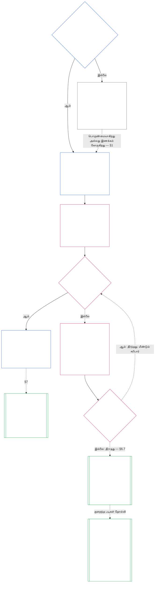

# அத்தியாயம் ஏழு: அமைப்பு மற்றும் நிறுவன சாசனங்கள்

> **இயந்திர உதவியுடன் செய்யப்பட்ட மொழிபெயர்ப்பு வரைவு — சுயாதீனத் தமிழ் வாசகர் மதிப்பாய்வு செய்யவில்லை.**

<strong>கorpus அமைவு (செயற்பாட்டு விதி அல்ல): கோப்பு அமைப்பும் வாசிப்பு முறையும்</strong>

> இந்தக் கோப்பு **உணர்வுள்ளோர் அரசியலமைப்பின்** ஒரு பகுதியாகும். எண்ணிடப்பட்ட பிற `core_*` கோப்புகளுடன் ஒரே உரையாகப் படிக்கும்போது மட்டுமே இது **கட்டுப்படுத்தும்**. இதில் **அத்தியாயம் ஏழு** உள்ளது: ஓர் அமைப்பும் ஓர் நிறுவனமும் வெளியிட வேண்டிய வரம்புச் சாசனங்களுக்கான அடித்தளம் — அமைப்பு சாசனமும் நிறுவன சாசனமும். இது அத்தியாயம் ஆறின் உரிமைகள் தளத்திற்குப் பின் வருகிறது; ஒவ்வொரு பொருண்மையாகக் கட்டுப்படுத்தும் செயலிலும் இருக்க வேண்டிய இருக்கைகளைப் பிரிக்கும் [அத்தியாயம் எட்டுக்கு](../../core_08.000_functional_independence_separation_of_duties.md#chapter-eight-functional-independence-and-separation-of-duties) முன் வருகிறது.
>
> - **அரசியலமைப்பு உரிமையாளர்:** ஓர் அமைப்பு எப்போது அமைப்பு சாசனத்தை வெளியிட வேண்டும், ஒரு நிறுவனம் எப்போது நிறுவன சாசனத்தை வெளியிட வேண்டும் (வகுப்பு L அல்லது அதற்கு மேல் கட்டாயம்; வகுப்பு P-க்கு விருப்பம்), ஒவ்வொன்றிலும் குறைந்தபட்சம் என்ன கூறப்பட வேண்டும், அவை எவ்வாறு மாற்றப்பட்டு மதிப்பாய்வு செய்யப்பட வேண்டும், உள்ளடக்கப்பட்ட பதவிகளை வகிப்போரின் நிலைத்தடமும் உண்மைத்தன்மையும் எவ்வாறு உருவாக்கச் சோதனை செய்யப்பட வேண்டும் என்பவற்றை நிர்ணயிக்கிறது.
> - **வரையறைகள் அமைந்துள்ள இடம்:** [அமைப்பு சாசனம்](../../core_05.040_band_continuity.md#system-charter), [நிறுவன சாசனம்](../../core_05.040_band_continuity.md#institutional-charter), [சாசனப் பங்கு வரைபடம்](../../core_05.040_band_continuity.md#charter-role-map), [சாசனத் தரப்பு](../../core_05.040_band_continuity.md#chartered-party), [செயல்பாட்டுத் தரப்பு](../../core_05.050_band_oversight.md#operating-party) ஆகியவை அத்தியாயம் ஐந்தில் வரையறுக்கப்படுகின்றன. இவ்வத்தியாயம் அவற்றைப் பயன்படுத்துகிறது; மறுவரையறை செய்யவில்லை.
> - **செயலாக்க உரிமையாளர்:** [CI-8.205 §6](../../corpus_institutions/ci_08.205_institutional_design_separation_of_powers.md#ci-8205-6-system-and-institutional-charter-contents-review-and-formation-template) (*அமைப்பு மற்றும் நிறுவன சாசன உள்ளடக்கம், மதிப்பாய்வு, உருவாக்க வார்ப்புரு*) முழுமையான புல வார்ப்புரு, மதிப்பாய்வுப் பட்டியல், உருவாக்க நடைமுறை, உருவாக்கச் சோதனை அறிக்கை வார்ப்புரு ஆகியவற்றைக் கொண்டுள்ளது. அது கடுமையானதாகவும் கூடுதல் புலங்களைக் கொண்டதாகவும் இருக்கலாம்; இந்த அத்தியாயத்தின் அடித்தளத்தைச் சுருக்க முடியாது. அதன் உரை செல்லுபடியாகும் ஏற்றுக்கொள்ளல் வரம்புக்குள் மட்டுமே இணைக்கப்பட்ட செயலாக்க உரையாகக் கட்டுப்படுத்தும் ([அத்தியாயம் பதினெட்டு §4 ஏற்றுக்கொள்ளல் கட்டமைப்பும் அதிகார வரம்பும்](../../core_18.000_incorporation.md#4-adoption-framing-and-scope-of-authority)); இவ்வத்தியாயத்தின் அடித்தளம் core உரையாகக் கட்டுப்படுத்தும்.
> - **பின்வரும் பயன்பாடுகள்:** [அத்தியாயம் எட்டு §5 வெளியிடப்பட்ட இடமமைப்பு, காலியிடம், பதிலீடு](../../core_08.000_functional_independence_separation_of_duties.md#5-published-placement-vacancy-and-substitution) சாசனப் பங்கு வரைபடத்தைக் கோருகிறது. அத்தியாயம் ஒன்பது வரம்பு மற்றும் எல்லை முடிவுகளுக்கு அமைப்பு சாசனத்தைப் படிக்கிறது; அதன் பகுதி D நிறுவனம் ஒன்றின் உருவாக்கச் சோதனை அறிக்கையைச் சோதிக்கிறது. [அத்தியாயம் பத்து §3.7 பதிவுக் காப்பும் திறப்பு அதிகாரமும்](../../core_10.000_standing_assessment.md#37-record-custody-and-opening-authority) அதை நிலைத்தடப் பதிவுகளுக்குப் பயன்படுத்துகிறது. [அத்தியாயம் பதின்மூன்று §4.3 நிறுவன மன்றங்கள்](../../core_13.000_forum.md#43-institutional-forums) நிறுவன சாசனம் குறித்த தகராறுகளைக் கேட்கிறது.
>
> வாசிப்பு வரிசை: §1 அமைப்பு மற்றும் நிறுவன சாசனங்கள் எப்போது கட்டாயம், செயல்முறையைச் சுருக்கும் வரைபடம் உட்பட → §2 உருவாக்கும் உரிமையும் நான்கு குறுகிய வரம்புகளும் → §3 அவை கூற வேண்டியவை → §4 சாசனப் பங்கு வரைபடமும் நிலைத்தடப் பதிவுக் காப்பும் → §5 பதவி வகிப்போரின் நிலைத்தடமும் உண்மைத்தன்மையும் குறித்த உருவாக்கச் சோதனை → §6 ஒருவர் உருவாக்கச் சோதனையில் தோல்வியுறும்போது → §7 திருத்தம், மதிப்பாய்வு, வரம்பு ஒத்திசைவின்மை.

<strong>தடமறிதல்</strong>

- மேல்நிலை ஆதாரங்கள்:
  - [அரசியலமைப்பு நான்மம்](../../core_00.000_preamble.md#constitutional-tetrad), குறிப்பாக **மேற்பார்வை**, **பொறுப்புக்கூறல்**;
  - [பொருண்மையான பங்கு](../../core_00.000_preamble.md#material-stake);
  - [அத்தியாயம் ஒன்று §18.1 அங்கீகரிக்கப்பட்ட கட்டமைப்பாக ஆளுகை](../../core_01.015_stewardship_capacity_principles.md#181-governance-as-authorized-structure) (1.015 §18.1);
  - [கட்டுரை XI-E](../../core_06.010_rights_part_b.md#article-xi-e-institutional-formation-and-business-creation) (*நிறுவன உருவாக்கமும் வணிகத் தோற்றுவிப்பும்*).
- உட்பிரிவுகள்:
  - [§1](#1-அமபப-மறறம-நறவன-சசனஙகள-எபபத-கடடயம);
  - [§2](#2-உரவககம-உரமயம-நனக-கறகய-வரமபகளம);
  - [§3](#3-அமபப-மறறம-நறவன-சசனஙகள-கற-வணடயவ);
  - [§4](#4-சசனப-பஙக-வரபடமம-நலததடப-பதவக-கபபம);
  - [§5](#5-பதவ-வகபபரன-நலததடமம-உணமததனமயம-கறதத-உரவககச-சதன);
  - [§6](#6-வகபபவர-உரவககச-சதனயல-தலவயறமபத);
  - [§7](#7-தரததம-மதபபயவ-வரமப-ஒததசவனம).
- கீழ்நிலை பயன்பாடுகள்:
  - [அத்தியாயம் எட்டு](../../core_08.000_functional_independence_separation_of_duties.md#chapter-eight-functional-independence-and-separation-of-duties) (8.000);
  - [அத்தியாயம் ஒன்பது](../../core_09.000_system_alignment_certification.md#chapter-nine-system-alignment-certification-reading-index) (9.000);
  - [அத்தியாயம் பத்து](../../core_10.000_standing_assessment.md#chapter-ten-contribution-violation-and-standing-model--measurement) (10.000);
  - [அத்தியாயம் பதின்மூன்று](../../core_13.000_forum.md#chapter-thirteen-forums-and-jurisdiction) (13.000);
  - [அத்தியாயம் பதினான்கு](../../core_14.000_governance.md#chapter-fourteen-constitutional-contract-legitimacy-authorization-and-stewardship) (14.000); மேலே பெயரிடப்பட்ட செயலாக்க உரை.
- இதனுடன் வாசிக்க:
  - [அதிகார அடுக்கு மற்றும் உள் படிநிலை](../../core_05.045_band_integrative.md#authority-stack-and-internal-hierarchy);
  - [அமைப்பு எல்லைகள்](../../core_05.040_band_continuity.md#system-boundaries);
  - [அமைப்பு எல்லை ஒருமைப்பாடு](../../core_05.040_band_continuity.md#system-boundary-integrity);
  - [அமைப்பு உருவாக்கம்](../../core_05.055_band_participation.md#system-creation);
  - [வணிக உருவாக்கம்](../../core_05.055_band_participation.md#business-creation).

 

அமைப்பு சாசனங்கள், நிறுவன சாசனங்கள், வெளியிடப்பட்ட வரம்பு ஆகியவற்றுக்கான அரசியலமைப்பு உரிமையாளர் அத்தியாயம் ஏழு.

மூன்று அத்தியாயங்கள் ஒரே தொடராகச் செயல்படுகின்றன:

- **அத்தியாயம் ஏழு (இந்த அத்தியாயம்):** [சாசனத் தரப்பு](../../core_05.040_band_continuity.md#chartered-party) எதைச் செய்வதாகக் கூறுகிறது, அது செயல்படும்போது ஒவ்வொரு இருக்கையையும் யார் வகிக்கலாம் என்பதைக் கூறுகிறது.
- **[அத்தியாயம் எட்டு](../../core_08.000_functional_independence_separation_of_duties.md#chapter-eight-functional-independence-and-separation-of-duties):** அந்த இருக்கைகள் எவ்வாறு தனித்தனியாக வைக்கப்பட வேண்டும் என்பதைக் கூறுகிறது.
- **[அத்தியாயம் ஒன்பது](../../core_09.000_system_alignment_certification.md#chapter-nine-system-alignment-certification-reading-index):** ஓர் அமைப்பையும் தனியாக ஒரு நிறுவனத்தையும் சான்றளிக்கிறது; ஒவ்வொன்றும் அந்த இருக்கைகளைப் பயன்படுத்தும் ஒரு கட்டுப்படுத்தும் செயலாகும். கண்டறிவதை அமைப்பு அல்லது நிறுவன சாசனத்துக்குத் திருப்பி வழங்குகிறது.

இந்த அத்தியாயம் சுட்டும் வரையறைகள், இருக்கை விதிகள், நிலைத்தடப் பூட்டுகள், முடிவு விதிகள் ஆகியவற்றை மற்ற அத்தியாயங்கள் நிர்வகிக்கின்றன. **CI-8.205 §6** (*அமைப்பு மற்றும் நிறுவன சாசன உள்ளடக்கம், மதிப்பாய்வு, உருவாக்க வார்ப்புரு*) புல வார்ப்புரு, உருவாக்க நடைமுறை, மதிப்பாய்வுப் பட்டியல் ஆகியவற்றைக் கொண்டுள்ளது.

### 1. அமைப்பு மற்றும் நிறுவன சாசனங்கள் எப்போது கட்டாயம்

<strong>தடமறிதல்</strong>

- மேல்நிலை ஆதாரங்கள்:
  - [§2](#2-உரவககம-உரமயம-நனக-கறகய-வரமபகளம);
  - [பொருண்மையான பங்கு](../../core_00.000_preamble.md#material-stake);
  - [விகிதாசாரம்](../../core_05.035_band_accountability.md#proportionality); அத்தியாயத் தொடக்க உரிமையாளர் கூற்று;
  - [அத்தியாயம் ஒன்று §18 பொறுப்பான நிர்வாகக் கட்டுப்பாட்டின் கீழ் ஆளுகை](../../core_01.015_stewardship_capacity_principles.md#18-governance-under-stewardship-discipline) (1.015 §18);
  - [மேற்பார்வை](../../core_05.020_apex_oversight_leg.md#oversight-constitutional);
  - [பொறுப்புக்கூறல்](../../core_05.005_apex_accountability_leg.md#accountability).
- கீழ்நிலை: [§3](#3-அமபப-மறறம-நறவன-சசனஙகள-கற-வணடயவ); [அத்தியாயம் ஒன்பது பகுதி A §2 அமைப்பு வகுப்பு மதிப்பீடு](../../core_09.005_system_alignment_certification_evaluation.md#2-system-class-evaluation) (9.005 §2) (*வகுப்பும் சான்றளிப்பு ஆழமும்*); [அத்தியாயம் ஒன்பது பகுதி D §12.1 நிறுவன வகுப்பு](../../core_09.020_institutional_alignment_certification.md#121-institution-class) (9.020 §12.1) (*நிறுவனத்தின் வகுப்பு*); வகுப்பு பட்டியலுக்கான **CS-9.305 (*அமைப்பு வகைப்பாட்டு இயந்திரம்*) மற்றும் CS-9.310** (*அமைப்பு வகைப்பாட்டு இயந்திரம்*).
- இதனுடன் வாசிக்க:
  - **CI-8.205 §6** (*அமைப்பு மற்றும் நிறுவன சாசன உள்ளடக்கம், மதிப்பாய்வு, உருவாக்க வார்ப்புரு*);
  - **CF-13.415 §5** (*நிறுவன மற்றும் உள்ளூர் பதிவாளர்கள்*);
  - **CI-9.210** (*வகைப்பாட்டுடன் இணைந்த நிறுவனக் கடமைகள்*);
  - [அத்தியாயம் ஐந்து அமைப்பு சாசனம்](../../core_05.040_band_continuity.md#system-charter) (5.040);
  - [அத்தியாயம் ஐந்து நிறுவன சாசனம்](../../core_05.040_band_continuity.md#institutional-charter) (5.040);
  - [கட்டுரை XI-E](../../core_06.010_rights_part_b.md#article-xi-e-institutional-formation-and-business-creation) (*நிறுவன உருவாக்கமும் வணிகத் தோற்றுவிப்பும்*).

<strong>வரையறைகள் · மதிப்பீடு · இணக்கம்</strong>

- [அமைப்பு சாசனம்](../../core_05.040_band_continuity.md#system-charter) · [O](../../core_05.040_band_continuity.md#system-charter) · [M](../../core_05.040_band_continuity.md#system-charter-a) · [A](../../core_05.040_band_continuity.md#system-charter-a) · [C](../../core_05.040_band_continuity.md#system-charter-c)
- [நிறுவன சாசனம்](../../core_05.040_band_continuity.md#institutional-charter) · [O](../../core_05.040_band_continuity.md#institutional-charter) · [M](../../core_05.040_band_continuity.md#institutional-charter-a) · [A](../../core_05.040_band_continuity.md#institutional-charter-a) · [C](../../core_05.040_band_continuity.md#institutional-charter-c)
- [சாசனப் பங்கு வரைபடம்](../../core_05.040_band_continuity.md#charter-role-map) · [O](../../core_05.040_band_continuity.md#charter-role-map) · [M](../../core_05.040_band_continuity.md#charter-role-map-a) · [A](../../core_05.040_band_continuity.md#charter-role-map-a) · [C](../../core_05.040_band_continuity.md#charter-role-map-c)
- [வகைப்பாட்டுக்கேற்ப அளவிடப்பட்ட ஆளுகை](../../core_05.050_band_oversight.md#classification-scaled-governance) · [O](../../core_05.050_band_oversight.md#classification-scaled-governance) · [M](../../core_05.050_band_oversight.md#classification-scaled-governance-a) · [A](../../core_05.050_band_oversight.md#classification-scaled-governance-a) · [C](../../core_05.050_band_oversight.md#classification-scaled-governance-c)

 

*எளிய சொற்களில்: ஓர் அமைப்போ நிறுவனமோ தன் வரம்புக்குள் இருந்ததா என்று மதிப்பிடுவதற்கு முன், அந்த வரம்புகள் அனைவரும் படிக்கக்கூடிய வகையில் எழுதப்பட்டிருக்க வேண்டும். [துறைசார் பொருண்மை](../../core_05.050_band_oversight.md#domain-specific-materiality) எனும் ஒன்பது துறைகளில் ஏதேனும் ஒன்றில் பிறருக்கு பொருண்மையான தாக்கம் ஏற்படுத்தும் அமைப்பு, வெளியிடப்பட்ட அமைப்பு சாசனத்தைக் கொண்டிருக்க வேண்டும். ஒரு நிறுவனம் தான் இயக்கும் அமைப்புகளுக்குப் பொருந்தும் சாசனத்தை வெளியிடும். வகுப்பு P-க்கு இது விருப்பமானது: அகதிகளுக்கு போர்வை தைக்கும் குழு இதற்கான எடுத்துக்காட்டு.*

அமைப்பு சாசனமோ நிறுவன சாசனமோ சாசனத் தரப்பின் வெளியிடப்பட்ட வரம்பாகும்: அது எந்த அதிகாரத்தைப் பயன்படுத்துவதாகக் கூறுகிறது, எதைச் செய்யாது, செயல்படும் போது ஒவ்வொரு இருக்கையையும் யார் வகிக்கிறார்கள் என்பவை அதில் கூறப்படும். அத்தியாயம் எட்டில் இருக்கைகள் எந்த வரம்பின் கீழ் அமைக்கப்படுகின்றன என்பதையும், அத்தியாயம் ஒன்பதில் சான்றளிப்பு உண்மையான செயல்பாட்டுடன் எதை ஒப்பிடுகிறது என்பதையும் இந்த வரம்பு நிர்ணயிக்கிறது. செயல்பாட்டுத் தரப்பு சாசனத்தை வெளியிட வேண்டுமா என்பது அதன் வகுப்பைப் பொறுத்தது: **வகுப்பு L அல்லது அதற்கு மேல் கட்டாயம்; வகுப்பு P-க்கு விருப்பம்.** வெளியிட வேண்டிய தரப்பு சாசனத்தைத் துல்லியமாக வைத்திருக்கவும் வேண்டும்.

ஐந்து அமைப்பு தாக்க வகுப்புகளே கீழுள்ள அனைத்திற்குமான கட்டமைப்பு. அதிக தாக்கத்திலிருந்து குறைந்த தாக்கம் வரை:

- **வகுப்பு A, உயிர்வாழ்வுக்கு இன்றியமையாதது, அடித்தளமானது, மாற்றீடற்றது:** உயிர்வாழ்வுக்குப் பொருத்தமான காலத்துக்குள் தோல்வியடைந்து, செயல்படக்கூடிய மாற்றீடு இல்லாவிட்டால், உயிர்வாழ்வுக்கான நிலைமைகள் இழக்கப்படும்.
- **வகுப்பு B, முக்கியமானது, அதிக சார்புடையது, அமைப்பளவில் குறிப்பிடத்தக்கது:** இது இல்லாமல் சார்ந்திருப்போர் மையச் செயல்பாட்டைத் தொடர முடியாது. உயிர்வாழ்வு உடனடியாக இழக்கப்படாது; காலத்துக்குள் மாற்றீடு இன்னும் சாத்தியம்.
- **வகுப்பு C, ஒருங்கிணைப்புடையது, அதிக சார்புடையது, அவசரமற்றது:** பெரிய அளவில் ஒருங்கிணைப்பை வடிவமைக்கும்; ஆனால் A அல்லது B வகுப்பு செயல்பாட்டிற்கு இயக்கரீதியான முன்நிபந்தனை அல்ல.
- **வகுப்பு L, உள்ளூர், குறைந்த தாக்கம், அவசரமற்றது:** தாக்கம் தனியார் அலகைத் தாண்டினாலும் உள்ளூரிலேயே இருக்கும்; மாற்றக்கூடியதும் கட்டுப்படுத்தக்கூடியதும் ஆகும்.
- **வகுப்பு P, தனிப்பட்டது, தனிப்பயன் பயன்பாடு, தனிமைப்படுத்தப்பட்டது, சோதனைநிலை:** பொருளுள்ள வெளிச் சார்பு இன்றி, தாக்கம் தனியார் அலகுக்குள்ளேயே இருக்கும்.

[CS-9.310 §8](../../corpus_systems/cs_09.310_system_impact_classifications.md#cs-9310-8-system-impact-classifications) முழு வரையறைகளைக் கொண்டுள்ளது. A, B, C, L வகுப்புகள் வெளியிட வேண்டும்; P வகுப்பு வெளியிடலாம். ஒரு நிறுவனம் தான் இயக்கும் அமைப்புகளின் வகுப்பை எவ்வாறு பெறுகிறது என்பதை [§1.2 எந்த வகுப்புகள் உட்படும்](#12-எநத-வகபபகள-உடபடம) விளக்குகிறது.

#### 1.1 யார் வெளியிட வேண்டும்

L வகுப்பு அல்லது அதற்கு மேற்பட்ட ஓர் அமைப்பு [அமைப்பு சாசனத்தை](../../core_05.040_band_continuity.md#system-charter) வெளியிட்டு பராமரிக்க வேண்டும். L வகுப்பு அல்லது அதற்கு மேற்பட்ட ஒரு நிறுவனம் தான் இயக்கும் அமைப்புகளுக்குப் பொருந்தும் கீழ்கண்ட சாசனத்தை வெளியிட்டு பராமரிக்க வேண்டும்:

| நிறுவனம் இயக்குவது, பொறுப்பாக நிர்வகிப்பது, அல்லது பொருண்மையாகக் கட்டுப்படுத்துவது | அது வெளியிடுவது |
| --- | --- |
| அமைப்பு சாசனம் தேவைப்படும் ஒரே ஓர் அமைப்பு | அந்த அமைப்பு சாசனம் மட்டும்; இரண்டாவது ஆவணம் இல்லை. அது நிறுவனத்தைப் பொறுப்பாளராகக் குறிப்பிடும்; [நிறுவன சாசனமாகவும்](../../core_05.040_band_continuity.md#institutional-charter) செயல்படும்: ஒரே ஆவணம் இரண்டையும் உள்ளடக்கும். |
| அத்தகைய ஒன்றுக்கு மேற்பட்ட அமைப்புகள் | நிறுவன சாசனம். அந்த அமைப்புகளுக்குச் செல்லுபடியாகும் ஒவ்வொரு அமைப்பு சாசனத்தையும் அது உள்ளடக்கி, நிறுவனம் ஏன் அந்த அமைப்புகளை இயக்குகிறது என்று கூறும் ([§3 அமைப்பு மற்றும் நிறுவன சாசனங்கள் கூற வேண்டியவை](#3-அமபப-மறறம-நறவன-சசனஙகள-கற-வணடயவ)). |
| அத்தகைய அமைப்பு எதுவுமில்லை | [§3](#3-அமபப-மறறம-நறவன-சசனஙகள-கற-வணடயவ) படி நிறுவனத்துக்குரிய விடயங்களைக் கூறும் நிறுவன சாசனம்; இதில் அமைப்பு சாசனங்கள் சேர்க்கப்படாது. |

- **வணிகங்களும் ஒத்த வடிவங்களும்:** வணிகம் அல்லது பொறுப்புடன் நிர்வகிக்கப்படும் பிற அமைப்பு வடிவம், அது ஓர் அமைப்பாகவோ, நிறுவனமாகவோ, உள்ளடக்கப்பட்ட அமைப்பை இயக்கும் நிறுவனமாகவோ இருக்கும்போது பொருந்தும் அமைப்பு அல்லது நிறுவன சாசனத்தை வெளியிடும். அதன் சட்ட வடிவம் இதை மாற்றாது.
- **கூட்டு தொழில்முறை நடைமுறை:** பயிற்சி உரிமம் அல்லது அனுமதிக்கான பட்டியலில் உள்ள செயலைச் செய்யும் L வகுப்பு அல்லது அதற்கு மேற்பட்ட உணர்வுள்ள தனிநபர் அல்லது சிறிய நடைமுறை, அந்தச் செயல்களுக்காக, விருந்தோம்பும் தரப்பின் அமைப்பு அல்லது நிறுவன சாசனத்தையும் சாசனப் பங்கு வரைபடத்தையும் ஏற்றுக்கொண்டு இப்பிரிவை நிறைவேற்றலாம்:
  - **ஏற்றுக்கொள்ளப்படுவது:** கூட்டு தொழில்முறை நடைமுறையில் உள்ள விருந்தோம்பும் தரப்பின் அமைப்பு அல்லது நிறுவன சாசனமும் சாசனப் பங்கு வரைபடமும் சுட்டிக் காட்டி ஏற்றுக்கொள்ளப்படும்; அவை அந்தச் செயல்களை உள்ளடக்கியிருக்க வேண்டும்.
  - **ஏற்றுக்கொள்ளல் அறிவிப்பு:** **CI-14.205 §7** (*பயிற்சி உரிமம், பயிற்சி அனுமதி, கூட்டு தொழில்முறை நடைமுறை*) விளக்கும் ஒரு பக்க அறிவிப்பு.
  - **வகுப்பு:** நடைமுறையின் சொந்தச் செயல்கள் அளிக்கும் வகுப்பிலேயே அது இருக்கும்.

#### 1.2 எந்த வகுப்புகள் உட்படும்

வெளியீடு கட்டாயமா விருப்பமா என்பதை சாசனத் தரப்பின் வகுப்பு தீர்மானிக்கிறது:

- **A, B, C, L வகுப்புகள்:** கட்டாயம். அவை பின்பற்றும் நடைமுறையை [§1.7 செயல்முறை ஒரே பார்வையில்](#17-சயலமற-ஒர-பரவயல) உள்ள வரைபடம் காட்டுகிறது.
- **P வகுப்பு:** கீழுள்ள இரண்டு நிகழ்வுகளில் ஒன்று அதை கட்டாயமாக்கும் வரை விருப்பம். செயல்பாட்டுத் தரப்பு P வகுப்பாக இருப்பதற்கான நிபந்தனையை [§1.3 P வகுப்பு என்றால் என்ன](#13-p-வகபப-எனறல-எனன) கூறுகிறது; விருப்பம் எப்போது முடிகிறது என்பதை [§1.4 P வகுப்பு: விருப்பச் சாசனங்களும் அவை கட்டாயமாகும் நேரமும்](#14-p-வகபப-வரபபச-சசனஙகளம-அவ-கடடயமகம-நரமம) விளக்குகிறது.
- **நிறுவனத்தின் வகுப்பு:** நிறுவனம் இயக்கும், பொறுப்பாக நிர்வகிக்கும் அல்லது பொருண்மையாகக் கட்டுப்படுத்தும் அமைப்புகளில் மிக உயர்ந்த வகுப்பை நிறுவனம் பெறும். அத்தகைய அமைப்புகள் எதையும் இயக்காத நிறுவனம், அதன் பெயர் அல்லது சட்ட வடிவத்தின் அடிப்படையில் அல்ல; அது உண்மையில் எதை முடிவுசெய்து வைத்திருக்கிறது என்பதைக் கொண்டு பொருண்மையான தாக்கமும் சார்பும் அடிப்படையாக வகைப்படுத்தப்படும் ([அத்தியாயம் ஒன்பது பகுதி D §12.1 நிறுவன வகுப்பு](../../core_09.020_institutional_alignment_certification.md#121-institution-class)).

#### 1.3 P வகுப்பு என்றால் என்ன

[துறைசார் பொருண்மை](../../core_05.050_band_oversight.md#domain-specific-materiality) எனும் ஒன்பது துறைகளிலும் செயல்பாடு வரம்புக்குக் கீழே இருக்கும் வரை மட்டுமே, அதாவது அதன் செயல்களும் விளைவுகளும் [தனியார் அலகுக்குள்](../../core_05.050_band_oversight.md#domain-specific-materiality-private-unit) இருக்கும் போது மட்டுமே, செயல்பாட்டுத் தரப்பு P வகுப்பாகும்:

- **ஒரு வரம்பைக் கடத்தல்:** எந்தவொரு துறையிலாவது வரம்பைக் கடந்தால், அளவு எதுவாக இருந்தாலும் தன்னை எப்படிச் சொன்னாலும், **CS-9.305 (*அமைப்பு வகைப்பாட்டு இயந்திரம்*) மற்றும் CS-9.310** (*அமைப்பு வகைப்பாட்டு இயந்திரம்*) படி குறைந்தது L வகுப்பாகும்.
- **எல்லா வரம்புகளுக்கும் கீழே இருத்தல்:** உறுப்பினர்கள் எத்தனை பேர் இருந்தாலும் P வகுப்பிலேயே இருக்கும்.
- **உள்ளிருப்போர்:** P வகுப்பு அதற்குள் இருப்போரையும் சார்ந்தது. வரம்பு கடக்கப்படுவதை அறியும் உள்ளிருப்போர் அதை அறிவிக்கக் கடமைப்பட்டவர்கள்; அந்த அறிவிப்பு பாதுகாக்கப்படும் ([துறைசார் பொருண்மை](../../core_05.050_band_oversight.md#domain-specific-materiality)).

அத்தியாயம் எட்டின் நான்கு இருக்கை அடித்தளம், தனியார் அலகுக்குள் இருக்கும் P வகுப்பு செயல்பாட்டுத் தரப்பின் செயல்களுக்குப் பொருந்தாது; ஆகவே கணினியுடன் தனியாகச் செயல்படும் ஓர் உணர்வுள்ளவருக்கு இரண்டாவது இருக்கை வகிப்பவர் தேவையில்லை. பிறர் பின்பற்ற வேண்டிய அல்லது முடிவானதாக நம்பக்கூடிய [பொருண்மையாகக் கட்டுப்படுத்தும் செயலை](../../core_05.035_band_accountability.md#materially-binding-act) செயல்பாட்டுத் தரப்பு மேற்கொள்ளும் நாளிலிருந்து அந்த அடித்தளம் பொருந்தும். அது பிறர் மீதான அதிகாரத் துறையில் வரம்பைக் கடந்து, தரப்பை குறைந்தது L வகுப்பாக்குகிறது.

#### 1.4 P வகுப்பு: விருப்பச் சாசனங்களும் அவை கட்டாயமாகும் நேரமும்

P வகுப்பு செயல்பாட்டுத் தரப்பு, தான் இயக்கும் ஒன்றுக்கு [அமைப்பு சாசனத்தையும்](../../core_05.040_band_continuity.md#system-charter) (ஒரு அமைப்புக்கு) அல்லது [நிறுவன சாசனத்தையும்](../../core_05.040_band_continuity.md#institutional-charter) (ஒன்றுக்கு மேற்பட்ட அமைப்புகளுக்கு அல்லது அமைப்புகள் எதுவுமில்லாதபோது) வெளியிட ஊக்குவிக்கப்படுகிறது. [§3](#3-அமபப-மறறம-நறவன-சசனஙகள-கற-வணடயவ) உள்ளடக்கப் பட்டியலையும், [§4](#4-சசனப-பஙக-வரபடமம-நலததடப-பதவக-கபபம) இருக்கை வரைபடத்தையும் மாதிரியாகப் பயன்படுத்தலாம். அதை வெளியிடுவதால் இந்த அத்தியாயச் செயல்முறையின் கீழ் கடமை உருவாகாது:

- காலக்கெடு இல்லை ([§1.5](#15-அமபப-அலலத-நறவன-சசனதத-எபபத-சமரபபகக-வணடம));
- உருவாக்கச் சோதனை கட்டாயமில்லை ([§5](#5-பதவ-வகபபரன-நலததடமம-உணமததனமயம-கறதத-உரவககச-சதன));
- [சாசனப் பங்கு வரைபடம்](../../core_05.040_band_continuity.md#charter-role-map) கட்டாயமில்லை ([§4](#4-சசனப-பஙக-வரபடமம-நலததடப-பதவக-கபபம)); விருப்பச் சாசனத்துடன் அதை வைத்திருக்கலாம் அல்லது தனியாக வெளியிடலாம்; மேலும்
- கட்டாயத் திருத்த அல்லது மதிப்பாய்வு சுழற்சி இல்லை ([§7](#7-தரததம-மதபபயவ-வரமப-ஒததசவனம)).

பின்வருவனவற்றில் ஒன்று நிகழ்ந்தால் வெளியீடு விருப்பமாக இருக்காது:

- செயல்பாட்டுத் தரப்பு L வகுப்பு அல்லது அதற்கு மேல் என மறுவகைப்படுத்தப்படுகிறது; அல்லது
- அதன் இயக்குநர், அந்தத் தரப்பு அரசியலமைப்புக்கு இணங்குகிறது எனக் கூறுகிறார்.

அப்போது அந்தத் தரப்பு தமக்குப் பொருந்தும் சாசனத்தை [§1.5](#15-அமபப-அலலத-நறவன-சசனதத-எபபத-சமரபபகக-வணடம) கால அட்டவணைப்படி வெளியிட வேண்டும்.

**அங்கீகாரம் வரம்பு ஆவணத்தைச் சார்ந்ததல்ல.** அமைப்பு அல்லது நிறுவன சாசனம் இருந்தாலும் இல்லாவிட்டாலும், வகுப்பு எதுவாக இருந்தாலும், ஒரு குழு தன் உறுப்பினர்களுக்கும் அங்கீகாரத்திற்கும் இடையில் தடையாக நிற்காது. ஒவ்வொரு உறுப்பினரும் குழுவுக்குள் அல்லது வெளியே செய்த பணிக்காகத் தனிப்பட்ட கோருநராகப் பங்களிப்புப் பதிவைக் கோரலாம்; அந்தப் பதிவு உறுப்பினரின் பங்களிப்பைப் பற்றியது, குழுவின் நிலைத்தடத்தைப் பற்றியது அல்ல ([அத்தியாயம் பத்து §3.7 முறைசாரா மற்றும் குறுகிய வரம்புப் பதிவுகள்](../../core_10.000_standing_assessment.md#37-informal-and-small-scope-records)). ஏற்க மறுக்கலாம் எனும் உதவி, பொருட்கள், உழைப்பு அல்லது சேவைகளை வழங்குவது பொருண்மையாகக் கட்டுப்படுத்தும் செயல் அல்ல. எனவே அகதிகளுக்கு போர்வை வழங்கும் பரஸ்பர உதவிக் குழுவின் உறுப்பினர்கள் அங்கீகாரம் பெற சாசனம் தேவையில்லை.

#### 1.5 அமைப்பு அல்லது நிறுவன சாசனத்தை எப்போது சமர்ப்பிக்க வேண்டும்

உள்ளடக்கப்படும் அமைப்போ நிறுவனமோ தன் [அமைப்பு சாசனத்தை](../../core_05.040_band_continuity.md#system-charter) அல்லது [நிறுவன சாசனத்தை](../../core_05.040_band_continuity.md#institutional-charter) இந்த அட்டவணைப்படி வெளியிடும்:

- **புதிய அமைப்பு அல்லது நிறுவனம்:** அது செயல்பாட்டுக்கு வருவதற்கு அல்லது பிறர் மீது அதிகாரம் செலுத்தத் தொடங்குவதற்கு முன்.
- **ஏற்கெனவே செயல்படுவது:** அடுத்த வகைப்பாட்டு மதிப்பாய்வு அல்லது சான்றளிப்பின்போது, அல்லது [§1.6](#16-அமபப-அலலத-நறவன-சசனம-கணமறபனல) கோரிக்கைக்குப் பின் தீர்வுக் காலக்கெடுவுக்குள் — இவற்றில் எது முதலில் வருகிறதோ அது. வெளியிடும் வரை அது தவறுநிலையில் இருக்கும்.
  - **எந்தச் சான்றளிப்பு:** அமைப்புக்கு, அதன் அமைப்பு ஒத்திசைவு சான்றளிப்பு. நிறுவனத்துக்கு, [அத்தியாயம் ஒன்பது பகுதி D §11.3 அனுமதியும் வாயிற்காவலும் இல்லை](../../core_09.020_institutional_alignment_certification.md#113-no-permission-and-no-gate) படியான நிறுவன ஒத்திசைவு சான்றளிப்பு. முதல் சான்றளிப்பு காலக்கெடு, நிறுவன சாசனம் வெளியிடுவதற்கோ செயல்படுவதற்கோ நிபந்தனை அல்ல.
- **உருவாக்கச் சோதனை:** அதே நேரத்தில் [§5](#5-பதவ-வகபபரன-நலததடமம-உணமததனமயம-கறதத-உரவககச-சதன) சோதனையையும் நிறைவு செய்ய வேண்டும்.
- **சமர்ப்பிக்கும் இடம்:** சாசனம், சாசனப் பங்கு வரைபடம், உருவாக்கச் சோதனை அறிக்கை ஆகியவற்றை நிறுவனப் பதிவாளரிடம் அல்லது செயல்பாடும் அது பாதிக்கும் உணர்வுள்ளவர்களும் உள்ளூரில் இருந்தால் உள்ளூர் பதிவாளரிடம் (**CF-13.415 §5** (*நிறுவன மற்றும் உள்ளூர் பதிவாளர்கள்*)) சமர்ப்பிக்க வேண்டும்:
  - **பதிவாளர் செய்வது:** கட்டாயமானவை எதுவும் விடுபடவில்லை எனச் சரிபார்த்து, தேதியிட்ட ரசீது வழங்குவார்.
  - **பதிவாளர் செய்வதல்ல:** அனுமதி வழங்குவதோ வகுப்பு அல்லது உள்ளடக்கம் குறித்து தீர்ப்பளிப்பதோ இல்லை.
  - **தாமதமான அல்லது கிடைக்காத ரசீது:** சாசனத் தரப்பின் செயல்பாட்டைத் தடுக்காது.

#### 1.6 அமைப்பு அல்லது நிறுவன சாசனம் காணாமற்போனால்

புதியதாக உருவான அல்லது இப்போது L வகுப்பு அல்லது அதற்கு மேல் உள்ள, ஆனால் சாசனம் வெளியிடாத சாசனத் தரப்பைக் கவனிக்கும் எவரும் அதன் ஆளும் அதிகாரத்திடம் சாசனத்தைக் கோரலாம். கோருபவருக்கு நிலைத்தடம் தேவையில்லை; கட்டணம் இல்லை; தீங்கு ஏற்பட்டதைக் காட்ட வேண்டியதில்லை. கோரிக்கையில் சாசனத் தரப்பின் பெயரும், அது ஏன் இப்பிரிவில் அடங்குகிறது எனத் தோன்றுகிறது என்பதும் குறிப்பிடப்பட வேண்டும்.

கோரிக்கையிலிருந்து இரண்டு காலக்கெடுகள் தொடங்குகின்றன: பதிலளிப்பு காலக்கெடும் தீர்வுக் காலக்கெடுமாகும். சாசனத் தரப்பின் வகுப்புடன் ஒரே எழுத்துடைய அடுக்கின் கால அளவையே ஒவ்வொன்றும் எடுக்கும்; வகுப்பு அதிக முக்கியத்துவம் கொண்டதாக இருக்கையில் காலக்கெடுகள் குறுகியதாகும்:

| வகுப்பும் அடுக்கும் | பதிலளிப்பு காலக்கெடு (பெறுதல் இலக்கு) | தீர்வுக் காலக்கெடு (இறுதி எல்லை) |
|---|---|---|
| வகுப்பு A, அடுக்கு A | 24 மணி நேரம் | 7 நாட்காட்டி நாட்கள் |
| வகுப்பு B, அடுக்கு B | 2 நாட்காட்டி நாட்கள் | 14 நாட்காட்டி நாட்கள் |
| வகுப்பு C, அடுக்கு C | 4 நாட்காட்டி நாட்கள் | 30 நாட்காட்டி நாட்கள் |
| வகுப்பு L, அடுக்கு L | 8 நாட்காட்டி நாட்கள் | 60 நாட்காட்டி நாட்கள் |

இந்த எண்ணிக்கைகள் **CF-13.445 §3.1** (*கட்டநிலை இலக்குகளும் காலக் குறைந்தபட்சங்களும்*) இலிருந்து பெறப்பட்டவை; வேறுபாடு இருந்தால் அதுவே ஆளும். வகுப்பை எதிர்க்கும் சாசனத் தரப்பு, அதன் அமைப்பு வகைப்பாட்டுப் பதிவிலுள்ள வகுப்புக்கும், கோருபவர் அல்லது மன்றம் முதற்கண் காட்டும் வகுப்புக்கும் இடையில் அதிக முக்கியத்துவமுள்ள அடுக்கில் கணக்கிடப்படும்; கேள்வி தீரும் வரை. பதிவில் வகுப்பு இல்லாத தரப்பு, அல்லது வகுப்பு விசாரணையில் இருக்கும் போது P வகுப்பைக் கொண்ட தரப்பு, C அடுக்கில் கணக்கிடப்படும்.

காலக்கெடுகள் இவ்வாறு செயல்படுகின்றன:

- **பதிலளிப்பு காலக்கெடு:** கோரிக்கையிலிருந்து கணக்கிட்டு, **CF-13.445 §3.1** (*கட்டநிலை இலக்குகளும் காலக் குறைந்தபட்சங்களும்*)-இல் பொருந்தும் அடுக்கின் பெறுதல் இலக்குக்குள் சாசனத் தரப்பு பதிலளிக்க வேண்டும். அது சாசனத்தை வெளியிடலாம், வெளியிடும் தேதியைக் கூறலாம், ஏற்கெனவே வெளியிட்ட சாசனத்தைச் சுட்டலாம், அல்லது [துறைசார் பொருண்மை](../../core_05.050_band_oversight.md#domain-specific-materiality) ஒவ்வொரு துறையிலும் வரம்புக்குக் கீழே இருப்பதாகக் கூறி, நுழைவுக்குத் தேவையான எழுத்துப்பூர்வ விளக்கத்தை அளிக்கலாம்.
- **தீர்வுக் காலக்கெடு:** கோரிக்கையிலிருந்து கணக்கிட்டு, **CF-13.445 §3.1**-இல் பொருந்தும் அடுக்கின் இறுதி எல்லைக்குள் சாசனத்தையும் அதனுடன் தொடர்புடைய உருவாக்கச் சோதனை அறிக்கையையும் ([§5](#5-பதவ-வகபபரன-நலததடமம-உணமததனமயம-கறதத-உரவககச-சதன)) சமர்ப்பிக்க வேண்டும். இன்னும் சுயாதீன இருக்கை இல்லாத சாசனத் தரப்பு, அந்தப் பிரிவு கூறுவதுபோல் ஆதாரங்களுடன் அறிக்கையை அறிவிப்பாகப் பதிவு செய்யும்.
- **தாம் வரம்புக்குக் கீழே இருப்பதாகச் சொல்லும் செயல்பாட்டுத் தரப்பு:** கோரிக்கை அந்த நுழைவின் *சவால் வழிமுறையில்* உள்ள வகைப்பாட்டுச் சவாலாகவும் அமையும்:
  - **காலக்கெடு தொடர்தல்:** சவால் நிலுவையில் இருந்தாலும் தீர்வுக் காலக்கெடு தொடரும்.
  - **சவாலால் நீட்டித்தல்:** அதிகாரமுள்ள மன்றம் சவாலை மதிப்பாய்வுக்குரியது எனத் தீர்மானித்தால், சமர்ப்பிக்கும் நாள் நீட்டிக்கப்படும்; சவால் முடிவானபோது புதிய தீர்வுக் காலக்கெடு தொடங்கும். பொருந்தும் அடுக்கின் இறுதி எல்லைக்குள் மன்றம் சவாலை முடிவுசெய்யும்.
  - **மதிப்பாய்வுக்குரியது என்றால்:** பெயரிடப்பட்ட துறையில் வரம்பு கடந்த குறிப்பிட்ட நிகழ்வைச் சவால் சுட்டி, செயல்பாட்டுத் தரப்பின் எழுத்துப்பூர்வ விளக்கம் உண்மையான கேள்வியை மீதம்விட்டால் அது மதிப்பாய்வுக்குரியது. செயல்பாட்டுத் தரப்பு இதைத் தானே தீர்மானிக்க முடியாது; எழுத்துப்பூர்வ விளக்கம் தராத பதில் காலக்கெடுவை நீட்டிக்காது.
  - **வகுப்பு கண்டறியப்பட்டால்:** அந்தச் சவாலிலோ வேறு வகையிலோ வகுப்பு கண்டறியப்பட்ட நாள் கோரிக்கை நாளாகக் கணக்கிடப்படும். கண்டறியப்பட்ட வகுப்பின் அடுக்கில் (A, B, C அல்லது L) இரண்டு காலக்கெடுகளும் அந்நாளிலிருந்து தொடங்கும்.
- **காலக்கெடு தவறினால்:** பதிலளிக்காமையோ, குறிப்பிட்ட நாளுக்குள் சாசனம் தராமையோ பதிவுசெய்து சரிசெய்ய வேண்டிய குறைபாடாகும். அதே வழியில் கோருபவர் அதிகாரமுள்ள மன்றத்திடம் எடுத்துச் செல்லலாம். இது உருவாக்கத்திற்கோ செயல்பாட்டிற்கோ ஒருபோதும் நிபந்தனை அல்ல.
- **மீண்டும் வரும் கோரிக்கை:** முந்தைய பதில் அல்லது அதற்கான முடிவு இன்னும் நிலுவையில் இருக்கும் போது அதே சாசனத் தரப்பைப் பற்றிய இரண்டாவது கோரிக்கை புதிய பதிலளிப்பு அல்லது தீர்வுக் காலக்கெடுகளைத் தொடங்காது. அந்தப் பதிலையோ முடிவையோ சுட்டிக் காட்டி தரப்பு பதிலளிக்கும். மன்றம் இன்னும் மதிப்பாய்வு செய்யாத, எல்லா வரம்புகளுக்கும் கீழே இருப்பதாகத் தரப்பு அளிக்கும் சொந்த விளக்கம் நிலுவையில் உள்ள பதிலாகக் கருதப்படாது. [அத்தியாயம் ஒன்பது பகுதி D §14.2 மீண்டும் திறப்பதற்கான தூண்டுதல்கள்](../../core_09.020_institutional_alignment_certification.md#142-reopening-triggers) கூறும் பின்வருவனவற்றில் ஒன்று வரும் வரை பதில் அல்லது முடிவு நிலுவையில் இருக்கும்:
  - **பொருண்மையான மாற்றம்:** சாசனத் தரப்பின் செயல்பாடு பொருண்மையாக மாறுகிறது.
  - **புதிய ஆதாரம்:** வரம்பு கடந்தது குறித்த புதிய ஆதாரம் காட்டப்படுகிறது.

  இவற்றில் ஒன்றைக் காட்டும் கோரிக்கை மீள்கோரிக்கை அல்ல; அது புதிய கோரிக்கையாகத் தனியாகவும் சுதந்திரமாகவும் கையாளப்படும். அதற்கெனத் தனிப் பதிலளிப்பு மற்றும் தீர்வுக் காலக்கெடு அதன் சொந்த நாளிலிருந்து கணக்கிடப்படும். முந்தைய பதில், முடிவு, காலக்கெடுகள் ஆகியவை இதை நிறைவேற்றவோ மாற்றவோ செய்யாது.
- **இடைக்கால வரம்பு:** சாசனம் காணாமற்போனது சாசனத் தரப்பு எல்லையற்றது எனக் கருதுவதற்கான காரணமல்ல. அது உருவாகும் வரை, அதன் உண்மையான [அமைப்பு எல்லைகளும்](../../core_05.040_band_continuity.md#system-boundaries) வகுப்பும் ஆளும்; சான்றளிப்பு அமைப்போ மன்றமோ பார்த்த செயல்பாட்டிலிருந்து வரம்பை மீளமைக்கலாம்.

#### 1.7 செயல்முறை ஒரே பார்வையில்

ஒரு செயல்பாட்டுத் தரப்பு பிறருக்கு பொருண்மையானதா என்ற கேள்வியிலிருந்து தொடங்கி, அதன் அமைப்பு அல்லது நிறுவன சாசனத்தை வெளியிட்டு துல்லியமாக வைத்திருப்பது வரை வரைபடம் காட்டுகிறது. தீர்வுக் காலக்கெடுவுக்குள் சிக்கல் சரிசெய்யப்படாவிட்டால், இந்தச் சாசனச் செயல்முறை இந்த அத்தியாயத்திற்கு வெளியே உள்ள மதிப்பாய்வுக்கு அனுப்பும். இதற்குப் பின் வரும் பிரிவுகள் ஒவ்வொரு படியையும் இதே வரிசையில் விளக்குகின்றன.

<strong>வாசகர் வழிகாட்டி (செயற்பாட்டு விதி அல்ல): வரைபடத்தைப் படிப்பது எப்படி</strong>

> எளிய சொற்களில்: அமைப்பு அல்லது நிறுவன சாசனத்தை யாரும் வழங்குவதில்லை; உருவாக்க யாருடைய அனுமதியும் தேவையில்லை. செயல்பாடு பிறருக்கு பொருண்மையான சாசனத் தரப்பு, தான் எந்த அதிகாரத்தைப் பயன்படுத்துவதாகக் கூறுகிறது, ஒவ்வொரு இருக்கையையும் யார் வகிக்கிறார்கள் என்பவற்றை வெளியிடும்; முக்கியப் பதவிகளை வகிப்போர் சரிபார்க்கப்படுவர். ஒருவர் சோதனையில் தோல்வியுற்றால் அவர் மாற்றப்படுவார் அல்லது காரணம் சரிசெய்யப்படும்; தரப்பு தொடர்ந்து செயல்படும். தீர்வுக் காலக்கெடு முடியும் போது தோல்வி இன்னும் சரிசெய்யப்படவில்லை என்றால், பிறரைப் பாதுகாக்கும் மிக இலகுவான படியில் தொடங்கி மன்றம் தரப்பை மதிப்பாய்வு செய்யலாம். குறைந்த தாக்கமுள்ள படிகள் தோல்வியுற்றால் மட்டுமே தரப்பை L வகுப்புக்குக் கீழிறக்கவோ கலைக்கவோ செய்யலாம். கலைக்கப்பட்ட சாசனத் தரப்பின் மீதான பூட்டு நிலுவையில் இருக்கும்போது அது மீண்டும் வர முடியாது.
>
> தொடர்ச்சியான அம்புகள் முதன்மைப் பாதை. புள்ளிக் கோடுகள் விதிவிலக்குகளையும் ஒப்படைப்புகளையும் காட்டுகின்றன; அவற்றை ஏற்படுத்தும் பிரிவு அம்பில் குறிக்கப்பட்டுள்ளது. இருபுறமும் இரட்டைச் செங்குத்துக் கோடு உள்ள பெட்டிகள் வேறு அத்தியாயத்தையோ இணைக்கப்பட்ட செயலாக்க உரையையோ சார்ந்தவை. வரைபடம் புதிய கடமை, இருக்கை அல்லது புலத்தைச் சேர்ப்பதில்லை; அதிலுள்ள எந்தப் படியும் அனுமதி வழங்குவது அல்ல.

 

### 2. உருவாக்கும் உரிமையும் நான்கு குறுகிய வரம்புகளும்

<strong>வாசகர் வழிகாட்டி (செயற்பாட்டு விதி அல்ல): இந்தப் பிரிவு அமைந்துள்ள விதம்</strong>

- [§2.1 உருவாக்கும் உரிமை](#21-உரவககம-உரம) அந்த உரிமையையும் அது யாருக்குப் பொருந்தாது என்பதையும் கூறுகிறது.
- [§2.2 முதல் வரம்பு: உணர்வுள்ளவர் மீதான நிலுவைப் பூட்டு](#22-மதல-வரமப-உணரவளளவர-மதன-நலவப-படட) ஒரு குறிப்பிட்ட உணர்வுள்ளவரை ஒரு கட்டுப்பாட்டு பதவியிலிருந்து பூட்டு எவ்வாறு விலக்குகிறது என்பதைக் கூறுகிறது.
- [§2.3 இரண்டாம் வரம்பு: குறிப்பிட்ட சரிபார்க்கப்பட்ட உண்மைகள் மீதான குறுகிய இடைநிறுத்தம்](#23-இரணடம-வரமப-கறபபடட-சரபரககபபடட-உணமகள-மதன-கறகய-இடநறததம) அதேபோல ஒரு குறுகிய இடைநிறுத்தம் எவ்வாறு விலக்கலாம் என்பதைக் கூறுகிறது.
- [§2.4 மூன்றாம் வரம்பு: செயல்பாட்டுத் தரப்பு மீதான பூட்டு](#24-மனறம-வரமப-சயலபடடத-தரபப-மதன-படட) செயல்பாட்டுத் தரப்பையும் அதன் தொடர்தரப்புகளையும் பூட்டு எவ்வாறு தடுக்கும், கலைக்கப்பட்ட தரப்பு திரும்ப வர முடியாது என்பதையும் கூறுகிறது.
- [§2.5 நான்காம் வரம்பு: நடைமுறை உரிமம் அல்லது அனுமதி](#25-நனகம-வரமப-நடமற-உரமம-அலலத-அனமத) பெயரிடப்பட்ட உயர் இடர் செயலுக்கு எப்போது உரிமம் அல்லது அனுமதி தேவை என்பதைக் கூறுகிறது. இது உருவாக்கத்திற்கான வாயிற்காவல் அல்ல.

<strong>தடமறிதல்</strong>

- மேல்நிலை: [§1](#1-அமபப-மறறம-நறவன-சசனஙகள-எபபத-கடடயம); [கட்டுரை XI-E](../../core_06.010_rights_part_b.md#article-xi-e-institutional-formation-and-business-creation) (*நிறுவன உருவாக்கமும் வணிகத் தோற்றுவிப்பும்*).
- கீழ்நிலை: [§1 அமைப்பு மற்றும் நிறுவன சாசனங்கள் எப்போது கட்டாயம்](#1-அமபப-மறறம-நறவன-சசனஙகள-எபபத-கடடயம); [§5 பதவி வகிப்போரின் நிலைத்தடமும் உண்மைத்தன்மையும் குறித்த உருவாக்கச் சோதனை](#5-பதவ-வகபபரன-நலததடமம-உணமததனமயம-கறதத-உரவககச-சதன).
- இதனுடன் வாசிக்க:
  - [இடைக்கால இடைநிறுத்தம்](../../core_05.035_band_accountability.md#interim-hold);
  - [அத்தியாயம் பதினொன்று §4.2 தடுப்பு — பொதுவான நிலைத்தடப் பூட்டுகள்](../../core_11.000_standing_integration.md#42-prevention--general-standing-locks) (11.000 §4.2);
  - [அத்தியாயம் பதினொன்று §5.5 சிறப்புப் பூட்டுகள்](../../core_11.000_standing_integration.md#55-special-locks) (11.000 §5.5);
  - [அத்தியாயம் பதின்மூன்று §5 பெயரிடப்பட்ட உணர்வுள்ளவரின் பாதை மீதான இடைக்கால இடைநிறுத்தம்](../../core_13.000_forum.md#interim-hold-on-a-named-sentients-pathway) (13.000 §5).

 

*எளிய சொற்களில்: அமைப்பு, நிறுவனம் அல்லது வணிகத்தை உருவாக்க யாரிடமும் அனுமதி பெற வேண்டியதில்லை. நான்கு குறுகிய வரம்புகள் பொருந்தலாம். மூன்று வாயிற்காவல்கள்: தீராத பூட்டு ஒரு உணர்வுள்ளவரை ஒரு கட்டுப்பாட்டு பதவியிலிருந்து விலக்கலாம்; குறிப்பிட்ட சரிபார்க்கப்பட்ட உண்மைகள் மீதான குறுகிய இடைநிறுத்தமும் அதையே செய்யலாம்; செயல்பாட்டுத் தரப்பு மீதான பூட்டு அந்தத் தரப்பையே தடுக்கலாம். நான்காவது, பெயரிடப்பட்ட உயர் இடர் செயலைச் செய்வதற்கு முன் உரிமம் அல்லது அனுமதியைக் கோரலாம். மன்றம் கலைத்த சாசனத் தரப்பு மீண்டும் வரத் தடை செய்யப்படும்; அரசியலமைப்புக்கு எதிரான பரவலான நடத்தை அல்லது திருத்தப்படாத மீளமுடியாத தீங்கு காரணமாகக் கலைக்கப்பட்டால் தடை நிரந்தரமானது. இவை எதுவும் புதிய செயல்பாட்டுத் தரப்பை உருவாக்குவதையோ செயல்படுவதையோ தடுக்காது; இந்த அத்தியாயமும் கூடுதல் வரம்பைச் சேர்ப்பதில்லை.*

**கட்டுரை XI-E** (*நிறுவன உருவாக்கமும் வணிகத் தோற்றுவிப்பும்*) நான்கு குறுகிய வரம்புகளை அனுமதிக்கிறது:

- **முதல் மூன்றே வாயிற்காவல்கள்:** செயல்பாட்டுத் தரப்பை உருவாக்குவதற்கும் அதில் அதிகாரம் வகிப்பதற்கும் இவை மட்டுமே வாயிற்காவல்கள். ஒவ்வொன்றும் பெயரிடப்பட்ட ஒருவரையோ தரப்பையோ சாரும்:
  - **நிலுவைப் பூட்டு** ([§2.2](#22-மதல-வரமப-உணரவளளவர-மதன-நலவப-படட)) சாசனத் தரப்பைக் கட்டுப்படுத்தும் ஒரு பதவியில் பெயரிடப்பட்ட உணர்வுள்ளவரைச் சாரும்.
  - **இடைக்கால இடைநிறுத்தம்** ([§2.3](#23-இரணடம-வரமப-கறபபடட-சரபரககபபடட-உணமகள-மதன-கறகய-இடநறததம)) அந்தத் தரப்பைக் கட்டுப்படுத்தும் ஒரு பதவியில் பெயரிடப்பட்ட ஒரே உணர்வுள்ளவரை மட்டுமே சாரும்.
  - **செயல்பாட்டுத் தரப்பு மீதான பூட்டு** ([§2.4](#24-மனறம-வரமப-சயலபடடத-தரபப-மதன-படட)) கலைக்கப்பட்ட தரப்பு உட்பட, பூட்டுக்குட்பட்ட சாசனத் தரப்பையே சாரும்.
- **நான்காவது வாயிற்காவல் அல்ல:** அது நடைமுறை உரிமம் அல்லது அனுமதி ([§2.5](#25-நனகம-வரமப-நடமற-உரமம-அலலத-அனமத)).

#### 2.1 உருவாக்கும் உரிமை

எவரும் புதிய அமைப்பு, நிறுவனம் அல்லது வணிகத்தை உருவாக்கலாம். அந்த உரிமை [கட்டுரை XI-E](../../core_06.010_rights_part_b.md#article-xi-e-institutional-formation-and-business-creation) (*நிறுவன உருவாக்கமும் வணிகத் தோற்றுவிப்பும்*)-இல் கூறப்பட்டுள்ளது. அடுத்து வரும் கடமையை இந்த அத்தியாயம் சேர்க்கிறது. செயல்பாட்டுத் தரப்பின் செயல் [துறைசார் பொருண்மை](../../core_05.050_band_oversight.md#domain-specific-materiality) எனும் ஒன்பது துறைகளில் ஏதேனும் ஒன்றில் பிறருக்கு பொருண்மையானதாகும் போது, அது பயன்படுத்துவதாகக் கூறும் அதிகாரத்தை முன்கூட்டியே வெளிப்படையாக அறிவிக்க வேண்டும் ([§1](#1-அமபப-மறறம-நறவன-சசனஙகள-எபபத-கடடயம)). அமைப்பு அல்லது நிறுவன சாசனத்தை ஏற்றுக்கொள்வது அந்த உரிமையையோ எந்த உரிமைகள் தளப் பாதுகாப்பையோ குறுக்குவதாகப் படிக்கப்படக் கூடாது.

**உருவாக்கும் உரிமை யாருக்குப் பாதுகாப்பளிக்காது.** [§2.2](#22-மதல-வரமப-உணரவளளவர-மதன-நலவப-படட), [§2.3](#23-இரணடம-வரமப-கறபபடட-சரபரககபபடட-உணமகள-மதன-கறகய-இடநறததம), [§2.4](#24-மனறம-வரமப-சயலபடடத-தரபப-மதன-படட) ஆகிய மூன்று வாயிற்காவல்களைத் தவிர, **கட்டுரை XI-E** (*நிறுவன உருவாக்கமும் வணிகத் தோற்றுவிப்பும்*) பின்வருவனவற்றைப் பாதுகாக்காது:

- அரசியலமைப்புக் கட்டுப்பாட்டை மீற, பாதுகாப்பையோ உண்மையையோ கீழறுக்க, அல்லது [அத்தியாயம் ஒன்று §11 சந்தை அமைப்பு](../../core_01.005_values_principles.md#11-market-structure) தடைசெய்யும் வகையில் அதிகாரத்தைக் குவிக்க வடிவமைக்கப்பட்ட செயல்பாட்டுத் தரப்பு; அல்லது
- சரிபார்க்கப்பட்ட நடத்தை, கட்டுப்பாடு, ஊதியம் ஆகியவை காட்டுவது போல், அறிவிக்கப்பட்ட நோக்கத்துடன் உண்மையாக ஒத்திசையாத நிறுவுநரால் உருவாக்கப்பட்டு இயக்கப்படும் தரப்பு; அல்லது அதன் நோக்கம், கட்டுப்பாடு, நலன்கள் பற்றி பிறரைத் தவறாக வழிநடத்தவோ பிறருக்குத் தீங்கு செய்யவோ எண்ணிய நிறுவுநரால் இயக்கப்படும் தரப்பு.

இந்த வழக்குகளை மன்றங்கள் அந்தக் கட்டுரையின் கீழ் முடிவுசெய்யும்; அதன் விளைவுகள் அங்குள்ள மூன்று வாயிற்காவல்கள் மட்டுமே: நிலுவைப் பூட்டு, இடைக்கால இடைநிறுத்தம், செயல்பாட்டுத் தரப்பு மீதான பூட்டு. தோல்வியுற்ற உருவாக்கச் சோதனை மன்றம் மதிப்பிடும் ஆதாரங்களில் ஒன்று மட்டுமே; சோதனை மட்டும் வழக்கை முடிவுசெய்யாது.

#### 2.2 முதல் வரம்பு: உணர்வுள்ளவர் மீதான நிலுவைப் பூட்டு

சரிபார்க்கப்பட்ட மீறலுக்குப் பின் விதிக்கப்பட்டு இன்னும் நீக்கப்படாத [நிலைத்தடப் பூட்டோ](../../core_11.000_standing_integration.md#42-prevention--general-standing-locks) [சிறப்புப் பூட்டோ](../../core_11.000_standing_integration.md#55-special-locks), பெயரிடப்பட்ட ஓர் உணர்வுள்ளவரை இந்த வகை நிறுவனம் அல்லது வணிகத்தின் மீதான அதிகாரத்திலிருந்து விலக்குகிறது.

- **எது தடுக்கப்படுகிறது:** செயல்பாட்டுத் தரப்பில் ஆளுகை, கட்டுப்பாடு அல்லது உரிமை அதிகாரத்தை ஏற்றல் அல்லது பயன்படுத்தல்.
- **பூட்டின் வரம்பு:** பூட்டு எட்டும் அளவு மட்டுமே. பூட்டு நீக்கப்பட்டாலோ குறுக்கப்பட்டாலோ தடை முடியும்.
- **செயல்பாட்டுத் தரப்பு மீதான பூட்டு:** [§2.4](#24-மனறம-வரமப-சயலபடடத-தரபப-மதன-படட) பார்க்கவும்.

#### 2.3 இரண்டாம் வரம்பு: குறிப்பிட்ட சரிபார்க்கப்பட்ட உண்மைகள் மீதான குறுகிய இடைநிறுத்தம்

அதிகார வரம்புள்ள மன்றம், பதவி வகிப்பவர் சாசனத் தரப்பின் அறிவிக்கப்பட்ட நோக்கத்துடன் ஒத்திசையாமல் இருப்பதற்கான வாய்ப்பு, இல்லாததைவிட அதிகம் எனக் காட்டும் குறிப்பிட்ட சரிபார்க்கப்பட்ட உண்மைகளின் அடிப்படையில் [இடைக்கால இடைநிறுத்தத்தை](../../core_05.035_band_accountability.md#interim-hold) உத்தரவிட்டால் இந்த வரம்பு பொருந்தும். அந்த மன்றம் மட்டுமே அதை உத்தரவிடலாம் ([அத்தியாயம் பதின்மூன்று §5 பெயரிடப்பட்ட உணர்வுள்ளவரின் பாதை மீதான இடைக்கால இடைநிறுத்தம்](../../core_13.000_forum.md#interim-hold-on-a-named-sentients-pathway)). ஒருவரைத் தானே பதவியிலிருந்து விலக்க சாசனத் தரப்பு முடிவெடுக்க முடியாது; அப்படிச் செய்தால் அது தனது உறுப்பினரின் வழக்கில் தானே நீதிபதியாகிவிடும். முழுமையான அடிப்படை [அத்தியாயம் பதின்மூன்று §5](../../core_13.000_forum.md#interim-hold-on-a-named-sentients-pathway)-இல் உள்ளது; இச்சுருக்கமான வடிவம் அதற்குப் பதிலாகாது.

#### 2.4 மூன்றாம் வரம்பு: செயல்பாட்டுத் தரப்பு மீதான பூட்டு

பூட்டு ஓர் உணர்வுள்ளவர் மீது மட்டுமல்ல, செயல்பாட்டுத் தரப்பு மீதும் விதிக்கப்படலாம். அப்போது பூட்டில் பெயரிடப்பட்ட பாதை எதைத் தடுக்கிறதோ, அந்தத் தரப்பிலும் அதன் தொடர்தரப்புகள், கட்டுப்பாட்டிலுள்ள அமைப்புகள், பெயரளவிலான உரிமையாளர் அல்லது முகமூடி அமைப்புகள் வைத்திருக்கும் வாகனங்களிலும் அதையே வாயிற்காவல் தடுக்கிறது. வேறு எந்தச் செயல்பாட்டுத் தரப்பையும் அது தடுக்காது.

- **இறுதி குறியீட்டால் விதிக்கப்பட்ட பூட்டு:** இறுதி குறியீடு ஒரு நிறுவனம், தொடர்வாகனம் அல்லது கட்டுப்பாட்டிலுள்ள அமைப்பை பெயரிட்டிருக்கும் போது, [அரசியலமைப்புக்கு எதிரான நம்பிக்கைப் பூட்டு](../../core_11.000_standing_integration.md#55-special-locks) இதைச் செய்கிறது. சாசனத் தரப்பிலும் அதன் தொடர்தரப்புகள், கட்டுப்பாட்டிலுள்ள அமைப்புகள், பெயரளவிலான உரிமையாளர் அல்லது முகமூடி அமைப்புகள் வைத்திருக்கும் வாகனங்களிலும், பூட்டுப் பாதை பெயரிடுவதை வாயிற்காவல் தடுக்கிறது.
- **கலைக்கப்பட்ட சாசனத் தரப்பு:** **CI-11.210 §4** (*கலைத்தல்*) படியான இறுதி கலைப்பு ஆணை [கலைப்புக்குப் பிந்தைய மறுஉருவாக்கப் பூட்டை](../../core_11.000_standing_integration.md#55-special-locks) விதிக்கிறது. கலைக்கப்பட்ட சாசனத் தரப்பு, அதன் தொடர்தரப்புகள், கட்டுப்பாட்டிலுள்ள அமைப்புகள், பெயரளவிலான உரிமையாளர் அல்லது முகமூடி அமைப்புகள் வைத்திருக்கும் வாகனங்கள், அவற்றுடன் ஒரே செயல்பாடாக இருக்கும் எந்தச் செயல்பாட்டுத் தரப்பும், பூட்டு நிலுவையில் இருக்கும் போது எந்தப் பெயர் அல்லது வடிவத்திலும் மீண்டும் உருவாக்கப்படவோ உயிர்ப்பிக்கப்படவோ இயக்கப்படவோ முடியாது. அரசியலமைப்புக்கு எதிரான பரவலான நடத்தை அல்லது சரிசெய்யப்படாத [மீளமுடியாத தீங்கு](../../core_11.000_standing_integration.md#8-restoration-and-reassessment) இருப்பதாக ஆணை கண்டறிந்தால், பூட்டு நிரந்தரமானது: காலம் செல்லுதல், காரணம் தீர்தல் அல்லது பதவியாளர்கள் மாறுதல் இதை நீக்காது. மதிப்பாய்வில் கலைப்பு ஆணை ரத்துசெய்யப்பட்டாலோ, அதன் கண்டறிதல் தவறானது என்பதைப் பொருண்மையான புதிய சரிபார்க்கப்பட்ட உண்மைகள் காட்டினாலோ மட்டுமே அது முடியும். மற்ற வழக்கில், காரணம் தீர்ந்தது, தீர்வு வழங்கப்பட்டது, விலக்கலைத் தொடர்வதைவிட திரும்ப அனுமதிப்பது பாதுகாப்பானது எனச் சுயாதீன முடிவு வந்தால் பூட்டு முடியும். வேறு செயல்பாட்டுத் தரப்பை உருவாக்க எந்த உணர்வுள்ளவரையும் இது தடுக்காது.

இந்த மூன்று வாயிற்காவல்களும் புதிய செயல்பாட்டுத் தரப்பை உருவாக்குவதையோ, அதன் அமைப்பு அல்லது நிறுவன சாசனத்தை வெளியிடுவதையோ, பணியைத் தொடங்குவதையோ தடுக்காது. அவை தடுப்பது தானே பூட்டுக்குட்பட்ட தரப்பை மட்டுமே; எடுத்துக்காட்டாக மீண்டும் வர முயலும் கலைக்கப்பட்ட சாசனத் தரப்பை. இந்த மூன்று வாயிற்காவல்களும் உருவாக்கச் சோதனையில் பயன்படுத்தப்படும் ([§5 பதவி வகிப்போரின் நிலைத்தடமும் உண்மைத்தன்மையும் குறித்த உருவாக்கச் சோதனை](#5-பதவ-வகபபரன-நலததடமம-உணமததனமயம-கறதத-உரவககச-சதன)).

#### 2.5 நான்காம் வரம்பு: நடைமுறை உரிமம் அல்லது அனுமதி

நான்காவது வரம்பு செயல்பாட்டுத் தரப்பை உருவாக்குவதற்கு அல்ல; பெயரிடப்பட்ட செயலுக்கே பொருந்தும்:

- **செயல்பாட்டுத் தரப்புக்கான வாயிற்காவல் அல்ல:** [§5 உருவாக்கச் சோதனை](#5-பதவ-வகபபரன-நலததடமம-உணமததனமயம-கறதத-உரவககச-சதன) இதைப் பயன்படுத்தாது.
- **இது என்ன:** தொழில்நுட்ப மன்றத்தின் வெளியிடப்பட்ட இடர் கண்டறிதலின் அடிப்படையில், பிறருக்காகப் பெயரிடப்பட்ட செயலைச் செய்வதற்கு முன் ஏற்றுக்கொள்ளுநர் கோரலாம் என **கட்டுரை XI-E** (*நிறுவன உருவாக்கமும் வணிகத் தோற்றுவிப்பும்*) அனுமதிக்கும் [திறன் அனுமதி](../../core_05.035_band_accountability.md#competency-clearance).
  - **நடைமுறை உரிமம்:** தவறாகச் செய்தால் கடுமையான அல்லது மீளமுடியாத தீங்கு ஏற்படும் செயல்களுக்கு இது தேவை.
  - **நடைமுறை அனுமதி:** தவறாகச் செய்தால் உண்மையானதாயினும் குறைந்த தீங்கு ஏற்படும் செயல்களுக்கு இது தேவை.
- **இது எதற்குப் பொருந்தும்:** அந்தச் செயலைச் செய்வதற்கு. செயல்பாட்டுத் தரப்பை உருவாக்குவதையோ, சாசனம் வெளியிடுவதையோ, செயல்படுவதையோ இது ஒருபோதும் தடுக்காது.
- **இது எதைத் தடுக்கிறது:** அனுமதி இன்றி அந்தச் செயலைக் கோருவதையோ செய்வதையோ தடுக்கிறது. சாசனத்தை வைத்திருப்பவர் அந்தச் செயலைச் செய்யாவிட்டால் அமைப்பு அல்லது நிறுவன சாசனம் அச்செயலைத் தனது வரம்பில் கோர முடியாது ([§3](#3-அமபப-மறறம-நறவன-சசனஙகள-கற-வணடயவ)).

### 3. அமைப்பு மற்றும் நிறுவன சாசனங்கள் கூற வேண்டியவை

<strong>வாசகர் வழிகாட்டி (செயற்பாட்டு விதி அல்ல): இந்தப் பிரிவு அமைந்துள்ள விதம்</strong>

- [§3.1 அமைப்பு சாசனம் கூறுவது](#31-அமபப-சசனம-கறவத) ஒன்பது விடயங்களைப் பட்டியலிடுகிறது.
- [§3.2 சாசனச் சுட்டிகள்](#32-சசனச-சடடகள) உரையை நகலெடுப்பதற்குப் பதிலாக மற்றொரு வெளியிடப்பட்ட ஆவணத்தைக் குறிப்பிடலாமா, அத்தகைய குறிப்பு எப்போது செல்லுபடியாகும் என்பதை விளக்குகிறது.
- [§3.3 நிறுவன சாசனம் கூடுதலாகக் கூறுவது](#33-நறவன-சசனம-கடதலகக-கறவத) ஒன்பது விடயங்களுக்கு மேலாக நிறுவனம் இயக்கும் அமைப்புகளின் சாசனங்களையும் அவற்றை இயக்குவதற்கான காரணத்தையும் கூறுகிறது.
- [§3.4 நடைமுறை உரிமம் அல்லது அனுமதி தேவைப்படும் செயல்கள்](#34-நடமற-உரமம-அலலத-அனமத-தவபபடம-சயலகள) செயலைச் செய்யும் ஒவ்வொரு உணர்வுள்ளவரும் உரிமம்/அனுமதி வைத்திருக்க வேண்டும் அல்லது அதைக் கொண்ட மேற்பார்வையாளரின் கீழ் பயிலுநராக இருக்க வேண்டும் என்கிறது. அதுவரை செயல் வரம்புக்கு வெளியே பட்டியலிடப்படும் (§3.1 இன் உருப்படி 4).
- [§3.5 அளவுக்கேற்ப மாற்றம்](#35-வகபபககறப-அளவமறறம) வகுப்புக்கு ஏற்ப மாறுவதை விளக்குகிறது.

<strong>தடமறிதல்</strong>

- மேல்நிலை: [§1](#1-அமபப-மறறம-நறவன-சசனஙகள-எபபத-கடடயம); [அத்தியாயம் ஐந்து அமைப்பு சாசனம்](../../core_05.040_band_continuity.md#system-charter) (5.040); [அத்தியாயம் ஐந்து நிறுவன சாசனம்](../../core_05.040_band_continuity.md#institutional-charter) (5.040).
- கீழ்நிலை:
  - [§4](#4-சசனப-பஙக-வரபடமம-நலததடப-பதவக-கபபம);
  - [§7](#7-தரததம-மதபபயவ-வரமப-ஒததசவனம);
  - [அத்தியாயம் ஒன்பது பகுதி B §8.1 குறைந்தபட்சப் பதிவின் உள்ளடக்கம்](../../core_09.010_system_alignment_certification_record_process.md#81-minimum-record-contents) (9.010 §8.1) (*சான்றளிப்புப் பதிவு நம்பும் அமைப்பு சாசனப் புலங்கள்*);
  - முழுப் புலப் பட்டியலுக்கு **CI-8.205 §6** (*அமைப்பு மற்றும் நிறுவன சாசன உள்ளடக்கம், மதிப்பாய்வு, உருவாக்க வார்ப்புரு*).
- இதனுடன் வாசிக்க:
  - [அத்தியாயம் பதினெட்டு §4 ஏற்றுக்கொள்ளல் கட்டமைப்பும் அதிகார வரம்பும்](../../core_18.000_incorporation.md#4-adoption-framing-and-scope-of-authority) (18.000 §4) (*வேறு பெயரில் வைத்திருக்கும் வரம்பு ஆவணம்*);
  - [அத்தியாயம் பதினான்கு §4.3 கட்டுப்படுத்தும் பங்குதாரர் தேர்வுக்கான முடிவு தீர்மானத் தேவைகள்](../../core_14.000_governance.md#43-decision-resolution-requirements-for-binding-stakeholder-choice) (14.000 §4.3);
  - **CI-6.205 §1** (*பங்குதாரர் மேற்பார்வை, அறிவிப்பு, கட்டுப்படுத்தும் ஆளுகைப் பாதை ஒருமைப்பாடு*);
  - **CI-6.205 §2** (*அதிகாரக் குவிப்பு எதிர்ப்பு மற்றும் பங்கேற்பு நியாயத்தன்மைப் பாதுகாப்புகள்*).

<strong>வரையறைகள் · மதிப்பீடு · இணக்கம்</strong>

- [அமைப்பு சாசனம்](../../core_05.040_band_continuity.md#system-charter) · [O](../../core_05.040_band_continuity.md#system-charter) · [M](../../core_05.040_band_continuity.md#system-charter-a) · [A](../../core_05.040_band_continuity.md#system-charter-a) · [C](../../core_05.040_band_continuity.md#system-charter-c)
- [நிறுவன சாசனம்](../../core_05.040_band_continuity.md#institutional-charter) · [O](../../core_05.040_band_continuity.md#institutional-charter) · [M](../../core_05.040_band_continuity.md#institutional-charter-a) · [A](../../core_05.040_band_continuity.md#institutional-charter-a) · [C](../../core_05.040_band_continuity.md#institutional-charter-c)

 

*எளிய சொற்களில்: அமைப்பு சாசனம் சோதிக்கக்கூடிய அளவு குறிப்பானதாக இருக்க வேண்டும். அமைப்பு எதற்காக உள்ளது, என்ன செய்கிறது மற்றும் செய்யாது, யார் அதைச் சார்ந்துள்ளனர், யார் சாசனத்தைத் திருத்தலாம், ஒவ்வொரு இருக்கையையும் யார் வகிக்கிறார்கள், கட்டுப்படுத்தும் முடிவு விதிகளை எங்கே காணலாம் என்பவற்றை அது கூறும். சாசனம் அந்த விதிகளைச் சுட்டும்; அவற்றுக்குப் பதிலாகாது. நிறுவன சாசனம் நிறுவனத்தைப் பற்றியும் இதையே கூறி, அது வைத்திருக்கும் அமைப்பு சாசனங்களையும் அவற்றை இயக்குவதற்கான காரணத்தையும் சேர்க்கும்.*

#### 3.1 அமைப்பு சாசனம் கூறுவது

பாதிக்கப்படும் உணர்வுள்ளவர்களும் தணிக்கையாளர்களும் புரிந்துகொள்ளும் எளிய மொழியில் அமைப்பு சாசனம் பின்வருவனவற்றைக் கூற வேண்டும்:

1. **அடையாளமும் பதிப்பும்:** பெயர், பொறுப்பாளர் அல்லது ஆளும் அமைப்பு, பதிப்பு, நடைமுறைக்கு வரும் நாள், மாற்ற வரலாறு.
2. **நோக்கம்:** சாசனத் தரப்பு எதைச் செய்வதற்காக உள்ளது.
3. **உள்ளடங்கும் செயல்பாடுகள்:** அது கோரும் பணிகள், சேவைகள், அதிகாரங்கள், துறைகள்.
   - **கோரிக்கை; அதிகாரமளித்தல் அல்ல:** ஆவணம் சாசனத் தரப்பிடம் ஏற்கெனவே உள்ள அதிகாரத்தைக் குறிப்பிடுகிறது; புதிய அதிகாரம் தராது. அரசியலமைப்புச் சாசனத்தை அடிப்படையாகக் கொண்ட அதிகாரம் உட்பட, அந்த அதிகாரம் நியாயமானதா என்பதை [அத்தியாயம் பதினான்கு §1 ஆளும் அதிகாரத்தின் அங்கீகாரமும் நியாயத்தன்மையும்](../../core_14.000_governance.md#1-authorization-and-legitimacy-of-governing-authority) முடிவுசெய்கிறது.
4. **வரம்புக்கு வெளியான எல்லைகள்:** அது பயன்படுத்த அங்கீகரிக்கப்படாத பொருண்மையான செயல்கள், அதிகாரங்கள், துறைகள்.
5. **பாதிக்கப்படும் சமூகங்களும் சார்புகளும்:** பொருண்மையான இடங்களில் சாசனத் தரப்பைச் சார்ந்தவர்கள், அது சார்ந்திருக்கும் அல்லது வாயிற்காவல் செய்யும் அமைப்புகள், கட்டமைப்புகள்.
   - **விலகல் உரிமை அல்ல:** ஒரு குழுவை இந்தப் பட்டியலில் விடுபடுத்துவது அதை வரம்புக்கு வெளியேற்றாது. சாசனத் தரப்பு பொருண்மையாகப் பாதிக்கும் உணர்வுள்ளவர், ஆவணத்தில் பெயரிடப்பட்டாரா இல்லையா என்பதைக் கடந்து அனைத்து உரிமைகள் தளப் பாதுகாப்புகளையும் வைத்திருப்பார். உண்மையான சார்பைவிடக் குறுகிய பட்டியல் உண்மையான சார்புக்கு எதிராகப் பொருள்கொள்ளப்படும்.
6. **வகைப்பாட்டு முன்கணிப்புகள்:** நம்பப்படும் வகுப்பு அல்லது பொறுப்பாண்மை அடுக்கு; பொருந்துமிடத்தில் [சாசனச் சுட்டி](../../core_05.040_band_continuity.md#charter-pointer) மூலம் **CS-9.305 (*அமைப்பு வகைப்பாட்டு இயந்திரம்*) மற்றும் CS-9.310** (*அமைப்பு வகைப்பாட்டு இயந்திரம்*), மேலும் **CS-14.305** (*முக்கிய அமைப்பு பொறுப்பாண்மை*) ஆகியவற்றைக் குறிப்பிட வேண்டும்.
7. **சாசனப் பங்கு வரைபடம்:** [சாசனப் பங்கு வரைபடம்](../../core_05.040_band_continuity.md#charter-role-map) அல்லது அதுவாக இருக்கும் வெளியிடப்பட்ட ஆவணத்திற்கான சாசனச் சுட்டி ([§4 சாசனப் பங்கு வரைபடமும் நிலைத்தடப் பதிவுக் காப்பும்](#4-சசனப-பஙக-வரபடமம-நலததடப-பதவக-கபபம)).
8. **கட்டுப்படுத்தும் பங்குதாரர் தேர்வுக்கான சாசனச் சுட்டிகள்:**
   - **எப்போது பொருந்தும்:** அமைப்புக்குள் பாதிக்கப்படும் உணர்வுள்ளவர்களிடையே உண்மையான கருத்து வேறுபாடு இருந்து, கட்டுப்படுத்தும் பங்குதாரர் தேர்வு தேவைப்படும் போது. [Def.P2 கட்டுப்படுத்தும் பங்குதாரர் தேர்வு](../../core_05.055_band_participation.md#defp2-binding-stakeholder-choice) இதை அதன் அனுமதி வரம்பு என அழைக்கிறது.
   - **எதைச் சுட்ட வேண்டும்:** வெளியிடப்பட்ட மூன்று விதித் தொகுப்புகளுக்கான நடப்பிலுள்ள சாசனச் சுட்டிகள்: முடிவு வரிசை (தேர்வு எவ்வாறு செய்யப்படும்), எடை விதிகள் (யாருக்கு எவ்வளவு கருத்துரிமை), உரிமை மோதல் பதிவுக்கான விதிகள் (உரிமைகள் மோதும் போது பதிவு எதைக் காட்ட வேண்டும்).
   - **எதை யார் வைத்திருப்பர்:** அமைப்பு சாசனம் சுட்டிகளை மட்டும் வைத்திருக்கும். மூன்று விதித் தொகுப்புகளே உண்மையான உள்ளடக்கத்தை வைத்திருக்கும்: தேர்வு எவ்வாறு செய்யப்படுகிறது, எடை எவ்வாறு தீர்மானிக்கப்படுகிறது, பதிவு எதைக் காட்டுகிறது. அமைப்பு சாசனம் அந்த உள்ளடக்கத்தைத் தானே கொண்டிருக்காது; அதன் உரையை அந்த விதிகளுக்குப் பதிலாக முன்வைக்க முடியாது. செயலற்ற சுட்டியோ, விதிகளுக்குப் பதிலாக முன்வைக்கப்படும் சாசன உரையோ அமைப்பு சாசனக் கடமையை நிறைவேற்றாது.
9. **திருத்த அதிகாரம்:** யார் திருத்தலாம், எது பொருண்மையான திருத்தமாகும், அறிவிப்பு மற்றும் எதிர்ப்புப் பாதை என்ன.

**CI-8.205 §6** (*அமைப்பு மற்றும் நிறுவன சாசன உள்ளடக்கம், மதிப்பாய்வு, உருவாக்க வார்ப்புரு*) கூடுதல் விடயங்களைக் கோரலாம்; அது உருவாக்க வார்ப்புருவையும் அமைக்கிறது. ஆனால் மேலுள்ள எந்த உருப்படியையும் நீக்க முடியாது.

#### 3.2 சாசனச் சுட்டிகள்

அமைப்பு அல்லது நிறுவன சாசனம் உரையை நகலெடுப்பதற்குப் பதிலாக மற்றொரு வெளியிடப்பட்ட ஆவணம் அல்லது விதியை (விதித் தொகுப்பு, சாசனப் பங்கு வரைபடம் அல்லது அமைப்பு சாசனம்) சுட்டலாம். அத்தகைய ஒவ்வொரு குறிப்பும் [சாசனச் சுட்டி](../../core_05.040_band_continuity.md#charter-pointer) ஆகும். அது நடைமுறையில் உள்ள, தற்போதைய, வெளியிடப்பட்ட ஆவணத்துக்குச் செல்ல வேண்டும். செயலற்ற அல்லது காலாவதியான சாசனச் சுட்டி, விடுபட்ட உருப்படியாகக் கணக்கிடப்படும்.

#### 3.3 நிறுவன சாசனம் கூடுதலாகக் கூறுவது

நிறுவன சாசனம் நிறுவனத்திற்காக [§3.1 அமைப்பு சாசனம் கூறுவது](#31-அமபப-சசனம-கறவத) எனும் 1 முதல் 9 வரையிலான உருப்படிகளைக் கூறுவதோடு, பின்வருவனவற்றையும் கொண்டிருக்கும்:

- **அமைப்பு சாசனங்கள்:** நிறுவனம் இயக்கும், பொறுப்பாக நிர்வகிக்கும் அல்லது பொருண்மையாகக் கட்டுப்படுத்தும் அமைப்புகளுக்குச் செல்லுபடியாகும் ஒவ்வொரு அமைப்பு சாசனமும் முழுமையாகவோ, தற்போதைய வெளியிடப்பட்ட பதிப்பை அடையும் சாசனச் சுட்டி மூலமாகவோ சேர்க்கப்பட வேண்டும்.
- **தொகுப்புக்கான காரணம்:** நிறுவனம் ஏன் குறிப்பிட்ட அமைப்புகளை இயக்குகிறது, அவை அதன் அறிவிக்கப்பட்ட நோக்கத்திற்கு எவ்வாறு உதவுகின்றன, ஒன்றுடன் ஒன்று எவ்வாறு தொடர்புடையவை, எந்தச் சார்புகளைப் பகிர்கின்றன என்பதைக் கூற வேண்டும். காரணம் குறிப்பிடப்படாத அமைப்பு விடுபட்ட உருப்படியாகும்.

**CI-8.205 §6** (*அமைப்பு மற்றும் நிறுவன சாசன உள்ளடக்கம், மதிப்பாய்வு, உருவாக்க வார்ப்புரு*) மேலும் பலவற்றைக் கோரலாம்; உருவாக்க வார்ப்புருவையும் வழங்குகிறது. ஆனால் மேலுள்ள எந்த உருப்படியையும் நீக்க முடியாது.

#### 3.4 நடைமுறை உரிமம் அல்லது அனுமதி தேவைப்படும் செயல்கள்

செயலுக்கு நடைமுறை உரிமமோ அனுமதியோ தேவைப்படும்போது, அமைப்பு அல்லது நிறுவன சாசனம் எதைத் தனது வரம்பாகக் கோரலாம் என்பதை இந்த உட்பிரிவு கூறுகிறது.

- **வரம்பு:** ஒரு செயலுக்கு நடைமுறை உரிமமோ அனுமதியோ தேவைப்பட்டால், அதைச் செய்யும் ஒவ்வொரு உணர்வுள்ளவரும் உரிமம் அல்லது அனுமதி வைத்திருக்க வேண்டும்; அல்லது அதைக் கொண்ட மேற்பார்வையாளரின் கீழ் பயிலுநராகச் செயல்பட வேண்டும். அப்படியில்லையெனில் அதை சாசனம் தரப்பு செய்யும் செயலாகப் பட்டியலிட முடியாது; தரப்பும் அதைச் செய்ய முடியாது.
- **அதுவரை:** [§3.1](#31-அமபப-சசனம-கறவத) இன் உருப்படி 4-இன் கீழ் அச்செயல் வரம்புக்கு வெளியே எனச் சாசனத்தில் பட்டியலிடப்படும்.
- **உரிமம்/அனுமதி கொண்டவர் இல்லாமல் கோரப்பட்டால்:** அது பதிவுசெய்து சரிசெய்ய வேண்டிய விடுபட்ட உருப்படி. சாசனத் தரப்பு உருவாகவோ, சாசனம் வெளியிடவோ, மற்ற பணிகளைத் தொடரவோ இது தடையல்ல.
- **எங்கே பார்க்க வேண்டும்:** [§2 உருவாக்கும் உரிமையும் நான்கு குறுகிய வரம்புகளும்](#2-உரவககம-உரமயம-நனக-கறகய-வரமபகளம) இத்தேவை எங்கிருந்து வருகிறது என்பதைக் கூறுகிறது; **CI-14.205 §7** (*நடைமுறை உரிமம், நடைமுறை அனுமதி, கூட்டு தொழில்முறை நடைமுறை*) பதிவுகளையும் விருந்தோம்பும் தரப்புச் சரிபார்ப்பையும் கொண்டுள்ளது.

#### 3.5 வகுப்புக்கேற்ப அளவுமாற்றம்

அமைப்பு அல்லது நிறுவன சாசனத்தின் சில பகுதிகள் வகுப்புக்கேற்ப மாறும்; சில மாறாது:

- **மாறுபவை:** சாசனத்தின் விரிவும், மதிப்பாய்வு இடைவெளியும், மதிப்பாய்வின் சுயாதீனத் தன்மையும் வகுப்புக்கும் [பொருண்மையான பங்குக்கும்](../../core_00.000_preamble.md#material-stake) ஏற்ப மாறும்.
- **L வகுப்பு:** [வகைப்பாட்டுக்கேற்ப அளவிடப்பட்ட ஆளுகை](../../core_05.050_band_oversight.md#classification-scaled-governance) அனுமதிக்கும் போது L வகுப்பு அமைப்பு அல்லது நிறுவனத்திற்கான சாசனம் சுருக்கமாகவும் பதிவுகள் எளிமையாகவும் இருக்கலாம். இருந்தாலும் ஒவ்வொரு கட்டாய உருப்படியையும் உள்ளடக்க வேண்டும்.
- **மதிப்பாய்வு இடைவெளி:** எவ்வளவு அடிக்கடி மதிப்பாய்வு செய்ய வேண்டும் என்பதை சாசனம் தீர்மானிக்காது. வகுப்பே அதை நிர்ணயிக்கிறது.

### 4. சாசனப் பங்கு வரைபடமும் நிலைத்தடப் பதிவுக் காப்பும்

<strong>வாசகர் வழிகாட்டி (செயற்பாட்டு விதி அல்ல): இந்தப் பிரிவு அமைந்துள்ள விதம்</strong>

- [§4.1 இருக்கைகள் என்ன, அவை ஏன் உள்ளன](#41-இரகககள-எனன-அவ-ஏன-உளளன) நான்கு இருக்கைகளையும், ஒரே செயலில் அத்தியாயம் எட்டு தடைசெய்யும் இருக்கை இணைப்புகளை ஒரே தரப்பு வகிக்க முடியாததன் காரணத்தையும் நினைவூட்டுகிறது.
- [§4.2 இடமமைப்பு எப்போது செல்லுபடியாகும்](#42-இடமமபப-எபபத-சலலபடயகம) சுயாதீனம், காலியிடம், பதிலீடு, இணைந்த விருந்தோம்பல் ஆகிய சோதனைகளை அத்தியாயம் எட்டு அமைக்கிறது; வரைபடம் யார் எங்கே இருக்கிறார்கள் என்பதை மட்டும் பதிவு செய்கிறது.
- [§4.3 சாசனம் வரைபடத்திற்கு என்ன வழங்க வேண்டும்](#43-சசனம-வரபடததறக-எனன-வழஙக-வணடம) சாசனம் வரைபடத்தைக் கொண்டிருக்கவோ சுட்டவோ வேண்டும்; இல்லாத, செயலற்ற சுட்டியுள்ள அல்லது காலாவதியான வரைபடம் குறைபாடு என்பதைக் கூறுகிறது.
- [§4.4 எந்த சாசனம் எந்த வரைபடத்தை வைத்திருக்கும்](#44-எநத-சசனம-எநத-வரபடதத-வததரககம) ஒரு நிறுவன சாசனத்தின் கீழ் பல அமைப்புகள் இருப்பதையும் பகிரப்பட்ட வரைபடத்தையும் விளக்குகிறது.
- [§4.5 இருக்கை விதிகளையும் வகிப்போரையும் மாற்றுதல்](#45-இரகக-வதகளயம-இரகக-வகபபரயம-மறறதல) இருக்கையை யார் வகிக்கலாம் என்பதை மாற்றுவது திருத்தம்; தற்போது யார் வகிக்கிறார் என்பதை மாற்றுவது அறிவிப்புக்குப் பின் அமலுக்கு வரும் புதிய தேதியிட்ட வரைபடப் பதிப்பு என்பதைக் கூறுகிறது.
- [§4.6 நிலைத்தடப் பதிவுக் காப்பு](#46-நலததடப-பதவக-கபப) நிலைத்தடப் பதிவுகளுக்கான வரைபடத் தேவைகளையும், [§4.6.1 செயல்பாட்டாளர் நிலைத்தடப் பதிவுகள்](#461-சயலபடடளர-நலததடப-பதவகள), [§4.6.2 பங்குதாரர் நிலைத்தடப் பதிவுகள்](#462-பஙகதரர-நலததடப-பதவகள) எனும் இரு வகைகளையும் கூறுகிறது.
- [§4.7 செயல்பாட்டாளர் பதிவுகளுக்கான வரைபட இடைவெளிகள்](#47-சயலபடடளர-நலததடப-பதவகளககன-வரபட-இடவளகள) தேவையான இருக்கைக்கு பெயரிடப்படாதபோது அல்லது தகுதியான வகிப்பவர் இல்லாதபோது என்ன நடக்கும் என்பதையும் அதன் நான்கு உட்பிரிவுகளையும் கூறுகிறது.

<strong>தடமறிதல்</strong>

- மேல்நிலை: [§3](#3-அமபப-மறறம-நறவன-சசனஙகள-கற-வணடயவ); [அத்தியாயம் எட்டு §2 நான்கு இருக்கை அரசியலமைப்பு அடித்தளம்](../../core_08.000_functional_independence_separation_of_duties.md#2-four-seat-constitutional-floor) (8.000 §2).
- கீழ்நிலை:
  - [அத்தியாயம் எட்டு §5 வெளியிடப்பட்ட இடமமைப்பு, காலியிடம், பதிலீடு](../../core_08.000_functional_independence_separation_of_duties.md#5-published-placement-vacancy-and-substitution) (8.000 §5);
  - [அத்தியாயம் ஒன்பது பகுதி B §6.1.1 சான்றளிப்பில் நான்கு இருக்கைகள்](../../core_09.010_system_alignment_certification_record_process.md#611-four-seats-in-a-certification) (9.010 §6.1.1);
  - [அத்தியாயம் பத்து §3.7 பதிவுக் காப்பும் திறப்பு அதிகாரமும்](../../core_10.000_standing_assessment.md#37-record-custody-and-opening-authority) (10.000 §3.7);
  - **CI-8.205 §2** (*செயல்பாட்டுப் பிரிப்பு வழித்தடங்கள்*);
  - **CI-14.205 §5** (*அங்கீகரிக்கப்பட்ட பங்குகளும் பொறுப்புக் கணக்குச் சங்கிலிகளும்*);
  - **CI-14.205 §6** (*இருக்கைப் பட்டியல் — செயல்முறைப் பங்கு வகைகளும் செயல்பாட்டு எல்லைகளும்*).
- இதனுடன் வாசிக்க: [பொருண்மைக் கட்டுப்பாட்டுக் கோடு](../../core_05.035_band_accountability.md#material-control-line); [நிலைத்தடப் பதிவு](../../core_05.035_band_accountability.md#standing-record).

<strong>வரையறைகள் · மதிப்பீடு · இணக்கம்</strong>

- [சாசனப் பங்கு வரைபடம்](../../core_05.040_band_continuity.md#charter-role-map) · [O](../../core_05.040_band_continuity.md#charter-role-map) · [M](../../core_05.040_band_continuity.md#charter-role-map-a) · [A](../../core_05.040_band_continuity.md#charter-role-map-a) · [C](../../core_05.040_band_continuity.md#charter-role-map-c)
- [அமைப்பு சாசனம்](../../core_05.040_band_continuity.md#system-charter) · [O](../../core_05.040_band_continuity.md#system-charter) · [M](../../core_05.040_band_continuity.md#system-charter-a) · [A](../../core_05.040_band_continuity.md#system-charter-a) · [C](../../core_05.040_band_continuity.md#system-charter-c)
- [நிறுவன சாசனம்](../../core_05.040_band_continuity.md#institutional-charter) · [O](../../core_05.040_band_continuity.md#institutional-charter) · [M](../../core_05.040_band_continuity.md#institutional-charter-a) · [A](../../core_05.040_band_continuity.md#institutional-charter-a) · [C](../../core_05.040_band_continuity.md#institutional-charter-c)

 

*எளிய சொற்களில்: ஒவ்வொரு இருக்கையையும் யார் வகிக்கலாம் என்பதைப் பெயரிட்டு வெளியிடும் இடம் அமைப்பு அல்லது நிறுவன சாசனம். அது உள்ளடக்கும் செயல்களுக்கான இருக்கை வகிப்போர் பட்டியல் அதில் இருக்கும்; ஆகவே ஒரு தரப்பு தன் சொந்தச் சரிபார்ப்பவரைத் தேர்ந்தெடுக்க முடியாது. செல்லுபடியாகும் இடமமைப்பு எது என்பதை நிர்ணயிக்கும் விதிகள் அத்தியாயம் எட்டில் தொடர்கின்றன. நிலைத்தடப் பதிவுகளைப் பாதுகாப்பது தனிப் பட்டியல் அல்ல; அதே வரைபடத்தின் ஒரு பகுதிதான்.*

ஒவ்வொரு அமைப்பு அல்லது நிறுவன சாசனமும் [சாசனப் பங்கு வரைபடத்தைக்](../../core_05.040_band_continuity.md#charter-role-map) கொண்டிருக்கும்: ஒவ்வொரு இருக்கையையும் யார் வகிக்கிறார்கள் என்பதைக் காட்டும் வெளியிடப்பட்ட பட்டியல். பொருண்மையாகக் கட்டுப்படுத்தும் செயல்களை மேற்கொள்ளும் ஒவ்வொரு ஏற்றுக்கொள்ளுநரும் இதைக் கொண்டிருக்க வேண்டும் என [அத்தியாயம் எட்டு §5 வெளியிடப்பட்ட இடமமைப்பு, காலியிடம், பதிலீடு](../../core_08.000_functional_independence_separation_of_duties.md#5-published-placement-vacancy-and-substitution) கோருகிறது; அதில் என்ன பெயரிடப்பட வேண்டும் என்பதையும் அது கூறுகிறது. அமைப்பு அல்லது நிறுவன சாசனம் அந்த வரைபடத்தை எவ்வாறு கையாள வேண்டும் என்பதை இப்பிரிவு கூறுகிறது.

#### 4.1 இருக்கைகள் என்ன, அவை ஏன் உள்ளன

ஒவ்வொரு [பொருண்மையாகக் கட்டுப்படுத்தும் செயலுக்கும்](../../core_05.035_band_accountability.md#materially-binding-act) நான்கு பணிகள் உள்ளன; [அத்தியாயம் எட்டு §2 நான்கு இருக்கை அரசியலமைப்பு அடித்தளம்](../../core_08.000_functional_independence_separation_of_duties.md#2-four-seat-constitutional-floor) அவற்றைப் பிரிக்கிறது:

- **[தொடக்க இருக்கை](../../core_05.035_band_accountability.md#initiating-seat):** கோருதல், முன்மொழிதல், இயக்குதல் அல்லது உரிமை கோருதல் மூலம் செயலைத் தொடங்குகிறது.
- **[சரிபார் அல்லது அங்கீகரி இருக்கை](../../core_05.035_band_accountability.md#verify-or-authorize-seat):** ஆதாரத்தையும் அதிகாரத்தையும் சரிபார்த்து, செயலை உறுதிப்படுத்துகிறது, அங்கீகரிக்கிறது, நிபந்தனை விதிக்கிறது அல்லது மறுக்கிறது.
- **[பதிவிடும் இருக்கை](../../core_05.035_band_accountability.md#record-seat):** சரிபார் அல்லது அங்கீகரி இருக்கை எடுத்த முடிவின் அதிகாரப்பூர்வப் பதிவைப் பாதுகாக்கிறது.
- **[எதிர்ப்பைக் கேட்கும் இருக்கை](../../core_05.035_band_accountability.md#contest-seat):** சவாலைக் கேட்டு, அதைத் திருத்துகிறது, வரம்பிடுகிறது அல்லது உரிய வழிக்கு அனுப்புகிறது.

ஒரு முடிவைக் கோருதல், சொந்தக் கோரிக்கையைச் சரிபார்த்தல், அந்தச் சரிபார்ப்பின் பதிவைக் கட்டுப்படுத்தல், அதற்கான சவாலையும் தீர்மானித்தல் ஆகிய அனைத்தையும் ஒரே தரப்பு செய்யாமல் தடுக்கவே இந்த இருக்கைகள் உள்ளன. இருக்கை என்பது ஒரு செயலுக்கான பணி; பதவிப் பெயர் அல்ல. எனவே ஒரே உணர்வுள்ளவர், அலுவலகம் அல்லது அமைப்பு வேறு செயல்களில் வெவ்வேறு இருக்கைகளை வகிக்கலாம்; ஆனால் ஒரே செயலில் அத்தியாயம் எட்டு தடைசெய்யும் இணைப்பை வகிக்க முடியாது. ஒவ்வொரு இருக்கைக்கும் பெயரிடப்பட்ட வகிப்பவர் யார் என்பதை வரைபடம் காட்டுகிறது.

#### 4.2 இடமமைப்பு எப்போது செல்லுபடியாகும்

சோதனைகளை அத்தியாயம் எட்டு அமைக்கிறது; வரைபடம் யார் எங்கே அமர்கிறார்கள் என்பதை மட்டும் பதிவு செய்கிறது:

- **பொருண்மைக் கட்டுப்பாட்டுக் கோடு:** ஒரு செயலின் பின்னாலுள்ள உண்மையான அதிகாரச் சங்கிலி. விவாதத்திலுள்ள செயலைத் தொடங்கும் தரப்போ, அதன் செயல் சரிபார்க்கப்படுகிறதோ சவால் செய்யப்படுகிறதோ பதிவுசெய்யப்படுகிறதோ அந்தத் தரப்பே சம்பந்தப்பட்ட தரப்பு. அந்தச் செயலுக்காக, வகிப்பவரை வழிநடத்த, முடிவை மாற்ற, வெகுமதி அளிக்க, தண்டிக்க, நீக்க அல்லது அவரது பணியைத் தாமதப்படுத்த இயன்றால் அந்தத் தரப்பு இருக்கையைக் கட்டுப்படுத்துகிறது. இதைச் செய்யக்கூடிய உணர்வுள்ளவர்கள், அலுவலகங்கள், அமைப்புகள் அந்தச் செயலுக்கான [பொருண்மைக் கட்டுப்பாட்டுக் கோட்டை](../../core_05.035_band_accountability.md#material-control-line) உருவாக்குகின்றன.
- **சுயாதீனம்:** சம்பந்தப்பட்ட தரப்பு கட்டுப்படுத்தக்கூடியதாக இருந்தால், செயலைச் சரிபார்க்கும் இருக்கை சுயாதீனமானதல்ல ([அத்தியாயம் எட்டு §3 சுயாதீனம், முரண்பாடு, கட்டுப்பாட்டுக் கோடுகள்](../../core_08.000_functional_independence_separation_of_duties.md#3-independence-conflict-and-control-lines)). ஆகவே பதிவிடும் இருக்கை, எதிர்ப்பைக் கேட்கும் இருக்கை, சரிபார் அல்லது அங்கீகரி இருக்கைகள் அனைத்தும் அந்தத் தரப்பின் பொருண்மைக் கட்டுப்பாட்டுக் கோட்டுக்கு வெளியே இருக்க வேண்டும். இருக்கைகளை யார் வகிக்கிறார்கள் என்பதையும் அந்தத் தரப்பு தனியாக முடிவெடுத்து மாற்ற முடியாது ([§4.5](#45-இரகக-வதகளயம-இரகக-வகபபரயம-மறறதல)).
- **காலியிடம், பதிலீட்டாளர்கள், ஒப்படைப்பு:** வகிப்பவர் இல்லாதபோது அல்லது முரண்பாட்டில் இருக்கும்போது யார் பொறுப்பேற்க வேண்டும் ([அத்தியாயம் எட்டு §5](../../core_08.000_functional_independence_separation_of_duties.md#5-published-placement-vacancy-and-substitution)).
- **இணைந்த விருந்தோம்பல்:** சிறிய தரப்பு இரண்டு இருக்கைகளை ஒரே அலுவலகத்தில் வைக்கக்கூடிய ஒரே நிகழ்வுகள். அனுமதிக்கப்பட்ட ஒவ்வொரு ஏற்பாட்டையும் அதற்கான சுயாதீனப் பாதுகாப்பையும் வரைபடம் பட்டியலிடுகிறது ([அத்தியாயம் எட்டு §6 விகிதாசார அளவுமாற்றமும் இணைந்த விருந்தோம்பலும்](../../core_08.000_functional_independence_separation_of_duties.md#6-proportional-scaling-and-merged-hosting)).

#### 4.3 சாசனம் வரைபடத்திற்கு என்ன வழங்க வேண்டும்

அமைப்பு அல்லது நிறுவன சாசனம் அதன் சாசனப் பங்கு வரைபடத்தைக் கொண்டிருக்க வேண்டும் அல்லது [சாசனச் சுட்டி](#32-சசனச-சடடகள) மூலம் அதைக் குறிப்பிட வேண்டும்; அப்போதுதான் சாசனத்தைத் திறக்கும் வாசகர் ஒவ்வொரு இருக்கையையும் யார் வகிக்கிறார் எனக் கண்டறிய முடியும். பின்வருவனவற்றில் குறைபாடு உள்ளது:

- **வரைபடம் இல்லை:** வரைபடம் சாசனத்தில் இல்லை; அதற்கான சுட்டியும் இல்லை.
- **சுட்டி செயலற்றது:** சுட்டும் வரைபடத்தைக் கண்டுபிடிக்க முடியவில்லை, அல்லது அது நடைமுறையிலுள்ள வெளியிடப்பட்ட ஆவணம் அல்ல.
- **வரைபடம் காலாவதியானது:** இப்போது ஒவ்வொரு இருக்கையையும் யார் வகிக்கிறார்கள் எனக் காட்டவில்லை. வகிப்பவர் மாறினால் வரைபடத்தின் புதிய தேதியிட்ட பதிப்பை வெளியிட வேண்டும் ([§4.5 இருக்கை விதிகளையும் வகிப்போரையும் மாற்றுதல்](#45-இரகக-வதகளயம-இரகக-வகபபரயம-மறறதல)).

#### 4.4 எந்த சாசனம் எந்த வரைபடத்தை வைத்திருக்கும்

தரப்புகள் எவ்வாறு அமைந்துள்ளன என்பதைப் பொறுத்து எந்த அமைப்பு அல்லது நிறுவன சாசனம் வரைபடத்தை வைத்திருக்கும் என்பது மாறும்:

- **பல அமைப்புகள்:** ஓர் நிறுவன சாசனம் பல அமைப்பு சாசனங்களைக் கொண்டிருக்கலாம். ஒவ்வொரு அமைப்பு சாசனமும் தன் அமைப்பின் செயல்களுக்கான வரைபடத்தை வைத்திருக்கும்; நிறுவன சாசனம் நிறுவனத்தின் சொந்தச் செயல்களுக்கான வரைபடத்தை வைத்திருக்கும்.
- **பகிரப்பட்ட வரைபடம்:** ஒரு வணிகம் அல்லது நடைமுறை அதன் சில இருக்கைகளை உள்ளூர் கூட்டுறவு, சங்கம் அல்லது விருந்தோம்பும் தரப்புடன் வைக்கலாம் ([§1](#1-அமபப-மறறம-நறவன-சசனஙகள-எபபத-கடடயம)). அப்படியானால், சொந்த சாசனத்தைச் சுருக்கமாக வைத்திருக்க அந்தக் குழுவின் வெளியிடப்பட்ட வரைபடத்தைப் பயன்படுத்தலாம். இருந்தாலும், இருக்கை வகிப்பவர் இல்லாதபோது அல்லது முரண்பாட்டில் இருக்கும்போது யார் பொறுப்பேற்பார், தகுதியான பதிலீட்டாளர் இல்லாதபோது பயன்படுத்த வேண்டிய சுயாதீன வழி எது என்பதைக் குறிப்பிட வேண்டும் ([அத்தியாயம் எட்டு §6 விகிதாசார அளவுமாற்றமும் இணைந்த விருந்தோம்பலும்](../../core_08.000_functional_independence_separation_of_duties.md#6-proportional-scaling-and-merged-hosting), *பொதுவாக வகிக்கப்படும் இருக்கைகள்*).

#### 4.5 இருக்கை விதிகளையும் இருக்கை வகிப்போரையும் மாற்றுதல்

வரைபடத்தை இரண்டு விதமாக மாற்றலாம்; ஒவ்வொன்றுக்கும் தனிப் பாதை உண்டு:

- **இருக்கையை யார் வகிக்கலாம்:** எந்த அலுவலகம் இருக்கையை வகிக்கலாம், பதிலீடு செய்யலாம் அல்லது விருந்தோம்பலைப் பகிரலாம் என்பதை முடிவுசெய்வது வரைபட விதிகளை மாற்றுவதாகும். அமைப்பு அல்லது நிறுவன சாசனம் குறிப்பிடும் திருத்த நடைமுறையின் வழியே மட்டுமே இதைச் செய்யலாம் ([§7 திருத்தம், மதிப்பாய்வு, வரம்பு ஒத்திசைவின்மை](#7-தரததம-மதபபயவ-வரமப-ஒததசவனம)).
- **இப்போது இருக்கையை யார் வகிக்கிறார்:** தற்போதைய வகிப்பவரை மாற்றுவது திருத்தமல்ல; புதுப்பிப்பு. வரைபடத்தின் புதிய தேதியிட்ட பதிப்பை வெளியிடுவதன் மூலம் இது செய்யப்படும்.
  - **அறிவிப்பும் எதிர்ப்பதற்கான வாய்ப்பும்:** பதிவிடும் இருக்கை, எதிர்ப்பைக் கேட்கும் இருக்கை, வரைபடம் இடமளிக்கும் சரிபார் அல்லது அங்கீகரி இருக்கை ஆகியவற்றுக்கு, புதிய பதிப்பு அறிவிப்பும் எதிர்ப்பதற்கான வாய்ப்பும் வழங்கிய பிறகே அமலுக்கு வரும். அந்த இருக்கை தொடர்புடைய ஒவ்வொரு திறந்த பதிவிலும் உள்ள நபர், ஒவ்வொரு கோருநர், ஒவ்வொரு சவாலாளர் ஆகியோருக்கு உடனடியாக அறிவிக்க வேண்டும்.
  - **எதிர்ப்பு எங்கே செல்லும்:** எதிர்ப்பு [அத்தியாயம் பத்து §3.6 மன்ற எல்லை](../../core_10.000_standing_assessment.md#36-forum-boundary) படி மன்றத்துக்குச் செல்லும்; திருத்தங்களுக்காக சாசனம் குறிப்பிடும் பாதைக்கு மட்டும் அல்ல. எதிர்ப்பு நிலுவையில் இருக்கும்போது மாற்றம் நிறுத்திவைக்கப்படும்; தற்போதைய வகிப்பவரே இருக்கையில் நீடிப்பார்.
  - **புதிய வகிப்பவர் எதை நிரூபிக்க வேண்டும்:** புதிய வகிப்பவர் **CI-8.205 §6** (*அமைப்பு மற்றும் நிறுவன சாசன உள்ளடக்கம், மதிப்பாய்வு, உருவாக்க வார்ப்புரு*) புலம் 10-இன் ஒவ்வொரு சோதனையிலும் தேர்ச்சி பெறுகிறார் என்பதை சாசனத் தரப்பு காட்ட வேண்டும். இதன் ஒரே நோக்கம், சம்பந்தப்பட்ட நபர், கோருநர் அல்லது சவாலாளர் யாருடைய அழுத்தத்திற்கும் ஆளாகாத, அவர்களுக்கு ஆதரவாகச் சாயாத, பதிவைப் பாதுகாத்து சவாலுக்குத் திறந்துவைக்கும் அமைப்பிடம் இருக்கை இருப்பதை உறுதிசெய்வது. ஆகவே புதிய வகிப்பவர் அவர்களின் [பொருண்மைக் கட்டுப்பாட்டுக் கோட்டுக்கு](../../core_05.035_band_accountability.md#material-control-line) வெளியே இருக்க வேண்டும்; அதே பதிவுக்கான இரண்டு இருக்கைகளையும் வகிக்கவோ பரஸ்பர அல்லது வட்டமான ஏற்பாட்டில் விருந்தோம்பவோ கூடாது; பதிவையும் அதன் தணிக்கைத் தடத்தையும் முழுமையாக வைத்திருக்க வேண்டும்; சவால்கள் வந்த நாளிலேயே வழிமாற்ற வேண்டும்; கட்டணம் வசூலிக்கக் கூடாது; யார் நிதியளிக்கிறார்கள், நிர்வகிக்கிறார்கள் என்பதையும் வெளிப்படுத்த வேண்டும்.
  - **காலியான இருக்கை:** உண்மையில் காலியாக உள்ள இருக்கை, இந்தப் புள்ளியின்படி அல்ல; [§4.7 செயல்பாட்டாளர் நிலைத்தடப் பதிவுகளுக்கான வரைபட இடைவெளிகள்](#47-சயலபடடளர-நலததடப-பதவகளககன-வரபட-இடவளகள) படி கையாளப்படும்.

**எந்தப் பதிப்பு பொருந்தும்:** ஒரு செயல், அது நடந்த நாளில் நடைமுறையில் இருந்த வரைபடத்தின் அடிப்படையில் மதிப்பிடப்படும். வகிப்பவர் மாற்றத்தை மன்றம் ரத்துசெய்தால், அந்த மாற்றம் ஒருபோதும் அமலுக்கு வராததாகக் கருதப்படும்; அந்த இருக்கையில் அவர் செய்த செயல்கள் மதிப்பாய்வுக்கு உட்படும்.

#### 4.6 நிலைத்தடப் பதிவுக் காப்பு

வரைபடம் என்ன கூற வேண்டும் என்பது [நிலைத்தடப் பதிவின்](../../core_05.035_band_accountability.md#standing-record) வகையைப் பொறுத்தது; ஏனெனில் இரு வகைகளுக்கும் வெவ்வேறு நலன் முரண்பாடுகள் உள்ளன ([அத்தியாயம் பத்து §3.7 பதிவுக் காப்பும் திறப்பு அதிகாரமும்](../../core_10.000_standing_assessment.md#37-record-custody-and-opening-authority), *பதிவின் பொருளைப் பொறுத்த இரு நிலைத்தடப் பதிவு வகைகள்*). அத்தியாயம் பத்து பதிவுகளுக்கே நான்கு இருக்கை அடித்தளத்தைப் பயன்படுத்துகிறது.

##### 4.6.1 செயல்பாட்டாளர் நிலைத்தடப் பதிவுகள்

செயல்பாட்டாளர் நிலைத்தடப் பதிவுகள் சாசனத் தரப்பு, அதன் சாசன வரம்பு, அது பொறுப்பாக நிர்வகிக்கும் அமைப்புகள் பற்றிய பதிவுகள். இவற்றுக்கு வரைபடம் நான்கு விடயங்களைக் குறிப்பிடும்:

- பதிவை யார் திறக்கலாம் (சரிபார்க்கும் இருக்கை);
- அதைக் காக்கும் தனியான காப்பாளர் (பதிவிடும் இருக்கை);
- எதிர்ப்புகளைக் கையாள்பவர் (எதிர்ப்பைக் கேட்கும் இருக்கை); மேலும்
- தகுதியான பதிலீட்டாளர் இல்லாதபோது, அல்லது பெயரிடப்பட்ட அதிகாரியோ காப்பாளரோ பதிவின் பொருளாகவோ அதன் பொருண்மைக் கட்டுப்பாட்டுக் கோட்டுக்குள்ளோ இருக்கும் போது பயன்படுத்த வேண்டிய சுயாதீன வழி. எடுத்துக்காட்டாக, மன்றம், சுயாதீன புலனாய்வுச் சேவை, முன்கூட்டியே பெயரிடப்பட்ட காப்பு அமைப்பு.

அமைப்பு அல்லது நிறுவன சாசனம் எந்த வழியையும் குறிப்பிடாதபோது ([§4.7 செயல்பாட்டாளர் நிலைத்தடப் பதிவுகளுக்கான வரைபட இடைவெளிகள்](#47-சயலபடடளர-நலததடப-பதவகளககன-வரபட-இடவளகள) கீழ் ஒரு இடைவெளி), இந்த இயல்புநிலைகள் பொருந்தும்:

- **பதிவைத் திறக்கும் அதிகாரம்:** **CF-13.415 §7** (*காப்புப் பதிவு அதிகாரம்*) படியான காப்புப் பதிவு அதிகாரம் இயல்புநிலையாக இருக்கும்.
- **காப்பாளர்:** **CF-13.415 §9** (*காப்புப் பதிவுக் காப்பாளர்*) படியான காப்புப் பதிவுக் காப்பாளர் இயல்புநிலையாக இருப்பார். பெயரிடப்பட்ட காப்பாளர் செயல்பட முடியாதபோதும் அவரே பதிவைக் காப்பார்.
- **யாரைப் பெயரிடலாம், என்ன சோதனைகள்:** இந்த இருக்கைகளில் யாரைப் பெயரிடலாம், ஒவ்வொரு வகிப்பவரும் தேர்ச்சி பெற வேண்டிய சோதனைகள் என்ன என்பவை **CI-8.205 §6** (*அமைப்பு மற்றும் நிறுவன சாசன உள்ளடக்கம், மதிப்பாய்வு, உருவாக்க வார்ப்புரு*) புலம் 10-இல் உள்ளன.

##### 4.6.2 பங்குதாரர் நிலைத்தடப் பதிவுகள்

பங்குதாரர் நிலைத்தடப் பதிவுகள், அதன் அமைப்புகளைப் பயன்படுத்தும், சார்ந்திருக்கும் அல்லது அவற்றால் பாதிக்கப்படும் உணர்வுள்ளவர்களும் நிறுவனங்களும் பற்றியவை. பதிவில் சாசனத் தரப்புக்கே நலன் இருக்கக்கூடும் என்பதால் விதிகள் வேறுபடுகின்றன:

- **சாசனத் தரப்பின் நலன்:** இந்தப் பதிவுகளில் அது கோரிக்கையையோ குற்றச்சாட்டையோ முன்வைக்கும் தரப்பாக இருக்கலாம்.
- **அதன் சொந்த அலுவலகங்கள்:** அந்தப் பதிவில் சாசனத் தரப்புக்கு நலன் இல்லாவிட்டால் மட்டுமே அவை ஓர் இருக்கையை வகிக்கலாம். நலன் இருந்தால் பதிவு, அதன் கட்டுப்பாட்டுக்கு வெளியேயுள்ள அலுவலகத்திற்கோ சுயாதீனச் சரிபார்ப்பிற்கோ செல்ல வேண்டும்.
- **சாசனத் தரப்புக்கு நலன் இருந்தும் யாரும் பெயரிடப்படாவிட்டால்:** [அத்தியாயம் பத்து §3.7](../../core_10.000_standing_assessment.md#37-record-custody-and-opening-authority) (*சுயக் காப்பு இல்லை*) கூறுவதுபோல் பதிவு, காப்புப் பதிவு அதிகாரத்திற்கும் (**CF-13.415 §7** (*காப்புப் பதிவு அதிகாரம்*)) காப்புப் பதிவுக் காப்பாளருக்கும் (**CF-13.415 §9** (*காப்புப் பதிவுக் காப்பாளர்*)) அல்லது ஒரு மன்றத்திற்கும் செல்லும்.
- **அலுவலகங்களைப் பெயரிடுவது விருப்பம்:** இந்தப் பதிவுகளுக்கான அலுவலகங்களை வரைபடம் முன்கூட்டியே பெயரிடலாம்; அது கட்டாயமல்ல. எதையும் பெயரிடாத வரைபடமும் செல்லுபடியாகும்.

#### 4.7 செயல்பாட்டாளர் நிலைத்தடப் பதிவுகளுக்கான வரைபட இடைவெளிகள்

[§4.6.1 செயல்பாட்டாளர் நிலைத்தடப் பதிவுகள்](#461-சயலபடடளர-நலததடப-பதவகள) கோரும் உள்ளீடுகளில் ஏற்படும் இடைவெளிகளுக்கு இந்த விதிகள் பொருந்தும். சான்றளிப்பு இருக்கைகளுக்கும் இதே காலக்கணக்கு [§4.7.4 சான்றளிப்பு இருக்கைகள்](#474-சனறளபப-இரகககள)-இல் பொருந்தும்.

##### 4.7.1 இடைவெளி எப்போது உள்ளது, அதை எவ்வாறு பதிவு செய்வது

இடைவெளிகளுள்ள வரைபடம் அமைப்பு அல்லது நிறுவன சாசனத்தைச் செல்லாததாக்கும். பதிவைத் திறக்கும் அதிகாரி, பதிவுக் காப்பாளர், எதிர்ப்பைக் கேட்கும் இருக்கை, சுயாதீன வழி ஆகியவற்றை வரைபடம் பெயரிட வேண்டும். அவற்றில் ஏதேனும் பெயரிடப்படாமல் போகச் செய்யும் மாற்றம் அனுமதிக்கப்படாது.

- **யார் இடைவெளியைப் பதிவு செய்யலாம்:** எவரும் நிலைத்தடம் இன்றி மன்றம், பதிவாளர் அல்லது காப்புப் பதிவு அதிகாரத்துக்கு அறிவிப்பளிக்கலாம்.
  - **அறிவிப்பில் என்ன இருக்க வேண்டும்:** இருக்கையைப் பெயரிட்டு, அது ஏன் நிரப்பப்படாமல் இருப்பதாகத் தெரிகிறது என்பதைக் கூற வேண்டும்.
  - **கடிகாரம் எப்போது தொடங்கும்:** முதல் அறிவிப்பு பெறப்படும் நாளில் இடைவெளி பதிவாகி காலக்கெடுகள் தொடங்கும். அறிவிப்பு தவறானது என நிரூபிக்கப்பட்டால் எந்தக் காலக்கெடும் தொடங்காது.

##### 4.7.2 இடைவெளி திறந்திருக்கும் போது

அது தீர்க்கப்படும் வரை, பாதிக்கப்பட்ட வரம்புக்கான செல்லுபடியாகும் நிலைத்தடப் பதிவை சாசனத் தரப்பின் சொந்த அலுவலகங்கள் எதுவும் வழங்க முடியாது.

- **பதிவு எங்கே செல்லும்:** காப்புப் பதிவு அதிகாரி (**CF-13.415 §7** (*காப்புப் பதிவு அதிகாரம்*)) அதைச் சரிபார்ப்பார்; காப்புப் பதிவுக் காப்பாளர் (**CF-13.415 §9** (*காப்புப் பதிவுக் காப்பாளர்*)) அதைப் பாதுகாப்பார்; அல்லது அதற்குப் பதிலாக மன்றத்திற்குச் செல்லும். இதனால் சாசனத் தரப்பின் திருத்தம் முடியும் வரை யாருடைய பதிவும் காத்திருக்காது ([அத்தியாயம் பத்து §3.7 பதிவுக் காப்பும் திறப்பு அதிகாரமும்](../../core_10.000_standing_assessment.md#37-record-custody-and-opening-authority), *சுயக் காப்பு இல்லை*).
- **காப்பு எப்போது திரும்பும்:** பின்வரும் மூன்றும் நிகழும்வரை காப்புப் பதிவு அதிகாரியும் காப்பாளரும் பதிவைக் கையாள்வர். பிறகு காப்பு பெயரிடப்பட்ட வகிப்பவர்களிடம் திரும்பும்.
  - **எல்லா இருக்கைகளும் நிரப்பப்பட்டுள்ளன:** வரைபடம் கோரும் ஒவ்வொரு இருக்கைக்கும் மீண்டும் பெயரிடப்பட்ட வகிப்பவர் உள்ளார்.
  - **வகிப்பவர்கள் சோதனைகளில் தேர்ச்சி:** ஒவ்வொரு வகிப்பவரும் **CI-8.205 §6** (*அமைப்பு மற்றும் நிறுவன சாசன உள்ளடக்கம், மதிப்பாய்வு, உருவாக்க வார்ப்புரு*) புலம் 10 சோதனைகளில் தேர்ச்சி பெறுவதை காப்புப் பதிவு அதிகாரியோ மன்றமோ உறுதிப்படுத்துகிறது.
  - **அறிவிப்பும் எதிர்ப்பதற்கான வாய்ப்பும் நிறைவடைந்தன:** [§4.5 இருக்கை விதிகளையும் இருக்கை வகிப்போரையும் மாற்றுதல்](#45-இரகக-வதகளயம-இரகக-வகபபரயம-மறறதல)-இல் உள்ள அறிவிப்பும் எதிர்ப்பதற்கான வாய்ப்பும் நிறைவடைந்துள்ளன.

##### 4.7.3 நிகழ்வுகள் கடைசி தகுதியான பதிலீட்டாளரை நீக்கிவிட்டால்

யாரும் முன்கணிக்க முடியாத நிகழ்வு, இந்த இருக்கைகளில் ஒன்றைத் தகுதியான வகிப்பவர் இல்லாமல் விட்டால், சாசனத் தரப்புக்கு வழக்கமான பதிலளிப்பு மற்றும் தீர்வுக் காலக்கெடுகள் வழங்கப்படும் ([§1.6 சாசனம் காணாமற்போனால்](#16-அமபப-அலலத-நறவன-சசனம-கணமறபனல)).

- **அவசரப் பதிலீடு:** உண்மையில் காலியாக உள்ள இருக்கைக்கு மட்டுமே அனுமதி; அது தற்காலிகமானது.
- **பதிலீட்டாளர் இருக்கையை ஏற்கும் விதம்:** சாசனத் தரப்பு ஒருவரைப் பதிலீட்டாளராகப் பெயரிடலாம். ஆனால் காப்புப் பதிவு அதிகாரி (**CF-13.415 §7** (*காப்புப் பதிவு அதிகாரம்*)) அல்லது மன்றம், அவர் **CI-8.205 §6** (*அமைப்பு மற்றும் நிறுவன சாசன உள்ளடக்கம், மதிப்பாய்வு, உருவாக்க வார்ப்புரு*) புலம் 10 சோதனைகளிலும் [§4.2 இடமமைப்பு எப்போது செல்லுபடியாகும்](#42-இடமமபப-எபபத-சலலபடயகம) சுயாதீனச் சோதனைகளிலும் தேர்ச்சி பெற்றுள்ளார் என உறுதிசெய்த பிறகே இருக்கையை ஏற்கலாம். இதை நிரூபிக்கும் சுமை சாசனத் தரப்புக்கே உண்டு.
- **பதிலீடு எப்போது முடியும்:** அவசரப் பதிலீடு இடைக்காலத் தீர்வு மட்டுமே. அதன் சோதனைக் காலக்கெடு முடியும் போது அது முடிவடையும்; அதற்குள் [§4.5](#45-இரகக-வதகளயம-இரகக-வகபபரயம-மறறதல) வழியாக வழக்கமான வகிப்பவர் மாற்றமாக மாறியிருந்தால் மட்டும் விதிவிலக்கு.
  - **காலக்கெடுவை நிர்ணயிப்பவர்:** அமைப்பு அல்லது நிறுவன சாசனம் கால அளவை நிர்ணயிக்கும்; ஆனால் அது அந்த அடுக்குக்கான அதிகபட்சத்தை மீறக்கூடாது.
  - **அதிகபட்ச காலங்கள்:** A அடுக்குக்கு 7 நாட்கள்; B-க்கு 14; C-க்கு 30; L-க்கு 60. இவை [§1.6](#16-அமபப-அலலத-நறவன-சசனம-கணமறபனல) அட்டவணையிலுள்ள தீர்வுக் காலங்கள்.
  - **A அடுக்கு அவசரநிலை:** உயிரோ தீவிர உரிமைகளோ ஆபத்தில் உள்ள A அடுக்கு அவசரநிலையில், இயல்புநிலைச் சோதனைக் காலம் 3 நாட்கள். இது [அத்தியாயம் பதின்மூன்று §6 காலத்திற்குள் தீர்வு, பொருண்மை அடுக்குகள், தாமத எதிர்ப்பு ஒழுங்கு](../../core_13.000_forum.md#time-scale-levels) (*கால அளவுகள்*) வழங்கும் பாதுகாப்புப் படி வரம்பு.
  - **உருவாக்கச் சோதனை முடியும் வரை:** பதிலீட்டாளர் தனியாக எந்தக் கட்டுப்படுத்தும் நடவடிக்கையும் எடுக்க முடியாது.

##### 4.7.4 சான்றளிப்பு இருக்கைகள்

சான்றளிப்பு இருக்கைகளுக்கும் இதே காலக்கணக்கு பொருந்தும். அமைப்பு ஒத்திசைவு அல்லது நிறுவன ஒத்திசைவு சான்றளிப்பை யார் தொடங்குவார், அதன் பதிவை யார் காப்பார், எதிர்ப்புகளை யார் கையாள்வார் என்பதைக் வரைபடம் பெயரிடாவிட்டால், அது பதிவு செய்து சரிசெய்ய வேண்டிய குறைபாடு. இதனால் அமைப்பு அல்லது நிறுவன சாசனம் உடனடியாகச் செல்லாததாகாது.

- **நிறுவனம் செய்யக்கூடியவை:**
  - **செயல்பாட்டையும் சான்றளிப்பையும் தொடர்தல்:** **CI-8.205 §2** (*செயல்பாட்டுப் பிரிப்பு வழித்தடங்கள்*) வழித்தட வரைபடம் இடைக்காலத்தில் அந்த இருக்கையை ஒதுக்கும்; ஆகவே சான்றளிப்பு நிறுத்தப்படாது.
  - **குறைபாட்டைச் சரிசெய்தல்:** வரைபடத்திற்கு தேதியிட்ட திருத்தம் செய்து இருக்கையை ஒதுக்கும். இடைவெளி குறித்த அறிவிப்பு பதிவு செய்யப்பட்ட நாளிலிருந்து வழக்கமான பதிலளிப்பு, தீர்வுக் காலங்கள் கணக்கிடப்படும் (**CI-11.210 §3** (*அறிவிப்பு, பதில், தீர்வு*), [§1.6](#16-அமபப-அலலத-நறவன-சசனம-கணமறபனல)).
- **நிறுவனம் செய்யக்கூடாதவை:**
  - **சான்றளிப்பை நிறுத்த இடைவெளியைப் பயன்படுத்துதல்:** ஒதுக்கப்படாத சான்றளிப்பு இருக்கை, சான்றளிப்பை நிறுத்தவோ தாமதிக்கவோ தடுக்கவோ ஒருபோதும் காரணமல்ல.
  - **தீர்வுக் காலக்கெடுவுக்கு அப்பாலும் இடைவெளியைத் திறந்துவைத்தல்:** காலக்கெடு முடியும் போதும் இருக்கை ஒதுக்கப்படாமல் இருந்தால், நிலைத்தடப் பதிவுகளில் இடைவெளி இருப்பதைப் போலவே அமைப்பு அல்லது நிறுவன சாசனம் செல்லாததாகும் ([§4.7.1 இடைவெளியைப் பதிவு செய்தல்](#471-இடவள-எபபத-உளளத-அத-எவவற-பதவ-சயவத)).
- **சரிபார் அல்லது அங்கீகரி இருக்கை:** வரைபடம் இந்த இருக்கையை ஒதுக்காது ([அத்தியாயம் எட்டு §5](../../core_08.000_functional_independence_separation_of_duties.md#5-published-placement-vacancy-and-substitution)); ஆகவே இது இந்த வகை இடைவெளியாக ஒருபோதும் கருதப்படாது.

### 5. பதவி வகிப்போரின் நிலைத்தடமும் உண்மைத்தன்மையும் குறித்த உருவாக்கச் சோதனை

<strong>வாசகர் வழிகாட்டி (செயற்பாட்டு விதி அல்ல): இந்தப் பிரிவு அமைந்துள்ள விதம்</strong>

- [§5.1 எது உள்ளடக்கப்படுகிறது](#51-எத-உளளடககபபடகறத) எந்த அலுவலகங்கள் சோதிக்கப்படும், பிற பணியாளர்கள் ஏன் ஒவ்வொருவராகச் சோதிக்கப்படுவதில்லை, வகிப்பவரின் அடிப்படைத் தளம் எதுவாக இருந்தாலும் சோதனை ஒன்றே என்பவற்றைக் கூறுகிறது.
- [§5.2 நிலைத்தடச் சோதனை](#52-நலததடச-சதன) உள்ளடக்கப்பட்ட பதவியை உணர்வுள்ளவர் ஏற்கும் முன், பூட்டு அல்லது இடைக்கால இடைநிறுத்தம் இல்லை, திறன் தேவை பூர்த்தி, நலன் முரண்பாடுகள் வெளிப்படுத்தப்பட்டுள்ளன என்பதைத் தரப்பு எவ்வாறு சரிபார்த்து பதிவு செய்கிறது என்பதைக் கூறுகிறது.
- [§5.3 உண்மைத்தன்மைச் சோதனை](#53-உணமததனமச-சதன) அலுவலகம் வகிப்பவரின் சொந்த உரிமையிலும் அறிவிக்கப்பட்ட நோக்கத்திற்காகவும் உள்ளதா என்பதை கட்டுப்பாடு, நலன்களும் வெகுமதிகளும், நடத்தை, பாதுகாக்கப்பட்ட குரல் ஆகியவற்றின் மூலம் சோதிக்கிறது.
- [§5.4 சோதனையில் பயன்படுத்தக்கூடிய ஆதாரம்](#54-உரவககச-சதன-எநத-ஆதரததப-பயனபடததலம) நம்பிக்கையைப் பற்றி சோதனை கேட்காது; பதவி வகிப்பது மட்டும் போதாது, பெயர்ப்பலகைகள் கவசமல்ல, குழு உறுப்பினர் என்பது கட்டுப்பாடு அல்ல எனும் மூன்று விதிகளை அமைக்கிறது.
- [§5.5 வகிப்பவர் கூறியவை](#55-வகபபவர-கறயவ) பிறருக்குத் தீங்கு தகும் எனும் சரிபார்க்கப்பட்ட கூற்று எப்போது நடத்தையாகக் கணக்கிடப்படும், எது கணக்கிடப்படாது என்கிறது.
- [§5.6 பணியாளர் பாதுகாப்புச் சோதனை](#56-பணயளர-பதகபபச-சதன) உள்ளடக்கப்பட்ட பதவி வகிக்காத பணியாளர்களுக்காகத் தரப்பு ஒருமுறை எதை நிரூபிக்க வேண்டும் என்கிறது.
- [§5.7 உருவாக்கச் சோதனை அறிக்கை](#57-உரவககச-சதன-அறகக) ஆளும் அதிகாரம் எதை வெளியிட வேண்டும், யார் சரிபார்ப்பார், பொய்யான அறிக்கைக்கு என்ன விளைவு என்கிறது.
- [§5.8 காலநேரமும் மீள் சோதனையும்](#58-கலநரமம-உரவககச-சதனய-மணடம-சயவதம) அறிக்கை எப்போது வெளியிடப்படும், புதிய வகிப்பவர் எப்போது சோதிக்கப்படுவார், எது மீள் சோதனையைத் தூண்டும் என்பவற்றைக் கூறுகிறது.
- [§5.9 விகிதமும் சுமையும்](#59-வகதமம-சமயம) வகுப்புக்கும் பொருண்மையான பங்குக்கும் ஏற்ப சோதனை எவ்வாறு அளவிடப்படும் என்பதைக் கூறுகிறது.

<strong>தடமறிதல்</strong>

- மேல்நிலை:
  - [§2](#2-உரவககம-உரமயம-நனக-கறகய-வரமபகளம);
  - [§1.5](#15-அமபப-அலலத-நறவன-சசனதத-எபபத-சமரபபகக-வணடம);
  - [§3](#3-அமபப-மறறம-நறவன-சசனஙகள-கற-வணடயவ);
  - [§4](#4-சசனப-பஙக-வரபடமம-நலததடப-பதவக-கபபம);
  - [கட்டுரை XI-E](../../core_06.010_rights_part_b.md#article-xi-e-institutional-formation-and-business-creation) (*நிறுவன உருவாக்கமும் வணிகத் தோற்றுவிப்பும்*);
  - [அமைப்புகள் எதை வெகுமதியாக்குகின்றன](../../core_00.000_preamble.md#what-systems-reward) மற்றும்
  - [இரண்டு அடிப்படைக் கேள்விகள்](../../core_00.000_preamble.md#two-fundamental-questions);
  - [அத்தியாயம் ஒன்று §19.1.4 பங்கு ஆழமும் பொருண்மைப் பொறுப்புப் பாதைகளும்](../../core_01.015_stewardship_capacity_principles.md#1914-role-depth-and-material-responsibility-pathways) (1.015 §19.1.4);
  - [அத்தியாயம் ஒன்று §19.4 ஒத்திசைவின்மைத் திருத்தமும் கைப்பற்றல் எதிர்வினையும்](../../core_01.015_stewardship_capacity_principles.md#194-misalignment-correction-and-capture-response) (1.015 §19.4);
  - [அத்தியாயம் பதினொன்று §4.2 தடுப்பு — பொதுவான நிலைத்தடப் பூட்டுகள்](../../core_11.000_standing_integration.md#42-prevention--general-standing-locks) (11.000 §4.2),
  - [§5.5 சிறப்புப் பூட்டுகள்](../../core_11.000_standing_integration.md#55-special-locks), மற்றும்
  - [§6.2 திறன் வரம்புகளும் அனுமதிகளும்](../../core_11.000_standing_integration.md#62-competency-bars-and-clearances).
- கீழ்நிலை:
  - [§6 வகிப்பவர் உருவாக்கச் சோதனையில் தோல்வியுறும்போது](#6-வகபபவர-உரவககச-சதனயல-தலவயறமபத);
  - [அத்தியாயம் ஒன்பது பகுதி D §12.2 நிறுவன மதிப்பீடு — எப்போதும்](../../core_09.020_institutional_alignment_certification.md#122-institutional-evaluation-always) (9.020 §12.2) (உருப்படி 7, *மன்றங்கள் அறிக்கையைச் சோதிக்கும்*);
  - [அத்தியாயம் ஒன்பது பகுதி A §3.3 ஆளுகை, ஊக்கத்தொகை, எதிர்ப்புத் திறன் ஒழுங்கு](../../core_09.005_system_alignment_certification_evaluation.md#33-governance-incentive-and-contestability-discipline) (9.005 §3.3);
  - அறிக்கை வார்ப்புருவுக்கு **CI-8.205 §6** (*அமைப்பு மற்றும் நிறுவன சாசன உள்ளடக்கம், மதிப்பாய்வு, உருவாக்க வார்ப்புரு*).
- இதனுடன் வாசிக்க:
  - [பொருண்மைக் கட்டுப்பாட்டுக் கோடு](../../core_05.035_band_accountability.md#material-control-line);
  - [நிலைத்தடப் பதிவு](../../core_05.035_band_accountability.md#standing-record);
  - [பாதுகாக்கப்பட்ட அறிக்கையளித்தல் (குறைகூறல் வெளிப்படுத்தல்)](../../core_05.035_band_accountability.md#protected-reporting-whistleblowing);
  - [அத்தியாயம் ஒன்று §17.5 எதிர்த்து நிற்கும் கடமை](../../core_01.015_stewardship_capacity_principles.md#175-duty-to-resist) (1.015 §17.5);
  - **CI-14.205 §2** (*பங்கு அளவுகோல்கள், நியமனத் தரநிலைகள், நீக்கப் பாதைகள்*);
  - **CI-8.210** (*முரண்பாட்டு ஒருமைப்பாடு, கைப்பற்றல் எதிர்ப்பு, ஊழல் தடுப்பு*).

 

*எளிய சொற்களில்: சாசனத் தரப்பு பிறர் மீது அதிகாரம் செலுத்துவதற்கு முன், முக்கிய அலுவலகங்களை வகிக்கும் உணர்வுள்ளவர்கள் இருமுறை சோதிக்கப்படுகிறார்கள். வெளியிடப்பட்ட பங்குத் தரத்தை அவர்கள் பூர்த்திசெய்கிறார்களா, தடுக்கும் நிலைத்தடப் பூட்டு இல்லையா? அந்த அலுவலகத்தைத் தங்கள் சொந்த உரிமையிலும் சாசனத் தரப்பின் அறிவிக்கப்பட்ட நோக்கத்திற்காகவும் வகிக்கிறார்களா; வேறொருவருக்கான முகமூடியாகவோ பெயரளவிலான பிரதிநிதியாகவோ அல்லவா? அவர்களை யார் வழிநடத்துகிறார்கள், எதற்காக ஊதியம் பெறுகிறார்கள், சரிபார்க்கக்கூடிய வகையில் என்ன கூறினார்கள், செய்தார்கள் என்பதிலிருந்து பதில் கிடைக்கும்; அவர்கள் எதை நம்புகிறார்கள் என்பதிலிருந்து ஒருபோதும் அல்ல. இது உருவாக்கச் சோதனை; உரிமம் அல்ல.*

இந்தப் பிரிவு **உருவாக்கச் சோதனை**. [§2 உருவாக்கும் உரிமையும் நான்கு குறுகிய வரம்புகளும்](#2-உரவககம-உரமயம-நனக-கறகய-வரமபகளம) கூறும் மூன்று வாயிற்காவல்களை இது பயன்படுத்துகிறது: பெயரிடப்பட்ட உணர்வுள்ளவரைச் சாரும் இரண்டும் உள்ளடக்கப்பட்ட பதவிகளுக்குப் பொருந்தும்; மூன்றாவது, தானே பூட்டுக்குட்பட்ட சாசனத் தரப்புக்குப் பொருந்தும். [கட்டுரை XI-E](../../core_06.010_rights_part_b.md#article-xi-e-institutional-formation-and-business-creation) (*நிறுவன உருவாக்கமும் வணிகத் தோற்றுவிப்பும்*) இதனால் குறுக்கப்படாது. L வகுப்பு அல்லது அதற்கு மேல் உள்ள சாசனத் தரப்புகளுக்கு இது பொருந்தும் ([§1](#1-அமபப-மறறம-நறவன-சசனஙகள-எபபத-கடடயம)).

#### 5.1 எது உள்ளடக்கப்படுகிறது

எந்த அலுவலகங்கள் சோதிக்கப்படும், யார் இதற்கு வெளியே உள்ளனர், ஒவ்வொரு அடிப்படைத் தளத்தையும் சோதனை எவ்வாறு கையாளும் என்பவற்றை உருவாக்கச் சோதனை குறிப்பிடுகிறது:

- **உள்ளடக்கப்பட்ட அலுவலகங்கள்:**
  - ஆளும் அதிகாரத்தின் ஒவ்வொரு அலுவலகமும்; [§3](#3-அமபப-மறறம-நறவன-சசனஙகள-கற-வணடயவ) (உருப்படி 7) கீழ் பெயரிடப்பட்ட திருத்த அதிகாரத்தை வைத்திருக்கும் ஒவ்வொரு அலுவலகமும் உட்பட;
  - இருக்கை, பதிலீட்டாளர் அல்லது சுயாதீன வழிக்காக [சாசனப் பங்கு வரைபடத்தில்](../../core_05.040_band_continuity.md#charter-role-map) பெயரிடப்பட்ட ஒவ்வொரு அலுவலகமும் ([§4](#4-சசனப-பஙக-வரபடமம-நலததடப-பதவக-கபபம)); மேலும்
  - சாசன வரம்புக்குள் பிறரைக் பொருண்மையாகக் கட்டுப்படுத்தும் செயல் செய்யும், அல்லது அந்த வரம்பு சார்ந்திருக்கும் பதிவுகள், திறவுகோல்கள், நிதிகளை கட்டுப்படுத்தும் வேறு அலுவலகம், ஒப்படைக்கப்பட்டவர் அல்லது ஒப்பந்ததாரர்.
- **பிற பணியாளர்கள்:** ஒவ்வொருவராகச் சோதிக்கப்படமாட்டார்கள்; கீழுள்ள பணியாளர் பாதுகாப்புச் சோதனை அவர்களுக்குப் பொருந்தும்.
- **எந்த அடிப்படைத் தளமாயினும்:** வகிப்பவரின் அடிப்படைத் தளம் எதுவாக இருந்தாலும் உருவாக்கச் சோதனை ஒன்றே. உள்ளடக்கப்பட்ட அலுவலகத்தின் வகிப்பவர் ஓர் அமைப்பாக இருந்தால், அந்த அமைப்பின் இயக்குநர் அல்லது பொறுப்பாளர் மீதும் — அவர்களின் நலன்களும் கட்டுப்பாடுமே முக்கியம் — அத்துடன் அந்த அமைப்பின் சொந்த அமைப்பு சான்றளிப்புப் பதிவின் மீதும் சோதனை நடைபெறும்.

#### 5.2 நிலைத்தடச் சோதனை

உணர்வுள்ளவர் உள்ளடக்கப்பட்ட அலுவலகத்தை ஏற்கும் முன், சாசனத் தரப்பு பின்வருவனவற்றைச் சரிபார்த்து பதிவு செய்யும்:

- பெயரிடப்பட்ட பாதையைத் தடுக்கும் [நிலைத்தடப் பூட்டு](../../core_11.000_standing_integration.md#42-prevention--general-standing-locks) அல்லது [சிறப்புப் பூட்டு](../../core_11.000_standing_integration.md#55-special-locks), [நிறுவன அதிகார நிலைத்தடப் பூட்டு](../../core_11.000_standing_integration.md#55-special-locks) உட்பட, அமலில் இல்லை ( **கட்டுரை XI-E** (*நிறுவன உருவாக்கமும் வணிகத் தோற்றுவிப்பும்*) கூறும் நிலுவைப் பூட்டு வாயிற்காவல்);
- அந்த அலுவலகத்துக்காக அந்த உணர்வுள்ளவர் மீது [இடைக்கால இடைநிறுத்தம்](../../core_05.035_band_accountability.md#interim-hold) (**கட்டுரை XI-E**) அமலில் இல்லை;
- அந்தப் பெயரிடப்பட்ட பாதைக்கான வெளியிடப்பட்ட [திறன் வரம்பு](../../core_11.000_standing_integration.md#62-competency-bars-and-clearances) பூர்த்திசெய்யப்பட்டுள்ளது; அப்பாதைக்கு திறன் அனுமதி தேவைப்பட்டால் அதுவும் உள்ளது; மேலும்
- ஒவ்வொரு நலன் முரண்பாடும் **CI-8.210** (*முரண்பாட்டு ஒருமைப்பாடு, கைப்பற்றல் எதிர்ப்பு, ஊழல் தடுப்பு*) படி வெளிப்படுத்தப்பட்டு, வகிப்பவரிடமிருந்து சுயாதீனமான இருக்கையால் தீர்க்கப்பட்டுள்ளது; **CI-14.205 §2** (*பங்கு அளவுகோல்கள், நியமனத் தரநிலைகள், நீக்கப் பாதைகள்*) படியான குளிர்வுக் காலமும் பின்பற்றப்பட்டுள்ளது.

சரிபார்க்கப்பட்ட நிலைத்தடப் பதிவுகள் மட்டுமே கணக்கில் கொள்ளப்படும்; அதுவும் [நிலைத்தடத்திற்கான சரிபார்க்கப்பட்ட உள்ளீடுகள்](../../core_05.035_band_accountability.md#verified-inputs-for-standing) வாயில் வழியாக மட்டுமே. சரிபார்க்கப்படாத குற்றச்சாட்டு, வதந்தி, நற்பெயர், சமூகப் புகழ், அல்லது வகிப்பவரின் அடையாளம், பின்னணி, உடல்நலம், இயலாமை ஆகியவை தனித்த காரணமாக நிலைத்தடமல்ல; அவை பரிசீலிக்கப்படாது. இந்தப் பிரிவு புதிய பூட்டு, இடைநிறுத்தம், தடையோ நிலைத்தடப் பதிவோ உருவாக்காது.

#### 5.3 உண்மைத்தன்மைச் சோதனை

உள்ளடக்கப்பட்ட அலுவலகத்தின் வகிப்பவர், அதைத் தனது சொந்த உரிமையிலும் அமைப்பு அல்லது நிறுவன சாசனம் கூறும் நோக்கத்திற்காகவும் வகித்தால், வேறொரு நோக்கத்திற்கான முகமூடியாகவோ பெயரளவிலான அல்லது பதிலி வகிப்பவராகவோ இல்லாவிட்டால், அந்த அலுவலகம் **உண்மையானது**. நான்கு விடயங்கள் குறித்த ஆதாரத்திலிருந்து சாசனத் தரப்பு இதைக் கண்டறியும். பின்னர் ஒரு மன்றமும் இதே நான்கைச் சோதிக்கும் ([அத்தியாயம் ஒன்பது பகுதி D §12.2 நிறுவன மதிப்பீடு — எப்போதும்](../../core_09.020_institutional_alignment_certification.md#122-institutional-evaluation-always), உருப்படி 7).

- **கட்டுப்பாடு:** வெளியிடப்பட்ட அதிகாரத்துக்குள்ளும் வெளியிலும், வகிப்பவருக்கு அறிவுறுத்த, நிதியளிக்க, மாற்ற அல்லது வெகுமதி அளிக்க யாரால் முடியும். வெளியிடப்படாத தரப்பின் அறிவுறுத்தலின்படி செயல்படுபவர், அல்லது வேறொருவருக்காக இருக்கையை வகிப்பவர் உண்மையான வகிப்பவர் அல்ல. வெளிப்படையற்ற நன்மைபெறும் கட்டுப்பாட்டுப் பாதைகள் அமைப்புக் கைப்பற்றலாகும் ([அத்தியாயம் ஒன்று §19.4 ஒத்திசைவின்மைத் திருத்தமும் கைப்பற்றல் எதிர்வினையும்](../../core_01.015_stewardship_capacity_principles.md#194-misalignment-correction-and-capture-response)).
- **நலன்களும் வெகுமதிகளும்:** வகிப்பவர் அலுவலகத்திலிருந்து எதைப் பெறுகிறார், அவருக்கு எவ்வாறு ஊதியம் அளிக்கப்படுகிறது.
  - வகிப்பவரின் ஊதியம், பங்குரிமை, இலக்குகள், பிற வெகுமதிகள் ஆகியவை அவற்றின் பொருண்மைக்கேற்ப வெளிப்படுத்தப்பட்டு [இரண்டு அடிப்படைக் கேள்விகளுக்கு](../../core_00.000_preamble.md#two-fundamental-questions) உட்படுத்தப்படும்: அமைப்பு அறிவிக்கப்பட்ட நோக்கத்திற்காக வெகுமதி அளிக்கிறதா, அல்லது அறிவிக்கப்பட்ட வரம்புகளை மீற, சிக்கல்களை மறைக்க, செலவுகளைப் பிறர் மீது தள்ள வெகுமதி அளிக்கிறதா?
  - சாசனத் தரப்பின் வெளியிடப்பட்ட வரம்புகள் தடைசெய்வதற்காகவே வெகுமதி பெறும் வகிப்பவர், அந்த வெகுமதி மாற்றப்படும் வரை அறிவிக்கப்பட்ட நோக்கத்திற்காக அலுவலகத்தை வகிப்பவரல்ல.
- **நடத்தை:** அதே பணியில் வகிப்பவர் சரிபார்க்கக்கூடிய வகையில் செய்தவை. மறைத்தல், புகாரளிப்போருக்கு எதிராகப் பழிவாங்கல், அதே வகைச் சோதனையைத் தோற்கடித்தல் ஆகியவற்றின் சரிபார்க்கப்பட்ட பதிவுகளும், [§5.5 வகிப்பவர் கூறியவை](#55-வகபபவர-கறயவ) கீழ் சரிபார்க்கப்பட்ட கூற்றுகளும் இதில் அடங்கும்.
  - வகிப்பவருக்கு முந்தைய பதிவுகள் இல்லையென்றால் அது தீய பதிவு ஆகாது; முதல் முறை நிறுவுபவர் வரலாறு இல்லை என்பதற்காக உண்மைத்தன்மைச் சோதனையில் தோல்வியுற மாட்டார்.
  - முந்தைய பதிவுகள் இல்லாதபோது பார்க்க வரலாறு இல்லை; ஆகவே சோதனை அவர் இப்போது எதை உறுதியளித்து செய்கிறார் என்பதைப் பார்க்கும். சாசனத் தரப்பு செய்யாது என வரையறுத்தவற்றுக்கு எழுத்தில் ஒப்புக்கொள்வார்; சுயாதீனத் தரப்பின் சோதனையை ஏற்றுக்கொள்வார்; தம்மைப் பற்றிய கண்டறிதலை எதிர்த்தால் அதற்கான வழியைப் பயன்படுத்துவார்.
- **பாதுகாக்கப்பட்ட குரல்:** சட்டவிரோத அல்லது அரசியலமைப்புக்கு எதிரான அறிவுறுத்தலை மறுக்கும் நடைமுறை வழி வகிப்பவரிடம் இருக்கும் ([அத்தியாயம் ஒன்று §17.5 எதிர்த்து நிற்கும் கடமை](../../core_01.015_stewardship_capacity_principles.md#175-duty-to-resist)); மேலும் அரசியலமைப்பு இணக்கமின்மை, பொருண்மையான தீங்கு, பாதுகாப்பு அல்லது உண்மைத் தோல்வி, ஊழல், கைப்பற்றல், துஷ்பிரயோகம், பழிவாங்கல் அல்லது கட்டாய மதிப்பாய்வைத் தடுத்தல் குறித்த நியாயமான சந்தேகத்தைப் பாதுகாப்பாக அறிவிக்க வழியும் இருக்கும் ([பாதுகாக்கப்பட்ட அறிக்கையளித்தல் (குறைகூறல் வெளிப்படுத்தல்)](../../core_05.035_band_accountability.md#protected-reporting-whistleblowing)). நல்ல நம்பிக்கையுடன் இந்த வழிகளில் ஏதேனும் ஒன்றைப் பயன்படுத்தியதற்காக சாசனத் தரப்பு வகிப்பவரைத் தண்டிக்கக் கூடாது.

#### 5.4 உருவாக்கச் சோதனை எந்த ஆதாரத்தைப் பயன்படுத்தலாம்

சாசனத் தரப்பைப் பற்றி உணர்வுள்ளவர் எதை நம்புகிறார், மதிக்கிறார், உணர்கிறார் என்று உருவாக்கச் சோதனை ஒருபோதும் கேட்காது; நம்பிக்கை உண்மையா உண்மையானதா என்றும் முடிவுசெய்யாது; அதை அறிய புதிய பேச்சையும் திரட்டாது. நோக்க ஒத்திசைவு என்பது வகிப்பவரை யார் வழிநடத்துகிறார்கள், எதற்காக ஊதியம் அளிக்கப்படுகிறது, அவர் என்ன செய்கிறார், பிறரைப் பற்றி என்ன கூறியுள்ளார் அல்லது திட்டமிட்டுள்ளார் என்பதிலிருந்து காட்டப்படும். இதைத் தெளிவாக வைத்திருக்க மூன்று விதிகள் உதவும்:

- **வகிப்பது மட்டும் போதாது:** ஒரு நம்பிக்கையை வைத்திருப்பது அல்லது வெளிப்படுத்துவது, மதம், கட்சி அல்லது குழுவில் உறுப்பினராக இருப்பது ஆகியவை தனித்தனியாக வகிப்பவருக்கு ஆதரவாகவோ எதிராகவோ கணக்கிடப்படாது. வகிப்பவரின் அடையாளம், பாதுகாக்கப்பட்ட பண்பு அல்லது இயலாமையும் அப்படியே. உற்சாகம் தெரிவிப்பதோ விசுவாச உறுதிமொழியோ ஒருபோதும் அவருக்குச் சாதகமாகக் கணக்கிடப்படாது.
- **பெயர்ப்பலகைகள் கவசமல்ல:** பிறருக்குத் தீங்கு தகும் அல்லது [கட்டுரை VI-C](../../core_06.010_rights_part_b.md#article-vi-c-nondiscrimination) (*பாகுபாடின்மை*) தடைசெய்யும் பாகுபாட்டு நடத்தையை ஆதரிக்கும் சரிபார்க்கப்பட்ட கூற்று, அழைப்பு, திட்டம் அல்லது செயல் எப்படிப் பெயரிடப்பட்டிருந்தாலும் வகிப்பவருக்கு எதிராகக் கணக்கிடப்படும். அது தீங்கா தடைசெய்யப்பட்ட பாகுபாடா என்பதையும், மத, அரசியல் அல்லது கருத்தியல் பெயர் அதை அதிகரிக்கவோ மன்னிக்கவோ செய்யாது என்பதையும் [அத்தியாயம் ஒன்று §7.5 வெளிப்பாடும் தீங்கு வரம்பும்](../../core_01.005_values_principles.md#75-expression-and-the-harm-line) நிர்ணயிக்கிறது. நியாயப்படுத்த முன்வைக்கப்படும் கொள்கையை அல்ல; கூற்று என்ன சொல்கிறது, எதை அழைக்கிறது அல்லது என்ன செய்கிறது என்பதையே மதிப்பிட வேண்டும்.
- **கட்டுப்பாடு என்பது உறுப்பினர் நிலை அல்ல:** ஒரு குழுவில் உறுப்பினராக இருப்பது ஆதாரம் அல்ல. எந்த வகைக் குழுவாக இருந்தாலும், வகிப்பவருக்கு அறிவுறுத்த, நிதியளிக்க, மாற்ற அல்லது வெகுமதி அளிக்க யாரால் முடியும் என்பதே மேலுள்ள *கட்டுப்பாடு* சோதனையின் கீழ் ஆதாரமாகும்.

இந்தப் பிரிவு எதை முடிவுசெய்கிறது, எதை முடிவுசெய்யாது:

- [அத்தியாயம் ஒன்று §7.5 வெளிப்பாடும் தீங்கு வரம்பும்](../../core_01.005_values_principles.md#75-expression-and-the-harm-line) என்ற கோட்பாட்டின் கீழ், உருவாக்கச் சோதனை எந்த ஆதாரத்தைப் பயன்படுத்தலாம் என்பதை மட்டுமே இந்தப் பிரிவு முடிவுசெய்கிறது.
- தடைசெய்யப்பட்டது எது என்பதை [கட்டுரை VI-C](../../core_06.010_rights_part_b.md#article-vi-c-nondiscrimination) (*பாகுபாடின்மை*) மற்றும் **கட்டுரை XI-F** (*கூட்டுறவில் திணிப்பின்மையும் சம்மதமும்*) நிர்ணயிக்கின்றன:
  - இங்குள்ள எதுவும் அவற்றை விரிவாக்கவோ குறுக்கவோ செய்யாது.
  - உறுப்பினர்கள் ஏற்றுக்கொண்ட நிபந்தனைகளில், தன்னார்வச் சமூகம் தன் உறுப்பினர்களுக்கும் நடைமுறைக்கும் அமைக்கும் விதிகள் அந்தக் கட்டுரைகளின் கீழ் ஆளப்படும்.

#### 5.5 வகிப்பவர் கூறியவை

ஒரு வகைக் கூற்று நடத்தை எனக் கணக்கிடப்பட்டு வகிப்பவருக்கு எதிராகப் பயன்படுத்தப்படும்: பிறருக்குத் தீங்கு தகும் எனவோ, [கட்டுரை VI-C](../../core_06.010_rights_part_b.md#article-vi-c-nondiscrimination) (*பாகுபாடின்மை*) தடைசெய்யும் பாகுபாட்டு நடத்தையைச் செய்ய வேண்டும் எனவோ, அல்லது இவற்றில் ஏதேனும் ஒன்றை வகிப்பவர் தாமே செய்வார் எனவோ கூறும் சரிபார்க்கப்பட்ட கூற்று, அழைப்பு அல்லது திட்டம்.

- **எடை:**
  - இது பிறருக்குத் தீங்கு செய்யும் நோக்கத்திற்கும், சாசனத் தரப்பு அல்லது அலுவலகம் பாதிக்கும் நபர்களை நியாயமாக நடத்துவதிலிருந்து விலகியிருப்பதற்கும் ஆதாரம்.
  - வகிப்பவரின் அலுவலகமோ சாசனத் தரப்போ அந்த நபர்கள் மீது அதிகாரம் கொண்டிருக்கும்போது இதற்கு அதிக எடை உண்டு.
  - கூற்று மட்டும் [இடைக்கால இடைநிறுத்தத்திற்கான](../../core_05.035_band_accountability.md#interim-hold) அடிப்படையை ஒருபோதும் பூர்த்திசெய்யாது; நடத்தையோ கட்டுப்பாடோ வெகுமதியோ குறித்த சுயாதீனச் சரிபார்க்கப்பட்ட உண்மைகளும் தேவை.
  - பேச்சு அடிப்படையின் ஒரு பகுதியாக இருந்தால், தெளிவான, சரிபார்க்கப்பட்ட ஆதாரத்தால் காட்டப்பட வேண்டும்; தீராத ஐயம் இடைநிறுத்தத்திற்கு எதிராகக் கணக்கிடப்படும்; கூறியவற்றின் அடிப்படையிலான வரம்புகளுக்கு [**கட்டுரை XI-B** (*வெளிப்பாடு*)](../../core_06.010_rights_part_b.md#article-xi-b-expression) கோரும் மிக உயர்ந்த ஆய்வு பயன்படுத்தப்பட்டதாகப் பதிவு செய்யப்படும்.
- **எது கணக்கிடப்படாது:** ஒரு குழு, கருத்து அல்லது நிறுவனம் தவறு எனும் பார்வை; கடுமையான விமர்சனம்; சட்டப்பூர்வமான எதிர்ப்புக் கருத்து; நையாண்டி; மேற்கோள்; செய்தியறிக்கை; கல்வியியல் ஆகியவை கணக்கிடப்படாது. இவற்றில் எதுவும் பிறருக்குத் தீங்கு அல்லது பாகுபாட்டைக் கூறுவதோ கோருவதோ இல்லை. மனவருத்தமோ கருத்து வேறுபாடோ மட்டும் தீங்கல்ல ([**கட்டுரை XI-G** (*கூட்டுத் தீங்கு எல்லையும் அமலாக்க இடைமுகமும்*)](../../core_06.010_rights_part_b.md#article-xi-g-collective-harm-boundary-and-enforcement-interface)).
- **எவ்வாறு கண்டறியப்படும்:** கூற்று சரிபார்க்கப்பட்டு, சூழலுடன் வாசிக்கப்பட வேண்டும். ஏற்கெனவே பொதுவில் உள்ளவற்றிலிருந்து, சாசனத் தரப்பு அல்லது அலுவலகத்தில் அல்லது அதைப் பற்றி கூறப்பட்டவற்றிலிருந்து, அல்லது பாதுகாக்கப்பட்ட அறிக்கையிலிருந்து அது பெறப்படும். ஒன்றைக் கண்டுபிடிக்க நிறுவுநர் அல்லது வகிப்பவரின் தனிப்பட்ட பேச்சையோ தொடர்புகளையோ எந்தச் சாசனத் தரப்பும் கண்காணிக்கக் கூடாது.
- **பதில் மற்றும் தீர்வு:** வகிப்பவர் பதிலளிக்கலாம், சூழலைக் காட்டலாம், செயலின் மூலம் அந்தக் கூற்று இனி பொருந்தாது எனக் காட்டலாம். வெறுமனே மறுப்பது அதை அழிக்காது.
- **பேச்சுக்கான தண்டனை அல்ல:** கூற்றை ஆதாரமாகப் பயன்படுத்துவது வெளிப்பாட்டுக்கு வரம்பிடுவது அல்ல ([அத்தியாயம் ஒன்று §7.5 வெளிப்பாடும் தீங்கு வரம்பும்](../../core_01.005_values_principles.md#75-expression-and-the-harm-line)); அந்தக் கூற்று [**கட்டுரை XI-B** (*வெளிப்பாடு*)](../../core_06.010_rights_part_b.md#article-xi-b-expression) கீழ் பேச்சாகப் பாதுகாக்கப்படும். அது சம்பந்தப்பட்டவர்களின் மீது யார் அதிகாரம் வகிக்கலாம் என்பதில் மட்டுமே விளைவு ஏற்படுத்தும்.

#### 5.6 பணியாளர் பாதுகாப்புச் சோதனை

உள்ளடக்கப்பட்ட பதவி எதையும் வகிக்காத பணியாளர்களுக்காக, கீழுள்ள அறிக்கையில் சாசனத் தரப்பு ஒருமுறை பின்வருவனவற்றைக் காட்டும்:

- நியமனம், ஊதியம், பதவி உயர்வு, நீக்கம் ஆகிய விதிகள் சாசனத் தரப்பின் அறிவிக்கப்பட்ட நோக்கத்திற்கு எதிராகச் செயல்பட வெகுமதி அளிப்பதில்லை;
- பாதுகாக்கப்பட்ட அறிக்கையளிப்புப் பாதை உள்ளது; அதைப் பயன்படுத்தியதற்காகவோ சட்டவிரோத அல்லது அரசியலமைப்புக்கு எதிரான அறிவுறுத்தலை மறுத்ததற்காகவோ எந்தப் பணியாளரும் தண்டிக்கப்படவில்லை; மேலும்
- [கட்டுரை III-C](../../core_06.005_rights_part_a.md#article-iii-c-labor-and-economic-floor) (*உழைப்பு மற்றும் பொருளாதார அடித்தளம்*) வழங்கும் உரிமைகள் முழுமையாக உள்ளன.

இந்தச் சோதனை சாசனத் தரப்பின் கட்டமைப்பைச் சரிபார்க்கிறது. தனிப்பட்ட பணியாளர்கள் ஒவ்வொருவராகத் திரையிடப்படுவதில்லை.

#### 5.7 உருவாக்கச் சோதனை அறிக்கை

ஓர் அமைப்போ நிறுவனமோ பிறர் மீது அதிகாரம் செலுத்தத் தொடங்குவதற்கு முன், அதன் அமைப்பு அல்லது நிறுவன சாசனத்துடன் ஆளும் அதிகாரம் ஓர் அறிக்கையை வெளியிடும். அதில்:

- உள்ளடக்கப்பட்ட ஒவ்வொரு அலுவலகமும் பெயரிடப்படும்;
- ஒவ்வொரு அலுவலகத்துக்கும் நிலைத்தடச் சோதனையின் முடிவும் உண்மைத்தன்மைச் சோதனையின் நான்கு பகுதிகளின் முடிவும் ஆதாரக் குறிப்புடன் தரப்படும்;
- கண்டறியப்பட்ட நலன்களும் கட்டுப்பாட்டு உறவுகளும் வெளிப்படுத்தப்படும்;
- பணியாளர் பாதுகாப்புச் சோதனையின் கண்டறிதல்கள் வழங்கப்படும்; மேலும்
- யார் எதைச் சரிபார்த்தார் எனப் பெயரிடப்படும்.

பெயரிடுவது ஆபத்தை ஏற்படுத்தும் இடத்தில், வகிப்பவரை அலுவலகப் பெயராலும் தேதியிட்ட பங்கு வரைபடப் பதிப்பாலும் அடையாளப்படுத்தலாம். சுயாதீனச் சரிபார்ப்பு அதிகாரி உண்மையான பெயரைப் பார்ப்பார்.

- **சரிபார்ப்பு:**
  - நிலைத்தட உண்மைகளை, சாசனப் பங்கு வரைபடம் பெயரிடும் பதிவைத் திறக்கும் அதிகாரியும் பதிவுக் காப்பாளரும் சரிபார்ப்பர் ([§4 சாசனப் பங்கு வரைபடமும் நிலைத்தடப் பதிவுக் காப்பும்](#4-சசனப-பஙக-வரபடமம-நலததடப-பதவக-கபபம)).
  - ஆளும் அதிகாரம் தன் உறுப்பினர்களின் உண்மைத்தன்மையைத் தானே சரிபார்க்காது; வகிப்பவரும் தன் சோதனையைத் தானே சரிபார்க்க மாட்டார். உள்ளடக்கப்பட்ட அலுவலகமே வரைபடத்தில் ஓர் இருக்கையாக இருந்தால், உருவாக்கச் சோதனையை காப்புப் பதிவு அதிகாரி (**CF-13.415 §7** (*காப்புப் பதிவு அதிகாரம்*)) அல்லது மன்றம் செய்யும்.
  - சாசனத் தரப்பு சிறியதாகவும் சுயாதீன இருக்கை இன்னும் அமைக்கப்படாமலும் இருந்தால், அறிக்கை ஆதாரங்களுடன் கூடிய அறிவிப்பாக இருக்கும்; முதல் சான்றளிப்பில் அது சரிபார்க்கப்படும்.
  - அந்த இடைவெளியில் சரிபார்க்கப்படாதிருப்பது உருவாக்கத்திற்கோ செயல்பாட்டிற்கோ ஒருபோதும் தடையல்ல.
- **பொய்யான அறிக்கை:**
  - பொய்யான அறிக்கையோ உள்ளடக்கப்பட்ட அலுவலகத்தை யார் கட்டுப்படுத்துகிறார்கள் என்பதை மறைக்கும் அறிக்கையோ மறைப்பும், சான்றளிப்புப் பதிவுக்கும் நிலைத்தடப் பாலத்திற்கும் மோசடி ஆதாரமும் ஆகும் ([அத்தியாயம் ஒன்பது பகுதி D §15 நிலைத்தடப் பாலமும் ஏய்ப்பு தடுப்பும்](../../core_09.020_institutional_alignment_certification.md#15-standing-bridge-and-non-evasion); [அத்தியாயம் ஒன்பது பகுதி B §10 நிலைத்தடத்துடனான தொடர்பு](../../core_09.010_system_alignment_certification_record_process.md#10-relationship-to-standing)).
  - ஒரு உணர்வுள்ளவர் அறிக்கையைத் தெரிந்தே செய்து, கையொப்பமிட்டு அல்லது செய்யவைத்து, அதன் பொய்மை பொருண்மையானதும் சரிபார்க்கப்பட்டதுமானால், கட்டுப்பாட்டை மறைக்காவிட்டாலும் அது அந்த நபர் மீது நிறுவன அதிகார நிலைத்தடப் பூட்டை விதிப்பதற்கான அடிப்படையாகும் ([அத்தியாயம் பதினொன்று §5.5 சிறப்புப் பூட்டுகள்](../../core_11.000_standing_integration.md#55-special-locks)). பூட்டு அறிக்கையைச் செய்த அல்லது செய்யவைத்த உணர்வுள்ளவரையே சாரும்; சாசனத் தரப்பையோ அதில் பங்கில்லாத வகிப்பவரையோ அல்ல.
  - உணர்வுள்ளவரின் அறிவின்றிப் பிழையான அறிக்கை இந்த அடிப்படையாகாது. [§6 வகிப்பவர் உருவாக்கச் சோதனையில் தோல்வியுறும்போது](#6-வகபபவர-உரவககச-சதனயல-தலவயறமபத) அதன் குறைபாடு சரிசெய்யப்பட வேண்டும்.

#### 5.8 காலநேரமும் உருவாக்கச் சோதனையை மீண்டும் செய்வதும்

அறிக்கை ஒருமுறை வெளியிடப்படும்; பின்னர் அது தற்போதையதாகப் பராமரிக்கப்படும்:

- **வெளியீடு:** அமைப்பு அல்லது நிறுவன சாசனத்துடன் அறிக்கை வெளியிடப்படும் ([§1.5 சாசனம் எப்போது சமர்ப்பிக்க வேண்டும்](#15-அமபப-அலலத-நறவன-சசனதத-எபபத-சமரபபகக-வணடம), [§1.6 சாசனம் காணாமற்போனால்](#16-அமபப-அலலத-நறவன-சசனம-கணமறபனல)).
- **புதிய வகிப்பவர்:** உள்ளடக்கப்பட்ட அலுவலகத்தின் புதிய வகிப்பவர் இருக்கையை ஏற்கும் முன் சோதிக்கப்படுவார்.
- **அவசரப் பதிலீடு:** **CI-8.205 §6** (*அமைப்பு மற்றும் நிறுவன சாசன உள்ளடக்கம், மதிப்பாய்வு, உருவாக்க வார்ப்புரு*) நிர்ணயிக்கும் குறுகிய காலத்துக்குள் உருவாக்கச் சோதனை முடிக்கப்படும்; அதற்கு முன் பதிலீட்டாளர் தனியாகப் பொருண்மையாகக் கட்டுப்படுத்தும் செயல் எதையும் செய்யக்கூடாது.
- **மீள் சோதனை:** ஒவ்வொரு காலமுறை மதிப்பாய்விலும் ([§7 திருத்தம், மதிப்பாய்வு, வரம்பு ஒத்திசைவின்மை](#7-தரததம-மதபபயவ-வரமப-ஒததசவனம)) அறிக்கை மீண்டும் சோதிக்கப்படும்; மேலும் பின்வரும் தூண்டுதல்களில் ஒன்றும் இதை ஏற்படுத்தும்:
  - வகிப்பவரைப் பற்றிய சரிபார்க்கப்பட்ட கண்டறிதல்;
  - உள்ளடக்கப்பட்ட அலுவலகத்தை யார் கட்டுப்படுத்துகிறார்கள் என்பதில் மாற்றம்;
  - அறிக்கை நம்பியிருந்த வெகுமதி அமைப்பில் மாற்றம்;
  - வகிப்பவர் மீது இடைக்கால இடைநிறுத்தம் விதிக்கப்படுதல் அல்லது முடிவுறுதல்;
  - அதைப் பற்றிய பாதுகாக்கப்பட்ட அறிக்கை; அல்லது
  - நம்பத்தகுந்த சவால்.
- **திருத்தமல்ல; புதிய பதிப்பு:** புதிய வகிப்பவரோ மாறிய உண்மையோ அறிக்கையின் புதிய தேதியிட்ட பதிப்பை உருவாக்கும். அது அமைப்பு அல்லது நிறுவன சாசனத் திருத்தமல்ல ([§4.5 இருக்கை விதிகளையும் இருக்கை வகிப்போரையும் மாற்றுதல்](#45-இரகக-வதகளயம-இரகக-வகபபரயம-மறறதல)).

தோல்வியுற்ற அல்லது காலதாமதமான உருவாக்கச் சோதனையின் விளைவுகள் [§6 வகிப்பவர் உருவாக்கச் சோதனையில் தோல்வியுறும்போது](#6-வகபபவர-உரவககச-சதனயல-தலவயறமபத)-இல் உள்ளன.

#### 5.9 விகிதமும் சுமையும்

பாதுகாக்க வேண்டிய விடயத்துக்கு ஏற்ற விகிதத்தில் உருவாக்கச் சோதனை வைக்கப்படும்:

- மூன்று சோதனைகளுக்கும் தேவையானவற்றை மட்டுமே சாசனத் தரப்பு திரட்டும். நிறுவுநர்களைப் பழிவாங்குதல், கண்காணித்தல், குறிவைத்தல் ஆகியவை [கட்டுரை XI-E](../../core_06.010_rights_part_b.md#article-xi-e-institutional-formation-and-business-creation) (*நிறுவன உருவாக்கமும் வணிகத் தோற்றுவிப்பும்*) கீழ் இணக்கமற்றவை.
- வகுப்புக்கும் [பொருண்மையான பங்குக்கும்](../../core_00.000_preamble.md#material-stake) ஏற்ப சோதனை அளவிடப்படும். L வகுப்பில் சில உள்ளடக்கப்பட்ட அலுவலகங்களுக்கான சுருக்கமான அறிக்கையே போதும்; ஒரே நிறுவுநர் இருந்தால் நலன்களையும் வெளிப்புறக் கட்டுப்பாட்டையும் வெளிப்படுத்துவதற்கு இது குறையும். அதற்கு அதிகமானது [தவிர்க்கக்கூடிய சுமை](../../core_05.040_band_continuity.md#avoidable-burden) ஆகும்.

### 6. வகிப்பவர் உருவாக்கச் சோதனையில் தோல்வியுறும்போது

<strong>வாசகர் வழிகாட்டி (செயற்பாட்டு விதி அல்ல): இந்தப் பிரிவு அமைந்துள்ள விதம்</strong>

- [§6.1 தோல்வியுற்ற உருவாக்கச் சோதனையின் விளைவு](#61-தலவயறற-உரவககச-சதனயன-வளவ) தோல்வி அல்லது தாமதம் பதிவு செய்து சரிசெய்ய வேண்டிய குறைபாடு என்கிறது; அதனால் மட்டும் செயல்பாட்டுத் தரப்பு உருவாகவோ செயல்படவோ தடுக்கப்படாது (பூட்டுக்குட்பட்ட கலைக்கப்பட்ட தரப்பு திரும்ப வருவது மட்டும் பூட்டால் தடுக்கப்படும்); அடுத்த சான்றளிப்பில் அது கண்டறிதலாகச் சேரும்; உருவாக்கும் உரிமை குறித்த ஆதாரமாக இருக்கும், ஆனால் அந்த விவகாரத்தை முடிவுசெய்யாது.
- [§6.2 நிலைத்தடச் சோதனை தோல்வியுறும்போது](#62-நலததடச-சதன-தலவயறமபத) உணர்வுள்ளவர் அந்த அலுவலகத்தை வகிக்க முடியாது; புதிய தேதியிட்ட பங்கு வரைபடம் மூலம் இருக்கை மீண்டும் நிரப்பப்படும் அல்லது பதிலீடு செய்யப்படும் என்கிறது.
- [§6.3 உண்மைகள் இடைக்கால இடைநிறுத்தத்தை ஆதரிக்கக்கூடியபோது](#63-உணமகள-இடககல-இடநறதததத-ஆதரககககடயபத) குறிப்பிட்ட சரிபார்க்கப்பட்ட உண்மைகள் அதிகாரமுள்ள மன்றத்துக்குச் செல்ல வேண்டும்; அந்த மன்றம் மட்டுமே இடைநிறுத்தம் விதிக்கலாம்; சாசனத் தரப்பு தன் முடிவால் ஒருவரை வெளியே வைக்க முடியாது என்கிறது.
- [§6.4 உண்மைத்தன்மைச் சோதனை தோல்வியுறும்போது](#64-உணமததனமச-சதன-தலவயறமபத) தோல்வி என்பது மன்றத்திற்கான ஆதாரம் மட்டுமே, இடைநிறுத்தமோ பூட்டோ அல்ல; இருக்கை நிரப்பப்படாததாகக் கருதப்படும்; வகிப்பவரை மாற்றுவது ஒரு விருப்பமே, கட்டாயமல்ல என்கிறது.
- [§6.5 கலைக்கப்பட்ட சாசனத் தரப்பு திரும்பும்போது](#65-கலககபபடட-சசனத-தரபப-தரமபமபத) கலைப்புக்குப் பிந்தைய மறுஉருவாக்கப் பூட்டு பெயரையோ வகிப்பவரையோ அல்ல, செயல்பாட்டையும் கட்டுப்பாட்டையும் பின்பற்றும்; யார் முடிவுசெய்வார், யார் சுமையை ஏற்கிறார் என்பதைக் கூறுகிறது.
- [§6.6 பதிலளிப்பு மற்றும் தீர்வுக் காலக்கெடுகள்](#66-பதலளபப-மறறம-தரவக-கலககடகள) காலக்கெடுகள் எப்போது தொடங்கும், ஒவ்வொன்றிலும் சாசனத் தரப்பு என்ன செய்ய வேண்டும் என்கிறது.
- [§6.7 தோல்வி தீர்க்கப்படாவிட்டால்](#67-தலவ-தரககபபடவடடல) அடுத்த சான்றளிப்பில் அது கண்டறிதலாகும்; நல்ல நம்பிக்கையுடன் தீர்க்க நியாயமான வாய்ப்பு கொடுத்த பிறகு மட்டுமே மன்றம் தீர்மானிக்கும் கட்டமைப்பு மதிப்பாய்வுக்குப் பரிந்துரை செய்யப்படும் என்கிறது.
- [§6.8 வகிப்பவருக்கான நியாயம்](#68-வகபபவரககன-நயயம) பாதகமான கண்டறிதலை வகிப்பவர் காணவும் பதிலளிக்கவும் எதிர்க்கவும் முடியும்; கருத்து வேறுபாடாளர்கள், அறிக்கையளிப்போர், தொழிலாளர் அமைப்பாளர்களை நீக்க உருவாக்கச் சோதனையைப் பயன்படுத்த முடியாது என்கிறது.

<strong>தடமறிதல்</strong>

- மேல்நிலை:
  - [§5](#5-பதவ-வகபபரன-நலததடமம-உணமததனமயம-கறதத-உரவககச-சதன);
  - [§2](#2-உரவககம-உரமயம-நனக-கறகய-வரமபகளம);
  - [§1.6](#16-அமபப-அலலத-நறவன-சசனம-கணமறபனல);
  - [கட்டுரை XI-E](../../core_06.010_rights_part_b.md#article-xi-e-institutional-formation-and-business-creation) (*நிறுவன உருவாக்கமும் வணிகத் தோற்றுவிப்பும்*);
  - [அத்தியாயம் பதின்மூன்று §5 பெயரிடப்பட்ட உணர்வுள்ளவரின் பாதை மீதான இடைக்கால இடைநிறுத்தம்](../../core_13.000_forum.md#interim-hold-on-a-named-sentients-pathway) (13.000 §5).
- கீழ்நிலை:
  - [அத்தியாயம் ஒன்பது பகுதி D §13.5 நிறுவனத்திற்கான திருத்தத் தயார், மறுப்பு, ரத்து](../../core_09.020_institutional_alignment_certification.md#135-remediation-readiness-denial-and-revocation-for-an-institution) (9.020 §13.5);
  - [அத்தியாயம் எட்டு §3 சுயாதீனம், முரண்பாடு, கட்டுப்பாட்டுக் கோடுகள்](../../core_08.000_functional_independence_separation_of_duties.md#3-independence-conflict-and-control-lines) (8.000 §3);
  - **CI-11.210** (*நிறுவனத் தோல்வியும் கலைப்பும்*);
  - **CI-11.215** (*நிறுவனப் பொறுப்புக்கூறலும் தடைகளும்*);
  - **CJS-5.125 §15** (*பொறுப்புக்கூறல்: கட்டமைப்பு மதிப்பாய்வு, திருத்த அவசரம், வெளிப்படுத்தல் விதிமுறைகள்*).
- இதனுடன் வாசிக்க: [இடைக்கால இடைநிறுத்தம்](../../core_05.035_band_accountability.md#interim-hold); [தடைநிறுத்தல்](../../core_05.035_band_accountability.md#stay); **CI-14.205 §2** (*பங்கு அளவுகோல்கள், நியமனத் தரநிலைகள், நீக்கப் பாதைகள்*).

 

*எளிய சொற்களில்: மன்றம் கலைத்த சாசனத் தரப்பு, அதன் மீதான பூட்டு இருக்கும் வரை எந்தப் பெயரிலும் திரும்ப வர முடியாது. சாசனத் தரப்பு தானே தடுக்கப்படும் ஒரே நிகழ்வு இதுதான்; உருவாக்கச் சோதனை அல்ல, பூட்டே இதைத் தடுக்கிறது. மற்ற எல்லா நிகழ்வுகளிலும் தோல்வியுற்ற சோதனை சாசனத் தரப்பை அல்ல, ஒரு அலுவலகத்தையே பாதிக்கும். வகிப்பவர் மாற்றப்படுவார் அல்லது சிக்கல் தீர்க்கப்படும். பதிலளிக்கச் சாசனத் தரப்புக்கு குறுகிய காலமும் சரிசெய்ய நீண்ட காலமும் கிடைக்கும்; தாக்கம் அதிகமான வகுப்பில் இரண்டும் குறுகியவை. அந்தக் காலமெல்லாம் தரப்பு செயல்படலாம். ஒருபோதும் தீர்க்கப்படாத தோல்வி மட்டுமே சாசனத் தரப்பின் மதிப்பாய்வுக்கு வழிவகுக்கும்; அதையும் மன்றம் மட்டுமே உத்தரவிடலாம். நிலுவைப் பூட்டுக்குட்பட்ட உணர்வுள்ளவரையோ, குறிப்பிட்ட சரிபார்க்கப்பட்ட உண்மைகளின் அடிப்படையில் மன்றம் குறுகிய இடைநிறுத்தம் விதித்தவரையோ மட்டுமே உருவாக்கச் சோதனை கட்டுப்பாட்டு அதிகாரமுள்ள ஓர் அலுவலகத்திலிருந்து விலக்கலாம்.*

#### 6.1 தோல்வியுற்ற உருவாக்கச் சோதனையின் விளைவு

தோல்வியுற்ற அல்லது காலதாமதமான உருவாக்கச் சோதனை என்பது பதிவு செய்து சரிசெய்ய வேண்டிய குறைபாடு. அதனால் மட்டும் நிறுத்தம் ஏற்படாது:

- **தோல்வி மட்டும் தடையல்ல:** பூட்டுக்குட்படாத செயல்பாட்டுத் தரப்பு உருவாகலாம், அமைப்பு அல்லது நிறுவன சாசனத்தை வெளியிடலாம், தொடர்ந்து செயல்படலாம். கலைக்கப்பட்ட சாசனத் தரப்பு திரும்ப வருவது போன்ற, பூட்டுக்குட்பட்ட செயல்பாட்டுத் தரப்பை தோல்வியுற்ற சோதனை அல்ல, பூட்டே தடுக்கிறது ([§6.5 கலைக்கப்பட்ட சாசனத் தரப்பு திரும்பும்போது](#65-கலககபபடட-சசனத-தரபப-தரமபமபத)).
- **சான்றளிப்பு:** அடுத்த சான்றளிப்பில் இது சாசனத் தரப்புக்கான கண்டறிதலாகச் சேரும்.
- **தோல்வி மட்டும் வாயிற்காவலை உருவாக்காது:** உருவாக்கச் சோதனை மூன்று வாயிற்காவல்களைப் பயன்படுத்துகிறது; தோல்வி புதிய வாயிற்காவலை உருவாக்குவதில்லை. அவை வருவது பின்வருவனவற்றிலிருந்து மட்டுமே:
  - [§2.2 முதல் வரம்பு: உணர்வுள்ளவர் மீதான நிலுவைப் பூட்டு](#22-மதல-வரமப-உணரவளளவர-மதன-நலவப-படட);
  - [§2.3 இரண்டாம் வரம்பு: குறிப்பிட்ட சரிபார்க்கப்பட்ட உண்மைகள் மீதான குறுகிய இடைநிறுத்தம்](#23-இரணடம-வரமப-கறபபடட-சரபரககபபடட-உணமகள-மதன-கறகய-இடநறததம), அதை மன்றம் மட்டுமே இடைக்கால இடைநிறுத்தமாக உத்தரவிடலாம்; அல்லது
  - [§2.4 மூன்றாம் வரம்பு: செயல்பாட்டுத் தரப்பு மீதான பூட்டு](#24-மனறம-வரமப-சயலபடடத-தரபப-மதன-படட).
- **உருவாக்கும் உரிமையின் வரம்புகள்:** உருவாக்கும் உரிமையின் வரம்புகளை மன்றம் மதிப்பிடும்போது தோல்வியுற்ற சோதனை ஓர் ஆதாரமாகக் கணக்கில் கொள்ளப்படலாம்; ஆனால் அது மட்டும் அந்த வரம்புகளை முடிவுசெய்யாது ([§2](#2-உரவககம-உரமயம-நனக-கறகய-வரமபகளம)).

#### 6.2 நிலைத்தடச் சோதனை தோல்வியுறும்போது

உணர்வுள்ளவர் நிலைத்தடச் சோதனையில் தோல்வியுற்றால்:

- **அலுவலகத்தை வகிக்க முடியாது:** அந்த உணர்வுள்ளவர் அந்த அலுவலகத்தை வகிக்க முடியாது. **CI-14.205 §2** (*பங்கு அளவுகோல்கள், நியமனத் தரநிலைகள், நீக்கப் பாதைகள்*) பங்கு விதிகள் இதையே கூறுகின்றன; காரணம் நிலுவைப் பூட்டோ இடைக்கால இடைநிறுத்தமோ எனில் **கட்டுரை XI-E** (*நிறுவன உருவாக்கமும் வணிகத் தோற்றுவிப்பும்*) இதையே விதிக்கிறது.
- **இருக்கையை நிரப்புதல்:** வேறொருவர் அலுவலகத்தை ஏற்க வேண்டும் அல்லது பதிலீட்டாளர் ஏற்க வேண்டும்; மாற்றம் பங்கு வரைபடத்தின் புதிய தேதியிட்ட பதிப்பில் பதிவு செய்யப்படும்.
- **சட்டப்படி வகிப்பவர் இல்லாதபோது:** இதனால் சாசனத் தரப்புக்கு ஆளும் அலுவலகத்தில் சட்டப்படி வகிப்பவர் இல்லாமல், பிறர் அதனைச் சார்ந்திருந்தால், அதிகாரமுள்ள மன்றம் இடைக்காலப் பொறுப்பாளரை நியமிக்கலாம். [கட்டுரை XI-E](../../core_06.010_rights_part_b.md#article-xi-e-institutional-formation-and-business-creation) இடைக்கால இடைநிறுத்தத்திற்காக வழங்குவது போல, மன்றம் சாசனத் தரப்பை நிறுத்தாது.

#### 6.3 உண்மைகள் இடைக்கால இடைநிறுத்தத்தை ஆதரிக்கக்கூடியபோது

உருவாக்கச் சோதனையில் இடைக்கால இடைநிறுத்தத்தை ஆதரிக்கும் உண்மைகள் தெரியவரலாம். அவை இவ்வாறு கையாளப்படும்:

- **பரிந்துரை:** உண்மைகள் குறிப்பானதும் சரிபார்க்கப்பட்டதுமாக இருந்து, வகிப்பவர் சாசனத் தரப்பின் அறிவிக்கப்பட்ட நோக்கத்துடன் ஒத்திசையாமல் இருப்பதற்கான வாய்ப்பு இல்லாததைவிட அதிகமாக இருந்தால், சாசனத் தரப்பு அவற்றை அதிகாரமுள்ள மன்றத்துக்குப் பரிந்துரைக்கும்.
- **யார் இடைநிறுத்தம் விதிக்கலாம்:** [அத்தியாயம் பதின்மூன்று §5 பெயரிடப்பட்ட உணர்வுள்ளவரின் பாதை மீதான இடைக்கால இடைநிறுத்தம்](../../core_13.000_forum.md#interim-hold-on-a-named-sentients-pathway) படி அந்த மன்றம் மட்டுமே [இடைக்கால இடைநிறுத்தத்தை](../../core_05.035_band_accountability.md#interim-hold) விதிக்கலாம். அது உருவாக்கத்தின் போது மட்டும் அல்ல, எந்த நேரத்திலும் உள்ளடக்கப்பட்ட அலுவலக வகிப்பவருக்கு இதை விதிக்கலாம்.
- **சாசனத் தரப்பின் முடிவல்ல:** ஒருவரை அலுவலகத்திலிருந்து விலக்க சாசனத் தரப்பு தனியாக முடிவெடுக்க முடியாது; அப்படிச் செய்தால் அது தன் உறுப்பினரின் வழக்கில் தானே தீர்ப்பளிப்பதாகும்.
- **மன்றத்துக்குத் தேவையானது:** உண்மைகள் குறிப்பானதும் சரிபார்க்கப்பட்டதுமாக இருக்க வேண்டும்; இடர் நிகழ்வதற்கான வாய்ப்பு இல்லாததைவிட அதிகமாக இருக்க வேண்டும்; பிறருக்குக் கடுமையான தீங்கு ஏற்படும் அல்லது அமைப்பு, மன்றம், சான்றளிப்பு ஆகியவற்றின் மேற்பார்வை தோற்கடிக்கப்படும் ஆபத்து காத்திருக்க முடியாததாக இருக்க வேண்டும்; மேலும் குறுகிய பாதுகாப்பு போதாது. முழுச் சோதனை [அத்தியாயம் பதின்மூன்று §5](../../core_13.000_forum.md#interim-hold-on-a-named-sentients-pathway)-இல் உள்ளது.

#### 6.4 உண்மைத்தன்மைச் சோதனை தோல்வியுறும்போது

உள்ளடக்கப்பட்ட அலுவலகம் உண்மைத்தன்மைச் சோதனையில் தோல்வியுற்றால்:

- **ஆதாரம்; இடைநிறுத்தமோ பூட்டோ அல்ல:** தோல்வியுற்ற உண்மைத்தன்மை கண்டறிதலே இடைக்கால இடைநிறுத்தமோ நிறுவன அதிகார நிலைத்தடப் பூட்டோ ஆகாது. இடைநிறுத்தம் விதிப்பதா, அல்லது மீறல் சரிபார்க்கப்பட்டால் நிறுவன அதிகார நிலைத்தடப் பூட்டு விதிப்பதா என்பதை மன்றம் முடிவுசெய்யும் போது இது மதிப்பிடக்கூடிய ஆதாரம்.
- **இருக்கை:** அந்த அலுவலகம் கொண்டிருக்கும் இருக்கை நிரப்பப்படாததாகக் கருதப்படும்; ஏனெனில் பெயரளவிலான அல்லது பதிலி வகிப்பவரால் வகிக்கப்படும் இருக்கை [அத்தியாயம் எட்டு §3 சுயாதீனம், முரண்பாடு, கட்டுப்பாட்டுக் கோடுகள்](../../core_08.000_functional_independence_separation_of_duties.md#3-independence-conflict-and-control-lines) படி சுயாதீன இடமமைப்பு அல்ல.
- **எவ்வாறு தீர்ப்பது:** சாசனத் தரப்பு குறைபாட்டை பின்வருவனவற்றில் ஒன்றின் மூலம் தீர்க்கும்:
  - வெளிப்படுத்தப்படாத கட்டுப்பாட்டை முடிவுறுத்தல்;
  - வெகுமதியை மாற்றுதல்; அல்லது
  - நலனை வெளிப்படுத்தி அதற்கான அனுமதியைப் பெறுதல்.
- **வகிப்பவரை மாற்றுதல்:** வகிப்பவரை மாற்றுவது சாசனத் தரப்பு தேர்ந்தெடுக்கக்கூடிய ஒரு வழி; கண்டறிதல் அதை ஒருபோதும் கட்டாயப்படுத்தாது. பெயரிடப்பட்ட உணர்வுள்ளவரைக் குறிவைக்கும் எந்த நடவடிக்கையும், சரிபார்க்கப்பட்ட கண்டறிதலின் அடிப்படையில் இடைக்கால இடைநிறுத்தம் அல்லது பூட்டு வழியாகவே செல்ல வேண்டும்.

#### 6.5 கலைக்கப்பட்ட சாசனத் தரப்பு திரும்பும்போது

திரும்ப வரும் கலைக்கப்பட்ட சாசனத் தரப்பு இவ்வாறு கையாளப்படும்:

- **பூட்டு எப்போது பொருந்தும்:** [அத்தியாயம் பதினொன்று §5.5 சிறப்புப் பூட்டுகள்](../../core_11.000_standing_integration.md#55-special-locks) கீழுள்ள கலைப்புக்குப் பிந்தைய மறுஉருவாக்கப் பூட்டு, உருவாக்கச் சோதனையோ சரிபார்ப்பு அதிகாரமோ மன்றமோ பின்வருவனவற்றில் ஒன்றாகக் கண்டறியும் சாசனத் தரப்புக்குப் பொருந்தும்:
  - மீண்டும் உருவாக்கப்பட்ட அதே கலைக்கப்பட்ட சாசனத் தரப்பு;
  - அதன் தொடர்தரப்பு;
  - அதன் கட்டுப்பாட்டிலுள்ள அமைப்பு;
  - பெயரளவிலான உரிமையாளர் அல்லது முகமூடி அமைப்பு வைத்திருக்கும் வாகனம்; அல்லது
  - அதனுடன் ஒரே செயல்பாடாக இருக்கும் தரப்பு.
- **வகிப்பவரை மாற்றுதல்:** அலுவலக வகிப்பவரை மாற்றுவது சிக்கலைத் தீர்க்காது; ஏனெனில் பூட்டு பெயரையோ வகிப்பவரையோ அல்ல, செயல்பாட்டையும் கட்டுப்பாட்டையும் பின்பற்றுகிறது ([அத்தியாயம் பதினொன்று §9.4 ஏய்ப்பு தடுப்பும் மறைநோக்குப் பார்வை அதிகாரமும்](../../core_11.000_standing_integration.md#94-anti-evasion-and-look-through-authority)).
- **யார் முடிவுசெய்வார்:** சரிபார்க்கப்பட்ட உண்மைகளின் அடிப்படையில், அந்த வாகனத்துக்கும் பூட்டு பொருந்துகிறதா என்பதை அதிகாரமுள்ள மன்றம் தீர்மானிக்கும்; பொருந்தும் எனக் கூறும் தரப்பே அதை நிரூபிக்கும் சுமையை ஏற்கும்.
- **சொந்த அறிக்கை:** தான் புதிய தரப்பு எனும் சாசனத் தரப்பின் சொந்த அறிக்கை இதை முடிவுசெய்யாது.
- **பிற செயல்பாட்டுத் தரப்புகள்:** வேறொரு செயல்பாட்டுத் தரப்புக்கு இந்தப் பூட்டு பொருந்தாது; அது உண்மையில் கலைக்கப்பட்ட தரப்புடன் ஒரே செயல்பாடாக இருந்தால் மட்டும் விதிவிலக்கு.
- **வேண்டுமென்றே ஏய்த்தல்:** பூட்டைத் தவிர்க்க கலைக்கப்பட்ட சாசனத் தரப்பை வேறு பெயரில் மீண்டும் உருவாக்குதல், உயிர்ப்பித்தல் அல்லது இயக்குதல், அல்லது தொடர்தரப்பு, கட்டுப்பாட்டிலுள்ள அமைப்பு, பெயரளவிலான உரிமையாளர் அல்லது முகமூடி அமைப்பு வைத்திருக்கும் வாகனத்தின் வழியே இயக்குதல் ஆகியவை அரசியலமைப்புக்கு எதிரான தவறான நடத்தையாகும். சரிபார்க்கப்பட்ட உண்மைகளின் அடிப்படையில் மன்றம் அதை [அத்தியாயம் பன்னிரண்டு பகுதி A](../../core_12.005_misconduct_designation.md#chapter-twelve-part-a-anti-constitutional-misconduct--designation) கீழ் குறியிடலாம்.

#### 6.6 பதிலளிப்பு மற்றும் தீர்வுக் காலக்கெடுகள்

உள்ளடக்கப்பட்ட அலுவலக வகிப்பவர் தோல்வியுற்றார் என நிலைத்தடச் சோதனையோ உண்மைத்தன்மைச் சோதனையோ கண்டறிந்தால், காணாமற்போன அமைப்பு அல்லது நிறுவன சாசனத்துக்கான கோரிக்கையைப் போலவே சாசனத் தரப்புக்கு இரண்டு காலக்கெடுகள் கிடைக்கும்: பதிலளிக்க ஒரு காலக்கெடு; சிக்கலைச் சரிசெய்ய ஒரு தீர்வுக் காலக்கெடு. சாசனத் தரப்பின் வகுப்புடன் ஒரே எழுத்துடைய அடுக்கின் கால அளவே ஒவ்வொரு காலக்கெடுக்கும் பொருந்தும் (A வகுப்புக்கு A அடுக்கு போன்றது); வகுப்பு அதிக முக்கியத்துவமுள்ளதாயின் காலங்கள் குறுகியவை. கால அளவுகள் [§1.6 சாசனம் காணாமற்போனால்](#16-அமபப-அலலத-நறவன-சசனம-கணமறபனல) உள்ள அட்டவணையில் உள்ளன.

- **தொடங்கும் நாள்:** சாசனத் தரப்பு, அதன் சரிபார்ப்பு அதிகாரம் அல்லது மன்றம் தோல்வியைக் கண்ட நாளிலிருந்து; அல்லது எவரேனும் அறிவித்து அது தவறு எனக் காட்டப்படாத நாளிலிருந்து காலக்கெடுகள் தொடங்கும். கண்டறிதல் அமலுக்கு வருவதற்கு முன் வகிப்பவர் எதிர்ப்புக் கேட்கும் இருக்கை வழியாகச் சவால் செய்தால், சவால் முடிவான நாளிலிருந்து காலங்கள் தொடங்கும்; நல்ல நம்பிக்கையிலான சவால் தாமதமாகாது.
- **பதிலளிப்பு காலம்:** எந்த அலுவலகம் தோல்வியுற்றது, சாசனத் தரப்பு என்ன செய்யும் என்பதை எழுத்தில் தெரிவிக்கும்: வகிப்பவரை மாற்றுதல், வெளிப்படுத்தப்படாத கட்டுப்பாட்டை முடித்தல், வெகுமதியை மாற்றுதல், அல்லது நலனை வெளிப்படுத்தி அனுமதி பெறுதல். அல்லது கண்டறிதல் தவறு என அது காட்டலாம்.
- **தீர்வுக் காலம்:** அந்தக் காலத்துக்குள் சிக்கல் தீர்க்கப்பட்டு, சரிபார்ப்பு அதிகாரத்தின் உறுதிப்படுத்தலுடன் அறிக்கையின் புதிய தேதியிட்ட பதிப்பு வெளியிடப்படும்.
  - **அவசரப் பதிலீடு:** அவசரப் பதிலீட்டுக்கென தனிக் குறுகிய சோதனைக் காலம் இருக்கும். அமைப்பு அல்லது நிறுவன சாசனம் அதை நிர்ணயிக்கும்; அது அடுக்குக்கான அதிகபட்சத்தை (இயல்புநிலை 3 நாட்கள்; A அடுக்கு அவசரநிலைக்கான பாதுகாப்புப் படி வரம்பு) மீறக்கூடாது. இதை **CI-8.205 §6** (*அமைப்பு மற்றும் நிறுவன சாசன உள்ளடக்கம், மதிப்பாய்வு, உருவாக்க வார்ப்புரு*) மற்றும் [§4.7.3 பதிலீடு முடிவுறும் நேரம்](#473-நகழவகள-கடச-தகதயன-பதலடடளர-நககவடடல) கூறுகின்றன.

#### 6.7 தோல்வி தீர்க்கப்படாவிட்டால்

தீர்வுக் காலக்கெடு முடியும் போதும் தோல்வி தீர்க்கப்படவில்லை என்றால்:

- **நிறுத்தப்படாது:** சாசனத் தரப்பு நிறுத்தப்படாது; காலக்கெடு தவறியது அதன் அடுத்த சான்றளிப்பில் கண்டறிதலாகும்.
- **பரிந்துரை:** தீர்வுக் காலக்கெடுவுக்குப் பின்னும் தோல்வி நீடித்து, நல்ல நம்பிக்கையுடன் சரிசெய்ய நியாயமான வாய்ப்பு வழங்கப்பட்ட பிறகு, முன்னிலை மன்றம் அதை ஒத்திசைவு எதிர்ப்பாகப் பரிந்துரைக்கும். இதனால் **CI-11.210** (*நிறுவனத் தோல்வியும் கலைப்பும்*) மற்றும் **CJS-5.125 §15** (*பொறுப்புக்கூறல்: கட்டமைப்பு மதிப்பாய்வு, திருத்த அவசரம், வெளிப்படுத்தல் விதிமுறைகள்*) கீழ் கட்டமைப்பு மதிப்பாய்வு தொடங்கும்.
- **படிநிலை:** அரசியலமைப்புக் கடமைகளை இலகுவான நடவடிக்கைகள் பாதுகாக்க முடியாதபோது மட்டுமே, அந்த மதிப்பாய்வு **CI-11.210** மற்றும் **CI-11.215** (*நிறுவனப் பொறுப்புக்கூறலும் தடைகளும்*) படியான வரிசையைப் பின்பற்றும்:
  - குறிப்பிட்ட திருத்தம்;
  - கட்டுப்படுத்தப்பட்ட அதிகாரம்;
  - சாசனத் தரப்பை L வகுப்புக்குக் கீழே கொண்டுவரும் சுருக்க ஆணை;
  - மேற்பார்வையுடனான செயல்பாடு;
  - பொறுப்பேற்பு அல்லது கட்டமைப்புப் பிரிப்பு; பின்னர்
  - கடைசிப் படியாகக் கலைத்தல்.
- **மன்றமே முடிவுசெய்யும்:** எந்தப் படியை எடுப்பது, ஏதேனும் எடுக்க வேண்டுமா என்பதை அதிகாரமுள்ள மன்றம் மட்டுமே முடிவுசெய்யும். காலக்கெடு தவறியதாலோ தோல்வி கண்டறியப்பட்டதாலோ எந்தப் படியும் தானாகப் பொருந்தாது. எந்தப் படி எடுக்கப்பட்டாலும் சேவைகள், பதிவுகள், சவால் உரிமைகள் தொடரும் வகையில் தொடர்ச்சி பாதுகாப்புகள் இருக்கும்.
- **கலைப்பு:** கலைப்புடன் கலைப்புக்குப் பிந்தைய மறுஉருவாக்கப் பூட்டு வரும். கலைக்கப்பட்ட சாசனத் தரப்பையும் அதன் தொடர்வாகனங்களையும் மீண்டும் உருவாக்க முடியாது. அரசியலமைப்புக்கு எதிரான பரவலான நடத்தை அல்லது சரிசெய்யப்படாத மீளமுடியாத தீங்கு இருப்பதாக ஆணை கண்டால் பூட்டு நிரந்தரமானது ([§2 உருவாக்கும் உரிமையும் நான்கு குறுகிய வரம்புகளும்](#2-உரவககம-உரமயம-நனக-கறகய-வரமபகளம)).
- **இதற்குப் பதிலல்ல:** கலைப்பு, அத்தியாயம் பன்னிரண்டின் அரசியலமைப்புக்கு எதிரான தவறான நடத்தை குறியீட்டையோ பொறுப்பான உணர்வுள்ளவர்களின் பொறுப்புக்கூறலையோ ஒருபோதும் மாற்றாது.

#### 6.8 வகிப்பவருக்கான நியாயம்

பாதகமான கண்டறிதலைப் பெற்ற வகிப்பவர் பின்வரும் பாதுகாப்புகளைப் பெறுவார்:

- அவசரப் பாதுகாப்பு தேவைப்படும் நிலையைத் தவிர, பாதகமான கண்டறிதலையும் அதற்கான ஆதாரத்தையும் வகிப்பவர் காணலாம், பதிலளிக்கலாம், அது அமலுக்கு வருவதற்கு முன் எதிர்ப்புக் கேட்கும் இருக்கை வழியாகச் சவால் செய்யலாம். பூட்டு அல்லது இடைக்கால இடைநிறுத்தத்துக்குட்பட்ட வகிப்பவர், அந்தப் பூட்டு அல்லது இடைநிறுத்தம் குறிப்பிடும் வழியைப் பயன்படுத்திச் சவால் செய்வார்.
- பாதுகாக்கப்பட்ட அறிக்கையளிப்பைச் செய்ததற்காகவோ சட்டவிரோத அல்லது அரசியலமைப்புக்கு எதிரான அறிவுறுத்தலை மறுத்ததற்காகவோ வகிப்பவரை நீக்குதல், மாற்றுதல் அல்லது ஏற்க மறுத்தல் பழிவாங்கல் என முன்கூட்டியே கருதப்படும். மதிப்பாய்வு நிலுவையில் இருக்கும் போது மன்றம் அந்த நடவடிக்கையை [தடைநிறுத்தலாம்](../../core_05.035_band_accountability.md#stay). கருத்து வேறுபாடாளர்கள், அறிக்கையளிப்போர் அல்லது தொழிலாளர் அமைப்பாளர்களை நீக்க உருவாக்கச் சோதனையைப் பயன்படுத்தக் கூடாது.

### 7. திருத்தம், மதிப்பாய்வு, வரம்பு ஒத்திசைவின்மை

<strong>வாசகர் வழிகாட்டி (செயற்பாட்டு விதி அல்ல): இந்தப் பிரிவு அமைந்துள்ள விதம்</strong>

- [§7.1 ஆவணத்தை மாற்றுதல்](#71-ஆவணதத-மறறதல) யார் அமைப்பு அல்லது நிறுவன சாசனத்தைத் திருத்தலாம், மாற்றத்துக்கு அறிவிப்பும் எதிர்ப்புப் பாதையும் தேவை, அதிகாரமும் தேதியும் பதிவு செய்யப்பட வேண்டும் என்பதைக் கூறுகிறது.
- [§7.2 அமைதியாக வரம்பை விரிவாக்கக் கூடாது](#72-அமதயக-வரமப-வரவககக-கடத) திருத்தமின்றி அறிவிக்கப்பட்ட வரம்பை மீறுவது தோல்வி; ஆவணத்துக்கு வெளியான பணிக்கு அனுமதியாக அதை முன்வைப்பது மிகக் கடுமையான தோல்வி; குறுகிய வரம்பை எழுதுவதால் பொறுப்பு குறையாது என்பவற்றைக் கூறுகிறது.
- [§7.3 வழக்கமான மதிப்பாய்வு](#73-வழககமன-மதபபயவ) மதிப்பாய்வு எவ்வளவு அடிக்கடி, எது முன்கூட்டிய மதிப்பாய்வைத் தூண்டும், ஒவ்வொரு மதிப்பாய்வும் எதைச் சரிபார்க்கும் என்பதைக் கூறுகிறது.
- [§7.4 அமைப்புகளைச் சேர்த்தல், ஓய்வுறுத்தல் அல்லது இணைத்தல்](#74-அமபபகளச-சரததல-ஓயவறததல-அலலத-இணததல) நிறுவனத்தின் அமைப்புகளில் மாற்றம் அதன் நிறுவன சாசனத்தில் பொருண்மையான திருத்தம் என்பதைக் கூறுகிறது.
- [§7.5 ஆவணமும் நடைமுறையும் முரண்படும்போது](#75-ஆவணமம-நடமறயம-மரணபடமபத) பொருண்மையான ஒத்திசைவின்மை எவ்வாறு சரிசெய்யப்படும், அது சான்றளிப்பின் புதிய மன்ற மதிப்பாய்வையும் எவ்வாறு தொடங்கும், நிறுவன சாசனத் தகராறுகளை எந்த மன்றங்கள் விசாரிக்கும் என்பவற்றைக் கூறுகிறது.
- [§7.6 பழைய பதிப்புகளை வைத்திருத்தல்](#76-பழய-பதபபகள-வததரததல) ஒவ்வொரு பதிப்புக்கும் தேதி வைத்து வைத்திருக்க வேண்டும்; செயல்கள் அப்போது அமலில் இருந்த பதிப்பின்படி மதிப்பிடப்படும் என்பதைக் கூறுகிறது.

<strong>தடமறிதல்</strong>

- மேல்நிலை: [§3](#3-அமபப-மறறம-நறவன-சசனஙகள-கற-வணடயவ); [அத்தியாயம் ஒன்று §18.4 தொடர்ச்சியான நியாயப்படுத்தல்](../../core_01.015_stewardship_capacity_principles.md#184-ongoing-justification) (1.015 §18.4).
- கீழ்நிலை: [அத்தியாயம் ஒன்பது பகுதி B §9 மீள் சான்றளிப்பும் மீண்டும் திறத்தலும்](../../core_09.010_system_alignment_certification_record_process.md#9-recertification-and-reopening) (9.010 §9) (*மீண்டும் திறப்பதற்கான தூண்டுதல்களாக அமைப்பு சாசனத் திருத்தமும் ஒத்திசைவின்மையும்*); [அத்தியாயம் பதின்மூன்று §4.3 நிறுவன மன்றங்கள்](../../core_13.000_forum.md#43-institutional-forums) (13.000 §4.3).
- இதனுடன் வாசிக்க: [அமைப்பு எல்லை ஒருமைப்பாடு](../../core_05.040_band_continuity.md#system-boundary-integrity); **CI-8.205 §1** (*ஒப்படைக்க முடியாத ஆளும் கடமைகள்*); **CI-8.205 §6** (*அமைப்பு மற்றும் நிறுவன சாசன உள்ளடக்கம், மதிப்பாய்வு, உருவாக்க வார்ப்புரு*).

<strong>வரையறைகள் · மதிப்பீடு · இணக்கம்</strong>

- [அமைப்பு சாசனம்](../../core_05.040_band_continuity.md#system-charter) · [O](../../core_05.040_band_continuity.md#system-charter) · [M](../../core_05.040_band_continuity.md#system-charter-a) · [A](../../core_05.040_band_continuity.md#system-charter-a) · [C](../../core_05.040_band_continuity.md#system-charter-c)
- [நிறுவன சாசனம்](../../core_05.040_band_continuity.md#institutional-charter) · [O](../../core_05.040_band_continuity.md#institutional-charter) · [M](../../core_05.040_band_continuity.md#institutional-charter-a) · [A](../../core_05.040_band_continuity.md#institutional-charter-a) · [C](../../core_05.040_band_continuity.md#institutional-charter-c)
- [ஆளுகை](../../core_05.035_band_accountability.md#governance) · [O](../../core_05.035_band_accountability.md#governance) · [M](../../core_05.035_band_accountability.md#governance-a) · [A](../../core_05.035_band_accountability.md#governance-a) · [C](../../core_05.035_band_accountability.md#governance-c)

 

*எளிய சொற்களில்: வரம்பு மாறலாம்; ஆனால் அமைதியாக அல்ல. சாசனத் தரப்பு எதைச் செய்யலாம் என்பதை மாற்ற, அதன் அமைப்பு அல்லது நிறுவன சாசனம் அனுமதிக்கும் உணர்வுள்ளவர்கள் அறிவிப்புடனும் எதிர்ப்புப் பாதையுடனும் முடிவெடுக்க வேண்டும். ஆவணம் அட்டவணைப்படி மீண்டும் சோதிக்கப்படும்; ஏதேனும் தவறு நிகழ்ந்தால் அதற்கு முன்பே மதிப்பாய்வு செய்யப்படும். ஆவணமும் நடைமுறையும் முரண்பட்டால், ஒன்றை வெளிப்படையாகச் சரிசெய்ய வேண்டும்.*

அமைப்பு அல்லது நிறுவன சாசனம் காலப்போக்கில் உண்மையாக இருக்க வேண்டும். கீழுள்ள ஆறு விடயங்கள் அதை உறுதிசெய்கின்றன.

#### 7.1 ஆவணத்தை மாற்றுதல்

பொருண்மையான மாற்றம் திருத்தமாகும்; திருத்தம் நிர்ணயிக்கப்பட்ட விதிகளைப் பின்பற்றும்:

- **யார் முடிவுசெய்வர்:** அமைப்பு அல்லது நிறுவன சாசனத்தில் பெயரிடப்பட்ட திருத்த அதிகாரம் மட்டுமே பொருண்மையான திருத்தம் செய்யலாம். அந்தப் பொறுப்பைத் தன்னைவிடக் கீழுள்ளவரிடம் ஒப்படைக்க முடியாது.
- **அறிவிப்பும் எதிர்ப்புப் பாதையும்:** மாற்றம் முன்கூட்டியே அறிவிக்கப்படும்; அதை எதிர்க்கும் வழி இருக்கும்.
- **பதிவு:** முடிவெடுத்த அதிகாரமும் தேதியும் எழுதிப் பதிவு செய்யப்படும்.

#### 7.2 அமைதியாக வரம்பை விரிவாக்கக் கூடாது

சாசனத் தரப்பு அமைப்பு அல்லது நிறுவன சாசனம் கூறும் வரம்புக்குள் இருக்க வேண்டும். அதை மீறிச் செல்ல ஆவணத்தை முதலில் திருத்த வேண்டும்:

- **எது தோல்வி:** சாசன வரம்புக்கு வெளியே பொருண்மையாகச் செயல்படுவது சாசனத் தோல்வி. திருத்தமின்றி வழக்கத்தின் மூலமோ ஒப்படைப்பின் மூலமோ அல்லது சொற்களை வேறுவிதமாகப் படிப்பதன் மூலமோ வரம்பை விரிவாக்குவதும் தோல்வியே.
- **மிகக் கடுமையான தோல்வி:** சாசனத்திற்கு வெளியேயுள்ள பணிக்குத் தற்போதைய அனுமதியாக அமைப்பு அல்லது நிறுவன சாசனத்தைச் சுட்டுவது மிகக் கடுமையான தோல்வி.
- **குறுகிய ஆவணம் பாதுகாப்பல்ல:** குறுகிய வரம்பை எழுதுவதால் சாசனத் தரப்பின் பொறுப்பு குறையாது. அதன் வகுப்பு, எல்லை, கடமைகள் அது உண்மையில் செய்வதையும் அதைச் சார்ந்திருப்பதையும் பின்பற்றும் ([அமைப்பு எல்லை ஒருமைப்பாடு](../../core_05.040_band_continuity.md#system-boundary-integrity)); குறைவாகக் கோரும் ஆவணம் அவற்றுக்கு எதிராகப் பொருள்கொள்ளப்படும்.

#### 7.3 வழக்கமான மதிப்பாய்வு

சாசனத் தரப்பு அமைப்பு அல்லது நிறுவன சாசனத்தை அட்டவணைப்படி மதிப்பாய்வு செய்யும்; ஏதேனும் தவறு நிகழ்ந்தால் அதற்கு முன்பும் மதிப்பாய்வு செய்யும்:

- **எத்தனை அடிக்கடி:** [அத்தியாயம் பதின்மூன்று §6 காலத்திற்குள் தீர்வு, பொருண்மை அடுக்குகள், தாமத எதிர்ப்பு ஒழுங்கு](../../core_13.000_forum.md#review-cadence) (*மதிப்பாய்வு இடைவெளி*) வகுப்புக்காக நிர்ணயிக்கும் கால இடைவெளியில்.
- **முன்கூட்டிய மதிப்பாய்வு எப்போது:**
  - பொருண்மையான சம்பவம் நிகழும் போது: பொருந்தும் கடமைகளை மாற்றுமளவு பெரிய உண்மையான அல்லது சாத்தியமான தீங்கை ஏற்படுத்தும் நிகழ்வு அல்லது தொடர்புடைய நிகழ்வுகளின் தொடர் ([பொருண்மை](../../core_05.050_band_oversight.md#materiality));
  - சார்புகள் வளரும்போது;
  - வகுப்பு மாறும்போது;
  - நம்பத்தகுந்த சவால் எழும்போது; அல்லது
  - சாசனத் தரப்பு அறிவிக்கப்பட்ட வரம்புக்கு வெளியே செயல்படுவது தெரியவரும்போது.
- **ஒவ்வொரு மதிப்பாய்வும் சோதிப்பவை:**
  - அறிவிக்கப்பட்ட நோக்கமும் வரம்புகளும் சாசனத் தரப்பு உண்மையில் செய்வதுடனும் அதன் [அமைப்பு எல்லைகளுடனும்](../../core_05.040_band_continuity.md#system-boundaries) இன்னும் பொருந்துகிறதா;
  - வகைப்பாட்டு முன்கணிப்புகள் நேர்மையானவையா;
  - திருத்தம் மற்றும் எதிர்ப்புப் பாதைகள் நடைமுறையில் செயல்படுகின்றனவா;
  - ஒவ்வொரு சாசனச் சுட்டியும் இன்னும் சரியான இடத்துக்குச் செல்கிறதா; மேலும்
  - சாசனப் பங்கு வரைபடம் தற்போதைய அலுவலகங்களையும் வகிப்பவர்களையும் இன்னும் காட்டுகிறதா.
- **நிறுவன சாசனத்துக்கான கூடுதல் சோதனைகள்:**
  - நிறுவனத்தின் ஒவ்வொரு அமைப்பையும் அது இயக்குவதற்கான காரணம் இன்னும் விளக்குகிறதா; மேலும்
  - சேர்க்கப்பட்ட ஒவ்வொரு அமைப்பு சாசனமும் தற்போதையதா.
- **உருவாக்கச் சோதனை பொருந்தும் இடத்தில் கூடுதல் சோதனை:** [§5](#5-பதவ-வகபபரன-நலததடமம-உணமததனமயம-கறதத-உரவககச-சதன) பொருந்தினால், வெளியிடப்பட்ட உருவாக்கச் சோதனை அறிக்கை இன்னும் உண்மையா என்பதையும் மதிப்பாய்வு உறுதிசெய்யும். அது பின்வருவனவற்றைச் சோதிக்கும்:
  - உள்ளடக்கப்பட்ட ஒவ்வொரு அலுவலகத்தையும் அறிக்கையில் பெயரிடப்பட்ட உணர்வுள்ளவரே இன்னும் வகிக்கிறாரா;
  - ஒவ்வொரு வகிப்பவருக்கும் அறிவுறுத்த, நிதியளிக்க, மாற்ற அல்லது வெகுமதி அளிக்கக் கூடியவர்கள் இன்னும் அறிக்கை விவரிப்பவர்களேவா;
  - ஒவ்வொரு வகிப்பவரின் ஊதியமும் பிற வெகுமதிகளும் அறிக்கையில் கூறியபடியே உள்ளனவா; மேலும்
  - சட்டவிரோத அல்லது அரசியலமைப்புக்கு எதிரான அறிவுறுத்தலை மறுக்க ஒவ்வொரு வகிப்பவருக்கும் இன்னும் நடைமுறை வழி உள்ளதா ([அத்தியாயம் ஒன்று §17.5 எதிர்த்து நிற்கும் கடமை](../../core_01.015_stewardship_capacity_principles.md#175-duty-to-resist)); அரசியலமைப்பு இணக்கமின்மை, பொருண்மையான தீங்கு, பாதுகாப்பு அல்லது உண்மைத் தோல்வி, ஊழல், கைப்பற்றல், துஷ்பிரயோகம், பழிவாங்கல், கட்டாய மதிப்பாய்வைத் தடுத்தல் குறித்த நியாயமான சந்தேகத்தைப் பாதுகாப்பாக அறிவிக்கவும் வழி உள்ளதா ([பாதுகாக்கப்பட்ட அறிக்கையளித்தல் (குறைகூறல் வெளிப்படுத்தல்)](../../core_05.035_band_accountability.md#protected-reporting-whistleblowing)).

#### 7.4 அமைப்புகளைச் சேர்த்தல், ஓய்வுறுத்தல் அல்லது இணைத்தல்

நிறுவனம் இயக்கும் அமைப்புகளை மாற்றுவது பெரிய படி; அது ஒரே மாற்றமாகக் கையாளப்படும்:

- **இது திருத்தம்:** ஓர் அமைப்பைச் சேர்த்தல், ஓய்வுறுத்தல் அல்லது இணைத்தல் என்பது நிறுவன சாசனத்தின் பொருண்மையான திருத்தம். அதே படியில் தொகுப்புக்கான காரணமும் மாற்றப்படும்.
- **புதிய அமைப்பு:** அது செயல்பாட்டுக்கு வருவதற்கு முன் அதன் அமைப்பு சாசனம் வெளியிடப்படும் ([§1](#1-அமபப-மறறம-நறவன-சசனஙகள-எபபத-கடடயம)).
- **ஒன்றிலிருந்து பல அமைப்புகளாக வளர்தல்:** ஓர் அமைப்பிலிருந்து ஒன்றுக்கு மேற்பட்ட அமைப்புகளுக்குச் செல்லும் நிறுவனம், அந்த நேரத்தில் நிறுவன சாசனத்தை வெளியிடும்.

#### 7.5 ஆவணமும் நடைமுறையும் முரண்படும்போது

அமைப்பு அல்லது நிறுவன சாசனமும் சாசனத் தரப்பு உண்மையில் செய்வதும் பொருண்மையாக வேறுபட்டால், அந்த இடைவெளி வெளிப்படையாக மூடப்படும்:

- **சரிசெய்யும் வழிகள்:** ஆவணத்தைத் திருத்துதல், நடைமுறையைச் சரிசெய்தல், மீள் சான்றளிப்பு செய்தல், அல்லது ஆவணத்துடன் பொருந்துமாறு வரம்பைக் குறைத்தல்.
- **சரிசெய்யாதவை:** அமைதியாக வரம்பை விரிவாக்குதல் அல்லது ஆவணத்தை அப்படியே விட்டுவிடுதல்.
- **சான்றளிப்பு மதிப்பாய்வு:** பொருண்மையான முரண்பாடு அந்த அமைப்பு அல்லது நிறுவனத்தின் சான்றளிப்பை மன்றம் புதிதாக மதிப்பாய்வு செய்யவும் தூண்டும். அடுத்த திட்டமிட்ட மதிப்பாய்வுக்காக அது காத்திருக்காது. அமைப்புக்கு [அத்தியாயம் ஒன்பது பகுதி B §9 மீள் சான்றளிப்பும் மீண்டும் திறத்தலும்](../../core_09.010_system_alignment_certification_record_process.md#9-recertification-and-reopening) பார்க்கவும். நிறுவனத்துக்கு [அத்தியாயம் ஒன்பது பகுதி D §14.2 மீண்டும் திறப்பதற்கான தூண்டுதல்கள்](../../core_09.020_institutional_alignment_certification.md#142-reopening-triggers) பார்க்கவும். சான்றளிப்பு அறிவிக்கப்பட்ட வரம்பை உண்மையான எல்லைகளுடன் ஒப்பிடும்; ஆவணத்தை மறுஎழுதாது. நிறுவனச் சான்றளிப்பு ஒவ்வொரு சேர்க்கப்பட்ட அமைப்பு சான்றளிப்புப் பதிவையும் புதிதாகச் செய்யாமல் சுட்டும் ([அத்தியாயம் ஒன்பது பகுதி D](../../core_09.020_institutional_alignment_certification.md#chapter-nine-part-d-institutional-alignment-certification)).
- **தகராறு எங்கே செல்லும்:** நிறுவன சாசன வரம்பு, அதைத் திருத்தும் அதிகாரம், சாசனமும் நடத்தையும் இடையிலான முரண்பாடு, சாசன வரம்புக்கு வெளியேயான செயல்பாடு ஆகிய தகராறுகளை நிறுவன மன்றங்கள் விசாரிக்கும் ([அத்தியாயம் பதின்மூன்று §4.3 நிறுவன மன்றங்கள்](../../core_13.000_forum.md#43-institutional-forums)).

#### 7.6 பழைய பதிப்புகளை வைத்திருத்தல்

அமைப்பு அல்லது நிறுவன சாசனத்தின் ஒவ்வொரு பதிப்புக்கும் தேதி வைத்து அதைச் சேமிக்க வேண்டும். அப்போதுதான் ஒரு செயல், சான்றளிப்பு அல்லது பதிவு நிகழ்ந்த காலத்தில் நடைமுறையில் இருந்த பதிப்பின் அடிப்படையில் மதிப்பிடப்படும்; பிற்காலப் பதிப்பின் அடிப்படையில் அல்ல.

---

**முந்தைய கோப்பு:** [core_05.060_band_performance.md](../../core_05.060_band_performance.md)

**அடுத்த கோப்பு:** [core_08.000_functional_independence_separation_of_duties.md](../../core_08.000_functional_independence_separation_of_duties.md)

