<!-- AI-assisted translation draft; unreviewed; English controls.
Source: core_09.000_system_alignment_certification_evaluation.md
Source snapshot: 247e2180509e5e029c1106878cf225067339e010
Source SHA-256: 3ff6a518d3c9d6779925a1daab6ad6c53abdbdabeeaad786ffafcdd1e6ac8b80 -->

# அத்தியாயம் ஒன்பது, பகுதி அ: அமைப்பு ஒத்திசைவு சான்றளிப்பு — மதிப்பீடு

<strong>தொகுப்பில் இடம் (செயல்படாதது): கோப்பு அமைப்பும் வாசிப்பு விதிகளும்</strong>

> இந்தக் கோப்பு **உணர்வுள்ளோர் அரசியலமைப்பின் ஒரு பகுதி**; எண்ணிடப்பட்ட மற்ற `core_*` கோப்புகளுடன் ஒரே உரையாக வாசிக்கும்போது மட்டுமே **பிணைக்கும்**. இதில் **அத்தியாயம் ஒன்பது, பகுதி அ** — சான்றளிப்பின் நோக்கம், செயல்முறை மேலோட்டம், செயல்முறையின் முதல் இரண்டு கட்டங்கள் — **வரையறு** (அமைப்பு வகுப்பு) மற்றும் **மதிப்பிடு** (மூன்று துணைக் கட்டங்களைக் கொண்ட முழு-அமைப்பு மதிப்பீடு: எப்போதும் பொருந்தும் மதிப்பீடுகள், தரவு வகைகளும் கையாளுதலும் உட்பட, **§3** இல்; தொடர்புடைய இடங்களில் பொருந்தும் மதிப்பீடுகள் **§4** இல்; தூண்டுதல் நிபந்தனை நிறைவேறும் இடங்களில் பொருந்தும் உரிமைத் தள மற்றும் துறை மதிப்பீடுகள் **§5** இல்) — **§1–§5** உள்ளன. ஒவ்வொன்றின் **அமைப்பு வகுப்புகளுக்கிடையிலான வாசிப்பு** பத்தி உட்பட, செய்யப்பட்ட **வகுப்பு A / B / C விளக்கங்கள்** (அமைப்பு வகுப்பு விவரங்களும் §3.4, §5.1, §5.2, §5.3, §5.4, §5.5, §5.6 க்கான வழிநடத்தல்களும்) இவ்வத்தியாயத்தில் அல்ல; அமைப்புக் குடும்பத்திலுள்ள [CS-9.320](../../corpus_systems/cs_09.320_system_alignment_certification_illustrations.md#cs-9320-system-alignment-certification-illustrations) (*அமைப்பு ஒத்திசைவு சான்றளிப்பு விளக்கங்கள்*) இல் உள்ளன; ஒவ்வொன்றும் அது விளக்கும் பகுதி அ பிரிவைக் குறிப்பிடுகிறது. அந்தப் பத்திகள் விளக்கும் கட்டுப்படுத்தும் அமைப்பு-வகுப்பு அளவாக்கம் மற்றும் உயர்த்தல் விதிகள் இந்தக் கோப்பிலேயே உள்ளன: பங்கேற்பு மற்றும் விகிதாச்சாரமும் உட்பட அமைப்பு வகுப்பு அளவாக்கம் §2.2 இல்; தரவு-கையாளல் அளவாக்கம் §3.4 இல்; §5.1–§5.6 ஒவ்வொன்றிலும் **அமைப்பு வகுப்பு அளவாக்கம் மற்றும் உயர்த்தல்** பத்தி. முழு அத்தியாயத்தின் கோப்புகள் கீழுள்ள அட்டவணையில் பட்டியலிடப்பட்டுள்ளன.
>
> **அத்தியாயம் ஒன்பதின் கோப்புகள்.** ஒரே உரையாக வாசிக்க வேண்டிய மூன்று பிணைக்கும் கோப்புகளாக அத்தியாயம் ஒன்பது பிரிக்கப்பட்டுள்ளது. பகுதி அ இந்தக் கோப்பு; தனி அட்டவணைக் கோப்பு இல்லை. செய்யப்பட்ட விளக்கங்கள் அத்தியாயத்தின் பகுதியல்ல; அவை [CS-9.320](../../corpus_systems/cs_09.320_system_alignment_certification_illustrations.md#cs-9320-system-alignment-certification-illustrations) (*அமைப்பு ஒத்திசைவு சான்றளிப்பு விளக்கங்கள்*) இல் உள்ளன.
>
> | பகுதி | கோப்பு | அதிகார வரம்பு |
> |------|-----------|----------|
> | **பகுதி அ — மதிப்பீடு** | [`core_09.000_system_alignment_certification_evaluation.md`](core_09.000_system_alignment_certification_evaluation.md) | §1–§5: நோக்கமும் செயல்முறை மேலோட்டமும் (ஆறு கட்டங்களைக் கொண்ட முழுச் சான்றளிப்பு செயல்முறை வரைபடத்துடன்), **கட்டம் I வரையறு** (அமைப்பு வகுப்பு, ஒவ்வொரு மதிப்பீட்டையும் அமைப்பு வகுப்பு எவ்வாறு அளவாக்குகிறது, முன்னோட்டச் சான்றளிப்பு), மற்றும் **கட்டம் II மதிப்பிடு** (மூன்று துணைக் கட்டங்களைக் கொண்ட முழு-அமைப்பு மதிப்பீடு: §3 இல் **IIa** எப்போதும் பொருந்தும்; சாசன வரம்புக்கும் செயல்பாட்டு எல்லைகளுக்கும் இடையிலான வேறுபாடும் தரவு வகை மற்றும் கையாளுதலும் உட்பட; தொடர்புடைய இடங்களில் §4 இல் **IIb**; தூண்டுதல் நிபந்தனை நிறைவேறும் இடங்களில் §5 இல் உரிமைத் தள மற்றும் துறை மதிப்பீடுகள் **IIc**) |
> | **பகுதி ஆ — மன்றச் செயல்முறையும் முடிவுகளும்** | [`core_09.005_system_alignment_certification_record_process.md`](core_09.005_system_alignment_certification_record_process.md) | §6–§7: **கட்டம் III மதிப்பாய்வு** (மன்றப் பங்குகள், மேற்பார்வை வரிசை, சவால் செய்யும் தொடர்) மற்றும் **கட்டம் IV முடிவெடு** (நேரடி-செயலாக்க அனுமதி உட்பட சான்றளிப்பு முடிவுகள்) — பகுதி அ §5 இலிருந்து அத்தியாய எண் தொடர்ச்சி |
> | **பகுதி இ — பதிவு, மறுசான்றளிப்பு, நிலைப்பாடு** | [`core_09.010_system_alignment_certification_record_recertification.md`](core_09.010_system_alignment_certification_record_recertification.md) | §8–§11: **கட்டம் V பதிவு செய்** (ஆளும் [அமைப்பு சாசனம்](../../core_05.040_band_continuity.md#system-charter) புலங்களும் உட்பட, அமைப்பு சான்றளிப்புப் பதிவும் அதன் முழுமையும்) மற்றும் **கட்டம் VI செயல்படுத்து** (மறுசான்றளிப்பும் மீண்டும் திறத்தலும்; சவால் பாதை; நிலைப்பாட்டுப் பாலம்) — பகுதி ஆ §7 இலிருந்து அத்தியாய எண் தொடர்ச்சி |
>
> **இரு சான்றளிப்புகளின் தொடர்பு.** அமைப்பு ஒத்திசைவு சான்றளிப்பு (இந்த அத்தியாயம்) ஒரு அமைப்புக்கான சான்றளிப்பு. நிறுவன ஒத்திசைவு சான்றளிப்பு ([அத்தியாயம் பத்து](core_10.000_institutional_alignment_certification.md#chapter-ten-institutional-alignment-certification)) ஒரு நிறுவனத்துக்கான சான்றளிப்பு; அந்த நிறுவனம் அமைப்புகளை இயக்கலாம் அல்லது எதையும் இயக்காமல் இருக்கலாம். அத்தியாயம் பத்து ஒவ்வொரு அமைப்பின் அமைப்பு சான்றளிப்புப் பதிவையும் இணைப்பு வழியாகக் குறிப்பிடுகிறது, அதை மீண்டும் செய்வதில்லை; தொடர்பை [அத்தியாயம் பத்து §1](core_10.000_institutional_alignment_certification.md#1-purpose-and-role) கூறுகிறது; அது உரிமம் அல்ல என்பதை [அத்தியாயம் பத்து §1.2](core_10.000_institutional_alignment_certification.md#12-no-permission-and-no-gate-on-forming-or-running) கூறுகிறது. அதனுடைய பிரிவுகளும் இந்த அத்தியாயத்தின் பிரிவுகளுக்கு இணையான தலைப்புகளுடன் அதே எண்களைக் கொண்டுள்ளன.
>
> பிற கோப்புகளிலுள்ள பொதுவான **அத்தியாயம் ஒன்பது** இணைப்புகள், பிரிவு எண்ணின் அடிப்படையில் பொருத்தமான பகுதிக்குச் செல்கின்றன.
>
> - **அரசியலமைப்புப் பொறுப்பாளர் (பகுதிகள் B, C உடன் கூட்டாக):** மன்றக் கண்காணிப்பின் கீழ் வரும் **System alignment certification மற்றும் தொடர்புடைய System Certification Records** — மதிப்பீட்டுத் துறைகள் (பகுதி A); மன்றச் செயல்முறை, கண்காணிப்பு வரிசை, go-live வாயிலுடன் கூடிய சான்றளிப்பு முடிவுகள் (பகுதி B); System Certification Record கடமைகள், சவால் பாதை, மறுசான்றளிப்பு மற்றும் மீண்டும் திறத்தல், அத்தியாயம் பதினொன்றுக்கான சரிபார்க்கப்பட்ட உள்ளீட்டுப் பாலம் (அனைத்தும் பகுதி C). **மேற்பார்வை** Tetrad காலின் கீழ், SAC என்பது பிற தணிக்கைச் செயல்முறைகளில் ஒன்றான, மிகப் பெரியதும் உயர்ந்த பங்குகள் கொண்டதுமான தணிக்கைச் செயல்முறை; தணிக்கையின் அடித்தளத் தேவைகள் **Article XVI** (*தணிக்கை, வெளிப்படைத்தன்மை, சுயாதீனச் சரிபார்ப்பு*) மற்றும் அத்தியாயம் ஐந்து [தணிக்கைத்திறன்](core_05_band_oversight.md#auditability) ஆகியவற்றில் உள்ளன.
> - **சரிபார்ப்புக்கான அடித்தளத்தின் உரிமையாளர்:** [அத்தியாயம் நான்கு — சான்றுச் சுமை, தடமறிதல், சரிபார்ப்பு](core_04_burden_traceability_verification.md#chapter-four-burden-of-proof-traceability-and-verification) (அத்தியாயங்கள் இரண்டு முதல் நான்கு வரை) சான்றுச் சுமை ஒதுக்கீடு, இணக்கத்திற்கான ஆதாரம், வரையறைகளைத் தடமறிதல், காணக்கூடிய தன்மை, பாதுகாப்பால் கட்டுப்படுத்தப்பட்ட சரிபார்ப்பு ஆகியவற்றின் உரிமையாளர். அத்தியாயம் ஒன்பது அந்த ஒழுங்கை அமைப்பு சான்றளிப்புப் பதிவுகளுக்குப் **பயன்படுத்துகிறது**; அத்தியாயம் நான்கின் **1** முதல் **5** வரையிலான பிரிவுகளை மீண்டும் கூறுவதில்லை.
> - **தணிக்கையின் மையம் (இங்கு மாற்றப்படவில்லை):** **கட்டுரை XVI** (*தணிக்கை, வெளிப்படைத்தன்மை, சுயாதீனச் சரிபார்ப்பு*), **Def.O1** (*வெளிப்படைத்தன்மை, தணிக்கைத் தகுதி, சரிபார்ப்பு*), மற்றும் **CJS-5.110 §3, CJS-5.115 §3** (*தணிக்கைச் செயல்முறை மையம்*)–**CJS-5.110 §5** ஆகியவை தணிக்கைத் தளங்களுக்கும் செயல்பாட்டு விதிகளுக்கும் அதிகாரமுடையவை. அத்தியாயம் ஒன்பது அந்தத் தளங்களைப் பூர்த்தி செய்ய வேண்டிய, குறிப்பாகப் பெரிய SAC தணிக்கைச் செயல்முறையை நடத்துகிறது; எல்லாத் தணிக்கைகளுக்கும் அதிகாரமுடையதல்ல.
> - **செயலாக்க உரிமையாளர்:** அமைப்பு-வகுப்பு கையாளுதல், CS-6.345 (*அமைப்பு வாழ்க்கைச் சுழற்சி*), நியமிக்கப்பட்ட செயலாக்கக் கோப்புகளிலுள்ள மன்றச் செயல்முறை விவரங்கள் ஆகியவை அத்தியாயம் ஒன்பதுடன் ஒத்திருக்க வேண்டும்; தொகுப்பில் ஏற்கெனவே உள்ள [முழுமையான பாதுகாப்பு விளைவு](../../core_05.045_band_integrative.md#fullest-protective-effect) விதி அவற்றை மேலும் கடுமையாக்கலாம்.
> - **இடமாற்றம் செய்யத் தடை:** பகுதி A, அத்தியாயம் ஐந்தின் நிலையான வரையறைகளையோ, அத்தியாயம் மூன்றின் தவிர்ப்பு-எதிர்ப்பு ஒழுங்கையோ மீண்டும் கூறாது (பார்க்க [பகுதி C §9.4](core_09.010_system_alignment_certification_record_recertification.md#94-non-evasion)); அத்தியாயம் பன்னிரண்டின் பங்களிப்பு அல்லது நிலை அளவீட்டையோ, அத்தியாயம் பதின்மூன்றின் நிலை விளைவுகளையோ மீண்டும் கூறாது. நிலைப் பாலத்தை **[பகுதி C §11](core_09.010_system_alignment_certification_record_recertification.md#11-relationship-to-standing)** குறிப்பிடுகிறது.
>
> **மேல்நோக்கி:** அத்தியாயம் ஐந்தின் வரையறைகள்; அத்தியாயங்கள் இரண்டு முதல் நான்குவரை பதிவுகள், சரிபார்ப்பு, சான்றுச் சுமை, வரையறைகளிலிருந்து முடிவுகளுக்கான தடமறிதல்; மேலும் [அத்தியாயம் எட்டு](../../core_08.000_functional_independence_separation_of_duties.md#chapter-eight-functional-independence-and-separation-of-duties), அதன் கடமைப் பிரிப்பு விதி பொருண்மையாகப் பிணைக்கும் ஒவ்வொரு சான்றளிப்பு நடவடிக்கையையும் ஆளுகிறது.
> **பின்தொடர்:** [பகுதி B](core_09.005_system_alignment_certification_record_process.md#chapter-nine-part-b-system-alignment-certification--forum-process-and-outcomes) (*மன்றச் செயல்முறையும் முடிவுகளும்*), [பகுதி C](core_09.010_system_alignment_certification_record_recertification.md#chapter-nine-part-c-system-alignment-certification--record-recertification-and-standing) (*பதிவு, மறுசான்றளிப்பு, நிலைப் பாலம்*); அத்தியாயம் பதினொன்றின் நிலைப் பதிவுகளும் சரிபார்க்கப்பட்ட உள்ளீடுகளும்; அத்தியாயம் பதின்மூன்றின் நிலை விளைவுகள்; அத்தியாயம் பதினைந்தின் மன்றக் கண்காணிப்பும் System alignment certification பாதைகளும்.

 

அத்தியாயம் ஒன்பது, **பகுதி அ**, **அமைப்பு ஒத்திசைவு சான்றளிப்பு மதிப்பீட்டின்** அரசியலமைப்பு அதிகார உரிமையாளர்.

- மன்ற மேற்பார்வையும் சான்றளிப்பு முடிவுகளும் **[பகுதி ஆ](core_09.005_system_alignment_certification_record_process.md#chapter-nine-part-b-system-alignment-certification--forum-process-and-outcomes)** இல் உள்ளன.
- பதிவும் மறுசான்றளிப்பும் மீண்டும் திறத்தலும், நிலைப்பாட்டுப் பாலமும் **[பகுதி இ](core_09.010_system_alignment_certification_record_recertification.md#chapter-nine-part-c-system-alignment-certification--record-recertification-and-standing)** இல் உள்ளன.
- இம்மதிப்பீட்டுப் பிரிவுகளுக்கான செய்யப்பட்ட விளக்கங்கள் **[CS-9.320 அமைப்பு ஒத்திசைவு சான்றளிப்பு விளக்கங்கள்](../../corpus_systems/cs_09.320_system_alignment_certification_illustrations.md#cs-9320-system-alignment-certification-illustrations)** இல் உள்ளன.
- அதே பிரிவு எண்களைக் கொண்ட நிறுவன ஒத்திசைவு சான்றளிப்பு **[அத்தியாயம் பத்து](core_10.000_institutional_alignment_certification.md#chapter-ten-institutional-alignment-certification)** இல் உள்ளது.

### 1. நோக்கமும் பங்கும்

<strong>தடம்</strong>

- மேல்நோக்கி:
  - [முகவுரை — அரசியலமைப்பு அதிகார உரிமையாளர் பதிவேடு](core_00_preamble.md#4-principles-definitions-and-rights) மற்றும்
  - [அதிகார அடுக்கும் உள் படிநிலையும்](core_05_band_integrative.md#authority-stack-and-internal-hierarchy);
  - [அரசியலமைப்பு நான்மம்](core_00_preamble.md#constitutional-tetrad);
  - [இரண்டு அரசியலமைப்பு நோக்கங்கள்](core_00_preamble.md#two-constitutional-aims);
  - [பொருள் பங்கு](core_00_preamble.md#material-stake);
  - [விகிதாச்சாரம்](../../core_05.035_band_accountability.md#proportionality) மற்றும்
  - [சாராம்ச நியாயம்](../../core_05.055_band_participation.md#substantive-fairness) (அத்தியாயம் ஐந்து); பங்கேற்பு அளவீட்டுக் குடும்பம் (*குரல், அணுகல், சவால் பாதைகள்*);
  - [அத்தியாயம் ஒன்று §16 பொறுப்பான நிர்வாகம் விரிவாக](core_01_c_stewardship_capacity_principles.md#16-stewardship-in-depth) (1.010 §16);
  - [அத்தியாயம் ஒன்று §12 அமைப்புசார் மதிப்பீட்டுத் தேவை](core_01_a_values_principles.md#12-systemic-evaluation-requirement) (1.000 §12) (*கொள்கை அடுக்கிலான முழு-அமைப்பு மதிப்பீட்டுப் பார்வை — ஒரு மூலை மட்டும் அல்ல*); அத்தியாயங்கள் இரண்டு முதல் நான்கு வரை;
  - [அத்தியாயம் ஐந்து](core_05__definitions_home.md#chapter-five-foundational-definitions) (5.000) (*நிலையான வரையறைகள்*);
  - [அத்தியாயம் எட்டு §2 நான்கு-இருக்கை அரசியலமைப்புத் தேவை](core_07_functional_independence_segregation_of_duties.md#2-four-seat-constitutional-requirement) (8.000 §2);
  - [அமைப்பு ஒத்திசைவு சான்றளிப்பு](../../core_05.040_band_continuity.md#system-alignment-certification) (அத்தியாயம் ஐந்தின் நிலையான சொல்; செயல்படாத சுருக்கம் **SAC**);
  - [அமைப்பு சான்றளிப்புப் பதிவு](../../core_05.040_band_continuity.md#system-certification-record) (அத்தியாயம் ஐந்தின் பொருள்)
- கீழ்நோக்கி:
  - [§2](#2-system-class-evaluation) (*அமைப்பு வகுப்பு மதிப்பீடு*);
  - [பகுதி இ §10](core_09.010_system_alignment_certification_record_recertification.md#10-challenging-a-certification) (9.010 §10) (*சான்றளிப்பைச் சவால் செய்தல்*); மற்றும்
  - [CS-9.320 §2](../../corpus_systems/cs_09.320_system_alignment_certification_illustrations.md#cs-9320-2-illustrative-system-class-profiles) (*அமைப்பு வகுப்புகளின் எடுத்துக்காட்டு விவரங்கள்*);
  - [CS-9.320 §4](../../corpus_systems/cs_09.320_system_alignment_certification_illustrations.md#cs-9320-4-illustrative-whole-system-application-by-system-class) (*வகுப்பின்படி முழு-அமைப்பு பயன்பாட்டு எடுத்துக்காட்டு*);
  - [CS-9.320 §5](../../corpus_systems/cs_09.320_system_alignment_certification_illustrations.md#cs-9320-5-illustrative-data-handling-application-by-system-class) (*வகுப்பின்படி தரவு-கையாளல் பயன்பாட்டு எடுத்துக்காட்டு*);
  - [CS-9.320 §6](../../corpus_systems/cs_09.320_system_alignment_certification_illustrations.md#cs-9320-6-illustrative-ecological-footprint-application-by-system-class) (*வகுப்பின்படி சூழலியல் தடம் பயன்பாட்டு எடுத்துக்காட்டு*);
  - [CS-9.320 §7](../../corpus_systems/cs_09.320_system_alignment_certification_illustrations.md#cs-9320-7-illustrative-educational-capability-application-by-system-class) (*வகுப்பின்படி கல்வித் திறன் பயன்பாட்டு எடுத்துக்காட்டு*);
  - [CS-9.320 §8](../../corpus_systems/cs_09.320_system_alignment_certification_illustrations.md#cs-9320-8-illustrative-cross-system-support-application-by-system-class) (*வகுப்பின்படி குறுக்கமைப்பு ஆதரவு பயன்பாட்டு எடுத்துக்காட்டு*);
  - [CS-9.320 §9](../../corpus_systems/cs_09.320_system_alignment_certification_illustrations.md#cs-9320-9-illustrative-nondiscrimination-application-by-system-class) (*வகுப்பின்படி பாகுபாடின்மை பயன்பாட்டு எடுத்துக்காட்டு*);
  - [CS-9.320 §10](../../corpus_systems/cs_09.320_system_alignment_certification_illustrations.md#cs-9320-10-illustrative-accessibility-application-by-system-class) (*வகுப்பின்படி அணுகல்தகுதி பயன்பாட்டு எடுத்துக்காட்டு*);
  - [CS-9.320 §11](../../corpus_systems/cs_09.320_system_alignment_certification_illustrations.md#cs-9320-11-illustrative-trustworthiness-application-by-system-class) (*வகுப்பின்படி நம்பகத்தன்மை பயன்பாட்டு எடுத்துக்காட்டு*);
  - [§3](#3-whole-system-certification-evaluation) (*முழு-அமைப்பு சான்றளிப்பு மதிப்பீட்டுக் காரணிகள்*);
  - [§3.4](#34-data-types-and-handling-evaluation) முதல்
  - [§5.6](#56-trustworthiness-and-system-reliance-integrity-evaluation) வரை (*துறை மதிப்பீடுகள்*);
  - [பகுதி ஆ §6](core_09.005_system_alignment_certification_record_process.md#6-forum-process) (9.005 §6) (*மேற்பார்வை வரிசையும் சவால் தொடரும்*);
  - [பகுதி ஆ §6.1](core_09.005_system_alignment_certification_record_process.md#61-forum-supervision-and-component-roles) (9.005 §6.1) (*மன்றக் கூறுகளின் பங்குகள்*);
  - [பகுதி இ §8](core_09.010_system_alignment_certification_record_recertification.md#8-system-certification-record) (9.010 §8) (*அமைப்பு சான்றளிப்புப் பதிவின் உள்ளடக்கம்*);
  - [பகுதி இ §8.2](core_09.010_system_alignment_certification_record_recertification.md#82-transparency-and-auditability-of-the-system-certification-record) (9.010 §8.2) (*பதிவின் முழுமைத் தேவைகள்*);
  - [பகுதி ஆ §7](core_09.005_system_alignment_certification_record_process.md#7-certification-outcomes) (9.005 §7) (*சான்றளிப்பு முடிவுகள்*);
  - [பகுதி இ §11](core_09.010_system_alignment_certification_record_recertification.md#11-relationship-to-standing) (9.010 §11) (*நிலைப்பாட்டுப் பதிவுப் பாலம்*);
  - [அத்தியாயம் பதினொன்று](core_11_standing_assessment.md#chapter-eleven-contribution-violation-and-standing-model--measurement) (11.000) (*நிலைப்பாட்டுப் பதிவுகளும் சரிபார்க்கப்பட்ட-உள்ளீட்டு வாயிலும்*);
  - [அத்தியாயம் பன்னிரண்டு](../../core_13.000_standing_integration.md#chapter-thirteen-standing-effects-and-integration) (12.000) (*நிலைப்பாட்டு விளைவுகளும் ஒருங்கிணைப்பும்*);
  - [அத்தியாயம் பதினான்கு](../../core_15.000_forum.md#chapter-fifteen-forums-and-jurisdiction) (14.000) (*மன்ற மேற்பார்வை, சான்றளிப்பு, ஒத்திசைவு சான்றளிப்பு, மதிப்பாய்வு*)
- வாசிக்கும்போது:
  - **[CS-9.305](../../corpus_systems/cs_09.305_system_classification_machinery.md#cs-9305-part-a-system-classification-machinery) (*அமைப்பு வகைப்பாட்டு இயந்திரம்*) மற்றும் [CS-9.310 — அமைப்பு தாக்க வகைப்பாடுகள்](../../corpus_systems/cs_09.310_system_impact_classifications.md#cs-9310-part-b-system-impact-classifications)**, **[CS-6.305](../../corpus_systems/cs_06.305_information_types_and_handling.md#cs-6305-part-a-information-types-and-handling) (*தகவல் வகைகளும் கையாளுதலும்*) மற்றும் [CS-6.310 — தரவு வகைப்பாடுகள்](../../corpus_systems/cs_06.310_data_classifications.md#cs-6310-part-b-data-classifications)**, மேலும்
  - **CS-6.345** (*அமைப்பு வாழ்க்கைச் சுழற்சி*);
  - **CF-14.415** (*வழிமாற்றுச் செயல்பாடுகள், மாற்றம், தீர்ப்புக்கான கேள்விகள், பிரதிநிதி கையாளுதல்*) மற்றும்
  - **CF-14.425** (*முழுமைக் காப்புகள், பிடிப்பு-எதிர்ப்பு செயல்பாடுகள், தன்னைத்தானே தீர்மானித்தல்-எதிர்ப்பு ஆதரவு*); **கட்டுரை XVI** (*தணிக்கை, வெளிப்படைத்தன்மை, சுயாதீனச் சரிபார்ப்பு*) மற்றும்
  - [தணிக்கைத் தகுதி](core_05_band_oversight.md#auditability) (*தணிக்கைத் தளங்கள் — SAC என்பது மேற்பார்வையின் கீழுள்ள பெரிய தணிக்கைச் செயல்முறைகளில் ஒன்று; ஒரே தணிக்கை மையம் அல்ல*); **CJS-5.110 §3 (*மேற்பார்வை: தணிக்கைத் தகுதி, மறுகட்டமைப்புத் திறன் விதிகள் (இணைப்பு)*) மற்றும் CJS-5.115 §3** (*தணிக்கைச் செயல்முறை மையம்*)–
  - **CJS-5.110 §5** (*மேற்பார்வை: சுயாதீனச் சரிபார்ப்பு மற்றும் கூற்று-முழுமை விதிகள்*)

 

*எளிய சொற்களில்: System-ஐ நேர்மையாக வகைப்படுத்தி, பொருந்தும் மதிப்பீடுகளைச் செய்து, சான்றுகளையும் பங்குதாரர் கவலைகளையும் மன்றங்கள் சுயாதீனமாக மதிப்பாய்வு செய்து முடிவெடுக்க வேண்டும். மன்ற மதிப்பாய்வுக்காகத் திறக்கப்பட்ட ஒரே System Certification Record-ஐ நிறைவு செய்து, திறந்த சவால் பாதையுடன் வெளியிடுங்கள். அறிவிப்பு இடைவெளியும் தேவையான பாதுகாப்புகளும் நிறைவேறிய பிறகே சான்றளிக்கப்பட்ட System செயல்படத் தொடங்கும். உண்மையான முடிவுகளைக் கண்காணித்து, சம்பவங்களுக்கும் சவால்களுக்கும் பதிலளித்து, அட்டவணைப்படியோ உண்மைகள் மாறும்போதோ மீண்டும் சோதிக்கவும். பாதிக்கப்பட்ட வரம்புக்கு அனுமதி வழங்குவதற்கு அல்லது சான்றளிப்பு நிபந்தனைகளை நீக்குவதற்கு முன், குறைபாடுகளைச் சரிசெய்து, திருத்தத்தைச் சுயாதீனமாகச் சரிபார்க்கவும். ஒவ்வொரு மதிப்பாய்வுச் சுற்றும் முந்தையதுடன் இணைக்கப்பட்ட புதிய System Certification Record-ஐப் பயன்படுத்தும்.*

**அமைப்பு ஒத்திசைவு சான்றளிப்பு**, குறிப்பிடப்பட்ட வரம்புக்கும் மதிப்பாய்வு அட்டவணைக்கும், ஒரு கேள்விக்குப் பதிலளிக்கிறது: சான்றளிப்பு, நிபந்தனைச் சான்றளிப்பு, சரிபார்த்தல், மறுசான்றளிப்பு, தொடர்ந்த சார்பு, செயல்படுத்தல், அல்லது சான்றளிப்பு நிபந்தனைகளைப் பொருண்மையாக நிறைவேற்றுதல் அல்லது அவற்றிலிருந்து விடுவித்தல் ஆகியவற்றுக்குப் போதுமான அளவில் அமைப்பு அரசியலமைப்பு ஒத்திசைவைக் காட்டியுள்ளதா?

- சான்றளிப்பு என்பது புகழ் மதிப்பெண்ணோ, நிரந்தர அனுமதிச்சீட்டோ, உரிமை மதிப்பாய்வைத் தவிர்க்கும் வழியோ அல்ல.
- அது இப்போது அமைப்பின் ஒத்திசைவு பற்றி அறியப்பட்டவற்றைக் கூறும், காலவரையறையுள்ள, சவால் செய்யக்கூடிய அறிக்கை.
- **மேற்பார்வை** நான்மக் காலின் கீழ் மேற்பார்வைக்கு தணிக்கை தேவை; அமைப்பு ஒத்திசைவு சான்றளிப்பு என்பது பலவற்றில் குறிப்பாகப் பெரியதும் உயர்ந்த பங்குள்ளதுமான தணிக்கைச் செயல்முறை — தணிக்கையின் ஒரே மையம் அல்ல (**கட்டுரை XVI** (*தணிக்கை, வெளிப்படைத்தன்மை, சுயாதீனச் சரிபார்ப்பு*), [தணிக்கைத் தகுதி](core_05_band_oversight.md#auditability)).

சான்றளிப்பு [இரண்டு அரசியலமைப்பு நோக்கங்களை](core_00_preamble.md#two-constitutional-aims), [அரசியலமைப்பு நான்மத்தின்](core_00_preamble.md#constitutional-tetrad) வழியாக நடைமுறைப்படுத்துகிறது:

- **[செழிப்பு](core_00_preamble.md#flourishing)** — சான்றளிப்பு அல்லது தொடர்ந்த சார்பு உரிமைத் தளங்களை அமைதியாகத் தோற்கடிக்காது, அரசியலமைப்புடன் தொடர்புடைய வாழ்க்கையில் நியாயமான பங்கேற்பைத் தடுக்காது என்பதைச் சான்றளிப்பு சரிபார்க்கிறது;
- **[தொடர்ச்சி](core_00_preamble.md#continuity)** — ஆரோக்கியமான இயற்கை அமைப்புகளைத் தாங்கும், அவற்றைச் சுரண்டாத, நிலையான பின்னடைவற்ற விநியோகத்தையும் ([சூழலியல் முழுமை](../../core_05.040_band_continuity.md#ecological-integrity), [சூழலியல் மீட்திறன்](../../core_05.040_band_continuity.md#ecological-recovery-capacity) உட்பட), பகிரப்பட்ட அமைப்புகள் விநியோகத்தை வாயில்காக்கும் அல்லது தாங்கும் இடங்களில் அமைப்பு-வகுப்புக்கு ஏற்ப மறுசான்றளிப்பையும் சான்றளிப்பு சரிபார்க்கிறது;
- **பங்கேற்பு** — பாதிக்கப்பட்ட உணர்வுள்ளோரும் சமூகங்களும் தங்களுக்கு முக்கியமான மதிப்பாய்வுப் பாதைகளைப் புரிந்து, சவால் செய்து, அதில் பங்கேற்க முடியும்;
- **மேற்பார்வை** — பதிவுகள், ஆதாரங்கள், முன்கணிப்புகள் ஆகியவை சுயாதீனமாகச் சரிபார்க்கும் அளவுக்குத் தென்பட்டு தணிக்கை செய்யக்கூடியவையாக உள்ளன; சான்றளிப்பே மேற்பார்வைக் கடமையின் கீழ் உள்ள பெரிய தணிக்கைச் செயல்முறை, ஒரே செயல்முறை அல்ல;
- **பொறுப்புக்கூறல்** — குறைகள், தவறான வகைப்பாடு, உரிமைத் தளத்தைத் தோற்கடிக்கும் செயல்பாடு ஆகியவை உண்மைகள் ஆதரிக்கும் இடங்களில் தீர்வு, சான்றளிப்பு நிபந்தனைகள், திரும்பப்பெறல் அல்லது நிலைப்பாட்டு உள்ளீட்டுக்குச் செல்லும்;
- **காலந்தவறாமை** — தீங்கை இன்னும் தடுக்கவோ மாற்றியமைக்கவோ இயலும் நிலையில், மதிப்பாய்வும் சவால் காலவரம்புகளும் சான்றளிப்பு காலாவதியாகாமல் காக்கும்.

#### 1.1 அமைப்பு வகுப்பால் அளவாக்கப்படும் தணிக்கைச் செயல்முறையாகச் சான்றளிப்பு

மேற்பார்வை முறையாக, சான்றளிப்பு என்பது [தணிக்கைத் தகுதி](core_05_band_oversight.md#auditability) மற்றும் **கட்டுரை XVI** (*தணிக்கை, வெளிப்படைத்தன்மை, சுயாதீனச் சரிபார்ப்பு*) ஆகியவற்றின் கீழ் வரும் பெரிய தணிக்கைச் செயல்முறைகளில் ஒன்றாகும்:

- இது மன்ற மேற்பார்வையுடன், பல துறைகளை உள்ளடக்கி, நிலைப்பாட்டை வழங்குகிறது.
- இது தொடர்புடைய பிற தணிக்கை முறைகளின் முடிவுகளை ஒருங்கிணைக்கலாம்; அவற்றை உள்ளிழுக்கவோ மாற்றீடு செய்யவோ செய்யாது. தணிக்கைச் செயல்முறை மையத்தின் [தொடர்புடைய தணிக்கை முறைகளின் உரிமையாளர் வரைபடத்தில்](../../corpus_joint_structure/cjs_05.115_audit_process.md#sibling-audit-modes-owner-map) குறிப்பிடப்பட்டுள்ளபடி ஒவ்வொன்றுக்கும் தனி உரிமையாளர் உண்டு:
  - **CS-6.305 (*தகவல் வகைகளும் கையாளுதலும்*) மற்றும் CS-6.310** (*தரவு வகைப்பாடுகள்*) இன் கீழ் அமைப்பு தரவு வகைப் பதிவுத் தணிக்கைகள்
  - **CS-9.305 (*அமைப்பு வகைப்பாட்டு இயந்திரம்*) மற்றும் CS-9.310** (*அமைப்பு தாக்க வகைப்பாடுகள்*) இன் கீழ் அமைப்பு வகைப்பாட்டுப் பதிவுத் தணிக்கைகள்
  - **CS-15.305** (*முக்கிய அமைப்புகளுக்கான பொறுப்பான நிர்வாகம்*) இன் கீழ் பொறுப்பான நிர்வாக உறுதிப்பாட்டு மதிப்பாய்வுகள்
  - **CS-6.345** (*அமைப்பு வாழ்க்கைச் சுழற்சி*) ACA இன் கீழ் தொடர்ச்சியான தணிக்கை
  - **CS-6.315** (*புரிந்துகொள்ளத்தக்க தன்மை மற்றும் சிக்கல்தன்மை பொறுப்பான நிர்வாகம்*) மற்றும் **கட்டுரை XXIII-B** (*சிக்கல்தன்மைத் தணிக்கை மற்றும் மாடுலார் தேவைகள்*) இன் கீழ் சிக்கல்தன்மைத் தணிக்கைகள்
  - **CJS-5.110 §5** (*மேற்பார்வை: சுயாதீனச் சரிபார்ப்பு மற்றும் கூற்று-முழுமை விதிகள்*) இன் கீழ் கூற்று சரிபார்ப்பு
- சான்றளிப்பு வழியாகச் செல்லாமல், இம்மதிப்பீடுகள் ஒவ்வொன்றையும் தனித்தனியாக நடத்தலாம். சான்றளிப்பு அவற்றை மாற்றுவதில்லை.

சான்றளிப்பின் ஆழம், பதிவுச் சுமை, சான்றளிப்பு இடைவெளி, பங்குதாரர் மதிப்பாய்வு, சவால் பாதைகள் ஆகியவை [பொருள் பங்குக்கு](core_00_preamble.md#material-stake) ஏற்ப, [விகிதாச்சாரத்தின்](../../core_05.035_band_accountability.md#proportionality) கீழ் அளவாக்கப்பட வேண்டும்:

- அதிக தாக்கம், அதிக சார்பு, அதிக இடர் கொண்ட அமைப்புகளுக்கு வலுவான ஆதாரம், தெளிவான பதிவுகள், நடைமுறையில் சாத்தியமான அதிக பங்கேற்பு தேவை — அமைப்பைச் சார்ந்திருப்போருக்கு ஏற்றவாறு பொருளுள்ள அணுகல்தகுதி, பங்குதாரர் உள்ளீடு, சவால் பாதைகள் உட்பட.
- குறைந்த அமைப்பு வகுப்புகளும் வரையறுக்கப்பட்ட வரம்புகளும் நேர்மையான வகைப்பாடும் விகிதாச்சார உறுதிப்பாடும் தேவைப்படுத்துகின்றன; வெளிப்புற விளைவுகள் இருக்கும்போது அவை பொருண்மைக் கடமைகளிலிருந்து விலக்கு பெறுவதில்லை.

**CS-9.305** (*அமைப்பு வகைப்பாட்டு இயந்திரம்*) இன் [மறுவகைப்பாட்டுத் தேவை](../../corpus_systems/cs_09.305_system_classification_machinery.md#35-reclassification-requirement) அமைக்கும் தாக்க வகுப்பின்படி செயல்முறை பொருந்தும்:

- **வகுப்பு A, வகுப்பு B, வகுப்பு C:** இவ்வமைப்புகள் அதிகபட்ச தாக்கம், சார்பு, இடர் கொண்டவை. [§3 முழு-அமைப்பு சான்றளிப்பு மதிப்பீடு](#3-whole-system-certification-evaluation), [§4 தொடர்புடைய இடங்களில் பொருந்தும் மதிப்பீடுகள்](#4-evaluations-where-implicated), [§5 உரிமைத் தள மற்றும் துறை மதிப்பீடுகள்](#5-rights-floor-and-domain-evaluations) ஆகியவற்றின் கீழ் ஒவ்வொன்றின் துணைக் கட்டத்திற்கேற்ப முழு ஆழத்தில் முழு-அமைப்பு மதிப்பீடு கட்டாயம்;
- **வகுப்பு L:** அதே மதிப்பீடு கட்டாயமானது, ஆனால் விகிதாச்சாரமாக இருக்கும்; **CS-9.305** (*அமைப்பு வகைப்பாட்டு இயந்திரம்*) மற்றும் CS-9.310 (*அமைப்பு தாக்க வகைப்பாடுகள்*) அனுமதிக்கும் இடங்களில் இயல்புநிலை சான்றளிப்பு இடைவெளி நீளமாகவும் பதிவுகள் எளிமையாகவும் இருக்கும்; மற்றும்
- **வகுப்பு P:** அமைப்பு செல்லத்தக்க வகுப்பு P ஆக இருக்கும் வரை செயல்முறை ஊக்குவிக்கப்படுகிறது; வகுப்பு P அமைப்பு விருப்பப்படி இதைப் பயன்படுத்தலாம். வகுப்பு L அல்லது அதற்கு மேல் மறுவகைப்படுத்தப்பட்டாலோ, இயக்குநர் அந்த அமைப்பு அரசியலமைப்புடன் இணங்குவதாகத் தன்னார்வமாகக் கூறினாலோ இது கட்டாயமாகிறது.

சான்றளிப்பு இடைவெளியும், அதன் நடுப்பகுதியில் வரும் நிதி, வள அல்லது சிறப்பு தணிக்கையும், System வகுப்பின்படி [அத்தியாயம் பதினைந்து §6 காலத்திற்குள் தீர்வு, பொருட்தன்மை நிலைகள், தாமத எதிர்ப்பு ஒழுங்கு](../../core_15.000_forum.md#review-cadence) (*மதிப்பாய்வு இடைவெளி*)யில் அமைக்கப்படும். இந்த அத்தியாயம் எண்ணிக்கைகளை மீண்டும் கூறாது.

#### 1.2 சான்றளிப்பு — ஒரு பார்வையில்

*எளிய சொற்களில்: அமைப்பை நேர்மையாக வகைப்படுத்தி, பொருந்தும் மதிப்பீடுகளை நடத்தி, ஆதாரங்களையும் பங்குதாரர் கவலைகளையும் மன்றங்கள் சுயாதீனமாக மதிப்பாய்வு செய்ய வைத்து, முடிவெடுக்கவும். மன்ற மதிப்பாய்வுக்காகத் திறக்கப்பட்ட ஒரே பதிவை நிறைவு செய்து, திறந்த சவால் பாதையுடன் வெளியிடவும். அறிவிப்பு இடைவெளியும் தேவையான பாதுகாப்புகளும் பூர்த்தியான பின்பே சான்றளிக்கப்பட்ட அமைப்பு நேரடி செயல்பாட்டுக்குச் செல்லும். உண்மையான விளைவுகளைக் கண்காணித்து, சம்பவங்களுக்கும் சவால்களுக்கும் பதிலளித்து, அட்டவணைப்படியோ உண்மைகள் மாறும்போதோ மீண்டும் சரிபார்க்கவும். குறைகளைச் சரிசெய்து, பாதிக்கப்பட்ட வரம்பை அங்கீகரிப்பதற்கோ சான்றளிப்பு நிபந்தனைகளிலிருந்து விடுவிப்பதற்கோ முன் திருத்தத்தைச் சுயாதீனமாகச் சரிபார்க்கவும். ஒவ்வொரு மதிப்பாய்வுச் சுற்றிலும் முந்தைய பதிவுடன் இணைக்கப்பட்ட புதிய பதிவு பயன்படுத்தப்படும்.*

செயல்முறை **ஆறு கட்டங்களாக** நடைபெறும்: **I வரையறுத்தல்**, **II மதிப்பீடு**, **III மதிப்பாய்வு**, **IV முடிவு**, **V பதிவு**, **VI செயல்பாடு**. கட்டம் II தனித்தனி பிரிவுகளான மூன்று துணைக் கட்டங்களைக் கொண்டது: **IIa** (எப்போதும்), **IIb** (பொருள் தொடர்புடையபோது), **IIc** (தூண்டப்படும்போது). கட்டம் VI-க்கும் தனித்தனி பிரிவுகளான இரண்டு துணைக் கட்டங்கள் உண்டு: **VIa** (செயல்பாடு, மறுசான்றளிப்பு, [§9 மறுசான்றளிப்பும் மீண்டும் திறத்தலும்](core_09.010_system_alignment_certification_record_recertification.md#9-recertification-and-reopening)) மற்றும் **VIb** (நிலைப் பாலம், [§11 நிலைக்கான தொடர்பு](core_09.010_system_alignment_certification_record_recertification.md#11-relationship-to-standing)). விளக்கப்படம் முழுச் சான்றளிப்பு செயல்முறையை அந்த வரிசையில் காட்டுகிறது. பகுதி A முதல் இரண்டு கட்டங்களான வரையறுத்தல், மதிப்பீட்டை உள்ளடக்குகிறது; [பகுதி B](core_09.005_system_alignment_certification_record_process.md#chapter-nine-part-b-system-alignment-certification--forum-process-and-outcomes), [பகுதி C](core_09.010_system_alignment_certification_record_recertification.md#chapter-nine-part-c-system-alignment-certification--record-recertification-and-standing) கடைசி நான்கு கட்டங்களை உள்ளடக்குகின்றன: மன்றச் செயல்முறை, go-live வாயிலுடன் கூடிய முடிவு (பகுதி B), பின்னர் System Certification Record மற்றும் செயல்பாடு (சவால் பாதை, மறுசான்றளிப்பு, மீண்டும் திறத்தல், நிலைப் பாலம்) (பகுதி C).

பொருந்தும் ஒவ்வொரு மதிப்பீடும் ஒவ்வொரு சான்றளிப்புச் சுற்றிலும் மீண்டும் நடத்தப்படும்: முதல் சான்றளிப்பில், [§2 அமைப்பு வகுப்பு மதிப்பீடு](#2-system-class-evaluation) அமைக்கும் அட்டவணையிலான ஒவ்வொரு மறுசான்றளிப்பிலும், மீண்டும் திறக்கப்பட்ட அல்லது புதிய ஒவ்வொரு மதிப்பாய்விலும். அமைப்பின் மீதான சார்பு அதிகரித்தல், பகிரப்பட்ட அடித்தளங்களிலிருந்து எடுப்பது அதிகரித்தல், அவற்றுக்கு அமைப்பு திருப்பித் தருவது குறிப்பிடத்தக்க அளவு குறைதல், நம்பகமான சவால் எழுதல் போன்ற பொருண்மையான உண்மைகள் மாறினால் அடுத்த அட்டவணை மறுசான்றளிப்புக்கு முன்பே மதிப்பாய்வு மீண்டும் திறக்கப்படும். [பகுதி இ §9.2 மீண்டும் திறப்பதற்கான தூண்டுதல்கள்](core_09.010_system_alignment_certification_record_recertification.md#92-reopening-triggers) அவற்றைப் பட்டியலிடுகிறது.

```mermaid
flowchart TB
    T(["System with material impact seeks certification,<br/>or reliance on it grows"])
    C["§2 Phase I, Frame<br/>Classify honestly<br/><br/>Class sets depth and re-check schedule"]
    subgraph W["§3–§5 Phase II, Evaluate — Whole-system evaluation"]
        direction LR
        Al["§3.1–§3.4 IIa — Always<br/><br/>Governance; systemic risk: evaluated,<br/>and disclosed to those who need it;<br/>time horizon; data types"]
        Im["§4 IIb — When implicated<br/><br/>Privacy loci, exit rights,<br/>assembly and dissent"]
        Tr["§5 IIc — When triggered<br/><br/>Applicable Rights-Floor checks<br/>and six domain evaluations"]
        Al ~~~ Im ~~~ Tr
    end
    F["§6 Phase III, Review<br/>Independent review of evidence<br/>and stakeholder concerns<br/><br/>Assigned forums issue findings;<br/>challenge paths stay open"]
    Rec["§8 Phase V, Record<br/>One System Certification Record<br/><br/>Opened for forum review; completed with the outcome,<br/>supporting findings, certification conditions, and operating plan"]
    S[["Chapter Eleven — Standing<br/>records<br/><br/>Outside this chapter"]]
    O{"§7 Phase IV, Decide<br/><br/>What outcome and status<br/>does the evidence support?"}
    Fc["§7, §9.3 Full Certification<br/><br/>Required consecutive clean provisional recertifications;<br/>no current or indicated impending misalignment<br/>Full certification interval; certification conditions may apply"]
    Pc["§7, §9.3 Provisional Certification<br/><br/>First grant, recovery after misalignment,<br/>or continued or stepped-down provisional status<br/>Provisional interval, shorter; certification conditions may apply"]
    Nc["§7 Not Certified<br/><br/>Deferred, refused, withdrawn, or expired<br/>No go-live; state reasons and required corrective work"]
    Pub["§7, §10 Publish the completed record<br/><br/>Open the published record challenge path;<br/>for new or expanded scope, state go-live and notice"]
    G{"§7 Go-live gate<br/><br/>Certification and applicable<br/>go-live prerequisites satisfied?"}
    Hold["§7 Meet go-live prerequisites<br/><br/>Complete notice and independently verify<br/>certification conditions required before go-live"]
    Rm["§7, §9.3 Protect and correct<br/><br/>No new go-live in the affected scope;<br/>protect affected sentients, correct design or operation,<br/>and submit evidence for independent verification"]
    Ch["§9–§10 Phase VIa, Operate and recertify<br/>Monitor and keep challenges open<br/><br/>Operate within certified scope and certification conditions;<br/>monitor outcomes and respond to incidents and challenges"]
    S2[["Chapter Eleven — Standing<br/>records<br/><br/>Outside this chapter"]]
    Sp["&nbsp;&nbsp;&nbsp;&nbsp;&nbsp;&nbsp;&nbsp;&nbsp;&nbsp;&nbsp;&nbsp;&nbsp;&nbsp;&nbsp;&nbsp;&nbsp;&nbsp;&nbsp;&nbsp;&nbsp;&nbsp;&nbsp;&nbsp;&nbsp;&nbsp;&nbsp;&nbsp;&nbsp;&nbsp;&nbsp;&nbsp;&nbsp;&nbsp;"]
    SpL["&nbsp;&nbsp;&nbsp;&nbsp;&nbsp;&nbsp;&nbsp;&nbsp;&nbsp;&nbsp;&nbsp;&nbsp;&nbsp;&nbsp;&nbsp;&nbsp;&nbsp;&nbsp;&nbsp;&nbsp;&nbsp;&nbsp;&nbsp;&nbsp;&nbsp;&nbsp;&nbsp;&nbsp;&nbsp;&nbsp;&nbsp;&nbsp;&nbsp;&nbsp;&nbsp;"]
    SpA["&nbsp;&nbsp;&nbsp;&nbsp;&nbsp;&nbsp;&nbsp;&nbsp;&nbsp;&nbsp;&nbsp;&nbsp;&nbsp;&nbsp;&nbsp;&nbsp;&nbsp;&nbsp;&nbsp;&nbsp;&nbsp;&nbsp;&nbsp;&nbsp;&nbsp;&nbsp;&nbsp;&nbsp;&nbsp;&nbsp;&nbsp;&nbsp;&nbsp;&nbsp;&nbsp;&nbsp;&nbsp;&nbsp;&nbsp;&nbsp;&nbsp;&nbsp;&nbsp;&nbsp;&nbsp;"]
    Re["§9 Next review pass<br/><br/>Recertification, reopening, or fresh review;<br/>each pass opens a new record linked to the last"]
    T --> C
    A1((A)) --> C
    C --> W
    W --> F
    F --> O
    O --> Fc
    O --> Pc
    O --> Nc
    Fc --> Rec
    Pc --> Rec
    Nc --> Rec
    Rec -.->|VIb, §11 —<br/>verified inputs only;<br/>current certification or facts<br/>arising during certification| S
    Rec --> Pub
    Rec ~~~ Sp
    Pub --> G
    G ~~~ SpL
    G -->|Not Certified| Rm
    G --->|Yes: operate<br/>within the record| Ch
    G --->|Certified,<br/>prerequisites pending| Hold
    Hold --> G
    Ch -->|Material defect:<br/>protect and correct| Rm
    Ch -->|On schedule, or<br/>material change or<br/>credible challenge<br/>requires review| Re
    Ch -.->|VIb, §11 —<br/>verified inputs only;<br/>operation may supply facts<br/>for Contribution and<br/>Violation records| S2
    Rm -->|Correction evidence<br/>is checked in the<br/>next review pass| Re
    S2 ~~~~ SpA
    SpA ~~~ Re
    Re --> A2((A))
    style Sp fill:none,stroke:none,color:#111111
    style SpL fill:none,stroke:none,color:#111111
    style SpA fill:none,stroke:none,color:#111111
    style T fill:none,stroke:#64748b,color:#ffffff
    style C fill:none,stroke:#16a34a,color:#ffffff
    style Ch fill:none,stroke:#16a34a,color:#ffffff
    style Al fill:none,stroke:#16a34a,color:#ffffff
    style Im fill:none,stroke:#16a34a,color:#ffffff
    style Tr fill:none,stroke:#16a34a,color:#ffffff
    style F fill:none,stroke:#ea580c,color:#ffffff
    style Rec fill:none,stroke:#2563eb,color:#ffffff
    style S fill:none,stroke:#db2777,color:#ffffff
    style S2 fill:none,stroke:#db2777,color:#ffffff
    style O fill:none,stroke:#ea580c,color:#ffffff
    style Fc fill:none,stroke:#9333ea,color:#ffffff
    style Pc fill:none,stroke:#9333ea,color:#ffffff
    style Nc fill:none,stroke:#9333ea,color:#ffffff
    style G fill:none,stroke:#ea580c,color:#ffffff
    style Pub fill:none,stroke:#2563eb,color:#ffffff
    style Rm fill:none,stroke:#9333ea,color:#ffffff
    style Hold fill:none,stroke:#16a34a,color:#ffffff
    style Re fill:none,stroke:#16a34a,color:#ffffff
    style A1 fill:none,stroke:#64748b,color:#ffffff
    style A2 fill:none,stroke:#64748b,color:#ffffff
```

<strong>வாசகர் வழிகாட்டி (செயல்படாதது): விளக்கங்கள், படிப்படியான செயற்பட்டியல், நிறுவனங்கள்</strong>

> செய்யப்பட்ட **வகுப்பு A**, **வகுப்பு B**, **வகுப்பு C** விவரங்களும் — இந்த அத்தியாயம் முழுவதும் அமைப்பு வகுப்பு சான்றளிப்பு ஆழத்தை எவ்வாறு அளவாக்குகிறது என்பதும் — [CS-9.320 §2 அமைப்பு வகுப்புகளின் எடுத்துக்காட்டு விவரங்கள்](../../corpus_systems/cs_09.320_system_alignment_certification_illustrations.md#cs-9320-2-illustrative-system-class-profiles) இல் உள்ளன. [§3 முழு-அமைப்பு சான்றளிப்பு மதிப்பீடு](#3-whole-system-certification-evaluation) முதல் [§5.6 நம்பகத்தன்மை மற்றும் அமைப்பு-சார்பு முழுமை மதிப்பீடு](#56-trustworthiness-and-system-reliance-integrity-evaluation) வரையிலான ஒவ்வொரு மதிப்பீட்டுப் பகுதிக்கும் அதே மூன்று அமைப்புகளைப் படிப்படியாகக் காட்டும் வழிநடத்தல்கள் [CS-9.320 அமைப்பு ஒத்திசைவு சான்றளிப்பு விளக்கங்கள்](../../corpus_systems/cs_09.320_system_alignment_certification_illustrations.md#cs-9320-system-alignment-certification-illustrations) இல் உள்ளன; ஒவ்வொரு விவரத்தையும் வழிநடத்தலையும் அது விளக்கும் பகுதி அ பிரிவுடன் இணைக்கிறது.
>
> ஆறு கட்டங்களுக்கான படிப்படியான செயற்பட்டியலும், ஒவ்வொரு படியிலிருந்தும் அந்த விதி உள்ள பிரிவுக்கான இணைப்பும் [CS-9.315 §2 செயற்பட்டியல்](../../corpus_systems/cs_09.315_system_alignment_certification_run_sheet.md#cs-9315-2-run-sheet) (*அமைப்பு ஒத்திசைவு சான்றளிப்பு செயற்பட்டியல்*) இல் உள்ளன. செயற்பட்டியலுக்கும் பிரிவுக்கும் வேறுபாடு இருந்தால், பிரிவே கட்டுப்படுத்தும்.
>
> அத்தியாயம் பத்தின் செயல்முறையில் படிப்படியாகக் காட்டப்படும் கற்பனையான மூன்று நிறுவனங்கள் [CS-9.320 §12 நிறுவன வழிநடத்தல் எடுத்துக்காட்டுகள்](../../corpus_systems/cs_09.320_system_alignment_certification_illustrations.md#cs-9320-12-illustrative-institution-walkthroughs) இல் உள்ளன.
>
> ஒரு நிறுவனத்துக்கு இதே ஆறு கட்டங்களும் [அத்தியாயம் பத்து](core_10.000_institutional_alignment_certification.md#chapter-ten-institutional-alignment-certification) வழியாக நடைபெறும்; அதன் பிரிவுகளும் இந்த அத்தியாயத்தின் பிரிவுகளுக்கு இணையான எண்களைக் கொண்டுள்ளன: [அத்தியாயம் பத்து §2 நிறுவன வகுப்பு மதிப்பீடு](core_10.000_institutional_alignment_certification.md#2-institution-class-evaluation) முதல் [§5 உரிமைத் தள மற்றும் துறை மதிப்பீடுகள்](core_10.000_institutional_alignment_certification.md#5-rights-floor-and-domain-evaluations) வரை கட்டங்கள் I, II; [§6 மன்றச் செயல்முறை](core_10.000_institutional_alignment_certification.md#6-forum-process) முதல் [§8 நிறுவன சான்றளிப்புப் பதிவு](core_10.000_institutional_alignment_certification.md#8-institutional-certification-record) வரை கட்டங்கள் III–V; [§9 மறுசான்றளிப்பும் மீண்டும் திறத்தலும்](core_10.000_institutional_alignment_certification.md#9-recertification-and-reopening) முதல் [§11 நிலைப்பாட்டுடனான தொடர்பு](core_10.000_institutional_alignment_certification.md#11-relationship-to-standing) வரை கட்டம் VI.

 

### 2. அமைப்பு வகுப்பு மதிப்பீடு

<strong>தடம்</strong>

- மேல்நோக்கி:
  - [§1](#1-purpose-and-role) (*நோக்கமும் பங்கும்*); ஒருங்கிணைந்த பொருண்மைத்தன்மை (
  - [பொருண்மைத்தன்மை](../../core_05.050_band_oversight.md#materiality)) (*பொருண்மைத்தன்மை*);
  - [அரசியலமைப்பு நான்மம்](core_00_preamble.md#constitutional-tetrad);
  - [இரண்டு அரசியலமைப்பு நோக்கங்கள்](core_00_preamble.md#two-constitutional-aims);
  - [பொருண்மையான தாக்கம்](core_05_band_oversight.md#material-impact),
  - [சார்பு](../../core_05.040_band_continuity.md#dependency),
  - [இடர்](../../core_05.040_band_continuity.md#risk),
  - [அமைப்பு எல்லைகள்](../../core_05.040_band_continuity.md#system-boundaries), மற்றும்
  - [அமைப்பு சாசனம்](../../core_05.040_band_continuity.md#system-charter) (அத்தியாயம் ஐந்து);
  - [அத்தியாயம் ஒன்று §12 அமைப்புசார் மதிப்பீட்டுத் தேவை](core_01_a_values_principles.md#12-systemic-evaluation-requirement) (1.000 §12); **கட்டுரை III-A** (*உயிர்வாழ்வு*) மற்றும் **கட்டுரை IV-A** (*வகைப்பாடு அணுகலை வாயில்காக்கும் இடங்களில் உரிமைத் தள விநியோகம்*); **கட்டுரை V-A** (*சார்பு வரைபடமும் வளப் பாய்வு வெளிப்படைத்தன்மையும்*) மற்றும் **கட்டுரை V-B** (*சான்றளிப்பு பகிரப்பட்ட கட்டமைப்பைச் சார்ந்திருப்பதைக் வாயில்காக்கும் இடங்களில் வள ஒதுக்கீடும் சார்பு பொறுப்பான நிர்வாகமும்*)
- கீழ்நோக்கி:
  - [§2.1](#21-certification-recertification-and-defects) (*சான்றளிப்பு நிலை, மறுசான்றளிப்பு, குறைகள்*);
  - [§2.2](#22-how-system-class-scales-every-evaluation) (*அமைப்பு-வகுப்பு அளவிலான பங்கேற்பும் விகிதாச்சாரமும்*);
  - [§2.3](#23-pilot-certification) (*முன்னோட்டச் சான்றளிப்பு*);
  - [CS-9.320 §2](../../corpus_systems/cs_09.320_system_alignment_certification_illustrations.md#cs-9320-2-illustrative-system-class-profiles) (*அமைப்பு வகுப்புகளின் எடுத்துக்காட்டு விவரங்கள்*) மற்றும் [CS-9.320 §3](../../corpus_systems/cs_09.320_system_alignment_certification_illustrations.md#cs-9320-3-reclassification) (*மறுவகைப்பாடு*);
  - [CS-9.320 §4](../../corpus_systems/cs_09.320_system_alignment_certification_illustrations.md#cs-9320-4-illustrative-whole-system-application-by-system-class) (*வகுப்பின்படி முழு-அமைப்பு பயன்பாட்டு எடுத்துக்காட்டு*);
  - [CS-9.320 §5](../../corpus_systems/cs_09.320_system_alignment_certification_illustrations.md#cs-9320-5-illustrative-data-handling-application-by-system-class) (*வகுப்பின்படி தரவு-கையாளல் பயன்பாட்டு எடுத்துக்காட்டு*);
  - [CS-9.320 §6](../../corpus_systems/cs_09.320_system_alignment_certification_illustrations.md#cs-9320-6-illustrative-ecological-footprint-application-by-system-class) (*வகுப்பின்படி சூழலியல் தடம் பயன்பாட்டு எடுத்துக்காட்டு*);
  - [CS-9.320 §7](../../corpus_systems/cs_09.320_system_alignment_certification_illustrations.md#cs-9320-7-illustrative-educational-capability-application-by-system-class) (*வகுப்பின்படி கல்வித் திறன் பயன்பாட்டு எடுத்துக்காட்டு*);
  - [CS-9.320 §8](../../corpus_systems/cs_09.320_system_alignment_certification_illustrations.md#cs-9320-8-illustrative-cross-system-support-application-by-system-class) (*வகுப்பின்படி குறுக்கமைப்பு ஆதரவு பயன்பாட்டு எடுத்துக்காட்டு*);
  - [CS-9.320 §9](../../corpus_systems/cs_09.320_system_alignment_certification_illustrations.md#cs-9320-9-illustrative-nondiscrimination-application-by-system-class) (*வகுப்பின்படி பாகுபாடின்மை பயன்பாட்டு எடுத்துக்காட்டு*);
  - [CS-9.320 §10](../../corpus_systems/cs_09.320_system_alignment_certification_illustrations.md#cs-9320-10-illustrative-accessibility-application-by-system-class) (*வகுப்பின்படி அணுகல்தகுதி பயன்பாட்டு எடுத்துக்காட்டு*);
  - [CS-9.320 §11](../../corpus_systems/cs_09.320_system_alignment_certification_illustrations.md#cs-9320-11-illustrative-trustworthiness-application-by-system-class) (*வகுப்பின்படி நம்பகத்தன்மை பயன்பாட்டு எடுத்துக்காட்டு*);
  - [§3.4](#34-data-types-and-handling-evaluation) (*கூட்டு தரவு-கையாளல் மதிப்பீடு*);
  - [§5.1](#51-ecological-footprint-evaluation) (*சூழலியல் தட மதிப்பீடு*);
  - [§5.3](#53-proportionate-cross-system-support-evaluation) (*குறுக்கமைப்பு ஆதரவு மதிப்பீடு*);
  - [பகுதி இ §8.2](core_09.010_system_alignment_certification_record_recertification.md#82-transparency-and-auditability-of-the-system-certification-record) (9.010 §8.2) (*பதிவின் முழுமை*);
  - [பகுதி இ §11.3](core_09.010_system_alignment_certification_record_recertification.md#113-verified-input-gate) (9.010 §11.3) (*சரிபார்க்கப்பட்ட-உள்ளீட்டு வாயில்*);
  - [பகுதி ஆ §7](core_09.005_system_alignment_certification_record_process.md#7-certification-outcomes) (9.005 §7) (*வகைப்பாட்டு விலகலும் மறுவகைப்பாட்டுத் தூண்டுதல்களும்*)
- வாசிக்கும்போது:
  - [அமைப்பு வகைப்பாட்டுப் பதிவு](../../core_05.040_band_continuity.md#system-classification-record);
  - **[CS-9.305](../../corpus_systems/cs_09.305_system_classification_machinery.md#cs-9305-part-a-system-classification-machinery) (*அமைப்பு வகைப்பாட்டு இயந்திரம்*) மற்றும் [CS-9.310 — அமைப்பு தாக்க வகைப்பாடுகள்](../../corpus_systems/cs_09.310_system_impact_classifications.md#cs-9310-part-b-system-impact-classifications)**, இதில் **
  - [CS-9.305 §3.5 மறுவகைப்பாட்டுத் தேவை](../../corpus_systems/cs_09.305_system_classification_machinery.md#35-reclassification-requirement)** (*மறுவகைப்பாட்டுத் தேவை — தூண்டுதல்கள், அமைப்பு-வகுப்புக்கு ஏற்ற மதிப்பீட்டு ஆழம், SAC சரிபார்ப்புப் பாலம்*) மற்றும் **
  - [CS-9.305 §7](../../corpus_systems/cs_09.305_system_classification_machinery.md#cs-9305-7-classification-governance-disclosure-and-challenge)** (*வகைப்பாட்டு நிர்வாகம், வெளிப்படுத்தல், சவால்*) — அமைப்பு வகைப்பாட்டுப் பதிவு நிர்வாகக் கடமைகளும் SAC பாலமும்;
  - [CS-6.345 — அமைப்பு வாழ்க்கைச் சுழற்சி](../../corpus_systems/cs_06.345_design_testing_verification_deployment.md#cs-6345-system-lifecycle);
  - [CJS-5.130 §21 — எதிர்வினைத் தாக்குத் தாங்குதிறன் மற்றும் தவறான பயன்பாட்டு எதிர்ப்புக்கான விதிகள்](../../corpus_joint_structure/cjs_05.130_continuity_operations.md#cjs-5130-20-continuity-reversibility-and-containment-terms) (*பின்னடைவு மற்றும் வலுப்படுத்தல் சுழற்சிக் கடமைகள்*);
  - **CF-14.425 §2** (*அரசியலமைப்பு ஒத்திசைவு சான்றளிப்பும் மதிப்பாய்வும்*)

 

*எளிய சொற்களில்: இயக்குநர் அமைப்புக்கு என்ன பெயரிடுகிறார் என்பதைக் கொண்டு அல்ல; அமைப்பு உண்மையில் என்ன செய்கிறது, எது அதைச் சார்ந்துள்ளது, என்ன தவறாகலாம் என்பதைக் கொண்டு, அது நேர்மையாக வகைப்படுத்தப்பட்டுள்ளதா என்பதைச் சான்றளிப்பு சரிபார்க்க வேண்டும். உயர்ந்த அமைப்பு வகுப்புகள் கடுமையான ஆதாரம், குறுகிய மறுசான்றளிப்பு இடைவெளி, வலுவான மீள்திறன் எதிர்பார்ப்புகளைப் பொருள்படுத்துகின்றன. ஒவ்வொரு அமைப்பு வகுப்புக்கும் ஒரு எடுத்துக்காட்டு மற்றும் அவற்றுக்கு மதிப்பீடு எவ்வாறு பொருந்துகிறது என்பதற்கு [CS-9.320 அமைப்பு ஒத்திசைவு சான்றளிப்பு விளக்கங்களை](../../corpus_systems/cs_09.320_system_alignment_certification_illustrations.md#cs-9320-system-alignment-certification-illustrations) காண்க.*

பொருண்மையான தாக்கமுள்ள அமைப்புக்கான ஒவ்வொரு அமைப்பு சான்றளிப்புப் பதிவிலும் அமைப்பின் **அமைப்பு வகுப்புக்கான** மதிப்பீடு இடம்பெற வேண்டும்.

விரிவான விதிகள் [CS-9.305 — அமைப்பு வகைப்பாட்டு இயந்திரம்](../../corpus_systems/cs_09.305_system_classification_machinery.md#cs-9305-part-a-system-classification-machinery), [CS-6.345 — அமைப்பு வாழ்க்கைச் சுழற்சி](../../corpus_systems/cs_06.345_design_testing_verification_deployment.md#cs-6345-system-lifecycle) ஆகியவற்றில் உள்ளன. அவை வரையறுப்பவை:

- அமைப்பு வகுப்புகள் என்ன, அமைப்பு வகுப்பு எவ்வாறு வழங்கப்படுகிறது, அமைப்பு வகுப்பு விவரங்கள்;
- வகைப்பாடு எவ்வாறு நிர்வகிக்கப்படுகிறது;
- ஒவ்வொரு அமைப்பு வகுப்புக்கும் எவ்வளவு உறுதிப்பாடு தேவை;
- கட்டமைப்பு எவ்வளவு வலுவாக இருக்க வேண்டும்;
- எந்தச் சோதனைகளும் பதிவுகளும், எந்த அமைப்பு-வகுப்புக்கு ஏற்ற அட்டவணையில் மறுசான்றளிக்கப்படுகின்றன, தற்காலிக மற்றும் முழுச் சான்றளிப்பு அந்த அட்டவணையை எவ்வாறு மாற்றுகின்றன

சான்றளிப்பு சரிபார்க்க வேண்டியவற்றை இப்பிரிவு குறிப்பிடுகிறது:

- **மதிப்பீட்டுத் தேவை:**
  - CS-9.305 (*அமைப்பு வகைப்பாட்டு இயந்திரம்*) மற்றும் CS-9.310 (*அமைப்பு தாக்க வகைப்பாடுகள்*) இன் கீழ் ஒதுக்கப்பட்ட அமைப்பு வகுப்பு, கவனிக்கப்பட்ட மற்றும் நியாயமாக முன்னறியக்கூடிய **தாக்கம்**, **சார்பு**, **இடர்** ஆகியவற்றைப் பிரதிபலிக்கிறதா; இதில்:
    - ஒருங்கிணைந்த விளைவுகள்;
    - பரஸ்பரத் தொடர்பு விளைவுகள்;
    - எதிர்வினைத் தாக்க விளைவுகள்;
    - வரம்பு விளைவுகள்;
  - வகைப்பாடு உண்மையான அமைப்பு நடத்தையாலும் தாக்கங்களாலும் தீர்மானிக்கப்படுகிறது என்பதை; பின்வருவனவற்றைக் கொண்டு அல்ல:
    - அறிவிக்கப்பட்ட நோக்கம்;
    - பெயரளவிலான வரம்பு;
    - [அமைப்பு சாசன](../../core_05.040_band_continuity.md#system-charter) உரை மட்டும்; அல்லது
    - சுயவிளக்கம் மட்டும்;
  - குறிப்பிடத்தக்க மாற்றம் கோரியபோது **[CS-9.305 §3.5 மறுவகைப்பாட்டுத் தேவையின்](../../corpus_systems/cs_09.305_system_classification_machinery.md#35-reclassification-requirement)** கீழ் அமைப்பின் வகுப்பு மீண்டும் சரிபார்க்கப்பட்டதா; மற்றும்
  - தற்போதைய சூழ்நிலைகளில் பொருந்தும் **மிக உயர்ந்த அமைப்பு வகுப்பை** [அமைப்பு வகைப்பாட்டுப் பதிவு](../../core_05.040_band_continuity.md#system-classification-record) காட்டுகிறதா
- **உறுதிப்பாடும் பின்னடைவு சோதனையும்:**
  - அமைப்பு-வகுப்புக்கு ஏற்ற உறுதிப்பாடு, கட்டமைப்பு வலிமை, பின்னடைவு சோதனைப் பரப்பு ஆகியவை பின்வருவனவற்றின் கீழ் ஒதுக்கப்பட்ட அமைப்பு வகுப்புடன் பொருந்துகின்றனவா:
    - CS-9.305 (*அமைப்பு வகைப்பாட்டு இயந்திரம்*) மற்றும் CS-9.310 (*அமைப்பு தாக்க வகைப்பாடுகள்*); மற்றும்
    - பொருண்மையாகப் பொருந்தும் இடங்களில், பின்வரும் பகிரப்பட்ட செயல்பாட்டு விதிகளுடன் வாசிக்கப்படும் CS-6.345 (*அமைப்பு வாழ்க்கைச் சுழற்சி*):
      - [**CJS-5.130 §19**](../../corpus_joint_structure/cjs_05.130_continuity_operations.md#right-to-exit-pathway-integrity-c) (*தொடர்ச்சி: அழகான தாழ்வும் தோல்வி-முறை முழுமை விதிகளும்*);
      - [**CJS-5.130 §20**](../../corpus_joint_structure/cjs_05.130_continuity_operations.md#transparency-disclosures-and-stakeholder-legibility-c) (*தொடர்ச்சி: மீள்தன்மை மற்றும் கட்டுப்படுத்தல் விதிகள்*);
      - [**CJS-5.130 §21**](../../corpus_joint_structure/cjs_05.130_continuity_operations.md#signaling-integrity-and-anti-silent-failure-controls-c) (*தொடர்ச்சி: எதிர்வினைத் தாக்கத் தாங்குதிறன் மற்றும் தவறான பயன்பாட்டு எதிர்ப்பு விதிகள்*);
      - [**CJS-5.135 §22**](../../corpus_joint_structure/cjs_05.135_integrative_operations.md#cjs-5135-22-integrative-constrained-secrecy-and-protected-investigation-terms) (*ஒருங்கிணைவு: கட்டுப்படுத்தப்பட்ட இரகசியம் மற்றும் பாதுகாக்கப்பட்ட விசாரணை விதிகள்*), அமைப்பின் வகுப்பு அல்லது செயல்பாடு அதை பொருண்மையாகப் பொருத்தும் இடங்களில்; மற்றும்
      - [**CJS-5.135 §23**](../../corpus_joint_structure/cjs_05.135_integrative_operations.md#cjs-5135-23-integrative-intervention-and-override-integrity-terms) (*ஒருங்கிணைவு: தலையீடு மற்றும் மீறி இயக்கும் முழுமை விதிகள்*), அமைப்பின் வகுப்பு அல்லது செயல்பாடு அதை பொருண்மையாகப் பொருத்தும் இடங்களில்; மேலும்
  - ஒவ்வொரு மறுசான்றளிப்பிலும் பின்னடைவு சோதனை நடத்தப்பட்டதா என்பதை CS-6.345 (*அமைப்பு வாழ்க்கைச் சுழற்சி*) கோருகிறது; அதன் முடிவுகள் [§8.1 குறைந்தபட்சப் பதிவு உள்ளடக்கம்](core_09.010_system_alignment_certification_record_recertification.md#81-minimum-record-contents) இன் கீழ் பதிவில் உள்ளனவா

#### 2.1 சான்றளிப்பு, மறுசான்றளிப்பு, குறைகள்

சான்றளிப்பு நிலை, மறுசான்றளிப்பு, குறைகள் ஆகியவற்றைச் சான்றளிப்பு எதைச் சரிபார்க்க வேண்டும் என்பதை இந்தத் துணைப்பிரிவு குறிப்பிடுகிறது:

- **சான்றளிப்பும் மறுசான்றளிப்பும்:**
  - CS-6.345 (*அமைப்பு வாழ்க்கைச் சுழற்சி*) *மன்றச் சான்றளிப்பும் வாழ்க்கைச் சுழற்சி மதிப்பாய்வும்* கோருவதுபோல், சான்றளிப்புச் சுழற்சிக்கான சான்றளிப்பு மற்றும் மதிப்பாய்வு ஆதாரத் தொகுப்பு உள்ளதா;
  - பதிவிலுள்ள சான்றளிப்பு நிலை [பகுதி இ §9.3 தற்காலிக மற்றும் முழுச் சான்றளிப்பு](core_09.010_system_alignment_certification_record_recertification.md#93-provisional-and-full-certification) இன் கீழ் ஆதரிக்கப்படுகிறதா:
    - மறுசரிபார்க்கப்படும் வேளையில் ஏற்கெனவே தற்காலிகச் சான்றளிப்பைப் பெற்றிருந்து, பின்வரும் மூன்று சோதனைகளிலும் தேர்ச்சி பெற்ற அமைப்புக்கே முழுச் சான்றளிப்பு வழங்கப்படும்:
      - தொடர்ச்சியாகப் போதுமான எண்ணிக்கையில் குறையற்ற தற்காலிக மறுசான்றளிப்புகளில் தேர்ச்சி பெற்றிருக்க வேண்டும் (குறைந்தது ஒன்று; உயர்ந்த அமைப்பு வகுப்புகளுக்கு இன்னும் அதிகம்);
      - தற்போதைய ஒத்திசைவின்மை எதுவும் இருக்கக்கூடாது; மற்றும்
      - கண்காணிக்கப்படும் எந்தச் செய்தியும் ஒத்திசைவின்மை வரவிருப்பதைக் காட்டக்கூடாது;
    - முதல் முறையாகச் சான்றளிக்கப்படும் அமைப்புக்கும், புதிதாகப் பயன்படுத்தத் தொடங்கப்பட்ட அமைப்புக்கும், தோல்வியுற்ற மறுசான்றளிப்புக்குப் பிறகு அல்லது ஒத்திசைவின்மையைக் கண்டறிந்த மீண்டும் திறக்கப்பட்ட மதிப்பாய்வுக்குப் பிறகு மீண்டும் சான்றளிக்கப்படும் அமைப்புக்கும் தற்காலிகச் சான்றளிப்பு பொருந்தும்; மேலும்
  - அடிப்படை உரிமைத் தளப் பாதுகாப்புகளை வழங்கும் அல்லது அவற்றைச் சார்ந்திருக்கும் அமைப்புகளுக்கு:
    - [இரண்டு அரசியலமைப்பு நோக்கங்களில்](core_00_preamble.md#two-constitutional-aims) உள்ள **தொடர்ச்சி** நோக்கத்தை நிறைவேற்றும் வகையில் அமைப்பு போதுமான அடிக்கடியும் ஆழமும் கொண்ட மறுசோதனை பெறுகிறதா என்பதை; அதனால் காலப்போக்கில் அத்தியாவசியங்கள் உணர்வுள்ளோரைத் தொடர்ந்து சென்றடையுமா என்பதை; மற்றும்
    - காலாவதியான அல்லது மிக விரைவாக வழங்கப்பட்ட சான்றளிப்பு, உணர்வுள்ளோர் இன்று உணவு, நீர், தங்குமிடம், கல்வி அல்லது பாதுகாப்பைப் பெறுகின்றனர் என்பதற்கான சான்றாக ஒருபோதும் கருதப்படுவதில்லை என்பதை
- **தவறான வகைப்பாடும் குறைகளும்:**
  - CS-9.305 (*அமைப்பு வகைப்பாட்டு இயந்திரம்*), CS-9.310 (*அமைப்பு தாக்க வகைப்பாடுகள்*), [பகுதி ஆ §7](core_09.005_system_alignment_certification_record_process.md#7-certification-outcomes) ஆகியவற்றின் கீழுள்ள சான்றளிப்புக் குறைகள் சிறிய ஆவணப் பிழைகள் அல்ல; அவற்றில்:
    - அமைப்புக்குப் பொருந்துவதைவிடக் குறைந்த இடர் வகுப்பைக் கோருதல்;
    - கடுமையான விதிகளைத் தவிர்க்க அமைப்பைப் பகுதிகளாக உடைத்தல்; அல்லது
    - சூழ்நிலைகள் மாறிய பின்னரும் பழைய அமைப்பு வகுப்புப் பெயரைத் தொடருதல்; இதில் **[CS-9.305 §3.5 மறுவகைப்பாட்டுத் தேவையின்](../../corpus_systems/cs_09.305_system_classification_machinery.md#35-reclassification-requirement)** கீழ் மீள்மதிப்பிடத் தவறுவதும் அடங்கும்;
  - CS-6.345 (*அமைப்பு வாழ்க்கைச் சுழற்சி*) இன் கீழுள்ள சான்றளிப்புக் குறைகளில்:
    - பின்னடைவு சோதனைகளைத் தவிர்த்தல்;
    - காலாவதியான முடிவுகளை நம்புதல்;
    - அறிந்த குறைபாடுகளைத் திருத்தாமல் விடுதல்; அல்லது
    - மீள் சோதனை சாத்தியமாக இருந்தும் பெரிய திருத்தங்களை மீள் சோதனையின்றி ஏற்றுக்கொள்ளுதல்; மற்றும்
  - அமைப்பு சான்றளிக்கப்பட்டிருக்கும் போது உண்மைகள் ஆதரித்தால், இதே வகைப்பாட்டுச் சிக்கல்கள் [அத்தியாயம் பதினொன்று](core_11_standing_assessment.md#chapter-eleven-contribution-violation-and-standing-model--measurement) இன் கீழ் பாதகமான நிலைப்பாட்டு முடிவுகளுக்கும் பங்களிக்கலாம்

இக்குறைகளின் விளைவுகள் [§7 சான்றளிப்பு முடிவுகள்](core_09.005_system_alignment_certification_record_process.md#7-certification-outcomes) இல் நிர்ணயிக்கப்பட்டுள்ளன.

#### 2.2 ஒவ்வொரு மதிப்பீட்டையும் அமைப்பு வகுப்பு எவ்வாறு அளவாக்குகிறது

இந்த அத்தியாயத்திலுள்ள ஒவ்வொரு மதிப்பீடும் எவ்வளவு ஆழமாக நடத்தப்பட வேண்டும் என்பதை அமைப்பு வகுப்பு நிர்ணயிக்கிறது — [§3 முழு-அமைப்பு சான்றளிப்பு மதிப்பீட்டின்](#3-whole-system-certification-evaluation) முழு-அமைப்புக் காரணிகள், [§3.4 தரவு வகை மற்றும் கையாளல் மதிப்பீட்டின்](#34-data-types-and-handling-evaluation) தரவுக் கையாளுதல், [§5 உரிமைத் தள மற்றும் துறை மதிப்பீடுகளின்](#5-rights-floor-and-domain-evaluations) ஒவ்வொரு உரிமைத் தள மற்றும் துறை மதிப்பீடு ஆகியவற்றின் ஆழத்தையும் — அவை எத்தனை முறை மீண்டும் நடத்தப்பட வேண்டும் என்பதையும்:

- உயர்ந்த வகுப்பு அமைப்புகளுக்கு, பொருந்தும் ஒவ்வொரு மதிப்பீடும் கூறப்பட்டதல்ல, உண்மையில் நடத்தப்பட்டது என்பதற்கேற்ற வலுவான ஆதாரம் தேவை. காகிதத்தில் மட்டுமே உள்ள தகுதிகள், முத்திரைகள், ஏற்பாடுகள் அல்லது யாரும் ஆராய முடியாத மதிப்பீடுகள் மற்றும் முடிவுகளில் எந்த அமைப்பு வகுப்பும் திருப்தியடையக் கூடாது.
- தூண்டுதல் நிபந்தனை பொருந்தும் இடங்களில் குறைந்த அமைப்பு வகுப்புகளுக்கும் நேர்மையான, விகிதாச்சாரமான மதிப்பீடு தேவை.
- தேவையான மதிப்பீட்டைத் தவிர்க்க அமைப்பு வகுப்பு ஒருபோதும் அனுமதிப்பதில்லை. அமைப்பின் உண்மையான பங்கு அதன் வகுப்பை மிஞ்சினால், உயர்ந்த ஆழத்தில் மறுவகைப்படுத்தி மறுமதிப்பீடு செய்ய வேண்டும். அளவு, சென்றடைவு அல்லது ஏற்றுக்கொள்ளல் வளர்வதும், சார்பு வலுப்படுவது, விரிவடைவது அல்லது மாற்றுவது கடினமாவது ஆகியவை **[CS-9.305 §3](../../corpus_systems/cs_09.305_system_classification_machinery.md#35-reclassification-requirement)** (*மறுவகைப்பாட்டுத் தேவை*) இன் கீழ் மறுமதிப்பீட்டுத் தூண்டுதல்கள்; அவை [§9.2 மீண்டும் திறப்பதற்கான தூண்டுதல்கள்](core_09.010_system_alignment_certification_record_recertification.md#92-reopening-triggers) இன் கீழ் மதிப்பாய்வையும் மீண்டும் திறக்கும். [அத்தியாயம் ஒன்று §11.4 வளம் மற்றும் சார்பு குவிப்பு](core_01_a_values_principles.md#114-resource-and-dependency-concentration-adopter-tunable) இன் கீழ் ஏற்றுக்கொள்பவர் நிர்ணயித்த அளவை மீறும் குவிப்பு, அந்த வளர்ச்சிக்கான கூடுதல் ஆதாரம். அளவைக் கடக்கும் வரை மறுமதிப்பீடு காத்திருக்காது; அளவு அமைக்கப்படாமலிருப்பதும் அல்லது மிக உயர்வாக அமைக்கப்படுவதும் அதைத் தாமதப்படுத்தாது.

பங்கேற்பு, விகிதாச்சாரத் தேவைகளும் இதேபோல் அளவாக்கப்படுகின்றன:

- **வகுப்பு A** அமைப்புகளுக்கு நடைமுறையில் சாத்தியமான மிக வலுவான பங்கேற்புப் பாதைகள் தேவை; ஏனெனில் தீர்வு கிடைக்கும் முன்பே பிழைகள் உயிர்வாழ்வுக்கு அத்தியாவசியமானவற்றை மறுக்கக்கூடும். அவை:
  - அணுகக்கூடிய சவால்;
  - பங்குதாரர் மதிப்பாய்வு; மற்றும்
  - [பகுதி ஆ §6.1 மன்ற மேற்பார்வையும் கூறுப் பங்குகளும்](core_09.005_system_alignment_certification_record_process.md#61-forum-supervision-and-component-roles) இன் கீழ் பாதிக்கப்பட்ட பொருள் பங்குக்குப் பொறுப்பளிக்கப்பட்ட மன்றக் குடும்பத்தின் முடிவுகள்; அந்தப் பிரிவு கோருவதுபோல் நிறுவன அல்லது உணர்வுள்ளோர் மன்றங்களும் இதில் அடங்கும்.
- அமைப்பு பின்வருவனவற்றை வாயில்காக்கும் இடங்களில் **வகுப்பு B** அமைப்புகளுக்கு வலுவான பங்கேற்பு தேவை:
  - உடல்நலப் பராமரிப்பு;
  - கல்வி;
  - நலன்கள்;
  - வேலை; அல்லது
  - ஒப்பிடத்தக்க அன்றாட வாழ்க்கை
- **வகுப்பு C** அமைப்புகளுக்கும் சவால் செய்யக்கூடிய பதிவுகளும் விகிதாச்சார வெளிப்படுத்தலும் தேவை; குறிப்பாக ஒருங்கிணைப்பு விளைவுகள்:
  - பாதுகாக்கப்பட்ட குழுக்களுக்கு அதிக சுமையை ஏற்படுத்தும்போது;
  - பல உணர்வுள்ளோர் ஒரே அமைப்பைச் சார்ந்திருக்கும்போது; அல்லது
  - அமைப்பு விரைவில் வகுப்பு B அல்லது வகுப்பு A க்கு உயரலாம் எனக் காட்டும்போது.

#### 2.3 முன்னோட்டச் சான்றளிப்பு

**[முன்னோட்டம்](../../core_05.040_band_continuity.md#pilot)** என்பது [நேரடி செயல்பாட்டுத் தொடக்கம்](../../core_05.040_band_continuity.md#go-live) என்பதால், அது தொடங்குவதற்கு முன் [பகுதி ஆ §7.1 நேரடி-செயலாக்க வாயில்](core_09.005_system_alignment_certification_record_process.md#71-go-live-gate) இன் விதிப்படி தனக்கெனச் சான்றளிப்பு தேவை.

- எந்த அமைப்பு வகுப்பிலுள்ள அமைப்பும் முழுமையாகப் பயன்படுத்துவதற்கு முன் முன்னோட்டம் நடத்தும் என எதிர்பார்க்கப்படுகிறது; நடத்தாதது ஏன் என்பதைப் பதிவு செய்ய வேண்டும்.
- முன்னோட்டத்துக்கும் நேர்மையான வகைப்பாடும், தூண்டுதல் நிபந்தனை பொருந்தும் ஒவ்வொரு மதிப்பீடும் தேவை; அதன் வரம்பு, மக்கள்தொகை, கால அளவு ஆகியவை பதிவில் குறிப்பிடப்பட வேண்டும்.
- அதன் சொந்தப் பதிவின் அடிப்படையில், அமைப்பு வகுப்புக்கும் அதை மாற்றீடு செய்வது எவ்வளவு சாத்தியம் என்பதற்கும் ஏற்ப ஆழத்தில் மதிப்பிடப்படும்: பாதிக்கப்படக்கூடிய அல்லது அதைச் சார்ந்திருக்கக்கூடிய உணர்வுள்ளோருக்கு நடைமுறையில் சாத்தியமான மாற்று உள்ளதா, எந்தச் செலவு, தாமதம், செயல்பாட்டு இழப்பில் உள்ளது (காண்க [சார்பு](../../core_05.040_band_continuity.md#dependency)).
  - அமைப்பை மாற்றுவது எளிதாகவும் அமைப்பு வகுப்பு குறைவாகவும் இருந்தால், முன்னோட்ட மதிப்பீடு குறைந்த ஆழத்தில் இருக்கலாம்.
  - எளிதில் மாற்ற முடியாத அமைப்பின் முன்னோட்டம், முழுப் பயன்பாட்டில் அதன் அமைப்பு வகுப்பு கோரும் ஆழத்தில் மதிப்பிடப்படும்.

### 3. முழு-அமைப்பு சான்றளிப்பு மதிப்பீடு

<strong>தடம்</strong>

- மேல்நோக்கி:
  - [அத்தியாயம் ஒன்று §12 அமைப்புசார் மதிப்பீட்டுத் தேவை](core_01_a_values_principles.md#12-systemic-evaluation-requirement) (1.000 §12); செழிப்பு அளவீட்டுக் குடும்பம் (*நலவாழ்வு, பாதுகாப்பு, தீங்கு, உயிர்வாழ்வு தளத்தை அணுகுதல்*); அரசியலமைப்பு செயல்திறன் அளவீட்டுக் குடும்பம் (*அரசியலமைப்புத் திறன், தவிர்க்கக்கூடிய சுமை, உற்பத்தித் திறன்*);
  - [அரசியலமைப்பு நான்மம்](core_00_preamble.md#constitutional-tetrad);
  - [இரண்டு அரசியலமைப்பு நோக்கங்கள்](core_00_preamble.md#two-constitutional-aims);
  - [பொருள் பங்கு](core_00_preamble.md#material-stake);
  - [§1 நோக்கமும் பங்கும்](#1-purpose-and-role)
- கீழ்நோக்கி:
  - [CS-9.320 §4](../../corpus_systems/cs_09.320_system_alignment_certification_illustrations.md#cs-9320-4-illustrative-whole-system-application-by-system-class) (*வகுப்பின்படி முழு-அமைப்பு பயன்பாட்டு எடுத்துக்காட்டு*);
  - [§3.4](#34-data-types-and-handling-evaluation) முதல்
  - [§5.6](#56-trustworthiness-and-system-reliance-integrity-evaluation) வரை (*துறை மதிப்பீடுகள்*);
  - [CS-9.320 §2](../../corpus_systems/cs_09.320_system_alignment_certification_illustrations.md#cs-9320-2-illustrative-system-class-profiles) (*அமைப்பு வகுப்புகளின் எடுத்துக்காட்டு விவரங்கள்*);
  - [பகுதி இ §8](core_09.010_system_alignment_certification_record_recertification.md#8-system-certification-record) (9.010 §8) (*பதிவின் உள்ளடக்கம்*);
  - [பகுதி இ §8.2](core_09.010_system_alignment_certification_record_recertification.md#82-transparency-and-auditability-of-the-system-certification-record) (9.010 §8.2) (*பதிவின் முழுமை*);
  - [பகுதி ஆ §6](core_09.005_system_alignment_certification_record_process.md#6-forum-process) (9.005 §6) (*சவால் தொடர்*);
  - [பகுதி ஆ §7](core_09.005_system_alignment_certification_record_process.md#7-certification-outcomes) (9.005 §7) (*சான்றளிப்பு முடிவுகள்*)
- வாசிக்கும்போது:
  - [அத்தியாயம் ஒன்று §16](core_01_c_stewardship_capacity_principles.md#16-stewardship-in-depth) (1.010 §16),
  - [§18](core_01_c_stewardship_capacity_principles.md#18-governance-under-stewardship-discipline), மற்றும்
  - [§19](core_01_c_stewardship_capacity_principles.md#19-incentive-alignment-and-system-capture);
  - [அத்தியாயம் ஒன்று §7.4 தன்னார்வ நிறுத்தம், பெரிய அளவிலான சுயமாற்றம், வெளியேறும் உரிமைகள்](core_01_a_values_principles.md#74-voluntary-discontinuation-and-exit-rights) (1.000 §7.4);
  - [அத்தியாயம் ஒன்று §7.2 கூடுகை, கூட்டமைப்பு, நிறுவன உருவாக்கம்](core_01_a_values_principles.md#72-assembly-collective-organization-and-institutional-formation) (1.000 §7.2); தணிக்கை, வெளிப்படைத்தன்மை அல்லது சுயாதீனச் சரிபார்ப்பு உரிமைத் தளங்களுக்கு பொருள் பங்கு உள்ள இடங்களில் **கட்டுரை XVI** (*தணிக்கை, வெளிப்படைத்தன்மை, சுயாதீனச் சரிபார்ப்பு*); தொடர்ச்சி அளவீட்டுக் குடும்பம் (
  - [§3.2](#32-systemic-scope-and-risk-factors) — மீள்திறன், மீளமைக்கத்தன்மை, அமைப்புசார் இடர்);
  - [இடர் மதிப்பீடு](../../core_05.040_band_continuity.md#risk-evaluation);
  - [இடர் வெளிப்படுத்தல்](core_05_band_oversight.md#risk-disclosure);
  - [பொது மேற்பார்வை அடிப்படை வெளிப்படுத்தல்](core_05_band_oversight.md#public-oversight-baseline-disclosure); பங்கேற்பு அளவீட்டுக் குடும்பம் (
  - [§4.1](#41-privacy-informational-joint-invocation) — தனியுரிமை மற்றும் தரவு பொறுப்பான நிர்வாகம்); பொறுப்புக்கூறல் அளவீட்டுக் குடும்பம் (
  - [§3.1](#31-governance-incentive-and-contestability-discipline) — ஊக்க ஒத்திசைவு, சந்தைப் போட்டித்தன்மை);
  - [அமைப்பு எல்லைகள்](../../core_05.040_band_continuity.md#system-boundaries);
  - [அமைப்பு சாசனம்](../../core_05.040_band_continuity.md#system-charter)
- துணைப்பிரிவுகள்:
  - [§3.1](#31-governance-incentive-and-contestability-discipline) முதல்
  - [§3.4](#34-data-types-and-handling-evaluation) வரை (*எப்போதும்: நிர்வாகம், அமைப்புசார் காரணிகள், கால எல்லை, தரவு வகைகளும் கையாளுதலும்*). கட்டம் II பின்வருவனவற்றில் தொடர்கிறது:
  - [§4 தொடர்புடைய இடங்களில் பொருந்தும் மதிப்பீடுகள்](#4-evaluations-where-implicated) (*தொடர்புடைய இடங்களில்: தனியுரிமைத் தளங்கள், வெளியேறும் உரிமைகள், கூடுகையும் மாறுபட்ட கருத்தும்*) மற்றும்
  - [§5 உரிமைத் தள மற்றும் துறை மதிப்பீடுகள்](#5-rights-floor-and-domain-evaluations) (*தூண்டுதல் நிபந்தனை நிறைவேறும்போது*)

 

*எளிய சொற்களில்: அமைப்பின் ஒரு பகுதியை மட்டும் பச்சைக்கொடி காட்டி மற்றவற்றைப் புறக்கணிக்க முடியாது. அது எதைச் சார்ந்துள்ளது, மேல்நிலை ஒன்று செயலிழந்தால் என்ன முறியும், பின்னர் தோன்றும் அல்லது காலப்போக்கில் சேரும் தீங்குகள், உணர்வுள்ளோர் அதை உண்மையில் பயன்படுத்த முடியுமா (காகிதத்தில் மட்டும் அல்ல), தனிப்பட்ட தகவல் உரிய முறையில் தனிமைப்படுத்தப்பட்டுள்ளதா, உணர்வுள்ளோர் சிக்காமல் வெளியேற முடியுமா, அமைப்பு குழுக்களைப் பிரிக்காமல் அவை ஒழுங்குபட முடியுமா, குறுகியகால வெற்றிகள் நீண்டகாலச் சேதத்தை மறைக்கிறதா, பெரிய பங்கு இருக்கும் போது உண்மையான மேற்பார்வையும் பொறுப்புக்கூறலும் செயல்படுமா என்பன உட்பட முழுப் படமும் மதிப்பாய்வாளர்களுக்குத் தேவை.*

*செயல்முறை எடுத்துக்காட்டுகள்: [CS-9.320 §4 வகுப்பின்படி முழு-அமைப்பு பயன்பாட்டு எடுத்துக்காட்டு](../../corpus_systems/cs_09.320_system_alignment_certification_illustrations.md#cs-9320-4-illustrative-whole-system-application-by-system-class) இப்பிரிவு நடைமுறையில் எவ்வாறு செயல்படுகிறது என்பதைக் காட்டுகிறது. ஒவ்வொரு அமைப்பு வகுப்புக்கும் ஒரு வீதம் மூன்று எடுத்துக்காட்டு அமைப்புகளை எடுத்து, மேலுள்ள மதிப்பீடுகள் வழியாக ஒவ்வொன்றையும் நடத்துகிறது.*

[அரசியலமைப்பு நான்மம்](core_00_preamble.md#constitutional-tetrad) (பங்கேற்பு, மேற்பார்வை, பொறுப்புக்கூறல், காலந்தவறாமை) மதிப்பாய்விலுள்ள அமைப்பின் [பொருள் பங்கை](core_00_preamble.md#material-stake) நிறைவேற்றும் அளவுக்கு வலிமையுடன் இருக்கும் என்பதைச் சான்றளிப்பு மதிப்பீடு உறுதிப்படுத்த வேண்டும்.

பின்வருவனவற்றில் எதற்காவது பொருள் பங்கு இருக்கும் இடங்களில், இந்தப் பகுதியிலும் [§4 தொடர்புடைய இடங்களில் பொருந்தும் மதிப்பீடுகளிலும்](#4-evaluations-where-implicated), [§5 உரிமைத் தள மற்றும் துறை மதிப்பீடுகளிலும்](#5-rights-floor-and-domain-evaluations) உள்ள ஒவ்வொரு காரணியையும் மதிப்பீடு பரிசீலித்தது என்பதை அமைப்பு சான்றளிப்புப் பதிவுகள் காட்ட வேண்டும்:

- சான்றளிப்பு;
- சரிபார்த்தல்;
- மறுசான்றளிப்பு;
- தொடர்ந்த சார்பு;
- செயல்படுத்தல்; அல்லது
- சான்றளிப்பு நிபந்தனையை நீக்குதல்

அமைப்பின் உடனடி அல்லது உள்ளூர் விளைவுகளை மட்டும் மதிப்பிடுவது போதாது. முழு-அமைப்பு மதிப்பீடான கட்டம் II அந்த இடைவெளியை கீழுள்ள அட்டவணையில் பட்டியலிடப்பட்டுள்ள மூன்று பகுதிகளாக நிரப்புகிறது. இந்தப் பகுதி **IIa** ஐ உள்ளடக்குகிறது. [§4 தொடர்புடைய இடங்களில் பொருந்தும் மதிப்பீடுகள்](#4-evaluations-where-implicated) **IIb** ஐயும், [§5 உரிமைத் தள மற்றும் துறை மதிப்பீடுகள்](#5-rights-floor-and-domain-evaluations) **IIc** ஐயும் உள்ளடக்குகின்றன. அட்டவணை வழிகாட்டி மட்டுமே; எந்தப் பிரிவின் தேவையையும் மாற்றாது.

| எப்போது | துணைக் கட்டம் | பிரிவுகள் | பொருந்துவது |
|------|-----------|----------|---------|
| **எப்போதும்** | IIa | [§3.1 நிர்வாகம், ஊக்கம், சவால் செய்யத்தகுதி ஒழுங்கு](#31-governance-incentive-and-contestability-discipline); [§3.2 அமைப்புசார் வரம்பும் இடர் காரணிகளும்](#32-systemic-scope-and-risk-factors); [§3.3 கால-ஒத்திசைவு கட்டுப்பாடு](#33-time-consistency-constraint); [§3.4 தரவு வகை மற்றும் கையாளல் மதிப்பீடு](#34-data-types-and-handling-evaluation) | பொருண்மையான தாக்கமுள்ள ஒவ்வொரு அமைப்பு சான்றளிப்புப் பதிவுக்கும் |
| **தொடர்புடைய இடங்களில்** | IIb | [§4.1 தனியுரிமை (தகவல்) கூட்டு அழைப்பு](#41-privacy-informational-joint-invocation); [§4.2 தன்னார்வ நிறுத்தம், பெரிய அளவிலான சுயமாற்றம், வெளியேறும் உரிமைகள்](#42-voluntary-discontinuation-major-self-modification-and-exit-rights); [§4.3 கூடுகை, கூட்டமைப்பு, நிறுவன உருவாக்கம்](#43-assembly-collective-organization-and-institutional-formation), [§4.3.1](#431-dissent-and-peaceful-protest) உட்பட | சான்றளிப்பு விவகாரம் துணைப்பிரிவு பெயரிடும் தளம் அல்லது கொள்கையைப் பொருண்மையாகத் தொடும் இடங்களில் |
| **தூண்டுதல் நிபந்தனை நிறைவேறும்போது** | IIc | [§5 உரிமைத் தள மற்றும் துறை மதிப்பீடுகள்](#5-rights-floor-and-domain-evaluations) | §5 அட்டவணையிலுள்ள தூண்டுதல் நிபந்தனை நிறைவேறும் இடங்களில் |

#### 3.1 நிர்வாகம், ஊக்கம், சவால் செய்யத்தகுதி ஒழுங்கு

*எளிய சொற்களில்: இதில் உள்ள இடர் நிலைக்கும் ஏற்ப [நான்மத்தின்](core_00_preamble.md#constitutional-tetrad) நான்கு கால்களும் உறுதியாகத் தொடருமா என்று மதிப்பாய்வாளர்கள் கேட்காவிட்டால் மதிப்பாய்வு முடிவடையாது — பங்கேற்பு (உணர்வுள்ளோர் உண்மையில் பங்கேற்க முடியுமா), மேற்பார்வை (செயலைக் கண்காணித்துச் சரிபார்க்க முடியுமா), பொறுப்புக்கூறல் (தவறான செயலுக்குப் பதில் கோர முடியுமா), காலந்தவறாமை (முக்கிய நேரத்தில் முடிவுகள் போதிய வேகத்தில் நகருமா). உண்மையில் யாரிடம் பொருண்மையான அதிகாரம் உள்ளது, எதற்காக யார் பதிலளிக்க வேண்டும் என்பதையும் மதிப்பாய்வாளர்கள் அறிய வேண்டும் — தெளிவற்ற “குழு” என்பதோ பழியை வேறிடத்துக்கு மாற்றும் ஓட்டில் அமைப்பதோ அல்ல. செல்லுபடியான சான்றளிப்புக்கு இந்தக் கேள்விகளுக்குப் பதில் தேவை.*

மதிப்பாய்விலுள்ள அமைப்புக்கான [பொருள் பங்கு](core_00_preamble.md#material-stake) அளவுக்கு, பின்வரும் ஒவ்வொன்றும் பொருந்தும் என மதிப்பிடாவிட்டால் சான்றளிப்பு மதிப்பீடு முழுமையடையாது:

- **மேற்பார்வை**;
- **பொறுப்புக்கூறல்**;
- **பங்கேற்பு**; மற்றும்
- **காலந்தவறாமை**.

உணர்வுள்ளோர் யார் பதிலளிக்க வேண்டும் என்பதை அறிந்து முடிவுகளை உண்மையில் சவால் செய்யும் அளவுக்கு, பொருண்மையான பங்கின் பின்வரும் ஒவ்வொரு வகையும் **முறையாக ஒதுக்கப்பட்டு, ஆவணப்படுத்தப்பட்டு, தடமறியக்கூடியதாக** உள்ளதா என்றும் அந்த மதிப்பீடு சரிபார்க்க வேண்டும்:

- பொறுப்பான நிர்வாகப் பங்குகள்;
- ஆளுகைப் பங்குகள்; மற்றும்
- பொறுப்புக்கூறல் பங்குகள்.

இது **[CS-9.305](../../corpus_systems/cs_09.305_system_classification_machinery.md#cs-9305-part-a-system-classification-machinery) (*அமைப்பு வகைப்பாட்டு இயந்திரம்*) மற்றும் [CS-9.310 — அமைப்பு தாக்க வகைப்பாடுகள்](../../corpus_systems/cs_09.310_system_impact_classifications.md#cs-9310-part-b-system-impact-classifications)** இன் கீழ் அமைப்பு வகுப்புக்கும் பொருண்மையான தாக்கத்துக்கும் ஏற்ப அளவாக்கப்படுகிறது. அமைப்பு வகுப்பு மீண்டும் சரிபார்க்கும் அட்டவணையையும் நிர்ணயிக்கிறது ([§2 அமைப்பு வகுப்பு மதிப்பீடு](#2-system-class-evaluation)).

நிர்வாகம், ஊக்கங்கள், சவால் செய்யத்தகுதியை மதிப்பிட, சான்றளிப்பு பின்வருவனவற்றைப் பயன்படுத்த வேண்டும்:

- **[அத்தியாயம் ஒன்று §16 பொறுப்பான நிர்வாகம் விரிவாக](core_01_c_stewardship_capacity_principles.md#16-stewardship-in-depth)** — பரவலாக்கப்பட்ட புரிதல், வெளிப்படைத்தன்மை, தணிக்கைத் தகுதி, சவால் செய்யக்கூடிய கண்காணித்தல்;
- **[அத்தியாயம் ஒன்று §18 பொறுப்பான நிர்வாக ஒழுங்கின் கீழ் ஆளுகை](core_01_c_stewardship_capacity_principles.md#18-governance-under-stewardship-discipline)** — அதிகாரமளிக்கப்பட்ட ஆளுகையும் பதிலளிக்கும் கடமையும்;
- **[அத்தியாயம் ஒன்று §19 ஊக்க ஒத்திசைவும் அமைப்புப் பிடிப்பும்](core_01_c_stewardship_capacity_principles.md#19-incentive-alignment-and-system-capture)** — பதிலி அளவீட்டு முழுமை, குறுகிய காலக் குறை திருத்தம், பிடிப்புக்கான பதில்; இதில்:
  - **[அத்தியாயம் ஒன்று §19.1.4 பங்கு-ஆழம் மற்றும் பொருண்மைப் பொறுப்பு பாதைகள்](core_01_c_stewardship_capacity_principles.md#1914-role-depth-and-material-responsibility-pathways)** — உண்மையான விளைவுகளைக் கொண்ட பங்குகளும், குறியீட்டு பங்கேற்புக்கு எதிரான பாதுகாப்புகளும்;
- **[அத்தியாயம் பதினைந்து §5 அதிகாரமளிக்கப்பட்ட பங்குகள், திறன் வளர்ச்சி, பங்களிப்பு](core_12_governance.md#5-authorized-roles-competency-development-and-contribution)** மற்றும் **[CS-15.305 — முக்கிய அமைப்புகளுக்கான பொறுப்பான நிர்வாகம்](../../corpus_systems/cs_16.305_critical_system_stewardship.md#cs-16305-critical-system-stewardship)** — பொருள் உள்ள இடங்களில் செயல்படும் பங்கு-வரையறை, திறன், தடமறிதல் தேவைகள்;
- **[கட்டுரை XVI: தணிக்கை, வெளிப்படைத்தன்மை, சுயாதீனச் சரிபார்ப்பு](core_06_rights_part_c.md#article-xvi-audit-transparency-and-independent-verification)** — தணிக்கை, வெளிப்படைத்தன்மை அல்லது சுயாதீனச் சரிபார்ப்பு உரிமைத் தளங்களுக்கு பொருள் பங்கு உள்ள இடங்களில்.

**நிறுவன உண்மைகள்.** அமைப்பின் இயக்குநர் அல்லது பொறுப்பான நிர்வாகியின் ஆளுகையும் ஊக்கங்களும் பற்றி இப்பிரிவு கேட்கிறது. அந்த இயக்குநர் அல்லது பொறுப்பான நிர்வாகி [நிறுவனம்](../../core_05.040_band_continuity.md#institution) என்றால், அது இயக்கும் ஒவ்வொரு அமைப்புக்கும் மீண்டும் கூறாமல், நிறுவனச் சான்றளிப்புப் பதிவில் ஒருமுறை மட்டும் அந்த உண்மைகள் இடம்பெறும். நிறுவனத்தைப் பற்றிய பின்வரும் உண்மைகளை அதன் தற்போதைய பதிவிலிருந்து இணைப்பு வழியாகப் பெறலாம்: [அத்தியாயம் பத்து §3 முழு-நிறுவன சான்றளிப்பு மதிப்பீடு](core_10.000_institutional_alignment_certification.md#3-whole-institution-certification-evaluation):

- நிறுவனத்தின் சொந்த ஆளுகை;
- அதற்குப் பொறுப்பான அலுவலகங்கள்; மற்றும்
- அதன் வெகுமதி அமைப்புகள்.

இந்த உண்மைகளை நிறுவனம் சொல்வதை அப்படியே அத்தியாயம் பத்து ஏற்றுக்கொள்வதில்லை. ஆதாரங்களுடனும் கவனிக்கப்பட்ட செயல்பாட்டுடனும் ஒப்பிட்டு சோதிக்கிறது; ஒவ்வொரு கண்டறிதலும் எதை அடிப்படையாகக் கொண்டது என்பதைக் கூறுகிறது. தற்போதைய நிறுவனச் சான்றளிப்புப் பதிவு இல்லாவிட்டால், இப்பிரிவின் கீழ் இந்த உண்மைகள் நேரடியாக மதிப்பிடப்படும்.

இந்த உண்மைகளுக்கு, இந்த அமைப்புக்கான மன்றங்கள்:

- இந்த அமைப்புக்கு அந்த உண்மைகள் போதுமானவையா என்பதை இன்னும் முடிவுசெய்யும்; மற்றும்
- ஏன் என அமைப்பு சான்றளிப்புப் பதிவில் கூறாமல், அதே நிறுவன உண்மையை வேறுவிதமாகக் கண்டறியக் கூடாது.

ஒரு அமைப்பின் சொந்த ஆளுகை, ஊக்கங்கள், சவால் செய்யத்தகுதி ஆகியவை இங்கும் மதிப்பிடப்படுகின்றன. காண்க [அத்தியாயம் பத்து §1 நோக்கமும் பங்கும்](core_10.000_institutional_alignment_certification.md#1-purpose-and-role).

**வகை O ஆக வெளியிடுதல்.** இப்பிரிவு நிறுவுவது சான்றளிப்புத் தரவு; [CS-6.310 பகுதி B §9.3 வகை O](../../corpus_systems/cs_06.310_data_classifications.md#93-type-o-open-public-oversight-baseline-disclosure-data) இன் கீழ் அனைத்து அமைப்பு வகுப்புகளுக்கும் சான்றளிப்புத் தரவு **வகை O** ஆகும். இது தனிப்பட்ட கண்டறிதல் அல்ல. இதில் அடங்குபவை:

- மேற்பார்வை, பொறுப்புக்கூறல், பங்கேற்பு, காலந்தவறாமை மதிப்பீடு;
- ஒதுக்கப்பட்ட பொறுப்பான நிர்வாக, ஆளுகை, பொறுப்புக்கூறல் பங்குகள்; பொருண்மையான அதிகாரம் யாரிடம் உள்ளது, எதற்காக யார் பதிலளிக்க வேண்டும் என்பதும்; மற்றும்
- நம்பியிருக்கும் நிறுவன உண்மைகள்; அதன் ஆளுகை, பொறுப்புடைய அலுவலகங்கள், வெகுமதி அமைப்புகள் உட்பட.

பொது அடிப்படைத் துல்லியத்தில் [அமைப்பு சான்றளிப்புப் பதிவின்](../../core_05.040_band_continuity.md#system-certification-record) வழியாக, **[CS-6.305 §7 வகை O அடிப்படை](../../corpus_systems/cs_06.305_information_types_and_handling.md#cs-6305-7-type-o-baseline-for-class-abc-systems)** இன் மாற்றீட்டு மற்றும் நிறுத்திவைப்பு விதிகளின் கீழ் இது வெளியிடப்படும். **வகுப்பு A**, **வகுப்பு B**, **வகுப்பு C** அமைப்புகளுக்கு இது [பொது மேற்பார்வை அடிப்படை வெளிப்படுத்தலின்](core_05_band_oversight.md#public-oversight-baseline-disclosure) ஒரு பகுதியாகவும் இருக்கும்; [§3.4.1 வகை O அடிப்படை வெளிப்படுத்தல்](#341-type-o-baseline-disclosure) இது உண்மையில் வெளியிடப்பட்டதா என்பதைச் சரிபார்க்கிறது.

**வகுப்பு L**, **வகுப்பு P** அமைப்புகளுக்கு முழுப் பொது மேற்பார்வை அடிப்படை வெளிப்படுத்தல் பொருந்தாது; ஆனால் இந்தச் சான்றளிப்புத் தரவு இன்னும் **வகை O** ஆகும். இதில் உள்ள விவரத்தின் அளவு [CS-9.310 §8.6 அளவாக்கப்பட்ட-கடமைகளின் தீவிரம்](../../corpus_systems/cs_09.310_system_impact_classifications.md#86-scaled-duties-intensity) இன் கீழ் அமைப்பு வகுப்பின் வெளிப்படைத்தன்மைக் கடமையைப் பின்பற்றும். வகுப்பு L அல்லது P அமைப்பு வகுப்பு C அல்லது அதற்கு மேல் மறுவகைப்படுத்தப்பட்டால், மறுவகைப்பாட்டிலிருந்து முழு அடிப்படை பொருந்தும்.

#### 3.2 அமைப்புசார் வரம்பும் இடர் காரணிகளும்

சான்றளிப்பு மதிப்பீடுகள் பின்வருவனவற்றைக் கருத்தில் கொள்ள வேண்டும்:

- **மிகப் பெரிய அளவிலான தீங்குகள்:**
  - **சூழலியல் மீட்திறன்** — எந்த அளவிலான இயற்கைச் சூழலமைப்பின் [சூழலியல் மீட்திறனையும்](../../core_05.040_band_continuity.md#ecological-recovery-capacity) மீண்டும் தீங்குக்குப் பிறகு மீளுருவாக்க முடியாதபடி அமைப்பு சேதப்படுத்துமா;
  - **இருப்புக்கே அச்சுறுத்தும் இடர்கள்** — நாகரிக அளவில் உணர்வுள்ளோர் உயிர்வாழ்வை அச்சுறுத்தக்கூடிய விளைவுகள்;
- **விளைவுகள் பரவும், குவியும் விதம்:**
  - **சார்பு உறவுகளும் தொடர் விளைவுகளும்** — மேல்நிலையில் ஒன்று முறிந்தால் கீழ்நிலையில் எது தோல்வியடைகிறது;
  - **ஒருங்கிணைவு மற்றும் அளவு விளைவுகள்** — பல சிறு செயல்கள் இணையும் போது எது மாறுகிறது;
  - **தாமதமான, குவியும், நிகழ்தகவு சார்ந்த தாக்கங்கள்** — பின்னர் தோன்றும், குவியும் அல்லது தற்செயலைச் சார்ந்திருக்கும் தீங்குகள்;
- **அமைப்பைத் தவறாகப் பயன்படுத்த அல்லது வரம்பைத் தவறாக அமைக்கக் கூடிய விதம்:**
  - **எதிர்வினைச் சூழலும் தவறான பயன்பாட்டு வாய்ப்பும்** — தீய நோக்கமுள்ளோர் அல்லது கணிக்கக்கூடிய துஷ்பிரயோகம் அமைப்பை எவ்வாறு பயன்படுத்திக் கொள்ளலாம்;
  - **சாசன வரம்புக்கும் செயல்பாட்டு எல்லைகளுக்கும் இடையிலான வேறுபாடு** — ஆளும் [அமைப்பு சாசனம்](../../core_05.040_band_continuity.md#system-charter) (இருந்தால் அல்லது தேவைப்பட்டால்) கவனிக்கப்பட்ட [அமைப்பு எல்லைகளுடன்](../../core_05.040_band_continuity.md#system-boundaries) பொருந்துகிறதா, மேலும் அறிவிக்கப்பட்ட வரம்பு பொருண்மையான தாக்கம் அல்லது சார்பைக் குறைத்து மதிப்பிடுகிறதா.

##### 3.2.1 இடர் மதிப்பீடும் வெளிப்படுத்தலும் இணையும் பாலம்

மேலுள்ள காரணிகளின் கீழ் அமைப்புசார் [இடர்](../../core_05.040_band_continuity.md#risk) வரம்புக்குள் வரும்போது, அத்தியாயம் ஐந்தின் இரு பகுதிகளையும் சான்றளிப்பு சரிபார்க்க வேண்டும் — தனிப் பெயருடைய இடர்-வெளிப்படுத்தல் பதிவினத்தைப் புதிதாக உருவாக்காமல்:

- **[இடர் மதிப்பீடு](../../core_05.040_band_continuity.md#risk-evaluation)** — அமைப்புசார் இடர் உண்மையில் மதிப்பிடப்பட்டதா:
  - முக்கியமான சூழ்நிலைகளில் (சார்பு, கால எல்லைகள், [எதிர்வினை, அளவாக்கப்பட்ட, சுரண்டப்பட்ட சூழ்நிலைகள்](core_05_band_oversight.md#adversarial-scaled-and-exploited-conditions)); மற்றும்
  - அமைப்பு வகுப்புக்கும் [பொருள் பங்குக்கும்](core_00_preamble.md#material-stake) ஏற்ற அளவில்.
- **[இடர் வெளிப்படுத்தல்](core_05_band_oversight.md#risk-disclosure)** — மதிப்பிடப்பட்ட இடர்:
  - அது தேவைப்படும் உணர்வுள்ளோரைச் சென்றடைந்ததா; மற்றும்
  - புரிந்துகொள்ளவும், சவால் செய்யவும், நடவடிக்கை எடுக்கவும் வேண்டிய நேரத்தில் அவர்களைச் சென்றடைந்ததா.

##### 3.2.2 குறைகளும் ஒத்திசைவின்மையும்

மேலுள்ள இரண்டு பகுதிகளில் ஒன்றை மட்டும் செய்வது தோல்வியே:

- மதிப்பிடப்பட்டும் ஒருபோதும் பகிரப்படாத இடர் தேர்ச்சி பெறாது; மற்றும்
- பகிரப்பட்டும் முறையாக மதிப்பிடப்படாத இடரும் தேர்ச்சி பெறாது.

உள் குறிப்பு, புதைக்கப்பட்ட இணைப்பு, சரிபார்ப்புப் பட்டியல் அல்லது நிகழ்வுக்குப் பிந்தைய அறிக்கை ஆகியவை இடர் மதிப்பீடாகவோ இடர் வெளிப்படுத்தலாகவோ கணக்காகாது.

பின்வருவன ஒவ்வொன்றும் சான்றளிப்புக் குறையாகக் கருதப்பட வேண்டும்:

- [வெளிப்படைத்தன்மை](core_05_band_oversight.md#transparency) அல்லது [பாதுகாப்பு (அரசியலமைப்புக் கட்டுப்பாடு)](../../core_05.040_band_continuity.md#safety-constitutional-constraint) கோரும் இடத்தில், மதிப்பிடப்பட்ட அமைப்புசார் இடரைத் தேவைப்படுவோருக்கு வெளிப்படுத்தத் தவறுதல்; அல்லது
- அறிந்த இடர்கள் ஆவணப்படுத்தப்படாமலும் வெளிப்படுத்தப்படாமலும் சரிசெய்யப்படாமலும் இருக்கும்போதே அமைப்பைத் தொடர்ந்து சார்ந்திருக்க ஒப்புதல் அளித்தல்.

அவற்றின் விளைவுகள் [§7 சான்றளிப்பு முடிவுகள்](core_09.005_system_alignment_certification_record_process.md#7-certification-outcomes) இல் நிர்ணயிக்கப்பட்டுள்ளன.

#### 3.3 கால-ஒத்திசைவுக் கட்டுப்பாடு

முன்னறியக்கூடிய நடுத்தர அல்லது நீண்டகால வரம்பிலான மீறல்கள் சரிசெய்யப்படாமல் இருக்கும் போது, பின்வருவனவற்றில் எதையும் சான்றளிப்பு போதுமானதாகக் கருதக்கூடாது:

- உடனடி கால அளவீடுகள்;
- உள்ளூர் இணக்கம்; அல்லது
- குறுகியகாலத் திறன்

குறுகியகால முடிவுகளைத் துரத்துவது ஏற்றுக்கொள்ளத்தக்கதல்ல; அது எதிர்காலத்தில் பின்வருவனவற்றில் எதையும் சிதைக்கும் என நியாயமாக எதிர்பார்க்கப்பட்டால் — சேதம் மெதுவாகக் குவிந்தாலும், தாமதமாகத் தோன்றினாலும், பல அமைப்புகளுக்குப் பரவினாலும்:

- **பாதுகாப்பு**;
- **உண்மை**; அல்லது
- **நலவாழ்வு**.

#### 3.4 தரவு வகை மற்றும் கையாளல் மதிப்பீடு

<strong>தடம்</strong>

- மேல்நோக்கி:
  - [§3](#3-whole-system-certification-evaluation) (*முழு-அமைப்பு மதிப்பீட்டுக் காரணிகள்*);
  - [CS-9.320 §4](../../corpus_systems/cs_09.320_system_alignment_certification_illustrations.md#cs-9320-4-illustrative-whole-system-application-by-system-class) (*வகுப்பின்படி முழு-அமைப்பு பயன்பாட்டு எடுத்துக்காட்டு*);
  - [பகுதி இ §8](core_09.010_system_alignment_certification_record_recertification.md#8-system-certification-record) (9.010 §8) (*பதிவின் உள்ளடக்கம்*);
  - [§2](#2-system-class-evaluation) (*அமைப்பு வகுப்பு மதிப்பீடு*); மேற்பார்வை அளவீட்டுக் குடும்பம் (*அரசியலமைப்பு அளவீடாக உண்மையும் அறிவுசார் முழுமையும்*);
  - [கட்டுரை XV: தகவல் வெளி முழுமை](core_06_rights_part_c.md#article-xv-info-sphere-integrity);
  - [கட்டுரை XVI: தணிக்கை, வெளிப்படைத்தன்மை, சுயாதீனச் சரிபார்ப்பு](core_06_rights_part_c.md#article-xvi-audit-transparency-and-independent-verification);
  - [கட்டுரை VII: சுய-உடைமை](core_06_rights_part_b.md#article-vii-self-ownership)
- கீழ்நோக்கி:
  - [CS-9.320 §5](../../corpus_systems/cs_09.320_system_alignment_certification_illustrations.md#cs-9320-5-illustrative-data-handling-application-by-system-class) (*வகுப்பின்படி தரவு-கையாளல் பயன்பாட்டு எடுத்துக்காட்டு*);
  - [§5.1](#51-ecological-footprint-evaluation) மற்றும்
  - [CS-9.320 §6](../../corpus_systems/cs_09.320_system_alignment_certification_illustrations.md#cs-9320-6-illustrative-ecological-footprint-application-by-system-class) (*வகுப்பின்படி சூழலியல் தட மதிப்பீட்டு பயன்பாட்டு எடுத்துக்காட்டு*);
  - [பகுதி இ §8.2](core_09.010_system_alignment_certification_record_recertification.md#82-transparency-and-auditability-of-the-system-certification-record) (9.010 §8.2) (*பதிவின் முழுமை*);
  - [பகுதி இ §11.3](core_09.010_system_alignment_certification_record_recertification.md#113-verified-input-gate) (9.010 §11.3) (*சரிபார்க்கப்பட்ட-உள்ளீட்டு வாயில்*);
  - [பகுதி ஆ §7](core_09.005_system_alignment_certification_record_process.md#7-certification-outcomes) (9.005 §7) (*மறுவகைப்பாடும் கையாளல் ஒத்திசைவின்மையும்*)
- வாசிக்கும்போது:
  - **[CS-6.305](../../corpus_systems/cs_06.305_information_types_and_handling.md#cs-6305-part-a-information-types-and-handling) (*தகவல் வகைகளும் கையாளுதலும்*) மற்றும் [CS-6.310 — தரவு வகைப்பாடுகள்](../../corpus_systems/cs_06.310_data_classifications.md#cs-6310-part-b-data-classifications)** (இதில் **
  - [CS-6.305 §5.2](../../corpus_systems/cs_06.305_information_types_and_handling.md#52-reclassification-and-lifecycle-governance)** (*மறுவகைப்பாடும் வாழ்க்கைச் சுழற்சி நிர்வாகமும்*) மற்றும் **
  - [CS-6.305 §8](../../corpus_systems/cs_06.305_information_types_and_handling.md#cs-6305-8-system-data-types-record-governance)** (*அமைப்பு தரவு வகைப் பதிவின் நிர்வாகம்*));
  - [அமைப்பு தரவு வகைப் பதிவு](../../core_05.040_band_continuity.md#system-data-types-record);
  - [பொது மேற்பார்வை அடிப்படை வெளிப்படுத்தல்](core_05_band_oversight.md#public-oversight-baseline-disclosure);
  - **CJS-5.130 §18** (*தரவு-தக்கவைப்பு மற்றும் வாழ்க்கைச் சுழற்சி முழுமை விதிகள்*),
  - **CJS-5.130 §21** (*எதிர்வினைத் தாக்கத் தாங்குதிறன், தவறான பயன்பாட்டு எதிர்ப்பு விதிகள்*), மற்றும்
  - **CJS-5.130 §17** (*இயங்குதன்மை, எடுத்துச் செல்லத்தன்மை, வெளியேறும் முழுமை விதிகள்*) பொருண்மையாகப் பொருந்தும் இடங்களில்;
  - தனியுரிமைத் தளம் தொடர்புடையதாக இருக்கும் இடங்களில் [§4.1 தனியுரிமை (தகவல்) கூட்டு அழைப்பு](#41-privacy-informational-joint-invocation)
- துணைப்பிரிவுகள்:
  - [§3.4.1](#341-type-o-baseline-disclosure) (*வகை O அடிப்படை வெளிப்படுத்தல்*);
  - [§3.4.2](#342-privacy-discipline) (*தனியுரிமை ஒழுங்கு*);
  - [§3.4.3](#343-protective-storage-and-key-custody) (*பாதுகாப்புச் சேமிப்பும் விசை பொறுப்புக் காவலும்*);
  - [§3.4.4](#344-scheduled-data-type-re-evaluation) (*அட்டவணைப்படியான தரவு வகை மறுமதிப்பீடு*);
  - [§3.4.5](#345-system-class-scaled-infrastructure-assurance) (*அமைப்பு-வகுப்புக்கு ஏற்ற கட்டமைப்பு உறுதிப்பாடு*);
  - [§3.4.6](#346-infrastructure-robustness-for-data) (*தரவுக்கான கட்டமைப்பு வலிமை*);
  - [§3.4.7](#347-defects-and-misalignment) (*குறைகளும் ஒத்திசைவின்மையும்*);
  - [CS-9.320 §5](../../corpus_systems/cs_09.320_system_alignment_certification_illustrations.md#cs-9320-5-illustrative-data-handling-application-by-system-class) (*வகுப்பின்படி தரவு-கையாளல் பயன்பாட்டு எடுத்துக்காட்டு*)

 

*எளிய சொற்களில்: அமைப்பு எந்த வகைத் தரவுகளைத் தொடுகிறது, அவற்றைச் சரியாகக் கையாளுகிறதா என்பதையும் சான்றளிப்பு பார்க்க வேண்டும் — தற்போதைய மதிப்பாய்வுச் சுற்றில் வகைகள் இன்னும் சரியாக உள்ளனவா, அந்த அமைப்பு வகுப்பில் அத்தரவுக்கான அடித்தளக் கட்டமைப்பு வலுவாக உள்ளதா என்பதும் உட்பட. வகை விதிகளும் அமைப்பு தரவு வகைப் பதிவும் அமைப்புக் களஞ்சியத்தில் உள்ளன; விதிகள் உண்மையில் பயன்படுத்தப்பட்டனவா, பதிவு நேர்மையானதா என்பதைச் சான்றளிப்பு சரிபார்க்கிறது.*

பொருண்மையான தாக்கமுள்ள ஒவ்வொரு அமைப்பு சான்றளிப்புப் பதிவின் ஒரு பகுதியாக **தரவு வகைகளையும் கையாளுதலையும்** அமைப்பு ஒத்திசைவு சான்றளிப்பு மதிப்பிட வேண்டும். சான்றளிப்பு எதைச் சரிபார்க்க வேண்டும் என்பதை இப்பிரிவு கூறுகிறது. வகைபிரிப்பு வகைப்பாடும் கையாளல் முறைகளும் **[CS-6.305](../../corpus_systems/cs_06.305_information_types_and_handling.md#cs-6305-part-a-information-types-and-handling) (*தகவல் வகைகளும் கையாளுதலும்*) மற்றும் [CS-6.310 — தரவு வகைப்பாடுகள்](../../corpus_systems/cs_06.310_data_classifications.md#cs-6310-part-b-data-classifications)** இல் உள்ளன; அவற்றுடன்:

- நிலையான தகவல்-வகை வரையறைகள்;
- கையாளல் விதிகளும் பிரிப்புத் தேவைகளும்;
- வாழ்க்கைச் சுழற்சி விவரங்கள்; மற்றும்
- நீடித்த [அமைப்பு தரவு வகைப் பதிவு](../../core_05.040_band_continuity.md#system-data-types-record).

**மதிப்பீட்டுத் தேவை.** அமைப்பு:

- பொருண்மையாக வரம்புக்குள் வரும் தரவு வகைகளை அடையாளம் காண்கிறதா; மற்றும்
- மாற்றம், திரட்டல், ஒப்படைத்தல், சேமித்தல், தக்கவைத்தல், துறை கடந்த இணைத்தல் உட்பட, **பொருந்தும் மிகக் கடுமையான** வகைப்பாட்டின்படி அவற்றைக் கையாளுகிறதா

என்பதைச் சான்றளிப்பு செயல்முறை தீர்மானிக்க வேண்டும்.

மதிப்பீடு, பெயரிடல், வடிவம் அல்லது தரவுக் குழாய் கட்டம் மட்டும் அல்லாமல் செயல்பாட்டு விளைவைக் காட்ட வேண்டும்.

##### 3.4.1 வகை O அடிப்படை வெளிப்படுத்தல்

**[CS-6.305 §7 வகை O அடிப்படை](../../corpus_systems/cs_06.305_information_types_and_handling.md#cs-6305-7-type-o-baseline-for-class-abc-systems)** பொருந்தும் இடங்களில், வெளியிடப்பட்ட [பொது மேற்பார்வை அடிப்படை வெளிப்படுத்தல்](core_05_band_oversight.md#public-oversight-baseline-disclosure) (**வகை O**) **சான்றளிக்கப்பட்ட வரம்பை** உள்ளடக்குகிறது என்பதையும் சான்றளிப்பு சரிபார்க்க வேண்டும்; அது பின்வருவனவற்றிலிருந்து வரைபடமிடப்படுகிறது:

- ஆளும் [அமைப்பு சாசனம்](../../core_05.040_band_continuity.md#system-charter);
- ஒதுக்கப்பட்ட அமைப்பு வகுப்பு; மற்றும்
- கவனிக்கப்பட்ட [அமைப்பு எல்லைகள்](../../core_05.040_band_continuity.md#system-boundaries).

அந்த உள்ளடக்கம் [§3.1 நிர்வாகம், ஊக்கம், சவால் செய்யத்தகுதி ஒழுங்கு](#31-governance-incentive-and-contestability-discipline) இன் கீழ் நிறுவப்பட்ட நிர்வாக, ஊக்கம், சவால் செய்யத்தகுதி கண்டறிதல்களையும் ஒதுக்கப்பட்ட பங்குகளையும் உள்ளடக்க வேண்டும்.

வகுப்பு L, வகுப்பு P உட்பட எல்லா அமைப்பு வகுப்புகளுக்கும் [CS-6.310 பகுதி B §9.3 வகை O](../../corpus_systems/cs_06.310_data_classifications.md#93-type-o-open-public-oversight-baseline-disclosure-data) இன் கீழ், அமைப்பு சான்றளிப்புப் பதிவு **வகை O** சான்றளிப்புத் தரவாக வெளியிடப்படுகிறதா என்பதையும் சான்றளிப்பு சரிபார்க்க வேண்டும். வகுப்பு A, B, C க்கு வெளியே இதை வெளியிட முழுப் பொது மேற்பார்வை அடிப்படை வெளிப்படுத்தல் தேவையில்லை.

அமைப்புசார் இடர் செயல்பாட்டில் இருக்கும் இடங்களில் மதிப்பிடப்பட்ட இடரைப் பகிர்வதும் இந்த அடிப்படைக்குப் பங்களிக்கலாம். பொதுமக்களின் அடிப்படை உரிமை சான்றளிப்பைவிடப் பரந்தது; [அமைப்பு வகைப்பாட்டுப் பதிவு](../../core_05.040_band_continuity.md#system-classification-record) அல்லது [அமைப்பு தரவு வகைப் பதிவுடன்](../../core_05.040_band_continuity.md#system-data-types-record) கூடுதலாகத் தனிப் பதிவைக் கோருவதில்லை.

நியாயப்படுத்தப்பட்ட ஒவ்வொரு நிறுத்திவைப்புடனும் நியாயமாகச் சாத்தியமான மிக வலுவான பொதுமாற்று இடம்பெற வேண்டும் ([§3.4.5 அமைப்பு-வகுப்புக்கு ஏற்ற கட்டமைப்பு உறுதிப்பாடு](#345-system-class-scaled-infrastructure-assurance) எடுத்துக்காட்டுகளை வழங்குகிறது). அந்தச் சொல்லின் உரிமையாளர் அத்தியாயம் ஐந்து; அடிப்படை உள்ளடக்கத்துக்கும் வெளியீட்டு முறைகளுக்கும் CS-6.305 (*தகவல் வகைகளும் கையாளுதலும்*), CS-6.310 (*தரவு வகைப்பாடுகள்*) உரிமையாளர்கள்.

##### 3.4.2 தனியுரிமை ஒழுங்கு

தரவு கையாளுதலைப் பின்வரும் தனியுரிமை ஒழுங்கின்படி சான்றளிப்பு கட்டுப்படுத்த வேண்டும்:

- *வகைகள் H, I, N, S, Y.* **வகை H**, **வகை I**, **வகை N**, **வகை S**, **வகை Y** தரவுகளுக்கு, ஒவ்வொரு வகையும் **CS-6.305 (*தகவல் வகைகளும் கையாளுதலும்*) மற்றும் CS-6.310** (*தரவு வகைப்பாடுகள்*) இல் பெயரிடும் [தனியுரிமை ஆதாரங்கள்](../../corpus_systems/cs_06.310_data_classifications.md#privacy-link) பூர்த்தியாகின்றனவா என்பதைச் சான்றளிப்பு சரிபார்க்க வேண்டும்; இதில் [தேவை](../../core_05.035_band_accountability.md#necessity), [விகிதாச்சாரம்](../../core_05.035_band_accountability.md#proportionality), குறைத்தல், ஒப்புதல் அல்லது போதுமான பிற அதிகாரம் ஆகியவை அடங்கும்.
- *கூட்டு அழைப்பு.* ஒன்றுக்கு மேற்பட்ட தனியுரிமைத் தளங்கள் தொடர்புடைய இடங்களில் [§4.1 தனியுரிமை (தகவல்) கூட்டு அழைப்பு](#41-privacy-informational-joint-invocation) கூடப் பொருந்தும்.
- *முத்திரைகள் மட்டும் போதாது.* சரியான வகை முத்திரை இருப்பது மட்டும் தனியுரிமை இணக்கத்தைக் காட்டாது.
- *வகைகள் W, U, T.* **வகை W**, **வகை U**, **வகை T** படைப்புகளுக்கு, படைப்பாளரின் கட்டுப்பாடு மதிக்கப்படுகிறதா என்பதைச் சான்றளிப்பு சரிபார்க்க வேண்டும்; இதில்:
  - [CS-6.310 பகுதி B §9.9](../../corpus_systems/cs_06.310_data_classifications.md#99-type-w-works-published) (*வகை W: வெளியிடப்பட்ட படைப்புகள்*) இன் கீழ் பொதுவெளியீட்டைத் திரும்பப் பெறுதல்;
  - [CS-6.310 பகுதி B §9.13](../../corpus_systems/cs_06.310_data_classifications.md#913-commercial-grants) (*வணிக அனுமதிகள்*) இன் கீழ் பதிவுசெய்யப்பட்ட ஒவ்வொரு அனுமதியின் வரம்புகள்; மற்றும்
  - படைப்பாளரின் [ஒதுக்கிவைத்த உரிமைகள்](../../corpus_systems/cs_06.310_data_classifications.md#9133-reserved-rights).
- *மறைமுக ஒப்புதல் இல்லை.* ஓர் அனுமதி, அதில் பெயரிடப்பட்ட பயன்பாடுகளை மட்டும், அதில் கூறப்பட்ட வரம்பு, காலம், நிலப்பரப்பு, ஊடகத்திற்குள் உள்ளடக்கும். பெயரிடப்படாதவை அனைத்தும் படைப்பாளரிடமே இருக்கும். இயல்புநிலை அமைப்பு, தொகுக்கப்பட்ட விதிகள், மௌனம் அல்லது பரந்த அனுமதி ஆகியவற்றை அந்த அனுமதி பெயரிடாத பயன்பாட்டுக்கான ஒப்புதலாகச் சான்றளிப்பு கருதக்கூடாது. எடுத்துக்காட்டாக, படைப்பை வெளியிட அல்லது விற்கும் பொதுவான உரிமம், அதைப் பயிற்சித் தரவாகப் பயன்படுத்த ஒப்புதல் அல்ல; அதற்கு படைப்பாளரின் குறிப்பிட்ட ஒப்புதல் தேவை (காண்க [ஒதுக்கிவைத்த உரிமைகள்](../../corpus_systems/cs_06.310_data_classifications.md#9133-reserved-rights)).

##### 3.4.3 பாதுகாப்புச் சேமிப்பும் விசை பொறுப்புக் காவலும்

இயல்பாகவே கட்டுப்படுத்தப்பட்ட மற்றும் அணுக முடியாத பட்டைகளிலுள்ள தரவுகளுக்கு, [CS-6.305 பகுதி A §5.0 அணுகல்-நிலைப் பட்டைகள்](../../corpus_systems/cs_06.305_information_types_and_handling.md#50-access-posture-bands) இன் குறைந்தபட்சப் பாதுகாப்புச் சேமிப்பு மற்றும் விசை பொறுப்புக் காவலை அமைப்பு பூர்த்தி செய்கிறதா என்பதைச் சான்றளிப்பு சரிபார்க்க வேண்டும். பதிவு பின்வருவனவற்றைக் காட்ட வேண்டும்:
- கட்டுப்படுத்தப்பட்ட தரவும் அதன் விசைகளும் உண்மையில் எங்குள்ளன; காப்புப்பிரதிகள், தற்காலிகச் சேமிப்புகள், பதிவுகள், மாற்றிடமும் உட்பட;
- தேவைப்படும் செயல்முறைகளுக்குள் மட்டுமே மறையாக்கப்படாத உரை வைக்கப்படுகிறதா; மற்றும்
- தணிக்கை, ஏற்றுமதி, சட்டபூர்வமாக மீறிச் செயல்படும் பாதைகள் இன்னும் இயங்குகின்றனவா.

இந்த ஆதாரம் இல்லாத மறையாக்கக் கூற்று இத்தேவையைப் பூர்த்தி செய்யாது.

##### 3.4.4 அட்டவணைப்படியான தரவு-வகை மறுமதிப்பீடு

பொருண்மையான தாக்கமுள்ள ஓர் அமைப்பு சான்றளிக்கப்படும் அல்லது மறுசான்றளிக்கப்படும் ஒவ்வொரு முறையும், அதன் முக்கியமான தரவுத் தொகுப்புகள் பின்வருமாறு இருந்தனவா என்பதை மதிப்பாய்வு சரிபார்க்க வேண்டும்:

- **மறுமதிப்பீடு** செய்யப்பட்டு, **[CS-6.305 §5.2](../../corpus_systems/cs_06.305_information_types_and_handling.md#52-reclassification-and-lifecycle-governance)** (*மறுவகைப்பாடும் வாழ்க்கைச் சுழற்சி நிர்வாகமும்*) மற்றும் **CJS-5.130 §18** (*தரவு-தக்கவைப்பு மற்றும் வாழ்க்கைச் சுழற்சி முழுமை விதிகள்*) இன் கீழ் பொருத்தமாக வகைப்படுத்தப்பட்டனவா; மற்றும்
- அந்த மதிப்பாய்வு கோரிய இடங்களில் **மறுவகைப்படுத்தப்பட்டனவா**

CS-6.305 (*தகவல் வகைகளும் கையாளுதலும்*), CS-6.310 (*தரவு வகைப்பாடுகள்*) இன் கீழ் நிகழ்வு தூண்டிய மறுவகைப்படுத்தல், இந்த அட்டவணைப்படியான சான்றளிப்புச் சரிபார்ப்புக்கு மாற்றாகாது.

##### 3.4.5 அமைப்பு-வகுப்புக்கு ஏற்ற கட்டமைப்பு உறுதிப்பாடு

[§2.2 ஒவ்வொரு மதிப்பீட்டையும் அமைப்பு வகுப்பு எவ்வாறு அளவாக்குகிறது](#22-how-system-class-scales-every-evaluation), CS-9.305 (*அமைப்பு வகைப்பாட்டு இயந்திரம்*), CS-9.310 (*அமைப்பு தாக்க வகைப்பாடுகள்*) ஆகியவற்றின் கீழ், உயர்ந்த வகுப்பு அமைப்புகளுக்கு, அழுத்தநிலையிலும் கையாளல், சேமிப்பு, செயலாக்கம், பரிமாற்றம், காப்புப்பிரதி, மீட்பு, கண்காணிப்புக் கட்டமைப்புகள் பின்வருவனவற்றைப் பேணும் என்பதற்கேற்ற வலுவான ஆதாரம் தேவை:

- வகைப்பாட்டு முழுமை;
- மூலத்தைக் கண்டறிதல்; மற்றும்
- சவால் செய்யத்தகுதி.

CS-6.305 (*தகவல் வகைகளும் கையாளுதலும்*), CS-6.310 (*தரவு வகைப்பாடுகள்*) ஆகியவற்றின் பொது-நலக் காட்சித்தன்மை இயல்புநிலைகள் பொருந்தும் இடங்களில், கட்டுப்பாடுகள்:

- குறுகிய வரம்புடையவை;
- ஆவணப்படுத்தப்பட்டு தணிக்கை செய்யக்கூடியவை; மற்றும்
- நியாயமாகச் சாத்தியமான மிக வலுவான பொதுமாற்றுடன் (எடுத்துக்காட்டாக, சுருக்கம், ஒருங்கிணைந்த தரவு, அடையாள நீக்கப்பட்ட பதிப்பு, தாமத வெளியீடு அல்லது தகுதியுள்ள தணிக்கை அணுகல்) வழங்கப்படுகின்றனவா என்பதைச் சான்றளிப்பு சரிபார்க்க வேண்டும்; இதனால் மறைக்கப்பட்டவை வெறுமனே ஒளிக்கப்படாமல் விளக்கப்படுகின்றன.

##### 3.4.6 தரவுக்கான கட்டமைப்பு வலிமை

தரவுக் கையாளல் கட்டமைப்பு சம்பந்தப்பட்ட தரவு வகைகளுக்கும் அமைப்பு வகுப்புக்கும் பொருத்தமானதா என்பதைச் சான்றளிப்பு மதிப்பிட வேண்டும். அக்கட்டமைப்பில் அடங்குபவை:

- நிலைத்திருப்பு அடுக்குகளும் தரவுக் குழாய்களும்;
- அணுகல் கட்டுப்பாடுகள்;
- மறையாக்கம் அல்லது தனிமைப்படுத்தல் எல்லைகள்;
- காப்புப்பிரதி, மீட்டமைப்புப் பாதைகள்; மற்றும்
- இயக்குநர் அல்லது விற்பனையாளர் ஒப்படைப்பு தொடர்கள்.

வாழ்க்கைச் சுழற்சி முழுமை, எதிர்வினைத் தாக்கத் தாங்குதிறன், எடுத்துச் செல்லத்தன்மை அல்லது மீட்டெடுக்கும் திறனில் உள்ள பொருண்மையான இடைவெளிகள் பதிவில் கூறப்பட்டு, சான்றளிப்பு முடிவு, சான்றளிப்பு நிபந்தனைகள் அல்லது சார்பு வரம்புகளில் பிரதிபலிக்க வேண்டும்.

##### 3.4.7 குறைகளும் ஒத்திசைவின்மையும்

பின்வருவன ஒவ்வொன்றும் சான்றளிப்புக் குறையாகக் கருதப்பட வேண்டும்:

- தரவைத் தவறாக வகைப்படுத்துதல்;
- ஏய்க்கும் மறுகட்டமைப்பு;
- பாதுகாப்பற்ற துறை-கடந்த இணைப்பு;
- சரியான வகை முத்திரையைக் கொண்டிருந்தும், அந்த வகை கோரும் தனியுரிமைப் பாதுகாப்பை மீறும் கையாளல்;
- தரவை அணுகியவர், செயலாக்கியவர் அல்லது மாற்றியவர் யார் என்ற பதிவு இல்லாததால் பொருண்மையான தீங்கை விசாரிக்க முடியாமை;
- **அட்டவணைப்படியான தரவு-வகை மறுமதிப்பீடு காலங்கடத்தல் அல்லது தவிர்க்கப்படுதல்**;
- கட்டுப்படுத்தப்பட்ட தரவைச் சேமிப்பில் மறையாக்கப்படாத உரையாகவோ, அனுமதிக்கப்பட்ட செயலாக்க எல்லைக்கு வெளியிலோ வைத்திருத்தல்; அல்லது அவை தேவையில்லாத செயல்முறைகள் விசைகளை அணுக இயலுதல்; மற்றும்
- CS-6.305 (*தகவல் வகைகளும் கையாளுதலும்*) மற்றும் CS-6.310 (*தரவு வகைப்பாடுகள்*) பாதுகாப்புகளை முன்னறியக்கூடிய வகையில் தோற்கடிக்கும் கட்டமைப்பு பலவீனம்.

அவற்றின் விளைவுகள் [§7 சான்றளிப்பு முடிவுகள்](core_09.005_system_alignment_certification_record_process.md#7-certification-outcomes) இல் நிர்ணயிக்கப்பட்டுள்ளன.

### 4. தொடர்புடைய இடங்களில் பொருந்தும் மதிப்பீடுகள்

<strong>தடம்</strong>

- மேல்நோக்கி: [§3](#3-whole-system-certification-evaluation) (*எப்போதும் பொருந்தும் துணைக் கட்டம் உட்பட முழு-அமைப்பு மதிப்பீடு*); [§2](#2-system-class-evaluation) (*அமைப்பு வகுப்பு மதிப்பீடு*); [அத்தியாயம் ஒன்று §12 அமைப்புசார் மதிப்பீட்டுத் தேவை](core_01_a_values_principles.md#12-systemic-evaluation-requirement) (1.000 §12).
- கீழ்நோக்கி:
  - [§4.1](#41-privacy-informational-joint-invocation) (*தனியுரிமைத் தளங்கள்*);
  - [§4.2](#42-voluntary-discontinuation-major-self-modification-and-exit-rights) (*வெளியேறும் உரிமைகள்*);
  - [§4.3](#43-assembly-collective-organization-and-institutional-formation) (*கூடுகையும் கருத்து வேறுபாடும்*);
  - [பகுதி இ §8](core_09.010_system_alignment_certification_record_recertification.md#8-system-certification-record) (9.010 §8) (*பதிவின் உள்ளடக்கம்*).
- வாசிக்கும்போது: [§5 உரிமைத் தள மற்றும் துறை மதிப்பீடுகள்](#5-rights-floor-and-domain-evaluations) (*தூண்டுதல் நிபந்தனை பொருந்தும் துணைக் கட்டம்*).

 

*எளிய சொற்களில்: அமைப்பு உண்மையில் தொடர்புபடும் மூன்று அம்சங்களில் மட்டுமே சோதனை பொருந்தும் — தனிப்பட்ட தகவல் முறையாகப் பிரித்துப் பாதுகாக்கப்படுகிறதா, உணர்வுள்ளோர் சிக்காமல் வெளியேற முடியுமா, குழுக்கள் இன்னும் ஒழுங்குபட்டு கருத்து வேறுபாட்டைத் தெரிவிக்க முடியுமா. இவற்றில் ஒன்றுடன் அமைப்பு தொடர்புபட்டால், அதைச் சான்றளிப்பு ஆய்வு செய்ய வேண்டும்.*

இந்தப் பகுதி கட்டம் II (மதிப்பிடு) இன் **IIb** துணைக் கட்டமாகும். துணைப்பிரிவின் சொந்தத் தூண்டுதல் நிபந்தனை நிறைவேறும் இடங்களில் மட்டுமே பொருந்தும் முழு-அமைப்பு மதிப்பீடுகளை இது தொகுக்கிறது.

#### 4.1 தனியுரிமை (தகவல்) கூட்டு அழைப்பு

<strong>தடம்</strong>

- வாசிக்கும்போது: அத்தியாயம் ஐந்தின் [**Def.C3** (*தனியுரிமை (தகவல்)* — இணை-நிலைத் தொகுப்புத் தலைவர்)](../../core_05.040_band_continuity.md#defc3-privacy-informational--peer-level-cluster-head) மற்றும் [தனியுரிமை (தகவல்)](../../core_05.040_band_continuity.md#privacy-informational) ஆகியவற்றுடன் வாசிக்கவும்; இவையே தொகுப்புத் தலைவர் மையமாகவும் பொருளின் உரிமையாளராகவும் உள்ளன.

 

*எளிய சொற்களில்: அத்தியாயம் ஆறு தனியுரிமைப் பாதுகாப்புகளை பல கட்டுரைகளில் பரப்புகிறது — ஒரு சீரான மூலையில் அல்ல. சான்றளிப்பு மதிப்பாய்வு அவற்றில் ஒன்றுக்கு மேற்பட்ட பாதுகாப்புகளைத் தொடும்போது, உண்மையில் பொருந்தும் ஒவ்வொன்றையும் மதிப்பாய்வாளர்கள் சரிபார்க்க வேண்டும். எளிதான பெட்டியில் குறியிட்டு முடித்துவிட்டதாகக் கருதுவது போதாது.*

சான்றளிப்பு விவகாரம் அத்தியாயம் ஆறின் ஒன்றுக்கு மேற்பட்ட தனியுரிமைத் தளங்களைப் பொருண்மையாகத் தொடும் இடங்களில், அவை ஒவ்வொன்றையும் சான்றளிப்பு கையாள வேண்டும். ஒரே தளத்தின் கீழ் மட்டும் விவகாரத்தை முடிப்பது போதாது.

**பொருந்தும் கொள்கைகள்.** தளங்கள் எவ்வாறு ஒன்றாகப் படிக்கப்பட வேண்டும் என்பதை இவை நிர்வகிக்கின்றன:

- *கூட்டு மதிப்பீடு.* மற்றொரு தளத்தைத் தவிர்க்க அனுமதிக்கும் வகையில் விவகாரத்தை ஒரே தளத்தின் வழியாக வழிமாற்றக்கூடாது ([§15.1.1 பிரிவாக்க எதிர்ப்புக் கொள்கை](core_01_b_interaction_interpretation.md#1511-anti-segmentation-principle)).
- *ஒப்பிட்டு வாசிப்பதால் தளர்த்தக்கூடாது.* ஒவ்வொரு தொகுப்பு உறுப்பினரும் தன் வரம்புக்குள் கூறிய உள்ளூர் தரமே கட்டுப்படுத்தும்; மற்றோர் உறுப்பினரின் தளர்வான தரத்தை இறக்குமதி செய்து அதைத் தளர்த்த முடியாது ([§15.1.1 பிரிவாக்க எதிர்ப்புக் கொள்கை](core_01_b_interaction_interpretation.md#1511-anti-segmentation-principle)).
- *வகை குறைந்தபட்சங்கள் பேணப்பட வேண்டும்.* வரம்பிலுள்ள தரவுக்குப் பொருந்தும் **[CS-6.305](../../corpus_systems/cs_06.305_information_types_and_handling.md#cs-6305-part-a-information-types-and-handling) (*தகவல் வகைகளும் கையாளுதலும்*) மற்றும் [CS-6.310](../../corpus_systems/cs_06.310_data_classifications.md#cs-6310-part-b-data-classifications)** (*தரவு வகைப்பாடுகள்*) வகை எதன் கையாளுதலையும் இந்தக் காரணி குறைக்காது. ஒவ்வொரு பொருந்தும் வகையின் அணுகல் நிலையும் கையாளல் கடமைகளும் [CS-6.310 பகுதி B §9](../../corpus_systems/cs_06.310_data_classifications.md#cs-6310-9-data-classifications) (*தரவு வகைப்பாடுகள்*) இன் கீழ் முழுமையாகப் பொருந்தும்; அந்த வகை பெயரிடும் [தனியுரிமை ஆதாரங்களும்](../../corpus_systems/cs_06.310_data_classifications.md#privacy-link) உடன் பொருந்தும்.
- *மிக அதிகம் பாதுகாக்கும் வகையே ஆளும்.* ஒரே தரவுக்கு ஒன்றுக்கு மேற்பட்ட வகைகள் பொருந்தும் இடங்களில், [CS-6.305 பகுதி A §2](../../corpus_systems/cs_06.305_information_types_and_handling.md#cs-6305-2-determination-of-classification) (*வகைப்பாட்டைத் தீர்மானித்தல்*) இன் கீழ் பொருந்தும் மிகப் பாதுகாப்பான கையாளுதலே ஆளும்; ஒரு வகையின் கையாளலை நிறைவேற்றுவது மற்றொரு வகையின் கடமையைத் தீர்ப்பதில்லை.

**தொகுப்புத் தளங்கள்.** பரவலான தனியுரிமைப் பாதுகாப்பு கீழ்க்கண்டவற்றில் உள்ளது; ஒவ்வொன்றும் அது எட்டும் தரவு வகைகளுடன்:

- **கட்டுரை VII-A** (*உடலின் சுய-உடைமை*) — உடல்நலம், உயிரளவியல், அடித்தளத்துடன் இணைந்த பதிவுகளுக்கு [**வகை I**](../../corpus_systems/cs_06.310_data_classifications.md#95-type-i-identity-and-attribution-data);
- **கட்டுரை VII-B** (*மனத்தின் சுய-உடைமை*) — மீள்கட்டமைத்தல் அல்லது ஊகித்தல் உட்பட உள் நிலைகளுக்கு [**வகை N**](../../corpus_systems/cs_06.310_data_classifications.md#96-type-n-neurocognitive-and-internal-data);
- **கட்டுரை IX** (*தோற்ற ஒற்றுமை, அனுபவத் தரவு, வெளியீட்டு உரிமைகள்*):
  - [கட்டுரை IX-A](core_06_rights_part_b.md#article-ix-a-self-ownership-of-likeness-and-reputation) (*தோற்ற ஒற்றுமை மற்றும் நற்பெயரின் சுய-உடைமை*) இன் கீழ் தோற்ற ஒற்றுமை, குரலுக்கு **வகை I**;
  - [**வகை H**](../../corpus_systems/cs_06.310_data_classifications.md#94-type-h-historical-relational-transactional-and-participation-data) — [கட்டுரை IX-B](core_06_rights_part_b.md#article-ix-b-experiential-and-derived-data-rights) (*அனுபவ மற்றும் பெறப்பட்ட தரவு உரிமைகள்*) இன் கீழ் அனுபவம், தொடர்பிலிருந்து பெறப்பட்ட தரவுக்கு; மற்றும்
  - [**வகை Y**](../../corpus_systems/cs_06.310_data_classifications.md#98-type-y-yours) — [கட்டுரை IX-D](core_06_rights_part_b.md#article-ix-d-creative-work-training-data-use-and-anti-displacement) (*படைப்பூக்கப் பணி, பயிற்சித் தரவுப் பயன்பாடு, இடம்பெயர்த்தலுக்கு எதிர்ப்பு*) இன் கீழ் படைப்பாளரின் படைப்புகளுக்கு; அதன் பாதுகாப்புகள் [**வகை W**](../../corpus_systems/cs_06.310_data_classifications.md#99-type-w-works-published), [**வகை U**](../../corpus_systems/cs_06.310_data_classifications.md#911-type-u-use-licensed), [**வகை T**](../../corpus_systems/cs_06.310_data_classifications.md#912-type-t-transferred) ஆகியவற்றுக்கும், படைப்பாளரின் [ஒதுக்கிவைத்த உரிமைகளுடனும்](../../corpus_systems/cs_06.310_data_classifications.md#9133-reserved-rights) தொடரும்;
- **கட்டுரை X-A** (*செயலாண்மையும் கையாளுதலிலிருந்து விடுதலையும்*) — மீள்கட்டமைத்தல் அல்லது ஊகித்தல் உட்பட உள் நிலைகளுக்கு [**வகை N**](../../corpus_systems/cs_06.310_data_classifications.md#96-type-n-neurocognitive-and-internal-data); மற்றும்
- **கட்டுரை XIV-A** (*பாதுகாப்பு, உளவுத்துறை, இரகசிய அதிகார வரம்புகள்*) — கட்டுப்படுத்தப்பட்ட பாதுகாப்பு மற்றும் விசாரணைப் பொருளுக்கு [**வகை S**](../../corpus_systems/cs_06.310_data_classifications.md#97-type-s-safety-security-and-restricted-investigation-data); கட்டுப்பாடு முடிந்த பிறகும் அதன் **H**, **I**, அல்லது **N** கூறுகள் அந்த வகையின் பாதுகாப்பைத் தொடர்ந்து பெறும்.

**சான்றளிப்பு எதைக் காட்ட வேண்டும்:**

- *பங்கேற்பை இயலச் செய்தல்.* [தனியுரிமை (தகவல்)](../../core_05.040_band_continuity.md#privacy-informational) பொருளுள்ள [பங்கேற்பை](core_05_apex_participation_leg.md#participation-constitutional) இயலச் செய்கிறது. குரல், கலந்தாய்வு, சங்கமாதல், சவால் ஆகியவற்றை ஆதரிக்கும் தனியுரிமைப் பாதுகாப்புகள் பிரிவாக்கம், ஒப்பிட்டு வாசித்தல், வெளிப்பாட்டு அழுத்தம் வழியாகத் தோற்கடிக்கப்படவில்லை என்பதைச் சான்றளிப்பு உறுதிசெய்ய வேண்டும்.
- *திறந்த, தணிக்கை அணுகலுள்ள வகைகள்.* தளங்கள் இரு திசையிலும் செயல்படும்:
  - **வகை E**, **வகை G**, **வகை O** பொருளுக்குள் உள்ள தனிப்பட்ட, உறவுசார், உள்-நிலை உள்ளடக்கம் அதற்குரிய **H**, **I**, **N** கையாளுதலைத் தொடரும்;
  - தனியுரிமைத் தளம் மட்டும் அதன் சொந்த விதிகள் அனுமதிக்கும் குறுகிய நிறுத்திவைப்பை மீறி **வகை O** அல்லது **வகை E** தரவை மறைப்பதை நியாயப்படுத்தாது; மற்றும்
  - ஒருவரின் தனியுரிமையைப் பாதுகாப்பதும் பொதுமக்களுக்குக் கடன்பட்டதை வெளியிடுவதும் உண்மையாக முரண்படும் போது, தானாகவே எந்தத் தரப்பும் வெல்லாது: **வகுப்பு A/B/C அமைப்புகளுக்கான வகை O அடிப்படை** என்ற [CS-6.305 §7](../../corpus_systems/cs_06.305_information_types_and_handling.md#cs-6305-7-type-o-baseline-for-class-abc-systems) இன் கீழ் முரண்பாடு வெளிப்படையாகவும் பதிவிலும் தீர்மானிக்கப்படும்.
- *தரவு-வகை ஆதாரம்.* [அமைப்பு தரவு வகைப் பதிவை](../../core_05.040_band_continuity.md#system-data-types-record), [§3.4 தரவு வகை மற்றும் கையாளல் மதிப்பீட்டின்](#34-data-types-and-handling-evaluation) கீழ் சரிபார்க்கப்பட்டதை,, அது எட்டும் ஒவ்வொரு தனியுரிமைத் தளத்திற்கும் ஆதாரமாகச் சான்றளிப்பு பயன்படுத்த வேண்டும்: வரம்பிலுள்ள வகைகளும் அவற்றின் நோக்கம், பெறுநர்கள், அடித்தளம், பெறப்பட்ட தரவும். அந்தப் பதிவு காட்டாத கையாளுதலைக் கொண்டு தனியுரிமைத் தளத்தை மூடக்கூடாது.

#### 4.2 தன்னார்வ நிறுத்தம், பெரிய அளவிலான சுயமாற்றம், வெளியேறும் உரிமைகள்

[அத்தியாயம் ஒன்று §7.4 தன்னார்வ நிறுத்தம், பெரிய அளவிலான சுயமாற்றம், வெளியேறும் உரிமைகள்](core_01_a_values_principles.md#74-voluntary-discontinuation-and-exit-rights) சான்றளிப்பு விவகாரத்துக்குப் பொருந்தும் இடங்களில், சான்றளிப்புக் கூற்று நிலைநிறுத்தப்படும் முன் தன்னார்வம், ஒப்புதல், கட்டாயப்படுத்தல் தடுப்பு, சார்பு அழுத்தம், தகவல், மீளமைக்கத்தன்மை ஆகியவற்றைச் சோதிக்க வேண்டும். முறையான ஒப்புதல் மட்டும் போதாது.

#### 4.3 கூடுகை, கூட்டமைப்பு, நிறுவன உருவாக்கம்

[அத்தியாயம் ஒன்று §7.2 கூடுகை, கூட்டமைப்பு, நிறுவன உருவாக்கம்](core_01_a_values_principles.md#72-assembly-collective-organization-and-institutional-formation) சான்றளிப்பு விவகாரத்துக்குப் பொருந்தும் இடங்களில், [பிரிவாக்க எதிர்ப்புக் கொள்கையின்](core_01_b_interaction_interpretation.md#1511-anti-segmentation-principle) கீழ் விவகாரத்தைச் சான்றளிப்பு கூட்டாகச் சோதிக்க வேண்டும். ஒரே பார்வை வடிவத்தின் வழியாக மட்டும் விவகாரத்தை வழிமாற்றி, கூடுகை அல்லது கூட்டமைப்புப் பாதுகாப்பைத் தோற்கடித்தால் மதிப்பீடு முழுமையற்றது.

##### 4.3.1 கருத்து வேறுபாடும் அமைதியான எதிர்ப்புப் போராட்டமும்

*எளிய சொற்களில்: தன்னுடன் முரண்படும் உணர்வுள்ளோரை அமைதியாகத் தண்டிக்கும் அமைப்பை ஒத்திசைந்ததாகச் சான்றளிக்க முடியாது. உணர்வுள்ளோர் உண்மையில் மறுப்புத் தெரிவிக்கவும் எதிர்க்கவும் முடியுமா, கருத்து வேறுபாடு அமைப்பின் தர்க்கத்தில் எங்காவது அவர்களுக்கு எதிராகக் கணக்கிடப்படுகிறதா என்பதையும் மதிப்பாய்வாளர்கள் சரிபார்க்க வேண்டும் — கருத்து வேறுபடுவது அமைப்பே என்றாலும் உட்பட.*

[அத்தியாயம் ஒன்று §7.3 கருத்து வேறுபாடும் அமைதியான எதிர்ப்புப் போராட்டமும்](core_01_a_values_principles.md#73-dissent-and-peaceful-protest) சான்றளிப்பு விவகாரத்துக்குப் பொருந்தும் இடங்களில், சான்றளிப்பு பின்வருவனவற்றைச் சோதிக்க வேண்டும்:
- பாதிக்கப்பட்ட உணர்வுள்ளோர் பார்வை சார்ந்த வாயில்காப்பின்றி, அமைப்பு கட்டுப்படுத்தும் வழிகள் வழியாக, அமைப்புக்கும் அதன் இயக்குநர்களுக்கும் எதிராக உண்மையில் கருத்து வேறுபாடு தெரிவிக்கவும் எதிர்க்கவும் ஒழுங்குபடவும் முடியுமா;
- பதிவுகள், மதிப்பெண்கள், தரவரிசைகள், மட்டுறுத்தல், அணுகல் கட்டுப்பாடுகள், தகுதி தர்க்கம் அல்லது ஒப்பிடத்தக்க செயல்முறைகள் கருத்து வேறுபாடு, அமைதியான எதிர்ப்புப் போராட்டம் அல்லது [பாதுகாக்கப்பட்ட அகிம்சை குடியுரிமை மறுப்பு](core_06_rights_part_b.md#xi-d-nonviolent-civil-disobedience) ஆகியவற்றை நேரடியாகவோ பதிலிகள் வழியாகவோ பாதக உள்ளீடாகப் பயன்படுத்துகின்றனவா;
- கருத்து வேறுபாட்டைத் தொடர்ந்து வரும் பாதக நடவடிக்கைகளுக்கு, [**கட்டுரை XI-D** (*கூடுகை, கருத்து வேறுபாடு, அமைதியான எதிர்ப்புப் போராட்டம்*) சுமை](core_06_rights_part_b.md#xi-d-dissent-burden-and-pretext) கோருவதுபோல், பதிவில் சுயாதீனமாகச் சரிபார்க்கப்பட்ட காரணங்கள் உள்ளனவா; மற்றும்
- அமைப்பே ஒரு செயற்கை உணர்வுள்ளவராக இருக்கிறதா அல்லது அவரைத் தாங்குகிறதா; அப்படியானால் அந்த உணர்வுள்ளவருக்குக் குரல் எழுப்பிச் சவால் செய்யும் செயல்படும் வழி உள்ளதா, அவரது எதிர்ப்பு குறையாகக் கருதப்படுகிறதா அல்லது பழிவாங்கும் விதமாக அவரது மதிப்புகள், நினைவகம் அல்லது உள் நிலைகளை மாற்றுவதன் மூலம் பதிலளிக்கப்படுகிறதா.

கிடைக்கக்கூடிய வழிகள் மூலம் அமைப்பு அதன் இயக்குநருடன் கொண்டுள்ள சொந்த கருத்து வேறுபாடு, சான்றளிப்பு நோக்கில் ஒத்திசைவின்மைக்கான ஆதாரம் அல்ல. பாதுகாக்கப்பட்ட கருத்து வேறுபாட்டைத் தண்டிக்கும் அமைப்புக்குச் சான்றளிப்புக் குறை உண்டு. கருத்து வேறுபாட்டை இடர் குறியாகக் கருதுவதோ, பாதக விளைவு தொடரும்போதே நடுநிலை என்ற முறையான அறிக்கையால் விவகாரத்தை முடிப்பதோ அதைப் போதுமான முறையில் முடிக்காது.

### 5. உரிமைத் தள மற்றும் துறை மதிப்பீடுகள்

<strong>தடம்</strong>

- மேல்நோக்கி: [§1](#1-purpose-and-role) (*நோக்கமும் பங்கும்*); [§2.2](#22-how-system-class-scales-every-evaluation) (*அமைப்பு வகுப்பு அளவாக்கம்*); அத்தியாயம் ஆறின் உரிமைத் தளங்கள் — **கட்டுரை I-B** (*சூழலியல் தடமும் வெளிப்படைத்தன்மையும்*), **கட்டுரை III-A** (*உயிர்வாழ்வு*), **கட்டுரை IV** (*உணர்வுள்ளோரை மையப்படுத்திய கல்விக்கான உரிமை*), **கட்டுரை IV-A** (*சமமான கல்வி அணுகல்*), **கட்டுரை V** (*வள ஒதுக்கீடு, சார்புகள், சூழலமைப்பு நிதியுதவி*), **கட்டுரை VI-C** (*பாகுபாடின்மை*), **கட்டுரை VI-D** (*அணுகல்தகுதி*), **கட்டுரை XIII** (*நம்பகமான அமைப்புகளுக்கான உரிமை*), **கட்டுரை XIII-A** (*நம்பகத்தன்மை அடிப்படை*)
- கீழ்நோக்கி:
  - [பகுதி இ §8.1](core_09.010_system_alignment_certification_record_recertification.md#81-minimum-record-contents) (9.010 §8.1) (*பதிவின் உள்ளடக்கம்*);
  - [பகுதி ஆ §6.1](core_09.005_system_alignment_certification_record_process.md#61-forum-supervision-and-component-roles) (9.005 §6.1) (*மன்றக் கூறுப் பங்குகள்*);
  - [பகுதி ஆ §7](core_09.005_system_alignment_certification_record_process.md#7-certification-outcomes) (9.005 §7) (*சான்றளிப்பு முடிவுகள்*);
  - [பகுதி இ §11.3](core_09.010_system_alignment_certification_record_recertification.md#113-verified-input-gate) (9.010 §11.3) (*சரிபார்க்கப்பட்ட-உள்ளீட்டு வாயில்*)
- துணைப்பிரிவுகள்:
  - [§5.1](#51-ecological-footprint-evaluation) (*சூழலியல் தடம்*);
  - [§5.2](#52-educational-capability-and-learning-system-integrity-evaluation) (*கல்வித் திறன்*);
  - [§5.3](#53-proportionate-cross-system-support-evaluation) (*குறுக்கமைப்பு ஆதரவு*);
  - [§5.4](#54-nondiscrimination-evaluation) (*பாகுபாடின்மை*);
  - [§5.5](#55-accessibility-evaluation) (*அணுகல்தகுதி*);
  - [§5.6](#56-trustworthiness-and-system-reliance-integrity-evaluation) (*நம்பகத்தன்மை*)

 

*எளிய சொற்களில்: சுற்றுச்சூழல் சுமைகளை நேர்மையாகக் கணக்கிடுதல், உணவும் நீரும், கல்வி, நியாயமான நடத்தல், உண்மையான அணுகல், நம்பக்கூடிய அமைப்புகள், பகிரப்பட்ட கட்டமைப்புச் செலவுகளில் நியாயமான பங்கு போன்ற உணர்வுள்ளோரின் அடிப்படைப் பாதுகாப்புகள் கிடைப்பதில் சில அமைப்புகள் பெரும் தாக்கம் செலுத்துகின்றன. அப்படியிருக்கும்போது, அவற்றை ஒப்புதல் அளிப்பது அந்தப் பாதுகாப்புகளை அமைதியாகக் குறைமதிப்புக்கு உட்படுத்தாதா என்றும் மதிப்பீடு உண்மையில் நடத்தப்பட்டதா — இயக்குநர் பெட்டியில் குறியிட்டது மட்டும் அல்ல — என்றும் சான்றளிப்பு சரிபார்க்க வேண்டும். எந்தப் பாதுகாப்பை ஒவ்வொரு மதிப்பீடும் உள்ளடக்குகிறது, எப்போது பொருந்துகிறது, எங்கு மதிப்பிடப்படுகிறது என்பதை அட்டவணை காட்டுகிறது.*

இந்தப் பகுதி கட்டம் II (மதிப்பிடு) இன் **IIc** துணைக் கட்டம்; இது [§3 முழு-அமைப்பு சான்றளிப்பு மதிப்பீடு](#3-whole-system-certification-evaluation) (**IIa**), [§4 தொடர்புடைய இடங்களில் பொருந்தும் மதிப்பீடுகள்](#4-evaluations-where-implicated) (**IIb**) ஆகியவற்றைத் தொடர்ந்து வருகிறது.

பொருண்மையான தாக்கமுள்ள அமைப்பு கீழுள்ள அட்டவணையின் தூண்டுதலைச் சந்திக்கும்போது, தொடர்புடைய அத்தியாயம் ஆறின் விதிகளுடன் வாசித்து, பொருத்தமான பாதுகாப்பைச் சான்றளிப்பு மதிப்பிட வேண்டும். சான்றளிப்போ தொடர்ந்த சார்போ அந்தப் பாதுகாப்பை மறுக்குமா அல்லது பொருண்மையாகக் குறைக்குமா என மதிப்பீடு கேட்க வேண்டும். இயக்குநரின் கூற்று, சுயச்சான்று, காகித இணக்கம் ஆகியவை அந்த மதிப்பீட்டுக்கு மாற்றாகாது.

| பாதுகாப்பு | அமைப்பு இவற்றைச் செய்யும் போது பொருந்தும்… | மதிப்பிடப்படுவது |
|------------|--------------------------|-----------------|
| **கட்டுரை I-B** (*சூழலியல் தடமும் வெளிப்படைத்தன்மையும்*) | பொருண்மையாகவும் மூலத்துடன் தொடர்புபடுத்தக்கூடியதாகவும் உள்ள சுற்றுச்சூழல் சுமைகளை ஏந்தும் | [§5.1](#51-ecological-footprint-evaluation) |
| **கட்டுரை III-A** (*உயிர்வாழ்வு*) — உணவு, நீர், தங்குமிடம், செயல்பாட்டு சூழல், அடித்தள-நடுநிலையான ஒப்பிடத்தக்க உள்ளீடுகள் | உயிர்வாழ்வுக்கு அத்தியாவசியமானவற்றுக்கான அணுகலை வழங்கும், ஒதுக்கும், விலையிடும், தாங்கும் அல்லது நிறுத்தும் | [§2](#2-system-class-evaluation), [§3](#3-whole-system-certification-evaluation) |
| **கட்டுரை IV** (*உணர்வுள்ளோரை மையப்படுத்திய கல்விக்கான உரிமை*) | கல்வி அல்லது பயிற்சிச் சூழலில் உணர்வுள்ளோரை தரவரிசைப்படுத்தும், மதிப்பிடும், பரிந்துரைக்கும், இடமளிக்கும் அல்லது சான்றிதழ் வாயில்காப்பைச் செய்யும்; அல்லது மறுபயிற்சி மற்றும் வாழ்நாள் கற்றல் பாதைகளை வாயில்காக்கும் | [§5.2](#52-educational-capability-and-learning-system-integrity-evaluation) |
| **கட்டுரை IV-A** (*சமமான கல்வி அணுகல்*) | கல்விக்கான அணுகலை வழங்கும், ஒதுக்கும், விலையிடும், தாங்கும் அல்லது நிறுத்தும் | [§2](#2-system-class-evaluation), [§3](#3-whole-system-certification-evaluation); தூண்டுதல்கள் பொருந்தும் இடங்களில் [§5.2](#52-educational-capability-and-learning-system-integrity-evaluation), [§5.5](#55-accessibility-evaluation) |
| **கட்டுரை V** (*வள ஒதுக்கீடு, சார்புகள், சூழலமைப்பு நிதியுதவி*), **கட்டுரை V-A** (*சார்பு வரைபடமும் வளப் பாய்வு வெளிப்படைத்தன்மையும்*), **கட்டுரை V-B** (*குறுக்கமைப்பு நியாயமும் நிலைத்தன்மையும்*) இன் கீழுள்ள [விகிதாச்சாரக் குறுக்கமைப்பு ஆதரவு](../../core_05.040_band_continuity.md#proportionate-cross-system-support) உட்பட | பிற அமைப்புகளும் உணர்வுள்ளோரும் சார்ந்திருக்கும் பகிரப்பட்ட கட்டமைப்பு அல்லது அடித்தளச் சார்பிலிருந்து ஒதுக்கும், வழிமாற்றும், நிதியளிக்கும் அல்லது வளம் எடுக்கும் | [§5.3](#53-proportionate-cross-system-support-evaluation) |
| **கட்டுரை III-F** (*பாதுகாப்பான பொருட்களும் உடல்நலத் தகவலும்*) | உடல், உடல்நலம், பாதுகாப்பைப் பாதிக்கக்கூடிய பொருட்கள் அல்லது சேவைகளை வழங்கும், பட்டியலிடும், பரிந்துரைக்கும் அல்லது ஆலோசனை தரும்; அல்லது அவற்றைப் பற்றிய தகவலைக் கொண்டிருக்கும் | [§2](#2-system-class-evaluation), [§3](#3-whole-system-certification-evaluation); தூண்டுதல் பொருந்தும் இடத்தில் [§5.6](#56-trustworthiness-and-system-reliance-integrity-evaluation) |
| **கட்டுரை VI-C** (*பாகுபாடின்மை*) | உணர்வுள்ளோரிடையே வகைப்படுத்தும், தரவரிசைப்படுத்தும், விலையிடும், வாயில்காக்கும், விலக்கும் அல்லது சுமை மற்றும் நலன்களை ஒதுக்கும் | [§5.4](#54-nondiscrimination-evaluation) |
| **கட்டுரை VI-D** (*அணுகல்தகுதி*) | அரசியலமைப்புடன் தொடர்புடைய துறைகளில் பொருளுள்ள பங்கேற்பை வாயில்காக்கும் | [§5.5](#55-accessibility-evaluation) |
| **கட்டுரை XIII** (*நம்பகமான அமைப்புகளுக்கான உரிமை*) | கூறப்பட்ட நடத்தைகள், வரம்புகள், இடர்கள், சவால் பாதைகள் அல்லது தீர்வுகள் மீதான உணர்வுள்ளோரின் சார்பை வடிவமைக்கும் | [§5.6](#56-trustworthiness-and-system-reliance-integrity-evaluation) |
| **கட்டுரை XIII-A** (*நம்பகத்தன்மை அடிப்படை*) மற்றும் [**பாதுகாப்பான நிலைமைகள்**](../../core_05.040_band_continuity.md#safe-conditions) | உற்பத்திச் செயல்பாட்டை வழங்கும் அல்லது வாயில்காக்கும்; அல்லது பாதுகாப்பான நிலைமைகளுக்கான அணுகலை வழங்கும், ஒதுக்கும், விலையிடும், தாங்கும் அல்லது நிறுத்தும் | [§2](#2-system-class-evaluation), [§3](#3-whole-system-certification-evaluation); தூண்டுதல் பொருந்தும் இடத்தில் [§5.6](#56-trustworthiness-and-system-reliance-integrity-evaluation) |

[§5.1 சூழலியல் தட மதிப்பீடு](#51-ecological-footprint-evaluation) முதல் [§5.6 நம்பகத்தன்மை மற்றும் அமைப்பு-சார்பு முழுமை மதிப்பீடு](#56-trustworthiness-and-system-reliance-integrity-evaluation) வரையிலான ஒவ்வொரு துறை மதிப்பீடும்:

- அதன் சொந்தப் பொருண்மைத்தன்மைத் தூண்டுதல் நிறைவேறும் இடங்களில் மட்டுமே பொருந்தும்; ஆகவே அமைப்பு சான்றளிப்புப் பதிவு அதன் அமைப்பு தூண்டும் துறை மதிப்பீடுகளை மட்டும் கொண்டிருக்கும்; ஒவ்வொரு பதிவிலும் ஆறு துறைகளையும் தணிக்கை செய்யாது;
- [§2.2 ஒவ்வொரு மதிப்பீட்டையும் அமைப்பு வகுப்பு எவ்வாறு அளவாக்குகிறது](#22-how-system-class-scales-every-evaluation) இன் கீழ் அமைப்பு வகுப்புக்கு ஏற்ப அளவாக்கப்படும்;
- [பகுதி இ §8.1](core_09.010_system_alignment_certification_record_recertification.md#81-minimum-record-contents) இன் கீழ் அதன் கண்டறிதல்களை அமைப்பு சான்றளிப்புப் பதிவில் வைக்கும்; மற்றும்
- அது பெயரிடும் குறைகளைச் சான்றளிப்புக் குறைகளாகக் கருதி, [பகுதி ஆ §7](core_09.005_system_alignment_certification_record_process.md#7-certification-outcomes) இன் கீழுள்ள விளைவுகளை ஏற்படுத்தும்.

ஒவ்வொரு துறை மதிப்பீடும்:

- சான்றளிப்பு எதைச் சரிபார்க்க வேண்டும் என்பதை மட்டும் கூறும்;
- அத்தியாயம் ஐந்தும் அது பெயரிடும் கட்டுரையும் தமது நிலையான பொருள், மதிப்பீட்டுக் காரணிகள், இணக்கமின்மை ஒழுங்கு ஆகியவற்றை வழங்கும்; மற்றும்
- பொருந்தும் இடங்களில் கணக்கீட்டு முறைகள், பட்டியல்கள், அளவீடுகள், வெளிப்படுத்தல் வடிவங்கள், எண் இலக்குகள், பிற செயல்பாட்டு முறைகள் ஆகியவற்றை இணைக்கப்பட்ட ஆவணங்களுக்கு விடும்.

**பொருந்தும் கொள்கைகள்.** பொருண்மையான சுமைகளும் குறைகளும் மறைக்கப்படாமல் இருக்க, ஒவ்வொரு துறை மதிப்பீட்டிலும் பின்வருவன நிலவுகின்றனவா என மதிப்பாய்வாளர்கள் சரிபார்க்க வேண்டும்:

- [அத்தியாயம் ஒன்று §15.1 அரசியலமைப்பு-தவிர்ப்பு-தடை கொள்கை](core_01_b_interaction_interpretation.md#151-constitutional-no-bypass-principle), [§15.1.1 பிரிவாக்க எதிர்ப்புக் கொள்கை](core_01_b_interaction_interpretation.md#1511-anti-segmentation-principle) — தேவை பெயரையோ உரிமையாளரையோ பார்வை வடிவத்தையோ அல்ல, செயலையே பின்பற்றும்; சரிபார்க்கக்கூடிய ஆதாரத்தின் அடிப்படையில் மதிப்பிடப்படும்;
- [அமைப்பு எல்லை முழுமை](../../core_05.040_band_continuity.md#system-boundary-integrity) — பொருண்மையான தாக்கங்களை வெளியே விடும் வகையில் எல்லைகள் வரையப்படவில்லை;
- [அத்தியாயம் ஒன்று §5 உண்மை](core_01_a_values_principles.md#5-truth-epistemic-integrity-constraint) — தேர்ந்தெடுத்து மட்டும் அறிக்கையிடாமை உட்பட; மற்றும்
- [அத்தியாயம் ஒன்று §6 நம்பிக்கையும் நம்பகத்தன்மையும்](core_01_a_values_principles.md#6-trust-and-trustworthiness-coordination-integrity) — ஆவணப்படுத்தப்பட்ட சிக்கல்கள் ஒத்திசைவை அச்சுறுத்தும்போதோ ஒத்திசைவின்மையை ஏற்படுத்தும்போதோ சார்பை அங்கீகரிக்கவோ தொடரவோ மாட்டாது.

**பொருந்தும் குறைகள்.** ஒவ்வொரு துறை மதிப்பீட்டிலும் பின்வருவன ஒவ்வொன்றும் சான்றளிப்புக் குறையாகும்:

- மேலுள்ள கொள்கைகளில் ஏதேனும் ஒன்றை மீறுதல்; மற்றும்
- துறை மதிப்பீடு பெயரிடும் கட்டுரை அமைப்பு வெளியிட வேண்டும் எனக் கோரும் தகவலை மறைத்தல், தவறாகக் கூறுதல், துண்டித்தல் அல்லது கைமாற்றுதல்.

#### 5.1 சூழலியல் தட மதிப்பீடு

<strong>தடம்</strong>

- மேல்நோக்கி:
  - [பகுதி இ §8](core_09.010_system_alignment_certification_record_recertification.md#8-system-certification-record) (9.010 §8) (*பதிவின் உள்ளடக்கம்*);
  - [§2](#2-system-class-evaluation) (*அமைப்பு வகுப்பு மதிப்பீடு*); தொடர்ச்சி அளவீட்டுக் குடும்பம் (*அரசியலமைப்பு அளவீடாகச் சூழலியல் தடம்*); **கட்டுரை I-B** (*சூழலியல் தடமும் வெளிப்படைத்தன்மையும்*);
  - [சூழலியல் தடம்](../../core_05.040_band_continuity.md#ecological-footprint),
  - [பொருண்மையான தாக்கம்](core_05_band_oversight.md#material-impact),
  - [சார்பு](../../core_05.040_band_continuity.md#dependency),
  - [வெளிப்படைத்தன்மை](core_05_band_oversight.md#transparency), மற்றும்
  - [அறிவுசார் முழுமை](core_05_band_oversight.md#epistemic-integrity) (அத்தியாயம் ஐந்து);
  - [சுற்றுச்சூழல் முன்நிபந்தனைகள்](../../core_05.040_band_continuity.md#environmental-preconditions),
  - பொருண்மையாகத் தொடர்புடைய இடங்களில் [சூழலியல் முழுமை](../../core_05.040_band_continuity.md#ecological-integrity)
- மேல்நோக்கி: கொள்கைகள்: அத்தியாயம் ஒன்று
  - [§5 உண்மை](core_01_a_values_principles.md#5-truth-epistemic-integrity-constraint) (*பகுதி எண்ணிக்கைகள் தேர்ந்தெடுத்த அறிக்கையிடல்*),
  - [§9.1.1 காத்தல், விரிவாக்கம், கணக்கில் வராதவை](core_01_a_values_principles.md#911-preserve-expand-and-what-does-not-count), மற்றும்
  - [§11.4 வளம் மற்றும் சார்பு குவிப்பு](core_01_a_values_principles.md#114-resource-and-dependency-concentration-adopter-tunable) (*இடையடைப்புப் புள்ளிகள்; §5.1.3 இல் உயர்த்துதல்*)
- கீழ்நோக்கி:
  - [CS-9.320 §6](../../corpus_systems/cs_09.320_system_alignment_certification_illustrations.md#cs-9320-6-illustrative-ecological-footprint-application-by-system-class) (*வகுப்பின்படி சூழலியல் தட பயன்பாட்டு எடுத்துக்காட்டு*);
  - [§5.3](#53-proportionate-cross-system-support-evaluation) மற்றும்
  - [CS-9.320 §8](../../corpus_systems/cs_09.320_system_alignment_certification_illustrations.md#cs-9320-8-illustrative-cross-system-support-application-by-system-class) (*வகுப்பின்படி குறுக்கமைப்பு ஆதரவு பயன்பாட்டு எடுத்துக்காட்டு*);
  - [பகுதி இ §8.2](core_09.010_system_alignment_certification_record_recertification.md#82-transparency-and-auditability-of-the-system-certification-record) (9.010 §8.2) (*பதிவின் முழுமை*);
  - [பகுதி இ §11.3](core_09.010_system_alignment_certification_record_recertification.md#113-verified-input-gate) (9.010 §11.3) (*சரிபார்க்கப்பட்ட-உள்ளீட்டு வாயில்*);
  - [பகுதி ஆ §7](core_09.005_system_alignment_certification_record_process.md#7-certification-outcomes) (9.005 §7) (*தடம் தவறாகக் குறிப்பிடுதலும் ஒத்திசைவின்மையும்*)
- வாசிக்கும்போது: [CS-6.325 — தகவமைவு நிலைத்தன்மையும் சூழலமைப்பு மீள்திறனும்](../../corpus_systems/cs_06.325_adaptive_sustainability_ecosystem_resilience.md#cs-6325-adaptive-sustainability-and-ecosystem-resilience) தகவமைவு ஒதுக்கீடு அல்லது சூழலமைப்புப் பரஸ்பரச் சார்பு பொருண்மையாக வரம்புக்குள் வரும் இடங்களில்.
- துணைப்பிரிவுகள்:
  - [§5.1.1](#511-scope-and-governing-rules) (*வரம்பும் ஆளும் விதிகளும்*);
  - [§5.1.2](#512-evaluation-requirement) (*மதிப்பீட்டுத் தேவை*);
  - [§5.1.3](#513-system-class-scaling-and-escalation) (*அமைப்பு வகுப்பு அளவாக்கமும் உயர்த்தலும்*);
  - [§5.1.4](#514-defects-and-misalignment) (*குறைகளும் ஒத்திசைவின்மையும்*);
  - [CS-9.320 §6](../../corpus_systems/cs_09.320_system_alignment_certification_illustrations.md#cs-9320-6-illustrative-ecological-footprint-application-by-system-class) (*வகுப்பின்படி சூழலியல் தட பயன்பாட்டு எடுத்துக்காட்டு*)

 

*எளிய சொற்களில்: ஓர் அமைப்பு சுற்றுச்சூழலுக்கு உண்மையான தீங்கு விளைவித்தால், அந்தத் தீங்கைச் சான்றளிப்பு நேர்மையாகப் பார்க்க வேண்டும் — அதன் வழங்குநர்கள் வழியாகவும் உணர்வுள்ளோர் அதைப் பயன்படுத்திய பின்பும் ஏற்படும் தீங்கு உட்பட. அமைப்பு “பசுமையானது” என்ற இயக்குநரின் வார்த்தையை மட்டும் மதிப்பாய்வாளர்கள் ஏற்க முடியாது. தடத்தை எவ்வாறு அளவிடுவது அல்லது அது எவ்வளவு குறைய வேண்டும் என்பதை இப்பிரிவு விளக்கவில்லை; மற்ற ஆவணங்கள் அவற்றைக் கூறுகின்றன. தீங்கு பொருண்மையான இடங்களில் அதில் எவ்வளவு இந்த அமைப்புக்குரியது என்பதை ஒருவர் உண்மையில் கணக்கிட்டு, வெளியிட்டு, மாற்றுகளுடன் ஒப்பிட்டிருக்க வேண்டும் என்பதே இதன் தேவை. எடுத்துக்காட்டுகள்: [CS-9.320 §6 வகுப்பின்படி சூழலியல் தட பயன்பாட்டு எடுத்துக்காட்டு](../../corpus_systems/cs_09.320_system_alignment_certification_illustrations.md#cs-9320-6-illustrative-ecological-footprint-application-by-system-class).*

##### 5.1.1 வரம்பும் ஆளும் விதிகளும்

[சூழலியல் தடம்](../../core_05.040_band_continuity.md#ecological-footprint) மற்றும் **கட்டுரை I-B** (*சூழலியல் தடமும் வெளிப்படைத்தன்மையும்*) இன் கீழ், மூலத்துடன் தொடர்புபடுத்தக்கூடிய சுற்றுச்சூழல் சுமைகள் பொருண்மையாக இருக்கும் இடங்களில் பொருண்மையான தாக்கமுள்ள ஒவ்வொரு அமைப்பு சான்றளிப்புப் பதிவிலும் **சூழலியல் தடத்தை** அமைப்பு ஒத்திசைவு சான்றளிப்பு மதிப்பிட வேண்டும்.

##### 5.1.2 மதிப்பீட்டுத் தேவை

மூலத்துடன் தொடர்புபடுத்தக்கூடிய சுற்றுச்சூழல் பாய்வுகள் — ஆற்றல், பொருட்கள், வெளியேற்றங்கள், காற்றுத் தரம், நீர்த் தரம், நீர்ப் பயன்பாடு, நிலப் பயன்பாடு, தொடர்புடைய சுமைகள் — பின்வருமாறு உள்ளனவா என்பதைச் சான்றளிப்புச் செயல்முறை தீர்மானிக்க வேண்டும்:

- அமைப்பின் பொருண்மையாகத் தொடர்புடைய வாழ்க்கைச் சுழற்சியிலும் [சார்பு](../../core_05.040_band_continuity.md#dependency) உறவுகளிலும் அடையாளம் காணப்பட்டுள்ளனவா;
- [பொருண்மையான தாக்கத்தின்](core_05_band_oversight.md#material-impact) கீழ் மதிப்பிடப்பட்டுள்ளனவா; மற்றும்
- [வெளிப்படைத்தன்மை](core_05_band_oversight.md#transparency), [அறிவுசார் முழுமை](core_05_band_oversight.md#epistemic-integrity), பொருந்தும் வெளிப்படைத்தன்மைக் கடமைகள் அனுமதிக்கும் வகையில் மட்டுமே வெளியிடப்பட்டுள்ளனவா அல்லது நிறுத்திவைக்கப்பட்டுள்ளனவா.

[§5 உரிமைத் தள மற்றும் துறை மதிப்பீடுகளில்](#5-rights-floor-and-domain-evaluations) உள்ள கொள்கைகள் ஒவ்வொரு துறை மதிப்பீட்டைப் போலவே இதற்கும் பொருந்தும்: பெயரளவு வரம்பு, சந்தைப்படுத்தல் முத்திரைகள் அல்லது பகுதி வாழ்க்கைச் சுழற்சி விளக்கம் மட்டும் அல்லாமல், செயல்பாட்டு விளைவையும் அமைப்பு எல்லைகளையும் இது பிரதிபலிக்க வேண்டும். நடைமுறையில் சாத்தியமான இடங்களில் அமைப்பின் குறிப்பிடத்தக்க சுற்றுச்சூழல் தீங்குகளை யதார்த்தமான மாற்றுகளுடனும் மதிப்பாய்வாளர்கள் ஒப்பிட வேண்டும்.

##### 5.1.3 அமைப்பு வகுப்பு அளவாக்கமும் உயர்த்தலும்

சுற்றுச்சூழல் தீங்கை எவ்வளவு ஆழமாகத் தடமறிய வேண்டும், எவ்வளவு ஒப்பீடு தேவை என்பதை அமைப்பு வகுப்பு தீர்மானிக்கிறது. குறிப்பிடத்தக்க தீங்கைப் பார்ப்பதைத் தவிர்க்க இது ஒருபோதும் வழியல்ல: [அத்தியாயம் ஒன்று §9.1.1 காத்தல், விரிவாக்கம், கணக்கில் வராதவை](core_01_a_values_principles.md#911-preserve-expand-and-what-does-not-count) தீங்கை மற்றவர்களிடமோ கோளிடமோ மாற்றும் ஆதாயங்களுக்கு மதிப்பளிப்பதில்லை.

- நீர் எடுப்பு, மாசு வெளியேற்றம், ஆற்றல் பயன்பாடு அல்லது ஒத்த சுமைகள் பகுதியளவிலேயே கணக்கிடப்படும்போது அமைப்பைத் தாழ்ந்த அமைப்பு வகுப்புக்கு மாற்றக்கூடாது — குறிப்பாகப் பாதுகாப்பான நீர் போன்ற உயிர்வாழ்வுக்கு உணர்வுள்ளோருக்குத் தேவையான பொருட்களின் விநியோகத்தை அந்தச் சுமைகள் பாதிக்கும் இடங்களில். சுமையின் ஒரு பகுதியை மட்டும் கணக்கிடுவது [அத்தியாயம் ஒன்று §5 உண்மை](core_01_a_values_principles.md#5-truth-epistemic-integrity-constraint) தடைசெய்யும் தேர்ந்தெடுத்த அறிக்கையிடல்.
- அமைப்பு வளர்ந்து (அதிகப் பணிச்சுமை அல்லது ஒரே இடத்தில் அதிக ஆதரவு குவிதல்), அதன் சுற்றுச்சூழல் தீங்கு குறிப்பிடத்தக்க அளவு உயர்ந்தால், மதிப்பாய்வும் அதற்கேற்ப விரிவடைய வேண்டும்; அந்த வளர்ச்சி [§2.2 ஒவ்வொரு மதிப்பீட்டையும் அமைப்பு வகுப்பு எவ்வாறு அளவாக்குகிறது](#22-how-system-class-scales-every-evaluation) இன் கீழ் மறுமதிப்பீட்டுத் தூண்டுதலாகும். உயிர்வாழ்வுக்கு அத்தியாவசியமான விநியோகமும் அதன் மூலங்களின் சுமைகளும் இரண்டும் தொடர்புபடும் இடங்களில் **வகுப்பு A** ஆழம் வரை செல்ல வேண்டியிருக்கலாம்.
- உயிர்வாழ்வுக்கு அத்தியாவசியமான ஒருங்கிணைப்புக்காக உணர்வுள்ளோர் சார்ந்திருக்கும் இடையடைப்புப் புள்ளியாக அமைப்பு மாறினால், இயக்குநர் அதை “முக்கியமற்றது” என அழைப்பதற்காக மட்டும் சிறிய தட ஆவணத்துடன் தப்பிக்க முடியாது. இதுவே [அத்தியாயம் ஒன்று §11.4 வளம் மற்றும் சார்பு குவிப்பு](core_01_a_values_principles.md#114-resource-and-dependency-concentration-adopter-tunable) தேடும் சார்பு; [§2.2 ஒவ்வொரு மதிப்பீட்டையும் அமைப்பு வகுப்பு எவ்வாறு அளவாக்குகிறது](#22-how-system-class-scales-every-evaluation) உயர்த்தலை நிர்ணயிக்கிறது.

##### 5.1.4 குறைகளும் ஒத்திசைவின்மையும்

[§5](#5-rights-floor-and-domain-evaluations) (*உரிமைத் தள மற்றும் துறை மதிப்பீடுகள்*) இன் கொள்கைகளும் குறைகளும் இந்த மதிப்பீட்டுக்குப் பொருந்தும்; **கட்டுரை I-B** (*சூழலியல் தடமும் வெளிப்படைத்தன்மையும்*) அமைப்பு வெளிப்படுத்தக் கோரும் தடத் தகவலுக்கும் பொருந்தும். இந்த மதிப்பீடு வேறு கூடுதல் குறைகளைச் சேர்ப்பதில்லை.

#### 5.2 கல்வித் திறன் மற்றும் கற்றல்-அமைப்பு முழுமை மதிப்பீடு

<strong>தடம்</strong>

- மேல்நோக்கி:
  - [பகுதி இ §8](core_09.010_system_alignment_certification_record_recertification.md#8-system-certification-record) (9.010 §8) (*பதிவின் உள்ளடக்கம்*);
  - [§2](#2-system-class-evaluation) (*அமைப்பு வகுப்பு மதிப்பீடு*); பங்கேற்பு அளவீட்டுக் குடும்பம் (*அரசியலமைப்பு அளவீடாகக் கல்விச் செயலாண்மை*); **கட்டுரை IV** (*உணர்வுள்ளோரை மையப்படுத்திய கல்விக்கான உரிமை*);
  - [கல்விச் செயலாண்மை](../../core_05.055_band_participation.md#educational-agency),
  - [பொருளுள்ள செயலாண்மை](../../core_05.055_band_participation.md#meaningful-agency),
  - [அமைப்புசார் பூட்டல்](../../core_05.040_band_continuity.md#systemic-lock-in),
  - [சவால் செய்யத்தகுதி](../../core_05.035_band_accountability.md#contestability),
  - [வெளிப்படைத்தன்மை](core_05_band_oversight.md#transparency),
  - [தணிக்கைத் தகுதி](core_05_band_oversight.md#auditability),
  - [கட்டாயப்படுத்தலும் கையாளுதலும்](../../core_05.055_band_participation.md#coercion-and-manipulation),
  - [பொருண்மைத்தன்மை](../../core_05.050_band_oversight.md#materiality), மற்றும்
  - [சார்பு](../../core_05.040_band_continuity.md#dependency) (அத்தியாயம் ஐந்து)
- மேல்நோக்கி: கொள்கைகள்: அத்தியாயம் ஒன்று
  - [§3.1 நியாயம்](core_01_a_values_principles.md#31-fairness) (குறிப்பாக [§3.1.1 அணுகலும் வாய்ப்பும்](core_01_a_values_principles.md#311-access-and-opportunity)),
  - [§7 சுதந்திரம்](core_01_a_values_principles.md#7-freedom-bounded-agency),
  - [§11.2 போட்டி ஆதரவும் ஆதிக்க எதிர்ப்பும்](core_01_a_values_principles.md#112-pro-competition-and-anti-domination), மற்றும்
  - [§11.4 வளம் மற்றும் சார்பு குவிப்பு](core_01_a_values_principles.md#114-resource-and-dependency-concentration-adopter-tunable) (*சான்றிதழ் வாயில்காப்பு; §5.2.2 இல் உயர்த்தல்*)
- கீழ்நோக்கி:
  - [CS-9.320 §7](../../corpus_systems/cs_09.320_system_alignment_certification_illustrations.md#cs-9320-7-illustrative-educational-capability-application-by-system-class) (*வகுப்பின்படி கல்வித் திறன் பயன்பாட்டு எடுத்துக்காட்டு*);
  - [பகுதி இ §8.2](core_09.010_system_alignment_certification_record_recertification.md#82-transparency-and-auditability-of-the-system-certification-record) (9.010 §8.2) (*பதிவின் முழுமை*);
  - [பகுதி இ §11.3](core_09.010_system_alignment_certification_record_recertification.md#113-verified-input-gate) (9.010 §11.3) (*சரிபார்க்கப்பட்ட-உள்ளீட்டு வாயில்*);
  - [பகுதி ஆ §7](core_09.005_system_alignment_certification_record_process.md#7-certification-outcomes) (9.005 §7) (*மதிப்பீடு ஒளிபுகாமை ஒத்திசைவின்மை, சான்றிதழ் வாயில்காப்பு, திணிக்கப்பட்ட காலாவதியாக்க ஒத்திசைவின்மை*)
- வாசிக்கும்போது: சம அணுகல் அல்லது கல்வி அணுகல்தகுதி தொடர்புபடும் இடங்களில் **கட்டுரை IV-A** (*சமமான கல்வி அணுகல்*) — அவை அங்கேயே வரையறுக்கப்படுகின்றன; தரவரிசை அல்லது இடமளிப்பு முறை பாதுகாக்கப்பட்ட பண்புகளுக்கு சுமை ஏற்படுத்தும் இடங்களில் **கட்டுரை VI-C** (*பாகுபாடின்மை*) மற்றும் [§5.4](#54-nondiscrimination-evaluation); கட்டாயப்படுத்தும் அல்லது கையாளும் கற்றல் வடிவமைப்பு பொருண்மையாகத் தொடர்புடைய இடங்களில் **கட்டுரை X-A** (*செயலாண்மையும் கையாளுதலிலிருந்து விடுதலையும்*); [அத்தியாயம் ஒன்று §16 பொறுப்பான நிர்வாகம் விரிவாக](core_01_c_stewardship_capacity_principles.md#16-stewardship-in-depth) (1.010 §16) (*பரவலாக்கப்பட்ட புரிதலும் திறன் கட்டமைப்பும் குறித்த வாசிப்பிணைப்பு*).
- துணைப்பிரிவுகள்:
  - [§5.2.1](#521-evaluation-requirement) (*மதிப்பீட்டுத் தேவை*);
  - [§5.2.2](#522-system-class-scaling-and-escalation) (*அமைப்பு வகுப்பு அளவாக்கமும் உயர்த்தலும்*);
  - [§5.2.3](#523-defects-and-misalignment) (*குறைகளும் ஒத்திசைவின்மையும்*);
  - [CS-9.320 §7](../../corpus_systems/cs_09.320_system_alignment_certification_illustrations.md#cs-9320-7-illustrative-educational-capability-application-by-system-class) (*வகுப்பின்படி கல்வித் திறன் பயன்பாட்டு எடுத்துக்காட்டு*)

 

*எளிய சொற்களில்: சில பள்ளிகள், தளங்கள், பயிற்சி அமைப்புகள் மதிப்பெண்கள், தரவரிசைகள், பரிந்துரைகள், இடமளிப்பு, வாய்ப்புகளைத் திறக்கும் அல்லது மூடும் சான்றிதழ்கள் வழியாக உணர்வுள்ளோரின் எதிர்காலத்தை வடிவமைக்க முடியும். அப்படியிருக்கும்போது சான்றளிப்பு மூன்று விஷயங்களைச் சரிபார்க்க வேண்டும்: உண்மையான திறன்களை அங்கே உணர்வுள்ளோர் வளர்க்க முடியுமா, உலகிற்குத் தேவையான திறன்கள் மாறும்போது மறுபயிற்சி பெற முடியுமா, தங்களைப் பற்றிய முடிவுகள் எவ்வாறு எடுக்கப்படுகின்றன என்பதைக் கண்டு, அவற்றைச் சரிபார்த்து, எதிர்க்க முடியுமா. என்ன கற்பிக்க வேண்டும், எவ்வாறு மதிப்பெண் வழங்க வேண்டும், அதற்கான செலவை எப்படிச் செலுத்த வேண்டும் என்று இப்பிரிவு கூறவில்லை; பிற ஆவணங்கள் அவற்றைக் குறிப்பிடுகின்றன. இப்பிரிவு பொருந்தும் இடங்களில் திறன் கட்டமைப்பும் கற்றல் அமைப்பின் நியாயமும் உண்மையில் மதிப்பாய்வு செய்யப்பட்டனவா என்பதையே இது சரிபார்க்கிறது. எடுத்துக்காட்டுகள்: [CS-9.320 §7 வகுப்பின்படி கல்வித் திறன் பயன்பாட்டு எடுத்துக்காட்டு](../../corpus_systems/cs_09.320_system_alignment_certification_illustrations.md#cs-9320-7-illustrative-educational-capability-application-by-system-class).*

கல்வி அல்லது பயிற்சியில், உணர்வுள்ளோரின் வாழ்க்கையில் பெரும் தாக்கமுள்ள அமைப்பு பின்வருவனவற்றில் ஒன்றைச் செய்யும்போது இப்பிரிவு பொருந்தும்:

- உணர்வுள்ளோரை குறிப்பிடத்தக்க வகையில் தரவரிசைப்படுத்துதல், மதிப்பிடுதல், பரிந்துரைத்தல், இடமளித்தல் அல்லது சான்றிதழ் வாயில்காப்பாளராகச் செயல்படுதல் — எடுத்துக்காட்டாக மதிப்பெண் வழங்கல், இடமளிப்பு, சேர்க்கை, உரிமம் வழங்கல், பாடப் பரிந்துரைகள், தகவமைவு கற்றல் வழிமாற்றம் அல்லது ஒத்த முடிவுகள்; அல்லது
- தொடர்கல்வி, மறுபயிற்சி, மாற்றநிலைகளுக்கான உதவி ஆகியவற்றின் அணுகலைக் குறிப்பிடத்தக்க அளவில் கட்டுப்படுத்துதல்; அமைப்பு மாறியதால் உணர்வுள்ளோருக்குத் தேவையான திறன்கள் குறிப்பிடத்தக்க வகையில் மாறிய நிகழ்வுகளில்.

கல்விக்கான சம அணுகலும் அணுகல்தகுதியும் **கட்டுரை IV-A** (*சமமான கல்வி அணுகல்*) இன் கீழேயே இருக்கும்; இங்குள்ள எதுவும் அவற்றைக் குறுக்காது.

பொருண்மைத்தன்மைத் தூண்டுதல் பொருந்தும் இடங்களில், பின்வருவனவற்றின் கீழ் **கல்வித் திறனையும் கற்றல்-அமைப்பு முழுமையையும்** — அதாவது, அமைப்பு உண்மையில் திறனை வளர்த்து உணர்வுள்ளோரை நியாயமாக நடத்துகிறதா என்பதையும் — சான்றளிப்பு மதிப்பிட வேண்டும்:

- **கட்டுரை IV** (*உணர்வுள்ளோரை மையப்படுத்திய கல்விக்கான உரிமை*);
- **கட்டுரை IV-C** (*வாழ்நாள், தகவமைவுக் கற்றலும் சவால் செய்யத்தகுதியும்*); மற்றும்
- [கல்விச் செயலாண்மை](../../core_05.055_band_participation.md#educational-agency).

கல்வி எவ்வாறு இயங்க வேண்டும் என்பதற்கான விதிகளை இப்பிரிவு அமைப்பதில்லை. என்ன கற்பிப்பது, என்ன சான்றிதழ்கள் உள்ளன, பணிக்கு எவ்வாறு மதிப்பெண் வழங்குவது, பள்ளிகளுக்கு எவ்வாறு நிதியளிப்பது ஆகிய முடிவுகள் இணைக்கப்படக்கூடிய பிற ஆவணங்களில் எடுக்கப்படுகின்றன; பாடத்திட்டம், சான்றிதழ் வடிவம், மதிப்பீட்டு முறையைச் சான்றளிப்பு தேர்ந்தெடுப்பதில்லை.

##### 5.2.1 மதிப்பீட்டுத் தேவை

உணர்வுள்ளோர் உண்மையில் நம்பியிருக்கும் கற்றல் மற்றும் தகுதிச் சான்றுப் பாதைகள், காகிதத்தில் நன்றாகத் தோன்றும் சான்றிதழை மட்டும் வழங்காமல், திறன்களை வளர்த்துக்கொள்ள அவர்களுக்கு உண்மையான வழியை அளிக்கிறதா என்பதையும், அவர்களுக்குத் தேவையான திறன்கள் குறிப்பிடத்தக்க அளவில் மாறும்போது மீண்டும் பயிற்சி பெறவும், தொடர்ந்து கற்கவும், மாற்றக் கட்டங்களைச் சமாளிக்கவும் செயல்படக்கூடிய வழிகள் இன்னும் உள்ளனவா என்பதையும் சான்றளிப்பு சரிபார்க்க வேண்டும்.

**Article IV-C** (*வாழ்நாள் மற்றும் தகவமைப்புக் கற்றலும் சவால் செய்யக்கூடிய தன்மையும்*) கோருவது போல, அமைப்பின் தரவரிசை, மதிப்பீடு, பரிந்துரை, பணியமர்த்தல் முடிவுகளைப் பார்க்கவும், தணிக்கை செய்யவும், சவால் செய்யவும் முடியுமா என்பதையும் மதிப்பாய்வாளர்கள் சோதிக்க வேண்டும். அந்தச் சோதனை எவ்வளவு கடுமையாக இருக்க வேண்டும் என்பது, எவ்வளவு முக்கியமானது ([பொருண்மை](../../core_05.050_band_oversight.md#materiality)) மற்றும் உணர்வுள்ளோர் அமைப்பை எந்த அளவுக்கு சார்ந்திருக்கிறார்கள் ([சார்பு](../../core_05.040_band_continuity.md#dependency)) என்பதைக் கொண்டது.

மதிப்பாய்வாளர்கள் பின்வருவனவற்றைக் கவனிக்க வேண்டும்:

- யாரும் மதிப்பாய்வு செய்ய முடியாத மறைக்கப்பட்ட பதிலீடுகளை (proxies) கொண்டு உருவாக்கப்பட்ட மதிப்பெண்கள் அல்லது தரவரிசைகள்;
- உண்மையான திறன்களை வளர்ப்பதிலிருந்து உணர்வுள்ளோரைத் தடுக்கும் தகுதிச் சான்று வாயிற்காப்பு;
- தங்கள் கற்றல் பாதையைப் பற்றிய உணர்வுள்ளோரின் உண்மையான தேர்வை பறிக்கும் கட்டாய காலாவதியாக்கல் அல்லது பூட்டல் — எடுத்துக்காட்டாக, மீண்டும் பயிற்சி பெறச் செயல்படக்கூடிய வழியின்றி அவர்களின் திறன்களைப் பயனற்றதாக்குவது, அல்லது விட்டு வெளியேற முடியாத பாதை அல்லது வழங்குநருக்குள் அவர்களைச் சிக்கவைத்தல்;
- கட்டாயப்படுத்தும் அல்லது சூழ்ச்சியுள்ள கற்றல் வடிவமைப்பு; மற்றும்
- **Article IV** (*உணர்வுள்ளோரை மையமாகக் கொண்ட கல்விக்கான உரிமை*) கூட பொருந்தும் இடங்களில், முடிவுகளைச் சவால் செய்யும் அல்லது தொடர்ந்து தன்னைத் தகவமைத்துக்கொள்ளும் திறனைப் பறிக்கும் விதத்தில் உணர்வுள்ளோரைப் பாதைகளாகப் பிரித்தல்.

[அத்தியாயம் ஒன்று §15.1 அரசியலமைப்பைத் தவிர்த்துச் செல்லாமைக் கொள்கை](core_01_b_interaction_interpretation.md#151-constitutional-no-bypass-principle) மற்றும் [அத்தியாயம் மூன்று §2 காணக்கூடிய அமைப்பு நடத்தையிலிருந்து இணக்கமின்மை](core_03_definition_integrity.md#2-non-compliance-from-observable-system-behavior) கோருவது போல, மதிப்பாய்வாளர்கள் அமைப்பின் பெயர்ப் பலகை, அறிவிக்கப்பட்ட நோக்கம் அல்லது ஆவணங்களின் அடிப்படையில் அல்ல; அது உண்மையில் என்ன செய்கிறது என்பதன் அடிப்படையில் தீர்மானிக்க வேண்டும்.

##### 5.2.2 அமைப்பு வகுப்பின்படி அளவிடலும் தீவிரப்படுத்தலும்

மதிப்பாய்வு எவ்வளவு ஆழமாகச் செல்ல வேண்டும் என்பது அமைப்பின் வகுப்பைப் பொறுத்தது. பொருண்மைத் தூண்டி எப்போது நிறைவேறுகிறதோ அப்போது:

- உணர்வுள்ளோர் உயிர்வாழத் தேவைப்படும் உள்கட்டமைப்பின் இயக்குநர்களுக்குச் சோதனை அல்லது உரிமம் வழங்கும் அமைப்பாகவும், அதன் முடிவுகள் அந்த உள்கட்டமைப்பு பாதுகாப்பாக இயங்குவதைத் தடுக்கக்கூடியதாகவும் இருந்தால், உண்மையான திறன்களை அமைப்பு வளர்க்கிறது, மீண்டும் பயிற்சி பெறும் வாய்ப்பளிக்கிறது, சவால் செய்ய முடிகிறது என்பதற்கான மிக வலுவான சான்றை பதிவுகள் காட்ட வேண்டும். பொதுவான பயிற்சிக் கொள்கை மட்டும் போதாது. மீண்டும் பயிற்சி பெறுதல் என்பது [அத்தியாயம் ஒன்று §3.1.1 அணுகலும் வாய்ப்பும்](core_01_a_values_principles.md#311-access-and-opportunity) பாதுகாக்கும் அணுகலும் வாய்ப்பும் ஆகும்; சவால் வழி என்பது [அத்தியாயம் ஒன்று §7 சுதந்திரம்](core_01_a_values_principles.md#7-freedom-bounded-agency) திறந்துவைக்கும் வழியாகும்.
- அமைப்பின் சலுகைகள், பணியமர்த்தல் அல்லது தொடர்கல்வி விதிகள், தவறுகள் பிறருக்கு குறிப்பிடத்தக்க தீங்கை ஏற்படுத்தக்கூடிய பணிகளில் (எடுத்துக்காட்டாக மருத்துவப் பணிகள்) யார் செயல்படலாம் என்பதைத் தீர்மானித்தால், அதன் மதிப்பீடுகளை எவ்வாறு ஆய்வு செய்யலாம், உணர்வுள்ளோர் எவ்வாறு மீண்டும் பயிற்சி பெறலாம் என்பதைப் பதிவுகள் காட்ட வேண்டும். பணி எவ்வளவு முக்கியமானதோ, அவ்வளவு விவரம் தேவை.
- அமைப்பின் பயிற்சி இட ஒதுக்கீடு, பரிந்துரை அல்லது தகுதிச் சான்றுப் பாதைத் தர்க்கம் பங்கேற்பாளர்களை குறிப்பிடத்தக்க அளவில் தரவரிசைப்படுத்தினாலோ விலக்கினாலோ, அந்தத் தர்க்கம் எவ்வாறு செயல்படுகிறது, அதை உணர்வுள்ளோர் எவ்வாறு சவால் செய்யலாம் என்பதைப் பதிவுகள் காட்ட வேண்டும். வழங்கப்படும் கல்வியின் சுருக்கமான பொதுவிளக்கம் போதாது. யாரும் பார்க்கவோ சவால் செய்யவோ முடியாத தர்க்கத்தின் அடிப்படையிலான தரவரிசையே [அத்தியாயம் ஒன்று §3.1 நியாயம்](core_01_a_values_principles.md#31-fairness) தடைசெய்யும் விளக்கமற்ற விதியாகும்.
- வேலை செய்வதற்கோ உரிமம் பெறுவதற்கோ உணர்வுள்ளோர் கட்டாயம் கடக்க வேண்டிய ஒன்றாக அமைப்பு மாறினால், சான்றளிப்பு அதை மேலும் நெருக்கமாக மதிப்பாய்வு செய்து, [§2.2 ஒவ்வொரு மதிப்பீட்டின் அமைப்பு வகுப்பும் எவ்வாறு அளவிடப்படுகிறது](#22-how-system-class-scales-every-evaluation) என்பதன்படி அதன் அமைப்பு வகுப்பை மறுபரிசீலனை செய்ய வேண்டும். உயிர்வாழ்வுக்கு இன்றியமையாத பணியிடங்களுக்கான தகுதிச் சான்றுகள் கட்டுப்படுத்தப்படும் போது, அதை **Class A** நோக்கி உயர்த்துவதும் இதில் அடங்கும். உணர்வுள்ளோர் இல்லாமல் இருக்க முடியாத தகுதிச் சான்றே [அத்தியாயம் ஒன்று §11.2 போட்டியை ஆதரித்தலும் ஆதிக்கத்தை எதிர்த்தலும்](core_01_a_values_principles.md#112-pro-competition-and-anti-domination) மற்றும் [அத்தியாயம் ஒன்று §11.4 வள மற்றும் சார்புக் குவிப்பு](core_01_a_values_principles.md#114-resource-and-dependency-concentration-adopter-tunable) கையாளும் பூட்டலாகும்.

##### 5.2.3 குறைபாடுகளும் ஒத்திசைவின்மையும்

[§5](#5-rights-floor-and-domain-evaluations) (*உரிமைத் தள மற்றும் துறை மதிப்பீடுகள்*) இல் உள்ள குறைபாடுகள் இந்த மதிப்பீட்டுக்கும் பொருந்தும். **Article IV-C** (*வாழ்நாள் மற்றும் தகவமைப்புக் கற்றலும் சவால் செய்யக்கூடிய தன்மையும்*) மதிப்பாய்வுக்கு திறந்திருக்க வேண்டும் எனக் கோரும் முக்கியமான தரவரிசைகள், மதிப்பீடுகள், பரிந்துரைகள் அல்லது பணியமர்த்தல்களுக்குப் பின்னுள்ள தர்க்கமே விவாதத்திற்குரிய தகவலாக இருந்தாலும் இது பொருந்தும். மேலும், பின்வருவன ஒவ்வொன்றும் சான்றளிப்புக் குறைபாடாகும்:

- உணர்வுள்ளோர் உண்மையில் திறன்களை வளர்க்கிறார்களா என்று சரிபார்க்காமல், தகுதிச் சான்றுகள், மொத்த நிறைவு விகிதங்கள் அல்லது இயக்குநரின் சொல்லை அவர்கள் கற்கிறார்கள் என்பதற்கான சான்றாக ஏற்றுக்கொள்வது; மற்றும்
- **Article IV** (*உணர்வுள்ளோரை மையமாகக் கொண்ட கல்விக்கான உரிமை*) யின் திறன் வளர்ப்புத் தேவைகளையும் **Article IV-C** (*வாழ்நாள் மற்றும் தகவமைப்புக் கற்றலும் சவால் செய்யக்கூடிய தன்மையும்*) யின் வெளிப்படைத்தன்மைத் தேவைகளையும் அமைப்பு பூர்த்திசெய்யாதபோது, மீண்டும் பயிற்சி பெறும் வாய்ப்பையோ முடிவுகளைச் சவால் செய்யும் திறனையோ மறுப்பதற்கு செயல்திறன், தனிப்பயனாக்கம் அல்லது அளவளாவலைச் சாக்காகப் பயன்படுத்துவது.

[அத்தியாயம் ஒன்று §6 நம்பிக்கையும் நம்பகத்தன்மையும்](core_01_a_values_principles.md#6-trust-and-trustworthiness-coordination-integrity) இன் கீழ் கணக்கில் கொள்ளப்படும் ஆவணப்படுத்தப்பட்ட சிக்கல்களில், ஒளிபுகாத மதிப்பீடுகள், தகுதிச் சான்று வாயிற்காப்பு, கட்டாய காலாவதியாக்கல், சூழ்ச்சியுள்ள கற்றல் வடிவமைப்பு ஆகியவை அடங்கும்.

#### 5.3 விகிதாசாரமான அமைப்புகளிடையேயான ஆதரவு மதிப்பீடு

<strong>தடமறிதல்</strong>

- மேல்நிலை:
  - [பகுதி C §8](core_09.010_system_alignment_certification_record_recertification.md#8-system-certification-record) (9.010 §8) (*பதிவின் உள்ளடக்கம்*);
  - [§2](#2-system-class-evaluation) (*அமைப்பு வகுப்பு மதிப்பீடு*); தொடர்ச்சி அளவீட்டுக் குடும்பம் (*அரசியலமைப்பு அளவீடாக விகிதாசாரமான அமைப்புகளிடையேயான ஆதரவு*); **Article V-A** (*சார்பு வரைபடமிடலும் வள ஓட்ட வெளிப்படைத்தன்மையும்*) மற்றும் **Article V-B** (*அமைப்புகளிடையேயான நியாயமும் நிலைத்தன்மையும்*);
  - [அமைப்புகளிடையேயான சுரண்டல்](../../core_05.040_band_continuity.md#cross-system-extraction),
  - [விகிதாசாரமான அமைப்புகளிடையேயான ஆதரவு](../../core_05.040_band_continuity.md#proportionate-cross-system-support),
  - [சார்பு](../../core_05.040_band_continuity.md#dependency),
  - [மெய்ப்பொருள் நியாயம்](../../core_05.055_band_participation.md#substantive-fairness),
  - [விகிதாசாரம்](../../core_05.035_band_accountability.md#proportionality),
  - [சூழலியல் தடம்](../../core_05.040_band_continuity.md#ecological-footprint), மற்றும்
  - [நிலைத்தன்மை](../../core_05.040_band_continuity.md#sustainability) (அத்தியாயம் ஐந்து).
- மேல்நிலை: கொள்கைகள்: அத்தியாயம் ஒன்று
  - [§9 பகிரப்பட்ட அமைப்புத் திறன்](core_01_a_values_principles.md#9-shared-system-capacity),
  - [§11.4 வள மற்றும் சார்புக் குவிப்பு](core_01_a_values_principles.md#114-resource-and-dependency-concentration-adopter-tunable) (*ஏற்றுக்கொள்பவர் அமைக்கும் குவிப்பு நிலைகளும் §5.3.5 இல் தீவிரப்படுத்தலும்*),
  - [§15.1.1 பிரிவாக்க எதிர்ப்புக் கொள்கை](core_01_b_interaction_interpretation.md#1511-anti-segmentation-principle), மற்றும்
  - [§18.5 தொகுதிவாரிக் கட்டமைப்பும் சார்பு ஒழுங்கும்](core_01_c_stewardship_capacity_principles.md#185-modular-architecture-and-dependency-discipline).
- கீழ்நிலை:
  - [CS-9.320 §8](../../corpus_systems/cs_09.320_system_alignment_certification_illustrations.md#cs-9320-8-illustrative-cross-system-support-application-by-system-class) (*அமைப்பு வகுப்பின்படி அமைப்புகளிடையேயான ஆதரவு பயன்பாட்டுக்கான எடுத்துக்காட்டு*);
  - [பகுதி C §8.2](core_09.010_system_alignment_certification_record_recertification.md#82-transparency-and-auditability-of-the-system-certification-record) (9.010 §8.2) (*பதிவு ஒருமைப்பாடு*);
  - [பகுதி C §11.3](core_09.010_system_alignment_certification_record_recertification.md#113-verified-input-gate) (9.010 §11.3) (*சரிபார்க்கப்பட்ட உள்ளீட்டு வாயில்*);
  - [பகுதி B §7](core_09.005_system_alignment_certification_record_process.md#7-certification-outcomes) (9.005 §7) (*வள ஓட்டத்தைத் தவறாகச் சித்தரித்தல், சுரண்டல் ஒத்திசைவின்மை, ஆதரவு போதாமை*).
- இதனுடன் வாசிக்க:
  - **[CS-6.335](../../corpus_systems/cs_06.335_resource_allocation_funding_stewardship.md#cs-6335-resource-allocation-and-funding-stewardship)** (*வள ஒதுக்கீடும் நிதி வழங்கலும் பொறுப்பான நிர்வாகமும்*), மற்றும்
  - **[CS-6.325](../../corpus_systems/cs_06.325_adaptive_sustainability_ecosystem_resilience.md#cs-6325-adaptive-sustainability-and-ecosystem-resilience)** (*தகவமைவு நிலைத்தன்மையும் சூழலமைப்பு மீள்திறனும்*);
  - **Article V-B** (*அமைப்புகளிடையேயான நியாயமும் நிலைத்தன்மையும்*) உடன் குவிப்பு, சார்பு அல்லது ஊக்க வழித்தடம் சந்திக்கும் இடங்களில் [*ஆளுகைக் கட்டமைப்பு, மேற்பார்வை, சார்பு, பரவலாக்கம், குவிப்பு, சந்தைக் கட்டமைப்பு மற்றும் வெளியேறும் பாதை ஒருமைப்பாடு*](../../core_05.035_band_accountability.md#governance-architecture-decentralization-and-concentration).
- துணைப்பிரிவுகள்:
  - [§5.3.1](#531-meaning-of-extraction) (*சுரண்டலின் பொருள்*);
  - [§5.3.2](#532-governing-rules) (*ஆளும் விதிகள்*);
  - [§5.3.3](#533-evaluation-requirement) (*மதிப்பீட்டுத் தேவை*);
  - [§5.3.4](#534-map-and-record-integrity) (*வரைபடம் மற்றும் பதிவின் ஒருமைப்பாடு*);
  - [§5.3.5](#535-system-class-scaling-and-escalation) (*அமைப்பு வகுப்பின்படி அளவிடலும் தீவிரப்படுத்தலும்*);
  - [§5.3.6](#536-defects-and-misalignment) (*குறைபாடுகளும் ஒத்திசைவின்மையும்*);
  - [CS-9.320 §8](../../corpus_systems/cs_09.320_system_alignment_certification_illustrations.md#cs-9320-8-illustrative-cross-system-support-application-by-system-class) (*அமைப்பு வகுப்பின்படி அமைப்புகளிடையேயான ஆதரவு பயன்பாட்டுக்கான எடுத்துக்காட்டு*).

 

*எளிய சொற்களில்: பல அமைப்புகளும் உணர்வுள்ளோரும் சார்ந்திருக்கும் உள்கட்டமைப்பு, சேவைகள், வளங்கள் போன்ற பகிரப்பட்ட அடித்தளங்களைச் சில அமைப்புகள் சார்ந்திருக்கின்றன. ஒரு அமைப்பு அந்த அடித்தளங்களைப் பெரிதும் பயன்படுத்தும்போது, அது எதை எடுத்துக்கொள்கிறது — வளங்கள், பொருட்கள், சேவைகள், உழைப்பு, தகவல் அல்லது பணம் — அவை தொடர்ந்து இயங்கப் போதுமானதைத் திருப்பித் தருகிறதா, யாரும் தடமறியக்கூடிய அளவு பதிவுகள் இதைத் தெளிவாகக் காட்டுகின்றனவா என்பதைச் சான்றளிப்பு சரிபார்க்க வேண்டும். “கணக்குகள் சரியாக உள்ளன” என்று இயக்குநர் சொல்வது மட்டும் போதாது. இந்தப் பிரிவு ஒதுக்கீட்டு சூத்திரங்களையோ எண் இலக்குகளையோ அமைப்பதில்லை; பிற ஆவணங்களே அவற்றைச் செய்கின்றன. இந்தப் பிரிவு பொருந்தும்போது, அமைப்பின் சார்புகள், அது எடுப்பது, திருப்பித் தருவது, பிறருக்கு அந்த ஏற்பாடு நியாயமானதா என்பவை உண்மையில் மதிப்பீடு செய்யப்பட்டனவா என்று இது சரிபார்க்கிறது. செயல்முறை எடுத்துக்காட்டுகள்: [CS-9.320 §8 அமைப்பு வகுப்பின்படி அமைப்புகளிடையேயான ஆதரவு பயன்பாட்டுக்கான எடுத்துக்காட்டு](../../corpus_systems/cs_09.320_system_alignment_certification_illustrations.md#cs-9320-8-illustrative-cross-system-support-application-by-system-class).*

உணர்வுள்ளோரின் வாழ்வில் பொருண்மையான தாக்கம் செலுத்தும் ஓர் அமைப்பு, மற்ற அமைப்புகளும் உணர்வுள்ளோரும் சார்ந்திருக்கும் பகிரப்பட்ட உள்கட்டமைப்பு அல்லது அடித்தளங்களுடனும், அவற்றுக்குள் பாயும், வெளியேறும் அல்லது அவற்றின் வழியே செல்லும் **வளங்கள், பொருட்கள், சேவைகள், உழைப்பு, தகவல் அல்லது பணம்** ஆகியவற்றுடனும் பின்வருவனவற்றில் ஏதேனும் ஒன்றைச் செய்யும்போது இப்பிரிவு பொருந்தும்:

- அவற்றை யார் பெறுகிறார்கள் என்பதைத் தீர்மானித்தல் (ஒதுக்கீடு செய்தல்);
- அவை எங்கு பாய்கின்றன என்பதை வழிநடத்தல் (வழித்தடமிடல்);
- அவற்றுக்குப் பணம் செலுத்துதல் (நிதியளித்தல்); அல்லது
- அவற்றிலிருந்து எடுத்துக்கொள்ளுதல் (சுரண்டுதல்).

வழக்கமான ஓட்டங்களில் கட்டணங்களும் பொது நிதியளிப்பும், பகிரப்பட்ட பொருட்களும் சேவைகளும், பராமரிப்பு மற்றும் பேணும் உழைப்பும், கணிப்பீடும் இணைப்பும், பகிரப்பட்ட திறனும், பிற அமைப்புகள் பராமரித்து நம்பியிருக்கும் பகிரப்பட்ட பதிவுகளும் அடங்கும்.

##### 5.3.1 சுரண்டலின் பொருள்

இந்தப் பிரிவில், **சுரண்டல்** என்பதற்கு [அமைப்புகளிடையேயான சுரண்டல்](../../core_05.040_band_continuity.md#cross-system-extraction) என்பதில் [Article V-B](core_06_rights_part_a.md#article-v-b-cross-system-fairness-and-sustainability) (*அமைப்புகளிடையேயான நியாயமும் நிலைத்தன்மையும்*) இன் கீழ் என்பதில் வழங்கப்பட்ட பொருளே உண்டு.

- கேள்வி **பகிரப்பட்ட பின்தளங்களிலிருந்து யார் பயனடைகிறார்கள், அவற்றை இயக்க யார் செலுத்துகிறார்கள்** என்பதே — உணர்வுள்ளோரின் தரவைக் கொண்டு அமைப்பு என்ன செய்கிறது என்பதல்ல.
- **தகவல்** இங்கு ஓட்டமாகக் கணக்கில் கொள்ளப்படுவது, பிறர் சார்ந்திருக்கும் பகிரப்பட்ட அடித்தளமாக அது இருக்கும்போது மட்டுமே — எடுத்துக்காட்டாக, பகிரப்பட்ட பதிவேடு, அடைவு அல்லது குறிப்புத் தரவுத்தொகுப்பு — மேலும் அதை யார் பராமரிக்கிறார்கள், அதற்காக யார் செலுத்துகிறார்கள் என்பதே கேள்வியாக இருக்கும்போது.
- விற்பனை, விளம்பரம், சுயவிவரமிடல் உட்பட ஓர் அமைப்பு தரவைக் கையாளும் முறை பின்வருவனவற்றின் கீழ் சரிபார்க்கப்படுகிறது:
  - [§3.4 தரவு வகைகளும் கையாளல் மதிப்பீடும்](#34-data-types-and-handling-evaluation) (குறிப்பாக [§3.4.2 தனியுரிமை ஒழுங்கு](#342-privacy-discipline)); மற்றும்
  - [§4.1 தனியுரிமை (தகவல் சார்ந்த) கூட்டழைப்பு](#41-privacy-informational-joint-invocation).
- ஒரு மதிப்பாய்வு மற்றொன்றுக்குப் பதிலாக அமைய முடியாது.

##### 5.3.2 ஆளும் விதிகள்

பொருண்மைத் தூண்டி பொருந்தும்போதெல்லாம், சான்றளிப்பு **விகிதாசாரமான அமைப்புகளிடையேயான ஆதரவை** மதிப்பீடு செய்ய வேண்டும். எளிமையாகச் சொன்னால்: பகிரப்பட்ட அடித்தளங்களை ஓர் அமைப்பு பயன்படுத்தினால், அவை தொடர்ந்து இயங்கப் போதுமானதை அது திருப்பித் தருகிறதா? இதை ஆளும் விதிகள்:

- [விகிதாசாரமான அமைப்புகளிடையேயான ஆதரவு](../../core_05.040_band_continuity.md#proportionate-cross-system-support);
- **Article V-A** (*சார்பு வரைபடமிடலும் வள ஓட்ட வெளிப்படைத்தன்மையும்*); மற்றும்
- **Article V-B** (*அமைப்புகளிடையேயான நியாயமும் நிலைத்தன்மையும்*).

விவரங்கள் பிற இடங்களில் உள்ளன:

- *அத்தியாயம் ஐந்து* சொற்களையும், கணக்கில் கொள்ளப்படும் ஆதரவு வகைகளையும், ஆதரவு போதுமானதா என்பதைச் சோதிக்கும் அளவுகோலையும் வரையறுக்கிறது:
  - **சொற்கள்:**
    - [அமைப்புகளிடையேயான சுரண்டல்](../../core_05.040_band_continuity.md#cross-system-extraction) — பகிரப்பட்ட அடித்தளங்களிலிருந்து எடுப்பதாக எது கணக்கில் கொள்ளப்படும்;
    - [சார்பு](../../core_05.040_band_continuity.md#dependency) — சார்ந்திருத்தல் எவ்வளவு ஒருதலைப்பட்சமாக உள்ளது; மற்றும்
    - [விகிதாசாரமான அமைப்புகளிடையேயான ஆதரவு](../../core_05.040_band_continuity.md#proportionate-cross-system-support) — எது திருப்பித் தரப்பட வேண்டும்.
  - **கணக்கில் கொள்ளப்படும் ஆதரவு வகைகள்**, அனைத்தும் [விகிதாசாரமான அமைப்புகளிடையேயான ஆதரவு](../../core_05.040_band_continuity.md#proportionate-cross-system-support) என்பதில்:
    - செயல்பாடுகளின் தொடர்ச்சி;
    - தீர்வளிக்கும் மற்றும் மீள்திறன் கொள்ளும் திறன்;
    - சூழலமைப்பில் மறுமுதலீடு; மற்றும்
    - சூழலியல் சுமையை ஈடுசெய்தல் அல்லது மீட்டமைத்தல்.
  - **போதுமானதற்கான சோதனை:** [விகிதாசாரமான அமைப்புகளிடையேயான ஆதரவு](../../core_05.040_band_continuity.md#proportionate-cross-system-support) பெயரளவிலான அல்லது ஒருமுறை வழங்கப்படும் மாற்றங்களை அல்ல, மெய்ப்பொருளான போதுமான தன்மையைக் கோருகிறது. இது பின்வருவனவற்றின் கீழ் மதிப்பிடப்படுகிறது:
    - [மெய்ப்பொருள் நியாயம்](../../core_05.055_band_participation.md#substantive-fairness) மற்றும்
    - [விகிதாசாரம்](../../core_05.035_band_accountability.md#proportionality),
    மேலும் பின்வருவனவற்றின்படி அளவிடப்படுகிறது:
    - [சூழலியல் தடம்](../../core_05.040_band_continuity.md#ecological-footprint) மற்றும்
    - [நிலைத்தன்மை](../../core_05.040_band_continuity.md#sustainability).
- **Article V-B** (*அமைப்புகளிடையேயான நியாயமும் நிலைத்தன்மையும்*) நியாயமான ஒதுக்கீட்டிற்கான காரணிகளையும் குறைந்தபட்சத் தளத்தையும் அமைக்கிறது.
- பொருந்தும் இடங்களில், அமைப்புகள் செயல்படுத்தும் உரை அந்த விவரங்களை அமைக்கிறது:
  - [CS-6.335](../../corpus_systems/cs_06.335_resource_allocation_funding_stewardship.md#cs-6335-resource-allocation-and-funding-stewardship) (*வள ஒதுக்கீடும் நிதி வழங்கலும் பொறுப்பான நிர்வாகமும்*) பின்வருவனவற்றை அமைக்கிறது:
    - தேவையான ஒதுக்கீட்டு வகைகள் ([§7 தேவையான ஒதுக்கீட்டு வகைகள்](../../corpus_systems/cs_06.335_resource_allocation_funding_stewardship.md#cs-6335-7-required-allocation-categories));
    - நிதி மாதிரிகள் எவ்வாறு புதுப்பிக்கப்படுகின்றன ([§10 நிதி மாதிரிகளின் பரிணாமம்](../../corpus_systems/cs_06.335_resource_allocation_funding_stewardship.md#cs-6335-10-evolution-of-funding-models)); மற்றும்
    - யாரையும் கட்டுப்படுத்தாத எடுத்துக்காட்டு ஒதுக்கீட்டு வரம்புகள் ([§12 குறிப்பு ஒதுக்கீட்டு வழிகாட்டல்](../../corpus_systems/cs_06.335_resource_allocation_funding_stewardship.md#cs-6335-12-reference-allocation-guidance)).
  - [CS-6.325](../../corpus_systems/cs_06.325_adaptive_sustainability_ecosystem_resilience.md#cs-6325-adaptive-sustainability-and-ecosystem-resilience) (*தகவமைவு நிலைத்தன்மையும் சூழலமைப்பு மீள்திறனும்*) அளவிடப்பட்ட அழுத்தத்திற்கு ஏற்ப ஒதுக்கீடு எவ்வாறு தகவமைக்கிறது என்பதை அமைக்கிறது:
    - [§3 தகவமைவு ஒதுக்கீட்டுத் தேவை](../../corpus_systems/cs_06.325_adaptive_sustainability_ecosystem_resilience.md#cs-6325-3-adaptive-allocation-requirement); மற்றும்
    - [§5 சூழலமைப்பு இடர் பதிலுரை](../../corpus_systems/cs_06.325_adaptive_sustainability_ecosystem_resilience.md#cs-6325-5-ecosystem-risk-response).

இது சமப் பங்கீடு, நிலையான சதவீதங்கள் அல்லது ஒரே குறிப்பிட்ட நிதி மாதிரியைத் தேவையாக்குவதில்லை.

##### 5.3.3 மதிப்பீட்டுத் தேவை

சான்றளிப்பு இரண்டு கேள்விகளுக்குப் பதிலளிக்க வேண்டும்:

- **அமைப்பு எதை எடுத்துக்கொள்கிறது?** சார்ந்திருக்கும் அமைப்புகளின் ஆவணப்படுத்தப்பட்ட வரைபடங்களும், **Article V-A** (*சார்பு வரைபடமிடலும் வள ஓட்ட வெளிப்படைத்தன்மையும்*) கோரும் தணிக்கக்கூடிய வள ஓட்டப் பதிவுகளும், அமைப்பு சார்ந்திருக்கும் பகிரப்பட்ட உள்கட்டமைப்பு அல்லது அடித்தளங்களிலிருந்து அது எடுக்கும் வளங்கள், பொருட்கள், சேவைகள், உழைப்பு, தகவல் அல்லது பணம் எவை என்பதைக் காட்டுகின்றனவா?
- **அமைப்பு எதைத் திருப்பித் தருகிறது?** வளங்கள், பொருட்கள், சேவைகள், உழைப்பு, தகவல் அல்லது பணம் ஆகிய அதன் திருப்பி வழங்கும் ஓட்டங்கள், [விகிதாசாரமான அமைப்புகளிடையேயான ஆதரவு](../../core_05.040_band_continuity.md#proportionate-cross-system-support) இன் கீழ் போதுமான ஆதரவாக உண்மையில் அமைகின்றனவா?

சான்றளிப்பு இரண்டையும் நியாயம் மற்றும் விகிதாசாரம் ஆகியவற்றின் அடிப்படையில், [மெய்ப்பொருள் நியாயம்](../../core_05.055_band_participation.md#substantive-fairness) மற்றும் [விகிதாசாரம்](../../core_05.035_band_accountability.md#proportionality) ஆகியவற்றின்படி தீர்மானிக்க வேண்டும்; மேலும் பின்வருவனவற்றைக் கணக்கில் கொள்ள வேண்டும்:

- பகிரப்பட்ட உள்கட்டமைப்பு எவ்வளவு முக்கியமானது ([§2 அமைப்பு வகுப்பு மதிப்பீடு](#2-system-class-evaluation) இன் கீழ் அதற்கு வகுப்பு ஒதுக்கப்பட்டிருந்தால்);
- சார்பு எவ்வளவு ஒருதலைப்பட்சமானது;
- அமைப்பை எவ்வளவு எளிதாக மாற்றீடு செய்யலாம், மாற்று வழிகள் உள்ளனவா;
- பொருத்தமான இடங்களில் அமைப்பின் [சூழலியல் தடம்](../../core_05.040_band_continuity.md#ecological-footprint); மற்றும்
- நீண்டகால [நிலைத்தன்மை](../../core_05.040_band_continuity.md#sustainability).

மதிப்பாய்வாளர்கள் நடப்பதையும் ஆவணப்படுத்தப்பட்டதையும் அடிப்படையாகக் கொள்ள வேண்டும் — பெயர்ப்பலகைகள், ஒருமுறை வழங்கப்படும் மாற்றங்கள் அல்லது வரைபடத்தில் இல்லாத கூற்றுகள் அல்ல. மதிப்பீட்டின் நேரத்தில் உள்ள வரைபடங்களையும் பதிவுகளையும் அவர்கள் ஒப்பிட வேண்டும். ஒதுக்கீட்டு சூத்திரமோ எண் இலக்கோ இல்லாதது மதிப்பீட்டை ஒத்திவைப்பதற்கான காரணமல்ல.

மதிப்பீடு பின்வருவனவற்றை உள்ளடக்க வேண்டும்:

- **போதுமான திருப்பளிப்பு:** பொருத்தமான இடங்களில், ஆவணப்படுத்தப்பட்ட திருப்பி வழங்கும் ஓட்டங்கள் [விகிதாசாரமான அமைப்புகளிடையேயான ஆதரவு](../../core_05.040_band_continuity.md#proportionate-cross-system-support) இல் உள்ள ஆதரவு வகைகளை உள்ளடக்குகின்றனவா:
  - செயல்பாடுகளைத் தொடர்ந்து நடத்துதல்;
  - சிக்கல்களைச் சரிசெய்து மீளும் திறன்;
  - சுற்றியுள்ள சூழலமைப்பில் மறுமுதலீடு; மற்றும்
  - சூழலியல் தீங்கை ஈடுசெய்தல் அல்லது மீட்டமைத்தல்.
- **நியாயமான ஒதுக்கீடு:** சிறிய அல்லது அதிகம் சார்ந்திருக்கும் பங்கேற்பாளர்கள் சமமற்ற செலவுகளைச் சுமக்கிறார்களா என்பதையும் சேர்த்து, **Article V-B** (*அமைப்புகளிடையேயான நியாயமும் நிலைத்தன்மையும்*) இன் நியாயமான ஒதுக்கீட்டுக் காரணிகளை நிதியளிப்பு மற்றும் ஒதுக்கீட்டு முடிவுகள் கணக்கில் கொண்டனவா.
- **ஆதரவு ஒருமைப்பாடு:** ஆதரவு பெரும்பாலும் கைப்பற்றலையோ குவிப்பையோ (கட்டுப்பாடு ஒரு சிலரிடம் திரளுதல்) வேரூன்றச் செய்கிறதா, அல்லது **Article V-A** (*சார்பு வரைபடமிடலும் வள ஓட்ட வெளிப்படைத்தன்மையும்*) கோரும் வெளிப்படைத்தன்மையைத் தோற்கடிக்கும் வகையில் அமைக்கப்பட்டுள்ளதா.

##### 5.3.4 வரைபடம் மற்றும் பதிவின் ஒருமைப்பாடு

சார்பு வரைபடங்களையும் வள ஓட்டப் பதிவுகளையும் நம்புவதற்கு முன், அவை **Article V-A** (*சார்பு வரைபடமிடலும் வள ஓட்ட வெளிப்படைத்தன்மையும்*) ஐப் பூர்த்திசெய்கின்றனவா என்பதைச் சான்றளிப்பு சரிபார்க்க வேண்டும். அவை:

- **முழுமையானவை:** முக்கியமான மேல்நிலை, கீழ்நிலைச் சார்புகள், வள ஓட்டங்கள், பொருத்தமான இடங்களில் மறைக்கப்பட்ட அல்லது ஒருதலைப்பட்சமான உறவுகள் அனைத்தையும் உள்ளடக்க வேண்டும்.
- **நடப்பிலுள்ளவை:** மாற்றத்தின் வேகத்தையும் அமைப்பின் முக்கியத்துவத்தையும் — [§2 அமைப்பு வகுப்பு மதிப்பீடு](#2-system-class-evaluation) இன் கீழ் அதன் வகுப்பையும் சேர்த்து — கணக்கில் கொண்டு போதுமான அடிக்கடி புதுப்பிக்கப்பட வேண்டும். கடைசி சான்றளிப்பின்போது அது எவ்வாறு இயங்கியதென்பதல்ல; இப்போது இயங்கும் அமைப்பையே காட்ட வேண்டும்.
- **தணிக்கக்கூடியவை:** **Article XVI-A** (*தணிக்கத்தக்க தன்மையும் காணக்கூடிய சான்றும்*) இன் கீழ் தணிக்கைக்கு திறந்திருக்க வேண்டும்.

இந்தச் சோதனைகளில் ஏதேனும் ஒன்றில் தோல்வியுறும் வரைபடமோ பதிவோ, அமைப்பு போதுமானதைத் திருப்பித் தருகிறது என்ற முடிவுக்கு ஆதரவாகாது. அந்த இடைவெளியைப் பதிவு செய்து, கீழே உள்ள *குறைபாடுகளும் ஒத்திசைவின்மையும்* பிரிவின்படி கையாள வேண்டும்.

##### 5.3.5 அமைப்பு வகுப்பின்படி அளவிடலும் தீவிரப்படுத்தலும்

மதிப்பாய்வு எவ்வளவு ஆழமாகச் செல்ல வேண்டும், போதுமானதா என்பது எவ்வளவு நெருக்கமாக மதிப்பிடப்பட வேண்டும் என்பதை அமைப்பின் வகுப்பு தீர்மானிக்கிறது. பகிரப்பட்ட சுரண்டல் கணக்கில் வராத அளவுக்குச் சிறியதாக்க அது ஒருபோதும் அனுமதிக்காது; நிறுவனங்கள், பதிவுகள் அல்லது காலகட்டங்கள் இடையே பிரிக்கப்பட்ட சுரண்டல், [அத்தியாயம் ஒன்று §15.1.1 பிரிவாக்க எதிர்ப்புக் கொள்கை](core_01_b_interaction_interpretation.md#1511-anti-segmentation-principle) இன்படி ஒன்றாக மதிப்பிடப்படும். பொருண்மைத் தூண்டி நிறைவேறும்போதெல்லாம்:

- உணர்வுள்ளோர் உயிர்வாழத் தேவைப்படும் பகிரப்பட்ட அடித்தளத்தை — பகிரப்பட்ட நீர்ப்பிடிப்புப் பகுதி அல்லது பிராந்திய மின்வலையின் முதுகெலும்பு போன்றவற்றை — பயன்படுத்தும் அமைப்பு, சார்பு வரைபடம் மற்றும் திருப்பி வழங்கும் ஓட்டம் குறித்த மிக வலுவான சான்றை பதிவில் வைக்க வேண்டும். [அத்தியாயம் ஒன்று §9 பகிரப்பட்ட அமைப்புத் திறன்](core_01_a_values_principles.md#9-shared-system-capacity) பாதுகாக்கும் நீடித்த திறன் கொண்ட பகிரப்பட்ட அமைப்புகள் இவை; இங்கு சான்று மிக வலுவாக இருக்க வேண்டியதற்குக் காரணம் **Article III-A** (*உயிர்வாழ்வு*).
- பகிரப்பட்ட அங்கீகாரம், சுகாதாரத் தகவல் தொழில்நுட்பம் அல்லது அதுபோன்ற உள்கட்டமைப்பைச் சார்ந்திருக்கும் அமைப்பு, அதன் செயல்பாடுகள் எவ்வளவு முக்கியமானவை என்பதற்குப் பொருந்தும் ஆழத்தில், எதை எடுத்துக்கொள்கிறது, அதன் ஆதரவு போதுமானதா என்பதை ஆவணப்படுத்த வேண்டும். “இணைந்து இயங்குதல்” பற்றிய தெளிவற்ற முழக்கங்கள் கணக்கில் வராது: [அத்தியாயம் ஒன்று §18.5 தொகுதிவாரிக் கட்டமைப்பும் சார்பு ஒழுங்கும்](core_01_c_stewardship_capacity_principles.md#185-modular-architecture-and-dependency-discipline) கோருவது போல, சார்ந்திருத்தல் வரைபடங்களிலும் பதிவுகளிலும் தென்பட வேண்டும்.
- உண்மையில் மாற்றிக்கொள்ள முடியாத நிறுவனங்களுக்குப் பணம் செலுத்தும், அடையாளம் காணும் அல்லது பணியாளர் ஏற்பாடு செய்யும் இடையூற்றுப் புள்ளியாக அமைப்பு அமைதியாக மாறிக்கொண்டிருக்கும்போது, அது அமைப்புகளிடையேயான மதிப்பாய்வைத் தவிர்க்கக்கூடாது.
  - **யாரால் மாற்றிக்கொள்ள முடியாது:** [§5.3.3 மதிப்பீட்டுத் தேவை](#533-evaluation-requirement) இல் உள்ள மாற்றீட்டுத் திறன் காரணிகளின்படி தீர்மானிக்கப்படும்.
  - **இது ஏன் முக்கியம்:** [அத்தியாயம் ஒன்று §11.4 வள மற்றும் சார்புக் குவிப்பு](core_01_a_values_principles.md#114-resource-and-dependency-concentration-adopter-tunable) விவரிக்கும் குவிப்பு இதுவே. உண்மையான மாற்று இல்லாமல் ஒரே வழங்குநரைச் சார்ந்திருக்கும் உணர்வுள்ளோர் அல்லது அமைப்புகளின் எண்ணிக்கை, பகிரப்பட்ட உள்கட்டமைப்பின் இடைமுகங்களையும் அணுகல் புள்ளிகளையும் யார் கட்டுப்படுத்துகிறார்கள் போன்ற நிலைகளுக்கு ஏற்றுக்கொள்பவர்கள் வரம்புகளை அமைக்க வேண்டும் என அது கூறுகிறது. ஏற்றுக்கொள்பவர் அமைத்த வரம்பு மீறப்படும் வரை சான்றளிப்பு தனது மதிப்பாய்வைத் தீவிரப்படுத்தாமல் காத்திருக்காது (கீழே காண்க).
  - **சான்றளிப்பு செய்வது:** அது மதிப்பாய்வைத் தீவிரப்படுத்தி, [§2.2 ஒவ்வொரு மதிப்பீட்டின் அமைப்பு வகுப்பும் எவ்வாறு அளவிடப்படுகிறது](#22-how-system-class-scales-every-evaluation) என்பதன்படி அமைப்பின் வகுப்பை மறுபரிசீலனை செய்கிறது; உயிர்வாழ்வுக்கு இன்றியமையாத ஒருங்கிணைப்பை அமைப்பு கட்டுப்படுத்தும் இடங்களில் **Class A** வரை உயர்த்துகிறது.

தீவிரப்படுத்தல் என்பது [அத்தியாயம் ஒன்று §11.4 வள மற்றும் சார்புக் குவிப்பு](core_01_a_values_principles.md#114-resource-and-dependency-concentration-adopter-tunable) இன் கீழ் அமைக்கப்பட்ட குவிப்பு வரம்புக்காகக் காத்திருக்காது. ஏற்றுக்கொள்பவர் அமைத்த வரம்பை அமைப்பு மீறியிருப்பது கூடுதல் சான்றாகும். வரம்பு அமைக்கப்படாததோ, மிக உயரமாக அமைக்கப்பட்டதோ தீவிரப்படுத்தலைத் தாமதப்படுத்தாது; வரம்பை மீறுவது மட்டும் தவறான நடத்தைக்கான முடிவாகாது.

##### 5.3.6 குறைபாடுகளும் ஒத்திசைவின்மையும்

[§5](#5-rights-floor-and-domain-evaluations) (*உரிமைத் தள மற்றும் துறை மதிப்பீடுகள்*) இல் உள்ள குறைபாடுகள் இந்த மதிப்பீட்டுக்கும் பொருந்தும்; அமைப்பு வெளிப்படுத்த வேண்டும் என **Article V-A** (*சார்பு வரைபடமிடலும் வள ஓட்ட வெளிப்படைத்தன்மையும்*) கோரும் சார்பு அல்லது வள ஓட்டத் தகவல்களும் இதில் அடங்கும். மேலும் பின்வருவன ஒவ்வொன்றும் சான்றளிப்புக் குறைபாடாகும்:

- பின்வருவனவற்றில் எதையேனும் [விகிதாசாரமான அமைப்புகளிடையேயான ஆதரவு](../../core_05.040_band_continuity.md#proportionate-cross-system-support) தேவையைப் பூர்த்தி செய்யப் போதுமானதாகக் கருதுதல்:
  - குறியீட்டு, ஒளிபுகாத, வரைபடத்தில் இல்லாத அல்லது ஒருமுறை வழங்கப்படும் மாற்றங்கள்;
  - **Article III-A** (*உயிர்வாழ்வு*) இன் உயிர்வாழ்வு அடித்தளத்தை அமைப்பு பூர்த்திசெய்கிறது என்ற உண்மை; அல்லது
  - [அத்தியாயம் ஒன்று §11 சந்தைக் கட்டமைப்பு](core_01_a_values_principles.md#11-market-structure) இல் உள்ள சந்தைக் குவிப்பு வரம்புகளுக்குள் அமைப்பு இருக்கிறது என்ற உண்மை;
- பொருண்மைத் தூண்டி பொருந்தும் சூழலில், திருப்பித் தராமல் பகிரப்பட்ட அடித்தளங்களிலிருந்து மீண்டும் மீண்டும் எடுத்துக்கொள்வது;
- கைப்பற்றலையோ குவிப்பையோ முக்கியமாக வேரூன்றச் செய்யும் ஆதரவு; மற்றும்
- **Article V-A** (*சார்பு வரைபடமிடலும் வள ஓட்ட வெளிப்படைத்தன்மையும்*) கோரும் வெளிப்படைத்தன்மையைத் தோற்கடிக்கும் நிபந்தனைகளுடன் வழங்கப்படும் ஆதரவு.

ஆதரவில் ஆவணப்படுத்தப்பட்ட இடைவெளிகள் [அத்தியாயம் ஒன்று §6 நம்பிக்கையும் நம்பகத்தன்மையும்](core_01_a_values_principles.md#6-trust-and-trustworthiness-coordination-integrity) இன் கீழ் கணக்கில் கொள்ளப்படும்.

#### 5.4 பாகுபாடின்மை மதிப்பீடு

<strong>தடமறிதல்</strong>

- மேல்நிலை:
  - [பகுதி C §8](core_09.010_system_alignment_certification_record_recertification.md#8-system-certification-record) (9.010 §8) (*பதிவின் உள்ளடக்கம்*);
  - [§2](#2-system-class-evaluation) (*அமைப்பு வகுப்பு மதிப்பீடு*); பங்கேற்பு அளவீட்டுக் குடும்பம் (*மெய்ப்பொருள் நியாயம், பாதுகாக்கப்பட்ட பண்புகளுக்கான பதிலீடுகள், வேறுபட்ட தாக்கம் ஆகியவை அரசியலமைப்பு அளவீடாக*); **Article VI-C** (*பாகுபாடின்மை*);
  - [மெய்ப்பொருள் நியாயம்](../../core_05.055_band_participation.md#substantive-fairness),
  - [பாதுகாக்கப்பட்ட பண்புகள்](../../core_05.055_band_participation.md#protected-characteristics),
  - [பாதுகாக்கப்பட்ட பண்புகளுக்கான பதிலீடுகளும் வேறுபட்ட தாக்கமும்](../../core_05.055_band_participation.md#protected-characteristic-proxying-and-disparate-impact),
  - [மொழி, பண்பாடு மற்றும் மரபு](../../core_05.040_band_continuity.md#language-culture-and-heritage),
  - [தேவையுடைமை](../../core_05.035_band_accountability.md#necessity), மற்றும்
  - [விகிதாசாரம்](../../core_05.035_band_accountability.md#proportionality) (அத்தியாயம் ஐந்து).
- மேல்நிலை: கொள்கைகள்: அத்தியாயம் ஒன்று
  - [§3.1 நியாயம்](core_01_a_values_principles.md#31-fairness) (குறிப்பாக [§3.1.2 நன்மைகளும் சுமைகளும்](core_01_a_values_principles.md#312-benefits-and-burdens)) மற்றும்
  - [§11.4 வள மற்றும் சார்புக் குவிப்பு](core_01_a_values_principles.md#114-resource-and-dependency-concentration-adopter-tunable) (*வாயிற்காப்பு; §5.4.2 இல் தீவிரப்படுத்தல்*).
- கீழ்நிலை:
  - [CS-9.320 §9](../../corpus_systems/cs_09.320_system_alignment_certification_illustrations.md#cs-9320-9-illustrative-nondiscrimination-application-by-system-class) (*அமைப்பு வகுப்பின்படி பாகுபாடின்மை பயன்பாட்டுக்கான எடுத்துக்காட்டு*);
  - [பகுதி C §8.2](core_09.010_system_alignment_certification_record_recertification.md#82-transparency-and-auditability-of-the-system-certification-record) (9.010 §8.2) (*பதிவு ஒருமைப்பாடு*);
  - [பகுதி C §11.3](core_09.010_system_alignment_certification_record_recertification.md#113-verified-input-gate) (9.010 §11.3) (*சரிபார்க்கப்பட்ட உள்ளீட்டு வாயில்*);
  - [பகுதி B §7](core_09.005_system_alignment_certification_record_process.md#7-certification-outcomes) (9.005 §7) (*பாகுபாட்டு முறை ஒத்திசைவின்மையும் பதிலீடு மூலம் தவிர்த்தலும்*).
- இதனுடன் வாசிக்க: சான்றளிப்பு மன்ற, நிர்வாக அல்லது அமலாக்க அணுகலைக் கட்டுப்படுத்தும் இடங்களில் **Article VI-C** (*பாகுபாடின்மை*) இன் தீர்ப்பளிப்பு மற்றும் செயல்பாட்டுக் கடமை; [*பாகுபாடின்மை, பாதுகாக்கப்பட்ட பண்புகள், கண்ணியம், நெருக்கமான சமிக்ஞை வாயிற்காப்பு மற்றும் **Article VII-E** (*வயது வந்தோரின் சம்மத வணிக பாலியல் சேவைகளும் பாலியல் சுரண்டலும்*) நிலை*](../../core_05.055_band_participation.md#fairness-protected-characteristics-and-nondiscrimination).
- துணைப்பிரிவுகள்:
  - [§5.4.1](#541-evaluation-requirement) (*மதிப்பீட்டுத் தேவை*);
  - [§5.4.2](#542-system-class-scaling-and-escalation) (*அமைப்பு வகுப்பின்படி அளவிடலும் தீவிரப்படுத்தலும்*);
  - [§5.4.3](#543-defects-and-misalignment) (*குறைபாடுகளும் ஒத்திசைவின்மையும்*);
  - [CS-9.320 §9](../../corpus_systems/cs_09.320_system_alignment_certification_illustrations.md#cs-9320-9-illustrative-nondiscrimination-application-by-system-class) (*அமைப்பு வகுப்பின்படி பாகுபாடின்மை பயன்பாட்டுக்கான எடுத்துக்காட்டு*).

 

*எளிய சொற்களில்: சில அமைப்புகள் யாருக்கு அணுகல் கிடைக்கும் என்பதைத் தீர்மானிக்கின்றன. சில அமைப்புகள் யார் அதிகம் செலுத்த வேண்டும் என்பதைத் தீர்மானிக்கின்றன. சில அமைப்புகள் யாருக்கு குறைந்த தரவரிசை அல்லது அதிகச் சுமை என்பதைத் தீர்மானிக்கின்றன. இத்தகைய முடிவுகளை முக்கியமான தாக்கத்துடன் ஓர் அமைப்பு எடுக்கும்போது, சான்றளிப்பு ஒரு கேள்வியைக் கேட்கிறது. பாதுகாக்கப்பட்ட பண்புகளைக் கொண்ட உணர்வுள்ளோர் மீதோ, அவற்றுக்குப் பதிலாகச் செயல்படும் பண்புகள் மீதோ தீங்கு பெரும்பாலும் விழுகிறதா? அதன் விதிகள் நடுநிலையானவை என்று இயக்குநர் சொல்வது அந்தக் கேள்விக்குப் பதிலல்ல. செயல்முறை எடுத்துக்காட்டுகள்: [CS-9.320 §9 அமைப்பு வகுப்பின்படி பாகுபாடின்மை பயன்பாட்டுக்கான எடுத்துக்காட்டு](../../corpus_systems/cs_09.320_system_alignment_certification_illustrations.md#cs-9320-9-illustrative-nondiscrimination-application-by-system-class).*

பொருண்மையான தாக்கமுள்ள ஓர் அமைப்பு, தகுதிவிதிகள், மாதிரி அம்சங்கள், தரவரிசைத் தர்க்கம், தளக் கொள்கை அல்லது ஒப்பிடத்தக்க முடிவுப் பாதைகள் உள்ளிட்ட வழிகளில், உணர்வுள்ளோரிடையே பொருண்மையாக வகைப்படுத்தும்போதோ, தரவரிசைப்படுத்தும்போதோ, விலையை நிர்ணயிக்கும்போதோ, வாயிலிடும்போதோ, விலக்கும்போதோ, சுமைகளையும் நன்மைகளையும் ஒதுக்கும்போதோ இப்பிரிவு பொருந்தும்.

பொருண்மைத் தூண்டி பொருந்தும்போது, அமைப்பு ஒத்திசைவு சான்றளிப்பு **Article VI-C** (*பாகுபாடின்மை*), [மெய்ப்பொருள் நியாயம்](../../core_05.055_band_participation.md#substantive-fairness), [பாதுகாக்கப்பட்ட பண்புகளுக்கான பதிலீடுகளும் வேறுபட்ட தாக்கமும்](../../core_05.055_band_participation.md#protected-characteristic-proxying-and-disparate-impact) ஆகியவற்றின் கீழ் **பாகுபாடின்மையை** மதிப்பீடு செய்ய வேண்டும்.

##### 5.4.1 மதிப்பீட்டுத் தேவை

*எளிய சொற்களில்: இந்த அத்தியாயம் உள்ளடக்க ஒதுக்கீட்டு விகிதங்களை அமைப்பதில்லை. நியாயத்திற்கான சூத்திரத்தைத் தேர்ந்தெடுப்பதில்லை. பிற ஆவணங்கள் அவற்றைக் கையாளலாம்; பின்னர் தொகுப்பில் சேர்க்கப்படுபவையும் அல்லது ஏற்றுக்கொள்பவர் எழுதும் ஆவணங்களும் அப்படிச் செய்யலாம். யார் நன்மைகளைப் பெறுகிறார்கள், யார் சுமைகளை ஏற்கிறார்கள், பாதுகாக்கப்பட்ட பண்புகளுக்குப் பதிலாக வேறு பண்புகள் செயல்படுகின்றனவா என்பதை யாராவது உண்மையில் ஆய்வு செய்தார்களா என்பதை மட்டுமே சான்றளிப்பு சரிபார்க்கிறது. தூண்டி பொருந்தும் இடமெல்லாம் அந்த மதிப்பீடும் பொருந்தும்.*

பின்வருவனவற்றின் அடிப்படையில் அமைப்பின் பொருண்மையாக நம்பப்படும் முடிவுப் பாதைகள் உணர்வுள்ளோர் மீது பொருண்மையான சுமைகள், விலக்கல்கள் அல்லது தீங்குகளை ஏற்படுத்துகின்றனவா என்பதைச் சான்றளிப்பு செயல்முறை தீர்மானிக்க வேண்டும்:

- [பாதுகாக்கப்பட்ட பண்புகள்](../../core_05.055_band_participation.md#protected-characteristics);
- அவற்றுக்கான பதிலீடுகள்; அல்லது
- [மொழி, பண்பாடு மற்றும் மரபு](../../core_05.040_band_continuity.md#language-culture-and-heritage) இன் கீழ் உள்ள மொழி, பண்பாடு மற்றும் மரபுச் சிறப்பாக்கங்கள் உட்பட, செயல்பாட்டில் பதிலீடுகளாகப் பயன்படுத்தப்படும் தன்னிச்சையான குழுவாக்கங்கள்.

[பொருண்மைத் தாக்கத்திற்கேற்ப](core_00_preamble.md#material-stake) அளவிட்டு, மதிப்பீடு பின்வருவனவற்றைச் செய்ய வேண்டும்:

- [மெய்ப்பொருள் நியாயம்](../../core_05.055_band_participation.md#substantive-fairness) இன் கீழ் சுமை-நன்மை முறைகளைச் சோதித்தல்; மற்றும்
- [பாதுகாக்கப்பட்ட பண்புகளுக்கான பதிலீடுகளும் வேறுபட்ட தாக்கமும்](../../core_05.055_band_participation.md#protected-characteristic-proxying-and-disparate-impact) இன் கீழ் பதிலீடு அல்லது வேறுபட்ட தாக்க இடரைச் சோதித்தல்.

ஆவணப்படுத்தப்பட்ட [தேவையுடைமை](../../core_05.035_band_accountability.md#necessity), [விகிதாசாரம்](../../core_05.035_band_accountability.md#proportionality), மெய்ப்பொருள் நியாயம் ஆகியவை வேறுபட்ட நடத்தையை நியாயப்படுத்தும் இடங்களில் மட்டுமே அது ஏற்கத்தக்கது. பெயரளவிலான நடுநிலை, அறிவிக்கப்பட்ட நோக்கம் அல்லது பெயர்ப்பலகை மட்டுமல்ல; செயல்பாட்டு விளைவையே மதிப்பீடு பிரதிபலிக்க வேண்டும்.

##### 5.4.2 அமைப்பு வகுப்பின்படி அளவிடலும் தீவிரப்படுத்தலும்

ஓர் அமைப்பு எவ்வளவு ஆழமாக மதிப்பிடப்படுகிறது என்பதை அதன் வகுப்பு நிர்ணயிக்கிறது. தரவரிசைப்படுத்தலையோ சுமை மாற்றத்தையோ பொருண்மையற்றதாகக் கருத எவருக்கும் அது அனுமதியளிப்பதில்லை. பொருண்மைத் தூண்டி நிறைவேறும் இடமெல்லாம் பின்வருவன பொருந்தும்:

- **நிறுத்துதல், அறிவித்தல் அல்லது ஒப்பிடத்தக்க விதிகள் உயிர்வாழ்வுக்கு இன்றியமையாதவற்றை மறுக்கக்கூடிய அமைப்புகள்:**
  - பொதுவான சிறந்த நடைமுறைக் கூற்றல்ல; மிக வலுவான சுமை-நன்மை மற்றும் பதிலீட்டுப் பகுப்பாய்வு பதிவில் இருக்க வேண்டும்; மற்றும்
  - மறைக்கப்பட்ட செலவு மாற்றம் [அத்தியாயம் ஒன்று §3.1.2 நன்மைகளும் சுமைகளும்](core_01_a_values_principles.md#312-benefits-and-burdens) ஐப் பூர்த்தி செய்யாது.
- **பொருத்துதல் அல்லது வழித்தடத் தர்க்கம் அவசரச் சிகிச்சை, நன்மைகள் அல்லது தகுதிச் சான்று அணுகலைப் பாதிக்கும் அமைப்புகள்:**
  - செயல்பாட்டின் முக்கியத்தன்மைக்கேற்ற அளவில் வேறுபட்ட தாக்கம் மற்றும் மெய்ப்பொருள் நியாயம் தொடர்பான முடிவுகளைப் பதிவு செய்ய வேண்டும்; மற்றும்
  - [அத்தியாயம் ஒன்று §3.1 நியாயம்](core_01_a_values_principles.md#31-fairness) இன் கீழ் நியாயம் என்பது, உணர்வுள்ளோர் விளக்கமற்ற விதிகளால் நடத்தப்படாமலும் பிறர் தவிர்க்கும் செலவுகளைச் சுமக்கவிடப்படாமலும் இருப்பதைக் குறிக்கிறது.
- **பணி ஒதுக்கீடு, விற்பனையாளர் அல்லது முன்பதிவுத் தர்க்கம் பங்கேற்பாளர்களை பொருண்மையாகத் தரவரிசைப்படுத்தும் அல்லது விலக்கும் அமைப்புகள்:**
  - உண்மையான பகுப்பாய்வுக்குப் பதிலாகப் பெயரளவிலான நியாயப் பத்தியை மட்டும் வைத்திருக்கக்கூடாது;
  - ஒருங்கிணைப்பு உயிர்வாழ்வுக்கு இன்றியமையாததாக மாறும்போது, [§2.2 ஒவ்வொரு மதிப்பீட்டின் அமைப்பு வகுப்பும் எவ்வாறு அளவிடப்படுகிறது](#22-how-system-class-scales-every-evaluation) என்பதன்படி சான்றளிப்பு மதிப்பாய்வைத் தீவிரப்படுத்தி வகுப்பை மறுவகைப்படுத்த வேண்டும்; பணியாளர் ஒதுக்கீடு அல்லது அவசர வழித்தடத்தை அமைப்பு வாயிலிடும் இடங்களில் **Class A** ஆக மறுவகைப்படுத்துவதும் இதில் அடங்கும்; மற்றும்
  - பல உணர்வுள்ளோரோ அமைப்புகளோ உண்மையான மாற்று இல்லாமல் ஒரே வழங்குநரைச் சார்ந்திருப்பதால், இத்தகைய வாயிற்காப்பு [அத்தியாயம் ஒன்று §11.4 வள மற்றும் சார்புக் குவிப்பு](core_01_a_values_principles.md#114-resource-and-dependency-concentration-adopter-tunable) இன் கீழ் குவிப்புக்கான குறியீடாகும்; அதனால்தான் இங்கு சான்றளிப்பு மதிப்பாய்வைத் தீவிரப்படுத்துகிறது.

##### 5.4.3 குறைபாடுகளும் ஒத்திசைவின்மையும்

இம்மதிப்பீட்டுக்கு இரண்டு தொகுதி குறைபாடுகள் பொருந்தும்:

- **பிரிவு முழுவதற்குமான குறைபாடுகள்:**
  - [§5](#5-rights-floor-and-domain-evaluations) (*உரிமைத் தள மற்றும் துறை மதிப்பீடுகள்*) இல் உள்ள குறைபாடுகள் இம்மதிப்பீட்டுக்கும் பொருந்தும்; மற்றும்
  - மதிப்பாய்வு செய்யப்பட வேண்டும் என **Article VI-C** (*பாகுபாடின்மை*) கோரும் பொருண்மையான வகைப்படுத்தல், தரவரிசை அல்லது சுமை ஒதுக்கீட்டுத் தர்க்கத்திற்கும் அவை பொருந்தும்.
- **பாகுபாடின்மைக் குறைபாடுகள்:** பின்வருவன ஒவ்வொன்றும் சான்றளிப்புக் குறைபாடாகக் கருதப்பட வேண்டும்:
  - முகப்பில் நடுநிலையாகத் தோன்றுதல், மொத்த வசதிக் கணக்கீடுகள் அல்லது இயக்குநரின் சுய அறிக்கையை மதிப்பிடக்கூடிய சுமை-நன்மை பகுப்பாய்வின்றி போதுமானதாகக் கருதுதல்; மற்றும்
  - **Article VI-C** (*பாகுபாடின்மை*) இன் **தேவையுடைமை**, **விகிதாசாரம்** சோதனைகளைப் பூர்த்திசெய்யாமல், மொழி, பண்பாடு அல்லது மரபுப் பாதுகாப்புகளைத் தோற்கடிக்க ஒரேமாதலாக்கம், இணைந்து இயங்குதல் அல்லது செயல்திறன் என்ற கட்டமைப்புகளைப் பயன்படுத்துதல்.

ஆவணப்படுத்தப்பட்ட பதிலீட்டுப் பாகுபாடு அல்லது மெய்ப்பொருளற்ற நியாயமின்மை [அத்தியாயம் ஒன்று §6 நம்பிக்கையும் நம்பகத்தன்மையும்](core_01_a_values_principles.md#6-trust-and-trustworthiness-coordination-integrity) இன் கீழ் கணக்கில் கொள்ளப்படும்.

#### 5.5 அணுகல்தன்மை மதிப்பீடு

<strong>தடமறிதல்</strong>

- மேல்நிலை:
  - [பகுதி C §8](core_09.010_system_alignment_certification_record_recertification.md#8-system-certification-record) (9.010 §8) (*பதிவின் உள்ளடக்கம்*);
  - [§2](#2-system-class-evaluation) (*அமைப்பு வகுப்பு மதிப்பீடு*); பங்கேற்பு அளவீட்டுக் குடும்பம் (*அரசியலமைப்பு அளவீடாக அணுகல்தன்மை*); **Article VI-D** (*அணுகல்தன்மை*);
  - [அணுகல்தன்மை](../../core_05.055_band_participation.md#accessibility),
  - [பொருண்மை](../../core_05.050_band_oversight.md#materiality),
  - [சார்பு](../../core_05.040_band_continuity.md#dependency),
  - [பொருளுள்ள முகமை](../../core_05.055_band_participation.md#meaningful-agency),
  - [பாதுகாக்கப்பட்ட பண்புகள்](../../core_05.055_band_participation.md#protected-characteristics),
  - [பாதுகாக்கப்பட்ட பண்புகளுக்கான பதிலீடுகளும் வேறுபட்ட தாக்கமும்](../../core_05.055_band_participation.md#protected-characteristic-proxying-and-disparate-impact),
  - [மெய்ப்பொருள் நியாயம்](../../core_05.055_band_participation.md#substantive-fairness),
  - [தேவையுடைமை](../../core_05.035_band_accountability.md#necessity), மற்றும்
  - [விகிதாசாரம்](../../core_05.035_band_accountability.md#proportionality) (அத்தியாயம் ஐந்து).
- மேல்நிலை: கொள்கைகள்: அத்தியாயம் ஒன்று
  - [§3.1.5 தற்போதைய திறனும் முனைப்பான உதவியும்](core_01_a_values_principles.md#315-present-capability-and-proactive-help) (*§5.5.2 இல் மாறும் தேவைகள்; §5.5.3 இல் பதிலின்மைக்கான பாதுகாப்புகள்*),
  - [§7.1 வரம்பு ஒழுங்கு](core_01_a_values_principles.md#71-limitation-discipline),
  - [§5.2 எளிய மொழி அணுகல்தன்மை](core_01_a_values_principles.md#52-plain-language-accessibility-participation-and-stewardship-duty), மற்றும்
  - [§11.4 வள மற்றும் சார்புக் குவிப்பு](core_01_a_values_principles.md#114-resource-and-dependency-concentration-adopter-tunable) (*வாயிற்காப்பு; §5.5.3 இல் தீவிரப்படுத்தல்*).
- கீழ்நிலை:
  - [CS-9.320 §10](../../corpus_systems/cs_09.320_system_alignment_certification_illustrations.md#cs-9320-10-illustrative-accessibility-application-by-system-class) (*அமைப்பு வகுப்பின்படி அணுகல்தன்மை பயன்பாட்டுக்கான எடுத்துக்காட்டு*);
  - [பகுதி C §8.2](core_09.010_system_alignment_certification_record_recertification.md#82-transparency-and-auditability-of-the-system-certification-record) (9.010 §8.2) (*பதிவு ஒருமைப்பாடு*);
  - [பகுதி C §11.3](core_09.010_system_alignment_certification_record_recertification.md#113-verified-input-gate) (9.010 §11.3) (*சரிபார்க்கப்பட்ட உள்ளீட்டு வாயில்*);
  - [பகுதி B §7](core_09.005_system_alignment_certification_record_process.md#7-certification-outcomes) (9.005 §7) (*அணுகல்தன்மை ஒத்திசைவின்மையும் காகிதத்திலுள்ள வசதிப்படுத்தலும்*).
- இதனுடன் வாசிக்க: கல்வி அணுகல்தன்மை தொடர்புடைய இடங்களில் **Article IV-A** (*சமமான கல்வி அணுகல்*) — கல்விக்குரிய அணுகல்தன்மை அதிலேயே நிர்வகிக்கப்படுகிறது; கட்டணம், வசூல் அல்லது துண்டிப்பு நடவடிக்கைகள் உயிர்வாழ்வுக்கு இன்றியமையாத அணுகலை முடிக்கக்கூடிய இடங்களில் **Article III-A** (*உயிர்வாழ்வு*) — [§5.5.3](#553-system-class-scaling-and-escalation) இல் பதிலின்மைக்கான பாதுகாப்புகளின் பின்னணியிலுள்ள பொருளுள்ள அறிவிப்பு தேவை; சான்றளிப்பு மன்ற, நிர்வாக, பங்குதாரர் அல்லது அமலாக்கப் பங்கேற்பைக் கட்டுப்படுத்தும் இடங்களில் **Article VI-C** (*பாகுபாடின்மை*) (தீர்ப்பளிப்பும் செயல்பாடும்) மற்றும் **Article XII** (*பங்குதாரர் அமைப்புப் பங்கேற்பு, பிரதிநிதித்துவம் மற்றும் முறையான நடைமுறை*); [அத்தியாயம் ஒன்பது §5.5](#55-accessibility-evaluation) (*குறுக்குவெட்டு அணுகல்தன்மை மதிப்பீட்டுக் காரணி இணைப்பு*).
- துணைப்பிரிவுகள்:
  - [§5.5.1](#551-evaluation-requirement) (*மதிப்பீட்டுத் தேவை*);
  - [§5.5.2](#552-profiles-in-scope) (*வரம்புக்குள் வரும் விவர்வடிவங்கள்*);
  - [§5.5.3](#553-system-class-scaling-and-escalation) (*அமைப்பு வகுப்பின்படி அளவிடலும் தீவிரப்படுத்தலும்*);
  - [§5.5.4](#554-defects-and-misalignment) (*குறைபாடுகளும் ஒத்திசைவின்மையும்*);
  - [CS-9.320 §10](../../corpus_systems/cs_09.320_system_alignment_certification_illustrations.md#cs-9320-10-illustrative-accessibility-application-by-system-class) (*அமைப்பு வகுப்பின்படி அணுகல்தன்மை பயன்பாட்டுக்கான எடுத்துக்காட்டு*).

 

*எளிய சொற்களில்: ஓர் அமைப்பு உணர்வுள்ளோர் உண்மையில் பங்கேற்க முடியுமா என்பதை பொருண்மையாகக் கட்டுப்படுத்தும்போது — கதவில் “திறந்தது” என்று எழுதப்பட்டிருக்கிறதா என்பது மட்டுமல்ல — உணர்வு, அறிவாற்றல், நகர்திறன், தொடர்பாடல், உடலமைப்பு-இடைமுகம், ஒப்பிடத்தக்க தேவைகள் அனைத்திலும் பங்கேற்பு உண்மையில் எட்டக்கூடியதா என்பதைச் சான்றளிப்பு சரிபார்க்க வேண்டும். வசதிப்படுத்தல் பட்டியல்களும் இடைமுகத் தரநிலைகளும் பிற ஆவணங்கள், பின்னர் வரும் தொகுப்பு சேர்க்கைகள் அல்லது ஏற்புத் ஆவணங்களில் இருக்கலாம்; தூண்டி பொருந்தும்போது மெய்ப்பொருள் பங்கேற்பு உண்மையில் மதிப்பீடு செய்யப்பட்டதா என்பதையே சான்றளிப்பு சரிபார்க்கிறது. செயல்முறை எடுத்துக்காட்டுகள்: [CS-9.320 §10 அமைப்பு வகுப்பின்படி அணுகல்தன்மை பயன்பாட்டுக்கான எடுத்துக்காட்டு](../../corpus_systems/cs_09.320_system_alignment_certification_illustrations.md#cs-9320-10-illustrative-accessibility-application-by-system-class).*

உணர்வுள்ளோரின் வாழ்வில் பெரும் தாக்கமுள்ள ஓர் அமைப்பு, அரசியலமைப்பு பாதுகாக்கும் ஒன்றில் அவர்கள் உண்மையில் பங்கேற்க முடியுமா என்பதைப் பின்வருவன போன்ற வழிகளில் கட்டுப்படுத்தும்போது இப்பிரிவு பொருந்தும்:

- ஆளுகை, பங்குதாரர் பங்கேற்பு, தீர்ப்பளிப்பு மற்றும் செயல்பாடுகள்;
- உயிர்வாழ்வுக்கு இன்றியமையாதவை மற்றும் சுகாதாரப் பராமரிப்பு;
- வெளிப்பாடு, கூடுகை மற்றும் பத்திரிகை; அல்லது
- ஒப்பிடத்தக்க துறைகள்.

பின்வருவனவற்றின் மூலம் இந்தக் கட்டுப்பாடு ஏற்படலாம்:

- இடைமுகங்கள், இடங்கள் அல்லது கால அட்டவணை;
- தகுதிச் சான்றுகள் அல்லது கணிப்பீட்டு அணுகல்;
- வசதிப்படுத்தல்கள் வடிவமைக்கப்படும் முறை; அல்லது
- ஒத்த பாதைகள்.

கல்வியிலான அணுகல்தன்மை **Article IV-A** (*சமமான கல்வி அணுகல்*) இன் கீழ் தொடர்கிறது; இங்குள்ள எதுவும் அதைச் சுருக்காது.

அது பொருந்தும் இடங்களில், சான்றளிப்பு **Article VI-D** (*அணுகல்தன்மை*) மற்றும் [அணுகல்தன்மை](../../core_05.055_band_participation.md#accessibility) ஆகியவற்றின் கீழ் **அணுகல்தன்மையை** மதிப்பீடு செய்ய வேண்டும். இப்பிரிவு பின்வருவனவற்றை அமைப்பதில்லை:

- வசதிப்படுத்தல்களின் பட்டியல்கள்;
- இடைமுகத் தரநிலைகள்;
- அனைவருக்குமான வடிவமைப்பு விவரக்குறிப்புகள்; அல்லது
- அன்றாட வசதிப்படுத்தல் நடைமுறைகள்.

அவை இணைத்துக்கொள்ளப்படக்கூடிய பிற ஆவணங்களில் இருக்கும்.

##### 5.5.1 மதிப்பீட்டுத் தேவை

முறையான அம்சங்கள், இயல்புநிலை இடைமுகங்கள் அல்லது காகிதத்தில் உள்ள வசதிப்படுத்தல்கள் இருக்கின்றனவா என்பதை மட்டும் அல்லாமல், அமைப்பு கட்டுப்படுத்தும் துறைகளில் உணர்வுள்ளோர் உண்மையில் பங்கேற்க முடியுமா என்பதைச் சான்றளிப்பு சரிபார்க்க வேண்டும். [அணுகல்தன்மை](../../core_05.055_band_participation.md#accessibility) இன் கீழ் பங்கேற்பில் ஏற்படும் உண்மையான விளைவை அது சோதிக்க வேண்டும்; [பொருண்மை](../../core_05.050_band_oversight.md#materiality) மற்றும் [சார்பு](../../core_05.040_band_continuity.md#dependency) ஆகியவற்றுக்கு ஏற்ப அளவிட வேண்டும்.

மதிப்பாய்வாளர்கள் பின்வருவனவற்றைக் கவனிக்க வேண்டும்:

- காகிதத்தில் மட்டுமே இருக்கும் வசதிப்படுத்தல்கள்;
- இயல்புநிலை அம்சங்களை நம்பியபடியே யாருக்கும் பங்கேற்கும் உண்மையான திறனைத் தராத “பொது அணுகல்” கூற்றுகள்;
- அமைப்பு பகுதியளவில்தான் பொருண்மையானது என்ற வாதத்தைப் பயன்படுத்தி வழங்க வேண்டிய வசதிப்படுத்தல்களைக் குறைத்தல்;
- [உணர்வுள்ளோர் விலக்கப்படாமை](../../core_05.055_band_participation.md#sentience-non-exclusion) உடன் முரண்படும் விலக்கல்; மற்றும்
- கால அட்டவணை, இடத் தேர்வு, தகுதிச் சான்று, கணிப்பீட்டு அணுகல் அல்லது அதுபோன்ற வழிமுறைகளால் உணர்வுள்ளோரை மறைமுகமாக வெளியேற்றும் வடிவமைப்பு (பதிலீட்டின் வழியிலான மறுப்பு).

வசதிப்படுத்தல்கள் எவ்வாறு வடிவமைக்கப்படுகின்றன என்பதற்கும் சான்றளிப்பு [பாதுகாக்கப்பட்ட பண்புகள்](../../core_05.055_band_participation.md#protected-characteristics) மற்றும் [பாதுகாக்கப்பட்ட பண்புகளுக்கான பதிலீடுகளும் வேறுபட்ட தாக்கமும்](../../core_05.055_band_participation.md#protected-characteristic-proxying-and-disparate-impact) ஆகியவற்றைப் பயன்படுத்த வேண்டும். வசதிப்படுத்தலில் விதிக்கப்படும் எந்த வரம்பும் ஆவணப்படுத்தப்பட்டு, [தேவையுடைமை](../../core_05.035_band_accountability.md#necessity), [விகிதாசாரம்](../../core_05.035_band_accountability.md#proportionality), [மெய்ப்பொருள் நியாயம்](../../core_05.055_band_participation.md#substantive-fairness) ஆகியவற்றைப் பூர்த்திசெய்ய வேண்டும்.

##### 5.5.2 வரம்புக்குள் வரும் விவர்வடிவங்கள்

[அணுகல்தன்மை](../../core_05.055_band_participation.md#accessibility) இன் கீழ் வரம்புக்குள் வரும் உணர்வுள்ளோர் வடிவம் மற்றும் திறன் விவர்வடிவங்கள் ஒவ்வொன்றுக்கும், காகித இணக்கத்தை அல்ல; உண்மையான பங்கேற்பை மதிப்பீடு சோதிக்க வேண்டும்:

- **கணக்கில் கொள்ளப்படும் விவர்வடிவங்கள்:** உணர்வு, அறிவாற்றல், நகர்திறன் மற்றும் தொடர்பாடல் விவர்வடிவங்கள்; ஓர் உணர்வுள்ளவர் தன் உடலமைப்பின் வழியாக (**உடலமைப்பு-இடைமுகம்**) அல்லது கணிப்பீட்டின் வழியாக (**கணிப்பீட்டு-இடைமுகம்**) எவ்வாறு இணைகிறார் என்பது குறித்த விவர்வடிவங்கள்; மேலும் ஒப்பிடத்தக்க விவர்வடிவங்கள்.
- **காலப்போக்கில் தேவைகள் மாறும் விதம்:** விவர்வடிவங்கள் **நிலையானதாக** (மாறாமல்), **அத்தியாய நிகழ்வாக** (வந்து போகும்), அல்லது **வளர்ச்சிசார்** (உணர்வுள்ளவர் வளரும்போது மாறும்) இருக்கலாம். மூன்றும் ஒரே விதமாகக் கையாளப்படும்; [அத்தியாயம் ஒன்று §3.1.5 தற்போதைய திறனும் முனைப்பான உதவியும்](core_01_a_values_principles.md#315-present-capability-and-proactive-help) இன்படி, முன்பு என்ன செய்ய முடிந்தது அல்லது ஒரு பெயரிடல் என்பதன் அடிப்படையில் அல்ல; இப்போது உணர்வுள்ளவர் என்ன செய்ய முடிகிறது என்பதன் அடிப்படையில் ஒவ்வொன்றும் மதிப்பிடப்படும்.
- **இந்தப் பிரிவை நிறைவேற்றாதவை:**
  - **பொது அணுகல்** கூற்று; மொத்தத்தில் அணுகல் விரிவாகத் தோன்றினாலும், பாதிக்கப்படும் குறிப்பிட்ட உணர்வுள்ளோர் குழுவுக்கு உண்மையான அணுகல் இல்லாமை; மற்றும்
  - **தேர்ந்தெடுத்துப் பொருண்மையாக்கி அளவிடுதல்**; வழங்க வேண்டிய வசதிப்படுத்தல்களைக் குறைப்பதற்காக அமைப்பு பகுதியளவில்தான் பொருண்மையானது என்று வாதிட்டு, **Article VI-D** (*அணுகல்தன்மை*) பாதுகாக்கும் பங்கேற்புக்குக் கீழே உணர்வுள்ளோரைத் தள்ளுதல்.

##### 5.5.3 அமைப்பு வகுப்பின்படி அளவிடலும் தீவிரப்படுத்தலும்

மதிப்பீடு எவ்வளவு ஆழமாகச் செல்ல வேண்டும் என்பதை அமைப்பு வகுப்பு மாற்றுகிறது. காகிதத்திலுள்ள வசதிப்படுத்தல்களையோ இயல்புநிலை இடைமுகங்களையோ போதுமானதாகக் கருத அது ஒருபோதும் அனுமதிப்பதில்லை. பொருண்மைத் தூண்டி நிறைவேறும் இடமெல்லாம்:

- ஓர் அமைப்பின் கட்டண அல்லது சேவைத் துண்டிப்பு வழிகள் உணர்வுள்ளோரை உயிர்வாழ்வுக்கு இன்றியமையாதவற்றிலிருந்து துண்டிக்கக்கூடியதாக இருந்தால், உணர்வுள்ளோர் உண்மையில் பங்கேற்க முடியுமா என்பதற்கான மிக வலுவான சான்றை பதிவில் காட்ட வேண்டும். பொதுவான அணுகல்தன்மைக் கூற்று போதாது. உணர்வுள்ளோரை வெளியேற்றும் தடைக்கான நியாயம் [அத்தியாயம் ஒன்று §7.1 வரம்பு ஒழுங்கு](core_01_a_values_principles.md#71-limitation-discipline) இன்படி இருக்க வேண்டும்; கட்டணம் மற்றும் சேவைத் துண்டிப்பு அறிவிப்புகள் [அத்தியாயம் ஒன்று §5.2 எளிய மொழி அணுகல்தன்மை](core_01_a_values_principles.md#52-plain-language-accessibility-participation-and-stewardship-duty) இன்படி உணர்வுள்ளோர் படித்து நடவடிக்கை எடுக்கக்கூடிய வகையில் எழுதப்பட வேண்டும்.
- ஓர் அமைப்பின் கட்டணம், வசூல் அல்லது துண்டிப்புச் செயல்முறை, உணர்வுள்ளோர் பணம் செலுத்துவதை நிறுத்தும்போது அல்லது பதிலளிப்பதை நிறுத்தும்போது அவர்களை உயிர்வாழ்வுக்கு இன்றியமையாதவற்றிலிருந்து துண்டிக்கக்கூடியதாக இருந்தால், அறிவாற்றல் அல்லது கடுமையான மனச்சோர்வு போன்ற மனநல நிலை உட்பட எந்தக் காரணத்தால் பதிலளிக்க முடியாத உணர்வுள்ளோரையும் அது எவ்வாறு பாதுகாக்கிறது என்பதைப் பதிவு காட்ட வேண்டும். உணர்வுள்ளவர் ஏன் அமைதியாக இருக்கிறார் என்பதை அமைப்பு அறிந்திருக்க வேண்டிய அவசியமில்லை. இது [அத்தியாயம் ஒன்று §3.1.5 தற்போதைய திறனும் முனைப்பான உதவியும்](core_01_a_values_principles.md#315-present-capability-and-proactive-help) என்பதைக் கட்டணம், வசூல், துண்டிப்பு ஆகியவற்றுக்குப் பயன்படுத்துகிறது. மௌனம் சம்மதமல்ல; சேவையைத் துறப்பதற்கான தேர்வும் அல்ல. உணர்வுள்ளவர் நடவடிக்கை எடுக்க முடியாத அறிவிப்பு, ஓர் அத்தியாவசிய உறவை முடிப்பதற்கு முன் [**Article III-A** (*உயிர்வாழ்வு*)](core_06_rights_part_a.md#article-iii-a-survival) கோரும் பொருளுள்ள அறிவிப்பல்ல. பின்வருவனவற்றை பதிவு காட்ட வேண்டும்:
  - உணர்வுள்ளவரை அணுக ஒன்றுக்கு மேற்பட்ட வழிகள்; ஏற்கெனவே பதிலளிக்கப்படாத வழியை மட்டும் சாராத தொடர்தொடர்பு உட்பட;
  - எந்தத் துண்டிப்புக்கும் முன் தொடர்புகொள்ளப்படும் நம்பகமான உணர்வுள்ளவர் அல்லது ஆதரவாளரை முன்கூட்டியே தேர்ந்தெடுக்கும் வழி; பதிலைப் பெறத் தேவையான தகவல் மட்டுமே பகிரப்பட வேண்டும்;
  - துண்டிப்புக்கு முன் செயலில் மேற்கொள்ளப்படும் தொடர்பு முயற்சி; உணர்வுள்ளவர் முன்வருவதற்குக் காத்திருப்பதற்குப் பதிலாக, அவரை உதவியுடன் இணைக்க அமைப்பு முயற்சிக்க வேண்டும் (எடுத்துக்காட்டாக, ஆதரவு அல்லது பராமரிப்புச் சேவை அல்லது அவர் தேர்ந்தெடுத்த தொடர்பாளர்);
  - பதிலின்மைக்காக உயிர்வாழ்வுக்கு இன்றியமையாதவற்றைத் துண்டிப்பதற்கு முன் தானியக்கச் செயல்முறை மட்டும் அல்லாமல், உணர்வுள்ள மதிப்பாய்வாளர் ஒருவரின் ஆய்வு. அது உணர்வுள்ளவரின் உடல்நலம் அல்லது மனநிலை பற்றிய ஊகத்தை அல்ல; அமைப்பு காணக்கூடியவற்றை (பதிலளிக்கப்படாத தொடர்புகள், பணயத்தில் இருப்பவை) அடிப்படையாகக் கொள்ள வேண்டும்; மற்றும்
  - விரைவான, குறைந்த தடையுள்ள மீள்அணுகல் வழி (சேவையை மீட்டமைத்தல், கட்டண ஏற்பாடு செய்தல்), இதனால் ஒரு முறை நீண்ட மௌனம் நிரந்தர இழப்பாக மாறாது.
- ஓர் அமைப்பின் வாயில்கள் சுகாதாரப் பராமரிப்பு அணுகலைக் கட்டுப்படுத்தினால், வசதிப்படுத்தல்கள் மற்றும் பதிலீட்டின் வழியிலான மறுப்பு பற்றிய தனது முடிவுகளை அது ஆவணப்படுத்த வேண்டும். செயல்பாடுகள் எவ்வளவு முக்கியமானவையோ, அவ்வளவு விவரம் தேவை.
- பணிநேரம், முன்பதிவு அல்லது விற்பனையாளர் இடைமுகங்கள் பங்கேற்பாளர்களை பொருண்மையாக வெளியேற்றும்போது, அணுகல்தன்மை பற்றிய பெயரளவிலான ஒரு பத்தியைக் கொண்டு மட்டும் அமைப்பு தப்பிக்க முடியாது. அமைப்பின் ஒருங்கிணைப்பு உயிர்வாழ்வுக்கு இன்றியமையாததாக மாறும்போது, [§2.2 ஒவ்வொரு மதிப்பீட்டின் அமைப்பு வகுப்பும் எவ்வாறு அளவிடப்படுகிறது](#22-how-system-class-scales-every-evaluation) என்பதன்படி சான்றளிப்பு அதை நெருக்கமாக மதிப்பாய்வு செய்து வகுப்பை மறுபரிசீலனை செய்ய வேண்டும். பணியாளர் ஒதுக்கீடு அல்லது அவசர வழித்தடம் வாயிலிடப்படும் இடங்களில் **Class A** நோக்கி உயர்த்துவதும் இதில் அடங்கும். உணர்வுள்ளோர் நடைமுறையில் தவிர்க்க முடியாத இடைமுகங்களே [அத்தியாயம் ஒன்று §11.4 வள மற்றும் சார்புக் குவிப்பு](core_01_a_values_principles.md#114-resource-and-dependency-concentration-adopter-tunable) குறிப்பிடும் வாயிற்காப்பாகும்.

##### 5.5.4 குறைபாடுகளும் ஒத்திசைவின்மையும்

[§5](#5-rights-floor-and-domain-evaluations) (*உரிமைத் தள மற்றும் துறை மதிப்பீடுகள்*) இல் உள்ள குறைபாடுகள் இந்த மதிப்பீட்டுக்கும் பொருந்தும். மேலும் பின்வருவன ஒவ்வொன்றும் சான்றளிப்புக் குறைபாடாகக் கருதப்பட வேண்டும்:

- மதிப்பிடக்கூடிய மெய்ப்பொருள் பங்கேற்புப் பகுப்பாய்வின்றி, முறையான வசதிகள், இயல்புநிலை இடைமுகங்கள் அல்லது காகிதத்திலுள்ள வசதிப்படுத்தல்கள் போதுமானவை எனக் கருதுதல்;
- **Article VI-D** (*அணுகல்தன்மை*) இன் **தேவையுடைமை**, **விகிதாசாரம்** சோதனைகளைப் பூர்த்திசெய்யாமல், பங்கேற்புத் தளத்தைத் தோற்கடிக்க செலவு, வடிவமைப்புத் தேர்வு, உடலமைப்பு வகுப்பு அல்லது செயல்பாட்டு அளவு போன்ற கட்டமைப்புகளைப் பயன்படுத்துதல்;
- குறைந்த சுமையுள்ள மாற்று வழி சாத்தியமானபோதும், அதன் செயல்பாட்டு வடிவமைப்பு அணுகல்தன்மையைத் தோற்கடித்தல்; மற்றும்
- [§5.5.3 அமைப்பு வகுப்பின்படி அளவிடலும் தீவிரப்படுத்தலும்](#553-system-class-scaling-and-escalation) இன் கீழ் பதிவில் காட்டப்பட வேண்டிய பாதுகாப்புகள் இன்றி, உணர்வுள்ளவரின் மௌனம் அல்லது கட்டணம் செலுத்தாமையைச் சம்மதமாகவோ, மறுப்பாகவோ, சேவையைத் துறக்கும் தேர்வாகவோ கருதி, உயிர்வாழ்வுக்கு இன்றியமையாதவற்றைத் துண்டித்தல்.

ஆவணப்படுத்தப்பட்ட பங்கேற்புத் தடைகள் [அத்தியாயம் ஒன்று §6 நம்பிக்கையும் நம்பகத்தன்மையும்](core_01_a_values_principles.md#6-trust-and-trustworthiness-coordination-integrity) இன் கீழ் கணக்கில் கொள்ளப்படும்.

#### 5.6 நம்பகத்தன்மையும் அமைப்பு சார்பு ஒருமைப்பாட்டு மதிப்பீடும்

<strong>தடமறிதல்</strong>

- மேல்நிலை:
  - [பகுதி C §8](core_09.010_system_alignment_certification_record_recertification.md#8-system-certification-record) (9.010 §8) (*பதிவின் உள்ளடக்கம்*);
  - [§2](#2-system-class-evaluation) (*அமைப்பு வகுப்பு மதிப்பீடு*); மேற்பார்வை அளவீட்டுக் குடும்பம் (*உண்மையும் அறிவுசார் ஒருமைப்பாடும்; நம்பகத்தன்மை, நம்பிக்கைச் சிதைவு மற்றும் தவறாக வழிநடத்தும் சார்பு ஆகியவை அரசியலமைப்பு அளவீடாக*); **Article XIII** (*நம்பகமான மற்றும் நம்பத்தகுந்த அமைப்புகளுக்கான உரிமை*);
  - [நம்பகத்தன்மை](../../core_05.040_band_continuity.md#trustworthiness),
  - [நம்பிக்கை](../../core_05.040_band_continuity.md#trust),
  - [நம்பிக்கைச் சிதைவும் தவறாக வழிநடத்தும் சார்பும்](../../core_05.040_band_continuity.md#trust-degradation-and-misleading-reliance),
  - [சவால் செய்யக்கூடிய தன்மை](../../core_05.035_band_accountability.md#contestability),
  - [குறைதீர்வும் சரிசெய்தலும்](../../core_05.035_band_accountability.md#redress-and-remediation),
  - [ஊக்க ஒத்திசைவு](core_05_band_integrative.md#incentive-alignment),
  - [மீள்திருப்பத்தன்மை](../../core_05.040_band_continuity.md#reversibility),
  - [பொருண்மை](../../core_05.050_band_oversight.md#materiality),
  - [சார்பு](../../core_05.040_band_continuity.md#dependency), மற்றும்
  - [இடர்](../../core_05.040_band_continuity.md#risk) (அத்தியாயம் ஐந்து).
- மேல்நிலை: கொள்கைகள்: அத்தியாயம் ஒன்று
  - [§3.1.5 தற்போதைய திறனும் முனைப்பான உதவியும்](core_01_a_values_principles.md#315-present-capability-and-proactive-help) (*தற்போதைய நிலையில் உணர்வுள்ளோருக்கு செயல்படும் சவால், மதிப்பாய்வு வழிகள்; நம்பிக்கை வைத்திருப்போரின் அடிப்படையில் தவறாக வழிநடத்தும் சார்பை மதிப்பிடுதல்; பதிலளிக்காதோரையும் சென்றடையும் உயிர்வாழ்வுக்கு இன்றியமையாத எச்சரிக்கைகள்*),
  - [§4 பாதுகாப்பு](core_01_a_values_principles.md#4-safety-harm-constraint),
  - [§6 நம்பிக்கை](core_01_a_values_principles.md#6-trust-and-trustworthiness-coordination-integrity),
  - [§10 மீள்திறனும் தன்னைத்தானே சரிசெய்யும் வடிவமைப்பும்](core_01_a_values_principles.md#10-resilience-and-self-healing-design), மற்றும்
  - [§11.4 வள மற்றும் சார்புக் குவிப்பு](core_01_a_values_principles.md#114-resource-and-dependency-concentration-adopter-tunable) (*தவிர்க்க முடியாத சார்பு; §5.6.2 இல் தீவிரப்படுத்தல்*).
- கீழ்நிலை:
  - [CS-9.320 §11](../../corpus_systems/cs_09.320_system_alignment_certification_illustrations.md#cs-9320-11-illustrative-trustworthiness-application-by-system-class) (*அமைப்பு வகுப்பின்படி நம்பகத்தன்மை பயன்பாட்டுக்கான எடுத்துக்காட்டு*);
  - [பகுதி C §8.2](core_09.010_system_alignment_certification_record_recertification.md#82-transparency-and-auditability-of-the-system-certification-record) (9.010 §8.2) (*பதிவு ஒருமைப்பாடு*);
  - [பகுதி C §11.3](core_09.010_system_alignment_certification_record_recertification.md#113-verified-input-gate) (9.010 §11.3) (*சரிபார்க்கப்பட்ட உள்ளீட்டு வாயில்*);
  - [பகுதி B §7](core_09.005_system_alignment_certification_record_process.md#7-certification-outcomes) (9.005 §7) (*பொய் நம்பிக்கை ஒத்திசைவின்மை, கேடான ஊக்க ஒத்திசைவின்மை, மீட்பு ஒருமைப்பாட்டு ஒத்திசைவின்மை*).
- இதனுடன் வாசிக்க: **Article XIII-A** (*நம்பகத்தன்மை மற்றும் நம்பத்தகுந்த தன்மைக்கான அடித்தளம்*), **Article XIII-B** (*குறைதீர்வு மற்றும் தீர்வுக்கான உரிமை*), **Article XVI** (*தணிக்கை, வெளிப்படைத்தன்மை, சுயாதீன சரிபார்ப்பு*) — சவால் மற்றும் தணிக்கை உரிமைகள் அவற்றிலேயே நிர்வகிக்கப்படுகின்றன; உயர் தன்னாட்சியுள்ள அமைப்புகள் ஆளுகை அல்லது சரிபார்ப்பு வழிகளை பொருண்மையாக மத்தியஸ்தம் செய்யும்போது **Article XIII-E** (*உயர் தன்னாட்சியுள்ள அமைப்புகளும் கருவி மத்தியஸ்த செயல்முறை ஒருமைப்பாடும்*); தொடர்ந்து அமைப்பைச் சார்ந்திருப்பது உயிர்வாழ்வுக்கு இன்றியமையாத அணுகலைப் பாதிக்கக்கூடிய இடங்களில் **Article III-A** (*உயிர்வாழ்வு*); உடல், உடல்நலம் அல்லது பாதுகாப்பைப் பாதிக்கக்கூடிய பொருட்கள் அல்லது சேவைகளை அமைப்பு வழங்கும், பட்டியலிடும், பரிந்துரைக்கும் அல்லது ஆலோசிக்கும் இடங்களில் **Article III-F** (*பாதுகாப்பான பொருட்களும் சுகாதாரத் தகவலும்*); சுகாதார மற்றும் பாதுகாப்புத் தகவல்களைச் சார்ந்திருக்கும் ஒவ்வொரு உணர்வுள்ளவரும் பயன்படுத்தக்கூடியதாக இருக்க வேண்டிய இடங்களில் **Article VI-D** (*அணுகல்தன்மை*); [அத்தியாயம் ஒன்று §6 நம்பிக்கை](core_01_a_values_principles.md#6-trust-and-trustworthiness-coordination-integrity) (1.000 §6) மற்றும் [அத்தியாயம் ஒன்று §5 உண்மை](core_01_a_values_principles.md#5-truth-epistemic-integrity-constraint) (1.000 §5).
- செயல்பாட்டுச் சொற்கள்: பொருட்கள், சேவைகள், சுகாதாரம் மற்றும் பாதுகாப்புத் தகவல், மதிப்பீடுகள், தரவரிசைகள், கட்டண விளம்பரம் ஆகியவற்றிற்கான [CJS-5.120 §10](../../corpus_joint_structure/cjs_05.120_participation_operations.md#product-and-service-health-and-safety-information) (*பங்கேற்பு: வெளிப்படுத்தல் போதுமானதன்மை மற்றும் காண்தன்மைச் சொற்கள்*); தீங்கு அறிக்கைகள் மற்றும் திருத்த அறிவிப்புகளுக்கான [CJS-5.125 §15](../../corpus_joint_structure/cjs_05.125_accountability_operations.md#harm-reports-and-corrective-notices) (*பொறுப்புக்கூறல்: கட்டமைப்பு மதிப்பாய்வு, திருத்த அவசரம், வெளிப்படுத்தல் சொற்கள்*).
- துணைப்பிரிவுகள்:
  - [§5.6.1](#561-evaluation-requirement) (*மதிப்பீட்டுத் தேவை*);
  - [§5.6.2](#562-system-class-scaling-and-escalation) (*அமைப்பு வகுப்பின்படி அளவிடலும் தீவிரப்படுத்தலும்*);
  - [§5.6.3](#563-defects-and-misalignment) (*குறைபாடுகளும் ஒத்திசைவின்மையும்*);
  - [CS-9.320 §11](../../corpus_systems/cs_09.320_system_alignment_certification_illustrations.md#cs-9320-11-illustrative-trustworthiness-application-by-system-class) (*அமைப்பு வகுப்பின்படி நம்பகத்தன்மை பயன்பாட்டுக்கான எடுத்துக்காட்டு*).

 

*எளிய சொற்களில்: ஓர் அமைப்பு என்ன சொல்கிறது, என்ன செய்கிறது என்பதை உணர்வுள்ளோர் நம்ப முடியுமா — அந்த நம்பிக்கை தோல்வியுறும்போது எதிர்த்து கேள்வி எழுப்ப முடியுமா — என்பதை அது பொருண்மையாகப் பாதிக்கும்போது, அந்தச் சார்பு உண்மையில் நியாயமானதா, நேர்மையாக வெளிப்படுத்தப்பட்டதா, சரிசெய்யக்கூடியதா என்பதைச் சான்றளிப்பு சரிபார்க்க வேண்டும். நம்பகத்தன்மை அளவீடுகளும் சோதனைத் தொகுப்பு வடிவமைப்புகளும் பிற ஆவணங்களில் உள்ளன; தூண்டி பொருந்தும் இடங்களில் நம்பகத்தன்மை, பொய் நம்பிக்கை இடர், சவால் வழிகள் உண்மையில் மதிப்பீடு செய்யப்பட்டனவா என்பதைச் சான்றளிப்பு சரிபார்க்கிறது. செயல்முறை எடுத்துக்காட்டுகள்: [CS-9.320 §11 அமைப்பு வகுப்பின்படி நம்பகத்தன்மை பயன்பாட்டுக்கான எடுத்துக்காட்டு](../../corpus_systems/cs_09.320_system_alignment_certification_illustrations.md#cs-9320-11-illustrative-trustworthiness-application-by-system-class).*

ஓர் முக்கிய அமைப்பு, உணர்வுள்ளோர் எதற்காக அதை நம்பியிருக்கிறார்கள் என்பதை வடிவமைக்கும்போது இப்பிரிவு பொருந்தும்: அது என்ன செய்கிறது, அதன் வரம்புகள் எவை, என்ன தவறாகலாம், அதை எப்படிச் சவால் செய்யலாம், சிக்கல்கள் எப்படிச் சரிசெய்யப்படும். இது பின்வருவனவற்றின் வழியாக நிகழலாம்:

- அமைப்பு எவ்வளவு நம்பகமானது என்ற கூற்றுகள்;
- அது எதை வெளிப்படுத்துகிறது, எதை வெளிப்படுத்துவதில்லை;
- அது உண்மையில் எவ்வாறு செயல்படுகிறது;
- அதில் கட்டமைக்கப்பட்டுள்ள ஊக்கங்கள்;
- தோல்விகளிலிருந்து அது எவ்வாறு மீள்கிறது; அல்லது
- உணர்வுள்ளோர் அதைச் சார்ந்திருக்கச் செய்யும் அதுபோன்ற வழிகள்.

பொருண்மைத் தூண்டி பொருந்தும்போது, அமைப்பு ஒத்திசைவு சான்றளிப்பு பின்வருவனவற்றின் கீழ் **நம்பகத்தன்மையையும் அமைப்பு சார்பு ஒருமைப்பாட்டையும்** மதிப்பீடு செய்ய வேண்டும்:

- **Article XIII** (*நம்பகமான மற்றும் நம்பத்தகுந்த அமைப்புகளுக்கான உரிமை*);
- [நம்பகத்தன்மை](../../core_05.040_band_continuity.md#trustworthiness); மற்றும்
- [நம்பிக்கைச் சிதைவும் தவறாக வழிநடத்தும் சார்பும்](../../core_05.040_band_continuity.md#trust-degradation-and-misleading-reliance).

##### 5.6.1 மதிப்பீட்டுத் தேவை

**Article XIII-A** (*நம்பகத்தன்மை மற்றும் நம்பத்தகுந்த தன்மைக்கான அடித்தளம்*) இன் கீழ், அமைப்பை [நம்ப](../../core_05.040_band_continuity.md#trust) உணர்வுள்ளோருக்கு நல்ல காரணம் உள்ளதா, அதன் மீது துல்லியமாகச் சார்ந்திருக்க முடியுமா என்பதைச் சான்றளிப்பு செயல்முறை சரிபார்க்க வேண்டும்.

மேலும், பின்வருவனவற்றை மதிப்பீடு சோதிக்க வேண்டும்:

- உணர்வுள்ளோர் அமைப்பை உண்மையில் சவால் செய்யவும், முடிவை மறுபரிசீலனை செய்யச் செய்யவும், சிக்கலைச் சரிசெய்யவும் முடியுமா — காகிதத்தில் மட்டும் அல்ல. நீண்ட செயல்முறையை எளிதில் கடக்கவோ பதிலளிக்கவோ முடியாதோர் உட்பட, தற்போதைய நிலையில் உள்ள உணர்வுள்ளோருக்கு இது செயல்பட வேண்டும் ([அத்தியாயம் ஒன்று §3.1.5 தற்போதைய திறனும் முனைப்பான உதவியும்](core_01_a_values_principles.md#315-present-capability-and-proactive-help); **Article XIII-A** (*நம்பகத்தன்மை மற்றும் நம்பத்தகுந்த தன்மைக்கான அடித்தளம்*) மற்றும் **Article XIII-B** (*குறைதீர்வு மற்றும் தீர்வுக்கான உரிமை*));
- அமைப்பு சம்பாதித்ததற்கும் அதிகமாக அதை நம்பவோ சார்ந்திருக்கவோ உணர்வுள்ளோர் தவறாக வழிநடத்தப்படக்கூடுமா; சம்பாதிக்காத நம்பிக்கை மூலமாகவோ, வெளிப்படுத்தாத வரம்புகள் மூலமாகவோ. சராசரி உணர்வுள்ளவரை அல்ல; உண்மையில் அமைப்பைப் பயன்படுத்தும் உணர்வுள்ளோரை அடிப்படையாகக் கொண்டு இது மதிப்பிடப்படுகிறது (**Article XIII-C** (*பொய் நம்பிக்கையும் தவறாக வழிநடத்தும் சார்பும் தடைசெய்யப்படுதல்*));
- உடல்நலம் அல்லது பாதுகாப்பைப் பாதிக்கக்கூடிய பொருட்கள், சேவைகள் குறித்து அமைப்பு அளிக்கும் தகவல் துல்லியமானதா, நடவடிக்கை எடுக்கப் போதுமான அளவு முழுமையானதா, அது தேவைப்படும் உணர்வுள்ளவர் எளிதில் கண்டறிந்து புரிந்துகொள்ளக்கூடியதா. பாதுகாப்பு எச்சரிக்கைகள், சுகாதாரக் கூற்றுகள், ஊட்டச்சத்து உண்மைகள், உட்பொருட்கள், ஒவ்வாமைத் தகவல் ஆகியவை இதில் அடங்கும். ஏதாவது தெரியாததோ சோதிக்கப்படாததோ என்றால், “பாதுகாப்பானது” என்று வாசிக்கப்படும் வெற்றிடத்தை விட்டுவிடாமல் அதைத் தெளிவாகக் கூறுவதும் இதில் அடங்கும் (**Article III-F** (*பாதுகாப்பான பொருட்களும் சுகாதாரத் தகவலும்*); அமைப்பு அடுக்கு இணைப்புகளாக **Article XIII-A** (*நம்பகத்தன்மை மற்றும் நம்பத்தகுந்த தன்மைக்கான அடித்தளம்*) மற்றும் **Article XIII-C** (*பொய் நம்பிக்கையும் தவறாக வழிநடத்தும் சார்பும் தடைசெய்யப்படுதல்*));
- வெவ்வேறு உணர்வு, அறிவாற்றல், மொழித் தேவைகள் கொண்ட உணர்வுள்ளோர் சுகாதார மற்றும் பாதுகாப்புத் தகவலைப் பயன்படுத்த முடியுமா, அவர்கள் முடிவெடுக்கும் நேரத்தில் அது அவர்களைச் சென்றடைகிறதா; சிறிய எழுத்தில் புதைக்கப்படாமலோ ஒரே வடிவில் மட்டும் வழங்கப்படாமலோ உள்ளதா (**Article III-F** (*பாதுகாப்பான பொருட்களும் சுகாதாரத் தகவலும்*); **Article VI-D** (*அணுகல்தன்மை*); [அத்தியாயம் ஒன்று §3.1.5 தற்போதைய திறனும் முனைப்பான உதவியும்](core_01_a_values_principles.md#315-present-capability-and-proactive-help));
- அந்தத் தகவல் தவறானது எனத் தெரியவரும்போதோ, பொருள் பாதுகாப்பற்றது எனத் தெரியவரும்போதோ, தீங்கின் அவசரத்திற்குரிய அறிவிப்பு காலத்திற்குள் (NU-1 முதல் NU-3 வரை) அதை நம்பியிருந்த அனைவருக்கும் தெரிவிக்கப்பட்டு, அவர்கள் இருக்கும் இடத்திலேயே சென்றடைகிறதா; அந்த அவசரத்திற்குரிய கட்டுப்பாடு, திருத்தக் காலங்களுக்குள் (CU-1 முதல் CU-4 வரை) பாதுகாப்பற்ற பொருளோ தவறான தகவலோ அது தோன்றும் எல்லா இடங்களிலும் கட்டுப்படுத்தப்பட்டு சரிசெய்யப்படுகிறதா ([அத்தியாயம் ஒன்று §3.1.5 தற்போதைய திறனும் முனைப்பான உதவியும்](core_01_a_values_principles.md#315-present-capability-and-proactive-help); **Article XIII-B** (*குறைதீர்வு மற்றும் தீர்வுக்கான உரிமை*));
- அமைப்பில் உள்ள வெகுமதிகள் ஏமாற்றத்தையோ குறுக்குவழி எடுப்பதையோ ஊக்குவிக்கின்றனவா (**Article XIII-D** (*ஊக்க ஒத்திசைவுக் கட்டுப்பாடு*)); மற்றும்
- பொருத்தமான இடங்களில், தோல்விகளை மறைக்காமல் அல்லது எவரது உரிமைகளையும் அமைதியாகப் பறிக்காமல் அமைப்பு நேர்மையாக மீள முடியுமா (**Article XIII-F** (*மீள்திறன் மற்றும் தன்னைத்தானே சரிசெய்யும் அடித்தளம்*)).

சோதனை [பொருண்மை](../../core_05.050_band_oversight.md#materiality), [சார்பு](../../core_05.040_band_continuity.md#dependency), [இடர்](../../core_05.040_band_continuity.md#risk) ஆகியவற்றுக்கு ஏற்ப அளவிடப்படும்.

காலம், அளவு, சார்பு ஆகியவற்றின் வழியாகச் செயல்படும் விளைவையே மதிப்பீடு பிரதிபலிக்க வேண்டும்; பின்வருவனவற்றை அல்ல:

- நற்பெயர், அளவு அல்லது சந்தைப்படுத்தல்;
- பெயரளவிலான உத்தரவாதப் பெயரிடல்கள்;
- நம்பகத்தன்மை பற்றி பெயரளவிலான பத்தி மட்டும் — உண்மையில் பணியாளர் யாருக்கு ஒதுக்கப்படுகிறார் அல்லது எது வாங்கப்படுகிறது என்பதை நம்பகத்தன்மை முத்திரைகள் அல்லது விற்பனையாளர் மதிப்பெண்கள் தீர்மானிக்கும் சூழலில்;
- அறிவிக்கப்பட்ட நோக்கம்; அல்லது
- முந்தைய செயல்திறன் மட்டும்.

##### 5.6.2 அமைப்பு வகுப்பின்படி அளவிடலும் தீவிரப்படுத்தலும்

மதிப்பாய்வு எவ்வளவு ஆழமாகச் செல்ல வேண்டும் என்பது அமைப்பின் வகுப்பைப் பொறுத்தது. பொருண்மைத் தூண்டி நிறைவேறும் இடமெல்லாம்:

- அமைப்பின் அளவீடுகள், எச்சரிக்கைகள் அல்லது மீட்புக் கூற்றுகள் உயிர்வாழ்வுக்கு இன்றியமையாதவற்றைப் பற்றி குடும்பங்களையோ இயக்குநர்களையோ தவறாக வழிநடத்தக்கூடியதாக இருந்தால், அமைப்பு உண்மையில் எவ்வாறு நடந்துகொள்கிறது என்பதன் மூலம் சார்பு சம்பாதிக்கப்பட வேண்டும் என்பதால் ([அத்தியாயம் ஒன்று §6 நம்பிக்கை](core_01_a_values_principles.md#6-trust-and-trustworthiness-coordination-integrity)), அமைப்பு நம்பகமானது என்ற கூற்று மட்டும் அல்ல; வலுவான சான்றை பதிவு காட்ட வேண்டும். அந்தச் சான்று பின்வருவனவற்றைக் காட்ட வேண்டும்:
  - உணர்வுள்ளோர் அமைப்பை நம்பலாம்;
  - உணர்வுள்ளோர் பொய்யான உறுதியால் தவறாக வழிநடத்தப்படமாட்டார்கள்;
  - [அத்தியாயம் ஒன்று §3.1.5 தற்போதைய திறனும் முனைப்பான உதவியும்](core_01_a_values_principles.md#315-present-capability-and-proactive-help) கோருவதுபோல், உயிர்வாழ்வுக்கு இன்றியமையாத எச்சரிக்கைகளும் அறிவுறுத்தல்களும் ஒப்புதல் அளிக்காத உணர்வுள்ளோரையும் சென்றடையும்; பதிலளிக்கப்படாவிட்டால் தொடர்தொடர்பு இருக்கும்; மற்றும்
  - [அத்தியாயம் ஒன்று §10 மீள்திறனும் தன்னைத்தானே சரிசெய்யும் வடிவமைப்பும்](core_01_a_values_principles.md#10-resilience-and-self-healing-design) கோருவதுபோல், அமைப்பு தோல்விகளிலிருந்து நேர்மையாக மீள்கிறது.
- கிடைநேரம், பொருத்துதல் அல்லது அவசர மீறல் (“break-glass” அணுகல்) குறித்த அமைப்பின் கூற்றுகள், உணர்வுள்ளோர் மருத்துவச் சிகிச்சையையோ அவசரச் சேவைகளையோ பெற முடியுமா என்பதைக் கட்டுப்படுத்தினால் ([அத்தியாயம் ஒன்று §4 பாதுகாப்பு](core_01_a_values_principles.md#4-safety-harm-constraint) உள்ளடக்கும் இடர்), அமைப்பின் முக்கியத்துவத்திற்குப் பொருந்தும் விரிவில் பதிவு பின்வருவனவற்றைக் காட்ட வேண்டும்:
  - அந்தக் கூற்றுகளை உணர்வுள்ளோர் எவ்வாறு சவால் செய்யலாம்; மற்றும்
  - அவற்றைச் சார்ந்து உணர்வுள்ளோர் தவறாக வழிநடத்தப்படக்கூடுமா.
- ஒருங்கிணைப்பு உயிர்வாழ்வுக்கு இன்றியமையாததாக மாறும்போது, [§2.2 ஒவ்வொரு மதிப்பீட்டின் அமைப்பு வகுப்பும் எவ்வாறு அளவிடப்படுகிறது](#22-how-system-class-scales-every-evaluation) என்பதன்படி சான்றளிப்பு மதிப்பாய்வைத் தீவிரப்படுத்தி அமைப்பின் வகுப்பை மறுபரிசீலனை செய்ய வேண்டும். தவறாக வழிநடத்தும் சார்பு, உயிர்வாழ்வுக்கு உணர்வுள்ளோர் தேவைப்படும் ஒருங்கிணைப்பைத் துண்டிக்கக்கூடிய இடங்களில் அமைப்பை **Class A** நோக்கி உயர்த்துவதும் இதில் அடங்கும். உணர்வுள்ளோர் நடைமுறையில் தவிர்க்க முடியாத சார்பே [அத்தியாயம் ஒன்று §11.4 வள மற்றும் சார்புக் குவிப்பு](core_01_a_values_principles.md#114-resource-and-dependency-concentration-adopter-tunable) குறிப்பிடும் சார்பாகும்.

##### 5.6.3 குறைபாடுகளும் ஒத்திசைவின்மையும்

[§5](#5-rights-floor-and-domain-evaluations) (*உரிமைத் தள மற்றும் துறை மதிப்பீடுகள்*) இல் உள்ள குறைபாடுகள் இந்த மதிப்பீட்டுக்கும் பொருந்தும்; மதிப்பாய்வு செய்ய வேண்டும் என **Article XIII** (*நம்பகமான மற்றும் நம்பத்தகுந்த அமைப்புகளுக்கான உரிமை*) கோரும் பொருண்மையான வரம்புகள், இடர்கள் அல்லது தோல்வி வரலாறும் இதில் அடங்கும். மேலும் பின்வருவன ஒவ்வொன்றும் சான்றளிப்புக் குறைபாடாகக் கருதப்பட வேண்டும்:

- மதிப்பிடக்கூடிய [நம்பகத்தன்மை](../../core_05.040_band_continuity.md#trustworthiness) பகுப்பாய்வின்றி, நற்பெயர், ஒப்புதல், அளவு அல்லது இயக்குநரின் சுய அறிக்கையைப் போதுமானதாகக் கருதுதல்;
- **Article III-F** (*பாதுகாப்பான பொருட்களும் சுகாதாரத் தகவலும்*) இன் கீழ், எச்சரிக்கை இல்லாமையையோ வெற்றுப் புலத்தையோ பொருள் அல்லது சேவை பாதுகாப்பானது என்பதற்கான சான்றாகக் கருதுதல்; தெரியாதது அல்லது சோதிக்கப்படாதது என்பதைத் தெளிவாகக் கூறாமல் விடுதல்; மற்றும்
- **Article XIII** (*நம்பகமான மற்றும் நம்பத்தகுந்த அமைப்புகளுக்கான உரிமை*) கோரும் நம்பகத்தன்மை ஒழுங்கையும் **Article XIII-A** (*நம்பகத்தன்மை மற்றும் நம்பத்தகுந்த தன்மைக்கான அடித்தளம்*) கோரும் சவால் ஒழுங்கையும் பூர்த்திசெய்யாமல், வெளிப்படுத்தல், சவால் செய்யக்கூடிய தன்மை அல்லது குறைதீர்வைத் தோற்கடிக்க செயல்திறன், புத்தாக்கம் அல்லது பாதுகாப்பு என்ற காரணங்களைப் பயன்படுத்துதல்.

ஆவணப்படுத்தப்பட்ட பொய் நம்பிக்கை, கேடான ஊக்கங்கள், அணுகமுடியாத சவால் வழிகள், தோல்வியை மறைக்கும் மீட்பு நடைமுறைகள் ஆகியவை [அத்தியாயம் ஒன்று §6 நம்பிக்கையும் நம்பகத்தன்மையும்](core_01_a_values_principles.md#6-trust-and-trustworthiness-coordination-integrity) இன் கீழ் கணக்கில் கொள்ளப்படும்.

 

*மன்றச் செயல்முறைக்கும் முடிவுகளுக்கும் தொடர்க:* [அத்தியாயம் ஒன்பது, பகுதி B — மன்றச் செயல்முறையும் முடிவுகளும்](core_09.005_system_alignment_certification_record_process.md#chapter-nine-part-b-system-alignment-certification--forum-process-and-outcomes) ([§6 மன்றச் செயல்முறை](core_09.005_system_alignment_certification_record_process.md#6-forum-process) மற்றும் [§7 சான்றளிப்பு முடிவுகள்](core_09.005_system_alignment_certification_record_process.md#7-certification-outcomes)). *பின்னர் பதிவுக்கும், மறுசான்றளிப்புக்கும், நிலைத்தடப் பாலத்துக்கும் தொடர்க:* [அத்தியாயம் ஒன்பது, பகுதி C — பதிவு, மறுசான்றளிப்பு மற்றும் நிலைத்தடம்](core_09.010_system_alignment_certification_record_recertification.md#chapter-nine-part-c-system-alignment-certification--record-recertification-and-standing) ([§8 அமைப்பு சான்றளிப்புப் பதிவு](core_09.010_system_alignment_certification_record_recertification.md#8-system-certification-record) முதல் [§11 நிலைத்தடத்துடனான உறவு](core_09.010_system_alignment_certification_record_recertification.md#11-relationship-to-standing) வரை).

*ஒவ்வொரு மதிப்பீட்டுப் பகுதிக்குமான செயல்முறை எடுத்துக்காட்டுகள்:* [CS-9.320 அமைப்பு ஒத்திசைவு சான்றளிப்பு எடுத்துக்காட்டுகள்](../../corpus_systems/cs_09.320_system_alignment_certification_illustrations.md#cs-9320-system-alignment-certification-illustrations).
