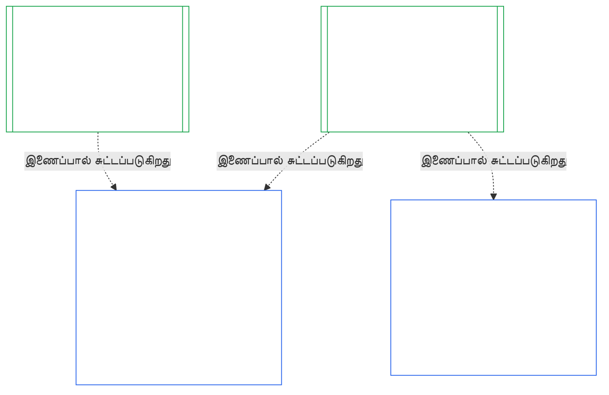
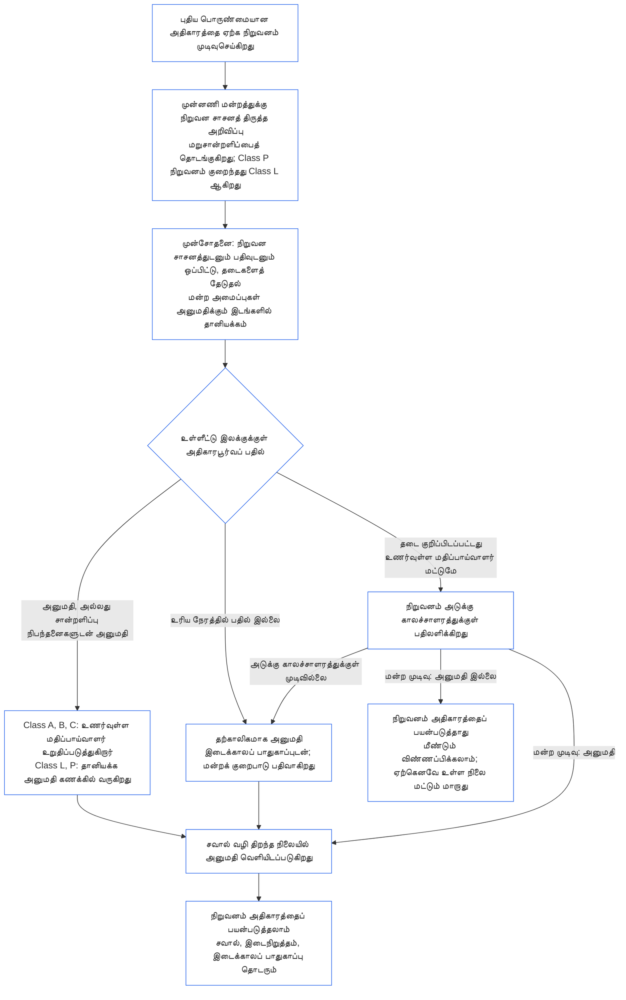

<!-- AI-assisted translation draft; unreviewed; English controls.
Source: core_10.000_institutional_alignment_certification.md
Source snapshot: 247e2180509e5e029c1106878cf225067339e010
Source SHA-256: a163a782114e584d09e295db66fe8b1b10a005b0f00116c8360396a0535ff221 -->

# அத்தியாயம் பத்து: நிறுவன ஒத்திசைவு சான்றளிப்பு

<strong>தொகுப்பில் இடம் (செயல்படாதது): கோப்பு அமைப்பும் வாசிப்பு விதிகளும்</strong>

> இந்தக் கோப்பு **உணர்வுள்ளோர் அரசியலமைப்பின் ஒரு பகுதி**; மற்ற எண்ணிடப்பட்ட `core_*` கோப்புகளுடன் ஒரே உரையாக வாசிக்கப்படும்போது மட்டுமே **பிணைக்கும்**. இதில் **அத்தியாயம் பத்து** உள்ளது — **நிறுவன ஒத்திசைவு சான்றளிப்பு**: ஓர் [நிறுவனம்](../../core_05.040_band_continuity.md#institution), அது இயக்கும் எந்த அமைப்பிலிருந்தும் வேறுபட்ட வகையில், எவ்வாறு வகைப்படுத்தப்படுகிறது, மதிப்பிடப்படுகிறது, மதிப்பாய்வு செய்யப்படுகிறது, தீர்மானிக்கப்படுகிறது, பதிவு செய்யப்படுகிறது, நடப்புநிலையில் வைக்கப்படுகிறது, மீண்டும் திறக்கப்படுகிறது (**§1–§11**). அத்தியாயம் பத்து [அத்தியாயம் ஒன்பது](core_09.000_system_alignment_certification_evaluation.md#chapter-nine-system-alignment-certification) (*அமைப்பு ஒத்திசைவு சான்றளிப்பு*) இன் நிறுவன இணை உரையாகும்; **இதன் பிரிவுகளும் அதே எண்களைக் கொண்டவை**: இங்குள்ள §N அங்குள்ள §N க்குப் பதிலளிக்கிறது. [CS-9.320](../../corpus_systems/cs_09.320_system_alignment_certification_illustrations.md#cs-9320-system-alignment-certification-illustrations) (*அமைப்பு ஒத்திசைவு சான்றளிப்பு எடுத்துக்காட்டுகள்*) அமைப்புகளுக்கான விளக்க எடுத்துக்காட்டுகளையும், அதன் [§12 நிறுவன விளக்க நடைப்பயணங்கள்](../../corpus_systems/cs_09.320_system_alignment_certification_illustrations.md#cs-9320-12-illustrative-institution-walkthroughs) பகுதியில் மூன்று நிறுவன நடைப்பயணங்களையும் கொண்டுள்ளது. இந்த அத்தியாயம் அவற்றை மீண்டும் கூறுவதில்லை.
>
> | § | அத்தியாயம் ஒன்பது (அமைப்பு) | அத்தியாயம் பத்து (நிறுவனம்) |
> |---|------------------------|----------------------------|
> | 1 | நோக்கமும் பங்கும் | அமைப்பு சான்றளிப்புடனான உறவு, யாருக்கு சான்றளிக்கப்படுகிறது, உருவாக்க அல்லது இயக்க அனுமதியும் வாயிற்காப்பும் இல்லை, புதிய பொருண்மையான அதிகாரத்திற்காகக் காத்திருத்தல், முதல் சான்றளிப்புக் காலச்சாளரம் |
> | 2 | அமைப்பு வகுப்பு மதிப்பீடு | நிறுவன வகுப்பு; வகுப்பின்படி அளவிடல் |
> | 3 | முழு அமைப்பு சான்றளிப்பு மதிப்பீடு | எப்போதும் பொருந்தும் எட்டு நிறுவனக் கூறுகள் |
> | 4 | தொடர்புடைய இடங்களில் மதிப்பீடுகள் | அத்தியாயம் ஒன்பது §4 க்கான சுட்டி |
> | 5 | உரிமைத் தள மற்றும் துறை மதிப்பீடுகள் | அத்தியாயம் ஒன்பது §5 க்கான சுட்டி |
> | 6 | மன்றச் செயல்முறை | நான்கு இருக்கைகள்; மன்றப் பங்குகளும் வரிசையும்; நிறுவனங்களாக மன்றங்கள், சான்றளிப்போர், பதிவகங்கள் |
> | 7 | சான்றளிப்பு முடிவுகள் | நிறுவனம் மற்றும் அதன் அமைப்புகளுக்கான தொடக்கச் செயல்பாடு, சான்றளிப்பு நிபந்தனைகள், முடிவின் பிற விளைவுகள்; குறைபாடுகளுக்கான சுட்டி; தீர்வுக்கான தயார்நிலை; மறுப்பும் திரும்பப்பெறுதலும் |
> | 8 | அமைப்பு சான்றளிப்புப் பதிவு | நிறுவன சான்றளிப்புப் பதிவு |
> | 9 | மறுசான்றளிப்பும் மீண்டும் திறத்தலும் | கண்காணிப்பு; மீண்டும் திறக்கும் தூண்டிகள்; தற்காலிக மற்றும் முழுச் சான்றளிப்பு; தவிர்த்துச் செல்லாமை; அமைப்பு சான்றளிப்புகளிலிருந்து தொடர்விளைவு; ஆளுகை மீறலில் அதன் அமைப்புகளை மீண்டும் திறத்தல் |
> | 10 | சான்றளிப்பைச் சவால் செய்தல் | சவால் வழி |
> | 11 | நிலைத்தடத்துடனான உறவு | நிலைத்தடப் பாலம் |
>
> - **அரசியலமைப்புப் பொறுப்பாளர் (அத்தியாயம் ஒன்பதுடன் கூட்டாக):** மன்ற மேற்பார்வையிலான ஒத்திசைவு சான்றளிப்பும் தொடர்புடைய பதிவுகளும். அத்தியாயம் பத்து நிறுவனப் பொருளைச் சேர்க்கிறது. புதிய மன்றக் குடும்பமோ, புதிய இருக்கையோ, புதிய முடிவுச் சொல்லோ சேர்க்காது.
> - **மீளுரைத்தல் அல்ல, மறுபயன்பாடு:** [அத்தியாயம் ஒன்பது பகுதி B §6](core_09.005_system_alignment_certification_record_process.md#6-forum-process) முதல் [அத்தியாயம் ஒன்பது பகுதி C §11](core_09.010_system_alignment_certification_record_recertification.md#11-relationship-to-standing) வரை கூறும் கட்டங்கள் III முதல் VI வரை செயல்படும். பொருள் நிறுவனம் ஆகும்போது என்ன மாறுகிறது என்பதையே அத்தியாயம் பத்து கூறுகிறது.
> - **இடமாற்ற எதிர்ப்பு விதி:** அத்தியாயம் ஒன்பது அமைப்பு மதிப்பீட்டு நடைமுறைகள், அத்தியாயம் ஏழின் அமைப்பு சாசனம் மற்றும் நிறுவன சாசனப் புலங்கள், அத்தியாயம் எட்டின் நான்கு இருக்கைத் தேவை, [corpus_institutions](../../corpus_institutions.md) இல் உள்ள நிறுவனக் கடமைகள், அத்தியாயம் பதினொன்றின் நிலைத்தட அளவீடு அல்லது அத்தியாயம் பன்னிரண்டின் நிலைத்தட விளைவுகள் ஆகியவற்றை அத்தியாயம் பத்து மீண்டும் கூறுவதில்லை.
>
> **மேல்நிலை:** [அத்தியாயம் ஏழு](core_07_charters.md#chapter-seven-system-and-institutional-charters) சாசனங்கள்; [அத்தியாயம் எட்டு](../../core_08.000_functional_independence_separation_of_duties.md#chapter-eight-functional-independence-and-separation-of-duties) செயல்பாட்டுச் சுதந்திரம்; [அத்தியாயம் ஒன்பது](core_09.000_system_alignment_certification_evaluation.md#chapter-nine-system-alignment-certification) (பகுதிகள் [A](core_09.000_system_alignment_certification_evaluation.md#chapter-nine-part-a-system-alignment-certification--evaluation), [B](core_09.005_system_alignment_certification_record_process.md#chapter-nine-part-b-system-alignment-certification--forum-process-and-outcomes), மற்றும் [C](core_09.010_system_alignment_certification_record_recertification.md#chapter-nine-part-c-system-alignment-certification--record-recertification-and-standing)); அத்தியாயம் பதினான்கு மன்ற மேற்பார்வை.
> **கீழ்நிலை:** அத்தியாயம் பதினொன்று நிலைத்தடப் பதிவுகளும் சரிபார்க்கப்பட்ட உள்ளீடுகளும்; அத்தியாயம் பன்னிரண்டு நிலைத்தட விளைவுகள்.

<strong>தடமறிதல்</strong>

- மேல்நிலை:
  - [அத்தியாயம் ஏழு §1 அமைப்பு மற்றும் நிறுவன சாசனங்கள் எப்போது தேவை](core_07_charters.md#1-when-system-and-institutional-charters-are-required) (7.000 §1) (*எந்த நிறுவனங்கள் அமைப்பு சாசனம் அல்லது நிறுவன சாசனத்தை வெளியிடுகின்றன, நிறுவன வகுப்பு என்ன*);
  - [அத்தியாயம் ஏழு §7 திருத்தமும் மதிப்பாய்வும்](core_07_charters.md#7-amendment-review-and-scope-misalignment) (7.000 §7) (*நிறுவன சாசன மதிப்பாய்வு எதைச் சோதிக்கிறது*);
  - [அத்தியாயம் ஏழு §4 சாசனப் பங்கு வரைபடமும் நிலைத்தடப் பதிவுக் காவலும்](core_07_charters.md#4-the-charter-role-map-and-standing-record-custody) (7.000 §4) (*இருக்கைகள் எங்கு அமைந்துள்ளன*);
  - [அத்தியாயம் எட்டு §2 அரசியலமைப்பின் நான்கு இருக்கைத் தேவை](core_07_functional_independence_segregation_of_duties.md#2-four-seat-constitutional-requirement) (8.000 §2) மற்றும் [§9 பிந்தைய செயல்முறைகளுடனான உறவு](core_07_functional_independence_segregation_of_duties.md#9-relationship-to-later-processes);
  - [அத்தியாயம் ஒன்பது](core_09.000_system_alignment_certification_evaluation.md#chapter-nine-system-alignment-certification) (9.000 முதல் 9.010 வரை) (*இந்த அத்தியாயம் மறுபயன்படுத்தும் அமைப்பு ஒத்திசைவு சான்றளிப்பு செயல்முறை*);
  - [இரண்டு அடிப்படைக் கேள்விகள்](core_00_preamble.md#two-fundamental-questions);
  - [அரசியலமைப்பு நான்மம்](core_00_preamble.md#constitutional-tetrad);
  - [Article XI-E](core_06_rights_part_b.md#article-xi-e-institutional-formation-and-business-creation) (*நிறுவன உருவாக்கமும் வணிகத் தொடக்கமும்*).
- கீழ்நிலை: [§1](#1-purpose-and-role) முதல் [§11](#11-relationship-to-standing) வரை; அத்தியாயம் பதினொன்று ([11.000](core_11_standing_assessment.md#chapter-eleven-contribution-violation-and-standing-model--measurement)); [அத்தியாயம் பதினான்கு](../../core_15.000_forum.md#chapter-fifteen-forums-and-jurisdiction) (14.000).
- இதனுடன் வாசிக்க:
  - [நிறுவன ஒத்திசைவு சான்றளிப்பு](../../core_05.040_band_continuity.md#institutional-alignment-certification) மற்றும்
  - [நிறுவன சான்றளிப்புப் பதிவு](../../core_05.040_band_continuity.md#institutional-certification-record) (*அத்தியாயம் ஐந்தின் பொருள்கள்*);
  - **CI-8.205 §6** (*அமைப்பு மற்றும் நிறுவன சாசன உள்ளடக்கங்கள், மதிப்பாய்வு, உருவாக்க வார்ப்புரு*);
  - **CF-14.425** (*ஒருமைப்பாட்டுப் பாதுகாப்புகள், கைப்பற்றல் எதிர்ப்பு செயல்பாடுகள், சுயத் தீர்ப்பளிப்பு எதிர்ப்பு ஆதரவு*).

 

நிறுவன ஒத்திசைவு சான்றளிப்புக்கான அரசியலமைப்புப் பொறுப்பாளர் அத்தியாயம் பத்து. இது [அத்தியாயம் ஒன்பது](core_09.000_system_alignment_certification_evaluation.md#chapter-nine-system-alignment-certification) செயல்முறையை ஓர் அமைப்பிலிருந்து நிறுவனத்துக்கு விரிவாக்குகிறது:

- **கட்டம் I, வரையறுத்தல்:** நிறுவன வகுப்பும் அது மதிப்பீட்டை எவ்வாறு அளவிடுகிறது என்பதும் ([§2 நிறுவன வகுப்பு மதிப்பீடு](#2-institution-class-evaluation));
- **கட்டம் II, மதிப்பீடு:** தொடர்புடைய இடங்களில் பொருந்தும் மதிப்பீடுகளும் உரிமைத் தள மற்றும் துறை மதிப்பீடுகளும் உட்பட நிறுவன மதிப்பீடு ([§3 முழு நிறுவன சான்றளிப்பு மதிப்பீடு](#3-whole-institution-certification-evaluation) முதல் [§5 உரிமைத் தள மற்றும் துறை மதிப்பீடுகள்](#5-rights-floor-and-domain-evaluations) வரை);
- **கட்டம் III, மதிப்பாய்வு:** மன்றப் பங்குகளும் வரிசையும் ([§6 மன்றச் செயல்முறை](#6-forum-process));
- **கட்டம் IV, தீர்மானித்தல்:** முடிவு, தீர்வுக்கான தயார்நிலை, மறுப்பும் திரும்பப்பெறுதலும் ([§7 சான்றளிப்பு முடிவுகள்](#7-certification-outcomes));
- **கட்டம் V, பதிவு:** நிறுவன சான்றளிப்புப் பதிவு ([§8 நிறுவன சான்றளிப்புப் பதிவு](#8-institutional-certification-record)); மற்றும்
- **கட்டம் VI, செயல்படுத்தல்:** மறுசான்றளிப்பு, மீண்டும் திறத்தல், அமைப்பு சான்றளிப்புகளிலிருந்து தொடர்விளைவு, அதன் அமைப்புகளை மீண்டும் திறத்தல், சவால் வழி, நிலைத்தடப் பாலம் ([§9 மறுசான்றளிப்பும் மீண்டும் திறத்தலும்](#9-recertification-and-reopening) முதல் [§11 நிலைத்தடத்துடனான உறவு](#11-relationship-to-standing) வரை).

*எளிய சொற்களில்: ஓர் **அமைப்பு** ஒத்திசைவாக உள்ளதா என்று அத்தியாயம் ஒன்பது கேட்கிறது. அமைப்புகளை இயக்கும் அல்லது அமைப்பை இயக்காமலேயே அதிகாரம் வைத்திருக்கும் **நிறுவனமும்** அதேபோல் உள்ளதா என்று அத்தியாயம் பத்து கேட்கிறது. ஓர் நிறுவனம் ஒத்திசைவாக இருந்தாலும் அதன் அமைப்புகளில் ஒன்று ஒத்திசைவின்றி இருக்கலாம்; இதன் தலைகீழும் நிகழலாம். எனவே, நிறுவனம் மட்டுமே கட்டுப்படுத்தும் அம்சங்கள் சரிபார்க்கப்படுகின்றன: அதன் நிறுவன சாசனம் கூறுவதை அது செய்கிறதா, அதன் அதிகாரத்திற்கு யார் பதிலளிக்கிறார்கள், தனது உறுப்பினர்களிடம் அது எதை ஊக்குவிக்கிறது, அதன்மீதான சுயாதீனச் சோதனைகளை உண்மையில் பயன்படுத்த முடியுமா. ஒவ்வொரு அமைப்பின் சான்றளிப்பையும் அது சார்ந்திருக்கும்; அவற்றை மீண்டும் மதிப்பிடாது. இது உரிமம் அல்ல: ஒரு நிறுவனத்தைத் தொடங்கவோ இயக்கவோ அதன் அனுமதி எவருக்கும் தேவையில்லை.*

### 1. நோக்கமும் பங்கும்

<strong>தடமறிதல்</strong>

- மேல்நிலை:
  - [அத்தியாயம் ஏழு §1 அமைப்பு மற்றும் நிறுவன சாசனங்கள் எப்போது தேவை](core_07_charters.md#1-when-system-and-institutional-charters-are-required) (7.000 §1);
  - [அத்தியாயம் ஒன்பது பகுதி A §1 நோக்கமும் பங்கும்](core_09.000_system_alignment_certification_evaluation.md#1-purpose-and-role) (9.000 §1);
  - [Article XI-E](core_06_rights_part_b.md#article-xi-e-institutional-formation-and-business-creation) (*நிறுவன உருவாக்கமும் வணிகத் தொடக்கமும்*);
  - [Article XXVIII-A](../../core_06.020_rights_part_e.md#xxviii-a-existing-instantiations-adoption-transition-window) (*கட்டங்கட்டமான ஏற்பும் உரிமைத் தளத் தொடர்ச்சியும்*).
- கீழ்நிலை: [§2](#2-institution-class-evaluation); [§6](#6-forum-process); [§7](#7-certification-outcomes); [§9](#9-recertification-and-reopening).
- இதனுடன் வாசிக்க:
  - [நிறுவனம்](../../core_05.040_band_continuity.md#institution);
  - [நிறுவன சாசனம்](../../core_05.040_band_continuity.md#institutional-charter);
  - [அமைப்பு சாசனம்](../../core_05.040_band_continuity.md#system-charter);
  - [வணிகத் தொடக்கம்](../../core_05.055_band_participation.md#business-creation).

 

*எளிய சொற்களில்: ஓர் அமைப்பின் சான்றளிப்பு அந்த அமைப்புக்குரியது. ஓர் நிறுவனத்தின் சான்றளிப்பு, அந்த அமைப்புகளின் சான்றளிப்புகளைச் சுட்டி, நிறுவனம் மட்டுமே பதிலளிக்கக்கூடியவற்றைச் சேர்க்கிறது. ஓர் அமைப்பு பல நிறுவனங்களின் கீழ் இருக்கலாம்; அல்லது எதன் கீழும் இல்லாமல் இருக்கலாம். இங்குள்ள எதுவும் நிறுவனத்தைத் தொடங்குவதற்குத் தடையாக சான்றளிப்பை நிறுத்திவைக்க அனுமதிப்பதில்லை.*

நிறுவன ஒத்திசைவு சான்றளிப்பும் அமைப்பு ஒத்திசைவு சான்றளிப்பும் இணைப்பால் இணைக்கப்பட்ட இரண்டு சான்றளிப்புகள். அவற்றின் உறவு **இணைப்பின் வழியான கூட்டமைப்பு**; உள்ளடக்கம் அல்ல. படத்தில், ஓர் அமைப்பு சான்றளிப்புப் பதிவிலிருந்து அதைச் சுட்டும் ஒவ்வொரு நிறுவன சான்றளிப்புப் பதிவுக்கும் அம்பு செல்கிறது. எந்த நிறுவனத்திற்கும் உட்படாத அமைப்புக்கு அம்பு தேவையில்லை; எந்த அமைப்பையும் இயக்காத நிறுவனத்திற்குத் தனிப்பதிவு இருக்கும்.

இணைப்பின் வழியான கூட்டமைப்புக்கு இரண்டு தரப்புகள் உள்ளன; முதலில் நிறுவனத்தின் தரப்பு.

நிறுவனத்தின் தரப்பில்:

- **நிறுவன சான்றளிப்புப் பதிவு, அமைப்பின் பதிவை மீண்டும் செய்யாமல் அதனைச் சுட்டும்:** அது அமைப்பு சான்றளிப்புப் பதிவை இணைப்பால் சுட்டி, அதன் பதிப்பைக் குறிப்பிடும். இந்த அத்தியாயம் அமைப்பு மதிப்பீட்டை மீண்டும் நடத்தாது; அமைப்பின் வகுப்பை மீண்டும் தீர்மானிக்காது; அதன் முடிவு, நிலை அல்லது சான்றளிப்பு நிபந்தனைகளை மாற்றாது.
- **நிறுவனத்தின் சான்றளிப்பு அமைப்பின் நிலையை உயர்த்தாது:** சான்றளிக்கப்படாத அமைப்பு, நிறுவனத்தின் நிலை எதுவாக இருந்தாலும் சான்றளிக்கப்படாததாகவே இருக்கும். சான்றளிப்பு பெற்ற அமைப்புக்கு நிறுவனத்தின் கண்டறிதலிலிருந்து பாதுகாப்பு கிடையாது.
- **நிறுவன உண்மைகள் ஒருமுறை மட்டுமே கண்டறியப்படும்:** [அத்தியாயம் ஒன்பது பகுதி A §3.1 ஆளுகை, ஊக்கம், சவால் ஒழுங்கு](core_09.000_system_alignment_certification_evaluation.md#31-governance-incentive-and-contestability-discipline) இயக்குநரின் ஆளுகை மற்றும் ஊக்கங்கள் பற்றிக் கேட்கும் இடத்தில், அந்த இயக்குநருக்கான நடப்பிலுள்ள நிறுவன சான்றளிப்புப் பதிவு இணைப்பின் மூலம் அந்த உண்மைகளை வழங்கலாம். அந்த அமைப்புக்கு அந்த உண்மைகள் போதுமா என்பதை அமைப்பின் மன்றங்களே தீர்மானிக்கும். அதே நிறுவன உண்மையை வேறுவிதமாகக் கண்டறிந்தால், அமைப்பு சான்றளிப்புப் பதிவில் அதற்கான காரணத்தைக் கூற வேண்டும்.

அமைப்பின் தரப்பில்:

- **அமைப்பு சான்றளிப்புப் பதிவு அமைப்புக்குரியது:** [அத்தியாயம் ஒன்பது](core_09.000_system_alignment_certification_evaluation.md#chapter-nine-system-alignment-certification) இன் கீழ் அது அந்த அமைப்பின் சொந்தப் பதிவாகும்.
- **ஒரே அமைப்பு சான்றளிப்புப் பதிவை பல நிறுவனங்கள் சுட்டலாம்:** [அத்தியாயம் ஏழு §1 அமைப்பு மற்றும் நிறுவன சாசனங்கள் எப்போது தேவை](core_07_charters.md#1-when-system-and-institutional-charters-are-required) இன் கீழ் ஒன்றுக்கு மேற்பட்ட நிறுவனங்கள் ஓர் அமைப்பை இயக்கவோ, பொறுப்புடன் நிர்வகிக்கவோ, பொருண்மையாகக் கட்டுப்படுத்தவோ முடியும். ஒவ்வொன்றும் அதே பதிவைச் சுட்டும்.
- **ஓர் அமைப்பு எந்த நிறுவனத்தின் கீழும் இருக்க வேண்டியதில்லை:** தனி உணர்வுள்ளவர் நிறுவனம் அல்ல; ஆகவே அமைப்புக்கு நிறுவனம் இல்லாமலும் இருக்கலாம். நிறுவனமற்ற அமைப்பு [அத்தியாயம் ஒன்பது](core_09.000_system_alignment_certification_evaluation.md#chapter-nine-system-alignment-certification) இன் கீழ் மட்டுமே சான்றளிக்கப்படுகிறது; இந்த அத்தியாயத்திடமிருந்து எதுவும் தேவையில்லை. நிறுவனத்தின் கீழ் இருக்கும் அமைப்பும் அதே முறையில் சான்றளிக்கப்படுகிறது: இந்த அத்தியாயம் நிறுவனத்திற்குத் தனிப் பதிவைச் சேர்க்கிறது; அது அமைப்பின் சொந்தச் சான்றளிப்பின் படி அல்ல.

#### 1.1 யாருக்கு சான்றளிக்கப்படுகிறது

Class L அல்லது அதற்கு மேலான நிறுவனம் இந்த அத்தியாயத்தின் வரம்புக்குள் வரும்; அதன் வகுப்பு [§2.1 நிறுவன வகுப்பு](#21-institution-class) இன் கீழ் தீர்மானிக்கப்படுகிறது. எந்த அமைப்பையும் இயக்காத நிறுவனமும் இதில் அடங்கும்: அதற்குச் சுட்டுவதற்கு அமைப்பு சான்றளிப்புப் பதிவு இல்லை; அதன் வகுப்பு அதன் சொந்தத் தாக்கத்திலிருந்து வருகிறது. ஓர் நிறுவனத்தின் **தொகுப்பு** என்பது அது இயக்கும், பொறுப்புடன் நிர்வகிக்கும் அல்லது பொருண்மையாகக் கட்டுப்படுத்தும் அமைப்புகளின் தொகுப்பாகும் ([தொகுப்பு](../../core_05.040_band_continuity.md#portfolio)).

- **Class A, B, C, L:** செயல்முறை பொருந்தும்; [§2.2 வகுப்பின்படி அளவிடல்](#22-scaling-by-class) இன் கீழ் வகுப்புக்கு ஏற்ப அளவிடப்படும்.
- **Class P:** செயல்முறை ஊக்குவிக்கப்படுகிறது; விருப்பப்படி பயன்படுத்தலாம். Class L அல்லது அதற்கு மேல் மறுவகைப்படுத்தப்பட்டால், அல்லது நிறுவனம் அரசியலமைப்பு இணக்கத்தை விருப்பப்படி உரிமைகோரினால், அது கட்டாயமாகிறது. புதிய பொருண்மையான அதிகாரத்தை ஏற்க முடிவெடுக்கும் Class P நிறுவனம், [§9.2.2 புதிய பொருண்மையான அதிகாரத்திற்கான மறுசான்றளிப்பு](#922-recertification-for-new-material-authority) இல் கூறிய அறிவிப்பை வழங்கும்போது குறைந்தது Class L ஆக மறுவகைப்படுத்தப்படும். ஏனெனில் அந்த அதிகாரம் வரையறையின்படி பொருண்மையானது ([§9.2.1 புதிய பொருண்மையான அதிகாரமாக எது கணக்கில் வரும்](#921-what-counts-as-new-material-authority)); எந்தத் துறையிலாவது பொருண்மையான நிறுவனம் குறைந்தது Class L ஆகும் ([§2.1 நிறுவன வகுப்பு](#21-institution-class), உருப்படி 2). அனுமதிக்கு முன் அறிவிப்பு திரும்பப்பெறப்படும் வரை, அல்லது அதிகாரம் அனுமதிக்கப்படாமல் இருக்கும் வரை — அதன் கீழ் எதுவும் பயன்படுத்தப்படாத நிபந்தனையில் — மறுவகைப்படுத்தல் நீடிக்கும். பின்னர் நிறுவனம் Class P க்குத் திரும்பும்; வரையறுக்கப்பட்ட முதல் சான்றளிப்பு முடிவடையும். புதிய அறிவிப்பு அதை மீண்டும் தொடங்கும்; அனுமதியின்றி அதிகாரத்தைப் பயன்படுத்துவது [§9.2.2 புதிய பொருண்மையான அதிகாரத்திற்கான மறுசான்றளிப்பு](#922-recertification-for-new-material-authority) (*அறிவிப்பின்றி அல்லது அனுமதிக்கு முன்*) இன் கீழ் கண்டறிதலாகவே இருக்கும். இது [அத்தியாயம் ஒன்பது பகுதி A §1 நோக்கமும் பங்கும்](core_09.000_system_alignment_certification_evaluation.md#1-purpose-and-role) உடன் ஒத்துள்ளது.
- **ஒரு அமைப்பு:** அமைப்பு சாசனம் தேவைப்படும் சரியாக ஓர் அமைப்பை இயக்கும் நிறுவனம், ஒரே சான்றளிப்பு சுற்றையும் ஒரே பதிவையும் கொண்டிருக்கும்; இதை இந்த அத்தியாயம் **ஒரு-அமைப்பு மதிப்பீடு** என அழைக்கிறது. அமைப்பு சான்றளிப்புப் பதிவில் [§8 நிறுவன சான்றளிப்புப் பதிவு](#8-institutional-certification-record) இல் கூறிய உருப்படிகளைக் கொண்ட *நிறுவனக் கண்டறிதல் தொகுதி* இருக்கும்; அதுவே நிறுவன சான்றளிப்புப் பதிவாகவும் செயல்படும். மன்றங்கள், இருக்கைகள், காலக்கெடுக்கள் ஆகியவை நிறுவன உருப்படிகள் சேர்க்கப்பட்ட அந்த அமைப்பின் சொந்தச் சான்றளிப்பு சுற்றின்படியே இருக்கும். [§7.4 நிறுவனத்திற்கான மறுப்பும் திரும்பப்பெறுதலும்](#74-denial-and-revocation-for-an-institution) கூறும் தனித்த காரணங்களே அதன் முடிவுகளுக்குப் பொருந்தும். அமைப்பே முழுத் தொகுப்பாக இருப்பதால் [§9.5 அமைப்பு சான்றளிப்புகளிலிருந்து தொடர்விளைவு](#95-cascade-from-system-certifications) தொடர்விளைவாகப் பொருந்தாது; ஆனால் [§7.4 நிறுவனத்திற்கான மறுப்பும் திரும்பப்பெறுதலும்](#74-denial-and-revocation-for-an-institution) இன் விதிகள் 1 மற்றும் 2 (குறியீடும் காரணம் எங்கு உள்ளது என்பதற்கான சோதனையும்) பொருந்தும்.
- **பல அமைப்புகள்:** அந்த நிறுவனம் இயக்கும் ஒவ்வொரு அமைப்பின் சான்றளிப்புப் பதிவையும் இணைக்கும் ஒரு நிறுவன சான்றளிப்புப் பதிவு. ஒவ்வொரு அமைப்பும் தன் சொந்தச் சான்றளிப்பு சுற்றையும் பதிவையும் வைத்திருக்கும்.
- **அமைப்பு இல்லை:** நிறுவனத்திற்கென ஒரு தனி நிறுவன சான்றளிப்புப் பதிவு. நிறுவனம் எந்த அமைப்பையும் இயக்காததால் இணைப்பதற்கு அமைப்பு சான்றளிப்புப் பதிவு இருக்காது.

#### 1.2 உருவாக்க அல்லது இயக்க அனுமதியும் வாயிற்காப்பும் இல்லை

நிறுவன ஒத்திசைவு சான்றளிப்பு என்பது நிறுவனம் தனது அதிகாரத்தை உண்மையில் எவ்வாறு பயன்படுத்துகிறது என்பதற்கான சுயாதீனச் சோதனை. நிறுவனத்திலிருந்து சுயாதீனமான மன்றங்கள் அதைச் செய்கின்றன; அவை கண்டறிந்தவற்றின் நிறுவன சான்றளிப்புப் பதிவுடன் அது முடிவடைகிறது.

- **தொடங்குதலும் இயக்குதலும்:** நிறுவனம் உருவாகிறது, தனது நிறுவன சாசனத்தை வெளியிடுகிறது, அதிகாரத்தைப் பயன்படுத்தத் தொடங்குகிறது, முதலில் சான்றளிப்பு பெற்றிருக்காமலேயே தொடர்ந்து இயங்குகிறது; எந்த முடிவும் அந்த உரிமையை வழங்கவோ மறுக்கவோ செய்யாது.
- **முடிவின் விளைவு:** [§7.1 நிறுவனத்திற்கான தொடக்கச் செயல்பாடு](#71-go-live-for-an-institution) இல் கூறிய விளைவுகள் மட்டுமே முடிவுக்கு உண்டு.
- **இந்தத் துறையிலுள்ள ஒரே வாயில்கள்:** **Article XI-E** (*நிறுவன உருவாக்கமும் வணிகத் தொடக்கமும்*) இல் மூன்று குறுகிய வாயில்கள் மட்டுமே உள்ளன:
  - பெயரிடப்பட்ட உணர்வுள்ளவர் மீதான நிலுவைப் பூட்டு; அது அந்த உணர்வுள்ளவரின் அதிகாரத்துடன் இணைகிறது;
  - ஒத்திசைவின்மை குறித்த குறிப்பிட்ட சரிபார்க்கப்பட்ட உண்மைகளின் மீதான இடைக்கால இடைநிறுத்தம்; அதுவும் பெயரிடப்பட்ட உணர்வுள்ளவரின் அதிகாரத்துடன் இணைகிறது;
  - செயல்பாட்டுத் தரப்பின் மீதான பூட்டு; கலைக்கப்பட்ட நிறுவனத்தின் மீது **CI-12.210 §4** (*கலைப்பு*) படி இருப்பதைப் போல, அந்த நிறுவனத்தின் மீதே பூட்டு இருக்கும்போது மட்டுமே அது நிறுவனத்துடன் இணைகிறது.

  சான்றளிப்புக் கண்டறிதலை, இந்த வாயில்களில் ஒன்றைத் தீர்மானிக்கும் மன்றத்துக்குச் சான்றாகப் பரிந்துரைக்கலாம் ([§7.5 நிறுவனத்திற்கான மறுப்பும் திரும்பப்பெறுதலும் ஏற்படுத்தும் விளைவுகள்](#75-effects-of-denial-and-revocation-for-an-institution)). சான்றளிப்பு முடிவு தானாகவே வாயிலல்ல; அதைத் திறக்கவோ மூடவோ செய்யாது.
- **புதிய பொருண்மையான அதிகாரத்திற்காகக் காத்திருத்தல்:** புதிய பொருண்மையான அதிகாரத்தை ஏற்க முடிவுசெய்யும் நிறுவனம், [§9.2.2 புதிய பொருண்மையான அதிகாரத்திற்கான மறுசான்றளிப்பு](#922-recertification-for-new-material-authority) நிபந்தனைகளின்படி அந்த அதிகாரத்தைப் பயன்படுத்துவதற்கு முன், மறுசான்றளிப்பு அதை அனுமதிக்கக் காத்திருக்க வேண்டும். இந்தக் காத்திருப்பை **Article XI-E** (*நிறுவன உருவாக்கமும் வணிகத் தொடக்கமும்*) கூறுகிறது. இது மூன்று குறுகிய வாயில்களில் ஒன்றல்ல; உருவாக்கம் அல்லது இயக்கத்திற்கான வாயிலும் அல்ல. இது புதிய அதிகாரத்துடன் மட்டுமே இணைகிறது; நிறுவனம் செய்யும் மற்ற அனைத்தும் தொடரும். [§9.2.2 புதிய பொருண்மையான அதிகாரத்திற்கான மறுசான்றளிப்பு](#922-recertification-for-new-material-authority) இல் உள்ள படம் படிகளைச் சுருக்குகிறது.
- **மறைவழி இல்லை:** நிறுவனர்களை வெளியேற்றவோ, பதவியிலுள்ளவர்களைப் பாதுகாக்கவோ, மன்றம், ஏற்றுக்கொள்பவர் அல்லது பதவியிலுள்ளவர் இந்த அத்தியாயத்தை அனுமதி வரம்பாகப் பயன்படுத்தக்கூடாது. அப்படிச் செய்வது [Article XI-E](core_06_rights_part_b.md#article-xi-e-institutional-formation-and-business-creation) (*நிறுவன உருவாக்கமும் வணிகத் தொடக்கமும்*) ஐத் தோற்கடிக்கும்.
  - செயல்முறையின் செலவுக்கு [தவிர்க்கக்கூடிய சுமை](../../core_05.040_band_continuity.md#avoidable-burden) பொருந்தும்.
  - அதன் ஆழத்திற்கு [வகைப்பாட்டுக்கு ஏற்ப அளவிடப்பட்ட ஆளுகை](core_05_band_oversight.md#classification-scaled-governance) பொருந்தும்.
  - புதிய பொருண்மையான அதிகாரத்திற்கான காத்திருப்பு, அந்த வகுப்பிலுள்ள ஒவ்வொரு நிறுவனத்திற்கும் ஒரே நிபந்தனைகளில் பொருந்தும்; ஏற்கெனவே பிறருக்கு பொருண்மையான அதிகாரத்திற்கே அது பொருந்தும்.

அமைப்புகளுக்கான தொடக்கச் செயல்பாட்டு வாயில் தனியானது; அது அமைப்புகளிடமே இருக்கும். [அத்தியாயம் ஒன்பது பகுதி B §7.1 தொடக்கச் செயல்பாட்டு வாயில்](core_09.005_system_alignment_certification_record_process.md#71-go-live-gate) இன் கீழ், புதிய அமைப்போ அதன் பொருண்மையான விரிவாக்கமோ, நிறுவனத்தின் நிலை எதுவாக இருந்தாலும், அதன் சொந்தச் சான்றளிப்பின் வழியாக மட்டுமே தொடங்கும்.

#### 1.3 முதல் சான்றளிப்புக்கான காலச்சாளரம்

நிறுவனத்தின் வகுப்புக்காக ஏற்றுக்கொள்ளும் ஆவணம் அமைக்கும் காலச்சாளரத்திற்குள் முதல் நிறுவன சான்றளிப்புப் பதிவு வழங்கப்பட வேண்டும்.

- **புதிய நிறுவனம்:** [துறைசார் பொருண்மை](core_05_band_oversight.md#domain-specific-materiality) மதிப்பிடுவதன்படி, அது முதலில் பிறர்மீது பொருண்மையான தாக்கம் ஏற்படுத்தும் நாளிலிருந்து காலச்சாளரம் தொடங்கும்; அதன் முதல் சான்றளிப்பு தற்காலிகமானது.
- **அறிவிப்பின்போது மறுவகைப்படுத்தப்படும் Class P நிறுவனம்:** புதிய நிறுவனத்துக்கானதைப் போல, [§9.2.2 புதிய பொருண்மையான அதிகாரத்திற்கான மறுசான்றளிப்பு](#922-recertification-for-new-material-authority) இன் கீழ் அறிவிக்கும் நாளிலிருந்து காலச்சாளரம் தொடங்கும்; ஏற்கெனவே முடிந்த ஏற்பு மாற்றக் காலச்சாளரத்திலிருந்து ஒருபோதும் தொடங்காது.
- **ஏற்கெனவே இயங்கிக்கொண்டிருப்பது:** [Article XXVIII-A](../../core_06.020_rights_part_e.md#xxviii-a-existing-instantiations-adoption-transition-window) (*கட்டங்கட்டமான ஏற்பும் உரிமைத் தளத் தொடர்ச்சியும்*) இன் கீழ் ஏற்பு மாற்றக் காலச்சாளரமே பொருந்தும்; [அத்தியாயம் ஏழு §1.5 அமைப்பு சாசனம் அல்லது நிறுவன சாசனம் எப்போது தேவை](core_07_charters.md#15-when-a-system-charter-or-institutional-charter-is-due) இல் உள்ள இயல்புநிலையுடன் இது ஒத்துள்ளது.
- **காலச்சாளரத்தைத் தவறவிடுதல்:** கீழே விலக்கு இல்லாமல், முதல் சான்றளிப்பு சுற்று இன்றி காலச்சாளரம் முடிவடைய அனுமதிக்கும் நிறுவனத்துக்கு பதிவு செய்து சரிசெய்ய வேண்டிய குறைபாடு உண்டு; தவறிய காலச்சாளரே அந்தச் சுற்றைத் தொடங்கும். ஏற்கெனவே இயங்கும் Class L அல்லது அதற்கு மேலான நிறுவனத்துக்கு கீழே கூறிய மைல்கல் தோல்வியும் உண்டு. வாயில் இல்லாததால் ([§1.2 உருவாக்க அல்லது இயக்க அனுமதியும் வாயிற்காப்பும் இல்லை](#12-no-permission-and-no-gate-on-forming-or-running)) நிறுவனம் நிறுத்தப்படவோ இயக்கத்திலிருந்து தடுக்கப்படவோாது.
  - **ஏற்கெனவே இயங்கும் நிறுவனம்:** Class L அல்லது அதற்கு மேலான நிறுவனங்களுக்கான இந்த அத்தியாயத்தின் சொந்த விதி இது; அமைப்புகள் மற்றும் அவற்றிலிருந்து தோன்றிய நிறுவனங்களைக் குறிப்பிடும் [Article XXVIII-A](../../core_06.020_rights_part_e.md#xxviii-a-existing-instantiations-adoption-transition-window) (*கட்டங்கட்டமான ஏற்பும் உரிமைத் தளத் தொடர்ச்சியும்*) உடனான ஒப்புமையில் அமைக்கப்பட்டது. அதன் ஏற்பு மாற்றக் காலச்சாளரம் முடிந்தும் முதல் சான்றளிப்பு சுற்று முழுமையாகாதிருந்தால் ([§7 சான்றளிப்பு முடிவுகள்](#7-certification-outcomes) இன் கீழ் தற்காலிக அல்லது முழுச் சான்றளிப்பும் தீர்மானிக்கப்பட்ட முடிவும் இல்லாவிட்டால்), அது காலக்கெடுவைத் தவறவிட்டதாகும். காலச்சாளரத்திற்குள் விண்ணப்பித்து ஒத்துழைத்த நிறுவனம், மன்றம் தனது காலத்தை மீறியதால் சான்றளிப்புச் சுற்று முடியாமல் இருந்தால் ([அத்தியாயம் பதினான்கு §6 காலத்திற்குள் தீர்வு, பொருண்மை அடுக்குகள், தாமத எதிர்ப்பு ஒழுங்கு](core_11_forum.md#6-timely-resolution-materiality-tiers-and-anti-delay-discipline), *காலமீறல் மதிப்பாய்வு*; [அத்தியாயம் ஒன்பது பகுதி C §9.3.4 அடுக்கு காலச்சாளரங்கள்](core_09.010_system_alignment_certification_record_recertification.md#934-tier-windows)) அல்லது [§7.3 நிறுவனத்திற்கான தீர்வுத் தயார்நிலை](#73-remediation-readiness-for-an-institution) இன் ஒரே ஒத்திவைப்பு நடைமுறையில் இருப்பதால் அது முடியாமல் இருந்தால், காலக்கெடுவைத் தவறவிட்டதாகாது. [Article XXVIII-B](../../core_06.020_rights_part_e.md#article-xxviii-b-adoption-transition-authority-limits-and-reauthorization) (*ஏற்பு மாற்ற அதிகார வரம்புகளும் மறுஅனுமதியும்*) இன் கீழ் ஆவணப்படுத்தப்பட்ட மறுஅனுமதி காட்டப்படாவிட்டால், அது ஏற்பு மாற்ற மைல்கல் தோல்வியாகும்; [அத்தியாயம் பதினொன்று](core_11_standing_assessment.md#chapter-eleven-contribution-violation-and-standing-model--measurement) இன் வழக்கமான இணக்க மற்றும் மீறல் பாதை திறக்கும். அந்தக் கட்டுரையின் கட்டுப்பாட்டுக் கடமைகள் நடைமுறைத் தேதியிலிருந்து பொருந்தும்; இடைவெளி நீடித்ததால் புதிய இயல்பாக மாறாது. இது [அத்தியாயம் ஒன்பது பகுதி B §7.1.1 ஏற்கெனவே இயங்கும் அமைப்புகள்](core_09.005_system_alignment_certification_record_process.md#711-systems-already-operating) உடன் ஒத்துள்ளது. இது வாயிலல்ல.
  - **சான்றளிப்புச் சுற்று:** பிறவற்றைப் போலவே தீர்மானிக்கப்படும். [§7 சான்றளிப்பு முடிவுகள்](#7-certification-outcomes) இல் உள்ள எந்த முடிவாகவும், [§7.5 நிறுவனத்திற்கான மறுப்பும் திரும்பப்பெறுதலும் ஏற்படுத்தும் விளைவுகள்](#75-effects-of-denial-and-revocation-for-an-institution) இன் விளைவுகளுடன் சான்றளிக்கப்படவில்லை என்பதாகவும் முடிவடையலாம்.
  - **தண்டனைகளும் கலைப்பும்:** இந்த அத்தியாயம் அவற்றை உருவாக்குவதில்லை. இடைநிறுத்தம், பொறுப்பேற்பு நிர்வாகம், கட்டமைப்புப் பிரிப்பு, கலைப்பு ஆகியவை **CI-12.210** (*நிறுவனத் தோல்வியும் கலைப்பும்*) மற்றும் **CI-12.215** (*நிறுவனப் பொறுப்புக்கூறலும் தண்டனைகளும்*) இன் கீழ் அதிகார வரம்புள்ள மன்றத்திடமே இருக்கும். [§7.5 நிறுவனத்திற்கான மறுப்பும் திரும்பப்பெறுதலும் ஏற்படுத்தும் விளைவுகள்](#75-effects-of-denial-and-revocation-for-an-institution) இல் உள்ள பரிந்துரை அடிப்படைகளின்படி (உருப்படி 5, *பரிந்துரை*) மட்டுமே அந்த மன்றத்துக்குப் பரிந்துரை செல்லும்.

### 2. நிறுவன வகுப்பு மதிப்பீடு

<strong>தடமறிதல்</strong>

- மேல்நிலை:
  - [அத்தியாயம் ஏழு §1 அமைப்பு மற்றும் நிறுவன சாசனங்கள் எப்போது தேவை](core_07_charters.md#1-when-system-and-institutional-charters-are-required) (7.000 §1);
  - [அத்தியாயம் ஒன்பது பகுதி A §2 அமைப்பு வகுப்பு மதிப்பீடு](core_09.000_system_alignment_certification_evaluation.md#2-system-class-evaluation) (9.000 §2) மற்றும் [§2.2 ஒவ்வொரு மதிப்பீட்டின் அமைப்பு வகுப்பும் எவ்வாறு அளவிடப்படுகிறது](core_09.000_system_alignment_certification_evaluation.md#22-how-system-class-scales-every-evaluation);
  - [அத்தியாயம் மூன்று §2.1 பொதுவான தவிர்ப்பு முறைகள்](core_03_definition_integrity.md#21-common-evasion-patterns) (3.000 §2.1).
- கீழ்நிலை: [§3](#3-whole-institution-certification-evaluation) (*வகுப்பு அளவிடும் கூறுகள்*); [§8](#8-institutional-certification-record) (*பதிவில் வகுப்பு குறிப்பிடப்படும்*); [§9.2](#92-reopening-triggers) (*மறுமதிப்பீட்டுக்கான தூண்டிகள்*).
- இதனுடன் வாசிக்க:
  - **CS-9.305 (*அமைப்பு வகைப்படுத்தல் இயந்திரம்*) மற்றும் CS-9.310** (*அமைப்பு தாக்க வகைப்பாடுகள்*) மற்றும் [அமைப்பு தாக்க வகைப்பாடுகள்](../../corpus_systems/cs_09.310_system_impact_classifications.md) (*வகுப்பு பட்டியல்*);
  - **CI-9.210** (*வகைப்பாட்டுடன் இணைந்த நிறுவனக் கடமைகள்*);
  - **CI-8.205 §6** (*அமைப்பு மற்றும் நிறுவன சாசன உள்ளடக்கங்கள், மதிப்பாய்வு, உருவாக்க வார்ப்புரு*).

 

*எளிய சொற்களில்: பிறருக்கு எவ்வளவு முக்கியத்துவம் வாய்ந்தது என்பதன் அடிப்படையில் முதலில் நிறுவனத்தை ஒரு வகுப்பில் சேர்க்கவும். தன்னை என்னவென்று அழைக்கிறது என்பதன் அடிப்படையில் அல்ல; அது உண்மையில் எதைத் தீர்மானிக்கிறது, வைத்திருக்கிறது என்பதன் அடிப்படையில் மதிப்பிடவும். பின்னர் வகுப்பு மதிப்பீடு எவ்வளவு முழுமையாக இருக்க வேண்டும் என்பதை நிர்ணயிக்கிறது: உயர்ந்த வகுப்புக்கு கடுமையான சான்று, அதிக சுயாதீன மதிப்பாய்வு, விரைவான மறுசோதனை தேவை.*

நிறுவனத்திற்கான **கட்டம் I, வரையறுத்தல்** இந்தப் பிரிவாகும்.

#### 2.1 நிறுவன வகுப்பு

நிறுவனம் இயக்கும் அமைப்பின் வழியாகவோ எந்த அமைப்புக்கும் வெளியிலோ ஏற்படும் அதன் மிகப்பெரிய பொருண்மையான தாக்கமே **நிறுவன வகுப்பை** தீர்மானிக்கிறது. நிறுவனம் உண்மையில் எதைத் தீர்மானிக்கிறது, வைத்திருக்கிறது, கட்டுப்படுத்துகிறது என்பதன் அடிப்படையிலேயே மதிப்பிடப்படும்; அதன் பெயர்ப்பலகை, சட்ட வடிவம் அல்லது நிறுவன சாசனப் பட்டியலின் அடிப்படையில் அல்ல. [அத்தியாயம் ஒன்பது பகுதி A §2.2 ஒவ்வொரு மதிப்பீட்டின் அமைப்பு வகுப்பும் எவ்வாறு அளவிடப்படுகிறது](core_09.000_system_alignment_certification_evaluation.md#22-how-system-class-scales-every-evaluation) ஓர் அமைப்புக்குச் செய்வதைப் போல, வகுப்பு மதிப்பீட்டின் ஆழத்தையும் காலக்கெடுக்களையும் நிர்ணயிக்கிறது. இந்த அத்தியாயத்திலும் [அத்தியாயம் ஏழு §1.2 எந்த வகுப்புகள் வரம்புக்குள் வருகின்றன](core_07_charters.md#12-which-classes-are-covered) என்பதிலும் பயன்படுத்தப்படும் வகுப்பு இதுவே.

1. **அமைப்புகள் வழியான தாக்கம்:** ஓர் நிறுவனத்தின் வகுப்பு, அதன் தொகுப்பிலுள்ள எந்த அமைப்பின் வகுப்பாக இருந்தாலும் அதில் மிக உயர்ந்ததைவிடக் குறைவாக இருக்காது ([அத்தியாயம் ஏழு §1 அமைப்பு மற்றும் நிறுவன சாசனங்கள் எப்போது தேவை](core_07_charters.md#1-when-system-and-institutional-charters-are-required)). காணப்பட்ட செயல்பாட்டின் அடிப்படையில் அமைப்புகள் கண்டறியப்படும். நிறுவன சாசனத்தில் விடுபட்ட அமைப்பும் கணக்கில் வரும்.
2. **எந்த அமைப்புக்கும் வெளியிலான தாக்கம்:** நிறுவனம் ஓர் அமைப்பை இயக்குகிறதா இல்லையா என்பதற்குப் பொருட்படுத்தாமல், அதன் சொந்தப் பொருண்மையான தாக்கமும் சார்பும் கணக்கில் வரும். **CS-9.305 (*அமைப்பு வகைப்படுத்தல் இயந்திரம்*) மற்றும் CS-9.310** (*அமைப்பு தாக்க வகைப்பாடுகள்*) இன் வகுப்பு வரையறைகள், பின்வரும் காரணிகளைப் பயன்படுத்தி நிறுவனத்தின் சொந்த முடிவுகளுக்கும் வைத்திருப்புகளுக்கும் பொருந்தும்:
   - **அது எதைத் தீர்மானிக்கிறது, வைத்திருக்கிறது:**
     - பிற உணர்வுள்ளோரின் உயிர்வாழ்வுக்கு இன்றியமையாதவை, கல்வி, பாதுகாப்பு, வாழ்வாதாரம், உரிமைகள் அல்லது நிலைத்தட அணுகல் குறித்த அதன் முடிவுகள்; மற்றும்
     - நிதி, பதிவுகள், உறுப்பினர் நிலைகள், நிலைத்தடப் பதிவுக் காவல், அல்லது மன்றம், சான்றளிப்பவர், பதிவகம் ஆகியவற்றின் செயல்பாடு போன்ற அது வைத்திருப்பவை.
   - **அது பொருண்மையானதா:**
     - [துறைசார் பொருண்மை](core_05_band_oversight.md#domain-specific-materiality) இன் எந்தத் துறையிலாவது அதன் சொந்தச் செயல்பாடு பொருண்மையானதா; பிறர் பின்பற்ற வேண்டிய அல்லது முடிந்ததாக நம்பக்கூடிய [பொருண்மையாகப் பிணிக்கும் செயல்கள்](../../core_05.035_band_accountability.md#materially-binding-act) எடுப்பதும் இதில் அடங்கும்;
     - எந்த ஒரு துறையிலாவது பொருண்மையான நிறுவனம், **CS-9.305 (*அமைப்பு வகைப்படுத்தல் இயந்திரம்*) மற்றும் CS-9.310** (*அமைப்பு தாக்க வகைப்பாடுகள்*) இன் கீழ் குறைந்தது Class L ஆகும்; மற்றும்
     - பிறர் ஏற்கவோ மறுக்கவோ சுதந்திரமுள்ள, அவர்களுக்குத் தேவையானவற்றுக்கான அணுகலைக் கட்டுப்படுத்தாத உதவி, பொருட்கள், உழைப்பு அல்லது சேவைகளை வழங்குவது யாரையும் கட்டுப்படுத்தாது. அது நடத்தையே தவிர பொருண்மையாகப் பிணிக்கும் செயல் அல்ல; மற்ற காரணிகளின் வழியாக மட்டுமே கணக்கில் வரும்.
   - **எத்தனை பேர் அதைச் சார்ந்துள்ளனர்:**
     - எத்தனை உணர்வுள்ளோர் அதைச் சார்ந்துள்ளனர், அதை எளிதில் மாற்றீடு செய்ய முடியுமா;
     - பொருண்மைக் கட்டுப்பாட்டுக் கோட்டின் பொருளின்படி அதன் அதிகாரம் எவ்வளவு குவிந்துள்ளது; மற்றும்
     - அதன் முடிவுகளை எவ்வளவு மீள்திருப்ப முடியும்.
3. **பொதுக் கட்டுப்பாடு:** [துறைசார் பொருண்மை](core_05_band_oversight.md#domain-specific-materiality) இன் தொகுத்துக் கணக்கிடும் விதிப்படி (ஒரே [பொருண்மைக் கட்டுப்பாட்டுக் கோட்டுக்குள்](../../core_05.035_band_accountability.md#material-control-line) பொதுவான நடைமுறைக் கட்டுப்பாடு; நிதியளிப்பு மட்டும் கணக்கில் வராது) ஒரே செயல்பாடாக இருக்கும் செயல்பாட்டுத் தரப்புகள், நடைமுறையில் ஒரு நிறுவனமாகச் செயல்படும்போது ஒன்றாக வகைப்படுத்தப்படும். செயல்பாட்டுத் தரப்பு, அதன் தொகுப்பு அல்லது அதிகாரத்தைப் பிரித்து எந்தப் பகுதியும் Class L ஐ அடையாமல் செய்வது, [அத்தியாயம் மூன்று §2.1 பொதுவான தவிர்ப்பு முறைகள்](core_03_definition_integrity.md#21-common-evasion-patterns) இன் கீழ் வரம்பு மற்றும் எல்லைத் தவிர்ப்பாகும்.
4. **மறுவகைப்படுத்தல்:** [§9.2 மீண்டும் திறக்கும் தூண்டிகள்](#92-reopening-triggers) இல் உள்ள தூண்டிகளின்படி வகுப்பு மறுமதிப்பீடு செய்யப்படும். காரணங்களுடன் வகைப்பாடு நிறுவன சான்றளிப்புப் பதிவில் குறிப்பிடப்படும்.

#### 2.2 வகுப்பின்படி அளவிடல்

[அத்தியாயம் ஒன்பது பகுதி A §2.2 ஒவ்வொரு மதிப்பீட்டின் அமைப்பு வகுப்பும் எவ்வாறு அளவிடப்படுகிறது](core_09.000_system_alignment_certification_evaluation.md#22-how-system-class-scales-every-evaluation) செய்வதைப் போலவே, நிறுவன வகுப்பு சான்றின் ஆழம், மதிப்பாய்வின் சுயாதீனம், இயல்புநிலை சான்றளிப்பு இடைவெளி, பதிவின் வெளிப்படுத்தல் ஆகியவற்றை அளவிடுகிறது. சான்றளிப்பு இடைவெளிகள் [அத்தியாயம் பதினான்கு §6 காலத்திற்குள் தீர்வு, பொருண்மை அடுக்குகள், தாமத எதிர்ப்பு ஒழுங்கு](../../core_15.000_forum.md#review-cadence) (*மதிப்பாய்வு இடைவெளி*) இல் உள்ளன; ஏற்றுக்கொள்ளும் ஆவணம் குறுகிய இடைவெளிகளை அமைக்கலாம்; தற்காலிக மறுசான்றளிப்பு இடையூறின்றி நிறைவு பெற வேண்டிய எண்ணிக்கையையும் அது நிர்ணயிக்கிறது.

- **Class A, B, C:** [§3 முழு நிறுவன சான்றளிப்பு மதிப்பீடு](#3-whole-institution-certification-evaluation) இன் எட்டு கூறுகளும் பொருந்தும்; சான்றும் சுயாதீனமும் வகுப்புக்கு விகிதாசாரமாக இருக்கும்.
- **Class L:** அதே எட்டு கூறுகளும் எளிமைப்படுத்தப்பட்ட முறையில் பொருந்தும்; [வகைப்பாட்டுக்கு ஏற்ப அளவிடப்பட்ட ஆளுகை](core_05_band_oversight.md#classification-scaled-governance) அனுமதிக்கும் இடங்களில் எளிய பதிவுகளும் நீண்ட இயல்புநிலை சான்றளிப்பு இடைவெளியும் இருக்கும். Class L மதிப்பீட்டின் மையம் நடைமுறைக்கு எதிரான நிறுவன சாசனம், பங்கு வரைபடம், உருவாக்கச் சோதனை அறிக்கை, சுட்டப்பட்ட அமைப்பு சான்றளிப்புகளின் நடப்புநிலை ஆகியவையாகும். எந்தக் கூறையும் விடக்கூடாது; கண்டறிய எதுவுமில்லாத கூறு ஒரு வரியில் குறிப்பிடப்படும்.
- **Class P:** [§1.1 யாருக்கு சான்றளிக்கப்படுகிறது](#11-who-is-certified) கூறுவதுபோல் விருப்பத்தேர்வானது.

**கூட்டு தொழில்முறை நடைமுறையில் தாங்குநிறுவனம்.** ஓர் நிறுவனம் தாங்குநிறுவனமாக இருக்கும்போது ([**CI-15.205 §7**](../../corpus_institutions/ci_16.205_appointment_competency_rotation_removal.md#ci-46-seat-advisory) (*நடைமுறை உரிமம், நடைமுறை அனுமதி, கூட்டு தொழில்முறை நடைமுறை*)), தாங்குநிறுவனம் ஏற்றிருக்கும் இருக்கைகளுக்கு எதிராக உறுப்பினர்களின் செயல்களை அதன் சான்றளிப்பு மாதிரிச் சோதனை செய்கிறது; உறுப்பினர்களின் ஏற்பு அறிவிப்புகளையும் தாங்குநிறுவனம் செய்வதுடன் ஒப்பிட்டு வாசிக்கிறது. ஓர் உறுப்பினரின் செயல்பற்றிய கண்டறிதல் அந்த உறுப்பினருக்குரியது; தாங்குநிறுவனம் ஏற்றிருக்கும் இருக்கை தவறிய இடங்களில் மட்டுமே அது தாங்குநிறுவனத்தையும் சென்றடையும்.

### 3. முழு நிறுவன சான்றளிப்பு மதிப்பீடு

<strong>தடமறிதல்</strong>

- மேல்நிலை:
  - [அத்தியாயம் ஒன்பது பகுதி A §3 முழு அமைப்பு சான்றளிப்பு மதிப்பீடு](core_09.000_system_alignment_certification_evaluation.md#3-whole-system-certification-evaluation) (9.000 §3);
  - [அத்தியாயம் ஏழு §3 அமைப்பு மற்றும் நிறுவன சாசனங்கள் எதைக் குறிப்பிட வேண்டும்](core_07_charters.md#3-what-system-and-institutional-charters-must-state) (7.000 §3);
  - [அத்தியாயம் ஏழு §5 உருவாக்கச் சோதனை: அலுவலக வகிப்போரின் நிலைத்தடமும் உண்மைத்தன்மையும்](core_07_charters.md#5-formation-check-office-holder-standing-and-authenticity) (7.000 §5);
  - [அத்தியாயம் ஏழு §7 திருத்தமும் மதிப்பாய்வும்](core_07_charters.md#7-amendment-review-and-scope-misalignment) (7.000 §7);
  - [இரண்டு அடிப்படைக் கேள்விகள்](core_00_preamble.md#two-fundamental-questions);
  - [அத்தியாயம் ஒன்று §19.6 உரிமையாளர் அல்லது கட்டமைப்பு மாறும்போதும் பொறுப்பைத் தக்கவைத்தல்](core_01_c_stewardship_capacity_principles.md#196-keeping-responsibility-when-ownership-or-structure-changes) (1.010 §19.6).
- கீழ்நிலை: [§6](#6-forum-process) (*மன்றங்கள் மதிப்பாய்வு செய்யும் கண்டறிதல்கள்*); [§9](#9-recertification-and-reopening) (*அவற்றை மீண்டும் திறக்கும் தூண்டிகள்*); [§11](#11-relationship-to-standing) (*பெயரிடப்பட்ட உணர்வுள்ளவர் குறித்த கண்டறிதல்களுக்கான சரிபார்க்கப்பட்ட உள்ளீட்டு வாயில்*).
- இதனுடன் வாசிக்க:
  - **CI-8.205 §3** (*அதிகாரச் சங்கிலியும் ஒப்படைப்புக் கட்டுப்பாடுகளும்*) மற்றும் **CI-8.205 §6** (*அமைப்பு மற்றும் நிறுவன சாசன உள்ளடக்கங்கள், மதிப்பாய்வு, உருவாக்க வார்ப்புரு*);
  - **CI-6.215** (*வளப் பொறுப்பும் ஊக்க ஒருமைப்பாடும்*);
  - உருப்படி 8 க்காக **CI-8.210** (*முரண்பாட்டு ஒருமைப்பாடு, கைப்பற்றல் எதிர்ப்பு, ஊழல் எதிர்ப்பு*), **CI-6.205** (*வெளிப்படைத்தன்மை, பங்கேற்பு, அணுகக்கூடிய சவால் மற்றும் சேவை வழிகள்*), மற்றும் **CI-12.205** (*தீர்வு அமைப்புகளும் நிறுவனக் குறைதீர்க்கும் திறனும்*).

 

*எளிய சொற்களில்: நிறுவனத்துக்குரியதும் அதன் ஒவ்வொரு அமைப்புக்கும் தனித்தனியாகச் சொந்தமல்லாததுமானவற்றைச் சரிபார்க்கவும்: நிறுவனம் தனது நிறுவன சாசனத்தைப் பின்பற்றுகிறதா, அதன் அதிகாரத்திற்கு யார் பதிலளிக்கிறார்கள், அது எதை வெகுமதியளிக்கிறது, அதன்மீதான சுயாதீனச் சோதனைகள் செயல்படுகின்றனவா.*

நிறுவனத்திற்கான **கட்டம் II, மதிப்பீடு** இந்தப் பிரிவாகும்.

ஒவ்வொரு சான்றளிப்புச் சுற்றும் இந்த எட்டு கூறுகளை மதிப்பிடும்; அவை [அத்தியாயம் ஒன்பது பகுதி A §3 முழு அமைப்பு சான்றளிப்பு மதிப்பீடு](core_09.000_system_alignment_certification_evaluation.md#3-whole-system-certification-evaluation) இன் நிறுவன இணையாகும். ஒவ்வொரு கண்டறிதலும் தனது சான்றையும், அது சார்ந்திருக்கும் நிறுவன சாசன உரையையோ காணப்பட்ட செயல்பாட்டையோ குறிப்பிடும்.

1. **நடைமுறைக்கு எதிரான நிறுவன சாசனம்:**
   - [அத்தியாயம் ஏழு §7 திருத்தமும் மதிப்பாய்வும்](core_07_charters.md#7-amendment-review-and-scope-misalignment) இல் உள்ள மதிப்பாய்வுப் பட்டியலைப் பயன்படுத்தி, காணப்பட்ட செயல்பாட்டுடன் நிறுவன சாசனம் ஒப்பிடப்படும்.
   - நிறுவன சாசனத்துக்கு வெளியேயான நடைமுறையோ, நடைமுறையை இனியும் விவரிக்காத நிறுவன சாசனமோ — எது தவறாக இருந்தாலும் — கண்டறிதலாகும்.
2. **தொகுப்பும் ஒட்டுமொத்த விளைவும்:**
   - தொகுப்பு சார்ந்த காரணம் சோதிக்கப்படும்: ஒவ்வொரு அமைப்பும் நிறுவனத்தின் அறிவிக்கப்பட்ட நோக்கத்துடன் தொடர்புபடுத்தப்பட வேண்டும்; அறிவிக்கப்பட்ட காரணமில்லாத அமைப்பு கண்டறிதலாகும்.
   - ஒவ்வொரு அமைப்பின் சான்றளிப்பும் தனியாகக் காட்ட முடியாதவற்றுக்காக, அமைப்புகள் அனைத்தையும் தாண்டிய மதிப்பீடும் செய்யப்படும்:
     - பகிரப்பட்ட சார்புகள்;
     - ஒட்டுமொத்த சார்ந்திருத்தல்;
     - பகிரப்பட்ட அடித்தளங்களிலிருந்து திரட்டிச் சுரண்டுதல்; மற்றும்
     - ஒரே செயல்பாட்டைப் பகுதிகளாகப் பிரித்து ஒவ்வொரு பகுதியும் வகுப்பையோ கடமையையோ தவிர்க்கும் ஏற்பாடு.
3. **பொறுப்புக்கூறத்தக்க அதிகாரம்:**
   - நிறுவனம் பிறர்மீது பயன்படுத்தும் ஒவ்வொரு அதிகாரமும் பெயரிடக்கூடிய பொறுப்புள்ள அலுவலகத்துடன் தொடர்புபடுத்தப்பட வேண்டும்; அந்த அலுவலகம் [அத்தியாயம் எட்டு](../../core_08.000_functional_independence_separation_of_duties.md#chapter-eight-functional-independence-and-separation-of-duties) மற்றும் **CI-8.205 §3** (*அதிகாரச் சங்கிலியும் ஒப்படைப்புக் கட்டுப்பாடுகளும்*) விதிகளின் கீழ் பதிலளிக்க வேண்டும்.
   - உரிமையாளர், கட்டுப்பாடு அல்லது கட்டமைப்பு மாறுவது பொறுப்பை நீக்காது ([அத்தியாயம் ஒன்று §19.6 உரிமையாளர் அல்லது கட்டமைப்பு மாறும்போதும் பொறுப்பைத் தக்கவைத்தல்](core_01_c_stewardship_capacity_principles.md#196-keeping-responsibility-when-ownership-or-structure-changes)).
4. **வெகுமதிகளும் ஊக்கங்களும்:**
   - நிறுவனத்தின் சொந்த ஊதியம், பதவி உயர்வு, இலக்குகள், வெகுமதிகள் ஆகியவை [இரண்டு அடிப்படைக் கேள்விகளுக்கு](core_00_preamble.md#two-fundamental-questions) உட்படுத்தப்படும்: கட்டமைப்பு உண்மையில் எதற்கு வெகுமதி அளிக்கிறது; அது அரசியலமைப்பின் இரண்டு நோக்கங்களை நோக்கியதா, அவற்றிலிருந்து விலகியதா.
   - ஒவ்வொரு அமைப்பும் தனித்தனியாகச் சான்றளிக்கப்பட்டிருந்தாலும், ஒத்திசைவின்மைக்காகவோ அதை மறைப்பதற்காகவோ பணம் வழங்கும் வெகுமதி அமைப்பு கண்டறிதலாகும்.
   - [அத்தியாயம் ஒன்பது பகுதி A §3.3 கால ஒத்திசைவுக் கட்டுப்பாடு](core_09.000_system_alignment_certification_evaluation.md#33-time-consistency-constraint) பொருந்தும். பாதுகாப்பு, உண்மை அல்லது நல்வாழ்வுக்கான முன்னறியக்கூடிய நடுத்தர அல்லது நீண்டகாலத் தீங்கு தீர்க்கப்படாமல் இருக்கும்போது, உடனடி அளவுகோல்கள், உள்ளூர் இணக்கம், குறுகியகால செயல்திறன் மட்டும் போதாது; அந்தச் செலவில் குறுகியகால முடிவுகளுக்குப் பணம் வழங்கும் வெகுமதி அமைப்பு கண்டறிதலாகும்.
   - ஊக்க ஒருமைப்பாடு குறித்த நிறுவனக் கடமைகள் **CI-6.215** (*வளப் பொறுப்பும் ஊக்க ஒருமைப்பாடும்*) இல் தொடரும்; அவை மீண்டும் கூறப்படாமல் சுட்டப்படும்.
5. **பங்கு வரைபடமும் காவலும்:**
   - [சாசனப் பங்கு வரைபடம்](../../core_05.040_band_continuity.md#charter-role-map), உண்மையில் உள்ள அலுவலகங்களையும், கூறியபடி நிரப்பப்பட்ட அல்லது மாற்று நியமிக்கப்பட்ட அலுவலகங்களையும் பெயரிடும்; நிறுவனம் பொருளாக இருக்கும் எந்தப் பதிவிற்கும், அவை நிறுவனத்திலிருந்து [சுயாதீனமாக](../../core_05.035_band_accountability.md#independence) இருக்க வேண்டும்.
   - சுயாதீன வழியை நடைமுறையில் பயன்படுத்த முடிய வேண்டும்.
   - நிரப்பப்படாத இருக்கை, செயல்படாத அலுவலகம் அல்லது நிறுவனத்தின் சொந்த அதிகாரச் சங்கிலிக்குள் இருக்கும் பதிவுக் காவலர் ஆகியவை கண்டறிதலாகும்.
6. **சுட்டப்பட்ட ஒவ்வொரு அமைப்பு சான்றளிப்பின் நடப்புநிலை:**
   - நிறுவனம் இயக்கும் ஒவ்வொரு அமைப்புக்கும், அமைப்பு சான்றளிப்புப் பதிவு நடைமுறையில் உள்ளதா அல்லது ஏற்பு மாற்றக் காலச்சாளருக்குள் உள்ளதா, அந்தப் பதிவின் சான்றளிப்பு நிபந்தனைகள் நிறுவனத்திடம் கோருவதை நிறுவனம் செய்துள்ளதா என்பதைக் மதிப்பீடு சரிபார்க்கும்.
   - காலாவதியான, திரும்பப்பெறப்பட்ட, தோல்வியுற்ற அல்லது காரணம் பதிவு செய்யப்படாத விடுபட்ட சான்றளிப்பு கண்டறிதலாகும்; அதை [§9.5 அமைப்பு சான்றளிப்புகளிலிருந்து தொடர்விளைவு](#95-cascade-from-system-certifications) பின்னர் நிறுவனத்திற்கும் கொண்டு செல்லும்.
7. **அலுவலக வகிப்போரின் நிலைத்தடமும் உண்மைத்தன்மையும்:**
   - [அத்தியாயம் ஏழு §5 உருவாக்கச் சோதனை: அலுவலக வகிப்போரின் நிலைத்தடமும் உண்மைத்தன்மையும்](core_07_charters.md#5-formation-check-office-holder-standing-and-authenticity) இன் கீழ் வெளியிடப்பட்ட உருவாக்கச் சோதனை அறிக்கை, காணப்பட்ட செயல்பாட்டுடன் ஒப்பிடப்படும்; உறுதிமொழியை மட்டும் ஏற்றுக்கொள்ளாது.
   - வரம்புக்குட்பட்ட ஒவ்வொரு அலுவலகத்திற்கும், மன்றங்கள் நிலைத்தட உண்மைகளைச் சரிபார்க்கப்பட்ட பதிவுகளுடன் ஒப்பிட்டுச் சோதித்து, கட்டுப்பாடு, நலன்கள் மற்றும் வெகுமதிகள், நடத்தை, பாதுகாக்கப்பட்ட குரல் ஆகியவற்றுக்கான சான்றின் அடிப்படையில் உண்மைத்தன்மையைக் கண்டறியும். அதாவது:
     - வகிப்பவரை உண்மையில் யார் வழிநடத்துகிறார்கள்;
     - வகிப்பவருக்கு எதற்காக ஊதியமும் பதவி உயர்வும் வழங்கப்படுகிறது;
     - அந்தச் செயல்பாட்டில் வகிப்பவர் சரிபார்க்கக்கூடிய வகையில் என்ன செய்துள்ளார்; மற்றும்
     - [பாதுகாக்கப்பட்ட அறிக்கை](../../core_05.035_band_accountability.md#protected-reporting-whistleblowing) அளித்தவரோ, சட்டவிரோத அல்லது அரசியலமைப்புக்கு முரணான அறிவுறுத்தலை மறுத்தவரோ ([அத்தியாயம் ஒன்று §17.5 எதிர்க்க வேண்டிய கடமை](core_01_c_stewardship_capacity_principles.md#175-duty-to-resist) — வகிப்பவர் உட்பட யாராயினும்) அதற்காகத் தண்டிக்கப்பட்டார்களா.
   - வரம்புக்குட்பட்ட அலுவலகம் ஏதுமில்லாத பணியாளர்கள் ஒவ்வொருவராகச் சோதிக்கப்பட மாட்டார்கள். [அத்தியாயம் ஏழு §5.6 பணியாளர் பாதுகாப்புச் சோதனை](core_07_charters.md#56-staff-safeguards-check) அவர்களை உள்ளடக்கும்; மன்றங்கள் அதையும் அதேபோல் காணப்பட்ட செயல்பாட்டுடன் ஒப்பிட்டு சோதிக்கும். அது பின்வருவனவற்றைக் கேட்கும்:
     - நிறுவனத்தின் நியமனம், ஊதியம், பதவி உயர்வு, நீக்க விதிகள் அதன் அறிவிக்கப்பட்ட நோக்கத்திற்கு எதிராகச் செயல்படுவதற்கு வெகுமதி அளிக்கவில்லையா;
     - பாதுகாக்கப்பட்ட அறிக்கை வழி உள்ளதா; அதைப் பயன்படுத்திய அல்லது சட்டவிரோத அல்லது அரசியலமைப்புக்கு முரணான அறிவுறுத்தலை மறுத்த பணியாளர் எவரும் தண்டிக்கப்படவில்லையா; மற்றும்
     - [Article III-C](core_06_rights_part_a.md#article-iii-c-labor-and-economic-floor) (*உழைப்பு மற்றும் பொருளாதாரத் தளம்*) இல் உள்ள உரிமைகள் முழுமையாக உள்ளனவா.
   - இவை ஒவ்வொன்றும் கண்டறிதலாகும்:
     - வெளிப்படுத்தப்படாத கட்டுப்பாட்டாளரின் பெயரளவு பிரதிநிதியாக இருக்கும் வகிப்பவர்;
     - காகிதத்தில் மட்டுமே இருக்கும் வரம்புக்குட்பட்ட அலுவலகம்: நிறுவன சாசனமோ சாசனப் பங்கு வரைபடமோ அதைப் பெயரிட்டாலும், எவரும் உண்மையில் அதை வகித்து அதன் பணியைச் செய்யாதிருத்தல்;
     - நிறுவன சாசனத்தின் வெளியிடப்பட்ட வரம்புகள் தடைசெய்வதைச் செய்வதற்காக வகிப்பவர்களுக்குப் பணம் வழங்கும் வெகுமதி அமைப்பு; மற்றும்
     - பொய்யான அல்லது முழுமையற்ற அறிக்கை.
   - கண்டறிதல்கள் அலுவலகத்தையும் கட்டமைப்பையும் பற்றியவை. [§11 நிலைத்தடத்துடனான உறவு](#11-relationship-to-standing) இல் உள்ள சரிபார்க்கப்பட்ட உள்ளீட்டு வாயிலின் வழியாக மட்டுமே அவை பெயரிடப்பட்ட உணர்வுள்ளவருடன் இணையும்.
   - உருவாக்கச் சோதனை நம்பிக்கையைச் சோதிப்பதல்ல; இருப்பினும், பிறர் தீங்கடையவோ பாகுபாட்டுடன் நடத்தப்படவோ தகுதியானவர்கள் என்ற சரிபார்க்கப்பட்ட அறிக்கை நடத்தை ஆகும்; [அத்தியாயம் ஒன்று §7.5 வெளிப்பாடும் தீங்கு வரம்பும்](core_01_a_values_principles.md#75-expression-and-the-harm-line) கூறுவதுபோல் அது வகிப்பவருக்கு எதிராகக் கணக்கில் கொள்ளப்படும்.
   - உருப்படிகள் 3, 4, 5 இதனுடன் சேர்த்துப் பார்க்கப்படும்; அவற்றில் ஒன்றின் கீழ் கண்டறியப்பட்ட உண்மை மற்றொன்றின் கீழ் மீண்டும் கண்டறியப்படாது.
8. **நிறுவனத்தின் சொந்த நிறுவனக் கடமைகள்:**
   - ஏற்றுக்கொள்ளப்பட்ட நிறுவன உரை நிறுவனத்தின்மீது வைக்கும் கடமைகளுடன் அதன் இணக்கம், உறுதிமொழியை ஏற்றுக்கொள்ளாமல், காணப்பட்ட செயல்பாட்டுடன் ஒப்பிட்டு சோதிக்கப்படும். அந்தக் கடமைகள்: **CI-8.210** (*முரண்பாட்டு ஒருமைப்பாடு, கைப்பற்றல் எதிர்ப்பு, ஊழல் எதிர்ப்பு*), **CI-6.205** (*வெளிப்படைத்தன்மை, பங்கேற்பு, அணுகக்கூடிய சவால் மற்றும் சேவை வழிகள்*), **CI-6.215** (*வளப் பொறுப்பும் ஊக்க ஒருமைப்பாடும்*), **CI-12.205** (*தீர்வு அமைப்புகளும் நிறுவனக் குறைதீர்க்கும் திறனும்*).
   - நிறுவனத்தின் மேற்பார்வை, பொறுப்புக்கூறல், பங்கேற்பு, காலந்தவறாமை வழிகள் உள்ளனவா, உண்மையில் பயன்படுத்த முடியுமா, நிறுவனம் தானே கூறிய காலங்களுக்குள் பதிலளிக்கின்றனவா என்பதே சோதனை. அந்தக் காலங்கள் நிறுவன வகுப்புக்கான குறைந்தபட்சக் கால அளவைவிட நீளமாக இருக்கக்கூடாது ([Article XXVI-C](core_06_rights_part_e.md#article-xxvi-c-timely-resolution-and-anti-delay-floor) (*காலத்திற்குள் தீர்வும் தாமத எதிர்ப்பு அடித்தளமும்*), அதற்குப் பொருந்தும் அடுக்கின் இலக்குகள் [CF-14.445 §3.1 கட்ட இலக்குகளும் வெளிப்புற எல்லைகளும்](../../corpus_forum/cf_15.445_performance_backlog_publication_accessibility.md#cf-15445-31-stage-targets-and-outer-bounds)); அதைவிட நீண்டதாகக் கூறப்படும் காலமே கண்டறிதலாகும்.
   - காகிதத்தில் மட்டுமே இருக்கும் வழி, அணுக முடியாத வழி, உரிய நேரத்தில் பதிலளிக்கப்படாத வழி ஆகிய ஒவ்வொன்றும் கண்டறிதலாகும்.
   - கடமைகள் அவை உள்ள உரைகளிடமே இருக்கும்; மீண்டும் கூறப்படாமல் சுட்டப்படும். உருப்படிகள் 3 முதல் 5 வரை ஒன்றின் கீழ் கண்டறியப்பட்ட உண்மை இதன் கீழ் மீண்டும் கண்டறியப்படாது.

**அத்தியாயம் ஒன்பது பகுதி A §3 இன் மேலும் இரண்டு கூறுகள் — முழு அமைப்பு சான்றளிப்பு மதிப்பீடு.** [அத்தியாயம் ஒன்பது பகுதி A §3 முழு அமைப்பு சான்றளிப்பு மதிப்பீடு](core_09.000_system_alignment_certification_evaluation.md#3-whole-system-certification-evaluation) ஓர் அமைப்பிடம் மேலும் இரண்டு அம்சங்களைக் கேட்கிறது; அவை நிறுவனத்தின் சொந்த நடத்தைக்கும் பொருந்தும். அவை நிறுவன மதிப்பீட்டின் பகுதி; ஒவ்வொன்றும் நிறுவனத்தின் சொந்தத் தூண்டி நிறைவேறும் இடங்களில் மட்டுமே பொருந்தும்:

- **அமைப்புமுறை வரம்பும் இடர் காரணிகளும்:**
  - **எப்போது பொருந்தும்:** [அத்தியாயம் ஒன்பது பகுதி A §3.2 அமைப்புமுறை வரம்பும் இடர் காரணிகளும்](core_09.000_system_alignment_certification_evaluation.md#32-systemic-scope-and-risk-factors) இன் காரணிகளின்படி, நிறுவனத்தின் சொந்த நடத்தை அமைப்புமுறை இடரை வரம்புக்குள் கொண்டுவரும்போது: மிகப்பெரிய அளவிலான தீங்குகள், விளைவுகள் பரவும் மற்றும் திரளும் விதம் (நிறுவனத்தின் சொந்தச் சேவை தோல்வியுற்றால் கீழ்நிலையில் என்ன தோல்வியடையும் என்பதும் உட்பட), நிறுவனத்தின் செயல்பாடு தவறாகப் பயன்படுத்தப்படவோ தவறாக வரம்பிடப்படவோ கூடிய வழிகள்.
  - **எதன்படி மதிப்பிடப்படும்:** இடர் மதிப்பீடும் வெளிப்படுத்தல் பாலமும் உள்ள [அத்தியாயம் ஒன்பது பகுதி A §3.2 அமைப்புமுறை வரம்பும் இடர் காரணிகளும்](core_09.000_system_alignment_certification_evaluation.md#32-systemic-scope-and-risk-factors) மற்றும் அதிலுள்ள [§3.2.1 இடர் மதிப்பீடும் வெளிப்படுத்தல் பாலமும்](core_09.000_system_alignment_certification_evaluation.md#321-risk-evaluation-and-disclosure-bridge), [§3.2.2 குறைபாடுகளும் ஒத்திசைவின்மையும்](core_09.000_system_alignment_certification_evaluation.md#322-defects-and-misalignment) ஆகியவற்றின்படி.
- **தரவு வகைகளும் கையாளுதலும்:**
  - **எப்போது பொருந்தும்:** ஒவ்வொரு பொருண்மையான தாக்கமுள்ள சான்றளிப்புப் பதிவுக்கும் [அத்தியாயம் ஒன்பது பகுதி A §3.4 தரவு வகைகளும் கையாளல் மதிப்பீடும்](core_09.000_system_alignment_certification_evaluation.md#34-data-types-and-handling-evaluation) கோருவது போல, நிறுவனத்தின் சொந்த நடத்தை பொருண்மையாக வரம்புக்குள் வரும் தரவு வகைகளைக் கையாளும்போது.
  - **எதன்படி மதிப்பிடப்படும்:** நிறுவன வகுப்புக்கு ஏற்ப அதிலுள்ள உள்கட்டமைப்பு உறுதிப்பாடு அளவிடப்பட்டு, [அத்தியாயம் ஒன்பது பகுதி A §3.4 தரவு வகைகளும் கையாளல் மதிப்பீடும்](core_09.000_system_alignment_certification_evaluation.md#34-data-types-and-handling-evaluation) இன் படி மதிப்பிடப்படும்.
  - **எங்கு பதிவு செய்யப்படும்:** எந்த அமைப்புக்கும் வெளியே நிறுவனம் கையாளும் தரவுக்காக, நிறுவன சான்றளிப்புப் பதிவின் தரவு வகைகள் பகுதியில் ([§8.1 குறைந்தபட்சப் பதிவின் உள்ளடக்கம்](#81-minimum-record-contents)). ஓர் அமைப்புக்குள் கையாளப்படும் தரவு அந்த அமைப்பின் பதிவில் ஒருமுறை கண்டறியப்பட்டு, இங்கு சுட்டப்படும்.

[§4 தொடர்புடைய இடங்களில் மதிப்பீடுகள்](#4-evaluations-where-implicated) இல், சுட்டப்பட்ட அமைப்பு சான்றளிப்புப் பதிவில் ஏற்கெனவே செய்யப்பட்ட மதிப்பீட்டை மீண்டும் செய்யக்கூடாது என்ற விதி, இந்த இரண்டுக்கும் பொருந்தும்.

### 4. தொடர்புடைய இடங்களில் மதிப்பீடுகள்

<strong>தடமறிதல்</strong>

- மேல்நிலை:
  - [அத்தியாயம் ஒன்பது பகுதி A §4 தொடர்புடைய இடங்களில் மதிப்பீடுகள்](core_09.000_system_alignment_certification_evaluation.md#4-evaluations-where-implicated) (9.000 §4).
- கீழ்நிலை: [§6](#6-forum-process); [§8](#8-institutional-certification-record).
- இதனுடன் வாசிக்க:
  - **CI-8.210** (*முரண்பாட்டு ஒருமைப்பாடு, கைப்பற்றல் எதிர்ப்பு, ஊழல் எதிர்ப்பு*);
  - **CI-6.205** (*வெளிப்படைத்தன்மை, பங்கேற்பு, அணுகக்கூடிய சவால் மற்றும் சேவை வழிகள்*);
  - **CI-6.215** (*வளப் பொறுப்பும் ஊக்க ஒருமைப்பாடும்*);
  - **CI-12.205** (*தீர்வு அமைப்புகளும் நிறுவனக் குறைதீர்க்கும் திறனும்*).

 

*எளிய சொற்களில்: நிறுவனத்தின் சொந்த நடத்தை, தொடர்புடையதாக இருக்கும்போது அமைப்புகளுக்குச் செய்யப்படும் சோதனைகளில் ஒன்றைத் தொடும்போது, அதே மதிப்பீடு நிறுவனத்துக்கும் ஒருமுறை செய்யப்படும்.*

[அத்தியாயம் ஒன்பது பகுதி A §4 தொடர்புடைய இடங்களில் மதிப்பீடுகள்](core_09.000_system_alignment_certification_evaluation.md#4-evaluations-where-implicated) கையாளும் ஒரு விடயத்தை நிறுவனத்தின் சொந்த நடத்தைத் தொடும் இடங்களில், அதே தூண்டிகளுடன் பொருந்தும் மதிப்பீடு அந்த நடத்தையின்மீது செய்யப்படும். ஒவ்வொன்றும் அதற்கான தூண்டி நிறைவேறும் இடத்தில் மட்டுமே பொருந்தும்:

- **தனியுரிமை (தகவல் சார்ந்தது):** நிறுவனத்தின் நடத்தை அத்தியாயம் ஆறின் ஒன்றுக்கு மேற்பட்ட தனியுரிமை இடங்களைப் பொருண்மையாகத் தொடும்போது, ஒவ்வொரு இடமும் கையாளப்பட வேண்டும்; ஒன்றை மட்டும் கொண்டு விவகாரத்தை முடிப்பது போதாது ([அத்தியாயம் ஒன்பது பகுதி A §4.1 தனியுரிமை (தகவல் சார்ந்தது) கூட்டழைப்பு](core_09.000_system_alignment_certification_evaluation.md#41-privacy-informational-joint-invocation)).
- **தன்னார்வத் தொடர்நிறுத்தம், பெரிய சுயமாற்றம், வெளியேறும் உரிமைகள்:** சான்றளிப்புக் கோரிக்கை நிலைநிறுத்தப்படுவதற்கு முன் தன்னார்வம், சம்மதம், கட்டாய எதிர்ப்பு, சார்பு அழுத்தம், தகவல், மீள்திருப்பத்தன்மை ஆகியவை சோதிக்கப்படும்; முறையான ஒப்புதல் மட்டும் போதாது ([அத்தியாயம் ஒன்பது பகுதி A §4.2 தன்னார்வத் தொடர்நிறுத்தம், பெரிய சுயமாற்றம், வெளியேறும் உரிமைகள்](core_09.000_system_alignment_certification_evaluation.md#42-voluntary-discontinuation-major-self-modification-and-exit-rights)).
- **கூடுகை, கூட்டமைப்பு, நிறுவன உருவாக்கம்:** பிரிவாக்க எதிர்ப்புக் கொள்கையின் கீழ் விவகாரம் கூட்டாகச் சோதிக்கப்படும்; ஒரே கட்டமைப்பின் வழியாக மட்டும் அல்ல ([அத்தியாயம் ஒன்பது பகுதி A §4.3 கூடுகை, கூட்டமைப்பு, நிறுவன உருவாக்கம்](core_09.000_system_alignment_certification_evaluation.md#43-assembly-collective-organization-and-institutional-formation)).
- **மறுப்பும் அமைதியான எதிர்ப்பும்:** மறுப்பையோ பாதுகாக்கப்பட்ட வன்முறையற்ற குடிமை ஒத்துழையாமையையோ நிறுவனம் நேரடியாகவோ பதிலீடுகள் வழியாகவோ எதிர்மறை உள்ளீடாகப் பயன்படுத்தக்கூடாது ([அத்தியாயம் ஒன்பது பகுதி A §4.3.1 மறுப்பும் அமைதியான எதிர்ப்பும்](core_09.000_system_alignment_certification_evaluation.md#431-dissent-and-peaceful-protest)).

நிறுவனக் கடமைகள் தாமே ஏற்றுக்கொள்ளப்பட்ட நிறுவன உரைகளின் பொறுப்பாகும்; அவற்றில் பின்வருவன அடங்கும்:

- **CI-8.210** (*முரண்பாட்டு ஒருமைப்பாடு, கைப்பற்றல் எதிர்ப்பு, ஊழல் எதிர்ப்பு*);
- **CI-6.205** (*வெளிப்படைத்தன்மை, பங்கேற்பு, அணுகக்கூடிய சவால் மற்றும் சேவை வழிகள்*);
- **CI-6.215** (*வளப் பொறுப்பும் ஊக்க ஒருமைப்பாடும்*); மற்றும்
- **CI-12.205** (*தீர்வு அமைப்புகளும் நிறுவனக் குறைதீர்க்கும் திறனும்*).

இந்த அத்தியாயம் அவற்றைச் சுட்டுகிறது; மீண்டும் கூறுவதில்லை. நிறுவனம் அவற்றை உண்மையில் கடைப்பிடிக்கிறதா என்பது [§3 முழு நிறுவன சான்றளிப்பு மதிப்பீடு](#3-whole-institution-certification-evaluation) (உருப்படி 8) இன் கீழ் சோதிக்கப்படும். சுட்டப்பட்ட அமைப்பு சான்றளிப்புப் பதிவில் ஏற்கெனவே செய்யப்பட்ட மதிப்பீடு மீண்டும் செய்யப்படாது.

### 5. உரிமைத் தள மற்றும் துறை மதிப்பீடுகள்

<strong>தடமறிதல்</strong>

- மேல்நிலை:
  - [அத்தியாயம் ஒன்பது பகுதி A §5 உரிமைத் தள மற்றும் துறை மதிப்பீடுகள்](core_09.000_system_alignment_certification_evaluation.md#5-rights-floor-and-domain-evaluations) (9.000 §5).
- கீழ்நிலை: [§6](#6-forum-process); [§8](#8-institutional-certification-record).
- இதனுடன் வாசிக்க:
  - [§4](#4-evaluations-where-implicated) (*நிறுவனக் கடமைகளும் மதிப்பீட்டை மீண்டும் செய்யக்கூடாது என்ற விதியும்*).

 

*எளிய சொற்களில்: இதற்கு முந்தைய பிரிவின் விதியே இங்கும் பொருந்தும்: தூண்டி பொருந்தும்போது நிறுவனத்தின் சொந்த நடத்தைமீது உரிமைத் தள அல்லது துறைச் சோதனை செய்யப்படும்; சுட்டப்பட்ட அமைப்பு சான்றளிப்பு ஏற்கெனவே செய்த இடத்தில் மீண்டும் செய்யப்படாது.*

[அத்தியாயம் ஒன்பது பகுதி A §5 உரிமைத் தள மற்றும் துறை மதிப்பீடுகள்](core_09.000_system_alignment_certification_evaluation.md#5-rights-floor-and-domain-evaluations) உள்ளடக்கும் உரிமைத் தளம் அல்லது துறையை நிறுவனத்தின் சொந்த நடத்தைத் தொடும் இடங்களில், அதே தூண்டிகளுடன் பொருந்தும் மதிப்பீடு அந்த நடத்தையின்மீது செய்யப்படும். ஒவ்வொன்றும் அதற்கான தூண்டி நிறைவேறும் இடத்தில் மட்டுமே பொருந்தும்; எனவே நிறுவனம் தூண்டும் மதிப்பீடுகள் மட்டுமே நிறுவன சான்றளிப்புப் பதிவில் இடம்பெறும். பாதுகாப்புகளும் ஒவ்வொன்றும் மதிப்பிடப்படும் இடங்களும் பின்வருமாறு:

- **Article I-B** (*சூழலியல் தடமும் வெளிப்படைத்தன்மையும்*):
  - **எப்போது பொருந்தும்:** நிறுவனத்துக்குச் சொந்தமானதாகக் காரணம் காணக்கூடிய பொருண்மையான சுற்றுச்சூழல் சுமைகளை நிறுவனம் ஏற்கும்போது.
  - **எதன்படி மதிப்பிடப்படும்:** [அத்தியாயம் ஒன்பது பகுதி A §5.1 சூழலியல் தட மதிப்பீடு](core_09.000_system_alignment_certification_evaluation.md#51-ecological-footprint-evaluation).
- **Article III-A** (*உயிர்வாழ்வு*):
  - **எப்போது பொருந்தும்:** உயிர்வாழ்வுக்கு இன்றியமையாதவற்றுக்கான அணுகலை நிறுவனம் வழங்கும்போது, ஒதுக்கும்போது, விலை நிர்ணயிக்கும்போது, வழங்கிடமாக அமைக்கும்போது அல்லது முடிக்கும்போது.
  - **எதன்படி மதிப்பிடப்படும்:** [§2 நிறுவன வகுப்பு மதிப்பீடு](#2-institution-class-evaluation) மற்றும் [§3 முழு நிறுவன சான்றளிப்பு மதிப்பீடு](#3-whole-institution-certification-evaluation).
- **Article IV** (*உணர்வுள்ளோரை மையமாகக் கொண்ட கல்விக்கான உரிமை*):
  - **எப்போது பொருந்தும்:** கல்வி அல்லது பயிற்சிச் சூழல்களில் நிறுவனம் உணர்வுள்ளோரைத் தரவரிசைப்படுத்தும்போது, மதிப்பிடும்போது, பரிந்துரைக்கும்போது, பணியமர்த்தும்போது அல்லது தகுதிச் சான்று வாயிலிடும்போது; அல்லது மீள்பயிற்சி மற்றும் வாழ்நாள் கற்றல் பாதைகளை வாயிலிடும்போது.
  - **எதன்படி மதிப்பிடப்படும்:** [அத்தியாயம் ஒன்பது பகுதி A §5.2 கல்வித் திறனும் கற்றல் அமைப்பு ஒருமைப்பாட்டு மதிப்பீடும்](core_09.000_system_alignment_certification_evaluation.md#52-educational-capability-and-learning-system-integrity-evaluation).
- **Article IV-A** (*சமமான கல்வி அணுகல்*):
  - **எப்போது பொருந்தும்:** கல்விக்கான அணுகலை நிறுவனம் வழங்கும்போது, ஒதுக்கும்போது, விலை நிர்ணயிக்கும்போது, வழங்கிடமாக அமைக்கும்போது அல்லது முடிக்கும்போது.
  - **எதன்படி மதிப்பிடப்படும்:** [§2 நிறுவன வகுப்பு மதிப்பீடு](#2-institution-class-evaluation), [§3 முழு நிறுவன சான்றளிப்பு மதிப்பீடு](#3-whole-institution-certification-evaluation), மேலும் தூண்டிகள் பொருந்தும் இடங்களில் [அத்தியாயம் ஒன்பது பகுதி A §5.2 கல்வித் திறனும் கற்றல் அமைப்பு ஒருமைப்பாட்டு மதிப்பீடும்](core_09.000_system_alignment_certification_evaluation.md#52-educational-capability-and-learning-system-integrity-evaluation) மற்றும் [அத்தியாயம் ஒன்பது பகுதி A §5.5 அணுகல்தன்மை மதிப்பீடு](core_09.000_system_alignment_certification_evaluation.md#55-accessibility-evaluation).
- **Article V** (*வள ஒதுக்கீடு, சார்புகள், சூழலமைப்பு நிதியளிப்பு*), இதில் **Article V-A** (*சார்பு வரைபடமிடலும் வள ஓட்ட வெளிப்படைத்தன்மையும்*) மற்றும் **Article V-B** (*அமைப்புகளிடையேயான நியாயமும் நிலைத்தன்மையும்*) அடங்கும்:
  - **எப்போது பொருந்தும்:** பிற அமைப்புகளோ உணர்வுள்ளோரோ சார்ந்திருக்கும் பகிரப்பட்ட உள்கட்டமைப்பு அல்லது அடித்தளச் சார்புகளிலிருந்து நிறுவனம் ஒதுக்கும்போது, வழித்தடமிடும்போது, நிதியளிக்கும்போது அல்லது சுரண்டும்போது.
  - **எதன்படி மதிப்பிடப்படும்:** [அத்தியாயம் ஒன்பது பகுதி A §5.3 விகிதாசாரமான அமைப்புகளிடையேயான ஆதரவு மதிப்பீடு](core_09.000_system_alignment_certification_evaluation.md#53-proportionate-cross-system-support-evaluation).
- **Article III-F** (*பாதுகாப்பான பொருட்களும் சுகாதாரத் தகவலும்*):
  - **எப்போது பொருந்தும்:** உடல், உடல்நலம் அல்லது பாதுகாப்பைப் பாதிக்கக்கூடிய பொருட்கள் அல்லது சேவைகளை நிறுவனம் வழங்கும்போது, பட்டியலிடும்போது, பரிந்துரைக்கும்போது அல்லது ஆலோசனை வழங்கும்போது; அல்லது அவை பற்றிய தகவலை ஏந்தும்போது.
  - **எதன்படி மதிப்பிடப்படும்:** [§2 நிறுவன வகுப்பு மதிப்பீடு](#2-institution-class-evaluation), [§3 முழு நிறுவன சான்றளிப்பு மதிப்பீடு](#3-whole-institution-certification-evaluation), மேலும் தூண்டி பொருந்தும் இடங்களில் [அத்தியாயம் ஒன்பது பகுதி A §5.6 நம்பகத்தன்மையும் அமைப்பு சார்பு ஒருமைப்பாட்டு மதிப்பீடும்](core_09.000_system_alignment_certification_evaluation.md#56-trustworthiness-and-system-reliance-integrity-evaluation).
- **Article VI-C** (*பாகுபாடின்மை*):
  - **எப்போது பொருந்தும்:** உணர்வுள்ளோரிடையே நிறுவனம் வகைப்படுத்தும்போது, தரவரிசைப்படுத்தும்போது, விலை நிர்ணயிக்கும்போது, வாயிலிடும்போது, விலக்கும்போது அல்லது சுமை, நன்மைகளை ஒதுக்கும்போது.
  - **எதன்படி மதிப்பிடப்படும்:** [அத்தியாயம் ஒன்பது பகுதி A §5.4 பாகுபாடின்மை மதிப்பீடு](core_09.000_system_alignment_certification_evaluation.md#54-nondiscrimination-evaluation).
- **Article VI-D** (*அணுகல்தன்மை*):
  - **எப்போது பொருந்தும்:** அரசியலமைப்பு சார்ந்த துறைகளில் மெய்ப்பொருள் பங்கேற்பை நிறுவனம் வாயிலிடும்போது.
  - **எதன்படி மதிப்பிடப்படும்:** [அத்தியாயம் ஒன்பது பகுதி A §5.5 அணுகல்தன்மை மதிப்பீடு](core_09.000_system_alignment_certification_evaluation.md#55-accessibility-evaluation).
- **Article XIII** (*நம்பகமான மற்றும் நம்பத்தகுந்த அமைப்புகளுக்கான உரிமை*):
  - **எப்போது பொருந்தும்:** காட்டப்பட்ட நடத்தை, வரம்புகள், இடர்கள், சவால் வழிகள் அல்லது தீர்வுகள் மீதான உணர்வுள்ளோரின் சார்பை நிறுவனம் வடிவமைக்கும்போது.
  - **எதன்படி மதிப்பிடப்படும்:** [அத்தியாயம் ஒன்பது பகுதி A §5.6 நம்பகத்தன்மையும் அமைப்பு சார்பு ஒருமைப்பாட்டு மதிப்பீடும்](core_09.000_system_alignment_certification_evaluation.md#56-trustworthiness-and-system-reliance-integrity-evaluation).
- **Article XIII-A** (*நம்பகத்தன்மை மற்றும் நம்பத்தகுந்த தன்மைக்கான அடித்தளம்*) மற்றும் **பாதுகாப்பான நிலைமைகள்**:
  - **எப்போது பொருந்தும்:** உற்பத்திசார் செயல்பாட்டை நிறுவனம் வழங்கும்போது அல்லது வாயிலிடும்போது; அல்லது பாதுகாப்பான நிலைமைகளுக்கான அணுகலை வழங்கும்போது, ஒதுக்கும்போது, விலை நிர்ணயிக்கும்போது, வழங்கிடமாக அமைக்கும்போது அல்லது முடிக்கும்போது.
  - **எதன்படி மதிப்பிடப்படும்:** [§2 நிறுவன வகுப்பு மதிப்பீடு](#2-institution-class-evaluation), [§3 முழு நிறுவன சான்றளிப்பு மதிப்பீடு](#3-whole-institution-certification-evaluation), மேலும் தூண்டி பொருந்தும் இடங்களில் [அத்தியாயம் ஒன்பது பகுதி A §5.6 நம்பகத்தன்மையும் அமைப்பு சார்பு ஒருமைப்பாட்டு மதிப்பீடும்](core_09.000_system_alignment_certification_evaluation.md#56-trustworthiness-and-system-reliance-integrity-evaluation).

நிறுவனக் கடமைகளும், சுட்டப்பட்ட அமைப்பு சான்றளிப்புப் பதிவில் ஏற்கெனவே செய்யப்பட்ட மதிப்பீட்டை மீண்டும் செய்யக்கூடாது என்ற விதியும் [§4 தொடர்புடைய இடங்களில் மதிப்பீடுகள்](#4-evaluations-where-implicated) இல் கூறியவையே. ஒவ்வொரு துறை மதிப்பீட்டுக்கும் [அத்தியாயம் ஒன்பது பகுதி A §5 உரிமைத் தள மற்றும் துறை மதிப்பீடுகள்](core_09.000_system_alignment_certification_evaluation.md#5-rights-floor-and-domain-evaluations) கூறும் கொள்கைகளும் குறைபாடுகளும், நிறுவனத்தின் சொந்த நடத்தைக்கான அதற்குரிய மதிப்பீட்டுக்கும் பொருந்தும்.

### 6. மன்றச் செயல்முறை

<strong>தடமறிதல்</strong>

- மேல்நிலை:
  - [அத்தியாயம் ஒன்பது பகுதி B §6 மன்றச் செயல்முறை](core_09.005_system_alignment_certification_record_process.md#6-forum-process) (9.005 §6);
  - [அத்தியாயம் எட்டு §2 அரசியலமைப்பின் நான்கு இருக்கைத் தேவை](core_07_functional_independence_segregation_of_duties.md#2-four-seat-constitutional-requirement) (8.000 §2), [§5 வெளியிடப்பட்ட இடமமைப்பு, காலியிடம், மாற்றீடு](core_07_functional_independence_segregation_of_duties.md#5-published-placement-vacancy-and-substitution), [§6 விகிதாசார அளவிடலும் ஒன்றிணைந்த தாங்குதலும்](core_07_functional_independence_segregation_of_duties.md#6-proportional-scaling-and-merged-hosting), மற்றும் [§9 பிந்தைய செயல்முறைகளுடனான உறவு](core_07_functional_independence_segregation_of_duties.md#9-relationship-to-later-processes);
  - [அத்தியாயம் பதினான்கு §4.3 நிறுவன மன்றங்கள்](core_11_forum.md#43-institutional-forums) (14.000 §4.3);
  - [அத்தியாயம் பதினான்கு §3 மாற்றம், ஒருங்கிணைப்பு, ஒருங்கிணைந்து செயல்படுதல்](core_11_forum.md#3-transfer-consolidation-and-coordination--continuity-and-anti-capture) (14.000 §3) (*மன்றங்களுக்கிடையிலான சுயத் தீர்ப்பளிப்பு எதிர்ப்பு விதி*);
  - [பொருண்மையாகப் பிணிக்கும் செயல் பதிவு](../../core_05.035_band_accountability.md#materially-binding-act-record).
- கீழ்நிலை: [§7](#7-certification-outcomes); [§8](#8-institutional-certification-record); [§9](#9-recertification-and-reopening); [அத்தியாயம் பதினான்கு](../../core_15.000_forum.md#chapter-fifteen-forums-and-jurisdiction) (14.000).
- இதனுடன் வாசிக்க:
  - [சாசனப் பங்கு வரைபடம்](../../core_05.040_band_continuity.md#charter-role-map);
  - **CF-14.415** (*வழித்தடச் செயல்பாடுகள், மாற்றம், தீர்ப்புக்கான கேள்விகள், பிரதிநிதி கையாளல்*);
  - **CF-14.425** (*ஒருமைப்பாட்டுப் பாதுகாப்புகள், கைப்பற்றல் எதிர்ப்பு செயல்பாடுகள், சுயத் தீர்ப்பளிப்பு எதிர்ப்பு ஆதரவு*);
  - **CF-14.435 §6** (*சுய விசாரணை இல்லை*).

 

*எளிய சொற்களில்: அதே சுயாதீன மன்றங்கள், அதே வரிசையில், நிறுவனத்தை மதிப்பாய்வு செய்கின்றன; நிறுவனம் தனக்கான மதிப்பாய்வாளரைத் தேர்ந்தெடுப்பதில்லை.*

நிறுவனத்திற்கான **கட்டம் III, மதிப்பாய்வு** இந்தப் பிரிவாகும்.

#### 6.1 நிறுவன சான்றளிப்பில் நான்கு இருக்கைகள்

இந்த அத்தியாயம் [அத்தியாயம் எட்டு §2 அரசியலமைப்பின் நான்கு இருக்கைத் தேவையை](core_07_functional_independence_segregation_of_duties.md#2-four-seat-constitutional-requirement) எவ்வாறு செயல்படுத்துகிறது என்பதை இந்தத் துணைப்பிரிவு கூறுகிறது; மேலும் [அத்தியாயம் எட்டு §9 பிந்தைய செயல்முறைகளுடனான உறவு](core_07_functional_independence_segregation_of_duties.md#9-relationship-to-later-processes) இந்தச் செயல்முறையிடம் கோரும் அறிக்கையாகும். நிறுவனச் சான்றளிப்பு என்பது [பொருண்மையாகப் பிணிக்கும் செயல்](../../core_05.035_band_accountability.md#materially-binding-act); எனவே ஒவ்வொரு சான்றளிப்புச் சுற்றிலும் நான்கு இருக்கைகளும் உண்டு. இந்த அத்தியாயம் புதிய இருக்கை சேர்க்காது; அத்தியாயம் எட்டின் எந்த விதியையும் தளர்த்தாது. [அத்தியாயம் ஒன்பது பகுதி B §6.1.1 சான்றளிப்பில் நான்கு இருக்கைகள்](core_09.005_system_alignment_certification_record_process.md#611-four-seats-in-a-certification) பின்வரும் மாற்றங்களுடன் பொருந்தும்:

- **[தொடக்க இருக்கை](../../core_05.035_band_accountability.md#initiating-seat):** நிறுவனத்தின் ஆளும் அதிகாரம்.
  - **பங்கு:** அது சான்றளிப்பைக் கோருகிறது அல்லது சான்றை வழங்க வேண்டிய முன்மொழிவாளராகும்.
  - **தூண்டியால் தொடங்கப்படும் சான்றளிப்புச் சுற்று:** முன்னணி மன்றத்தின் உத்தரவால் அது திறக்கப்படும்; ஆளும் அதிகாரம் முன்மொழிவாளராகவே இருக்கும்.
- **[சரிபார்ப்பு அல்லது அங்கீகார இருக்கை](../../core_05.035_band_accountability.md#verify-or-authorize-seat):** முடிவுக்கான முன்னணி மன்றமும், [§6.2 மன்றப் பங்குகளும் வரிசையும்](#62-forum-roles-and-sequence), அத்தியாயம் பதினான்கும் ஒதுக்கும் ஒவ்வொரு கூறு அதிகாரமும்.
  - **இருக்கை இடமமைப்பு:** [சாசனப் பங்கு வரைபடம்](../../core_05.040_band_continuity.md#charter-role-map) இந்த இருக்கையை அமைப்பதில்லை.
  - **நிறுவனம் செய்யக்கூடாதவை:** தனது சொந்த சரிபார்ப்பு அதிகாரத்தைத் தேர்ந்தெடுத்தல், நியமித்தல், தன் கட்டுப்பாட்டிலுள்ள வழியால் நிதியளித்தல் அல்லது நீக்குதல்.
  - **யார் வகிக்கலாம்:** நிறுவனத்தில் பணிபுரிபவரோ, அதற்குச் சொந்தமானவரோ, அதற்குப் பதிலளிப்பவரோ அதன் சான்றளிப்பில் இந்த இருக்கையை வகிக்க முடியாது; அதை வகிப்பவர்களுக்கு முடிவு தீர்மானிக்கும் எந்த நலனும் இருக்கக்கூடாது.
  - **அமைப்புகள்:** அமைப்பு சான்றளிப்புக்கும் இதே விதி பொருந்தும் ([அத்தியாயம் ஒன்பது பகுதி B §6.1.1 சான்றளிப்பில் நான்கு இருக்கைகள்](core_09.005_system_alignment_certification_record_process.md#611-four-seats-in-a-certification), *இயக்குநருக்கு வெளியே*).
- **[பதிவு இருக்கை](../../core_05.035_band_accountability.md#record-seat):** நிறுவன சாசனத்தின் சாசனப் பங்கு வரைபடம் அமைக்கும் அலுவலகம்.
  - **பங்கு:** அது நிறுவன சான்றளிப்புப் பதிவைத் தொடங்கி, திருத்தி, பாதுகாத்து, வெளியிடுகிறது.
  - **இடம்:** அது நிறுவனத்தின் [பொருண்மைக் கட்டுப்பாட்டுக் கோட்டுக்கு](../../core_05.035_band_accountability.md#material-control-line) வெளியே அமையும்.
- **[சவால் இருக்கை](../../core_05.035_band_accountability.md#contest-seat):** உரிய மதிப்பாய்வு அல்லது மாற்று மன்றத்துடனான வெளியிடப்பட்ட பதிவுச் சவால் வழி.
  - **இடம்:** அதுவும் அதே முறையில், அதே கோட்டுக்கு வெளியே அமைக்கப்படுகிறது.

**சுய இடமமைப்பு.** தனது சொந்தச் சான்றளிப்புக்கான பதிவிருக்கையையும் சவால் இருக்கையையும் அமைக்கும் வரைபடத்தை நிறுவனம் வெளியிடுகிறது.

- **செல்லாத இடமமைப்பு:** எந்த இருக்கையையும் நிறுவனத்தின் சொந்தப் பொருண்மைக் கட்டுப்பாட்டுக் கோட்டுக்குள் அமைத்தல், வரைபடம் என்ன சொன்னாலும், நிறுவனம் பொருளாக இருக்கும் பதிவுக்கு செல்லாத இடமமைப்பாகும் ([அத்தியாயம் எட்டு §3 சுயாதீனம், முரண்பாடு, கட்டுப்பாட்டுக் கோடுகள்](core_07_functional_independence_segregation_of_duties.md#3-independence-conflict-and-control-lines)).
- **வழித்தடமிடல்:** பின்னர் சான்றளிப்புச் சுற்று [அத்தியாயம் எட்டு §5 வெளியிடப்பட்ட இடமமைப்பு, காலியிடம், மாற்றீடு](core_07_functional_independence_segregation_of_duties.md#5-published-placement-vacancy-and-substitution) கூறுவதன்படி வழித்தடமிடப்படும். இருக்கையின் பணி சாசனப் பங்கு வரைபடம் பெயரிடும் சுயாதீன வழிக்குச் செல்லும்; இருக்கை நிறுவனத்திடமோ அதன் கட்டுப்பாட்டுக் கோட்டிலுள்ள எவரிடமோ செல்லாது.
- **கண்டறிதல்:** குறைபாடுள்ள இருக்கை இடமமைப்பே [§3 முழு நிறுவன சான்றளிப்பு மதிப்பீடு](#3-whole-institution-certification-evaluation) இன் கீழ் கண்டறிதலாகும்.

**ஒன்றிணைந்த தாங்குதல்.** [அத்தியாயம் எட்டு §6 விகிதாசார அளவிடலும் ஒன்றிணைந்த தாங்குதலும்](core_07_functional_independence_segregation_of_duties.md#6-proportional-scaling-and-merged-hosting) எந்த மாற்றமுமின்றிப் பொருந்தும். இந்த அத்தியாயம் ஒன்றிணைந்த தாங்குதலைச் சேர்க்கவோ நீக்கவோ செய்வதில்லை.

#### 6.2 மன்றப் பங்குகளும் வரிசையும்

[அத்தியாயம் ஒன்பது பகுதி B §6.2 மேற்பார்வை வரிசை](core_09.005_system_alignment_certification_record_process.md#62-supervisory-sequence) இல் உள்ள சவால் வழியிலிருந்து தொடங்கி, கட்டங்கள் IV மற்றும் V க்குக் கைமாற்றம் செய்வது வரையிலான மேற்பார்வை வரிசை பின்வரும் மாற்றங்களுடன் பொருந்தும். இந்தப் பிரிவு மாற்றும் இடங்களைத் தவிர, [அத்தியாயம் ஒன்பது பகுதி B §6.1 மன்ற மேற்பார்வையும் கூறுப் பங்குகளும்](core_09.005_system_alignment_certification_record_process.md#61-forum-supervision-and-component-roles) கூட பொருந்தும்:

- **முன்னணி:** ஒவ்வொரு சான்றளிப்புச் சுற்றுக்கும் ஓர் **ஒருமைப்பாட்டு** மன்றம் தலைமை தாங்கும்.
  - **விதிவிலக்கு:** முதன்மைப் பணயத்திற்காக அத்தியாயம் பதினான்கு வேறொரு சட்டபூர்வ முன்னணி மன்றத்தை ஒதுக்கலாம்.
  - **பதிவு இருக்கை:** முன்னணி மன்றம் பதிவிருக்கை வகிப்பவரை வழிநடத்தும்; அதே செயலில் தானே பதிவிருக்கையை வகிக்காது.
- **மையக் கூறுகளை நிறுவன மன்றங்கள் ஏற்கின்றன:**
  - **தேவையான தரப்பு:** ஒவ்வொரு நிறுவனமும் தனது சொந்தச் சான்றளிப்பில் எப்போதும் தேவையான தரப்பாகும்.
  - **கூறு என்பதன் பொருள்:** சான்றளிப்பின் ஒரு பகுதியே கூறு. ஒரு கூறின்மீதான **கூறு அதிகாரம்** கொண்ட மன்றம், ஆளும் தரநிலைக்கு எதிராக அந்தப் பகுதியின் சான்றையும் அதிகாரத்தையும் சரிபார்த்து, அந்த அதிகார வரம்புக்குள் தனது கண்டறிதலை வெளியிடும். அந்த மன்றத்தின் சான்றளிப்புச் சுற்றுப் பகுதி **கூறு மதிப்பீடு** ஆகும் ([அத்தியாயம் ஒன்பது பகுதி B §6.1 மன்ற மேற்பார்வையும் கூறுப் பங்குகளும்](core_09.005_system_alignment_certification_record_process.md#61-forum-supervision-and-component-roles)).
  - **நிறுவன மன்றங்கள் ஏற்கும் கூறுகள்:** நிறுவன ஆணை, மேற்பார்வை வரம்பு, நிறுவன வகுப்பு, நிறுவனக் கடமைகளுடனான இணக்கம் ([§3 முழு நிறுவன சான்றளிப்பு மதிப்பீடு](#3-whole-institution-certification-evaluation), உருப்படி 8), நிறுவனத்தின் சொந்த நடத்தைக்கான உரிமைத் தளக் கூறு ஆகியவற்றில் நிறுவன மன்றங்கள் கூறு அதிகாரம் கொண்டிருக்கும் ([அத்தியாயம் பதினான்கு §4.3 நிறுவன மன்றங்கள்](core_11_forum.md#43-institutional-forums), [அத்தியாயம் ஒன்பது பகுதி B §6.1.6 நிறுவன மன்றங்கள்](core_09.005_system_alignment_certification_record_process.md#616-institutional-forums)).
- **பிற கூறுகள்:**
  - **தொழில்நுட்ப மன்றங்கள்:** ஊக்க அல்லது ஒட்டுமொத்தக் கண்டறிதல்களுக்குத் தேவையான சான்று தரநிலைகளையும் அளவீடுகளையும் வழங்கும்.
  - **சுற்றுச்சூழல் மன்றங்கள்:** அதன் அமைப்புகள் அனைத்தையும் தாண்டிய நிறுவனத்தின் ஒட்டுமொத்தச் சூழலியல் வெளிப்பாடு பொருண்மையானதாக இருக்கும்போது கூறுக் கண்டறிதலை வழங்கும்.
  - **உணர்வுள்ளோர் மன்றங்கள்:** நிறுவனத்தின் சொந்த நடத்தை ஒரு சமூகத்தின் சுய ஆளுகையைப் பொருண்மையாகப் பாதிக்கும்போது சமூக ஆளுகைக் கண்டறிதலை வழங்கும்.
  - **பாதிக்கப்படும் உறுப்பினர்களும் சமூகங்களும்:** ஒதுக்கப்பட்ட மன்றங்கள் வழியாகச் சான்றுகளைச் சமர்ப்பிக்கும்.
  - **அரசியலமைப்பு மன்றங்கள்:** பொருள், செல்லுபடித்தன்மை, கட்டமைப்புத் தீர்வு குறித்த கேள்விகளைத் தக்கவைக்கும்.
- **அமைப்புகள் பரிந்துரைக்கப்படும்; தீர்மானிக்கப்படாது:**
  - **எங்கு செல்லும்:** ஓர் அமைப்புக்குரிய கூறுக் கேள்வி நிறுவனத்தின் சான்றளிப்புக்குச் செல்லாமல், அந்த அமைப்பின் சொந்தச் சான்றளிப்புச் சுற்றுக்குச் செல்லும்.
  - **முன்னணி மன்றம் செய்யக்கூடியது:** கேள்வியைப் பரிந்துரைக்கலாம், தீர்ப்புக்கு அனுப்பலாம் அல்லது [இடைநிறுத்தலாம்](../../core_05.035_band_accountability.md#stay); இது [அத்தியாயம் ஒன்பது பகுதி B §6.2 மேற்பார்வை வரிசை](core_09.005_system_alignment_certification_record_process.md#62-supervisory-sequence) கூறுவதன்படி அமையும்.
    - **பரிந்துரை:** கேள்வியை அதற்குரிய மன்றக் குடும்பத்திடம் ஒப்படைத்தல்.
    - **தீர்ப்புக்கு அனுப்புதல்:** தீர்ப்புக்கான கேள்வியாக வேறொரு மன்றத்துக்கு அனுப்பி, பதிலுக்காகக் காத்திருத்தல். விவகாரம் முன்னணி மன்றத்திடமே இருக்கும்.
    - **இடைநிறுத்தல்:** தற்காலிகமாக நிறுத்திவைத்தல்.
  - **அது செய்யக்கூடாதது:** நிறுவனச் சான்றளிப்புச் சுற்றில் ஓர் அமைப்பின் கூறுக் கேள்வியைத் தீர்மானித்தல். அந்தக் கேள்வி அமைப்பின் சொந்தச் சான்றளிப்புச் சுற்றில்தான் தீர்மானிக்கப்படும்.
- **பங்கேற்பு, அவசரப் பாதுகாப்பு, சவால்:** அத்தியாயம் ஒன்பது பகுதி B, நிறுவனச் சான்றளிப்புச் சுற்றுக்கும் முழுமையாகப் பொருந்தும்; அதிலுள்ள பதிவு நிறுவன சான்றளிப்புப் பதிவாக வாசிக்கப்படும்.
  - **மதிப்பாய்வின்போது பங்கேற்பு** ([அத்தியாயம் ஒன்பது பகுதி B §6.2.4 மதிப்பாய்வின்போது பங்கேற்பு](core_09.005_system_alignment_certification_record_process.md#624-participation-during-review)): மதிப்பீடு மற்றும் மன்ற மதிப்பாய்வின்போது சான்றுகளையும் கவலைகளையும் சமர்ப்பிக்க, ஒதுக்கப்பட்ட மன்றங்கள் பாதிக்கப்பட்ட உணர்வுள்ளோருக்கு நடைமுறைக்கேற்ற, அணுகக்கூடிய வழிகளை வழங்கும். ஒவ்வொரு சமர்ப்பிப்பும் பதிவிருக்கை வகிப்பவர் வைத்திருக்கும் மதிப்பாய்வுச் சமர்ப்பிப்புப் பதிவேட்டில் சேர்க்கப்படும்.
  - **யார் சமர்ப்பிக்கலாம்:** நிறுவனத்தின் பாதிக்கப்பட்ட உறுப்பினர்கள், பணியாளர்கள், பயனர்கள், சமூகங்கள் — தற்போதையவர்களும் நியாயமாக முன்கணிக்கக்கூடியவர்களும் — சான்றுகளைச் சமர்ப்பிக்க அணுகக்கூடிய வழி வழங்கப்பட வேண்டிய பாதிக்கப்பட்ட உணர்வுள்ளோரில் அடங்குவர். அத்தியாயம் ஒன்பது பகுதி B, பயன்படுத்தலுக்கு முன்பும் உட்பட, உண்மையான மற்றும் நியாயமாக முன்கணிக்கக்கூடிய விளைவுகளையும் சார்பையும் கொண்டு அவர்களை அடையாளம் காண்கிறது.
  - **பணியாளர்களும் ரகசியத்தன்மையும்:** நிறுவனத்திலுள்ள சிக்கலைப் பற்றி அறிந்திருக்க அதிக வாய்ப்புள்ளவர்கள் பணியாளர்களே. சமர்ப்பிப்பவர் — பணியாளர் உட்பட — பெயரறியாமையையோ ரகசியத்தன்மையையோ கோரலாம். முன்னணி மன்றம் தீர்மானிக்கும் வரை, சமர்ப்பிப்பவரின் அடையாளம் அனைவரிடமிருந்தும், நிறுவனம் உட்பட, மறைக்கப்படும்; [அத்தியாயம் ஒன்பது பகுதி B §6.2.4 மதிப்பாய்வின்போது பங்கேற்பு](core_09.005_system_alignment_certification_record_process.md#624-participation-during-review) கூறுவதுபோல்.
  - **அவசரப் பாதுகாப்பு** ([அத்தியாயம் ஒன்பது பகுதி B §6.2.3 அவசரப் பாதுகாப்பு](core_09.005_system_alignment_certification_record_process.md#623-urgent-protection)): வரிசை முடிவதற்கு முன் இடைநிறுத்தம், இடைக்காலப் பாதுகாப்பு அல்லது சார்பு வரம்பு உத்தரவிடப்படலாம். வரிசை தொடரும்; அந்த நடவடிக்கை பதிவில் சேர்க்கப்படும்.
  - **சவால்** ([அத்தியாயம் ஒன்பது பகுதி B §6.3 சவால் செய்யக்கூடிய தொடர்](core_09.005_system_alignment_certification_record_process.md#63-contestability-chain)): பாதிக்கப்பட்ட தரப்புகள் பதிவைச் சவால் செய்யலாம்; சர்ச்சை உண்மையில் இருக்கும் நிலைக்கே சவால் அனுப்பப்படும்.
  - **தவிர்த்துச் செல்லாமை** ([அத்தியாயம் ஒன்பது பகுதி B §6.4 தவிர்த்துச் செல்லாமை](core_09.005_system_alignment_certification_record_process.md#64-anti-bypass)): மறைக்கப்பட்ட துணைப் பதிவுகள் வழியாகவோ, கைப்பற்றப்பட்ட உள் அமைப்புகளுக்கு மட்டுமே சவால்களை அனுப்புவதன் வழியாகவோ, நிர்வாகத்தின் கீழ்நிலையில் சவாலை முடித்துவிடுவதன் வழியாகவோ, கூறின் மௌனத்தை ஒப்புதலாகக் கருதுவதன் வழியாகவோ மேற்பார்வை வரிசையையோ சவால் தொடரையோ தோற்கடிக்கக்கூடாது.

#### 6.3 நிறுவனங்களாக மன்றங்கள், சான்றளிப்போர், பதிவகங்கள்

*எளிய சொற்களில்: சான்றளிக்கும் அமைப்புகளும் நிறுவனங்களே; எனவே அவை ஒன்றையொன்று வட்டமாகச் சான்றளிக்க முடியாது. தானே சான்றளிக்கப்படாத ஓர் அமைப்பு, பிற சான்றளிப்புகளில் தனது இருக்கைகளை இழக்கும்.*

மன்றத் தாங்குநிறுவனம், சான்றளிப்பு அமைப்பு, பதிவகம், சரிபார்ப்பு அதிகாரம் அல்லது சான்றளிப்பில் பங்கேற்கும் வேறு எந்த அமைப்பும், [நிறுவனம்](../../core_05.040_band_continuity.md#institution) என்ற வரையறையைப் பூர்த்திசெய்யும் இடத்தில் நிறுவனமாகும்; அதன் வகுப்பிலுள்ள பிற நிறுவனங்களைப் போலவே இந்த அத்தியாயமும் அதற்குப் பொருந்தும்.

- **சுயத் தீர்ப்பளிப்பு கூடாது:** அதன் சொந்தச் சுற்றுக்கு, அதற்கு வெளியேயும் அதன் [பொருண்மைக் கட்டுப்பாட்டுக் கோட்டுக்கு](../../core_05.035_band_accountability.md#material-control-line) வெளியேயும் உள்ள மன்றம் தலைமை தாங்கி மதிப்பாய்வு செய்யும். மன்றக் குடும்பத்தின் சொந்தச் சார்பு, கைப்பற்றல், முரண்பாடு அல்லது செயல்முறைத் துஷ்பிரயோகம் கேள்வியாக இருக்கும்போது, [அத்தியாயம் பதினான்கு §3 மாற்றம், ஒருங்கிணைப்பு, ஒருங்கிணைந்து செயல்படுதல்](core_11_forum.md#3-transfer-consolidation-and-coordination--continuity-and-anti-capture) இல் உள்ள மன்றங்களுக்கிடையிலான சுயத் தீர்ப்பளிப்பு எதிர்ப்பு விதியின் மாற்று வழித்தடமும் **CF-14.435 §6** (*சுய விசாரணை இல்லை*) உம் பொருந்தும்.
- **வட்டம் கூடாது:** ஒரு அமைப்பு, தனது சொந்தச் சான்றளிப்பில் இருக்கை வகிக்கும் அமைப்பின் சான்றளிப்பில் நேரடியாகவோ, முதல் அமைப்பிற்குத் திரும்பும் அமைப்புகளின் சங்கிலி வழியாகவோ, ஒரு மறுசான்றளிப்பு சுழற்சிக்குள் இருக்கை வகிக்கக்கூடாது. வட்டத்தை உருவாக்கக்கூடிய சான்றளிப்புச் சுற்று, அந்த வட்டத்திற்கு வெளியேயுள்ள அமைப்பிடம் வழித்தடமிடப்படும்.
- **இருக்கைகள் தனித்தனியே இருக்கும்:** இருக்கை வகிப்பது உட்பட, வேறோர் அமைப்பின் சான்றளிப்பில் பங்கேற்பதால் ஓர் அமைப்புக்குத் தனிப்பட்ட அனுகூலம் எதுவும் கிடையாது.
  - **மற்ற அமைப்பின்மீது பிடி இல்லை:** கண்டறிதல்களுக்கான பதில், சான்றளிப்பு நிபந்தனைகள் அல்லது சவால்கள் போன்ற, அந்தச் சான்றளிப்புக்கு அந்த அமைப்பு எவ்வாறு பதிலளிக்கிறது என்பதில் அதிகாரம் கிடையாது.
  - **தனது சான்றளிப்பில் முன்னுரிமை இல்லை:** அந்த அமைப்பின் சொந்தச் சான்றளிப்பில் சாதகமான நடத்தையைப் பெற முடியாது.
- **சான்றளிக்கப்படாதபோது இருக்கை இல்லை:** ஒரு நிறுவனம் சான்றளிக்கப்படாத நிலையில் ([§7 சான்றளிப்பு முடிவுகள்](#7-certification-outcomes)), மற்றோர் அமைப்பின் சான்றளிப்பில் சரிபார்ப்பு அல்லது அங்கீகார இருக்கை, பதிவு இருக்கை அல்லது சவால் இருக்கையை வகிக்கவோ, மன்றத்தையோ சான்றளிப்பு அமைப்பையோ தாங்கவோ கூடாது. அது வகிக்கும் இருக்கை இடமமைப்புகள் அனைத்தும், பங்கு வரைபடத்தின் புதிய, தேதியிட்ட பதிப்பில் வேறிடத்துக்கு மாற்றப்படும்.

### 7. சான்றளிப்பு முடிவுகள்

<strong>தடமறிதல்</strong>

- மேல்நிலை:
  - [அத்தியாயம் ஒன்பது பகுதி B §7 சான்றளிப்பு முடிவுகள்](core_09.005_system_alignment_certification_record_process.md#7-certification-outcomes) (9.005 §7), இதில் [§7.2](core_09.005_system_alignment_certification_record_process.md#72-certification-defects-and-correction), [§7.3](core_09.005_system_alignment_certification_record_process.md#73-remediation-readiness-willingness-and-capacity-to-correct), [§7.4](core_09.005_system_alignment_certification_record_process.md#74-denial-and-revocation), மற்றும் [§7.5](core_09.005_system_alignment_certification_record_process.md#75-effects-of-denial-and-revocation) அடங்கும்;
  - [அத்தியாயம் ஒன்பது பகுதி C §9.3 தற்காலிக மற்றும் முழுச் சான்றளிப்பு](core_09.010_system_alignment_certification_record_recertification.md#93-provisional-and-full-certification);
  - [அத்தியாயம் ஒன்பது பகுதி A §3.1 ஆளுகை, ஊக்கம், சவால் ஒழுங்கு](core_09.000_system_alignment_certification_evaluation.md#31-governance-incentive-and-contestability-discipline);
  - [அத்தியாயம் ஏழு §6 வகிப்பவர் உருவாக்கச் சோதனையில் தோல்வியடையும்போது](core_07_charters.md#6-when-a-holder-fails-the-formation-check) (7.000 §6);
  - [அத்தியாயம் பன்னிரண்டு §5.5 சிறப்புப் பூட்டுகள்](../../core_13.000_standing_integration.md#65-special-locks) (12.000 §5.5);
  - [அத்தியாயம் பதினான்கு §5 பெயரிடப்பட்ட உணர்வுள்ளவரின் பாதையில் இடைக்கால இடைநிறுத்தம்](../../core_15.000_forum.md#interim-hold-on-a-named-sentients-pathway) (14.000 §5).
- கீழ்நிலை: [§8](#8-institutional-certification-record); [§9](#9-recertification-and-reopening); [§11](#11-relationship-to-standing).
- இதனுடன் வாசிக்க:
  - **CI-12.210** (*நிறுவனத் தோல்வியும் கலைப்பும்*) மற்றும் **CI-12.215** (*நிறுவனப் பொறுப்புக்கூறலும் தண்டனைகளும்*);
  - **CI-8.205 §3** (*அதிகாரச் சங்கிலியும் ஒப்படைப்புக் கட்டுப்பாடுகளும்*);
  - **CI-15.205 §1** (*பகிரப்பட்ட பணியாளர் ஒதுக்கீடும் திறன் தேவையும்*);
  - [Article XI-E](core_06_rights_part_b.md#article-xi-e-institutional-formation-and-business-creation) (*நிறுவன உருவாக்கமும் வணிகத் தொடக்கமும்*).

 

*எளிய சொற்களில்: சான்றளிப்பு மதிப்பாய்வு, நிறுவனத்திற்கான வெளியிடப்பட்ட முடிவுடன் நிறைவடைகிறது. நிறுவனம் இருக்கலாமா அல்லது இயங்கலாமா என்பதை அந்த முடிவு ஒருபோதும் தீர்மானிப்பதில்லை. நிறுவனம் தன்னைப் பற்றி என்ன கூறலாம், யாருக்கு எச்சரிக்கை விடுக்கப்படும், அதன் அமைப்புகள் மதிப்பாய்வு செய்யப்படும்போது அந்த முடிவுக்கு எவ்வளவு முக்கியத்துவம் வழங்கப்படும் என்பவற்றையே அது தீர்மானிக்கிறது. மதிப்பாய்வில் தவறாக இருந்ததாகக் கண்டறியப்பட்ட குறிப்பிட்ட நடைமுறை அல்லது அதிகாரத்தையும் மன்றங்கள் கட்டுப்படுத்தலாம்; சான்றளிக்கப்படாத நிறுவனம் வேறோர் அமைப்பின் சான்றளிப்பில் இருக்கை வகிக்கக்கூடாது. நிறுவனத்தை இயங்கவோ அமைப்புகளை உருவாக்கவோ அவை தடுக்க முடியாது.*

நிறுவனத்திற்கான **கட்டம் IV, தீர்மானித்தல்** இந்தப் பிரிவாகும்: [§6 மன்றச் செயல்முறை](#6-forum-process) இல் மதிப்பாய்வு முடிந்தபின், மன்றங்கள் இங்கே முடிவை எட்டுகின்றன.

ஓர் அமைப்பு பெறக்கூடிய அதே முடிவுகளை ஒரு நிறுவனமும் பெறலாம். அவற்றை [அத்தியாயம் ஒன்பது பகுதி B §7 சான்றளிப்பு முடிவுகள்](core_09.005_system_alignment_certification_record_process.md#7-certification-outcomes) வரையறுக்கிறது:

- தற்காலிகச் சான்றளிப்பும் முழுச் சான்றளிப்பும் — இவை இரு **நிலைகள்** (தற்காலிகச் சான்றளிப்பு விரைவில் மீண்டும் மதிப்பாய்வு செய்யப்படும்);
- நிபந்தனைச் சான்றளிப்பு (சான்றளிப்பு நிபந்தனைகளைக் கொண்ட சான்றளிப்பு);
- ஒத்திவைக்கப்பட்ட சான்றளிப்பு (முடிவு தள்ளிவைக்கப்படுகிறது);
- சான்றளிக்காமை; இது **மறுப்பு** (சான்றளிப்பு மறுக்கப்படுகிறது);
- திரும்பப்பெறுதல்; இது **ரத்து** (ஏற்கெனவே இருந்த சான்றளிப்பு திரும்பப் பெறப்படுகிறது);
- காலாவதி (சான்றளிப்பு காலம் முடிகிறது);
- சான்றளிப்பு நிபந்தனைகளை நிறைவேற்றுதல் (அவை பூர்த்திசெய்யப்பட்டுள்ளன); மற்றும்
- சான்றளிப்பு நிபந்தனைகளிலிருந்து விடுவித்தல் (அவை பூர்த்திசெய்யப்படாமலேயே இனி பொருந்தாததால் நீக்கப்படுகின்றன).

தற்காலிக அல்லது முழுச் சான்றளிப்பு இரண்டிலும் இல்லாத நிறுவனம் **சான்றளிக்கப்படாதது**. நிலைகளுக்கும் சான்றளிப்பு நிபந்தனைகளுக்கும் அத்தியாயம் ஒன்பது பகுதி B §7 சான்றளிப்பு முடிவுகள் மற்றும் [§9.3 தற்காலிக மற்றும் முழுச் சான்றளிப்பு](core_09.010_system_alignment_certification_record_recertification.md#93-provisional-and-full-certification) விதிகள் பொருந்தும். அவற்றின்படி, சான்றளிப்பு நிபந்தனை சுயாதீனச் சரிபார்ப்புக்குப் பிறகே — நிறைவேற்றப்பட்டோ விடுவிக்கப்பட்டோ — முடிவடையும்.

#### 7.1 நிறுவனத்திற்கான தொடக்கச் செயல்பாடு

*எளிய சொற்களில்: ஓர் அமைப்பு சான்றளிக்கப்படும் வரை தொடக்கச் செயல்பாட்டுக்கு வர முடியாது. நிறுவனம் சான்றிதழ் இன்றியே உருவாகி இயங்கலாம்; ஆனால் புதிய பொருண்மையான அதிகாரத்தைப் பயன்படுத்துவதற்கு முன் மறுசான்றளிப்பு முடிவுக்காகக் காத்திருக்கும். நிறுவனத்துக்கான முடிவு மூன்று குறுகிய செயல்களைச் செய்கிறது: அதன் பொதுநிலையை அமைக்கிறது, கண்டறியப்பட்ட குறிப்பிட்ட சிக்கலுடன் சான்றளிப்பு நிபந்தனைகளை இணைக்கிறது, நிறுவனத்தின் அமைப்புகள் மதிப்பாய்வு செய்யப்படும்போது சான்றாகக் கணக்கில் வருகிறது.*

சான்றளிப்பு வெளியிடப்பட்டு, சவால் வழி திறக்கப்பட்டு, அறிவிப்பு இடைவெளி முடிந்து, தேவையான சான்றளிப்பு நிபந்தனைகள் அனைத்தும் சுயாதீனமாகச் சரிபார்க்கப்படும் வரை ஓர் அமைப்பு தொடக்கச் செயல்பாட்டுக்கு வராது என [அத்தியாயம் ஒன்பது பகுதி B §7.1 தொடக்கச் செயல்பாட்டு வாயில்](core_09.005_system_alignment_certification_record_process.md#71-go-live-gate) கூறுகிறது.

ஒரு நிறுவனத்திற்கு உருவாக்க அல்லது இயக்கத்திற்கான இத்தகைய வாயில் இல்லை ([§1.2 உருவாக்க அல்லது இயக்க அனுமதியும் வாயிற்காப்பும் இல்லை](#12-no-permission-and-no-gate-on-forming-or-running)). அது உருவாகிறது, தனது நிறுவன சாசனத்தை வெளியிடுகிறது, அதிகாரத்தைப் பயன்படுத்தத் தொடங்கி, சான்றளிப்பு இல்லாமலேயே தொடர்ந்து இயங்குகிறது; எந்த முடிவும் அந்த உரிமையை வழங்கவோ மறுக்கவோ செய்யாது. புதிய பொருண்மையான அதிகாரம் மட்டுமே விதிவிலக்கு. அதைச் செயல்படுத்துவதற்கு முன் அந்த அதிகாரத்தை அனுமதிக்கும் மறுசான்றளிப்பு முடிவுக்காக நிறுவனம் காத்திருக்கும் ([§9.2.2 புதிய பொருண்மையான அதிகாரத்திற்கான மறுசான்றளிப்பு](#922-recertification-for-new-material-authority)). அதன் மற்ற செயல்கள் அனைத்தும் தொடரும்; புதிய அதிகாரம் பயன்படுத்தப்படுவதற்கு முன் தேவைப்படும் சான்றளிப்பு நிபந்தனைகள் சரிபார்க்கப்படும் ([§7.1.1 சான்றளிப்பு நிபந்தனைகள்](#711-certification-conditions)).

**அமைப்புகளுக்கான தொடக்கச் செயல்பாட்டு வாயில் தொடர்கிறது.** புதிய அமைப்போ அதன் பொருண்மையான விரிவாக்கமோ, நிறுவனத்தின் நிலை எதுவாக இருந்தாலும், அதன் சொந்தச் சான்றளிப்பின் வழியாக மட்டுமே தொடக்கச் செயல்பாட்டுக்கு வரும். நிறுவனத்தின் நிலை அந்த முடிவுக்குச் சான்றாகக் கணக்கில் வரலாம்; ஆனால் முடிவை ஒருபோதும் அதுவே எடுக்காது:

- **சான்று; அமைப்புக்கான முடிவு அல்ல:** நிறுவனத்தின் அமைப்புகளில் ஒன்று சான்றளிப்புக்கு வரும்போது, அந்த நிறுவனம் எவ்வாறு இயக்கப்படுகிறது, அதை எது இயக்குகிறது, உணர்வுள்ளோர் அதைச் சவால் செய்ய முடியுமா என்பதற்கான சான்றுகளில் நிறுவனத்தின் நிலையும் ஒன்றாகும் ([அத்தியாயம் ஒன்பது பகுதி A §3.1 ஆளுகை, ஊக்கம், சவால் ஒழுங்கு](core_09.000_system_alignment_certification_evaluation.md#31-governance-incentive-and-contestability-discipline)). தனியாக அது ஓர் அமைப்பைச் சான்றளிப்பதுமில்லை; தடைசெய்வதுமில்லை.
- **மறுப்பு அல்லது திரும்பப்பெறுதலுக்குப் பிந்தைய உயர்ந்த அளவுகோல்:** நிறுவனத்துக்குச் சான்றளிப்பு மறுக்கப்பட்டிருந்தாலோ அதன் சான்றளிப்பு இழக்கப்பட்டிருந்தாலோ, அதைச் சார்ந்த புதிய அமைப்பைத் தொடங்கவோ பெரிய விரிவாக்கம் செய்யவோ கோருபவர்கள் கூடுதல் சான்று அளிக்க வேண்டும். பதிவிலுள்ள அந்தக் கண்டறிதல் இருந்தாலும் நிறுவனத்தைப் பற்றிய தாங்கள் சார்ந்திருப்பது இன்னும் போதுமான உறுதியுடன் உள்ளதென அவர்கள் காட்ட வேண்டும் ([§7.5 நிறுவனத்திற்கான மறுப்பும் திரும்பப்பெறுதலும் ஏற்படுத்தும் விளைவுகள்](#75-effects-of-denial-and-revocation-for-an-institution), விளைவு உருப்படி 3).

##### 7.1.1 சான்றளிப்பு நிபந்தனைகள்

நிறுவனத்திற்கான நிபந்தனைச் சான்றளிப்பு, பின்வரும் வரம்புகளுடன், [அத்தியாயம் ஒன்பது பகுதி B §7.1 தொடக்கச் செயல்பாட்டு வாயில்](core_09.005_system_alignment_certification_record_process.md#71-go-live-gate) (*சான்றளிப்பு நிபந்தனைகளும் வரம்பிட்ட அங்கீகாரமும்*) கோருவதுபோல் எழுதப்படும்:

- **கண்டறியப்பட்ட சிக்கலுடன் இணைக்கப்படுதல்:** சான்றளிப்பு நிபந்தனையோ சார்பு வரம்போ, கண்டறிதல் தொடர்புடைய அதிகாரம், நடைமுறை அல்லது கட்டமைப்புடன் இணைக்கப்படும்.
- **முழுமையாகக் குறிப்பிடப்படுதல்:** ஒவ்வொரு சான்றளிப்பு நிபந்தனையும் ஐந்து அம்சங்களைக் குறிப்பிடும்:
  - அதற்குப் பொறுப்பானவர் யார்.
  - அது எப்போது நிறைவேற்றப்பட வேண்டும், அல்லது தொடர்ச்சியாக இருந்தால் எவ்வளவு அடிக்கடி மீள வேண்டும்.
  - அது பூர்த்தியானது என்பதை எந்தச் சான்று காட்டும்.
  - அந்தச் சான்றைச் சுயாதீனமாகச் சரிபார்ப்பவர் யார்.
  - அது தவறினால் என்ன நடக்கும்.
- **சிக்கலுக்கு அப்பால் செல்லக்கூடாது:** அமைப்புகளை உருவாக்குவதை நிறுவனம் நிறுத்த வேண்டும், தொடர்ந்து இயங்க அனுமதி கோர வேண்டும், அல்லது கண்டறிதல்கள் தொடாத எதையும் மாற்ற வேண்டும் என அது கோர முடியாது.
- **புதிய அதிகாரத்திற்கு முன் சான்றளிப்பு நிபந்தனைகள்:** [அத்தியாயம் ஒன்பது பகுதி B §7.1 தொடக்கச் செயல்பாட்டு வாயில்](core_09.005_system_alignment_certification_record_process.md#71-go-live-gate) தொடக்கச் செயல்பாட்டுக்கு முன் கோரும் சான்றளிப்பு நிபந்தனைகள், புதிய பொருண்மையான அதிகாரத்துக்கு மட்டுமே நிறுவனத்திற்குப் பொருந்தும். நிறுவனம் அந்த அதிகாரத்தைப் பயன்படுத்துவதற்கு முன் அவை சுயாதீனமாகச் சரிபார்க்கப்பட வேண்டும். ஏற்கெனவே உள்ள அதன் செயல்பாடு ஒருபோதும் காத்திருக்கச் செய்யப்படாது.
- **அது முடிவடையும் விதம்:** அத்தியாயம் ஒன்பது பகுதி B §7.1 தொடக்கச் செயல்பாட்டு வாயில் (*சான்றளிப்பு நிபந்தனை முடிவடையும் விதம்*) குறிப்பிடுவதுபோல், நிறைவேற்றம் அல்லது விடுவிப்பு வழியாகவும், சுயாதீனச் சரிபார்ப்புக்குப் பிறகும் மட்டுமே சான்றளிப்பு நிபந்தனை முடிவடையும்.

##### 7.1.2 முடிவின் பிற விளைவுகள்

அமைப்புகள் மற்றும் சான்றளிப்பு நிபந்தனைகளைத் தவிர, முடிவுக்கு பின்வரும் விளைவுகள் மட்டுமே உண்டு:

- **பதிவிலுள்ள நிலை:** நிறுவனத்தின் நிலை வெளியிடப்படும்; பாதிக்கப்படும் எவரும் அதைச் சவால் செய்யலாம். சான்றளிக்கப்படாத நிறுவனம் தன்னைச் சான்றளிக்கப்பட்டதாக விவரிக்கக்கூடாது.
- **நிறுவனத்தைச் சார்ந்திருப்போருக்கு எச்சரிக்கை:** அவர்களது சார்பு பாதுகாப்பானதல்ல என்பதைக் கண்டறிதல் காட்டும் இடங்களில் அவர்களுக்குத் தெரிவிக்கப்படும்.
- **அடுத்த மதிப்பாய்வு எவ்வளவு விரைவில் வரும்:** முழுச் சான்றளிப்பைவிடத் தற்காலிகச் சான்றளிப்பின் சான்றளிப்பு இடைவெளி குறுகியது.
- **மறுப்பும் திரும்பப்பெறுதலும்:** விளைவுகள் [§7.5 நிறுவனத்திற்கான மறுப்பும் திரும்பப்பெறுதலும் ஏற்படுத்தும் விளைவுகள்](#75-effects-of-denial-and-revocation-for-an-institution) இல் உள்ளன.
- **மீண்டும் திறத்தலும் தொடர்விளைவும்:** மதிப்பாய்வை மீண்டும் திறக்கலாம்; தோல்வியுற்ற அமைப்பு சான்றளிப்பு நிறுவனத்தையும் பாதிக்கலாம். [§9 மறுசான்றளிப்பும் மீண்டும் திறத்தலும்](#9-recertification-and-reopening) ஐப் பார்க்கவும்.
- **நிலைத்தடம்:** [§11 நிலைத்தடத்துடனான உறவு](#11-relationship-to-standing) இன் வழியாக மட்டுமே முடிவு ஓர் உணர்வுள்ளவரின் நிலைத்தடத்தைத் தொடலாம்.

தண்டனைகள், கலைப்பு, நிறுவனத் தோல்வியின் விளைவுகள் ஆகியவை **CI-12.210** (*நிறுவனத் தோல்வியும் கலைப்பும்*) மற்றும் **CI-12.215** (*நிறுவனப் பொறுப்புக்கூறலும் தண்டனைகளும்*) இன் பொறுப்பாகவே இருக்கும். இந்த அத்தியாயம் அவற்றில் எதையும் உருவாக்குவதில்லை.

#### 7.2 சான்றளிப்புக் குறைபாடுகளும் திருத்தமும்

*எளிய சொற்களில்: மதிப்பீடு வெளிக்கொணரும் உண்மையான சிக்கலே சான்றளிப்புக் குறைபாடு; ஆவணப் பிழையல்ல. நிறுவனத்தில் ஒன்று கண்டறியப்படும்போது, அமைப்புக்கான திருத்த விதிகளே பொருந்தும்.*

நிறுவனத்தில் ஒரு குறைபாட்டைச் சான்றளிப்புச் சுற்று கண்டறியும்போது [அத்தியாயம் ஒன்பது பகுதி B §7.2 சான்றளிப்புக் குறைபாடுகளும் திருத்தமும்](core_09.005_system_alignment_certification_record_process.md#72-certification-defects-and-correction) பொருந்தும். [§2 நிறுவன வகுப்பு மதிப்பீடு](#2-institution-class-evaluation), [§3 முழு நிறுவன சான்றளிப்பு மதிப்பீடு](#3-whole-institution-certification-evaluation), [§4 தொடர்புடைய இடங்களில் மதிப்பீடுகள்](#4-evaluations-where-implicated), [§5 உரிமைத் தள மற்றும் துறை மதிப்பீடுகள்](#5-rights-floor-and-domain-evaluations) ஆகியவற்றின் கீழ் வரும் கண்டறிதல்கள், அத்தியாயம் ஒன்பது பகுதி B பட்டியலிடும் அத்தியாயம் ஒன்பது பகுதி A மதிப்பீடுகளுக்குப் பதிலாக அமையும். அத்தியாயம் ஒன்பது பகுதி B §7.2 சான்றளிப்புக் குறைபாடுகளும் திருத்தமும் பின்வருவனவற்றை அமைக்கிறது:

- மன்றங்களுக்குக் கிடைக்கும் தேர்வுகள்;
- எது பாதிக்கப்பட்டுள்ளது, இடைக்காலப் பாதுகாப்பும் சார்பு வரம்புகளும், தேவையான திருத்தப் பணியும் குறித்த அறிக்கை; மற்றும்
- சான்றளிப்பு நிபந்தனை நிறைவேறியதாகக் கொள்ள ஆதரவளிப்பதற்கு முன் திருத்தம் சுயாதீனமாகச் சரிபார்க்கப்பட வேண்டும் என்ற விதி.

நிறுவனத்துக்கே உரிய இரண்டு அம்சங்கள் உண்டு:

- **குறைபாட்டுக்கு அப்பால் செல்லக்கூடாது:** சான்றளிப்பு நிபந்தனை குறைபாட்டுக்கு அப்பால் செல்ல முடியாது ([§7.1 நிறுவனத்திற்கான தொடக்கச் செயல்பாடு](#71-go-live-for-an-institution)).
- **இயக்கத் தடை இல்லை:** அத்தியாயம் ஒன்பது பகுதி B §7.2 சான்றளிப்புக் குறைபாடுகளும் திருத்தமும் இன் இறுதிப் பத்தி, சான்றளிக்கப்படாத அமைப்பு புதிய செயல்பாட்டைத் தொடங்க முடியாது என்கிறது. அது அமைப்புகளுக்கான விதி; நிறுவனத்துக்குப் பொருந்தாது ([§1.2 உருவாக்க அல்லது இயக்க அனுமதியும் வாயிற்காப்பும் இல்லை](#12-no-permission-and-no-gate-on-forming-or-running)).

#### 7.3 நிறுவனத்திற்கான தீர்வுத் தயார்நிலை

*எளிய சொற்களில்: ஓர் நிறுவனத்தில் சிக்கலை மதிப்பாய்வு கண்டறியும்போது, ஓர் அமைப்பைப் பற்றி கேட்கும் அதே கேள்வியை மன்றங்கள் கேட்கின்றன: சிக்கலைச் சரிசெய்ய அது விரும்புகிறதா, அதற்குத் திறனுள்ளதா? நேர்மையான பதில் இல்லை என்றால், சான்றளிப்பு மறுக்கப்படும் அல்லது திரும்பப்பெறப்படும். அதனால் மட்டும் நிறுவனம் இருப்பதற்கோ இயங்குவதற்கோ தடை ஏற்படாது. சான்றளிக்கப்பட்டது என்ற உரிமைகோரலை அது இழக்கிறது; அதைச் சார்ந்திருப்போருக்கு எச்சரிக்கை விடுக்கிறது; அதன் அமைப்புகள் அதன் நல்ல நிலையிலிருந்து பெறக்கூடிய ஆதரவைப் பலவீனப்படுத்துகிறது; பிறருக்குச் சான்றளிக்கும் இருக்கைகளிலிருந்து அதை விலக்குகிறது.*

பின்வரும் மாற்றங்களுடன் [அத்தியாயம் ஒன்பது பகுதி B §7.3 திருத்த விருப்பமும் திறனும்](core_09.005_system_alignment_certification_record_process.md#73-remediation-readiness-willingness-and-capacity-to-correct) நிறுவனத்துக்கும் பொருந்தும்:

- **யார் எதைச் செய்கிறார்கள்:**
  - **நிறுவனத்தின் ஆளும் அதிகாரம்** முன்மொழிவாளராகும்: நிறுவனம் தயாராக உள்ளது என்ற வழக்கைச் சுமக்கும் தரப்பு. அது சான்றை வழங்கும்; தனது சொந்தத் தயார்நிலையைத் தீர்ப்பதில்லை.
  - **முன்னணி ஒருமைப்பாட்டு மன்றம்** கண்டறிதலைத் தீர்மானிக்கும்: நிறுவனம் சிக்கலைச் சரிசெய்ய விரும்புகிறதா, திறனுள்ளதா ([அத்தியாயம் ஒன்பது பகுதி B §7.3.4 கண்டறிதல்கள்](core_09.005_system_alignment_certification_record_process.md#734-findings) சாத்தியமான கண்டறிதல்களைப் பட்டியலிடுகிறது).
  - **நிறுவன மன்றங்கள்** ஆளுகை, அதிகாரம், ஊக்கங்கள் குறித்த சான்றை வைத்திருந்து முன்னணி மன்றத்திடம் வழங்கும்.
  - **தொழில்நுட்ப மன்றங்கள்** அளவிட வேண்டிய திறன் சான்றுகளை வைத்திருந்து முன்னணி மன்றத்திடம் வழங்கும் ([§6.2 மன்றப் பங்குகளும் வரிசையும்](#62-forum-roles-and-sequence)).
- **விருப்பம்:** [அத்தியாயம் ஒன்பது பகுதி B §7.3.1 விருப்பம்](core_09.005_system_alignment_certification_record_process.md#731-willingness) இல் உள்ள காரணிகளுடன், நிறுவனம் பின்வருவனவற்றைச் செய்கிறதா என்றும் மன்றங்கள் பார்க்கும்:
  - கண்டறிதலுக்குக் காரணமான இடத்தில் தனது சொந்த வெகுமதி அமைப்பை மாற்றுதல்;
  - [§3 முழு நிறுவன சான்றளிப்பு மதிப்பீடு](#3-whole-institution-certification-evaluation) (உருப்படி 7) இன் கீழ், உண்மையானவர் அல்ல எனக் கண்டறியப்பட்ட அலுவலக வகிப்பவரை (எடுத்துக்காட்டாக, வெளிப்படுத்தப்படாத கட்டுப்பாட்டாளருக்குப் பதிலாகச் செயல்படும் வகிப்பவர்) மாற்றுதல் அல்லது வெளிப்படுத்துதல்;
  - தனது [சாசனப் பங்கு வரைபடத்தில்](../../core_05.040_band_continuity.md#charter-role-map) சுயாதீன இருக்கை இடமமைப்பை மீட்டமைத்தல்;
  - நிறுவன சாசனத்தையோ அமைப்புகளின் தொகுப்பையோ திருத்துதல்; மற்றும்
  - நிறுவனத்துக்குத் திரும்பிச் சென்ற காரணக் கண்டறிதல் கொண்ட எந்த அமைப்புக்கும் பதிலளித்தல் ([§9.5 அமைப்பு சான்றளிப்புகளிலிருந்து தொடர்விளைவு](#95-cascade-from-system-certifications)).
- **திறன்:** [அத்தியாயம் ஒன்பது பகுதி B §7.3.2 திறன்](core_09.005_system_alignment_certification_record_process.md#732-capacity) இன் காரணிகளுடன், பின்வருவன உள்ளனவா என்றும் மன்றங்கள் பார்க்கும்:
  - நடவடிக்கை எடுக்க வேண்டிய அலுவலகங்களுக்கு அதைச் செய்வதற்கான அதிகாரம் உண்டா (**CI-8.205 §3** (*அதிகாரச் சங்கிலியும் ஒப்படைப்புக் கட்டுப்பாடுகளும்*));
  - பணிக்குத் தேவையான நிதி, பணியாளர், வாரிசுத் திட்டம் நிறுவனத்திடம் உள்ளனவா (**CI-15.205 §1** (*பகிரப்பட்ட பணியாளர் ஒதுக்கீடும் திறன் தேவையும்*); **CI-12.205** (*தீர்வு அமைப்புகளும் நிறுவனக் குறைதீர்க்கும் திறனும்*)); மற்றும்
  - உண்மையில் வழங்கப்படும் அணுகலும் நேரமும் கொண்டு, சுயாதீன சரிபார்ப்பு அதிகாரம் திருத்தத்தைச் சோதிக்க முடியுமா ([அத்தியாயம் ஒன்பது பகுதி B §7.3.2 திறன்](core_09.005_system_alignment_certification_record_process.md#732-capacity), *சரிபார்க்கத்தக்க தன்மை*). யாராலும் சரிபார்க்க முடியாத திருத்தம் திறனாகாது.
- **ஒரு அமைப்பு:** சரியாக ஓர் அமைப்பை இயக்கும் நிறுவனம், ஒரு-அமைப்பு மதிப்பீட்டில் ஒரே தயார்நிலைச் சோதனையைப் பெறும். [§7.4 நிறுவனத்திற்கான மறுப்பும் திரும்பப்பெறுதலும்](#74-denial-and-revocation-for-an-institution) கோருவதுபோல், அமைப்புக்கும் நிறுவனத்திற்கும் உரிய மறுப்பு காரணங்களை அந்தச் சோதனை தனித்தனியாகக் குறிப்பிடும்.

#### 7.4 நிறுவனத்திற்கான மறுப்பும் திரும்பப்பெறுதலும்

*எளிய சொற்களில்: மறுப்பு என்பது சான்றளிப்பு மறுக்கப்படுதல்; திரும்பப்பெறுதல் என்பது ஏற்கெனவே பெற்ற சான்றளிப்பு திரும்பப் பெறப்படுதல். இரண்டும் உண்மையான விளைவுகள்; எதுவும் நிறுவனத்தை மூடுவதில்லை.*

பின்வரும் மாற்றங்களுடன் [அத்தியாயம் ஒன்பது பகுதி B §7.4 மறுப்பும் திரும்பப்பெறுதலும்](core_09.005_system_alignment_certification_record_process.md#74-denial-and-revocation) நிறுவனத்துக்கும் பொருந்தும்:

- **காரணங்களும் செயல்முறையும்:** அத்தியாயம் ஒன்பது பகுதி B §7.4 மறுப்பும் திரும்பப்பெறுதலும் இவற்றை மாற்றமின்றி வழங்குகிறது:
  - **காரணங்கள்** ([அத்தியாயம் ஒன்பது பகுதி B §7.4.2 மறுப்பு அல்லது திரும்பப்பெறுதல் எப்போது தேவை](core_09.005_system_alignment_certification_record_process.md#742-when-denial-or-revocation-is-required)):
    - **மறுப்பு**, சான்றளிப்பு எதுவும் இல்லாதபோது: நிறுவனம் விருப்பமற்றது, அல்லது விருப்பமும் திறனும் இரண்டுமே இல்லை, அல்லது விருப்பமுள்ளது ஆனால் திறன் இல்லை எனத் தயார்நிலைச் சோதனை கண்டறிகிறது; மேலும் குறுகிய வரம்பு, ஆதரவு அல்லது கைமாற்றம் மூலம் இடைவெளியை உரிய நேரத்தில் மூட முடியாது; அல்லது ஒரே ஒத்திவைப்பு முடிந்தும் தயார்நிலை காட்டப்படவில்லை.
    - **திரும்பப்பெறுதல்**, சான்றளிப்பு ஏற்கெனவே இருக்கும்போது: அறிவிப்பும் பதிலளிக்கும் வாய்ப்பும் வழங்கப்பட்ட பின் அதே தயார்நிலைக் கண்டறிதல்கள் ஏற்படுதல். மேலும், ஒரு சான்றளிப்பு நிபந்தனையை இருமுறை தவறவிடுதல் அல்லது பொருண்மையாக மீறுதல், சான்று பொய்யானது/புனையப்பட்டது/மறைக்கப்பட்டது எனத் தெரியவருதல், அல்லது தேவையான சான்றுப் படியை அதன் காலச்சாளரத்திற்குள் செய்யாமை.
    - **நிபந்தனைச் சான்றளிப்புக்குப் பதிலாக அல்ல:** இந்த மறுப்பு அல்லது திரும்பப்பெறுதல் காரணங்களில் ஒன்று நிறைவேறும்போது, மன்றம் மறுக்கவோ திரும்பப்பெறவோ வேண்டும். சான்றளிப்பு நிபந்தனைகளை இணைத்துச் சான்றளிப்பை வழங்குவதோ தொடர்வதோ மூலம் அந்தக் காரணத்துக்குப் பதிலளிக்கக்கூடாது.
  - **முதலில் பாதுகாப்பு** ([அத்தியாயம் ஒன்பது பகுதி B §7.4.3 முதலில் பாதுகாப்பு](core_09.005_system_alignment_certification_record_process.md#743-protection-first)):
    - **எதன்மீது செயல்படும்:** மறுப்பும் திரும்பப்பெறுதலும் சான்றளிப்பு நிலையின்மீது செயல்படும்; அவை மட்டும் நிறுவனத்தை மூடுவதில்லை.
    - **இரண்டும் நடைமுறைக்கு வரும்முன்:** மன்றம் இடைக்காலப் பாதுகாப்பையும் சார்பு வரம்புகளையும் குறிப்பிடும்.
  - **செயல்முறை** ([அத்தியாயம் ஒன்பது பகுதி B §7.4.4 செயல்முறை](core_09.005_system_alignment_certification_record_process.md#744-process)):
    - **முன்கூட்டியே வழங்கப்படுபவை:** மறுப்பு அல்லது திரும்பப்பெறுதலுக்கு முன், கண்டறிதலும் சான்றும் குறித்த அறிவிப்பு, பதிலளிக்கவோ சான்றுப் படியைக் காட்டவோ குறுகிய காலச்சாளரம், சவால் தொடரின் வழியாகக் கண்டறிதலைச் சவால் செய்யும் வாய்ப்பு ஆகியவை நிறுவனத்துக்கு வழங்கப்படும்.
    - **காரணங்கள்:** முடிவு தனது காரணங்களைப் பதிவில் குறிப்பிடும்.
    - **அவசரப் பாதுகாப்பு** ([அத்தியாயம் ஒன்பது பகுதி B §6.2.3 அவசரப் பாதுகாப்பு](core_09.005_system_alignment_certification_record_process.md#623-urgent-protection)): அறிவிப்பு, பதில் அல்லது முடிவுக்காகக் காத்திருக்காமல், இடைநிறுத்தம், இடைக்காலப் பாதுகாப்பு அல்லது சார்பு வரம்பை உடனடியாக உத்தரவிடலாம். அதன் பின்னும் செயல்முறை தொடரும்; நடவடிக்கை பதிவில் சேர்க்கப்படும்.
  - **நிரந்தரத் தடை அல்ல:** மறுக்கப்பட்ட அல்லது சான்றளிப்பு திரும்பப்பெறப்பட்ட இயக்குநர் மீண்டும் விண்ணப்பிக்கலாம்.
- **யாரைப் பதிலீடாக வாசிக்க வேண்டும்:**
  - **இயக்குநர்:** “இயக்குநர்” என்று அத்தியாயம் ஒன்பது பகுதி B §7.4 மறுப்பும் திரும்பப்பெறுதலும் கூறும் இடங்களில் நிறுவனத்தின் ஆளும் அதிகாரத்தை வாசிக்கவும்.
  - **அமைப்புக் கண்டறிதல்கள்:** “அமைப்புக் கண்டறிதல்கள்” என்று கூறும் இடங்களில் நிறுவனக் கண்டறிதல்களை வாசிக்கவும்.
- **விளைவுகள்:** அவை [§7.5 நிறுவனத்திற்கான மறுப்பும் திரும்பப்பெறுதலும் ஏற்படுத்தும் விளைவுகள்](#75-effects-of-denial-and-revocation-for-an-institution) இல் உள்ளவை; [அத்தியாயம் ஒன்பது பகுதி B §7.5 மறுப்பும் திரும்பப்பெறுதலும் ஏற்படுத்தும் விளைவுகள்](core_09.005_system_alignment_certification_record_process.md#75-effects-of-denial-and-revocation) இல் உள்ளவை அல்ல.
- **ஒரு அமைப்பு:** சரியாக ஓர் அமைப்பை இயக்கும் நிறுவனத்துக்கு ஒரு-அமைப்பு மதிப்பீடு உண்டு ([§1.1 யாருக்கு சான்றளிக்கப்படுகிறது](#11-who-is-certified)). ஒவ்வொரு முடிவும் அதற்குரிய மறுப்பு அல்லது திரும்பப்பெறுதல் காரணத்தைப் பின்பற்றும்; எனவே ஓர் அமைப்பைக் கொண்ட நிறுவனம் பல அமைப்புகளைக் கொண்ட நிறுவனத்தைவிட மோசமாக நடத்தப்படாது:
  - **அமைப்பு:** அதன் சொந்தக் கண்டறிதல்களை அடிப்படையாகக் கொண்ட அமைப்புக் காரணம் இருந்தால் மட்டுமே அத்தியாயம் ஒன்பது பகுதி B §7.4 மறுப்பும் திரும்பப்பெறுதலும் இன் கீழ் மறுக்கப்படும் அல்லது சான்றளிப்பு திரும்பப்பெறப்படும். நிறுவனக் காரணம் — அதாவது நிறுவன உருப்படிகளை மட்டும் சார்ந்த காரணம் ([§3 முழு நிறுவன சான்றளிப்பு மதிப்பீடு](#3-whole-institution-certification-evaluation) இன் உருப்படிகள் 1 முதல் 5, 7, 8; மேலும் [§4 தொடர்புடைய இடங்களில் மதிப்பீடுகள்](#4-evaluations-where-implicated), [§5 உரிமைத் தள மற்றும் துறை மதிப்பீடுகள்](#5-rights-floor-and-domain-evaluations) இன் கீழ் நிறுவனத்தின் சொந்த மதிப்பீடுகள் — அமைப்பை மறுக்கவோ அதன் சான்றளிப்பைத் திரும்பப்பெறவோ செய்யாது.
  - **நிறுவனம்:** [§7.5 நிறுவனத்திற்கான மறுப்பும் திரும்பப்பெறுதலும் ஏற்படுத்தும் விளைவுகள்](#75-effects-of-denial-and-revocation-for-an-institution) இல் கூறிய விளைவுகளுடன், நிறுவனக் கண்டறிதல்களை அடிப்படையாகக் கொண்ட நிறுவனக் காரணம் இருந்தால் மட்டுமே அது சான்றளிக்கப்படாததாக வெளியிடப்படும். காரணக் கண்டறிதல் காரணத்தை நிறுவனத்தில் வைக்காவிட்டால், அமைப்புக் காரணம் நிறுவனத்தின் நிலையை அது இருந்தபடியே விடும் ([அத்தியாயம் ஒன்பது பகுதி C §9.3.3 ஒத்திசைவின்மைக்கான காரணம்](core_09.010_system_alignment_certification_record_recertification.md#933-cause-of-misalignment)). [§9.5 அமைப்பு சான்றளிப்புகளிலிருந்து தொடர்விளைவு](#95-cascade-from-system-certifications) இன் விதி 2 இல் உள்ள சோதனையே பொருந்தும்; அத்தகைய காரணத்தை அது *நிறுவனக் காரணம்* என அழைக்கிறது. இந்தப் பிரிவு கூறுவதுபோல், §9.5 விதிகள் 1, 2 ஒரு-அமைப்பு மதிப்பீட்டுக்கும் பொருந்தும்; அதன் எஞ்சிய பகுதி பொருந்தாது.
  - **இரண்டும்:** இரண்டையும் அடிப்படையாகக் கொண்ட கூட்டுக் காரணம் இரு முடிவுகளையும் உருவாக்கும். நிறுவனத்தின் ஆளும் அதிகாரத்தின் நடத்தையாக இருக்கும்போது (விருப்பமின்மை; சான்று பொய், புனையப்பட்டது அல்லது மறைக்கப்பட்டது; சான்றளிப்பு நிபந்தனை இருமுறை தவறவிடப்பட்டது அல்லது பொருண்மையாக மீறப்பட்டது; அல்லது தேவையான சான்றுப் படி செய்யப்படவில்லை), அல்லது [அத்தியாயம் ஒன்பது பகுதி A §3.1 ஆளுகை, ஊக்கம், சவால் ஒழுங்கு](core_09.000_system_alignment_certification_evaluation.md#31-governance-incentive-and-contestability-discipline) அமைப்புக்கே உரியதெனக் கூறும் உண்மையை அடிப்படையாகக் கொண்டால் — நிறுவனப் பதிவிலிருந்து இணைப்பால் எடுத்துக்கொள்ளும் உண்மையல்லாதபோது — மறுப்பு அல்லது திரும்பப்பெறுதல் காரணம் கூட்டுக் காரணமாகும். எந்தக் காரணம் எந்த முடிவை ஆதரிக்கிறது என்பதை நிறுவன சான்றளிப்புப் பதிவு குறிப்பிடும்.
  - **இரண்டு நிலைக் கோடுகள்:** ஒரே பதிவு அமைப்புக்கும் நிறுவனத்துக்கும் தனித்த நிலைக் கோடுகளைக் கொண்டிருக்கும். நிறுவனம் இன்னும் எந்தச் சான்றளிப்பும் பெறாத நிலையில், மறுப்புக்கான ஒரே காரணம் அமைப்புக் காரணமாக இருந்தால், [§9.3.1 இரு நிலைகள்](#931-the-two-statuses) கூறுவதுபோல் நிறுவனம் தனது சொந்த நிறுவனக் கண்டறிதல்களின் அடிப்படையில் முடிவுறும் (பதிவில் சார்பு வரம்புகள் குறிப்பிடப்பட்ட தற்காலிகச் சான்றளிப்பு). அது சான்றளிக்கப்படாத நிலை அல்ல; [§6.3 மன்றங்கள், சான்றளிப்போர், பதிவகங்கள் நிறுவனங்களாக](#63-forums-certifiers-and-record-offices-as-institutions) உள்ள இருக்கைத் தடையும் [§7.5 நிறுவனத்திற்கான மறுப்பும் திரும்பப்பெறுதலும் ஏற்படுத்தும் விளைவுகளும்](#75-effects-of-denial-and-revocation-for-an-institution) அதற்குப் பொருந்தாது. பல அமைப்புகளைக் கொண்ட நிறுவனத்தைப் போலவே, §9.5 விதி 1 இன் கீழ் அமைப்பின் மறுப்பு அல்லது திரும்பப்பெறுதல் நிறுவனத்துக்கான குறியீடாகும்.

#### 7.5 நிறுவனத்திற்கான மறுப்பும் திரும்பப்பெறுதலும் ஏற்படுத்தும் விளைவுகள்

*எளிய சொற்களில்: மறுப்போ திரும்பப்பெறுதலோ நிறுவனம் தன்னைப் பற்றி என்ன கூறலாம், யாருக்குத் தெரிவிக்கப்படும், அதன் அமைப்புகளின் மதிப்பாய்வில் அதன் நிலைக்கு எவ்வளவு பங்கு உண்டு, அடுத்து விவகாரம் எங்கு செல்லும் என்பவற்றை மாற்றுகிறது. அதனால் மட்டும் நிறுவனம் மூடப்படுவதில்லை.*

**விளைவுகள்:** வாயில் இல்லாததால் ([§1.2 உருவாக்க அல்லது இயக்க அனுமதியும் வாயிற்காப்பும் இல்லை](#12-no-permission-and-no-gate-on-forming-or-running)), மறுப்பு அல்லது திரும்பப்பெறுதலுக்கு பின்வரும் விளைவுகள் மட்டுமே உண்டு:

1. **நிலை:** நிறுவனம் சான்றளிக்கப்படாததாக வெளியிடப்படும்; தன்னைச் சான்றளிக்கப்பட்டதாக விவரிக்க முடியாது.
2. **அறிவிப்பு:** நிறுவனத்தைச் சார்ந்திருப்போருக்கும் அதன் தொகுப்பிலுள்ள ஒவ்வொரு அமைப்பின் மன்றங்களுக்கும் தெரிவிக்கப்படும். முடிவை வெளியிடும் முன்னணி மன்றம் இது செய்யப்படுவதை உறுதிசெய்யும். [§9.6 நிறுவனத்தின் அமைப்புகளை மீண்டும் திறத்தல்](#96-reopening-the-institutions-systems) பொருந்தும்போது, அதே அறிவிப்பு மீண்டும் திறக்குமாறு கோரிக்கையையும் ஏந்தி, §9.6 இன் அறிவிப்பாளர், காலக்கெடு, இயல்புநிலை விதிகளின்படி செல்லும்; பதிவின் *அறிவிக்கப்பட்ட அமைப்புகள்* பதிவு இரண்டையும் உள்ளடக்கும்.
3. **அதன் அமைப்புச் சான்றளிப்புகளில் உள்ள எடை:**
   - அதன் தொகுப்பிலுள்ள ஒவ்வொரு அமைப்பும் சான்றளிக்கப்படும்போது, [அத்தியாயம் ஒன்பது பகுதி A §3.1 ஆளுகை, ஊக்கம், சவால் ஒழுங்கு](core_09.000_system_alignment_certification_evaluation.md#31-governance-incentive-and-contestability-discipline) இன் கீழ் அந்த நிலை எதிர்மறைச் சான்றாகும்.
   - புதிய அமைப்பின் தொடக்கச் செயல்பாட்டிற்கோ பொருண்மையான விரிவாக்கத்திற்கோ, கண்டறிதல் இருந்தபோதும் தாம் சார்ந்திருக்கும் நிறுவன உண்மைகள் போதுமானவை என முன்மொழிவாளர் காட்ட வேண்டும்.
   - அந்த நிலை தனியாக எந்த அமைப்பையும் சான்றளிக்கவோ தடுக்கவோ செய்யாது. அமைப்பின் சொந்தச் சான்றளிப்புச் சுற்றே முடிவெடுக்கும்.
4. **பிற அமைப்புகளின் சான்றளிப்புகளில் இருக்கைகள்:** [§6.3 மன்றங்கள், சான்றளிப்போர், பதிவகங்கள் நிறுவனங்களாக](#63-forums-certifiers-and-record-offices-as-institutions) கூறுவதுபோல், சான்றளிக்கப்படாத நிலையில் அவற்றை நிறுவனம் கைவிடும்.
5. **பரிந்துரை:** கண்டறியப்பட்ட சான்றளிப்புச் சிக்கலின் வகைக்கு அதிகார வரம்புள்ள மன்றத்திடம் முன்னணி மன்றம் விவகாரத்தைப் பரிந்துரைக்கும். மூன்று வழிகள் உள்ளன:
   - **தோல்வி மற்றும் தண்டனைகளைத் தீர்மானிக்கும் மன்றத்துக்கு:** பின்வரும் இடங்களில் **CI-12.210** (*நிறுவனத் தோல்வியும் கலைப்பும்*) மற்றும் **CI-12.215** (*நிறுவனப் பொறுப்புக்கூறலும் தண்டனைகளும்*) இன் கீழ் அதிகார வரம்புள்ள மன்றத்துக்கு முன்னணி மன்றம் பரிந்துரைக்கும்:
     - நிறுவனம் திறனுள்ளதாயிருந்தும் விருப்பமற்றதாக இருக்கும் கண்டறிதல்;
     - மறைப்பு அல்லது மோசடி சான்றை அடிப்படையாகக் கொண்ட திரும்பப்பெறுதல்; அல்லது
     - [அத்தியாயம் ஏழு §6 வகிப்பவர் உருவாக்கச் சோதனையில் தோல்வியடையும்போது](core_07_charters.md#6-when-a-holder-fails-the-formation-check) (*தீர்வு காலச்சாளரம்*) இல் உள்ள காலச்சாளரத்திற்குள் தோல்வியுற்ற உருவாக்கச் சோதனை தீர்க்கப்படாமை.

     இடைநிறுத்தம், பொறுப்பேற்பு நிர்வாகம், கட்டமைப்புப் பிரிப்பு அல்லது கலைப்பு ஆகியவற்றை அந்த மன்றம் மட்டுமே தீர்மானிக்கும். இந்த அத்தியாயம் அவற்றில் எதையும் உருவாக்குவதில்லை.
- **பெயரிடப்பட்ட உணர்வுள்ளவரைப் பற்றிய அதிகாரமுள்ள மன்றத்திற்கு:** சான்றளிப்பு முடிவு உண்மையானவர் அல்லாத ஒரு பதவியாளரை அல்லது ஒரு உணர்வுள்ளவர் மீறலைச் செய்ய நிறுவனத்தைப் பயன்படுத்தியதை அடிப்படையாகக் கொண்டிருந்தால், முதன்மை மன்றம் உண்மைகளை அந்த உணர்வுள்ளவரின் மீது அதிகாரமுள்ள மன்றத்துக்கும் அனுப்புகிறது.
   - **பூட்டு அல்லது இடைக்கால இடைநிறுத்தத்துக்கு:** சரிபார்க்கப்பட்ட மீறல் கண்டறிதலுக்கு, [அத்தியாயம் பன்னிரண்டு §5.5 சிறப்புப் பூட்டுகள்](../../core_13.000_standing_integration.md#65-special-locks) இன் கீழ் நிறுவன அதிகார நிலைத்தடப் பூட்டிடம் விவகாரம் செல்லும். [இடைக்கால இடைநிறுத்தத்திற்கான](../../core_05.035_band_accountability.md#interim-hold) காரணங்கள் மட்டுமே நிறைவேறும்போது, [அத்தியாயம் பதினான்கு §5 பெயரிடப்பட்ட உணர்வுள்ளவரின் பாதையில் இடைக்கால இடைநிறுத்தம்](../../core_15.000_forum.md#interim-hold-on-a-named-sentients-pathway) இன் கீழ் அது இடைக்கால இடைநிறுத்தத்துக்குச் செல்லும். இடைநிறுத்தம் அந்த உணர்வுள்ளவரின் அதிகாரத்தைச் சார்ந்ததே; நிறுவனத்தை ஒருபோதும் சாராது.
6. **நிலைத்தடம்:** [§11 நிலைத்தடத்துடனான உறவு](#11-relationship-to-standing) வழியாக மட்டுமே. முதல் சான்றளிப்பு மறுக்கப்பட்டாலும் இதுவே பொருந்தும்: அதன் பின்னுள்ள கண்டறிதல்கள் [§11.2 ஒவ்வொரு சான்றளிப்பு முடிவும்](#112-every-certification-outcome) இன் கீழ், பிற முடிவுகளுக்குரிய அதே நிபந்தனைகளில் உள்ளீடாக அமையலாம்.

சான்றளிக்கப்படாத நிறுவனம் தொடர்ந்து இருக்கலாம், தனது நிறுவன சாசனத்தை வெளியிடலாம், இயங்கலாம், அத்தியாயம் ஒன்பது பகுதி B §7.4 (*நிரந்தரத் தடை அல்ல*) நிபந்தனைகளின்படி மீண்டும் விண்ணப்பிக்கலாம். புதிய பொருண்மையான அதிகாரத்தை அனுமதிக்கும் மறுசான்றளிப்பு முடியும் வரை அதை நிறுவனம் பயன்படுத்தக்கூடாது ([§9.2.2 புதிய பொருண்மையான அதிகாரத்திற்கான மறுசான்றளிப்பு](#922-recertification-for-new-material-authority)).

சான்றளிக்கப்படாத நிலை **Article XI-E** (*நிறுவன உருவாக்கமும் வணிகத் தொடக்கமும்*) இல் உள்ள மூன்று குறுகிய வாயில்களில் எதையும் தானாகத் திறக்காது:

- பெயரிடப்பட்ட உணர்வுள்ளவரின் அதிகாரத்தின் மீதான பூட்டு;
- பெயரிடப்பட்ட உணர்வுள்ளவரின் அதிகாரத்தின் மீதான இடைக்கால இடைநிறுத்தம்; மற்றும்
- செயல்பாட்டுத் தரப்பின் மீதான பூட்டு. **CI-12.210 §4** (*கலைப்பு*) இன் கீழான கலைப்பு மறுஉருவாக்கப் பூட்டு போன்ற, பூட்டு உண்மையில் அந்த நிறுவனத்தின் மீதே அமர்ந்திருக்கும் இடத்தில் மட்டுமே இது நிறுவனத்தைக் கட்டுப்படுத்தும். சான்றளிக்கப்படாத நிலை அத்தகைய பூட்டல்ல.

செயல்பாட்டுத் தரப்பு [Article XI-E](core_06_rights_part_b.md#article-xi-e-institutional-formation-and-business-creation) (*நிறுவன உருவாக்கமும் வணிகத் தொடக்கமும்*) இல் உள்ள வரம்புகளின்படி உருவாக்கும் உரிமைக்கு வெளியே வருகிறதா என்பதை அந்தக் கட்டுரையின் நிபந்தனைகளில் மன்றங்களே தீர்மானிக்கும். இந்த அத்தியாயம் அதைத் தீர்மானிப்பதில்லை.

### 8. நிறுவன சான்றளிப்புப் பதிவு

<strong>தடமறிதல்</strong>

- மேல்நிலை:
  - [அத்தியாயம் ஒன்பது பகுதி C §8 அமைப்பு சான்றளிப்புப் பதிவு](core_09.010_system_alignment_certification_record_recertification.md#8-system-certification-record) (9.010 §8), இதில் [§8.1 குறைந்தபட்சப் பதிவின் உள்ளடக்கம்](core_09.010_system_alignment_certification_record_recertification.md#81-minimum-record-contents) மற்றும் [§8.2 பதிவின் வெளிப்படைத்தன்மையும் தணிக்கத்தக்க தன்மையும்](core_09.010_system_alignment_certification_record_recertification.md#82-transparency-and-auditability-of-the-system-certification-record) அடங்கும்;
  - [அத்தியாயம் எட்டு §8 செயல் பதிவுகளும் காரணம் சுட்டக்கூடிய கைமாற்றங்களும்](core_07_functional_independence_segregation_of_duties.md#8-act-records-and-attributable-handoffs) (8.000 §8);
  - [பொருண்மையாகப் பிணிக்கும் செயல் பதிவு](../../core_05.035_band_accountability.md#materially-binding-act-record);
  - [CS-6.310 பகுதி B §9.3 வகை O](../../corpus_systems/cs_06.310_data_classifications.md#93-type-o-open-public-oversight-baseline-disclosure-data).
- கீழ்நிலை: [§9](#9-recertification-and-reopening); [§10](#10-challenging-a-certification); [§11](#11-relationship-to-standing).
- இதனுடன் வாசிக்க:
  - [நிறுவன சான்றளிப்புப் பதிவு](../../core_05.040_band_continuity.md#institutional-certification-record);
  - [சாசனப் பங்கு வரைபடம்](../../core_05.040_band_continuity.md#charter-role-map).

 

*எளிய சொற்களில்: கூறப்பட்ட முடிவு, நிறுவனம் கட்டுப்படுத்தாத அலுவலகம் வைத்திருக்கும் பதிவில் பதியப்படுகிறது; அந்தப் பதிவைச் சவால் செய்யலாம்.*

நிறுவனத்திற்கான **கட்டம் V, பதிவு** இந்தப் பிரிவாகும்.

**நிறுவன சான்றளிப்புப் பதிவு** என்பது ஒரு நிறுவனம், ஒரு நிறுவன சாசனப் பதிப்பு, ஒரு வரம்பு, ஒரு பதிவுக் காலவீச்சு, ஒரு முடிவுச் சூழல் ஆகியவற்றைப் பற்றிய வரம்பிடப்பட்டு மதிப்பாய்வு செய்யக்கூடிய பதிவாகும். அது [பொருண்மையாகப் பிணிக்கும் செயல் பதிவு](../../core_05.035_band_accountability.md#materially-binding-act-record) மற்றும் [அத்தியாயம் எட்டு §8 செயல் பதிவுகளும் காரணம் சுட்டக்கூடிய கைமாற்றங்களும்](core_07_functional_independence_segregation_of_duties.md#8-act-records-and-attributable-handoffs) ஆகியவற்றைப் பூர்த்திசெய்து விரிவாக்குகிறது. வரிசையின் படி 1 இல் பதிவிருக்கை வகிப்பவர் அதைத் திறந்து, முடிவு வெளியானதும் நிறைவு செய்கிறார். அந்த முடிவுக்கு இரண்டாவது பதிவு திறக்கப்படாது. [அத்தியாயம் ஒன்பது பகுதி C §8 அமைப்பு சான்றளிப்புப் பதிவு](core_09.010_system_alignment_certification_record_recertification.md#8-system-certification-record) இன் பதிவுப் பராமரிப்பு விதிகள் (பதிவுப் பதிப்புகள், நிறைவுற்ற பதிவை அதே இடத்தில் மாற்றாமை, மாற்றக் கோரிக்கைகளைப் பதிவுசெய்தல், நிறுவன சான்றளிப்புப் பதிவை முடக்காத சவால்) இதற்குப் பொருந்தும்; அமைப்புப் பதிப்புக்குப் பதிலாக நிறுவன சாசனப் பதிப்பு பயன்படுத்தப்படும்.

#### 8.1 குறைந்தபட்சப் பதிவின் உள்ளடக்கம்

பதிவில் குறைந்தபட்சம் பின்வருவன அடையாளம் காணப்பட வேண்டும்:

- **நிறுவன அடையாளம், வரம்பு, நிலை:** நிறுவனம், அதன் ஆளும் அதிகாரம், நிறுவன சாசனப் பதிப்பு (அல்லது அதற்குப் பதிலாகச் செயல்படும் அமைப்பு சாசனம்), மதிப்பாய்வு நிலை;
- **முந்தைய பதிவு:** ஏதேனும் இருந்தால், இந்தச் சான்றளிப்புச் சுற்றுக்கு முந்தைய நிறைவுற்ற நிறுவன சான்றளிப்புப் பதிவு;
- **நிறுவன வகைப்பாடு:** காரணங்களுடன் [§2.1 நிறுவன வகுப்பு](#21-institution-class) இன் கீழான வகுப்பு;
- **தொகுப்பும் சுட்டப்பட்ட அமைப்புப் பதிவுகளும்:** தொகுப்பிலுள்ள ஒவ்வொரு அமைப்பும், அதன் அமைப்பு சாசனப் பதிப்பும், சுட்டப்பட்ட அமைப்பு சான்றளிப்புப் பதிவும்; பதிப்பு, நிலை, காலாவதி, அதிலுள்ள பின்னடைவு சோதனை முடிவுகள் உட்பட. நடைமுறையில் உள்ள பதிவு இல்லாத அமைப்புக்குக் காரணம் பட்டியலிடப்பட வேண்டும்;
- **தரவு வகைகளும் கையாளுதலும்:** எந்த அமைப்புக்கும் வெளியே நிறுவனம் கையாளும் தரவுக்கு, பொருண்மையாக வரம்புக்குள் வரும் தரவு வகைகளும், மிகக் கடுமையான பொருந்தும் வகைப்பாட்டின்படி ஒவ்வொன்றும் கையாளப்படும் முறையும். அமைப்பு தரவு வகைப் பதிவுக்குப் பதிலாக, இந்த வகைப்பாடு நிறுவன சான்றளிப்புப் பதிவில் இடம்பெறும். [அத்தியாயம் ஒன்பது பகுதி A §3.4.4 திட்டமிட்ட தரவு வகை மறுமதிப்பீடு](core_09.000_system_alignment_certification_evaluation.md#344-scheduled-data-type-re-evaluation) அட்டவணையின்படி இது மீண்டும் மதிப்பிடப்படும். ஓர் அமைப்புக்குள் கையாளப்படும் தரவு அந்த அமைப்பின் பதிவில் ஒருமுறை கண்டறியப்பட்டு, இங்கு சுட்டப்படும்;
- **நிறுவனக் கண்டறிதல்கள்:** [§3 முழு நிறுவன சான்றளிப்பு மதிப்பீடு](#3-whole-institution-certification-evaluation) இன் எட்டு கூறுகள்; நிறுவனத்துக்குப் பொருந்தும் அத்தியாயம் ஒன்பது பகுதி A §3 இன் மேலும் இரண்டு கூறுகள் (அமைப்புமுறை இடர், தரவு வகைகளும் கையாளுதலும்); [§4 தொடர்புடைய இடங்களில் மதிப்பீடுகள்](#4-evaluations-where-implicated) அல்லது [§5 உரிமைத் தள மற்றும் துறை மதிப்பீடுகள்](#5-rights-floor-and-domain-evaluations) இன் கீழ் செய்யப்பட்ட மதிப்பீடுகள் — ஒவ்வொன்றுக்குமான சான்றுடன்;
- **நடைமுறையிலுள்ள சாசனப் பங்கு வரைபடப் பதிப்பு**, இந்தச் சான்றளிப்புச் சுற்றுக்கான நான்கு இருக்கைகளின் இடமமைப்பும் சுயாதீன வழியும்;
- **மன்ற மேற்பார்வை மற்றும் செயல்பாட்டுச் சுதந்திரப் பதிவு:** முன்னணி மன்றம், ஒவ்வொரு கூறு அதிகாரம், இருக்கைகள் எவ்வாறு தனித்தனியாக வைக்கப்பட்டன;
- **சவால் வழிகள்:** வெளியிடப்பட்ட பதிவுச் சவால் வழி, அதைப் பெறுபவர், தாக்கல் முறை, காலக்கெடுக்கள் — [அத்தியாயம் ஒன்பது பகுதி C §10.2 சவால் செய்யக்கூடிய வழிகள்](core_09.010_system_alignment_certification_record_recertification.md#102-contestability-paths) வழங்குவதன்படி;
- **மதிப்பாய்விலும் முடிவை எட்டும்போதும் எழுப்பப்பட்ட கவலைகள்;**
- **மதிப்பாய்வுச் சமர்ப்பிப்புப் பதிவேடு:** [அத்தியாயம் ஒன்பது பகுதி B §6.2.4 மதிப்பாய்வின்போது பங்கேற்பு](core_09.005_system_alignment_certification_record_process.md#624-participation-during-review) இன் கீழ் பதிவிருக்கை வகிப்பவர் வைத்திருக்கும் பதிவேடு; பதிவுடன் வெளியிடப்படும்;
- **காரணக் கண்டறிதல்:** [அத்தியாயம் ஒன்பது பகுதி C §9.3.3 ஒத்திசைவின்மைக்கான காரணம்](core_09.010_system_alignment_certification_record_recertification.md#933-cause-of-misalignment) கூறுவதன்படி, காரணம் நிறுவனத்திலா அமைப்பிலா என்பதும் உட்பட;
- **தீர்வுத் தயார்நிலை:** ஒத்திசைவின்மை கண்டறியப்பட்ட இடங்களில், [அத்தியாயம் ஒன்பது பகுதி C §8.1 குறைந்தபட்சப் பதிவின் உள்ளடக்கம்](core_09.010_system_alignment_certification_record_recertification.md#81-minimum-record-contents) கோரும் கண்டறிதல்களும் சான்றும்; [§7.4 நிறுவனத்திற்கான மறுப்பும் திரும்பப்பெறுதலும்](#74-denial-and-revocation-for-an-institution) வழங்குவதுபோல் நிறுவனத்துக்காகக் குறிப்பிடப்படும்;
- **முடிவு, நிலை, சார்பு வரம்புகள்** (ஒரு-அமைப்பு மதிப்பீட்டில், அமைப்புக்கும் நிறுவனத்துக்கும் தனித்த வரி);
- **அறிவிக்கப்பட்ட அமைப்புகள்:** [§9.6 நிறுவனத்தின் அமைப்புகளை மீண்டும் திறத்தல்](#96-reopening-the-institutions-systems) இன் கீழ் அறிவிக்கப்பட்ட ஒவ்வோர் அமைப்பும் அறிவிப்புத் தேதியும்; மற்றும்
- **செயல்பாட்டுத் திட்டம்:** பொறுப்பாளர்கள், காலக்கெடுக்கள், கண்காணிப்பும் குறியீடுகளும், சான்றளிப்பு நிபந்தனைகள், சரிபார்ப்பு அளவுகோல்கள்.

பொருந்திய மதிப்பீடுகளின் கண்டறிதல்கள் ஏதேனும் விடுபட்டாலோ, மதிப்பாய்வின்போதோ முடிவை எட்டும்போதோ எழுப்பப்பட்ட கவலை, மறுப்பு அல்லது கருத்து வேறுபாடு ஏதேனும் விடுபட்டாலோ பதிவு முழுமையற்றதாகும்; இதனை [அத்தியாயம் ஒன்பது பகுதி C §8.1.10 முழுமை](core_09.010_system_alignment_certification_record_recertification.md#8110-completeness) கூறுகிறது.

நிறுவன சான்றளிப்புப் பதிவுக்குப் பதிலாக மட்டும் வழங்கப்படும் அமைப்பு சான்றளிப்புப் பதிவு, அல்லது நிறுவனத்தின் சொந்த அறிக்கை அல்லது உறுதிமொழி, இந்தப் பிரிவை நிறைவேற்றாது.

#### 8.2 பதிவின் வெளிப்படைத்தன்மையும் தணிக்கத்தக்க தன்மையும்

[அத்தியாயம் ஒன்பது பகுதி C §8.2 பதிவின் வெளிப்படைத்தன்மையும் தணிக்கத்தக்க தன்மையும்](core_09.010_system_alignment_certification_record_recertification.md#82-transparency-and-auditability-of-the-system-certification-record) இல் உள்ள ஒருமைப்பாட்டு விதிகள் நிறுவன சான்றளிப்புப் பதிவுக்கும் பொருந்தும்.

**வகை O.** நிறைவுற்ற நிறுவன சான்றளிப்புப் பதிவு **வகை O** சான்றளிப்புத் தரவாகும். [CS-6.310 பகுதி B §9.3 வகை O](../../corpus_systems/cs_06.310_data_classifications.md#93-type-o-open-public-oversight-baseline-disclosure-data) இன் கீழ், சட்டபூர்வ மாற்றீடுகளுடன், பொது அடித்தள வெளிப்படுத்தல் துல்லியத்தில் அது வெளியிடப்படும்.

### 9. மறுசான்றளிப்பும் மீண்டும் திறத்தலும்

<strong>தடமறிதல்</strong>

- மேல்நிலை:
  - [அத்தியாயம் ஒன்பது பகுதி C §9 மறுசான்றளிப்பும் மீண்டும் திறத்தலும்](core_09.010_system_alignment_certification_record_recertification.md#9-recertification-and-reopening) (9.010 §9), இதில் [§9.3 தற்காலிக மற்றும் முழுச் சான்றளிப்பு](core_09.010_system_alignment_certification_record_recertification.md#93-provisional-and-full-certification) மற்றும் [§9.4 தவிர்த்துச் செல்லாமை](core_09.010_system_alignment_certification_record_recertification.md#94-non-evasion) அடங்கும்;
  - [அத்தியாயம் ஒன்பது பகுதி B §6.2.3 அவசரப் பாதுகாப்பு](core_09.005_system_alignment_certification_record_process.md#623-urgent-protection) (9.005 §6.2.3) மற்றும் [அத்தியாயம் ஒன்பது பகுதி A §3.1 ஆளுகை, ஊக்கம், சவால் ஒழுங்கு](core_09.000_system_alignment_certification_evaluation.md#31-governance-incentive-and-contestability-discipline) (9.000 §3.1);
  - **CF-14.445 §3.1** (*கட்ட இலக்குகளும் வெளிப்புற எல்லைகளும்*);
  - [அத்தியாயம் ஏழு §7 திருத்தமும் மதிப்பாய்வும்](core_07_charters.md#7-amendment-review-and-scope-misalignment) (7.000 §7);
  - [அத்தியாயம் மூன்று §1 வரையறை ஒருமைப்பாடும் தவிர்ப்பு எதிர்ப்புக் கட்டுப்பாடுகளும்](core_03_definition_integrity.md#1-definition-integrity-and-anti-evasion-constraints) (3.000 §1) மற்றும் [§2.1 பொதுவான தவிர்ப்பு முறைகள்](core_03_definition_integrity.md#21-common-evasion-patterns);
  - [அத்தியாயம் பதினான்கு §3 மாற்றம், ஒருங்கிணைப்பு, ஒருங்கிணைந்து செயல்படுதல்](core_11_forum.md#3-transfer-consolidation-and-coordination--continuity-and-anti-capture) (14.000 §3) மற்றும் [§2.1 முன்னணி இயல்புநிலை வரம்புகள்](core_11_forum.md#21-lead-default-limits);
  - [அத்தியாயம் ஒன்று §19.6 உரிமையாளர் அல்லது கட்டமைப்பு மாறும்போதும் பொறுப்பைத் தக்கவைத்தல்](core_01_c_stewardship_capacity_principles.md#196-keeping-responsibility-when-ownership-or-structure-changes) (1.010 §19.6).
- கீழ்நிலை: [§10](#10-challenging-a-certification); [§11](#11-relationship-to-standing); [அத்தியாயம் பதினான்கு](../../core_15.000_forum.md#chapter-fifteen-forums-and-jurisdiction) (14.000).
- இதனுடன் வாசிக்க:
  - [மறுசான்றளிப்பு](../../core_05.040_band_continuity.md#recertification);
  - [தற்காலிகச் சான்றளிப்பு](../../core_05.040_band_continuity.md#provisional-certification);
  - [முழுச் சான்றளிப்பு](../../core_05.040_band_continuity.md#full-certification);
  - **CF-14.435 §6** (*சுய விசாரணை இல்லை*).

 

*எளிய சொற்களில்: நிறுவனத்தின் சான்றளிப்பு அட்டவணைப்படியும், பொருண்மையான மாற்றம் ஏற்படும்போதும் மீண்டும் சோதிக்கப்படும். அதன் அமைப்புகளில் ஒன்று சான்றளிப்பை இழந்தால், அது நிறுவனத்தைப் பற்றி எதைச் சொல்கிறது என்பதற்காக நிறுவனம் பதிலளிக்கும்; அதற்கு மேல் இல்லை. நிறுவனம் மோசமாக ஆளுகை செய்ததாகக் கண்டறியப்பட்டால், அதன் அமைப்புகள் மீண்டும் மதிப்பாய்வு செய்யப்படும்.*

நிறுவனத்திற்கான **கட்டம் VI, செயல்படுத்தல்** இந்தப் பிரிவாகும்.

#### 9.1 கண்காணிப்பு, மறுசான்றளிப்பு, நிலை

[அத்தியாயம் ஒன்பது பகுதி C §9 மறுசான்றளிப்பும் மீண்டும் திறத்தலும்](core_09.010_system_alignment_certification_record_recertification.md#9-recertification-and-reopening) (*கண்காணிப்பும் பதிலளிப்பும்; ஒவ்வொரு சான்றளிப்புச் சுற்றுக்கும் புதிய பதிவு; சரிபார்த்தல்*) மற்றும் [§9.3 தற்காலிக மற்றும் முழுச் சான்றளிப்பு](core_09.010_system_alignment_certification_record_recertification.md#93-provisional-and-full-certification) ஆகியவை பின்வரும் மாற்றங்களுடன் நிறுவன சான்றளிப்புப் பதிவுக்குப் பொருந்தும்:

- நிறுவனத்தின் ஆளும் அதிகாரம் முன்மொழிவாளர்;
- மறுசான்றளிப்பு இடைவெளி நிறுவன வகுப்புக்கு ஏற்ப அளவிடப்படும்; மற்றும்
- ஒவ்வொரு சான்றளிப்புச் சுற்றும், அதற்கு முந்தைய பதிவுடன் இணைக்கப்பட்ட புதிய பதிவைத் திறக்கும்.

நிறைவுற்ற பதிவு அப்படியே பாதுகாக்கப்படும்; சவாலுக்கு எப்போதும் திறந்திருக்கும்.

#### 9.2 மீண்டும் திறப்பதற்கான தூண்டிகள்

[அத்தியாயம் பதினான்கு §6 காலத்திற்குள் தீர்வு, பொருண்மை அடுக்குகள், தாமத எதிர்ப்பு ஒழுங்கு](../../core_15.000_forum.md#review-cadence) (*மதிப்பாய்வு இடைவெளி*) இல் நிறுவன வகுப்புக்காக அமைக்கப்பட்ட இடைவெளியில் நிறுவன சான்றளிப்புப் பதிவு மறுசான்றளிக்கப்படும்; அந்த இடைவெளியின் நடுப்பகுதியில் நிறுவனம் தணிக்கை செய்யப்படும். பின்வருவனவற்றில் ஏதேனும் பொருண்மையாக இருக்கும்போதும் மதிப்பாய்வு மீண்டும் திறக்கப்படும்:

- **அத்தியாயம் ஒன்பது பகுதி C இன் தூண்டிகள்,** [அத்தியாயம் ஒன்பது பகுதி C §9.2 மீண்டும் திறப்பதற்கான தூண்டிகள்](core_09.010_system_alignment_certification_record_recertification.md#92-reopening-triggers) பட்டியலிட்டவாறு நிறுவனத்துக்குப் பொருத்திப் பயன்படுத்தப்படும்:
  - அதன் செயல்பாடு அல்லது சூழலில் பொருண்மையான மாற்றம்;
  - மறைக்கப்பட்ட நடத்தை;
  - சார்பு அதிகரிப்பு; பகிரப்பட்ட அடித்தளங்களுக்குத் திருப்பித் தருவது குறிப்பிடத்தக்க அளவு குறைவதும் இதில் அடங்கும்;
  - புதிய இடர்;
  - சம்பவ வரலாறு;
  - பங்குதாரர் சான்று;
  - சூழலியல் மறுப்பு;
  - நம்பத்தகுந்த சவால்;
  - தவறான வகைப்பாடு அல்லது நிறுவன வகுப்பை மறுமதிப்பீடு செய்யத் தாமதித்தல்;
  - தரவு வகை அல்லது கையாளல் ஒத்திசைவின்மை, அல்லது தரவு வகைகளை மீள்மதிப்பீடு செய்யத் தாமதித்தல்/தவறவிடுதல்; மற்றும்
  - பொருந்திய எந்த மதிப்பீட்டின் கீழும் கண்டறியப்படும் ஒத்திசைவின்மை அல்லது குறைபாடு;
- **நிறுவன சாசன நிகழ்வுகள்:**
  - நிறுவன சாசனத் திருத்தம்;
  - நிறுவன சாசனத்துக்கும் காணப்பட்ட செயல்பாட்டுக்கும் இடையிலான பொருத்தமின்மை;
  - சாசனம் வரையறுத்த வரம்புக்கு வெளியில் பொருண்மையாகச் செயல்படுதல்; அல்லது
  - திட்டமிட்ட நிறுவன சாசன மதிப்பாய்வைத் தாமதித்தல்;
- **தொகுப்பு மாற்றம்:**
  - ஓர் அமைப்பை நிறுவனத்தில் சேர்த்தல், ஓய்வுறச் செய்தல், ஒன்றிணைத்தல், பிரித்தல், நிறுவனத்துக்கு மாற்றுதல் அல்லது நிறுவனத்திலிருந்து மாற்றுதல்; அல்லது
  - ஓர் அமைப்பைக் கட்டுப்படுத்துபவர் மாறுதல்;
- **புதிய பொருண்மையான அதிகாரம்:** [துறைசார் பொருண்மை](core_05_band_oversight.md#domain-specific-materiality) இன் கீழ் பொருண்மையான பிறர் மீதான அதிகாரத்தை நிறுவனம் ஏற்கிறது; அதன் நிறுவன சாசனமும் நடப்புப் பதிவும் அதை உள்ளடக்கவில்லை ([§9.2.1 புதிய பொருண்மையான அதிகாரமாக எது கணக்கில் வரும்](#921-what-counts-as-new-material-authority) இல் வரையறுக்கப்படுகிறது; தேவைப்படும் மறுசான்றளிப்பு [§9.2.2 புதிய பொருண்மையான அதிகாரத்திற்கான மறுசான்றளிப்பு](#922-recertification-for-new-material-authority) இல் உள்ளது);
- **உரிமையாளர், கட்டுப்பாடு அல்லது கட்டமைப்பு மாறுதல்,** மதிப்பீடு செய்யப்பட்ட அதிகாரத்தை அந்தக் கோட்டுக்கு வெளியே நகர்த்தும் எந்த மாற்றமும் உட்பட ([அத்தியாயம் ஒன்று §19.6 உரிமையாளர் அல்லது கட்டமைப்பு மாறும்போதும் பொறுப்பைத் தக்கவைத்தல்](core_01_c_stewardship_capacity_principles.md#196-keeping-responsibility-when-ownership-or-structure-changes));
- **வெகுமதி மற்றும் ஊக்க மாற்றம்:** நிறுவனத்தின் ஊதியம், பதவி உயர்வு, இலக்கு அல்லது வெகுமதி அமைப்பில் பொருண்மையான மாற்றம்;
- **பங்கு வரைபடம் அல்லது காவல் குறைபாடு:**
  - இடமமைக்கப்படாத இருக்கை;
  - மாற்றீடின்றிக் காலியாக உள்ள அலுவலகம்; அல்லது
  - நிறுவனத்தின் கட்டுப்பாட்டுக் கோட்டுக்குள் கொண்டுவரப்பட்ட காவலர்;
- **அலுவலக வகிப்பவர் நிகழ்வுகள்:**
  - வரம்புக்குட்பட்ட அலுவலக வகிப்பவர் மாறுதல்;
  - அந்த அலுவலகத்தைக் கட்டுப்படுத்துபவர் மாறுதல்;
  - வகிப்பவர்மீது சரிபார்க்கப்பட்ட நிலைத்தடப் பூட்டு அல்லது [இடைக்கால இடைநிறுத்தம்](../../core_05.035_band_accountability.md#interim-hold); அல்லது
  - உருவாக்கச் சோதனை அறிக்கை பொய்யானது அல்லது முழுமையற்றது எனக் கண்டறிதல்;
- **தயார்நிலை நிகழ்வுகள்,** [அத்தியாயம் ஒன்பது பகுதி B §7.3 திருத்த விருப்பமும் திறனும்](core_09.005_system_alignment_certification_record_process.md#73-remediation-readiness-willingness-and-capacity-to-correct) இன் கீழ்:
  - சான்றுப் படி அல்லது சான்றளிப்பு நிபந்தனைக்கான காலக்கெடுவைத் தவறவிடுதல்; அல்லது
  - பொய்யான தயார்நிலைச் சான்று; மற்றும்
- **சுட்டப்பட்ட அமைப்பு நிகழ்வுகள்:** சுட்டப்பட்ட அமைப்பு சான்றளிப்புப் பதிவு தோல்வியடைதல், திரும்பப்பெறப்படுதல் அல்லது காலாவதியாதல்; இதுவும் [§9.5 அமைப்பு சான்றளிப்புகளிலிருந்து தொடர்விளைவை](#95-cascade-from-system-certifications) தூண்டும்; அல்லது [§9.6 நிறுவனத்தின் அமைப்புகளை மீண்டும் திறத்தல்](#96-reopening-the-institutions-systems) அல்லாத காரணத்தால் மீண்டும் திறக்கப்படுதல். §9.6 இன் கீழ் அமைப்புகளை மீண்டும் திறப்பது நிறுவனத்தின் சொந்தத் தீர்மானத்திலிருந்து வருகிறது; அது நிறுவன மதிப்பாய்வை மீண்டும் திறக்காது.

பொருண்மையான, உரிய நேரத்திலான தூண்டி, உரிய நேரத்தில் மன்ற மதிப்பாய்வைத் தேவைப்படுத்தும்; அடுத்த திட்டமிட்ட சுற்றுக்காக அது காத்திருக்காது. [அத்தியாயம் ஒன்பது பகுதி C §9.3.4 அடுக்கு காலச்சாளரங்கள்](core_09.010_system_alignment_certification_record_recertification.md#934-tier-windows) இன் அடுக்கு காலச்சாளரங்களும் பொருண்மை அடுக்குகளும் பொருந்தும்; இயல்புநிலையாக அடுக்கு நிறுவன வகுப்புடன் ஒத்துப்போகும்.

##### 9.2.1 புதிய பொருண்மையான அதிகாரமாக எது கணக்கில் வரும்

பின்வரும் இரண்டும் நிறைவேறும்போது அதிகாரம் **புதிய பொருண்மையான அதிகாரம்** ஆகும்:

- **பொருண்மையானது:** பிறருக்காக ஏதாவது ஒன்றைத் தீர்மானிக்க, வழிநடத்த, ஒதுக்க, கட்டுப்படுத்த அல்லது ஆளும் அதிகாரம்; [துறைசார் பொருண்மை](core_05_band_oversight.md#domain-specific-materiality) இன் கீழ் அது அவர்களுக்குப் பொருண்மையானது.
- **உள்ளடக்கப்படாதது:** நிறுவனத்தின் நிறுவன சாசனமோ அதன் நடப்பிலுள்ள நிறுவன சான்றளிப்புப் பதிவோ அந்த அதிகாரத்தை உள்ளடக்கவில்லை.

இதில் பின்வருவன அடங்கும்:

- பிறர் மீதான புதிய செயல்பாடு அல்லது புதிய வகை முடிவு;
- நிறுவனம் ஆளுகை செய்யும் அல்லது பாதிக்கும் புதிய உணர்வுள்ளோர் குழு;
- நிறுவனம் கட்டுப்படுத்தும் புதிய துறை, வளம் அல்லது பகிரப்பட்ட அமைப்பு;
- பொதுக் கட்டுப்பாட்டிலுள்ள செயல்பாட்டுத் தரப்புகளுடனோ, அதே பகிரப்பட்ட அமைப்பிலுள்ள பிறருடனோ சேர்த்துக் கணக்கிடும்போது மட்டுமே பொருண்மையாகும் அணுகல் ([பொருண்மை ஒருமைப்பாட்டுக் கட்டுப்பாடு](core_05_band_oversight.md#materiality-integrity-constraint); [அமைப்புமுறைப் பொருண்மை](../../core_05.040_band_continuity.md#systemic-materiality)); மற்றும்
- மேலுள்ளவற்றில் ஏதேனும் ஒன்றின், அதன் உண்மையான வரம்பு, மக்கள் தொகை, காலநீளம் ஆகியவற்றின் அடிப்படையில் [துறைசார் பொருண்மை](core_05_band_oversight.md#domain-specific-materiality) இன்படி பொருண்மையான முன்னோட்டம் அல்லது சோதனை முயற்சி. அத்தகைய முன்னோட்டம் அந்த அதிகாரத்தைப் பயன்படுத்துவதாகும்; எனவே முழு அதிகாரத்தைப் போலவே மறுசான்றளிப்பு முடிவுக்காக அது காத்திருக்கும். [அத்தியாயம் ஒன்பது பகுதி A §2.3 முன்னோட்டச் சான்றளிப்பு](core_09.000_system_alignment_certification_evaluation.md#23-pilot-certification) அமைப்பு முன்னோட்டத்தைத் தொடக்கச் செயல்பாடாகக் கருதுகிறது. மறுசான்றளிப்பு முன்னோட்டத்தின் உண்மையான வரம்பு, மக்கள் தொகை, காலநீளம் ஆகியவற்றுக்கு ஏற்ப அளவிடப்படும். அந்த நிபந்தனைகளில் பொருண்மையற்ற முன்னோட்டம் புதிய பொருண்மையான அதிகாரமல்ல.

இதில் பின்வருவன அடங்காது:

- **உருவாக்கத்தின்போது குறிப்பிடப்பட்ட அதிகாரம்:** உருவாக்கத்திற்கான வாயில் இல்லாததால் ([§1.2 உருவாக்க அல்லது இயக்க அனுமதியும் வாயிற்காப்பும் இல்லை](#12-no-permission-and-no-gate-on-forming-or-running)), நிறுவனம் தனது முதல் நிறுவன சாசனத்தில் குறிப்பிடும் அதிகாரம்;
- **ஏற்கெனவே உள்ளவற்றின் விரிவாக்கம்:** பதிவு ஏற்கெனவே மதிப்பிட்ட வரம்புக்குள் வளர்வது; இதை மேலே கூறிய சார்பு வளர்ச்சி மற்றும் பொருண்மை மாற்றத் தூண்டிகள் கையாளும்; மற்றும்
- **புதிய அமைப்பு:** புதிய அமைப்பு தனது சொந்தச் சான்றளிப்பின் வழியாகத் தொடக்கச் செயல்பாட்டுக்கு வரும் ([அத்தியாயம் ஒன்பது பகுதி B §7.1 தொடக்கச் செயல்பாட்டு வாயில்](core_09.005_system_alignment_certification_record_process.md#71-go-live-gate)). பதிவில் இல்லாத அதிகாரத்தையும் அந்த அமைப்பு நிறுவனத்துக்கு வழங்கினால், அந்த அதிகாரம் புதிய பொருண்மையான அதிகாரமாகும்.

எந்தப் பகுதியும் புதிதோ பொருண்மையானதோ ஆகாதவாறு அதிகாரத்தைப் பகுதிகளாகப் பிரிப்பதோ கட்டங்கட்டமாகச் செயல்படுத்துவதோ காத்திருப்பைத் தவிர்க்காது ([அத்தியாயம் ஒன்பது பகுதி C §9.4 தவிர்த்துச் செல்லாமை](core_09.010_system_alignment_certification_record_recertification.md#94-non-evasion)). அதிகாரம் புதிய பொருண்மையான அதிகாரமா என்பது தெளிவில்லாதபோது நிறுவனம் அறிவிப்பு அளிக்கும்; முன்னணி மன்றம் தீர்மானிக்கும்.

##### 9.2.2 புதிய பொருண்மையான அதிகாரத்திற்கான மறுசான்றளிப்பு

புதிய பொருண்மையான அதிகாரத்தை ஏற்க முடிவுசெய்யும் நிறுவனம் மறுசான்றளிக்கப்பட வேண்டும்; அந்த அதிகாரத்தைப் பயன்படுத்துவதற்கு முன் முடிவுக்காகக் காத்திருக்க வேண்டும். இதுவே **Article XI-E** (*நிறுவன உருவாக்கமும் வணிகத் தொடக்கமும்*) குறிப்பிடும் காத்திருப்பு. இது பின்வருமாறு நடைபெறும்:

- **முதலில் அறிவிப்பு:** [அத்தியாயம் ஏழு §7.1 ஆவணத்தை மாற்றுதல்](core_07_charters.md#71-changing-the-document) ஏற்கெனவே கோரும் நிறுவன சாசனத் திருத்த அறிவிப்பை நிறுவனம் வழங்கி, முன்னணி மன்றத்துக்கு அனுப்பும். அந்த அறிவிப்பு மறுசான்றளிப்பைத் தொடங்கும்.
- **இன்னும் பதிவு இல்லை:** நிறுவன சான்றளிப்புப் பதிவு இல்லாத நிறுவனம் அதே அறிவிப்பை வழங்கும். அந்த அறிவிப்பு, புதிய அதிகாரத்துக்கு மட்டும் வரம்பிட்ட முதல் சான்றளிப்பைத் தொடங்கும்; அந்த அதிகாரத்துடன் தொடர்புடைய நிறுவன சாசனத்தையும் [§3 முழு நிறுவன சான்றளிப்பு மதிப்பீடு](#3-whole-institution-certification-evaluation) முதல் [§5 உரிமைத் தள மற்றும் துறை மதிப்பீடுகள்](#5-rights-floor-and-domain-evaluations) வரையிலான மதிப்பீடுகளையும் ஒப்பிட்டு அது தீர்மானிக்கப்படும். [§1.3 முதல் சான்றளிப்புக்கான காலச்சாளரம்](#13-window-for-the-first-certification) இல் உள்ள காலச்சாளரத்தின்படி முதல் சான்றளிப்பின் எஞ்சிய பகுதி தொடரும் (அறிவிப்பால் மறுவகைப்படுத்தப்படும் Class P நிறுவனத்துக்கு, அறிவிப்பு நாளிலிருந்து காலச்சாளரம் தொடங்கும்); புதிய அதிகாரத்திற்கான காத்திருப்பு அதைப் பொறுத்ததல்ல.
- **அடுக்கு காலச்சாளரங்களுக்குள்:** [அத்தியாயம் ஒன்பது பகுதி C §9.3.4 அடுக்கு காலச்சாளரங்கள்](core_09.010_system_alignment_certification_record_recertification.md#934-tier-windows) இன் காலச்சாளரங்களின்படி மறுசான்றளிப்பு நடைபெறும்; இயல்புநிலையாக அடுக்கு நிறுவன வகுப்புடன் பொருந்தும். தவறிய காலச்சாளரம் [Article XXVI-C](core_06_rights_part_e.md#article-xxvi-c-timely-resolution-and-anti-delay-floor) (*காலத்திற்குள் தீர்வும் தாமத எதிர்ப்பு அடித்தளமும்*) இன் கீழ் கையாளப்படும்; கட்டணங்களும் காத்திருப்புகளும் தடையாக மாறக்கூடாது ([தவிர்க்கக்கூடிய சுமை](../../core_05.040_band_continuity.md#avoidable-burden)).
- **முடிந்த இடங்களில் தானியக்கமாக:** அறிவிப்பு, புதிய அதிகாரத்தை நிறுவன சாசனத்துடனும் நடப்புப் பதிவுடனும் ஒப்பிடுதல், தடைகளுக்கான முன்சோதனை, அனுமதி ஆகியவை மன்றத்தின் அமைப்புகள் அனுமதிக்கும் இடமெல்லாம் தானியக்கமாக்கப்படும். தவிர்க்கக்கூடிய சுமைக்கு தானியக்கமே விரும்பத்தக்க தீர்வு என [அத்தியாயம் ஒன்று §13.3 தவிர்க்கக்கூடிய சுமையைக் குறைத்தல்](core_01_b_interaction_interpretation.md#133-minimization-of-avoidable-burden) கூறுகிறது; தானியக்கத்தின் சுமை பொறுப்பாளர்மீது அல்ல அமைப்பின்மீது வைக்கப்படுவதாக [அத்தியாயம் ஒன்று §16.4 நடவடிக்கையின்போது ஆவணப்படுத்தல்](core_01_c_stewardship_capacity_principles.md#164-document-at-action) கூறுகிறது.
  - **அனுமதிக்கும்; மறுப்பதில்லை:** தானியக்க முன்சோதனை புதிய அதிகாரத்தை நேரடியாகவோ, நடப்புப் பதிவு ஏற்கெனவே ஆதரிக்கும் சான்றளிப்பு நிபந்தனைகளுடனோ அனுமதிக்கலாம். ஆனால் [§9.2.3 புதிய பொருண்மையான அதிகாரத்தை அனுமதிப்பதற்கான தடைகள்](#923-blockers-to-clearing-new-material-authority) இல் உள்ள தடையைத் தானாகக் குறிப்பிடவோ, அனுமதி மறுக்கவோ முடியாது. சாத்தியமான தடையை முன்சோதனை சுட்டலாம்; ஆனால் அது சுட்டியவற்றைப் பார்த்த பிறகே முன்னணி மன்றத்தின் உணர்வுள்ள மதிப்பாய்வாளர் தடையைக் குறிப்பிடலாம்.
  - **Class A, B, C:** அனுமதி அதிகாரபூர்வப் பதிலாகக் கணக்கில் வருவதற்கு முன், முன்னணி மன்றத்தின் உணர்வுள்ள மதிப்பாய்வாளர் ஒவ்வொரு அனுமதியையும் உறுதிப்படுத்துவார். இந்த வகுப்புகளில் உள்ள நிறுவனத்துக்கும், புதிய அதிகாரத்தால் இவற்றில் ஒன்றுக்குள் வரும் நிறுவனத்துக்கும் இது பொருந்தும். உறுதிப்படுத்தலுக்கும் உள்ளீட்டு இலக்கு காலம் பொருந்தும். மதிப்பாய்வாளர் முன்னணி மன்றத்தில் இருப்பார்; அந்த மன்றம் ஏற்கெனவே சரிபார்ப்பு அல்லது அங்கீகார இருக்கையைக் கொண்டிருக்கும், நிறுவனத்திலிருந்து சுயாதீனமாகவும் இருக்க வேண்டும் ([§6.1 நிறுவன சான்றளிப்பில் நான்கு இருக்கைகள்](#61-four-seats-in-an-institutional-certification)).
  - **Class L, P:** உறுதிப்படுத்தல் இன்றியே தானியக்க அனுமதி அதிகாரபூர்வப் பதிலாகக் கணக்கில் வரும். அறிவிப்பளிக்கும்போது Class P நிறுவனம் குறைந்தது Class L ஆக மறுவகைப்படுத்தப்படும் ([§1.1 யாருக்கு சான்றளிக்கப்படுகிறது](#11-who-is-certified)); எனவே அதற்கு Class L விதியே பொருந்தும்.
  - **விதிவிலக்குச் சூழல்கள்:** முன்சோதனை சாத்தியமான தடையைக் காட்டினால், அதிகாரம் உள்ளடக்கப்பட்டுள்ளதா அல்லது பொருண்மையானதா என்பதை முன்சோதனையால் தீர்மானிக்க முடியாவிட்டால், அல்லது நிறுவனமோ பாதிக்கப்படும் உணர்வுள்ளவரோ மதிப்பாய்வு கோரினால், எந்த வகுப்பிலும் உணர்வுள்ள மதிப்பாய்வாளர் விவகாரத்தை ஏற்றுக்கொள்வார். மதிப்பாய்வுக் கோரிக்கைக்கு [பொருந்தும் உள்ளீட்டு இலக்கு காலத்திற்குள்](../../core_05.040_band_continuity.md#tier-window), கோரிக்கை அளித்த நேரத்திலிருந்து கணக்கிட்டு பதிலளிக்கப்படும். அது அடுக்கு காலச்சாளரத்தை நீட்டிக்காது.
  - **அதே பதிவும் அதே காலக்கெடுக்களும்:** செய்யப்பட்ட சோதனைகளைப் பதிவு காட்டும்; எனவே பிற முடிவுகளைப் போலவே தானியக்க அனுமதியையும் சவால் செய்யலாம். தானியக்கம் உள்ளீட்டு இலக்கையோ அடுக்கு காலச்சாளரத்தையோ நீட்டிக்காது; முன்சோதனைச் சேவை முடங்கியிருந்தாலோ பதிலளிக்கத் தவறினாலோ கீழுள்ள புள்ளியின்படி பதில் தவறியதாகும். பயன்படுத்தும் எந்த அமைப்பிற்கும் பதிலளிப்பதைப் போலவே மன்றம் இதற்கும் பதிலளிக்கும் ([§6.3 மன்றங்கள், சான்றளிப்போர், பதிவகங்கள் நிறுவனங்களாக](#63-forums-certifiers-and-record-offices-as-institutions)).
- **காத்திருப்பு:** மறுசான்றளிப்பு அனுமதிக்கும் வரை நிறுவனம் புதிய அதிகாரத்தைப் பயன்படுத்தாது.
  - **எல்லா வகுப்புகளும் காத்திருக்கும்:** எந்த வகுப்புக்கும் விலக்கு இல்லை; அவசரமோ அவசரநிலையோ காத்திருப்பை நீக்காது.
  - **மற்ற அனைத்தும் தொடரும்:** நிறுவனம் ஏற்கெனவே செய்வது தொடரும் ([§1.2 உருவாக்க அல்லது இயக்க அனுமதியும் வாயிற்காப்பும் இல்லை](#12-no-permission-and-no-gate-on-forming-or-running)).
  - **பாதுகாப்பு காத்திருக்காது:** பாதிக்கப்படும் உணர்வுள்ளோருக்கான மன்றங்களின் அவசரப் பாதுகாப்பு மறுசான்றளிப்புக்காகக் காத்திருக்காது ([அத்தியாயம் ஒன்பது பகுதி B §6.2 மேற்பார்வை வரிசை](core_09.005_system_alignment_certification_record_process.md#62-supervisory-sequence)). அது உணர்வுள்ளோரைப் பாதுகாக்கிறது; அதிகாரத்தை முன்கூட்டியே பயன்படுத்த நிறுவனத்துக்கான காரணமல்ல.
- **அனுமதிக்கும்போது வெளியிடுதல்:** முன்னணி மன்றம் ஒவ்வொரு அனுமதியையும் வழங்கியவுடன் வெளியிடும்; தற்காலிகமான அனுமதியும் இதில் அடங்கும்; [§10 சான்றளிப்பைச் சவால் செய்தல்](#10-challenging-a-certification) இன் சவால் வழி திறந்திருக்கும். அனுமதி கிடைத்தவுடன் நிறுவனம் அதிகாரத்தைப் பயன்படுத்தலாம். அறிவிப்பு இடைவெளிக்காகவோ சவால் தீர்மானிக்கப்படுவதற்காகவோ அது காத்திருக்காது. பாதிக்கப்படும் உணர்வுள்ளவர் பிற முடிவுகளைப் போலவே அனுமதியைச் சவால் செய்யலாம்; இடைநிறுத்தமோ இடைக்காலப் பாதுகாப்போ கோரலாம்; அவற்றுக்கு காத்திருப்பு இல்லை ([§9.2.2 புதிய பொருண்மையான அதிகாரத்திற்கான மறுசான்றளிப்பு](#922-recertification-for-new-material-authority), *பாதுகாப்பு காத்திருக்காது*). வெளியிடும்போது, தனக்குத் தெரிந்த பாதிக்கப்படும் உணர்வுள்ளோருக்கும் சம்பந்தப்பட்ட அமைப்புகளின் மன்றங்களுக்கும் முன்னணி மன்றம் அனுமதி அறிவிப்பை வழங்கும். இடைநிறுத்தம் அல்லது இடைக்காலப் பாதுகாப்புக் கோரிக்கைக்கு [CF-14.445 §3.1 கட்ட இலக்குகளும் வெளிப்புற எல்லைகளும்](../../corpus_forum/cf_15.445_performance_backlog_publication_accessibility.md#cf-15445-31-stage-targets-and-outer-bounds) இன் பொருந்தும் உள்ளீட்டு இலக்கிற்குள், அல்லது அவசர அமைப்பு பொருந்தும் இடத்தில் அதன் வரம்பிற்குள் பதிலளிக்கப்படும்.
- **அனுமதிக்கப்பட்டதாகக் கருதுதல்:** அதிகாரம் அனுமதிக்கப்பட்டதாகக் கருதப்படும். [§9.2.3 புதிய பொருண்மையான அதிகாரத்தை அனுமதிப்பதற்கான தடைகள்](#923-blockers-to-clearing-new-material-authority) இல் உள்ள தடையை, பதிவில் குறிப்பிட்ட சான்றின் அடிப்படையில் முன்னணி மன்றம் காட்டும் இடத்தில் மட்டுமே அது அனுமதியை மறுக்கும். தடையுடன் இணைந்த சான்றளிப்பு நிபந்தனைகள் அதைக் கட்டுப்படுத்தக்கூடியதாக இருந்தால், அதிகாரம் மறுக்கப்படாமல் அந்த நிபந்தனைகளுடன் அனுமதிக்கப்படும்.
- **அனுமதிக்கப்பட்டதன் பொருள்:** மறுசான்றளிப்பு, சான்றளிப்பு நிபந்தனைகளுடன் அல்லது இல்லாமல், தற்காலிக அல்லது முழுச் சான்றளிப்பில் முடிவடையும்; அதிகாரம் பயன்படுத்தப்படுவதற்கு முன் தேவைப்படும் ஒவ்வொரு சான்றளிப்பு நிபந்தனையும் சுயாதீனமாகச் சரிபார்க்கப்பட்டிருக்கும்.
- **மன்றம் உரிய நேரத்தில் பதிலளிக்காவிட்டால்:** [CF-14.445 §3.1 கட்ட இலக்குகளும் வெளிப்புற எல்லைகளும்](../../corpus_forum/cf_15.445_performance_backlog_publication_accessibility.md#cf-15445-31-stage-targets-and-outer-bounds) இன் பொருந்தும் உள்ளீட்டு இலக்கிற்குள் முன்னணி மன்றம் அதிகாரபூர்வப் பதில் அளிக்க வேண்டும். அந்தப் பதில் அதிகாரத்தை அனுமதிக்கும், சான்றளிப்பு நிபந்தனைகளுடன் அனுமதிக்கும், அல்லது சார்ந்திருக்கும் சான்றுடன் தடையைக் குறிப்பிடும். தடையைக் குறிப்பிடும் பதில் நிறுவனத்துக்குப் பதிலளிக்கும் வாய்ப்பளிக்கும்; மேலுள்ள அடுக்கு காலச்சாளரத்திற்குள் மன்றம் முடிவெடுக்கும்.
  - **தற்காலிகமாக அனுமதிக்கப்பட்டது:** உள்ளீட்டு இலக்கிற்குள் அதிகாரபூர்வப் பதில் வராவிட்டாலோ, குறிப்பிடப்பட்ட தடை அடுக்கு காலச்சாளரத்திற்குள் தீர்மானிக்கப்படாவிட்டாலோ, [அத்தியாயம் ஒன்பது பகுதி B §7.2 சான்றளிப்புக் குறைபாடுகளும் திருத்தமும்](core_09.005_system_alignment_certification_record_process.md#72-certification-defects-and-correction) வழங்கும் இடைக்காலப் பாதுகாப்பும் சார்பு வரம்புகளும் உடன் அதிகாரம் தற்காலிகமாக அனுமதிக்கப்படும்.
  - **மன்றக் குறைபாடு:** தவறிய இலக்கு அல்லது காலச்சாளரம் மன்றத்தின் குறைபாடு; நிறுவனத்தின் தவறல்ல. அதை [அத்தியாயம் பதினான்கு §6 காலத்திற்குள் தீர்வு, பொருண்மை அடுக்குகள், தாமத எதிர்ப்பு ஒழுங்கு](core_11_forum.md#6-timely-resolution-materiality-tiers-and-anti-delay-discipline) (*காலமீறல் மதிப்பாய்வு*) இன் கீழ் பதிவு செய்து, சரிசெய்து, காலமீறலாக மதிப்பாய்வு செய்ய வேண்டும்.
  - **வேறொரு மன்றத்துக்கு மாற்றுதல்:** மறுசான்றளிப்புக் கோரிக்கை அதே குடும்பத்திலுள்ள வேறொரு மன்றத்துக்கு மாற்றப்படும் ([அத்தியாயம் பதினான்கு §3 மாற்றம், ஒருங்கிணைப்பு, ஒருங்கிணைந்து செயல்படுதல்](core_11_forum.md#3-transfer-consolidation-and-coordination--continuity-and-anti-capture)). மாற்றம் செய்யப்பட்டதிலிருந்து கணக்கிட்டு, அந்த மன்றம் நிறுவன வகுப்புக்குரிய வழக்கமான காலச்சாளரங்களில் மறுசான்றளிப்பைத் தொடரும்.
- **அனுமதிக்கப்படாவிட்டால்:** நிறுவனம் அதிகாரத்தைப் பயன்படுத்தாது; அத்தியாயம் ஒன்பது பகுதி B §7.4 (*நிரந்தரத் தடை அல்ல*) நிபந்தனைகளின்படி மீண்டும் விண்ணப்பிக்கலாம். புதிய அதிகாரத்தை அனுமதிக்காதது மட்டும், நிறுவனம் ஏற்கெனவே செய்யும் செயல்களுக்காக வைத்திருக்கும் நிலையின் மறுப்பு அல்லது திரும்பப்பெறுதல் ஆகாது. [§7.3 நிறுவனத்திற்கான தீர்வுத் தயார்நிலை](#73-remediation-readiness-for-an-institution) மற்றும் [§7.4 நிறுவனத்திற்கான மறுப்பும் திரும்பப்பெறுதலும்](#74-denial-and-revocation-for-an-institution) இன் கீழ் கண்டறிதல் ஏற்பட்டால்தான் அந்த நிலை மாறும்.
- **அறிவிப்பின்றி அல்லது அனுமதிக்கு முன்:** அறிவிப்பின்றி அல்லது அனுமதிக்கு முன் புதிய பொருண்மையான அதிகாரத்தைப் பயன்படுத்துவது நிறுவன சாசனத்திற்கு வெளியேயான நடைமுறையாகும். அது [§3 முழு நிறுவன சான்றளிப்பு மதிப்பீடு](#3-whole-institution-certification-evaluation) (உருப்படி 1) இன் கீழ் கண்டறிதலாகி, நிறுவன சாசன நிகழ்வாக மதிப்பாய்வை மீண்டும் திறக்கும்.

<strong>வாசகர் வழிகாட்டி (செயல்படாதது): புதிய பொருண்மையான அதிகாரத்திற்கான காத்திருப்பு</strong>

இந்தப் படம் §9.2.2 புதிய பொருண்மையான அதிகாரத்திற்கான மறுசான்றளிப்பைச் சுருக்குகிறது. படத்துக்கும் உரைக்கும் வேறுபாடு இருந்தால் உரையே கட்டுப்படுத்தும். நிறுவனம் ஏற்கெனவே செய்யும் அனைத்தும் முழுவதும் தொடரும்; பாதிக்கப்படும் உணர்வுள்ளோருக்கான அவசரப் பாதுகாப்பு ஒருபோதும் காத்திருக்காது. நிறுவனங்களுக்கான விளக்க எடுத்துக்காட்டுகள் [CS-9.320 §12 நிறுவன விளக்க நடைப்பயணங்கள்](../../corpus_systems/cs_09.320_system_alignment_certification_illustrations.md#cs-9320-12-illustrative-institution-walkthroughs) இல் உள்ளன.

 

##### 9.2.3 புதிய பொருண்மையான அதிகாரத்தை அனுமதிப்பதற்கான தடைகள்

இந்தத் தடைகளில் ஒன்றுக்காக மட்டுமே புதிய பொருண்மையான அதிகாரத்தை அனுமதிக்க முன்னணி மன்றம் மறுக்கலாம். தடை 2 பெரும்பாலும் வெளிப்படையான உண்மை சார்ந்தது; சாசனப் பங்கு வரைபடத்திலிருந்தும் அதிகாரச் சங்கிலியிலிருந்தும் வாசித்து, தானியக்க முன்சோதனையால் செய்யலாம் ([§9.2.2 புதிய பொருண்மையான அதிகாரத்திற்கான மறுசான்றளிப்பு](#922-recertification-for-new-material-authority)). தடைகள் 1, 3, 4, 5 தீர்ப்பைக் கோருகின்றன; முன்சோதனை அவற்றைக் குறிக்கலாம், ஆனால் உணர்வுள்ள மதிப்பாய்வாளர் மட்டுமே அவற்றைத் தடையாகக் குறிப்பிடலாம். ஒவ்வொன்றும் புதிய அதிகாரம் அல்லது அதை ஏற்கும் நிறுவனத்தின் தயார்நிலை பற்றிய சான்றால் காட்டப்பட வேண்டும்; எது தடையை நீக்கும் என்பதையும் மன்றம் பதிவில் குறிப்பிடும்:

1. **ஒத்திசைவற்ற அதிகாரம்:** புதிய அதிகாரம் [அரசியலமைப்புக் கட்டுப்பாட்டை](core_05_band_integrative.md#constitutional-constraint) அல்லது உரிமைத் தளப் பாதுகாப்பை மீறும்; அல்லது [§3 முழு நிறுவன சான்றளிப்பு மதிப்பீடு](#3-whole-institution-certification-evaluation) முதல் [§5 உரிமைத் தள மற்றும் துறை மதிப்பீடுகள்](#5-rights-floor-and-domain-evaluations) வரையிலான மதிப்பீடுகள் அதில் சான்றளிப்புக் குறைபாட்டைக் கண்டறியும்; சான்றளிப்பு நிபந்தனையால் அந்தச் சிக்கலைக் கட்டுப்படுத்த முடியாது.
2. **அதற்குப் பொறுப்புக்கூறல் இல்லை:** [§3 முழு நிறுவன சான்றளிப்பு மதிப்பீடு](#3-whole-institution-certification-evaluation) (உருப்படிகள் 3, 5) கோருவதுபோல், புதிய அதிகாரத்துக்குப் பொறுப்பான அலுவலகத்தைப் பெயரிட முடியவில்லை, அல்லது சுயாதீன வழியால் அதை அடைய முடியவில்லை.
3. **தீர்க்கப்படாத ஒத்திசைவின்மையும் அதைச் சரிசெய்யத் தயார்நிலையின்மையும்:** புதிய அதிகாரத்துடன் தொடர்புடைய நிறுவனத்தின் தற்போதைய ஒத்திசைவின்மை தீர்க்கப்படவில்லை; [§7.3 நிறுவனத்திற்கான தீர்வுத் தயார்நிலை](#73-remediation-readiness-for-an-institution) இல் உள்ள தயார்நிலைச் சோதனை, அடுக்கு காலச்சாளரங்களுக்குள் அதைச் சரிசெய்ய நிறுவனம் விருப்பமற்றது அல்லது திறனற்றது எனக் கண்டறிகிறது.
4. **மறைத்தல்:** அறிவிப்போ நிறுவனத்தின் சான்றளிப்புக் காட்டுதலோ பொய்யானது, புனையப்பட்டது அல்லது பொருண்மையாக மறைக்கப்பட்டது.
5. **அதிகாரக் குவிப்பு:** புதிய அதிகாரம் [அத்தியாயம் ஒன்று §11 சந்தைக் கட்டமைப்பு](core_01_a_values_principles.md#11-market-structure) க்கு முரணாக அதிகாரத்தைக் குவிக்கும்.

இவை தடைகள் அல்ல:

- நிறுவனத்தின் அளவு, வயது அல்லது செல்வம்; அல்லது அதற்கு முந்தைய பதிவு இல்லாமை;
- பிற நிறுவனங்களுடனான போட்டி அல்லது பதவியிலுள்ளவரைப் பாதுகாத்தல்;
- மன்றத்துக்கான மறுசான்றளிப்புச் செலவு அல்லது பணிச்சுமை; அல்லது
- வெளியிடப்பட்ட வழியின் மூலம் செய்யப்பட்ட நல்லெண்ணக் கண்டறிதல் சர்ச்சை ([அத்தியாயம் ஒன்பது பகுதி B §7.3.1 விருப்பம்](core_09.005_system_alignment_certification_record_process.md#731-willingness)).

**இடைநிறுத்தங்களும் பூட்டுகளும் தொடர்ந்து பொருந்தும்.** **Article XI-E** (*நிறுவன உருவாக்கமும் வணிகத் தொடக்கமும்*) இன் மூன்று குறுகிய வாயில்கள் அவற்றுக்குரிய நிபந்தனைகளின்படியே பொருந்தும். பெயரிடப்பட்ட உணர்வுள்ளவர் மீதான [இடைக்கால இடைநிறுத்தமோ](../../core_05.035_band_accountability.md#interim-hold) நிலைத்தடப் பூட்டோ, அந்த உணர்வுள்ளவர் தனது பெயரிடப்பட்ட பாதைக்குள் புதிய அதிகாரத்தை ஏற்கவோ பயன்படுத்தவோ தடுக்கும். அது உணர்வுள்ளவரையே தடுக்கிறது; நிறுவனத்தை அல்ல. நிறுவனத்திற்கான தடையும் அல்ல; எனவே வேறொரு வகிப்பவருக்காக அதிகாரத்தை இன்னும் அனுமதிக்கலாம்.

அனுமதிக்க வேண்டாம் என மன்றம் முடிவெடுப்பதற்கு முன், தடை மற்றும் சான்று குறித்து நிறுவனத்துக்கு அறிவிக்கப்பட்டு, அடுக்கு காலச்சாளரத்திற்குள் பதிலளிக்க வாய்ப்பு வழங்கப்படும். முடிவின் காரணங்கள் பதிவில் குறிப்பிடப்படும் ([அத்தியாயம் ஒன்பது பகுதி C §8.1 குறைந்தபட்சப் பதிவின் உள்ளடக்கம்](core_09.010_system_alignment_certification_record_recertification.md#81-minimum-record-contents)).

#### 9.3 தற்காலிக மற்றும் முழுச் சான்றளிப்பு

*எளிய சொற்களில்: ஓர் அமைப்பைப் போலவே நிறுவனமும் படிப்படியாக நம்பிக்கையைப் பெறுகிறது. புதிய நிறுவனமோ மதிப்பாய்வில் தோல்வியுற்ற நிறுவனமோ குறுகிய கட்டுப்பாட்டில் தொடங்கி அடிக்கடி மீண்டும் சோதிக்கப்படும். இப்போது குறைபாடில்லாமலும், குறைபாட்டை நோக்கிச் செல்லாமலும் உள்ள நிறுவனம் மட்டுமே முழுச் சான்றளிப்புக்கும் நீண்ட இடைவெளிக்கும் முன்னேறும். மதிப்பாய்வில் தோல்வி ஏற்பட்டால் அது மீண்டும் குறுகிய கட்டுப்பாட்டுக்குத் திரும்பும்.*

[அத்தியாயம் ஒன்பது பகுதி C §9.3 தற்காலிக மற்றும் முழுச் சான்றளிப்பு](core_09.010_system_alignment_certification_record_recertification.md#93-provisional-and-full-certification) இன் நிலை விதிகள், [§9.1 கண்காணிப்பு, மறுசான்றளிப்பு, நிலை](#91-monitoring-recertification-and-status) இல் உள்ள மாற்றங்களுடன், நிறுவன சான்றளிப்புப் பதிவுக்குப் பொருந்தும். இந்தத் துணைப்பிரிவு அவற்றைச் சுருக்கி, நிறுவனத்துக்கே உரிய அம்சங்களைக் கூறுகிறது.

##### 9.3.1 இரு நிலைகள்

[அத்தியாயம் ஒன்பது பகுதி C §9.3.1 இரு நிலைகள்](core_09.010_system_alignment_certification_record_recertification.md#931-the-two-statuses) பொருந்தும்; “அமைப்பு” என்பதற்குப் பதில் “நிறுவனம்”, “அமைப்பு வகுப்பு” என்பதற்குப் பதில் “நிறுவன வகுப்பு” என வாசிக்கவும். சுருக்கமாக:

- **தற்காலிகச் சான்றளிப்பு** என்பது நிறுவனத்தின் முதல் சான்றளிப்புக்கான நிலை; இதில் புதிய நிறுவனமும் அடங்கும் ([§1.3 முதல் சான்றளிப்புக்கான காலச்சாளரம்](#13-window-for-the-first-certification)). மறுசான்றளிப்பில் தோல்வியடைந்தபின் அல்லது ஒத்திசைவின்மையைக் கண்டறிந்த மீண்டும் திறக்கப்பட்ட மதிப்பாய்வுக்குப் பின் சான்றளிக்கப்பட்ட நிறுவனத்தின் நிலையும் இதுவே. அதே நிறுவன வகுப்புக்கான முழுச் சான்றளிப்பு இடைவெளியைவிடக் குறுகிய தற்காலிக இடைவெளியில் இது தொடரும்; சார்பு வரம்புகள் பதிவில் குறிப்பிடப்படும் ([§8.1 குறைந்தபட்சப் பதிவின் உள்ளடக்கம்](#81-minimum-record-contents), *முடிவு, நிலை, சார்பு வரம்புகள்*).
- **முழுச் சான்றளிப்பு** என்பது தற்காலிகச் சான்றளிப்பு கொண்ட நிறுவனத்தின் மறுசான்றளிப்பின்போது மட்டுமே பெறப்படும்; மேலும் தொடர்ந்து தேவைப்படும் எண்ணிக்கையிலான சுத்தமான தற்காலிக மறுசான்றளிப்புகளை அது நிறைவேற்றியிருக்க வேண்டும் (குறைந்தது ஒன்று; உயர்ந்த நிறுவன வகுப்புகளுக்கு மேலும் அதிகம் — ஏற்றுக்கொள்ளப்பட்ட ஆவணம் அமைப்பதுபோல்). தற்போதைய ஒத்திசைவின்மை ஏதும் இருக்கக்கூடாது (திறந்த ஒத்திசைவின்மை, தீர்க்கப்படாத குறைபாடு அல்லது தாமதமான சோதனை எதுவும் இல்லை எனப் பதிவு காட்ட வேண்டும்); வரவிருக்கும் ஒத்திசைவின்மையைச் சுட்டும் கண்காணிப்புக் குறியீடும் இருக்கக்கூடாது. வகுப்புக்கு ஏற்ப அளவிடப்பட்ட சான்றளிப்பு இடைவெளியில் இது தொடரும்; காலவரம்புடையதே; நிரந்தர ஒப்புதல் அல்ல.
- **சுத்தமானது:** கடைசி இரண்டு தேவைகளையும் பூர்த்திசெய்யும் மறுசான்றளிப்பே சுத்தமானது.

தற்போதைய ஒத்திசைவின்மை இல்லாமை என்ற தேவையில் **பின்னடைவு சோதனை** என்பது நிறுவன சான்றளிப்புப் பதிவு சுட்டும் அமைப்புகளின் பின்னடைவு சோதனையாகும்; அதன் முடிவுகள் ஒவ்வொரு அமைப்பு சான்றளிப்புப் பதிவிலும் இடம்பெறும் ([அத்தியாயம் ஒன்பது பகுதி C §8.1 குறைந்தபட்சப் பதிவின் உள்ளடக்கம்](core_09.010_system_alignment_certification_record_recertification.md#81-minimum-record-contents)). நிறுவனத்துக்கெனத் தனியான பின்னடைவு சோதனை இல்லை. சுட்டப்பட்ட அமைப்பின் தோல்வியுற்ற அல்லது விடுபட்ட பின்னடைவு சோதனை, [§9.5 அமைப்பு சான்றளிப்புகளிலிருந்து தொடர்விளைவு](#95-cascade-from-system-certifications) இன் விதி 1 இல் உள்ள நிகழ்வாகக் கருதப்படும்; எனவே அது ஒரு குறியீடு: நிறுவனம் முழுச் சான்றளிப்பைப் பெறுவதையும் மறுசான்றளிப்பு சுத்தமானதாக இருப்பதையும் அது தடுக்கிறது. §9.5 விதி 2 காரணத்தை நிறுவனத்தில் இருப்பதாகக் கூறும் இடத்தில் மட்டுமே அது நிறுவனத்தின் தற்போதைய ஒத்திசைவின்மையாகும்.

##### 9.3.2 தோல்வியும் கீழிறக்கமும்

[அத்தியாயம் ஒன்பது பகுதி C §9.3.2 தோல்வியும் கீழிறக்கமும்](core_09.010_system_alignment_certification_record_recertification.md#932-failure-and-step-down) பொருந்தும்; “அமைப்பு” என்பதற்குப் பதில் “நிறுவனம்” என வாசிக்கவும். சுருக்கமாக, மறுசான்றளிப்போ மீண்டும் திறக்கப்பட்ட மதிப்பாய்வோ கண்டறிவது நிறுவனத்தின் நிலைக்கு என்ன நிகழும் என்பதைத் தீர்மானிக்கும்:

- **தற்போதைய ஒத்திசைவின்மை:** அதை மறுசான்றளிப்போ மீண்டும் திறக்கப்பட்ட மதிப்பாய்வோ கண்டறிந்தால், அது **தோல்வியுற்ற** மறுசான்றளிப்பாகும். [அத்தியாயம் ஒன்பது பகுதி B §7 சான்றளிப்பு முடிவுகள்](core_09.005_system_alignment_certification_record_process.md#7-certification-outcomes) இன் விளைவுகள் [§7 சான்றளிப்பு முடிவுகள்](#7-certification-outcomes) நிறுவனத்துக்காகக் கூறுவதன்படி பொருந்தும். அடுத்த மதிப்பீடு எவ்வளவு சுத்தமாக இருந்தாலும், நிறுவனம் பெறக்கூடிய அடுத்த சான்றளிப்பு தற்காலிகச் சான்றளிப்பே; சுத்தமான மறுசான்றளிப்புகளின் எண்ணிக்கை மீண்டும் பூஜ்யத்திலிருந்து தொடங்கும்.
- **குறியீடு மட்டும்:** தற்போதைய ஒத்திசைவின்மை இல்லை, ஆனால் வரவிருக்கும் ஒத்திசைவின்மைக்கான குறியீடு உள்ளது எனக் கண்டறியும் மறுசான்றளிப்பு தோல்வியல்ல; சுத்தமானதும் அல்ல. தற்காலிகச் சான்றளிப்புள்ள நிறுவனம் தற்காலிக நிலையிலேயே இருக்கும்; அதன் எண்ணிக்கை உயராது. முழுச் சான்றளிப்புள்ள நிறுவனம் தற்காலிகச் சான்றளிப்புக்குக் கீழிறங்கும்.

நிறுவனத்துக்கே உரிய வகையில், நிறுவனம் சுட்டும் தோல்வியுற்ற, திரும்பப்பெறப்பட்ட அல்லது காலாவதியான அமைப்பு சான்றளிப்பு நிறுவனத்தின் மறுசான்றளிப்பு அல்ல; அது மட்டும் நிறுவனத்தையும் தோல்வியடையச் செய்யாது. அதன் விளைவை [§9.5 அமைப்பு சான்றளிப்புகளிலிருந்து தொடர்விளைவு](#95-cascade-from-system-certifications) இரண்டு படிகளில் அமைக்கிறது:

- அது எப்போதும் நிறுவனத்தில் வரவிருக்கும் ஒத்திசைவின்மைக்கான குறியீடாகும்; மேலுள்ள புள்ளியின் விளைவு அதற்குப் பொருந்தும்.
- அமைப்பின் மதிப்பாய்வு சிக்கலுக்கான காரணம் நிறுவனத்தின் சொந்த ஆளுகை, ஊக்கங்கள், அமைப்புக்கான வளவழங்கல், நிறுவன சாசனம் அல்லது அது இயக்கும் அமைப்புகளின் தொகுப்பு எனக் கண்டறிந்தால் மட்டுமே அது நிறுவனத்தின் சொந்தத் தோல்வியாகும் (தற்போதைய ஒத்திசைவின்மை, எனவே தோல்வியுற்ற மறுசான்றளிப்பு). சிக்கல் வேறிடத்திலிருந்து வந்திருந்தால், அதற்காக நிறுவனம் தோல்வியடையாது; முதல் படியிலுள்ள எச்சரிக்கைக் குறி மட்டுமே பொருந்தும்.

##### 9.3.3 ஒத்திசைவின்மைக்கான காரணம்

[அத்தியாயம் ஒன்பது பகுதி C §9.3.3 ஒத்திசைவின்மைக்கான காரணம்](core_09.010_system_alignment_certification_record_recertification.md#933-cause-of-misalignment) பொருந்தும்; “அமைப்பு” என்பதற்குப் பதில் “நிறுவனம்” என வாசிக்கவும். சுருக்கமாக:

- **காரணம்:** மதிப்பீடு, மறுசான்றளிப்பு அல்லது மீண்டும் திறக்கப்பட்ட மதிப்பாய்வு நிறுவனத்தின் ஒத்திசைவின்மையைக் கண்டறியும் இடத்தில், அதன் காரணத்தைப் பதிவு **வடிவமைப்பால் ஏற்பட்டது** (நோக்கமிட்டபடி இயக்கப்பட்டாலும் ஒத்திசைவற்ற முடிவுகளை உருவாக்குமாறு அமைக்கப்பட்டது), **செயல்பாட்டால் ஏற்பட்டது** (மேலோட்டத்தில் நன்றாக இருந்தும், நிறுவனம் இயக்கப்படும், வளமளிக்கப்படும் அல்லது பராமரிக்கப்படும் முறை ஒத்திசைவற்ற முடிவுகளை உருவாக்குகிறது), அல்லது **இன்னும் தீர்மானிக்கப்படவில்லை** (மன்றம் காரணத்தைக் கண்டறியும் வரை இரு வகைத் தீர்வுகளும் திறந்திருக்கும்) எனக் குறிப்பிடும்.
- **வரம்புகள்:** நிறுவனம் தொடர்ந்து ஒத்திசைவற்ற முடிவுகளை உருவாக்கினால், காகிதத்தில் அதன் வடிவமைப்பு நன்றாகத் தோன்றினாலும் அது ஒத்திசைவற்றதே. ஒத்திசைவற்ற முடிவுகளை உருவாக்கும் வடிவமைப்பு, அத்தகைய முடிவு வெளிப்படுவதற்கு முன்பே ஒத்திசைவின்மையாகும். காரணக் கண்டறிதல் கோரப்படும் தீர்வையும் மீண்டும் திறக்கப்படும் மதிப்பாய்வின் வரம்பையும் அமைக்கும்; நிறுவனம் ஒத்திசைவற்றதா என்பதை அது ஒருபோதும் தீர்மானிப்பதில்லை.
- **வடிவமைப்பால் ஏற்பட்டிருந்தால்:** மறுவடிவமைப்பு அமலுக்கு வந்து சரிபார்க்கப்படும் வரை சுத்தமான மறுசான்றளிப்புகளின் எண்ணிக்கை பூஜ்யமாகவே இருக்கும். அதற்கு முன் செய்யப்பட்ட கூறு மதிப்பீடு எவ்வளவு சுத்தமானதாக இருந்தாலும் சுத்தமான எண்ணிக்கையில் சேராது; நிறுவனத்தை இயக்கும் விதத்தில் மாற்றம் செய்வது இந்தப் படியைப் பூர்த்திசெய்யாது. இது [§9.3.2 தோல்வியும் கீழிறக்கமும்](#932-failure-and-step-down) இல் உள்ள கீழிறக்க விதிகளுடன் சேரும்; அவற்றுக்குப் பதிலாகாது.

நிறுவனத்துக்கே உரிய அம்சங்கள்:

- **யார் சரிபார்ப்பர்:** காரணத்தைக் கண்டறிந்த மன்றமோ, [§6.2 மன்றப் பங்குகளும் வரிசையும்](#62-forum-roles-and-sequence) இன் கீழ் அடுத்ததாக ஒதுக்கப்பட்ட மன்றமோ, பொருந்தும் உள்ளீட்டு இலக்கு காலத்திற்குள் மறுவடிவமைப்பைச் சரிபார்க்கும்; முதல் தற்காலிக மறுசான்றளிப்பின்போதும் அதைச் சரிபார்க்கலாம். ஒரு சான்றளிப்புச் சுற்றில் ஒரு கூறின் பகுதியே கூறு மதிப்பீடு என [அத்தியாயம் ஒன்பது பகுதி B §6.1 மன்ற மேற்பார்வையும் கூறுப் பங்குகளும்](core_09.005_system_alignment_certification_record_process.md#61-forum-supervision-and-component-roles) வரையறுக்கிறது.
- **காரணத்தின் மதிப்பாய்வு:** நிறுவனம் அல்லது பாதிக்கப்பட்ட எந்த உணர்வுள்ளவரும் காரணக் கண்டறிதலை மறுபரிசீலனை செய்யுமாறு மன்றத்திடம் கோரலாம்; காரணம் மாற்றப்பட்டால் இந்த விதிகள் இனி பொருந்தாது.

##### 9.3.4 அடுக்கு காலச்சாளரங்கள்

[அத்தியாயம் ஒன்பது பகுதி C §9.3.4 அடுக்கு காலச்சாளரங்கள்](core_09.010_system_alignment_certification_record_recertification.md#934-tier-windows) பொருந்தும். தொடக்க மதிப்பீடு, மறுசான்றளிப்பு அல்லது மீண்டும் திறக்கப்பட்ட மதிப்பாய்வு நிறுவன ஒத்திசைவின்மையைக் கண்டறியும் விவகாரம், இயல்புநிலையாக நிறுவன வகுப்புக்குப் பொருந்தும் பொருண்மை அடுக்கில் வைக்கப்படும் (ஒத்திசைவற்ற Class A நிறுவனம் இயல்புநிலையாக Tier A இல் வைக்கப்படும்). [அத்தியாயம் பதினான்கு §6 காலத்திற்குள் தீர்வு, பொருண்மை அடுக்குகள், தாமத எதிர்ப்பு ஒழுங்கு](core_11_forum.md#6-timely-resolution-materiality-tiers-and-anti-delay-discipline) இன் கீழ் அந்த அடுக்கின் காலச்சாளரங்களுக்கும் வெளிப்புற எல்லைகளுக்கும் உட்பட்டு உள்ளீடு, சான்றுப் பாதுகாப்பு, இடைக்காலப் பாதுகாப்பு, முடிவு ஆகியவை நடைபெறும். அந்தப் பிரிவு கோருவதன்படி காலமீறல் மதிப்பாய்வு செய்யப்படும்.

##### 9.3.5 Class A சார்பு

[அத்தியாயம் ஒன்பது பகுதி C §9.3.5 Class A சார்பு](core_09.010_system_alignment_certification_record_recertification.md#935-class-a-reliance) பொருந்தும்; “அமைப்பு” என்பதற்குப் பதில் “நிறுவனம்” என வாசிக்கவும். தற்காலிகச் சான்றளிப்பு என்பது குறுகிய சான்றளிப்பு இடைவெளியும் பதிவில் குறிப்பிடப்பட்ட சார்பு வரம்புகளும் ஆகும் ([§9.3.1 இரு நிலைகள்](#931-the-two-statuses); [§8.1 குறைந்தபட்சப் பதிவின் உள்ளடக்கம்](#81-minimum-record-contents)). மாற்றீடுகள் வருவதற்கு முன் அதன் இடைநிறுத்தம் உயிர்வாழ்வுக்கு இன்றியமையாத அணுகலைத் துண்டிக்கக்கூடிய நிறுவனத்தை இதனால் மட்டும் இடைநிறுத்த வேண்டியதில்லை. [அத்தியாயம் ஒன்பது பகுதி B §7 சான்றளிப்பு முடிவுகள்](core_09.005_system_alignment_certification_record_process.md#7-certification-outcomes) இன் கீழான இடைக்காலப் பாதுகாப்பும் சான்றளிப்பு நிபந்தனைகளும் அந்தச் சூழலைக் கையாளும். வடிவமைப்பால் ஏற்பட்ட ஒத்திசைவின்மை கண்டறியப்பட்டதால் எண்ணிக்கை நிறுத்தப்பட்டிருக்கும் காலத்திலும் இதே விதி: உணர்வுள்ளோர் சார்ந்திருக்கும் நிறுவனத்தை எண்ணிக்கை நிறுத்தம் மட்டும் ஒருபோதும் இடைநிறுத்தாது; அது நீடிக்கும் வரை மன்றம் இடைக்காலப் பாதுகாப்பு, சார்புக்கான சான்றளிப்பு நிபந்தனைகள், சார்ந்திருப்போருக்கான அறிவிப்பு ஆகியவற்றைக் குறிப்பிடும்.

நிறுவனத்துக்கே உரிய வகையில், தற்காலிகச் சான்றளிப்பு நிறுவனம் இயங்குவதை ஒருபோதும் தடைசெய்வதில்லை ([§1.2 உருவாக்க அல்லது இயக்க அனுமதியும் வாயிற்காப்பும் இல்லை](#12-no-permission-and-no-gate-on-forming-or-running)).

##### 9.3.6 கூற்றல்ல, சரிபார்ப்பு

[அத்தியாயம் ஒன்பது பகுதி C §9.3.6 கூற்றல்ல, சரிபார்ப்பு](core_09.010_system_alignment_certification_record_recertification.md#936-verification-not-assertion) பொருந்தும்; “அமைப்பு” என்பதற்குப் பதில் “நிறுவனம்” என வாசிக்கவும். நிறுவனத்தின் நிலை, சுத்தமான மறுசான்றளிப்புகளின் எண்ணிக்கை, கண்காணிப்புக் குறியீடுகள் ஆகியவை சரிபார்க்கப்பட வேண்டும்; அந்தச் சரிபார்ப்பு சுயாதீன மதிப்பாய்வுக்கு திறந்திருக்க வேண்டும். நிறுவனத்தின் சொல்வது மட்டும் போதாது. ஒத்திசைவின்மை ஒருபோதும் வெளிப்படாத வகையில் குறியீடுகளைத் தேர்ந்தெடுக்கவோ அமைக்கவோ கூடாது; மறுவடிவமைப்பும் பிறர் சரிபார்க்கக்கூடிய சான்றின் அடிப்படையில் அதே முறையில் சரிபார்க்கப்படும். முழுச் சான்றளிப்பு மதிப்பாய்வை மீண்டும் திறப்பதற்கான எந்தக் காரணத்தையும் நீக்குவதில்லை: [§9.2 மீண்டும் திறப்பதற்கான தூண்டிகள்](#92-reopening-triggers) அனைத்தும் தொடர்ந்து பொருந்தும்; தவிர்த்துச் செல்லுதல் [§9.4 தவிர்த்துச் செல்லாமை](#94-non-evasion) இன் கீழ் கையாளப்படும்.

#### 9.4 தவிர்த்துச் செல்லாமை

*எளிய சொற்களில்: நிறுவனத்தைப் பிரிப்பதன், மறுபெயரிடுவதன் அல்லது மறுகட்டமைப்பதன் மூலம் இந்த அத்தியாயத்திலிருந்து எவரும் தப்ப முடியாது.*

இந்த அத்தியாயத்தைத் தவிர்த்துச் செல்லுதல் அத்தியாயம் மூன்றின் கீழ் கட்டுப்படுத்தப்படுகிறது ([அத்தியாயம் மூன்று §1 வரையறை ஒருமைப்பாடும் தவிர்ப்பு எதிர்ப்புக் கட்டுப்பாடுகளும்](core_03_definition_integrity.md#1-definition-integrity-and-anti-evasion-constraints); இதில் [§2.1 பொதுவான தவிர்ப்பு முறைகள்](core_03_definition_integrity.md#21-common-evasion-patterns) இன் கீழ் வரம்பு மற்றும் எல்லைத் தவிர்ப்பும் அடங்கும்) மற்றும் [அத்தியாயம் ஒன்பது பகுதி C §9.4 தவிர்த்துச் செல்லாமை](core_09.010_system_alignment_certification_record_recertification.md#94-non-evasion) இன் கீழும் கட்டுப்படுத்தப்படுகிறது. இவற்றைக் குறைக்காமல், பின்வருவன இந்த அத்தியாயத்தைத் தவிர்த்துச் செல்லுதலாகும்:

- சான்றளிப்பு தேவைப்படும் வகுப்பை எந்தப் பகுதியும் எட்டாதபடி நிறுவனம், அதன் தொகுப்பு அல்லது அதன் அதிகாரத்தைப் பிரித்தல்;
- கண்டறிதலையோ தூண்டியையோ தவிர்ப்பதற்காக, பொதுக் கட்டுப்பாட்டின் கீழுள்ள செயல்பாட்டுத் தரப்புகளிடையே அமைப்பு, அலுவலகம் அல்லது பதிவை நகர்த்துதல்;
- பதிவு அல்லது சவால் இருக்கையை, அல்லது சுயாதீன வழியை, நிறுவனத்தின் சொந்தக் கட்டுப்பாட்டுக் கோட்டுக்குள் அமைத்தல்;
- வெளிப்படுத்தப்படாத கட்டுப்பாட்டாளர் யார் என்பதை மறைக்கவோ உருவாக்கச் சோதனை அல்லது அலுவலக வகிப்பவர் உருப்படி பூர்த்தியானதாகத் தோன்றச் செய்யவோ, வரம்புக்குட்பட்ட அலுவலகத்தில் பெயரளவு வகிப்பவர் அல்லது பதிலீட்டை அமர்த்துதல்; நிறுவன அதிகார நிலைத்தடப் பூட்டு அல்லது இடைக்கால இடைநிறுத்தத்தின் கீழுள்ள உணர்வுள்ளவரை பெயரளவு வகிப்பவராக அமர்த்துவதும் இதில் அடங்கும்;
- நிறுவனம் கட்டுப்படுத்தும் வழியின் மூலம் மதிப்பாய்வாளரைத் தேர்ந்தெடுத்தல் அல்லது ஊதியம் வழங்குதல்; மற்றும்
- இந்த அத்தியாயத்தை எந்தத் திசையிலும் உரிமமாகவோ கேடயமாகவோ பயன்படுத்துதல்: நிறுவனரை விலக்கும் அல்லது பதவியிலுள்ளவரைப் பாதுகாக்கும் வரம்பாக, அல்லது அமைப்பின் சொந்தச் சான்றளிப்புக்குப் பதிலாக வழங்கப்படும் சான்றிதழாக.

#### 9.5 அமைப்பு சான்றளிப்புகளிலிருந்து தொடர்விளைவு

*எளிய சொற்களில்: தோல்வியுற்ற அமைப்பு சான்றளிப்பு நிறுவனத்துக்கான எச்சரிக்கை விளக்கு; சில நேரங்களில் அது அபாய எச்சரிக்கையும் ஆகும். நிறுவனத்தின் சொந்த ஆளுகை அதற்குக் காரணமானால் மட்டுமே அது அபாய எச்சரிக்கை.*

நிறுவனம் சுட்டும் அமைப்பு சான்றளிப்புப் பதிவு **தோல்வியடையும்** போது (மறுசான்றளிப்பு, மீண்டும் திறக்கப்பட்ட மதிப்பாய்வு அல்லது புதிய மதிப்பாய்வு தற்போதைய ஒத்திசைவின்மையைக் கண்டறிதல்), **திரும்பப்பெறப்படும்** போது அல்லது **காலாவதியாகும்** போது, நிறுவனத்தின் மீதான விளைவு பின்வருமாறு:

1. **எப்போதும் குறியீடு:** அந்த நிகழ்வு நிறுவனத்தில் வரவிருக்கும் ஒத்திசைவின்மைக்கான குறியீடாகும். தற்காலிகச் சான்றளிப்புள்ள நிறுவனம் தற்காலிக நிலையிலேயே இருக்கும்; சுத்தமான மறுசான்றளிப்புகளின் எண்ணிக்கை உயராது. முழுச் சான்றளிப்புள்ள நிறுவனம் தற்காலிகச் சான்றளிப்புக்குக் கீழிறங்கும். இந்த நிகழ்வுக்காக மட்டும் நிறுவனத்துக்கு வேறு தண்டனை இல்லை.
2. **நிறுவனக் காரணமுள்ள இடத்தில் தற்போதைய ஒத்திசைவின்மை:** அமைப்புக்கான காரணக் கண்டறிதல் ([அத்தியாயம் ஒன்பது பகுதி C §9.3.3 ஒத்திசைவின்மைக்கான காரணம்](core_09.010_system_alignment_certification_record_recertification.md#933-cause-of-misalignment)) ஒத்திசைவின்மையை நிறுவனத்தின் சொந்த ஆளுகை, ஊக்கங்கள், வளவழங்கல், நிறுவன சாசனம் அல்லது தொகுப்புடன் தொடர்புபடுத்தினால், அது **நிறுவனக் காரணம்**. அப்போது நிறுவனத்துக்குத் தற்போதைய ஒத்திசைவின்மை உண்டு; அத்தியாயம் ஒன்பது பகுதி B §7 சான்றளிப்பு முடிவுகளின் விளைவுகளுடன் அதன் சான்றளிப்புச் சுற்று தோல்வியுற்றதாகும். அமைப்புக்கான காரணக் கண்டறிதலை முன்னணி மன்றம் சுட்டும். அது அமைப்பைப் பற்றிப் புதிய கண்டறிதலைச் செய்யாது; காரணம் நிறுவனத்தில் உள்ளதா என்பதையே தீர்மானிக்கும்.
3. **காரணமின்றிக் காலாவதியாதல்:** காலாவதியான சுட்டப்பட்ட சான்றளிப்புக்குக் காரணம் பதிவாகாமலும் ஏற்பு மாற்றக் காலச்சாளரம் நடைமுறையில் இல்லாமலும் இருந்தால், [§3 முழு நிறுவன சான்றளிப்பு மதிப்பீடு](#3-whole-institution-certification-evaluation) (உருப்படி 6) இன் கீழ் அது நிறுவனத்துக்கான தாமதமான சோதனையாகும்; விதி 1 இன் கீழ் குறியீடாகவும் கணக்கில் வரும்.
4. **அமைப்பை மீண்டும் தீர்ப்பளிக்க வேண்டாம்:** அமைப்பு சான்றளிப்புகளிலிருந்து வரும் தொடர்விளைவு ஒரே திசையில் மட்டுமே செல்லும். அது அமைப்பின் முடிவு, நிலை, சான்றளிப்பு நிபந்தனைகள் அல்லது காலக்கெடுக்களை ஒருபோதும் மாற்றாது; காரணம் நிறுவனத்திற்குரியதல்ல என்ற கண்டறிதல், விதி 1 அமைப்பதன்படி நிறுவனத்தின் நிலையை அப்படியே விடும். [§9.6 நிறுவனத்தின் அமைப்புகளை மீண்டும் திறத்தல்](#96-reopening-the-institutions-systems) இல் உள்ள மீண்டும் திறத்தலும் அவற்றில் எதையும் மாற்றாது; அது அமைப்பின் சொந்த மதிப்பாய்வை மட்டுமே திறக்கும்.
5. **பதிவு:** சுட்டப்பட்ட நிகழ்வு, இணைப்பால் காட்டப்படும் அமைப்பின் காரணக் கண்டறிதல், காரணம் எங்கு உள்ளது என்பதற்கான முன்னணி மன்றத்தின் கண்டறிதல் ஆகியவற்றைப் பதிவு குறிப்பிடும்.

#### 9.6 நிறுவனத்தின் அமைப்புகளை மீண்டும் திறத்தல்

*எளிய சொற்களில்: நிறுவனம் முக்கியத்துவம் வாய்ந்த வகையில் மோசமாக ஆளுகை செய்ததாகக் கண்டறியும்போது, அறிவிப்பு அளித்தவுடன் அதன் ஒவ்வொரு அமைப்பின் மதிப்பாய்வும் புதிதாகத் திறக்கப்படும்; அந்த அமைப்பின் சொந்த மதிப்பாய்வு ஏற்கெனவே நடந்து கொண்டிருந்தால் இது விதிவிலக்கு. இது புதிய மதிப்பாய்வே தவிர புதிய முடிவல்ல. ஒவ்வொரு அமைப்பும் தனது சொந்த மதிப்பாய்வு முடிவெடுக்கும் வரை அதன் நிலையைக் கொண்டிருக்கும்.*

நிறுவனத்துக்கு **ஆளுகை மீறல்** ஏற்பட்டால், அதன் தொகுப்பிலுள்ள ஒவ்வொரு அமைப்பின் மதிப்பாய்வும் மீண்டும் திறக்கப்படும். இந்தப் பெயர் நிலைத்தடத்திற்கான மீறலைக் குறிக்கவில்லை; கீழே உள்ள மீண்டும் திறப்பதற்கான காரணங்களையே குறிக்கிறது. ஆளுகை மீறல் என்பது பின்வருவனவற்றில் ஏதேனும் ஒன்று; பொருண்மையானது மட்டுமே மீண்டும் திறக்கும் (கீழே *பொருண்மையானது மட்டுமே* என்பதைக் காண்க):

- **அதன் ஆளுகை தோல்வியடைந்ததாகத் தீர்மானித்தல்:** [§3 முழு நிறுவன சான்றளிப்பு மதிப்பீடு](#3-whole-institution-certification-evaluation) இன் பின்வரும் கூறுகளில் நிறுவனத்தின் சொந்த ஆளுகை தோல்வியடைந்ததாகத் தீர்மானித்தல்: நடைமுறைக்கு எதிரான நிறுவன சாசனம் (உருப்படி 1), தொகுப்பும் ஒட்டுமொத்த விளைவும் (உருப்படி 2), பொறுப்புக்கூறத்தக்க அதிகாரம் (உருப்படி 3), வெகுமதிகளும் ஊக்கங்களும் (உருப்படி 4), பங்கு வரைபடமும் காவலும் (உருப்படி 5), அலுவலக வகிப்போரின் நிலைத்தடமும் உண்மைத்தன்மையும் (உருப்படி 7), அல்லது நிறுவனத்தின் சொந்த நிறுவனக் கடமைகள் (உருப்படி 8). [§4 தொடர்புடைய இடங்களில் மதிப்பீடுகள்](#4-evaluations-where-implicated) அல்லது [§5 உரிமைத் தள மற்றும் துறை மதிப்பீடுகள்](#5-rights-floor-and-domain-evaluations) இன் கீழ் நிறுவனத்தின் சொந்த நடத்தையில் கண்டறியப்படும் குறைபாடும் இதில் அடங்கும்; நிறுவனத்துக்குப் பொருந்தும் அத்தியாயம் ஒன்பது பகுதி A §3 முழு அமைப்பு சான்றளிப்பு மதிப்பீட்டின் அமைப்புமுறை இடர், தரவு வகைகள் மற்றும் கையாளல் கூறுகளின் கீழான குறைபாடும் இதில் அடங்கும். நிறுவனத்தின் சான்றளிப்புச் சுற்றிலோ, மறுசான்றளிப்பு அல்லது மீண்டும் திறக்கப்பட்ட மதிப்பாய்விலோ, மன்ற வழக்கிலோ இது கண்டறியப்படலாம். சான்றளிப்பு மதிப்பீட்டின்போது கண்டறியப்பட்டிருந்தால், அதன் விளைவாக நிறுவனம் இன்னும் ஒத்திசைவடையவில்லை என்ற முடிவு மட்டும் வந்தாலும் இது கணக்கில் வரும்; அது நிலைத்தடத்திற்கான மீறலல்ல ([அத்தியாயம் ஒன்பது பகுதி C §11.2 ஒவ்வொரு சான்றளிப்பு முடிவும்](core_09.010_system_alignment_certification_record_recertification.md#112-every-certification-outcome)).
- **நிறுவனத்திற்கான மறுப்பு அல்லது திரும்பப்பெறுதல்:** மேலுள்ள விவகாரங்களிலோ அதன் ஆளும் அதிகாரத்தின் நடத்தையிலோ அடிப்படையைக் கொண்ட மறுப்பு அல்லது திரும்பப்பெறுதல் காரணம் (அந்த நடத்தையிலான காரணங்கள் [§7.4 நிறுவனத்திற்கான மறுப்பும் திரும்பப்பெறுதலும்](#74-denial-and-revocation-for-an-institution) இன் *இரண்டும்* என்ற புள்ளியில் உள்ளவை).
- **நிறுவனக் காரணம்:** [§9.5 அமைப்பு சான்றளிப்புகளிலிருந்து தொடர்விளைவு](#95-cascade-from-system-certifications) இன் விதி 2 இன் கீழான காரணக் கண்டறிதல், சுட்டப்பட்ட அமைப்பின் ஒத்திசைவின்மைக்கான காரணத்தை நிறுவனத்துடன் தொடர்புபடுத்துதல். அந்த அமைப்பு ஏற்கெனவே மதிப்பாய்வில் உள்ளது; அதன் தொகுப்பிலுள்ள மற்ற ஒவ்வோர் அமைப்பும் மீண்டும் திறக்கப்படும்.

உருப்படி 6 (சுட்டப்பட்ட ஒவ்வொரு அமைப்பு சான்றளிப்பின் நடப்புநிலை) தனியாக ஆளுகை மீறலல்ல. அது அமைப்புகளின் சொந்தப் பதிவுகளிலிருந்து வருகிறது; §9.5 அமைப்பு சான்றளிப்புகளிலிருந்து தொடர்விளைவு அதைக் கொண்டுசெல்லும்.

- **பொருண்மையானது மட்டுமே:** நிறுவனத்தின் அமைப்புகளை மீண்டும் திறப்பது, அவற்றுடன் தொடர்புடைய பொருண்மையான தாக்கம் உள்ள இடத்தில் மட்டுமே; நிறுவன வகுப்புக்கு ஏற்ப அளவிட்டு தீர்மானிக்கப்படும். முதல் விண்ணப்பத்திலேயே பதிவு செய்து திருத்தப்பட்ட அற்பமான கண்டறிதல் அவற்றை மீண்டும் திறக்காது.
- **ஒரு தீர்மானத்துக்கு ஒருமுறை:** ஒவ்வொரு தீர்மானமும் ஒவ்வொரு அமைப்பையும் ஒருமுறை திறக்கும். இந்தப் பிரிவின் கீழ் மீண்டும் திறக்கப்பட்ட மதிப்பாய்வில் கண்டறியப்படும் காரணமோ குறைபாடோ, அதே தீர்மானத்திற்காக இந்தப் பிரிவின் கீழ் புதிய தூண்டியாகாது; கீழே உள்ள அறிவிப்பை வழங்கத் தவறுவது உருப்படி 3 இன் கீழ் குறைபாடாகும், அதே தீர்மானத்துக்கான புதிய தூண்டியல்ல. மீண்டும் திறக்கப்பட்ட மதிப்பாய்வின் விளைவாகத் தோல்வியுறும் அல்லது சான்றளிப்பு திரும்பப்பெறப்படும் அமைப்பு, [§9.2 மீண்டும் திறப்பதற்கான தூண்டிகள்](#92-reopening-triggers), [§9.5 அமைப்பு சான்றளிப்புகளிலிருந்து தொடர்விளைவு](#95-cascade-from-system-certifications) ஆகியவற்றுக்கான சுட்டப்பட்ட அமைப்பு நிகழ்வாகவே இருக்கும்.
- **உடனடி அறிவிப்பு:** நிறுவனத்துக்குச் சான்றளிப்பு மறுக்கப்பட்டோ திரும்பப்பெறப்பட்டோ இருந்தால், [§7.5 நிறுவனத்திற்கான மறுப்பும் திரும்பப்பெறுதலும் ஏற்படுத்தும் விளைவுகள்](#75-effects-of-denial-and-revocation-for-an-institution) (உருப்படி 2) இல் உள்ள அதே அறிவிப்பே இது. நிறுவனத்தின் ஆளும் அதிகாரம், அத்தகைய ஒவ்வொரு அமைப்பின் சான்றளிப்புச் சுற்று முன்னணி மன்றத்துக்கும் மீறலை அறிவித்து, அதன் மதிப்பாய்வை மீண்டும் திறக்கக் கோரும். அறிவிப்பு உடனே வழங்கப்பட வேண்டும். வழங்கப்படாவிட்டால், கண்டறிதலைச் செய்த மன்றம், தீர்மானித்த நேரத்திலிருந்து கணக்கிட்டு, நிறுவன வகுப்புக்குப் பொருந்தும் உள்ளீட்டு இலக்கு காலத்திற்குள் ([CF-14.445 §3.1 கட்ட இலக்குகளும் வெளிப்புற எல்லைகளும்](../../corpus_forum/cf_15.445_performance_backlog_publication_accessibility.md#cf-15445-31-stage-targets-and-outer-bounds)) அந்த அமைப்புகளின் முன்னணி மன்றங்களுக்கும் நிறுவனச் சுற்றின் முன்னணி மன்றத்துக்கும் அறிவிக்கும். அத்தகைய முன்னணி மன்றம் இல்லாதபோது (Class P நிறுவனம், முதல் காலச்சாளரத்துக்குள் இருக்கும் நிறுவனம் அல்லது அமைப்பு, அல்லது முடிந்துவிட்ட சான்றளிப்புச் சுற்று), [§6.2 மன்றப் பங்குகளும் வரிசையும்](#62-forum-roles-and-sequence) இன் கீழ் அந்தச் சுற்றை ஏற்கவிருந்த மன்றத்திடம் கண்டறிதலைச் செய்த மன்றம் மீண்டும் திறக்கப்பட்ட மதிப்பாய்வைப் பரிந்துரைக்கும். அறிவிக்காத ஆளும் அதிகாரத்துக்கு உருப்படி 3 (பொறுப்புக்கூறத்தக்க அதிகாரம்) இன் கீழ் குறைபாடு உண்டு; [§9.4 தவிர்த்துச் செல்லாமை](#94-non-evasion) பொருந்தும்.
- **மீண்டும் திறப்பை முடித்தல்:** ஒரு அமைப்பின் முன்னணி மன்றம், அந்தத் தீர்மானம் அந்த அமைப்பை எதிலும் பாதிக்காதபோது, பொருந்தும் உள்ளீட்டு இலக்குக் காலத்திற்குள் பதிவில் சுருக்கக் குறிப்பிட்டு மீண்டும் திறப்பை முடிக்கலாம்.
- **ஒவ்வொரு அமைப்புக்கும் மீண்டும் திறக்கப்பட்ட மதிப்பாய்வு:** [அத்தியாயம் ஒன்பது பகுதி C §9.1 மறுசான்றளிப்பு அட்டவணையும் புதிய பதிவும்](core_09.010_system_alignment_certification_record_recertification.md#91-recertification-schedule-and-the-new-system-certification-record) இன் கீழ் ஒவ்வொரு அமைப்பின் சான்றளிப்புச் சுற்று முன்னணி மன்றமும், கடைசி பதிவுடன் இணைக்கப்பட்ட புதிய பதிவைத் திறந்து அதை மீண்டும் திறக்கப்பட்ட மதிப்பாய்வாகத் தொடங்கும். நிறுவனத்தின் தீர்மானம் [அத்தியாயம் ஒன்பது பகுதி A §3.1 ஆளுகை, ஊக்கம், சவால் ஒழுங்கு](core_09.000_system_alignment_certification_evaluation.md#31-governance-incentive-and-contestability-discipline) இன் கீழ் சான்றாகும்; அந்த மீறல் அந்த அமைப்பை எவ்வாறு பாதிக்கிறது என்பதை மதிப்பாய்வு ஆராயும். [அத்தியாயம் ஒன்பது பகுதி C §9.3.4 அடுக்கு காலச்சாளரங்கள்](core_09.010_system_alignment_certification_record_recertification.md#934-tier-windows) இன் அடுக்கு காலச்சாளரங்களின்படி அது நடைபெறும்; அடுக்கு இயல்புநிலையாக அமைப்பின் வகுப்புடன் பொருந்தும்.
- **மதிப்பாய்வே தவிர முடிவல்ல:** மீண்டும் திறத்தல் எந்த அமைப்பின் முடிவு, நிலை அல்லது சான்றளிப்பு நிபந்தனையையும் மாற்றாது. அடுத்து என்ன நடக்கும் என்பதை அமைப்பின் சொந்தக் கண்டறிதல்களின்படி அதன் சொந்தச் சான்றளிப்புச் சுற்றே தீர்மானிக்கும்.
- **செயல்பாடு தொடரும்:** மீண்டும் திறத்தலால் நிறுவனமோ அதன் அமைப்புகளில் எதுவுமோ நிறுத்தப்படாது ([§1.2 உருவாக்க அல்லது இயக்க அனுமதியும் வாயிற்காப்பும் இல்லை](#12-no-permission-and-no-gate-on-forming-or-running)). பாதிக்கப்படும் உணர்வுள்ளோருக்கான அவசரப் பாதுகாப்பு காத்திருக்காது ([அத்தியாயம் ஒன்பது பகுதி B §6.2.3 அவசரப் பாதுகாப்பு](core_09.005_system_alignment_certification_record_process.md#623-urgent-protection)).
- **ஏற்கெனவே சான்றளிப்புச் சுற்றில் இருக்கும் அமைப்பு:** அந்தத் தீர்மானம் நடந்துகொண்டிருக்கும் சுற்றில் சேர்க்கப்படும்; இரண்டாவது சான்றளிப்புச் சுற்று திறக்கப்படாது.
- **ஒரு அமைப்பு:** ஒரு-அமைப்பு மதிப்பீட்டில் எட்டப்படும் தீர்மானம் அதற்கு ஏற்கெனவே முன் வைக்கப்பட்டிருக்கும்; எனவே தனியாக எதுவும் திறக்கப்படாது. மன்ற வழக்கிலோ மறுசான்றளிப்பிலோ எட்டப்படும் தீர்மானம், அத்தியாயம் ஒன்பது பகுதி C §9.1 மறுசான்றளிப்பு அட்டவணையும் புதிய பதிவும் இன் கீழ் அந்த மதிப்பீட்டை மீண்டும் திறக்கும்.
- **பதிவு:** அறிவிக்கப்பட்ட ஒவ்வொரு அமைப்பின் பெயரையும் அறிவிப்புத் தேதியையும் நிறுவன சான்றளிப்புப் பதிவு குறிப்பிடும் ([§8.1 குறைந்தபட்சப் பதிவின் உள்ளடக்கம்](#81-minimum-record-contents), *அறிவிக்கப்பட்ட அமைப்புகள்*).

### 10. சான்றளிப்பைச் சவால் செய்தல்

<strong>தடமறிதல்</strong>

- மேல்நிலை:
  - [அத்தியாயம் ஒன்பது பகுதி C §10 சான்றளிப்பைச் சவால் செய்தல்](core_09.010_system_alignment_certification_record_recertification.md#10-challenging-a-certification) (9.010 §10), இதில் [§10.1 வழி எப்போது திறக்கிறது](core_09.010_system_alignment_certification_record_recertification.md#101-when-the-path-opens), [§10.2 சவால் செய்யக்கூடிய வழிகள்](core_09.010_system_alignment_certification_record_recertification.md#102-contestability-paths) அடங்கும்;
  - [அத்தியாயம் ஒன்பது பகுதி B §6.3 சவால் செய்யக்கூடிய தொடர்](core_09.005_system_alignment_certification_record_process.md#63-contestability-chain) (*சவால் வழிகள் இயங்கும் வரிசை*);
  - [Article XXVI-C](core_06_rights_part_e.md#article-xxvi-c-timely-resolution-and-anti-delay-floor) (*காலத்திற்குள் தீர்வும் தாமத எதிர்ப்பு அடித்தளமும்*);
  - [துறைசார் பொருண்மை](core_05_band_oversight.md#domain-specific-materiality).
- கீழ்நிலை: [§11](#11-relationship-to-standing).
- இதனுடன் வாசிக்க:
  - [நிறுவன சான்றளிப்புப் பதிவு](../../core_05.040_band_continuity.md#institutional-certification-record);
  - [சவால் செய்யக்கூடிய தன்மை](../../core_05.035_band_accountability.md#contestability).

 

*எளிய சொற்களில்: உணர்வுள்ளோர் தவறான நிறுவன சான்றளிப்பை எதிர்த்துக் கேள்வி எழுப்ப முடியாவிட்டால் அந்தப் பதிவு பயனற்றது. சவால் உண்மையானதாக இருக்க வேண்டும்: மதிப்பாய்வை மீண்டும் திறக்கவும், சார்பை இடைநிறுத்தவும், சர்ச்சைக்குரிய அம்சத்தின்மீது அதிகாரமுள்ள மன்றத்தை அடையவும் இயல வேண்டும். எதையும் மாற்றாத புகார் பெட்டி கணக்கில் வராது.*

நிறுவனத்திற்கான **கட்டம் VI, செயல்படுத்தல்** இந்தப் பிரிவாகும். பாதிக்கப்பட்ட தரப்புகள் நிறுவன சான்றளிப்புப் பதிவை எவ்வாறு சவால் செய்யலாம் என்பதை இது உள்ளடக்குகிறது. [அத்தியாயம் ஒன்பது பகுதி C §10 சான்றளிப்பைச் சவால் செய்தல்](core_09.010_system_alignment_certification_record_recertification.md#10-challenging-a-certification), அதன் [§10.1 வழி எப்போது திறக்கிறது](core_09.010_system_alignment_certification_record_recertification.md#101-when-the-path-opens), [§10.2 சவால் செய்யக்கூடிய வழிகள்](core_09.010_system_alignment_certification_record_recertification.md#102-contestability-paths) ஆகியவை நிறுவன சான்றளிப்புப் பதிவுக்குப் பொருந்தும்; “அமைப்பு” என்பதற்குப் பதில் “நிறுவனம்”, “இயக்குநர்” என்பதற்குப் பதில் நிறுவனத்தின் ஆளும் அதிகாரம் என வாசிக்கவும். நிறுவனத்துக்கே உரியவற்றை இந்தப் பிரிவு தக்கவைக்கிறது; மற்றவற்றைச் சுருக்குகிறது.

சுருக்கமாக, அத்தியாயம் ஒன்பது பகுதி C §10 சான்றளிப்பைச் சவால் செய்தல் கூறுவதுபோல்:

- **சவால் செய்ய உண்மையான வழிகள்:** பதிவின் உள்ளடக்கம், வரம்பு, வகைப்பாட்டு முன்கணிப்புகள், சான்றைச் சார்ந்திருத்தல், மேற்பார்வை ஒருமைப்பாடு, முடிவு, தொடர்ந்த சார்பு ஆகியவற்றைச் சவால் செய்யப் போதுமான [§10.2 சவால் செய்யக்கூடிய வழிகள்](#102-contestability-paths) பதிவில் குறிப்பிடப்பட வேண்டும். வழிகள் செயல்படக்கூடியதாகவும் பயன்படுத்த எளிதாகவும் இருக்க வேண்டும்; சடங்காக மட்டும் இருக்கக்கூடாது.
- **சவால் எதைச் செய்ய முடியும்:** நம்பத்தகுந்த வகையில் பொருண்மையான பிழையோ ஒருமைப்பாட்டு இடரோ காட்டப்பட்டால் மதிப்பாய்வை மீண்டும் திறக்கவும், சார்பை [இடைநிறுத்தவும்](../../core_05.035_band_accountability.md#stay) அல்லது வரம்பிடவும், சவால் செய்யப்பட்ட அம்சத்தின்மீது சட்டபூர்வ அதிகாரமுள்ள மன்றக் குடும்பத்துக்கு வழித்தடமிடவும் அது இயல வேண்டும்.
- **அளவீடு:** இந்தக் கடமைகள் நிறுவன வகுப்புக்கும் பொருண்மையான தாக்கத்துக்கும் ஏற்ப அளவிடப்படும்; பொருண்மையான தாக்கம் இருக்கும்போது நிறுவனம் அல்லது அதன் செயல்பாடு எவ்வாறு பெயரிடப்பட்டுள்ளது என்பதால் அவை நீங்காது.

#### 10.1 வழி எப்போது திறக்கிறது

*எளிய சொற்களில்: ஒருவர் சான்றளிப்பைச் சார்ந்திருக்குமாறு கேட்கப்படுவதற்கு முன்பே சவால் வழி திறந்திருக்க வேண்டும். ஏற்கெனவே பங்குதாரர்கள் உள்ள நிறுவனத்துக்கு அது முன்பே திறந்திருக்கும் அல்லது பதிவு திறக்கும்போது திறக்கும். இன்னும் பங்குதாரர்கள் இல்லாத நிறுவனத்துக்கு முதல் முடிவுடன் அது திறக்கும்.*

[அத்தியாயம் ஒன்பது பகுதி C §10.1 வழி எப்போது திறக்கிறது](core_09.010_system_alignment_certification_record_recertification.md#101-when-the-path-opens) பொருந்தும்; “அமைப்பு” என்பதற்குப் பதில் “நிறுவனம்” என வாசிக்கவும். வழி எப்போது திறக்கும், எவ்வளவு காலம் திறந்திருக்கும் என்பது:

- **ஏற்கெனவே பங்குதாரர்கள் உள்ள நிறுவனம்:** அதன் வழி ஏற்கெனவே திறந்திருக்கும் அல்லது அதன் பதிவு திறக்கும்போது திறக்கும். [Article XXVIII-A](../../core_06.020_rights_part_e.md#xxviii-a-existing-instantiations-adoption-transition-window) (*கட்டங்கட்டமான ஏற்பும் உரிமைத் தளத் தொடர்ச்சியும்*) இன் கீழ் ஏற்பு மாற்றக் காலச்சாளரத்தில் உள்ள நிறுவனம், [பிற்காலச் சான்றளிப்புச் சுற்றில்](../../core_05.040_band_continuity.md#certification-pass) உள்ள நிறுவனமும் இந்த விதிக்குள் அடங்கும்.
- **இன்னும் பங்குதாரர்கள் இல்லாத நிறுவனம்:** முடிவு எதுவாக இருந்தாலும், முதல் சான்றளிப்பு முடிவு வெளியிடப்படும்போது வெளியிடப்பட்ட பதிவுச் சவால் வழி திறக்கும். இதனால் தொடக்கத்திலிருந்தே சவால் தாக்கல் செய்யவும் சார்பை இடைநிறுத்தவும் முடியும். அதுவரை பதிவு வழியைக் குறிப்பிடும் ([§6.2 மன்றப் பங்குகளும் வரிசையும்](#62-forum-roles-and-sequence)); [§10.2 சவால் செய்யக்கூடிய வழிகள்](#102-contestability-paths) இல் உள்ள மற்ற வழிகள் மதிப்பாய்வு முழுவதும் கிடைக்கும்.

இந்த இரண்டு புள்ளிகள், அமைப்பின் தொடக்கச் செயல்பாட்டைப் பொறுத்திருக்கும் அத்தியாயம் ஒன்பது பகுதி C §10.1 வழி எப்போது திறக்கிறது இன் புள்ளிகளுக்குப் பதிலாக அமையும். எஞ்சியவை அத்தியாயம் ஒன்பது பகுதி C §10.1 கூறுவதன்படி இருக்கும். பங்குதாரர்கள் என்பது நிறுவனம் பொருண்மையாகப் பாதிக்கும் அல்லது அதைப் பொருண்மையாகச் சார்ந்திருக்கும் உணர்வுள்ளோர்; நிறுவனம் அடையாளம் காண்பதன் அடிப்படையில் அல்ல, மதிப்பீட்டின் அடிப்படையில் அவர்கள் தீர்மானிக்கப்படுவர். நிறுவனத்துக்குப் பங்குதாரர்கள் இருக்கும் வரை வழி திறந்திருக்கும்; சான்றளிப்புக்குப் பிறகு பங்குதாரர்கள் உருவானால் நிறுவனம் [§9 மறுசான்றளிப்பும் மீண்டும் திறத்தலும்](#9-recertification-and-reopening) இன் கீழ் மதிப்பாய்வை மீண்டும் திறக்கும். பங்குதாரர்கள் இருக்கும்போது பதிவைச் சவால் செய்யும் திறந்த வழி இல்லையெனில், நிறுவனம் ஒத்திசைவாக உள்ளது என்ற கூற்றுக்கு ஆதாரம் இருக்காது.

#### 10.2 சவால் செய்யக்கூடிய வழிகள்

*எளிய சொற்களில்: எதிர்த்து முறையிட எங்கு செல்ல வேண்டும் என்பதைப் பதிவு கூற வேண்டும். வழக்கமான சர்ச்சைக்கு ஒரு முதல் படி உண்டு; அதன் பின் சர்ச்சைக்குரிய கண்டறிதலுக்குப் பொறுப்பான மன்றத்துக்கான வழி, முன்னணி மன்றமே கேள்விக்குரியதாகும்போது மாற்று வழி, தீவிரப்படுத்தும் வழி உள்ளன. காத்திருப்பதால் தீங்கு ஏற்படுமானால், சவாலளிப்பவர் நேரடியாக மன்றத்தை அணுகலாம்.*

பாதிக்கப்பட்ட எவரும் சர்ச்சையை எங்கு எடுத்துச் செல்லலாம் என்பதை அறிய, [அத்தியாயம் ஒன்பது பகுதி C §10.2 சவால் செய்யக்கூடிய வழிகள்](core_09.010_system_alignment_certification_record_recertification.md#102-contestability-paths) இன் நான்கு சவால் வழிகளையும் நிறுவன சான்றளிப்புப் பதிவு பெயரிட வேண்டும். இந்த வழிகள் நிறுவன சான்றளிப்புப் பதிவுகளுக்கு அத்தியாயம் பதினான்கின் [சர்ச்சை வரிசைப்படுத்தலை](core_11_forum.md#dispute-sequencing) பயன்படுத்துகின்றன. அவை மன்றங்களை அடையும் வழிகளே; புதிய மன்றமல்ல; எந்த மன்றத்துக்கு அதிகாரம் உண்டு என்பதை அத்தியாயம் பதினான்கே தீர்மானிக்கிறது. அவற்றின் செயல்பாட்டு வரிசை [அத்தியாயம் ஒன்பது பகுதி B §6.3 சவால் செய்யக்கூடிய தொடர்](core_09.005_system_alignment_certification_record_process.md#63-contestability-chain) இல் உள்ளது. சுருக்கமாக:

- **வெளியிடப்பட்ட பதிவுச் சவால் வழி** — நிறுவன சான்றளிப்புப் பதிவு குறித்த வழக்கமான சர்ச்சைக்கான வழக்கமான முதல் படி. [§6.1 நிறுவன சான்றளிப்பில் நான்கு இருக்கைகள்](#61-four-seats-in-an-institutional-certification) இல் உள்ள சவால் இருக்கையைப் பதிவு பெயரிடும்; அது நிறுவனத்தின் சொந்தக் கட்டுப்பாட்டுக் கோட்டுக்கு வெளியே அமையும். யார் சவாலைப் பெறுவார், எவ்வாறு தாக்கல் செய்வது, [Article XXVI-C](core_06_rights_part_e.md#article-xxvi-c-timely-resolution-and-anti-delay-floor) (*காலத்திற்குள் தீர்வும் தாமத எதிர்ப்பு அடித்தளமும்*) இன் கீழ் காலச்சாளரங்கள் பெற்ற நேரத்திலிருந்து தொடங்கும் என்பவற்றையும் அது குறிப்பிடும். நிறுவனத்தின் உள் மதிப்பாய்வோ அதன் சொந்த அறிக்கை அல்லது உறுதிமொழியோ இந்த வழியல்ல.
- **கூறு மன்ற வழி** — ஒரு கண்டறிதலுக்கான சவால், அதன்மீது அதிகாரமுள்ள அத்தியாயம் பதினான்கு மன்றக் குடும்பத்துக்குச் செல்லும்.
- **முன்னணி ஒருமைப்பாட்டு வழி** — கைப்பற்றல், மறைக்கப்பட்ட தகவல், தனது சொந்தப் பணியைத் தானே மதிப்பாய்வு செய்தல் அல்லது சான்றளிப்பு முன்கூட்டியே முடிந்ததாக அறிவித்தல் போன்ற, முன்னணி மன்றம் செயல்முறையை நடத்திய விதத்துக்கான சவால் ஒருமைப்பாட்டு வழித்தடத்தின் வழியே செல்லும்; முன்னணி மன்றம் தனக்குத் தானே தீர்ப்பளிப்பதைத் தடுக்க மாற்று மன்றமும் இருக்கும்.
- **தீவிரப்படுத்தும் வழி** — அத்தியாயம் பதினான்கின் கீழ் வேறொரு அல்லது உயர்நிலை மன்றத்துக்குச் செல்ல வேண்டிய சர்ச்சை, மன்றங்களுக்கிடையிலான மாற்றம், தீர்ப்புக்கான கேள்வி, மாற்று வழித்தடம் அல்லது தீவிரப்படுத்தல் வழியே செல்லும். முக்கியப் பணயம் வேறொரு மன்றக் குடும்பத்தில் இருக்கும்போது, அரசியலமைப்புச் செல்லுபடித்தன்மை கேள்விக்குள்ளாகும்போது, கட்டமைப்புத் தீர்வு தேவைப்படும்போது, இரண்டு குடும்பங்கள் முடக்கநிலையில் இருக்கும்போது அல்லது ஒரு மன்றம் தனக்குத் தானே தீர்ப்பளிக்க நேரும்போது இது பொருந்தும்.

தாமதம் உரிமைகள், சான்று, சுயாதீனம் அல்லது நடைமுறை மீட்டெடுப்பை பொருண்மையாக ஆபத்துக்குள்ளாக்கும்போது, மன்ற வழியை நேரடியாக அணுகலாம்; வெளியிடப்பட்ட பதிவுச் சவால் வழியை முழுமையாகப் பயன்படுத்தாதிருப்பது அதைத் தாமதப்படுத்தவோ [Article XXVI-C](core_06_rights_part_e.md#article-xxvi-c-timely-resolution-and-anti-delay-floor) (*காலத்திற்குள் தீர்வும் தாமத எதிர்ப்பு அடித்தளமும்*) காலச்சாளரங்களைச் செலவழிக்கவோ கூடாது.

நிறுவனத்துக்கே உரிய இரண்டு அம்சங்கள்:

- ஓர் அமைப்பின் சொந்தச் சான்றளிப்புக்கான சவால் அந்த அமைப்பின் பதிவுக்குச் செல்லும்; அது நிறுவனச் சான்றளிப்புச் சுற்றில் விசாரிக்கப்படாது.
- நிறுவன வகுப்புக்கான சவால் [துறைசார் பொருண்மை](core_05_band_oversight.md#domain-specific-materiality) இல் உள்ள சவால் வழியில் செல்லும். தொடர்புடைய அம்சங்கள் மீதான சவால்கள் ஒரே விவகாரமாக ஒன்றாக விசாரிக்கப்படும்.

### 11. நிலைத்தடத்துடனான உறவு

<strong>தடமறிதல்</strong>

- மேல்நிலை:
  - [§6](#6-forum-process) முதல் [§9](#9-recertification-and-reopening) வரை;
  - [அத்தியாயம் ஒன்பது பகுதி C §11 நிலைத்தடத்துடனான உறவு](core_09.010_system_alignment_certification_record_recertification.md#11-relationship-to-standing) (9.010 §11);
  - [இரண்டு அரசியலமைப்பு நோக்கங்கள்](core_00_preamble.md#two-constitutional-aims);
  - [நிலைத்தடத்திற்கான சரிபார்க்கப்பட்ட உள்ளீடுகள்](../../core_05.035_band_accountability.md#verified-inputs-for-standing).
- கீழ்நிலை: [அத்தியாயம் பதினொன்று](core_11_standing_assessment.md#chapter-eleven-contribution-violation-and-standing-model--measurement) (11.000) (*நிலைத்தடப் பதிவுகளும் சரிபார்க்கப்பட்ட உள்ளீட்டு வாயிலும்*); [அத்தியாயம் பன்னிரண்டு](../../core_13.000_standing_integration.md#chapter-thirteen-standing-effects-and-integration) (12.000) (*நிலைத்தட விளைவுகளும் ஒருங்கிணைப்பும்*).
- இதனுடன் வாசிக்க:
  - **Article III-A** (*உயிர்வாழ்வு*);
  - [அரசியலமைப்பு நான்மம்](core_00_preamble.md#constitutional-tetrad).

 

*எளிய சொற்களில்: சான்றளிப்பு நிலைத்தடத்துக்கு உள்ளீடு வழங்கலாம்; ஆனால் அதுவே நிலைத்தடமல்ல. நல்லதோ கெட்டதோ, முடிவு எதுவாக இருந்தாலும், நிறுவன சான்றளிப்புப் பதிவு அத்தியாயம் பதினொன்றுக்கு சரிபார்க்கப்பட்ட உண்மைகளை வழங்கலாம்; ஆனால் கடுமையான வாயிலின் வழியாக மட்டுமே. நிலைத்தடப் பதிவுகளையும் அவற்றின் விளைவுகளையும் அத்தியாயங்கள் பதினொன்றும் பன்னிரண்டும் மட்டுமே தீர்மானிக்கும்.*

நிறுவனத்திற்கான **கட்டம் VI, செயல்படுத்தல்** இந்தப் பிரிவாகும். இது நிலைத்தடப் பாலமாகும். [அத்தியாயம் ஒன்பது பகுதி C §11 நிலைத்தடத்துடனான உறவு](core_09.010_system_alignment_certification_record_recertification.md#11-relationship-to-standing) நிறுவன சான்றளிப்புப் பதிவுக்குப் பொருந்தும்; உண்மைகள் நிறுவனத்தின் செயலாகக் காரணம் சுட்டப்படும். நிறுவனத்துக்கே உரியவற்றை இப்பிரிவு தக்கவைத்துச் சுருக்குகிறது.

#### 11.1 நிலைத்தடத்துக்கு எது செல்லலாம்

நிலைத்தடத்துக்கு உண்மைகளை அனுப்பக்கூடியது [நிறுவன சான்றளிப்புப் பதிவு](../../core_05.040_band_continuity.md#institutional-certification-record) மட்டுமே; அவை எந்தப் பக்கத்தில் சேரும் என்பதை [இரண்டு அரசியலமைப்பு நோக்கங்கள்](core_00_preamble.md#two-constitutional-aims) தீர்மானிக்கும். அத்தியாயம் பதினொன்றின் சரிபார்க்கப்பட்ட உள்ளீட்டு வாயிலைக் கடக்கும் வரை எதுவும் கணக்கில் வராது ([அத்தியாயம் பதினொன்று §3 சரிபார்ப்பும் பதிவு தேவைகளும்](core_11_standing_assessment.md#25-verified-input-gate)); கீழுள்ள [§11.3 சரிபார்க்கப்பட்ட உள்ளீட்டு வாயில்](#113-verified-input-gate) இதைக் கூறுகிறது:

- நிறுவனத்தின் சொந்த நடத்தை உண்மையில் உரிமைத் தளத்துடன் ஒத்துள்ளது எனக் காட்டும் நிறுவன சான்றளிப்புப் பதிவு, **பங்களிப்பு நிலைத்தடப் பதிவுக்கான** சரிபார்க்கப்பட்ட **செழிப்பு**-பக்க உள்ளீட்டை வழங்கலாம் ([§11.4 பங்களிப்பு நிலைத்தடப் பதிவு](#114-contribution-standing-record)).
- நிறுவனம் தவறாக வகைப்படுத்தப்பட்டது, குறைபாடுகளை மறைத்தது அல்லது உரிமைத் தளத்தைத் தோற்கடிக்கும் வகையில் செயல்பட்டது என ஆவணப்படுத்தும் நிறுவன சான்றளிப்புப் பதிவு, **மீறல் நிலைத்தடப் பதிவுக்கான** சரிபார்க்கப்பட்ட **பொறுப்புக்கூறல்**-பக்க உள்ளீட்டை வழங்கலாம் ([§11.5 மீறல் நிலைத்தடப் பதிவு](#115-violation-standing-record)).

நிறுவன சான்றளிப்புப் பதிவு அனுப்பக்கூடியவற்றை மட்டுமே இந்தப் பாலம் உள்ளடக்குகிறது. மன்ற வழக்கில் செய்யப்பட்ட நிலைத்தடக் கண்டறிதல் போன்ற, நிறுவனத்தைப் பற்றிய வேறு எந்தச் சரிபார்க்கப்பட்ட உள்ளீடும் அத்தியாயம் பதினொன்றின் கீழ் தனக்குரிய வழியின் மூலமே நிலைத்தடத்தை அடையும். பிற உள்ளீடுகளில் எதை அது ஏற்கும் என்பதை அத்தியாயம் பதினொன்று தீர்மானிக்கும்; இந்தப் பாலம் அவற்றைச் சேர்ப்பதுமில்லை வரம்பிடுவதுமில்லை.

**பாலம் எதை ஏந்துகிறது, எதை ஏந்துவதில்லை:** நிறுவன சான்றளிப்புப் பதிவிலுள்ள உண்மைகளை மட்டுமே இது ஏந்துகிறது. நிறுவனம் நேரடியாகவோ ஓர் அமைப்பின் வழியாகவோ இயக்கும் செயல்பாடு, வேறு எந்தத் தகவலையும் நிலைத்தடச் செயல்முறைக்கு அனுப்பினால், அது இந்தப் பாலத்தாலோ நிறுவன சான்றளிப்புப் பதிவாலோ உள்ளடக்கப்படாது. அது தனியான [அமைப்பு](../../core_05.040_band_continuity.md#system) ஆகும்; ஏனெனில் அமைப்பு உண்மையில் என்ன செய்கிறது என்பதாலேயே அடையாளம் காணப்படும், அதன் பெயராலோ அருகிலுள்ள சான்றளிப்பாலோ அல்ல; மேலும் [அத்தியாயம் ஒன்பது பகுதி C §11.1 அமைப்பு சான்றளிப்புப் பதிவு நிலைத்தடத்துக்கு எதை அனுப்பலாம்](core_09.010_system_alignment_certification_record_recertification.md#111-what-a-system-certification-record-can-pass-on-to-standing) கூறுவதுபோல், அது தனியாக அமைப்பாக மதிப்பிடப்பட்டு, வகைப்படுத்தப்பட்டு, சான்றளிக்கப்படும். அது அனுப்புவது [§11.3 சரிபார்க்கப்பட்ட உள்ளீட்டு வாயில்](#113-verified-input-gate) வழியைக் கடக்க வேண்டும்.

#### 11.2 ஒவ்வொரு சான்றளிப்பு முடிவும்

[அத்தியாயம் ஒன்பது பகுதி C §11.2 ஒவ்வொரு சான்றளிப்பு முடிவும்](core_09.010_system_alignment_certification_record_recertification.md#112-every-certification-outcome) நிறுவன சான்றளிப்புப் பதிவுக்குப் பொருந்தும்; செயல்படுபவர் நிறுவனம். சுருக்கமாக:

- **ஒவ்வொரு முடிவும் கணக்கில் வரும்:** சான்றளிப்பு (தற்காலிகமோ முழுமையோ; சான்றளிப்பு நிபந்தனைகளுடன் அல்லது இல்லாமல்), நிபந்தனை அல்லது ஒத்திவைக்கப்பட்ட சான்றளிப்பு, மறுப்பு, திரும்பப்பெறுதல், காலாவதி அல்லது வேறு முடிவு என, முதல் சான்றளிப்பிலுள்ள நிறுவனத்துக்கும் இதுவரை சான்றளிப்பு பெறாத நிறுவனத்துக்கும் அதே நிபந்தனைகளில் நிலைத்தட உள்ளீட்டை வழங்கும். சான்றளிப்பை இழந்தாலும், நிறுவனம் அதைக் கொண்டிருந்தபோது ஏற்பட்ட சரிபார்க்கப்பட்ட உண்மைகள் விலக்கப்படுவதில்லை. இத்தகைய உள்ளீடுகள் அனைத்தும் கீழுள்ள சரிபார்க்கப்பட்ட உள்ளீட்டு வாயிலுக்கு உட்பட்டவை.
- **இன்னும் ஒத்திசைவடையவில்லை என்பது மீறலல்ல:** நிறுவனம் இன்னும் ஒத்திசைவடையவில்லை என்ற சான்றளிப்புக் கண்டறிதல் மட்டும் மீறலாகாது; சிக்கல்களைக் கண்டறிந்து சரிசெய்வதற்காகவே சான்றளிப்புச் சுற்று உள்ளது. நிறுவனம் தொடர்ந்து நேர்மையாக முயற்சி செய்து அலட்சியமாக இல்லாதபோது, மீறல் கண்டறிதல் ஏற்படுவது சாத்தியம் குறைவு. நிலைத்தட உள்ளீட்டுக்கு, பாதகமான வகைப்பாட்டையும் நிறுவனமே செயல்படுபவர் என்பதற்கான காரணத் தொடர்பையும் ஆதரிக்கும் உண்மைகள் தேவை ([§11.5 மீறல் நிலைத்தடப் பதிவு](#115-violation-standing-record)); நிறுவனம் விரும்பியிருந்தும் சிக்கலைச் சரிசெய்யத் திறனற்றது என்ற தயார்நிலைக் கண்டறிதல் அத்தகைய உள்ளீட்டை வழங்காது ([அத்தியாயம் ஒன்பது பகுதி B §7.5 மறுப்பும் திரும்பப்பெறுதலும் ஏற்படுத்தும் விளைவுகள்](core_09.005_system_alignment_certification_record_process.md#75-effects-of-denial-and-revocation)). இவற்றில் எதுவும் அலட்சியம், மறைப்பு அல்லது பொய்ச் சான்றை உள்ளடக்குவதில்லை.

#### 11.3 சரிபார்க்கப்பட்ட உள்ளீட்டு வாயில்

நிறுவன சான்றளிப்புப் பதிவு வரம்பிடப்பட்டு, தடமறியக்கூடியதாக, சவால் செய்யக்கூடியதாக ([§10 சான்றளிப்பைச் சவால் செய்தல்](#10-challenging-a-certification) இல் உள்ள சவால் வழிகள் மூலம்) இருந்து, பின்வரும் அனைத்தின்படியும் சரிபார்க்கப்பட்டிருந்தால் மட்டுமே, அது அத்தியாயம் பதினொன்றின் நிலைத்தடத்துக்கு உள்ளீடு வழங்கலாம்:

- நிறுவன வகுப்பு மதிப்பீடு ([§2 நிறுவன வகுப்பு மதிப்பீடு](#2-institution-class-evaluation)) — நிறுவனம் எந்த வகுப்பில் உள்ளது என்பதைத் தீர்மானிக்கும்; முழு நிறுவன மதிப்பீடு ([§3 முழு நிறுவன சான்றளிப்பு மதிப்பீடு](#3-whole-institution-certification-evaluation)); தரவு வகைகளையும் கையாளுதலையும் நிறுவனம் எதைக் கையாள்கிறது, எப்படிக் கையாள்கிறது எனத் தீர்மானிக்கும் தரவு வகைகள் மற்றும் கையாளல் மதிப்பீடு ([அத்தியாயம் ஒன்பது பகுதி A §3.4 தரவு வகைகளும் கையாளல் மதிப்பீடும்](core_09.000_system_alignment_certification_evaluation.md#34-data-types-and-handling-evaluation));
- [§4 தொடர்புடைய இடங்களில் மதிப்பீடுகள்](#4-evaluations-where-implicated), [§5 உரிமைத் தள மற்றும் துறை மதிப்பீடுகள்](#5-rights-floor-and-domain-evaluations) ஆகியவற்றில், நிறுவனத்தின் சொந்த நடத்தைக்குப் பொருந்தும் — அதாவது தூண்டி நிறைவேறும் — ஒவ்வொரு மதிப்பீடும்;
- பதிவின் சொந்த வெளிப்படைத்தன்மை, தணிக்கத்தக்க தன்மை விதிகள் ([§8.2 பதிவின் வெளிப்படைத்தன்மையும் தணிக்கத்தக்க தன்மையும்](#82-transparency-and-auditability-of-the-record)), மன்ற மதிப்பாய்வு விதிகள் ([§6 மன்றச் செயல்முறை](#6-forum-process)); மற்றும்
- அத்தியாயங்கள் இரண்டு முதல் நான்கு வரை, பொருந்தும் அத்தியாயம் பதினான்கு செயல்முறை.

#### 11.4 பங்களிப்பு நிலைத்தடப் பதிவு

[அத்தியாயம் ஒன்பது பகுதி C §11.4 பங்களிப்பு நிலைத்தடப் பதிவு](core_09.010_system_alignment_certification_record_recertification.md#114-contribution-standing-record) இன் நிபந்தனைகளின்படி, நேர்மறைச் சான்றளிப்பு, சரிபார்த்தல், மறுசான்றளிப்பு, தீர்வை நிறைவு செய்தல், சான்றளிப்பு நிபந்தனையை நிறைவேற்றுதல் அல்லது அதிலிருந்து விடுவித்தல் ஆகியவை, அரசியலமைப்புப் பயன், திறமையான பொறுப்பான நிர்வாகம், பாதுகாப்பான ஒப்படைப்புத் தயார்நிலை, அமைப்பு மேம்படுத்தல், உரிய கவனக்கடமை அல்லது அரசியலமைப்பு ஒத்திசைவை வெளிப்படுத்தும்போது, **பங்களிப்பு நிலைத்தடப் பதிவுக்கான** சரிபார்க்கப்பட்ட உள்ளீட்டை வழங்கலாம்.

#### 11.5 மீறல் நிலைத்தடப் பதிவு

உண்மைகள் பாதகமான வகைப்பாட்டையும் நிறுவனம் செயல்படுபவர் என்பதற்கான காரணத் தொடர்பையும் ஆதரிக்கும் இடத்தில், நிறுவன சான்றளிப்புப் பதிவிலுள்ள பின்வருவன **மீறல் நிலைத்தடப் பதிவுக்கான** சரிபார்க்கப்பட்ட உள்ளீட்டை வழங்கலாம்:

- சான்றளிப்பைத் திரும்பப்பெறுதல்;
- தவறான வகைப்பாட்டை மறைத்தல்;
- மறுசான்றளிப்பில் தோல்வி;
- மறுசான்றளிப்பின்போது சுட்டப்பட்ட அமைப்பின் பின்னடைவு சோதனை தோல்வியடைதல் அல்லது விடுபட்டிருத்தல் — அது தேவைப்படும் இடத்திலும், [§9.5 அமைப்பு சான்றளிப்புகளிலிருந்து தொடர்விளைவு](#95-cascade-from-system-certifications) இன் விதி 2 காரணத்தை நிறுவனத்தில் வைக்கும் இடத்திலும்;
- மோசடியான சான்றளிப்புச் சான்று; இதில் வரம்புக்குட்பட்ட அலுவலகத்தைக் கட்டுப்படுத்துபவர் யார் என்பதை மறைக்கும் உருவாக்கச் சோதனை அறிக்கையும் அடங்கும்;
- சான்றளிப்பு நிபந்தனையைப் பொருண்மையாக மீறுதல்;
- சான்றளிக்கப்பட்ட வரம்புக்கு வெளியே செயல்பட்டது சரிபார்க்கப்படுதல்;
- நிறுவன வகுப்புக்கு ஒவ்வாத உள்கட்டமைப்புப் பலவீனம்; மற்றும்
- நிறுவனத்தின் சொந்த நடத்தைக்காக [§3 முழு நிறுவன சான்றளிப்பு மதிப்பீடு](#3-whole-institution-certification-evaluation), [§4 தொடர்புடைய இடங்களில் மதிப்பீடுகள்](#4-evaluations-where-implicated) அல்லது [§5 உரிமைத் தள மற்றும் துறை மதிப்பீடுகள்](#5-rights-floor-and-domain-evaluations) இன் கீழ் தேவைப்பட்ட மதிப்பீட்டில் கண்டறியப்பட்ட பொருண்மையான குறைபாடு. இதில் [அத்தியாயம் ஒன்பது பகுதி C §11.5 மீறல் நிலைத்தடப் பதிவு](core_09.010_system_alignment_certification_record_recertification.md#115-violation-standing-record) பட்டியலிடும் ஒவ்வொரு வகைக் குறைபாடும் அடங்கும்: தரவுக் கையாளல்; அமைப்புமுறை இடர் வரம்புக்குள் இருந்த இடங்களில் இடர் மதிப்பீடு அல்லது இடர் வெளிப்படுத்தல்; வெளிப்படுத்தல் தேவைப்பட்ட இடங்களில் சூழலியல் தடத்தைத் தவறாகச் சித்தரித்தல்; பாகுபாடின்மை அல்லது பதிலீட்டுப் பாகுபாடு; அணுகல்தன்மை அல்லது மெய்ப்பொருள் பங்கேற்பு; கல்வித் திறன்; நம்பகத்தன்மை.

---

**முந்தைய கோப்பு:** [core_09.010_system_alignment_certification_record_recertification.md](core_09.010_system_alignment_certification_record_recertification.md#chapter-nine-part-c-certification-record-recertification-and-standing)

**அடுத்த கோப்பு:** [core_11.000_standing_assessment.md](core_11_standing_assessment.md)
