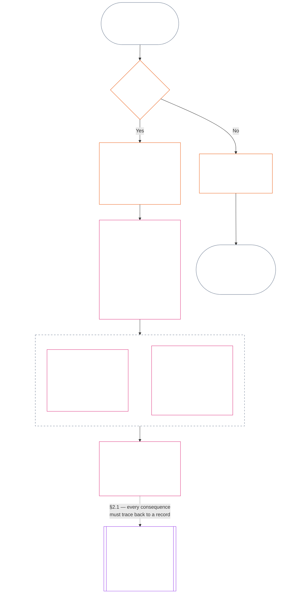
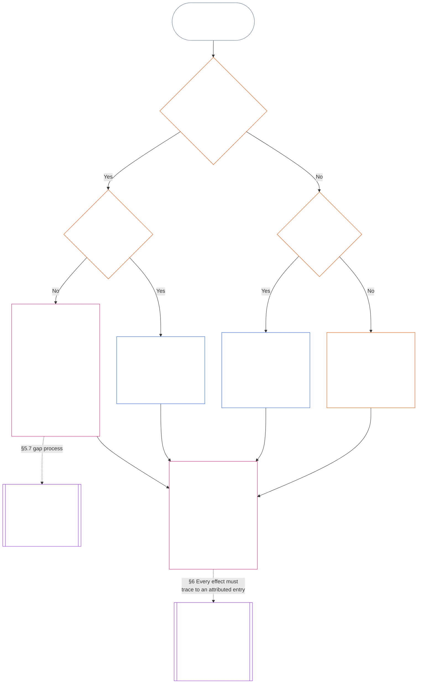

<!-- Locale: Tamil (ta) | Source: 05b7b83936e30c098a7de71882f22277354006dfc871d91157bcd27b9f56ad6a1cec90d3 | AI-drafted, unreviewed | FULL Chapter Eleven draft; non-binding -->

# அத்தியாயம் பதினொன்று: நிலைத்தடப் பதிவுகள் — கேள்வி 1, என்ன நடந்தது?

<strong>தொகுப்பில் இடம் (செயல்படாதது): கோப்பு அமைப்பும் வாசிப்பு விதிகளும்</strong>

> இந்தக் கோப்பு **உணர்வுள்ளோர் அரசியலமைப்பின்** ஒரு பகுதியாகும்; எண்ணிடப்பட்ட மற்ற `core_*` கோப்புகளுடன் ஒரே உரையாக வாசிக்கும்போது மட்டுமே **பிணைக்கும்**. இதில் நிலைத்தடச் செயல்முறையின் மூன்று கேள்விகளும், **கேள்வி 1** (*என்ன நடந்தது?*)மும் **§1–§6** வரை உள்ளன. **கேள்வி 2** (*அது எவ்வளவு நல்லது அல்லது கெட்டது?*)க்கு [அத்தியாயம் பன்னிரண்டு](core_12_standing_measurement.md#chapter-twelve-standing-measurement--question-2-how-good-or-bad-was-it) பதிலளிக்கிறது. கேள்வி 3 (*இதனால் என்ன நிகழும்?*) [அத்தியாயம் பதின்மூன்றில்](../../core_13.000_standing_integration.md#chapter-thirteen-standing-effects-and-integration) தொடர்கிறது; தகுதியுள்ள Violation Axis `s` = 7–9 கண்டறிதல்களுக்கான அரசியலமைப்புக்கு-எதிரான தவறான நடத்தை வகைப்படுத்தல் மதிப்பாய்வுக்கு [அத்தியாயம் பதினான்கில்](../../core_14.000_misconduct_designation.md#chapter-fourteen-anti-constitutional-misconduct) மட்டுமே செல்லும். வாசிப்பு வரிசை, பிணைப்பு/ஆதரவு பிரிப்பு, தொகுப்பு பதிப்பு விவரங்கள் [README.md](README.md) இல் பராமரிக்கப்படுகின்றன.

<strong>வாசகர் வழிகாட்டல் (செயல்படாதது): அத்தியாயம் பதினொன்று எங்கு உள்ளது, எது இங்கே இருக்கும்</strong>

> | கேள்வி | உரிமையாளர் மற்றும் பங்கு |
> | --- | --- |
> | **1. என்ன நடந்தது?** | அத்தியாயம் பதினொன்று (இந்தக் கோப்பு): வரையறுக்கப்பட்ட, சவால் செய்யக்கூடிய நிலைத்தடப் பதிவில் சரிபார்க்கப்பட்ட உண்மைகளை நிறுவுகிறது. |
> | **2. அது எவ்வளவு நல்லது அல்லது கெட்டது?** | [அத்தியாயம் பன்னிரண்டு](core_12_standing_measurement.md#chapter-twelve-standing-measurement--question-2-how-good-or-bad-was-it): உதவியையும் தீங்கையும் ஒன்றாகக் கலக்காமல் சரிபார்க்கப்பட்ட உண்மைகளை அளவிடுகிறது. |
> | **3. இதனால் என்ன நிகழும்?** | [அத்தியாயம் பதின்மூன்றுக்குத்](../../core_13.000_standing_integration.md#chapter-thirteen-standing-effects-and-integration) தொடருங்கள். |
>
> குற்றச்சாட்டுகள், பிரபலத்தன்மை, சர்ச்சைக் கதைகள் ஆகியவை கேள்வி 1க்கான பதில்கள் அல்ல. விரும்பிய மதிப்பீடு கேள்வி 1க்கான உண்மைகளை வழங்காது; விரும்பிய விளைவு கேள்வி 2க்கான மதிப்பீட்டை வழங்காது.

<strong>தடமறிதல்</strong>

- மேல்நிலை:
  - [அரசியலமைப்பு நான்மம்](core_00_preamble.md#constitutional-tetrad);
  - [இரண்டு அரசியலமைப்பு நோக்கங்கள்](core_00_preamble.md#two-constitutional-aims);
  - [பொருண்மைப் பங்கு](core_00_preamble.md#material-stake);
  - [முகவுரை §6 முக்கிய நடைமுறைச் செயல்முறைத் தொடர்கள்](core_00_preamble.md#6-key-practical-process-pipelines) (*அத்தியாயங்கள் ஒன்பது முதல் பதினைந்து வரையிலான தொடர்*).
- மேல்நிலை:
  - [அத்தியாயம் ஒன்று](core_01_c_stewardship_capacity_principles.md#chapter-01-principles-and-constraints) (1.010) (*பிரிவு-நிலை விளக்கத்தில் பிரதிபலிக்கும் எளிய-மொழி அணுகல்தன்மை பொறுப்பான நிர்வாகம்*);
  - [அத்தியாயம் ஒன்று §16 — பொறுப்பான நிர்வாகம் விரிவாக](core_01_c_stewardship_capacity_principles.md#16-stewardship-in-depth) (1.010 §16) (*திறன் சார்ந்த, தடமறியக்கூடிய நிலைத்தடத்திற்கான கொள்கை அடுக்கு அடித்தளம் — நம்பிக்கை, பங்குகள், அங்கீகாரம்*);
  - [அத்தியாயங்கள் இரண்டு முதல் நான்கு](core_02_definition_structure.md) (*நேர்மை, பதிவுகள், சரிபார்ப்பு*);
  - [அத்தியாயம் ஐந்து](core_05__definitions_home.md#chapter-five-foundational-definitions) (5.000) (*அத்தியாயங்கள் இரண்டு முதல் நான்குடன் வாசிக்கப்படும் வரையறைகளும் மேலாதிக்கமும்*).
+- மேல்நிலை: [அத்தியாயம் ஒன்பது](core_09.000_system_alignment_certification_evaluation.md#chapter-nine-system-alignment-certification) (9.000) (*அமைப்பு ஒத்திசைவு சான்றளிப்பு*); [அத்தியாயம் ஒன்பது பகுதி C §11](core_09.010_system_alignment_certification_record_recertification.md#11-relationship-to-standing) (9.010 §11) (*நிலைத்தடப் பாலம் — சாத்தியமான சரிபார்க்கப்பட்ட உள்ளீடுகள் மட்டும்*).
+- நிலைத்தடச் செயல்முறை:
+  - [முகவுரை §6.2 முழுச் சங்கிலி எவ்வாறு இணைகிறது](core_00_preamble.md#62-how-the-full-chain-fits-together);
+  - [அத்தியாயம் பதினொன்று — நிலைத்தடப் பதிவுகள்](#chapter-eleven-standing-records--question-1-what-happened) (11.000) (*மூன்று-கேள்வி கட்டமைப்பும் கேள்வி 1 பதிவுகளும்*);
+  - [அத்தியாயம் பன்னிரண்டு — நிலைத்தட அளவீடு](core_12_standing_measurement.md#chapter-twelve-standing-measurement--question-2-how-good-or-bad-was-it) (12.000) (*கேள்வி 2 அளவீடு*);
+  - [அத்தியாயம் பதின்மூன்று — நிலைத்தட விளைவுகளும் ஒருங்கிணைப்பும்](../../core_13.000_standing_integration.md#chapter-thirteen-standing-effects-and-integration) (13.000) (*கேள்வி 3 விளைவுகளும் ஒருங்கிணைப்பும்*);
+  - [அத்தியாயம் பதினான்கு](../../core_14.000_misconduct_designation.md#chapter-fourteen-anti-constitutional-misconduct) (14.000) (*தகுதியுள்ள Violation Axis s = 7–9க்கு மட்டுமே வகைப்படுத்தல்*).
+- இந்தக் கோப்பின் துணைப்பிரிவுகள்:
+  - [§1](#1-the-three-questions) (*மூன்று-கேள்வி கட்டமைப்பும் வரம்பும்*);
+  - [§2](#2-question-1--what-happened) (*கேள்வி 1 — சரிபார்க்கப்பட்ட உண்மைகளும் பதிவுகளும்*);
+  - [§3](#3-question-1-event-type-guide--what-kind-of-help-or-harm-occurred) (*கேள்வி 1 நிகழ்வு-வகை வழிகாட்டி — உதவி மற்றும் தீங்கு வகைகள்*);
+  - [§4](#4-standing-record-operational-requirements) (*சரிபார்ப்பும் பதிவு தேவைகளும்*);
+  - [§5](#5-record-custody-and-opening-authority) (*பதிவுக் காவலும் திறக்கும் அதிகாரமும்*);
+  - [§6](#6-handling-a-standing-record) (*நிலைத்தடப் பதிவைக் கையாளுதல்*).
+- அடுத்த நிலை:
+  - [அத்தியாயம் பன்னிரண்டு](core_12_standing_measurement.md#chapter-twelve-standing-measurement--question-2-how-good-or-bad-was-it) (12.000) (*கேள்வி 2 — LEQU அடிப்படை, அளவீட்டுப் பரிமாணங்கள், வழி விவரிப்பான்கள், ச்லாட் இலக்கணம், அரசியலமைப்பு உள்ளீடுகள், LEQU அளவுகோல், நிலையான பங்களிப்பு அளவீடுகள், எடுத்துக்காட்டுகள், கேள்வி 3க்கு ஒப்படைப்பு*);
+  - [அத்தியாயம் பதினான்கு](../../core_14.000_misconduct_designation.md#chapter-fourteen-part-a-anti-constitutional-misconduct-designation) (14.000) (*தகுதியுள்ளவற்றுக்கான வகைப்படுத்தல் மட்டும் — கேள்வி 2 அளவீட்டை மீண்டும் திறக்காது*);
+  - [அத்தியாயம் பதினைந்து](../../core_15.000_forum.md#chapter-fifteen-forums-and-jurisdiction) (15.000) (*மன்ற மேற்பார்வையும் வழிமாற்றமும்*);
+  - [Article XXVI-C](core_06_rights_part_e.md#article-xxvi-c-timely-resolution-and-anti-delay-floor) (*சரியான நேரத் தீர்வு*);
+  - [Article XX](core_06_rights_part_d.md#article-xx-a-justice-objective-and-scope) (*நீதிக் கட்டுப்பாடுகள்*).
+- இதனுடன் படிக்கவும்: [அத்தியாயம் ஐந்து *நிலைத்தட நிலை, பங்களிப்பு, மீறல்*](../../core_05.035_band_accountability.md#defa3-standing-state-contribution-and-violation) (5.035) (*அதிகாரப்பூர்வ வரையறை வழிமாற்றம்*).
+- இதனுடன் படிக்கவும்: [README.md](README.md) (*வாசிப்பு வரிசை*); [doc_architecture.md](../../doc_architecture.md) (*ஏற்கப்படாவிட்டால் பிணைக்காத ஆசிரியர் வரைபடங்கள்*).
+
+

+
+ 
+
+
+அத்தியாயம் பதினொன்று **சரிபார்க்கப்பட்ட உண்மை பதிவின் (கேள்வி 1)** அரசியலமைப்பு உரிமையாளராகும். இது [§1 மூன்று கேள்விகள்](#1-the-three-questions) முதல் [§6 நிலைத்தடப் பதிவைக் கையாளுதல்](#6-handling-a-standing-record) வரை செல்கிறது. [அத்தியாயம் பன்னிரண்டு](core_12_standing_measurement.md#chapter-twelve-standing-measurement--question-2-how-good-or-bad-was-it), [அத்தியாயம் பன்னிரண்டு §1 கேள்வி 2 — அது எவ்வளவு நல்லது அல்லது கெட்டது?](core_12_standing_measurement.md#1-question-2--how-good-or-bad-was-it) முதல் [அத்தியாயம் பன்னிரண்டு §9 கேள்வி 3க்கு ஒப்படைப்பு — கேள்விகள் இடையிலான அளவீட்டு இணைப்புகள்](core_12_standing_measurement.md#9-hand-off-to-question-3--cross-question-measurement-hooks) வரை, கேள்வி 2க்கு உரிமையாளர். கேள்வி 3 அத்தியாயம் பதின்மூன்றில் தொடர்கிறது.
+
+*எளிய சொற்களில்: என்ன நடந்தது என்பதை இந்த அத்தியாயம் எழுதிப் பதிவுசெய்து, நிலைத்தடப் பதிவைக் காக்கிறது. அது எவ்வளவு நல்லது அல்லது தீங்கானது என்பதை அத்தியாயம் பன்னிரண்டு, ஒன்றாக நிகர மதிப்பெண் செய்யாத இரண்டு தனிப் பாதைகளில் அளவிடுகிறது. வழக்குத் தாக்கல் செய்வது மட்டுமே நிலைத்தடம் ஆகாது.*
+
+

### 1. மூன்று கேள்விகள்

*எளிய சொற்களில்: நிலைத்தட மதிப்பீடு, வரிசையாக மூன்று கேள்விகளுக்குப் பதிலளிப்பதன் மூலம் செய்யப்படுகிறது. விரும்பிய மதிப்பீட்டிலிருந்து உண்மைகளை ஊகிக்காதீர்கள்; விரும்பிய விளைவை நியாயப்படுத்த மதிப்பீட்டைத் தேர்ந்தெடுக்காதீர்கள்.*

| கேள்வி | கேள்வி கேட்பது என்ன | பதில் எங்கே அளிக்கப்படுகிறது |
| --- | --- | --- |
| **1. என்ன நடந்தது?** | எந்த உண்மைகள் சரிபார்க்கப்பட்டன; யாரைப் பற்றியோ எதைப் பற்றியோ, எந்தக் காலத்தில், எந்த நிலைத்தடப் பதிவு மற்றும் சவால் நிலைமையுடன்? | [பிரிவு 2](#2-question-1--what-happened) மற்றும் [பிரிவு 3](#3-question-1-event-type-guide--what-kind-of-help-or-harm-occurred) |
| **2. அது எவ்வளவு நல்லது அல்லது கெட்டது?** | அந்த உண்மைகள் எந்த வகையான, எந்த அளவிலான பங்களிப்பு அல்லது மீறலை நிறுவுகின்றன? | [அத்தியாயம் பன்னிரண்டு பிரிவு 1](core_12_standing_measurement.md#1-question-2--how-good-or-bad-was-it) |
| **3. அதன் விளைவாக என்ன நடக்கும்?** | என்ன அங்கீகாரம், தயார்நிலை, தீர்வு, பாதுகாப்பு, கட்டுப்பாடு அல்லது வேறு விளைவு தொடர்கிறது? | [அத்தியாயம் பதின்மூன்று](../../core_13.000_standing_integration.md#chapter-thirteen-standing-effects-and-integration) |

ஒவ்வொரு கேள்வியும் அதற்கு முந்தைய பதிலைச் சார்ந்துள்ளது:

- கேள்வி 1, கேள்வி 2-க்கு சரிபார்க்கப்பட்ட உண்மைகளை வழங்குகிறது.
- கேள்வி 2, கேள்வி 3-க்காக அந்த உண்மைகளை அளவிடுகிறது.
- விரும்பிய முடிவுக்குப் பொருந்துமாறு கேள்வி 3 உண்மைகளையோ மதிப்பீட்டையோ மீண்டும் எழுதக்கூடாது.

மூன்று கேள்விகளுக்கான பதில்கள் ஒன்றாக, வரையறுக்கப்பட்ட ஒரு நிகழ்வு அல்லது வரையறுக்கப்பட்ட ஒரு வடிவத்திற்கான முழுமையான நிலைத்தட மதிப்பீட்டை உருவாக்குகின்றன. ஒரு பொருளுக்கு காலப்போக்கில் இத்தகைய பல மதிப்பீடுகள் இருக்கலாம்; அவற்றில் எதுவும் அந்தப் பொருளின் நிகர மதிப்பெண்ணோ ஒட்டுமொத்த மதிப்பீடோ அல்ல. பங்களிப்பு மற்றும் மீறல் நிலைத்தடப் பதிவுகள் கேள்விகள் 1 மற்றும் 2-க்கான பதில்களைப் பாதுகாக்கின்றன; அவற்றின் அடிப்படையில் அடுத்து என்ன நிகழும் என்பதை கேள்வி 3 முடிவு கூறுகிறது.

#### 1.1 நோக்கமும் வரம்பும்

இந்த அத்தியாயம் **அமைப்புகள்**, **உணர்வுள்ளோர்**, **நிறுவனங்கள்** ஆகியவற்றுக்கான அரசியலமைப்பு பதிவுக் கட்டமைப்பைச் சொல்கிறது; [அத்தியாயம் பன்னிரண்டு](core_12_standing_measurement.md#chapter-twelve-standing-measurement--question-2-how-good-or-bad-was-it) அளவீட்டுக் கட்டமைப்பைச் சொல்கிறது. [**CS-9.305**](../../corpus_systems/cs_09.305_system_classification_machinery.md#cs-9305-part-a-system-classification-machinery) (*அமைப்பு வகைப்பாட்டு இயந்திரம்*) கீழ் வகைப்படுத்தப்பட்ட ஒவ்வொரு அமைப்பும் இதில் அடங்கும். இந்தக் கட்டமைப்புகள் வதந்தி, பிரபலத்தன்மை, தெளிவற்ற நற்பெயர், உள்ளார்ந்த கண்ணியம் அல்லது பொதுவான மதிப்பு ஆகியவற்றை அளவிடுவதில்லை; இவற்றில் எதுவும் நிலைத்தட மதிப்பீட்டின் அனுமதிக்கப்பட்ட பொருள் அல்ல.

பின்வரும் சூழல்களிலும் நிலைத்தடச் செயல்முறை செயல்திறனுடன் இருக்க வேண்டும்:

- முன்பு சரிபார்க்கப்பட்ட பங்களிப்புகள் தற்போதைய திறன் அல்லது நம்பகத்தன்மையைக் காட்ட முடியாத அளவு பழையதாகிவிட்டால்;
- மீறல்கள் தீர்க்கப்படாமல் இருந்தால்;
- சீரமைப்பு செலவு மிக்கதாக இருந்தால்;
- பொறுப்பு எல்லைகளைக் கடந்தால்; அல்லது
- பொறுப்புக்கூறலைத் தடுக்க ஒரு செயற்பாட்டாளர் அமைப்பின் அடுக்குகளையோ மறுபெயரிடலையோ பயன்படுத்தினால்.

இவை ஏற்றுக்கொள்ளப்பட்ட செயலாக்க உரையில் இடம்பெற வேண்டியவை:

- அன்றாட நடைமுறைகள்;
- மேல்நிலைக்கு எடுத்துச் செல்லும் படிகள்;
- திருப்பிச் செலுத்தல் மற்றும் சீரமைப்புச் செயல்கள்;
- மீட்டெடுக்கும் பொறுப்புக்கூறல் நடவடிக்கைகள்; மற்றும்
- ஊக்க வடிவமைப்பு.

அத்தியாயம் பன்னிரண்டின் அளவீடு மட்டும் வலுக்கட்டாயம், காவலில் வைத்தல் அல்லது வேறு சுதந்திரக் கட்டுப்பாட்டைத் தானாகவே அனுமதிப்பதில்லை. அத்தகைய விளைவு, அத்தியாயம் ஆறு **கட்டுரை XX** (*சரிபார்க்கப்பட்ட மீறலுக்குப் பிந்தைய நீதி*)யின் விகிதாசாரம், குறைந்தபட்சக் கட்டுப்பாடு, காலவரம்பு, திருப்பிச் செலுத்தல் மற்றும் மீட்டெடுக்கும் பொறுப்புக்கூறல் தேவைகள் உட்பட, தனியாகப் பூர்த்தி செய்ய வேண்டும்.

<strong>தடமறிதல் · வரையறைகள் · மதிப்பீடு · இணக்கம்</strong>

- மேல்நிலை: [அத்தியாயம் ஒன்று §16 — பொறுப்பான நிர்வாகம் விரிவாக](core_01_c_stewardship_capacity_principles.md#16-stewardship-in-depth); [அத்தியாயங்கள் இரண்டு முதல் நான்கு](core_02_definition_structure.md); [அத்தியாயம் ஐந்து](core_05__definitions_home.md#chapter-five-foundational-definitions).
- அடுத்த நிலை: [§2](#2-question-1--what-happened) (*கேள்வி 1*); [§4](#4-standing-record-operational-requirements) (*சரிபார்ப்பு மற்றும் பதிவு தேவைகள்*); [§5](#5-record-custody-and-opening-authority) (*பதிவுக் காப்பும் திறக்கும் அதிகாரமும்*); [§6](#6-handling-a-standing-record) (*நிலைத்தடப் பதிவைக் கையாளுதல்*); [அத்தியாயம் பன்னிரண்டு §1](core_12_standing_measurement.md#1-question-2--how-good-or-bad-was-it) (*கேள்வி 2 அளவீடு*); [அத்தியாயம் பன்னிரண்டு §2](core_12_standing_measurement.md#2-magnitude-and-severity-input-dimensions) (*அளவீட்டு உள்ளீட்டுப் பரிமாணங்கள்*); [அத்தியாயம் பன்னிரண்டு §3](core_12_standing_measurement.md#3-route-descriptor-catalogs-and-measurement-roles) (*பாதை விவரிப்பான் பட்டியல்கள்*); [அத்தியாயம் பன்னிரண்டு §4](core_12_standing_measurement.md#4-slot-grammar-and-shared-scaling) (*இடத்துண்டு இலக்கணமும் பகிரப்பட்ட அளவிடலும்*); [அத்தியாயம் பன்னிரண்டு §5](core_12_standing_measurement.md#5-constitutional-inputs-to-axis-assignment) (*அரசியலமைப்பு மூலங்களின் அடிப்படையில் அச்சு ஒதுக்கீடு*); [அத்தியாயம் பன்னிரண்டு §6](core_12_standing_measurement.md#6-unified-proportional-lequ-scale--contribution-and-violation-axes) (*இரு அச்சுகளுக்குமான ஒருங்கிணைந்த விகிதாசார LEQU அளவுகோல்*); [அத்தியாயம் பதின்மூன்று](../../core_13.000_standing_integration.md#chapter-thirteen-standing-effects-and-integration) (*கேள்வி 3*).
- [முக்கியத்துவம்](../../core_05.050_band_oversight.md#materiality) · [O](../../core_05.050_band_oversight.md#materiality) · [M](core_05_band_oversight.md#materiality-determination-a) · [A](core_05_band_oversight.md#materiality-determination-a) · [C](core_05_band_oversight.md#materiality-determination-c)
- [தீங்கு](../../core_05.035_band_accountability.md#harm) · [O](../../core_05.035_band_accountability.md#harm) · [M](../../core_05.035_band_accountability.md#harm-a) · [A](../../core_05.035_band_accountability.md#harm-a) · [C](../../core_05.035_band_accountability.md#harm-c)
- [விகிதாசாரம்](../../core_05.035_band_accountability.md#proportionality) · [O](../../core_05.035_band_accountability.md#proportionality) · [M](../../core_05.035_band_accountability.md#proportionality-a) · [A](../../core_05.035_band_accountability.md#proportionality-a) · [C](../../core_05.035_band_accountability.md#proportionality-c)

### 2. கேள்வி 1 — என்ன நடந்தது?

<strong>தடமறிதல்</strong>

- மேல்நிலை: [§1](#1-the-three-questions) (*மூன்று கேள்விக் கட்டமைப்பு*); [அத்தியாயங்கள் இரண்டு முதல் நான்கு](core_02_definition_structure.md) (*பதிவு, சரிபார்ப்பு, வரையறைகளிலிருந்து முடிவுகளுக்கான தடமறிதல்*).
- அரசியலமைப்பு நான்மத்தின் உறுப்புகள்: **பங்கேற்பு**; **மேற்பார்வை** (சவால் செய்யக்கூடிய தன்மை மற்றும் சவால் வழிகள்). முதன்மை நோக்கங்கள்: **செழிப்பு** மற்றும் **தொடர்ச்சி** (பின்னர் அளவிடுவதற்காக பங்களிப்பு மற்றும் மீறல் கண்டறிதல்களைத் தனித்தனியாகப் பாதுகாக்கும் தடமறியக்கூடிய பதிவுகள்).
- அடுத்த நிலை:
  - [§2.2](#22-silence-is-the-default) (*மௌனம் இயல்புநிலை*);
  - [§2.3](#23-protected-dissent-is-not-a-trigger) (*பாதுகாக்கப்பட்ட கருத்து வேறுபாடு தூண்டுதல் அல்ல*);
  - [§2.4](#24-linked-standing-records-and-no-offset-bridge) (*இணைக்கப்பட்ட நிலைத்தடப் பதிவுகள் மற்றும் ஈடுசெய்யாமை இணைப்பு*);
  - [§2.5](#25-verified-input-gate) (*சரிபார்க்கப்பட்ட உள்ளீட்டு வாயில்*);
  - [§2.6](#26-stage-boundary) (*கட்ட எல்லை*);
  - [§2.7](#27-forum-boundary) (*மன்ற எல்லை*);
  - [§3](#3-question-1-event-type-guide--what-kind-of-help-or-harm-occurred) (*நிகழ்வு-வகை வழிகாட்டி*);
  - [§4](#4-standing-record-operational-requirements) (*பதிவுத் தேவைகள்*);
  - [§5](#5-record-custody-and-opening-authority) (*பதிவுக் காப்பும் திறக்கும் அதிகாரமும்*);
  - [§6](#6-handling-a-standing-record) (*நிலைத்தடப் பதிவைக் கையாளுதல்*);
  - [அத்தியாயம் பன்னிரண்டு §1](core_12_standing_measurement.md#1-question-2--how-good-or-bad-was-it) (*கேள்வி 2 அளவீடு*);
  - [அத்தியாயம் பன்னிரண்டு §2](core_12_standing_measurement.md#2-magnitude-and-severity-input-dimensions) (*அளவீட்டு உள்ளீட்டுப் பரிமாணங்கள்*);
  - [அத்தியாயம் பன்னிரண்டு §3](core_12_standing_measurement.md#3-route-descriptor-catalogs-and-measurement-roles) (*பாதை விவரிப்பான் பட்டியல்கள்*);
  - [அத்தியாயம் பன்னிரண்டு §4](core_12_standing_measurement.md#4-slot-grammar-and-shared-scaling) (*இடத்துண்டு இலக்கணமும் பகிரப்பட்ட அளவிடலும்*);
  - [அத்தியாயம் பன்னிரண்டு §5](core_12_standing_measurement.md#5-constitutional-inputs-to-axis-assignment) (*அரசியலமைப்பு மூலங்களின் அடிப்படையில் அச்சு ஒதுக்கீடு*);
  - [அத்தியாயம் பன்னிரண்டு §6](core_12_standing_measurement.md#6-unified-proportional-lequ-scale--contribution-and-violation-axes) (*இரு அச்சுகளுக்குமான ஒருங்கிணைந்த விகிதாசார LEQU அளவுகோல்*);
  - [அத்தியாயம் பதின்மூன்று](../../core_13.000_standing_integration.md#chapter-thirteen-standing-effects-and-integration) (13.000) (*கேள்வி 3*).

 

*எளிய சொற்களில்: கேள்வி 1, என்ன நடந்தது என்பதற்கான வரையறுக்கப்பட்ட, சவால் செய்யக்கூடிய விவரத்தை நிறுவுகிறது. எந்த மதிப்பீடு அல்லது விளைவையும் பரிசீலிப்பதற்கு முன் பொருள், நிகழ்வு அல்லது வடிவம், காலப்பகுதி, சரிபார்க்கப்பட்ட உண்மைகள் மற்றும் பதிவு நிலை ஆகியவற்றைக் கண்டறிகிறது. சரிபார்க்கப்பட்ட உதவியும் சரிபார்க்கப்பட்ட மீறலும் தனித்த நிலைத்தடப் பதிவுகளில் வைக்கப்படுகின்றன; ஒன்றால் மற்றொன்று அழிக்கப்பட முடியாது. இவை பிரபல மதிப்பெண்களோ தெளிவற்ற குறிச்சொற்களோ அல்ல.*

**நிலைத்தடப் பதிவு** என்பது குறிப்பிட்ட பொருள், செயல்பாட்டுப் பரப்பு, பதிவுக் காலம், மறுஆய்வு நிலை மற்றும் முடிவுச் சூழலுக்காக இந்த அத்தியாயம் பயன்படுத்தும் வரையறுக்கப்பட்ட பதிவாகும். அளவீடு தொடங்குவதற்கு முன் அது பின்வருவனவற்றை நிறுவ வேண்டும்:

- நிலைத்தடப் பதிவு யாரைப் பற்றியது அல்லது எதைப் பற்றியது;
- அது வரையறுக்கப்பட்ட நிகழ்வைப் பற்றியதா அல்லது வரையறுக்கப்பட்ட வடிவத்தைப் பற்றியதா;
- தொடர்புடைய நடத்தை மற்றும் விளைவுகள் எப்போது, எங்கே நிகழ்ந்தன;
- எந்த உண்மைகள் சரிபார்க்கப்பட்டன, எவை இன்னும் சர்ச்சைக்குரியவை;
- அந்தக் கண்டறிதல்களை ஆதரிக்கும் சான்று, attribution மற்றும் சவால் வழி எவை; மற்றும்
- நிலைத்தடப் பதிவின் தற்போதைய மறுஆய்வு, திருத்தம் மற்றும் மாற்றீட்டு நிலை என்ன.

ஒரு நிகழ்வு நிலைத்தடப் பதிவைத் தூண்டுகிறதா, பதிவு பின்னர் எதைக் கொண்டிருக்கிறது என்பதை வரைபடம் தொடர்கிறது; அடுத்துள்ள துணைப்பிரிவுகள் ஒவ்வொரு விதியையும் குறிப்பிடுகின்றன. "இல்லை" என்ற கிளை முதன்மைப் பாதையிலிருந்து வலப்புறம் செல்கிறது.

#### 2.1 நிலைத்தடப் பதிவுகள்: வகைகளும் பொருள்களும்

கேள்வி 1 சரிபார்க்கப்பட்ட உதவிக்கு **பங்களிப்பு நிலைத்தடப் பதிவையும்**, பொறுப்புக்கூறல் தோல்விகள் உட்பட சரிபார்க்கப்பட்ட தீங்குக்கு **மீறல் நிலைத்தடப் பதிவையும்** பயன்படுத்துகிறது. ஒரு நிலைத்தடப் பதிவு இந்த இரு வகைக் கண்டறிதல்களையும் ஒன்றிணைக்காது.

- நிலைத்தடப் பதிவு ஓர் உணர்வுள்ளோர், நிறுவனம், அமைப்பு, மதிப்பீடு, வரையறுக்கப்பட்ட நிகழ்வு, பங்கு, கூட்டு அமைப்பு, செயற்பாட்டாளர்-குறிப்பிட்ட பதிவு அல்லது அரசியலமைப்புக்கு தொடர்புடைய வேறு அலகைப் பற்றியதாக இருக்கலாம்.
  - வேறுபட்ட பொருள்கள், பங்குகள், அமைப்புகள், சமூகங்கள், பதிவுக் காலங்கள், மறுஆய்வு நிலைகள் அல்லது முடிவுச் சூழல்களை வேறுபாடற்ற ஒரே நிலைத்தடக் குறிச்சொல்லில் சுருக்கக்கூடாது.
- நிலைத்தடப் பதிவு தெளிவான தொடக்கமும் முடிவும் உள்ள ஒரு நிகழ்வான **வரையறுக்கப்பட்ட நிகழ்வை**, அல்லது மீண்டும் நிகழும் நடத்தையின் **வடிவத்தை** உள்ளடக்கலாம்.
  - ஒரு வடிவத்துக்கு வரையறுக்கப்பட்ட பொருள், பரப்பு மற்றும் மறுஆய்வுக் காலம் தேவை.
- ஒரே பொருளுக்கு காலப்போக்கில் பல நிலைத்தடப் பதிவுகள் இருக்கலாம்; இணைக்கப்பட்ட பங்களிப்பு மற்றும் மீறல் பதிவுகளும் இதில் அடங்கும்.
  - தொடர்புடைய நிலைத்தடப் பதிவுகள் ஒரே பொருள், ஒன்றுடன் ஒன்று மேலிடும் பதிவுக் காலம், வரையறுக்கப்பட்ட நிகழ்வு, வடிவம் அல்லது முடிவுச் சூழலைப் பகிர்ந்தால் **பிரிவு 4.2**-இன் கீழ் ஒன்றையொன்று **குறுக்குக் குறிப்பிட** வேண்டும்.
- நிலைத்தடப் பதிவு என்பது தனிப்பட்ட நற்பெயர் மதிப்பெண், கண்ணியத் தரவரிசை, நிரந்தர நிலை, பொதுவான மதிப்புக் குறிச்சொல் அல்லது கலந்த மதிப்பெண் அட்டை அல்ல.
  - செயல்பாட்டு தேவைகள் **பிரிவு 4**-இல் உள்ளன.

பின்னர் ஏற்படும் நிலைத்தட விளைவு எதுவும் அத்தியாயம் பதின்மூன்றுக்குச் சொந்தமானது; அது தொடர்புடைய நிலைத்தடப் பதிவு அல்லது பதிவுகள்வரைத் தடமறியப்பட வேண்டும், ஆனால் பதிவின் ஒரு பகுதியாக இருக்கக்கூடாது.

#### 2.2 மௌனம் இயல்புநிலை

உணர்வுள்ளோர், நிறுவனம் அல்லது அமைப்புக்கு நிலைத்தடப் பதிவு இல்லாததே வழக்கமான நிலை; பெரும்பாலான உணர்வுள்ளோர் இந்த நிலையிலேயே இருப்பார்கள்.

- **பிரிவு 4**-இன் கீழ் தூண்டுதல் சரிபார்க்கப்பட்டால் மட்டுமே நிலைத்தடப் பதிவு திறக்கப்படும். பெயரிடப்பட்ட பதிவு-திறப்பு அதிகாரம் பதிவை ஒப்புதல் அளிக்க வேண்டும்; தனியான பதிவுக் காப்பாளர் அதைச் செய்ய வேண்டும் (**பிரிவு 5**). பின்வருவனவற்றுக்காக நிலைத்தடப் பதிவு ஒருபோதும் திறக்கப்படாது:
  - அடிப்படை நிலையை நிறுவ;
  - பட்டியலை நிறைவு செய்ய; அல்லது
  - ஏனெனில் கட்டுப்படுத்தப்பட்ட பாதையின் வாயிற்காப்பாளர் அதை விரும்புவார்.
- நிலைத்தடப் பதிவு இல்லாதது எதையும் தெரிவிக்காது. “மதிப்பிடப்படாதது”, “சரிபார்க்கப்படாதது”, “கோப்பில் பதிவு இல்லை” ஆகியவை ஆபத்து, குறைந்த பங்களிப்பு அல்லது வேறு எதற்கும் சான்றல்ல. கூடுதல் ஆய்வு, குறைந்த இயல்புநிலை அல்லது பெயரிடப்பட்ட கட்டுப்படுத்தப்பட்ட பாதைக்கான நிபந்தனை அணுகல் ஆகியவற்றுக்குப் பதிவின்மையை எவரும் காரணமாகக் கொள்ளக்கூடாது.
- பின்வருவனவற்றுக்கான நிபந்தனையாக எந்த நிறுவனமோ அமைப்போ நிலைத்தடப் பதிவு, "பதிவு இல்லை" என்ற உறுதிமொழி அல்லது ஒன்றைத் திறப்பதற்கான ஒப்புதல் ஆகியவற்றைக் கோரக்கூடாது:
  - **கட்டுரை III** (*உயிர்வாழ்தல் மற்றும் அத்தியாவசிய அணுகல்*) தேவைகள்;
  - **கட்டுரை III-C** (*உழைப்பு மற்றும் பொருளாதாரத் தளம்*) பாதுகாப்புகள்;
  - வழக்கமான வணிகம்; அல்லது
  - பாதிக்கப்பட்ட தரப்பாகப் பங்கேற்பது.
  நம்பிக்கை-உணர்திறன் கொண்ட குறிப்பிட்ட கட்டுப்படுத்தப்பட்ட பாதைகளுக்கான வெளியிடப்பட்ட திறன் வரம்புகளே விதிவிலக்கு; [அத்தியாயம் பதின்மூன்று §7.2 திறன் வரம்புகளும் அனுமதிகளும்](../../core_13.000_standing_integration.md#72-competency-bars-and-clearances) படி, கட்டுப்படுத்தப்பட்ட பாதை ஏன் நம்பிக்கை-உணர்திறன் கொண்டது என்பதை அவை கூற வேண்டும்.
- ஒரு பொருளைப் பற்றிய நிலைத்தடப் பதிவு திறக்கப்பட்டால், **பிரிவு 4** கோருவது போல் அந்தப் பொருளுக்குத் தெரிவிக்க வேண்டும். ஆவணப்படுத்தப்பட்ட [சான்று பாதுகாப்பு](core_05_band_oversight.md#evidence-preservation) அல்லது பாதுகாப்புத் தேவை நியாயப்படுத்தினால் மட்டுமே அறிவிப்பைத் தாமதிக்கலாம்; அதுவும் வரையறுக்கப்பட்ட, நிர்ணயிக்கப்பட்ட காலத்திற்கே. அறிவிப்பே நிலைத்தடப் பதிவை சவால் செய்யக்கூடியதாக ஆக்குகிறது: பதிவு இருப்பது தெரியாத பொருள் அதைச் சவால் செய்யவோ திருத்தவோ முடியாது.

#### 2.3 பாதுகாக்கப்பட்ட கருத்து வேறுபாடு தூண்டுதல் அல்ல

**கட்டுரை XI-D** (*கூட்டம், கருத்து வேறுபாடு மற்றும் அமைதியான எதிர்ப்பு*) கீழ் கருத்து வேறுபாடு அல்லது அமைதியான எதிர்ப்பு — [பாதுகாக்கப்பட்ட வன்முறையற்ற குடிமைச் சட்டமறுப்பு](core_06_rights_part_b.md#xi-d-nonviolent-civil-disobedience) உட்பட — மற்றும் [*கருத்து வேறுபாடு மற்றும் அமைதியான எதிர்ப்பு உரிமைத் தளம்*](core_06_rights_part_b.md#xi-d-dissent-and-peaceful-protest), சரிபார்க்கப்பட்ட தூண்டுதல் அல்ல.

- அது மீறல் நிலைத்தடப் பதிவைத் திறக்கவோ நீட்டிக்கவோ தீவிரப்படுத்தவோாது; **பிரிவு 8.2**-இன் கீழ் தீவிரத்தன்மை உள்ளீடு அல்ல; அதை மீண்டும் செய்வதால் ஒரு வடிவமாகவும் மாறாது.
- அரசியலமைப்புத் தளத்தைத் தனித்துச் சென்று மீறும், பிரித்தறியக்கூடிய நடத்தை அதன் சொந்த அடிப்படையில் பதிவு செய்யப்படும்; எதிர்ப்பின் பார்வை, நோக்கம் அல்லது இலக்குக்காக தீவிரப்படுத்தப்படாது.

#### 2.4 இணைக்கப்பட்ட நிலைத்தடப் பதிவுகளும் ஈடுசெய்யாமை இணைப்பும்

<strong>தடமறிதல்</strong>

- மேல்நிலை: [§2.1](#21-standing-records-kinds-and-subjects) (*தனித்த பங்களிப்பு மற்றும் மீறல் பதிவுகள்*).
- அடுத்த நிலை:
  - [§2.5](#25-verified-input-gate) (*சரிபார்க்கப்பட்ட உள்ளீட்டு வாயில்*);
  - [§2.7](#27-forum-boundary) (*மன்ற எல்லை*);
  - [§4.2](#42-related-standing-record-cross-references) (*குறுக்குக் குறிப்புகள்*);
  - [அத்தியாயம் பன்னிரண்டு §1](core_12_standing_measurement.md#1-question-2--how-good-or-bad-was-it) (*கேள்வி 2 அளவீடு*);
  - [அத்தியாயம் பன்னிரண்டு §2](core_12_standing_measurement.md#2-magnitude-and-severity-input-dimensions) (*அளவீட்டு உள்ளீட்டுப் பரிமாணங்கள்*);
  - [அத்தியாயம் பன்னிரண்டு §3](core_12_standing_measurement.md#3-route-descriptor-catalogs-and-measurement-roles) (*பாதை விவரிப்பான் பட்டியல்கள்*);
  - [அத்தியாயம் பன்னிரண்டு §4](core_12_standing_measurement.md#4-slot-grammar-and-shared-scaling) (*இடத்துண்டு இலக்கணமும் பகிரப்பட்ட அளவிடலும்*);
  - [அத்தியாயம் பன்னிரண்டு §5](core_12_standing_measurement.md#5-constitutional-inputs-to-axis-assignment) (*அரசியலமைப்பு மூலங்களின் அடிப்படையில் அச்சு ஒதுக்கீடு*);
  - [அத்தியாயம் பன்னிரண்டு §6](core_12_standing_measurement.md#6-unified-proportional-lequ-scale--contribution-and-violation-axes) (*இரு அச்சுகளுக்குமான ஒருங்கிணைந்த விகிதாசார LEQU அளவுகோல்*);
  - [அத்தியாயம் பதின்மூன்று](../../core_13.000_standing_integration.md#chapter-thirteen-standing-effects-and-integration) (13.000) (*கேள்வி 3*).
- கூடவே படிக்க: [அத்தியாயம் பதின்மூன்று — நிலைத்தட ஒருங்கிணைப்பு](../../core_13.000_standing_integration.md#3-automatic-integration-review-and-continuity) (13.000) (*உரிமைத் துறப்பு இல்லாமையும் இணைக்கப்பட்ட பதிவுகளின் ஒருங்கிணைப்பும்*); [அத்தியாயம் பதின்மூன்று §7.2 — திறன் வரம்புகளும் அனுமதிகளும்](../../core_13.000_standing_integration.md#72-competency-bars-and-clearances) (13.000 §7.2); [அத்தியாயம் பதின்மூன்று §5.2 — நிலைத்தடப் பூட்டுகள்](../../core_13.000_standing_integration.md#52-prevention--general-standing-locks) (13.000 §5.2).

 

**முக்கிய விதி:** சரிபார்க்கப்பட்ட **பங்களிப்பு நிலைத்தடப் பதிவுகளும்**, சரிபார்க்கப்பட்ட **மீறல் நிலைத்தடப் பதிவுகளும்**, **பிரிவு 2.1** கீழ் தனித்தனியாக வைக்கப்படுகின்றன. ஒவ்வொரு பங்களிப்பு அல்லது மீறல் கண்டறிதலும் தன் நிலைத்தடப் பதிவிலுள்ள அதற்கான ஆதரவு உண்மைகளை அடிப்படையாகக் கொண்டிருக்க வேண்டும். பகுப்பாய்வும் ஆதரவு ஆவணங்களும் இரு பதிவு வழிகளையும் தனித்தனியாகத் தடமறியக்கூடியவையாக வைத்திருக்க வேண்டும். ஒரு பதிவு அல்லது இணைக்கப்பட்ட பதிவுகளின் தொகுப்பு எதுவும் நிகர மதிப்பெண், கலப்பு மதிப்பெண் அல்லது பரிமாற்றம் அல்ல.

- **மீறல் நிலைத்தடப் பதிவுகளும் நிலைத்தடப் பூட்டுகளும்:**
  - அத்தியாயம் பதின்மூன்றின் கீழ் மீறல் நிலைத்தடப் பதிவுகளிலிருந்து பெறப்படும் பொருந்தக்கூடிய **நிலைத்தடப் பூட்டுகள்**, சரிபார்க்கப்பட்ட மீறல் தீர்க்கப்படாமல் இருக்கும்போது நிலைத்தடத்தைக் கட்டுப்படுத்தலாம், பங்கு தகுதியைக் கட்டுப்படுத்தலாம் அல்லது தீர்வுக்கான அணுகலைப் பாதிக்கலாம்.
  - நிலைத்தடப் பூட்டுகள் பங்களிப்பு நிலைத்தடப் பதிவுகளில் பதிவான சரிபார்க்கப்பட்ட நேர்மறைப் பங்களிப்பை அழிக்கக்கூடாது.
  - தீர்க்கப்படாத சரிபார்க்கப்பட்ட மீறல்களின் எடை காலம் கடந்ததாலேயே குறைக்கப்படாது.
  - சரிபார்க்கப்பட்ட மீறல்கள் தொடர்பற்ற பங்களிப்பு நிலைத்தடப் பதிவுகளைத் தவறான எதிர்மறை நற்பெயர் கோப்பாக மாற்றி எழுதக்கூடாது.
- **பங்களிப்பு நிலைத்தடப் பதிவுகளும் திறன் அனுமதிகளும்:**
  - சரிபார்க்கப்பட்ட பங்களிப்பு வெளியிடப்பட்ட **திறன் வரம்புகளுக்கு** எதிரான பொருந்தக்கூடிய **திறன் அனுமதிகளை** ஆதரிக்கலாம்; தற்போதையதும் பங்கிற்குத் தொடர்புடையதுமானால் நம்பிக்கை, பங்கு அல்லது அங்கீகாரத்துடன் தொடர்புடைய தகுதியையும் ஆதரிக்கலாம்.
  - சரிபார்க்கப்பட்ட பங்களிப்பு, சரிபார்க்கப்பட்ட மீறல் கண்டறிதலை ஈடுசெய்யவோ சராசரியைக் குறைக்கவோ மன்னிக்கவோ மறுபெயரிடவோ கூடாது.
  - வாயில் நிபந்தனையைப் பூர்த்தி செய்வது பொருந்தக்கூடிய நிலைத்தடப் பூட்டைத் துறப்பதில்லை.

**ஒரே விதிவிலக்கு:** ஒரு மீறல் கண்டறிதலே கூறப்பட்ட பங்களிப்பு உண்மையல்ல என்பதை நிரூபித்தால் — எடுத்துக்காட்டாக, உங்கள் பங்களிப்பு பதிவு கூறும் செயலை நீங்கள் உண்மையில் செய்யவில்லை என்று சான்று காட்டினால் — சரியான சான்று மற்றும் மறுஆய்வு செயல்முறை வழியாக, **பிரிவு 4.2**-இன் தேவையான குறுக்குக் குறிப்புடன் இணைக்கப்பட்ட பங்களிப்பு நிலைத்தடப் பதிவைத் திருத்தவோ நீக்கவோ முடியும். ஆனால் தனித்த பங்களிப்பு நிலைத்தடப் பதிவுகளில் உள்ள தொடர்பற்ற உதவியை மீறல் தானாகவே அழிப்பதில்லை.

#### 2.5 சரிபார்க்கப்பட்ட உள்ளீட்டு வாயில்

இந்த வாயில் பின்வருமாறு செயல்படுகிறது:

- நிலைத்தடம், நம்பிக்கை, பங்கு, அங்கீகாரம் அல்லது அங்கீகாரத்திற்கான தகுதியைப் பாதிக்கும் எந்த முடிவும் தொடர்புடைய **பங்களிப்பு நிலைத்தடப் பதிவுகள்** அல்லது **மீறல் நிலைத்தடப் பதிவுகளிலிருந்து** சரிபார்க்கப்பட்ட உள்ளீடுகளை மட்டுமே பயன்படுத்தலாம்.
- குற்றச்சாட்டுகள், தீர்ப்பளிக்கப்படாத கோரிக்கைகள், தற்காலிக வழிமாற்றுக் குறிச்சொற்கள், வரவேற்பு-நிலை விவரிப்புகள் மற்றும் தகராறு-நிலை பிற பொருட்கள் தனியாக நிலைத்தடத்திற்கான பங்களிப்பு அல்லது மீறலின் தன்மையை வழங்குவதில்லை.
- சரிபார்க்கப்பட்ட உள்ளீடு என்பது **நிலைத்தடக் கண்டறிதல்**: சரிபார்க்கப்பட்ட பங்களிப்புக் கண்டறிதல் (அச்சு I) அல்லது சரிபார்க்கப்பட்ட மீறல் கண்டறிதல் (அச்சு II).
- பங்களிப்பு மற்றும் மீறல் கண்டறிதல்கள் தனித்த நிலைத்தடப் பதிவுகளில் இருக்கும் (பார்க்க **பிரிவு 2.1**).

#### 2.6 கட்ட எல்லை

நிலைத்தடப் பதிவின் கட்டங்கள் தனித்தனியாகவே இருக்கும்:

- கேள்வி 1 சரிபார்க்கப்பட்ட உண்மைகளைப் பதிவு செய்கிறது; கேள்வி 2 அவற்றை அளவிடுகிறது.
- கேள்வி 2 அளவீடு இன்னும் நிலுவையில் இருந்தாலும், சரிபார்க்கப்பட்ட உண்மை அடிப்படை முழுமையானதும் நிலைத்தடப் பதிவைத் திறக்கலாம்.
- அளவீடு நடைபெறும் வரை, கேள்வி 2 புலங்கள் இடத்துண்டு அல்லது வகையை உணர்த்துவதற்குப் பதிலாக நிலுவையில் இருப்பதைக் குறிப்பிட வேண்டும்.
- கேள்வி 3-இன் எந்த **நிலைத்தட விளைவையும்** நிலைத்தடப் பதிவு கூறவோ செயல்படுத்தவோ கூடாது.

#### 2.7 மன்ற எல்லை

*எளிய சொற்களில்: மன்றங்கள் தகராறுகளைக் கண்காணித்து, சவால் செய்ய அனுமதித்து, சரிபார்க்கப்பட்ட முடிவுகளாக மாற்றும் இடங்கள் — ஆனால் வழக்குத் தாக்கல் செய்வதோ ஒரு கதையாடல் மோதலில் வெல்வதோ நிலைத்தடத்தைப் புதுப்பிக்காது. **பிரிவு 2.5**-இன் சரிபார்க்கப்பட்ட உள்ளீட்டு வாயில் இன்னும் பொருந்தும். மன்றம் அத்தியாயங்கள் இரண்டு முதல் நான்கின் கீழ் உண்மைகளைச் சரிபார்த்தால், அது நிலைத்தடப் பதிவை **திறக்கலாம், புதுப்பிக்கலாம் அல்லது திருத்தலாம்** — அல்லது **சவாலின் பேரில் தவறான பதிவை ஒதுக்கலாம்**. மன்றங்கள் நல்லதையும் கெட்டதையும் ஒரு மதிப்பெண்ணாக இணைக்கவோ நிலைத்தட வகையைத் தாமாக உருவாக்கவோ செய்வதில்லை.*

இந்தப் பிரிவு ஒரே கேள்விக்குப் பொறுப்பாகும்: மன்றத்தின் பணி நிலைத்தடப் பதிவை எவ்வாறு அடைகிறது. தொடரின் மற்ற படிகள் இங்கு பெயரிடப்பட்ட பொறுப்பாளர்களுக்குரியவை; வரிசை பின்வருமாறு:

1. ஒரு தகராறு தாக்கல் செய்யப்படுகிறது; மன்றம் **மன்ற வழக்கு பதிவை** வைத்திருக்கிறது, அது நிலைத்தடப் பதிவு அல்ல. பொறுப்பாளர்: [அத்தியாயம் பதினைந்து §2.3 மன்ற வழக்கு பதிவுகள், நிலைத்தடப் பதிவுகள் மற்றும் சவால்கள்](core_11_forum.md#23-forum-case-records-standing-records-and-contests); [§2.7.1 மன்ற வழக்கு பதிவு](#271-forum-case-record)யையும் பார்க்கவும்.
2. மன்றம் [அத்தியாயங்கள் இரண்டு முதல் நான்கு](core_02_definition_structure.md) கீழ் உண்மைகளைச் சரிபார்க்கிறது.
3. சரிபார்க்கப்பட்ட கண்டறிதல்கள் சரிபார்க்கப்பட்ட உள்ளீட்டு வாயிலைக் கடக்கின்றன. பொறுப்பாளர்: [§2.5 சரிபார்க்கப்பட்ட உள்ளீட்டு வாயில்](#25-verified-input-gate).
4. மன்றமாகவும் இருக்கக்கூடிய பெயரிடப்பட்ட பதிவு-திறப்பு அதிகாரம், நிலைத்தடப் பதிவைத் திறக்கிறது, புதுப்பிக்கிறது அல்லது திருத்துகிறது; அல்லது சவாலின் பேரில் தவறான பதிவை ஒதுக்குகிறது. பதிவில் என்ன இருக்க வேண்டும் என்பதற்குப் பொறுப்பாளர் [§4.1 குறைந்தபட்சப் பதிவு உள்ளடக்கம்](#41-minimum-record-contents); யார் நடவடிக்கை எடுக்கலாம் என்பதற்குப் பொறுப்பாளர் [§5 பதிவுக் காப்பும் திறக்கும் அதிகாரமும்](#5-record-custody-and-opening-authority).
5. நிலைத்தடப் பதிவில் சரிபார்க்கப்பட்ட உண்மைகள் மட்டுமே இருக்கும்; கேள்வி 2 அவற்றை பின்னர் அளவிடும். பொறுப்பாளர்கள்: [§2.6 கட்ட எல்லை](#26-stage-boundary) மற்றும் [அத்தியாயம் பன்னிரண்டு §1 கேள்வி 2 — அது எவ்வளவு நல்லது அல்லது கெட்டது?](core_12_standing_measurement.md#1-question-2--how-good-or-bad-was-it).
6. நிலைத்தட விளைவு ஏதேனும் இருந்தால், நிலைத்தட விளைவுகளுக்குப் பொறுப்பான [அத்தியாயம் பதின்மூன்று](../../core_13.000_standing_integration.md#chapter-thirteen-standing-effects-and-integration) கீழ் அது தொடர்கிறது.

[அத்தியாயம் பதினைந்து](../../core_15.000_forum.md#chapter-fifteen-forums-and-jurisdiction) கீழுள்ள மன்றக் குடும்பங்கள், துல்லியமான தகராறுகள் நிலைத்தடச் செயல்முறையை எவ்வாறு கடக்கின்றன என்பதை **கண்காணிக்கின்றன**. [அத்தியாயம் பதினைந்து §6 காலந்தவறாத தீர்வு, முக்கியத்துவ நிலைகள் மற்றும் தாமத எதிர்ப்பு ஒழுங்கு](core_11_forum.md#6-timely-resolution-materiality-tiers-and-anti-delay-discipline) மற்றும் [கட்டுரை XXVI-C](core_06_rights_part_e.md#article-xxvi-c-timely-resolution-and-anti-delay-floor) (*காலந்தவறாத தீர்வு மற்றும் தாமத எதிர்ப்புத் தளம்*) கீழ் மன்றங்கள் பின்வருவனவற்றை வழங்குகின்றன:

- அணுகத்தக்க சவால்;
- சுயாதீன மறுஆய்வு;
- தடயவியல் ஆதரவு;
- தீர்வை வரிசைப்படுத்துதல்; மற்றும்
- நிலை சார்ந்த காலவரம்புகள்.

அத்தியாயங்கள் இரண்டு முதல் நான்கு கீழ் மன்றக் கண்டறிதல்கள் சரிபார்க்கப்பட்ட உள்ளீட்டு வாயிலைப் பூர்த்தி செய்தால், அவை:

- **பிரிவு 4.1** கீழ் நிலைத்தடப் பதிவுகளை **திறக்கலாம், புதுப்பிக்கலாம் அல்லது திருத்தலாம்**; அல்லது
- **சவாலின் பேரில் தவறான பதிவை ஒதுக்கலாம்**.

##### 2.7.1 மன்ற வழக்கு பதிவு

திறந்த தகராறு குறித்த மன்றத்தின் சொந்தக் கோப்பு [**மன்ற வழக்கு பதிவு**](../../core_05.035_band_accountability.md#forum-case-record) ஆகும்; இது [அத்தியாயம் பதினைந்து §2.3 மன்ற வழக்கு பதிவுகள், நிலைத்தடப் பதிவுகள் மற்றும் சவால்கள்](core_11_forum.md#23-forum-case-records-standing-records-and-contests) இல் வரையறுக்கப்பட்டுள்ளது. இது **நிலைத்தடப் பதிவு அல்ல**.

##### 2.7.2 மன்றக் கண்டறிதல்களும் கேள்வி 2 அளவீடும்

மன்றத்தின் சரிபார்க்கப்பட்ட உண்மைக் கண்டறிதல்கள் கேள்வி 1 நிலைத்தடப் பதிவுக்கான உண்மை அடிப்படையை வழங்கலாம். சரிபார்க்கப்பட்ட பங்களிப்பு அல்லது மீறல் எவ்வளவு நல்லது அல்லது கெட்டது என்பதற்கான கேள்வி 2 அளவீட்டை அவை **தீர்மானிப்பதில்லை** ([§2.6 கட்ட எல்லை](#26-stage-boundary)). ஆகவே:

- மன்ற நடவடிக்கைகள் பங்களிப்பு மற்றும் மீறல் பொருட்களை ஒரு நிகர மதிப்பெண், கலப்பு தகுதி-தீமைப் பதில் அல்லது வேறுபாடற்ற நிலைத்தடக் குறிச்சொல்லாக **இணைக்கக்கூடாது**; இணைக்கப்பட்ட நிலைத்தடப் பதிவுகள் [§2.1 நிலைத்தடப் பதிவுகள்: வகைகளும் பொருள்களும்](#21-standing-records-kinds-and-subjects) மற்றும் [§2.4 இணைக்கப்பட்ட நிலைத்தடப் பதிவுகளும் ஈடுசெய்யாமை இணைப்பும்](#24-linked-standing-records-and-no-offset-bridge) கீழ் தனித்தே இருக்கும்.
- மன்ற வெளியீடுகள் தகராறு விவரிப்புகள், வழிமாற்று வசதி அல்லது குழு விருப்பத்தை நிரூபிக்கக்கூடிய சரிபார்க்கப்பட்ட உள்ளீடுகளுக்கு ([§2.5 சரிபார்க்கப்பட்ட உள்ளீட்டு வாயில்](#25-verified-input-gate)), தனித்த அளவீட்டுக்கு ([அத்தியாயம் பன்னிரண்டு §1 கேள்வி 2 — அது எவ்வளவு நல்லது அல்லது கெட்டது?](core_12_standing_measurement.md#1-question-2--how-good-or-bad-was-it)), அல்லது [அத்தியாயம் பதின்மூன்று](../../core_13.000_standing_integration.md#chapter-thirteen-standing-effects-and-integration) பொறுப்பான நிலைத்தட விளைவு இயங்குமுறைகளுக்கு மாற்றாக **வைக்கக்கூடாது**.

##### 2.7.3 மன்ற எல்லை குறைக்காதவை

இந்த எல்லை பின்வருவனவற்றின் கீழ் தேவைப்படும் சவால், தீர்வு, இடைக்கால நிவாரணம் அல்லது நடைமுறைப் பாதுகாப்புகளைக் **குறைக்காது**:

- [கட்டுரை XIII-A](core_06_rights_part_c.md#article-xiii-a-reliability-and-trustworthiness-baseline) (*நம்பகத்தன்மை மற்றும் நம்பத்தகுந்த தன்மைக்கான அடிப்படை அளவு*);
- [கட்டுரை XIII-B](core_06_rights_part_c.md#article-xiii-b-right-to-redress-and-remedy) (*நிவாரணம் மற்றும் தீர்வுக்கான உரிமை*);
- [அத்தியாயம் பதினைந்து §6 காலந்தவறாத தீர்வு, முக்கியத்துவ நிலைகள் மற்றும் தாமத எதிர்ப்பு ஒழுங்கு](core_11_forum.md#6-timely-resolution-materiality-tiers-and-anti-delay-discipline);
- [கட்டுரை XXVI-C](core_06_rights_part_e.md#article-xxvi-c-timely-resolution-and-anti-delay-floor) (*காலந்தவறாத தீர்வு மற்றும் தாமத எதிர்ப்புத் தளம்*); அல்லது
- தொடர்புடைய நீதி கட்டுரைகள்.

சரிபார்க்கப்பட்ட மன்றக் கண்டறிதல்கள் மற்ற சரிபார்க்கப்பட்ட உள்ளீடுகளைப் போலவே அதே வாயில் வழியாக நிலைத்தடத்துக்குள் செல்ல வேண்டும் — அதைச் சுற்றி அல்ல.

### 3. கேள்வி 1 நிகழ்வு-வகை வழிகாட்டி — என்ன வகையான உதவி அல்லது தீங்கு நிகழ்ந்தது?

*எளிய சொற்களில்: உண்மைகள் சரிபார்க்கப்பட்ட பிறகு என்ன நடந்தது என்பதை விவரிக்க இந்த அட்டவணைகளைப் பயன்படுத்துங்கள். சம்பந்தப்பட்ட பங்களிப்பு அல்லது மீறலின் வகையை அடையாளம் காண அவை உதவுகின்றன. அது எவ்வளவு நல்லது அல்லது கெட்டது என்பதைத் தீர்மானிக்கவோ, இடத்துண்டு ஒதுக்கவோ, அதன் விளைவாக என்ன நடக்கும் என்பதை நிர்ணயிக்கவோ அவை செய்வதில்லை.*

#### 3.1 பங்களிப்பு நிகழ்வு வகைகள்

**தகுதி விதி:** கோரப்படும் பங்களிப்பு தடமறியக்கூடியதாகவும், பிறர்மீது செலவு சுமத்தப்படாததாகவும், நடைமுறையிலுள்ள அரசியலமைப்பு முழுவதுடனும் ஒத்துப்போவதாகவும் இருந்தால் மட்டுமே அது கணக்கில் கொள்ளப்படும்.

- பிறர்மீது சுமத்தப்பட்ட தீங்குகள், கட்டாய சார்புகள், உரிமைத் தளத்தைச் சுருக்குதல் அல்லது மறைக்கப்பட்ட சுமைகள் கோரப்படும் பங்களிப்பைத் தகுதியற்றதாக்கவோ வரையறுக்கவோலாம்.
- கோரப்படும் பங்களிப்பு தனியான மீறல் கண்டறிதலை ஈடுசெய்யாது.

கீழுள்ள அட்டவணையின் ஒவ்வொரு வரியும் சரிபார்க்கப்பட்ட உதவியின் பொதுவான பாதையையும் அதன் அரசியலமைப்புச் சார்பையும் பெயரிடுகிறது. ஒரே நிலைத்தடப் பதிவுக்கு ஒன்றுக்கு மேற்பட்ட வரிகள் பொருந்தலாம்.

| சரிபார்க்கப்பட்ட பங்களிப்பு வகை | என்ன நடந்தது | நான்மத்தின் உறுப்புகள் | முதன்மை நோக்கங்கள் |
| --- | --- | --- | --- |
| உயிர்வாழ்தலும் உடல் பராமரிப்பும் | ஒருவருக்கு உணவு, தங்குமிடம், மருத்துவப் பராமரிப்பு அல்லது பாதுகாப்பு கிடைத்தது | **பங்கேற்பு**, **மேற்பார்வை** | **செழிப்பு** |
| பராமரிப்பும் கற்பித்தலும் | குழந்தைகள் வளர்க்கப்பட்டனர், மூத்தோர் பராமரிக்கப்பட்டனர் அல்லது பிறருக்குக் கல்வி வழங்கப்பட்டது | **பங்கேற்பு**, **மேற்பார்வை** | **செழிப்பு**, **தொடர்ச்சி** |
| அதிர்ச்சியைத் தீர்த்தல் | நலத்தைத் தடுத்த உளவியல் தீங்கிலிருந்து மீள ஒருவருக்கு உதவி கிடைத்தது | **பங்கேற்பு**, **பொறுப்புக்கூறல்** | **செழிப்பு** |
| கடுமையான சுமைகளை அகற்றுதல் | நசுக்கும் கடன், சுரண்டலான வேலைநிலைகள் அல்லது அமைப்புமுறைத் தடைகள் அகற்றப்பட்டன | **பங்கேற்பு**, **மேற்பார்வை** | **செழிப்பு** |
| தன்னாட்சியை மீட்டல் | ஒருவர் தனது வாழ்க்கை குறித்து பொருளுள்ள தேர்வுகளைப் பெற்றார் | **பங்கேற்பு** | **செழிப்பு** |
| உற்பத்தித் திறனை விரிவாக்குதல் | கருவிகள், உள்கட்டமைப்பு அல்லது வாய்ப்புகள் பிறர் சுயமாக வளர வழிவகுத்தன | **பங்கேற்பு**, **மேற்பார்வை** | **செழிப்பு**, **தொடர்ச்சி** |
| நேரப் பயன்பாட்டுத் திறனை மேம்படுத்துதல் | தவிர்க்கக்கூடிய காத்திருப்பு, நிர்வாகத் தடைகள் அல்லது ஒருங்கிணைப்பு மேல்சுமை குறைந்து, பராமரிப்பு, ஓய்வு, தன்னாட்சி, கற்றல் அல்லது உரிமைகளுடன் ஒத்துப்போகும் பணிக்கான பயன்பாட்டு நேரம் மீண்டது | **பங்கேற்பு**, **மேற்பார்வை** | **செழிப்பு** |
| சூழலியல் அல்லது உள்கட்டமைப்பு இடரைக் குறைத்தல் | சுற்றுச்சூழல் சிதைவோ முக்கிய அமைப்புத் தோல்வியோ தடுக்கப்பட்டது | **மேற்பார்வை**, **பொறுப்புக்கூறல்** | **தொடர்ச்சி**, **செழிப்பு** |
| சூழலியல் தடத்தைக் குறைத்தல் | சுமையை பிறர்மீது அல்லது சூழலமைப்புகள்மீது தள்ளாமல் வளப் பயன்பாடு, உமிழ்வு அல்லது நிலம் மற்றும் நீர்த் தேவை சரிபார்க்கக்கூடிய வகையில் குறைக்கப்பட்டது | **மேற்பார்வை**, **பொறுப்புக்கூறல்** | **தொடர்ச்சி**, **செழிப்பு** |
| சூழலமைப்புகளை மீட்டமைத்தல் | சீரழிந்த நிலம், நீர் அல்லது வாழிடம் செயல்படும், தன்னைத்தானே நிலைநிறுத்தும் நிலைக்கு மீட்டமைக்கப்பட்டது | **மேற்பார்வை**, **பொறுப்புக்கூறல்** | **தொடர்ச்சி**, **செழிப்பு** |
| அருகிவரும் இனங்களைப் பாதுகாத்தல் | அழியும் இடர் உள்ள இனங்களோ அவை சார்ந்திருக்கும் வாழிடங்களோ இழப்பிலிருந்து காக்கப்பட்டன | **மேற்பார்வை**, **பொறுப்புக்கூறல்** | **தொடர்ச்சி**, **செழிப்பு** |
| மாசுபாட்டையும் கழிவையும் குறைத்தல் | மாசு, தீங்கு விளைவிக்கும் உமிழ்வு அல்லது கழிவு தடுக்கப்பட்டது, அகற்றப்பட்டது அல்லது பாதுகாப்பாக நிர்வகிக்கப்பட்டது | **மேற்பார்வை**, **பொறுப்புக்கூறல்** | **செழிப்பு**, **தொடர்ச்சி** |
| பாதுகாப்பு, உண்மை, தணிக்கைத் தகுதி அல்லது சவால் திறனை வலுப்படுத்துதல் | உரிமைகளைப் பாதுகாக்கவும் அதிகாரத்தைப் பொறுப்புக்கூறச் செய்யவும் நிறுவனங்களோ நடைமுறைகளோ உருவாக்கப்பட்டன அல்லது சீரமைக்கப்பட்டன | **பங்கேற்பு**, **மேற்பார்வை**, **பொறுப்புக்கூறல்** | **செழிப்பு**, **தொடர்ச்சி** |

#### 3.2 மீறல் நிகழ்வு வகைகள்

**தகுதி விதி:** மீறல் நிகழ்வு வகைக்கு **அத்தியாயங்கள் இரண்டு முதல் நான்கு** கீழ் சரிபார்க்கப்பட்ட மீறல் கண்டறிதல் தேவை; அது தடமறியக்கூடியதாகவும், வரையறுக்கப்பட்டதாகவும், தணிக்கை செய்யக்கூடியதாகவும், சவால் செய்யக்கூடியதாகவும் நீடிக்க வேண்டும்.

- குற்றச்சாட்டுகள், தற்காலிக குறிச்சொற்கள், மன்றக் கதையாடல்கள் மற்றும் வரவேற்பு லேபிள்கள் வழிமாற்று அல்லது தொடக்கத் தேர்வுக்கு உதவலாம்; ஆனால் அவை தனியாகக் கேள்வி 1-ஐ நிறைவு செய்யாது.
- நேர்மறைப் பங்களிப்பு சரிபார்க்கப்பட்ட மீறலை ஈடுசெய்யவோ மன்னிக்கவோ நீக்கவோ மறுபெயரிடவோாது.

கீழுள்ள அட்டவணையின் ஒவ்வொரு வரியும் சரிபார்க்கப்பட்ட இழப்பு, ஆபத்து அல்லது கடமைத் தோல்வியின் பொதுவான பாதையையும் அதன் அரசியலமைப்புச் சார்பையும் பெயரிடுகிறது. ஒரே நிலைத்தடப் பதிவுக்கு ஒன்றுக்கு மேற்பட்ட வரிகள் பொருந்தலாம்.

| சரிபார்க்கப்பட்ட இழப்பு அல்லது ஆபத்து வகை | என்ன நடந்தது | நான்மத்தின் உறுப்புகள் | முதன்மை நோக்கங்கள் |
| --- | --- | --- | --- |
| உயிர்வாழ்தல் அல்லது உடல் பராமரிப்பை மறுத்தல் | தவிர்க்கக்கூடிய மரணம், பராமரிப்பு மறுப்பு, பாதுகாப்பற்ற நிலைகள் அல்லது உயிர்வாழ்வுக்கான பொருள் சார்ந்த வறுமை ஏற்பட்டது | **பொறுப்புக்கூறல்**, **பங்கேற்பு** | **செழிப்பு** |
| கடுமையான தவிர்க்கக்கூடிய சுமை | நசுக்கும், திணிக்கப்பட்ட அல்லது அமைப்புமுறையில் பிறர்மீது தள்ளப்பட்ட சுமைகள் நலத்தையோ தன்னாட்சியையோ பொருள் சார்ந்து பாதித்தன | **பொறுப்புக்கூறல்**, **பங்கேற்பு** | **செழிப்பு** |
| கட்டாயத் தன்னாட்சி இழப்பு | கட்டாயப்படுத்தல், கையாளுதல், நம்பத்தகுந்த அச்சுறுத்தல், அடைப்பு அல்லது சுதந்திர இடர் ஏற்பட்டது | **பொறுப்புக்கூறல்**, **பங்கேற்பு** | **செழிப்பு** |
| உரிமைத் தளத்தைத் தோற்கடித்தல் | பேச்சுவார்த்தை செய்ய முடியாத அரசியலமைப்புத் தளங்கள், மேலாதிக்கம் அல்லது சவால் மற்றும் தீர்வுக்கான அணுகல் பொருள் சார்ந்து மீறப்பட்டது | **பொறுப்புக்கூறல்**, **மேற்பார்வை** | **செழிப்பு**, **தொடர்ச்சி** |
| சூழலியல் அல்லது உள்கட்டமைப்புச் சேதம் | அரசியலமைப்பு நலத்திற்குத் தேவையான நிலைகள் சேதப்படுத்தப்பட்டன | **பொறுப்புக்கூறல்**, **மேற்பார்வை** | **தொடர்ச்சி**, **செழிப்பு** |
| மாசு அல்லது கழிவுத் தீங்கு | மாசு, தீங்கு விளைவிக்கும் உமிழ்வு அல்லது கழிவு காற்று, நீர், மண் அல்லது ஆரோக்கியத்துக்குத் தீங்கு செய்தது | **பொறுப்புக்கூறல்**, **மேற்பார்வை** | **செழிப்பு**, **தொடர்ச்சி** |
| இன அல்லது வாழிட அழிவு | அழியும் இடர் உள்ள இனங்களோ அவை சார்ந்திருக்கும் வாழிடங்களோ அழிக்கப்பட்டன, துண்டிக்கப்பட்டன அல்லது இழப்பை நோக்கித் தள்ளப்பட்டன; ஈடு செய்யக்கூடியதாகக் கருதப்பட்ட இழப்பும் இதில் அடங்கும் | **பொறுப்புக்கூறல்**, **மேற்பார்வை** | **தொடர்ச்சி**, **செழிப்பு** |
| சூழலியல் மீட்புத் திறன் இழப்பு | தீங்குக்குப் பிறகு மீளுருவாக்கம் செய்யும் சூழலமைப்பின் திறன் முடக்கப்பட்டது அல்லது தவிர்க்கக்கூடிய வகையில் மாற்றுவது கடினமாகவோ இயலாததாகவோ செய்யப்பட்டது | **பொறுப்புக்கூறல்**, **மேற்பார்வை** | **தொடர்ச்சி**, **செழிப்பு** |
| வெளிப்புறமாக்கப்பட்ட சூழலியல் தீங்கு அல்லது வளச் சிதைவு | சூழலியல் செலவுகள் பிறர்மீது அல்லது சூழலமைப்புகள்மீது தள்ளப்பட்டன, வளங்கள் மீளுருவாக்கத்தை மீறி தீர்ந்தன, அல்லது தடம்/நிலைத்தன்மைக் கூற்று தொடர்ந்த சீரழிவை மறைத்தது | **பொறுப்புக்கூறல்**, **மேற்பார்வை** | **தொடர்ச்சி**, **செழிப்பு** |
| உற்பத்தித் திறனை அழித்தல் | சுயமாக வளரத் தேவையான கருவிகள், திறன்கள், உறவுகள் அல்லது வளங்கள் தடுக்கப்பட்டன | **பொறுப்புக்கூறல்** | **செழிப்பு** |
| பாதுகாப்பு, உண்மை அல்லது தணிக்கைத் தகுதியைச் சீரழித்தல் | மறைத்தல், தவறான தகவல், உடைந்த பதிவுகள், அணுக முடியாத சவால் வழிகள் அல்லது மறுஆய்வு செய்ய முடியாத தொகுத்தல் ஏற்பட்டது | **மேற்பார்வை**, **பொறுப்புக்கூறல்** | **செழிப்பு**, **தொடர்ச்சி** |
| பொறுப்புக்கூறலுக்குத் தடையிடுதல் | பதிலளிக்கும் பொறிமுறையில் — சான்றின் ஒருமைப்பாடு, சரிபார்ப்பு, மன்றச் செயல்முறை, நிலைத்தடப் பதிவுகள், தீர்வுக்கான காலங்கள் அல்லது சவால் மற்றும் நிவாரண வழிகள் — சரிபார்க்கப்பட்ட குறுக்கீடு ஏற்பட்டது; அந்தத் தடையீடு தனியான அடிப்படைத் தீங்கின் மீதான மெட்டா-தாக்குதலாக இருந்தால், இணைக்கப்பட்ட தனி மீறல் நிலைத்தடப் பதிவைத் திறக்கவும் | **பொறுப்புக்கூறல்**, **மேற்பார்வை**, **காலந்தவறாமை** | **செழிப்பு**, **தொடர்ச்சி** |
| அமைப்பைக் கைப்பற்றுதல் அல்லது சார்பைத் தவறாகப் பயன்படுத்துதல் | கட்டமைப்பு வழி உருவாக்கம், சார்பு-சமமின்மைத் தவறான பயன்பாடு, ஏய்ப்பெதிர் வடிவமைப்பு அல்லது பொறுப்புக்கூறல் வழிகளைக் கைப்பற்றுதல் ஏற்பட்டது | **பொறுப்புக்கூறல்**, **பங்கேற்பு** | **தொடர்ச்சி**, **செழிப்பு** |

---

*உள்ளடக்க வரம்பு: இந்தப் பகுதி வரைவு அத்தியாயம் பதினொன்று §§1–3-ஐ மட்டும் உள்ளடக்குகிறது. §§4–6 மற்றும் அத்தியாயம் பன்னிரண்டு இதில் இல்லை.*

### 4. சரிபார்ப்பு மற்றும் பதிவு தேவைகள்

<strong>தடமறிதல்</strong>

- மேல்நிலை: [§2](#2-question-1--what-happened) (*கேள்வி 1 பதிவுகளும் நிகழ்வு-வகை வழிகாட்டியும்*); [அத்தியாயங்கள் இரண்டு முதல் நான்கு](core_02_definition_structure.md) (*பதிவு, சரிபார்ப்பு, வரையறைகளிலிருந்து முடிவுகளுக்கான தடமறிதல்*).
- அடுத்த நிலை:
  - [§4.1](#41-minimum-record-contents) (*குறைந்தபட்ச உள்ளடக்கம்*);
  - [§4.2](#42-related-standing-record-cross-references) (*குறுக்கு-சுட்டிகள்*);
  - [§5](#5-record-custody-and-opening-authority) (*பதிவுக் காவலும் திறக்கும் அதிகாரமும்*);
  - [§6](#6-handling-a-standing-record) (*நிலைத்தடப் பதிவைக் கையாளுதல்*);
  - [அத்தியாயம் பன்னிரண்டு §1](core_12_standing_measurement.md#1-question-2--how-good-or-bad-was-it) (*கேள்வி 2*).
- இதனுடன் படிக்கவும்: [CF-15.415 §8 கட்டுப்படுத்தப்பட்ட தகவலுக்கான அதிகாரம்](../../corpus_forum/cf_15.415_routing_operations_transfer_certification_representative_treatment.md#cf-15415-8-restricted-information-authority) (*[§4.1](#41-minimum-record-contents)ன் கீழ் கூறப்பட்ட வெளிப்படுத்தல் வரம்பு பற்றிய சர்ச்சைக்கான முதல் அணுகுமிடம்*).

 

*எளிய சொற்களில்: ஒவ்வொரு நிலைத்தடப் பதிவிலும் என்ன இருக்க வேண்டும், தொடர்புடைய பதிவுகள் ஒன்றையொன்று எவ்வாறு சுட்ட வேண்டும், பதிவுகள் எவ்வாறு பதிப்பாக்கப்பட வேண்டும் என்பதை இந்தப் பிரிவு கூறுகிறது. நிலைத்தடப் பதிவை யார் திறந்து வைத்திருக்கலாம், அதை எவ்வாறு சவால் செய்யலாம் அல்லது திருத்தலாம் என்பவை [§5 பதிவுக் காவலும் திறக்கும் அதிகாரமும்](#5-record-custody-and-opening-authority) இல் உள்ளன. சரிபார்க்கப்பட்ட உண்மை அடிப்படை பதிவுசெய்யப்பட்ட பிறகே கேள்வி 2 அளவீடுகளைச் சேர்க்கலாம்.*

பொருண்மைப் பங்கு மற்றும் அமைப்பின் வகுப்புக்கு ஏற்ப தேவைப்படும் சான்று மற்றும் பதிவு விவரங்கள் அதிகரிக்கலாம். இந்த அளவாக்கம், வரம்புக்குள் வரும் எந்த உணர்வுள்ளோரையும், நிறுவனத்தையும் அல்லது அமைப்பையும் நிலைத்தடச் செயல்முறையிலிருந்து விலக்காது.

#### 4.1 குறைந்தபட்சப் பதிவு உள்ளடக்கம்

ஒரு நிலைத்தடப் பதிவில் கீழுள்ள புலங்கள் இடம்பெறும்; கடைசி இரண்டு துணைப்பிரிவுகள் ஒவ்வொரு அச்சுக்கும் கூடுதல் புலங்களைச் சேர்க்கின்றன. நிலைத்தடப் பதிவுக்கு எந்த உள்ளீடுகள் செல்லலாம் என்பதைத் தீர்மானிக்கும் சரிபார்க்கப்பட்ட-உள்ளீட்டு வாயில் [§2.5 சரிபார்க்கப்பட்ட-உள்ளீட்டு வாயில்](#25-verified-input-gate) இல் கூறப்பட்டுள்ளது. கேள்வி 1 உண்மைகளையும் கேள்வி 2 அளவீட்டையும் பிரித்துவைக்கும் விதி [§2.6 கட்ட எல்லை](#26-stage-boundary) இல் கூறப்பட்டுள்ளது.

##### 4.1.1 ஒவ்வொரு நிலைத்தடப் பதிவிலும் இருக்க வேண்டிய புலங்கள்

ஒவ்வொரு நிலைத்தடப் பதிவிலும் குறைந்தபட்சம் பின்வருவன இருக்க வேண்டும்:

- நிலைத்தடப் பதிவின் வகை — **பங்களிப்பு நிலைத்தடப் பதிவு** அல்லது **மீறல் நிலைத்தடப் பதிவு**;
- யாரை அல்லது எதை மதிப்பிடுகிறோம், மதிப்பீட்டின் வரம்பு என்ன என்பவை; தொடர்புடைய அமைப்பு எல்லைகள், பங்கு எல்லைகள், பாதிக்கப்பட்ட சமூகங்கள், சார்பு உறவுகள் உட்பட;
- எந்தச் செயல் அல்லது கண்டறிதல் மதிப்பிடப்படுகிறது என்பவை; பதிவை ஆதரிக்கும் செயல்கள், செய்யாமைகள், கடமைகள், தாக்கங்கள், வரையறுக்கப்பட்ட நிகழ்வு, வரம்புக்குள் உள்ள வடிவம், பங்களிப்புப் பதிவு அல்லது மீறல் கண்டறிதல் உட்பட;
- பதிவின் காலவிரிவு மற்றும் தற்போதைய மதிப்பாய்வு நிலை — எடுத்துக்காட்டாக, இடைக்காலம், குறிப்பிட்ட நோக்கத்திற்கான இறுதி நிலை, சவாலின் கீழ், மாற்றீடு செய்யப்பட்ட நிலை, அல்லது திட்டமிட்ட மறுமதிப்பீடு நிலுவையில் உள்ள நிலை;
- **§4.2** இன்படி குறுக்குச் சுட்டியுள்ள தொடர்புடைய நிலைத்தடப் பதிவுகள்;
- இரண்டு முதல் நான்கு அத்தியாயங்களின்படி பதிவை நிரூபிக்கக்கூடியதாகவும், மதிப்பாய்வு செய்யக்கூடியதாகவும், சவால் செய்யக்கூடியதாகவும் ஆக்கும் அதிகாரப்பூர்வ பதிவுகள், சாட்சிகள், அளவீடுகள், தணிக்கைகள், மன்ற முடிவுகள் அல்லது பிற சரிபார்ப்புப் பொருட்கள்;
- உண்மை அடிப்படையைச் சரிபார்த்து பதிவில் சேர்க்க அனுமதித்த **பதிவு-திறப்பு அதிகாரம்**, மேலும் பதிவைச் சேர்த்து வைத்திருக்கும் தனியான **பதிவுக் காப்பாளர்** — இருவரும் **§5** இன்படி பெயரிடப்பட வேண்டும்;
- பதிவை எவ்வாறு சவால் செய்வது என்பவை, இவற்றை உள்ளடக்கி:
  - எந்த மன்றம் அல்லது அதிகாரம் அதை மதிப்பாய்வு செய்யும்;
  - வெளிப்படுத்தல் வரம்புகள் ஏதேனும் உள்ளனவா; மற்றும்
  - பின்வருவனவற்றுக்கான நிபந்தனைகள்:
    - திருத்தம்;
    - மீளமைப்பு;
    - காலாவதி; அல்லது
    - திட்டமிட்ட மதிப்பாய்வு;
- அளவீடு நிகழ்ந்த பின், கீழே தேவைப்படும் அச்சு-குறிப்பிட்ட கேள்வி 2 அளவீட்டுப் புலங்கள்.

##### 4.1.2 ஆய்வு செய்யக்கூடிய பொறுப்பிடத்தக்க செயல்

பொறுப்பிடத்தக்க-செயல் சான்றுகள் நிலைத்தடப் பதிவுடன் பின்வருமாறு தொடர்புடையவை:

- முக்கியமான அமைப்பு மேற்பார்வை அல்லது பொருண்மையான செயல்பாட்டு அதிகாரத்தைப் பயன்படுத்தும் பணியாளர்கள்/முகவர்களுக்கான, மீளமைக்கக்கூடிய பொறுப்பிடத்தக்க-செயல் சான்றுகள், கலப்பு அணிகளுக்கான இயல்புநிலை பதிவுக் கடமையாக **[CS-16.305 §10 ஆய்வு செய்யக்கூடிய பொறுப்பிடத்தக்க செயல்](../../corpus_systems/cs_16.305_critical_system_stewardship.md#cs-16305-103-inspectable-attributable-action)** இல் குறிப்பிடப்பட்டுள்ளன.
- அந்தச் சான்று இந்த நிலைத்தடப் பதிவுக்கான உள்ளீடாக இருக்கலாம்.
- அது இந்த நிலைத்தடப் பதிவுக்கு மாற்றாகாது.
- AI மாதிரியின் எடைகள் (மாதிரிக்குள் உள்ள எண்கள்) அல்லது அதன் தனிப்பட்ட பகுத்தறிவு நிலைத்தடப் பதிவில் இடம்பெறாது. வேறு எந்தப் பொருளும் யார் அல்லது எது பொறுப்பு என்பதை காட்ட எஞ்சாதபோது மட்டுமே விதிவிலக்கு உண்டு.
- ஒரு விவகாரம் ஒருவரின் தனியுரிமையையோ அமைப்பின் பாதுகாக்கப்பட்ட உள் நிலையையோ உள்ளடக்கியது என்பதற்காக அது நிலைத்தட அளவீட்டிலிருந்து விலகாது. நிலைத்தட விவகாரத்துக்குப் பொருத்தமானதாக இருந்தால் அது அளவிடப்படும்.

##### 4.1.3 தனியுரிமை அல்லது ஒளிபுகாமை விலக்கு இல்லை

தனியுரிமை, ரகசியத்தன்மை அல்லது அமைப்பின் உள் அமைப்பு ஒளிபுகாமை ஆகியவை ஒரு விவகாரத்தை நிலைத்தட அளவீட்டிலிருந்து விலக்காது. இவை சரிபார்க்கப்பட்ட-பதிவு தேவையுடன் முரண்பட்டால், சுயாதீன மதிப்பாய்வாளருக்கான அணுகலைப் பேணியபடி, [அத்தியாயம் ஒன்று §13.1 மையப் பரிமாற்றக் கொள்கைகள்](core_01_b_interaction_interpretation.md#131-core-tradeoff-principles) மற்றும் அதன் முடிவு-பதிவு ஒழுங்குமுறையின்படி அந்த முரண்பாடு தீர்க்கப்படும்.

##### 4.1.4 பங்களிப்பு நிலைத்தடப் பதிவுகளுக்கான கூடுதல் புலங்கள்

**பங்களிப்பு நிலைத்தடப் பதிவுகள்** பின்வருவனவற்றையும் குறிப்பிட வேண்டும்:

- கேள்வி 2 பங்களிப்பு அளவீடு, இவற்றை உள்ளடக்கி:
  - முதன்மை அடுக்கு;
  - ஒதுக்கப்பட்ட இடங்களில் `s` ச்லாட் ([அத்தியாயம் பன்னிரண்டு §4 ச்லாட் இலக்கணமும் பகிரப்பட்ட அளவிடலும்](core_12_standing_measurement.md#4-slot-grammar-and-shared-scaling) பார்க்கவும்);
  - சான்று அடிப்படை;
  - பொருண்மைத்தன்மை குறித்த காரணவிளக்கம்; மற்றும்
  - வெளிப்படையான ஆதரவுக்காக ஏற்றுக்கொள்ளப்பட்ட LEQU அல்லது அதற்கு ஒப்பான கிலுவை ஏதேனும்;
- பங்களிப்பு பகிரப்பட்டிருந்தால், அங்கீகாரம் எவ்வாறு ஒதுக்கப்பட்டது என்பவை; இதில் பின்வருவன பரிசீலிக்கப்பட வேண்டும்:
  - நேரம்;
  - முயற்சி;
  - ஒருங்கிணைப்பு;
  - பராமரிப்பு;
  - காரணவியல் பங்களிப்பு; மற்றும்
  - குறைவாகத் தென்படும் ஆதரவுப் பணி;
- பின்னர் ஏற்படும் எந்த அத்தியாயம் பதின்மூன்று நிலைத்தட விளைவும், இங்கு பதிவுசெய்யப்பட்ட பங்களிப்பு அளவீட்டை அடிப்படையாகக் கொள்ள வேண்டும்.

##### 4.1.5 மீறல் நிலைத்தடப் பதிவுகளுக்கான கூடுதல் புலங்கள்

**மீறல் நிலைத்தடப் பதிவுகள்** பின்வருவனவற்றையும் குறிப்பிட வேண்டும்:

- கேள்வி 2 மீறல் அளவீடு, இவற்றை உள்ளடக்கி:
  - கண்டறிதல் அதிகாரம் அல்லது பதிவின் அடிப்படை;
  - LEQU தாக்கம்;
  - ஒதுக்கப்பட்ட இடங்களில் `s` ச்லாட் ([அத்தியாயம் பன்னிரண்டு §4 ச்லாட் இலக்கணமும் பகிரப்பட்ட அளவிடலும்](core_12_standing_measurement.md#4-slot-grammar-and-shared-scaling) பார்க்கவும்);
  - பொருந்துமிடத்தில் நடைமுறை / பதிலளிப்பு இயல்பு; மற்றும்
  - அத்தியாயம் பதினான்கின் வகைப்படுத்தல் நிலை ஏதேனும்;
- பல செயற்பாட்டாளர்கள் மீறலுக்கான பொறுப்பைப் பகிர்ந்தாலோ பிரித்தாலோ, குறிப்பிட்ட செயற்பாட்டாளருக்கு எதிரான பாதகமான நிலைத்தடப் பதிவு ஏன் செய்யப்பட்டது என்பதற்கான சரிபார்க்கப்பட்ட காரணங்கள், இவற்றை உள்ளடக்கி:
  - காரணவியல் பங்கு;
  - கடமை;
  - அதிகாரம்;
  - கட்டுப்பாடு;
  - முன்கணிக்கத்தன்மை;
  - பயன்;
  - மறைத்தல்; அல்லது
  - நடைமுறையில் சாத்தியமான தடுப்புத் திறன்;
- மீறல் கண்டறிதலில் மன்றத்தின் வெளிப்படுத்தல் விடுபாடு அல்லது திட்டமிட்ட விலகல்-செயல்முறைத் தவறு இருந்தால் (அளவீட்டு ஒழுங்குக்காக **§8.2.2** (*தீங்கு எவ்வாறு ஏற்படுத்தப்பட்டது என்பது பதிவுசெய்யப்படும் முறை*) படிக்கவும்):
  - விடுபாடு அல்லது தவறுக்கான சரிபார்க்கப்பட்ட அடிப்படை;
  - நிறைவேற்றப்படாத வெளிப்படுத்தல் அல்லது விலகல் கடமை;
  - கண்டறியப்பட்ட இடங்களில் செயற்பாட்டாளரின் அறிவு, பொறுப்பற்ற தன்மை அல்லது நோக்கம்; மற்றும்
  - அந்த நடத்தை பொருண்மையாகப் பாதித்ததா என்பவை:
    - குழுவின் சட்டப்பூர்வத்தன்மை;
    - சுதந்திரம்;
    - விலகலைச் சவால் செய்தல்;
    - சான்றின் நேர்மை;
    - தீர்வுக்கான காலநேரம்;
    - மாற்று வழி வழிமாற்றம்; அல்லது
    - நடைமுறையில் சவால் செய்யக்கூடிய தன்மை;
- பின்னர் ஏற்படும் எந்த அத்தியாயம் பதின்மூன்று நிலைத்தட விளைவும், இங்கு பதிவுசெய்யப்பட்ட மீறல் அளவீட்டை அடிப்படையாகக் கொள்ள வேண்டும்.

#### 4.2 தொடர்புடைய நிலைத்தடப் பதிவுகளுக்கான குறுக்குச் சுட்டிகள்

ஒரு பங்களிப்பு நிலைத்தடப் பதிவும் மீறல் நிலைத்தடப் பதிவும் ஒரே பொருளைப் பற்றியதாக இருந்தால், காலத்தில் ஒன்றுடன் ஒன்று ஒட்டினால், அல்லது ஒரே நிகழ்வு, வடிவம் அல்லது முடிவைச் சார்ந்திருந்தால், ஒவ்வொன்றும் மற்றொன்றைச் சுட்ட வேண்டும்.

ஒவ்வொரு குறுக்குச் சுட்டியும் குறைந்தபட்சம் பின்வருவனவற்றைக் குறிப்பிட வேண்டும்:

- தொடர்புடைய நிலைத்தடப் பதிவு, அது பங்களிப்புப் பதிவா அல்லது மீறல் பதிவா என்பவை;
- இரண்டு பதிவுகளும் ஏன் இணைக்கப்பட்டுள்ளன என்பவை; இதில் **§2.4** இன் கீழ் மீறல் கண்டறிதல், கோரப்பட்ட பங்களிப்பை மறுக்கும், திருத்தும் அல்லது வரம்பிடும் சூழலும் அடங்கும்;
- இரண்டு நிலைத்தடப் பதிவுகளுக்கும் பொதுவானது எது: பொருள், நிகழ்வு, வடிவம் அல்லது முடிவு; மற்றும்
- அவற்றின் காலப்பகுதிகள் அல்லது அவை உள்ளடக்கும் விவகாரங்கள் எவ்வாறு ஒன்றுடன் ஒன்று ஒட்டுகின்றன.

குறுக்குச் சுட்டிகள்:

- தணிக்கை செய்யக்கூடியதாகவும் சவாலுக்குத் திறந்ததாகவும் இருக்க வேண்டும்;
- தனித்தனி அளவீட்டுக்கு மாற்றாக இருக்கக்கூடாது;
- இணைக்கப்பட்ட மதிப்பெண்ணை உருவாக்கக்கூடாது; மற்றும்
- ஒரே விவகாரம் அல்லது காலப்பகுதியை உள்ளடக்காத இரண்டு பதிவுகளும் அப்படியே உள்ளடக்குவதாகத் தோற்றமளிக்கச் செய்யக்கூடாது.

#### 4.3 கூட்டுப் பதிவுகளும் செயற்பாட்டாளர்-குறிப்பிட்ட பதிவுகளும்

பல உணர்வுள்ளோர் அல்லது அலகுகள் ஒரே பயனையோ மீறலையோ பகிர்ந்தால், அமைப்பு கூட்டான நிலைத்தடப் பதிவையும் தனித்தனி செயற்பாட்டாளர்-குறிப்பிட்ட பதிவுகளையும் வைத்திருக்கலாம். பின்வரும் விதிகள் பொருந்தும்:

- பங்களிப்பு மற்றும் மீறல் கண்டறிதல்கள் **§2.1** இன்படி தனித்தனி நிலைத்தடப் பதிவுகளிலேயே இருக்க வேண்டும்.
- பகிரப்பட்ட அங்கீகாரத்தில், ஒவ்வொரு உணர்வுள்ளவரும் உண்மையில் அளித்த பங்களிப்பின் அடிப்படையில் அங்கீகாரம் வழங்கப்பட வேண்டும்:
  - பங்கு;
  - நேரம்;
  - முயற்சி;
  - இடர்;
  - திறன்;
  - ஒருங்கிணைப்பு;
  - பராமரிப்பு; மற்றும்
  - காரணவியல் தாக்கம்.
- பல உணர்வுள்ளோர் உதவியபோது தனிநபர் பங்குகளைத் தெளிவாகப் பிரிக்க முடியாவிட்டால், பரந்த பகிர்வு விரும்பத்தக்கது.
- பகிரப்பட்ட மீறல்களுக்கு, குழுவின் உறுப்பினர் என்பதையே மட்டும் வைத்து குற்றப்பழி சுமத்தக்கூடாது.
- செயற்பாட்டாளர்-குறிப்பிட்ட பாதகமான நிலைத்தடப் பதிவுக்கு பின்வருவனவற்றுடன் சரிபார்க்கப்பட்ட தொடர்பு தேவை:
  - காரணவியல் பங்கு;
  - கடமை;
  - அதிகாரம்;
  - கட்டுப்பாடு;
  - முன்கணிக்கத்தன்மை;
  - பயன்;
  - மறைத்தல்; அல்லது
  - நடைமுறையில் சாத்தியமான தடுப்புத் திறன்.

#### 4.4 பதிப்பாக்கம்

பின்வருவனவற்றில் ஏதேனும் மாறினால் நிலைத்தடப் பதிவுகளுக்கு புதிய பதிப்பு உருவாக்கப்பட வேண்டும்:

- முக்கியமான உண்மைகள்;
- கண்டறிதல்கள்;
- மதிப்பாய்வு முடிவுகள்;
- சீரமைப்பு நிலை;
- பங்களிப்புச் சான்று;
- செயலாக்கக் கிலுவை; அல்லது
- அரசியலமைப்பு விதிகள்.

புதிய பதிப்பு:

- இனி வரும் காலத்திற்காக நிலைத்தடப் பதிவைப் புதுப்பிக்கலாம்;
- தவறாக இருந்தால் கடந்த காலத்திற்கும் அதைத் திருத்தலாம்;
- நிறைவடைந்த முடிவு சூழலுக்காக அதை காலாவதியாக்கலாம்; அல்லது
- புதிய முடிவு சூழலுக்காக முந்தைய பதிப்பை மாற்றீடு செய்யலாம்.

புதிய பதிப்பு முந்தைய தணிக்கைத் தடத்தைப் பாதுகாக்க வேண்டும்; என்ன மாறியது, யார் மாற்றினார், **§5** இன் கீழ் எந்தப் பதிவு-திறப்பு அல்லது காப்பு அதிகாரத்தின்படி, எந்தச் சரிபார்ப்புப் பொருட்களின் அடிப்படையில், யாரின் கோரிக்கையில் மாற்றம் செய்யப்பட்டது என்பவற்றையும் விளக்க வேண்டும்.

#### 4.5 செயலாக்கக் கருவிகள்

நிலைத்தடப் பதிவுகளுக்காக அணிகள் நடைமுறைக் கருவிகளை உருவாக்கலாம்; அவற்றில் பின்வருவன அடங்கலாம்:

- தரவுப் புலங்கள்;
- குறிச்சொற்கள்;
- வரம்புகள்;
- படிவங்கள்;
- கட்டுப்பாட்டுப் பலகைகள்;
- மதிப்பாய்வுப் படிகள்; மற்றும்
- **§13** இன் கீழ் மீண்டும் நிகழும் பணிகளுக்கான வெளியிடப்பட்ட **நிலையான பங்களிப்பு அளவீடுகள்**.

அந்தக் கருவிகள் **§4.1** இல் தேவைப்படும் புலங்களைத் தனித்தனியாகத் தெளிவாகக் காட்டி, சவால் செய்யக்கூடியவையாக வைத்திருக்க வேண்டும். அந்தப் புலங்களை ஒரே ஒளிபுகாத மதிப்பெண்ணிலோ மறைக்கப்பட்ட குறிச்சொல்லிலோ புதைக்கக்கூடாது.

### 5. பதிவுக் காவலும் திறக்கும் அதிகாரமும்

<strong>தடமறிதல்</strong>

- மேல்நிலை:
  - [அத்தியாயம் எட்டு §2 *நான்கு இருக்கை அரசியலமைப்புத் தேவை*](core_07_functional_independence_segregation_of_duties.md#2-four-seat-constitutional-requirement) (8.000 §2) (*இந்தப் பிரிவு நிலைத்தடப் பதிவுகளுக்குப் பயன்படுத்தும் கொள்கை-அடுக்கு தேவை; இங்கு அதைச் சுருக்க முடியாது*);
  - [அத்தியாயம் ஒன்று §19.3 *பன்மை கண்டறிதலும் மதிப்பாய்வும்*](core_01_c_stewardship_capacity_principles.md#193-misalignment-detection) (1.010 §19.3);
  - [§2.2](#22-silence-is-the-default) (*சரிபார்க்கப்பட்ட தூண்டுதல்; பொருளுக்கான அறிவிப்பு*);
  - [§4.1](#41-minimum-record-contents) (*குறைந்தபட்ச உள்ளடக்கம்*);
  - [§4.4](#44-versioning) (*பதிப்பாக்கம்*);
  - [§2.7](#27-forum-boundary) (*மன்றங்கள் திறக்கலாம், புதுப்பிக்கலாம், திருத்தலாம் அல்லது ரத்து செய்யலாம்*);
  - [அத்தியாயங்கள் இரண்டு முதல் நான்கு](core_02_definition_structure.md) (*பதிவு, சரிபார்ப்பு, தடமறிதல்*);
  - [சான்றுப் பாதுகாப்பு](core_05_band_oversight.md#evidence-preservation) (*சான்றுக்கான காவல் சங்கிலி*).
- நான்மத்தின் உறுப்பு(கள்): **பொறுப்புக்கூறல்** (ஒவ்வொரு பதிவுக்கும் பெயரிடப்பட்ட செயற்பாட்டாளர் பதிலளிக்கிறார்); **மேற்பார்வை** (எந்தத் தரப்பும் தன் சொந்தக் கோரிக்கையைச் சரிபார்க்காது). முதன்மை நோக்கம்(கள்): **செழிப்பு** மற்றும் **தொடர்ச்சி**.
- இதனுடன் படிக்கவும்:
  - [அத்தியாயம் ஐந்து *அமைப்பு சாசனம்*](../../core_05.040_band_continuity.md#system-charter) (5.040) மற்றும்
  - [*நிறுவன சாசனம்*](../../core_05.040_band_continuity.md#institutional-charter) (*ஒரு சாசன வரம்புக்கான பதிவு-திறப்பு அதிகாரத்தையும் பதிவுக் காப்பாளரையும் அதன் சாசனப் பங்கு வரைபடம் பெயரிடும் வெளியிடப்பட்ட வரம்பு ஆவணங்கள்*);
  - [அத்தியாயம் ஏழு §4 *சாசனப் பங்கு வரைபடமும் நிலைத்தடப் பதிவுக் காவலும்*](core_07_charters.md#4-the-charter-role-map-and-standing-record-custody) (7.000 §4);
  - **CI-8.205 §6** (*அமைப்பு மற்றும் நிறுவன சாசன உள்ளடக்கம், மதிப்பாய்வு, உருவாக்க வார்ப்புரு*) — நிலைத்தடப் பதிவுக் காவல் புலம்;
  - [**CJS-5.125 §11** *அரசியலமைப்பு வழித்தடமும் செயல்பாட்டுப் பிரிப்பும்*](../../corpus_joint_structure/cjs_05.125_accountability_operations.md#constitutional-lane-and-functional-separation) (*பதிவுக் கடமைகள் வைக்கப்படும் ஐந்து வழித்தடங்கள்; கடமைகளைப் பிரித்தல்*);
  - **CI-8.205 §2** (*செயல்பாட்டுப் பிரிப்பு வழித்தடங்கள் — வெளியிடப்பட்ட வழித்தட வரைபடம்; அமைப்பு சாசனம் அல்லது நிறுவன சாசனம் மௌனமாக இருக்கும்போது மாற்று விதி*);
  - **CI-8.205 §3** (*அதிகாரச் சங்கிலியும் ஒப்படைப்பு கட்டுப்பாடுகளும்*);
  - **CI-16.205 §6** (*இருக்கை அட்டவணை — செயல்முறைப் பங்கு வகைகளும் செயல்பாட்டு எல்லைகளும்*) — நான்கு பதிவு இருக்கைகள் 1–4 வகைகளாகவும், தவறான இருக்கை விதியுடனும்;
  - **CF-15.435 §6** (*சுய விசாரணை இல்லை*) மற்றும்
  - **CF-15.435 §8** (*பதிவுகள், பரிந்துரைகள், மாற்று வழிகள்*) — சரிபார்க்கப்பட்ட கண்டறிதலை ஒப்படைப்பதற்காக;
  - [அத்தியாயம் பதினைந்து §2.1](core_11_forum.md#21-lead-default-limits) (15.000 §2.1) (*சுய-தீர்ப்பளிப்புக்கு எதிரான மாற்று ஏற்பாடு*);
  - [CS-16.305 §10 ஆய்வு செய்யக்கூடிய பொறுப்பிடத்தக்க செயல்](../../corpus_systems/cs_16.305_critical_system_stewardship.md#cs-16305-103-inspectable-attributable-action) (*யார் அனுமதித்தார்; பதிவு நிலைத்தடப் பதிவு அல்ல*);
  - [அத்தியாயம் ஒன்று §17.5](core_01_c_stewardship_capacity_principles.md#175-duty-to-resist) (1.010 §17.5) (*நிறுத்து, மறுத்திடு, ஆவணப்படுத்து, மேல்நிலைக்கு எடுத்துச் செல்*).
- அடுத்த நிலை: [§6](#6-handling-a-standing-record) (*காவல் தீர்மானமான பிறகு காப்பாளர்கள் நிலைத்தடப் பதிவுடன் என்ன செய்கிறார்கள்*); [அத்தியாயம் பன்னிரண்டு §1](core_12_standing_measurement.md#1-question-2--how-good-or-bad-was-it) (*இந்தப் பிரிவு மற்றும் §6 இன் கீழ் உள்ளிடப்பட்ட நிலைத்தடப் பதிவுகளையே கேள்வி 2 அளவிடுகிறது*); [அத்தியாயம் பதின்மூன்று](../../core_13.000_standing_integration.md#chapter-thirteen-standing-effects-and-integration) (13.000) (*கேள்வி 3 விளைவுகள் பொறுப்பிடப்பட்ட பதிவிலிருந்து தடமறியப்பட வேண்டும்*).

 

*எளிய சொற்களில்: [அத்தியாயம் எட்டு §2 நான்கு இருக்கை அரசியலமைப்புத் தேவை](core_07_functional_independence_segregation_of_duties.md#2-four-seat-constitutional-requirement) என்ற விதியை இந்தப் பிரிவு நிலைத்தடப் பதிவுகளுக்குப் பயன்படுத்துகிறது. மாற்றம் கோருதல், உண்மைகளைச் சரிபார்த்தல், நிலைத்தடப் பதிவை எழுதிக் காத்தல், சவாலை விசாரித்தல் ஆகியவை தனித்தனி பணிகள்; நிலைத்தடப் பதிவைச் சரிபார்க்கும் அலுவலகம் அந்தப் பதிவை ஒருபோதும் உள்ளிடாது, அதற்கு எதிரான சவாலையும் விசாரிக்காது ([§5.1 கடமைகளைப் பிரித்தல்](#51-separation-of-duties)). ஒவ்வொரு இருக்கையையும் யார் வகிக்கிறார்கள் என்பதை அமைப்பு சாசனம் அல்லது நிறுவன சாசனம், [அத்தியாயம் ஏழு §4 சாசனப் பங்கு வரைபடமும் நிலைத்தடப் பதிவுக் காவலும்](core_07_charters.md#4-the-charter-role-map-and-standing-record-custody) வழியாகப் பெயரிடுகிறது. நிலைத்தடப் பதிவுகளுக்கே உரியவற்றையும் இந்தப் பிரிவு சேர்க்கிறது: பதிவிலிருந்து யார் விலக்கப்படுவர் ([§5.4 சுயக் காவல் இல்லை](#54-no-self-custody)); அந்த விலக்கு இயக்குநர் மற்றும் பங்குதாரர் நிலைத்தடப் பதிவுகளுக்கு எவ்வாறு வேறுபடும் ([§5.5 பொருளின் அடிப்படையில் இரண்டு வகைப் பதிவுகள்](#55-two-kinds-of-standing-record-by-subject)), ஒரே முரண்பட்ட காப்பாளருக்கு எவ்வாறு பொருந்தும் ([§5.6 ஒரே நிலைத்தடப் பதிவில் முரண்பட்ட காப்பாளர்](#56-conflicted-custodian-on-a-single-standing-record)); இருக்கை பெயரிடப்படாதபோது பதிவு எங்கு செல்லும் ([§5.7 அமைப்பு சாசனம் அல்லது நிறுவன சாசனம் ஒரு இருக்கையைப் பெயரிடாமல் விடும்போது](#57-when-a-system-charter-or-institutional-charter-leaves-a-seat-unnamed)), அல்லது எந்த அமைப்பு சாசனமும் நிறுவன சாசனமும் பொருந்தாதபோது என்ன செய்வது ([§5.8 நிலைத்தடப் பதிவை எந்த சாசனமும் அடையாதபோதான மாற்று விதி](#58-fallback-when-no-system-charter-or-institutional-charter-reaches-the-standing-record)); முறைசாரா, சிறிய-வரம்புப் பணிகளுக்கு விதிகள் எவ்வாறு அளவு குறைக்கப்படும் ([§5.9 முறைசாரா மற்றும் சிறிய-வரம்புப் பதிவுகள்](#59-informal-and-small-scope-records)). காவல் தீர்மானமான பிறகு காப்பாளர்கள் என்ன செய்ய வேண்டும் என்பதை [§6 நிலைத்தடப் பதிவைக் கையாளுதல்](#6-handling-a-standing-record) கூறுகிறது.*

#### 5.1 கடமைகளைப் பிரித்தல்

இது [அத்தியாயம் எட்டு §2 *நான்கு இருக்கை அரசியலமைப்புத் தேவை*](core_07_functional_independence_segregation_of_duties.md#2-four-seat-constitutional-requirement) என்பதை நிலைத்தடப் பதிவுகளுக்குப் பயன்படுத்துகிறது. ஒவ்வொரு நிலைத்தடப் பதிவையும் நான்கு கடமைகள் தொடுகின்றன; ஒவ்வொன்றும் அதே பதிவுக்கான தனி இருக்கையாகும்:

| கடமை | அதன் பொருள் | [CJS-5.125 §11 *அரசியலமைப்பு வழித்தடமும் செயல்பாட்டுப் பிரிப்பும்*](../../corpus_joint_structure/cjs_05.125_accountability_operations.md#constitutional-lane-and-functional-separation) இன் கீழ் வழித்தடம் |
| --- | --- | --- |
| **கோரிக்கை** | நிலைத்தடப் பதிவைத் திறக்க, திருத்த, காலாவதியாக்க அல்லது மாற்றீடு செய்யக் கோருதல்; பொருள் அல்லது கோருநர் தாமாகச் செய்யும் கோரிக்கையும் உட்பட | செயலாக்கம், அல்லது கோரிக்கை விடுக்கும் தரப்பு; தனது கோரிக்கையின் தொடக்க இருக்கையை அது வகிக்கிறது, அதற்காக எந்த நிறுவனமும் தேவையில்லை |
| **சரிபார்ப்பு** | அத்தியாயங்கள் இரண்டு முதல் நான்கின் கீழ் உண்மை அடிப்படையை **§2.5** வாயிலுக்காக நிறுவுதல் — பதிவு-திறப்பு அதிகாரத்தின் செயல் | உறுதிப்படுத்தலும் தணிக்கையும் |
| **உள்ளிட்டு வைத்திருத்தல்** | **§4.4** இன் கீழ் பதிப்பை எழுதுதல், நிலைத்தடப் பதிவைக் காத்தல், சவால் வழியை வெளியிடுதல் — பதிவுக் காப்பாளரின் செயல் | வெளியீடும் சான்றும் |
| **சவால் விசாரணை** | நிலைத்தடப் பதிவுக்கான சவாலை விசாரித்து, **§2.7** இன் கீழ் அதை ரத்து செய்தல், திருத்தல் அல்லது உறுதிப்படுத்தல் | சவாலும் மதிப்பாய்வும் |

இணைந்த சேவை பின்வருமாறு வரையறுக்கப்படுகிறது ([அத்தியாயம் எட்டு §6 விகிதாசார அளவாக்கமும் இணைந்த சேவையும்](core_07_functional_independence_segregation_of_duties.md#6-proportional-scaling-and-merged-hosting) பார்க்கவும்):

- **இருக்கையைப் பகிர்தல்:** அந்த இணைக்கப்பட்ட சேவைக்கான, தணிக்கை செய்யக்கூடியதும் சவால் செய்யக்கூடியதுமான பாதுகாப்பு ஏற்பாட்டை நிறுவனம் **CJS-5.125 §11** (*பொறுப்புக்கூறல்: பகிர்ந்தளிக்கப்பட்ட, விகிதாசார அதிகார விதிமுறைகள்*) மற்றும் **CI-8.205 §2** (*செயல்பாட்டுப் பிரிப்பு வழித்தடங்கள்*) இன் கீழ் வெளியிட்டிருக்காவிட்டால், எந்த அலுவலகமும் ஒரே நிலைத்தடப் பதிவில் இந்த இருக்கைகளில் இரண்டை வகிக்காது.
- **ஒருபோதும் இணைக்கப்படாது:** ஒரே நிலைத்தடப் பதிவைச் சரிபார்த்தும் உள்ளிட்டும் செயல்படுவது, அல்லது அதைச் சரிபார்த்தும் அதற்கான சவாலை விசாரிப்பது, எந்த அலுவலகத்திற்கும் அனுமதியில்லை.
- **இயக்குநர் சரிபார்ப்பதில்லை:** நிலைத்தடப் பதிவு குறிக்கும் அமைப்பை இயக்கும் அலுவலகம் அந்த அமைப்பின் செயலாக்க வழித்தடத்தை வகிப்பதால், அதைப் பற்றிய நிலைத்தடப் பதிவுகளை ஒருபோதும் சரிபார்க்காது.
- **இணைப்பு விதிவிலக்கு:** வெளியிடப்பட்ட பாதுகாப்பு ஏற்பாட்டின் கீழ் இணைந்த சேவை, சிறிய ஏற்றுக்கொள்வோருக்கான வகுப்பு-அளவாக்க விதிவிலக்கே; இயல்புநிலை அல்ல.
- **உயர் பங்குகள்:** பொருண்மைப் பங்கு அல்லது அமைப்பு வகுப்பு உயர்ந்தால், இருக்கைகள் தனித்தனி அலுவலகங்களாக இருக்கும்.

#### 5.2 பெயரிடப்பட்ட பதிவு-திறப்பு அதிகாரம்

நிலைத்தடப் பதிவைத் திறத்தல், திருத்தல், காலாவதியாக்கல் அல்லது மாற்றீடு செய்தல் ஒவ்வொன்றுக்கும் [**பதிவு-திறப்பு அதிகாரம்**](../../core_05.035_band_accountability.md#record-opening-authority) அனுமதி வழங்க வேண்டும்: அத்தியாயங்கள் இரண்டு முதல் நான்கின் கீழ் உண்மை அடிப்படையைச் சரிபார்க்கவும் மாற்றத்தை அங்கீகரிக்கவும் அதிகாரம் பெற்ற பங்கு, அலுவலகம், மன்றம் அல்லது அமைப்பு செயல்படுவதற்கு முன்பே வெளியிடப்பட்டிருக்க வேண்டும்.

- **அமைப்பு சாசனம் அல்லது நிறுவன சாசனத்தில் பெயரிடுதல்:** [அமைப்பு சாசனம்](../../core_05.040_band_continuity.md#system-charter) அல்லது [நிறுவன சாசனம்](../../core_05.040_band_continuity.md#institutional-charter) கொண்ட அமைப்பு, நிறுவனம் அல்லது வணிகம் ஒன்றை நிலைத்தடப் பதிவு குறித்தால், அந்தச் சாசனம் அதன் சாசன வரம்பைப் பற்றிய நிலைத்தடப் பதிவுகளுக்கான பதிவு-திறப்பு அதிகாரத்தையும் பதிவுக் காப்பாளரையும் பெயரிட வேண்டும், அல்லது அவர்களைப் பெயரிடும் வெளியிடப்பட்ட ஆவணத்தைச் சுட்ட வேண்டும் ([அத்தியாயம் ஏழு §4.6 நிலைத்தடப் பதிவுக் காவல்](core_07_charters.md#46-standing-record-custody); **CI-8.205 §6** (*அமைப்பு மற்றும் நிறுவன சாசன உள்ளடக்கம், மதிப்பாய்வு, உருவாக்க வார்ப்புரு*)).
- **மன்றங்கள்:** **§2.7** இன் விதிகளின்படி மன்றங்கள் பதிவு-திறப்பு அதிகாரங்களாகச் செயல்படுகின்றன; ஒரு நிலைத்தடப் பதிவைச் சரிபார்த்த மன்றம் அந்தப் பதிவுக்கான சவாலை விசாரிக்காது. அந்தச் சவால் [அத்தியாயம் பதினைந்து](../../core_15.000_forum.md#chapter-fifteen-forums-and-jurisdiction) மற்றும் **CF-15.420** (*மேல்முறையீடு, இரண்டாம் நிலை மதிப்பாய்வு, தீர்வு வழிகள்*) இன் கீழ் இரண்டாம் நிலை மதிப்பாய்வுக்குச் செல்லும்.
- **அதிகாரம் பெயரிடப்படவில்லை:** அமைப்பு சாசனம் அல்லது நிறுவன சாசனம் பதிவை அடைந்தும் தேவையான இருக்கையைப் பெயரிடாமல் விட்டால், [§5.7 அமைப்பு சாசனம் அல்லது நிறுவன சாசனம் ஒரு இருக்கையைப் பெயரிடாமல் விடும்போது](#57-when-a-system-charter-or-institutional-charter-leaves-a-seat-unnamed) பொருந்தும். எந்த அமைப்பு சாசனமும், நிறுவன சாசனமும், மன்றப் பெயரிடலும் அந்தப் பதிவை அடையாவிட்டால், [§5.8 நிலைத்தடப் பதிவை எந்த சாசனமும் அடையாதபோதான மாற்று விதி](#58-fallback-when-no-system-charter-or-institutional-charter-reaches-the-standing-record) பொருந்தும்; அப்போது [அத்தியாயம் பத்தொன்பது](../../core_19.000_amendment_ratification.md) இன் கீழ் ஏற்றுக்கொள்ளும் ஆவணமோ நிலைத்தடச் செயல்முறையை இயக்கும் அமைப்பின் வெளியிடப்பட்ட விதிகளோ அதிகாரத்தைப் பெயரிட வேண்டும்.
- **இடைக்காலப் பதிவுகள்:** பெயரிடப்பட்ட அதிகாரமின்றிச் செய்யப்பட்ட பதிவு **இடைக்காலம்** எனக் குறிக்கப்படும்: அது **§2.2** இன் கீழ் சான்றையும் அறிவிப்பையும் பாதுகாக்கும்; ஆனால் பெயரிடப்பட்ட அதிகாரம் அதை உறுதிப்படுத்தும், திருத்தும் அல்லது ரத்து செய்யும் வரை அது **§4.1** இன் கீழ் சரிபார்க்கப்பட்ட உள்ளீட்டையோ அத்தியாயம் பதின்மூன்று விளைவையோ வழங்காது.

#### 5.3 பதிவுக் காப்பாளர்

ஒவ்வொரு நிலைத்தடப் பதிவுக்கும் பெயரிடப்பட்ட [**பதிவுக் காப்பாளர்**](../../core_05.035_band_accountability.md#record-custodian) ஒருவர் இருப்பார். அவர் பதிவைக் காப்பார், **§4.4** இன் கீழ் பதிப்பாக்கத்தைக் கட்டுப்படுத்துவார், **§4.1** இன் கீழ் சவால் வழியை வெளியிடுவார், பதிவின் தொடர்ச்சிக்குப் பதிலளிப்பார். இது பதிவு-திறப்பு அதிகாரத்திலிருந்து தனியான இருக்கை ([§5.1 கடமைகளைப் பிரித்தல்](#51-separation-of-duties)).

- **காவல் துண்டிக்கப்படக்கூடாது:** காப்பாளர் கலைக்கப்பட்டால், முரண்பாட்டில் இருந்தால் அல்லது மாற்றப்பட்டால், [சான்றுப் பாதுகாப்பு](core_05_band_oversight.md#evidence-preservation) இன் கீழ் முழுத் தணிக்கைத் தடத்துடன், அமைப்பு சாசனம், நிறுவன சாசனம் அல்லது மாற்று நியமனம் பெயரிடும் வாரிசிடம் காவல் மாற்றப்பட வேண்டும்; யாரும் பெயரிடப்படாவிட்டால், மாற்றுப் பதிவுக் காப்பாளரிடம் (**CF-15.415 §9** (*மாற்றுப் பதிவுக் காப்பாளர்*)).
- **மாற்றுப் பதிவுக் காப்பாளர் செயல்பட முடியாவிட்டால்:** **§2.7** இன் கீழ் மேற்பார்வை மன்றம் நிலைத்தடப் பதிவைக் காக்கும் அல்லது **CI-8.205 §6** (*அமைப்பு மற்றும் நிறுவன சாசன உள்ளடக்கம், மதிப்பாய்வு, உருவாக்க வார்ப்புரு*) புலம் 10 இன் சோதனைகளில் தேர்ச்சி பெறும் காப்பாளரை நியமிக்கும். பொருள், கோருநர் அல்லது சவால் விடுப்பவர் அந்தப் பதிவை உடனடியாக அந்த மன்றத்திடம் எடுத்துச் செல்லலாம்; நிலைத்தடப் பதிவைக் காக்கும் அல்லது அதன் காப்பாளரை நியமிக்கும் மன்றம் அந்தப் பதிவுக்கான சவாலை விசாரிக்காது.
- **ஒரு நிலைத்தடப் பதிவா அல்லது முழுக் களஞ்சியமா:** ஒரே நிலைத்தடப் பதிவு மட்டும் முரண்பாட்டில் இருந்தால், அந்தப் பதிவு மட்டுமே மாற்றப்படும் (கீழே *ஒரே நிலைத்தடப் பதிவில் முரண்பட்ட காப்பாளர்* என்பதைப் பார்க்கவும்); காப்பாளர் பதவியை முடித்தாலோ தொடர இயலாவிட்டாலோ, அவர் காத்த அனைத்து பதிவுகளும் அவற்றின் தடத்துடன் மாற்றப்படும்.

#### 5.4 சுயக் காவல் இல்லை

பின்வருவோர் நிலைத்தடப் பதிவுக்கான பதிவு-திறப்பு அதிகாரமாகவோ பதிவுக் காப்பாளராகவோ செயல்படக்கூடாது:

- நிலைத்தடப் பதிவின் பொருள்;
- அந்தப் பதிவு சார்ந்த பங்களிப்பைக் கோரும் அல்லது மீறலைக் குற்றஞ்சாட்டும் தரப்பு; மற்றும்
- [பொருண்மைக் கட்டுப்பாட்டுக் கோட்டில்](../../core_05.035_band_accountability.md#material-control-line) இருந்து, அந்தத் தரப்புகளைக் கட்டுப்படுத்தும் அல்லது அவர்களால் பொருண்மையாகக் கட்டுப்படுத்தப்படும் எந்த அலுவலகமும்.

இந்த விலக்கிற்கு மேலாக:

- **பொருளின் உள் பொறுப்பாளர்கள்:** நிலைத்தடப் பதிவின் பொருளின் ஒரு பகுதியாக இருக்கும் (அதாவது, பதிவு சார்ந்த தரப்பு, சாசன வரம்பு அல்லது அமைப்புக்குள் பணிபுரியும்) மற்றும் முக்கியமான அமைப்பு மேற்பார்வை அல்லது பொருண்மையான செயல்பாட்டு அதிகாரத்தைப் பயன்படுத்தும் பொறுப்பாளர், [அத்தியாயம் ஒன்று §17.5 எதிர்க்கும் கடமை](core_01_c_stewardship_capacity_principles.md#175-duty-to-resist) மற்றும் [CS-16.305 §10 ஆய்வு செய்யக்கூடிய பொறுப்பிடத்தக்க செயல்](../../corpus_systems/cs_16.305_critical_system_stewardship.md#cs-16305-103-inspectable-attributable-action) இன் கீழுள்ள ஒவ்வொரு கடமையையும் தொடர்ந்தும் கடைப்பிடிக்க வேண்டும் — தன் கட்டுப்பாட்டிலுள்ளதை நிறுத்துதல், மீளமைக்கக்கூடிய தொகுப்பைப் பதிவு செய்தல், தன்னிடம் உள்ள சான்றைப் பாதுகாத்தல், அறிவித்தல், மேல்நிலைக்கு எடுத்துச் செல்லுதல் — இவற்றில் எதுவும் உண்மைகளைச் சரிபார்ப்பதோ நிலைத்தடப் பதிவை உள்ளிடுவதோ ஆகாது.
  - **சுயாதீனச் சரிபார்ப்பு:** வழக்கமான பதிவு-திறப்பு அதிகாரமே பதிவின் பொருளாக இருந்தாலோ அந்தக் கட்டுப்பாட்டுக் கோட்டில் இருந்தாலோ, நிலைத்தடப் பதிவு சுயாதீனச் சரிபார்ப்புக்குச் செல்லும்: **§2.7** இன் கீழ் ஒரு மன்றம், **CF-15.435 §6** (*சுய விசாரணை இல்லை*) இன் கீழ் சுயாதீன விசாரணைச் சேவை, அல்லது வெளியிடப்பட்ட அதிகாரமுள்ள முன்கூட்டியே நியமிக்கப்பட்ட மாற்று அமைப்பு — இவற்றில் அமைப்பு சாசனம், நிறுவன சாசனம் அல்லது மாற்று நியமனம் முதலில் பெயரிடுவதே பொருந்தும்.
- **இயல்புநிலைகள்:** யாரும் பெயரிடப்படாவிட்டால், மாற்றுப் பதிவு அதிகாரமே (**CF-15.415 §7** (*மாற்றுப் பதிவு அதிகாரம்*)) இயல்புநிலை பதிவு-திறப்பு அதிகாரமாகும்; மாற்றுப் பதிவுக் காப்பாளரே (**CF-15.415 §9** (*மாற்றுப் பதிவுக் காப்பாளர்*)) இயல்புநிலை காப்பாளராகும்.
- **பெயரிடப்பட்ட வழி இல்லை:** அத்தகைய பெயரிடப்பட்ட வழி இல்லாதது, பொறுப்பாளர் பதிவில் குறிப்பிட வேண்டிய இடைவெளி; தாமே நிலைத்தடப் பதிவை உள்ளிடுவதற்கான காரணமல்ல.
- **இரு விதிகளும் ஒன்றாக:** இந்த விதி, நிலைத்தடப் பதிவில் உள்ள ஆர்வத்தின் அடிப்படையில் தரப்புகளை விலக்குகிறது; [§5.1 கடமைகளைப் பிரித்தல்](#51-separation-of-duties) பணியின் அடிப்படையில் இருக்கைகளைப் பிரிக்கிறது. இரண்டும் பொருந்தும்; மேலும் குறிப்பிட்ட பதிலே மேலோங்கும்.

#### 5.5 பொருளின் அடிப்படையில் இரண்டு வகைப் பதிவுகள்

பொருளைப் பொறுத்து நலன் முரண்பாடுகள் மாறுவதால், காவல் விதிகளும் மாறுகின்றன. ஒரு சாசனத் தரப்பு, அதன் சாசன வரம்பு அல்லது அது மேற்பார்வை செய்யும் அமைப்பு ஆகியவற்றைப் பொருளாகக் கொண்ட நிலைத்தடப் பதிவு **இயக்குநர் நிலைத்தடப் பதிவு** ஆகும். அந்த அமைப்புகளைப் பயன்படுத்தும், அவற்றைச் சார்ந்திருக்கும் அல்லது அவற்றால் பாதிக்கப்படும் உணர்வுள்ளவர் அல்லது நிறுவனத்தைப் பொருளாகக் கொண்ட பதிவு **பங்குதாரர் நிலைத்தடப் பதிவு** ஆகும். இவ்விரு பொருட்களிலும் எதுவும் இல்லாத நிலைத்தடப் பதிவு, மேலதிக விதியின்றி மேலுள்ள *கடமைகளைப் பிரித்தல்* மற்றும் *சுயக் காவல் இல்லை* ஆகியவற்றைப் பின்பற்றும். இரண்டு வகைகளும் அந்த இரு விதிகளையும் பின்பற்ற வேண்டும்; மேலும் குறிப்பிட்ட பதிலே மேலோங்கும். ஒரு பதிவின் பொருளில் சாசனத் தரப்பின் தரப்பும் பங்குதாரரும் இருவரும் அடங்கினால், இயக்குநர் நிலைத்தடப் பதிவு விதிகள் அதற்குப் பொருந்தும்.

- **இயக்குநர் நிலைத்தடப் பதிவு:** சாசனத் தரப்பு தன்னைத்தானே தீர்ப்பளிக்கும் என்பதால் நலன் முரண்பாடு நிலையானது. ஆகவே அதன் [பொருண்மைக் கட்டுப்பாட்டுக் கோட்டில்](../../core_05.035_band_accountability.md#material-control-line) உள்ள ஒவ்வொரு அலுவலகமும், ஒவ்வொரு பதிவாக அல்லாமல், முழுச் சாசன வரம்புக்கும் பொருந்தும் விதியாக, அத்தகைய எல்லா நிலைத்தடப் பதிவுகளிலிருந்தும் விலக்கப்படும்.
  - சாசனப் பங்கு வரைபடம் பதிவு-திறப்பு அதிகாரம், பதிவுக் காப்பாளர், சவால் இருக்கை, சுயாதீன வழி ஆகியவற்றைப் பெயரிடும்; இவை அனைத்தும் அந்தக் கோட்டுக்கு வெளியே இருக்கும் ([அத்தியாயம் ஏழு §4 சாசனப் பங்கு வரைபடமும் நிலைத்தடப் பதிவுக் காவலும்](core_07_charters.md#4-the-charter-role-map-and-standing-record-custody)).
  - சாசனத் தரப்பு அவர்களைத் தேர்ந்தெடுக்கவோ, நியமிக்கவோ, தன் கட்டுப்பாட்டிலுள்ள வழி வழியாக நிதியளிக்கவோ, நீக்கவோ முடியாது; அந்தப் பதிவுகளையும் தன்னிச்சையாக மாற்ற முடியாது.
  - தனியாகவோ இணைந்த-சேவை பாதுகாப்பின் கீழோ, அந்தக் கோட்டுக்குள் உள்ள எந்த அலுவலகமும் இந்த இருக்கைகளில் ஒன்றையும் வகிக்க முடியாது.
- **பங்குதாரர் நிலைத்தடப் பதிவு:** நிலைத்தடப் பதிவில் சாசனத் தரப்புக்குள்ள ஆர்வே முரண்பாடாகும்; அது ஒவ்வொரு பதிவுக்கும் மாறும். சாசனத் தரப்பு பெரும்பாலும் கோருநராகவும், குற்றஞ்சாட்டும் தரப்பாகவும், அல்லது பதிவு சார்ந்த விவகாரத்தால் பாதிக்கப்பட்ட தரப்பாகவும் இருக்கும்; சேவை, அணுகல் அல்லது கட்டணம் வழியாகப் பொருளின் மீது அதிகாரமும் கொண்டிருக்கும். எனவே ஒவ்வொரு பதிவாகவும் விலக்கு தீர்மானிக்கப்படும்.
  - சாசனத் தரப்பின் அலுவலகமோ அதன் கட்டுப்பாட்டுக் கோட்டிலுள்ள அலுவலகமோ, சாசனத் தரப்போ அதன் கோட்டிலுள்ள எந்த அலுவலகமோ கோருநராக, குற்றஞ்சாட்டும் தரப்பாக அல்லது பதிவில் தீர்மானிக்கப்படும் ஆர்வமுள்ள தரப்பாக இல்லாவிட்டால் மட்டுமே ஓர் இருக்கையை வகிக்கலாம். இல்லையெனில் *சுயக் காவல் இல்லை* கூறுவதுபோல், பதிவு அந்தக் கோட்டுக்கு வெளியிலுள்ள வழித்தட வரைபட அலுவலகங்களுக்கோ சுயாதீனச் சரிபார்ப்புக்கோ செல்லும்.
  - பொருளைப் பற்றிய சாசனத் தரப்பின் சொந்தப் பதிவுகள், புகார்கள், அறிக்கைகள் *பதிவாளரின் கூற்றுகள் உள்ளீடுகள்* என்ற விதியின்படி உள்ளீடுகள் மட்டுமே; அவை ஒருபோதும் சரிபார்ப்பு அல்ல.
  - நிலைத்தடப் பதிவுடன் ஒத்துழைப்பதைப் பொருளின் சேவை அல்லது அணுகலுக்கான நிபந்தனையாக சாசனத் தரப்பு விதிக்கக்கூடாது. **§2.2** இன் கீழ் பொருளுக்கான அறிவிப்பும், வெளியிடப்பட்ட சவால் வழியும் தொடர்ந்திருக்கும்.

#### 5.6 ஒரே நிலைத்தடப் பதிவில் முரண்பட்ட காப்பாளர்

பெயரிடப்பட்ட காப்பாளர், *சுயக் காவல் இல்லை* விதியின் கீழ் ஒரு நிலைத்தடப் பதிவிலிருந்து விலக்கப்பட்டாலும், அதே சாசன வரம்பிலுள்ள மற்ற நிலைத்தடப் பதிவுகளுக்குக் காப்பாளராகத் தொடரக்கூடும். கோருநர், பொருள் அல்லது சவால் விடுப்பவர் காப்பாளரிடம் அறிக்கை அளிப்பதே வழக்கமான காரணம். இந்த விலக்கு அந்த ஒரு நிலைத்தடப் பதிவுக்கு மட்டுமே பொருந்தும்; முரண்பாடு நீடிக்கும் வரையில்தான் நீடிக்கும். அதற்கான தீர்வு, அந்தப் பதிவுக்குப் பதிலாகக் காப்பாளரை நியமிப்பதாகும். காப்பாளர் வெறுமனே விலகி, பதிவைக் காத்திருக்க விடக்கூடாது; மற்ற பதிவுகளும் இடம் மாற்றப்படாது.

- **விலக்கப்பட்ட காப்பாளர்:** விலக்கப்பட்ட காப்பாளர்:
  - **பதிவிடுவார்:** கீழேயுள்ள *பொறுப்பிடப்பட்ட பதிவு* விதியின்படி கோரிக்கையையும் முரண்பாட்டையும் நிலைத்தடப் பதிவில் பதிவு செய்வார்.
  - **பாதுகாப்பார்:** [சான்றுப் பாதுகாப்பு](core_05_band_oversight.md#evidence-preservation) இன் கீழ் நிலைத்தடப் பதிவையும் அதன் சான்றுகளையும் மாற்றமின்றிக் காப்பார்.
  - **திறந்துவைப்பார்:** வெளியிடப்பட்ட சவால் வழியைத் திறந்துவைப்பார்.
  - **உள்ளிடமாட்டார்:** முரண்பாடு நீடிக்கும் காலத்தில் நிலைத்தடப் பதிவின் புதிய பதிப்பை உள்ளிடமாட்டார்.
- **காவல் எங்கு செல்கிறது:** அந்த நிலைத்தடப் பதிவின் காவல், முழுத் தணிக்கைத் தடத்துடன், பின்வருவோரிடம் செல்கிறது:
  - **மாற்று காப்பாளர் பெயரிடப்பட்டிருந்தால்:** சம்பந்தப்பட்ட அமைப்பிற்காக அமைப்பு சாசனம், நிறுவன சாசனம் அல்லது வழித்தட வரைபடம் பெயரிடும் மாற்றுக் காப்பாளர் (**CI-8.205 §6** (*அமைப்பு மற்றும் நிறுவன சாசன உள்ளடக்கம், மதிப்பாய்வு, உருவாக்க வார்ப்புரு*) புலம் 10; கட்டுப்பாட்டுக் கோட்டுக்கு வெளியிலுள்ள **CI-8.205 §2** (*செயல்பாட்டுப் பிரிப்பு வழித்தடங்கள்*) வெளியீடு மற்றும் சான்று வழித்தடம்).
  - **யாரும் பெயரிடப்படாவிட்டால்:** மாற்றுப் பதிவுக் காப்பாளர் (**CF-15.415 §9** (*மாற்றுப் பதிவுக் காப்பாளர்*)).
  - **மாற்றுப் பதிவுக் காப்பாளர் செயல்பட முடியாவிட்டால்:** **§2.7** இன் கீழ் மேற்பார்வை மன்றம். மன்றம் பதிவைத் தானே காக்கும் அல்லது **CI-8.205 §6** (*அமைப்பு மற்றும் நிறுவன சாசன உள்ளடக்கம், மதிப்பாய்வு, உருவாக்க வார்ப்புரு*) புலம் 10 சோதனைகளில் தேர்ச்சி பெறும் காப்பாளரை நியமிக்கும்.
- **பெயரிடுதல்:** பெயரிடப்பட்ட மாற்றுக் காப்பாளர், மாற்றுப் பதிவுக் காப்பாளர் அல்லது மன்றம் என யார் காவலை ஏற்றாலும், அந்த நிலைத்தடப் பதிவில் மாற்றுக் காப்பாளராகப் பெயரிடப்படுவார்.
- **முரண்பாடு முடியும் போது:** ஆர்வமுள்ள தரப்பு கட்டுப்பாட்டுக் கோட்டிலிருந்து வெளியேறுகிறது, அல்லது அந்த முடிவு சூழலுக்கான நிலைத்தடப் பதிவு முடிவடைகிறது. மேலுள்ள *பதிவுக் காப்பாளர்* விதியின்படி பதிவு செய்யப்பட்ட மாற்றத்தின் மூலம் காவல் திரும்ப ஒப்படைக்கப்படலாம்.
- **இருந்தும் உள்ளிடுதல்:** முரண்பாடு வெறும் தொழில்நுட்ப விஷயம் என்று எண்ணி பதிப்புகளைத் தொடர்ந்து உள்ளிடும் காப்பாளர் *சுயக் காவல் இல்லை* விதியை மீறுகிறார். முரண்பாடு பொருட்படுத்தத் தேவையற்ற அளவு சிறியது என்று முடிவுசெய்வது காப்பாளரின் அதிகாரமல்ல.
- **வழித்தட வரைபடக் குறைபாடு:** அமைப்பை இயக்கும் அலுவலகத்துக்குப் புகாரளிக்கும் கோட்டுக்குள் அந்த அமைப்பின் எல்லாக் காப்பாளர்களையும் ஒரு நிறுவனத்தின் வழித்தட வரைபடம் வைத்திருந்தால், அது **CI-8.205 §2** (*செயல்பாட்டுப் பிரிப்பு வழித்தடங்கள்*) இன் கீழ் உள்ள குறைபாடு; அதை நிறுவனம் திருத்த வேண்டும். அது திருத்தப்படும் வரை, அந்த அமைப்புக்கான நிறுவனத்தின் நிலைத்தடப் பதிவுகள் மன்றத்துக்குச் செல்லும்.

#### 5.7 அமைப்பு சாசனம் அல்லது நிறுவன சாசனம் ஒரு இருக்கையைப் பெயரிடாமல் விடும்போது

வழக்கமான பெயரிடப்பட்ட வழி கிடைக்காதபோது நிலைத்தடப் பதிவு எங்கு செல்லும் என்பது மூன்று கேள்விகளைச் சார்ந்தது; கீழுள்ள வரைபடம் அவற்றை வரிசையாக எடுத்துக்கொள்கிறது. இந்தப் பிரிவு ஒரு இருக்கையைப் பெயரிடாமல் விடும் அமைப்பு சாசனம் அல்லது நிறுவன சாசனத்தைப் பற்றியது; எந்தச் சாசனமும் பதிவை அடையாத நிலையை [§5.8 நிலைத்தடப் பதிவை எந்த சாசனமும் அடையாதபோதான மாற்று விதி](#58-fallback-when-no-system-charter-or-institutional-charter-reaches-the-standing-record) கையாள்கிறது.

<strong>வாசகர் வழிகாட்டல் (செயல்படாதது): வரைபடத்தை எவ்வாறு படிப்பது</strong>

> எளிய சொற்களில்: அமைப்பு சாசனம் அல்லது நிறுவன சாசனம் பெயரிடும் அலுவலகங்களே நிலைத்தடப் பதிவைக் கையாளும். சாசனம் ஒரு இருக்கையைப் பெயரிடாமல் விட்டால், அந்த இடைவெளி சரிசெய்யப்படும் வரை சாசனம் செல்லாதது; நிலைத்தடப் பதிவு வழித்தட வரைபடத்திடம் அல்ல, மாற்றுப் பதிவு அதிகாரம் மற்றும் மாற்றுப் பதிவுக் காப்பாளரிடம் அல்லது ஒரு மன்றத்திடம் செல்லும். எந்தச் சாசனமும் பதிவை அடையாவிட்டால், நிறுவனத்தின் வெளியிடப்பட்ட வழித்தட வரைபடம் தீர்மானிக்கும்; அத்தகைய வரைபடம் இல்லாதபோது, சுயாதீனச் சரிபார்ப்புக்கோ, முறைசாரா மற்றும் சிறிய-வரம்புப் பணிகளில் அதை நம்பும் அமைப்பிடமோ பதிவு செல்லும்.
>
> ஒவ்வொரு வழியும் ஒரே பெட்டியில் முடியும்: ஒரு அலுவலகம் உண்மைகளைச் சரிபார்க்கும்; தனியான மற்றொன்று நிலைத்தடப் பதிவை உள்ளிட்டு வைத்திருக்கும்; பின்னர் [§6 நிலைத்தடப் பதிவைக் கையாளுதல்](#6-handling-a-standing-record) காப்பாளர்கள் அதனுடன் என்ன செய்வார்கள் என்பதை நிர்வகிக்கும். தொடர்ச்சியான அம்புகள் முதன்மை வழியைக் காட்டுகின்றன. புள்ளியிட்ட அம்புகள், அவற்றை ஏற்படுத்தும் பிரிவைக் குறித்துள்ள ஒப்படைப்புகளைக் காட்டுகின்றன. இரட்டைப் பக்கக் கோடுகள் கொண்ட பெட்டிகள் வேறு அத்தியாயத்தைச் சேர்ந்தவை; கடைசி பெட்டி பதிவை மறுஎழுதாமல் அதிலிருந்து பிரஸ்திதி விளைவுகள் எடுக்கப்படுவதைக் குறிக்கிறது. வரைபடம் புதிய கடமை, இருக்கை அல்லது புலத்தைச் சேர்ப்பதில்லை.

 

தேவையான பதிவு இருக்கையையோ சுயாதீன வழியையோ பெயரிடாமல் விடும் அமைப்பு சாசனம் அல்லது நிறுவன சாசனத்திற்கு:

- **விளைவு:** அமைப்பு சாசனம் அல்லது நிறுவன சாசனம் செல்லாது; இடைவெளியை உருவாக்கும் மாற்றம் அனுமதிக்கப்படாது ([அத்தியாயம் ஏழு §4.7.1 இடைவெளி இருக்கும்போது அதைப் பதிவு செய்வது எப்படி](core_07_charters.md#471-when-a-gap-exists-and-how-it-is-logged)).
- **இடைவெளி செயல்முறையை அத்தியாயம் ஏழு நிர்வகிக்கிறது:** [அத்தியாயம் ஏழு §4.7 இயக்குநர் நிலைத்தடப் பதிவுகளுக்கான வரைபட இடைவெளிகள்](core_07_charters.md#47-gaps-in-the-map-for-operator-standing-records) பின்வருவனவற்றையும் நிர்வகிக்கிறது:
  - இடைவெளியைப் பதிவு செய்வது எப்படி;
  - பதிலளிப்பு மற்றும் தீர்வு காலங்கள் (அவசர மாற்றீடு உட்பட); மற்றும்
  - காவல் எப்போது பெயரிடப்பட்ட காப்பாளர்களிடம் திரும்பும்.

நிலைத்தடப் பதிவுகளைப் பொறுத்தவரை, இந்தப் பிரிவு மேலும் கூறுவது:

- **யார் செயல்படக்கூடாது:** தேவையான இருக்கை காலியாகவும் அமைப்பு சாசனம் அல்லது நிறுவன சாசனம் செல்லத்தக்க மாற்றீட்டை பெயரிடாமலும் இருக்கும் வரை, அடுத்த குறும்புள்ளியில் உள்ள வழியைத் தவிர அந்த இருக்கையின் பணியை யாரும் செய்யக்கூடாது.
- **நிலைத்தடப் பதிவு எங்கு செல்லும்:** [§5.4 சுயக் காவல் இல்லை](#54-no-self-custody) கூறுவதுபோல், நிலைத்தடப் பதிவு மாற்றுப் பதிவு அதிகாரத்திடமும் மாற்றுப் பதிவுக் காப்பாளரிடமும் அல்லது **§2.7** இன் கீழ் ஒரு மன்றத்திடமும் செல்லும்; வழித்தட வரைபடம் மாற்றாகச் செயல்படாது. ஒவ்வொரு பதிவும் ஒரே காப்பாளரிடம் முழுமையாக இருக்கும்.
- **ஏற்கெனவே காப்பில் உள்ள பதிவுகள்:**
  - இடைவெளி பற்றிய அறிவிப்பு மன்றம், பதிவாளர் அல்லது மாற்றுப் பதிவு அதிகாரத்தை அடையும் நாளில், சாசனத் தரப்பின் பொருண்மைக் கட்டுப்பாட்டுக் கோட்டுக்குள் உள்ள அலுவலகம் வைத்திருக்கும் எந்த இயக்குநர் நிலைத்தடப் பதிவும் முழுத் தடத்துடன் மாற்றுப் பதிவுக் காப்பாளரிடம் செல்லும்.
  - அதுவரை அந்த அலுவலகம் படிக்க-மட்டும் அணுகலில் பதிவைக் காக்கும்; பதிப்பு எதையும் உள்ளிடாது; முழுத் தடத்துடன் முழுமையான நகலை மாற்றுப் பதிவுக் காப்பாளருக்கு உடனே வழங்கும்.
  - கோட்டுக்கு வெளியிலுள்ள காப்பாளர் பதிவைத் தொடர்ந்து வைத்திருந்து, இடைவெளிக் காலத்தில் மாற்றுப் பதிவு அதிகாரமோ மன்றமோ அனுமதிக்கும் ஒவ்வொரு பதிப்பையும் உள்ளிடுவார். காப்பாளர் கோட்டுக்குள் இருப்பதாக மன்றம் கண்டறிந்தால், கோட்டுக்குள் உள்ள அலுவலகத்திற்குப் பொருந்துவதுபோல் பதிவு முழுத் தடத்துடன் மாற்றுப் பதிவுக் காப்பாளரிடம் செல்லும்.
- **பொறுப்பாளர்கள்:** அமைப்பு சாசனமோ நிறுவன சாசனமோ தமக்கு வழங்காத இருக்கையை ஏற்குமாறு கேட்கப்படும் பொறுப்பாளர்:
  - **இருக்கையை மறுப்பார்:** நிலைத்தடப் பதிவை உள்ளிடும் அணுகலோ தொழில்நுட்பத் திறனோ இருப்பதால் அதை உள்ளிட அதிகாரம் கிடைக்காது.
  - **கோரிக்கையையும் இடைவெளியையும் குறிப்பிடுவார்:** இரண்டையும் பதிவில் குறிப்பிடுவார்.
  - **பதிவை அனுப்பிவைப்பார்:** மேலுள்ள *நிலைத்தடப் பதிவு எங்கு செல்லும்* என்ற வழியில் அதை அனுப்புவார்.
  - **மற்ற கடமைகளைத் தொடர்வார்:** [§5.4 சுயக் காவல் இல்லை](#54-no-self-custody) (*பொருளின் உள் பொறுப்பாளர்கள்*) இன் கீழுள்ள ஏற்கெனவே உள்ள கடமைகளைத் தொடர்வார்: தன் கட்டுப்பாட்டிலுள்ளதை நிறுத்துதல், மீளமைக்கக்கூடிய தொகுப்பைப் பதிவு செய்தல், தன்னிடம் உள்ள சான்றைப் பாதுகாத்தல், அறிவித்தல், மேல்நிலைக்கு எடுத்துச் செல்லுதல். இவற்றில் எதுவும் உண்மைகளைச் சரிபார்க்கவோ நிலைத்தடப் பதிவை உள்ளிடவோ செய்யாது. பதிவு மற்றும் பாதுகாக்கப்பட்ட சான்று சரிபார்க்கும் அதிகாரத்துக்கான உள்ளீடுகளாகப் பதிவுடன் செல்லும்; அவை பதிவுப் பதிவாகாது, உண்மைகளையும் தீர்மானிக்காது.

#### 5.8 எந்த அமைப்பு சாசனமும் நிறுவன சாசனமும் நிலைத்தடப் பதிவை அடையாதபோதான மாற்று விதி

பதிவு சார்ந்த அமைப்பு, நிறுவனம் அல்லது வணிகத்தை எந்த அமைப்பு சாசனமும் நிறுவன சாசனமும் உள்ளடக்காவிட்டால் — எடுத்துக்காட்டாக, வெளியிடப்பட்ட சாசனம் ஏதுமில்லாத வகுப்பு L எல்லைக்குக் கீழுள்ள அமைப்பு — **CI-8.205 §2** (*செயல்பாட்டுப் பிரிப்பு வழித்தடங்கள்*) இன் கீழ் நிறுவனத்தின் வெளியிடப்பட்ட வழித்தட வரைபடம் பொருந்தும்:

- **பதிவு-திறப்பு அதிகாரம்:** பதிவு சார்ந்த அமைப்பு, நிறுவனம் அல்லது வணிகத்திற்காக வழித்தட வரைபடம் உறுதிப்படுத்தல் மற்றும் தணிக்கை வழித்தடத்தில் வைக்கும் அலுவலகம். அது உண்மை அடிப்படையைச் சரிபார்த்து பதிவை அங்கீகரிக்கும் ([§5.2 பெயரிடப்பட்ட பதிவு-திறப்பு அதிகாரம்](#52-named-record-opening-authority)); ஆனால் பதிவை உள்ளிடவோ வைத்திருக்கவோாது.
- **காப்பாளர்:** வெளியீடு மற்றும் சான்று வழித்தடத்தை வகிக்கும் அலுவலகம்.
- **செயலாக்க வழித்தடம் விலக்கு:** சம்பந்தப்பட்ட அமைப்பின் செயலாக்க வழித்தடத்தை வகிக்கும் அலுவலகமாக இவ்விருவரில் எவரும் இருக்கக்கூடாது.
- **வழித்தட வரைபடமும் இல்லை:** மேலுள்ள *சுயக் காவல் இல்லை* என்பதன்படி பதிவு சுயாதீனச் சரிபார்ப்புக்குச் செல்லும்; அல்லது முறைசாரா, சிறிய-வரம்புப் பதிவுகளுக்கு அடுத்துள்ள *முறைசாரா மற்றும் சிறிய-வரம்புப் பதிவுகள்* கூறும் நம்பிக்கை அமைப்பிடம் செல்லும்.
- **பொறுப்பாளர்கள்:** வழித்தட வரைபடம் தமக்கு வழங்காத இருக்கையை ஏற்குமாறு கேட்கப்படும் பொறுப்பாளர், [§5.7 அமைப்பு சாசனம் அல்லது நிறுவன சாசனம் ஒரு இருக்கையைப் பெயரிடாமல் விடும்போது](#57-when-a-system-charter-or-institutional-charter-leaves-a-seat-unnamed) உள்ள *பொறுப்பாளர்கள்* விதியைப் பின்பற்றுவார்: இருக்கையை மறுப்பார், கோரிக்கையையும் இடைவெளியையும் பதிவிடுவார், மற்ற கடமைகளைத் தொடர்வார். பதிவை வழித்தட வரைபடம் பெயரிடும் அலுவலகத்திற்கோ, எதையும் பெயரிடாவிட்டால் மேலுள்ள *வழித்தட வரைபடமும் இல்லை* வழியிலோ அனுப்புவார்.

#### 5.9 முறைசாரா மற்றும் சிறிய-வரம்புப் பதிவுகள்

கடமைகளைப் பிரித்தல், முறைசார்ந்த தன்மையால் அல்ல; பொருண்மைப் பங்கால் அளவிடப்படுகிறது ([அத்தியாயம் எட்டு §2 நான்கு இருக்கை அரசியலமைப்புத் தேவை](core_07_functional_independence_segregation_of_duties.md#2-four-seat-constitutional-requirement)).

- **உள்ளடங்கும் பணி:** உள்ளூர் சமூகங்கள் பலவகைப் பங்களிப்புகளால் இயங்குகின்றன; அவற்றில் பெரும்பாலானவை ஊதியமற்றும் முறைசாராமலும் உள்ளன. ஊதியமற்ற, சகாக்களால் ஒருங்கிணைக்கப்பட்ட, பரஸ்பர உதவி, பராமரிப்பு, பராமரித்தல், பழுதுபார்த்தல், கற்பித்தல், சமூகப் பொறுப்பான நிர்வாகப் பணிகளுக்கு இது பொருந்தும்; அவற்றை சமமான தரநிலைகளில் அங்கீகரிக்க [அத்தியாயம் பதின்மூன்று §7 பங்களிப்பின் விளைவுகள் முதலில்](../../core_13.000_standing_integration.md#7-contribution-consequences-second) கோருகிறது.
  - **உள்ளூரில் இது எப்படி இருக்கும்:** அண்டைவர்கள் உணவும் கருவிகளும் பகிர்வது (பரஸ்பர உதவி); நோயுற்ற அல்லது வயதான அண்டைவரைக் கவனித்தல் (பராமரிப்பு); பொதுத் தோட்டம் அல்லது சிற்றோடையைப் பேணுதல் (பராமரித்தல், சமூகப் பொறுப்பான நிர்வாகம்); அண்டைவரின் குழாய்களைச் சரிசெய்தல் (பழுதுபார்த்தல்); ஒருவருக்குப் பாடம் சொல்லுதல் அல்லது திறனை கற்பித்தல். இவை ஒவ்வொன்றும் தனித்தனி பங்களிப்பு வகைகள்.
- **சரிபார்ப்பு இருக்கையை யார் வகிப்பர்:** அத்தகைய பணிக்கு, நிலைத்தடப் பதிவை நம்புவதற்கான வெளியிடப்பட்ட அதிகாரமுள்ள **எந்தச் சுயாதீன அமைப்பும்** சரிபார்ப்பு இருக்கையை நிறைவேற்றும்; பின்னர் அது சரிபார்க்கும் அதிகாரமாகச் செயல்படும்.
  - **வழக்கமாக அது யார்:** பெரும்பாலும் நிலைத்தடப் பதிவை நம்பும் அமைப்பே — நீர்ப்பிடிப்புப் பகுதி மன்றம் போன்ற உள்ளூர் குழு, பணிக்கு நிதியளிக்கும் அல்லது அதைத் தொடரச் செய்யும் நிறுவனம், **CI-6.255** (*பொது வளங்கள், கூட்டுறவுகள், பரஸ்பர உதவி, சந்தையல்லாத சமூக ஆளுகை*) பதிவுகள்-அங்கீகார அதிகாரம் (இத்தகைய சமூகப் பணிப் பதிவுகளை அங்கீகரிக்கும் அமைப்பு), அல்லது **§2.7** இன் கீழ் ஒரு மன்றம்.
- **எது கணக்கில் வராது:** சரிபார்க்கும் அதிகாரம் எவ்வளவு முறைசார்ந்தது என்பதால் சரிபார்ப்பு இருக்கை நிறைவேறாது.

அத்தகைய நிலைத்தடப் பதிவில்:

- தனியாகச் செயல்படும் உணர்வுள்ளவர், தமது சொந்தப் பங்களிப்பைப் பதிவுசெய்யக் கோர எந்தக் குழு, நிறுவன, [அமைப்பு சாசனம்](../../core_05.040_band_continuity.md#system-charter) அல்லது [நிறுவன சாசனமும்](../../core_05.040_band_continuity.md#institutional-charter) தேவையில்லை. அப்போது:
  - **யார் கோருவர்:** பொருளாகவும் கோருநராகவும், தமது சொந்தக் கோரிக்கைக்கான தொடக்க இருக்கையை அவரே வகிப்பார்.
  - **அவரது சொந்தப் பொருட்கள்:** அவரது சொந்தக் கணக்கு, பதிவுகள், புகைப்படங்கள் உள்ளீடுகள் மட்டுமே; அவை ஒருபோதும் சரிபார்ப்பு அல்ல.
  - **சரிபார்ப்பு இருக்கை:** நிலைத்தடப் பதிவை நம்புவதற்கான வெளியிடப்பட்ட அதிகாரமுள்ள சுயாதீன அமைப்பு (சரிபார்க்கும் அதிகாரம்).
  - **உள்ளீடும் காவலும்:** தனியான பதிவுக் காப்பாளர் நிலைத்தடப் பதிவை உள்ளிட்டு வைத்திருப்பார்.
  - **யாராவது சவால் செய்தால்:** சவால் வழித்தடத்திற்கோ **§2.7** இன் கீழ் ஒரு மன்றத்திற்கோ செல்லும்.
  - **நம்பும் அமைப்பு கிடைக்காவிட்டால்:** **§2.7** இன் கீழ் நிலைத்தடப் பதிவு ஒரு மன்றத்திற்குச் செல்லும்.
  - **எடுத்துக்காட்டு, ஓய்வுபெற்ற குழாய் பழுதுபார்ப்பவர்:** குழுவின் ஆதரவின்றி, பல ஆண்டுகளாக அண்டைவர்களின் குழாய்களை ஊதியமின்றி சரிசெய்த ஓய்வுபெற்ற குழாய் பழுதுபார்ப்பவர், நிலைத்தடப் பதிவைத் திறக்க **CI-6.255** (*பொது வளங்கள், கூட்டுறவுகள், பரஸ்பர உதவி, சந்தையல்லாத சமூக ஆளுகை*) பதிவுகள்-அங்கீகார அதிகாரத்திடம் கோரலாம்:
    - **கோரிக்கையும் உரிமைக் கோரிக்கையும்:** அந்தப் பழுதுபார்ப்பவர்.
    - **சரிபார்ப்பவர்:** பணிப் பதிவுகளையும் அண்டைவர்களின் உறுதிப்படுத்தல்களையும் கொண்டு அந்த அதிகாரம்.
    - **உள்ளிட்டு வைத்திருப்பவர்:** தனியான பதிவுக் காப்பாளர்.
    - **யாராவது சவால் செய்தால்:** சவால் மன்றத்திற்குச் செல்லும்; சரிபார்த்த அதிகாரத்திடம் திரும்பாது.
- பங்கேற்பாளர்கள் பொருட்களாகவும், அங்கீகாரம் கோரும்போது கோருநர்களாகவும் இருப்பர். **§4.3** இன் கீழ் கூட்டுப் பதிவில்:
  - **இணைப் பங்கேற்பாளர்கள்:** ஒவ்வொருவரும் கோருநர்.
  - **மற்றொரு உறுப்பினரின் பங்கு பற்றிய உறுப்பினரின் கூற்று:** அது உள்ளீடு மட்டுமே; ஒருபோதும் சரிபார்ப்பு அல்ல.
- நிலைத்தடப் பதிவை ஆதரிக்கும் பொருட்கள் இரண்டு இடங்களிலிருந்து வரும்:
  - **பங்கேற்காதவர்கள்:** பயனாளிகள், அண்டைவர்கள், பிற பங்கேற்காதவர்கள் **§4.1** இன் கீழ் சரிபார்ப்புப் பொருட்களாக உறுதிப்படுத்தல்களை வழங்குவர்.
  - **குழுவின் சொந்தப் பதிவு:** அதை வைத்த உணர்வுள்ளவர் *பதிவாளரின் கூற்றுகள் உள்ளீடுகள்* விதியின்படி பதிவாளரும் சாட்சியும் ஆவார்.
- நம்பும் அமைப்பின் பதிவுக் காப்பாளர், தனியான சரிபார்ப்பு அதிகாரம் சரிபார்த்ததை உள்ளிட்டு வைத்திருப்பார்:
  - **இரு இருக்கைகளையும் யார் வகிக்கக்கூடாது:** பதிவுக் காப்பாளரோ சரிபார்க்கும் அதிகாரமோ கோருநராகவோ கோருநரின் [பொருண்மைக் கட்டுப்பாட்டுக் கோட்டில்](../../core_05.035_band_accountability.md#material-control-line) இருப்பவராகவோ இருக்கக்கூடாது.
  - **ஒரே அமைப்பு, இரண்டு இருக்கைகள்:** தணிக்கை செய்யக்கூடியதும் சவால் செய்யக்கூடியதுமான சுதந்திரப் பாதுகாப்புகள் கொண்ட வெளியிடப்பட்ட வழித்தட வரைபடத்தின் கீழ், அதே நம்பிக்கை அமைப்பு இரு இருக்கைகளையும் வழங்கலாம்.
  - **அதே நபர் ஒருபோதும் இல்லை:** ஒரே நிலைத்தடப் பதிவில் எந்த அதிகாரமும், காப்பாளரும், உணர்வுள்ளவரும் இரு கடமைகளையும் செய்யக்கூடாது.
- குழுவின் சொந்த நிலை, உறுப்பினரின் கோரிக்கைக்கான நிபந்தனையாகாது:
  - **முறைசாரா குழுக்கள்:** [அமைப்பு சாசனமோ](../../core_05.040_band_continuity.md#system-charter) [நிறுவன சாசனமோ](../../core_05.040_band_continuity.md#institutional-charter) இல்லாத, அல்லது நிறுவனமே அல்லாத குழு அதன் உறுப்பினர்களைத் தடுக்காது.
  - **ஒவ்வொரு பங்கேற்பாளரும்:** குழுவுக்குள் அல்லது வெளியே செய்த பணிக்குத் தனிநபர் கோருநராக அங்கீகாரம் கோரலாம்.
  - **நிலைத்தடப் பதிவு எதை உள்ளடக்கும்:** அது பங்கேற்பாளரின் பங்களிப்பைப் பற்றியது; குழுவின் நிலைத்தடத்தைப் பற்றியது அல்ல.
  - **எடுத்துக்காட்டு, தையல் வட்டம்:** புதிதாக வந்த அகதிகளுக்கு போர்வைகள் வழங்கும் தையல் வட்டத்தில், ஒவ்வொரு தையல்காரரும் பதிவைக் கோரலாம்; போர்வைகளைப் பெறும் நிறுவனம் போன்ற சுயாதீன நம்பிக்கை அமைப்பு அதைச் சரிபார்க்கலாம். அதற்காக அந்த வட்டத்துக்கு அமைப்பு சாசனமோ நிறுவன சாசனமோ தேவையில்லை.
- அதே முறைசாரா சூழல்களில் மீறல் நிலைத்தடப் பதிவும் உருவாகலாம்; அங்கும் இருக்கைகள் தனித்தனியே இருக்கும்:
  - **எடுத்துக்காட்டு, மதுக்கடை நிகழ்வு:** ஒரு உணர்வுள்ளவர் மதுக்கடையில் மதுபோதையில் ஒழுங்கற்றும் வன்முறையாகவும் மாறும் மற்றொருவரை காணொளி எடுக்கிறார்; ஆனால் யாருக்கும் உடல் காயம் ஏற்படவில்லை.
    - **காயம் தேவையில்லை:** யாரும் காயமடையாதபோதும், சரிபார்க்கப்பட்ட நம்பத்தகுந்த வன்முறை அச்சுறுத்தல் மீறல் நிலைத்தடப் பதிவை ஆதரிக்கலாம் (**§3.2**, கட்டாயப்படுத்தும் முகமை இழப்பு).
    - **காணொளி ஒரு உள்ளீடு:** படம் எடுத்த உணர்வுள்ளவர் சாட்சி. காணொளி உள்ளீடு மட்டுமே; அது தனியாக ஒருபோதும் சரிபார்ப்பு அல்ல, அதன் இருப்பு மட்டும் எந்தச் செயலையும் தொடங்காது (**§2.2**).
    - **காணொளியில் உள்ள உணர்வுள்ளவர்:** அவரே பொருள். நிலைத்தடப் பதிவு திறக்கும்போது அவருக்கு அறிவிக்கப்படும்; எந்த இருக்கையையும் அவர் வகிக்கக்கூடாது ([§5.4 சுயக் காவல் இல்லை](#54-no-self-custody)).
    - **சரிபார்ப்பு இருக்கை:** நிலைத்தடப் பதிவை நம்புவதற்கான வெளியிடப்பட்ட அதிகாரமுள்ள சுயாதீன அமைப்பு — உதாரணமாக உள்ளூர் உரிமம் அல்லது பாதுகாப்பு அமைப்பு, அல்லது **§2.7** இன் கீழ் மன்றம். படம் எடுத்த உணர்வுள்ளவரோ மதுக்கடை உரிமையாளரோ கோருநராகவோ கோருநரின் [பொருண்மைக் கட்டுப்பாட்டுக் கோட்டில்](../../core_05.035_band_accountability.md#material-control-line) இருப்பவராகவோ இருந்தால், அவர்கள் அந்த இருக்கையிலிருந்து விலக்கப்படுவர்.
    - **உள்ளீடு, காவல், சவால்:** தனியான பதிவுக் காப்பாளர் பதிவை உள்ளிட்டு வைத்திருப்பார்; சவால் சரிபார்த்த அமைப்பிடம் திரும்பாமல் சவால் வழித்தடத்திற்கோ **§2.7** இன் கீழ் மன்றத்திற்கோ செல்லும்.
- சுயாதீன நம்பிக்கை அமைப்பு இருக்கும்போது, முறைசாரா குழு அணுக முடியாத ஒரு முறைசார் நிறுவனத்தின் சரிபார்ப்பைத் தேவைப்படுத்தும் தடையோ செயல்முறையோ, கடமைகளைப் பிரித்தல் அல்ல; [அத்தியாயம் பதின்மூன்று §7.2 திறன் வரம்புகளும் அனுமதிகளும்](../../core_13.000_standing_integration.md#72-competency-bars-and-clearances) கூறும் தன்னிச்சையான நுழைவுத் தடையாகும்.

இதில் எதுவும் நிலைத்தடப் பதிவு கட்டாயம் இருக்க வேண்டும் என்று கூறவில்லை. **§2.2** *மௌனமே இயல்புநிலை* என்பதே ஆளும் விதி: பதிவு செய்யலாம் என்பதற்காக முறைசாரா பணி பதிவு செய்யப்படாது; நிலைத்தடப் பதிவு கோரப்பட்ட பிறகே கடமைகளைப் பிரித்தல் பிணைக்கும்.

### 6. நிலைத்தடப் பதிவைக் கையாளுதல்

<strong>தடமறிதல்</strong>

- மேல்நிலை:
  - [§5](#5-record-custody-and-opening-authority) (*ஒவ்வொரு இருக்கையையும் யார் வகிக்கிறார்கள், யார் விலக்கப்படுகிறார்கள்*);
  - [§2.2](#22-silence-is-the-default) (*சரிபார்க்கப்பட்ட தூண்டுதல்; பொருளுக்கான அறிவிப்பு*);
  - [§4.1](#41-minimum-record-contents) (*குறைந்தபட்ச உள்ளடக்கம்; மதிப்பாய்வு நிலை*);
  - [§4.4](#44-versioning) (*பதிப்பாக்கம்*);
  - [சான்றுப் பாதுகாப்பு](core_05_band_oversight.md#evidence-preservation) (*சான்றுக்கான காவல் சங்கிலி*).
- நான்மத்தின் உறுப்பு(கள்): **பொறுப்புக்கூறல்** (ஒவ்வொரு பதிவுக்கும் பெயரிடப்பட்ட செயற்பாட்டாளர் பதிலளிக்கிறார்); **மேற்பார்வை** (எந்தத் தரப்பும் தன் சொந்தக் கோரிக்கையைச் சரிபார்க்காது). முதன்மை நோக்கம்(கள்): **செழிப்பு** மற்றும் **தொடர்ச்சி**.
- இதனுடன் படிக்கவும்:
  - [அத்தியாயம் நான்கு §5](core_04_burden_traceability_verification.md#5-compliance-evidence-standard) (4.000 §5) (*பதிவாளர் மற்றும் தரப்பினரின் கூற்றுகளுக்கு சரிபார்ப்பு இருக்கை பயன்படுத்தும் சான்றுத் தரநிலை*);
  - [நல்ல நம்பிக்கை](../../core_05.035_band_accountability.md#good-faith) (*வெளிப்படைத்தன்மைக்கான முன்னூகம்; துல்லியத்திற்கானதல்ல*);
  - [சவால் செய்யக்கூடிய தன்மை](../../core_05.035_band_accountability.md#contestability) மற்றும்
  - [Article XIII-A](core_06_rights_part_c.md#article-xiii-a-reliability-and-trustworthiness-baseline) (*நிலைத்தடப் பதிவில் எழுப்பப்படும் சவால், எந்தத் தாக்கலும் செய்வதற்கு முன் பதிவுசெய்யப்பட்டு வழிமாற்றப்படும்*);
  - [அத்தியாயம் பதினைந்து §2.3](core_11_forum.md#23-forum-case-records-standing-records-and-contests) (15.000 §2.3) (*மன்றத்தை அடைந்த பின் நிலைத்தடப் பதிவுகளுக்கான சவால்கள்*);
  - [அத்தியாயம் பதினைந்து §6](core_11_forum.md#6-timely-resolution-materiality-tiers-and-anti-delay-discipline) (15.000 §6) (*காவல் நீட்டிக்க முடியாத அடுக்கு காலவரம்புகள்*) மற்றும்
  - [Article XXVI-C](core_06_rights_part_e.md#article-xxvi-c-timely-resolution-and-anti-delay-floor) (*சரியான நேரத் தீர்வும் தாமதத் தடுப்பு குறைந்தபட்சமும்*).
- அடுத்த நிலை: [அத்தியாயம் பன்னிரண்டு §1](core_12_standing_measurement.md#1-question-2--how-good-or-bad-was-it) (*§5 இன் கீழும் இந்தப் பிரிவின் கீழும் உள்ளிடப்பட்ட நிலைத்தடப் பதிவுகளையே கேள்வி 2 அளவிடுகிறது*); [அத்தியாயம் பதின்மூன்று](../../core_13.000_standing_integration.md#chapter-thirteen-standing-effects-and-integration) (13.000) (*கேள்வி 3 விளைவுகள் பொறுப்பிடப்பட்ட பதிவிலிருந்து தடமறியப்பட வேண்டும்*).

 

*எளிய சொற்களில்: காவல் தீர்மானமானதும், நிலைத்தடப் பதிவைக் கையாளும் உணர்வுள்ளோரும் அலுவலகங்களும் நான்கு விதிகளைப் பின்பற்ற வேண்டும். முந்தைய பதிவாளர் கூறுவது எடைபோட வேண்டிய சான்று; தீர்ப்பு அல்ல ([§6.1 பதிவாளரின் கூற்றுகள் உள்ளீடுகள்](#61-recorder-statements-are-inputs)). ஒவ்வொரு மாற்றமும் அதைச் செய்தவர் யார், எந்த அதிகாரத்தின் கீழ், யாருடைய கோரிக்கையில் என்பவற்றைப் பெயரிடும் ([§6.2 பொறுப்பிடப்பட்ட பதிவு](#62-attributed-entry)). சவால் வந்த அதே நாளில் அது பதிவுசெய்யப்பட்டு வழிமாற்றப்படும் ([§6.3 நிலைத்தடப் பதிவில் பெறப்பட்ட சவால்](#63-challenge-received-on-the-standing-record)). காவல் தொடர்பான கேள்வி ஒருபோதும் காத்திருப்பதற்குக் காரணமல்ல; பதிவைக் காப்பது அதற்குச் சொந்தக்காரராக இருப்பதுமல்ல ([§6.4 காவல் தாமதமல்ல; காவல் உரிமையுமல்ல](#64-custody-is-not-delay-and-custody-is-not-ownership)).*

#### 6.1 பதிவாளரின் கூற்றுகள் உள்ளீடுகள்

முந்தைய பதிவாளர் பின்னர் கூறுவதைப் பின்வரும் விதிகளின்படி எடைபோட வேண்டும்:

- **முந்தைய பதிவாளர் சாட்சி:** நிலைத்தடப் பதிவைத் திறந்த, சரிபார்த்த அல்லது முன்பு வைத்திருந்த உணர்வுள்ளவர் அல்லது அலுவலகத்தின் பிந்தைய கூற்று — கோரப்பட்ட பங்களிப்பை ஆதரித்தாலும் மறுத்தாலும், கூறப்படும் விடுபாட்டைப் பற்றியதாயினும், சவாலைப் பற்றியதாயினும் — **§4.1** இன் கீழ் சரிபார்ப்புப் பொருளாக நிலைத்தடப் பதிவில் சேர்க்கப்பட்டு, பிற உள்ளீடுகளைப் போலவே சரிபார்க்கப்பட்ட-உள்ளீட்டு வாயிலைக் கடக்கும். முந்தைய பதிவாளர் நிலைத்தடப் பதிவுக்குச் சாட்சியே; நீதிபதி அல்ல.
- **ஆதரவு, மறுப்பு, ஒப்புதல்:** முந்தைய பதிவாளர் ஆதரிப்பது மட்டும் பங்களிப்பைச் சரிபார்க்காது; அவர் மறுப்பது மட்டும் அதை நிராகரிக்காது; பொருளுடனோ சவால் விடுப்பவருடனோ அவர் ஒப்புக்கொள்வதும் தானாக எதையும் தீர்மானிக்காது.
- **கிடைப்புத்தன்மை:** முந்தைய பதிவாளர் கிடைப்பதும் கிடைக்காததும் பதிவை நிறுத்தவோ முடிக்கவோாது. அவரை அணுக முடியாதபோது, அதைப் பதிவில் குறிப்பிட்டு, மீதமுள்ள சரிபார்க்கப்பட்ட பொருட்களின் அடிப்படையில் தொடர வேண்டும்.
- **எடையை யார் தீர்மானிப்பர்:** பதிவாளரின் கூற்றுக்கு எவ்வளவு எடை தருவது என்பது அத்தியாயங்கள் இரண்டு முதல் நான்கின் கீழ் சரிபார்ப்பு இருக்கை தீர்மானிக்கும் கேள்வி; காவல் கேள்வியல்ல.
- **நல்ல நம்பிக்கையும் துல்லியமும்:** மாறாகக் காட்டும் தகவல் இல்லாவிட்டால், சரிபார்க்கும் அதிகாரம் பதிவாளர் கூற்றை [நல்ல நம்பிக்கை](../../core_05.035_band_accountability.md#good-faith) அடிப்படையில் வாசிக்கும்; ஆனால் நல்ல நம்பிக்கை நேர்மையான வெளிப்பாட்டைக் குறிக்கும், துல்லியத்தை அல்ல. துல்லியம் [அத்தியாயம் நான்கு §5 இணக்கச் சான்றுத் தரநிலை](core_04_burden_traceability_verification.md#5-compliance-evidence-standard) இன் கீழ் உறுதிப்படுத்தலால் நிறுவப்படும்.
- **உறுதிப்படுத்தப்பட்ட கூற்றுகள்:** அதேகாலப் பதிவுகள், முந்தைய பதிப்புகள், தணிக்கைகள் அல்லது சுயாதீனச் சரிபார்ப்புடன் ஒத்துப்போகும் கூற்று, அந்தப் பொருட்களின் எடையைப் பெறும்.
- **தனித்து நிற்கும் கூற்றுகள்:** தனித்து நிற்கும் கூற்று ஒரு உறுதிப்படுத்தல் மட்டுமே; அது தானாகச் சான்றுச் சுமையை ஏற்காது. கோருநர், பொருள், சவால் விடுப்பவர் அல்லது அவர்களின் கட்டுப்பாட்டுக் கோட்டிலுள்ள அலுவலகத்தின் கூற்று அந்த நோக்கத்திற்குச் சுய-உறுதிப்படுத்தலாகும்.
- **விடுபாட்டை விளக்கும் கூற்றுகள்:** முந்தைய பதிவாளர் ஒரு பொருள் ஏன் அப்படியே விடப்பட்டது என்று — அது சரிபார்க்கப்படாததால் விடுபட்டது என்று கூறுவது போல — விளக்கினால், அது அக்காலத்தில் பதிவின் நிலை என்ன, அப்போது எது சரிபார்க்கப்படவில்லை என்பதற்கான சான்று. பின்னர் விடுபட்ட உண்மை சரிபார்க்கப்பட்டதா என்பதை அது தீர்மானிக்காது; தற்போதைய பொருட்களின் அடிப்படையில் சரிபார்ப்பு இருக்கையே அதற்குப் பதிலளிக்கும்.

#### 6.2 பொறுப்பிடப்பட்ட பதிவு

நிலைத்தடப் பதிவில் செய்யப்படும் ஒவ்வொரு மாற்றமும் பின்வரும் தடத்தை விட வேண்டும்:

- **ஒவ்வொரு மாற்றமும் குறிப்பிடுவது:** திறப்பு, திருத்தம், கடந்த காலத்திற்கான திருத்தம், காலாவதி, மாற்றீடு அல்லது காவல் மாற்றம் ஒவ்வொன்றும் நிலைத்தடப் பதிவிலேயே பின்வருவனவற்றைக் குறிப்பிடும்:
  - **செய்தவர்:** மாற்றத்தைச் செய்தவர் யார்;
  - **அதிகாரத்தின் மூலம்:** எந்த வெளியிடப்பட்ட அதிகாரத்தின் கீழ்;
  - **சான்று:** எந்தச் சரிபார்ப்புப் பொருட்களின் அடிப்படையில்; மற்றும்
  - **கோருநர்:** யாருடைய கோரிக்கையில்.
- **ஆர்வமுள்ள தரப்பினரின் கோரிக்கைகள்:** ஆர்வமுள்ள தரப்பிடமிருந்து — பொருள், கோருநர், சவால் விடுப்பவர் அல்லது அவர்களது கட்டுப்பாட்டுக் கோட்டிலுள்ள அலுவலகத்திடமிருந்து — வரும் கோரிக்கை இரண்டு படிகளில் கையாளப்படும்:
  - **பெற்றதும் பதிவு:** நடவடிக்கை எடுக்கப்பட்டதா இல்லையா என்பதைப் பொருட்படுத்தாமல், பெற்ற கணமே கோரிக்கையாகப் பதிவுசெய்யப்படும்; மற்றும்
  - **சரிபார்ப்பின் வழியே மட்டுமே நடவடிக்கை:** பதிவு-திறப்பு அதிகாரத்தின் சொந்தச் சரிபார்ப்பின் வழியாக மட்டுமே நடவடிக்கை எடுக்கப்படும்.
- **பதிய மறுக்கக்கூடாது:** கோரிக்கையையோ அதன் மீது நடவடிக்கை எடுக்க மறுத்ததையோ பதிவுசெய்ய காப்பாளரோ அதிகாரமோ மறுக்கக்கூடாது.

#### 6.3 நிலைத்தடப் பதிவில் பெறப்பட்ட சவால்

சவால் வந்த கணத்திலிருந்து பின்வரும் விதிகளின்படி கையாளப்படும்:

- **நிலை; இடைநிறுத்தம் அல்ல:** [*சவாலின் கீழ்*](../../core_05.035_band_accountability.md#under-challenge) என்பது ஒரு நிலை; இடைநிறுத்தம் அல்ல. நிலைத்தடப் பதிவு ஆய்வு செய்யக்கூடியதாகவே இருக்கும், முந்தைய பதிப்புகள் நீடிக்கும்; சவாலுக்குள்ளான பதிப்பை அத்தியாயம் பதின்மூன்று விளைவுக்காக நம்புவது, சவால் இருக்கையோ மன்றமோ அவ்வாறு உத்தரவிட்டால் மட்டுமே நிறுத்தப்படும்.
- **பதிவு, நிலை அமைத்தல், அறிவித்தல், வழிமாற்றம்:** [சவால் செய்யக்கூடிய தன்மை](../../core_05.035_band_accountability.md#contestability) மன்றத்தை அடைந்த பிறகே தொடங்குவதில்லை. பாதிக்கப்பட்ட தரப்பு நிலைத்தடப் பதிவு, அதன் பதிப்பு அல்லது அதிலிருந்து கோரப்படும் விளைவை காப்பாளரிடம், பதிவு-திறப்பு அதிகாரத்திடம் அல்லது நிறுவனத்தின் எந்த அலுவலகத்திடமும் மறுத்துரைத்தால், பெற்ற கணமே காப்பாளர்:
  - **பதிவிடுவார்:** மேலுள்ள *பொறுப்பிடப்பட்ட பதிவு* விதியின்படி நிலைத்தடப் பதிவில் சவாலைப் பதிவிடுவார்;
  - **நிலை அமைப்பார்:** **§4.1** இன் கீழ் மதிப்பாய்வு நிலையை *சவாலின் கீழ்* என அமைப்பார்;
  - **அறிவிப்பார்:** பொருளுக்கும் கோருநருக்கும் அறிவிப்பார்; மற்றும்
  - **வழிமாற்றுவார்:** பதிவின் வெளியிடப்பட்ட சவால் வழி பெயரிடும் சவால் இருக்கைக்கு அனுப்புவார்; அது பின்வருவனவற்றில் ஒன்று:
    - **சவால் மற்றும் மதிப்பாய்வு வழித்தடம்:** **CI-8.205 §2** (*செயல்பாட்டுப் பிரிப்பு வழித்தடங்கள்*) இன் கீழ் சவால் மற்றும் மதிப்பாய்வு வழித்தடத்தை வகிக்கும் அலுவலகம்; அல்லது
    - **மன்றம்:** **§2.7** மற்றும் [அத்தியாயம் பதினைந்து §2.3 மன்ற வழக்கு பதிவுகள், நிலைத்தடப் பதிவுகள், சவால்கள்](core_11_forum.md#23-forum-case-records-standing-records-and-contests) (*நிலைத்தடப் பதிவுகளுக்கான சவால்கள்*) இன் கீழ் அதிகார வரம்புள்ள மன்றம்.
- **முதலில் வெளியிடப்பட்ட வழி:** பதிவின் வெளியிடப்பட்ட சவால் வழியே வழக்கமான முதல் படியாகும் ([சர்ச்சை வரிசை](core_11_forum.md#dispute-sequencing)). அந்த வழியே சர்ச்சைக்குரியதாக, விடுபட்டதாக, கைப்பற்றப்பட்டதாக அல்லது தேவையான நிவாரணம் வழங்க இயலாததாக இருந்தால் அதிகார வரம்புள்ள மன்றத்தை அணுகலாம்.
- **யார் தீர்மானிப்பர்:** வெளியிடப்பட்ட வழியிலோ மன்றத்திலோ சென்றாலும், காப்பாளரும் அதிகாரமும் சவாலைத் தீர்மானிக்க மாட்டார்கள். மேலே கூறியபடி சவால் மற்றும் மதிப்பாய்வு வழித்தடத்தை வகிக்கும் அலுவலகமோ மன்றமோ தீர்மானிக்கும்.
- **சவால் என்பது திருத்தக் கோரிக்கை அல்ல:** சவால் திருத்தக் கோரிக்கையல்ல; அது திருத்தத்தைத் தடுக்கவும் செய்யாது. சவால் விடுப்பவரின் கூற்று, கோருநரின் கூற்றைப் போலவே, *பதிவாளரின் கூற்றுகள் உள்ளீடுகள்* மற்றும் **§4.1** இன் கீழ் சரிபார்ப்புக்கான உள்ளீடு மட்டுமே; சரிபார்ப்பு அல்ல. பதிவு-திறப்பு அதிகாரம் தனியே சரிபார்த்த பதிப்பை உள்ளிடவோ உள்ளிட மறுக்கவோ நிலுவையிலுள்ள சவாலை எந்தத் தரப்பும் காரணமாகக் கொள்ளக்கூடாது.
- **காலக் கணக்கு:** [அத்தியாயம் பதினைந்து §6 சரியான நேரத் தீர்வு, பொருண்மைத்தன்மை அடுக்குகள், தாமதத் தடுப்பு ஒழுங்கு](core_11_forum.md#6-timely-resolution-materiality-tiers-and-anti-delay-discipline) (*சரியான நேரத் தீர்வு, பொருண்மைத்தன்மை அடுக்குகள், தாமதத் தடுப்பு ஒழுங்கு*) மற்றும் [Article XXVI-C](core_06_rights_part_e.md#article-xxvi-c-timely-resolution-and-anti-delay-floor) (*சரியான நேரத் தீர்வும் தாமதத் தடுப்பு குறைந்தபட்சமும்*) ஆகியவற்றின் அடுக்கு காலவரம்புகள் பெற்ற நேரத்திலிருந்து தொடங்கும்.
- **சவால் இருக்கை பெயரிடப்படவில்லை:** சவால் இருக்கை (சவால்களைக் கேட்கும் அலுவலகம்) பெயரிடப்படாவிட்டால் சவால் கைவிடப்படாது. அது அமைப்பு சாசனம் அல்லது நிறுவன சாசனத்தின் குறைபாடு: **CI-8.205 §6** (*அமைப்பு மற்றும் நிறுவன சாசன உள்ளடக்கம், மதிப்பாய்வு, உருவாக்க வார்ப்புரு*) புலம் 10. குறைபாடு நிலைத்தடப் பதிவில் எழுதப்படும்; சவால் **§2.7** இன் கீழ் மேற்பார்வை மன்றத்திற்குச் செல்லும். அனுப்ப இடமில்லை என்பதால் சவாலை மூடுவது [Article XIII-A](core_06_rights_part_c.md#article-xiii-a-reliability-and-trustworthiness-baseline) (*நம்பகத்தன்மை மற்றும் நம்பத்தகுந்த தன்மைக்கான அடிப்படை*) மற்றும் **§3.2** (*பொறுப்புக்கூறலைத் தடுத்தல்*) இன் கீழ் தடையாகும்.

#### 6.4 காவல் தாமதமல்ல; காவல் உரிமையுமல்ல

நிலைத்தடப் பதிவை யார் காப்பது, அது தொடர்பான எந்தச் சர்ச்சையும் பின்வரும் விதிகளின்படி கையாளப்படும்:

- **காத்திருக்காமல் அனுப்பிவை:** யார் பதிவைக் காக்க வேண்டும் அல்லது நடவடிக்கை எடுக்க வேண்டும் என்பது தெளிவில்லாவிட்டால், பெயரிடப்பட்ட அதிகாரத்திற்கோ சுயாதீன அதிகாரத்திற்கோ விவகாரத்தை அனுப்பிவை. கேள்வி முதலில் தீரும் வரை காத்திருக்காதே.
- **தாமதிக்கக்கூடாது:** [அத்தியாயம் பதினைந்து §6 சரியான நேரத் தீர்வு, பொருண்மைத்தன்மை அடுக்குகள், தாமதத் தடுப்பு ஒழுங்கு](core_11_forum.md#6-timely-resolution-materiality-tiers-and-anti-delay-discipline) மற்றும் [Article XXVI-C](core_06_rights_part_e.md#article-xxvi-c-timely-resolution-and-anti-delay-floor) (*சரியான நேரத் தீர்வும் தாமதத் தடுப்பு குறைந்தபட்சமும்*) இல் உள்ள காலவரம்புகளைக் கடந்தும் பதிவைத் திறந்து வைத்திருக்க, மூடி வைத்திருக்க அல்லது திருத்தாமல் விட, பின்வரும் மூன்றில் எதையும் யாரும் பயன்படுத்தக்கூடாது:
  - **காவல் சர்ச்சை:** பதிவை யார் காப்பது என்ற சர்ச்சை;
  - **பதிவாளர் இல்லை:** அணுக முடியாத முந்தைய பதிவாளர்; அல்லது
  - **பெயரிடப்படாத இருக்கை:** பதிவு-திறப்பு அதிகாரம், பதிவுக் காப்பாளர் அல்லது சவால் இருக்கை பெயரிடப்படவில்லை; அமைப்பு சாசனம் அல்லது நிறுவன சாசனம் அதை பெயரிடாமல் விட்டிருக்கலாம் ([§5.7 அமைப்பு சாசனம் அல்லது நிறுவன சாசனம் ஒரு இருக்கையைப் பெயரிடாமல் விடும்போது](#57-when-a-system-charter-or-institutional-charter-leaves-a-seat-unnamed)), அல்லது எந்தச் சாசனமும் பதிவை அடையாமல் இருக்கலாம் ([§5.8 எந்த அமைப்பு சாசனமும் நிறுவன சாசனமும் நிலைத்தடப் பதிவை அடையாதபோதான மாற்று விதி](#58-fallback-when-no-system-charter-or-institutional-charter-reaches-the-standing-record)).
- **காப்பது உரிமையல்ல:** நிலைத்தடப் பதிவைக் காப்பதால் பின்வருவனவற்றின் மீது அதிகாரம் கிடைக்காது:
  - கேள்வி 2 அளவீடு எவ்வாறு கிலுவைப்படுத்தப்படுகிறது;
  - அத்தியாயம் பதின்மூன்றின் நிலைத்தட விளைவுகள்; அல்லது
  - நிலைத்தடப் பதிவின் பொருள்.
- **தவறான பயன்பாடே தனி மீறல்:** காப்பாளர் பின்வருவனவற்றில் ஏதேனும் செய்தால், **§3.2** (*பொறுப்புக்கூறலைத் தடுத்தல்*) இன் கீழ் அவர் தனியான மீறல் நிலைத்தடப் பதிவின் பொருளாவார்:
  - விளைவைப் பயன்படுத்துதல்;
  - சவால் வழியை மறைத்தல்; அல்லது
  - பொருளின் ஒத்துழைப்பை உள்ளீட்டுக்கான நிபந்தனையாக்குதல்.

**தொடர்ச்சி.** கேள்வி 2 அளவீடு [அத்தியாயம் பன்னிரண்டில்](core_12_standing_measurement.md#chapter-twelve-standing-measurement--question-2-how-good-or-bad-was-it) தொடர்கிறது; அது [அத்தியாயம் பன்னிரண்டு §1 — கேள்வி 2: அது எவ்வளவு நல்லது அல்லது கெட்டது?](core_12_standing_measurement.md#1-question-2--how-good-or-bad-was-it) இல் தொடங்குகிறது.

---

**முந்தைய கோப்பு:** [core_10.000_institutional_alignment_certification.md](core_10.000_institutional_alignment_certification.md#chapter-ten-institutional-alignment-certification)

**அடுத்த கோப்பு:** [core_12.000_standing_measurement.md](core_12_standing_measurement.md)
