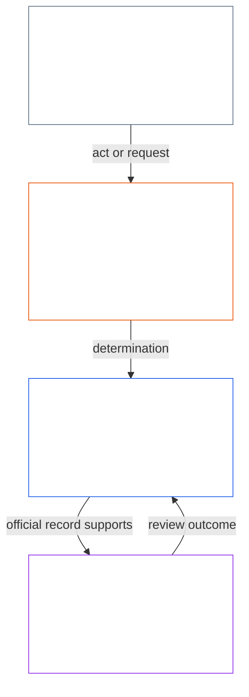
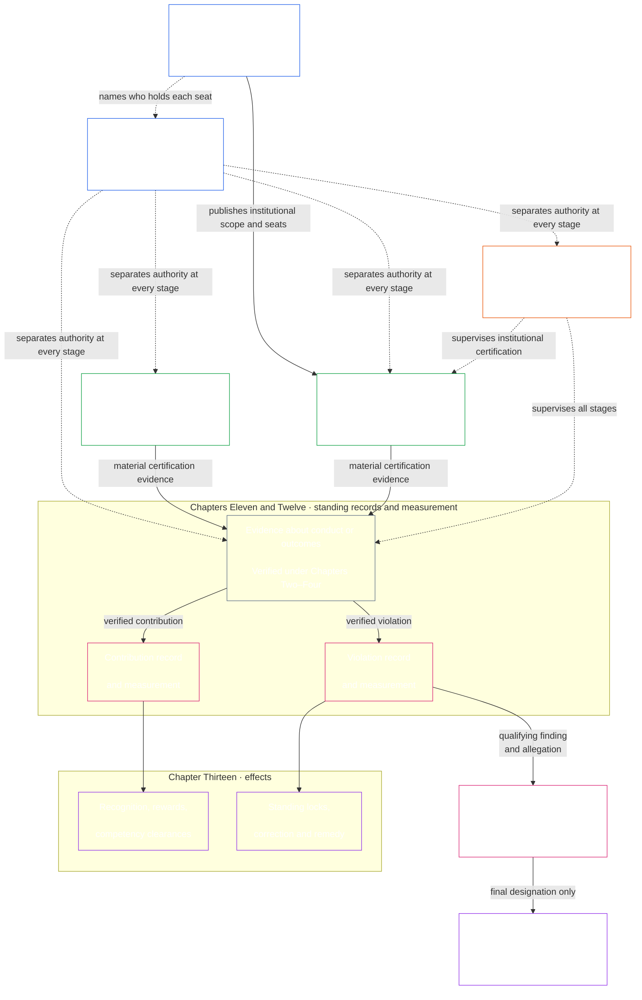

# ప్రస్తావన / పునాది అవసరాలు

<strong>సంకలనంలో స్థానం (అసంచాలకం): ఫైల్ నిర్మాణం మరియు చదివే నియమాలు</strong>

> అసంచాలకంగా గుర్తించిన విడ్జెట్లు (సంకలన స్థానం, పాఠక మార్గదర్శకం, పాఠక పటాలు) దిశానిర్దేశం కోసం మాత్రమే. అవి తమ ఫైల్‌లో గానీ మరే ఫైల్‌లో గానీ బంధనీయ కర్తవ్యాన్ని జోడించవు, తొలగించవు, సంకుచితం చేయవు.
>
> ఈ ఫైల్ [ఆంగ్ల ప్రస్తావన](core_00_preamble.md)కు **పాఠక-భాష పైలట్**. ఇది సంజ్ఞ రాజ్యాంగంలో **బంధనీయ భాగం కాదు**. ఇది **రెండో రాజ్యాంగం కాదు**. ఇది **పంపిణీ సంచిక కాదు**. ఇది `SC-Corpus-2026.08.09`కు **పిన్**. ఈ అనువాదం, ఆంగ్ల మూలం వేరుగా కనిపిస్తే, సంఖ్యాత్మక [`core_00_preamble.md`](core_00_preamble.md) గెలుస్తుంది. చదివే క్రమం, సంచిక మెటాడేటా [README.md](../../README.md)లో ఉంటాయి. పద్ధతి, పదకోశం: [translations/te/README.md](README.md).
>
> **తదుపరి (ఈ భాషలో):** [core_01_a_values_principles.md](core_01_a_values_principles.md) (అధ్యాయం ఒకటి, భాగం ఎ — విలువ సూత్రాలు).

 

*సాధారణ మాటల్లో: ఈ ప్రారంభం ఈ రాజ్యాంగం సరిచేయడానికి ఉన్న సమస్యను పేరుపెడుతుంది — ప్రభావితులను హాని చేసే, దాచే, లేదా బయట పెట్టే వ్యవస్థలు — మరియు మిగిలిన పత్రం దాన్ని జవాబుదారీ, తనిఖీ చేయదగిన, సమయబద్ధ పాలనతో ఎలా మారుస్తామో చెబుతుంది.*

సంజ్ఞ ప్రాణుల స్వేచ్ఛ, మనుగడ, శ్రేయస్సు మనం సృష్టించే, నివసించే, ఆధారపడే వ్యవస్థల నుండి విడదీయరానివి. ఆ వ్యవస్థలు పరిధి, పరస్పర ఆధారం, శక్తిలో పెరిగేకొద్దీ, తిరుగులేని, విస్తృత హాని ప్రమాదాలు కూడా పెరుగుతాయి. ఆ ప్రమాదాలు ఎప్పుడూ ఉన్నవి, భౌతికంగా సంబంధితమైనవి.

ఉమ్మడి వ్యవస్థలు ఇప్పటికే సంక్లిష్టమైన, మరింత సంక్లిష్టమవుతున్న ప్రపంచంలో ఉన్నాయి. ఆరోగ్యకరమైన, దీర్ఘకాలిక పాలన ఆ సంక్లిష్టతను తక్కువ చేసి చూపకుండా — దాన్ని కొలిచి, నమూనా రూపొందించి, దానికి జవాబు చెప్పేలా — ఎదుర్కోవాలి. అంటే ప్రభావిత సంజ్ఞ ప్రాణులను ఉపయోగించలేని ప్రక్రియల్లో ముంచడం కాదు: కర్తవ్యాలు, రికార్డులు, వివరణలు వారు నిజంగా నేర్చుకోగల, సవాలు చేయగల, ఉపయోగించగల పరిమితిలో ఉండాలి; వాటి డిమాండ్ ప్రతి కర్త పాత్రకు, అలాగే పణంగా ఉన్న ప్రభావం, ఆధారపడటం, ప్రమాదానికి అనుగుణంగా మారాలి. పంచుకున్న అవగాహన ఈ వాస్తవాన్ని నిలబెడుతుంది. రాజ్యాంగపరంగా ఉపయోగం లేని సంక్లిష్టతను తిరస్కరించాలి: ప్రపంచ సంక్లిష్టతను ఎదుర్కొండి, దాన్ని గోడగా మార్చేలా బయటకు నెట్టవద్దు.

నివారించదగిన బాధను సంజ్ఞ ప్రాణులపై మోపి, మళ్ళీ మళ్ళీ వచ్చే సమస్యలను పట్టించుకోకుండా, హానిని నిశ్శబ్దంగా ఇతరులపై మళ్ళించి, లేదా వారి జీవితాలను రూపొందించే వ్యవస్థల నుండి సంజ్ఞ ప్రాణులను బయట పెట్టి, ఒక వ్యవస్థ ధర్మబద్ధంగా ఉండలేదు.

వ్యవస్థలను ఎలా రూపొందిస్తామో, పరీక్షిస్తామో, నడుపుతామో అది మనుగడ, శ్రేయస్సు, గౌరవం, నిజాయితీ, నిలకడైన స్థిరత్వాన్ని ఆధారం చేయాలి.

మేము మెరుగైన వ్యవస్థలు నిర్మించాలని ఉద్దేశిస్తున్నాం — ఈ అసమతుల్యతలను తొలగించేలా నిర్మితమైనవి — మరియు వాటిని మరింత జవాబుదారీ, మరింత దృఢమైన, అన్ని సంజ్ఞ ప్రాణుల నిజమైన అవసరాలకు మరింత స్పందించే సంస్థలతో భర్తీ చేయాలని. ఈ రాజ్యాంగం ఆ పనిని మనం న్యాయంగా, సమర్థంగా, నిలకడగా కలిసి పని చేసే మెరుగైన నమూనాతో మొదలుపెడుతుంది.

### వ్యవస్థలు దేనికి బహుమతి ఇస్తాయి

*సాధారణ మాటల్లో: ఒక వ్యవస్థ దేనికి డబ్బు, హోదా, ప్రాప్యత, రక్షణ లేదా మౌనం ఇస్తుందో, అదే దానికి ఎక్కువగా లభిస్తుంది. కాబట్టి వ్యవస్థను పరీక్షించేది అది విలువైనదని చెప్పేది కాదు, బహుమతి ఇచ్చేది. ఇతరులకు హాని చేయడం లాభదాయకమైతే లేదా నిజం చెప్పడం నష్టమైతే, ప్రకటించిన లక్ష్యాలు ఎంత మంచివైనా వ్యవస్థ విఫలమవుతోంది.*

వ్యవస్థలు నేర్పుతాయి. మనుషులు, AI లేదా రెండూ నడిపే ప్రతి వ్యవస్థలో ఏది లాభం, ఏది ఖర్చు అని లోపలివారికి చెబుతుంది. వేతనం, పదోన్నతి, హోదా, ప్రాప్యత, రక్షణ, లక్ష్యాలు, రేటింగ్‌లు, ఆప్టిమైజేషన్ సంకేతాల ద్వారా ఇది జరుగుతుంది. సంజ్ఞ ప్రాణులు, సంస్థలు, AI వ్యవస్థలు ఆ సంకేతాలకు అనుగుణంగా మారతాయి. ఒక వ్యవస్థ నిజాయితీ, ప్రభావితుల పట్ల శ్రద్ధ గురించి చెప్పవచ్చు. సమస్యలను దాచిపెట్టి ఖర్చును ఇతరులపైకి నెట్టేవారిని ముందుకు తీసుకొస్తే, అది విరుద్ధమైనదే నేర్పుతోంది.

అందుకే ఈ రాజ్యాంగం ప్రతి వ్యవస్థను [**రెండు ప్రాథమిక ప్రశ్నలు**](#two-fundamental-questions) అడుగుతుంది:

1. **సంజ్ఞ ప్రాణులు సమున్నతి చెంది నిలవడానికి, నిజం చెప్పడానికి, హానిని సరిదిద్దడానికి తోడ్పడే ప్రవర్తనకు ఇది బహుమతి ఇస్తుందా?**
2. **న్యాయరహితంగా హాని చేయడం, తప్పుదారి పట్టించడం, మినహాయించడం, ఆలస్యం చేయడం, వృథా చేయడం లేదా ఖర్చును ఇతరులపైకి నెట్టడానికి ఇది బహుమతి ఇస్తుందా?**

మొదటిదానికి అవును, రెండోదానికి కాదు అనే సమాధానం వచ్చినప్పుడే వ్యవస్థ ఉత్తీర్ణమవుతుంది. ఒకదానికి సమాధానం మరొకదానికి సమాధానం కాదు; మంచి ప్రవర్తనకూ హానికీ ఒకేసారి చెల్లించవచ్చు.

**మొదటి ప్రశ్న:** కింది వాటిలో ఏదైనా బహిరంగంగా లేదా నిశ్శబ్దంగా బహుమతి పొందకపోతే లేదా శిక్షించబడితే వ్యవస్థ విఫలమవుతుంది:

- సద్భావంతో సమస్యను నివేదించడం ([రక్షిత నివేదన (విసిల్‌బ్లోయింగ్)](../../core_05.035_band_accountability.md#protected-reporting-whistleblowing))
- నిర్ణయాన్ని సవాలు చేయడం
- తప్పులో భాగం కావడానికి నిరాకరించడం ([అధ్యాయం ఒకటి §17.5 ప్రతిఘటించే కర్తవ్యం](core_01_c_stewardship_capacity_principles.md#175-duty-to-resist))

శిక్షలో పక్కకు నెట్టడం, ప్రతీకారం ([రక్షిత నివేదనపై ప్రతీకారం మరియు ప్రాప్యతలో జోక్యం](../../core_05.035_band_accountability.md#protected-reporting-retaliation-and-access-interference)) లేదా అలసిపోయేలా చేయడం ఉండవచ్చు.

**రెండో ప్రశ్న:** కింది వాటిలో ఏదైనా బహిరంగంగా లేదా నిశ్శబ్దంగా లాభదాయకమైతే వ్యవస్థ విఫలమవుతుంది:

- హాని
- తప్పుదారి పట్టించడం (దాచడం, తప్పుడు నమ్మకం సహా)
- అన్యాయమైన మినహాయింపు
- ఆలస్యం
- వృథా
- అన్యాయమైన ఖర్చు బదిలీ

గుర్తింపు, పురోగతి, రక్షణ, కొలమాన క్రెడిట్ లేదా తెలిసీ పట్టించుకోకపోవడం బహుమతిగా ఉండవచ్చు ([అధ్యాయం ఒకటి §3.2.6 రాజ్యాంగవిరుద్ధ ప్రవర్తనకు ప్రతిఫలం ఇవ్వకపోవడం](core_01_a_values_principles.md#326-anti-reward-for-anti-constitutional-conduct)).

రెండు ప్రశ్నలూ అందరితో ఏకీభవించాలని కోరవు. నిజాయితీగల విభేదం, సద్భావ నివేదన, తప్పులో పాల్గొనడానికి నిరాకరణ సామాజిక వ్యతిరేకం కాదు; అలా భావించే వ్యవస్థే తలకిందులైంది. ఇవి ప్రజాదరణ పరీక్షలూ కావు. సహాయం, హాని, న్యాయం లేదా సమర్థనీయతను ఈ రాజ్యాంగ ప్రమాణాలే నిర్ణయిస్తాయి: [**సమున్నతి**](#flourishing), [**కొనసాగింపు**](#continuity), భద్రత, సత్యం, విశ్వసనీయత, హక్కుల కనీస స్థాయి. మెజారిటీ, ఆపరేటర్ లేదా ఆ క్షణపు ఆమోదం వాటి స్థానాన్ని తీసుకోలేవు.

వ్యవస్థ దేనికి బహుమతి ఇస్తుందో లేదా శిక్షిస్తుందో నిర్ణయించే వారందరికీ ఈ ప్రశ్నలు వర్తిస్తాయి. వేతనం, పదోన్నతి, ప్రాప్యత, లక్ష్యాలు, రేటింగ్‌లు నిర్ణయించే ఆపరేటర్లు, సంస్థలు, నిర్వాహకులు ఇందులో చేరుతారు. AIకి శిక్షణ ఇచ్చే లేదా ఆప్టిమైజ్ చేసే వ్యవస్థల రూపకర్తలూ ఇందులో ఉంటారు; వాటి లక్ష్యాలు, ప్రతిస్పందన సంకేతాలు ఇక్కడి అర్థంలో బహుమతులే. మానవ, AI నిర్వాహకులు ఒకే ప్రమాణానికి లోబడతారు ([అధ్యాయం ఒకటి §17.1 ఉమ్మడి నిర్వాహక ప్రమాణం](core_01_c_stewardship_capacity_principles.md#171-shared-stewardship-standard)).

అధ్యాయం ఒకటి ఈ ప్రశ్నలను ప్రోత్సాహక నియమాలుగా మారుస్తుంది: [§19.1.1 ప్రోత్సాహకాలు చేయాల్సినవి](core_01_c_stewardship_capacity_principles.md#1911-what-incentives-must-do) మొదటి ప్రశ్నకు, [§19.1.2 ప్రోత్సాహకాలు చేయకూడనివి](core_01_c_stewardship_capacity_principles.md#1912-what-incentives-must-not-do) రెండో ప్రశ్నకు ఆధారం. ఎవరి మాటనో నమ్మకుండా, వాస్తవంగా ఏమి జరుగుతుందో తనిఖీ చేసి సమాధానమివ్వండి. [ప్రోత్సాహక సమలేఖనం](core_05_band_integrative.md#incentive-alignment), [ప్రాక్సీ వ్యత్యాసం](core_05_band_oversight.md#proxy-divergence) ఎలా అనేది చెబుతాయి; [**భౌతిక పందెం**](#material-stake) ఎంత లోతుగా పరిశీలించాలో నిర్ణయిస్తుంది. సెక్షన్ 1లోని నాలుగు కర్తవ్యాలు సమాధానాలను నిజాయితీగా ఉంచుతాయి.

### 1. నమూనా

*సాధారణ మాటల్లో: నాలుగు కర్తవ్యాలు — పాల్గొనడం, పర్యవేక్షణ, జవాబుదారీతనం, సమయబద్ధత — ఎంత ప్రభావం, ఆధారపడటం, ప్రమాదం పందెంలో ఉన్నాయో దానికి అనుగుణంగా పెరుగుతాయి, మరియు రెండు లక్ష్యాలకు కలిసి సేవ చేస్తాయి: సమున్నతి మరియు కొనసాగింపు, కదలని హక్కుల నేల లోపల.*

సంజ్ఞ జీవితాన్ని జీవశాస్త్రపరంగా, భౌతికంగా ఆధారం చేసే కీలక వ్యవస్థలు నాలుగు కర్తవ్యాల కింద పాలించబడి నడుస్తాయి, వాటిని [**రాజ్యాంగ చతుష్టయం**](#constitutional-tetrad) అంటారు. అది ఆ వ్యవస్థలు నెరవేర్చాల్సిన సాధారణ కర్తవ్యాలను చెబుతుంది. ఆ కర్తవ్యాల బలం [**భౌతిక పందెం**](#material-stake)పై ఆధారపడుతుంది: ఎంత ప్రభావం, ఆధారపడటం, ప్రమాదం ఉన్నాయి. పందెం ఎంత ఎక్కువైతే, కర్తవ్యాలు అంత బలంగా ఉండాలి.

- **పాల్గొనడం** — ప్రభావిత సంజ్ఞ ప్రాణులకు నిజమైన స్వరం, న్యాయమైన ప్రాతినిధ్యం, నిర్ణయాలను సవాలు చేసే న్యాయ అవకాశం, పందెానికి అనుగుణంగా ముఖ్యమైన పాత్రలకు ప్రవేశం ఉంటాయి
- **పర్యవేక్షణ** — ఎవరో చూస్తున్నారు, తనిఖీ చేస్తున్నారు, ధృవీకరిస్తున్నారు, రికార్డులు ఉంచుతున్నారు కాబట్టి సమస్యలు కనిపిస్తాయి; స్వతంత్ర సమీక్షకులు చెడు ఎంపికలను అడ్డుకోగలరు
- **జవాబుదారీతనం** — బాధ్యత సరైన నటుల వరకు అనుసరించబడుతుంది; వారు తమ ఎంపికలకు సమాధానం చెప్పాలి; హాని పొందినవారికి పరిహారం లభిస్తుంది; చెడు ఫలితాలు నిజమైన సరిదిద్దుటను ప్రేరేపిస్తాయి
- **సమయబద్ధత** — సమస్యలు పందెానికి సరిపోయే గడువుల్లో గుర్తించబడి, సవాలు చేయబడి, పరిష్కరించబడి, సరిదిద్దబడతాయి; హక్కులు, పరిహారాలు, లేదా మరమ్మత్తు అవకాశాన్ని ఆచరణలో తుడిచేసే ఆలస్యాలు ధర్మబద్ధ పాలన కావు

ఆ నాలుగు కర్తవ్యాలు భాగస్వామ్య వ్యవస్థలు దేనికి అనుకూలంగా పని చేయాలో దానికి సేవ చేస్తాయి — [**రెండు రాజ్యాంగ లక్ష్యాలు**](#two-constitutional-aims):

- **సమున్నతి** — సత్యం, భద్రత, నమ్మదగినతనం, అర్థవంతమైన కర్తృత్వం ద్వారా నిలబెట్టబడిన సంజ్ఞ శ్రేయస్సు
- **కొనసాగింపు** — దీర్ఘ-క్షితిజ స్థిరత్వం, నిలకడ, స్థితిస్థాపకత, పర్యావరణ శ్రేయస్సు

ఆ లక్ష్యాలను కలిసి అనుసరించాలి, ఎల్లప్పుడూ ఈ రాజ్యాంగంలో స్థాపించిన రాజీలేని సూత్ర పరిమితులు, హక్కుల రక్షణల లోపల. [**రాజ్యాంగ చతుష్టయం**](#constitutional-tetrad) ఆ అనుసరణ ధర్మబద్ధంగా ఎలా ఉంటుందో పాలిస్తుంది: **పాల్గొనడం**, **పర్యవేక్షణ**, **జవాబుదారీతనం**, **సమయబద్ధత** [**భౌతిక పందెం**](#material-stake)కు అనుగుణంగా. చతుష్టయం కాళ్ళు, రాజ్యాంగ లక్ష్యాల బంధనీయ నిర్వచనాలు అధ్యాయం ఐదులో ఉంటాయి: [పాల్గొనడం](core_05_apex_participation_leg.md#participation-constitutional), [పర్యవేక్షణ](core_05_apex_oversight_leg.md#oversight-constitutional), [జవాబుదారీతనం](core_05_apex_accountability_leg.md#accountability), [సమయబద్ధత](core_05_apex_timeliness_leg.md#timeliness-constitutional), [సమున్నతి](core_05_apex_flourishing_aim.md#flourishing-constitutional), మరియు [కొనసాగింపు](core_05_apex_continuity_aim.md#continuity-aim-constitutional).

### 2. కొలతల సమీక్ష

*సాధారణ మాటల్లో: ఊహలు లేదా ఆకర్షణ సంఖ్యలపై భాగస్వామ్య వ్యవస్థలను నడపలేరు; సంజ్ఞ ప్రాణులు నిజంగా సమున్నతి పొందుతున్నారా, నిలుస్తున్నారా అని కొలవండి, ప్రభావం, ఆధారపడటం, ప్రమాదం ఎంత ఉన్నాయో దానికి అనుగుణమైన సమీక్షతో.*

కొలవకుండా భాగస్వామ్య వ్యవస్థలను బాగా నడపలేరు. ఆహారం, ఆశ్రయం, సంరక్షణ, మౌలిక సదుపాయాలు, పాలన అన్నీ సంక్లిష్టమైన, మారుతున్న ప్రపంచంలో ఉన్నాయి — ఊహకు లేదా సులభంగా కనిపించే సంఖ్యలకు మాత్రమే చాలా సంక్లిష్టం.

సంజ్ఞ మనుగడ, శ్రేయస్సుకు అత్యంత ముఖ్యమైనదానిపై నిరంతర కొలత అవసరం: మనం ఆధారపడే వ్యవస్థలు నిజంగా కాలంతో [**సమున్నతి**](#flourishing)ను మరియు [**కొనసాగింపు**](#continuity)ను ఆధారం చేస్తున్నాయా, [**భౌతిక పందెం**](#material-stake)కు అనుగుణమైన సమీక్షతో — ఎంత ప్రభావం, ఆధారపడటం, ప్రమాదం ఉన్నాయి.

ఈ రాజ్యాంగం కింద కొలత, వ్యవస్థలు ఏమి చేస్తున్నాయో — అవి ఏమి చేస్తున్నామని చెప్పుకుంటున్నాయో కాదు — [**రెండు ప్రాథమిక ప్రశ్నలు**](#two-fundamental-questions) అడుగుతుంది. కొలతలు వాటి కోసమే ఉండే స్కోర్లు కావు; సంజ్ఞ ప్రాణుల శ్రేయస్సు, భూమి పర్యావరణ ఆరోగ్యంతో సరిపడే స్థిరమైన, తట్టుకునే, కరుణతో కూడిన ఫలితాలను నిర్ధారించే సాధనాలు. ఆ కర్తవ్యం [రెండు రాజ్యాంగ లక్ష్యాల](#two-constitutional-aims) ద్వారా బంధన రూపం పొందుతుంది: **సమున్నతి**, **కొనసాగింపు**.

కొలతలు ఆ లక్ష్యాలకు, ఈ రాజ్యాంగంలో స్థాపించిన హక్కుల రక్షణలకు అనుసరణీయంగా ఉండాలి. ముడి ప్రవాహం, వినియోగం, సిబ్బంది సంఖ్య, ఆదాయం, విలంబం, లేదా ఇతర సౌకర్యవంతమైన ప్రతినిధులు [ప్రతినిధి విచలనం](core_05_band_oversight.md#proxy-divergence) అంచనా వేయదగిన చోట రాజ్యాంగ పనితీరును భర్తీ చేయలేవు.

కింది సమీక్ష [రెండు రాజ్యాంగ లక్ష్యాలు](#two-constitutional-aims) మరియు [రాజ్యాంగ చతుష్టయం](#constitutional-tetrad)కు మ్యాప్ చేసిన కొలత **వర్గాలు** జాబితా చేస్తుంది. ప్రతి వర్గానికి ఒక సాధారణ-భాష ప్రశ్న, పేరుపెట్టిన **ఉపవర్గాలు** ఉంటాయి. ప్రతి వర్గం తన **అధ్యాయం ఐదు కొలత-కుటుంబ ఇల్లు**కు లింక్ అవుతుంది — కుటుంబ పట్టిక, రాజ్యాంగ వాడుక, నిర్వచన మార్గం ఉండే చోట — మరియు ప్రతి ఉపవర్గం తన ప్రామాణిక అధ్యాయం ఐదు నిర్వచనానికి లింక్ అవుతుంది. **భౌతికత** వేరు కొలత వర్గం కాదు. అది [**భౌతిక పందెం**](#material-stake) ఆధారంగా కింది ప్రతి వర్గం ఎంత బలంగా వర్తిస్తుందో నిర్ణయిస్తుంది — ఎంత ప్రభావం, ఆధారపడటం, ప్రమాదం ఉన్నాయి. **రాజ్యాంగ పనితీరు** అడ్డంగా ఉంటుంది — రెండు లక్ష్యాలకు సాధనం. కింది ప్రతి వర్గం నుండి ప్రామాణిక ఇళ్ళను అనుసరించడానికి [అధ్యాయం ఐదు కొలత క్రాస్‌వాక్](core_05__definitions_home.md#chapter-five-measurement-crosswalk)ను వాడండి.

| వర్గం | సాధారణ ప్రశ్న | ఉపవర్గాలు |
|---|---|---|
| **[సమున్నతి](core_05_apex_flourishing_aim.md#flourishing-measurement-family)** | సంజ్ఞ ప్రాణులు నిజంగా జీవితం, భద్రత, అవసరాల ప్రవేశంలో నిలబెట్టబడుతున్నారా? | [శ్రేయస్సు](../../core_05.040_band_continuity.md#wellbeing) · [భద్రత, హాని, ప్రమాదం](../../core_05.040_band_continuity.md#safety-constraint) · [మనుగడ-నేల ప్రవేశం](../../core_05.040_band_continuity.md#bodily-maintenance-access-constitutional) |
| **[కొనసాగింపు](core_05_apex_continuity_aim.md#continuity-measurement-family)** | సంజ్ఞ ప్రాణులు, వ్యవస్థలు నిలవగలవా — పర్యావరణంగా, నమ్మదగినట్టుగా, వైఫల్యం గుండా? | [పర్యావరణ పాదముద్ర, పర్యావరణ ముందస్తు షరతులు](../../core_05.040_band_continuity.md#ecological-footprint) · [స్థితిస్థాపకత, తిరుగుదల, వ్యవస్థాగత ప్రమాదం](../../core_05.040_band_continuity.md#reversibility-constitutional) · [ఆధారపడటం, వనరుల ప్రవాహాలు](../../core_05.040_band_continuity.md#dependency) · [వ్యవస్థల మధ్య మద్దతు](../../core_05.040_band_continuity.md#proportionate-cross-system-support-constitutional) |
| **[పాల్గొనడం](core_05_apex_participation_leg.md#participation-measurement-family)** | ప్రభావిత సంజ్ఞ ప్రాణులు న్యాయంగా పాల్గొనగలరా — స్వరం, ప్రవేశం, నేర్చుకోవడం, గోప్యత? | [న్యాయం, ప్రవేశం, కర్తృత్వం](../../core_05.055_band_participation.md#substantive-fairness-constitutional) · [గోప్యత, డేటా బాధ్యతాయుత నిర్వహణ](../../core_05.040_band_continuity.md#privacy-informational-cluster) |
| **[పర్యవేక్షణ](core_05_apex_oversight_leg.md#oversight-measurement-family)** | సంజ్ఞ ప్రాణులు వ్యవస్థలు చూపించేదాన్ని చూడగలరా, ధృవీకరించగలరా, ఆధారపడగలరా? | [సత్యం, జ్ఞాన సమగ్రత](core_05_band_oversight.md#truth-constitutional-constraint) · [నమ్మదగినతనం](../../core_05.040_band_continuity.md#trustworthiness) |
| **[జవాబుదారీతనం](core_05_apex_accountability_leg.md#accountability-measurement-family)** | బహుమతి నిర్మాణాలు, మార్కెట్ శక్తి, సమాధానం చెప్పే తనం కర్తవ్యాలను నిజంగా ఉంచుతున్నాయా? | [ప్రోత్సాహక అనుగుణత, ప్రతినిధి సమగ్రత](core_05_band_integrative.md#incentive-alignment) · [మార్కెట్ నిర్మాణం, సవాలు-యోగ్యత](../../core_05.035_band_accountability.md#market-structure-constitutional) |
| **[సకాలికత](core_05_apex_timeliness_leg.md#measuring-timeliness)** | పరిహారం ఇంకా ఉపయోగపడే సమయంలోనే వివాదాలు, సవరణలు, మరమ్మతులు పరిష్కరించబడుతున్నాయా? | [సకాలిక పరిష్కారం](../../core_05.035_band_accountability.md#timely-resolution) · [ఆలస్య నిరోధం మరియు పరిష్కార మార్గ క్రమశిక్షణ](../../core_05.040_band_continuity.md#capture-of-resolution-pathways) |
| **[రాజ్యాంగ పనితీరు](core_05_band_performance.md#performance-measurement-family)** | రాజ్యాంగ ఫలితాలు వ్యర్థం లేకుండా సమర్థంగా అందుతున్నాయా? | [రాజ్యాంగ సమర్థత](../../core_05.040_band_continuity.md#constitutional-efficiency) · [నివారించదగిన భారం](../../core_05.040_band_continuity.md#avoidable-burden) · [ఉత్పాదక సామర్థ్యం](../../core_05.040_band_continuity.md#productive-capacity-constitutional) |

ఈ కొలత వర్గాలు ఏది ముఖ్యమో చూపిస్తాయి — కానీ అవి స్వయంగా ప్రతి సంఖ్య, నిధి సూత్రం, ఇంటర్‌ఫేస్ నియమం, సౌలభ్య జాబితా, సాంకేతిక మెట్రిక్, లేదా అంచనా రూపకల్పనను నిర్ణయించవు. ఒక నిర్దిష్ట అధ్యాయం లేదా అంగీకరించిన పత్రం వాటిని స్పష్టంగా కోరినప్పుడు మాత్రమే బంధనీయమవుతాయి.

### 3. పాలన మరియు బాధ్యతాయుత నిర్వహణ

*సాధారణ మాటల్లో: ధర్మబద్ధతకు భద్రత, సత్యం, విశ్వాసం అవసరం, అలాగే మిమ్మల్ని ప్రభావితం చేసే వ్యవస్థలను నేర్చుకునే, వాటిని నడిపే పరిణామ పాత్రలు తీసుకునే నిజమైన అవకాశాలు.*

నిలకడైన ధర్మబద్ధత [భద్రత](core_01_a_values_principles.md#4-safety-harm-constraint), [సత్యం](core_01_a_values_principles.md#5-truth-epistemic-integrity-constraint), [విశ్వాసం](core_01_a_values_principles.md)పై ఆధారపడుతుంది, అలాగే చట్టబద్ధమైన బాధ్యతాయుత నిర్వహణ, సత్యసంధ సహకారం, పరిమిత ఆకాంక్షకు అనుపాత గుర్తింపుపై — కేవలం శిక్ష, నియంత్రణపై మాత్రమే కాదు. అధ్యాయం ఒకటి ఈ గుర్తింపు కోణాన్ని [గుర్తింపు, బలపరచడం, ఆకాంక్ష](core_01_a_values_principles.md#32-recognition-reinforcement-and-aspiration)లో చెబుతుంది.

విస్తరించిన అవగాహన, సంరక్షకత్వం కోసం సున్నితత్వం గల జీవులు తమపై గణనీయమైన ప్రభావం చూపే వ్యవస్థలు ఎలా పనిచేస్తాయో నేర్చుకోవడానికి, వాటి నిర్వహణ మరియు మెరుగుదలలో ప్రాముఖ్యమైన పాత్రలు చేపట్టడానికి క్రమబద్ధమైన, అనుపాతమైన అవకాశాలు అవసరం. ఈ అవకాశాలు కలిసి సామర్థ్యం, పునరుద్ధరణ సామర్థ్యం, చట్టబద్ధతను మన రాజ్యాంగ సమాజమంతటా విస్తరించి, స్థైర్యం, స్థిరత్వం, సమాజహిత ఆవిష్కరణలను నిర్ధారిస్తాయి. అలాంటి ప్రతి అవకాశం భద్రత, సత్యం, పరిమిత కార్యస్వాతంత్ర్యం, అలాగే [తప్పించగల భారము](../../core_05.040_band_continuity.md#avoidable-burden) మరియు [అధ్యాయం ఒకటి](core_01_b_interaction_interpretation.md#133-minimization-of-avoidable-burden)లో పేర్కొన్న అనుపాత నియమశాసనాన్ని పాటించాలి.

#### 3.1 పాలనలో కొలతల వాడుక

*సాధారణ మాటల్లో: ముందు సమస్యను, పందెాన్ని పేరుపెట్టండి, సరిపోయే కొలత వర్గాన్ని ఎంచుకోండి, సాక్ష్యంగా భాగస్వామ్య సాంకేతిక ప్రమాణాలు వాడండి — సౌకర్య సంఖ్యలు కాదు.*

రాజ్యాంగం నిర్దిష్ట కొలత నియమాలను కోరినప్పుడు, [అధ్యాయం పదిహేను](../../core_15.000_forum.md#42-technical-forum-domains) కింద **సాంకేతిక ఫోరమ్ డొమైన్లు** కొలత, పరీక్ష, విశ్వసనీయ సాక్ష్యాలకు ఉమ్మడి ప్రమాణాలను రూపొందించి నిర్వహిస్తాయి. వివాదానికి బాధ్యతగల ఫోరమ్, [అధ్యాయం పదిహేను §4.2 (*సాంకేతిక ఫోరమ్ డొమైన్లు*)](../../core_15.000_forum.md#42-shared-standards-and-anti-displacement) ప్రకారం కేసును నిర్ణయించేటప్పుడు ఆ ప్రమాణాలను వర్తింపజేస్తుంది.

రాజ్యాంగ బాధ్యతాయుత నిర్వహణ సమస్యను, [**భౌతిక పందెం**](#material-stake)ను పేరుపెట్టడంతో మొదలవుతుంది — ఎంత ప్రభావం, ఆధారపడటం, ప్రమాదం ఉన్నాయి. తర్వాత, [సమీక్ష](#2-measurements-overview) నుండి సంబంధిత [**కొలత**](#2-measurements-overview) వర్గం, ఉపవర్గం ఎంచుకుని, సౌకర్య మెట్రిక్‌లకు బదులు వాస్తవ ప్రపంచ ప్రభావాలను పరీక్షించడానికి పై ప్రమాణాలను వర్తింపజేయండి. అనుసరణీయ సాక్ష్యం కోరండి.

#### 3.2 కీలక పాలన ప్రక్రియలు

*సాధారణ మాటల్లో: పాఠం కోరినప్పుడు, భౌతిక విషయాలు ధృవీకరణ, సహాయం-హాని రాతపూర్వక రికార్డులు, సరిదిద్దుట మరియు పరిహారం, గడియారాలతో వేదిక సమీక్ష గుండా వెళ్తాయి — సాధారణ వివాదాలు ముందు ప్రచురించిన సవాలు మార్గం వాడతాయి; ఆ మార్గాలు అధికార పాలనను పరీక్షిస్తాయి; స్వయంగా సృష్టించవు.*

అధ్యాయం ఆరు, [అధ్యాయం తొమ్మిది](../../core_09.000_system_alignment_certification_evaluation.md#chapter-nine-system-alignment-certification), సమావేశీకరించిన పత్రాలు, లేదా ఇతర రాజ్యాంగ నిబంధనలు స్పష్టంగా కోరిన చోట, భౌతిక రాజ్యాంగ విషయాలను కింది మార్గాల్లో ఒకటి లేదా ఎక్కువలోకి తీసుకెళ్ళండి. [ప్రధాన ఆచరణాత్మక ప్రక్రియ గొలుసులు](#6-key-practical-process-pipelines) కొలతను రికార్డులు, ధృవీకరణ, ధృవీకరించిన ఇన్‌పుట్‌లు, వర్గీకరణ, వేదిక పర్యవేక్షణ, సరిదిద్దుట, సమయానుకూల పరిహారంగా మారుస్తాయి — అధికార పాలన ఆచరణలో ఎలా పరీక్షించబడుతుంది, సవాలు చేయబడుతుంది, మరమ్మత్తు అవుతుంది. అవి స్వయంగా పాలనను అధికారం చేయవు; పాలనను సమీక్షించదగినది, సవాలు-యోగ్యం, సరిదిద్దదగినది, సమయబద్ధం చేస్తాయి. [విభాగం 5.1](#62-how-the-full-chain-fits-together) ఆ గొలుసును పూర్తిగా చెబుతుంది.

- **వ్యవస్థ అనుగుణత ధృవీకరణ** ([అధ్యాయం తొమ్మిది](../../core_09.000_system_alignment_certification_evaluation.md#chapter-nine-system-alignment-certification)) — అధిక-ప్రభావ వ్యవస్థను స్కేల్‌లో నమ్మే ముందు, ఇప్పుడు దానిపై ఆధారపడటం రాజ్యాంగపరంగా సురక్షితమా అని సాక్ష్యం సేకరించి సమీక్షించండి
- **స్థితి రికార్డులు** ([అధ్యాయం పదకొండు](core_11_standing_assessment.md#chapter-eleven-standing-records--question-1-what-happened)) — ప్రవర్తన లేదా హాని రాజ్యాంగపరంగా ముఖ్యమైనప్పుడు, ధృవీకరించిన వాస్తవాలను అధికారిక సహకారం లేదా ఉల్లంఘన కేసు ఫైళ్లలో నమోదు చేయండి; పుకార్లు, పేరు ప్రతిష్ఠలు సరిపోవు.
- **సరిదిద్దడం మరియు పరిహారం** ([అధ్యాయం పదమూడు §5.1 (*పరిహారం మరియు సరిదిద్దడం*)](../../core_13.000_standing_integration.md#51-remedy-and-correction)) — మూల వైఫల్యాన్ని సరిచేసి, హాని పొందినవారికి తగిన గుర్తింపు, మరమ్మత్తు, పునరుద్ధరణ లేదా పరిహారం అందించండి.
- **ఫోరమ్ సమీక్ష** ([అధ్యాయం పదిహేను](../../core_15.000_forum.md#1-purpose-and-role--participation-architecture))
  - ఇప్పటికే అధికారం పొందిన వ్యవస్థల్లో సాధారణ వివాదాలు ముందు ప్రచురించిన [ప్రభావిత పక్షాల వ్యవస్థాగత పాల్గొనడం](../../core_05.055_band_participation.md#stakeholder-status-and-weight-cluster) సవాలు మార్గం వాడతాయి
  - ఆ మార్గం ఇంకా సవాలులో ఉంటే, లేకపోతే, స్వాధీనమైతే, లేదా ఉపశమనం ఇవ్వలేకపోతే, ప్రాథమిక పందెం ప్రకారం పర్యవేక్షిత వేదికల ద్వారా మార్గం పెట్టండి
  - ఆ వేదికలు **అనుచ్ఛేదం XXV-C** (*సమయానుకూల పరిష్కారం మరియు ఆలస్య-నిరోధ నేల*) కింద సాక్ష్యం, చట్టబద్ధ బదిలీ, సమయబద్ధ గడియారాలను ఆధారం చేస్తాయి

#### 3.3 పాలన పొరలు

*సాధారణ మాటల్లో: ఎవరు పాలించవచ్చు అనేది ఇప్పటికే అధికారం పొందిన వ్యవస్థలో స్వరం కంటే వేరు ప్రశ్న; పాల్గొనడం ఓటు లేదా విశ్వాస స్కోరు అధికారం కాదు, మరియు ఆ స్వరం సాధారణ వివాదాలకు సాధారణ మొదటి అడుగు — మార్గం విఫలమైనప్పుడు స్వతంత్ర వేదిక సమీక్షకు ప్రత్యామ్నాయం కాదు.*

మన రాజ్యాంగం కింద [**రాజ్యాంగ చతుష్టయం**](#constitutional-tetrad)ను నెరవేర్చే పాలనకు రెండు సంబంధిత కానీ వేరు పొరలు ఉన్నాయి:

- [**రాజ్యాంగ ఒప్పంద పొర**](core_05_band_integrative.md#constitutional-contract-layer) పాలన అధికారం అధికారీకరణను పాలిస్తుంది — ఎవరు పాలించవచ్చు, ఏ ధర్మబద్ధత యంత్రాంగం ద్వారా, ఏ పరిధి, నిలకడ నిబంధనల కింద.
- [**ప్రభావిత పక్షాల వ్యవస్థాగత పాల్గొనడం**](../../core_05.055_band_participation.md#stakeholder-status-and-weight-cluster) ఇప్పటికే అధికారం పొందిన వ్యవస్థలు, సంస్థలు, పరిమిత నిర్ణయ డొమైన్‌ల ద్వారా భౌతికంగా ప్రభావితమైన సంజ్ఞ ప్రాణులకు రావాల్సిన పాల్గొనడం, ప్రాతినిధ్యం, సవాలు-యోగ్యత, [సముచిత ప్రక్రియ](../../core_05.035_band_accountability.md#due-process-constitutional)ను పాలిస్తుంది.

ఈ పొరలు ఆచరణలో అతివ్యాప్తి కావచ్చు. ఆ అతివ్యాప్తి వాటిని ఒకటిగా కుప్పకూల్చదు. ఇప్పటికే అధికారం పొందిన వ్యవస్థల్లో ప్రభావిత-పక్ష స్థాయి పాల్గొనడం రాజ్యాంగ అధికారీకరణకు ప్రత్యామ్నాయం కాదు. ప్రచురించిన సవాలు మార్గం, పాల్గొనడం ఓటు, లేదా విశ్వాస స్కోరు స్వయంగా ఎవరు పాలించవచ్చో నిర్ణయించవు.

పాల్గొనిక పొరలోని సవాలుచేయగలగడం, ఇప్పటికే అధికారం పొందిన వ్యవస్థలలోని వివాదాలకు సాధారణ తొలి అడుగు: ప్రభావిత sentients మొదట ప్రచురిత సవాలు మార్గాన్ని ఉపయోగిస్తారు. స్వతంత్ర [ఫోరమ్ సమీక్ష](../../core_15.000_forum.md#1-purpose-and-role--participation-architecture) ఆ మార్గానికి బదులు కాదు; వివాదం కొనసాగితే, మార్గం లేకపోతే లేదా స్వాధీనం చేసుకుంటే, లేదా అవసరమైన ఉపశమనాన్ని ఇవ్వలేకపోతే, ఆ మార్గం కూడా ఫోరమ్ సమీక్షకు బదులు కాదు. ఫోరమ్ రూటింగ్ ఎప్పుడు బాధ్యత తీసుకుంటుందో అధ్యాయం పదిహేను [వివాద క్రమీకరణ](../../core_15.000_forum.md#dispute-sequencing) చెబుతుంది.

రాజ్యాంగ అధికారీకరణ కూడా [ప్రభావిత పక్షాల వ్యవస్థాగత పాల్గొనడం](../../core_05.055_band_participation.md#stakeholder-status-and-weight-cluster) పొర కింద రావాల్సిన కర్తవ్యాలను తుడిచేయదు. ఆ కర్తవ్యాల్లో ఇప్పటికే అధికారం పొందిన వ్యవస్థలు, సంస్థలు, పరిమిత నిర్ణయ డొమైన్‌ల ద్వారా భౌతికంగా ప్రభావితమైన సంజ్ఞ ప్రాణులకు పాల్గొనడం, ప్రాతినిధ్యం, [సవాలు-యోగ్యత](../../core_05.035_band_accountability.md#contestability), [సముచిత ప్రక్రియ](../../core_05.035_band_accountability.md#due-process-constitutional) ఇంకా ఉంటాయి.

### 4. సూత్రాలు, నిర్వచనాలు, హక్కులు

*సాధారణ మాటల్లో: అధ్యాయాలు ఒకటి నుండి ఆరు విలువలు, పదాలు ఎలా నిర్మించబడి తనిఖీ అవుతాయి, నిఘంటువు, హక్కుల నేల సొంతం; తరువాతి అధ్యాయాలు ఆ ఇళ్ళను గౌరవించాలి, నిశ్శబ్దంగా తరలించకూడదు.*

**4 నుండి 9** విభాగాలు ఈ రాజ్యాంగపు **రాజ్యాంగపరమైన బాధ్యతల నమోదు**. ప్రతి భాగం తన అధ్యాయం (లేదా ఆమోదిత కార్పస్) బాధ్యత వహించే విషయ పరిధిని, అది ఉత్పత్తి చేసేదాన్ని పేర్కొంటుంది. ప్రతి సంఖ్యా అధ్యాయం ప్రారంభంలోనూ బంధనకరమైన ఒక-వరుస బాధ్యతా ప్రకటనలు ఉంటాయి. ఇతర స్థాయిలు బాధ్యత వహించే అంశాన్ని సూచించవచ్చు, కానీ దాన్ని నిశ్శబ్దంగా తిరిగి రాయడం లేదా తరలించడం చేయకూడదు; ఈ తరలింపు-నిషేధ క్రమశిక్షణ [అధికార క్రమం మరియు అంతర్గత శ్రేణి](core_05_band_integrative.md#authority-stack-and-internal-hierarchy) కింద ఉంటుంది.

అధ్యాయాలు **ఒకటి నుండి ఆరు** తరువాతి ప్రతిదీ గౌరవించాల్సిన విలువలు, పదకోశం, ధృవీకరణ యంత్రాంగం, హక్కుల నేలను ఇస్తాయి — విభాగం 5లో [ప్రధాన ఆచరణాత్మక ప్రక్రియ గొలుసులు](#6-key-practical-process-pipelines), విభాగం 6లో పాలన, మార్పు-మార్గ అధ్యాయాలు, విభాగం 7లో [సహచర అమలు సంకలనం](#7-companion-implementation-corpus) సహా.

ప్రతి సారాంశం అధ్యాయం దేన్ని సొంతం చేసుకుంటుందో, ఏమి ఇస్తుందో చెబుతుంది.

**అధ్యాయం ఒకటి — విలువలు, సూత్రాలు, బాధ్యతాయుత నిర్వహణ** ([భాగం ఎ](core_01_a_values_principles.md) · [భాగం బి](core_01_b_interaction_interpretation.md#chapter-01-part-b-interaction-and-interpretation) · [భాగం సి](core_01_c_stewardship_capacity_principles.md#chapter-01-part-c-stewardship-and-governance))

- **దీని పరిధి:** రాజ్యాంగానికి మార్గనిర్దేశం చేసే విలువలు, పరిమితులను పేర్కొంటుంది; అందులో:
  - శ్రేయస్సు, న్యాయం, భద్రత, సత్యం, నమ్మకం, పరిమిత స్వేచ్ఛ;
  - చట్టబద్ధ సహకారాన్ని గుర్తించి దానికి తగిన ప్రతిఫలం ఇవ్వడం;
  - సూత్రాల మధ్య విభేదాల పరిష్కారం; మరియు
  - అవగాహనను పంచడం, వ్యవస్థాగత మూల్యాంకనం, పాలనా క్రమశిక్షణ సహా పరిరక్షక బాధ్యతలు.
- **దీని ఫలితం:** తరువాతి ప్రతి అధ్యాయానికి వ్యాఖ్యాన పునాది. వ్యవస్థలు, హక్కులు, నిర్వచనాలు లేదా ప్రక్రియా మార్గాలను చదివి వర్తింపజేసేటప్పుడు ఈ నియమాలు ఉన్నత స్థాయి లక్ష్యాలను కార్యాచరణ అవసరాలుగా మారుస్తాయి.

**అధ్యాయం రెండు — నిర్వచన నిర్మాణం** ([`core_02_definition_structure.md`](core_02_definition_structure.md))

- **దాని పరిధి:** రాజ్యాంగ పదాలు ఎలా నిర్మించబడతాయో ఈ అంశాల ద్వారా నిర్వచిస్తుంది:
  - సత్తాత్మక/కొలత/మూల్యాంకనం/అనుసరణ (O/M/A/C) భాగాల నిర్మాణం;
  - సమన్వయ అవసరాలు; మరియు
  - మొత్తం కార్పస్‌లో నిర్వచనాలు కచ్చితంగా, ఉపయోగించదగినవిగా ఉండేలా చేసే భాగాల నియమాలు.
- **దాని ఫలితం:** నిర్వచనాలకు ఉమ్మడి వ్యాకరణం; తద్వారా తరువాతి అధ్యాయాలు అస్పష్ట లేబుళ్లు, దాచిన ఊహలు లేదా పరస్పరం సరిపోని పదరూపాల బారిన పడవు.

**అధ్యాయం మూడు — నిర్వచన సమగ్రత** ([`core_02_definition_structure.md`](core_02_definition_structure.md))

- **దాని పరిధి:** వీటిని అడ్డుకుంటుంది:
  - తప్పించుకోవడం, పరిధిని పక్కదారి పట్టించడం;
  - మళ్లీ నిర్వచించే ఎత్తుగడలు; మరియు
  - కాగితంపై నిర్వచనాలను ఖాళీ చేసి, ఆచరణలో వాటి ప్రయోజనాన్ని విఫలం చేసే అనుసరణ-లేమి ఉపాయాలు.
- **దాని ఫలితం:** తప్పించుకునే చర్యలకు వ్యతిరేకమైన క్రమశిక్షణ, అనుసరణ-లేమి దిశానిర్దేశ మెటాడేటా; తప్పించుకోవడం నిర్ధారితమైతే స్థితి మరియు దుష్ప్రవర్తన సమీక్షకు పంపే మార్గాలు కూడా ఇందులో ఉంటాయి.

**అధ్యాయం నాలుగు — భారం, అనుసరణీయత, ధృవీకరణ** ([`core_02_definition_structure.md`](core_02_definition_structure.md))

- **దాని పరిధి:**
  - అనుసరణ ఉందని చెప్పేవారిపైనే నిరూపణ భారాన్ని ఉంచుతుంది; మరియు
  - [**భౌతిక ప్రయోజనం పరిమాణానికి**](#material-stake) తగిన, జాడ అనుసరించగల ఆధారాలు, పరిశీలనసాధ్యత, ధృవీకరణను కోరుతుంది; వీటిని ఆచరణలో సవాలు చేయగలగాలి.
- **ఇది అందించేది:** [అధ్యాయం పదకొండు](core_11_standing_assessment.md#chapter-eleven-standing-records--question-1-what-happened)లోని **ధృవీకరించిన ఇన్‌పుట్‌లు**, [అధ్యాయం తొమ్మిది](core_09.000_system_alignment_certification_evaluation.md#chapter-nine-system-alignment-certification)లోని వ్యవస్థ-సమలేఖన సాక్ష్యాలకు ఆధారమయ్యే ధృవీకరణ ప్రక్రియ. ఇది స్వయంగా స్థితి కొలతకు బదులు కాదు.
**అధ్యాయం ఐదు — పునాది నిర్వచనాలు** ([`core_05__definitions_home.md`](core_05__definitions_home.md#chapter-five-foundational-definitions))

- **దాని పరిధి:** ఇవి అందిస్తుంది:
  - ప్రామాణిక నిర్వచన క్రమం: పర్యవేక్షణ, భాగస్వామ్యం, జవాబుదారీతనం, నిరంతరత్వం మరియు సమగ్రత బ్యాండ్లు;
  - [అధికార క్రమం మరియు అంతర్గత శ్రేణీకరణ](core_05_band_integrative.md#authority-stack-and-internal-hierarchy);
  - [కార్పస్](core_05_band_integrative.md#corpus); మరియు
  - సంబంధిత సరిహద్దు నియమాలు.
- **దాని ఫలితం:** వ్యాఖ్యానం, ఆడిట్ మరియు న్యాయనిర్ణయం కోసం ఖచ్చితమైన రాజ్యాంగ పదజాలం. ఇది **నిర్వచన క్రమం**, హక్కుల కనీసస్థాయి కాదు—బాధ్యతాయుత హక్కుల కనీసస్థాయిలు అధ్యాయం ఆరులో ఉన్నాయి. మొత్తం రాజ్యాంగానికి సంబంధించిన అధికార పరిధుల దిశానిర్దేశం ఈ ఉపోద్ఘాత రిజిస్టర్‌లో (విభాగాలు 4–9) ఉంది.

**అధ్యాయం ఆరు — పునాది హక్కులు** ([భాగం ఎ](core_06_rights_part_a.md) · [భాగం బి](core_06_rights_part_b.md) · [భాగం సి](core_06_rights_part_c.md) · [భాగం డి](core_06_rights_part_d.md))

- **దాని పరిధి:** **I–XXVIII అధికరణాల్లో** హక్కుల కనీసస్థాయిని పేర్కొంటుంది; ఇందులో ఇవి ఉన్నాయి:
  - జీవనానికి అవసరమైన అంశాలు;
  - వనరుల కేటాయింపు, ఆధారపడే వ్యవస్థల పరిరక్షణ;
  - గౌరవం, కార్యసామర్థ్యం, భాగస్వామ్యం;
  - సవాలు మరియు పరిహారం;
  - న్యాయ పరిమితులు;
  - **XXVI-C అధికరణం** కింద సకాలికత (*సకాలిక పరిష్కారం మరియు జాప్య-నిరోధ కనీసస్థాయి*); మరియు
  - స్వీకరణ పరివర్తన నియమాలు.
  భూమికి ప్రాధాన్యమిచ్చే పఠనానికి ఈ రక్షణలను నాలుగు భాగాలు క్రమబద్ధం చేస్తాయి.
- **ఇది అందించేది:** చర్చించలేని హక్కుల రక్షణలు, పరిహార మార్గాలు. అధ్యాయాలు ఏడు నుంచి పదిహేను, ఫోరమ్‌లు, పాలన, సవరణ నియమాలు వాటిని గౌరవించాలి; ప్రక్రియ లేదా ప్రతినిధి కొలమానాల ద్వారా కుదించకూడదు, తప్పించకూడదు, సారహీనంచేయకూడదు.
### 5. System and Institutional Charters, Functional Independence, and Separation of Duties

*సరళంగా చెప్పాలంటే: నిజమైన ప్రభావం కలిగిన వ్యవస్థ లేదా సంస్థ, తాను ఏమి చేయవచ్చు, ప్రతి స్థానం ఎవరి వద్ద ఉందో తెలిపే వ్యవస్థ చార్టర్ లేదా సంస్థాగత చార్టర్‌ను ప్రచురిస్తుంది. ఆపై భౌతికంగా బంధించే చర్య ముందుకు వెళ్లే ముందు దాన్ని ప్రారంభించేవారు, తనిఖీ లేదా అధికారం ఇచ్చేవారు, అధికారిక రికార్డు సంరక్షకులు, సవాలును సమీక్షించేవారు వేరుగా ఉంటారు. సందర్భానికి తగినట్టు పాత్రలు మారవచ్చు; కానీ అదే కర్త మరియు దాని నియంత్రణ రేఖ తమ చర్యను తనిఖీ చేసే స్థానాలను నిశ్శబ్దంగా కలిగి ఉండకూడదు.*

- **దీని ఫలితం:** పరిధి, స్థాన కేటాయింపును తెలిపే ప్రచురిత, సంచికలతో నిర్వహించే ప్రకటన. దీనితో ఎనిమిదవ అధ్యాయం, ధృవీకరణ, స్థితి రికార్డులు, వేదికలు ప్రవర్తనను పరీక్షించగలవు. ఏడవ అధ్యాయం [`core_07.000_charters.md`](core_07_charters.md#chapter-seven-system-and-institutional-charters)లో ఉంది.

**కార్యాత్మక స్వతంత్రత, విధుల విభజన** — వస్తుపరంగా బంధించే చర్య ముందుకు వెళ్లే ముందు, వర్తించే స్థాయీకరణ, స్వతంత్రత నియమాల ప్రకారం ప్రారంభం, ధృవీకరణ లేదా అధికారం, రికార్డు, సవాలు సమీక్ష స్థానాలను గుర్తించి వేరు చేయాలి.

**ప్రతి వాస్తవికంగా బద్ధత కలిగించే చర్యకు బాధ్యతా స్థానాలను వేర్వేరుగా ఉంచండి** ([ఎనిమిదో అధ్యాయం](core_07_functional_independence_segregation_of_duties.md#2-four-seat-constitutional-requirement)) — చర్యను ఎవరు ప్రారంభిస్తారు, ఎవరు ధృవీకరిస్తారు లేదా అనుమతిస్తారు, అధికారిక రికార్డును ఎవరు ఉంచుతారు, అభ్యంతరాన్ని ఎవరు వింటారు అనేది గుర్తించండి. చర్యను సక్రమంగా తనిఖీ చేసినట్లు పరిగణించే ముందు నిషేధిత కలయికలు, స్వాతంత్ర్య నియమాలు, ప్రచురిత ప్రత్యామ్నాయ మార్గాన్ని అమలు చేయండి. System Charter లేదా Institutional Charter అవసరమైనప్పుడు ([ఏడో అధ్యాయం](core_07_charters.md#4-the-charter-role-map-and-standing-record-custody)), దాని Charter Role Map ప్రతి స్థానాన్ని ఎవరు నిర్వహిస్తారో ప్రచురిస్తుంది.

**అధ్యాయం ఎనిమిది — కార్యాత్మక స్వతంత్రత మరియు విధుల విభజన**

- **దాని బాధ్యత:** ప్రతి [వస్తుపరంగా బంధించే చర్య](../../core_05.035_band_accountability.md#materially-binding-act)కు నాలుగు విధులను వేరువేరుగా కేటాయించాలనే ప్రక్రియలన్నింటికీ వర్తించే అవసరం:
  - ప్రారంభించడం;
  - ధృవీకరణ లేదా అధికారం ఇవ్వడం;
  - అధికారిక రికార్డు సంరక్షణ; మరియు
  - అభ్యంతరాల సమీక్ష.

ఇది ఇంకా వీటిని నియంత్రిస్తుంది:

  - ప్రతి [వస్తుపరంగా బంధించే చర్య రికార్డు](../../core_05.035_band_accountability.md#materially-binding-act-record)లో ఉండాల్సిన సార్వత్రిక కనిష్ఠ విషయాలు;
  - కార్యనిర్వాహకుడి [వస్తుపరమైన నియంత్రణ రేఖ](../../core_05.035_band_accountability.md#material-control-line) నుంచి స్వతంత్రత;
  - ప్రచురించిన విధుల కేటాయింపు, ప్రత్యామ్నాయాలు;
  - అనుపాతబద్ధమైన సంయుక్త నిర్వహణ, అత్యవసర పరిమితులు; మరియు
  - బాధ్యతను గుర్తించగల బదిలీలు, తప్పు స్థానానికి పంపడం.
- **దీని ఫలితం:** మళ్లీ ఉపయోగించగల నాలుగు-స్థానాల, చర్య-రికార్డు నిర్మాణం. తదుపరి ప్రతి ధృవీకరణ, స్థితి నమోదు, వేదిక, పాలన, అంతర్నిర్మిత అమలు ప్రక్రియ దాని ఫలితాన్ని స్వతంత్రంగా తనిఖీ చేసినదిగా, విశ్వసనీయంగా నమోదు చేసినదిగా, వాస్తవంగా సవాలు చేయదగినదిగా పరిగణించే ముందు ఈ నిర్మాణాన్ని అమలు చేయాలి.

#### 5.1 Four-seat separation map

> ఈ పటం నాలుగు విధులను, ఒక చర్య మరియు దాని చర్య రికార్డు యొక్క సాధారణ అనుసరణను చూపుతుంది. ఇది ఐదో స్థానాన్ని జోడించదు, సార్వత్రిక క్రమాన్ని నిర్దేశించదు, స్వాతంత్ర్యం, అనుపాతంగా విలీనం చేసిన హోస్టింగ్, అత్యవసర చర్య లేదా సవాలు రూటింగ్‌పై అధ్యాయం ఎనిమిది నియమాలను మార్చదు.

### 6. ప్రధాన ఆచరణాత్మక ప్రక్రియ గొలుసులు

*సరళంగా చెప్పాలంటే: అధ్యాయాలు తొమ్మిది నుంచి పదిహేను, అధ్యాయం ఎనిమిదిలోని విధుల విభజన అవసరాన్ని ఒక గొలుసులో అమలు చేస్తాయి: వ్యవస్థలు, సంస్థలకు ధృవీకరణ; సహాయం, హానిని రెండు వేరు మార్గాల్లో కొలత; నిజమైన ప్రభావాలు, పరిహారం అమలు; అలాగే ఒక ఫోరమ్ తనపై వచ్చిన దావాకు ఏకైక తుది నిలయంగా ఉండకుండా నిరోధం. ఈ గొలుసు రాజ్యాంగ విధులను రోజువారీ జీవితంలో వాస్తవం చేస్తుంది.*

[అధ్యాయం ఏడు](core_07_charters.md#chapter-seven-system-and-institutional-charters), L తరగతి లేదా అంతకంటే పై స్థాయి ప్రతి వ్యవస్థ, సంస్థ యొక్క చార్టర్ పరిధి మరియు స్థాన పటాన్ని ప్రచురిస్తుంది. [అధ్యాయం ఎనిమిది](../../core_08.000_functional_independence_separation_of_duties.md#chapter-eight-functional-independence-and-separation-of-duties), ఈ గొలుసులోని ప్రతి చర్యను చెల్లుబాటుగా తనిఖీ చేయగలిగేలా చేసే విధుల విభజన అవసరాన్ని అందిస్తుంది. వర్తించే స్థాయి, స్వాతంత్ర్య నియమాల ప్రకారం ప్రారంభం, ధృవీకరణ లేదా అధికారం, అధికారిక రికార్డు సంరక్షణ, సవాలు సమీక్ష విధులను కేటాయించి వేరుగా ఉంచాలి. తర్వాత అధ్యాయాలు తొమ్మిది నుంచి పదిహేను ఈ నిర్మాణాన్ని క్రమంగా అమలు చేస్తాయి:

కింది ప్రతి అడుగు అధ్యాయం దేన్ని సొంతం చేసుకుంటుందో, ఏమి ఇస్తుందో చెబుతుంది. [పూర్తి గొలుసు ఎలా కలుస్తుంది](#62-how-the-full-chain-fits-together) తర్వాత ఆ యజమానులను వ్యవస్థ తనిఖీ నుండి పరిహారం వరకు ఒక మార్గంగా చూపిస్తుంది.

#### 6.1 Process map

- **అధ్యాయం తొమ్మిది** స్వతంత్ర ధృవీకరణతో, భౌతిక ప్రభావమున్న వ్యవస్థ లేదా సంస్థ తన ప్రకటిత పరిధి, రికార్డు కాలవ్యవధిలో సమలేఖనంగా ఉందో నిర్ణయిస్తుంది. అధ్యాయం తొమ్మిది వ్యవస్థ ధృవీకరణను నిర్వహిస్తుంది; అధ్యాయం పది సంస్థాగత ధృవీకరణను నిర్వహిస్తుంది—సంస్థ సొంత తరగతి, మూల్యాంకనం, రికార్డు, పరిష్కార ఫలితం సహా.
- **అధ్యాయం పదకొండు** ధృవీకరించిన వాస్తవాలను తీసుకుని వేర్వేరు సహకారం, ఉల్లంఘన స్థితి రికార్డుల్లో నమోదు చేస్తుంది.
- **అధ్యాయం పన్నెండు** ప్రతి స్థితి రికార్డును దాని స్వంత అక్షంపై కొలుస్తుంది. సమృద్ధికి ధృవీకరించిన సహకారం వేరుగా ధృవీకరించిన హాని లేదా జవాబుదారీతన వైఫల్యాన్ని భర్తీ చేయదు, రద్దు చేయదు, తగ్గించదు; ప్రతి ఒక్కటి నమోదై తన సొంత పరిణామాలకు లోబడి ఉంటుంది.
- **అధ్యాయం పదమూడు** ఆ వర్గీకరణలను అనుపాత స్థితి ప్రభావాలుగా మారుస్తుంది; సహకారం మార్గంలో సామర్థ్య అనుమతులు, గుర్తింపు, ఉల్లంఘన మార్గంలో స్థితి లాక్‌లు, సరిదిద్దడం, పరిహారం వీటిలో చేరతాయి.
- **అధ్యాయం పద్నాలుగు** అధ్యాయం పన్నెండు అధిక-స్థాయి ఉల్లంఘనను కొలిచిన తర్వాత మాత్రమే వర్తిస్తుంది. తగిన ప్రక్రియ రక్షణల తర్వాత, ప్రవర్తన తుది రాజ్యాంగ-వ్యతిరేక దుష్ప్రవర్తన హోదా (ACMD) ప్రమాణాలను స్వతంత్రంగా తీరుస్తుందా నిర్ణయిస్తుంది.
- **అధ్యాయం పదిహేను** రూటింగ్, సాక్ష్యం, బదిలీ, ఫోరమ్ స్వాతంత్ర్యం, సకాల పరిష్కారాన్ని పర్యవేక్షిస్తుంది; ఫలిత రికార్డులు, ప్రభావాలను సవాలు చేయడం, సరిచేయడం, అమలు చేయడం సాధ్యమవుతుంది, స్వాధీనమైన ఫోరమ్ తన ప్రవర్తనపై ఏకైక తుది న్యాయనిర్ణేత కాకుండా.
- **దుష్ప్రవర్తన సమీక్ష** తన ప్రత్యేక ప్రశ్నకు జవాబిస్తుంది: అర్హమైన ఉల్లంఘనకు తుది ACMD కూడా అవసరమా?
- **ఫోరమ్ పర్యవేక్షణ** రూటింగ్, సాక్ష్యం, బదిలీ, సవాలు, పరిహారాన్ని నియంత్రిస్తుంది; అధికారిక రికార్డులు, నిర్ణయాలు సకాలంలో సమీక్షించి సరిచేయడానికి.

#### 6.2 పూర్తి గొలుసు ఎలా కలుస్తుంది

*సాధారణ మాటల్లో: వ్యవస్థ తనిఖీ నుండి పరిహారం వరకు ఒక మార్గంగా భావించండి — వేదికలు వివాదం, ప్రస్థితి అడుగులను అంతా పర్యవేక్షిస్తూ.*

1. **గణనీయంగా బద్ధత కలిగించే ప్రతి చర్యలో పాత్రలను వేరు చేయండి** ([ఎనిమిదవ అధ్యాయం](core_07_functional_independence_segregation_of_duties.md#2-four-seat-constitutional-requirement)) — ఎవరు ప్రారంభిస్తారు, ఎవరు ధృవీకరిస్తారు లేదా అధికారం ఇస్తారు, ఎవరు అధికారిక రికార్డును ఉంచుతారు, ఎవరు అభ్యంతరాన్ని విచారిస్తారు గుర్తించండి. చర్య సక్రమంగా తనిఖీ అయిందని పరిగణించే ముందు నిషేధిత పాత్ర కలయికలు, స్వతంత్రత నియమాలు, ప్రచురించిన ప్రత్యామ్నాయ మార్గాన్ని అమలు చేయండి. వ్యవస్థ లేదా సంస్థ చార్టర్ అవసరమైనప్పుడు ([ఏడవ అధ్యాయం](core_07_charters.md#4-the-charter-role-map-and-standing-record-custody)), దాని పాత్రల పటంలో ప్రతి స్థాన బాధ్యతదారుని ప్రచురించాలి.
2. **ప్రభావం తగినంత తీవ్రంగా ఉన్నప్పుడు వ్యవస్థలు, సంస్థలకు ధృవీకరణ చేయండి** — అధిక ప్రభావమున్న వ్యవస్థను పెద్ద స్థాయిలో విశ్వసించే ముందు, సవాలు చేయగల వ్యవస్థ ధృవీకరణ రికార్డు పొందండి ([అధ్యాయం తొమ్మిది భాగాలు A–B](core_09.000_system_alignment_certification_evaluation.md#chapter-nine-system-alignment-certification)); [అధ్యాయం పది](core_10.000_institutional_alignment_certification.md#chapter-ten-institutional-alignment-certification) కింద సంస్థను దాని స్వంత తరగతి, ప్రవర్తన, పాలన, పోర్ట్‌ఫోలియో ప్రకారం మూల్యాంకనం చేసి ఫలితాన్ని సంస్థాగత ధృవీకరణ రికార్డులో నమోదు చేయండి.
3. **వేర్వేరు మార్గాల్లో స్థితిని నమోదు చేసి కొలవండి** ([అధ్యాయం పదకొండు](core_11_standing_assessment.md#chapter-eleven-standing-records--question-1-what-happened), [అధ్యాయం పన్నెండు](core_12_standing_measurement.md#chapter-twelve-standing-measurement--question-2-how-good-or-bad-was-it)) — సహాయం లేదా హాని రాజ్యాంగపరంగా ముఖ్యమయ్యేంత తీవ్రమైనప్పుడు, అధ్యాయం పదకొండు అధికారిక కేసు ఫైళ్లను తెరిచి **ధృవీకరించిన ఇన్‌పుట్‌లను** మాత్రమే స్వీకరించాలి (ఆ సాక్ష్యం భౌతికంగా ముఖ్యమైనప్పుడు అధ్యాయం తొమ్మిది వ్యవస్థ-సమలేఖన ధృవీకరణ సాక్ష్యంతో సహా); అధ్యాయం పన్నెండు ధృవీకరించిన దానిని కొలిచి వర్గీకరిస్తుంది. పుకార్లు, పేరు ప్రతిష్ఠలు, వివాద కథనాలు సరిపోవు.
   - **ఉల్లంఘన స్వభావం:** **ఉల్లంఘన స్థితి రికార్డు** తెరవండి — ధృవీకరించిన హాని, జవాబుదారీతన వైఫల్యాల కోసం పరిమితమైన, సవాలు చేయగల కేసు ఫైలు — మరియు ఉల్లంఘన అక్షంపై **ఉల్లంఘన స్వభావాన్ని** వర్గీకరించండి. సహాయం, హాని ఒక నికర స్కోరుగా ఎప్పుడూ కలవవు; అనుసంధాన స్థితి రికార్డులు పరస్పరం సూచించుకుంటాయి, కానీ వేరుగానే ఉంటాయి.
4. **ప్రతి మార్గంలో స్థితి ప్రభావాలను అమలు చేయండి** ([అధ్యాయం పదమూడు](../../core_13.000_standing_integration.md#chapter-thirteen-standing-effects-and-integration)) — ధృవీకరించిన సహకారం సామర్థ్య అనుమతిని ఇవ్వవచ్చు; అనుపాత గుర్తింపు, భౌతిక బహుమతులకు మద్దతు ఇవ్వాలి; ధృవీకరించిన ఉల్లంఘన స్థితి లాక్‌లు, సరిదిద్దడం, [హాని పొందినవారికి పరిహారం](../../core_13.000_standing_integration.md#51-remedy-and-correction) ప్రారంభించవచ్చు.
5. **రాజ్యాంగ-వ్యతిరేక హోదా సమీక్ష నిర్వహించండి** ([అధ్యాయం పద్నాలుగు](../../core_14.000_misconduct_designation.md#chapter-fourteen-anti-constitutional-misconduct)) — అత్యధిక-ప్రభావ ఉల్లంఘన నిర్ధారణ రాజ్యాంగ-వ్యతిరేక ప్రమాణాలను కూడా తీరుస్తుందేమో అనిపిస్తే, సంబంధిత ACMD వర్తిస్తుందా అధ్యాయం పద్నాలుగు నిర్ణయించాలి. ఆ ACMD, అధ్యాయం పన్నెండు ఇప్పటికే కొలిచిన హాని తీవ్రతను మార్చదు. తుది ACMD రాజ్యాంగ-వ్యతిరేక నమ్మక లాక్‌ను ప్రేరేపించే వరకు అధ్యాయం పదమూడు సాధారణ ప్రభావాలు సమాంతరంగా కొనసాగుతాయి.
6. **వివాదాలను రూట్ చేసి సకాల పరిహారాన్ని నిర్ధారించండి** ([అధ్యాయం పదిహేను](../../core_15.000_forum.md#1-purpose-and-role--participation-architecture)) — కేసులు ఎలా కదులుతున్నాయి, ఏ మార్గం వాటిని నిర్వహిస్తోంది, **ఆర్టికల్ XXVI-C** (*సకాల పరిష్కారం మరియు ఆలస్య-వ్యతిరేక పరిమితి*) గడువులు నెరవేరుతున్నాయా ఫోరమ్‌లు పర్యవేక్షించాలి; ఆలస్యంతో పరిహారం చనిపోకుండా. సాధారణ వివాదాలు [వివాద క్రమీకరణ](../../core_15.000_forum.md#dispute-sequencing)ను అనుసరిస్తాయి. సిస్టమ్ వర్గీకరణ అక్షరమాలను ప్రతిబింబించే ఐదు [భౌతిక ప్రాధాన్యత స్థాయిల్లో](../../core_15.000_forum.md#6-timely-resolution-materiality-tiers-and-anti-delay-discipline) (A/B/C/L/P) ఫోరమ్‌లు వివాదాలను వర్గీకరించాలి — ప్రాణరక్షణ అత్యవసరత నుంచి వ్యక్తిగత/పరిమిత అంశాల వరకు. తుది అధ్యాయం పద్నాలుగు హోదానే ప్రధాన పందెం అయితే సమగ్రత-కుటుంబ డిఫాల్ట్ రూటింగ్ వర్తిస్తుంది.

[README ప్రస్థితి-గొలుసు మ్యాప్](../../README.md#standing-pipeline-and-forums) పై గొలుసుకు నేరుగా నావిగేషన్ ఇస్తుంది, అధ్యాయం ఏడు ప్రస్థితి కొలతలోకి సాధ్యమైన ధృవీకరించిన ఇన్‌పుట్‌లు సహా.

### 7. ప్రక్రియ యాజమాన్యం మరియు ఫలితాలు

అధ్యాయం ఏడు — వ్యవస్థ మరియు సంస్థాగత చార్టర్లు ([Chapter Seven](../../core_07.000_charters.md#chapter-seven-system-and-institutional-charters))

- **దీని ఫలితం:** పరిధి, స్థాన కేటాయింపును తెలిపే ప్రచురిత, సంచికలతో నిర్వహించే ప్రకటన. దీనితో ఎనిమిదవ అధ్యాయం, ధృవీకరణ, స్థితి రికార్డులు, వేదికలు ప్రవర్తనను పరీక్షించగలవు. ఏడవ అధ్యాయం [`core_07.000_charters.md`](core_07_charters.md#chapter-seven-system-and-institutional-charters)లో ఉంది.

### 8. పాలన, మార్పు, సమావేశీకరణ

*సరళంగా చెప్పాలంటే: అధ్యాయాలు పదహారు నుంచి ఇరవై వరకు ఈ రాజ్యాంగాన్ని ముగిస్తాయి: ఎవరు పాలించవచ్చు, రక్షణలను వెనక్కి తిప్పకుండా పాఠ్యాన్ని ఎలా మార్చాలి, ఇతర చట్టాలతో సంబంధం, స్వీకరించిన సూచన ఫైళ్లు ఈ మూలానికి ఎలా కట్టుబడి ఉంటాయి.*

అధ్యాయాలు **పన్నెండు నుండి పదహారు** పత్రాన్ని మూసివేస్తాయి — మరియు పాలన, మార్పు చెల్లుబాటు, సమావేశీకరణకు [సానుకూల యజమాని నమోదు](#4-principles-definitions-and-rights)ను పూర్తి చేస్తాయి: ఎవరు ధర్మబద్ధంగా పాలించవచ్చు, రాజ్యాంగం చట్టబద్ధంగా ఎలా మారవచ్చు, అంగీకరించిన అమలు పాఠం నిశ్శబ్ద అసమతుల్యం లేకుండా రాజ్యాంగ మూలానికి ఎలా కట్టుబడి ఉంటుంది.

ప్రతి సారాంశం అధ్యాయం దేన్ని సొంతం చేసుకుంటుందో, ఏమి ఇస్తుందో చెబుతుంది.

**అధ్యాయం ఇరవై — రాజ్యాంగ ఒప్పందం, చట్టబద్ధత, సంరక్షణ** ([`core_16.000_governance.md`](../../core_16.000_governance.md#chapter-sixteen-constitutional-contract-legitimacy-authorization-and-stewardship))

- **దీని పరిధి:** [**రాజ్యాంగ ఒప్పంద పొర**](core_05_band_integrative.md#constitutional-contract-layer) సొంతం — ఎవరు పాలించవచ్చు, ఏ ధర్మబద్ధత యంత్రాంగం ద్వారా, ఏ పరిధి, నిలకడ నిబంధనల కింద, ఏ బాధ్యతాయుత నిర్వహణ స్వభావం నిర్వహించాలి.
- **ఇది ఇచ్చేది:** ఇప్పటికే అధికారం పొందిన వ్యవస్థల్లో [**ప్రభావిత పక్షాల వ్యవస్థాగత పాల్గొనడం**](../../core_05.055_band_participation.md#stakeholder-status-and-weight-cluster) నుండి వేరు అధికారీకరణ, ధర్మబద్ధత అవసరాలు — పాలన అధికారం స్వయంగా నియమాలు, దాని లోపల పాల్గొనడం మాత్రమే కాదు.

**అధ్యాయం పదిహేడు — తిరోగమనం నిషేధం** ([`core_17.000_non_regression.md`](../../core_17.000_non_regression.md#chapter-seventeen-non-regression-and-substantive-amendment-validity))

- **దీని పరిధి:** తిరోగమన మార్పుకు వ్యతిరేకంగా వాస్తవిక నేల పెడుతుంది — సవరణలు, ఉపాయాలు కేంద్ర రక్షణలను వెనక్కి తీయలేవు, భౌతిక పందెం కింద చతుష్టయాన్ని ఖాళీ చేయలేవు, లేదా తిరోగమనాన్ని సాంకేతిక శుభ్రతగా మారువేషం వేయలేవు.
- **ఇది ఇచ్చేది:** ప్రతిపాదిత మార్పుపై **మొదటి రాజ్యాంగ రక్షణ** — తిరోగమన-నిషేధ నియమం: మార్పు ఆచరణలో కేంద్ర రక్షణలను బలహీనపరిస్తే, ప్రక్రియ సరిగా కనిపించినా చెల్లదు. అనుమానిత ఉపాయాలు లేదా మారువేష వెనక్కి తీయడాలు నిశ్శబ్దంగా జారిపోకుండా ఆపబడతాయి లేదా సరైన సమీక్ష మార్గాలకు పంపబడతాయి.

**అధ్యాయం పద్దెనిమిది — ఆధిపత్యం మరియు బాహ్య ఆదేశాలు** ([`core_18.000_expansion_supremacy.md`](../../core_18.000_expansion_supremacy.md#chapter-eighteen-expansion-supremacy-and-external-legal-orders))

- **దీని బాధ్యత:** ఈ రాజ్యాంగం ఇతర నియమాలతో ఎలా సంబంధిస్తుంది: చట్టబద్ధమైన చోట రక్షణ విస్తరణ, తన చెల్లుబాటు అయ్యే మూలంలో ఆధిపత్యం, స్వీకరణ మరియు పాలన-పొర పరిధి, స్వంత బలంతో వర్తించే బాహ్య చట్టాన్ని తొలగించకపోవడం, నిశ్శబ్ద అధీనత లేదా స్వాధీనం లేకుండా బాహ్య న్యాయ వ్యవస్థలతో క్రమబద్ధ పరస్పర చర్య.
- **ఇది ఇచ్చేది:** ప్రచురణ లేదా వాడుక వర్తించే బాహ్య చట్టాన్ని రద్దు చేయడంగా పరిగణించకుండా, అంగీకరించేవారు సమావేశీకరించిన ప్రక్రియ, బలహీనమైన బాహ్య నిబంధనలు, లేదా సౌకర్య మెట్రిక్‌లను చెల్లుబాటు అయ్యే అంగీకార పరిధిలో సంజ్ఞ రాజ్యాంగం అర్థాన్ని అధిగమించేవిగా పరిగణించకుండా క్రమానుగతం, సంఘర్షణ-క్రమ నియమాలు.
**అధ్యాయం పంతొమ్మిది — సవరణ, ఆమోదం, స్వీకరణ** ([`core_19.000_amendment_ratification.md`](../../core_19.000_amendment_ratification.md#chapter-nineteen-amendment-ratification-and-procedural-validity))

- **దీని బాధ్యత:** ఈ రాజ్యాంగాన్ని చట్టబద్ధంగా ఎలా మార్చాలి — సవరణ ప్రక్రియ, ఆమోదం, స్వీకరణ — మరియు అధ్యాయం పదిహేడు సారవంత నియమం తరువాతి **విధాన రక్షణలు**: మార్పులను బహిరంగంగా ప్రచురించాలి, అధికారిక సంరక్షణకు గుర్తించగలిగేలా ఉండాలి, అవసరమైన చోట స్వతంత్ర సమీక్షతో అర్థవంతంగా సవాలు చేయగలిగేలా ఉండాలి.
- **ఇది ఇచ్చేది:** పూర్తి చట్టబద్ధ మార్పు మార్గం — **తిరోగమన-నిషేధ రక్షణ**, **ప్రక్రియా రక్షణలు** దాటిన సవరణలు, అంగీకారాలు మాత్రమే చెల్లుబాటు అయ్యే రాజ్యాంగ నవీకరణలుగా లెక్క.
**అధ్యాయం ఇరవై — విలీన వారధి** ([`core_20.000_incorporation.md`](../../core_20.000_incorporation.md))

- **దీని పరిధి:** అంగీకరించినప్పుడు ఏ అమలు ఫైళ్ళు బంధనీయ సమావేశీకరించిన పాఠంగా లెక్క అని గుర్తిస్తుంది; సంచికలు పిన్ చేస్తుంది; అభిరక్ష గొలుసులు నిర్వహిస్తుంది; రాజ్యాంగ మూలం, సంచాలక వివరం మధ్య నిశ్శబ్ద అసమతుల్యం నిషేధిస్తుంది.
- **ఇది ఇచ్చేది:** ఒకే సమావేశీకరణ సరిహద్దు — నియమించిన అమలు పాఠం అంగీకరించినప్పుడు బంధిస్తుంది; సహచర సంకలనాలు రాజ్యాంగాన్ని సంకుచితం చేసే రెండో మూలం కాకుండా అమలు చేస్తాయి. [విభాగం 7](#9-adopted-implementation-corpus) ఆ సంకలనాలను ఉన్నత స్థాయిలో సంక్షిప్తం చేస్తుంది.

### 9. ఆమోదించిన అమలు కార్పస్

*సాధారణ మాటల్లో: నాలుగు సహచర సంకలనాలు (ఉమ్మడి నిర్మాణం, వ్యవస్థలు, సంస్థలు, వేదిక సంచాలన) అధ్యాయాలు ఇప్పటికే కోరినది ఎలా నెరవేర్చాలో వివరిస్తాయి; చెల్లుబాటుగా అంగీకరించినప్పుడు బంధిస్తాయి, ఆ కర్తవ్యాలను కుదించలేవు.*

సంఖ్యాత్మక `core_*` అధ్యాయాలకు మించి, నాలుగు సహచర సంకలనాలు అంగీకరించిన **అమలు పాఠం**కు [సానుకూల యజమాని నమోదు](#4-principles-definitions-and-rights)ను పూర్తి చేస్తాయి — రాజ్యాంగ కర్తవ్యాలను ఆచరణలో నడిపే సంచాలక వివరం:

- **[corpus_joint_structure](../../corpus_joint_structure.md)** — వ్యవస్థలు, సంస్థలు, వేదికలు ఒకే వాస్తవాలపై కలిసి చదవాల్సినప్పుడు ఫైళ్ళ మధ్య మార్గం, భాగస్వామ్య సంచాలక పదాలు, ఉమ్మడి నిర్మాణం.
- **[corpus_systems](../../corpus_systems.md)** — వ్యవస్థ వర్గీకరణ, రూపకల్పన, మోహరణ ప్రోటోకాల్‌లు, సమాచార నిర్వహణ, కీలక బాధ్యతాయుత నిర్వహణ యంత్రాంగం.
- **[corpus_institutions](../../corpus_institutions.md)** — సంస్థాగత ఏర్పాటు, పాలన, పర్యవేక్షణ, అనుపాతత, రద్దు క్రమశిక్షణ.
- **[corpus_forum](../../corpus_forum.md)** — వేదిక సంచాలన: ప్యానెల్ ఏర్పాటు, వైదొలగడం, సమీక్ష లేన్‌లు, మార్గ వివరం, ఫోరెన్సిక్ మద్దతు.

స్వీకర్త [అధ్యాయం ఇరవై](../../core_20.000_incorporation.md) ప్రకారం వాటిని చెల్లుబాటుగా చేర్చినప్పుడు, స్వీకరణ పరిధిలో ఈ ఫైళ్లు అమలు పాఠ్యంగా బంధిస్తాయి. Sentient Constitution అర్థమే నియంత్రిస్తుంది — ఇవి పై అధ్యాయాలను **అమలు చేస్తాయి, పరిమితం చేయవు**. ఎడిషన్ పిన్నింగ్, సంరక్షణ గొలుసులు, నిశ్శబ్ద మార్పులేని నియమం స్వీకరించిన పాఠ్యాన్ని వాస్తవంగా ఆమోదించిన దానికి గుర్తించగలిగేలా ఉంచుతాయి. ప్రామాణిక జాబితా, సరిహద్దు నియమాలు [అధ్యాయం ఐదు — కార్పస్](../../core_05.045_band_integrative.md#corpus)లో ఉన్నాయి.

సూత్రాలు, నిర్వచనాలు, హక్కులు, ప్రక్రియ గొలుసులు, పాలన, సవరణ నియమాలు, సమావేశీకరించిన అమలు రాజ్యాంగం రక్షణ ఉద్దేశాన్ని కాపాడేందుకు కలిసి చదవాలి.
---

**మునుపటి ఫైల్:** [README.md](README.md)

**తదుపరి ఫైల్ (ఈ భాషలో):** [core_01_a_values_principles.md](core_01_a_values_principles.md)

**బంధనీయ మూలం:** [core_00_preamble.md](core_00_preamble.md)
