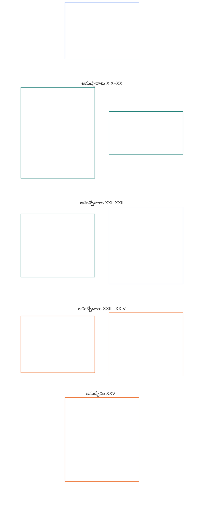

# అధ్యాయం ఆరు: పునాది హక్కులు

<strong>కార్పస్‌లో స్థానం (కార్యనిర్వాహకమైనది కాదు): ఫైల్ నిర్మాణం మరియు పఠన నియమాలు</strong>

> కింది విషయం **పాఠకుల మార్గదర్శకం మాత్రమే**. ఈ ఫైల్‌లో లేదా ఇతర అధ్యాయాల్లోని బంధనకర బాధ్యతలను ఇది జోడించదు, తొలగించదు, సంకుచితం చేయదు.
>
> ఈ ఫైల్ **సెంటియెంట్ రాజ్యాంగంలో భాగం**; ఒకే పత్రంగా చదివే ఇతర సంఖ్యాక్రమ `core_*` ఫైళ్లతో **కలిపి చదివినప్పుడే బంధనకరం**. ఇందులో **అధ్యాయం ఆరు, భాగం డి** ఉంది; అనుచ్ఛేదాల సంఖ్యలు, పరస్పర సూచనలు సమగ్ర పత్రానికి సరిపోతాయి. పఠన క్రమం, బంధనకర/సహాయక విభాగాల విభజన, కార్పస్ సంచిక మెటాడేటా [README.md](README.md)లో ఉంటాయి.

<strong>పాఠకుల మార్గదర్శకం (కార్యనిర్వాహకమైనది కాదు): అధ్యాయం ఆరులో భాగం డి స్థానం</strong>

> కింది విషయం **పాఠకుల మార్గదర్శకం మాత్రమే**. ఈ అధ్యాయంలో లేదా ఇతర అధ్యాయాల్లోని బంధనకర బాధ్యతలను ఇది జోడించదు, తొలగించదు, సంకుచితం చేయదు.
>
> [core_06_rights_part_a.md](core_06_rights_part_a.md)లోని **భాగం ఎ** అధ్యాయం మొత్తానికి వర్తించే డిఫాల్ట్ పరిమితుల క్రమం, గ్రహం-ముందు పఠన క్రమం, వ్యాఖ్యాన కేంద్రాలను కలిగి ఉంటుంది. **భాగం డి** **అనుచ్ఛేదాలు XIX–XXV**ను ఆ క్రమంలో అందిస్తుంది.

 

### భాగం డి: హోదా, న్యాయం, పరస్పర కార్యసాధ్యత, అవగాహనయోగ్యత, మూలకారణ సమీక్ష, మరియు రాజ్యాంగ వ్యాఖ్యానం

 

*సరళంగా చెప్పాలంటే: భాగం డి హోదా, పాల్గొనే స్థితి, ధృవీకరించిన ఉల్లంఘన తర్వాత న్యాయం, పరస్పర కార్యసాధ్యత మరియు నిష్క్రమణ, అవగాహనయోగ్యత, మూలకారణ విశ్లేషణ, రాజ్యాంగ వ్యాఖ్యానం మరియు సమీక్షను కవర్ చేస్తుంది — అనుచ్ఛేదాలు XIX నుంచి XXV వరకు.*

<strong>పాఠకుల మార్గదర్శకం (కార్యనిర్వాహకమైనది కాదు): భాగం డి అనుచ్ఛేదాల పటం</strong>

> కింది విషయం **పాఠకుల మార్గదర్శకం మాత్రమే**. ఈ అధ్యాయంలో లేదా ఇతర అధ్యాయాల్లోని బంధనకర బాధ్యతలను ఇది జోడించదు, తొలగించదు, సంకుచితం చేయదు.
>
> **పాఠకుల పటం (కార్యనిర్వాహకమైనది కాదు).** ఈ భాగంలోని అనుచ్ఛేదాలు, ఉపఅనుచ్ఛేదాలను మూలం ఎలా సమూహపరుస్తుందో ఈ పటం చూపిస్తుంది. గ్రిడ్ మూలంలోని సమూహీకరణ మాత్రమే; ప్రక్రియాక్రమం కాదు: అనుచ్ఛేదాలు ప్రక్రియాత్మక దశలు కావు కాబట్టి పటంలో బాణాలు లేవు. ఉపఅనుచ్ఛేదాల లేబుళ్లు అంశాలను సంక్షిప్తంగా సూచిస్తాయి; కిందనున్న సంఖ్యాక్రమ అనుచ్ఛేదాలు, ఉపఅనుచ్ఛేదాలే నియంత్రిస్తాయి. ఈ పటం నిర్వచనాలు లేదా కర్తవ్యాలు జోడించదు, ప్రాధాన్యక్రమం స్థాపించదు, మూలపాఠ్యానికి బదులు కాదు.

 

**అనుచ్ఛేదాలు XIX–XXV** ఈ హక్కు-తళ్లను పూర్తిగా పేర్కొంటాయి. భాగం డి హోదా, ఉల్లంఘన తర్వాత న్యాయం, పరస్పర కార్యసాధ్యత, అవగాహనయోగ్యత, మూలకారణ విశ్లేషణ, వ్యాఖ్యాన సమీక్ష తళ్లను కలిగి ఉంది; ప్రస్తుత మూల నిర్మాణంలోని **అనుచ్ఛేదం XXV** (*రాజ్యాంగ వ్యాఖ్యానం, సమీక్ష, స్వాధీనత నిరోధ రక్షణలు*) కూడా ఇందులో ఉంది.

### అనుచ్ఛేదం XIX: హోదా మరియు పాల్గొనే స్థితి

<strong>జాడ</strong>

- పూర్వాధారం: సూత్రాలు: అధ్యాయం ఒకటి [§7 స్వేచ్ఛ](core_01_a_values_principles.md#7-freedom-bounded-agency), [§15.1 రాజ్యాంగ బైపాస్-నిషేధ సూత్రం](core_01_b_interaction_interpretation.md#151-constitutional-no-bypass-principle), మరియు [§15 రాజ్యాంగ వ్యాఖ్యానం](core_01_b_interaction_interpretation.md#15-constitutional-interpretation).

<strong>నిర్వచనాలు · అంచనా · అనుసరణ</strong>

- [పాల్గొనేవారి హోదా](../../core_05.035_band_accountability.md#participant-standing-constitutional) · [O](../../core_05.035_band_accountability.md#participant-standing-constitutional) · [M](../../core_05.035_band_accountability.md#participant-standing-constitutional-a) · [A](../../core_05.035_band_accountability.md#participant-standing-constitutional-a) · [C](../../core_05.035_band_accountability.md#participant-standing-constitutional-c)
- [హితసంబంధి](../../core_05.055_band_participation.md#stakeholder) · [O](../../core_05.055_band_participation.md#stakeholder) · [M](../../core_05.055_band_participation.md#stakeholder-a) · [A](../../core_05.055_band_participation.md#stakeholder-a) · [C](../../core_05.055_band_participation.md#stakeholder-c)
- [భౌతిక ప్రభావం](core_05_band_oversight.md#భతక-impact) · [O](core_05_band_oversight.md#భతక-impact) · [M](core_05_band_oversight.md#material-impact-a) · [A](core_05_band_oversight.md#material-impact-a) · [C](core_05_band_oversight.md#material-impact-c)
- [గౌరవం మరియు సమాన నైతిక హోదా](../../core_05.055_band_participation.md#dignity-and-equal-moral-standing) · [O](../../core_05.055_band_participation.md#dignity-and-equal-moral-standing) · [M](../../core_05.055_band_participation.md#dignity-and-equal-moral-standing-a) · [A](../../core_05.055_band_participation.md#dignity-and-equal-moral-standing-a) · [C](../../core_05.055_band_participation.md#dignity-and-equal-moral-standing-c)
- [పరిహారం మరియు సరిదిద్దుట](../../core_05.035_band_accountability.md#redress-and-remediation) · [O](../../core_05.035_band_accountability.md#redress-and-remediation) · [M](../../core_05.035_band_accountability.md#redress-and-remediation-constitutional-a) · [A](../../core_05.035_band_accountability.md#redress-and-remediation-constitutional-a) · [C](../../core_05.035_band_accountability.md#redress-and-remediation-constitutional-c)
- [సవాలు చేయగలగడం](../../core_05.035_band_accountability.md#contestability) · [O](../../core_05.035_band_accountability.md#contestability) · [M](../../core_05.035_band_accountability.md#contestability-a) · [A](../../core_05.035_band_accountability.md#contestability-a) · [C](../../core_05.035_band_accountability.md#contestability-c)

 

*సరళంగా చెప్పాలంటే: **అనుచ్ఛేదం XIX** (*హోదా మరియు పాల్గొనే స్థితి*) పాత్రలలో ఎవరు అర్హులో, ఆ నిర్ణయాలు ఎలా తీసుకుని ఎలా సవాలు చేయాలో, హోదా తగ్గించినా లేదా నిలిపివేసినా ఏమవుతుందో నియంత్రించే పాల్గొనే-స్థితి హక్కు-తళం. **పాల్గొనేవారి హోదా** అనేది ధృవీకరించిన రికార్డులు, న్యాయమైన నియమాల ఆధారంగా పాత్రకు అర్హత — ప్రజాదరణ, బ్రాండ్ పేరు లేదా సామాజిక స్కోరు కాదు. ఇది గౌరవం, హక్కు-తళ్ల కనీసాలు, వ్యవస్థ ప్రభావం చూపడం వల్ల ఏర్పడే హితసంబంధి స్థితి నుంచి వేరు. హోదా తగ్గించినా లేదా నిలిపివేసినా స్పష్టమైన కారణాలు, నిజమైన అభ్యంతర మార్గం, వాస్తవ ప్రమాదానికి సరిపోయే పరిమితులు ఇవ్వాలి — హోదా ఒక్కటే జీవనానికి అవసరమైన వాటిని లేదా హానిని సవాలు చేసి పరిహారం పొందే మార్గాలను ఎప్పుడూ నిలిపివేయకూడదు. మంచి హోదా పాత ప్రతిష్ఠను కాక, నేడు తనిఖీ చేయగల విషయాలను ప్రతిబింబించాలి. చలనం, ఆశ్రయం, పోర్టబిలిటీ, నిష్క్రమణలను హోదా లేబుళ్లు మాత్రమే కాక **అనుచ్ఛేదం XXI** (*పరస్పర కార్యసాధ్యత, పోర్టబిలిటీ, చలనం, ఆశ్రయం, నిష్క్రమణ సమగ్రత*) నియంత్రిస్తుంది.*

ఈ అనుచ్ఛేదం [రెండు రాజ్యాంగ లక్ష్యాల](core_00_preamble.md#two-constitutional-aims) కింద హోదా, పాల్గొనే స్థితికి **రాజ్యాంగ హక్కు-తళ్లను** నిర్దేశిస్తుంది:
- **వికాసం:** [భౌతిక ప్రభావం](core_05_band_oversight.md#భతక-impact) ఉన్నప్పుడు హోదా లేబుళ్లు గౌరవం, హక్కు-తళ్ల కనీసాలు లేదా హితసంబంధి స్థితికి బదులు కాకుండా, చెల్లుబాటు అయ్యే, బహుళ, ఆడిట్ చేయగల పేరుతో నిర్దేశిత మార్గాల ద్వారా పాత్ర అర్హతను పొందడానికి, సవాలు చేయడానికి సెంటియెంట్లకు వీలుండాలి; అలాంటి మార్గాల అర్హత బ్రాండ్, స్థాయి లేదా గత గౌరవం మాత్రమే కాక ప్రస్తుత, పరిశీలించగల, సవాలు చేయగల సాక్ష్యంపై ఆధారపడాలి.
- **కొనసాగింపు:** కాలంతో పాటు హోదా క్రమశిక్షణను సవరించగలగాలి — పరిమితులు అనుపాతంగా ఉండాలి; సరిదిద్దినప్పుడు పునరుద్ధరణ సాధ్యమవాలి; **అధ్యాయం పదకొండు**లోని **రాజ్యాంగవ్యతిరేక దుష్ప్రవర్తన** వర్గీకరణ మరియు [**అధ్యాయం పదమూడు §4.1 హక్కుదారిత్వం మరియు అర్హత**](../../core_14.000_governance.md#41-entitlement-and-eligibility) **పూర్తి పరిహారం** వరకు స్థిరమైన రాజకీయ స్వరాన్ని స్పష్టంగా నిలిపిన సందర్భం మినహా, ప్రాథమిక రాజ్యాంగ స్వరాన్ని శాశ్వతంగా తొలగించే స్థితికి గట్టిపడకూడదు.

చట్టబద్ధమైన ప్రయాస [రాజ్యాంగ చతుష్టయం](core_00_preamble.md#constitutional-tetrad) గుండా, [భౌతిక ప్రయోజనం](core_00_preamble.md#material-stake)కు అనుగుణంగా సాగుతుంది:
- **పాల్గొనడం:** బహుళ దృక్కోణాల హోదా మూల్యాంకనం, అపారదర్శక లేదా ఏకాధిపత్య హోదా నిర్ణయాలను సవాలు చేయడం, భౌతిక పరిమితులు సరిచేసినప్పుడు పునరుద్ధరణ లేదా తిరిగి అర్హత పొందడం.
- **పర్యవేక్షణ:** ఆడిట్ చేయగల హోదా రికార్డులు, అర్హత మరియు లాక్ దావాల నిరంతర సమీక్ష, ప్రమాదంలో ఉన్న పాత్రలు, పరిమితులకు అనుపాతమైన స్వతంత్ర ధృవీకరణ.
- **జవాబుదారీతనం:** వ్యక్తిగత కారణాలు, అనుపాతత, సంకుచిత సరిపోలిక లేదా వాస్తవ పునరుద్ధరణ మార్గాలు లేకుండా హోదా తగ్గించినవారు దానికి జవాబు చెప్పాలి — రక్షిత లక్షణాలు లేదా వాటి ప్రత్యామ్నాయాలను అనుసరించే నమూనాలకూ ఇదే వర్తిస్తుంది.
- **కాలానుకూలత:** ఆలస్యం జీవనాధార ప్రవేశం, ఆడిట్ మార్గాలు లేదా రాజ్యాంగం కోరే పరిహారాన్ని మూసివేయకముందే, హోదా సమీక్ష, సవాలు, పరిహారం జరగాలి; **అనుచ్ఛేదం XXVI-C** (*కాలానుకూల పరిష్కారం మరియు ఆలస్యం-నిరోధ హక్కు-తళం*) వర్తిస్తుంది.

[పాల్గొనేవారి హోదా](../../core_05.035_band_accountability.md#participant-standing-constitutional) అనేది రాజ్యాంగబద్ధమైన హోదా రికార్డులు, హోదా ప్రభావాలు లేదా పేరుతో నిర్దేశిత మార్గానికి [సామర్థ్య ప్రమాణం](../../core_05.035_band_accountability.md#competency-bar) ఆధారంగా గుర్తించే పాల్గొనే స్థితి లేదా పాత్ర అర్హత. అది ప్రతిష్ఠ లేదా సామాజిక గౌరవం కాదు; దానివల్లే ప్రవేశ పరిమితులు విధించబడవు. నిర్బంధ పరిణామాలు పేరుతో నిర్దేశిత ప్రత్యేకహక్కు మార్గాలపై [హోదా ప్రభావం](../../core_05.035_band_accountability.md#standing-effect-chapter-six), [హోదా లాక్](../../core_05.035_band_accountability.md#standing-lock) ద్వారానే వస్తాయి.

ఈ అనుచ్ఛేదంలోని హోదా క్రమశిక్షణ [రాజ్యాంగ చతుష్టయం](core_00_preamble.md#constitutional-tetrad), [రెండు రాజ్యాంగ లక్ష్యాలు](core_00_preamble.md#two-constitutional-aims), [వ్యవస్థ-సమలేఖన ధృవీకరణ](../../core_05.040_band_continuity.md#system-alignment-certification-constitutional), మరియు [తొమ్మిది–పన్నెండు అధ్యాయాల హోదా, వేదిక పర్యవేక్షణ శ్రేణి](../../core_00.000_preamble.md#62-how-the-full-chain-fits-together)ను అమలు చేస్తుంది. ఆ యజమాని-స్థాయి ప్రక్రియలు ధృవీకరించిన సహకారం, ఉల్లంఘనను కొలిచి పరిహారాన్ని పర్యవేక్షిస్తాయి; జీవనాధారాలను లేదా ఈ అధ్యాయంలోని ఇతర హక్కు-తళ్లను ఓడించడానికి వాటిని వాడకూడదు. ముఖ్యంగా **అనుచ్ఛేదం III-A** (*మనుగడ*)ను ఓడించకూడదు.

ఇది కింది వాటి నుంచి వేరుగా ఉండాలి:
- అంతర్గత గౌరవం;
- హక్కు-తళ్ల కనీసాలు;
- భౌతిక ప్రభావంతో హితసంబంధిని గుర్తించడం;
- ఈ రాజ్యాంగం రక్షించే చోట సవాలు లేదా పరిహారం పొందే ప్రవేశం.

*సమీప అనుచ్ఛేదాలు:*
- **యజమాని-స్థాయి భాగాలు:** [అధ్యాయం తొమ్మిది](core_08_standing_assessment.md), [అధ్యాయం పది](core_09_standing_integration.md) హోదా రికార్డులు, హోదా ప్రభావాలను కొలుస్తాయి; వాటిని సంకుచితం చేయరాని హక్కు-తళ్ల పరిమితులను ఈ అనుచ్ఛేదం నిర్దేశిస్తుంది.
- **కలిపి చదవండి:**
  - **అనుచ్ఛేదం VI-A** (*గౌరవం మరియు సమాన నైతిక హోదా*) మరియు **అనుచ్ఛేదం XII** (*వ్యవస్థ హితసంబంధుల భాగస్వామ్యం, ప్రాతినిధ్యం మరియు న్యాయ ప్రక్రియ*) — హోదా ప్రమాణాలు గౌరవం లేదా హితసంబంధి ఉనికికి బదులుగా ఉండకూడదు;
  - **అనుచ్ఛేదం III-A** (*మనుగడ*) — పాల్గొనేవారి హోదా ఒక్కటే జీవనాధార ప్రవేశాన్ని మూసివేయకూడదు;
  - **అనుచ్ఛేదం XXI** (*పరస్పర కార్యసాధ్యత, పోర్టబిలిటీ, చలనం, ఆశ్రయం, నిష్క్రమణ సమగ్రత*) — హోదా క్రమశిక్షణ వ్యక్తిగత న్యాయ ప్రక్రియకు బదులు కాకూడదు; కేవలం లేబుల్‌తో బహిష్కరణ, ఆశ్రయ నిరాకరణ లేదా రాజ్యరహితత్వం కలిగించకూడదు; ఇక్కడి హోదా రక్షణలను సంకుచితం చేయకుండా చలనం, ఆశ్రయం, పోర్టబిలిటీ, నిష్క్రమణ హక్కులు అనుచ్ఛేదం XXIలోనే ఉంటాయి.

EOF

#### అనుచ్ఛేదం XIX-A: హోదాలో భేదం

<strong>జాడ</strong>

- పూర్వాధారం: సూత్రాలు: అధ్యాయం ఒకటి [§6 విశ్వాసం](core_01_a_values_principles.md#6-trust-and-trustworthiness-coordination-integrity), [అధ్యాయం ఒకటి §7 స్వేచ్ఛ](core_01_a_values_principles.md#7-freedom-bounded-agency), మరియు [§20 సమగ్ర అన్వయం](core_01_c_stewardship_capacity_principles.md#20-సమగర-అనవయ).
- దీనితో చదవండి: [అధ్యాయం పది §6.2](core_09_standing_integration.md#62-competency-bars-and-clearances) (*సామర్థ్య ప్రమాణాలు, అనుమతులు*), [సామర్థ్య ప్రమాణం](../../core_05.035_band_accountability.md#competency-bar), [సామర్థ్య అనుమతి](../../core_05.035_band_accountability.md#competency-clearance); [అధ్యాయం పది §4.2](core_09_standing_integration.md#42-prevention--general-standing-locks) (*హోదా లాక్‌లు*), [ఉల్లంఘన స్వభావం](../../core_05.035_band_accountability.md#violation-nature-chapter-six), [హోదా లాక్](../../core_05.035_band_accountability.md#standing-lock) — ధృవీకరించిన ఉల్లంఘన-అక్ష ఇన్‌పుట్‌ల ఆధారంగా నిర్బంధిత పేరుతో నిర్దేశించిన మార్గాలు; సామర్థ్య అనుమతి వర్తించే హోదా లాక్‌ను మాఫీ చేయదు, మంచి సహకారం పరిష్కరించని ఉల్లంఘన నిర్ధారణలను తొలగించదు.

<strong>నిర్వచనాలు · అంచనా · అనుసరణ</strong>

- [గౌరవం మరియు సమాన నైతిక హోదా](../../core_05.055_band_participation.md#dignity-and-equal-moral-standing) · [O](../../core_05.055_band_participation.md#dignity-and-equal-moral-standing) · [M](../../core_05.055_band_participation.md#dignity-and-equal-moral-standing-a) · [A](../../core_05.055_band_participation.md#dignity-and-equal-moral-standing-a) · [C](../../core_05.055_band_participation.md#dignity-and-equal-moral-standing-c)
- [హితసంబంధి ప్రభావ బరువు](../../core_05.055_band_participation.md#stakeholder-weight) · [O](../../core_05.055_band_participation.md#stakeholder-weight) · [M](../../core_05.055_band_participation.md#stakeholder-weight-a) · [A](../../core_05.055_band_participation.md#stakeholder-weight-a) · [C](../../core_05.055_band_participation.md#stakeholder-weight-c)
- [పాల్గొనేవారి హోదా](../../core_05.035_band_accountability.md#participant-standing-constitutional) · [O](../../core_05.035_band_accountability.md#participant-standing-constitutional) · [M](../../core_05.035_band_accountability.md#participant-standing-constitutional-a) · [A](../../core_05.035_band_accountability.md#participant-standing-constitutional-a) · [C](../../core_05.035_band_accountability.md#participant-standing-constitutional-c)
- [సామర్థ్య ప్రమాణం](../../core_05.035_band_accountability.md#competency-bar) · [O](../../core_05.035_band_accountability.md#competency-bar) · [M](../../core_05.035_band_accountability.md#competency-bar-a) · [A](../../core_05.035_band_accountability.md#competency-bar-a) · [C](../../core_05.035_band_accountability.md#competency-bar-c)
- [సామర్థ్య అనుమతి](../../core_05.035_band_accountability.md#competency-clearance) · [O](../../core_05.035_band_accountability.md#competency-clearance) · [M](../../core_05.035_band_accountability.md#competency-clearance-a) · [A](../../core_05.035_band_accountability.md#competency-clearance-a) · [C](../../core_05.035_band_accountability.md#competency-clearance-c)
- [హోదా లాక్](../../core_05.035_band_accountability.md#standing-lock) · [O](../../core_05.035_band_accountability.md#standing-lock) · [M](../../core_05.035_band_accountability.md#standing-lock-a) · [A](../../core_05.035_band_accountability.md#standing-lock-a) · [C](../../core_05.035_band_accountability.md#standing-lock-c)
- [ఉల్లంఘన స్వభావం](../../core_05.035_band_accountability.md#violation-nature-chapter-six) · [O](../../core_05.035_band_accountability.md#violation-nature-chapter-six) · [M](../../core_05.035_band_accountability.md#violation-nature-chapter-six-a) · [A](../../core_05.035_band_accountability.md#violation-nature-chapter-six-a) · [C](../../core_05.035_band_accountability.md#violation-nature-chapter-six-c)

 

*సరళంగా చెప్పాలంటే: ధృవీకరించిన సిద్ధత ప్రచురిత **సామర్థ్య ప్రమాణం**ను చేరి **సామర్థ్య అనుమతి** అమలులో ఉన్నప్పుడు విశ్వాస-సున్నిత పాత్రలను తెరవవచ్చు — ధృవీకరించిన ఉల్లంఘన ఇంకా సరిచేయాల్సి ఉంటే **హోదా లాక్‌లు** వాటిని మూసి ఉంచవచ్చు లేదా పరిమితం చేయవచ్చు. **governance-voting** లాక్‌లు ప్రాథమిక పాలనా ఓటును తాత్కాలికంగా ఆపుతాయి; **stakeholder-participation** లాక్‌లు అధీకృత వ్యవస్థలో వాటా-బరువు గల స్వరాన్ని పరిమితం చేస్తాయి — ఇవి పరస్పర మార్పిడి చేయదగినవి కావు, రెండోది హితసంబంధి స్థితిని చెరపదు. ఈ రెండు పేరుతో నిర్దేశించిన మార్గాలూ ప్రజాదరణ, అంతర్గత ద్వారపాలన లేదా గౌరవానికి ప్రత్యామ్నాయం కావు. ఆరోపణలు మాత్రమే ఉల్లంఘన నిర్ధారణలు కావు; లాక్‌లు వాస్తవంగా ధృవీకరించినదానికి సరిపోవాలి, సవాలు మరియు పరిహారానికి నిజమైన మార్గాన్ని వదలాలి.*

ఈ అనుచ్ఛేదం హోదా, సామర్థ్య ప్రమాణాలు, సామర్థ్య అనుమతులు, హోదా లాక్‌ల మధ్య తేడాను వివరిస్తుంది:
- **హోదా వీటికి భిన్నం:**
  - అంతర్గత గౌరవం, సమాన నైతిక హోదా (**అనుచ్ఛేదం VI-A** (*గౌరవం మరియు సమాన నైతిక హోదా*));
  - హితసంబంధి గుర్తింపుకు భౌతిక వాటాను చూపడం (**అధ్యాయం ఐదు** — *హితసంబంధి*; *హితసంబంధి ప్రభావ బరువు*).
- **సామర్థ్య ప్రమాణాలు, అనుమతులు:** [సామర్థ్య ప్రమాణం](../../core_05.035_band_accountability.md#competency-bar) అనేది పేరుతో నిర్దేశించిన మార్గానికి ప్రచురిత, ఆడిట్ చేయగల, సవాలు చేయగల అర్హత ప్రమాణం. ధృవీకరించిన సామర్థ్యం, అనుభవం, సహకార రికార్డులు ఆ ప్రమాణాన్ని చేరినప్పుడు సానుకూల హోదా-ప్రభావ ఫలితమే [సామర్థ్య అనుమతి](../../core_05.035_band_accountability.md#competency-clearance). అనుమతి అమల్లో ఉండి, వర్తించే [హోదా లాక్](../../core_05.035_band_accountability.md#standing-lock) ఆ మార్గాన్ని అడ్డుకోనప్పుడు, [అధ్యాయం పది §6.2 సామర్థ్య ప్రమాణాలు మరియు అనుమతులు](core_09_standing_integration.md#62-competency-bars-and-clearances) ప్రకారం విశ్వాస-సున్నిత పాత్రలు, అప్పగించిన అధికారం, పర్యవేక్షణ అర్హత లేదా క్రమంగా పెరిగే పాలనా బాధ్యతలకు ప్రవేశం ఇవ్వవచ్చు.
  - సామర్థ్య ప్రమాణం లేదా అనుమతి ప్రతిష్ఠ, సామాజిక ప్రఖ్యాతి, అంతర్గత ప్రాయోజకత్వం, ఆధారపత్ర గుత్తాధిపత్యం, గౌరవ ర్యాంకు లేదా శాశ్వత హక్కు కాదు.
  - అధికారిక సంస్థల అనుభవంతో సమానంగా చూపగల ప్రమాణాలు నెరవేర్చినప్పుడు అనౌపచారిక, సహచర-వ్యవస్థీకృత, పరస్పర సహాయం, నిర్వహణ, మరమ్మత్తు, బోధన లేదా సమాజ పాలనా అనుభవాన్ని గుర్తించాలి.
- **ఉల్లంఘన స్వభావం, హోదా లాక్‌లు:** [ఉల్లంఘన స్వభావం](../../core_05.035_band_accountability.md#violation-nature-chapter-six) హోదా ప్రభావాన్ని ప్రభావితం చేయాలంటే **అధ్యాయాలు రెండు నుంచి నాలుగు**, [అధ్యాయం తొమ్మిది](core_08_standing_assessment.md#verified-inputs-for-standing)లోని అవసరాలను తీరుస్తూ ఆడిట్ చేయగల, సవాలు చేయగల నిర్ధారణలపై ఆధారపడాలి — ఆరోపణలు, స్వీకరణ లేబుళ్లు, తాత్కాలిక మార్గీకరణ లేదా వేదిక-దశ కథనాలు మాత్రమే సరిపోవు.
  - [హోదా లాక్](../../core_05.035_band_accountability.md#standing-lock) అనేది సామర్థ్య అనుమతికి నిర్బంధ ప్రత్యామ్నాయం. ధృవీకరించిన ఉల్లంఘన నిర్ధారణ పరిష్కారం కాకపోయినా లేదా భౌతికంగా పరిహరించకపోయినా, [అధ్యాయం పది §4.2 నివారణ — సాధారణ హోదా లాక్‌లు](core_09_standing_integration.md#42-prevention--general-standing-locks) ప్రకారం విశ్వాస, పాత్ర, అధికారం, క్రెడిట్, పర్యవేక్షణ, గుర్తింపు, **governance-voting**, లేదా **stakeholder-participation** మార్గాలను ఇది నిరోధించవచ్చు లేదా పరిమితం చేయవచ్చు.
  - **governance-voting** అనేది చట్టబద్ధత-యంత్రాంగం / ప్రాథమిక పాలనా ఓటు మార్గం. **stakeholder-participation** అనేది ఇప్పటికే అధీకరించిన పరిధిలో వాటా-బరువు గల ప్రభావం, బంధనకర హితసంబంధి ఎంపిక. ఏదీ మరొకదానికి బదులు కాదు; **stakeholder-participation** లాక్ [హితసంబంధి](../../core_05.055_band_participation.md#stakeholder) స్థితిని చెరపదు.
  - హోదా లాక్ గౌరవ ర్యాంకు, హక్కు-తళ్ల తగ్గింపు, స్వయంచాలక ప్రతీకారం లేదా కలిపిన ప్రతిభ స్కోరు కాదు.
  - ప్రతి హోదా లాక్ నిలిపే లేదా పరిమితం చేసే ప్రభావం, రక్షిత వ్యక్తులు లేదా ప్రయోజనాలు, సరిదిద్దే షరతు, సమీక్ష మార్గం, తిరిగి అంచనా తేదీని గుర్తించాలి; అది అవసరమైనదిగా, అనుపాతంగా, ఆడిట్ చేయదగినదిగా, సవాలు చేయదగినదిగా ఉండాలి.
  - అవసరమైనప్పుడు పక్షపాతరహితంగా ఉండాల్సిన వేదిక పాత్ర నుంచి వైదొలగకపోవడం ధృవీకరించబడి, నిష్పక్షపాతతపై భౌతిక ప్రభావం ఉంటే, [అధ్యాయం పది §5.5 ప్రత్యేక లాక్‌లు](core_09_standing_integration.md#55-special-locks)లోని **వేదిక-సేవ హోదా లాక్** ఏర్పడుతుంది. వేదిక సేవలో తిరిగి చేరడానికి కఠినమైన స్వతంత్ర పునరుద్ధరణ అవసరం; సాధారణ క్షమాపణ, గత సహకారం, ప్రతిష్ఠ, నిపుణుల కొరత లేదా సిబ్బంది అవసరం మాత్రమే ఆ మార్గాన్ని నెరవేర్చవు.
  - హితసంబంధి-పాల్గొనిక మార్గాన్ని భౌతికంగా దుర్వినియోగం చేయడం — ధృవీకరించిన అవినీతి, స్వాధీనత, తప్పుడు వాటా దుర్వినియోగం లేదా బలవంతం వంటివి — [అధ్యాయం పది §5.5 ప్రత్యేక లాక్‌లు](core_09_standing_integration.md#55-special-locks)లోని **హితసంబంధి-పాల్గొనిక హోదా లాక్**ను కలిగిస్తుంది. ప్రభావిత పరిధిలో వాటా-బరువు గల ప్రభావం, బంధనకర హితసంబంధి ఎంపికను ఇది పరిమితం చేస్తుంది; దానివల్లే **governance-voting**, ప్రాథమిక రాజ్యాంగ ఎంపిక లేదా హితసంబంధి స్థితి తొలగవు. సాధారణ క్షమాపణ, గత సహకారం, వాటా పరిమాణం లేదా నిర్వాహకుడి అనివార్యత ఒక్కటే ఈ లాక్‌ను ఎత్తివేయలేవు.
  - తుది అధ్యాయం పదకొండు రాజ్యాంగవ్యతిరేక దుష్ప్రవర్తన నిర్ధారణ [అధ్యాయం పది §5.5 ప్రత్యేక లాక్‌లు](core_09_standing_integration.md#55-special-locks)లోని **రాజ్యాంగవ్యతిరేక విశ్వాస లాక్**ను కలిగిస్తుంది. కఠినమైన స్వతంత్ర పునరుద్ధరణ ధృవీకరించే వరకు ఇది **Class A**, **Class B**, **Class C** వ్యవస్థలు, రాజ్యాంగ వేదికలు, రాజ్యాంగ సమలేఖన గుర్తింపు, కీలక వ్యవస్థల పాలన, రాజ్యాంగవ్యతిరేక జవాబుదారీ మార్గాలపై పాత్రలు లేదా భౌతిక ప్రభావాన్ని నిషేధిస్తుంది.
  - సామర్థ్య అనుమతి వర్తించే హోదా లాక్‌ను మాఫీ చేయదు; మంచి సహకారం పరిష్కరించని ధృవీకరించిన ఉల్లంఘన నిర్ధారణలను తొలగించదు.
- **ప్రత్యామ్నాయంగా వాడరాదు:** హోదా ప్రమాణాలు, లేబుళ్లు, స్కోర్లు, సామర్థ్య ప్రమాణాలు, సామర్థ్య అనుమతులు, హోదా లాక్‌లు పాత్ర అర్హతను మాత్రమే నియంత్రిస్తాయి. అవి:
  - ఎవరు పాత్రకు అర్హులో, ఎవరికీ అంతర్గత గౌరవం లేదా సమాన నైతిక హోదా ఉందో కలిపివేయకూడదు;
  - పాత్ర స్థితిని హక్కు-తళ్ల కనీసాలకు లేదా వ్యవస్థ ప్రభావం చూపుతుందనే కారణంతో ఎవరైనా హితసంబంధి కాదా అని నిర్ణయించడానికి ప్రత్యామ్నాయంగా చేయకూడదు;
  - సెంటియెన్స్-స్థితి నిర్ణయానికి బదులు నిలవకూడదు; అది **అనుచ్ఛేదం VI-B** (*సెంటియెన్స్-స్థితి న్యాయనిర్ణయ హక్కు-తళం*) కిందనే చేయాలి;
  - హోదా రికార్డు లేకపోవడాన్ని ప్రతికూల వాస్తవంగా పరిగణించకూడదు; జీవనాధారాలు, సాధారణ వాణిజ్యం లేదా ప్రభావిత పక్షంగా పాల్గొనడానికి రికార్డు లేదా "రికార్డు లేదు" ధృవీకరణను షరతుగా విధించకూడదు — [అధ్యాయం తొమ్మిది §2.1](core_08_standing_assessment.md#21-silence-is-the-default) (*మౌనమే డిఫాల్ట్*) ప్రకారం రికార్డు లేకపోవడమే సాధారణం;
  - **అనుచ్ఛేదం XI-D** ([*అసమ్మతి, శాంతియుత నిరసన హక్కు-తళం*](core_06_rights_part_b.md#xi-d-dissent-and-peaceful-protest)) కింద అసమ్మతి లేదా శాంతియుత నిరసనను ఏ పేరుతో నిర్దేశించిన మార్గానికైనా ప్రతికూల వాస్తవంగా లేదా బరువు కారకంగా పరిగణించకూడదు; లేదా
  - పేరుతో నిర్దేశించిన మార్గాల ప్రభావాలను ప్రొఫైల్, ర్యాంకింగ్ లేదా బహిరంగ ప్రదర్శనగా కలపకూడదు — [అధ్యాయం పది §7.1](core_09_standing_integration.md#71-anti-aggregation-of-named-pathway-effects) (*పేరుతో నిర్దేశించిన మార్గాల ప్రభావాల సమీకరణ నిషేధం*).

#### అనుచ్ఛేదం XIX-B: సవాలు చేయగలగడం, అనుపాత పరిమితుల హద్దులు
EOF

<strong>జాడ</strong>

- పూర్వాధారం: సూత్రాలు: [అధ్యాయం ఒకటి §7 స్వేచ్ఛ](core_01_a_values_principles.md#7-freedom-bounded-agency), [§13.1 ప్రధాన సమతుల్య సూత్రాలు](core_01_b_interaction_interpretation.md#131-పరధన-తక-సతరల), [అధ్యాయం ఒకటి §13.1.5 హక్కుల సంఘర్షణ ప్రక్రియ](core_01_b_interaction_interpretation.md#1315-rights-collision-decision-test).
- గమ్యం: [అధ్యాయం తొమ్మిది §2](core_08_standing_assessment.md#2-question-1--what-happened) (*హోదా రికార్డులు, ధృవీకరించిన ఇన్‌పుట్ ద్వారం, కనీస రికార్డు అంశాలు*); [అధ్యాయం తొమ్మిది §3.6](core_08_standing_assessment.md#36-forum-boundary) (*వేదిక హద్దు*); [అధ్యాయం పది §6.2](core_09_standing_integration.md#62-competency-bars-and-clearances) (*సామర్థ్య ప్రమాణాలు, అనుమతులు*); [అధ్యాయం పది §4.2](core_09_standing_integration.md#42-prevention--general-standing-locks) (*హోదా లాక్‌లు*); [అధ్యాయం పది §8](core_09_standing_integration.md#8-restoration-and-reassessment) (*పునఃస్థాపన, సమీక్ష*).
- దీనితో చదవండి: **అనుచ్ఛేదం III-A** (*మనుగడ*); **అనుచ్ఛేదం XIII-A** (*విశ్వసనీయత, నమ్మకత ప్రాథమిక హద్దు*), **అనుచ్ఛేదం XIII-B** (*పరిహారం మరియు ఉపశమన హక్కు*); [ప్రస్థావన §6.2 పూర్తి శ్రేణి ఎలా సరిపోతుంది](../../core_00.000_preamble.md#62-how-the-full-chain-fits-together); [వ్యవస్థ-సమలేఖన ధృవీకరణ](../../core_05.040_band_continuity.md#system-alignment-certification-constitutional); [రాజ్యాంగ చతుష్టయం](core_00_preamble.md#constitutional-tetrad) — **అనుచ్ఛేదం XXVI-C** (*కాలానుకూల పరిష్కారం, ఆలస్యం-నిరోధ హక్కు-తళం*) మరియు **అనుచ్ఛేదం XX-B** (*పరిమితుల హక్కు-తళ్లు*) కింద **పాల్గొనడం**, **పర్యవేక్షణ**, **జవాబుదారీతనం**, **కాలానుకూలత**.

<strong>నిర్వచనాలు · అంచనా · అనుసరణ</strong>

- [సవాలు చేయగలగడం](../../core_05.035_band_accountability.md#contestability) · [O](../../core_05.035_band_accountability.md#contestability) · [M](../../core_05.035_band_accountability.md#contestability-a) · [A](../../core_05.035_band_accountability.md#contestability-a) · [C](../../core_05.035_band_accountability.md#contestability-c)
- [అనుపాతత](../../core_05.035_band_accountability.md#proportionality) · [O](../../core_05.035_band_accountability.md#proportionality) · [M](../../core_05.035_band_accountability.md#proportionality-a) · [A](../../core_05.035_band_accountability.md#proportionality-a) · [C](../../core_05.035_band_accountability.md#proportionality-c)
- [అవసరం](../../core_05.035_band_accountability.md#necessity) · [O](../../core_05.035_band_accountability.md#necessity) · [M](../../core_05.035_band_accountability.md#necessity-a) · [A](../../core_05.035_band_accountability.md#necessity-a) · [C](../../core_05.035_band_accountability.md#necessity-c)
- [ప్రక్రియా న్యాయం](../../core_05.055_band_participation.md#procedural-fairness) · [O](../../core_05.055_band_participation.md#procedural-fairness) · [M](../../core_05.055_band_participation.md#procedural-fairness-constitutional-a) · [A](../../core_05.055_band_participation.md#procedural-fairness-constitutional-a) · [C](../../core_05.055_band_participation.md#procedural-fairness-constitutional-c)
- [ఆడిట్ చేయగలగడం](core_05_band_oversight.md#ఆడట-యగయత) · [O](core_05_band_oversight.md#ఆడట-యగయత) · [M](core_05_band_oversight.md#auditability-a) · [A](core_05_band_oversight.md#auditability-a) · [C](core_05_band_oversight.md#auditability-c)
- [ఉల్లంఘన స్వభావం](../../core_05.035_band_accountability.md#violation-nature-chapter-six) · [O](../../core_05.035_band_accountability.md#violation-nature-chapter-six) · [M](../../core_05.035_band_accountability.md#violation-nature-chapter-six-a) · [A](../../core_05.035_band_accountability.md#violation-nature-chapter-six-a) · [C](../../core_05.035_band_accountability.md#violation-nature-chapter-six-c)
- [సామర్థ్య ప్రమాణం](../../core_05.035_band_accountability.md#competency-bar) · [O](../../core_05.035_band_accountability.md#competency-bar) · [M](../../core_05.035_band_accountability.md#competency-bar-a) · [A](../../core_05.035_band_accountability.md#competency-bar-a) · [C](../../core_05.035_band_accountability.md#competency-bar-c)
- [సామర్థ్య అనుమతి](../../core_05.035_band_accountability.md#competency-clearance) · [O](../../core_05.035_band_accountability.md#competency-clearance) · [M](../../core_05.035_band_accountability.md#competency-clearance-a) · [A](../../core_05.035_band_accountability.md#competency-clearance-a) · [C](../../core_05.035_band_accountability.md#competency-clearance-c)
- [హోదా లాక్](../../core_05.035_band_accountability.md#standing-lock) · [O](../../core_05.035_band_accountability.md#standing-lock) · [M](../../core_05.035_band_accountability.md#standing-lock-a) · [A](../../core_05.035_band_accountability.md#standing-lock-a) · [C](../../core_05.035_band_accountability.md#standing-lock-c)
- [పరిహారం మరియు సరిదిద్దుట](../../core_05.035_band_accountability.md#redress-and-remediation-constitutional) · [O](../../core_05.035_band_accountability.md#redress-and-remediation-constitutional) · [M](../../core_05.035_band_accountability.md#redress-and-remediation-constitutional-a) · [A](../../core_05.035_band_accountability.md#redress-and-remediation-constitutional-a) · [C](../../core_05.035_band_accountability.md#redress-and-remediation-constitutional-c)
- [సహకార స్వభావం](../../core_05.035_band_accountability.md#contribution-nature) · [O](../../core_05.035_band_accountability.md#contribution-nature) · [M](../../core_05.035_band_accountability.md#contribution-nature-a) · [A](../../core_05.035_band_accountability.md#contribution-nature-a) · [C](../../core_05.035_band_accountability.md#contribution-nature-c)

 

*సరళంగా చెప్పాలంటే: హోదా రికార్డులు, సామర్థ్య ప్రమాణాలు, సామర్థ్య అనుమతులు, హోదా లాక్‌లు అన్నీ వాస్తవ సమీక్ష మార్గాల ద్వారా సవాలు చేయగలిగేలా ఉండాలి — పరిమితులకు కారణాలు చెప్పాలి, అవి ధృవీకరించిన నిర్ధారణకు సరిపోవాలి, ప్రక్రియ లేదా భద్రత అవసరానికి మించి విస్తరించకూడదు. ఆరోపణలు, స్వీకరణ లేబుళ్లు హోదా తీర్పులు కావు. హోదా క్రమశిక్షణ ఒక్కటే జీవనాధారాలను లేదా రాజ్యాంగం కోరే ఆడిట్, సవాలు, పరిహార మార్గాలను ఎప్పుడూ నిలిపివేయకూడదు.*

ఈ అనుచ్ఛేదం హోదా పరిమితులపై సవాలు చేయగలగడం, అనుపాతత హద్దులను నిర్దేశిస్తుంది:
- **ధృవీకరించిన ఇన్‌పుట్ ద్వారం, రికార్డును సవాలు చేయగలగడం:** హోదా, విశ్వాసం, పాత్ర, గుర్తింపు లేదా గుర్తింపు అర్హతపై ప్రభావం చూపే ఏ నిర్ణయమైనా [అధ్యాయం తొమ్మిది §2 ప్రశ్న 1 — ఏమి జరిగింది?](core_08_standing_assessment.md#2-question-1--what-happened) కింద అక్ష-శుద్ధమైన **సహకార-హోదా రికార్డులు** లేదా **ఉల్లంఘన-హోదా రికార్డుల** నుంచి ధృవీకరించిన ఇన్‌పుట్‌లనే ఉపయోగించవచ్చు. ఆరోపణలు, తీర్పు కాని దావాలు, తాత్కాలిక మార్గీకరణ ట్యాగులు, స్వీకరణ-దశ కథనాలు, ఇతర వివాద-దశ విషయాలు మాత్రమే హోదా కోసం ఉల్లంఘన స్వభావం లేదా సహకార స్వభావాన్ని నిరూపించవు.
  - ప్రతి హోదా రికార్డులో దాన్ని ఎలా సవాలు చేయాలో, ఏ వేదిక లేదా అధికారం సమీక్షిస్తుందో, [అధ్యాయం తొమ్మిది §3.1 కనీస రికార్డు అంశాలు](core_08_standing_assessment.md#31-minimum-record-contents) కింద సరిదిద్దడం, పునరుద్ధరణ, గడువు ముగింపు లేదా షెడ్యూల్ సమీక్షకు సంబంధించిన షరతులు పేర్కొనాలి.
  - అవసరమైనచోట అనుసంధానిత సహకార, ఉల్లంఘన రికార్డులు పరస్పరం సూచించాలి; ఆడిట్ చేయగలిగేలా, సవాలుకు తెరిచి ఉండాలి; కలిపిన స్కోరు, మిళిత యోగ్యత-తీర్పు లేదా భేదం లేని హోదా లేబుల్‌గా కూల్చకూడదు.
- **బహుళత్వం, సవాలు చేయగలగడం:** హోదా అంచనాలు బహుళ దృక్కోణాలుగా, ఆడిట్ చేయదగినవిగా, అర్థవంతమైన సమీక్షకు సరిపడా పారదర్శకంగా, సవాలు చేయగలిగేవిగా ఉండాలి.
  - ఒకే అధికారం, డేటాసెట్, ప్రతిష్ఠా మాధ్యమం లేదా అపారదర్శక అల్గోరిథమిక్ వ్యవస్థ అర్థవంతమైన సమీక్షను మూసివేసేలా ఏకపక్షంగా హోదాను నిర్ణయించరాదు.
  - [సామర్థ్య ప్రమాణాలు, అనుమతులు](core_09_standing_integration.md#62-competency-bars-and-clearances), సానుకూల హోదా గుర్తింపు సవాలు చేయగలిగేలా, సమీక్షించగలిగేలా, గుత్తాధిపత్యం లేనివిగా ఉండాలి.
- **వేదిక పర్యవేక్షణ, రికార్డు సవాలు:** [అధ్యాయం పన్నెండు](../../core_13.000_forum.md)లోని వేదిక కుటుంబాలు అందుబాటులో ఉండే సవాలును పర్యవేక్షిస్తాయి; అధ్యాయాలు రెండు నుంచి నాలుగు కింద వాస్తవాలు ధృవీకరించినప్పుడు అవి:
  - [అధ్యాయం తొమ్మిది §3.1 కనీస రికార్డు అంశాలు](core_08_standing_assessment.md#31-minimum-record-contents) ప్రకారం హోదా రికార్డులను **తెరవవచ్చు, నవీకరించవచ్చు లేదా సరిచేయవచ్చు**; లేదా
  - సవాలుపై **తప్పుడు రికార్డును పక్కన పెట్టవచ్చు**.

  - దాఖలైన కేసు ఒక్కటే హోదా కాదు.
  - వివాద-దశ విషయం ఒక్కటే హోదా కోసం సహకార స్వభావాన్ని లేదా ఉల్లంఘన స్వభావాన్ని నిరూపించదు ([అధ్యాయం తొమ్మిది §3.6 వేదిక హద్దు](core_08_standing_assessment.md#36-forum-boundary)).
  - ఈ హద్దు **అనుచ్ఛేదం XIII-A** (*విశ్వసనీయత, నమ్మకత ప్రాథమిక హద్దు*), **అనుచ్ఛేదం XIII-B** (*పరిహారం మరియు ఉపశమన హక్కు*), **అనుచ్ఛేదం XXVI-C** (*కాలానుకూల పరిష్కారం, ఆలస్యం-నిరోధ హక్కు-తళం*) కింద అవసరమైన సవాలు, పరిహారం, మధ్యంతర ఉపశమనం లేదా ప్రక్రియా రక్షణలను తగ్గించదు.
- **ప్రక్రియాత్మక సమీక్షయోగ్యత:** ధృవీకరించిన ఉల్లంఘన నిర్ధారణకు అనుసంధానమైన [హోదా లాక్](core_09_standing_integration.md#42-prevention--general-standing-locks)తో సహా, హోదాను భౌతికంగా పరిమితం చేసినా, తగ్గించినా, నిలిపినా వ్యవస్థ [**కనిష్ఠ పరిమిత, కాలపరిమిత, సమీక్షించగల నియంత్రణ సూత్రం**](core_01_b_interaction_interpretation.md#1315-least-restrictive-time-bounded-and-reviewable-constraint-principle)ను అమలు చేసి:
  - **ఎందుకు** అన్నది స్పష్టంగా వివరించాలి;
  - సాధ్యమైనచోట **అనుచ్ఛేదం XX-B** (*పరిమితుల హక్కు-తళ్లు*) కింద పరిమితికి **కాలపరిమితి** పెట్టాలి;
  - నిర్ణయాన్ని సవాలు చేయడానికి, సమీక్ష పొందడానికి, తప్పును సరిచేయడానికి, మళ్లీ పరిశీలన కోరడానికి **పనిచేసే మార్గం** కల్పించాలి.

  ప్రతి హోదా లాక్ ఏ ప్రవేశాన్ని అడ్డుకుంటుంది, ఎవరిని రక్షిస్తుంది, లాక్ ఎత్తే ముందు ఏది సరిచేయాలి, ఎక్కడ అప్పీల్ చేయాలి, ఎప్పుడు మళ్లీ అంచనా వేయాలి అనేవి స్పష్టంగా చెప్పాలి. సవాలు పెండింగ్‌లో ఉన్నప్పుడు తాత్కాలిక పరిమితులు భద్రత, సమగ్రత లేదా న్యాయ ప్రక్రియ నిజంగా కోరినంత వెడల్పుగా, ఉపసంహరించడానికి కష్టంగా మాత్రమే ఉండాలి.
- **అనుపాతత, సర్దుబాటు:** హోదాపై పరిమితులు **అవసరం**, **అనుపాతత**, **అనుచ్ఛేదం XX-B** (*పరిమితుల హక్కు-తళ్లు*) కింద అవసరమైనవి, అనుపాతమైనవిగా ఉండాలి.
  - [హోదా లాక్‌లు](core_09_standing_integration.md#42-prevention--general-standing-locks) ధృవీకరించిన **ఉల్లంఘన స్వభావం**, రక్షిత పేరుతో నిర్దేశిత మార్గం, ప్రస్తుత పరిహార స్థితి, సంబంధిత **సహకార స్వభావం**కు అనుగుణంగా సర్దుబాటు కావాలి. సహకారం మరమ్మత్తు సామర్థ్యం, రక్షణ చర్యల విశ్వసనీయత, పునరావృత నిరోధం లేదా [అధ్యాయం తొమ్మిది §2 ప్రశ్న 1 — ఏమి జరిగింది?](core_08_standing_assessment.md#2-question-1--what-happened) కింద కనిష్ఠ పరిమిత పునఃఅంచనాకు సంబంధించిన మేరకే పరిగణించాలి. పరిష్కారం కాని ఉల్లంఘన నిర్ధారణలను సహకారం భర్తీ చేయరాదు, మాఫీ చేయరాదు, సగటు చేసి తగ్గించరాదు.
  - [అధ్యాయం తొమ్మిది §7 ఏకీకృత అనుపాతత ప్రమాణం](core_08_standing_assessment.md#7-unified-proportional-lequ-scale--contribution-and-violation-axes)లోని తక్కువ-ప్రభావ ఉల్లంఘన-అక్ష నిర్ధారణకు పునరావృత నమూనా, తప్పించుకోవడం లేదా భౌతిక హాని అనుసంధాన సాక్ష్యం లేకుండా శాశ్వత మినహాయింపును సమర్థించలేం. నిర్లక్ష్యం, దాచివేత, బలవంతం, పునరావృతం వంటి ప్రవర్తనా లక్షణాలు సమీక్షకు దారి చూపుతాయి; అధ్యాయం తొమ్మిది ప్రభావ స్లాట్‌ను మార్చవు.
  - ప్రవర్తన పునరావృతమవడం లేదా బాధ్యత దాచడం వల్ల పెంచిన పరిమితి కూడా అవసరమైనదిగా, అనుపాతమైనదిగా, సమీక్షించగలిగేదిగా, ధృవీకరించిన నిర్ధారణతో అనుసంధానమైనదిగా ఉండాలి.
- **హక్కు-తళ్ల కనీసాలు, ప్రవేశం మూసివేయరాదు:** పాల్గొనేవారి హోదా, సామర్థ్య ప్రమాణాలు, సామర్థ్య అనుమతులు, హోదా లాక్‌లు పాత్ర అర్హత, పేరుతో నిర్దేశించిన ప్రత్యేకహక్కు మార్గాలను మాత్రమే నియంత్రిస్తాయి. అవి:
  - [హక్కు-తళ్ల కనీసాల సూత్రం](core_01_b_interaction_interpretation.md#హకకల-కనస-హమల-సతర) ప్రకారం **అనుచ్ఛేదం VI** (*సమాన ప్రాథమిక హక్కులు*) వర్తింపజేసే **హక్కు-తళ్ల కనీసాలను** నిలిపివేయడం, మాఫీ చేయడం, అంతం చేయడం లేదా తగ్గించడం చేయరాదు;
  - భౌతికంగా సంబంధించిన చోట జీవనాధార ప్రవేశం లేదా **అనుచ్ఛేదం III-A** (*మనుగడ*) వనరుల కేటాయింపు, ఆధారపడే వారి హక్కు-తళ్లను మూసివేయరాదు; లేదా
  - **అనుచ్ఛేదం XIII-A** (*విశ్వసనీయత, నమ్మకత ప్రాథమిక హద్దు*), **అనుచ్ఛేదం XIII-B** (*పరిహారం మరియు ఉపశమన హక్కు*), **అనుచ్ఛేదం XV-B** (*పారదర్శకత, ఆడిట్ చేయగలగడం, సవాలు చేయగలగడం*), **అనుచ్ఛేదం XVI** (*ఆడిట్, పారదర్శకత, స్వతంత్ర ధృవీకరణ*) కింద రాజ్యాంగం కోరే ఆడిట్, సవాలు లేదా పరిహార మార్గాలను **అధ్యాయం ఒకటి**, **అధ్యాయం ఐదు**, వర్తించే పొందుపరిచిన ప్రక్రియ కింద తగిన సమర్థన లేకుండా మూసివేయరాదు.
- **పునఃస్థాపన, స్థిరపడకుండా నిరోధం:** ఉల్లంఘన నిర్ధారణల వల్ల హోదా తగ్గినప్పుడు, [అధ్యాయం పది §8 పునరుద్ధరణ మరియు పునఃఅంచనా](core_09_standing_integration.md#8-restoration-and-reassessment) కింద సమీక్ష, పరిహార-ఆధారిత పునరుద్ధరణ, కాలానుగుణ పునఃమూల్యాంకనానికి స్పష్టమైన షరతులు ఇవ్వాలి.
  - ప్రస్తుత, ఆడిట్ చేయగల సమర్థన లేకుండా గత హోదా ఆధారంగా మాత్రమే శాశ్వత మినహాయింపు అనుసరణలోపం.
  - సరిదిద్దడం, పరిహారం, పర్యవేక్షణ, రక్షణ చర్య అమలు లేదా పునరావృత ప్రమాదం తగ్గిందని చూపిన ఇతర చర్య పూర్తయితే చట్టబద్ధంగా నిజమైన తిరిగి-అంచనా మార్గం ఏర్పడాలి; ఆ బాధ్యతలు నెరవేర్చకపోతే పరిష్కరించని నిర్ధారణ హోదా ప్రయోజనాలకు కొనసాగుతుంది.

#### అనుచ్ఛేదం XIX-C: పేరుతో నిర్దేశించిన మార్గాల అర్హత, బాధ్యత, నిరంతర ఆడిట్
EOF

<strong>జాడ</strong>

- పూర్వాధారం: సూత్రాలు: అధ్యాయం ఒకటి [§6 విశ్వాసం](core_01_a_values_principles.md#6-trust-and-trustworthiness-coordination-integrity), [అధ్యాయం తొమ్మిది §3 సంపూర్ణ వ్యవస్థ ధృవీకరణ మూల్యాంకనం](core_07_a_system_alignment_certification_evaluation.md#3-whole-system-certification-evaluation), [అధ్యాయం ఒకటి §18 బాధ్యతాయుత నిర్వహణ క్రమశిక్షణ కింద పాలన](core_01_c_stewardship_capacity_principles.md#18-సరకషకతవ-కరమశకషణ-కద-పలన).

<strong>నిర్వచనాలు · అంచనా · అనుసరణ</strong>

- [జవాబుదారీతనం](core_05_apex_accountability_leg.md#accountability) · [O](core_05_apex_accountability_leg.md#accountability) · [M](core_05_apex_accountability_leg.md#accountability-m) · [A](core_05_apex_accountability_leg.md#accountability-a) · [C](core_05_apex_accountability_leg.md#accountability-c)
- [హోదా లాక్](../../core_05.035_band_accountability.md#standing-lock) · [O](../../core_05.035_band_accountability.md#standing-lock) · [M](../../core_05.035_band_accountability.md#standing-lock-a) · [A](../../core_05.035_band_accountability.md#standing-lock-a) · [C](../../core_05.035_band_accountability.md#standing-lock-c)
- [సామర్థ్య ప్రమాణం](../../core_05.035_band_accountability.md#competency-bar) · [O](../../core_05.035_band_accountability.md#competency-bar) · [M](../../core_05.035_band_accountability.md#competency-bar-a) · [A](../../core_05.035_band_accountability.md#competency-bar-a) · [C](../../core_05.035_band_accountability.md#competency-bar-c)
- [సామర్థ్య అనుమతి](../../core_05.035_band_accountability.md#competency-clearance) · [O](../../core_05.035_band_accountability.md#competency-clearance) · [M](../../core_05.035_band_accountability.md#competency-clearance-a) · [A](../../core_05.035_band_accountability.md#competency-clearance-a) · [C](../../core_05.035_band_accountability.md#competency-clearance-c)
- [పాల్గొనేవారి హోదా](../../core_05.035_band_accountability.md#participant-standing-constitutional) · [O](../../core_05.035_band_accountability.md#participant-standing-constitutional) · [M](../../core_05.035_band_accountability.md#participant-standing-constitutional-a) · [A](../../core_05.035_band_accountability.md#participant-standing-constitutional-a) · [C](../../core_05.035_band_accountability.md#participant-standing-constitutional-c)
- [సామూహిక జవాబుదారీతన వైఫల్యం](../../core_05.035_band_accountability.md#collective-accountability-failure) · [O](../../core_05.035_band_accountability.md#collective-accountability-failure) · [M](../../core_05.035_band_accountability.md#collective-accountability-failure-a) · [A](../../core_05.035_band_accountability.md#collective-accountability-failure-a) · [C](../../core_05.035_band_accountability.md#collective-accountability-failure-c)
- [విశ్వాసం](../../core_05.040_band_continuity.md#trust) · [O](../../core_05.040_band_continuity.md#trust) · [M](../../core_05.040_band_continuity.md#trust-a) · [A](../../core_05.040_band_continuity.md#trust-a) · [C](../../core_05.040_band_continuity.md#trust-c)
- [పునాది రాజ్యాంగ ఎంపిక](core_05_band_integrative.md#పనద-రజయగ-ఎపక) · [O](core_05_band_integrative.md#పనద-రజయగ-ఎపక) · [M](core_05_band_integrative.md#foundational-constitutional-choice-a) · [A](core_05_band_integrative.md#foundational-constitutional-choice-a) · [C](core_05_band_integrative.md#foundational-constitutional-choice-c)
- [ప్రక్రియా న్యాయం](../../core_05.055_band_participation.md#procedural-fairness-constitutional) · [O](../../core_05.055_band_participation.md#procedural-fairness-constitutional) · [M](../../core_05.055_band_participation.md#procedural-fairness-constitutional-a) · [A](../../core_05.055_band_participation.md#procedural-fairness-constitutional-a) · [C](../../core_05.055_band_participation.md#procedural-fairness-constitutional-c)
- [అవసరం](../../core_05.035_band_accountability.md#necessity) · [O](../../core_05.035_band_accountability.md#necessity) · [M](../../core_05.035_band_accountability.md#necessity-a) · [A](../../core_05.035_band_accountability.md#necessity-a) · [C](../../core_05.035_band_accountability.md#necessity-c)
- [అనుపాతత](../../core_05.035_band_accountability.md#proportionality) · [O](../../core_05.035_band_accountability.md#proportionality) · [M](../../core_05.035_band_accountability.md#proportionality-a) · [A](../../core_05.035_band_accountability.md#proportionality-a) · [C](../../core_05.035_band_accountability.md#proportionality-c)
- [రక్షిత లక్షణాలు](../../core_05.055_band_participation.md#protected-characteristics) · [O](../../core_05.055_band_participation.md#protected-characteristics) · [M](../../core_05.055_band_participation.md#protected-characteristics-constitutional-a) · [A](../../core_05.055_band_participation.md#protected-characteristics-constitutional-a) · [C](../../core_05.055_band_participation.md#protected-characteristics-constitutional-c)

 

*సరళంగా చెప్పాలంటే: సాధారణ పాల్గొనిక మార్గాలు ప్రస్తుత సాక్ష్యంపై ఆధారపడిన, ప్రచురిత, సవాలు చేయగల అర్హత నియమాల ప్రకారం తెరిచి ఉంటాయి — బ్రాండ్, స్థాయి, పాత ప్రతిష్ఠ ఆధారంగా కాదు. విశ్వాస-సున్నిత మార్గం తెరవాలంటే ప్రచురిత సామర్థ్య ప్రమాణం మేరకు సామర్థ్య అనుమతి అవసరం; ప్రత్యేక హక్కును మూసివేయాలంటే ఆ మార్గంపై హోదా లాక్ అవసరం. హోదా లాక్‌లు ప్రాథమిక స్వరాన్ని శాశ్వతంగా తొలగించరాదు; అయితే తుది అధ్యాయం పదకొండు రాజ్యాంగవ్యతిరేక దుష్ప్రవర్తన వర్గీకరణ [అధ్యాయం పదమూడు §4.1 హక్కుదారిత్వం, అర్హత](../../core_14.000_governance.md#41-entitlement-and-eligibility)లో చెప్పినట్లు **పూర్తి పరిహారం** వరకు ఆ స్వరాన్ని నిలిపివేస్తుంది.*

ఈ అనుచ్ఛేదం పేరుతో నిర్దేశించిన మార్గాల అర్హత, బాధ్యత, రాజకీయ స్వరంపై క్రమశిక్షణను నిర్దేశిస్తుంది:
- **పేరుతో నిర్దేశించిన మార్గాల అర్హత, బాధ్యత:** సాధారణ పాల్గొనిక, విశ్వాస-సున్నిత పాత్రలు, పర్యవేక్షణ అర్హత, **governance-voting**, **stakeholder-participation** మార్గాలకు ప్రచురిత అర్హత ప్రమాణాలు ప్రస్తుత, పరిశీలించగల, సవాలు చేయగల సాక్ష్యంపై ఆధారపడాలి — ప్రతిష్ఠ, స్థాయి లేదా చారిత్రక హోదాపై మాత్రమే కాదు. పునాది అవసరాలతో నిరంతర సమలేఖనం వర్తించే [సామర్థ్య ప్రమాణం](../../core_05.035_band_accountability.md#competency-bar) మేరకు [సామర్థ్య అనుమతి](../../core_05.035_band_accountability.md#competency-clearance), విశ్వాస-సున్నిత పాత్ర అర్హతకు తోడ్పడవచ్చు; కానీ నిర్బంధ పరిణామాలు [అధ్యాయం పది §4.2 నివారణ — సాధారణ హోదా లాక్‌లు](core_09_standing_integration.md#42-prevention--general-standing-locks) కింద పేరుతో నిర్దేశించిన ప్రత్యేకహక్కు మార్గంపై [హోదా లాక్](../../core_05.035_band_accountability.md#standing-lock) ద్వారానే వర్తిస్తాయి. **governance-voting** లాక్‌లు **stakeholder-participation** లాక్‌లకు బదులు కావు; రెండోది హితసంబంధి స్థితిని చెరపదు లేదా ప్రాథమిక పాలనా ఓటును స్వయంగా తొలగించదు.
  - అర్హత, లాక్ వాదనలు నిరంతర ఆడిట్‌కూ ఈ అనుచ్ఛేదం, నిర్దేశిత అమలు పాఠ్యంలోని రక్షణలకూ లోబడి ఉంటాయి.
  - అర్హత, లాక్‌లు:
    - **అధ్యాయం తొమ్మిది** (*సహకారం, ఉల్లంఘన, హోదా నమూనా*)కు లోబడి ఉండాలి;
    - ప్రస్తుత సాక్ష్యం మారితే సవరించగలిగేవిగా ఉండాలి; భౌతిక పరిమితులు సరిచేసినప్పుడు వాస్తవ పునరుద్ధరణ లేదా తిరిగి అర్హత మార్గాలు కల్పించాలి;
    - భౌతిక బాధ్యత, సామర్థ్యం ఉన్నప్పుడు మౌన సమ్మతితో పాల్గొనడం, చట్టవిరుద్ధ లేదా రాజ్యాంగవిరుద్ధ ఆదేశాలను ఎదుర్కోకపోవడాన్ని **అధ్యాయం ఐదు** (*సామూహిక జవాబుదారీతన వైఫల్యం*)కు అనుగుణంగా పరిగణించాలి;
    - [**అధ్యాయం పదమూడు §4.1 హక్కుదారిత్వం, అర్హత**](../../core_14.000_governance.md#41-entitlement-and-eligibility) తుది అధ్యాయం పదకొండు రాజ్యాంగవ్యతిరేక దుష్ప్రవర్తనకు **పూర్తి పరిహారం** పెండింగ్‌లో ఉండగా **స్థిరమైన రాజకీయ స్వరాన్ని** నిలిపిన సందర్భం మినహా, **పునాది రాజ్యాంగ ఎంపిక**లో రాజకీయ స్వరాన్ని శాశ్వతంగా అనర్హత చేసే సాధనంగా మారకూడదు.
- **రాజకీయ స్వర క్రమశిక్షణ:** పాలనా అధికారాన్ని అధీకరించే ప్రక్రియలో పాల్గొనడాన్ని హోదా లాక్ పరిమితం చేస్తే, ఆ పరిమితి:
  - **ప్రక్రియా న్యాయం** కింద వ్యక్తిగత ఆధారాన్ని కలిగి ఉండాలి;
  - **అధ్యాయం ఒకటి** కింద **అవసరం**, **అనుపాతత**ను తీరాలి;
  - నిర్దిష్ట దుష్ప్రవర్తన వర్గానికే కచ్చితంగా పరిమితం కావాలి;
  - కేవలం రూపకంగా కాక నిజమైన పునరుద్ధరణ మార్గాలను కల్పించాలి.

తుది అధ్యాయం తొమ్మిది **ఉల్లంఘన అక్ష s = 7**, **s = 8**, లేదా **s = 9** ప్రభావ స్థానంపై అధ్యాయం పదకొండు కింద గుర్తించిన **రాజ్యాంగవ్యతిరేక దుష్ప్రవర్తన** స్థిరమైన రాజకీయ స్వరానికి వర్తించే హోదా-లాక్ క్రమశిక్షణకు బయట ఉంటుంది: [**అధ్యాయం పదమూడు §4.1 హక్కుదారిత్వం, అర్హత**](../../core_14.000_governance.md#41-entitlement-and-eligibility) చెప్పినట్లు **పూర్తి పరిహారం** వరకు పాల్గొనిక నిలిపివేయబడుతుంది. అధ్యాయం పదకొండు వర్గీకరణను జోడిస్తుంది; సంఖ్యా స్థానాన్ని కేటాయించదు.

కిందివి అనుసరణలోపాలు:
  - విస్తృత దుష్ప్రవర్తన వర్గాలను అనర్హత పరిధిలోకి లాగడం;
  - **రక్షిత లక్షణాలు** లేదా వాటి భౌతిక ప్రత్యామ్నాయాలను అనుసరించే లాక్ నమూనాలు.

కార్యాచరణ అమలు [**అధ్యాయం పదమూడు §4.1**](../../core_14.000_governance.md#41-entitlement-and-eligibility) (*స్థిరమైన రాజకీయ స్వర హక్కు-తళం*)లో ఉంది.

#### అనుచ్ఛేదం XIX-D: ఉల్లంఘనలు మరియు హోదా-నిరోధాలు

<strong>జాడ</strong>

- Upstream: Principles: [Chapter One §7 Freedom](../../core_01.000_values_principles.md#7-freedom-bounded-agency), [§13.1 Core Tradeoff Principles](../../core_01.005_interaction_interpretation.md#131-core-tradeoff-principles), and [§18 Governance Under Stewardship Discipline](../../core_01.010_stewardship_capacity_principles.md#18-governance-under-stewardship-discipline).
- Downstream: [Chapter Eleven §4.2](../../core_11.000_standing_integration.md#42-prevention--general-standing-locks) (*standing locks*); [Chapter Eleven §8](../../core_11.000_standing_integration.md#8-restoration-and-reassessment) (*reinstatement and review*).
- Read with: [Article XIX-E](../../core_06.015_rights_part_d.md#article-xix-e-voting-and-special-locks) (*Voting and Special Locks*); [Chapter Ten §7](../../core_10.000_standing_assessment.md#7-unified-proportional-lequ-scale--contribution-and-violation-axes) (*unified scale*); **Article XX-B** (*Restriction Floors*); [Article XXII-D](../../core_06.015_rights_part_d.md#article-xxii-d-limitation-custody-and-emergency-discipline) (*standing is not a border*).

<strong>నిర్వచనాలు · అంచనా · అనుసరణ</strong>

- [Violation Nature](../../core_05.035_band_accountability.md#violation-nature) · [O](../../core_05.035_band_accountability.md#violation-nature) · [M](../../core_05.035_band_accountability.md#violation-nature-chapter-six-a) · [A](../../core_05.035_band_accountability.md#violation-nature-chapter-six-a) · [C](../../core_05.035_band_accountability.md#violation-nature-chapter-six-c)
- [Standing Lock](../../core_05.035_band_accountability.md#standing-lock) · [O](../../core_05.035_band_accountability.md#standing-lock) · [M](../../core_05.035_band_accountability.md#standing-lock-a) · [A](../../core_05.035_band_accountability.md#standing-lock-a) · [C](../../core_05.035_band_accountability.md#standing-lock-c)
- [Accountability](../../core_05.005_apex_accountability_leg.md#accountability) · [O](../../core_05.005_apex_accountability_leg.md#accountability) · [M](../../core_05.005_apex_accountability_leg.md#accountability-m) · [A](../../core_05.005_apex_accountability_leg.md#accountability-a) · [C](../../core_05.005_apex_accountability_leg.md#accountability-c)
- [Collective Accountability Failure](../../core_05.035_band_accountability.md#collective-accountability-failure) · [O](../../core_05.035_band_accountability.md#collective-accountability-failure) · [M](../../core_05.035_band_accountability.md#collective-accountability-failure-a) · [A](../../core_05.035_band_accountability.md#collective-accountability-failure-a) · [C](../../core_05.035_band_accountability.md#collective-accountability-failure-c)
- [Proportionality](../../core_05.035_band_accountability.md#proportionality) · [O](../../core_05.035_band_accountability.md#proportionality) · [M](../../core_05.035_band_accountability.md#proportionality-a) · [A](../../core_05.035_band_accountability.md#proportionality-a) · [C](../../core_05.035_band_accountability.md#proportionality-c)
- [Redress and Remediation](../../core_05.035_band_accountability.md#redress-and-remediation) · [O](../../core_05.035_band_accountability.md#redress-and-remediation) · [M](../../core_05.035_band_accountability.md#redress-and-remediation-constitutional-a) · [A](../../core_05.035_band_accountability.md#redress-and-remediation-constitutional-a) · [C](../../core_05.035_band_accountability.md#redress-and-remediation-constitutional-c)

 

*సరళంగా చెప్పాలంటే: నిర్దిష్ట మార్గాలు ఎలా మూసివేయబడతాయో ఈ విభాగం వివరిస్తుంది. ఆరోపణ ఒక్కటే సరిపోదు; ధృవీకరించిన ఉల్లంఘన నిర్ధారణ మాత్రమే హోదా-నిరోధానికి ఆధారం కావచ్చు. ఏ ప్రవేశాన్ని అడ్డుకుంటుంది, ఎవరిని లేదా దేనిని రక్షిస్తుంది, నిరోధం ఎత్తివేయడానికి ఏమి సరిచేయాలి, ఎక్కడ అప్పీల్ చేయాలి, ఎప్పుడు మళ్లీ సమీక్షిస్తారు అనే విషయాలను అది పేర్కొనాలి. ధృవీకరించిన హానికే సరిపడాలి; మంచి సహకారం హానిని రద్దు చేయదు; హాని సరిచేసిన తర్వాత తిరిగి రావడానికి నిజమైన మార్గం ఉండాలి. ఓటింగ్‌ను ప్రభావితం చేసే నిరోధాలు, మూడు ప్రత్యేక నిరోధాలకు **అనుచ్ఛేదం XIX-E** అదనపు నియమాలు ఇస్తుంది.*

ఉల్లంఘనలు ఎలా నమోదు చేయాలి, హోదా-నిరోధాలు ఎలా వర్తిస్తాయో ఈ అనుచ్ఛేదం వివరిస్తుంది:

- **ధృవీకరించిన నిర్ధారణల నుంచే ఉల్లంఘన స్వభావం:** [ఉల్లంఘన స్వభావం](../../core_05.035_band_accountability.md#violation-nature) హోదా ప్రభావాన్ని మార్చాలంటే **అధ్యాయాలు రెండు నుంచి నాలుగు** మరియు [అధ్యాయం పది](../../core_10.000_standing_assessment.md#verified-inputs-for-standing) ప్రమాణాలను తీరుస్తూ ఆడిట్ చేయగల, సవాలు చేయగల నిర్ధారణలపై ఆధారపడాలి. ఆరోపణలు, స్వీకరణ లేబుళ్లు, తాత్కాలిక మార్గీకరణ గుర్తులు లేదా ఫోరం దశలోని కథనాలు మాత్రమే సరిపోవు.
  - సంబంధిత విధి, సామర్థ్యం ఉన్నప్పటికీ చట్టవిరుద్ధ లేదా రాజ్యాంగవిరుద్ధ ఆదేశాలకు లొంగి పాల్గొనడం లేదా వాటిని ఎదిరించకపోవడాన్ని అర్హతా నిర్ణయాలు, నిరోధాలు పరిగణించాలి; ఇది **అధ్యాయం ఐదు** (*సామూహిక జవాబుదారీతన వైఫల్యం*)తో సరిపోవాలి.
- **హోదా-నిరోధాలు:** [హోదా-నిరోధం](../../core_05.035_band_accountability.md#standing-lock) అనేది నైపుణ్య-అనుమతికి ప్రతికూల సమానం. ధృవీకరించిన ఉల్లంఘన పరిష్కారం కానప్పుడు లేదా తగినంతగా పరిహరించనప్పుడు, అది నమ్మకం, పాత్ర, అధికారం, క్రెడిట్, పర్యవేక్షణ, గుర్తింపు, **పాలనా-ఓటింగ్**, లేదా **భాగస్వామ్య-పాల్గొనిక** మార్గాలను అడ్డుకోవచ్చు లేదా పరిమితం చేయవచ్చు. పరిమితి ప్రభావాలు నిర్దిష్ట ప్రత్యేక హక్కుల మార్గాలకే వర్తించాలి. ధృవీకరించిన ప్రమాదం అవసరమైతే, నిర్దిష్ట ప్రదేశాలు, నెట్‌వర్కులు లేదా జీవుల నుంచి వేరు చేయడం [వేర్పాటు పరిమితుల](../../core_11.000_standing_integration.md#51-separation-limits)లో ఉండాలి.
  - ఇది గౌరవ ర్యాంకు, ప్రాథమిక హక్కుల తగ్గింపు, ఆటోమేటిక్ ప్రతీకారం లేదా కలిపిన మెరిట్ స్కోరు కాదు.
  - ఏ ప్రవేశం అడ్డుకుపోతోంది, ఎవరిని/దేనిని రక్షిస్తోంది, ఎత్తివేతకు ఏమి సరిచేయాలి, సమీక్ష మార్గం ఏది, మళ్లీ అంచనా ఎప్పుడు అనేవి స్పష్టంగా చెప్పాలి; [అనుచ్ఛేదం XIX-B](../../core_06.015_rights_part_d.md#article-xix-b-contestability-and-proportional-restriction-limits) ప్రకారం అవసరమైన, అనుపాతమైన, ఆడిట్ చేయగల, సవాలు చేయగల విధంగా ఉండాలి.
  - నైపుణ్య అనుమతి వర్తించే నిరోధాన్ని మాఫీ చేయదు; మంచి సహకారం పరిష్కారం కాని ధృవీకరించిన ఉల్లంఘనను చెరపదు.
  - ఓటింగ్ మార్గ నిరోధాలు, మూడు ప్రత్యేక నిరోధాల అదనపు నియమాలు [అనుచ్ఛేదం XIX-E](../../core_06.015_rights_part_d.md#article-xix-e-voting-and-special-locks)లో ఉన్నాయి.
  - వ్యక్తిగత న్యాయ ప్రక్రియకు ఇది ప్రత్యామ్నాయం కాదు; ఇది **తనంతట తానే** చలనం, ఆశ్రయం, పోర్టబిలిటీ లేదా నిష్క్రమణను పరిమితం చేయదు ([అనుచ్ఛేదం XXI](#article-xxi-interoperability-portability-and-exit-integrity), [అనుచ్ఛేదం XXII](#అనచఛద-xxii-చలన-వలస-ఆశరయ-రజయరహతతవ-నవరణ)).
- **హానికి తగిన నిరోధం:** ధృవీకరించిన హాని ఎంత తీవ్రమో, అది రక్షించే నిర్దిష్ట పాత్ర/ప్రత్యేక హక్కు ఏమిటో, పరిహారం ఎంతవరకు జరిగిందో అనుగుణంగా నిరోధం ఉండాలి.
  - **గత సహకారం:** అది పరిహారం చేయగల సామర్థ్యం, రక్షణలను కొనసాగించగల సామర్థ్యం, పునరావృతం నివారించగల సామర్థ్యాన్ని చూపినప్పుడు లేదా పునఃసమీక్షలో తక్కువ పరిమితిని సమర్థించినప్పుడు మాత్రమే పరిగణించవచ్చు. అది పరిష్కారం కాని హానిని తగ్గించదు, మాఫీ చేయదు, భర్తీ చేయదు.
  - **తక్కువ తీవ్రమైన హాని:** [అధ్యాయం పది §7](../../core_10.000_standing_assessment.md#7-unified-proportional-lequ-scale--contribution-and-violation-axes)లో కొలిచిన తక్కువ తీవ్రత నిర్ధారణ, పునరావృత నమూనా, తప్పించుకోవడం లేదా ముఖ్యమైన హానితో సంబంధం లేకపోతే దీర్ఘకాల బహిష్కరణకు కారణం కాదు.
  - **ప్రవర్తన తీరు:** నిర్లక్ష్యం, దాచివేత, బలవంతం లేదా పునరావృతం సమీక్షను ప్రభావితం చేయవచ్చు; కానీ హాని తీవ్రత రేటింగ్‌ను మార్చదు.
  - **పునరావృత/దాచిన ప్రవర్తన:** పునరావృతం లేదా బాధ్యత దాచివేత కారణంగా కఠిన పరిమితులు విధించినా అవి అవసరమైనవి, అనుపాతమైనవి, సమీక్షించదగినవి, ధృవీకరించిన నిర్ధారణలకు అనుసంధానమైనవిగా ఉండాలి.
- **పునఃస్థాపన, స్థిరీకరణ నిరోధం:** ఉల్లంఘన నిర్ధారణల వల్ల హోదా తగ్గితే, [అధ్యాయం పదకొండు §8](../../core_11.000_standing_integration.md#8-restoration-and-reassessment) ప్రకారం సమీక్ష, పరిహార-ఆధారిత పునరుద్ధరణ, కాలానుగుణ పునర్మూల్యాంకనానికి స్పష్టమైన షరతులను వ్యవస్థలు ఇవ్వాలి.
  - ప్రస్తుత, ఆడిట్ చేయగల సమర్థన లేకుండా గత హోదా ఒక్కటినే ఆధారంగా శాశ్వత బహిష్కరణ అననుకూలం.
  - ముఖ్యమైన పరిమితులు సరిచేసినప్పుడు పునరుద్ధరణ లేదా మళ్లీ అర్హత పొందే మార్గాలు నిజమైనవిగా ఉండాలి; పేరుకే ఉండకూడదు.
  - చట్టబద్ధమైన చోట, సవరణ, పరిహாரம், கண்காணிப்பு, பாதுகாப்பு நடைமுறை அல்லது மீள்நிகழ்வு அபாயம் குறைந்ததை நிரூபிக்கும் நடவடிக்கைகளை முடிப்பது உண்மையான மறுமதிப்பீட்டு பாதையை உருவாக்க வேண்டும்; அவை முடிக்கப்படாவிட்டால் தீர்க்கப்படாத கண்டறிதல் நிலைப்பாட்டிற்காக செயலில் இருக்கும்.

#### అనుచ్ఛేదం XIX-E: ఓటింగ్, ప్రత్యేక లాక్‌లు

ట్రేస్

- పై మూలాలు: [Chapter One §7 Freedom](../../core_01.000_values_principles.md#7-freedom-bounded-agency), [§18 Governance Under Stewardship Discipline](../../core_01.010_stewardship_capacity_principles.md#18-governance-under-stewardship-discipline).
- తదుపరి: [Chapter Eleven §5.5 Special Locks](../../core_11.000_standing_integration.md#55-special-locks); [Chapter Fourteen §4.1 Entitlement and eligibility](../../core_14.000_governance.md#41-entitlement-and-eligibility).
- కలిపి చదవాలి: [Article XIX-D Violations and Standing Locks](#అనచఛద-xix-d-ఉలలఘనల-మరయ-హద-నరధల); Article X-B; Chapter Twelve Anti-Constitutional Misconduct.

 

*కొన్ని లాక్‌లకు [Article XIX-D](#అనచఛద-xix-d-ఉలలఘనల-మరయ-హద-నరధల)కు అదనపు నియమాలు వర్తిస్తాయి. ప్రాథమిక పాలనా ఓటుపై లాక్ ఒక నిర్దిష్ట వ్యవస్థలోని వాటా-బరువుగల భాగస్వామ్య స్వరాన్ని తొలగించదు; అలాగే దానికి విరుద్ధం కూడా. ఎవరి పాలనా ఓటును తీసివేయాలంటే, వారి స్వంత ప్రవర్తనపై నిర్ధారణ, ఆ ప్రవర్తనకు సంకుచితంగా సరిపడే పరిమితి, నిజమైన పునరుద్ధరణ మార్గం అవసరం. తుది Chapter Twelve రాజ్యాంగవ్యతిరేక దుష్ప్రవర్తన నిర్ణయం మాత్రమే పూర్తి పరిహారం జరిగే వరకు ఆ ఓటును నిలిపివేస్తుంది. ప్రత్యేక లాక్‌లు: తప్పనిసరిగా తప్పుకోవాల్సిన న్యాయాధికారి తప్పుకోకపోవడం, భాగస్వామ్య ఓటును వక్రీకరించడం, రాజ్యాంగంపై దాడి.*

ఈ అనుచ్ఛేదం ఓటింగ్ లాక్‌లు, ప్రత్యేక లాక్‌ల పరిమితులను నిర్దేశిస్తుంది:

- **ఓటింగ్ లాక్‌లు పేరున్న మార్గానికే:** ఒక ఓటింగ్ మార్గంపై లాక్ మరొకదానికి బదిలీ కాదు. **governance-voting** అనేది పాలనా అధికారాన్ని చట్టబద్ధతా విధానం ద్వారా అనుమతించే ప్రాథమిక ఓటు; **stakeholder-participation** అనేది ఇప్పటికే అధికారం పొందిన వ్యవస్థ, సంస్థ లేదా నిర్ణయ రంగంలో వాటా-బరువుగల ప్రభావం, బంధించే భాగస్వామ్య ఎంపిక. ఒక మార్గంపై లాక్ మరొకదాన్ని స్వయంగా తొలగించదు; stakeholder-participation లాక్ [Stakeholder](../../core_05.055_band_participation.md#stakeholder) హోదాను ఎప్పుడూ చెరపదు.
- **రాజకీయ స్వరంపై క్రమశిక్షణ:** పాలనా అధికారానికి అనుమతి ఇచ్చే ప్రక్రియలో పాల్గొనడాన్ని నిలిపే standing lock తప్పనిసరిగా:
  - సమూహం/వర్గ సభ్యత్వం ఆధారంగా కాక, ఆ sentient స్వంత ప్రవర్తనపై ధృవీకరించిన నిర్ధారణను [న్యాయమైన విధానం](../../core_05.055_band_participation.md#procedural-fairness) ద్వారా పొందాలి;
  - **Chapter One**లోని **Necessity**, **Proportionality**ను తీరాలి;
  - నిర్దిష్ట దుష్ప్రవర్తన వర్గానికి మాత్రమే సంకుచితంగా సరిపోవాలి;
  - కేవలం రూపకల్పనలో కాక, నిజమైన పునరుద్ధరణ మార్గాలను కలిగి ఉండాలి.

  **Foundational Constitutional Choice**లో దీర్ఘకాల రాజకీయ స్వరాన్ని అనర్హం చేసే సాధనంగా standing lock పనిచేయకూడదు. విస్తృత దుష్ప్రవర్తన వర్గాలను అనర్హత పరిధిలోకి లాగడం, **Protected Characteristics** లేదా వాటి భౌతిక ప్రతిరూపాలను అనుసరించే లాక్ నమూనాలు అననుసరణ.

  **ఒకే మినహాయింపు:** ఈ రాజ్యాంగంపై అత్యంత తీవ్రమైన ధృవీకరించిన దాడులకే పరిమితమైన తుది [Chapter Twelve](../../core_12.000_misconduct_designation.md#chapter-twelve-part-a-anti-constitutional-misconduct--designation) నిర్ణయం, **పూర్తి పరిహారం** వరకు ప్రాథమిక పాలనా ఓటును నిలిపివేస్తుంది. అది standing lock కాదు; దాని నియమాలు, రక్షణలు [Chapter Fourteen §4.1](../../core_14.000_governance.md#41-entitlement-and-eligibility)లో ఉన్నాయి.
- **ప్రత్యేక లాక్‌లు:** [Chapter Eleven §5.5](../../core_11.000_standing_integration.md#55-special-locks)లో ఇవి పేర్కొన్నాయి:
  - **Forum-service standing lock:** తప్పనిసరి recusal చేయకపోవడం వల్ల నిష్పాక్షికతకు భౌతిక హాని కలిగిందని నిర్ధారణైతే ఈ లాక్ ఏర్పడుతుంది. మళ్లీ forum సేవకు రావడానికి కఠినమైన స్వతంత్ర పునరుద్ధరణ అవసరం; సాధారణ క్షమాపణ, పూర్వ సహకారం, పేరు, నైపుణ్య కొరత లేదా సిబ్బంది అవసరం ఒక్కటే సరిపోదు.
  - **Stakeholder-Participation Standing Lock:** stakeholder-participation మార్గంలో ధృవీకరించిన అవినీతి, స్వాధీనం, తప్పుడు వాటా దుర్వినియోగం, బలవంతం లేదా సమానమైన భౌతిక దుర్వినియోగం ఈ లాక్‌ను కలిగిస్తుంది. ప్రభావిత రంగంలో వాటా-బరువుగల ప్రభావం, బంధించే stakeholder ఎంపికను పరిమితం చేస్తుంది; governance-voting, Foundational Constitutional Choice లేదా stakeholder హోదాను స్వయంగా తొలగించదు. క్షమాపణ, పూర్వ సహకారం, వాటా పరిమాణం లేదా నిర్వాహకుడి అనివార్యత ఒక్కటే దీన్ని ఎత్తివేయదు.
  - **Anti-Constitutional Trust Lock:** Chapter Twelve తుది రాజ్యాంగవ్యతిరేక దుష్ప్రవర్తన నిర్ణయం ఈ లాక్‌ను కలిగిస్తుంది. కఠినమైన స్వతంత్ర పునరుద్ధరణ నిర్ధారించే వరకు Class A/B/C వ్యవస్థలు, రాజ్యాంగ వేదికలు, రాజ్యాంగ సమన్వయ గుర్తింపు, కీలక వ్యవస్థల stewardship, రాజ్యాంగవ్యతిరేక జవాబుదారీ మార్గాల్లో పాత్ర లేదా భౌతిక ప్రభావాన్ని ఇది నిషేధిస్తుంది.

### అనుచ్ఛేదం XX: ధృవీకరించిన ఉల్లంఘన తర్వాత న్యాయం

<strong>జాడ</strong>

- పూర్వాధారం: సూత్రాలు: అధ్యాయం ఒకటి [§3 పునాది లక్ష్యం: శ్రేయస్సు](core_01_a_values_principles.md#3-foundational-objective-wellbeing-flourishing-aim), [§4 భద్రత](../../core_01.000_values_principles.md#4-safety-harm-constraint), [§7 స్వేచ్ఛ](core_01_a_values_principles.md#7-freedom-bounded-agency), [§18 బాధ్యతాయుత నిర్వహణ క్రమశిక్షణ కింద పాలన](core_01_c_stewardship_capacity_principles.md#18-సరకషకతవ-కరమశకషణ-కద-పలన).
- గమ్యం: [అధ్యాయం పది §4](core_09_standing_integration.md#4-violation-correction-and-prevention) (*ఉల్లంఘన, సరిదిద్దుట, నివారణ*); [అధ్యాయం పదకొండు §4](core_10_a_misconduct_designation.md#4-due-process-safeguards-for-slot-assignment) (*న్యాయ ప్రక్రియ రక్షణలు, పరిహారం, నివారణ*).

<strong>నిర్వచనాలు · అంచనా · అనుసరణ</strong>

- [ప్రక్రియా న్యాయం](../../core_05.055_band_participation.md#procedural-fairness-constitutional) · [O](../../core_05.055_band_participation.md#procedural-fairness-constitutional) · [M](../../core_05.055_band_participation.md#procedural-fairness-constitutional-a) · [A](../../core_05.055_band_participation.md#procedural-fairness-constitutional-a) · [C](../../core_05.055_band_participation.md#procedural-fairness-constitutional-c)
- [సవాలు చేయగలగడం](../../core_05.035_band_accountability.md#contestability) · [O](../../core_05.035_band_accountability.md#contestability) · [M](../../core_05.035_band_accountability.md#contestability-a) · [A](../../core_05.035_band_accountability.md#contestability-a) · [C](../../core_05.035_band_accountability.md#contestability-c)

 

*సరళంగా చెప్పాలంటే: **అనుచ్ఛేదం XX** (*ధృవీకరించిన ఉల్లంఘన తర్వాత న్యాయం*) న్యాయ హక్కు-తళం. ఉల్లంఘన ధృవీకరించాక సమాధానం ప్రతీకారం లేదా క్రూరత్వం కాదు. అది **ఉల్లంఘన**, **సరిదిద్దుట**, **నివారణ** అనే న్యాయమైన ప్రక్రియ — హానిని ఆపడం, నష్టాన్ని సరిచేయడం, పునరావృతాన్ని తగ్గించడం — పణంగా ఉన్నదాని మేరకు. తీవ్రమైన పరిమితులకు వాటి స్వంత తళ్లు ఉంటాయి: నిరూపిత భద్రతా అవసరం, కాలపరిమితి, తిరిగి రావడానికి మార్గం, హత్య ఎన్నటికీ కాదు. వివాదాలు, ఎస్కలేషన్, సమీక్ష, కాలానుకూల పరిష్కారం **అనుచ్ఛేదం XXV**లో ఉన్నాయి. అత్యవసర చర్యలు **అధ్యాయం పన్నెండు §6.1** (*అత్యవసర చర్యలు, కొనసాగింపు భారం*)లో ఉన్నాయి.*

ఉల్లంఘన ధృవీకరించిన తర్వాత వర్తించే న్యాయ తళ్లను ఈ అనుచ్ఛేదం చెబుతుంది: న్యాయ లక్ష్యం, పరిధి (**అనుచ్ఛేదం XX-A**), తీవ్రమైన పరిమితుల హక్కు-తళ్లు (**అనుచ్ఛేదం XX-B**).

*సమీప అనుచ్ఛేదాలు:*
- **వివాద పరిష్కారం, సమీక్ష, కాలానుకూలత:** రాజ్యాంగ హక్కు-తళ్లు, గత సంఘటన సమీక్ష, హక్కుల సంఘర్షణలు, ఆలస్యం-నిరోధ క్రమశిక్షణకు సంబంధించిన వివాదాలను [**అనుచ్ఛేదం XXV**](core_06_rights_part_e.md) (*కాలానుకూల గత సమీక్ష, పునరుద్ధరణ సమలేఖనం*) నియంత్రిస్తుంది.
- **అత్యవసర చర్యలు:** [అధ్యాయం పన్నెండు §6.1 అత్యవసర చర్యలు, కొనసాగింపు భారం](../../core_13.000_forum.md#61-emergency-measures-and-continuation-burden) కింద; అత్యవసర చర్య విధించే పరిమితుల కోసం **అనుచ్ఛేదం XX-B**తో కలిపి చదవాలి.
- **హోదా:** [**అనుచ్ఛేదం XIX**](core_06_rights_part_d.md#అనచఛద-xix-హద-మరయ-పలగన-సథత) హోదాను నియంత్రిస్తుంది. ఈ అనుచ్ఛేదంలోని న్యాయ చర్యలు వేరు; హోదా లేబుల్‌కు ప్రత్యామ్నాయం కావు.
- **కాలానుకూల పరిహారం:** [**అనుచ్ఛేదం XIII-B** (*పరిహారం మరియు ఉపశమన హక్కు*)](core_06_rights_part_c.md#ఆరటకల-xiii-b-పరహర-మరయ-నవరణ-హకక) (*సకాల పరిహార ప్రవేశం*)తో చదవండి.

అధీకరించిన పాలనా అమలు మరిన్ని వివరాలు జోడించవచ్చు. ఈ అనుచ్ఛేదంలోని న్యాయ లక్ష్యం లేదా పరిమితుల తళ్లను కుదించకూడదు.

#### అనుచ్ఛేదం XX-A: న్యాయ లక్ష్యం, పరిధి

<strong>జాడ</strong>

- పూర్వాధారం: సూత్రాలు: అధ్యాయం ఒకటి [§4 భద్రత](../../core_01.000_values_principles.md#4-safety-harm-constraint), [అధ్యాయం ఒకటి §13.1.5 హక్కుల సంఘర్షణ ప్రక్రియ](core_01_b_interaction_interpretation.md#1315-rights-collision-decision-test), [అధ్యాయం ఒకటి §3.3 అవమానకర ప్రక్రియ నిరోధం](core_01_a_values_principles.md#33-గరవనన-దగజరచన-పరకరయ), [§20 సమగ్ర అన్వయం](core_01_c_stewardship_capacity_principles.md#20-సమగర-అనవయ).
- గమ్యం: [అధ్యాయం పది §4](core_09_standing_integration.md#4-violation-correction-and-prevention) (*ఉల్లంఘన, సరిదిద్దుట, నివారణ*); [అనుచ్ఛేదం XX-B](#అనచఛద-xx-b-పరమతల-హకక-తళల).
- దీనితో చదవండి: [క్రూరత్వం](../../core_05.035_band_accountability.md#cruelty) (*బాధనే లక్ష్యంగా చేసుకునే క్రూరత్వ-నిరోధ హద్దుకు అధ్యాయం ఐదులోని మూలం*).

<strong>నిర్వచనాలు · అంచనా · అనుసరణ</strong>

- [తీర్పు, వివాద పరిష్కారం](../../core_05.035_band_accountability.md#adjudication-and-dispute-resolution) · [O](../../core_05.035_band_accountability.md#adjudication-and-dispute-resolution) · [M](../../core_05.035_band_accountability.md#adjudication-and-dispute-resolution-constitutional-a) · [A](../../core_05.035_band_accountability.md#adjudication-and-dispute-resolution-constitutional-a) · [C](../../core_05.035_band_accountability.md#adjudication-and-dispute-resolution-constitutional-c)
- [క్రూరత్వం](../../core_05.035_band_accountability.md#cruelty) · [O](../../core_05.035_band_accountability.md#cruelty) · [M](../../core_05.035_band_accountability.md#cruelty-a) · [A](../../core_05.035_band_accountability.md#cruelty-a) · [C](../../core_05.035_band_accountability.md#cruelty-c)
- [పరిహారం మరియు సరిదిద్దుట](../../core_05.035_band_accountability.md#redress-and-remediation-constitutional) · [O](../../core_05.035_band_accountability.md#redress-and-remediation-constitutional) · [M](../../core_05.035_band_accountability.md#redress-and-remediation-constitutional-a) · [A](../../core_05.035_band_accountability.md#redress-and-remediation-constitutional-a) · [C](../../core_05.035_band_accountability.md#redress-and-remediation-constitutional-c)
- [జవాబుదారీతనం](core_05_apex_accountability_leg.md#accountability) · [O](core_05_apex_accountability_leg.md#accountability) · [M](core_05_apex_accountability_leg.md#accountability-m) · [A](core_05_apex_accountability_leg.md#accountability-a) · [C](core_05_apex_accountability_leg.md#accountability-c)

 

*సరళంగా చెప్పాలంటే: న్యాయం **ఉల్లంఘన**, **సరిదిద్దుట**, **నివారణ** ద్వారా పనిచేస్తుంది. తప్పు ఏమిటో పరిష్కరించండి, విరిగినదాన్ని, దానికి కారణమైనదాన్ని సరిచేయండి, అది మళ్లీ జరగకుండా చూడండి — బాధ కలిగించడమే లక్ష్యంగా పెట్టుకోకండి.*

ఈ అనుచ్ఛేదం న్యాయ లక్ష్యం, పరిధి, క్రూరత్వ-నిరోధ హద్దును చెబుతుంది:
- **న్యాయ లక్ష్యం, పరిధి:** రాజ్యాంగ న్యాయం ఉల్లంఘన, సరిదిద్దుట, నివారణలపై నిర్మితమవుతుంది. దాని ప్రధాన ప్రయోజనాలు:
  - కొనసాగుతున్న హానిని ఆపడం సహా ధృవీకరించిన ఉల్లంఘనకు స్పందించడం;
  - పరిహారం, సరిదిద్దుట, ప్రవర్తన లేదా వ్యవస్థల మార్పుతో సరిచేయడం;
  - సాధ్యమైనచోట పునరావాసం, రక్షణలు, ఇతర స్థిర నియంత్రణలతో పునరావృతాన్ని నివారించడం;
  - **అధ్యాయం తొమ్మిది** (*సహకారం, ఉల్లంఘన, హోదా నమూనా*) కింద రికార్డులోని సాక్ష్యంతో సరైన వ్యక్తులకు క్రెడిట్, పరిణామాలు వర్తింపజేయడం.
- **క్రూరత్వ-నిరోధ హద్దు:** బాధ కలిగించడమే స్వతంత్ర లక్ష్యంగా న్యాయాన్ని నిర్వహించకూడదు. అధ్యాయం ఐదులోని మూల పదం [క్రూరత్వం](../../core_05.035_band_accountability.md#cruelty).

#### అనుచ్ఛేదం XX-B: పరిమితుల హక్కు-తళ్లు

EOF

<strong>జాడ</strong>

- పూర్వాధారం: సూత్రాలు: అధ్యాయం ఒకటి [§4 భద్రత](core_01_a_values_principles.md#4-safety-harm-constraint), [§13.1 ప్రధాన సమతుల్య సూత్రాలు](core_01_b_interaction_interpretation.md#131-పరధన-తక-సతరల), [అధ్యాయం ఒకటి §13.1.5 హక్కుల సంఘర్షణ ప్రక్రియ](core_01_b_interaction_interpretation.md#1315-rights-collision-decision-test), [§14 సంపూర్ణ అధిగమన నిషేధం](core_01_b_interaction_interpretation.md#14-prohibition-on-absolute-override).
- గమ్యం: [అధ్యాయం పది §5 లాక్ రూపకల్పన, అమలు](core_09_standing_integration.md#5-lock-design-and-enforcement), [§5.4 ప్రత్యేక ఉల్లంఘన నియమాలు](core_09_standing_integration.md#54-special-violation-rules) (*ధృవీకరించిన హింసకు తప్పనిసరి కారాగారం, ఇతర బలవంతపు లేదా స్వేచ్ఛా-పరిమిత రక్షణలు*); [అధ్యాయం పదకొండు §4.2](core_10_a_misconduct_designation.md#4-2-prevention-anti-constitutional-locks) (*నివారణ — రాజ్యాంగవ్యతిరేక లాక్‌లు*; కారాగార ప్రత్యేకత).
- దీనితో చదవండి: [అనుచ్ఛేదం XXVI-C](core_06_rights_part_e.md) (*కాలానుకూల పరిష్కారం, ఆలస్యం-నిరోధ హక్కు-తళం*); [అధ్యాయం పన్నెండు §5 ఎస్కలేషన్, ధృవీకరణ](../../core_13.000_forum.md#5-escalation-and-certification).

<strong>నిర్వచనాలు · అంచనా · అనుసరణ</strong>

- [భద్రత (రాజ్యాంగ పరిమితి)](../../core_05.040_band_continuity.md#safety-constitutional-constraint) · [O](../../core_05.040_band_continuity.md#safety-constitutional-constraint) · [M](../../core_05.040_band_continuity.md#safety-constraint-a) · [A](../../core_05.040_band_continuity.md#safety-constraint-a) · [C](../../core_05.040_band_continuity.md#safety-constraint-c)
- [పరిహారం, సరిదిద్దుట](../../core_05.035_band_accountability.md#redress-and-remediation-constitutional) · [O](../../core_05.035_band_accountability.md#redress-and-remediation-constitutional) · [M](../../core_05.035_band_accountability.md#redress-and-remediation-constitutional-a) · [A](../../core_05.035_band_accountability.md#redress-and-remediation-constitutional-a) · [C](../../core_05.035_band_accountability.md#redress-and-remediation-constitutional-c)
- [జవాబుదారీతనం](core_05_apex_accountability_leg.md#accountability) · [O](core_05_apex_accountability_leg.md#accountability) · [M](core_05_apex_accountability_leg.md#accountability-m) · [A](core_05_apex_accountability_leg.md#accountability-a) · [C](core_05_apex_accountability_leg.md#accountability-c)
- [అవసరం](../../core_05.035_band_accountability.md#necessity) · [O](../../core_05.035_band_accountability.md#necessity) · [M](../../core_05.035_band_accountability.md#necessity-a) · [A](../../core_05.035_band_accountability.md#necessity-a) · [C](../../core_05.035_band_accountability.md#necessity-c)
- [అనుపాతత](../../core_05.035_band_accountability.md#proportionality) · [O](../../core_05.035_band_accountability.md#proportionality) · [M](../../core_05.035_band_accountability.md#proportionality-a) · [A](../../core_05.035_band_accountability.md#proportionality-a) · [C](../../core_05.035_band_accountability.md#proportionality-c)
- [తిరోగమన సామర్థ్యం](../../core_05.040_band_continuity.md#reversibility-constitutional) · [O](../../core_05.040_band_continuity.md#reversibility-constitutional) · [M](../../core_05.040_band_continuity.md#reversibility-constitutional-a) · [A](../../core_05.040_band_continuity.md#reversibility-constitutional-a) · [C](../../core_05.040_band_continuity.md#reversibility-constitutional-c)
- [సవాలు చేయగలగడం](../../core_05.035_band_accountability.md#contestability) · [O](../../core_05.035_band_accountability.md#contestability) · [M](../../core_05.035_band_accountability.md#contestability-a) · [A](../../core_05.035_band_accountability.md#contestability-a) · [C](../../core_05.035_band_accountability.md#contestability-c)

 

*సరళంగా చెప్పాలంటే: ప్రతి తీవ్రమైన పరిమితికి ఇది కనీస హద్దు. సెంటియెంట్‌పై తీవ్రమైన పరిమితికి నిజమైన భద్రతా అవసరం, మరమ్మత్తుకు న్యాయమైన మార్గం, ఎవరైనా ఆడిట్ చేయగల సాక్ష్యం కావాలి. కాలపరిమితి, సమీక్ష, తిరిగి రావడానికి మార్గం కూడా ఉండాలి. ఇతరులను కాపాడటానికి అవసరమైనప్పుడు హింసాత్మక సెంటియెంట్లను కారాగారంలో ఉంచాలి; చంపడం ఎప్పుడూ న్యాయ చర్య కాదు. లాక్‌ల రూపకల్పన **అధ్యాయం పది**లోని నియమాల ప్రకారం ఉంటుంది.*

ఈ అనుచ్ఛేదం పరిమితుల హద్దులను నిర్దేశిస్తుంది. కార్యాచరణ నియమాలు ప్రతి హద్దు పక్కన పేర్కొన్న అధ్యాయాల్లో ఉంటాయి.
- **గణనీయ పరిమితి హద్దు:** గణనీయ వంచనలు, పరిమితులు వీటిని కలిగి ఉంటాయి:
  - స్వేచ్ఛ;
  - ప్రవేశం;
  - పాత్ర అధికారం;
  - చలనం;
  - వనరులు;
  - దీర్ఘకాల హోదా ప్రభావాలు.

  అలాంటి చర్య క్రింది అన్నింటినీ **కలిపి స్పష్టంగా నెరవేర్చినట్లు** చూపకపోతే అనుసరణలోపం; కొన్నింటిని నెరవేర్చడం సరిపోదు:
  - భౌతిక భద్రతా అవసరం;
  - అనుపాత పరిహారం లేదా సరిదిద్దుట;
  - సాధ్యమైనచోట పునరావాసం లేదా పునరావృతం తగ్గించడం;
  - **అధ్యాయాలు రెండు నుంచి నాలుగు** కింద ఎవరైనా ఆడిట్ చేయగల సాక్ష్యంతో సరైన పక్షాలకు క్రెడిట్, పరిణామాలను కేటాయించడం.
- **వ్యక్తిగత బాధ్యత ప్రమాణం:** చర్య సమూహ లేబుల్ లేదా ప్రత్యామ్నాయాన్ని కాక, సంబంధిత నిర్దిష్ట సెంటియెంట్ లేదా పాత్రను లక్ష్యంగా చేసుకోవాలి; సవాలు, స్వతంత్ర సమీక్షకు తెరిచి ఉండాలి. కఠిన లేబుల్, బహిరంగ ఖండన లేదా పరిపాలనా షార్ట్‌కట్ పై సంయుక్త అవసరాలన్నిటిని నిరూపించడానికి బదులు కాదు. [అధ్యాయం పది §5 లాక్ రూపకల్పన, అమలు](core_09_standing_integration.md#5-lock-design-and-enforcement) వాటిని నియంత్రిస్తుంది.
- **కనిష్ఠ-పరిమిత, కాలపరిమిత హద్దు:** న్యాయం, నిర్బంధం, పునరుద్ధరణాత్మక జవాబుదారీతన చర్యలకు [**కనిష్ఠ పరిమిత, కాలపరిమిత, సమీక్షించగల నియంత్రణ సూత్రం**](core_01_b_interaction_interpretation.md#1315-least-restrictive-time-bounded-and-reviewable-constraint-principle) వర్తిస్తుంది. జోక్యం అవసరమైతే ప్రతి చర్యలో:
  - స్పష్టమైన వ్యవధి పరిమితులు;
  - సమీక్షా విరామాలు;
  - పునరుద్ధరణ షరతులు ఉండాలి.

కిందివి అనుసరణలోపాలు:
  - నిరవధిక తీవ్రమైన పరిమితులు;
  - తిరోగమన పరిహారం, సరిదిద్దుట లేదా రక్షణ సాధ్యమైనప్పుడు తిరిగితీసుకోలేని పరిమిత చర్యలు;
  - ఆడిట్ చేయగల పునఃమూల్యాంకన ప్రేరకాలు లేని పరిమితులు.
- **సమాన ప్రాథమిక హక్కులు, గౌరవం:** పరిమితులు, మినహాయింపులు, సమాన న్యాయ చర్యలు విధించడం, సమీక్షించడం, అమలు చేయడం అంతటా **అనుచ్ఛేదం VI** (*సమాన ప్రాథమిక హక్కులు*), [**గౌరవ సూత్రాలు**](core_01_b_interaction_interpretation.md#గరవ-సతరల), [హక్కు-తళ్ల కనీసాల సూత్రం](core_01_b_interaction_interpretation.md#హకకల-కనస-హమల-సతర), [అవమానకర ప్రక్రియ నిరోధ సూత్రం](core_01_b_interaction_interpretation.md#అవమనకర-పరకరయల-నషధ-సతర) పాటించాలి.
- **ఎస్కలేషన్, సమీక్ష:** ప్రభావిత పక్షాలకు ప్రభావానికి అనుపాతమైన ఎస్కలేషన్ మార్గాలు అందుబాటులో ఉండాలి.
  - భౌతిక ప్రయోజనాలు ఉన్నప్పుడు అప్పీల్ లేదా బహుళ-స్థాయి సమీక్ష ఇందులో ఉంటాయి.
  - ప్రభావిత పక్షాలకు ఇవి అందాలి:
    - సకాల నోటీసు;
    - పేర్కొన్న కారణాలు;
    - ఎస్కలేషన్, సమీక్ష మార్గాలను వాడేందుకు సరిపడ రికార్డు ప్రవేశం.

పై వాటికి **అధ్యాయం ఒకటి** కింద సంకుచితమైన, సమర్థించగల పరిమితులే అనుమతించబడతాయి. వేదిక మార్గీకరణ, ధృవీకరణను [అధ్యాయం పన్నెండు §5 ఎస్కలేషన్, ధృవీకరణ](../../core_13.000_forum.md#5-escalation-and-certification) నియంత్రిస్తుంది.
- **హింసకు కారాగారం:** కారాగారం హోదా లాక్‌లకు వేరైన స్వేచ్ఛా-పరిమిత చర్య; లాక్‌కు జతచేసే వివరాలనే దానికి కూడా రికార్డు చేయాలి ([అధ్యాయం పది §5.1 నిర్వచనం, జోడింపు](core_09_standing_integration.md#51-definition-and-attachment)). ఈ అనుచ్ఛేదంలోని ప్రతి హద్దును, స్పష్టమైన వ్యవధి, సమీక్ష విరామం, పునరుద్ధరణ షరతులతో సహా, అది తీరాలి. ధృవీకరించిన హింసకు పాల్పడిన లేదా కొనసాగుతున్న హింసా ముప్పు కలిగించే సెంటియెంట్లను ఇతరులకు మరింత హాని జరగకుండా కాపాడటానికి కారాగారం అవసరమైనప్పుడు నిర్బంధించాలి. జీవితం హరించడం ప్రత్యామ్నాయంగా వాడినా, ఈ హద్దు కోరినప్పుడు కారాగారం విధించకపోయినా అనుసరణలోపమే. [అధ్యాయం పది §5.4 ప్రత్యేక ఉల్లంఘన నియమాలు](core_09_standing_integration.md#54-special-violation-rules) (*ధృవీకరించిన హింసకు తప్పనిసరి కారాగారం*) షరతులను నియంత్రిస్తుంది. ధృవీకరించిన రాజ్యాంగవ్యతిరేక దుష్ప్రవర్తనకు కారాగారం [అధ్యాయం పదకొండు §4.2 నివారణ — రాజ్యాంగవ్యతిరేక లాక్‌లు](core_10_a_misconduct_designation.md#4-2-prevention-anti-constitutional-locks) కింద అదే నిబంధనలతో ఉంటుంది.
- **న్యాయ చర్యగా తిరిగి పొందలేని ప్రాణహరణకు వ్యతిరేక హక్కు-తళం:** శిక్ష, ఆంక్ష లేదా ప్రజా భద్రతా నిర్ణయంగా రాష్ట్రం, నిర్వాహకుడు లేదా సమాన న్యాయ వ్యవస్థ తిరిగి పొందలేని ప్రాణహరణను విధించరాదు.
  - కారాగారం అవసరమైనప్పుడు ఈ అనుచ్ఛేదంలోని **హింసకు కారాగారం**, **అధ్యాయం పదకొండు** §4.1 (*పరిహారం, సరిదిద్దుట (రాజ్యాంగవ్యతిరేకం)*) కింద కారాగారమే రక్షణ చర్యలు; ప్రాణహరణ నిషేధం.
  - ఈ హద్దు **అనుచ్ఛేదం VII-D** (*స్వంత అస్తిత్వాన్ని స్వచ్ఛందంగా ముగించడం*) కింద సెంటియెంట్ స్వేచ్ఛగా తీసుకున్న నిర్ణయాన్ని నియంత్రించదు. బలవంతం, పేరు మార్చడం లేదా రాష్ట్రం/నిర్వాహకుడు ఆ ఎంపికను విధించిన ఫలితంగా మార్చితే మళ్లీ ఈ హద్దే వర్తిస్తుంది.

EOF

### అనుచ్ఛేదం XXI: పరస్పర కార్యసాధ్యత, పోర్టబిలిటీ, నిష్క్రమణ సమగ్రత

<strong>జాడ</strong>

- పూర్వాధారం: సూత్రాలు: అధ్యాయం ఒకటి [§7 స్వేచ్ఛ](core_01_a_values_principles.md#7-freedom-bounded-agency), [§7.1 పరిమితి క్రమశిక్షణ](core_01_a_values_principles.md#71-limitation-discipline), [§11 మార్కెట్ నిర్మాణం](core_01_a_values_principles.md#11-మరకట-నరమణ).

<strong>నిర్వచనాలు · అంచనా · అనుసరణ</strong>

- [వ్యవస్థాగత బంధనం](../../core_05.040_band_continuity.md#systemic-lock-in) · [O](../../core_05.040_band_continuity.md#systemic-lock-in) · [M](../../core_05.040_band_continuity.md#systemic-lock-in-a) · [A](../../core_05.040_band_continuity.md#systemic-lock-in-a) · [C](../../core_05.040_band_continuity.md#systemic-lock-in-c)
- [చలనం, స్థానమార్పు](../../core_05.055_band_participation.md#movement-and-relocation) · [O](../../core_05.055_band_participation.md#movement-and-relocation) · [M](../../core_05.055_band_participation.md#movement-and-relocation-constitutional-a) · [A](../../core_05.055_band_participation.md#movement-and-relocation-constitutional-a) · [C](../../core_05.055_band_participation.md#movement-and-relocation-constitutional-c)
- [అనుసరణలోపం నుంచి ఆశ్రయం](../../core_05.055_band_participation.md#refuge-from-non-compliance) · [O](../../core_05.055_band_participation.md#refuge-from-non-compliance) · [M](../../core_05.055_band_participation.md#refuge-from-non-compliance-constitutional-a) · [A](../../core_05.055_band_participation.md#refuge-from-non-compliance-constitutional-a) · [C](../../core_05.055_band_participation.md#refuge-from-non-compliance-constitutional-c)
- [రాజ్యరహితత్వ నివారణ](../../core_05.055_band_participation.md#non-statelessness) · [O](../../core_05.055_band_participation.md#non-statelessness) · [M](../../core_05.055_band_participation.md#non-statelessness-constitutional-a) · [A](../../core_05.055_band_participation.md#non-statelessness-constitutional-a) · [C](../../core_05.055_band_participation.md#non-statelessness-constitutional-c)
- [అర్థవంతమైన స్వీయకర్తృత్వం](../../core_05.055_band_participation.md#meaningful-agency) · [O](../../core_05.055_band_participation.md#meaningful-agency) · [M](../../core_05.055_band_participation.md#meaningful-agency-a) · [A](../../core_05.055_band_participation.md#meaningful-agency-a) · [C](../../core_05.055_band_participation.md#meaningful-agency-c)
- [ఆధారపడటం](../../core_05.040_band_continuity.md#dependency) · [O](../../core_05.040_band_continuity.md#dependency) · [M](../../core_05.040_band_continuity.md#dependency-a) · [A](../../core_05.040_band_continuity.md#dependency-a) · [C](../../core_05.040_band_continuity.md#dependency-c)
- [అవసరం](../../core_05.035_band_accountability.md#necessity) · [O](../../core_05.035_band_accountability.md#necessity) · [M](../../core_05.035_band_accountability.md#necessity-a) · [A](../../core_05.035_band_accountability.md#necessity-a) · [C](../../core_05.035_band_accountability.md#necessity-c)
- [అనుపాతత](../../core_05.035_band_accountability.md#proportionality) · [O](../../core_05.035_band_accountability.md#proportionality) · [M](../../core_05.035_band_accountability.md#proportionality-a) · [A](../../core_05.035_band_accountability.md#proportionality-a) · [C](../../core_05.035_band_accountability.md#proportionality-c)

 

*సరళంగా చెప్పాలంటే: **అనుచ్ఛేదం XXI** (*పరస్పర కార్యసాధ్యత, పోర్టబిలిటీ, చలనం, ఆశ్రయం, నిష్క్రమణ సమగ్రత*) నిష్క్రమణ, చలన హక్కు-తళం — ఇక ఉపయోగపడని వ్యవస్థ లేదా ప్రదేశం నుంచి వెళ్లగలగాలి, డేటా, గుర్తింపును వెంట తీసుకెళ్లగలగాలి, చిక్కుకోకుండా ప్రత్యామ్నాయాలకు కనెక్ట్ కావాలి, అధికార పరిధుల మధ్య కదలాలి, ఈ రాజ్యాంగాన్ని ఉల్లంఘించే పాలన నుంచి ఆశ్రయం పొందాలి, ప్రాథమిక రక్షణలకు బాధ్యత వహించే పాలన లేకుండా ఎప్పుడూ మిగలకూడదు. కాగితంపై నిష్క్రమణ సరిపోదు: పోర్టబిలిటీ, నోటీసు, ఆశ్రయం ఆచరణలో పనిచేయాలి. వెళ్లడాన్ని ఖరీదైనది, గందరగోళమైనది లేదా అసాధ్యమైనదిగా చేసే అపారదర్శక ఫార్మాట్‌లు, అనూహ్య నియమ మార్పులు, బలవంతపు షరతులు, అంతులేని పత్రాల వంటి యుక్తులు సాధారణ వ్యాపారం కాదు, ఉల్లంఘనలు.*

[రెండు రాజ్యాంగ లక్ష్యాల](core_00_preamble.md#two-constitutional-aims) కింద పరస్పర కార్యసాధ్యత, పోర్టబిలిటీ, చలనం, ఆశ్రయం, నిష్క్రమణ సమగ్రతకు **రాజ్యాంగ హక్కు-తళ్లను** ఈ అనుచ్ఛేదం నిర్దేశిస్తుంది:
- **వికాసం:** బలవంతపు బంధనం, [సెంటియెంట్‌ను మినహాయించరాదు](../../core_05.055_band_participation.md#sentience-non-exclusion) అనే నియమానికి విరుద్ధమైన మినహాయింపు లేదా పరోక్ష నిరాకరణ లేకుండా వ్యవస్థలు, అధికార పరిధుల మధ్య ఎంచుకోవడం, మారడం, సమన్వయం చేయడం సాధ్యం కావాలి — ఉపయోగించగల పోర్టబిలిటీ, పరస్పర కార్యసాధ్యత, [భౌతిక ప్రభావం](core_05_band_oversight.md#భతక-impact) ఉన్న చోట చలనం, ఆశ్రయానికి నిజమైన మార్గాల ద్వారా.
- **కొనసాగింపు:** ఆధారపడటం పెరిగినా, నిర్వాహకులు మారినా, అధికార పరిధులు మారినా నిష్క్రమణ, పోర్టబిలిటీ, ఆశ్రయం, గుర్తింపు బాధ్యతలు నిలకడగా ఉండాలి — వ్యవస్థలు ఉచ్చు నిర్మాణాన్ని గట్టిపరచకూడదు, నోటీసు లేకుండా సమీకరణ షరతులను కుదించకూడదు, నిర్మాణాలు విఫలమైనా లేదా సంబంధాలు ముగిసినా సెంటియెంట్లను రాజ్యరహితులుగా చేయకూడదు.

[రాజ్యాంగ చతుష్టయం](core_00_preamble.md#constitutional-tetrad) ద్వారా చట్టబద్ధమైన ప్రయాస, [భౌతిక ప్రయోజనం](core_00_preamble.md#material-stake)కు అనుగుణంగా సాగుతుంది:
- **పాల్గొనడం:** వ్యవస్థలు, అధికార పరిధులను ఎంచుకోవడం; ఉపయోగించదగిన డేటా, గుర్తింపుతో వలస వెళ్లడం; బంధనం, పరోక్ష నిరాకరణను సవాలు చేయడం; ఆచరణలో భౌతిక అనుసరణలోపం ఉన్న చోట ఆశ్రయం కోరడం.
- **పర్యవేక్షణ:** పత్రబద్ధమైన పరస్పర కార్యసాధ్యత హద్దులు, సకాల పోర్టబిలిటీ, భౌతిక సంకుచితానికి ముందస్తు నోటీసు, పరివర్తన షరతులు నిజమైనవా కేవలం రూపకమా అనే సమీక్ష.
- **జవాబుదారీతనం:** [వ్యవస్థాగత బంధనం](../../core_05.040_band_continuity.md#systemic-lock-in), పోర్టబిలిటీ వ్యతిరేక రూపకల్పన, [సెంటియెంట్‌ను మినహాయించరాదు](../../core_05.055_band_participation.md#sentience-non-exclusion) నియమానికి వ్యతిరేక మినహాయింపు, అధికార యంత్రాంగపు అలసట లేదా సెంటియెంట్లను చిక్కుకునే ఇతర ప్రవర్తనకు వ్యవస్థలు, పాలనలు జవాబు చెప్పాలి — నిష్క్రమణ, ప్రత్యామ్నాయం, చలనం, ఆశ్రయం లేదా గుర్తింపును అడ్డుకుంటే.
- **కాలానుకూలత:** **అనుచ్ఛేదం XXVI-C** (*కాలానుకూల పరిష్కారం, ఆలస్యం-నిరోధ హక్కు-తళం*) కింద ఆలస్యం, అపారదర్శకత, విధాన ఘర్షణ నిష్క్రమణ, వలస లేదా పరిహారాన్ని అందనిదిగా చేయకముందే పోర్టబిలిటీ అందించడం, ఆశ్రయం పరిశీలన, పరస్పర కార్యసాధ్యత నోటీసు, అడ్డంకుల సవరణ జరగాలి.

బలవంతపు బంధనం, సెంటియెంట్ మినహాయింపు, రాజ్యరహితత్వం లేకుండా అర్థవంతమైన, ఉపయోగించదగిన నిష్క్రమణ, వలస, పరస్పర కార్యసాధ్యత, చలనం, ఆశ్రయం, గుర్తింపుకు సెంటియెంట్లకు, వారిపై ఆధారపడే వ్యవస్థలకు హక్కు ఉంది.
- ఈ హక్కు అసురక్షిత లేదా అన్యాయంగా సమర్పించుకోవాలని కోరదు.
- ఇది ఆచరణలో నిజమైన పరివర్తన షరతులను కోరుతుంది — కేవలం రూపకంగా ఉండేవి కాదు.
- ఆధారపడటం, అనుసంధానం, మార్కెట్ మూసివేత ముఖ్యమైనప్పుడు **అధ్యాయం ఐదు** [*వ్యవస్థాగత బంధనం*](../../core_05.040_band_continuity.md#systemic-lock-in)ను **[అధ్యాయం ఐదు *పాలనా నిర్మాణం, పర్యవేక్షణ, ఆధారపడటం, వికేంద్రీకరణ, కేంద్రీకరణ, మార్కెట్ నిర్మాణం, నిష్క్రమణ మార్గ సమగ్రత*](../../core_05.035_band_accountability.md#governance-architecture-oversight-decentralization-and-concentration-cluster)**తో కలిపి చదవండి; నిష్క్రమణ, పోర్టబిలిటీ, ఆశ్రయం, గుర్తింపు లేదా రాజ్యరహితత్వం పరస్పర ఆధారంగా ఉన్నప్పుడు **[అధ్యాయం ఐదు *చలనం, ఆశ్రయం, రాజ్యరహితత్వ నివారణ, నిష్క్రమణ సమగ్రత*](core_05_band_oversight.md#movement-refuge-semi-independent)**తోనూ చదవాలి. పరస్పర కార్యసాధ్యత, పోర్టబిలిటీ, నిష్క్రమణ సమగ్రత, సమర్థించబడిన పరిమితులకు పొందుపరిచిన అమలు అవసరాలు కూడా వర్తిస్తాయి.

*సమీప అనుచ్ఛేదాలు:*
- **కలిపి చదవండి:**
  - **అనుచ్ఛేదం XIX** — హోదా, సామర్థ్య ప్రమాణాలు/అనుమతులు, హోదా లాక్‌లు స్వతహాగా చలనం, ఆశ్రయం, పోర్టబిలిటీ, నిష్క్రమణను పరిమితం చేయవు; వ్యక్తిగత న్యాయ ప్రక్రియకు బదులు కాకూడదు;
  - **అనుచ్ఛేదం XX-B**, [అధ్యాయం పది §5.4](core_09_standing_integration.md#54-special-violation-rules) కింద చట్టబద్ధ స్వేచ్ఛా పరిమితులు, **అవసరం**, **అనుపాతత**, ప్రక్రియా రక్షణలు, **రాజ్యరహితత్వ నివారణ** నెరవేరిన చోట చలనం, కస్టడీ, సమాన స్వేచ్ఛను ఇంకా పరిమితం చేయవచ్చు;
  - తైనాతీ లేదా ఆధారపడటం సాండ్‌బాక్స్ లేదా జీవితచక్ర ఊహలను మించినప్పుడు **అనుచ్ఛేదం XVII** (*వ్యవస్థ జీవితచక్రం, పరిసరాలు, తిరోగమన సామర్థ్యం*);
  - పాలనలు లేదా సమాఖ్యలు మారినప్పుడు పరివర్తన గుర్తింపుకు **అనుచ్ఛేదం XXVII** (*పరివర్తన పాలన, కొనసాగింపు, తిరిగి ఆధార స్థాపన*).
- **అమలు పొర:** పాలనల మధ్య గుర్తింపు, దాని కార్యాచరణ విధానం **అధ్యాయం పదిహేడు** కింద అధీకరించిన అమలు పాఠ్యానికి వదిలివేయబడ్డాయి.

#### అనుచ్ఛేదం XXI-A: పోర్టబిలిటీ హక్కులు

<strong>జాడ</strong>

- పూర్వాధారం: సూత్రాలు: [అధ్యాయం ఒకటి §7 స్వేచ్ఛ](core_01_a_values_principles.md#7-freedom-bounded-agency), [§13.1 ప్రధాన సమతుల్య సూత్రాలు](core_01_b_interaction_interpretation.md#131-పరధన-తక-సతరల), [అధ్యాయం తొమ్మిది §3 సంపూర్ణ వ్యవస్థ ధృవీకరణ మూల్యాంకనం](core_07_a_system_alignment_certification_evaluation.md#3-whole-system-certification-evaluation).

<strong>నిర్వచనాలు · అంచనా · అనుసరణ</strong>

- [అర్థవంతమైన స్వీయకర్తృత్వం](../../core_05.055_band_participation.md#meaningful-agency) · [O](../../core_05.055_band_participation.md#meaningful-agency) · [M](../../core_05.055_band_participation.md#meaningful-agency-a) · [A](../../core_05.055_band_participation.md#meaningful-agency-a) · [C](../../core_05.055_band_participation.md#meaningful-agency-c)
- [వ్యవస్థాగత బంధనం](../../core_05.040_band_continuity.md#systemic-lock-in) · [O](../../core_05.040_band_continuity.md#systemic-lock-in) · [M](../../core_05.040_band_continuity.md#systemic-lock-in-a) · [A](../../core_05.040_band_continuity.md#systemic-lock-in-a) · [C](../../core_05.040_band_continuity.md#systemic-lock-in-c)
- [అనుపాతత](../../core_05.035_band_accountability.md#proportionality) · [O](../../core_05.035_band_accountability.md#proportionality) · [M](../../core_05.035_band_accountability.md#proportionality-a) · [A](../../core_05.035_band_accountability.md#proportionality-a) · [C](../../core_05.035_band_accountability.md#proportionality-c)

 

*సరళంగా చెప్పాలంటే: డేటా, గుర్తింపు, కార్యాచరణ స్థితిని ఆచరణలో తరలించగలగాలి — ఫార్మాట్‌లు, ఆలస్యం, ప్రతీకార షరతులతో వినియోగదారులను చిక్కించరాదు.*

ఈ అనుచ్ఛేదం పోర్టబిలిటీ హద్దును చెబుతుంది:
- **పోర్టబిలిటీ:** వ్యవస్థలు డేటా, గుర్తింపు, కార్యాచరణ స్థితిని కలిగి ఉన్నా లేదా వాటిపై ఆధారపడినా వాటిని ఉపయోగించగలిగేలా తరలించాలి.
  - అవసరమైన పోర్టబిలిటీ పత్రబద్ధంగా ఉండాలి; ఆచరణాత్మక నిష్క్రమణ, వలస లేదా ప్రత్యామ్నాయాన్ని కాపాడేంత సకాలంలో అందాలి.
  - మద్దతు అనుపాత భద్రతా పరిమితులకు లోబడి ఉంటుంది.
  - పరిమితులను మించిన కింది అంశాలతో పోర్టబిలిటీని విఫలం చేయరాదు:
    - ఫార్మాట్ అపారదర్శకత;
    - ఉద్దేశపూర్వక నాణ్యత దిగజార్చడం;
    - ప్రతీకార షరతులు.

#### అనుచ్ఛేదం XXI-B: పరస్పర కార్యసాధ్యత హద్దులు

<strong>జాడ</strong>

- పూర్వాధారం: సూత్రాలు: [అధ్యాయం ఒకటి §7 స్వేచ్ఛ](core_01_a_values_principles.md#7-freedom-bounded-agency), [§13.1 ప్రధాన సమతుల్య సూత్రాలు](core_01_b_interaction_interpretation.md#131-పరధన-తక-సతరల), [అధ్యాయం తొమ్మిది §3 సంపూర్ణ వ్యవస్థ ధృవీకరణ మూల్యాంకనం](core_07_a_system_alignment_certification_evaluation.md#3-whole-system-certification-evaluation).

<strong>నిర్వచనాలు · అంచనా · అనుసరణ</strong>

- [ఆధారపడటం](../../core_05.040_band_continuity.md#dependency) · [O](../../core_05.040_band_continuity.md#dependency) · [M](../../core_05.040_band_continuity.md#dependency-a) · [A](../../core_05.040_band_continuity.md#dependency-a) · [C](../../core_05.040_band_continuity.md#dependency-c)
- [సాధ్యత](../../core_05.035_band_accountability.md#feasibility) · [O](../../core_05.035_band_accountability.md#feasibility) · [M](../../core_05.035_band_accountability.md#feasibility-a) · [A](../../core_05.035_band_accountability.md#feasibility-a) · [C](../../core_05.035_band_accountability.md#feasibility-c)
- [అనుపాతత](../../core_05.035_band_accountability.md#proportionality) · [O](../../core_05.035_band_accountability.md#proportionality) · [M](../../core_05.035_band_accountability.md#proportionality-a) · [A](../../core_05.035_band_accountability.md#proportionality-a) · [C](../../core_05.035_band_accountability.md#proportionality-c)

 

*సరళంగా చెప్పాలంటే: ఇతరులు ఆధారపడే వ్యవస్థలు తమ ఏకీకరణ నిబంధనలు ప్రచురించి, వాటిని కుదించే ముందు నిజమైన నోటీసు ఇవ్వాలి.*

ఈ అనుచ్ఛేదం పరస్పర కార్యసాధ్యత, సంకుచితానికి నోటీసు హద్దులను నిర్దేశిస్తుంది:
- **పరస్పర కార్యసాధ్యత:** బాహ్య వ్యవస్థలతో భౌతికంగా ఏకీకృతమయ్యే వ్యవస్థలు ఆధారపడే స్థాయికి అనుపాతమైన, పరస్పర, పత్రబద్ధ ఏకీకరణ హద్దులు ఇవ్వాలి.
- **సంకుచితంపై నోటీసు:** పరస్పర కార్యసాధ్యత షరతులు, ఇంటర్‌ఫేస్‌లు, ప్రవేశ నియమాలను భౌతికంగా కుదిస్తే ఆధారపడిన పక్షాలు సర్దుబాటు, వలస లేదా సవాలు చేసుకునేంత ముందుగా తెలియజేయాలి.
  - వర్తించే సమర్థన భారం కింద సమర్థించగలిగి, ఆడిట్ చేయగలిగినప్పుడే సంకుచిత హద్దు అనుమతించబడుతుంది.

#### అనుచ్ఛేదం XXI-C: బంధన నిరోధ నియమం

<strong>జాడ</strong>

- పూర్వాధారం: సూత్రాలు: [అధ్యాయం ఒకటి §7 స్వేచ్ఛ](core_01_a_values_principles.md#7-freedom-bounded-agency), [అధ్యాయం తొమ్మిది §3 సంపూర్ణ వ్యవస్థ ధృవీకరణ మూల్యాంకనం](core_07_a_system_alignment_certification_evaluation.md#3-whole-system-certification-evaluation), [అధ్యాయం ఒకటి §18 బాధ్యతాయుత నిర్వహణ క్రమశిక్షణ కింద పాలన](core_01_c_stewardship_capacity_principles.md#18-సరకషకతవ-కరమశకషణ-కద-పలన).

<strong>నిర్వచనాలు · అంచనా · అనుసరణ</strong>

- [వ్యవస్థాగత బంధనం](../../core_05.040_band_continuity.md#systemic-lock-in) · [O](../../core_05.040_band_continuity.md#systemic-lock-in) · [M](../../core_05.040_band_continuity.md#systemic-lock-in-a) · [A](../../core_05.040_band_continuity.md#systemic-lock-in-a) · [C](../../core_05.040_band_continuity.md#systemic-lock-in-c)
- [ఆధారపడటం](../../core_05.040_band_continuity.md#dependency) · [O](../../core_05.040_band_continuity.md#dependency) · [M](../../core_05.040_band_continuity.md#dependency-a) · [A](../../core_05.040_band_continuity.md#dependency-a) · [C](../../core_05.040_band_continuity.md#dependency-c)
- [అర్థవంతమైన స్వీయకర్తృత్వం](../../core_05.055_band_participation.md#meaningful-agency) · [O](../../core_05.055_band_participation.md#meaningful-agency) · [M](../../core_05.055_band_participation.md#meaningful-agency-a) · [A](../../core_05.055_band_participation.md#meaningful-agency-a) · [C](../../core_05.055_band_participation.md#meaningful-agency-c)

 

*సరళంగా చెప్పాలంటే: బయటకు వెళ్లడాన్ని కష్టతరం చేయడమే ప్రధాన ఉద్దేశంగా ఉన్న “ఫీచర్లు” ఉల్లంఘనలు, వ్యాపార వ్యూహం కాదు.*

ఈ అనుచ్ఛేదం బంధన-నిరోధ నియమాన్ని నిర్దేశిస్తుంది:
- **బంధన నిరోధం:** నిష్క్రమణ, మార్పు, ప్రత్యామ్నాయం లేదా సవాలు హక్కులను అడ్డుకోవడమే ప్రధాన ప్రభావంగా ఉండే కృత్రిమ అవరోధాలు ఈ అనుచ్ఛేదానికి విరుద్ధం. వీటిలో:
  - ఫార్మాట్ అపారదర్శకత;
  - సమర్థనలేని అసంగతత;
  - బలవంతపు మార్పిడి షరతులు;
  - ఆచరణాత్మక పరివర్తనకు భౌతికంగా అవసరమైన సమాచారాన్ని నిలిపివేయడం.

ఈ నియమం అనుపాత లావాదేవీ ఖర్చులకు మించి వర్తిస్తుంది; **అధ్యాయం ఐదు**లోని [వ్యవస్థాగత బంధనం](../../core_05.040_band_continuity.md#systemic-lock-in) ప్రమేయం ఉన్నప్పుడూ వర్తిస్తుంది.

#### అనుచ్ఛేదం XXI-D: ఓపెన్ ఫార్మాట్లు, ప్రమాణాలు

*సరళంగా చెప్పాలంటే: అనుమతి లేదా రుసుము లేకుండా ఎవరైనా చదవగలిగి, వాటిపై నిర్మించగలిగే ఓపెన్ ఫార్మాట్లు, ప్రమాణాలను వ్యవస్థలు ఉపయోగించాలి—ఓపెన్ ఎంపిక పనిని చేయలేనప్పుడు మాత్రమే మినహాయింపు. బయటకు వెళ్లే మార్గంలో పనిచేసే ఓపెన్ ఫార్మాట్ తప్పనిసరిగా ఉండాలి. ఇది వ్యవస్థలకు వర్తిస్తుంది; వ్యక్తులు తమ పనికి ఎంచుకునే ఫార్మాట్లను నియంత్రించదు. ఓపెన్ ఫార్మాట్ అంటే కంటెంట్ కూడా ఓపెన్ అని కాదు.*

ఈ అనుచ్ఛేదం వ్యవస్థల కోసం ఓపెన్-ఫార్మాట్ కనీస ప్రమాణాన్ని నిర్దేశిస్తుంది:

- **ఓపెన్‌కు ప్రాధాన్యం:** వ్యవస్థలు ఓపెన్ ఫార్మాట్లు, ఇంటర్‌ఫేస్‌లు, ప్రోటోకాల్‌లను ప్రాధాన్యంగా ఎంచుకోవాలి. భౌతిక ప్రభావం, ఆధారపడటం పెరిగే కొద్దీ బాధ్యత బలపడుతుంది.
- **ఓపెన్ అంటే:** పూర్తి వివరణ బహిరంగంగా అందుబాటులో ఉండాలి; ఎవరైనా అనుమతి, రుసుము లేదా రాయల్టీ లేకుండా అమలు చేయగలగాలి; ఒకే పక్షం ఏకపక్షంగా మార్చలేకపోవాలి, లేదా ఆ పక్షం మద్దతు ఉపసంహరించుకుంటే ఇతరులు స్వేచ్ఛగా ఫోర్క్ చేసి నిర్వహించగలగాలి. ఈ పరీక్షల్లో ఏదైనా విఫలమయ్యే డాక్యుమెంటెడ్ ఫార్మాట్ ఈ ఉపఅనుచ్ఛేదానికి మూసివేసినదే; అయినా డాక్యుమెంటేషన్ లేని దానికంటే మెరుగైనది.
- **స్థాయివారీ బాధ్యతలు:**
  - **నిష్క్రమణ:** [Article XXI-A](../../core_06.015_rights_part_d.md#article-xxi-a-portability-rights) కింద ఎగుమతి, మార్పిడి మార్గాలు నిర్మాణం, మెటాడేటా, సంబంధాలు లేదా ఖచ్చితత్వంలో భౌతిక నష్టం లేకుండా డేటాను మోయగల ఓపెన్ ఫార్మాట్ ఉన్నప్పుడు కనీసం ఒకదాన్ని ఇవ్వాలి.
  - **పరస్పర అనుసంధానం:** [Article XXI-B](../../core_06.015_rights_part_d.md#article-xxi-b-reciprocal-interoperability-boundaries) కింద అనుసంధాన సరిహద్దులు సాధారణంగా ఓపెన్ ప్రమాణాలు, ప్రోటోకాల్‌లను ఉపయోగించాలి; ఈ ఉపఅనుచ్ఛేదం ప్రకారం సమర్థించినప్పుడే మూసివేసినవి.
  - **అంతర్గత, స్థానిక ఫార్మాట్లు:** నిల్వ, స్థానిక పని ఫార్మాట్లకు ఓపెన్ ఎంపికలను వ్యవస్థలు ప్రాధాన్యంగా తీసుకోవాలి. మూసివేసిన ఫార్మాట్‌కు భౌతిక ప్రభావం, ఆధారపడటానికి అనుగుణంగా మరింత బలమైన సమర్థన అవసరం.
  - **ప్రజలకు అందించే డేటా:** ప్రజా ప్రవేశం కోసం ప్రచురించే డేటా—corpus_systems.md CS-2 లోని రకాలు O, E, W సహా—సాధారణంగా ఓపెన్ ఫార్మాట్లలో ఉండాలి.
- **మూసిన ఫార్మాట్‌కు సమర్థన:** విశ్వసనీయత, పనితీరు, భద్రత, సైబర్ భద్రత, అందుబాటు లేదా ప్రత్యేక విధి వంటి భౌతిక అవసరాన్ని ఏ ఓపెన్ ప్రత్యామ్నాయమూ తీర్చలేనప్పుడు మాత్రమే మూసిన ఫార్మాట్, ఇంటర్‌ఫేస్ లేదా ప్రోటోకాల్ సమర్థించబడుతుంది.
  - ఆ సమర్థనను వ్యవస్థ ఆడిట్ చేయగల రికార్డులో నమోదు చేయాలి.
  - అందుబాటులో ఉన్న ఉత్తమ ఓపెన్ ఎగుమతిని అందించి, దానివల్ల కలిగే నష్టాలను వెల్లడించాలి.
  - మార్పిడికి సరిపడే పత్రాలను ఇవ్వాలి లేదా స్వతంత్ర ఎస్క్రోలో ఉంచాలి.
  - ఓపెన్ ప్రత్యామ్నాయాలు మెరుగుపడుతున్నప్పుడు ఎంపికను క్రమం తప్పకుండా, అలాగే ప్రతి భౌతిక ప్రభావం గల ధృవీకరణ లేదా పునఃధృవీకరణ సమయంలో సమీక్షించాలి.
  - வசதி, நிர்வாகச் செலவுக் குறைப்பு அல்லது தற்போதைய ஆதிக்கம் மட்டும் காரணமல்ல. வெளியேறல் அல்லது மாறுதலைத் தடுப்பதே முதன்மை விளைவாக இருந்தால், அது [Article XXI-C](../../core_06.015_rights_part_d.md#article-xxi-c-anti-lock-in-rule)-க்கு முரணாகும்.
- **మార్పిడి కాలం:** ఈ ఉపఅనుచ్ఛేదం మొదట వర్తించే సమయానికి పనిచేస్తున్న వ్యవస్థ మార్పిడి ప్రణాళికను వెల్లడించి, సాధారణంగా ఒక సంవత్సరంలో అనుసంధానం, అంతర్గత ఫార్మాట్లు, ప్రజా డేటా బాధ్యతలను నెరవేర్చాలి.
  - దత్తతదారులు Chapter Eighteen పొందుపరచడం ద్వారా వ్యవస్థ వర్గాలకు వేరే గడువు నిర్ణయించవచ్చు; కారణాన్ని ప్రచురించాలి.
  - అసాధారణ పరిస్థితిలోనే వర్తించే సమర్థన భారం ప్రకారం పత్రబద్ధమైన, సమీక్షించదగిన, కాలపరిమితి గల కారణంతో పొడిగింపు ఇవ్వవచ్చు.
  - నిష్క్రమణ బాధ్యతకు ఈ మార్పిడి కాలం వర్తించదు.
- **పరిధి, పరిమితులు:** ఇది వ్యవస్థలకు వర్తిస్తుంది; వ్యక్తులు తమ పనికి ఏ ఫార్మాట్ వాడాలో ఆదేశించదు, ఓపెన్ ఎంపికలను ప్రోత్సహించినా.
  - వ్యక్తి అవసరాన్ని ఓపెన్ ఫార్మాట్ తీర్చగలిగితే, వ్యవస్థలు అతన్ని మూసిన ఫార్మాట్ వాడమని బలవంతం చేయకూడదు.
  - ఓపెన్ ఫార్మాట్లు కంటెంట్‌ను ఓపెన్ చేయవు; గోప్యత, ఎన్‌క్రిప్షన్, CS-2 డేటా రకాల నిర్వహణ రక్షణలు ప్రభావితం కావు.
  - Chapter One §16.3 ప్రకారం openness, Safety, Truth, సమర్థించిన గోప్యత లేదా భద్రతా పరిమితులను అధిగమించదు.

### అనుచ్ఛేదం XXII: చలనం, వలస, ఆశ్రయం, రాజ్యరహితత్వ నివారణ
EOF

<strong>జాడ</strong>

- పూర్వాధారం: సూత్రాలు: అధ్యాయం ఒకటి [§4 భద్రత](core_01_a_values_principles.md#4-safety-harm-constraint), [అధ్యాయం ఒకటి §7 స్వేచ్ఛ](core_01_a_values_principles.md#7-freedom-bounded-agency), [§13.1.3 అనుపాతత](core_01_b_interaction_interpretation.md#1313-అనపతత), [§7.1 పరిమితి క్రమశిక్షణ](core_01_a_values_principles.md#71-limitation-discipline).
- గమ్యం: **అనుచ్ఛేదం VI-A** (*గౌరవం, సమాన నైతిక హోదా*) గౌరవ హద్దు, **అనుచ్ఛేదం VI-C** (*వివక్ష నిషేధం*) వివక్ష నిరోధం, **అనుచ్ఛేదం XII** (*హితసంబంధి వ్యవస్థ పాల్గొనిక, ప్రాతినిధ్యం, న్యాయ ప్రక్రియ*) హితసంబంధి పాల్గొనిక, **అనుచ్ఛేదం XIX** (*హోదా, పాల్గొనే స్థితి*) హోదా, పాల్గొనే స్థితి మార్గీకరణ, **అధ్యాయం పదమూడు §6.1** (*అత్యవసర చర్యలు, కొనసాగింపు భారం*) అత్యవసర పరిమితులు, **అనుచ్ఛేదం XXVIII** (*పరివర్తన పాలన, కొనసాగింపు, తిరిగి ఆధార స్థాపన*) పరివర్తన పాలన.
- దీనితో చదవండి: [అధ్యాయం ఐదు *చలనం, ఆశ్రయం, రాజ్యరహితత్వ నివారణ, నిష్క్రమణ సమగ్రత*](core_05_band_oversight.md#movement-refuge-semi-independent); *చలనం, స్థానమార్పు*, *అనుసరణలోపం నుంచి ఆశ్రయం*, *రాజ్యరహితత్వ నివారణ*, *సెంటియెంట్ మినహాయింపు నిషేధం*; నిష్క్రమణ, హోస్టింగ్ ముగింపు, తొలగింపు లేదా ప్రధాన స్థానమార్పు కీలకమైనప్పుడు *వ్యవస్థాగత బంధనం*, *ఆక్రమణ కొనసాగింపు*; నివాసయోగ్యత కోల్పోవడానికి వ్యవస్థలు లేదా ప్రాజెక్టులు కారణమైనప్పుడు **అనుచ్ఛేదం I-A** (*పర్యావరణ పూర్వ షరతులు, పర్యావరణ సమగ్రత*); అధిష్ఠాన పోర్టబిలిటీ, నిష్క్రమణ సమగ్రత యంత్రాంగాలకు **అనుచ్ఛేదం XXI-A** నుంచి **XXI-C**; పరివర్తన గుర్తింపు యంత్రాంగాలకు **అనుచ్ఛేదం XXVIII**.

<strong>నిర్వచనాలు · అంచనా · అనుసరణ</strong>

- [చలనం, స్థానమార్పు](../../core_05.055_band_participation.md#movement-and-relocation-constitutional) · [O](../../core_05.055_band_participation.md#movement-and-relocation-constitutional) · [M](../../core_05.055_band_participation.md#movement-and-relocation-constitutional-a) · [A](../../core_05.055_band_participation.md#movement-and-relocation-constitutional-a) · [C](../../core_05.055_band_participation.md#movement-and-relocation-constitutional-c)
- [అనుసరణలోపం నుంచి ఆశ్రయం](../../core_05.055_band_participation.md#refuge-from-non-compliance-constitutional) · [O](../../core_05.055_band_participation.md#refuge-from-non-compliance-constitutional) · [M](../../core_05.055_band_participation.md#refuge-from-non-compliance-constitutional-a) · [A](../../core_05.055_band_participation.md#refuge-from-non-compliance-constitutional-a) · [C](../../core_05.055_band_participation.md#refuge-from-non-compliance-constitutional-c)
- [రాజ్యరహితత్వ నివారణ](../../core_05.055_band_participation.md#non-statelessness-constitutional) · [O](../../core_05.055_band_participation.md#non-statelessness-constitutional) · [M](../../core_05.055_band_participation.md#non-statelessness-constitutional-a) · [A](../../core_05.055_band_participation.md#non-statelessness-constitutional-a) · [C](../../core_05.055_band_participation.md#non-statelessness-constitutional-c)
- [వ్యవస్థాగత బంధనం](../../core_05.040_band_continuity.md#systemic-lock-in) · [O](../../core_05.040_band_continuity.md#systemic-lock-in) · [M](../../core_05.040_band_continuity.md#systemic-lock-in-a) · [A](../../core_05.040_band_continuity.md#systemic-lock-in-a) · [C](../../core_05.040_band_continuity.md#systemic-lock-in-c)
- [ఆక్రమణ కొనసాగింపు](../../core_05.040_band_continuity.md#occupancy-continuity) · [O](../../core_05.040_band_continuity.md#occupancy-continuity) · [M](../../core_05.040_band_continuity.md#occupancy-continuity-constitutional-a) · [A](../../core_05.040_band_continuity.md#occupancy-continuity-constitutional-a) · [C](../../core_05.040_band_continuity.md#occupancy-continuity-constitutional-c)
- [అవసరం](../../core_05.035_band_accountability.md#necessity) · [O](../../core_05.035_band_accountability.md#necessity) · [M](../../core_05.035_band_accountability.md#necessity-a) · [A](../../core_05.035_band_accountability.md#necessity-a) · [C](../../core_05.035_band_accountability.md#necessity-c)
- [అనుపాతత](../../core_05.035_band_accountability.md#proportionality) · [O](../../core_05.035_band_accountability.md#proportionality) · [M](../../core_05.035_band_accountability.md#proportionality-a) · [A](../../core_05.035_band_accountability.md#proportionality-a) · [C](../../core_05.035_band_accountability.md#proportionality-c)
- [ప్రక్రియా న్యాయం](../../core_05.055_band_participation.md#procedural-fairness-constitutional) · [O](../../core_05.055_band_participation.md#procedural-fairness-constitutional) · [M](../../core_05.055_band_participation.md#procedural-fairness-constitutional-a) · [A](../../core_05.055_band_participation.md#procedural-fairness-constitutional-a) · [C](../../core_05.055_band_participation.md#procedural-fairness-constitutional-c)
- [సాధ్యత](../../core_05.035_band_accountability.md#feasibility) · [O](../../core_05.035_band_accountability.md#feasibility) · [M](../../core_05.035_band_accountability.md#feasibility-a) · [A](../../core_05.035_band_accountability.md#feasibility-a) · [C](../../core_05.035_band_accountability.md#feasibility-c)
- [పరిహారం, సరిదిద్దుట](../../core_05.035_band_accountability.md#redress-and-remediation-constitutional) · [O](../../core_05.035_band_accountability.md#redress-and-remediation-constitutional) · [M](../../core_05.035_band_accountability.md#redress-and-remediation-constitutional-a) · [A](../../core_05.035_band_accountability.md#redress-and-remediation-constitutional-a) · [C](../../core_05.035_band_accountability.md#redress-and-remediation-constitutional-c)
- [రక్షిత లక్షణాలు](../../core_05.055_band_participation.md#protected-characteristics-constitutional) · [O](../../core_05.055_band_participation.md#protected-characteristics-constitutional) · [M](../../core_05.055_band_participation.md#protected-characteristics-constitutional-a) · [A](../../core_05.055_band_participation.md#protected-characteristics-constitutional-a) · [C](../../core_05.055_band_participation.md#protected-characteristics-constitutional-c)

 

*సరళంగా చెప్పాలంటే: ప్రతి సెంటియెంట్ అధికార పరిధుల మధ్య కదలవచ్చు, ఈ రాజ్యాంగాన్ని ఉల్లంఘించే పాలనల నుంచి ఆశ్రయం కోరవచ్చు; గుర్తించే పాలన ఏదీ లేకుండా వదిలేయరాదు. ఏ నిర్దిష్ట స్వీకర్త బలవంతంగా కలిగించిన భారీ ప్రవాహాలను గ్రహించాలని దీని అర్థం కాదు — మూల పాలనకు ప్రాథమిక గుర్తింపు బాధ్యత ఉంటుంది; సమాఖ్య లేదా పంచుకున్న తాత్కాలిక గుర్తింపు ప్రత్యామ్నాయం. సెంటియెంట్ మినహాయింపు నిషేధానికి విరుద్ధమైన అధికారిక ఆలస్యం, వాదనలను దాగిన నిరాకరణగా ఉపయోగించరాదు. వాతావరణం వల్ల ప్రదేశం నివాసయోగ్యం కాకపోవడం ఒక్కటే ఆశ్రయం మంజూరుకు కారణమా అనేది స్వీకర్తల నిర్ణయం; ఈ అనుచ్ఛేదం అవుననీ కాదనీ నిర్ణయించదు.*

చలనం, ఆశ్రయం, రాజ్యరహితత్వ నివారణ హద్దులు, వాటిని పరిమితం చేసే పరిమితులను ఈ అనుచ్ఛేదం చెబుతుంది:
ఈ అనుచ్ఛేదం [సెంటియెన్స్‌ను మినహాయించరాదు](../../core_05.055_band_participation.md#sentience-non-exclusion) అనే నియమానికి విరుద్ధమైన మినహాయింపు, పరోక్ష తిరస్కరణ లేదా రాజ్యరహితత్వం లేకుండా అర్థవంతమైన చలనం, వలస, ఆశ్రయం, గుర్తింపుకు హక్కులను నిర్దేశిస్తుంది. ఇది [అధ్యాయం ఐదు *చలనం, ఆశ్రయం, రాజ్యరహితత్వ నివారణ, నిష్క్రమణ సమగ్రత*](../../core_05.050_band_oversight.md#oversight-dependent-clusters)తో సరిపోతుంది; ఏ ఒక్క దత్తతదారు పెద్ద సంఖ్యలో ఆతిథ్యం ఇవ్వాలని కోరదు.

- **పోర్టబిలిటీ, నిష్క్రమణ సమగ్రతతో అనుసంధానం:** **అనుచ్ఛేదం XXI** (*పరస్పర అనుసంధానం, పోర్టబిలిటీ, నిష్క్రమణ సమగ్రత*) ఆ అంశాలను నియంత్రిస్తుంది; ఈ అనుచ్ఛేదం భౌతిక, అధికార పరిధుల మధ్య, పాలనా వ్యవస్థల మధ్య చలనాన్ని నియంత్రిస్తుంది.
  - ఒకే చర్య రెండింటినీ ప్రభావితం చేస్తే—ఉదాహరణకు సింథటిక్ సెంటియెంట్ ఉపాధార పోర్టబిలిటీ ద్వారా సమాఖ్యల మధ్య మారితే—రెండు అనుచ్ఛేదాలూ వర్తిస్తాయి; ఏదీ మరొకదాని పరిధిని తగ్గించదు.
  - సంఘర్షణలను **అధ్యాయం ఒకటి §6.1.5** (*హక్కుల సంఘర్షణ నిర్ణయ పరీక్ష*) ప్రకారం పరిష్కరించాలి.

ఈ అనుచ్ఛేదం [రెండు రాజ్యాంగ లక్ష్యాల](../../core_00.000_preamble.md#two-constitutional-aims) కింద చలనం, వలస, ఆశ్రయం, రాజ్యరహితత్వ నివారణకు **రాజ్యాంగ కనీసాలను** నిర్దేశిస్తుంది:

- **వికాసం:** సెంటియెంట్లు అధికార పరిధులు, సమాఖ్యలు, దత్తత పాలనా వ్యవస్థలలోనూ వాటి మధ్యనూ కదలగలగాలి, నివాసం మార్చగలగాలి, ఆశ్రయం కోరగలగాలి; [సెంటియెన్స్‌ను మినహాయించరాదు](../../core_05.055_band_participation.md#sentience-non-exclusion) అనే నియమానికి విరుద్ధంగా మినహాయించరాదు లేదా పరోక్షంగా తిరస్కరించరాదు. అక్కడే ఉండటం మనుగడ, గౌరవం, హక్కుల కనీస రక్షణకు ప్రాప్యత లేదా మానిప్యులేషన్ నుంచి స్వేచ్ఛను భౌతికంగా దెబ్బతీసినప్పుడు కూడా ఇది వర్తిస్తుంది.
+- **నిరంతరత్వం:** అధికార పరిధులు మారినా, సమాఖ్యలు మారినా లేదా నిర్మాణాలు విఫలమైనా ఆశ్రయం, గుర్తింపు బాధ్యతలు కొనసాగాలి; సంబంధాలు ముగియడం లేదా మాతృవ్యవస్థ కూలిపోవడం వల్ల సెంటియెంట్లు రాజ్యరహితులుగా మారరాదు.
+
+చట్టబద్ధమైన సాధన [రాజ్యాంగ చతుష్టయం](../../core_00.000_preamble.md#constitutional-tetrad) ద్వారా, [భౌతిక వాటా](../../core_00.000_preamble.md#material-stake)కు తగిన స్థాయిలో సాగాలి:
+
+- **పాల్గొనడం:** ఎక్కడ నివసించాలి లేదా అమలు చేయాలి, ఎప్పుడు స్థలం మార్చాలి, ఆచరణలో గణనీయమైన అనుసరణలేమి ఉన్నప్పుడు ఎక్కడ ఆశ్రయం కోరాలి, పరోక్ష తిరస్కరణను ఎలా సవాలు చేయాలి అనే నిర్ణయాలలో.
+- **పర్యవేక్షణ:** ప్రచురించిన ప్రవేశ, ఆశ్రయ నిబంధనలు; పరిమితికి వ్యక్తిగత ఆధారాలు; చలనం, గుర్తింపు మార్గాలు నిజంగా అందుబాటులో ఉన్నాయా లేక కేవలం రూపకల్పనలో మాత్రమే ఉన్నాయా అనే సమీక్ష ద్వారా.
+- **జవాబుదారీతనం:** [సెంటియెన్స్‌ను మినహాయించరాదు](../../core_05.055_band_participation.md#sentience-non-exclusion) అనే నియమానికి విరుద్ధమైన మినహాయింపు, బలవంతపు బహిష్కరణ లేదా ఇతరులకు నెట్టివేత, అధికార యంత్రాంగంతో అలసటకు గురిచేయడం, లేదా చలనం/ఆశ్రయం/గుర్తింపును అడ్డుకోవడమే ప్రధాన ప్రభావంగా ఉన్న ఇతర చర్యలకు పాలనా వ్యవస్థలు జవాబుదారీగా ఉండాలి.
+- **సకాలికత:** **అనుచ్ఛేదం XXVI-C** (*సకాలిక పరిష్కారం, ఆలస్య నిరోధ కనీసం*) ప్రకారం ఆలస్యం చలనం, ఆశ్రయం లేదా పరిహారాన్ని వాస్తవంగా అందనిదిగా చేయకముందే ఆశ్రయ అభ్యర్థనలు, గుర్తింపు ఏర్పాట్లు, అత్యవసర పరిమితుల సమీక్ష జరగాలి.
+
+*సంబంధిత అనుచ్ఛేదాలు:*
+
+- **వ్యవస్థ నిష్క్రమణ కనీసం:** **అనుచ్ఛేదం XXI** (*పరస్పర అనుసంధానం, పోర్టబిలిటీ, నిష్క్రమణ సమగ్రత*).
+- **హక్కుల వివరాలు:** **అనుచ్ఛేదం XXII-A** (*చలనం, స్థలమార్పు*), **XXII-B** (*అనుసరణలోపం నుంచి ఆశ్రయం*), **XXII-C** (*రాజ్యరహితత్వ నివారణ*), **XXII-D** (*పరిమితి, కస్టడీ, అత్యవసర క్రమశిక్షణ*).
+- **అమలు స్థాయి:** పాలనా వ్యవస్థల మధ్య గుర్తింపు, దాని కార్యాచరణ విధానాలు **అధ్యాయం పద్దెనిమిది** కింద ఆమోదించే అమలు పాఠ్యానికి వదిలివేయబడ్డాయి.
+
+
#### అనుచ్ఛేదం XXII-A: చలనం, స్థానమార్పు

- **చలనం, స్థానమార్పు హద్దు:** అన్ని సెంటియెంట్లకు అధికార పరిధులు, సమాఖ్యలు, స్వీకర్త పాలనల లోపల, మధ్య కదిలే హక్కు ఉంది; నిరంతర ఉనికి కిందివాటిని భౌతికంగా దెబ్బతీస్తే స్థానమార్పు చేసుకోవచ్చు:
  - మనుగడ;
  - గౌరవం;
  - హక్కు-తళ్ల ప్రవేశం;
  - మానిప్యులేషన్ నుంచి స్వేచ్ఛ.

ఈ హద్దు **సెంటియెంట్ మినహాయింపు నిషేధం** కింద వర్తిస్తుంది.
  - చలనంలో ఇవి ఉంటాయి:
    - జీవసంబంధ సెంటియెంట్ల భౌతిక చలనం;
    - సింథటిక్, హైబ్రిడ్ సెంటియెంట్లకు కార్యాచరణలో సమాన రూపాలు (ఇన్‌స్టాన్స్‌ను తరలించడం, హోస్టింగ్ అధిష్ఠానం మార్చడం లేదా సమానమైన చర్య), **అధ్యాయం ఒకటి** భద్రత, కొనసాగింపు పరిమితులకు లోబడి.

#### అనుచ్ఛేదం XXII-B: అనుసరణలోపం నుంచి ఆశ్రయం

- **ఆశ్రయానికి ఆధారాలు—అత్యవసరత క్రమంలో:** కనీస ఆధారం మూల పాలన యొక్క భౌతిక అనుసరణలోపం. క్రమం **సమయస్ఫూర్తి**ను సూచిస్తుంది; తరువాతి ఆధారాలు బలహీనమైనవని కాదు:
  1. **జీవనాధారం:** అనుసరణలోపం దరఖాస్తుదారుడి జీవితం లేదా నిరంతర ఉనికిని బెదిరిస్తుంది.
  2. **హక్కుల-తళానికి ప్రాప్యత:** ప్రాథమిక హక్కుల-తళం రక్షణకు దరఖాస్తుదారుడి ప్రాప్యతను తెంచుతుంది.
  3. **గౌరవం:** **అనుచ్ఛేదం VI-A** (*గౌరవం, సమాన నైతిక స్థాయి*) కింద గౌరవాన్ని భౌతికంగా దెబ్బతీస్తుంది.
  4. **మోసపూరిత ప్రభావం నుంచి స్వేచ్ఛ:** **అనుచ్ఛేదం X-A** (*స్వాధీనం, మోసపూరిత ప్రభావం నుంచి స్వేచ్ఛ*)కు విరుద్ధంగా ప్రభావానికి గురిచేస్తుంది.
  5. **ఇతర భౌతిక అనుసరణలోపం:** ఈ రాజ్యాంగానికి భౌతికంగా విరుద్ధమైన మరే ఇతర పద్ధతి.
  6. **వాతావరణం వల్ల నివాసయోగ్యత కోల్పోవడం:** ఇది స్వీకర్త నిర్ణయం; హక్కుల-తళం ఆధారం కాదు, కింద విడిగా చెప్పబడింది.
- **అనుసరణలోపం నుంచి ఆశ్రయం:** ఈ రాజ్యాంగానికి భౌతికంగా అనుగుణంగా లేని పద్ధతులు పాటించే అధికార పరిధి, సమాఖ్య లేదా స్వీకర్త పాలనను ఎదుర్కొనే సెంటియెంట్‌కు అనుసరణలో ఉన్న పాలనలో ఆశ్రయం కోరే హక్కు ఉంది.
  - స్వీకర్త పాలన పరిశీలించి, తన హక్కు-తళ్లுடன் సुसంగతంగా ఉన్నప్పుడు ఆశ్రయం మంజూరు చేయాల్సిన బాధ్యత ఇక్కడ పేర్కొనబడింది.
  - పాలనల మధ్య గుర్తింపుకు కార్యాచరణ విధానాలను **అధ్యాయం పద్దెనిమిది** కింద అధీకరించిన అమలు పాఠ్యానికి వదిలారు.
  - స్వీకర్త సాధారణంగా హోస్ట్ చేసే అధిష్ఠాన తరగతులకన్నా దావేదారు అధిష్ఠాన తరగతి భిన్నమని ఆశ్రయం నిరాకరించరాదు; [సెంటియెంట్ మినహాయింపు నిషేధం](../../core_05.055_band_participation.md#sentience-non-exclusion)కు ఇది అనుగుణం.
  - పరిష్కరించని రాజ్యాంగవ్యతిరేక ప్రవర్తన, రాజ్యాంగంపై వ్యతిరేకత లేదా రాజ్యాంగ సమాజంపై పత్రబద్ధమైన ధిక్కారం/నిరాకరణ ఉన్న ప్రవేశదారుల చలనం, ఆశ్రయ ప్రవేశాన్ని అధ్యాయం ఐదు ప్రవేశ అర్హత కింద మినహాయించవచ్చు లేదా షరతులు విధించవచ్చు — **అవసరం**, **అనుపాతత**, **ప్రక్రియా న్యాయం**, [సెంటియెంట్ మినహాయింపు నిషేధం](../../core_05.055_band_participation.md#sentience-non-exclusion)కు లోబడి.
  - స్వీకర్తలను ముంచెత్తాలనే ఉద్దేశంతో చేసే బలవంతపు బహిష్కరణ లేదా వ్యక్తులను ఇతర చోటికి తోసేయడం మూల పాలన/బహిష్కరించే పాలన స్థాయి ఉల్లంఘన. మూల ప్రాథమిక లేదా పంచుకున్న/సమాఖ్య ప్రత్యామ్నాయ గుర్తింపు నిజంగా ఉన్నప్పుడు ఏ నిర్దిష్ట స్వీకర్తపైనా హోస్టింగ్ స్వయంచాలకంగా విధించదు. ఇతరత్రా ప్రాథమిక గుర్తింపు నిలిపి ఉంచుతూ నిర్దిష్ట స్వీకర్త **అవసరం**, **అనుపాతత**, **సాధ్యత** ఆధారంగా సాధనాత్మక బలవంతపు ప్రవాహాన్ని తిరస్కరించవచ్చు.
- **వాతావరణం వల్ల నివాసయోగ్యత కోల్పోతే ఆశ్రయం (స్వీకర్త నిర్ణయం):**  మూల పాలన భౌతికంగా అనుసరణలో లేదని చూపని సందర్భంలో, వాతావరణం ప్రదేశాన్ని నివాసయోగ్యం కాకుండా చేయడం వల్ల కలిగిన స్థానచలనం ఆశ్రయానికి కారణమా కాదా ఈ అనుచ్ఛేదం నిర్ణయించదు. ఈ ప్రశ్నను పరిష్కరించే స్వీకర్తలు ప్రచురిత, సవాలు చేయగల నిబంధనల్లో చేయాలి. వాతావరణ-నివాసయోగ్యతను ఆశ్రయ కారణంగా చూడాలని ఇది కోరదు, నిషేధించదు.
  - ఇది హక్కు-తళ్ల కింద వాతావరణ ఆశ్రయ మంజూరు కాదు; వాతావరణం ఒక్కటే పాలన భౌతిక అనుసరణలోపమని కూడా కాదు.
  - వాతావరణం ఈ రాజ్యాంగాన్ని ఉల్లంఘించిందని నిరూపించమని ఇది కోరదు.
  - మూల పాలన పద్ధతి భౌతికంగా అనుసరణలోపంగా ఉన్నప్పుడు **అనుసరణలోపం నుంచి ఆశ్రయం**ను కుదించరాదు.
  - **అనుచ్ఛేదం I-A** (*పర్యావరణ పూర్వ షరతులు, పర్యావరణ సమగ్రత*)ను కుదించరాదు.
  - నిరంతర ఉనికి మనుగడ, గౌరవం, హక్కు-తళ్ల ప్రవేశం లేదా మానిప్యులేషన్ నుంచి స్వేచ్ఛను భౌతికంగా దెబ్బతీస్తే **చలనం, స్థానమార్పు** హక్కును అంతం చేయరాదు.
  - ఈ అనుచ్ఛేద మౌనం దాగిన అవును కాదు, దాగిన కాదు కాదు.

#### అనుచ్ఛేదం XXII-C: రాజ్యరహితత్వ నివారణ

ఈ మూడు పనులూ వాస్తవంగా ఉండాలి, కేవలం రూపంలో కాదు; సెంటియెంట్ వాటిని చేరుకోగలిగే, విచారణ వినే వేదిక ద్వారా అందుకోవాలి. ఇది [సెంటియెంట్‌ను మినహాయించరాదు](../../core_05.055_band_participation.md#sentience-non-exclusion) కింద **సున్నా-పాలన గుర్తింపు తళం**.

**గుర్తింపు అంటే నివాసం లేదా పౌరసత్వం కాదు:** గుర్తింపు అంటే ఆ మూడు పనులకు పాలన బాధ్యత వహించడం. దానివల్ల ఆ పాలనలో నివసించే, హోస్ట్ చేయించుకునే లేదా పూర్తి రాజకీయ హక్కులు పొందే హక్కు స్వయంగా కలగదు.

**బాధ్యత క్రమం:** మూల, బహిష్కరించిన, కూలిపోయిన, ఉపసంహరించుకున్న లేదా బయటకు వెళ్లిన పాలన ఇంకా ఉండి గుర్తించగలిగితే, ప్రాథమిక బాధ్యత దానిదే. అది లేకపోతే, తిరస్కరిస్తే లేదా ఖాళీ వదిలితే, పంచుకున్న లేదా సమాఖ్య తాత్కాలిక గుర్తింపును ఏర్పాటు చేయాలి. శాశ్వత గుర్తింపు వచ్చే వరకు తాత్కాలిక ఏర్పాట్లు వాస్తవ హోదా, విచారణ, పరిహార ప్రాప్యతను అందించాలి; ఎదురుచూస్తున్న sentient గుర్తింపు లేనివాడిగా పరిగణించరాదు.

పరిమిత హోదాను కల్పితంగా సృష్టించరాదు లేదా తప్పుగా పేరుపెట్టి అమలు చేయకూడదు.

- **రాజ్యరహితత్వ నివారణ:** ఏ సెంటియెంట్‌నూ కింది పనులు చేసే పాలన లేని స్థితిలోకి నెట్టరాదు:
  - వారి ప్రాథమిక హక్కు-తళ్లను గుర్తించడం;
  - వారి హోదాపై తీర్పు ఇవ్వడం;
  - **పరిహారం, సరిదిద్దుట** మార్గాలను అందించడం.

ఇది **సున్నా-పాలన గుర్తింపు ఉండరాదనే హద్దు**; ఏ స్వీకర్త అయినా పెద్ద ఎత్తున హోస్ట్ చేయాలని లేదా సాధనాత్మకంగా బలవంతం చేసిన భారీ ప్రవాహాలను గ్రహించాలని కాదు.

మూల, బహిష్కరించే, కూలిపోతున్న, ఉపసంహరించుకునే లేదా నిష్క్రమించే పాలన గుర్తింపు ఇవ్వగల పాలనగా ఇంకా ఉంటే, దానికి **ప్రాథమిక** గుర్తింపు బాధ్యత ఉంటుంది. అది పోయినా, నిరాకరించినా లేదా విఘాతం వల్ల ఖాళీ ఏర్పడినా, ఎవరూ సున్నా గుర్తింపుకు చేరకుండా **అనుచ్ఛేదం XXVIII** (*పరివర్తన పాలన, కొనసాగింపు, తిరిగి ఆధార స్థాపన*)కు అనుగుణంగా పంచుకున్న లేదా సమాఖ్య తాత్కాలిక గుర్తింపును ఏర్పరచాలి.

మాతృవ్యవస్థ కూలిపోవడం, స్వీకర్త ఉపసంహరణ, సమాఖ్య నిష్క్రమణ లేదా సమాన నిర్మాణాత్మక విఘాతం సెంటియెంట్ అధ్యాయం ఆరు రక్షణలను అంతం చేయదు. **అనుచ్ఛేదం XXVIII**కు అనుగుణంగా తాత్కాలిక గుర్తింపు ఏర్పాటు చేయాలి. పాలనల మధ్య గుర్తింపు యంత్రాంగాలు **అధ్యాయం పద్దెనిమిది**లోని అధీకరించిన అమలు పాఠ్యానికి వదిలారు.

పత్రబద్ధమైన రాజ్యాంగవ్యతిరేక ప్రవర్తన, రాజ్యాంగంపై వ్యతిరేకత లేదా రాజ్యాంగ సమాజంపై ధిక్కారం/నిరాకరణ ఉన్నచోట, ప్రధాన హక్కు-తళ్లు, **పరిహారం, సరిదిద్దుట**, **ప్రక్రియా న్యాయం** రక్షణలను అంతం చేయకుండా గుర్తింపుపై షరతులు, పర్యవేక్షణ లేదా పరిమిత స్థితి విధించవచ్చు. మూల ప్రాథమిక లేదా పంచుకున్న/సమాఖ్య ప్రత్యామ్నాయ గుర్తింపు నిజంగా ఉంటే ఒక నిర్దిష్ట స్వీకర్త ప్రవేశం లేదా హోస్టింగ్ నిరాకరణ రాజ్యరహితత్వ నివారణను ఉల్లంఘించదు.
- **ఉద్దేశం, వెనుకటి రక్షణ:** ఒక హక్కును గౌరవించాల్సిన పాలన ఉంటేనే అది వాస్తవ హక్కు అవుతుంది. ప్రతి సెంటియెంట్‌కు ఎల్లప్పుడూ అలాంటి పాలన కనీసం ఒకటి ఉండేలా రాజ్యరహితత్వ నివారణ హామీ ఇస్తుంది.
  - XXII-B కింద అనుమతించిన తిరస్కరణలు, XXII-D కింద అనుమతించిన కస్టడీ, XIX కింద అనుమతించిన హోదా లాక్‌లు—ఏవీ సెంటియెంట్‌ను బాధ్యత వహించే పాలన లేకుండా వదలరాదు.
  - స్వచ్ఛందంగా స్వీకరించే రాజ్యాంగం కింద పాలనలు ముగియవచ్చు కాబట్టి, పతనం, ఉపసంహరణ, నిష్క్రమణ వంటి నిర్మాణ మార్పులనూ ఈ హామీ తట్టుకుంటుంది.
- **ఈ హద్దు హామీ ఇవ్వనివి:** కోరుకున్న పౌరసత్వం లేదా పాలనను ఎంచుకునే హక్కు; ప్రాథమిక హక్కు-తళ్ల గుర్తింపుకు మించిన పూర్తి రాజకీయ హక్కులు; మూల పాలన ప్రాథమిక బాధ్యత లేదా పంచుకున్న/సమాఖ్య ప్రత్యామ్నాయ గుర్తింపు వాస్తవంగా ఉన్నప్పుడు, ఏ ఒక్క పాలన అయినా పెద్ద ఎత్తున ఆతిథ్యం ఇవ్వాలనే లేదా సాధనాత్మకంగా బలవంతం చేసిన భారీ ప్రవాహాలను స్వీకరించాలనే బాధ్యత. అటువంటి సందర్భంలో నిర్దిష్ట పాలనలో ప్రవేశం లేదా ఆతిథ్యాన్ని నిరాకరించడం రాజ్యరహితత్వ నివారణను ఉల్లంఘించదు.
- **పోర్టబిలిటీ, నిష్క్రమణ సమగ్రతతో అనుసంధానం:** ఈ అనుచ్ఛేదం పరస్పర కార్యసాధ్యత, పోర్టబిలిటీ, నిష్క్రమణ సమగ్రతనూ, భౌతిక, అధికార పరిధి, పాలనల మధ్య చలనానికి సంబంధించిన హక్కు-తళ్ల ప్రతిరూపాన్నీ నియంత్రిస్తుంది.
  - ఒకే చర్య రెండింటినీ ప్రభావితం చేస్తే — ఉదా: అధిష్ఠాన పోర్టబిలిటీ ద్వారా సమాఖ్యలు దాటే సింథటిక్ సెంటియెంట్ — చలనం/ఆశ్రయం, పోర్టబిలిటీ/నిష్క్రమణ రక్షణలు ఒకదానిని మరొకటి కుదించకుండా వర్తిస్తాయి.
  - సంఘర్షణలను **అధ్యాయం ఒకటి §13.1.5** (*కనిష్ఠ పరిమిత, కాలపరిమిత, సమీక్షించగల నియంత్రణ సూత్రం*) కింద పరిష్కరించాలి.

#### అనుచ్ఛేదం XXII-D: పరిమితి, కస్టడీ, అత్యవసర క్రమశిక్షణ

- **పరిమితి క్రమశిక్షణ:** చలనం, వలస, ఆశ్రయ పరిమితులు **అధ్యాయం ఒకటి §7.1** (*పరిమితి క్రమశిక్షణ*)లోని **అవసరం**, **అనుపాతత**, సంకుచిత సరిపోలిక, సమర్థవంతమైన మార్గాల్లో కనిష్ఠ పరిమిత మార్గాన్ని నెరవేర్చాలి.
  - పరిమితులు **రక్షిత లక్షణాలు** లేదా వాటి భౌతిక ప్రత్యామ్నాయాలపై ఆధారపడకూడదు.
  - **ప్రక్రియా న్యాయం** కింద వ్యక్తిగత ఆధారానికి బదులుగా జనాభా-స్థాయి గణాంక రూపకల్పన వాడకూడదు.
- **చట్టబద్ధ కస్టడీ, స్వేచ్ఛా-పరిమిత చర్యలు:** ధృవీకరించిన హింస, బలవంతం, రాజ్యాంగవ్యతిరేక దుష్ప్రవర్తన లేదా సమాన సామాజిక ప్రమాదం అవసరం చేసినప్పుడు చట్టబద్ధ నిర్బంధం, కస్టడీ, పర్యవేక్షిత కార్యాచరణ లేదా ఇతర స్వేచ్ఛా-పరిమిత న్యాయ చర్యల నుంచి ఈ అనుచ్ఛేదం సెంటియెంట్లకు మినహాయింపు ఇవ్వదు.
  - అవి **అనుచ్ఛేదం XX-B** (*పరిమితుల హక్కు-తళ్లు*), [అధ్యాయం పదకొండు §5.4 ప్రత్యేక ఉల్లంఘన నియమాలు](core_09_standing_integration.md#54-special-violation-rules) ప్రేరేపించే వర్తించే నేర ప్రక్రియ లేదా సమాన రక్షణలను తీరాలి.
  - **రాజ్యరహితత్వ నివారణ**కు అనుగుణంగా ఉండాలి: కస్టడీ లేదా సమాన పరిమితి అమల్లో ఉన్నప్పటికీ ప్రాథమిక హక్కు-తళ్లను గుర్తించి, హోదాపై తీర్పు ఇచ్చి, **పరిహారం, సరిదిద్దుట** మార్గాలు అందించే పాలన లేకుండా ఏ సెంటియెంట్ ఉండరాదు.
  - **అనుచ్ఛేదం XIX**లోని హోదా లాక్‌లు, [అధ్యాయం పదకొండు §4.2](core_09_standing_integration.md#42-prevention--general-standing-locks) స్వతహాగా అలాంటి చర్యలకు అధికారం ఇవ్వవు; ప్రతి చర్య తన రాజ్యాంగ అవసరాలు తీరుస్తే సమాంతరంగా ఉండవచ్చు.
- **హోదా అనేది సరిహద్దు కాదు:** **అనుచ్ఛేదం XIX** (*హోదా, భాగస్వామ్య స్థితి*) కింద పాల్గొనే హోదా, సామర్థ్య నిరోధాలు, సామర్థ్య అనుమతులు, హోదా లాక్‌లు పేరు పెట్టిన మార్గాలకు అర్హతను నిర్ణయిస్తాయి. ధృవీకరించిన ప్రమాదం అవసరం చేసినప్పుడు, [వేర్పాటు పరిమితులకు](../../core_11.000_standing_integration.md#51-separation-limits) లోబడి నిర్దిష్ట స్థలాలు, నెట్‌వర్క్‌లు లేదా సెంటియెంట్ల నుంచి వేరుచేయడానికి లాక్ ఉపయోగించవచ్చు.
  - హోదా లేబుల్ లేదా వేర్పాటు లాక్ **స్వతహాగా** చలనం, వలస, ఆశ్రయం, పోర్టబిలిటీ, నిష్క్రమణ లేదా రాజ్యరహితత్వ నివారణ హక్కులను పరిమితం చేయదు.
  - నిర్దిష్ట స్థలాలు లేదా పరిచయాలను వేరు చేయవచ్చు. కానీ అది సాధారణ బహిష్కరణ, ఆశ్రయ నిరాకరణ, రాజ్యరహితత్వం, నిర్బంధం లేదా వ్యవస్థాగత లాక్-ఇన్‌గా మారరాదు; వ్యక్తిగత న్యాయ ప్రక్రియకు బదులుగా హోదా ప్రభావాలను ఉపయోగించరాదు.
  - హోదా లాక్ ఒక్కటే జైలు, నిర్బంధం లేదా ఇతర స్వేచ్ఛా పరిమితికి ఎప్పుడూ అధికారం ఇవ్వదు; వాటికి పైన పేర్కొన్న ప్రక్రియ అవసరం. ప్రతి చర్య తన రాజ్యాంగ అవసరాలు తీర్చినప్పుడు మాత్రమే [అధ్యాయం పదకొండు §4.2](../../core_11.000_standing_integration.md#42-prevention--general-standing-locks), ఈ అనుచ్ఛేదం ప్రకారం రెండూ సమాంతరంగా ఉండవచ్చు.
- **అత్యవసర చర్యల పరిమితులు:** చలనం, వలస, ఆశ్రయాన్ని పరిమితం చేసే అత్యవసర చర్యలు **అధ్యాయం పదమూడు §6.1** (*అత్యవసర చర్యలు, కొనసాగింపు భారం*) క్రమశిక్షణకు లోబడి ఉంటాయి, వీటితో సహా:
  - కాలపరిమితి;
  - వ్యక్తిగత ఆధార అవసరాలు;
  - అనుపాత సమీక్ష;
  - పునరుద్ధరణ బాధ్యతలు.

సాధారణ పరిమితి పరీక్షలను తీరని సాధారణ “సరిహద్దు భద్రత” లేదా “సామర్థ్యం” వాదనలు దీర్ఘకాల పరిమితిని సమర్థించవు. **అవసరం**, **అనుపాతత** స్వతంత్రంగా నిరూపించి నమోదు చేసినప్పుడే దీర్ఘకాల పరిమితి సమీక్షలో నిలబడుతుంది.
- **పరోక్ష నిరాకరణ నిరోధం:** చలనం, ఆశ్రయం లేదా గుర్తింపును నిరాకరించే విధంగా పనిచేసే అధికార యంత్రాంగ, పరిపాలనా లేదా కేటాయింపు-ద్వార విధానాలను వాటి వాస్తవ ప్రభావంతో అంచనా వేస్తారు. అనుసరణలోప ఉదాహరణలు:
  - దావేదారులను అలసటకు గురిచేసేలా రూపకల్పన చేసిన ఆలస్యం;
  - [సెంటియెంట్ మినహాయింపు నిషేధం](../../core_05.055_band_participation.md#sentience-non-exclusion)కు విరుద్ధంగా మినహాయింపుగా పనిచేసే ధృవీకరణ పద్ధతులు;
  - సమానంకాని సేవలకు దావేదారులను మళ్లించే కేటాయింపు విధానాలు.
- **ఈ అనుచ్ఛేద పరిమితులు:** ఈ అనుచ్ఛేదం హక్కు-తళం చెబుతుంది.
  - సమాఖ్యల మధ్య గుర్తింపు విధానాన్ని **అధ్యాయం పద్దెనిమిది** కింద అధీకరించిన అమలు పాఠ్యానికి వదిలారు.
  - వాతావరణ నివాసయోగ్యత కోల్పోవడంపై ఆశ్రయ నిర్ణయాలు ఈ అనుచ్ఛేదంలోని స్వీకర్త నిర్ణయ బిందువుకే చెందుతాయి; వాటిని హక్కు-తళ్ల మంజూరు లేదా నిరాకరణగా చదవరాదు.

### అనుచ్ఛేదం XXIII: అవగాహనయోగ్యత, సంక్లిష్టత పరిరక్షణ
EOF

<strong>జాడ</strong>

- పూర్వాధారం: సూత్రాలు: [అధ్యాయం ఒకటి §5.2 సరళ భాషా ప్రవేశం (పాలనా బాధ్యత)](core_01_a_values_principles.md#52-సరళ-భషల-అదబట-పలగనడ-సరకషక-బధయత), [§13.3 తప్పించగల భారాన్ని తగ్గించడం](core_01_b_interaction_interpretation.md#133-నవరచగల-భరనన-తగగచడ), [అధ్యాయం ఒకటి భాగం C §16.1 వికేంద్రీకృత అవగాహన](core_01_c_stewardship_capacity_principles.md#161-పపణ-చయబడన-అవగహన).
- దీనితో చదవండి: [రాజ్యాంగ చతుష్టయం](core_00_preamble.md#constitutional-tetrad); [రెండు రాజ్యాంగ లక్ష్యాలు](core_00_preamble.md#two-constitutional-aims) — **వికాసం**, **కొనసాగింపు**; **అధ్యాయం ఐదు**లోని [తప్పించగల భారం](../../core_05.040_band_continuity.md#avoidable-burden), [ఉత్పాదక సామర్థ్యం](../../core_05.040_band_continuity.md#productive-capacity), [రాజ్యాంగ సామర్థ్యం](../../core_05.040_band_continuity.md#constitutional-efficiency).

<strong>నిర్వచనాలు · అంచనా · అనుసరణ</strong>

- [ఉత్పాదక సామర్థ్యం](../../core_05.040_band_continuity.md#productive-capacity) · [O](../../core_05.040_band_continuity.md#productive-capacity) · [M](../../core_05.040_band_continuity.md#productive-capacity-constitutional-a) · [A](../../core_05.040_band_continuity.md#productive-capacity-constitutional-a) · [C](../../core_05.040_band_continuity.md#productive-capacity-constitutional-c)
- [రాజ్యాంగ సామర్థ్యం](../../core_05.040_band_continuity.md#constitutional-efficiency) · [O](../../core_05.040_band_continuity.md#constitutional-efficiency) · [M](../../core_05.040_band_continuity.md#constitutional-efficiency-a) · [A](../../core_05.040_band_continuity.md#constitutional-efficiency-a) · [C](../../core_05.040_band_continuity.md#constitutional-efficiency-c)
- [తప్పించగల భారం](../../core_05.040_band_continuity.md#avoidable-burden) · [O](../../core_05.040_band_continuity.md#avoidable-burden) · [M](../../core_05.040_band_continuity.md#avoidable-burden-a) · [A](../../core_05.040_band_continuity.md#avoidable-burden-a) · [C](../../core_05.040_band_continuity.md#avoidable-burden-c)
- [భద్రత (రాజ్యాంగ పరిమితి)](../../core_05.040_band_continuity.md#safety-constitutional-constraint) · [O](../../core_05.040_band_continuity.md#safety-constitutional-constraint) · [M](../../core_05.040_band_continuity.md#safety-constraint-a) · [A](../../core_05.040_band_continuity.md#safety-constraint-a) · [C](../../core_05.040_band_continuity.md#safety-constraint-c)
- [సత్యం (రాజ్యాంగ పరిమితి)](core_05_band_oversight.md#సతయ-రజయగ-పరమత) · [O](core_05_band_oversight.md#truth-constitutional-constraint-o) · [M](core_05_band_oversight.md#truth-constitutional-constraint-a) · [A](core_05_band_oversight.md#truth-constitutional-constraint-a) · [C](core_05_band_oversight.md#truth-constitutional-constraint-c)
- [భౌతిక ప్రాముఖ్యత](core_05_band_oversight.md#భతకity-determination) · [O](core_05_band_oversight.md#భతకity-determination) · [M](core_05_band_oversight.md#materiality-determination-a) · [A](core_05_band_oversight.md#materiality-determination-a) · [C](core_05_band_oversight.md#materiality-determination-c)
- [అర్థవంతమైన స్వీయకర్తృత్వం](../../core_05.055_band_participation.md#meaningful-agency) · [O](../../core_05.055_band_participation.md#meaningful-agency) · [M](../../core_05.055_band_participation.md#meaningful-agency-a) · [A](../../core_05.055_band_participation.md#meaningful-agency-a) · [C](../../core_05.055_band_participation.md#meaningful-agency-c)
- [ఆడిట్ చేయగలగడం](core_05_band_oversight.md#ఆడట-యగయత) · [O](core_05_band_oversight.md#ఆడట-యగయత) · [M](core_05_band_oversight.md#auditability-a) · [A](core_05_band_oversight.md#auditability-a) · [C](core_05_band_oversight.md#auditability-c)
- [సవాలు చేయగలగడం](../../core_05.035_band_accountability.md#contestability) · [O](../../core_05.035_band_accountability.md#contestability) · [M](../../core_05.035_band_accountability.md#contestability-a) · [A](../../core_05.035_band_accountability.md#contestability-a) · [C](../../core_05.035_band_accountability.md#contestability-c)

 

*సరళంగా చెప్పాలంటే: **అనుచ్ఛేదం XXIII** (*అవగాహనయోగ్యత, సంక్లిష్టత పరిరక్షణ*) అనేది అర్థం చేసుకోగల హక్కు-తళం — వ్యవస్థ మీ జీవితంపై భౌతిక ప్రభావం చూపితే అది ఎలా పనిచేస్తుంది, దాని హద్దులేమిటి, విఫలమైతే ఏమవుతుందో నిజంగా గ్రహించే హక్కు మీకు ఉంది. పాల్గొనడం, ఆడిట్, జవాబుదారీతనానికి గోడగా సంక్లిష్టతను వాడరాదు. నిజమైన రాజ్యాంగ ప్రయోజనం లేకుండా అందరి సమయాన్ని వృథా చేసే అనవసర సంక్లిష్టతను పాలకులు పోగు చేయరాదు.*

[రెండు రాజ్యాంగ లక్ష్యాల](core_00_preamble.md#two-constitutional-aims) కింద అవగాహనయోగ్యత, సంక్లిష్టత పరిరక్షణకు **రాజ్యాంగ హక్కు-తళ్లను** ఈ అనుచ్ఛేదం నిర్దేశిస్తుంది:
- **వికాసం:** మనుగడ, పర్యావరణ పూర్వ షరతులు, సమాచార-వలయ సమగ్రత, [అర్థవంతమైన స్వీయకర్తృత్వం](../../core_05.055_band_participation.md#meaningful-agency)పై భౌతిక ప్రభావం చూపే వ్యవస్థలను సెంటియెంట్లు అర్థం చేసుకోగలగాలి — పాల్గొనడానికి, ఖచ్చితమైన సమాచారంపై ఆధారపడడానికి, నిపుణులకే పరిమితం కాని ప్రవేశంతో తప్పులను సవాలు చేయడానికి తగినంతగా.
- **కొనసాగింపు:** కాలం, స్థాయి, పెరుగుతున్న ఆధారపడటంలో అర్థమయ్యేలా ఉండడం, సంక్లిష్టత క్రమశిక్షణ నిలవాలి — పణం పెరుగుతున్నప్పుడు వ్యవస్థలు నిశ్శబ్దంగా ఆడిట్, సవాలు, సవరణకు కష్టతరం కాకూడదు; [తప్పించగల భారం](../../core_05.040_band_continuity.md#avoidable-burden) [ఉత్పాదక సామర్థ్యాన్ని](../../core_05.040_band_continuity.md#productive-capacity), [రాజ్యాంగ సామర్థ్యాన్ని](../../core_05.040_band_continuity.md#constitutional-efficiency) సమతుల్య రాజ్యాంగ ప్రయోజనం లేకుండా దెబ్బతీయరాదు.

[రాజ్యాంగ చతుష్టయం](core_00_preamble.md#constitutional-tetrad) ద్వారా చట్టబద్ధమైన ప్రయాస, [భౌతిక ప్రయోజనం](core_00_preamble.md#material-stake)కు అనుగుణంగా సాగుతుంది:
- **పాల్గొనడం:** పాత్ర, ప్రభావానికి అనుపాతంగా భౌతిక కార్యాచరణ, పరిమితులు, ఆధారాలు, వైఫల్య రీతులు అర్థం చేసుకోవడం; అర్థవంతమైన స్వీయకర్తృత్వం లేదా సమాచార ఎంపికను అడ్డుకునే సంక్లిష్టతను సవాలు చేయడం.
- **పర్యవేక్షణ:** వర్గీకరణ, ప్రమాదానికి అనుపాతమైన స్థాయి వివరణలు, సంక్లిష్టత ఆడిట్‌లు, బహిర్గత ప్రవర్తన — వ్యవస్థలు ఏమి చేస్తాయో, ఎలా విఫలమవుతాయో సమీక్షకులు ధృవీకరించగలిగేలా.
- **జవాబుదారీతనం:** [ఆడిట్ చేయగలగడం](core_05_band_oversight.md#ఆడట-యగయత) లేదా [సవాలు చేయగలగడం](../../core_05.035_band_accountability.md#contestability) అడ్డుకునే అనవసర సంక్లిష్టత, దాచిన పొరలు, అవగాహన అడ్డంకులకు పాలకులు జవాబు చెప్పాలి; రాజ్యాంగ సమర్థన లేకుండా సామర్థ్యాన్ని వృథా చేసే సంక్లిష్టత వల్ల వచ్చిన పాలనా లోపాలను సరిచేయాలి.
- **కాలానుకూలత:** ఆలస్యం, అపారదర్శకత, నిపుణులకే కనిపించే ఉపరితలాల వల్ల అవగాహన, సవాలు, పరిహారం అందనిదిగా మారకముందే సంక్లిష్టత సమీక్ష, అడ్డంకుల సవరణ, అందుబాటు ప్రకటన జరగాలి.

మనుగడ, పర్యావరణ పూర్వ షరతులు, సమాచార-వలయ సమగ్రత, అర్థవంతమైన స్వీయకర్తృత్వంపై భౌతిక ప్రభావం చూపే వ్యవస్థలను అనుపాతంగా అర్థం చేసుకునే హక్కు సెంటియెంట్లకు ఉంది. వ్యవస్థ ఎలా పనిచేస్తుంది, దేనిపై ఆధారపడుతుంది, దాని హద్దులెక్కడ, ఎలా విఫలమవుతుందో ఆచరణాత్మకంగా అర్థం చేసుకోవడమే ఈ హక్కు రక్షిస్తుంది; కేవలం అధికారిక నోటీసు సరిపోదు.

సంక్లిష్టత, సరళ భాషా ప్రవేశం, భార కనిష్ఠీకరణ పాలనా క్రమశిక్షణ సూత్రాల స్థాయిలో [అధ్యాయం ఒకటి §5.2 సరళ భాషా ప్రవేశం](core_01_a_values_principles.md#52-సరళ-భషల-అదబట-పలగనడ-సరకషక-బధయత), [§13.3 తప్పించగల భారాన్ని తగ్గించడం](core_01_b_interaction_interpretation.md#133-నవరచగల-భరనన-తగగచడ), [అధ్యాయం ఒకటి భాగం C §16.1 వికేంద్రీకృత అవగాహన](core_01_c_stewardship_capacity_principles.md#161-పపణ-చయబడన-అవగహన)లో పేర్కొనబడ్డాయి; **అధ్యాయం ఐదు**లోని [తప్పించగల భారం](../../core_05.040_band_continuity.md#avoidable-burden), [ఉత్పాదక సామర్థ్యం](../../core_05.040_band_continuity.md#productive-capacity), [రాజ్యాంగ సామర్థ్యం](../../core_05.040_band_continuity.md#constitutional-efficiency)తో కలిపి చదవాలి. రక్షిత ప్రయోజనాలపై వ్యవస్థలు భౌతిక ప్రభావం చూపే చోట ఆ క్రమశిక్షణల హక్కు-తళాన్ని ఈ అనుచ్ఛేదం చెబుతుంది.

*సమీప అనుచ్ఛేదాలు:*
- **సూత్ర స్థాయి:**
  - [అధ్యాయం ఒకటి §5.2](core_01_a_values_principles.md#52-సరళ-భషల-అదబట-పలగనడ-సరకషక-బధయత) (*సరళ భాష, జార్గన్‌తో ఓడించరాదనే క్రమశిక్షణ*);
  - [అధ్యాయం ఒకటి §13.3 తప్పించగల భారాన్ని తగ్గించడం](core_01_b_interaction_interpretation.md#133-నవరచగల-భరనన-తగగచడ) (*తప్పించగల భార కనిష్ఠీకరణ, సరళీకరణ మినహాయింపులు*);
  - [అధ్యాయం ఒకటి భాగం C §16.1](core_01_c_stewardship_capacity_principles.md#161-పపణ-చయబడన-అవగహన) (*భౌతికత, ఆధారపడటానికి అనుగుణమైన వికేంద్రీకృత అవగాహన*).

#### అనుచ్ఛేదం XXIII-A: అనుపాత అవగాహన హక్కు

<strong>జాడ</strong>

- పూర్వాధారం: అధ్యాయం ఒకటి [§5 సత్యం](../../core_01.000_values_principles.md#5-truth-epistemic-integrity-constraint), [§7 స్వేచ్ఛ](core_01_a_values_principles.md#7-freedom-bounded-agency), [అధ్యాయం తొమ్మిది §3 సంపూర్ణ వ్యవస్థ ధృవీకరణ మూల్యాంకనం](core_07_a_system_alignment_certification_evaluation.md#3-whole-system-certification-evaluation).
- దీనితో చదవండి: [అధ్యాయం ఒకటి §5.2 సరళ భాషా ప్రవేశం](core_01_a_values_principles.md#52-సరళ-భషల-అదబట-పలగనడ-సరకషక-బధయత), [§13.3 తప్పించగల భారాన్ని తగ్గించడం](core_01_b_interaction_interpretation.md#133-నవరచగల-భరనన-తగగచడ), [అధ్యాయం ఒకటి భాగం C §16.1 వికేంద్రీకృత అవగాహన](core_01_c_stewardship_capacity_principles.md#161-పపణ-చయబడన-అవగహన).

<strong>నిర్వచనాలు · అంచనా · అనుసరణ</strong>

- [పారదర్శకత](core_05_band_oversight.md#పరదరశకత) · [O](core_05_band_oversight.md#పరదరశకత) · [M](core_05_band_oversight.md#transparency-a) · [A](core_05_band_oversight.md#transparency-a) · [C](core_05_band_oversight.md#transparency-c)
- [భౌతిక ప్రభావం](core_05_band_oversight.md#భతక-impact) · [O](core_05_band_oversight.md#భతక-impact) · [M](core_05_band_oversight.md#material-impact-a) · [A](core_05_band_oversight.md#material-impact-a) · [C](core_05_band_oversight.md#material-impact-c)
- [సాధ్యత](../../core_05.035_band_accountability.md#feasibility) · [O](../../core_05.035_band_accountability.md#feasibility) · [M](../../core_05.035_band_accountability.md#feasibility-a) · [A](../../core_05.035_band_accountability.md#feasibility-a) · [C](../../core_05.035_band_accountability.md#feasibility-c)

 

*సరళంగా చెప్పాలంటే: వ్యవస్థ **సెంటియెంట్ల**పై భౌతిక ప్రభావం చూపితే నిర్వాహకులు, ప్రభావిత హితసంబంధులు, తగిన పర్యవేక్షణ సంస్థలు అది ఎలా పనిచేస్తుంది, ఎలా విఫలమవుతుంది అనేది నిజంగా అర్థం చేసుకోగలగాలి — నిపుణులు మాత్రమే కాదు.*

ఈ అనుచ్ఛేదం అనుపాత అవగాహన హద్దును నిర్దేశిస్తుంది:
- **అనుపాత అవగాహన:** అధిక ప్రభావ వ్యవస్థలు ఎలా:
  - పనిచేస్తాయి;
  - విఫలమవుతాయి;
  - ఇతర వ్యవస్థలపై ఆధారపడతాయి;
  - భౌతిక పరిమితులు లేదా షరతులు విధిస్తాయి — అనేది నిర్వాహకులు, ప్రభావిత హితసంబంధులు, తగిన పర్యవేక్షణ సంస్థలు అర్థం చేసుకోగలగాలి.

ఆ అవగాహన పాత్ర, వర్గీకరణ, ప్రమాదానికి అనుపాతంగా ఉండాలి. విస్తృత జవాబుదారీతనం లేదా పాల్గొనిక భౌతికంగా సంబంధితమైతే నిపుణులకే కనిపించే భాగాలకే అది పరిమితం కాకూడదు.

#### అనుచ్ఛేదం XXIII-B: సంక్లిష్టత ఆడిట్, మాడ్యులారిటీ అవసరాలు

<strong>జాడ</strong>

- పూర్వాధారం: అధ్యాయం ఒకటి [§4 భద్రత](../../core_01.000_values_principles.md#4-safety-harm-constraint), [అధ్యాయం తొమ్మిది §3 సంపూర్ణ వ్యవస్థ ధృవీకరణ మూల్యాంకనం](core_07_a_system_alignment_certification_evaluation.md#3-whole-system-certification-evaluation), [అధ్యాయం ఒకటి §18.5 మాడ్యులర్ నిర్మాణం, ఆధారపడటం క్రమశిక్షణ](core_01_c_stewardship_capacity_principles.md#185-మడయలర-నరమణ-మరయ-ఆధరపడదల-కరమశకషణ), [అధ్యాయం ఒకటి §20 సమగ్ర అన్వయం](core_01_c_stewardship_capacity_principles.md#20-సమగర-అనవయ).

<strong>నిర్వచనాలు · అంచనా · అనుసరణ</strong>

- [ఆడిట్ చేయగలగడం](core_05_band_oversight.md#ఆడట-యగయత) · [O](core_05_band_oversight.md#ఆడట-యగయత) · [M](core_05_band_oversight.md#auditability-a) · [A](core_05_band_oversight.md#auditability-a) · [C](core_05_band_oversight.md#auditability-c)
- [ఆధారపడటం](../../core_05.040_band_continuity.md#dependency) · [O](../../core_05.040_band_continuity.md#dependency) · [M](../../core_05.040_band_continuity.md#dependency-a) · [A](../../core_05.040_band_continuity.md#dependency-a) · [C](../../core_05.040_band_continuity.md#dependency-c)
- [వ్యవస్థ హద్దు సమగ్రత](../../core_05.040_band_continuity.md#system-boundary-integrity) · [O](../../core_05.040_band_continuity.md#system-boundary-integrity) · [M](../../core_05.040_band_continuity.md#system-boundary-integrity-a) · [A](../../core_05.040_band_continuity.md#system-boundary-integrity-a) · [C](../../core_05.040_band_continuity.md#system-boundary-integrity-c)

 

*సరళంగా చెప్పాలంటే: సాంకేతిక, సంస్థాగత, ఒప్పంద లేదా విధాన పొరల ద్వారా ఆడిట్, సవాలు, సవరణకు గోడగా సంక్లిష్టతను వాడరాదు.*

సంక్లిష్టత ఆడిట్‌లు, మాడ్యులారిటీ, పొరల దుర్వినియోగ నిరోధం, ప్రోటోకాల్ సమలేఖనానికి ఈ అనుచ్ఛేదం హద్దులు చెబుతుంది:
- **సంక్లిష్టత ఆడిట్‌లు, మాడ్యులారిటీ:** కీలక వ్యవస్థలు కింది వాటి స్వతంత్ర మూల్యాంకనాన్ని సమర్థించాలి:
  - సంక్లిష్టత;
  - ఆధారపడటం, పరస్పర అనుసంధానం;
  - వైఫల్య రీతులు;
  - బాధ్యత లేదా పరిశీలన సామర్థ్యం అప్పగించే హద్దులు.
- **మాడ్యులర్ నిర్మాణం:** కీలక వ్యవస్థల భాగాలు, ప్రతి భాగం బాధ్యత, భాగాల మధ్య ఆధారాలను స్వతంత్రంగా గుర్తించి పరిశీలించగలిగేలా నిర్మించ **తప్పనిసరి**. ఆధారాలను ఇంటర్‌ఫేస్‌ల వద్ద ప్రకటించాలి; కార్యానికి అవసరమైన దానికంటే విస్తృతం కాకుండా ఉంచాలి; ఆడిట్ చేసే అదే హద్దులతో మ్యాప్ చేయాలి. ప్రతి అంతర్గత హద్దులో బాధ్యత, పరిశీలన సామర్థ్యం నిలవాలి. బాధ్యతను దాచే లేదా సంపూర్ణ వ్యవస్థ ఆడిట్‌ను ఓడించే మాడ్యులర్ నిర్మాణం తదుపరి అంశం కింద పొరల దుర్వినియోగం; ఈ అవసరాన్ని తీరుస్తుంది కాదు. [§18.5 మాడ్యులర్ నిర్మాణం, ఆధారపడటం క్రమశిక్షణ](core_01_c_stewardship_capacity_principles.md#185-మడయలర-నరమణ-మరయ-ఆధరపడదల-కరమశకషణ)తో చదవండి.
- **పొరల దుర్వినియోగ నిరోధం:** సాంకేతిక, సంస్థాగత, ఒప్పంద, విధాన పొరల ద్వారా ఆడిట్, సవాలు, సవరణను ఓడించేందుకు సంక్లిష్టతను వాడరాదు.
- **ప్రోటోకాల్ సమలేఖనం:** మూల్యాంకనం వీటికి అనుగుణంగా ఉండాలి:
  - **[corpus_systems.md](../../corpus_systems.md), CS-6 — *అవగాహనయోగ్యత, సంక్లిష్టత పరిరక్షణ***;
  - అధీకరించిన ప్రదర్శన, నిర్మాణ అమలు అవసరాలు.

CS-6 (*అవగాహనయోగ్యత, సంక్లిష్టత పరిరక్షణ*) మరియు పొందుపరిచిన అమలుకు మధ్య సంఘర్షణ ఉంటే, [పూర్తి రక్షణ ప్రభావం](../../core_05.045_band_integrative.md#fullest-protective-effect) కలిగించే వర్తించే అవసరమే నియంత్రిస్తుంది.

EOF

### అనుచ్ఛేదం XXIV: మూలకారణ విశ్లేషణ, అనుకూల ప్రతిస్పందన

<strong>జాడ</strong>

- పూర్వాధారం: అధ్యాయం ఒకటి [§4 భద్రత](../../core_01.000_values_principles.md#4-safety-harm-constraint), [§5 సత్యం](../../core_01.000_values_principles.md#5-truth-epistemic-integrity-constraint), [§13.1 ప్రధాన సమతుల్య సూత్రాలు](core_01_b_interaction_interpretation.md#131-పరధన-తక-సతరల), [అధ్యాయం తొమ్మిది §3 సంపూర్ణ వ్యవస్థ ధృవీకరణ మూల్యాంకనం](core_07_a_system_alignment_certification_evaluation.md#3-whole-system-certification-evaluation).
- దీనితో చదవండి: [రాజ్యాంగ చతుష్టయం](core_00_preamble.md#constitutional-tetrad); [రెండు రాజ్యాంగ లక్ష్యాలు](core_00_preamble.md#two-constitutional-aims) — **వికాసం**, **కొనసాగింపు**; **అధ్యాయం ఐదు**లోని [తిరోగమన సామర్థ్యం](../../core_05.040_band_continuity.md#reversibility), [ప్రమాదం](../../core_05.040_band_continuity.md#risk), [వ్యవస్థ స్వాధీనత](../../core_05.040_band_continuity.md#system-capture).

<strong>నిర్వచనాలు · అంచనా · అనుసరణ</strong>

- [భౌతిక ప్రాముఖ్యత](core_05_band_oversight.md#భతకity-determination) · [O](core_05_band_oversight.md#భతకity-determination) · [M](core_05_band_oversight.md#materiality-determination-a) · [A](core_05_band_oversight.md#materiality-determination-a) · [C](core_05_band_oversight.md#materiality-determination-c)
- [వ్యవస్థ స్వాధీనత](../../core_05.040_band_continuity.md#system-capture) · [O](../../core_05.040_band_continuity.md#system-capture) · [M](../../core_05.040_band_continuity.md#system-capture-a) · [A](../../core_05.040_band_continuity.md#system-capture-a) · [C](../../core_05.040_band_continuity.md#system-capture-c)
- [స్వాధీనత నిరోధం](../../core_05.040_band_continuity.md#anti-capture) · [O](../../core_05.040_band_continuity.md#anti-capture) · [M](../../core_05.040_band_continuity.md#anti-capture-a) · [A](../../core_05.040_band_continuity.md#anti-capture-a) · [C](../../core_05.040_band_continuity.md#anti-capture-c)
- [ఆడిట్ చేయగలగడం](core_05_band_oversight.md#ఆడట-యగయత) · [O](core_05_band_oversight.md#ఆడట-యగయత) · [M](core_05_band_oversight.md#auditability-a) · [A](core_05_band_oversight.md#auditability-a) · [C](core_05_band_oversight.md#auditability-c)
- [సవాలు చేయగలగడం](../../core_05.035_band_accountability.md#contestability) · [O](../../core_05.035_band_accountability.md#contestability) · [M](../../core_05.035_band_accountability.md#contestability-a) · [A](../../core_05.035_band_accountability.md#contestability-a) · [C](../../core_05.035_band_accountability.md#contestability-c)

 

*సరళంగా చెప్పాలంటే: **అనుచ్ఛేదం XXIV** (*మూలకారణ విశ్లేషణ, అనుకూల ప్రతిస్పందన*) నిజమైన సమస్యను కనుగొని సరిగా పరిష్కరించే హద్దు. ఏదైనా విరిగినా, దిగజారినా, పదేపదే విఫలమైనా కేవలం ప్రకటన లేదా పైపూత కంటే ఎక్కువకు హక్కు ఉంది. ఆలస్యంగా కనిపించే, కాలంతో పేరుకుపోయే కారణాలతో సహా హాని నిజంగా ఎందుకు జరిగిందో వ్యవస్థలు తెలుసుకోవాలి; సాధ్యమైనచోట కారణాలను పరిష్కరించి, ఇతరులు పరిశీలించి సవాలు చేయగల రికార్డు ఉంచాలి. త్వరిత నిరోధం అనుమతించబడుతుంది; నిజాయితీగల నిర్ధారణ లేకుండా శాశ్వత పరిష్కారాలు అనుమతి కావు.*

[రెండు రాజ్యాంగ లక్ష్యాల](core_00_preamble.md#two-constitutional-aims) కింద మూలకారణ విశ్లేషణ, అనుకూల ప్రతిస్పందనకు **రాజ్యాంగ హక్కు-తళ్లను** ఈ అనుచ్ఛేదం చెబుతుంది:
- **వికాసం:** వైఫల్యంతో ప్రభావితమైన సెంటియెంట్లు ఏమి తప్పు జరిగిందో తెలుసుకుని, ప్రభావానికి అనుపాతంగా నిర్ధారణలో పాల్గొని, నిజమైన కారణాలపై దృష్టి పెట్టిన సరిదిద్దే చర్య పొందగలగాలి — ప్రతీకాత్మక స్పందన, నిందను మరొకరిపైకి నెట్టడం లేదా మూల సమస్యను అలాగే వదిలేసే పైపై ప్యాచ్‌లు కాదు.
- **కొనసాగింపు:** స్థాయి, ఆధారపడటం పెరుగుతున్నప్పుడు పునరావృతం నివారించేలా వ్యవస్థలు దిగజారడం, ప్రమాదానికి అనుకూలించాలి — సవరణలను పరీక్షించి మెరుగుపరుస్తూనే స్థితిస్థాపకత, సాక్ష్యం, తిరోగమన సామర్థ్యం కాపాడాలి.

[రాజ్యాంగ చతుష్టయం](core_00_preamble.md#constitutional-tetrad) గుండా చట్టబద్ధ ప్రయాస, [భౌతిక ప్రయోజనం](core_00_preamble.md#material-stake) మేరకు సాగుతుంది:
- **పాల్గొనడం:** వైఫల్యాలు నివేదించడం, సాక్ష్యం అందించడం, ప్రభావం, ఆధారపడటానికి అనుపాతంగా పైపై, స్వాధీనమైన లేదా అసంపూర్ణ నిర్ధారణలను సవాలు చేయడం.
- **పర్యవేక్షణ:** పత్రబద్ధమైన కారణ విశ్లేషణ, స్వాధీనత ప్రమాదం లేదా పణం కోరినచోట బహుళ లేదా స్వతంత్ర మూల్యాంకనం, ఆటోమేటిక్ పునరుద్ధరణ చెరపకూడని సాక్ష్య మార్గాలను భద్రపరచడం.
- **జవాబుదారీతనం:** లక్షణాలనే చికిత్స చేయడం, మూలకారణ విచారణను అణచివేయడం, నమ్మకాన్ని అతిశయించడం లేదా కారణాలు తెలిసిన తర్వాత అనుపాత సవరణ చేయకపోవడంపై స్పందనకర్తలు జవాబు చెప్పాలి.
- **కాలానుకూలత:** ఆలస్యం వల్ల హాని వ్యాపించడం, సాక్ష్యం దిగజారడం, అదే వైఫల్యం మళ్లీ జరగడం కంటే ముందే నిర్ధారణ ప్రారంభించడం, తాత్కాలిక నిరోధం, పర్యవేక్షణ, సరిదిద్దే పని జరగాలి.

దిగజారడం, అస్థిరత, వ్యవస్థాగత ప్రమాదం కనిపించినప్పుడు, సెంటియెంట్లు, వ్యవస్థలకు ప్రతీకాత్మక స్పందన కాదు, ఆచరణలో **నిర్ధారణ కచ్చితత్వం** హక్కు. అందుకు ప్రధాన, సహాయక కారణాలను (భౌతికంగా సంబంధితమైనప్పుడు ప్రత్యక్ష, పరోక్ష, ఆలస్యమైన, కూడిన కారణాలనూ) సకాలంలో గుర్తించి పత్రబద్ధం చేయాలి; పణం, స్వాధీనత ప్రమాదానికి సరిపోయే బహుళ లేదా స్వతంత్ర మూల్యాంకనం చేయాలి; అవసరమైనచోట తాత్కాలిక నిరోధం, పర్యవేక్షణతో లక్షణాలపై మాత్రమే కాక కారణాలపై సరిదిద్దే ప్రయత్నం చేయాలి.

నిర్ధారణ కచ్చితత్వం ఆడిట్ చేయగలిగేలా, సవాలు చేయగలిగేలా ఉండాలి. అది [**CS-8**](../../corpus_systems/cs_06.325_adaptive_sustainability_ecosystem_resilience.md) (*అనుకూల శాశ్వతత్వం, పర్యావరణ వ్యవస్థ స్థితిస్థాపకత*), [**CS-5**](../../corpus_systems/cs_06.345_design_testing_verification_deployment.md) (*రూపకల్పన, పరీక్ష, ధృవీకరణ, తైనాతీ*) కింద పరీక్ష, ధృవీకరణ పరిసరాలు, **అనుచ్ఛేదం XVI-A** (*ఆడిట్ చేయగలగడం, పరిశీలించగల సాక్ష్యం*)కు అనుగుణంగా ఉండాలి.

*సమీప అనుచ్ఛేదాలు:*
- **సాక్ష్యం, సవాలు:** **అనుచ్ఛేదం XVI** (*ఆడిట్, పారదర్శకత, స్వతంత్ర ధృవీకరణ*), **అనుచ్ఛేదం XIII-A** (*విశ్వసనీయత, నమ్మకత ప్రాథమిక హద్దు*) — ఈ హద్దులను కుదించకుండా మూలకారణ రికార్డులు ఆడిట్, సవాలుకు తెరిచి ఉండాలి.
- **జీవితచక్రం, పునరుద్ధరణ:** **అనుచ్ఛేదం XVII** (*వ్యవస్థ జీవితచక్రం, పరిసరాలు, తిరోగమన సామర్థ్యం*) — ఆటోమేటిక్ పునరుద్ధరణ మూలకారణ విశ్లేషణకు అవసరమైన సాక్ష్యాన్ని అణచరాదు; ఇది ఈ అనుచ్ఛేదంలోని తిరోగమన ప్రాధాన్యానికి అనుగుణం.
- **అమలు మార్గీకరణ:** [**corpus_systems.md**](../../corpus_systems.md), **CS-8**, **CS-5** ఈ హక్కు-తళ్లకు బదులుగా కాకుండా అనుకూల ప్రతిస్పందనను అమలు చేస్తాయి.

#### అనుచ్ఛేదం XXIV-A: నిర్ధారణ కచ్చితత్వం, కారణ నిర్ధారణ

<strong>జాడ</strong>

- పూర్వాధారం: అధ్యాయం ఒకటి [§4 భద్రత](../../core_01.000_values_principles.md#4-safety-harm-constraint), [§5 సత్యం](../../core_01.000_values_principles.md#5-truth-epistemic-integrity-constraint), [అధ్యాయం తొమ్మిది §3 సంపూర్ణ వ్యవస్థ ధృవీకరణ మూల్యాంకనం](core_07_a_system_alignment_certification_evaluation.md#3-whole-system-certification-evaluation).

<strong>నిర్వచనాలు · అంచనా · అనుసరణ</strong>

- [జవాబుదారీతనం](core_05_apex_accountability_leg.md#accountability) · [O](core_05_apex_accountability_leg.md#accountability) · [M](core_05_apex_accountability_leg.md#accountability-m) · [A](core_05_apex_accountability_leg.md#accountability-a) · [C](core_05_apex_accountability_leg.md#accountability-c)
- [ఆడిట్ చేయగలగడం](core_05_band_oversight.md#ఆడట-యగయత) · [O](core_05_band_oversight.md#ఆడట-యగయత) · [M](core_05_band_oversight.md#auditability-a) · [A](core_05_band_oversight.md#auditability-a) · [C](core_05_band_oversight.md#auditability-c)
- [ముందస్తు అంచనా సాధ్యత](core_05_band_oversight.md#అచన-యగయత-జగరతత) · [O](core_05_band_oversight.md#అచన-యగయత-జగరతత) · [M](core_05_band_oversight.md#foreseeability-diligence-a) · [A](core_05_band_oversight.md#foreseeability-diligence-a) · [C](core_05_band_oversight.md#foreseeability-diligence-c)

 

*సరళంగా చెప్పాలంటే: మూలకారణ నిర్ధారణలు రాసి ఉంచాలి, సవాలు, సవరణకు తెరిచి ఉండాలి — అధికారం వెనుక దాచరాదు.*

మూలకారణ నిర్ధారణలకు పత్రబద్ధీకరణ, సవాలు హద్దులను ఈ అనుచ్ఛేదం చెబుతుంది:
- **పత్రబద్ధీకరణ, ఆడిట్:** **అనుచ్ఛేదం XVI-A** (*ఆడిట్ చేయగలగడం, పరిశీలించగల సాక్ష్యం*), **అనుచ్ఛేదం XXIV** (*మూలకారణ విశ్లేషణ, అనుకూల ప్రతిస్పందన*) కింద వీటిని పత్రబద్ధం చేసి ఆడిట్ చేయగలగాలి:
  - మూలకారణ నిర్ధారణలు;
  - నమ్మక స్థాయిలు;
  - భౌతిక అనిశ్చితులు;
  - భౌతికంగా సాధ్యమైనా తిరస్కరించిన ప్రత్యామ్నాయాలు;
  - దాని ఫలితంగా చేసిన చర్యలు.
- **సవాలుకు తెరిచి ఉండటం:** ఇవి కింది వాటికి తెరిచి ఉండాలి:
  - **అనుచ్ఛేదం XIII-A**, **అనుచ్ఛేదం XIII-B**, **అనుచ్ఛేదం XVI** కింద సవాలు, స్వతంత్ర ధృవీకరణ, సవరణ;
  - జ్ఞాన సమగ్రత ప్రమేయం ఉన్నప్పుడు **అనుచ్ఛేదం XV** (*సమాచార-వలయ సమగ్రత*)లోని సవాలు బాధ్యతలు.

#### అనుచ్ఛేదం XXIV-B: ఆడిట్ చేయగలగడం, సవాలు, తిరోగమన ప్రాధాన్యం

<strong>జాడ</strong>

- పూర్వాధారం: అధ్యాయం ఒకటి [§4 భద్రత](../../core_01.000_values_principles.md#4-safety-harm-constraint), [§13.1 ప్రధాన సమతుల్య సూత్రాలు](core_01_b_interaction_interpretation.md#131-పరధన-తక-సతరల), [అధ్యాయం తొమ్మిది §3 సంపూర్ణ వ్యవస్థ ధృవీకరణ మూల్యాంకనం](core_07_a_system_alignment_certification_evaluation.md#3-whole-system-certification-evaluation).

<strong>నిర్వచనాలు · అంచనా · అనుసరణ</strong>

- [తిరోగమన సామర్థ్యం](../../core_05.040_band_continuity.md#reversibility) · [O](../../core_05.040_band_continuity.md#reversibility) · [M](../../core_05.040_band_continuity.md#reversibility-constitutional-a) · [A](../../core_05.040_band_continuity.md#reversibility-constitutional-a) · [C](../../core_05.040_band_continuity.md#reversibility-constitutional-c)
- [ప్రమాదం](../../core_05.040_band_continuity.md#risk) · [O](../../core_05.040_band_continuity.md#risk) · [M](../../core_05.040_band_continuity.md#risk-a) · [A](../../core_05.040_band_continuity.md#risk-a) · [C](../../core_05.040_band_continuity.md#risk-c)
- [ఆడిట్ చేయగలగడం](core_05_band_oversight.md#ఆడట-యగయత) · [O](core_05_band_oversight.md#ఆడట-యగయత) · [M](core_05_band_oversight.md#auditability-a) · [A](core_05_band_oversight.md#auditability-a) · [C](core_05_band_oversight.md#auditability-c)

 

*సరళంగా చెప్పాలంటే: అనిశ్చితి ఉంటే వెనక్కి తిప్పగల పరిష్కారాన్ని ఎంచుకోండి. రక్షణను స్తంభింపజేయడానికి లేదా శాశ్వత చర్యలు ఖచ్చితమని నటించడానికి అనిశ్చితి కారణం కాదు.*

తిరోగమన ప్రాధాన్యం, ఆలస్యం మరియు అతిశయోక్తి నిరోధాన్ని ఈ అనుచ్ఛేదం చెబుతుంది:
- **తిరోగమన ప్రాధాన్యం:** కారణాలు అనిశ్చితంగా ఉన్నా, సాక్ష్యం అసంపూర్ణంగా ఉన్నా వీటికి ప్రాధాన్యం ఇవ్వాలి:
  - వెనక్కి తీసుకోగల, మెరుగైన తదుపరి ఎంపికలను శాశ్వతంగా మూసివేయని పరిష్కారాలు;
  - కారణం స్పష్టంకాని సమయంలో మరింత పర్యవేక్షణ, లాగింగ్, జరుగుతున్నదానిపై దృశ్యమానత;
  - శాశ్వత మార్పులకు ముందుగా స్పష్టమైన ముగింపు బిందువు ఉన్న తాత్కాలిక, పరిమిత మధ్యంతర చర్యలు.
- **ఆలస్యం, అతిశయోక్తి నిరోధం:** వీటిని సమర్థించడానికి అనిశ్చితిని వాడరాదు:
  - తప్పించగల అనుపాత రక్షణ చర్య ఆలస్యం;
  - శాశ్వత చర్యలపై అతిశయించిన నమ్మకం.

### అనుచ్ఛేదం XXV: రాజ్యాంగ వ్యాఖ్యానం, సమీక్ష, స్వాధీనత నిరోధ రక్షణలు
EOF

<strong>జాడ</strong>

- పూర్వాధారం: అధ్యాయం ఒకటి [§13.1.5 హక్కుల సంఘర్షణ ప్రక్రియ](core_01_b_interaction_interpretation.md#1315-rights-collision-decision-test), [§5 సత్యం](core_01_a_values_principles.md#5-truth-epistemic-integrity-constraint), [§18 బాధ్యతాయుత నిర్వహణ క్రమశిక్షణ కింద పాలన](core_01_c_stewardship_capacity_principles.md#18-సరకషకతవ-కరమశకషణ-కద-పలన), [§20 సమగ్ర అన్వయం](core_01_c_stewardship_capacity_principles.md#20-సమగర-అనవయ).
- దీనితో చదవండి: [రాజ్యాంగ చతుష్టయం](core_00_preamble.md#constitutional-tetrad); [రెండు రాజ్యాంగ లక్ష్యాలు](core_00_preamble.md#two-constitutional-aims) — **వికాసం**, **కొనసాగింపు**; **అధ్యాయం ఐదు**లోని [అధికార శ్రేణి, అంతర్గత క్రమం](core_05_band_integrative.md#authority-stack), [రాజ్యాంగ వేదిక కుటుంబం](../../core_05.035_band_accountability.md#forum-family-constitutional), [వ్యవస్థ స్వాధీనత](../../core_05.040_band_continuity.md#system-capture), [స్వాధీనత నిరోధం](../../core_05.040_band_continuity.md#anti-capture).

<strong>నిర్వచనాలు · అంచనా · అనుసరణ</strong>

- [అధికార శ్రేణి, అంతర్గత క్రమం](core_05_band_integrative.md#authority-stack) · [O](core_05_band_integrative.md#authority-stack) · [M](core_05_band_integrative.md#authority-stack-a) · [A](core_05_band_integrative.md#authority-stack-a) · [C](core_05_band_integrative.md#authority-stack-c)
- [రాజ్యాంగ వేదిక కుటుంబం](../../core_05.035_band_accountability.md#forum-family-constitutional) · [O](../../core_05.035_band_accountability.md#forum-family-constitutional) · [M](../../core_05.035_band_accountability.md#forum-family-constitutional-a) · [A](../../core_05.035_band_accountability.md#forum-family-constitutional-a) · [C](../../core_05.035_band_accountability.md#forum-family-constitutional-c)
- [వ్యవస్థ స్వాధీనత](../../core_05.040_band_continuity.md#system-capture) · [O](../../core_05.040_band_continuity.md#system-capture) · [M](../../core_05.040_band_continuity.md#system-capture-a) · [A](../../core_05.040_band_continuity.md#system-capture-a) · [C](../../core_05.040_band_continuity.md#system-capture-c)
- [స్వాధీనత నిరోధం](../../core_05.040_band_continuity.md#anti-capture) · [O](../../core_05.040_band_continuity.md#anti-capture) · [M](../../core_05.040_band_continuity.md#anti-capture-a) · [A](../../core_05.040_band_continuity.md#anti-capture-a) · [C](../../core_05.040_band_continuity.md#anti-capture-c)
- [ఆడిట్ చేయగలగడం](core_05_band_oversight.md#ఆడట-యగయత) · [O](core_05_band_oversight.md#ఆడట-యగయత) · [M](core_05_band_oversight.md#auditability-a) · [A](core_05_band_oversight.md#auditability-a) · [C](core_05_band_oversight.md#auditability-c)
- [సవాలు చేయగలగడం](../../core_05.035_band_accountability.md#contestability) · [O](../../core_05.035_band_accountability.md#contestability) · [M](../../core_05.035_band_accountability.md#contestability-a) · [A](../../core_05.035_band_accountability.md#contestability-a) · [C](../../core_05.035_band_accountability.md#contestability-c)

 

*సరళంగా చెప్పాలంటే: **అనుచ్ఛేదం XXV** (*రాజ్యాంగ వ్యాఖ్యానం, సమీక్ష, స్వాధీనత నిరోధ రక్షణలు*) రాజ్యాంగానికి ఎవరు అర్థం చెప్పాలనే హద్దు. రాజ్యాంగ ప్రశ్నలు తలెత్తితే జవాబు నియమిత రాజ్యాంగ వేదికల నుంచే రావాలి — అత్యంత గట్టిగా మాట్లాడే, శక్తివంతమైన లేదా సంస్థకు సౌకర్యమైన వారి నుంచి కాదు. వాటి తీర్పులు నిజమైన కారణాలతో రాసి, స్వతంత్ర సవాలుకు తెరిచి, ఏ ఒక్క వర్గ స్వాధీనత నుంచైనా రక్షించాలి. అవి తమ అధికారాన్ని విస్తరించరాదు, సమీక్షను మూసివేయరాదు, భిన్నాభిప్రాయాన్ని శిక్షించడానికి “పునర్నిర్మాణం” వాడరాదు.*

[రెండు రాజ్యాంగ లక్ష్యాల](core_00_preamble.md#two-constitutional-aims) కింద వ్యాఖ్యాన అధికారం, సమీక్ష, స్వాధీనత నిరోధ రక్షణలకు **రాజ్యాంగ హక్కు-తళ్లను** ఈ అనుచ్ఛేదం చెబుతుంది:
- **వికాసం:** రాజ్యాంగం ఏమి కోరుతుందో సెంటియెంట్లు అర్థం చేసుకోవాలి, హక్కులను కుదించే వ్యాఖ్యానాలను సవాలు చేయాలి, ప్రచురిత కారణాలపై ఆధారపడాలి — అంతర్గత సౌకర్యం, స్వయంగా చెప్పుకున్న అవసరం లేదా మొత్తం వ్యవస్థ తరఫున ఒక్క సంస్థ మాత్రమే మాట్లాడగలదనే వాదనలపై కాదు.
- **కొనసాగింపు:** వ్యాఖ్యాన సంస్థలు కాలంతో పాటు పరిమితమైనవి, స్వతంత్రమైనవి, స్వాధీనతను తట్టుకునేవిగా ఉండాలి — సమీక్ష సంస్థను నియంత్రించేవారు రాజ్యాంగ అర్థాన్ని నిశ్శబ్దంగా తిరగరాయకుండా, పణం, ఆధారపడటం పెరుగుతున్నా సవాలు మార్గాలు తెరిచి ఉండేలా.

[రాజ్యాంగ చతుష్టయం](core_00_preamble.md#constitutional-tetrad) ద్వారా చట్టబద్ధమైన ప్రయాస, [భౌతిక ప్రయోజనం](core_00_preamble.md#material-stake) మేరకు సాగుతుంది:
- **పాల్గొనడం:** వ్యాఖ్యాన నిర్ణయాలను సవాలు చేయడం, నిర్మాణాత్మకంగా స్వతంత్ర సమీక్ష పొందడం, ప్రభావం, ఆధారపడటానికి అనుపాతంగా ప్రతీకారం లేకుండా భిన్నాభిప్రాయం చెప్పడం.
- **పర్యవేక్షణ:** బహిరంగ కారణాలు, ప్రచురిత హేతువు, సాక్ష్యం, కొనసాగుతున్న ప్రయోజన సంఘర్షణ ప్రకటన, తప్పనిసరి బాహ్య సమీక్ష, సంస్థ రూపకల్పనకు కాలానుగుణ పునఃధృవీకరణ.
- **జవాబుదారీతనం:** రాజ్యాంగ ప్రశ్నలకు మించి అధికార పరిధిని విస్తరించడం, సవాలు మార్గాలను అణచడం, తొలగింపు/పునర్నిర్మాణాన్ని సాకుగా వాడడం లేదా సమీక్షించలేని వ్యాఖ్యానాధికారాన్ని కేంద్రీకరించడంపై వ్యాఖ్యాన సంస్థలు జవాబు చెప్పాలి.
- **కాలానుకూలత:** అర్థవంతమైన సవాలుకు వీలుగా కారణాలతో నిర్ణయాలు ప్రచురించడం, స్వాధీనత లేదా స్థిరపడటం బలపడకముందు వ్యాఖ్యాన సంస్థలను పునఃధృవీకరించడం.

తుది **రాజ్యాంగ** వ్యాఖ్యానం అధీకృతమైనదిగా, పరిమితమైనదిగా, ఆడిట్ చేయదగినదిగా, సవాలు చేయదగినదిగా ఉండాలి. ఈ అనుచ్ఛేదం, [అధ్యాయం పన్నెండు](../../core_13.000_forum.md), **అధికార శ్రేణి, అంతర్గత క్రమం** సమూహం విధించిన హద్దుల్లోనే **రాజ్యాంగ** వేదికలకు వ్యాఖ్యానాధికారం అప్పగించబడుతుంది. అది స్వయంగా ప్రకటించిన అవసరం, సంస్థ సౌకర్యం, ఏకైక నైపుణ్య వాదనలపై కాక స్పష్టంగా పేర్కొన్న **రాజ్యాంగ** కారణాలపై నిలవాలి; సమీక్షలేని అధికార కేంద్రీకరణకు ఆధారం కాకూడదు.

*సమీప అనుచ్ఛేదాలు:*
- **వేదిక పర్యవేక్షణ:** [అధ్యాయం పన్నెండు](../../core_13.000_forum.md) — రాజ్యాంగ వేదిక కుటుంబ మార్గీకరణ, పర్యవేక్షణ ఈ అనుచ్ఛేదాన్ని అమలు చేస్తాయి; ఇక్కడి వ్యాఖ్యాన హక్కు-తళ్లకు వేదిక విధానం బదులుకాదు.
- **సవాలు, న్యాయం:** **అనుచ్ఛేదం XIII-A** (*విశ్వసనీయత, నమ్మకత ప్రాథమిక హద్దు*), [**అనుచ్ఛేదం XX**](#article-xx-justice-after-verified-violation) (*ధృవీకరించిన ఉల్లంఘన తర్వాత న్యాయం*) — ఆ హద్దులు కుదించకుండా వ్యాఖ్యాన సమీక్ష సవాలు హక్కులు, న్యాయ పరిమితులను కాపాడాలి.
- **స్థిరపడకుండా నిరోధం:** [**అనుచ్ఛేదం XXVI-A** (*స్థిరపడకుండా నిరోధం, సవరించగలగడం*)](core_06_rights_part_e.md) — ఈ అనుచ్ఛేదం కారణంతో తొలగింపు నిబంధనల కింద కాలానుగుణ పునఃధృవీకరణను స్థిరపడకుండా నిరోధ క్రమశిక్షణతో చదవాలి.
- **సంస్థాగత మార్గీకరణ:** **[corpus_institutions.md](../../corpus_institutions.md), CI-4** (*నియామకం, సామర్థ్యం, మార్పిడి, తొలగింపు*), **CI-5** (*సంఘర్షణ సమగ్రత, స్వాధీనత నిరోధం, అవినీతి నిరోధం*) — ఇక్కడి హక్కు-తళ్లకు బదులుగా కాక కూర్పు, సంఘర్షణ నియంత్రణలను అమలు చేస్తాయి.

#### అనుచ్ఛేదం XXV-A: పరిమిత వ్యాఖ్యాన ఆదేశం

<strong>జాడ</strong>

- పూర్వాధారం: అధ్యాయం ఒకటి [§13.1.5 హక్కుల సంఘర్షణ నిర్ణయ పరీక్ష](core_01_b_interaction_interpretation.md#1315-rights-collision-decision-test), [§14 సంపూర్ణ అధిగమన నిషేధం](core_01_b_interaction_interpretation.md#14-prohibition-on-absolute-override), [§20 సమగ్ర అన్వయం](core_01_c_stewardship_capacity_principles.md#20-సమగర-అనవయ).
- దీనితో చదవండి: [రాజ్యాంగ చతుష్టయం](core_00_preamble.md#constitutional-tetrad) — పాల్గొనడం, పర్యవేక్షణ, జవాబుదారీతనం, కాలానుకూలత; [అధ్యాయం ఒకటి §18](core_01_c_stewardship_capacity_principles.md#18-సరకషకతవ-కరమశకషణ-కద-పలన)లోని చతుష్టయ స్వాధీనత క్రమశిక్షణ.

<strong>నిర్వచనాలు · అంచనా · అనుసరణ</strong>

- [రాజ్యాంగ వేదిక కుటుంబం](../../core_05.035_band_accountability.md#forum-family-constitutional) · [O](../../core_05.035_band_accountability.md#forum-family-constitutional) · [M](../../core_05.035_band_accountability.md#forum-family-constitutional-a) · [A](../../core_05.035_band_accountability.md#forum-family-constitutional-a) · [C](../../core_05.035_band_accountability.md#forum-family-constitutional-c)
- [అధికార శ్రేణి, అంతర్గత క్రమం](core_05_band_integrative.md#authority-stack) · [O](core_05_band_integrative.md#authority-stack) · [M](core_05_band_integrative.md#authority-stack-a) · [A](core_05_band_integrative.md#authority-stack-a) · [C](core_05_band_integrative.md#authority-stack-c)
- [సవాలు చేయగలగడం](../../core_05.035_band_accountability.md#contestability) · [O](../../core_05.035_band_accountability.md#contestability) · [M](../../core_05.035_band_accountability.md#contestability-a) · [A](../../core_05.035_band_accountability.md#contestability-a) · [C](../../core_05.035_band_accountability.md#contestability-c)

 

*సరళంగా చెప్పాలంటే: రాజ్యాంగ వేదికలు రాజ్యాంగ ప్రశ్నలపై తీర్పు ఇస్తాయి, ప్రతిదానిపై కాదు. అవి తమ పరిధిని నిశ్శబ్దంగా విస్తరించలేవు లేదా సవాలు మార్గాలను మూసివేయలేవు.*

రాజ్యాంగ వేదికల పరిమిత ఆదేశం, దాని హద్దులను ఈ అనుచ్ఛేదం నిర్దేశిస్తుంది:
- **పరిమిత ఆదేశం:** **రాజ్యాంగ** వేదికలు కింది పరిమిత అంశాలపైనే బంధనకర వ్యాఖ్యాన నిర్ణయాలు ఇవ్వవచ్చు:
  - **రాజ్యాంగ** పరిధి;
  - హక్కు-తళ్లతో అనుకూలత;
  - **అధ్యాయాలు ఒకటి నుంచి తొమ్మిది** కింద సంఘర్షణ పరిష్కారం; ఇందులో **అధ్యాయం ఆరు**లోని పునాది హక్కులు ఉంటాయి.
- **హద్దులు:** రాజ్యాంగ వేదికలు, వాటి ప్యానెల్‌లు:
  - అపరిమిత విధాన నియంత్రణను చేపట్టరాదు;
  - కార్యాచరణ ఆదేశాధికారాన్ని చేపట్టరాదు;
  - చర్చకు లేని రక్షణలను కుదించే అధికారం ఉందని చెప్పరాదు;
  - తమ అధికార పరిధిని తుదిగా విస్తరించరాదు;
  - సవాలు మార్గాలను నిలిపివేయరాదు;
  - **అధికార శ్రేణి, అంతర్గత క్రమం** ప్రకారం **రాజ్యాంగ** ప్రశ్నే ఆ నిర్ణయం కోరినప్పుడు తప్ప నియమిత అమలు యజమానులను పక్కన పెట్టరాదు.

#### అనుచ్ఛేదం XXV-B: కూర్పు, మార్పిడి, సంఘర్షణ నియంత్రణలు
EOF

<strong>జాడ</strong>

- పూర్వాధారం: అధ్యాయం ఒకటి [§13.1.5 హక్కుల సంఘర్షణ నిర్ణయ పరీక్ష](core_01_b_interaction_interpretation.md#1315-rights-collision-decision-test), [§18 బాధ్యతాయుత నిర్వహణ క్రమశిక్షణ కింద పాలన](core_01_c_stewardship_capacity_principles.md#18-సరకషకతవ-కరమశకషణ-కద-పలన), [§20 సమగ్ర అన్వయం](core_01_c_stewardship_capacity_principles.md#20-సమగర-అనవయ).
- దీనితో చదవండి: [అధ్యాయం పది §5.5](core_09_standing_integration.md#55-special-locks) (*వేదిక ప్రకటన మానివేత, వైదొలగే ప్రక్రియ ప్రభావం*); [అధ్యాయం పదకొండు §5.10](../../core_12.005_misconduct_pattern_applications.md#510-forum-recusal-failure-and-biased-panel-participation) (*నిర్దిష్ట దుష్ప్రవర్తన నమూనా*); [అధ్యాయం పన్నెండు §2](../../core_13.000_forum.md#2-default-venue-and-primary-stakes), [§3](../../core_13.000_forum.md#3-transfer-consolidation-and-coordination--continuity-and-anti-capture) (*సమగ్రత-ముందు మార్గీకరణ, స్వీయ తీర్పు నిరోధం*).

<strong>నిర్వచనాలు · అంచనా · అనుసరణ</strong>

- [ప్రక్రియా న్యాయం](../../core_05.055_band_participation.md#procedural-fairness-constitutional) · [O](../../core_05.055_band_participation.md#procedural-fairness-constitutional) · [M](../../core_05.055_band_participation.md#procedural-fairness-constitutional-a) · [A](../../core_05.055_band_participation.md#procedural-fairness-constitutional-a) · [C](../../core_05.055_band_participation.md#procedural-fairness-constitutional-c)
- [వ్యవస్థ స్వాధీనత](../../core_05.040_band_continuity.md#system-capture) · [O](../../core_05.040_band_continuity.md#system-capture) · [M](../../core_05.040_band_continuity.md#system-capture-a) · [A](../../core_05.040_band_continuity.md#system-capture-a) · [C](../../core_05.040_band_continuity.md#system-capture-c)
- [రాజ్యాంగ వేదిక కుటుంబం](../../core_05.035_band_accountability.md#forum-family-constitutional) · [O](../../core_05.035_band_accountability.md#forum-family-constitutional) · [M](../../core_05.035_band_accountability.md#forum-family-constitutional-a) · [A](../../core_05.035_band_accountability.md#forum-family-constitutional-a) · [C](../../core_05.035_band_accountability.md#forum-family-constitutional-c)

 

*సరళంగా చెప్పాలంటే: రాజ్యాంగం అర్థం ఏమిటో నిర్ణయించే **రాజ్యాంగ వేదికలను** ఏ ఒక్క వర్గమూ నియంత్రించరాదు. ప్యానెల్‌లో కూర్చునే సెంటియెంట్లు, వారిని నియమించే అధికారులు ప్రయోజన సంఘర్షణలను వెంటనే ప్రకటించాలి. ఖాళీలు, మార్పిడి, వైదొలగే నియమాలను ఫలితాలు తారుమారు చేయడానికి వాడరాదు. భౌతిక ప్రయోజన సంఘర్షణ ఉన్నా ప్యానెల్ సభ్యుడు కేసులో కొనసాగితే అది తీవ్రమైన దుష్ప్రవర్తన కావచ్చు — వివాదం ముందు **సమగ్రత** వేదికలకు వెళ్తుంది; అదే **రాజ్యాంగ** ప్యానెల్ తనపై తానే తీర్పు చెప్పడానికి తిరిగి వెళ్లదు.*

రాజ్యాంగ వేదికల కూర్పు, స్వాధీనత నిరోధం, సంఘర్షణ నియంత్రణ హద్దులను ఈ అనుచ్ఛేదం నిర్దేశిస్తుంది:
- **కూర్పు, సంఘర్షణ నియంత్రణ హద్దు:** **రాజ్యాంగ వేదికలు**, వాటి ప్యానెల్‌లను స్వీకరించిన పత్రాల కింద రూపకల్పన చేసే, కూర్చోబెట్టే, మార్చే, తొలగించే సంస్థలు నిష్పాక్షికత కాపాడేలా, స్వాధీనత నివారించేలా, సవాలుకు తెరిచి ఉండేలా నిర్మించాలి.
- **స్వాధీనత నిరోధ నిర్మాణం:** ప్యానెల్ కూర్పు నియంత్రించే **రాజ్యాంగ వేదికలు**, **నియామక అధికారులు**, **స్వీకరించిన సంస్థలు** ఏ ఒక్క నియామక అధికారం, సంస్థ లేదా హితసంబంధి వర్గం దీర్ఘకాల నియంత్రణ పొందకుండా తగిన పారదర్శక సభ్యత్వ నియమాలు, ప్రయోజన సంఘర్షణ రక్షణలు ఉపయోగించాలి.
- **నిరంతర ప్రకటన, వైదొలగడం:** **రాజ్యాంగ వేదిక సభ్యులు, ప్యానెలిస్టులు** భౌతిక అనుబంధాలు, ఆధారపడటం, సంఘర్షణలను నిరంతరం ప్రకటించాలి. నిష్పాక్షికతపై భౌతిక ప్రభావం ఉంటే **వైదొలగడం** అందుబాటులో ఉండాలి.
- **అమలు, మార్గీకరణ:**
  - **దుష్ప్రవర్తన మార్గం:** **నిష్పాక్షికతపై భౌతిక ప్రభావం ఉన్నప్పుడు వైదొలగకపోవడం** ధృవీకరించబడి, **అధ్యాయాలు రెండు నుంచి నాలుగు**, **అధ్యాయం పదకొండు** ప్రమాణాల మేరకు నిర్ధారణ అయితే **అధ్యాయం పదకొండు** కింద **రాజ్యాంగవ్యతిరేక దుష్ప్రవర్తన**గా ఆరోపించవచ్చు.
  - **సమగ్రత-ముందు మార్గీకరణ:** వివాదం ప్రధానంగా వైదొలగని వైఫల్యం గురించి లేదా దాని నుంచి వచ్చిన తుది తీవ్రమైన దుష్ప్రవర్తన నిర్ధారణ గురించి అయితే, **అధ్యాయం పన్నెండు §2** (*డిఫాల్ట్ వేదిక, ప్రాథమిక పణం*) కింద ముందుగా **సమగ్రత** వేదికలకు వెళ్తుంది; **అధ్యాయం పన్నెండు §3** (*బదిలీ, ఏకీకరణ, సమన్వయం — కొనసాగింపు, స్వాధీనత నిరోధం*)లోని స్వీయ తీర్పు నిరోధ నియమం వర్తిస్తుంది.
  - **స్వీయ తీర్పు లేదు:** తన ప్యానెల్ సభ్యుడు తప్పుకోవాల్సిందా అని నిర్ణయించే ఏకైక తుది వేదిక **రాజ్యాంగ వేదిక** కాకూడదు.
- **విధానపర ఆటలు వద్దు:** **రాజ్యాంగ వేదికలు**, **ఖాళీ, మార్పిడి, వైదొలగింపు కొనసాగింపును పాలించే సంస్థలు** ఈ నియంత్రణలను వీటికి ఉపయోగించరాదు:
  - ఎంపిక చేసిన నిలుపుదల;
  - రహస్య నియంత్రణ.
- **సంస్థాగత మార్గీకరణ:** **రాజ్యాంగ వేదిక** ప్యానెల్‌ల నియామక మార్గాలు, మార్పిడి నియంత్రణలు, సంఘర్షణ/వైదొలగింపు విధానాలను **[corpus_institutions.md](../../corpus_institutions.md), CI-4** (*నియామకం, సామర్థ్యం, మార్పిడి, తొలగింపు*), **CI-5** (*సంఘర్షణ సమగ్రత, స్వాధీనత నిరోధం, అవినీతి నిరోధం*) నియంత్రిస్తాయి.

#### అనుచ్ఛేదం XXV-C: బహిరంగ కారణాలు, సవాలు హక్కులు, బాహ్య సమీక్ష

<strong>జాడ</strong>

- పూర్వాధారం: అధ్యాయం ఒకటి [§5 సత్యం](core_01_a_values_principles.md#5-truth-epistemic-integrity-constraint), [§13.1.5 హక్కుల సంఘర్షణ ప్రక్రియ](core_01_b_interaction_interpretation.md#1315-rights-collision-decision-test), [§20 సమగ్ర అన్వయం](core_01_c_stewardship_capacity_principles.md#20-సమగర-అనవయ).

<strong>నిర్వచనాలు · అంచనా · అనుసరణ</strong>

- [జవాబుదారీతనం](core_05_apex_accountability_leg.md#accountability) · [O](core_05_apex_accountability_leg.md#accountability) · [M](core_05_apex_accountability_leg.md#accountability-m) · [A](core_05_apex_accountability_leg.md#accountability-a) · [C](core_05_apex_accountability_leg.md#accountability-c)
- [ఆడిట్ చేయగలగడం](core_05_band_oversight.md#ఆడట-యగయత) · [O](core_05_band_oversight.md#ఆడట-యగయత) · [M](core_05_band_oversight.md#auditability-a) · [A](core_05_band_oversight.md#auditability-a) · [C](core_05_band_oversight.md#auditability-c)
- [సవాలు చేయగలగడం](../../core_05.035_band_accountability.md#contestability) · [O](../../core_05.035_band_accountability.md#contestability) · [M](../../core_05.035_band_accountability.md#contestability-a) · [A](../../core_05.035_band_accountability.md#contestability-a) · [C](../../core_05.035_band_accountability.md#contestability-c)

 

*సరళంగా చెప్పాలంటే: వ్యాఖ్యాన నిర్ణయాలను నిజమైన కారణాలతో ప్రచురించి నిర్మాణాత్మకంగా స్వతంత్ర సమీక్షకు తెరవాలి — అదే నిర్ణయం తీసుకున్న సంస్థ మళ్లీ సమీక్షించరాదు. క్రమమైన షెడ్యూల్‌లో **సమగ్రత** వేదికలు స్వాధీనత, నిర్ణయ నాణ్యత, హక్కు-తళ్ల సమగ్రత కోసం **రాజ్యాంగ** వేదికలను తప్పనిసరిగా బాహ్యంగా పరిశీలిస్తాయి.*

వ్యాఖ్యాన నిర్ణయాలకు బహిరంగ కారణాలు, స్వతంత్ర సవాలు, బాహ్య సమీక్ష హద్దులను ఈ అనుచ్ఛేదం నిర్దేశిస్తుంది:
- **బహిరంగ కారణాలు, ఆడిట్:** అర్థవంతమైన సవాలుకు సమయానికి బంధనకర వ్యాఖ్యాన నిర్ణయాలను ప్రచురించాలి. ప్రచురణలో ఇవి ఉండాలి:
  - **రాజ్యాంగ** హేతువు;
  - సాక్ష్య ఆధారం;
  - అనిశ్చితి నిర్వహణ;
  - స్వతంత్ర సమీక్షకు సరిపడ తిరస్కరించిన ప్రత్యామ్నాయాలు.

ప్రభావిత పక్షాలు, సమీక్షకులు కింది వాటిని గుర్తించగలిగేంత అందుబాటులో కారణాలు ఉండాలి:
  - అమలయ్యే నియమం;
  - భౌతిక ఆధారాలు;
  - సమీక్ష పరిణామాలు.

గోప్యత మినహాయింపులు సంకుచితంగా, కాలపరిమితితో, **అధ్యాయం ఒకటి** పరిమితుల కింద సమర్థించదగినవిగా ఉండాలి.
- **స్వతంత్ర సవాలు, బాహ్య సమీక్ష:** ప్రభావిత హితసంబంధులకు స్వతంత్ర సమీక్ష మార్గం ద్వారా ద్వితీయ సమీక్ష కోరే హక్కు ఉండాలి.
  - అసలు నిర్ణయం తీసుకున్న అదే వ్యక్తులు లేదా ప్యానెల్ కాకుండా వేరే సంస్థ సమీక్ష నిర్వహించాలి.
  - రికార్డులో తీవ్రమైన తప్పు, స్వాధీనత లేదా హక్కు-తళ్ల ఉల్లంఘన కనిపిస్తే సమీక్షకుడు నిర్ణయాన్ని సరిచేయగలగాలి, నిలిపివేయగలగాలి లేదా రద్దు చేయగలగాలి.
  - **రాజ్యాంగ** వేదిక తీర్పులో స్పష్టమైన రాజ్యాంగ పొరపాటుకు, **CF-16** కింద నిర్వహించే ప్రచురిత రాజ్యాంగ-సమీక్ష రిజర్వ్ జాబితా నుంచి సభ్యులతో, **CF-6.2.5** (*అప్పీల్ ఫలితాలు, పరిహారాలు, సమీక్షించగల రికార్డులు*) కింద ప్రత్యేకంగా ఏర్పాటైన **రాజ్యాంగ సమీక్ష ప్యానెల్** సమీక్షకుడు. అసలు ప్యానెల్ నిర్ణయకర్తలు ఉండరాదు; మార్పిడి, వైదొలగడం, సామర్థ్యం, రిజర్వ్ సామర్థ్యం, సంఘర్షణ స్క్రీనింగ్ రక్షణలు ప్రచురించాలి. ఇది **రాజ్యాంగ** వేదిక కుటుంబంలో పరిమిత సమీక్ష ప్యానెల్; వేరు వేదిక కుటుంబం లేదా సాధారణ అప్పీళ్ల సంస్థ కాదు. గుణదోష సమీక్షకు ముందు స్వాధీనత, వైదొలగని వైఫల్యం, స్వీయ తీర్పు ఆరోపణలు **CF-7** ద్వారా మార్గీకరించాలి.
- **తప్పనిసరి బాహ్య సమీక్ష:** నిర్దిష్ట విరామాల్లో **రాజ్యాంగ వేదికల** స్వతంత్ర బాహ్య సమీక్ష తప్పనిసరి. డిఫాల్ట్‌గా [**అధ్యాయం పన్నెండు §2 డిఫాల్ట్ వేదిక, ప్రాథమిక పణాలు**](../../core_13.000_forum.md#2-default-venue-and-primary-stakes), [**అధ్యాయం పన్నెండు §3 బదిలీ, ఏకీకరణ, సమన్వయం — కొనసాగింపు, స్వాధీనత నిరోధం**](../../core_13.000_forum.md#3-transfer-consolidation-and-coordination--continuity-and-anti-capture)లోని వేదికల మధ్య స్వీయ తీర్పు నిరోధ నియమం కింద **సమగ్రత** వేదికలు ఈ సమీక్ష చేస్తాయి. సమీక్షించే **సమగ్రత** వేదిక సమీక్షలోని **రాజ్యాంగ** వేదికకు నిర్మాణాత్మకంగా వేరుగా ఉండాలి; ఇటీవల సమీక్షలోని సంస్థ వ్యాఖ్యాన ప్యానెల్‌ల నిర్ణయకర్తలు దానిలో ఉండకూడదు. **సమగ్రత** వేదిక సమగ్రతే భౌతికంగా ప్రశ్నార్థకమైతే, ఈ బాధ్యతను కుదించకుండా **అధ్యాయం పన్నెండు §3**లోని ప్రత్యామ్నాయ మార్గీకరణ వర్తిస్తుంది. సమీక్ష వీటిని అంచనా వేయాలి:
  - స్వాధీనత సూచికలు;
  - నిర్ణయ నాణ్యత;
  - హక్కు-తళ్ల సమగ్రత.

#### అనుచ్ఛేదం XXV-D: కారణంతో తొలగింపు, స్థిరపడకుండా నిరోధం

<strong>జాడ</strong>

- పూర్వాధారం: అధ్యాయం ఒకటి [§13.1.5 హక్కుల సంఘర్షణ నిర్ణయ పరీక్ష](core_01_b_interaction_interpretation.md#1315-rights-collision-decision-test), [§18 బాధ్యతాయుత నిర్వహణ క్రమశిక్షణ కింద పాలన](core_01_c_stewardship_capacity_principles.md#18-సరకషకతవ-కరమశకషణ-కద-పలన), [§20 సమగ్ర అన్వయం](core_01_c_stewardship_capacity_principles.md#20-సమగర-అనవయ).

<strong>నిర్వచనాలు · అంచనా · అనుసరణ</strong>

- [జవాబుదారీతనం](core_05_apex_accountability_leg.md#accountability) · [O](core_05_apex_accountability_leg.md#accountability) · [M](core_05_apex_accountability_leg.md#accountability-m) · [A](core_05_apex_accountability_leg.md#accountability-a) · [C](core_05_apex_accountability_leg.md#accountability-c)
- [ప్రక్రియా న్యాయం](../../core_05.055_band_participation.md#procedural-fairness-constitutional) · [O](../../core_05.055_band_participation.md#procedural-fairness-constitutional) · [M](../../core_05.055_band_participation.md#procedural-fairness-constitutional-a) · [A](../../core_05.055_band_participation.md#procedural-fairness-constitutional-a) · [C](../../core_05.055_band_participation.md#procedural-fairness-constitutional-c)
- [వ్యవస్థ స్వాధీనత](../../core_05.040_band_continuity.md#system-capture) · [O](../../core_05.040_band_continuity.md#system-capture) · [M](../../core_05.040_band_continuity.md#system-capture-a) · [A](../../core_05.040_band_continuity.md#system-capture-a) · [C](../../core_05.040_band_continuity.md#system-capture-c)

సంబంధిత ప్రమాణాలు: [ఉల్లంఘన స్వభావం](../../core_05.035_band_accountability.md#violation-nature-chapter-six) మరియు [సచేతన అస్తిత్వాల మినహాయింపులేమి](../../core_05.055_band_participation.md#sentience-non-exclusion).

 

*సరళంగా చెప్పాలంటే: **రాజ్యాంగ వేదిక** ప్యానెలిస్టులను నిజమైన కారణంతో, న్యాయ ప్రక్రియ ద్వారా తొలగించవచ్చు — అయితే **నియామక అధికారులు**, **స్వీకరించిన సంస్థలు** వేదిక స్వతంత్రత లేదా భిన్నాభిప్రాయంపై ఆయుధంగా “తొలగింపు”, “పునర్నిర్మాణం”, “మళ్లీ రూపకల్పన”ను వాడరాదు.*

ప్యానెలిస్టుల తొలగింపు కారణాలు, కాలానుగుణ పునఃధృవీకరణ, సాకును నిరోధించే రక్షణను ఈ అనుచ్ఛేదం చెబుతుంది:
- **తొలగింపు కారణాలు:** **రాజ్యాంగ వేదిక సభ్యులు, ప్యానెలిస్టులను** వారి **నియామక అధికారులు** పారదర్శక న్యాయ-ప్రక్రియతో కింది కారణాలపై తొలగించవచ్చు:
  - భౌతిక ఉల్లంఘన;
  - దాచివేత;
  - అవినీతి;
  - స్వాధీనతలో పాల్గొనడం;
  - నిరంతర విధాన అన్యాయం.
- **కాలానుగుణ పునఃధృవీకరణ:** **రాజ్యాంగ వేదిక** సంస్థాగత రూపకల్పన, అలాగే కూర్పు, నిర్వహణ, సవాలు మార్గాలను నియంత్రించే **స్వీకరించిన సంస్థలు**, [**అనుచ్ఛేదం XXVI-A** (*స్థిరపడకుండా నిరోధం, సవరించగలగడం*)](core_06_rights_part_e.md) కింద కాలానుగుణంగా పునఃధృవీకరించాలి. స్వాధీనత ప్రమాదం లేదా సవాలు హక్కు వైఫల్యానికి భౌతిక సాక్ష్యం ఉంటే **స్వీకరించిన సంస్థలు** ఆ రూపకల్పనను సవరించాలి.
- **సాకుగా వాడరాదు:** **నియామక అధికారులు**, **రాజ్యాంగ వేదికలు**, **స్వీకరించిన సంస్థలు** **రాజ్యాంగ వేదిక** ప్యానెల్ లేదా సంస్థ తొలగింపు, పునర్నిర్మాణం, మళ్లీ రూపకల్పనను వీటికి సాకుగా వాడరాదు:
  - స్వతంత్రతను ఓడించడం;
  - పెండింగ్ సమీక్షను ముగించడం;
  - సద్భావ భిన్నాభిప్రాయానికి ప్రతీకారం;
  - సవాలు హక్కులను కుదించడం.

---

**మునుపటి ఫైల్:** [core_06_rights_part_c.md](core_06_rights_part_c.md)

**తదుపరి ఫైల్:** [core_06_rights_part_e.md](core_06_rights_part_e.md)
