# అధ్యాయం ఏడు, భాగం ఎ: వ్యవస్థ అనుగుణత ధృవీకరణ — అంచనా

<strong>సంకలనంలో స్థానం (అసంచాలకం): ఫైల్ నిర్మాణం మరియు చదివే నియమాలు</strong>

> ఈ ఫైల్ [ఆంగ్ల అధ్యాయం ఏడు, భాగం ఎ](../../core_09_a_system_alignment_certification_evaluation.md)కు **పాఠక-భాష పైలట్**. ఇది సంజ్ఞ రాజ్యాంగంలో **బంధనీయ భాగం కాదు**. ఇది **రెండో రాజ్యాంగం కాదు**. ఇది **పంపిణీ సంచిక కాదు**. ఇది `SC-Corpus-2026.08.09`కు **పిన్**. ఈ అనువాదం, ఆంగ్ల మూలం వేరుగా కనిపిస్తే, సంఖ్యాత్మక [`core_07_a_system_alignment_certification_evaluation.md`](../../core_09_a_system_alignment_certification_evaluation.md) గెలుస్తుంది. చదివే క్రమం, సంచిక మెటాడేటా [README.md](../../README.md)లో ఉంటాయి. పద్ధతి, పదకోశం: [translations/te/README.md](README.md).
>
> ఇది **అధ్యాయం ఏడు, భాగం ఎ**ను కలిగి ఉంది — ధృవీకరణ **అంచనా** అవసరాలు (వ్యవస్థ వర్గం, మొత్తం-వ్యవస్థ కారకాలు, డొమైన్ అంచనా హుక్‌లు). **భాగం బి** — ధృవీకరణ రికార్డు, వేదిక ప్రక్రియ, ప్రస్థితి వంతెన, తిరిగి తెరవడం — [`core_07_b_system_alignment_certification_record_process.md`](core_07_b_system_alignment_certification_record_process.md)లో ఉంది.
>
> - **రాజ్యాంగ యజమాని (భాగం బితో సంయుక్తం):** వేదిక-పర్యవేక్షిత **వ్యవస్థ అనుగుణత ధృవీకరణ మరియు సంబంధిత రికార్డులు** — అంచనా డొమైన్‌లు (భాగం ఎ); ధృవీకరణ-రికార్డు కర్తవ్యాలు, గుర్తింపు ఫలితాలు, పునఃధృవీకరణ లయ, పర్యవేక్షణ క్రమం, సవాలు-యోగ్యత గొలుసు, అధ్యాయం ఎనిమిదికి ధృవీకరించిన-ఇన్‌పుట్ వంతెన (భాగం బి). చతుష్టయం **పర్యవేక్షణ** కాలు కింద, SAC ఇతరుల్లో ఒక ప్రత్యేకంగా పెద్ద, అధిక-పందెం ఆడిట్ ప్రక్రియ; ఆడిటింగ్ నేలలు **అనుచ్ఛేదం XVI** మరియు అధ్యాయం ఐదు [ఆడిట్-యోగ్యత](core_05_band_oversight.md#auditability)లో ఉంటాయి.
> - **ధృవీకరణ పునాది యజమాని:** [అధ్యాయం నాలుగు — రుజువు భారం, అనుసరణీయత, మరియు ధృవీకరణ](core_04_burden_traceability_verification.md#chapter-four-burden-of-proof-traceability-and-verification) (అధ్యాయాలు రెండు నుండి నాలుగులో) భారం కేటాయింపు, అనుసరణ సాక్ష్యం, నిర్వచన అనుసరణీయత, పరిశీలనీయత, భద్రతా-పరిమిత ధృవీకరణ సొంతం చేసుకుంటుంది. అధ్యాయం ఏడు ఆ క్రమశిక్షణను వ్యవస్థ అనుగుణత ధృవీకరణ రికార్డులకు **వర్తింపజేస్తుంది**; అధ్యాయం నాలుగు విభాగాలు **1** నుండి **5** **తిరిగి చెప్పదు**.
> - **ఆడిటింగ్ ఇల్లు (ఇక్కడకు తరలించబడలేదు):** **అనుచ్ఛేదం XVI** (*ఆడిట్, పారదర్శకత, స్వతంత్ర ధృవీకరణ*), **Def.O1** (*పారదర్శకత, ఆడిట్-యోగ్యత, మరియు ధృవీకరణ*), మరియు **CJS-3.3**–**CJS-3.5** ఆడిటింగ్ నేలలు మరియు సంచాలక నిబంధనలు సొంతం చేసుకుంటాయి. అధ్యాయం ఏడు ఆ నేలలు తీర్చాల్సిన ఒక ప్రత్యేకంగా పెద్ద SAC ఆడిట్ ప్రక్రియ నడుపుతుంది; అన్ని ఆడిటింగ్ సొంతం చేసుకోదు.
> - **అమలు యజమాని:** పేరుపెట్టిన అమలు ఫైళ్ళలో వ్యవస్థ-వర్గ నిర్వహణ, CS-5, వేదిక-ప్రక్రియ వివరం అధ్యాయం ఏడుతో సంగతంగా ఉండాలి మరియు సంకలనం ఇప్పటికే కఠిన-నియమ తర్కం ఇచ్చే చోట కఠినంగా ఉండవచ్చు.
> - **తరలింపు-నిషేధ నియమం:** భాగం ఎ అధ్యాయం ఐదు ప్రామాణిక నిర్వచనాలు, అధ్యాయం మూడు తప్పించుకోవడం-నిరోధ క్రమశిక్షణ ([భాగం బి §16](core_07_b_system_alignment_certification_record_process.md#16-reopening-drift-and-non-evasion) చూడండి), అధ్యాయం ఎనిమిది సహకారం లేదా ప్రస్థితి కొలత, లేదా అధ్యాయం తొమ్మిది ప్రస్థితి ప్రభావాలు తిరిగి చెప్పదు. **[భాగం బి §15](core_07_b_system_alignment_certification_record_process.md#15-relationship-to-standing)** ప్రస్థితి వంతెన సరిహద్దును స్పష్టంగా చెబుతుంది.
>
> **మూలం:** అధ్యాయం ఐదు నిర్వచనాలు మరియు అధ్యాయాలు రెండు నుండి నాలుగు రికార్డు, ధృవీకరణ, భారం, నిర్వచనాల నుండి ఫలితాలకు అనుసరణీయత.
> **గమ్యం:** [భాగం బి](core_07_b_system_alignment_certification_record_process.md#chapter-seven-part-b-certification-record-and-process) (*రికార్డు, వేదిక ప్రక్రియ, ప్రస్థితి వంతెన*); అధ్యాయం ఎనిమిది ప్రస్థితి రికార్డులు మరియు ధృవీకరించిన ఇన్‌పుట్‌లు; అధ్యాయం తొమ్మిది ప్రస్థితి ప్రభావాలు; అధ్యాయం పదకొండు వేదిక పర్యవేక్షణ మరియు వ్యవస్థ అనుగుణత ధృవీకరణ మార్గాలు.
>
> **బాధ్యతాయుత నిర్వాహక ద్వారం (అసంచాలకం):** బంధనీయ తదుపరి-అడుగు ప్రకటన: [సంచాలక బాధ్యతాయుత నిర్వాహక ప్రకటన](#operative-steward-statement-sac). [`implementation/STEWARD_ENTRY_DOORS.md`](../../implementation/STEWARD_ENTRY_DOORS.md)లోని మద్దతు పాయింటర్లు దాన్ని సంకుచితం చేయలేవు.

>
> **మునుపటి (ఈ భాషలో):** [core_07_system_alignment_certification.md](core_07_system_alignment_certification.md#chapter-seven-system-alignment-certification-index)
>
> **తదుపరి (ఈ భాషలో):** [core_07_b_system_alignment_certification_record_process.md](core_07_b_system_alignment_certification_record_process.md#chapter-seven-part-b-certification-record-and-process)
> **చదివే చాపం:** §1 ఉద్దేశం మరియు పాత్ర → §2 వ్యవస్థ వర్గం → §3 మొత్తం-వ్యవస్థ అంచనా → §4–§10 డొమైన్ అంచనాలు

 

అధ్యాయం ఏడు, **భాగం ఎ**, **వ్యవస్థ అనుగుణత ధృవీకరణ అంచనా**కు రాజ్యాంగ యజమాని. రికార్డు విషయాలు, వేదిక పర్యవేక్షణ, సవాలు మార్గాలు, ప్రస్థితి వంతెన **[భాగం బి](core_07_b_system_alignment_certification_record_process.md#chapter-seven-part-b-certification-record-and-process)**లో ఉన్నాయి.

> **సంచాలక బాధ్యతాయుత నిర్వాహక ప్రకటన.** **యజమాని:** అధ్యాయం ఏడు (వేదిక-పర్యవేక్షిత SAC). సూత్ర-పొర కటకం: అధ్యాయం ఒకటి §14. SAC అనుచ్ఛేదం XVI / ఆడిట్-యోగ్యత కింద ఒక ప్రత్యేకంగా పెద్ద ఆడిట్ ప్రక్రియ — ఏకైక ఆడిట్ కాదు. **నిషేధిత చర్య:** యూనిట్ పరీక్షలు, గోప్యత చెక్‌లిస్ట్‌లు, లేదా స్థానిక అనుగుణ లేబుల్‌లను ధృవీకరణగా పరిగణించకండి. సవాలు కిటికీని దాటవేయకండి. ఐదవ ఆడిట్ ఇల్లు కనిపెట్టకండి. ధృవీకరణ బ్యాడ్జ్ లేదా LEQU స్కోరును సంజ్ఞ స్థితిగా పరిగణించకండి. **గడియారం:** అనుగుణ వాదనకు ముందు, ప్రభావిత పక్షాల సవాలు కిటికీ సహా సవాలు చేయదగిన అధ్యాయం ఏడు మార్గం తెరవండి లేదా పునరుద్ధరించండి.

### 1. ఉద్దేశం మరియు పాత్ర

<strong>అనుసరణ</strong>

- పై ఆధారాలు: [ప్రస్తావన — రాజ్యాంగ యజమాని నమోదు](../../core_00_preamble.md#4-principles-definitions-and-rights) మరియు [అధికార క్రమం, అంతర్గత శ్రేణి](../../core_05_band_integrative.md#authority-stack-and-internal-hierarchy); [రాజ్యాంగ చతుష్టయం](../../core_00_preamble.md#constitutional-tetrad); [రెండు రాజ్యాంగ లక్ష్యాలు](../../core_00_preamble.md#two-constitutional-aims); [భౌతిక పందెం](../../core_00_preamble.md#material-stake); [అనుపాతబద్ధత](../../core_05_band_accountability.md#proportionality) మరియు [సారభూత న్యాయబద్ధత](../../core_05_band_participation.md#substantive-fairness) (అధ్యాయం ఐదు); పాల్గొనడం కొలత కుటుంబం (*స్వరం, ప్రాప్యత, సవాలు మార్గాలు*); [అధ్యాయం ఒకటి §16 బాధ్యతాయుత నిర్వహణ లోతుగా](../../core_01_c_stewardship_capacity_principles.md#16-stewardship-in-depth); [అధ్యాయం ఒకటి §12 వ్యవస్థాత్మక మూల్యాంకన అవసరం](../../core_01_a_values_principles.md#12-systemic-evaluation-requirement) (*సూత్ర-స్థాయి సమగ్ర-వ్యవస్థ మూల్యాంకన దృష్టి — ఒక మూల మాత్రమే కాదు*); అధ్యాయాలు రెండు నుంచి నాలుగు; [అధ్యాయం ఐదు](../../core_05__definitions_home.md#chapter-five-foundational-definitions) (*ప్రామాణిక నిర్వచనాలు*); [అధ్యాయం ఏడు §2 నాలుగు-ఆసనాల రాజ్యాంగ నేల](../../core_08_functional_independence_segregation_of_duties.md#2-four-seat-constitutional-requirement); [వ్యవస్థ అనుసరణ ధృవీకరణ](../../core_05_band_continuity.md#system-alignment-certification) (అధ్యాయం ఐదులోని ప్రామాణిక పదం; కార్యరహిత సంక్షిప్తం **SAC**); [వ్యవస్థ ధృవీకరణ రికార్డు](../../core_05_band_continuity.md#system-certification-record) (అధ్యాయం ఐదు అర్థం).
- దిగువన: [§2](#2-system-class-evaluation) (*వ్యవస్థ తరగతి మూల్యాంకనం*); [భాగం బ §9.1](../../core_09.010_system_alignment_certification_record_process.md#91-challenging-a-certification) (*ధృవీకరణను సవాలు చేయడం*); [భాగం సి వ్యవస్థ తరగతి నమూనాలు](../../core_09_c_system_alignment_certification_illustrations.md#illustrative-system-class-profiles-non-exhaustive); [భాగం సి సమగ్ర-వ్యవస్థ వివరణలు](../../core_09_c_system_alignment_certification_illustrations.md#illustrative-whole-system-application-by-system-class-non-exhaustive); [§3.4.8](../../core_09_c_system_alignment_certification_illustrations.md#348-illustrative-data-handling-application-by-system-class-non-exhaustive); [§5.1.5](../../core_09_c_system_alignment_certification_illustrations.md#515-illustrative-ecological-footprint-application-by-system-class-non-exhaustive); [§5.2.5](../../core_09_c_system_alignment_certification_illustrations.md#525-illustrative-educational-capability-application-by-system-class-non-exhaustive); [§5.3.8](../../core_09_c_system_alignment_certification_illustrations.md#538-illustrative-cross-system-support-application-by-system-class-non-exhaustive); [§5.4.5](../../core_09_c_system_alignment_certification_illustrations.md#545-illustrative-nondiscrimination-application-by-system-class-non-exhaustive); [§5.5.6](../../core_09_c_system_alignment_certification_illustrations.md#556-illustrative-accessibility-application-by-system-class-non-exhaustive); [§5.6.5](../../core_09_c_system_alignment_certification_illustrations.md#565-illustrative-trustworthiness-application-by-system-class-non-exhaustive); [§3](#3-whole-system-certification-evaluation); [§3.4](#34-data-types-and-handling-evaluation) నుంచి [§5.6](#56-trustworthiness-and-system-reliance-integrity-evaluation) వరకు (*విషయ-రంగ మూల్యాంకనాలు*); [భాగం బ §6](../../core_09.010_system_alignment_certification_record_process.md#6-forum-process); [భాగం బ §6.1](../../core_09.010_system_alignment_certification_record_process.md#61-forum-supervision-and-component-roles); [భాగం బ §8](../../core_09.010_system_alignment_certification_record_process.md#8-system-certification-record); [భాగం బ §8.2](../../core_09.010_system_alignment_certification_record_process.md#82-record-integrity-transparency-and-auditability); [భాగం బ §7](../../core_09.010_system_alignment_certification_record_process.md#7-certification-outcomes); [భాగం బ §10](../../core_09.010_system_alignment_certification_record_process.md#10-relationship-to-standing); [అధ్యాయం తొమ్మిది](../../core_10_standing_assessment.md#chapter-ten-contribution-violation-and-standing-model--measurement); [అధ్యాయం పది](../../core_11_standing_integration.md#chapter-eleven-standing-effects-and-integration); [అధ్యాయం పన్నెండు](../../core_13_forum.md#chapter-thirteen-forums-and-jurisdiction).
- వీటితో కలిపి చదవండి: [corpus_systems.md](../../corpus_systems.md), ముఖ్యంగా **CS-3 — వ్యవస్థ వర్గీకరణ, నిర్వహణ**, **CS-2 — సమాచారం రకాలు, నిర్వహణ**, మరియు **CS-5** (*వినియోగదారునికి కనిపించే సామర్థ్య ఉపరితలాలు*); [corpus_forum.md](../../corpus_forum.md), ముఖ్యంగా **CF-5** (*మార్గనిర్దేశం, బదిలీ, ధృవీకరణ, ప్రతినిధి వ్యవహారం*) మరియు **CF-7** (*సమగ్రత రక్షణలు, స్వాధీన-వ్యతిరేక చర్యలు, స్వీయ-తీర్పు-వ్యతిరేక మద్దతు*); **ఆర్టికల్ XVI** (*ఆడిట్, పారదర్శకత, స్వతంత్ర ధృవీకరణ*) మరియు [ఆడిట్ చేయగలగడం](../../core_05_band_oversight.md#auditability); **CJS-3.3** (*పర్యవేక్షణ: ఆడిట్ చేయగలగడం, పునర్నిర్మాణ పదాలు (అనుబంధం)*) నుంచి **CJS-3.5** (*పర్యవేక్షణ: స్వతంత్ర ధృవీకరణ, వాదన సమగ్రత పదాలు*) వరకు.

 

*సాధారణ మాటల్లో: ఒక వ్యవస్థ సంజ్ఞ ప్రాణుల జీవితాలకు నిజంగా ముఖ్యమైనదైతే, ధృవీకరణ **అనుపాతబద్ధంగా** ఉండాలి — వ్యవస్థ యొక్క నిజమైన ప్రభావం, ఆధారపడటం, ప్రమాదం కోరినంత కఠినంగా; అందరికీ ఒకే తనిఖీ జాబితా లేదా కేవలం ముద్రలా కాకుండా. అది **పాల్గొనదగినదిగా** కూడా ఉండాలి: ప్రభావిత సంజ్ఞ ప్రాణులు, సముదాయాలు ఏమి సమీక్షించారో చూడగలగాలి, నిర్ణయం ఏమిటో అర్థం చేసుకోగలగాలి, తప్పు ఉన్నప్పుడు సవాలు చేయగలగాలి. వేదికలు సాక్ష్యాలను సమీక్షించి ధృవీకరణ రికార్డులో నమోదు చేస్తాయి; వ్యవస్థ ప్రమాదానికి తగిన షెడ్యూల్‌లో మళ్లీ తనిఖీ చేయాలని కోరుతాయి. A, B, C తరగతులకు పూర్తి ప్రక్రియ, L తరగతికి తేలికైన ప్రక్రియ వర్తిస్తుంది. P తరగతి దీన్ని వాడాలని ప్రోత్సాహం ఉంది; దాని ప్రభావాలు ప్రైవేట్ యూనిట్‌ను దాటినప్పుడు లేదా నిర్వాహకుడు రాజ్యాంగ అనుసరణను ప్రకటించినప్పుడు ఇది తప్పనిసరి.*

*ధృవీకరణ ప్రజాదరణ స్కోరు కాదు, శాశ్వత అనుమతి కాదు, హక్కుల సమీక్షను దాటవేసే మార్గమూ కాదు. వ్యవస్థ ప్రస్తుత అనుసరణపై ఇప్పుడు తెలిసిన విషయాలను తెలిపే కాలపరిమితి గల, సవాలు చేయదగిన ప్రకటన. చతుష్టయంలోని **పర్యవేక్షణ** భాగం కింద పర్యవేక్షణకు ఆడిట్ అవసరం; వ్యవస్థ అనుసరణ ధృవీకరణ అనేక ప్రక్రియల్లో ఒక పెద్ద, అధిక-పందెం ఆడిట్ ప్రక్రియ మాత్రమే — ఆడిట్‌కు ఏకైక నిలయం కాదు (**ఆర్టికల్ XVI**, [ఆడిట్ చేయగలగడం](../../core_05_band_oversight.md#auditability)).*

**వ్యవస్థ అనుసరణ ధృవీకరణ** ప్రకటించిన పరిధి, సమీక్ష షెడ్యూల్‌కు ఒక ప్రశ్నకు జవాబు ఇస్తుంది: ధృవీకరణ, షరతులతో కూడిన ధృవీకరణ, నిర్ధారణ, పునర్ధృవీకరణ, కొనసాగిన ఆధారపడటం, వినియోగంలోకి తేవడం లేదా షరతుల నుంచి గణనీయమైన విడుదలకు సరిపడ రాజ్యాంగ అనుసరణను వ్యవస్థ చూపిందా?

ధృవీకరణ లోతు, రికార్డు భారం, పునర్ధృవీకరణ అంతరం, భాగస్వాముల సమీక్ష, సవాలు మార్గాలు [భౌతిక పందెం](../../core_00_preamble.md#material-stake)కు అనుగుణంగా [అనుపాతబద్ధత](../../core_05_band_accountability.md#proportionality) ప్రకారం పెరగాలి:

- అధిక ప్రభావం, ఆధారపడటం, ప్రమాదం గల వ్యవస్థలకు బలమైన రుజువు, స్పష్టమైన రికార్డులు, ఆచరణ సాధ్యమైన విస్తృత పాల్గొనడం అవసరం — ఇందులో వాస్తవ ప్రాప్యత, భాగస్వాముల ఇన్‌పుట్, వ్యవస్థపై ఆధారపడేవారికి తగిన సవాలు మార్గాలు ఉంటాయి.
- తక్కువ వ్యవస్థ తరగతులు, పరిమిత పరిధులకూ నిజాయితీ వర్గీకరణ, అనుపాత హామీ అవసరం; బాహ్య ప్రభావాలు ఉన్నప్పుడు అవి భౌతిక బాధ్యతల నుంచి మినహాయింపు పొందవు.

[CS-3 §3.5 పునర్వర్గీకరణ ఆవశ్యకత](../../corpus_systems/cs_09.305_system_classification_machinery.md#35-reclassification-requirement) ప్రకారం ప్రభావ తరగతిని బట్టి ప్రక్రియ వర్తిస్తుంది:

- **తరగతి A, తరగతి B, తరగతి C:** అత్యధిక ప్రభావం, ఆధారపడటం, ప్రమాదం వీటివి. [§3](#3-whole-system-certification-evaluation), [§4](#4-evaluations-where-implicated), [§5](#5-rights-floor-and-domain-evaluations) కింద సమగ్ర-వ్యవస్థ మూల్యాంకనం వర్తించే ప్రతి అంచెలో పూర్తి లోతుతో తప్పనిసరి;
- **తరగతి L:** అదే మూల్యాంకనాలు తప్పనిసరి, కానీ అనుపాతబద్ధంగా; CS-3 అనుమతించే చోట సాధారణ పునఃతనిఖీ వ్యవధి తక్కువ తరచుదనంతో, రికార్డులు సరళంగా ఉండవచ్చు; మరియు
- **తరగతి P:** వ్యవస్థ చెల్లుబాటుగా P తరగతిలో ఉన్నంతవరకు ఈ ప్రక్రియను వాడాలని ప్రోత్సాహం; స్వచ్ఛందంగా వాడవచ్చు. L లేదా అంతకంటే పై తరగతికి తిరిగి వర్గీకరించినప్పుడు, లేదా నిర్వాహకుడు స్వచ్ఛందంగా రాజ్యాంగ అనుసరణను ప్రకటించినప్పుడు ఇది తప్పనిసరిగా మారుతుంది.

[రెండు రాజ్యాంగ లక్ష్యాలను](../../core_00_preamble.md#two-constitutional-aims) [రాజ్యాంగ చతుష్టయం](../../core_00_preamble.md#constitutional-tetrad) ద్వారా ధృవీకరణ అమలు చేస్తుంది:

- **[సమున్నతి](../../core_00_preamble.md#flourishing)** — ధృవీకరణ లేదా కొనసాగిన ఆధారపడటం హక్కుల నేలను నిశ్శబ్దంగా దెబ్బతీయదని, రాజ్యాంగపరంగా సంబంధిత జీవితంలో న్యాయమైన పాల్గొనడాన్ని అడ్డుకోదని ధృవీకరణ నిర్ధారిస్తుంది;
- **[కొనసాగింపు](../../core_00_preamble.md#continuity)** — ఆరోగ్యకర సహజ వ్యవస్థలను క్షీణింపజేయకుండా నిలబెట్టే మన్నికైన, వెనుకకు తగ్గని సరఫరాను ధృవీకరణ నిర్ధారిస్తుంది ([పర్యావరణ సమగ్రత](../../core_05_band_continuity.md#ecological-integrity), ఇందులో [పర్యావరణ పునరుద్ధరణ సామర్థ్యం](../../core_05_band_continuity.md#ecological-recovery-capacity) సహా); భాగస్వామ్య వ్యవస్థలు సరఫరాను నియంత్రించే లేదా నిలబెట్టే చోట వ్యవస్థ-తరగతి ప్రకారం పునర్ధృవీకరణను కూడా నిర్ధారిస్తుంది;
- **పాల్గొనడం** — ప్రభావిత సంజ్ఞ ప్రాణులు, సముదాయాలు తమకు ముఖ్యమైన సమీక్ష మార్గాలను అర్థం చేసుకోగలరు, సవాలు చేయగలరు, పాల్గొనగలరు;
- **పర్యవేక్షణ** — స్వతంత్ర తనిఖీకి రికార్డులు, సాక్ష్యాలు, ఊహాగానాలు కనిపించేలా, ఆడిట్ చేయదగినంతగా ఉంటాయి; ఈ పర్యవేక్షణ కర్తవ్యంలో ధృవీకరణ ఒక పెద్ద ఆడిట్ ప్రక్రియ, ఒక్కటే కాదు;
- **జవాబుదారీతనం** — లోపాలు, తప్పు వర్గీకరణ, హక్కుల నేలను దెబ్బతీసే నిర్వహణను వాస్తవాలు సమర్థించే చోట పరిష్కారం, షరతులు, ఉపసంహరణ లేదా ప్రస్థితి ఇన్‌పుట్‌కు మళ్లిస్తారు;
- **సమయబద్ధత** — హానిని ఇంకా నివారించగలిగే లేదా తిప్పికొట్టగలిగే సమయంలో ధృవీకరణ పాతబడకుండా సమీక్ష, సవాలు గడువులు కాపాడతాయి.

పర్యవేక్షణ సాధనంగా, ధృవీకరణ [ఆడిట్ చేయగలగడం](../../core_05_band_oversight.md#auditability), **ఆర్టికల్ XVI** (*ఆడిట్, పారదర్శకత, స్వతంత్ర ధృవీకరణ*) కింద ఒక పెద్ద ఆడిట్ ప్రక్రియ:

- ఇది వేదికల పర్యవేక్షణలో, బహుళ రంగాలను ఆవరించి, హోదా ఇచ్చే ప్రక్రియ.
- సంబంధిత ఆడిట్ పద్ధతుల ఫలితాలను ఏకీకరించవచ్చు; వాటిని తనలో కలిపివేయదు లేదా భర్తీ చేయదు. ఆడిట్ ప్రక్రియ కేంద్రంలోని [తోటి ఆడిట్ పద్ధతుల యజమాని పటంలో](../../corpus_joint_structure/cjs_05.115_audit_process.md#sibling-audit-modes-owner-map) ప్రతి దానికి స్వంత యజమాని ఉంటాడు:
  - **CS-2** కింద వ్యవస్థ డేటా రకాల రికార్డు ఆడిట్లు;
  - **CS-3** కింద వ్యవస్థ వర్గీకరణ రికార్డు ఆడిట్లు;
  - **CS-4** కింద బాధ్యతాయుత నిర్వహణ హామీ సమీక్షలు;
  - **CS-5** (*రూపకల్పన, పరీక్ష, ధృవీకరణ, వినియోగం*) కింద నిరంతర ఆడిట్ ACA;
  - **CS-6**, **ఆర్టికల్ XXIII-B** కింద సంక్లిష్టత ఆడిట్లు;
  - **CJS-3.5** కింద వాదన ధృవీకరణ.
- ధృవీకరణకు వెళ్లకుండా వీటిలో ఏ తనిఖీనైనా విడిగా నిర్వహించవచ్చు. ధృవీకరణ వాటి స్థానాన్ని తీసుకోదు.

#### 1.1 ధృవీకరణ సంక్షిప్తంగా

*సాధారణ మాటల్లో: వ్యవస్థను నిజాయితీగా వర్గీకరించండి, వర్తించే మూల్యాంకనాలు నిర్వహించండి, వేదికలతో సాక్ష్యాలు, భాగస్వాముల ఆందోళనలను స్వతంత్రంగా సమీక్షింపజేసి ఫలితం నిర్ణయించండి. వేదికల సమీక్షకు తెరిచిన ఏకైక రికార్డును పూర్తి చేసి, తెరిచి ఉన్న సవాలు మార్గంతో ప్రచురించండి. నోటీసు వ్యవధి, అవసరమైన రక్షణలు నెరవేరిన తరువాతే ధృవీకరించిన వ్యవస్థ అమలులోకి వస్తుంది. వాస్తవ ఫలితాలను గమనించండి, ఘటనలు, సవాళ్లకు స్పందించండి, షెడ్యూల్ ప్రకారం లేదా వాస్తవాలు మారినప్పుడు మళ్లీ తనిఖీ చేయండి. లోపాలను సరిచేసి, ప్రభావిత పరిధికి అనుమతి ఇవ్వడానికి లేదా దాని షరతులు తొలగించడానికి ముందు సవరణను స్వతంత్రంగా ధృవీకరించండి. ప్రతి సమీక్ష చక్రం గత రికార్డుతో అనుసంధానమైన కొత్త రికార్డును ఉపయోగిస్తుంది.*

ఈ ప్రక్రియ **ఆరు దశల్లో** సాగుతుంది: **I రూపకల్పన**, **II మూల్యాంకనం**, **III సమీక్ష**, **IV నిర్ణయం**, **V రికార్డు**, **VI నిర్వహణ**. దశ IIకి మూడు అంచెలు ఉన్నాయి: **IIa** (ఎల్లప్పుడూ), **IIb** (సంబంధితమైనప్పుడు), **IIc** (ప్రేరేపించబడినప్పుడు). దశ VIకి రెండు ఉపదశలు ఉన్నాయి: **VIa** (నిర్వహణ, పునర్ధృవీకరణ, [§9](../../core_09.010_system_alignment_certification_record_process.md#9-recertification-and-reopening)) మరియు **VIb** (ప్రస్థితి వంతెన, [§10](../../core_09.010_system_alignment_certification_record_process.md#10-relationship-to-standing)). చిత్రం మొత్తం ధృవీకరణ ప్రక్రియను ఆ క్రమంలో చూపుతుంది. భాగం ఎ మొదటి రెండు దశలు — రూపకల్పన, మూల్యాంకనం — కలిగి ఉంటుంది; [భాగం బ](core_07_b_system_alignment_certification_record_process.md) చివరి నాలుగు దశలు — వేదిక ప్రక్రియ, ఫలితం, అమలు-ప్రారంభ ద్వారం, రికార్డు, నిర్వహణ (సవాలు మార్గం, పునర్ధృవీకరణ, తిరిగి తెరవడం, ప్రస్థితి వంతెన) — కలిగి ఉంటుంది.

వర్తించే ప్రతి మూల్యాంకనం ప్రతి ధృవీకరణ చక్రంలో మళ్లీ జరుగుతుంది: మొదటి ధృవీకరణలో, [§2](#2-system-class-evaluation) నిర్ణయించిన షెడ్యూల్ ప్రకారం ప్రతి పునర్ధృవీకరణలో, తిరిగి తెరిచిన లేదా కొత్త సమీక్షలో. వ్యవస్థపై ఆధారపడటం పెరగడం, భాగస్వామ్య పునాదుల నుంచి వెలికితీత పెరగడం, వాటికి వ్యవస్థ తిరిగి అందించే వాటిలో గణనీయ తగ్గుదల, లేదా విశ్వసనీయ సవాలు వంటి భౌతిక వాస్తవాలు మారినప్పుడు తదుపరి షెడ్యూల్ పునర్ధృవీకరణకు ముందే సమీక్ష మళ్లీ తెరుచుకుంటుంది. [భాగం బ §9](../../core_09.010_system_alignment_certification_record_process.md#9-recertification-and-reopening) ప్రేరకాల జాబితాను ఇస్తుంది.

```mermaid
flowchart TB
    T(["భౌతిక ప్రభావమున్న వ్యవస్థ ధృవీకరణ కోరుతుంది,<br/>లేదా దానిపై ఆధారపడటం పెరుగుతుంది"])
    C["దశ I, రూపకల్పన — §2<br/>నిజాయితీగా వర్గీకరించు<br/><br/>తరగతి లోతు, పునఃతనిఖీ షెడ్యూల్‌ను నిర్ణయిస్తుంది"]
    subgraph W["దశ II, మూల్యాంకనం — §3–§5 సమగ్ర-వ్యవస్థ మూల్యాంకనం"]
        direction LR
        Al["IIa, §3.1–§3.4 — ఎల్లప్పుడూ<br/><br/>వ్యవస్థాత్మక ప్రమాదం: మూల్యాంకనం చేసి,<br/>తెలుసుకోవాల్సినవారికి వెల్లడించు;<br/>కాల పరిధి; పాలన; డేటా రకాలు"]
        Im["IIb, §4 — సంబంధితమైనప్పుడు<br/><br/>గోప్యతా ప్రదేశాలు, నిష్క్రమణ హక్కులు,<br/>సమావేశం, విభేదం"]
        Tr["IIc, §5 — ప్రేరేపించినప్పుడు<br/><br/>వర్తించే హక్కుల నేల తనిఖీలు<br/>మరియు ఆరు రంగాల మూల్యాంకనాలు"]
        Al ~~~ Im ~~~ Tr
    end
    F["దశ III, సమీక్ష — §6<br/>సాక్ష్యాలు, భాగస్వాముల ఆందోళనల<br/>స్వతంత్ర సమీక్ష<br/><br/>నియమిత వేదికలు నిర్ధారణలు ఇస్తాయి;<br/>సమీక్ష సవాలు మార్గాలు తెరిచి ఉంటాయి"]
    Rec["దశ V, రికార్డు — §8<br/>ఒక వ్యవస్థ ధృవీకరణ రికార్డు<br/><br/>వేదిక సమీక్షకు తెరిచి, ఫలితం,<br/>మద్దతు నిర్ధారణలు, షరతులు, నిర్వహణ ప్రణాళికతో పూర్తవుతుంది"]
    S[["అధ్యాయం తొమ్మిది — ప్రస్థితి<br/>రికార్డులు<br/><br/>ఈ అధ్యాయం వెలుపల"]]
    O{"దశ IV, నిర్ణయం — §7<br/><br/>సాక్ష్యాలు ఏ ఫలితం, హోదాను<br/>సమర్థిస్తాయి?"}
    Fc["పూర్తి ధృవీకరణ — §7, §9.2<br/><br/>అవసరమైన వరుస నిర్దోష తాత్కాలిక పునర్ధృవీకరణలు;<br/>ప్రస్తుత లేదా సమీప అనుసరణ-విచలనం సూచన లేదు<br/>పునర్ధృవీకరణ గడియారం ఎక్కువ; షరతులు ఉండవచ్చు"]
    Pc["తాత్కాలిక ధృవీకరణ — §7, §9.2<br/><br/>మొదటి మంజూరు, అనుసరణ-విచలనం తరువాత కోలుకోవడం,<br/>లేదా తాత్కాలిక హోదా కొనసాగింపు/తగ్గింపు<br/>పునర్ధృవీకరణ గడియారం తక్కువ; షరతులు ఉండవచ్చు"]
    Nc["ధృవీకరించబడలేదు — §7<br/><br/>వాయిదా, తిరస్కరణ, ఉపసంహరణ లేదా గడువు ముగింపు<br/>అమలులోకి రాదు; కారణాలు, సరిచేయాల్సిన పనిని పేర్కొను"]
    Pub["పూర్తి చేసిన రికార్డును ప్రచురించు — §7, §9.1<br/><br/>ప్రచురిత రికార్డు సవాలు మార్గాన్ని తెరువు;<br/>కొత్త లేదా విస్తరించిన పరిధికి అమలు, నోటీసు వివరించు"]
    G{"అమలు-ప్రారంభ ద్వారం — §7<br/><br/>ధృవీకరణ, వర్తించే అమలు-ప్రారంభ<br/>ముందస్తు షరతులు నెరవేరాయా?"}
    Hold["అమలు-ప్రారంభ ముందస్తు షరతులు నెరవేర్చు — §7<br/><br/>నోటీసు పూర్తిచేసి, ప్రారంభానికి ముందే అవసరమైన<br/>షరతులను స్వతంత్రంగా ధృవీకరించు"]
    Rm["రక్షించి సరిచేయు — §7, §9.2<br/><br/>ప్రభావిత పరిధిలో కొత్త అమలు ప్రారంభించకు;<br/>ప్రభావిత సంజ్ఞ ప్రాణులను రక్షించు, రూపకల్పన లేదా నిర్వహణను సరిచేసి,<br/>స్వతంత్ర ధృవీకరణ కోసం సాక్ష్యాన్ని సమర్పించు"]
    Ch["దశ VIa, నిర్వహణ, పునర్ధృవీకరణ — §9–§9.2<br/>గమనించి సవాళ్లను తెరిచి ఉంచు<br/><br/>ధృవీకరించిన పరిధి, షరతులలో నిర్వహించు;<br/>ఫలితాలను గమనించి ఘటనలు, సవాళ్లకు స్పందించు"]
    S2[["అధ్యాయం తొమ్మిది — ప్రస్థితి<br/>రికార్డులు<br/><br/>ఈ అధ్యాయం వెలుపల"]]
    Sp["&nbsp;&nbsp;&nbsp;&nbsp;&nbsp;&nbsp;&nbsp;&nbsp;&nbsp;&nbsp;&nbsp;&nbsp;&nbsp;&nbsp;&nbsp;&nbsp;&nbsp;&nbsp;&nbsp;&nbsp;&nbsp;&nbsp;&nbsp;&nbsp;&nbsp;&nbsp;&nbsp;&nbsp;&nbsp;&nbsp;&nbsp;&nbsp;&nbsp;"]
    SpL["&nbsp;&nbsp;&nbsp;&nbsp;&nbsp;&nbsp;&nbsp;&nbsp;&nbsp;&nbsp;&nbsp;&nbsp;&nbsp;&nbsp;&nbsp;&nbsp;&nbsp;&nbsp;&nbsp;&nbsp;&nbsp;&nbsp;&nbsp;&nbsp;&nbsp;&nbsp;&nbsp;&nbsp;&nbsp;&nbsp;&nbsp;&nbsp;&nbsp;&nbsp;&nbsp;"]
    SpA["&nbsp;&nbsp;&nbsp;&nbsp;&nbsp;&nbsp;&nbsp;&nbsp;&nbsp;&nbsp;&nbsp;&nbsp;&nbsp;&nbsp;&nbsp;&nbsp;&nbsp;&nbsp;&nbsp;&nbsp;&nbsp;&nbsp;&nbsp;&nbsp;&nbsp;&nbsp;&nbsp;&nbsp;&nbsp;&nbsp;&nbsp;&nbsp;&nbsp;&nbsp;&nbsp;&nbsp;&nbsp;&nbsp;&nbsp;&nbsp;&nbsp;&nbsp;&nbsp;&nbsp;&nbsp;"]
    Re["తదుపరి సమీక్ష చక్రం — §9<br/><br/>పునర్ధృవీకరణ, తిరిగి తెరవడం లేదా కొత్త సమీక్ష;<br/>ప్రతి చక్రం గత రికార్డుతో అనుసంధానమైన కొత్త రికార్డును తెరుస్తుంది"]
    T --> C
    A1((A)) --> C
    C --> W
    W --> F
    F --> O
    O --> Fc
    O --> Pc
    O --> Nc
    Fc --> Rec
    Pc --> Rec
    Nc --> Rec
    Rec -.->|VIb, §10 —<br/>ధృవీకరించిన ఇన్‌పుట్లు మాత్రమే;<br/>ప్రస్తుత ధృవీకరణ లేదా ధృవీకరణ సమయంలో<br/>ఉద్భవించిన వాస్తవాలు| S
    Rec --> Pub
    Rec ~~~ Sp
    Pub --> G
    G ~~~ SpL
    G -->|ధృవీకరించబడలేదు| Rm
    G --->|అవును: రికార్డు<br/>పరిధిలో నిర్వహించు| Ch
    G --->|ధృవీకరించబడింది,<br/>ముందస్తు షరతులు పెండింగ్| Hold
    Hold --> G
    Ch -->|భౌతిక లోపం:<br/>రక్షించి సరిచేయు| Rm
    Ch -->|షెడ్యూల్ ప్రకారం, లేదా<br/>భౌతిక మార్పు లేదా<br/>విశ్వసనీయ సవాలు<br/>సమీక్ష కోరినప్పుడు| Re
    Ch -.->|VIb, §10 —<br/>ధృవీకరించిన ఇన్‌పుట్లు మాత్రమే;<br/>నిర్వహణ సహకారం, ఉల్లంఘన<br/>రికార్డులకు వాస్తవాలు అందించవచ్చు| S2
    Rm -->|తదుపరి సమీక్ష చక్రంలో<br/>సవరణ సాక్ష్యాన్ని<br/>తనిఖీ చేస్తారు| Re
    S2 ~~~~ SpA
    SpA ~~~ Re
    Re --> A2((A))
    style Sp fill:none,stroke:none,color:#111111
    style SpL fill:none,stroke:none,color:#111111
    style SpA fill:none,stroke:none,color:#111111
    style T fill:none,stroke:#64748b,color:#ffffff
    style C fill:none,stroke:#16a34a,color:#ffffff
    style Ch fill:none,stroke:#16a34a,color:#ffffff
    style Al fill:none,stroke:#16a34a,color:#ffffff
    style Im fill:none,stroke:#16a34a,color:#ffffff
    style Tr fill:none,stroke:#16a34a,color:#ffffff
    style F fill:none,stroke:#ea580c,color:#ffffff
    style Rec fill:none,stroke:#2563eb,color:#ffffff
    style S fill:none,stroke:#db2777,color:#ffffff
    style S2 fill:none,stroke:#db2777,color:#ffffff
    style O fill:none,stroke:#ea580c,color:#ffffff
    style Fc fill:none,stroke:#9333ea,color:#ffffff
    style Pc fill:none,stroke:#9333ea,color:#ffffff
    style Nc fill:none,stroke:#9333ea,color:#ffffff
    style G fill:none,stroke:#ea580c,color:#ffffff
    style Pub fill:none,stroke:#2563eb,color:#ffffff
    style Rm fill:none,stroke:#9333ea,color:#ffffff
    style Hold fill:none,stroke:#16a34a,color:#ffffff
    style Re fill:none,stroke:#16a34a,color:#ffffff
    style A1 fill:none,stroke:#64748b,color:#ffffff
    style A2 fill:none,stroke:#64748b,color:#ffffff
```

<strong>పాఠక మార్గదర్శి (అసంచాలకం): ఆరు దశలు</strong>

> | దశ | విభాగాలు | దశ జవాబిచ్చే ప్రశ్న | ఎక్కడ |
> |-------|----------|----------------------------|-------|
> | **I. రూపకల్పన** | [§2](#2-system-class-evaluation) | వ్యవస్థ తరగతి ఏమిటి, ఎంత లోతుగా, ఎంత తరచుగా మూల్యాంకనం చేయాలి? | భాగం ఎ |
> | **II. మూల్యాంకనం** | [§3](#3-whole-system-certification-evaluation) (IIa, ఎల్లప్పుడూ) · [§4](#4-evaluations-where-implicated) (IIb, సంబంధితమైనప్పుడు) · [§5](#5-rights-floor-and-domain-evaluations) (IIc, ప్రేరేపించినప్పుడు) | సమగ్ర వ్యవస్థ ఏమి చేస్తుంది — ఎల్లప్పుడూ, సంబంధితమైనప్పుడు, ప్రేరేపించినప్పుడు? | భాగం ఎ |
> | **III. సమీక్ష** | [§6](../../core_09.010_system_alignment_certification_record_process.md#6-forum-process) | ఏ స్వతంత్ర వేదికలు సాక్ష్యాలు, భాగస్వాముల ఆందోళనలను ఏ క్రమంలో సమీక్షిస్తాయి, వాటిని ఎలా సవాలు చేయవచ్చు? | భాగం బి |
> | **IV. నిర్ణయం** | [§7](../../core_09.010_system_alignment_certification_record_process.md#7-certification-outcomes) | వేదికలు ఏ ఫలితానికి వస్తాయి, వ్యవస్థ అమలులోకి రావచ్చా? | భాగం బి |
> | **V. రికార్డు** | [§8](../../core_09.010_system_alignment_certification_record_process.md#8-system-certification-record) | వేదిక సమీక్షకు తెరిచిన ఏకైక రికార్డు ఫలితం, మద్దతు నిర్ధారణలు, షరతులు, నిర్వహణ ప్రణాళికతో పూర్తిగా ఉందా, ఆడిట్ చేయగలమా? | భాగం బి |
> | **VI. నిర్వహణ** | [§9](../../core_09.010_system_alignment_certification_record_process.md#9-recertification-and-reopening) (VIa, నిర్వహణ, పునర్ధృవీకరణ) · [§10](../../core_09.010_system_alignment_certification_record_process.md#10-relationship-to-standing) (VIb, ప్రస్థితి వంతెన) | ఫలితాలను ఎవరు గమనించి ఘటనలు, సవాళ్లకు స్పందిస్తారు, సవరణలు ఎలా ధృవీకరించబడతాయి, సమీక్ష ఎప్పుడు పునరావృతమవుతుంది, ప్రస్థితికి ఏమి చేరుతుంది? | భాగం బి |
>
> **A, B, C తరగతుల** నమూనాలు — ఈ అధ్యాయం అంతటా ధృవీకరణ లోతును వ్యవస్థ తరగతి ఎలా నిర్ణయిస్తుందో సహా — [వ్యవస్థ తరగతి ఉదాహరణ నమూనాలు (పూర్తిస్థాయి కాదు)](../../core_09_c_system_alignment_certification_illustrations.md#illustrative-system-class-profiles-non-exhaustive)లో ఉన్నాయి. [§3](#3-whole-system-certification-evaluation) నుంచి [§5.6](#56-trustworthiness-and-system-reliance-integrity-evaluation) వరకు ప్రతి మూల్యాంకన రంగానికి అదే మూడు వ్యవస్థల వివరణాత్మక నడకలు [భాగం సి — ఉదాహరణలు](../../core_09_c_system_alignment_certification_illustrations.md#chapter-nine-part-c-system-alignment-certification--illustrations)లో ఉన్నాయి; ప్రతి నమూనా, నడక అది చూపే భాగం ఎ విభాగానికి తిరిగి లింక్ చేయబడతాయి.

 

### 2. వ్యవస్థ తరగతి మూల్యాంకనం

<strong>అనుసరణ</strong>

- పై ఆధారాలు: [§1](#1-purpose-and-role) (*ఉద్దేశం, పాత్ర*); సమగ్ర భౌతికత ([భౌతికత](../../core_05.050_band_oversight.md#materiality)); [రాజ్యాంగ చతుష్టయం](core_00_preamble.md#constitutional-tetrad); [రెండు రాజ్యాంగ లక్ష్యాలు](core_00_preamble.md#two-constitutional-aims); [భౌతిక ప్రభావం](core_05_band_oversight.md#material-impact), [ఆధారపడటం](../../core_05.040_band_continuity.md#dependency), [ప్రమాదం](../../core_05.040_band_continuity.md#risk), [వ్యవస్థ హద్దులు](../../core_05.040_band_continuity.md#system-boundaries), [చార్టర్](../../core_05.040_band_continuity.md) (అధ్యాయం ఐదు); [అధ్యాయం ఒకటి §12 వ్యవస్థాత్మక మూల్యాంకన అవసరం](core_01_a_values_principles.md#12-systemic-evaluation-requirement); **ఆర్టికల్ III-A** (*మనుగడ*) మరియు **ఆర్టికల్ IV-A** (*వర్గీకరణ ప్రాప్యతను అడ్డుకున్నప్పుడు హక్కుల నేల అందజేత*); **ఆర్టికల్ V-A** (*ఆధారపడటాన్ని మ్యాప్ చేయడం, వనరుల ప్రవాహ పారదర్శకత*) మరియు **ఆర్టికల్ V-B** (*ధృవీకరణ భాగస్వామ్య మౌలిక సదుపాయాలపై ఆధారపడటాన్ని అడ్డుకున్నప్పుడు వనరుల కేటాయింపు, ఆధారపడటపు బాధ్యతాయుత నిర్వహణ*).
- దిగువన: [§2.1](#21-how-system-class-scales-every-evaluation) (*వ్యవస్థ తరగతికి అనుగుణంగా పాల్గొనడం, అనుపాతబద్ధత*); [§2.2](#22-pilot-certification) (*పైలట్ ధృవీకరణ*); [భాగం సి వ్యవస్థ తరగతి నమూనాలు, పునర్వర్గీకరణ](../../core_09_c_system_alignment_certification_illustrations.md#illustrative-system-class-profiles-non-exhaustive); [భాగం సి సమగ్ర-వ్యవస్థ నడకలు](../../core_09_c_system_alignment_certification_illustrations.md#illustrative-whole-system-application-by-system-class-non-exhaustive); [§3.4.8](../../core_09_c_system_alignment_certification_illustrations.md#348-illustrative-data-handling-application-by-system-class-non-exhaustive); [§5.1.5](../../core_09_c_system_alignment_certification_illustrations.md#515-illustrative-ecological-footprint-application-by-system-class-non-exhaustive); [§5.2.5](../../core_09_c_system_alignment_certification_illustrations.md#525-illustrative-educational-capability-application-by-system-class-non-exhaustive); [§5.3.8](../../core_09_c_system_alignment_certification_illustrations.md#538-illustrative-cross-system-support-application-by-system-class-non-exhaustive); [§5.4.5](../../core_09_c_system_alignment_certification_illustrations.md#545-illustrative-nondiscrimination-application-by-system-class-non-exhaustive); [§5.5.6](../../core_09_c_system_alignment_certification_illustrations.md#556-illustrative-accessibility-application-by-system-class-non-exhaustive); [§5.6.5](../../core_09_c_system_alignment_certification_illustrations.md#565-illustrative-trustworthiness-application-by-system-class-non-exhaustive); [§3.4](#34-data-types-and-handling-evaluation) (*సంయుక్త డేటా నిర్వహణ మూల్యాంకనం*); [§5.1](#51-ecological-footprint-evaluation); [§5.3](#53-proportionate-cross-system-support-evaluation); [భాగం బి §8.2](../../core_09.010_system_alignment_certification_record_process.md#82-record-integrity-transparency-and-auditability); [భాగం బి §10](../../core_09.010_system_alignment_certification_record_process.md#10-relationship-to-standing); [భాగం బి §7](../../core_09.010_system_alignment_certification_record_process.md#7-certification-outcomes).
- వీటితో కలిపి చదవండి: [వ్యవస్థ వర్గీకరణ రికార్డు](../../core_05.040_band_continuity.md#system-classification-record); [corpus_systems.md](../../corpus_systems.md), **CS-3 — వ్యవస్థ వర్గీకరణ, నిర్వహణ**, ఇందులో **[CS-3 §3.5 పునర్వర్గీకరణ అవసరం](../../corpus_systems/cs_09.305_system_classification_machinery.md#35-reclassification-requirement)** (*ప్రేరకాలు, వ్యవస్థ తరగతికి అనుగుణంగా పెరిగే మూల్యాంకన లోతు, SAC ధృవీకరణ వంతెన*) మరియు **[CS-3 §7](../../corpus_systems/cs_09.305_system_classification_machinery.md#cs-9305-7-classification-governance-disclosure-and-challenge)** (*వర్గీకరణ పాలన, వెల్లడి, సవాలు*) — వ్యవస్థ వర్గీకరణ రికార్డు పాలనా బాధ్యతలు, SAC వంతెన; **CS-5 — రూపకల్పన, పరీక్ష, ధృవీకరణ, వినియోగం**; **[CJS-3.21](../../corpus_joint_structure/cjs_05.130_continuity_operations.md#cjs-5130-21-continuity-adversarial-robustness-and-abuse-resistance-terms)** (*కొనసాగింపు: విరోధాత్మక పటిష్ఠత, దుర్వినియోగ నిరోధకత పదాలు*) (*రిగ్రెషన్, బలోపేత చక్ర బాధ్యతలు*); [corpus_forum.md](../../corpus_forum.md) **CF-7.2** (*రాజ్యాంగ అనుసరణ ధృవీకరణ, సమీక్ష*).

 

*సాధారణ మాటల్లో: వ్యవస్థ నిజాయితీగా వర్గీకరించబడిందో లేదో ధృవీకరణ తనిఖీ చేయాలి — నిర్వాహకుడు దానికి పెట్టిన పేరు ఆధారంగా కాదు; అది నిజంగా ఏమి చేస్తుంది, దానిపై ఎవరు ఆధారపడతారు, ఏమి తప్పు కావచ్చు అనే వాస్తవాల ఆధారంగా. ఉన్నత వ్యవస్థ తరగతులు అంటే కఠినమైన రుజువు, త్వరిత పునఃతనిఖీలు, బలమైన స్థితిస్థాపకత అంచనాలు. ప్రతి వ్యవస్థ తరగతికి ఒక ఉదాహరణ, మూల్యాంకనం దానిపై ఎలా వర్తిస్తుందో తెలుసుకోవడానికి [భాగం సి — ఉదాహరణలు](../../core_09_c_system_alignment_certification_illustrations.md#chapter-nine-part-c-system-alignment-certification--illustrations) చూడండి.*

భౌతిక ప్రభావమున్న వ్యవస్థకు సంబంధించిన ప్రతి ధృవీకరణ రికార్డులో ఆ వ్యవస్థ యొక్క **వ్యవస్థ తరగతి** మూల్యాంకనం ఉండాలి.

వివరమైన నియమాలు [corpus_systems.md](../../corpus_systems.md), [CS-3 — వ్యవస్థ వర్గీకరణ, నిర్వహణ](../../corpus_systems/cs_09.305_system_classification_machinery.md), [CS-5 — రూపకల్పన, పరీక్ష, ధృవీకరణ, వినియోగం](../../corpus_systems/cs_06.345_design_testing_verification_deployment.md)లో ఉన్నాయి. అవి వీటిని వివరిస్తాయి:

- వ్యవస్థ తరగతులు ఏమిటి, తరగతి ఎలా కేటాయించబడుతుంది, తరగతి నమూనాలు ఏమిటి;
- వర్గీకరణ పాలన ఎలా జరుగుతుంది;
- ప్రతి వ్యవస్థ తరగతికి ఎంత హామీ అవసరం;
- మౌలిక సదుపాయాలు ఎంత పటిష్ఠంగా ఉండాలి;
- ఏ తనిఖీలు, రికార్డులు తిరిగి ధృవీకరించబడతాయి, వ్యవస్థ తరగతికి అనుగుణంగా ఏ షెడ్యూల్‌లో జరుగుతాయి, తాత్కాలిక లేదా పూర్తి ధృవీకరణ ఆ షెడ్యూల్‌ను ఎలా మార్చుతుంది.

ధృవీకరణ ఏమి తనిఖీ చేయాలో ఈ విభాగం చెబుతుంది.

ధృవీకరణ తప్పనిసరిగా తనిఖీ చేయాల్సినవి:

- **మూల్యాంకన అవసరం:**
  - CS-3 (*వ్యవస్థ వర్గీకరణ యంత్రాంగం*) ప్రకారం కేటాయించిన వ్యవస్థ తరగతి గమనించిన, సహేతుకంగా ముందుగా ఊహించగల **ప్రభావం**, **ఆధారపడటం**, **ప్రమాదం** ప్రతిబింబిస్తుందా; ఇందులో:
    - సమష్టి ప్రభావాలు;
    - పరస్పర చర్య ప్రభావాలు;
    - విరోధాత్మక ప్రభావాలు;
    - పరిమితి ప్రభావాలు;
  - వర్గీకరణ నిజమైన వ్యవస్థ ప్రవర్తన, ప్రభావాల ద్వారా నిర్ణయించబడుతుందా, కింది వాటి ద్వారా కాదా:
    - ప్రకటించిన ఉద్దేశం;
    - నామమాత్రపు పరిధి;
    - [చార్టర్](../../core_05.040_band_continuity.md) పాఠం మాత్రమే; లేదా
    - స్వీయ-వివరణ మాత్రమే;
  - ముఖ్యమైన మార్పు అవసరమైన ప్రతిసారీ **[CS-3 §3.5 పునర్వర్గీకరణ అవసరం](../../corpus_systems/cs_09.305_system_classification_machinery.md#35-reclassification-requirement)** ప్రకారం వ్యవస్థ తరగతిని తిరిగి తనిఖీ చేశారా; మరియు
  - ప్రస్తుత పరిస్థితుల్లో వర్తించే **అత్యున్నత వ్యవస్థ తరగతిని** [వ్యవస్థ వర్గీకరణ రికార్డు](../../core_05.040_band_continuity.md#system-classification-record) చూపుతుందా.
- **హామీ, రిగ్రెషన్ పరీక్షలు:**
  - వ్యవస్థ తరగతికి అనుగుణంగా పెరిగే హామీ, మౌలిక సదుపాయాల పటిష్ఠత, రిగ్రెషన్ పరీక్ష పరిధి కేటాయించిన వ్యవస్థ తరగతికి సరిపోతాయా:
    - CS-3 (*వ్యవస్థ వర్గీకరణ యంత్రాంగం*); మరియు
    - CS-5 (*వినియోగదారునికి కనిపించే సామర్థ్య ఉపరితలాలు*), భౌతికంగా వర్తించే చోట ఈ భాగస్వామ్య కార్యాచరణ పదాలతో కలిపి చదివి:
      - [**CJS-3.19**](../../corpus_joint_structure/cjs_05.130_continuity_operations.md#cjs-5130-19-continuity-graceful-degradation-and-failure-mode-integrity-terms) (*కొనసాగింపు: క్రమబద్ధమైన సామర్థ్య క్షీణత, వైఫల్య మోడ్ సమగ్రత పదాలు*);
      - [**CJS-3.20**](../../corpus_joint_structure/cjs_05.130_continuity_operations.md#cjs-5130-20-continuity-reversibility-and-containment-terms) (*కొనసాగింపు: తిరోగమన సాధ్యత, అదుపు పదాలు*);
      - [**CJS-3.21**](../../corpus_joint_structure/cjs_05.130_continuity_operations.md#cjs-5130-21-continuity-adversarial-robustness-and-abuse-resistance-terms) (*కొనసాగింపు: విరోధాత్మక పటిష్ఠత, దుర్వినియోగ నిరోధకత పదాలు*); మరియు
      - [**CJS-3.22**](../../corpus_joint_structure/cjs_05.135_integrative_operations.md#cjs-5135-22-integrative-constrained-secrecy-and-protected-investigation-terms) (*సమగ్రత: పరిమిత రహస్యత్వం, రక్షిత దర్యాప్తు పదాలు*) మరియు [**CJS-3.23**](../../corpus_joint_structure/cjs_05.135_integrative_operations.md#cjs-5135-23-integrative-intervention-and-override-integrity-terms) (*సమగ్రత: జోక్యం, అధిగమింపు సమగ్రత పదాలు*), వ్యవస్థ తరగతి లేదా పని వాటిని భౌతికంగా వర్తించేలా చేసినప్పుడు; మరియు
  - CS-5 (*వినియోగదారునికి కనిపించే సామర్థ్య ఉపరితలాలు*) కోరినట్లుగా ప్రతి పునర్ధృవీకరణలో రిగ్రెషన్ పరీక్ష జరిగిందా, వాటి ఫలితాలు [§8.1 కనిష్ఠ రికార్డు విషయాలు](../../core_09.010_system_alignment_certification_record_process.md#81-minimum-record-contents) కింద నమోదు చేశారా.
- **ధృవీకరణ, పునర్ధృవీకరణ:**
  - ధృవీకరణ చక్రానికి ధృవీకరణ-సమీక్ష సాక్ష్య ప్యాకేజీ ఉందా; CS-5 (*వినియోగదారునికి కనిపించే సామర్థ్య ఉపరితలాలు*) కోరే *వేదిక ధృవీకరణ, జీవితచక్ర సమీక్ష* ప్రకారం;
  - రికార్డులోని ధృవీకరణ స్థితికి [భాగం బి §9.2 తాత్కాలిక, పూర్తి ధృవీకరణ](../../core_09.010_system_alignment_certification_record_process.md#92-provisional-and-full-certification) ఆధారం ఉందా:
    - పూర్తి ధృవీకరణకు కేవలం ఈ పరిస్థితుల్లోనే:
      - వరుసగా సమస్యలేని పునర్ధృవీకరణల కనిష్ఠ ప్రమాణం చేరి ఉండాలి;
      - ప్రస్తుతం అనుసరణ-విచలనం ఉండకూడదు; మరియు
      - ఏ పర్యవేక్షణ సూచికా సమీప భవిష్యత్తులో అనుసరణ-విచలనాన్ని సూచించకూడదు;
    - చివరి పునర్ధృవీకరణలో విఫలమైన వ్యవస్థకు తాత్కాలిక ధృవీకరణ; మరియు
  - ప్రాథమిక హక్కుల నేల రక్షణలను అందించే లేదా వాటిపై ఆధారపడే వ్యవస్థల విషయంలో:
    - వ్యవస్థను ఎంత తరచుగా తిరిగి తనిఖీ చేస్తారు, ఎంత లోతుగా మళ్లీ పరీక్షిస్తారు అనేది [రెండు రాజ్యాంగ లక్ష్యాలు](core_00_preamble.md#two-constitutional-aims)లోని **కొనసాగింపు** లక్ష్యానికి సేవ చేయాలి; అంటే అవసరమైనవి కాలక్రమేణా సంజ్ఞ ప్రాణులకు అందుతూనే ఉండాలి;
    - కాలం చెల్లిన లేదా చాలా ముందుగా ఇచ్చిన ధృవీకరణ, సంజ్ఞ ప్రాణులకు ఈరోజు నిజంగా ఆహారం, నీరు, ఆశ్రయం, విద్య లేదా భద్రత అందుతున్నాయనే రుజువుగా ఎప్పటికీ పరిగణించరాదు.
- **తప్పు వర్గీకరణ, లోపాలు:**
  - CS-3 (*వ్యవస్థ వర్గీకరణ యంత్రాంగం*) మరియు [భాగం బి §7](../../core_09.010_system_alignment_certification_record_process.md#7-certification-outcomes) కింద ధృవీకరణ లోపాలు చిన్న పత్రాల పొరపాట్లు కావు; వాటిలో:
    - వ్యవస్థకు తగినదానికంటే తక్కువ ప్రమాద తరగతిని ప్రకటించడం;
    - కఠినమైన నియమాలను తప్పించుకోవడానికి వ్యవస్థను ముక్కలుగా విభజించడం; లేదా
    - పరిస్థితులు మారినా పాత వ్యవస్థ తరగతి గుర్తింపును కొనసాగించడం; **[CS-3 §3.5 పునర్వర్గీకరణ అవసరం](../../corpus_systems/cs_09.305_system_classification_machinery.md#35-reclassification-requirement)** కింద తిరిగి అంచనా వేయకపోవడమూ ఇందులో ఉంటుంది;
  - CS-5 (*వినియోగదారునికి కనిపించే సామర్థ్య ఉపరితలాలు*) కింద ధృవీకరణ లోపాలు:
    - రిగ్రెషన్ పరీక్షలను వదిలేయడం;
    - కాలం చెల్లిన ఫలితాలపై ఆధారపడటం;
    - తెలిసిన వైఫల్యాలను సరిచేయకుండా వదిలేయడం; లేదా
    - మళ్లీ పరీక్షించడం సాధ్యమైనప్పటికీ పెద్ద సవరణలను తిరిగి పరీక్షించకుండా అంగీకరించడం; మరియు
  - వ్యవస్థ ధృవీకరించబడి, వాస్తవాలు మద్దతు ఇచ్చినప్పుడు, అదే వర్గీకరణ సమస్యలు [అధ్యాయం ఎనిమిది](core_08_standing_assessment.md)లో ప్రతికూల ప్రస్థితి నిర్ధారణలకు కూడా దోహదపడవచ్చు.

ఈ లోపాల పరిణామాలు [§7 ధృవీకరణ ఫలితాలు](../../core_09.010_system_alignment_certification_record_process.md#7-certification-outcomes)లో నిర్దేశించబడ్డాయి.

#### 2.1 ప్రతి మూల్యాంకన స్థాయిని వ్యవస్థ తరగతి ఎలా నిర్ణయిస్తుంది

ఈ అధ్యాయంలోని ప్రతి మూల్యాంకనం ఎంత లోతుగా జరగాలో — [§3 సమగ్ర-వ్యవస్థ ధృవీకరణ మూల్యాంకనం](#3-whole-system-certification-evaluation)లోని సమగ్ర-వ్యవస్థ అంశాలు, [§3.4 డేటా రకాలు, నిర్వహణ మూల్యాంకనం](#34-data-types-and-handling-evaluation)లో డేటా నిర్వహణ, [§5 హక్కుల నేల, రంగాల మూల్యాంకనాలు](#5-rights-floor-and-domain-evaluations)లోని ప్రతి మూల్యాంకనం — అలాగే అవి ఎంత తరచుగా పునరావృతం కావాలో వ్యవస్థ తరగతి నిర్ణయిస్తుంది:

- ఉన్నత తరగతి వ్యవస్థలకు వర్తించే ప్రతి మూల్యాంకనం నిజంగా జరిగిందని, కేవలం జరిగిందని ప్రకటించలేదని నిరూపించే అనుపాతబద్ధంగా బలమైన సాక్ష్యం అవసరం.
- ప్రేరకం వర్తించే చోట తక్కువ వ్యవస్థ తరగతులకూ నిజాయితీగల, అనుపాతబద్ధమైన మూల్యాంకనం అవసరం.
- అవసరమైన మూల్యాంకనాన్ని దాటవేయడానికి వ్యవస్థ తరగతి ఎప్పుడూ అనుమతించదు. వ్యవస్థ వాస్తవ పాత్ర దాని తరగతిని మించినట్లయితే, దాన్ని తిరిగి వర్గీకరించి [§9 పునర్ధృవీకరణ, తిరిగి తెరవడం](../../core_09.010_system_alignment_certification_record_process.md#9-recertification-and-reopening) ప్రకారం ఉన్నత లోతులో తిరిగి మూల్యాంకనం చేయాలి.
- సమీక్ష ఎంత లోతుగా ఉండాలో వ్యవస్థ తరగతి నిర్ణయిస్తుంది. కాగితంపై మాత్రమే ఉన్న అర్హతలు, లేబుళ్లు లేదా సదుపాయాలతోనో, ఎవరూ చూడలేని అంచనాలు, నిర్ణయాలతోనో సరిపెట్టుకోవడాన్ని అది ఎన్నటికీ ఆమోదయోగ్యంగా చేయదు.

పాల్గొనడం, అనుపాతబద్ధత అవసరాలు కూడా అదే విధంగా స్థాయికి అనుగుణంగా పెరుగుతాయి:

- **తరగతి A** వ్యవస్థలకు ఆచరణలో సాధ్యమైన అత్యంత బలమైన పాల్గొనే మార్గాలు అవసరం; ఎందుకంటే పరిష్కారం సాధ్యమయ్యేలోపు తప్పులు మనుగడకు అవసరమైనవాటిని అడ్డుకోవచ్చు. ఇందులో:
  - అందుబాటులో ఉండే సవాలు మార్గం;
  - ప్రభావిత పక్షాల సమీక్ష; మరియు
  - ప్రభావిత భౌతిక పందెంకు [భాగం బి §6.1 వేదిక పర్యవేక్షణ, భాగాల పాత్రలు](../../core_09.010_system_alignment_certification_record_process.md#61-forum-supervision-and-component-roles) కింద నియమించిన వేదిక కుటుంబం ఇచ్చే నిర్ధారణలు ఉంటాయి; ఆ విభాగం కోరినట్లుగా సంస్థాగత లేదా సంజ్ఞ వేదికలూ ఇందులో ఉంటాయి.
- **తరగతి B** వ్యవస్థలు కింది వాటికి ప్రాప్యతను అడ్డుకున్నప్పుడు బలమైన పాల్గొనడం అవసరం:
  - ఆరోగ్య సంరక్షణ;
  - విద్య;
  - ప్రయోజనాలు;
  - పని; లేదా
  - రోజువారీ జీవితంలోని పోల్చదగిన అంశాలు.
- సమన్వయ ప్రభావాలు:
  - రక్షిత సమూహాలపై భారాన్ని మోపినప్పుడు;
  - ఆధారపడటాన్ని కేంద్రీకరించినప్పుడు; లేదా
  - తరగతి B లేదా Aకి పెరిగే సూచనలు ఇచ్చినప్పుడు, **తరగతి C** వ్యవస్థలకూ సవాలు చేయదగిన రికార్డులు, అనుపాతబద్ధ వెల్లడి అవసరం.

#### 2.2 పైలట్ ధృవీకరణ

ఒక **[పైలట్](../../core_05.040_band_continuity.md#pilot)** కూడా [అమలులోకి రావడమే](../../core_05.040_band_continuity.md#go-live); అందువల్ల [భాగం బి §7 ధృవీకరణ ఫలితాలు](../../core_09.010_system_alignment_certification_record_process.md#7-certification-outcomes)లోని అమలు నియమం ప్రకారం ప్రారంభానికి ముందే దానికి స్వంత ధృవీకరణ అవసరం.

- ఏ వ్యవస్థ తరగతికి చెందిన వ్యవస్థ అయినా పూర్తి స్థాయి వినియోగానికి ముందు పైలట్ నిర్వహిస్తుందని ఆశిస్తారు; నిర్వహించకపోతే ఎందుకో నమోదు చేయాలి.
- పైలట్‌కూ నిజాయితీగల వర్గీకరణ, ప్రేరకం వర్తించే ప్రతి మూల్యాంకనం అవసరం; దాని పరిధి, జనాభా, వ్యవధిని దాని రికార్డులో పేర్కొంటారు.
- పైలట్‌ను దాని స్వంత రికార్డు ఆధారంగా, వ్యవస్థ తరగతికి, దాన్ని ప్రత్యామ్నాయంతో భర్తీ చేయగల సౌలభ్యానికి అనుగుణమైన లోతులో అంచనా వేస్తారు: ప్రభావితమయ్యే లేదా దానిపై ఆధారపడే సంజ్ఞ ప్రాణులకు ఆచరణసాధ్యమైన ప్రత్యామ్నాయం ఉందా, దాని ఖర్చు, ఆలస్యం, పనితీరు నష్టం ఎంత (చూడండి [ఆధారపడటం](../../core_05.040_band_continuity.md#dependency)).
  - వ్యవస్థను ఎంత సులభంగా మార్చగలిగితే, దాని తరగతి ఎంత తక్కువైతే, పైలట్ మూల్యాంకనం అంత తేలికగా ఉండవచ్చు.
  - సులభంగా భర్తీ చేయలేని వ్యవస్థ పైలట్‌ను, పూర్తి వినియోగంలో ఆ వ్యవస్థ తరగతి కోరే లోతులో అంచనా వేస్తారు.

### 3. మొత్తం-వ్యవస్థ ధృవీకరణ మూల్యాంకనం

<strong>జాడ</strong>

- పైప్రవాహం: [అధ్యాయం ఒకటి §12 వ్యవస్థాగత మూల్యాంకన అవసరం](core_01_a_values_principles.md#12-systemic-evaluation-requirement); సమున్నతి కొలత కుటుంబం (*శ్రేయస్సు, భద్రత, హాని, మనుగడ-నేల ప్రాప్యత*); రాజ్యాంగ పనితీరు కొలత కుటుంబం (*రాజ్యాంగ సమర్థత, నివారించగల భారం, ఉత్పాదక సామర్థ్యం*); [రాజ్యాంగ చతుష్టయం](core_00_preamble.md#constitutional-tetrad); [రెండు రాజ్యాంగ లక్ష్యాలు](core_00_preamble.md#two-constitutional-aims); [భౌతిక పందెం](core_00_preamble.md#material-stake); [§1 ఉద్దేశం మరియు పాత్ర](#1-purpose-and-role).
- దిగువప్రవాహం: [భాగం సి మొత్తం-వ్యవస్థ ఉదాహరణలు](../../core_09_c_system_alignment_certification_illustrations.md#illustrative-whole-system-application-by-system-class-non-exhaustive) (*మొత్తం-వ్యవస్థ ఉదాహరణాత్మక పరిశీలనలు*); [§3.4](#34-data-types-and-handling-evaluation) నుండి [§5.6](#56-trustworthiness-and-system-reliance-integrity-evaluation) వరకు (*డొమైన్ మూల్యాంకనాలు*); [భాగం సి వ్యవస్థ వర్గ ప్రొఫైళ్లు](../../core_09_c_system_alignment_certification_illustrations.md#illustrative-system-class-profiles-non-exhaustive) (*వ్యవస్థ వర్గాల ఉదాహరణాత్మక ప్రొఫైళ్లు*); [భాగం బి §8](core_07_b_system_alignment_certification_record_process.md#11-system-certification-record) (*రికార్డు విషయాలు*); [భాగం బి §8.2](core_07_b_system_alignment_certification_record_process.md#12-transparency-auditability-and-contestability) (*రికార్డు సమగ్రత*); [భాగం బి §6](core_07_b_system_alignment_certification_record_process.md#14-supervisory-sequence-and-contestability-chain) (*సవాలు-యోగ్యత గొలుసు*); [భాగం బి §7](core_07_b_system_alignment_certification_record_process.md#16-reopening-drift-and-non-evasion) (*తిరిగి తెరవడం, తప్పించుకోలేకపోవడం*).
- దీనితో చదవండి: [అధ్యాయం ఒకటి §16](core_01_c_stewardship_capacity_principles.md#16-stewardship-in-depth), [§18](core_01_c_stewardship_capacity_principles.md#18-governance-under-stewardship-discipline), మరియు [§19](core_01_c_stewardship_capacity_principles.md#19-incentive-alignment-and-system-capture); [అధ్యాయం ఒకటి §7.4 స్వచ్ఛంద విరమణ, ప్రధాన స్వీయ-మార్పు, మరియు నిష్క్రమణ హక్కులు](core_01_a_values_principles.md#74-voluntary-discontinuation-and-exit-rights); [అధ్యాయం ఒకటి §7.2 సమావేశం, సమిష్టి సంస్థీకరణ, మరియు సంస్థాగత ఏర్పాటు](core_01_a_values_principles.md#72-assembly-collective-organization-and-institutional-formation); **ఆర్టికల్ XVI** (*ఆడిట్, పారదర్శకత, మరియు స్వతంత్ర ధృవీకరణ*) — ఆడిట్, పారదర్శకత, లేదా స్వతంత్ర ధృవీకరణ హక్కుల నేలలు భౌతికంగా పందెంలో ఉన్నప్పుడు; కొనసాగింపు కొలత కుటుంబం ([§3.1](#31-systemic-scope-and-risk-factors) — స్థైర్యం, తిరోగమన సామర్థ్యం, వ్యవస్థాగత ప్రమాదం); [ప్రమాద మూల్యాంకనం](../../core_05.040_band_continuity.md#risk-evaluation); [ప్రమాద వెల్లడింపు](core_05_band_oversight.md#risk-disclosure); [ప్రజా పర్యవేక్షణ ప్రాథమిక వెల్లడింపు](core_05_band_oversight.md#public-oversight-baseline-disclosure); పాల్గొనడం కొలత కుటుంబం ([§4.1](#41-privacy-informational-joint-invocation) — గోప్యత మరియు డేటా బాధ్యతాయుత నిర్వహణ); జవాబుదారీతనం కొలత కుటుంబం ([§3.3](#33-governance-incentive-and-contestability-discipline) — ప్రోత్సాహకాల సరిపోలిక మరియు మార్కెట్ పోటీ-యోగ్యత); [వ్యవస్థ సరిహద్దులు](../../core_05.040_band_continuity.md#system-boundaries); [చార్టర్](../../core_05.040_band_continuity.md).
- ఉపవిభాగాలు: [§3.1](#31-systemic-scope-and-risk-factors) నుండి [§3.4](#34-data-types-and-handling-evaluation) వరకు (*ఎల్లప్పుడూ: వ్యవస్థాగత అంశాలు, కాల పరిధి, పాలన, డేటా రకాలు మరియు నిర్వహణ*). దశ II, [§4 సంబంధితమైనప్పుడు మూల్యాంకనాలు](#4-evaluations-where-implicated) (*సంబంధితమైనప్పుడు: గోప్యతా స్థలాలు, నిష్క్రమణ హక్కులు, సమావేశం మరియు భిన్నాభిప్రాయం*) మరియు [§5 హక్కుల నేల మరియు డొమైన్ మూల్యాంకనాలు](#5-rights-floor-and-domain-evaluations) (*ప్రేరకం ఉన్నప్పుడు*)లో కొనసాగుతుంది.

 

*సాధారణ మాటల్లో: వ్యవస్థలోని ఒక భాగానికి మాత్రమే ఆమోదం ఇచ్చి మిగతాదాన్ని పట్టించుకోకుండా ఉండలేరు. సమీక్షకులకు పూర్తి చిత్రం అవసరం—వ్యవస్థ దేనిపై ఆధారపడుతుంది, పైస్థాయి అంశం విఫలమైతే దిగువన ఏమి విఫలమవుతుంది, తరువాత కనిపించే లేదా కాలక్రమంలో పేరుకుపోయే హానులు ఏమిటి, సంజ్ఞ ప్రాణులు దాన్ని వాస్తవంగా ఉపయోగించగలరా (కాగితంపై మాత్రమే కాదు), వ్యక్తిగత సమాచారం సరిగా వేరుచేయబడుతుందా, సంజ్ఞ ప్రాణులు చిక్కుకోకుండా వెళ్లగలరా, వ్యవస్థ సమూహాలను విడదీయకుండా అవి ఇంకా సంఘటితం కావచ్చా, తక్షణ లాభాలు దీర్ఘకాల నష్టాన్ని దాచుతున్నాయా, పెద్ద పందెం ఉన్నప్పుడు నిజమైన పర్యవేక్షణ మరియు జవాబుదారీతనం పనిచేస్తాయా.*

*పని ఉదాహరణలు: [భాగం సి](../../core_09_c_system_alignment_certification_illustrations.md#illustrative-whole-system-application-by-system-class-non-exhaustive) ఈ విభాగం ఆచరణలో ఎలా వర్తిస్తుందో చూపిస్తుంది. ప్రతి వ్యవస్థ వర్గానికి ఒక్కటి చొప్పున మూడు నమూనా వ్యవస్థలను తీసుకుని, పై తనిఖీలన్నింటిలో పరిశీలిస్తుంది.*

తక్షణ లేదా స్థానిక ప్రభావాలను మాత్రమే పరిగణిస్తే వ్యవస్థ-సరిపోలిక ధృవీకరణ మూల్యాంకనం అసంపూర్ణం; ఆ లోటును పూడ్చే మొత్తం-వ్యవస్థ మూల్యాంకనం (దశ II) మూడు అంచెలుగా ఉంటుంది. ప్రతి అంచె తన విభాగంలో ఉండి, దిగువ పట్టికలో చూపబడింది. ఈ విభాగం మొదటి అంచె **IIa**ను నిర్దేశిస్తుంది; [§4 సంబంధితమైనప్పుడు మూల్యాంకనాలు](#4-evaluations-where-implicated) **IIb**ను, [§5 హక్కుల నేల మరియు డొమైన్ మూల్యాంకనాలు](#5-rights-floor-and-domain-evaluations) **IIc**ను నిర్దేశిస్తాయి. పట్టిక పాఠకుడికి దిశానిర్దేశం మాత్రమే; ఏ విభాగం లేదా ఉపవిభాగం అవసరాలనూ జోడించదు, కుదించదు, లేదా క్రమం మార్చదు.

| అంచె | ఉపదశ | విభాగాలు | వర్తింపు |
|------|-----------|----------|---------|
| **ఎల్లప్పుడూ** | IIa | [§3.1 వ్యవస్థాగత పరిధి మరియు ప్రమాద కారకాలు](#31-systemic-scope-and-risk-factors); [§3.2 కాల-స్థిరత్వ పరిమితి](#32-time-consistency-constraint); [§3.3 పాలన, ప్రోత్సాహకాలు, సవాలు-యోగ్యత క్రమశిక్షణ](#33-governance-incentive-and-contestability-discipline); [§3.4 డేటా రకాలు మరియు నిర్వహణ మూల్యాంకనం](#34-data-types-and-handling-evaluation) | భౌతిక ప్రభావం కలిగిన ప్రతి ధృవీకరణ రికార్డుకు |
| **సంబంధితమైనప్పుడు** | IIb | [§4.1 గోప్యత (సమాచార) ఉమ్మడి ఆహ్వానం](#41-privacy-informational-joint-invocation); [§4.2 స్వచ్ఛంద విరమణ, ప్రధాన స్వీయ-మార్పు, మరియు నిష్క్రమణ హక్కులు](#42-voluntary-discontinuation-major-self-modification-and-exit-rights); [§4.3 సమావేశం, సమిష్టి సంస్థీకరణ, మరియు సంస్థాగత ఏర్పాటు](#43-assembly-collective-organization-and-institutional-formation), [§4.3.1](#431-dissent-and-peaceful-protest) సహా | ధృవీకరణ విషయం ఉపవిభాగం పేర్కొన్న స్థలం లేదా సూత్రాన్ని భౌతికంగా ప్రభావితం చేసినప్పుడు |
| **ప్రేరకం ఉన్నప్పుడు** | IIc | [§5 హక్కుల నేల మరియు డొమైన్ మూల్యాంకనాలు](#5-rights-floor-and-domain-evaluations) | §5 పట్టికలోని ప్రేరకం నెరవేరినప్పుడు |

దిగువ అంశాలు భౌతికంగా సంబంధించే చోట వాటిని మూల్యాంకనం పరిశీలించిందని ధృవీకరణ రికార్డులు చూపాలి:

- ధృవీకరణ;
- ధ్రువీకరణ;
- పునర్ధృవీకరణ;
- కొనసాగుతున్న ఆధారపడటం;
- అమలులో ప్రవేశపెట్టడం; లేదా
- ధృవీకరణకు విధించిన షరతును తొలగించడం.

సమీక్షలోని వ్యవస్థకు [భౌతిక పందెం](core_00_preamble.md#material-stake) స్థాయికి అనుగుణంగా [రాజ్యాంగ చతుష్టయం](core_00_preamble.md#constitutional-tetrad) పనిచేస్తుందని కూడా మూల్యాంకనం నిర్ధారించాలి.

#### 3.1 వ్యవస్థాగత పరిధి మరియు ప్రమాద కారకాలు

ధృవీకరణ మూల్యాంకనాలు ఇవి పరిగణించాలి:

- **ఆధార సంబంధాలు మరియు వరుస ప్రభావాలు** — పైస్థాయిలో ఏదైనా విఫలమైనప్పుడు దిగువన ఏమి విఫలమవుతుంది;
- **సమీకరణ మరియు పరిమాణ ప్రభావాలు** — అనేక చిన్న చర్యలు కలిసినప్పుడు ఏమి మారుతుంది;
- **ఆలస్యమైన, సంచిత, మరియు సంభావ్యతాపరమైన ప్రభావాలు** — తరువాత కనిపించే, పేరుకుపోయే, లేదా యాదృచ్ఛికతపై ఆధారపడే హానులు;
- **విరోధాత్మక పరిస్థితులు మరియు దుర్వినియోగ అవకాశం** — దురుద్దేశపూర్వకులు లేదా ముందుగా ఊహించగల దుర్వినియోగం వ్యవస్థను ఎలా ఉపయోగించుకోవచ్చు;
- **చార్టర్ పరిధి మరియు కార్యాత్మక సరిహద్దులు** — పాలక [చార్టర్](../../core_05.040_band_continuity.md), ఉన్నప్పుడు లేదా అవసరమైనప్పుడు, గమనించిన [వ్యవస్థ సరిహద్దులకు](../../core_05.040_band_continuity.md#system-boundaries) సరిపోతుందా; పేర్కొన్న పరిధి భౌతిక ప్రభావం లేదా ఆధారపడటాన్ని తక్కువగా చూపుతోందా;
- **పర్యావరణ పునరుద్ధరణ సామర్థ్యం** — వ్యవస్థ ఏ సహజ పర్యావరణ వ్యవస్థ [పర్యావరణ పునరుద్ధరణ సామర్థ్యానికైనా](../../core_05.040_band_continuity.md#ecological-recovery-capacity) ఏ స్థాయిలోనైనా హాని చేసి, నష్టం తరువాత అది తిరిగి పునరుత్పత్తి కాలేని స్థితికి తెచ్చే అవకాశముందా;
- **అస్తిత్వ ప్రమాదాలు** — నాగరికత స్థాయిలో సంజ్ఞ ప్రాణుల మనుగడకు ముప్పు కలిగించే ఫలితాలు.

**ప్రమాద మూల్యాంకనం–వెల్లడింపు అనుసంధానం.** పై అంశాల ప్రకారం వ్యవస్థాగత [ప్రమాదం](../../core_05.040_band_continuity.md#risk) పరిధిలోకి వస్తే, ధృవీకరణ అధ్యాయం ఐదులోని జంటలోని రెండు భాగాలనూ నిర్ధారించాలి—ప్రత్యేక పేరుగల కొత్త ప్రమాద-వెల్లడింపు రికార్డు రకాన్ని సృష్టించకుండా:

- **[ప్రమాద మూల్యాంకనం](../../core_05.040_band_continuity.md#risk-evaluation)** — ఆధారపడటం, కాల పరిమితులు, మరియు [విరోధాత్మక, విస్తరించిన, దోపిడీకి గురైన పరిస్థితులు](core_05_band_oversight.md#adversarial-scaled-and-exploited-conditions) వంటి సంబంధిత పరిస్థితులలో వ్యవస్థాగత ప్రమాదాన్ని నిజంగా అంచనా వేశారా; వ్యవస్థ వర్గం మరియు [భౌతిక పందెం](core_00_preamble.md#material-stake)కు తగిన స్థాయిలో అంచనా వేశారా; మరియు
- **[ప్రమాద వెల్లడింపు](core_05_band_oversight.md#risk-disclosure)** — అంచనా వేసిన ప్రమాదం, అర్థం చేసుకోవడానికి, సవాలు చేయడానికి, చర్య తీసుకోవడానికి అవసరమైన సంజ్ఞ ప్రాణులకు సకాలంలో చేరిందా.

వీటిలో ఒక్కటే చేయడం విఫలమవుతుంది:

- అంచనా వేసినా ఎప్పుడూ పంచుకోని ప్రమాదం ఉత్తీర్ణం కాదు; మరియు
- పంచుకున్నా సరిగ్గా అంచనా వేయని ప్రమాదం కూడా ఉత్తీర్ణం కాదు.

**లోపాలు మరియు అసరిపోలిక.** కిందివాటిని ధృవీకరణ లోపాలుగా పరిగణించాలి:

- అంతర్గత నోట్, దాచిన అనుబంధం, తనిఖీ జాబితా, లేదా సంఘటన తరువాత చేసిన ప్రకటనను మూల్యాంకనంగా లేదా వెల్లడింపుగా పరిగణించడం;
- [పారదర్శకత](core_05_band_oversight.md#transparency) లేదా [భద్రత (రాజ్యాంగ పరిమితి)](../../core_05.040_band_continuity.md#safety-constitutional-constraint) కోరినప్పుడు, అంచనా వేసిన వ్యవస్థాగత ప్రమాదాన్ని అవసరమైన వారికి వెల్లడించకపోవడం; లేదా
- తెలిసిన ప్రమాదాలు నమోదు చేయబడక, వెల్లడించబడక, పరిష్కరించబడకపోయినా వ్యవస్థపై కొనసాగుతున్న ఆధారపడటానికి ఆమోదం ఇవ్వడం.

వాటి పరిణామాలు [§7 ధృవీకరణ ఫలితాలు](core_07_b_system_alignment_certification_record_process.md#16-reopening-drift-and-non-evasion)లో నిర్దేశించబడ్డాయి.

#### 3.2 కాల-స్థిరత్వ పరిమితి

ముందుగా ఊహించగల మధ్యకాలిక లేదా దీర్ఘకాలిక ఉల్లంఘనలు పరిష్కరించని చోట, సమీపకాలిక కొలమానాలు, స్థానిక అనుసరణ, లేదా స్వల్పకాలిక సామర్థ్యాన్ని సరిపోతాయని ధృవీకరణ పరిగణించరాదు. సంచిత, ఆలస్యమైన, లేదా వ్యవస్థల మధ్య పరిస్థితుల్లో **భద్రత**, **సత్యం**, లేదా **శ్రేయస్సు** పరిమితుల మధ్యకాలిక లేదా దీర్ఘకాలిక ఉల్లంఘనలకు స్వల్పకాలిక ఆప్టిమైజేషన్ ముందుగా ఊహించగలిగితే అది చెల్లదు.

#### 3.3 పాలన, ప్రోత్సాహకాలు, మరియు సవాలు-యోగ్యత క్రమశిక్షణ

*సాధారణ మాటల్లో: ప్రమాద స్థాయికి అనుగుణంగా [చతుష్టయం](core_00_preamble.md#constitutional-tetrad)లోని నాలుగు పాదాలు నిలుస్తాయా అని సమీక్షకులు అడగకపోతే సమీక్ష పూర్తికాదు—పాల్గొనడం (సంజ్ఞ ప్రాణులు నిజంగా పాల్గొనగలరా), పర్యవేక్షణ (పనిని గమనించి తనిఖీ చేయగలరా), జవాబుదారీతనం (తప్పుకు బాధ్యత వహింపజేయగలరా), సమయబద్ధత (అవసరమైనప్పుడు నిర్ణయాలు తగినంత వేగంగా జరుగుతాయా). భౌతిక అధికారాన్ని వాస్తవంగా ఎవరు కలిగి ఉన్నారు, దేనికి ఎవరు జవాబుదారీ అన్నదీ సమీక్షకులు తెలుసుకోవాలి—అస్పష్టమైన “బృందం” లేదా నిందను తప్పించే పేరుకే ఉన్న సంస్థ కాదు. చెల్లుబాటు అయ్యే ధృవీకరణకు ఈ ప్రశ్నలకు సమాధానాలు అవసరం.*

సమీక్షలోని వ్యవస్థకు **పర్యవేక్షణ**, **జవాబుదారీతనం**, **పాల్గొనడం**, మరియు **సమయబద్ధత** [భౌతిక పందెం](core_00_preamble.md#material-stake)కు అనుగుణంగా ఉంటాయో లేదో అంచనా వేయకపోతే ధృవీకరణ మూల్యాంకనం అసంపూర్ణం. భౌతిక బాధ్యతాయుత నిర్వహణ, పాలన, జవాబుదారీతనం పాత్రలు **అధికారికంగా కేటాయించబడి, నమోదు చేయబడి, జాడించగలిగేలా** ఉన్నాయా అన్నదీ ఇందులో ఉండాలి; అలా ఉంటే బాధ్యత నిర్ధారణ మరియు ఆచరణ సాధ్యమైన సవాలు మార్గాలు పనిచేస్తాయి—వ్యవస్థ వర్గం, భౌతిక ప్రభావానికి అనుగుణంగా **[corpus_systems.md](../../corpus_systems.md), CS-3 — వ్యవస్థ వర్గీకరణ మరియు నిర్వహణ** ప్రకారం.

ఈ క్రమశిక్షణ కోసం ధృవీకరణ ఇవి చదవాలి:

- **[అధ్యాయం ఒకటి §16 బాధ్యతాయుత నిర్వహణ వివరంగా](core_01_c_stewardship_capacity_principles.md#16-stewardship-in-depth)** — పంపిణీ చేసిన అవగాహన, పారదర్శకత, ఆడిట్ చేయగలగడం, సవాలు చేయగల పరిశీలన;
- **[అధ్యాయం ఒకటి §18 బాధ్యతాయుత నిర్వహణ క్రమశిక్షణలో పాలన](core_01_c_stewardship_capacity_principles.md#18-governance-under-stewardship-discipline)** — అధికారం పొందిన పాలన, జవాబుదారీతనం;
- **[అధ్యాయం ఒకటి §19 ప్రోత్సాహకాల సరిపోలిక మరియు వ్యవస్థ ఆక్రమణ](core_01_c_stewardship_capacity_principles.md#19-incentive-alignment-and-system-capture)** — ప్రోత్సాహకాల సరిపోలిక, ప్రతినిధి కొలమానాల సమగ్రత, స్వల్పకాలిక లోప సవరణ, ఆక్రమణకు ప్రతిస్పందన;
- **[అధ్యాయం ఒకటి §19.1.4 పాత్ర లోతు మరియు భౌతిక బాధ్యతా మార్గాలు](core_01_c_stewardship_capacity_principles.md#1914-role-depth-and-material-responsibility-pathways)** — పరిణామకర పాత్ర మార్గాలు, ప్రతీకాత్మక పాల్గొనడాన్ని నిరోధించే క్రమశిక్షణ;
- **[అధ్యాయం పదమూడు §5 అధీకృత పాత్రలు, సామర్థ్య అభివృద్ధి, మరియు సహకారం](../../core_14_governance.md#5-authorized-roles-competency-development-and-contribution)** మరియు **[corpus_systems.md](../../corpus_systems.md), CS-4 — కీలక వ్యవస్థల బాధ్యతాయుత నిర్వహణ** — భౌతికంగా సంబంధించినప్పుడు పాత్ర నిర్వచనం, సామర్థ్యం, జాడింపు కనిష్ఠాలు;
- **[ఆర్టికల్ XVI: ఆడిట్, పారదర్శకత, మరియు స్వతంత్ర ధృవీకరణ](../../core_06_rights_part_c.md#article-xvi-audit-transparency-and-independent-verification)** — ఆడిట్, పారదర్శకత లేదా స్వతంత్ర ధృవీకరణ హక్కుల నేలలు భౌతికంగా పందెంలో ఉన్నప్పుడు.

#### 3.4 డేటా రకాలు మరియు నిర్వహణ మూల్యాంకనం

<strong>జాడ</strong>

- పైప్రవాహం: [§3](#3-whole-system-certification-evaluation) (*మొత్తం-వ్యవస్థ మూల్యాంకన అంశాలు*); [భాగం సి మొత్తం-వ్యవస్థ ఉదాహరణలు](../../core_09_c_system_alignment_certification_illustrations.md#illustrative-whole-system-application-by-system-class-non-exhaustive) (*మొత్తం-వ్యవస్థ ఉదాహరణాత్మక పరిశీలనలు*); [భాగం బి §8](core_07_b_system_alignment_certification_record_process.md#11-system-certification-record) (*రికార్డు విషయాలు*); [§2](#2-system-class-evaluation) (*వ్యవస్థ వర్గ మూల్యాంకనం*); పర్యవేక్షణ కొలత కుటుంబం (*రాజ్యాంగ కొలమానంగా సత్యం మరియు జ్ఞాన సమగ్రత*); [ఆర్టికల్ XV: సమాచార-గోళ సమగ్రత](../../core_06_rights_part_c.md#article-xv-info-sphere-integrity); [ఆర్టికల్ XVI: ఆడిట్, పారదర్శకత, మరియు స్వతంత్ర ధృవీకరణ](../../core_06_rights_part_c.md#article-xvi-audit-transparency-and-independent-verification); [ఆర్టికల్ VII: స్వీయ-యాజమాన్యం](../../core_06_rights_part_b.md#article-vii-self-ownership).
- దిగువప్రవాహం: [§3.4.8](../../core_09_c_system_alignment_certification_illustrations.md#348-illustrative-data-handling-application-by-system-class-non-exhaustive) (*డేటా నిర్వహణ ఉదాహరణలు*); [§5.1](#51-ecological-footprint-evaluation) మరియు [§5.1.5](../../core_09_c_system_alignment_certification_illustrations.md#515-illustrative-ecological-footprint-application-by-system-class-non-exhaustive) (*పర్యావరణ పాదముద్ర మూల్యాంకనం, ఉదాహరణలు*); [భాగం బి §8.2](core_07_b_system_alignment_certification_record_process.md#12-transparency-auditability-and-contestability) (*రికార్డు సమగ్రత*); [భాగం బి §10](core_07_b_system_alignment_certification_record_process.md#15-relationship-to-standing) (*ధృవీకరించిన ఇన్‌పుట్ ద్వారం*); [భాగం బి §7](core_07_b_system_alignment_certification_record_process.md#16-reopening-drift-and-non-evasion) (*పునర్వర్గీకరణ మరియు నిర్వహణ అసరిపోలిక*).
- దీనితో చదవండి: [corpus_systems.md](../../corpus_systems.md), **CS-2 — సమాచార రకాలు మరియు నిర్వహణ** (ఇందులో **[CS-2 §5.2](../../corpus_systems/cs_06.305_information_types_and_handling.md#52-reclassification-and-lifecycle-governance)** (*పునర్వర్గీకరణ మరియు జీవనచక్ర పాలన*) మరియు **[CS-2 §8](../../corpus_systems/cs_06.305_information_types_and_handling.md#cs-6305-8-system-data-types-record-governance)** (*వ్యవస్థ డేటా రకాల రికార్డు పాలన*) ఉన్నాయి); [వ్యవస్థ డేటా రకాల రికార్డు](../../core_05.040_band_continuity.md#system-data-types-record); [ప్రజా పర్యవేక్షణ ప్రాథమిక వెల్లడింపు](core_05_band_oversight.md#public-oversight-baseline-disclosure); వర్తించే చోట **CJS-3.18** (*డేటా నిల్వ, జీవనచక్ర సమగ్రత*), **CJS-3.21** (*విరోధాత్మక దృఢత్వం, దుర్వినియోగ నిరోధం*), మరియు **CJS-3.17** (*పరస్పర-చర్య, పోర్టబిలిటీ, నిష్క్రమణ సమగ్రత*) నిబంధనలు; గోప్యతా స్థలం ప్రభావితమైతే [§4.1 గోప్యత (సమాచార) ఉమ్మడి ఆహ్వానం](#41-privacy-informational-joint-invocation).
- ఉపవిభాగాలు: [§3.4.1](#341-type-o-baseline-disclosure) (*రకం O ప్రాథమిక వెల్లడింపు*); [§3.4.2](#342-privacy-discipline) (*గోప్యతా క్రమశిక్షణ*); [§3.4.3](#343-protective-storage-and-key-custody) (*రక్షిత నిల్వ మరియు కీ సంరక్షణ*); [§3.4.4](#344-periodic-data-type-re-evaluation) (*డేటా రకాన్ని క్రమానుగతంగా పునర్మూల్యాంకనం*); [§3.4.5](#345-system-class-scaled-infrastructure-assurance) (*వ్యవస్థ వర్గ స్థాయికి సరిపడే మౌలిక సదుపాయాల హామీ*); [§3.4.6](#346-infrastructure-robustness-for-data) (*డేటా కోసం మౌలిక సదుపాయాల దృఢత్వం*); [§3.4.7](#347-defects-and-misalignment) (*లోపాలు మరియు అసరిపోలిక*); [§3.4.8](../../core_09_c_system_alignment_certification_illustrations.md#348-illustrative-data-handling-application-by-system-class-non-exhaustive) (*వ్యవస్థ వర్గం ప్రకారం డేటా నిర్వహణ ఉదాహరణ*).

 

*సాధారణ మాటల్లో: వ్యవస్థ ఏ రకమైన డేటాను తాకుతుంది, దాన్ని తగినట్లు నిర్వహిస్తుందా అనే విషయాన్ని కూడా ధృవీకరణ చూడాలి—ప్రస్తుత సమీక్ష చక్రంలో రకాలు ఇంకా సరైనవేనా, ఆ వ్యవస్థ వర్గంలో ఆ డేటాకు మద్దతు ఇచ్చే మౌలిక సదుపాయాలు బలంగా ఉన్నాయా అనే దానితో సహా. డేటా రక నియమాలు, వ్యవస్థ డేటా రకాల రికార్డు వ్యవస్థల కార్పస్‌లో ఉంటాయి; నియమాలు నిజంగా అమలయ్యాయా, రికార్డు నిజాయితీగా ఉందా అని ధృవీకరణ తనిఖీ చేస్తుంది.*

ప్రతి భౌతిక ప్రభావం గల ధృవీకరణ రికార్డులో **డేటా రకాలు మరియు నిర్వహణ**ను వ్యవస్థ-సరిపోలిక ధృవీకరణ మూల్యాంకనం చేయాలి. ధృవీకరణ ఏవి తనిఖీ చేయాలో ఈ విభాగం చెబుతుంది. రకాల వర్గీకరణ, నిర్వహణ యంత్రాంగం **[corpus_systems.md](../../corpus_systems.md), CS-2 — సమాచార రకాలు మరియు నిర్వహణ**లో ఉంటాయి; అలాగే:

- ప్రామాణిక సమాచార-రక నిర్వచనాలు;
- నిర్వహణ నియమాలు, వేర్పాటు అవసరాలు;
- జీవనచక్ర వివరాలు; మరియు
- నిలకడగల [వ్యవస్థ డేటా రకాల రికార్డు](../../core_05.040_band_continuity.md#system-data-types-record).

**మూల్యాంకన అవసరం.** వ్యవస్థ:

- భౌతికంగా పరిధిలో ఉన్న డేటా రకాలను గుర్తిస్తుందా; మరియు
- మార్పు, సమీకరణ, అప్పగింత, నిల్వ, నిలుపుదల, వేర్వేరు డొమైన్‌ల అనుసంధానం సహా అన్ని దశల్లో **వర్తించే అత్యంత కఠినమైన** వర్గీకరణ ప్రకారం వాటిని నిర్వహిస్తుందా అని ధృవీకరణ ప్రక్రియ నిర్ణయించాలి.

మూల్యాంకనం లేబుల్, రూపం, లేదా ప్రాసెసింగ్ దశ మాత్రమే కాక, కార్యాత్మక ప్రభావాన్ని ప్రతిబింబించాలి.

##### 3.4.1 రకం O ప్రాథమిక వెల్లడింపు

**[CS-2 భాగం A §7 రకం O ప్రాథమిక ప్రమాణం](../../corpus_systems/cs_06.305_information_types_and_handling.md#cs-6305-7-type-o-baseline-for-class-abc-systems)** వర్తించినప్పుడు, ప్రచురితమైన [ప్రజా పర్యవేక్షణ ప్రాథమిక వెల్లడింపు](core_05_band_oversight.md#public-oversight-baseline-disclosure) (**రకం O**) **ధృవీకరించిన పరిధిని** కవర్ చేస్తుందా అని ధృవీకరణ తనిఖీ చేయాలి. ఆ పరిధిని వీటినుంచి మ్యాప్ చేయాలి:

- పాలక [చార్టర్](../../core_05.040_band_continuity.md) (లేదా దానికి సమానమైన ప్రచురిత పరిధి పత్రం);
- కేటాయించిన వ్యవస్థ వర్గం; మరియు
- గమనించిన [వ్యవస్థ సరిహద్దులు](../../core_05.040_band_continuity.md#system-boundaries).

వ్యవస్థాగత ప్రమాదం ఉన్నప్పుడు అంచనా వేసిన ప్రమాదాన్ని పంచుకోవడం కూడా ఈ ప్రాథమిక వెల్లడింపులో భాగమవుతుంది. ప్రజల ప్రాథమిక హక్కు ధృవీకరణ కంటే విస్తృతమైనది; [వ్యవస్థ వర్గీకరణ రికార్డు](../../core_05.040_band_continuity.md#system-classification-record) లేదా [వ్యవస్థ డేటా రకాల రికార్డు](../../core_05.040_band_continuity.md#system-data-types-record)తో పాటు వేరొక రికార్డును కోరదు.

సమర్థించదగిన ప్రతి నిలిపివేతకు, సహేతుకంగా సాధ్యమైన అత్యంత బలమైన ప్రజా ప్రత్యామ్నాయం తోడవాలి ([§3.4.5 వ్యవస్థ వర్గ స్థాయి మౌలిక సదుపాయాల హామీ](#345-system-class-scaled-infrastructure-assurance) ఉదాహరణలు ఇస్తుంది). పదప్రయోగానికి అధ్యాయం ఐదు యజమాని; ప్రాథమిక వెల్లడింపు విషయం, విడుదల యంత్రాంగానికి CS-2 (*సమాచార రకాలు మరియు నిర్వహణ*) యజమాని.

##### 3.4.2 గోప్యతా క్రమశిక్షణ

డేటా నిర్వహణకు ధృవీకరణ కింది గోప్యతా క్రమశిక్షణను వర్తింపజేయాలి:

- *రకాలు H, I, N, S, Y.* **రకం H**, **రకం I**, **రకం N**, **రకం S**, **రకం Y** డేటా విషయంలో, **CS-2** (*సమాచార రకాలు మరియు నిర్వహణ*)లో ప్రతి రకం పేర్కొన్న [గోప్యతా పరిధులు](../../corpus_systems/cs_06.310_data_classifications.md#privacy-link) నెరవేరుతున్నాయా అని ధృవీకరణ నిర్ధారించాలి; ఇందులో [ఆవశ్యకత](../../core_05.035_band_accountability.md#necessity), [అనుపాతబద్ధత](../../core_05.035_band_accountability.md#proportionality), కనిష్ఠీకరణ, సమ్మతి లేదా తగిన ఇతర అధికారం ఉంటాయి.
- *ఉమ్మడి ఆహ్వానం.* ఒకటి కంటే ఎక్కువ గోప్యతా స్థలాలు ప్రభావితమైతే [§4.1 గోప్యత (సమాచార) ఉమ్మడి ఆహ్వానం](#41-privacy-informational-joint-invocation) కూడా వర్తిస్తుంది.
- *లేబుళ్లు సరిపోవు.* సరైన రకం లేబుల్ ఒక్కటే గోప్యతా అనుసరణను నిరూపించదు.
- *రకాలు W, U, T రచనలు.* **రకం W**, **రకం U**, **రకం T** రచనల విషయంలో సృష్టికర్త నియంత్రణ గౌరవించబడిందా అని ధృవీకరణ నిర్ధారించాలి; అందులో:
  - [CS-2 భాగం B §9.9](../../corpus_systems/cs_06.310_data_classifications.md#99-type-w-works-published) (*రకం W: ప్రచురిత రచనలు*) కింద ప్రజా విడుదలను ఉపసంహరించుకోవడం;
  - [CS-2 భాగం B §9.13](../../corpus_systems/cs_06.310_data_classifications.md#913-commercial-grants) (*వాణిజ్య అనుమతులు*) కింద నమోదు చేసిన ప్రతి అనుమతి పరిమితులు; మరియు
  - సృష్టికర్త [రిజర్వు చేసుకున్న హక్కులు](../../corpus_systems/cs_06.310_data_classifications.md#9133-reserved-rights).
- *ఊహాజనిత సమ్మతి లేదు.* పేర్కొనని వినియోగానికి ఏ అనుమతినీ సమ్మతిగా పరిగణించరాదు.

##### 3.4.3 రక్షిత నిల్వ మరియు కీ సంరక్షణ

డిఫాల్ట్‌గా పరిమితం చేసిన మరియు అందుబాటులోలేని విభాగాల డేటా కోసం, [CS-2 భాగం A §5.0 యాక్సెస్-స్థితి విభాగాలు](../../corpus_systems/cs_06.305_information_types_and_handling.md#50-access-posture-bands)లోని రక్షిత నిల్వ, కీ సంరక్షణ కనిష్ఠాలను వ్యవస్థ నెరవేరుస్తుందా అని ధృవీకరణ తనిఖీ చేయాలి. రికార్డు ఇవి చూపాలి:
- పరిమిత డేటా, దాని కీలు నిజంగా ఎక్కడ ఉంటాయి; ఇందులో బ్యాకప్‌లు, క్యాష్‌లు, లాగ్‌లు, స్వాప్ ఉంటాయి;
- సాధారణ-పాఠ్యం అవసరమైన ప్రక్రియలకే పరిమితమై ఉంటుందా; మరియు
- ఆడిట్, ఎగుమతి, చట్టబద్ధ అధిక్రమణ మార్గాలు పనిచేస్తున్నాయా.

ఈ ఆధారం లేకుండా కేవలం ఎన్క్రిప్షన్ ఉందని చెప్పడం ఈ తనిఖీని నెరవేర్చదు.

##### 3.4.4 కాలానుగుణ డేటా-రక పునర్మూల్యాంకనం

భౌతిక ప్రభావం గల ప్రతి ధృవీకరణ లేదా పునర్ధృవీకరణ చక్రంలో, పరిధిలోని భౌతిక డేటాసెట్‌లు:

- **సరైన వర్గీకరణ కోసం కాలానుగుణంగా పునర్మూల్యాంకనం చేయబడ్డాయా** అని **[CS-2 §5.2](../../corpus_systems/cs_06.305_information_types_and_handling.md#52-reclassification-and-lifecycle-governance)** (*పునర్వర్గీకరణ మరియు జీవనచక్ర పాలన*) మరియు **CJS-3.18** (*డేటా నిలుపుదల, జీవనచక్ర సమగ్రత నిబంధనలు*) ప్రకారం; మరియు
- ఆ సమీక్ష కోరినప్పుడు **పునర్వర్గీకరించబడ్డాయా** అని ప్రక్రియ ధృవీకరించాలి.

[§2 వ్యవస్థ వర్గ మూల్యాంకనం](#2-system-class-evaluation) ప్రకారం వ్యవస్థ వర్గం, భౌతిక ప్రభావానికి అనుగుణంగా సమీక్ష వ్యవధి ఉండాలి. CS-2 (*సమాచార రకాలు మరియు నిర్వహణ*) కింద సంఘటనతో ప్రేరేపిత రక మార్పులు ఈ కాలానుగుణ ధృవీకరణ తనిఖీకి ప్రత్యామ్నాయం కావు.

##### 3.4.5 వ్యవస్థ వర్గ స్థాయి మౌలిక సదుపాయాల హామీ

[§2.1 వ్యవస్థ వర్గం ప్రతి మూల్యాంకనాన్ని ఎలా స్థాయీకరిస్తుంది](#21-how-system-class-scales-every-evaluation) మరియు CS-3 (*వ్యవస్థ వర్గీకరణ యంత్రాంగం*) ప్రకారం, అధిక వర్గ వ్యవస్థలకు నిర్వహణ, నిల్వ, ప్రాసెసింగ్, ప్రసారం, బ్యాకప్, పునరుద్ధరణ, పర్యవేక్షణ మౌలిక సదుపాయాలు ఒత్తిడిలోనూ కింది అంశాలను కాపాడగలవని మరింత బలమైన, అనుపాతబద్ధ ఆధారాలు అవసరం:

- వర్గీకరణ సమగ్రత;
- ఆపాదింపు; మరియు
- సవాలు-యోగ్యత.

CS-2 (*సమాచార రకాలు మరియు నిర్వహణ*) ప్రజాహిత దృశ్యమానత డిఫాల్ట్‌లు వర్తించినప్పుడు, పరిమితులు:

- సంకుచిత పరిధిలో ఉన్నాయా;
- పత్రబద్ధం చేయబడి, ఆడిట్ చేయగలవా; మరియు
- సహేతుకంగా సాధ్యమైన అత్యంత బలమైన ప్రజా ప్రత్యామ్నాయంతో ఉన్నాయా (ఉదా. సారాంశం, సమీకృత గణాంకం, గుర్తింపులేని సంచిక, ఆలస్య విడుదల, లేదా అర్హత కలిగిన ఆడిట్ ప్రాప్యత) అని ధృవీకరణ తనిఖీ చేయాలి; తద్వారా నిలిపిన విషయాన్ని వివరించాలి, కేవలం దాచరాదు.

##### 3.4.6 డేటా కోసం మౌలిక సదుపాయాల దృఢత్వం

సంబంధిత డేటా రకాలు, వ్యవస్థ వర్గానికి డేటా నిర్వహణ మౌలిక సదుపాయాలు సరిపోతున్నాయా అని ధృవీకరణ మూల్యాంకనం చేయాలి. ఈ మౌలిక సదుపాయాల్లో ఇవి ఉంటాయి:

- నిలకడ పొరలు, పైప్‌లైన్‌లు;
- ప్రాప్యత నియంత్రణలు;
- ఎన్క్రిప్షన్ లేదా వేర్పాటు హద్దులు;
- బ్యాకప్, పునరుద్ధరణ మార్గాలు; మరియు
- ఆపరేటర్ లేదా విక్రేతకు అప్పగింత గొలుసులు.

జీవనచక్ర సమగ్రత, విరోధాత్మక దృఢత్వం, పోర్టబిలిటీ, లేదా పునరుద్ధరణలోని భౌతిక లోపాలను రికార్డులో పేర్కొని, ధృవీకరణ ఫలితం, షరతులు, లేదా ఆధారపడే పరిమితుల్లో ప్రతిబింబించాలి.

##### 3.4.7 లోపాలు మరియు అసరిపోలిక

కిందివాటిలో ప్రతి ఒక్కదాన్ని ధృవీకరణ లోపంగా పరిగణించాలి:

- డేటా తప్పుడు వర్గీకరణ;
- తప్పించుకునే పునర్వ్యవస్థీకరణ;
- అసురక్షిత డొమైన్-మధ్య అనుసంధానం;
- రకం లేబుల్‌కు సరిపోయినా ఆ రకం పేర్కొన్న గోప్యతా పరిధులను నెరవేర్చని నిర్వహణ;
- భౌతిక హానిపై దర్యాప్తు చేయలేని స్థితిలో ఆపాదింపు లేకపోవడం;
- **కాలానుగుణ డేటా-రక పునర్మూల్యాంకనం ఆలస్యం కావడం లేదా దాటవేయడం**;
- పరిమిత డేటాను నిల్వలో సాధారణ పాఠ్యంగా లేదా అధీకృత ప్రాసెసింగ్ హద్దు వెలుపల ఉంచడం, లేదా అవసరం లేని ప్రక్రియలకు కీలు అందుబాటులో ఉండడం; మరియు
- CS-2 (*సమాచార రకాలు మరియు నిర్వహణ*) రక్షణలను ముందే ఊహించగలిగేలా విఫలం చేసే మౌలిక సదుపాయాల బలహీనత.

వాటి పరిణామాలు [§7 ధృవీకరణ ఫలితాలు](core_07_b_system_alignment_certification_record_process.md#16-reopening-drift-and-non-evasion)లో నిర్దేశించబడ్డాయి.

### 4. సంబంధిత సందర్భాల్లో మూల్యాంకనాలు

<strong>ట్రేస్</strong>

- పైస్థాయి సూచనలు: [§3](#3-whole-system-certification-evaluation) (*ఎల్లప్పుడూ వర్తించే స్థాయి సహా మొత్తం-వ్యవస్థ మూల్యాంకనం*); [§2](#2-system-class-evaluation) (*వ్యవస్థ తరగతి మూల్యాంకనం*); [అధ్యాయం ఒకటి §12 వ్యవస్థాగత మూల్యాంకన అవసరం](core_01_a_values_principles.md#12-systemic-evaluation-requirement).
- కింది సూచనలు: [§4.1](#41-privacy-informational-joint-invocation) (*గోప్యతా కేంద్రాలు*); [§4.2](#42-voluntary-discontinuation-major-self-modification-and-exit-rights) (*నిష్క్రమణ హక్కులు*); [§4.3](#43-assembly-collective-organization-and-institutional-formation) (*సభ, భిన్నాభిప్రాయం*); [భాగం B §8](../../core_09.010_system_alignment_certification_record_process.md#8-system-certification-record) (*రికార్డు విషయాలు*).
- దీనితో చదవండి: [§5 హక్కుల నేల మరియు రంగాల మూల్యాంకనాలు](#5-rights-floor-and-domain-evaluations) (*ప్రేరకం ఉన్నప్పుడు వర్తించే స్థాయి*).

 

*సరళంగా చెప్పాలంటే: వ్యవస్థ నిజంగా తాకే సందర్భాల్లోనే మూడు తనిఖీలు వర్తిస్తాయి — వ్యక్తిగత సమాచారం సరిగా రక్షించబడుతోందా, సంజ్ఞజీవులు చిక్కుకోకుండా వెళ్లగలరా, సమూహాలు ఇంకా ఏర్పడి భిన్నాభిప్రాయం వ్యక్తం చేయగలవా. వ్యవస్థ వీటిలో దేనినైనా తాకితే ధృవీకరణ దాన్ని పరిశీలించాలి.*

ఈ విభాగం దశ II (మూల్యాంకనం)లో ఉపదశ **IIb**. ధృవీకరణ విషయం ఒక ఉపవిభాగం పేరుపెట్టిన కేంద్రం లేదా సూత్రాన్ని గణనీయంగా ప్రభావితం చేసే చోట వర్తించే మొత్తం-వ్యవస్థ మూల్యాంకనాలను ఇది సమీకరిస్తుంది. ఏ ఉపవిభాగం అవసరాలనూ జోడించదు, కుదించదు లేదా క్రమం మార్చదు.

#### 4.1 గోప్యత (సమాచార సంబంధిత) సంయుక్త ఆహ్వానం

<strong>ట్రేస్</strong>

- దీనితో చదవండి: అధ్యాయం ఐదులోని [**Def.C3** (*గోప్యత (సమాచార సంబంధిత) — సమస్థాయి సమూహ అధిపతి*)](../../core_05.040_band_continuity.md#defc3-privacy-informational--peer-level-cluster-head), అలాగే అర్థాన్ని నిర్దేశించే సమూహ అధిపతి నిలయం అయిన [గోప్యత (సమాచార సంబంధిత)](../../core_05.040_band_continuity.md#privacy-informational).

 

*సరళంగా చెప్పాలంటే: అధ్యాయం ఆరు గోప్యతా రక్షణలను అనేక అధికరణాల్లో విస్తరించింది; ఒకే చక్కని మూలలో ఉంచలేదు. ధృవీకరణ సమీక్ష ఆ రక్షణల్లో ఒకటికంటే ఎక్కువను తాకితే, వాస్తవంగా వర్తించే ప్రతి రక్షణను సమీక్షకులు తనిఖీ చేయాలి. సులభమైన పెట్టెకు మాత్రమే గుర్తు పెట్టి పని పూర్తయిందనడం సరిపోదు.*

ధృవీకరణ విషయం అధ్యాయం ఆరులోని ఒకటికంటే ఎక్కువ గోప్యతా కేంద్రాలను గణనీయంగా ప్రభావితం చేసినప్పుడు, ధృవీకరణ వాటిలో ప్రతిదానినీ పరిష్కరించాలి. ఒక్క కేంద్రం కిందనే విషయాన్ని ముగించడం సరిపోదు.

- *భాగస్వామ్యానికి తోడ్పాటు.* [గోప్యత (సమాచార సంబంధిత)](../../core_05.040_band_continuity.md#privacy-informational) నిజమైన [భాగస్వామ్యానికి](core_05_apex_participation_leg.md#participation-constitutional) తోడ్పడుతుంది. మాట, చర్చ, సంఘటితం కావడం, సవాలు చేయడాన్ని సమర్థించే గోప్యతా రక్షణలు విభజన, సందర్భాంతర పఠనం లేదా బహిర్గత ఒత్తిడి వల్ల నిర్వీర్యం కావడం లేదని ధృవీకరణ నిర్ధారించాలి.
- *సమూహ కేంద్రాలు.* విస్తరించి ఉన్న గోప్యతా పరిరక్షణలు **అధికరణ VII-A** (*శరీరంపై స్వీయాధిపత్యం*), **అధికరణ VII-B** (*మనస్సుపై స్వీయాధిపత్యం*), **అధికరణ IX** (*రూపసాదృశ్యం, అనుభవ డేటా, ప్రచురణ హక్కులు*), **అధికరణ X-A** (*కర్తృత్వం, మాయచేయడం నుంచి స్వేచ్ఛ*), **అధికరణ XIV-A** (*భద్రత, నిఘా, రహస్య అధికార పరిమితులు*) అంతటా ఉన్నాయి.
- *సంయుక్త ఆహ్వాన నియమం.* విషయం ఒకటికంటే ఎక్కువ కేంద్రాలను గణనీయంగా ప్రభావితం చేస్తే, ధృవీకరణ ప్రతి కేంద్రాన్నీ చేరుకోవాలి; ఒక కేంద్రం ద్వారా విషయాన్ని నడిపి మరొకదాన్ని తప్పించుకునేలా చేయరాదు.
- *సందర్భాంతర పఠనం ద్వారా సడలింపు లేదు.* ప్రతి సమూహ సభ్యుడు తన పరిధిలో స్థానికంగా పేర్కొన్న ప్రమాణమే నియంత్రిస్తుంది; మరొక సభ్యుని తక్కువ కఠినమైన ప్రమాణాన్ని దిగుమతి చేసుకొని దాన్ని సడలించరాదు.
- *రకాల కనీస ప్రమాణాల పరిరక్షణ.* ఈ అంశం పరిధిలోని డేటాకు వర్తించే **[corpus_systems.md](../../corpus_systems.md), CS-2** (*సమాచార రకాలు, నిర్వహణ*) రకాల్లో దేనికైనా నిర్వహణను కుదించదు. [CS-2 భాగం B §9](../../corpus_systems/cs_06.310_data_classifications.md#cs-6310-9-data-classifications) (*డేటా వర్గీకరణలు*) ప్రకారం ప్రతి వర్తించే రకం యొక్క ప్రాప్యత స్థితి, నిర్వహణ విధులు పూర్తిగా వర్తిస్తాయి; ఆ రకం పేర్కొన్న [గోప్యతా కేంద్రాలు](../../corpus_systems/cs_06.310_data_classifications.md#privacy-link) కూడా వర్తిస్తాయి. ఒకే డేటాకు ఒకటికంటే ఎక్కువ రకాలు సరిపోతే, [CS-2 భాగం A §2](../../corpus_systems/cs_06.305_information_types_and_handling.md#cs-6305-2-determination-of-classification) (*వర్గీకరణ నిర్ణయం*) ప్రకారం వర్తించే వాటిలో అత్యంత రక్షణాత్మక నిర్వహణ నియంత్రిస్తుంది; ఒక రకం నిర్వహణ నెరవేర్చడం మరొక రకం బాధ్యతను తీర్చదు. పై కేంద్రాలు ఈ రకాలను చేరుకుంటాయి:
  - **అధికరణ VII-A** (*శరీరంపై స్వీయాధిపత్యం*) — ఆరోగ్యం, జీవగణాంక, ఆధార-సంబంధిత రికార్డుల కోసం [**రకం I**](../../corpus_systems/cs_06.310_data_classifications.md#95-type-i-identity-and-attribution-data);
  - **అధికరణ VII-B** (*మనస్సుపై స్వీయాధిపత్యం*) మరియు **అధికరణ X-A** (*కర్తృత్వం, మాయచేయడం నుంచి స్వేచ్ఛ*) — అంతర్గత స్థితుల కోసం, వాటి పునర్నిర్మాణం లేదా ఊహింపుతో సహా [**రకం N**](../../corpus_systems/cs_06.310_data_classifications.md#96-type-n-neurocognitive-and-internal-data);
  - **అధికరణ IX** (*రూపసాదృశ్యం, అనుభవ డేటా, ప్రచురణ హక్కులు*) — [అధికరణ IX-A](core_06_rights_part_b.md#article-ix-a-self-ownership-of-likeness-and-reputation) (*రూపసాదృశ్యం, ఖ్యాతిపై స్వీయాధిపత్యం*) కింద రూపసాదృశ్యం, స్వరానికి **రకం I**; అనుభవ, పరస్పర చర్యల నుంచి వచ్చిన డేటాకు [**రకం H**](../../corpus_systems/cs_06.310_data_classifications.md#94-type-h-historical-relational-transactional-and-participation-data) [అధికరణ IX-B](core_06_rights_part_b.md#article-ix-b-experiential-and-derived-data-rights) (*అనుభవ, ఉత్పన్న డేటా హక్కులు*) కింద; సృష్టికర్త రచనలకు [**రకం Y**](../../corpus_systems/cs_06.310_data_classifications.md#98-type-y-yours) [అధికరణ IX-D](core_06_rights_part_b.md#article-ix-d-creative-work-training-data-use-and-anti-displacement) (*సృజనాత్మక రచన, శిక్షణ డేటా వినియోగం, స్థానభ్రంశ నిరోధం*) కింద; దీని రక్షణలు [**రకం W**](../../corpus_systems/cs_06.310_data_classifications.md#99-type-w-works-published), [**రకం U**](../../corpus_systems/cs_06.310_data_classifications.md#911-type-u-use-licensed), [**రకం T**](../../corpus_systems/cs_06.310_data_classifications.md#912-type-t-transferred) వరకూ విస్తరిస్తాయి, అలాగే సృష్టికర్త [రిజర్వు హక్కులు](../../corpus_systems/cs_06.310_data_classifications.md#9133-reserved-rights) కూడా ఉంటాయి; మరియు
  - **అధికరణ XIV-A** (*భద్రత, నిఘా, రహస్య అధికార పరిమితులు*) — పరిమితం చేసిన భద్రత, దర్యాప్తు సమాచారానికి [**రకం S**](../../corpus_systems/cs_06.310_data_classifications.md#97-type-s-safety-security-and-restricted-investigation-data); పరిమితి ముగిసిన తర్వాత కూడా అందులోని **H**, **I** లేదా **N** భాగాలు తమ రకం రక్షణను నిలుపుకుంటాయి.

  ఈ కనీస ప్రమాణాలు తెరవబడిన, ఆడిట్‌కు అందుబాటులో ఉన్న రకాలకూ రెండు దిశల్లో వర్తిస్తాయి:
  - **రకం E**, **రకం G** లేదా **రకం O** సమాచారంలోని వ్యక్తిగత, సంబంధిత లేదా అంతర్గత-స్థితి విషయం తన **H**, **I** లేదా **N** నిర్వహణను నిలుపుకుంటుంది;
  - గోప్యతా కేంద్రం ఉందన్న కారణం ఒక్కటే, **రకం O** లేదా **రకం E** డేటాను వాటి స్వంత నియమాలు అనుమతించే పరిమిత మినహాయింపులకంటే ఎక్కువగా నిలిపివేయడానికి సరిపోదు; మరియు
  - ఒకరి గోప్యతను కాపాడడం, ప్రజలకు దక్కాల్సిన సమాచారాన్ని ప్రచురించడం నిజంగా పరస్పరం విరుద్ధమైనప్పుడు, ఏ పక్షమూ స్వయంచాలకంగా గెలవదు: [CS-2 భాగం A §7](../../corpus_systems/cs_06.305_information_types_and_handling.md#cs-6305-7-type-o-baseline-for-class-abc-systems) (*A/B/C తరగతి వ్యవస్థలకు రకం O ప్రాథమిక ప్రమాణం*) ప్రకారం సంఘర్షణను బహిరంగంగా, రికార్డులో నిర్ణయించాలి.
- *డేటా-రకాల సాక్ష్యం.* ధృవీకరణ చేరుకునే ప్రతి గోప్యతా కేంద్రానికి సాక్ష్యంగా, [వ్యవస్థ డేటా రకాల రికార్డు](../../core_05.040_band_continuity.md#system-data-types-record)ను [§3.4 డేటా రకాలు మరియు నిర్వహణ మూల్యాంకనం](#34-data-types-and-handling-evaluation) ప్రకారం ధృవీకరించిన ఆధారంగా ఉపయోగించాలి: పరిధిలోని రకాలు, వాటి ప్రయోజనం, గ్రహీతలు, ఆధారం, ఉత్పన్న డేటా ఇందులో ఉండాలి. ఆ రికార్డు చూపని నిర్వహణ ఆధారంగా గోప్యతా కేంద్రాన్ని ముగించరాదు.

#### 4.2 స్వచ్ఛంద నిలిపివేత, ప్రధాన స్వీయ-మార్పు, నిష్క్రమణ హక్కులు

[అధ్యాయం ఒకటి §7.4 స్వచ్ఛంద నిలిపివేత, ప్రధాన స్వీయ-మార్పు, నిష్క్రమణ హక్కులు](core_01_a_values_principles.md#74-voluntary-discontinuation-and-exit-rights) ధృవీకరణ విషయానికి వర్తించినప్పుడు, ధృవీకరణ వాదన నిలబడే ముందు స్వచ్ఛందత, సమ్మతి, బలవంత నిరోధం, ఆధారపడే ఒత్తిడి, సమాచారం, తిరోగమన సాధ్యతను పరీక్షించాలి. అధికారిక అంగీకారం ఒక్కటే సరిపోదు.

#### 4.3 సభ, సమిష్టి సంస్థీకరణ, సంస్థల ఏర్పాటు

[అధ్యాయం ఒకటి §7.2 సభ, సమిష్టి సంస్థీకరణ, సంస్థల ఏర్పాటు](core_01_a_values_principles.md#72-assembly-collective-organization-and-institutional-formation) ధృవీకరణ విషయానికి వర్తించినప్పుడు, [విభజన-వ్యతిరేక సూత్రం](core_01_b_interaction_interpretation.md#1511-anti-segmentation-principle) ప్రకారం సమస్యను సంయుక్తంగా పరీక్షించాలి. ఒకే దృక్కోణంలోకి విషయాన్ని నెట్టడం వల్ల సభ లేదా సమిష్టి సంస్థీకరణ రక్షణ దెబ్బతింటే మూల్యాంకనం అసంపూర్ణం.

##### 4.3.1 భిన్నాభిప్రాయం, శాంతియుత నిరసన

*సరళంగా చెప్పాలంటే: వ్యవస్థతో ఏకీభవించని సంజ్ఞజీవులను నిశ్శబ్దంగా శిక్షిస్తే, దాన్ని అనుసరణలో ఉందని ధృవీకరించలేరు. సంజ్ఞజీవులు నిజంగా అభ్యంతరం చెప్పి నిరసించగలరా, వ్యవస్థ తర్కంలోని ఎక్కడైనా భిన్నాభిప్రాయం వారికి వ్యతిరేకంగా లెక్కించబడుతోందా అని సమీక్షకులు తనిఖీ చేయాలి — భిన్నాభిప్రాయం వ్యవస్థదే అయినా కూడా.*

[అధ్యాయం ఒకటి §7.3 భిన్నాభిప్రాయం, శాంతియుత నిరసన](core_01_a_values_principles.md#73-dissent-and-peaceful-protest) ధృవీకరణ విషయానికి వర్తించినప్పుడు, ధృవీకరణ ఇవి పరీక్షించాలి:

- ప్రభావిత సంజ్ఞజీవులు, అభిప్రాయం ఆధారంగా అడ్డంకులు లేకుండా, వ్యవస్థ నియంత్రించే మార్గాల ద్వారా వ్యవస్థను, దాని నిర్వహకులను నిజంగా వ్యతిరేకించగలరా, నిరసించగలరా, సంఘటితం కావచ్చా;
- రికార్డులు, స్కోర్లు, ర్యాంకులు, మోడరేషన్, ప్రాప్యత నియంత్రణలు, అర్హత తర్కం లేదా ఇలాంటి యంత్రాంగాలు భిన్నాభిప్రాయం, శాంతియుత నిరసన లేదా [రక్షిత అహింసాత్మక పౌర అవిధేయతను](core_06_rights_part_b.md#xi-d-nonviolent-civil-disobedience) ప్రత్యక్షంగా లేదా ప్రతినిధి సూచికల ద్వారా ప్రతికూల ఇన్‌పుట్‌గా వాడుతున్నాయా;
- భిన్నాభిప్రాయం తర్వాత తీసుకునే ప్రతికూల చర్యలకు, [**అధికరణ XI-D** (*సభ, భిన్నాభిప్రాయం, శాంతియుత నిరసన*)లోని భారం](core_06_rights_part_b.md#xi-d-dissent-burden-and-pretext) కోరినట్లుగా, రికార్డులో స్వతంత్రంగా ధృవీకరించిన ఆధారాలున్నాయా; మరియు
- వ్యవస్థ సింథటిక్ సంజ్ఞజీవి అయినా లేదా దానికి ఆతిథ్యం ఇచ్చినా, ఆ సంజ్ఞజీవికి అభ్యంతరం తెలిపే పనిచేసే మార్గం ఉందా; దాని అభ్యంతరాన్ని లోపంగా పరిగణిస్తున్నారా, లేక ప్రతీకారంగా దాని విలువలు, జ్ఞాపకం లేదా అంతర్గత స్థితులను మార్చుతున్నారా.

అందుబాటులో ఉన్న మార్గాల ద్వారా నిర్వహకుడితో వ్యవస్థకే ఉన్న భిన్నాభిప్రాయం, ధృవీకరణ ప్రయోజనాల కోసం అసమలేఖనానికి సాక్ష్యం కాదు. రక్షిత భిన్నాభిప్రాయాన్ని శిక్షించే వ్యవస్థకు ధృవీకరణ లోపం ఉంది. భిన్నాభిప్రాయాన్ని ప్రమాద సంకేతంగా చూడటం, లేదా ప్రతికూల ప్రభావం కొనసాగుతున్నప్పటికీ అధికారిక తటస్థ ప్రకటనతో ప్రశ్నను మూసివేయడం — సమస్యను పరిష్కరించడానికి సరిపోదు.

### 5. హక్కుల కనీస స్థాయి మరియు డొమైన్ మూల్యాంకనాలు

<strong>ఆధార శ్రేణి</strong>

- పై ఆధారాలు: [§1](#1-purpose-and-role) (*ఉద్దేశ్యం మరియు పాత్ర*); [§2.1](#21-how-system-class-scales-every-evaluation) (*ప్రతి మూల్యాంకనాన్ని వ్యవస్థ తరగతి ఎలా విస్తరిస్తుంది*); అధ్యాయం ఆరు హక్కుల కనీస స్థాయిలు — **ఆర్టికల్ I-B** (*పర్యావరణ పాదముద్ర మరియు పారదర్శకత*), **ఆర్టికల్ III-A** (*మనుగడ*), **ఆర్టికల్ IV** (*సంజ్ఞ-కేంద్రిత విద్య హక్కు*), **ఆర్టికల్ IV-A** (*విద్యకు సమాన ప్రాప్యత*), **ఆర్టికల్ V** (*వనరుల కేటాయింపు, ఆధారపడటం మరియు పర్యావరణ వ్యవస్థ నిధులు*), **ఆర్టికల్ VI-C** (*వివక్ష-నిషేధం*), **ఆర్టికల్ VI-D** (*ప్రాప్యత*), **ఆర్టికల్ XIII** (*విశ్వసనీయమైన మరియు నమ్మదగిన వ్యవస్థల హక్కు*), మరియు **ఆర్టికల్ XIII-A** (*విశ్వసనీయత మరియు నమ్మదగిన ప్రవర్తన కనీస ప్రమాణం*).
- దిగువ ఆధారాలు: [భాగం B §8.1](core_07_b_system_alignment_certification_record_process.md#111-minimum-record-contents) (*రికార్డు విషయాలు*); [భాగం B §6.1](core_07_b_system_alignment_certification_record_process.md#141-supervisory-sequence) (*వేదిక భాగాల పాత్రలు*); [భాగం B §7](core_07_b_system_alignment_certification_record_process.md#16-reopening-drift-and-non-evasion) (*ఫలితాలు మరియు మళ్లీ తెరవడం*); [భాగం B §10](core_07_b_system_alignment_certification_record_process.md#15-relationship-to-standing) (*ధృవీకరించిన ఇన్‌పుట్ గేట్*).
- ఉపవిభాగాలు: [§5.1](#51-ecological-footprint-evaluation) (*పర్యావరణ పాదముద్ర*); [§5.2](#52-educational-capability-and-learning-system-integrity-evaluation) (*విద్యా సామర్థ్యం*); [§5.3](#53-proportionate-cross-system-support-evaluation) (*వ్యవస్థల మధ్య అనుపాత మద్దతు*); [§5.4](#54-nondiscrimination-evaluation) (*వివక్ష-నిషేధం*); [§5.5](#55-accessibility-evaluation) (*ప్రాప్యత*); [§5.6](#56-trustworthiness-and-system-reliance-integrity-evaluation) (*నమ్మదగిన ప్రవర్తన*).

 

*సాధారణ మాటల్లో: కొన్ని వ్యవస్థలు సంజ్ఞ ప్రాణులకు ప్రాథమిక రక్షణలు అందుతాయా లేదా అన్నదానిపై తీవ్ర ప్రభావం చూపుతాయి—పర్యావరణ భారాల నిజాయితీ లెక్కింపు, ఆహారం మరియు నీరు, విద్య, న్యాయమైన వ్యవహారం, నిజమైన ప్రాప్యత, నమ్మదగిన వ్యవస్థలు, భాగస్వామ్య మౌలిక సదుపాయాల ఖర్చుల్లో న్యాయమైన వాటా. వ్యవస్థకు అలాంటి ప్రభావం ఉంటే, దాని ఆమోదం ఈ రక్షణలను నిశ్శబ్దంగా బలహీనపరచదని ధృవీకరణ తనిఖీ చేయాలి; ఈ తనిఖీ నిజమైనదై ఉండాలి—నిర్వాహకుడు పెట్టిన గుర్తు మాత్రమే కాకూడదు. ఏ తనిఖీ ఏ రక్షణను కవర్ చేస్తుంది, ఎప్పుడు వర్తిస్తుంది, ఎక్కడ మూల్యాంకనం జరుగుతుంది అనే విషయాలను పట్టిక చూపిస్తుంది.*

ఈ విభాగం దశ II (మూల్యాంకనం)లోని **IIc** ఉపదశ; [§3 మొత్తం వ్యవస్థ ధృవీకరణ మూల్యాంకనం](#3-whole-system-certification-evaluation) (**IIa**) మరియు [§4 సంబంధిత సందర్భాల్లో మూల్యాంకనాలు](#4-evaluations-where-implicated) (**IIb**) తరువాత వస్తుంది.

కింద పట్టికలోని ప్రమాణాన్ని గణనీయ ప్రభావం కలిగిన వ్యవస్థ చేరుకున్నప్పుడు, ధృవీకరణ సంబంధిత రక్షణను, అధ్యాయం ఆరులోని సంబంధిత నిబంధనలతో కలిపి మూల్యాంకనం చేయాలి. ధృవీకరణ లేదా వ్యవస్థపై నిరంతర ఆధారపడటం ఆ రక్షణను నిరోధిస్తుందా లేదా గణనీయంగా దిగజారుస్తుందా అని మూల్యాంకనం ప్రశ్నించాలి. నిర్వాహకుడి వాదన, స్వీయ ధృవీకరణ లేదా కాగితంపై అనుసరణ ఈ మూల్యాంకనానికి ప్రత్యామ్నాయం కాదు.

| రక్షణ | వ్యవస్థ ఈ పని చేసినప్పుడు వర్తిస్తుంది… | మూల్యాంకనం జరిగేది |
|------------|--------------------------|-----------------|
| **ఆర్టికల్ I-B** (*పర్యావరణ పాదముద్ర మరియు పారదర్శకత*) | వ్యవస్థకు ఆపాదించగల గణనీయమైన పర్యావరణ భారాలు ఏర్పడినప్పుడు | [§5.1](#51-ecological-footprint-evaluation) |
| **ఆర్టికల్ III-A** (*మనుగడ*) — ఆహారం, నీరు, ఆశ్రయం, నిర్వహణ వాతావరణం మరియు ఆధార పదార్థంతో సంబంధం లేని సమాన ఇన్‌పుట్లు | మనుగడకు అవసరమైన వనరులకు ప్రాప్యతను అందించినప్పుడు, కేటాయించినప్పుడు, ధర నిర్ణయించినప్పుడు, హోస్ట్ చేసినప్పుడు లేదా ముగించినప్పుడు | [§2](#2-system-class-evaluation) మరియు [§3](#3-whole-system-certification-evaluation) |
| **ఆర్టికల్ IV** (*సంజ్ఞ-కేంద్రిత విద్య హక్కు*) | విద్య లేదా శిక్షణ సందర్భాల్లో సంజ్ఞ ప్రాణులను ర్యాంక్ చేసినప్పుడు, అంచనా వేసినప్పుడు, సిఫారసు చేసినప్పుడు, స్థానాలు కేటాయించినప్పుడు లేదా అర్హత పత్రాల గేట్‌కీపర్‌గా వ్యవహరించినప్పుడు; లేదా మళ్లీ శిక్షణ, జీవితకాల అభ్యాస మార్గాలను నిరోధించినప్పుడు | [§5.2](#52-educational-capability-and-learning-system-integrity-evaluation) |
| **ఆర్టికల్ IV-A** (*విద్యకు సమాన ప్రాప్యత*) | విద్యకు ప్రాప్యతను అందించినప్పుడు, కేటాయించినప్పుడు, ధర నిర్ణయించినప్పుడు, హోస్ట్ చేసినప్పుడు లేదా ముగించినప్పుడు | [§2](#2-system-class-evaluation) మరియు [§3](#3-whole-system-certification-evaluation); వాటి ప్రమాణాలు వర్తించినప్పుడు [§5.2](#52-educational-capability-and-learning-system-integrity-evaluation), [§5.5](#55-accessibility-evaluation) |
| **ఆర్టికల్ V** (*వనరుల కేటాయింపు, ఆధారపడటం మరియు పర్యావరణ వ్యవస్థ నిధులు*), **ఆర్టికల్ V-A** (*ఆధారపడటం మ్యాపింగ్ మరియు వనరుల ప్రవాహ పారదర్శకత*), **ఆర్టికల్ V-B** (*వ్యవస్థల మధ్య న్యాయం మరియు సుస్థిరత*) కింద [అనుపాత అంతర్వ్యవస్థ మద్దతు](../../core_05_band_continuity.md#proportionate-cross-system-support) సహా | ఇతర వ్యవస్థలు లేదా సంజ్ఞ ప్రాణులు ఆధారపడే భాగస్వామ్య మౌలిక సదుపాయం లేదా ప్రాథమిక ఆధారాల నుంచి వనరులను కేటాయించినప్పుడు, మార్గనిర్దేశం చేసినప్పుడు, నిధులిచ్చినప్పుడు లేదా తీసుకున్నప్పుడు | [§5.3](#53-proportionate-cross-system-support-evaluation) |
| **ఆర్టికల్ VI-C** (*వివక్ష-నిషేధం*) | సంజ్ఞ ప్రాణుల మధ్య వర్గీకరించినప్పుడు, ర్యాంక్ చేసినప్పుడు, ధర నిర్ణయించినప్పుడు, ప్రాప్యత అడ్డుకున్నప్పుడు, మినహాయించినప్పుడు లేదా భారాలు, ప్రయోజనాలను కేటాయించినప్పుడు | [§5.4](#54-nondiscrimination-evaluation) |
| **ఆర్టికల్ VI-D** (*ప్రాప్యత*) | రాజ్యాంగానికి సంబంధించిన రంగాల్లో వాస్తవిక పాల్గొనడాన్ని అడ్డుకున్నప్పుడు | [§5.5](#55-accessibility-evaluation) |
| **ఆర్టికల్ XIII** (*విశ్వసనీయమైన మరియు నమ్మదగిన వ్యవస్థల హక్కు*) | ప్రకటించిన ప్రవర్తన, పరిమితులు, ప్రమాదాలు, సవాలు మార్గాలు లేదా పరిష్కారాలపై సంజ్ఞ ప్రాణుల ఆధారపడటాన్ని రూపుదిద్దినప్పుడు | [§5.6](#56-trustworthiness-and-system-reliance-integrity-evaluation) |
| **ఆర్టికల్ XIII-A** (*విశ్వసనీయత మరియు నమ్మదగిన ప్రవర్తన కనీస ప్రమాణం*) మరియు [**సురక్షిత పరిస్థితులు**](../../core_05_band_continuity.md#safe-conditions) | ఉత్పాదక కార్యకలాపాన్ని అందించినప్పుడు లేదా అడ్డుకున్నప్పుడు, లేదా సురక్షిత పరిస్థితులకు ప్రాప్యతను అందించినప్పుడు, కేటాయించినప్పుడు, ధర నిర్ణయించినప్పుడు, హోస్ట్ చేసినప్పుడు లేదా ముగించినప్పుడు | [§2](#2-system-class-evaluation) మరియు [§3](#3-whole-system-certification-evaluation); దాని ప్రమాణం వర్తించినప్పుడు [§5.6](#56-trustworthiness-and-system-reliance-integrity-evaluation) |

[§5.1 పర్యావరణ పాదముద్ర మూల్యాంకనం](#51-ecological-footprint-evaluation) నుంచి [§5.6 నమ్మదగిన ప్రవర్తన మరియు వ్యవస్థపై ఆధారపడే సమగ్రత మూల్యాంకనం](#56-trustworthiness-and-system-reliance-integrity-evaluation) వరకు ప్రతి డొమైన్ మూల్యాంకనం:

- తన సొంత భౌతికత ప్రమాణం తీరినప్పుడే వర్తిస్తుంది; ప్రతి ధృవీకరణ రికార్డులో పూర్తి ఆడిట్‌ను కోరదు;
- [§2.1 ప్రతి మూల్యాంకనాన్ని వ్యవస్థ తరగతి ఎలా విస్తరిస్తుంది](#21-how-system-class-scales-every-evaluation) ప్రకారం వ్యవస్థ తరగతికి అనుగుణంగా విస్తరిస్తుంది;
- తన ఫలితాలను [Part B §8.1](core_07_b_system_alignment_certification_record_process.md#111-minimum-record-contents) ప్రకారం ధృవీకరణ రికార్డులో ఉంచుతుంది; మరియు
- పేర్కొన్న లోపాలను ధృవీకరణ లోపాలుగా పరిగణించి, [Part B §7](core_07_b_system_alignment_certification_record_process.md#16-reopening-drift-and-non-evasion) ప్రకారం పరిణామాలు వర్తింపజేస్తుంది.

ప్రతి డొమైన్ మూల్యాంకనం ధృవీకరణ తప్పనిసరిగా ఏమి పరిశీలించాలో మాత్రమే చెబుతుంది. దాని ప్రామాణిక అర్థం, మూల్యాంకన అంశాలు, అనుసరణలేమిపై క్రమశిక్షణ అధ్యాయం ఐదు మరియు అది పేర్కొన్న ఆర్టికల్‌లో ఉంటాయి. లెక్కింపు పద్ధతులు, జాబితాలు, కొలమానాలు, వెల్లడి ఆకృతులు, సంఖ్యా లక్ష్యాలు, ఇతర నిర్వహణ విధానాలు వర్తించే చోట చేర్చబడిన పత్రాల్లో ఉంటాయి. డొమైన్ మూల్యాంకనం వాటిని పునరావృతం చేయదు లేదా నిర్దేశించదు.

#### 5.1 పర్యావరణ పాదముద్ర మూల్యాంకనం

<strong>ఆధార శ్రేణి</strong>

- పై ఆధారాలు: [Part B §8](core_07_b_system_alignment_certification_record_process.md#11-system-certification-record) (*రికార్డు విషయాలు*); [§2](#2-system-class-evaluation) (*వ్యవస్థ తరగతి మూల్యాంకనం*); కొనసాగింపు కొలత కుటుంబం (*రాజ్యాంగ కొలతగా పర్యావరణ పాదముద్ర*); **ఆర్టికల్ I-B** (*పర్యావరణ పాదముద్ర మరియు పారదర్శకత*); [పర్యావరణ పాదముద్ర](../../core_05_band_continuity.md#ecological-footprint), [భౌతిక ప్రభావం](core_05_band_oversight.md#material-impact), [ఆధారపడటం](../../core_05_band_continuity.md#dependency), [పారదర్శకత](core_05_band_oversight.md#transparency), [జ్ఞాన సంబంధ సమగ్రత](core_05_band_oversight.md#epistemic-integrity) (అధ్యాయం ఐదు); భౌతికంగా సంబంధం ఉన్న చోట [పర్యావరణ ముందస్తు పరిస్థితులు](../../core_05_band_continuity.md#environmental-preconditions), [పర్యావరణ సమగ్రత](../../core_05_band_continuity.md#ecological-integrity).
- దిగువ ఆధారాలు: [§5.1.5](../../core_09_c_system_alignment_certification_illustrations.md#515-illustrative-ecological-footprint-application-by-system-class-non-exhaustive) (*పర్యావరణ పాదముద్ర ఉదాహరణాత్మక పరిశీలనలు*); [§5.3](#53-proportionate-cross-system-support-evaluation), [§5.3.8](../../core_09_c_system_alignment_certification_illustrations.md#538-illustrative-cross-system-support-application-by-system-class-non-exhaustive) (*వ్యవస్థల మధ్య మద్దతు మూల్యాంకనం మరియు ఉదాహరణలు*); [Part B §8.2](core_07_b_system_alignment_certification_record_process.md#12-transparency-auditability-and-contestability) (*రికార్డు సమగ్రత*); [Part B §10](core_07_b_system_alignment_certification_record_process.md#15-relationship-to-standing) (*ధృవీకరించిన ఇన్‌పుట్ గేట్*); [Part B §7](core_07_b_system_alignment_certification_record_process.md#16-reopening-drift-and-non-evasion) (*పాదముద్ర తప్పుడు ప్రతినిధ్యం మరియు అసమతుల్యత*).
- వీటితో చదవండి: [corpus_systems.md](../../corpus_systems.md), [CS-8 — అనుకూల సుస్థిరత మరియు పర్యావరణ వ్యవస్థ స్థితిస్థాపకత](../../corpus_systems/cs_06.325_adaptive_sustainability_ecosystem_resilience.md), అనుకూల కేటాయింపు లేదా పర్యావరణ పరస్పరాధారత భౌతిక పరిధిలో ఉన్నప్పుడు.
- ఉపవిభాగాలు: [§5.1.1](#511-scope-and-governing-rules) (*పరిధి మరియు నియంత్రణ నియమాలు*); [§5.1.2](#512-evaluation-requirement) (*మూల్యాంకన అవసరం*); [§5.1.3](#513-system-class-scaling-and-escalation) (*వ్యవస్థ తరగతి ఆధారంగా విస్తరణ మరియు ఉన్నతీకరణ*); [§5.1.4](#514-defects-and-misalignment) (*లోపాలు మరియు అసమతుల్యత*); [§5.1.5](../../core_09_c_system_alignment_certification_illustrations.md#515-illustrative-ecological-footprint-application-by-system-class-non-exhaustive) (*వ్యవస్థ తరగతి ప్రకారం పర్యావరణ పాదముద్ర మూల్యాంకన ఉదాహరణాత్మక అన్వయం*).

 

*సాధారణ మాటల్లో: ఒక వ్యవస్థ పర్యావరణానికి నిజమైన నష్టం చేస్తే, సరఫరాదారుల ద్వారా జరిగే నష్టం, సంజ్ఞ ప్రాణులు దానిని ఉపయోగించిన తర్వాత సంభవించే నష్టం సహా, ధృవీకరణ ఆ నష్టాన్ని నిజాయితీగా పరిశీలించాలి. వ్యవస్థ “హరితం” అని నిర్వాహకుడు చెప్పాడని పరిశీలకులు ఊరికే నమ్మకూడదు. పాదముద్రను ఎలా కొలవాలి లేదా ఎంత తగ్గించాలి అనే విషయాలను ఈ విభాగం వివరించదు; ఇతర పత్రాలు చూస్తాయి. నష్టం గణనీయమైనప్పుడు, అందులో ఎంత భాగం ఈ వ్యవస్థకు చెందుతుందో నిజంగా లెక్కించి, వెల్లడించి, ప్రత్యామ్నాయాలతో పోల్చారని మాత్రమే ఇది నిర్ధారిస్తుంది. ఉదాహరణలు: [§5.1.5 వ్యవస్థ తరగతి ప్రకారం పర్యావరణ పాదముద్ర మూల్యాంకన ఉదాహరణాత్మక అన్వయం (సంపూర్ణ జాబితా కాదు)](../../core_09_c_system_alignment_certification_illustrations.md#515-illustrative-ecological-footprint-application-by-system-class-non-exhaustive).*

##### 5.1.1 పరిధి మరియు నియంత్రణ నియమాలు

ఆపాదించగల పర్యావరణ భారాలు [పర్యావరణ పాదముద్ర](../../core_05_band_continuity.md#ecological-footprint) మరియు **ఆర్టికల్ I-B** (*పర్యావరణ పాదముద్ర మరియు పారదర్శకత*) ప్రకారం భౌతికమైనప్పుడు, గణనీయ ప్రభావం కలిగిన ప్రతి ధృవీకరణ రికార్డులో భాగంగా వ్యవస్థ సర్దుబాటు ధృవీకరణ **పర్యావరణ పాదముద్ర**ను మూల్యాంకనం చేయాలి.

##### 5.1.2 మూల్యాంకన అవసరం

ఆపాదించగల పర్యావరణ ప్రవాహాలు—శక్తి, పదార్థాలు, ఉద్గారాలు, గాలి నాణ్యత, నీటి నాణ్యత, నీటి వినియోగం, భూ వినియోగం మరియు సంబంధిత భారాలు—కింది విధంగా ఉన్నాయా అని ధృవీకరణ ప్రక్రియ నిర్ణయించాలి:

- వ్యవస్థకు భౌతికంగా సంబంధిత జీవితచక్రం అంతటా, [ఆధారపడటం](../../core_05_band_continuity.md#dependency) సంబంధాలతో సహా గుర్తించబడ్డాయా;
- [భౌతిక ప్రభావం](core_05_band_oversight.md#material-impact) కింద మూల్యాంకనం చేశారా; మరియు
- [పారదర్శకత](core_05_band_oversight.md#transparency), [జ్ఞాన సంబంధ సమగ్రత](core_05_band_oversight.md#epistemic-integrity), వర్తించే పారదర్శకత బాధ్యతలు అనుమతించిన మేరకే వెల్లడించారా లేదా వెల్లడించకుండా ఉంచారా

మూల్యాంకనం పేరుకే ఉన్న పరిధి, మార్కెటింగ్ లేబుళ్లు లేదా పాక్షిక జీవితచక్ర వివరణ మాత్రమే కాకుండా, కార్యాచరణ ప్రభావం మరియు వ్యవస్థ సరిహద్దులను ప్రతిబింబించాలి.

ఆచరణలో సాధ్యమైనప్పుడు, వ్యవస్థ గణనీయ పర్యావరణ హానులను వాస్తవిక ప్రత్యామ్నాయాలతో పోల్చాలి. ఆ హానులను కింది విధాలుగా దాచలేదని కూడా తనిఖీ చేయాలి:

- **సరిహద్దులను ఇరుకుగా గీయడం** — అత్యంత తీవ్రమైన ప్రభావాలు వెలుపల పడేలా వ్యవస్థ సరిహద్దులను నిర్ణయించడం;
- **భారాన్ని ఇతరులపైకి నెట్టడం** — హానికరమైన పనిని సరఫరాదారులు లేదా భాగస్వాములకు అప్పగించి, దాన్ని వ్యవస్థ స్వంత భారంగా లెక్కించకుండా చేయడం; లేదా
- **మంచి వార్తలనే పంచుకోవడం** — అనుకూల సంఖ్యలను వెల్లడించి, ప్రతికూల సంఖ్యలను వదిలేయడం.

##### 5.1.3 వ్యవస్థ తరగతి ఆధారంగా విస్తరణ మరియు ఉన్నతీకరణ

పర్యావరణ నష్టాన్ని ఎంత లోతుగా అనుసరించాలి, ఎంత పోలిక అవసరం అన్నది వ్యవస్థ తరగతి నిర్ణయిస్తుంది. గణనీయమైన నష్టాన్ని పరిశీలించకుండా ఉండటానికి తరగతిని ఎప్పటికీ ఉపయోగించరాదు.

- నీటి వెలికితీత, కాలుష్య విడుదల, శక్తి వినియోగం లేదా ఇలాంటి భారాలు ఇంకా పాక్షికంగానే లెక్కించినప్పుడు వ్యవస్థను తక్కువ తరగతికి మార్చరాదు—ప్రత్యేకించి సురక్షిత నీరు వంటి సంజ్ఞ ప్రాణుల మనుగడకు అవసరమైన వనరుల సరఫరాను ఆ భారాలు ప్రభావితం చేస్తే.
- వ్యవస్థ పెరిగినప్పుడు (భారం ఎక్కువ కావడం లేదా హోస్టింగ్ ఒకే చోట మరింత కేంద్రీకృతం కావడం), దాని పర్యావరణ నష్టం గణనీయంగా పెరిగితే సమీక్ష కూడా దానికి అనుగుణంగా పెరగాలి. మనుగడకు అవసరమైన సరఫరా, దాని వనరులపై భారాలు రెండూ ఉంటే, **తరగతి A** లోతు వరకు వెళ్లాల్సి రావచ్చు.
- వ్యవస్థ మనుగడకు అవసరమైన సమన్వయం కోసం సంజ్ఞ ప్రాణులు ఆధారపడే కంఠసంకుచిత స్థానంగా మారితే, నిర్వాహకుడు దాన్ని “కీలకం కానిది” అన్నందుకు మాత్రమే నామమాత్ర పాదముద్ర ఫైల్‌తో సరిపెట్టుకోరాదు.

##### 5.1.4 లోపాలు మరియు అసమతుల్యత

కింది ప్రతి అంశం ధృవీకరణ లోపంగా పరిగణించబడుతుంది:

- వెల్లడించాలని ధృవీకరణ నియమాలు లేదా **ఆర్టికల్ I-B** (*పర్యావరణ పాదముద్ర మరియు పారదర్శకత*) కోరే గణనీయ పాదముద్ర సమాచారాన్ని దాచడం, తప్పుగా చూపడం, ముక్కలుగా విభజించడం లేదా వేరొకరికి అప్పగించడం;
- విస్తృత దృక్కోణం అవసరమైనప్పుడు, నిర్వాహకుడు చూపించడానికి ఎంచుకున్న వ్యవస్థ జీవితచక్ర భాగాలనే సమీక్షించడం; మరియు
- తనిఖీ చేయగల ఆధారం లేకుండా నిర్వాహకుడి మాటపైనే పాదముద్ర వాదనలను అంగీకరించడం.

#### 5.2 విద్యా సామర్థ్యం మరియు అభ్యసన వ్యవస్థ సమగ్రత మూల్యాంకనం

<strong>ఆధార శ్రేణి</strong>

- పై ఆధారాలు: [Part B §8](core_07_b_system_alignment_certification_record_process.md#11-system-certification-record) (*రికార్డు విషయాలు*); [§2](#2-system-class-evaluation) (*వ్యవస్థ తరగతి మూల్యాంకనం*); పాల్గొనడం కొలత కుటుంబం (*రాజ్యాంగ కొలతగా విద్యా కార్యసాధకత్వం*); **ఆర్టికల్ IV** (*సంజ్ఞ-కేంద్రిత విద్య హక్కు*); [విద్యా కార్యసాధకత్వం](../../core_05_band_participation.md#educational-agency), [అర్థవంతమైన కార్యసాధకత్వం](../../core_05_band_participation.md#meaningful-agency), [వ్యవస్థాగత బంధనం](../../core_05_band_continuity.md#systemic-lock-in), [సవాలు-యోగ్యత](../../core_05_band_accountability.md#contestability), [పారదర్శకత](core_05_band_oversight.md#transparency), [ఆడిట్‌యోగ్యత](core_05_band_oversight.md#auditability), [బలవంతం మరియు మానిప్యులేషన్](../../core_05_band_participation.md#coercion-and-manipulation), [భౌతికత](../../core_05.050_band_oversight.md#materiality), [ఆధారపడటం](../../core_05_band_continuity.md#dependency) (అధ్యాయం ఐదు).
- దిగువ ఆధారాలు: [§5.2.5](../../core_09_c_system_alignment_certification_illustrations.md#525-illustrative-educational-capability-application-by-system-class-non-exhaustive) (*విద్యా సామర్థ్య ఉదాహరణాత్మక పరిశీలనలు*); [Part B §8.2](core_07_b_system_alignment_certification_record_process.md#12-transparency-auditability-and-contestability) (*రికార్డు సమగ్రత*); [Part B §10](core_07_b_system_alignment_certification_record_process.md#15-relationship-to-standing) (*ధృవీకరించిన ఇన్‌పుట్ గేట్*); [Part B §7](core_07_b_system_alignment_certification_record_process.md#16-reopening-drift-and-non-evasion) (*అంచనా అస్పష్టత, అర్హత పత్రాల గేట్‌కీపింగ్, బలవంతపు కాలదోషం వల్ల అసమతుల్యత*).
- వీటితో చదవండి: సమాన ప్రాప్యత లేదా విద్యా ప్రాప్యత సంబంధితమైనప్పుడు **ఆర్టికల్ IV-A** (*విద్యకు సమాన ప్రాప్యత*) — సమాన ప్రాప్యత, విద్యా ప్రాప్యత బాధ్యతలు అక్కడే ఉంటాయి; ర్యాంకింగ్ లేదా స్థాన కేటాయింపు నమూనాలు రక్షిత లక్షణాలపై భారాన్ని మోపినప్పుడు **ఆర్టికల్ VI-C** (*వివక్ష-నిషేధం*) మరియు [§5.4](#54-nondiscrimination-evaluation); బలవంతపు లేదా మానిప్యులేటివ్ అభ్యసన రూపకల్పన భౌతికంగా సంబంధితమైనప్పుడు **ఆర్టికల్ X-A** (*కార్యసాధకత్వం మరియు మానిప్యులేషన్ నుంచి స్వేచ్ఛ*); [అధ్యాయం ఒకటి §16 బాధ్యతాయుత నిర్వహణ లోతుగా](core_01_c_stewardship_capacity_principles.md#16-stewardship-in-depth) (*వికేంద్రీకృత అవగాహన మరియు సామర్థ్య నిర్మాణం గురించి అనుబంధ పఠనం*).
- ఉపవిభాగాలు: [§5.2.1](#521-materiality-trigger-and-governing-rules) (*భౌతికత ప్రమాణం మరియు నియంత్రణ నియమాలు*); [§5.2.2](#522-evaluation-requirement) (*మూల్యాంకన అవసరం*); [§5.2.3](#523-system-class-scaling-and-escalation) (*వ్యవస్థ తరగతి ఆధారంగా విస్తరణ మరియు ఉన్నతీకరణ*); [§5.2.4](#524-defects-and-misalignment) (*లోపాలు మరియు అసమతుల్యత*); [§5.2.5](../../core_09_c_system_alignment_certification_illustrations.md#525-illustrative-educational-capability-application-by-system-class-non-exhaustive) (*వ్యవస్థ తరగతి ప్రకారం విద్యా సామర్థ్య మూల్యాంకన ఉదాహరణాత్మక అన్వయం*).

 

*సాధారణ మాటల్లో: కొన్ని పాఠశాలలు, ప్లాట్‌ఫారమ్‌లు, శిక్షణ వ్యవస్థలు మార్కులు, ర్యాంకులు, సిఫారసులు, స్థాన కేటాయింపు లేదా అవకాశాలను తెరిచే/మూసే అర్హత పత్రాల ద్వారా సంజ్ఞ ప్రాణి భవిష్యత్తును ప్రభావితం చేయగలవు. అలా ఉన్నప్పుడు ధృవీకరణ మూడు విషయాలు తనిఖీ చేయాలి: సంజ్ఞ ప్రాణులు అక్కడ నిజమైన నైపుణ్యాలను నిర్మించగలరా; ప్రపంచానికి అవసరమైన నైపుణ్యాలు మారినప్పుడు మళ్లీ శిక్షణ పొందగలరా; తమ గురించి నిర్ణయాలు ఎలా తీసుకుంటారో చూడగలరా, తనిఖీ చేయగలరా, వాటిని సవాలు చేయగలరా. ఏమి బోధించాలి, ఎలా మార్కులివ్వాలి, దానికి ఎలా నిధులివ్వాలి అని ఈ విభాగం చెప్పదు; ఇతర పత్రాలు ఆ విషయాలను చూస్తాయి. ఈ విభాగం వర్తించినప్పుడు నైపుణ్య నిర్మాణం, అభ్యసన వ్యవస్థ న్యాయబద్ధత నిజంగా పరిశీలించబడ్డాయా అన్నదే ఇది తనిఖీ చేస్తుంది. ఉదాహరణలు: [§5.2.5 వ్యవస్థ తరగతి ప్రకారం విద్యా సామర్థ్య మూల్యాంకన ఉదాహరణాత్మక అన్వయం (సంపూర్ణ జాబితా కాదు)](../../core_09_c_system_alignment_certification_illustrations.md#525-illustrative-educational-capability-application-by-system-class-non-exhaustive).*

##### 5.2.1 భౌతికత ప్రమాణం మరియు నియంత్రణ నియమాలు

సంజ్ఞ ప్రాణుల జీవితాలపై గణనీయ ప్రభావం కలిగిన వ్యవస్థ విద్య లేదా శిక్షణలో కింది వాటిలో ఏదో ఒకటి చేసినప్పుడు ఈ విభాగం వర్తిస్తుంది:

- సంజ్ఞ ప్రాణులను గణనీయంగా ర్యాంక్ చేయడం, అంచనా వేయడం, సిఫారసు చేయడం, స్థానాలు కేటాయించడం లేదా అర్హత పత్రాల గేట్‌కీపర్‌గా వ్యవహరించడం — ఉదాహరణకు గ్రేడింగ్, స్థాన కేటాయింపు, ప్రవేశాలు, లైసెన్సింగ్, కోర్సు సిఫారసులు, అనుకూల అభ్యసన మార్గనిర్దేశం లేదా ఇలాంటి నిర్ణయాల ద్వారా; లేదా
- వ్యవస్థలో మార్పులు సంజ్ఞ ప్రాణులకు అవసరమైన నైపుణ్యాలను గణనీయంగా మార్చిన సందర్భాల్లో నిరంతర విద్య, మళ్లీ శిక్షణ లేదా మార్పు దశల్లో సాయానికి ప్రాప్యతను గణనీయంగా నియంత్రించడం

విద్యకు సమాన ప్రాప్యత, ప్రాప్యత **ఆర్టికల్ IV-A** (*విద్యకు సమాన ప్రాప్యత*) పరిధిలోనే ఉంటాయి; ఇక్కడ ఏదీ వాటిని పరిమితం చేయదు.

భౌతికత ప్రమాణం వర్తించినప్పుడు, ధృవీకరణ **విద్యా సామర్థ్యం మరియు అభ్యసన వ్యవస్థ సమగ్రత**ను — అంటే వ్యవస్థ నిజంగా సామర్థ్యాన్ని నిర్మిస్తుందా, సంజ్ఞ ప్రాణులతో న్యాయంగా వ్యవహరిస్తుందా — కిందివాటికి అనుగుణంగా మూల్యాంకనం చేయాలి:

- **ఆర్టికల్ IV** (*సంజ్ఞ-కేంద్రిత విద్య హక్కు*);
- **ఆర్టికల్ IV-C** (*జీవితకాల మరియు అనుకూల అభ్యసనం, సవాలు-యోగ్యత*); మరియు
- [విద్యా కార్యసాధకత్వం](../../core_05_band_participation.md#educational-agency)

విద్య ఎలా పనిచేయాలి అనే నియమాలను ఈ విభాగం నిర్ణయించదు. ఏమి బోధించాలి, ఏ అర్హత పత్రాలు ఉండాలి, పనికి ఎలా గ్రేడింగ్ చేయాలి, పాఠశాలలకు ఎలా నిధులివ్వాలి అనే నిర్ణయాలు చేర్చవచ్చిన ఇతర పత్రాల్లో ఉంటాయి; ధృవీకరణ పాఠ్య ప్రణాళిక, అర్హత పత్ర రూపం లేదా గ్రేడింగ్ పద్ధతిని ఎంచుకోదు.

##### 5.2.2 మూల్యాంకన అవసరం

సంజ్ఞ ప్రాణులు వాస్తవంగా ఆధారపడే అభ్యసన, అర్హత మార్గాలు కాగితంపై బాగున్నట్లు కనిపించే పత్రం మాత్రమే కాకుండా నైపుణ్యాలను నిర్మించడానికి నిజమైన మార్గాన్ని ఇస్తున్నాయా, అవసరమైన నైపుణ్యాలు గణనీయంగా మారినప్పుడు మళ్లీ శిక్షణ పొందడానికి, అభ్యసన కొనసాగించడానికి, మార్పులను ఎదుర్కోవడానికి ఆచరణయోగ్యమైన మార్గాలు ఉన్నాయా అని ధృవీకరణ తనిఖీ చేయాలి.

వ్యవస్థ ర్యాంకింగ్, గ్రేడింగ్, సిఫారసు, స్థాన కేటాయింపు నిర్ణయాలను చూడటం, ఆడిట్ చేయడం, సవాలు చేయడం సాధ్యమా అని కూడా **ఆర్టికల్ IV-C** (*జీవితకాల మరియు అనుకూల అభ్యసనం, సవాలు-యోగ్యత*) కోరినట్లుగా పరిశీలకులు పరీక్షించాలి. పరీక్ష ఎంత కఠినంగా ఉండాలన్నది పందెం ఎంత పెద్దది ([భౌతికత](../../core_05.050_band_oversight.md#materiality)), సంజ్ఞ ప్రాణులు వ్యవస్థపై ఎంత ఆధారపడుతున్నారనే దానిపై ([ఆధారపడటం](../../core_05_band_continuity.md#dependency)) ఆధారపడి ఉంటుంది.

పరిశీలకులు కింది వాటిని గమనించాలి:

- ఎవరూ సమీక్షించలేని దాచిన ప్రతినిధి సూచికల (ప్రాక్సీలు) ఆధారంగా ఏర్పడిన స్కోర్లు లేదా ర్యాంకులు;
- సంజ్ఞ ప్రాణులు వాస్తవంగా నైపుణ్యం నేర్చుకోకుండా అడ్డుకునే అర్హత పత్రాల గేట్‌కీపింగ్;
- తమ సొంత మార్గంపై సంజ్ఞ ప్రాణుల మాటను తొలగించే బలవంతపు కాలదోషం లేదా బంధనం;
- బలవంతపు లేదా మానిప్యులేటివ్ అభ్యసన రూపకల్పన; మరియు
- **ఆర్టికల్ IV** (*సంజ్ఞ-కేంద్రిత విద్య హక్కు*) కూడా వర్తించే చోట నిర్ణయాలను సవాలు చేయగల లేదా అనుకూలత కొనసాగించగల సామర్థ్యాన్ని తొలగించే విధంగా సంజ్ఞ ప్రాణులను విభిన్న మార్గాల్లోకి విభజించడం

కేవలం ప్రాప్యత లేబుళ్లు, రూపకర్తల ఉద్దేశ ప్రకటనలు లేదా పత్రాలు సరిగా కనిపిస్తున్నాయా అన్నది కాకుండా, వ్యవస్థ వాస్తవంగా ఏమి చేస్తుందో దాని ఆధారంగా పరిశీలకులు నిర్ణయించాలి.

##### 5.2.3 వ్యవస్థ తరగతి ఆధారంగా విస్తరణ మరియు ఉన్నతీకరణ

సమీక్ష ఎంత లోతుగా ఉండాలన్నది వ్యవస్థ తరగతిపై ఆధారపడి ఉంటుంది. భౌతికత ప్రమాణం తీరినప్పుడల్లా:

- సంజ్ఞ ప్రాణుల మనుగడకు అవసరమైన మౌలిక సదుపాయాల నిర్వాహకులను వ్యవస్థ పరీక్షిస్తే లేదా లైసెన్స్ ఇస్తే, దాని నిర్ణయాలు ఆ మౌలిక సదుపాయాలు సురక్షితంగా నడవకుండా చేయగలిగితే, వ్యవస్థ నిజమైన నైపుణ్యాలను నిర్మిస్తుందని, మళ్లీ శిక్షణ అందిస్తుందని, సవాలు చేయగలమని అత్యంత బలమైన ఆధారం రికార్డులో చూపాలి. సాధారణ శిక్షణ విధానం సరిపోదు.
- వ్యవస్థ ప్రత్యేక హక్కులు, స్థాన కేటాయింపు లేదా నిరంతర విద్య నియమాలు క్లినికల్ పాత్రల్లో ఎవరు పనిచేయగలరో నిర్ణయిస్తే, దాని అంచనాలను ఎలా తనిఖీ చేయవచ్చు, సంజ్ఞ ప్రాణులు ఎలా మళ్లీ శిక్షణ పొందగలరు అనే విషయాలను రికార్డు చూపాలి. పని ఎంత కీలకమో వివరాలు అంత ఎక్కువగా ఉండాలి.
- వ్యవస్థ శిక్షణ సీట్ల కేటాయింపు, సిఫారసు లేదా అర్హత మార్గనిర్దేశ తర్కం పాల్గొనేవారిని గణనీయంగా ర్యాంక్ చేసినా లేదా బయటకు నెట్టినా, విద్య గురించి చిన్న పేరా సరిపోదు.
- పని చేయడానికి లేదా లైసెన్స్ పొందడానికి సంజ్ఞ ప్రాణులు తప్పనిసరిగా వ్యవస్థ గుండా వెళ్లాల్సి వస్తే, ధృవీకరణ మరింత లోతుగా పరిశీలించి, [§2 వ్యవస్థ తరగతి మూల్యాంకనం](#2-system-class-evaluation), [Part B §7 ధృవీకరణ ఫలితాలు](core_07_b_system_alignment_certification_record_process.md#16-reopening-drift-and-non-evasion) ప్రకారం వ్యవస్థ తరగతిని మళ్లీ పరిగణించాలి. మనుగడకు అవసరమైన సిబ్బందికి అర్హత పత్రాల ప్రాప్యతను అడ్డుకున్నప్పుడు **తరగతి A** వైపు పెంచడం కూడా ఇందులో ఉంటుంది.

##### 5.2.4 లోపాలు మరియు అసమతుల్యత

కింది వాటిలో ప్రతి ఒక్కటి ధృవీకరణ లోపంగా పరిగణించబడుతుంది:

- **ఆర్టికల్ IV-C** (*జీవితకాల మరియు అనుకూల అభ్యసనం, సవాలు-యోగ్యత*) ప్రకారం సమీక్షకు తెరిచి ఉంచాల్సిన గణనీయ ర్యాంకింగ్, అంచనా, సిఫారసు లేదా స్థాన కేటాయింపు వెనుక తర్కాన్ని దాచడం, తప్పుగా చూపడం, చెల్లాచెదురుగా ఉంచడం లేదా వేరొకరికి అప్పగించడం;
- సంజ్ఞ ప్రాణులు నిజంగా నైపుణ్యాలు నిర్మిస్తున్నారా అని తనిఖీ చేయకుండా, అర్హత పత్రాలు, మొత్తం కోర్సు-పూర్తి రేట్లు లేదా నిర్వాహకుడి మాటలను అభ్యసనకు ఆధారంగా అంగీకరించడం;
- అస్పష్ట అంచనాలు, అర్హత పత్రాల గేట్‌కీపింగ్, బలవంతపు కాలదోషం లేదా మానిప్యులేటివ్ అభ్యసన రూపకల్పన వంటి పత్రబద్ధ సమస్యలు రాజ్యాంగంతో సమలేఖనాన్ని గణనీయంగా బెదిరిస్తున్నప్పుడు కూడా సంజ్ఞ ప్రాణులు వ్యవస్థపై ఆధారపడటం కొనసాగించవచ్చని ధృవీకరించడం; మరియు
- **ఆర్టికల్ IV** (*సంజ్ఞ-కేంద్రిత విద్య హక్కు*)లోని నైపుణ్య నిర్మాణ అవసరాలు, **ఆర్టికల్ IV-C** (*జీవితకాల మరియు అనుకూల అభ్యసనం, సవాలు-యోగ్యత*)లోని పారదర్శకత అవసరాలు తీరనప్పుడు, మళ్లీ శిక్షణ లేదా నిర్ణయాలను సవాలు చేసే సామర్థ్యాన్ని నిరాకరించడానికి సమర్థత, వ్యక్తిగతీకరణ లేదా పరిమాణాన్ని సాకుగా చూపడం

#### 5.3 అనుపాత అంతర్వ్యవస్థ మద్దతు మూల్యాంకనం

<strong>ఆధార శ్రేణి</strong>

- పై ఆధారాలు: [Part B §8](core_07_b_system_alignment_certification_record_process.md#11-system-certification-record) (*రికార్డు విషయాలు*); [§2](#2-system-class-evaluation) (*వ్యవస్థ తరగతి మూల్యాంకనం*); కొనసాగింపు కొలత కుటుంబం (*రాజ్యాంగ కొలతగా అనుపాత అంతర్వ్యవస్థ మద్దతు*); **ఆర్టికల్ V-A** (*ఆధారపడటం మ్యాపింగ్ మరియు వనరుల ప్రవాహ పారదర్శకత*), **ఆర్టికల్ V-B** (*వ్యవస్థల మధ్య న్యాయం మరియు సుస్థిరత*); [వ్యవస్థల మధ్య వనరుల వెలికితీత](../../core_05_band_continuity.md#cross-system-extraction), [అనుపాత అంతర్వ్యవస్థ మద్దతు](../../core_05_band_continuity.md#proportionate-cross-system-support), [ఆధారపడటం](../../core_05_band_continuity.md#dependency), [సారవంతమైన న్యాయం](../../core_05_band_participation.md#substantive-fairness), [అనుపాతత](../../core_05_band_accountability.md#proportionality), [పర్యావరణ పాదముద్ర](../../core_05_band_continuity.md#ecological-footprint), [సుస్థిరత](../../core_05_band_continuity.md#sustainability) (అధ్యాయం ఐదు).
- దిగువ ఆధారాలు: [§5.3.8](../../core_09_c_system_alignment_certification_illustrations.md#538-illustrative-cross-system-support-application-by-system-class-non-exhaustive) (*వ్యవస్థల మధ్య మద్దతు ఉదాహరణాత్మక పరిశీలనలు*); [Part B §8.2](core_07_b_system_alignment_certification_record_process.md#12-transparency-auditability-and-contestability) (*రికార్డు సమగ్రత*); [Part B §10](core_07_b_system_alignment_certification_record_process.md#15-relationship-to-standing) (*ధృవీకరించిన ఇన్‌పుట్ గేట్*); [Part B §7](core_07_b_system_alignment_certification_record_process.md#16-reopening-drift-and-non-evasion) (*వనరుల ప్రవాహ తప్పుడు ప్రతినిధ్యం, వెలికితీత అసమతుల్యత మరియు మద్దతు తగినంతగా లేకపోవడం*).
- వీటితో చదవండి: **[corpus_systems.md](../../corpus_systems.md)**, **CS-9** (*వనరుల కేటాయింపు మరియు నిధుల బాధ్యతాయుత నిర్వహణ*), **CS-8** (*అనుకూల సుస్థిరత మరియు పర్యావరణ వ్యవస్థ స్థితిస్థాపకత*); కేంద్రీకరణ, ఆధారపడటం లేదా ప్రోత్సాహకాల మార్గనిర్దేశం **ఆర్టికల్ V-B** (*వ్యవస్థల మధ్య న్యాయం మరియు సుస్థిరత*)తో ముడిపడినప్పుడు [*పాలనా నిర్మాణం, పర్యవేక్షణ, ఆధారపడటం, వికేంద్రీకరణ, కేంద్రీకరణ, మార్కెట్ నిర్మాణం మరియు నిష్క్రమణ మార్గ సమగ్రత*](../../core_05_band_accountability.md#governance-architecture-decentralization-and-concentration).
- ఉపవిభాగాలు: [§5.3.1](#531-materiality-trigger) (*భౌతికత ప్రమాణం*); [§5.3.2](#532-meaning-of-extraction) (*వెలికితీత అర్థం*); [§5.3.3](#533-governing-rules) (*నియంత్రణ నియమాలు*); [§5.3.4](#534-evaluation-requirement) (*మూల్యాంకన అవసరం*); [§5.3.5](#535-map-and-record-integrity) (*మ్యాప్ మరియు రికార్డు సమగ్రత*); [§5.3.6](#536-system-class-scaling-and-escalation) (*వ్యవస్థ తరగతి ఆధారంగా విస్తరణ మరియు ఉన్నతీకరణ*); [§5.3.7](#537-defects-and-misalignment) (*లోపాలు మరియు అసమతుల్యత*); [§5.3.8](../../core_09_c_system_alignment_certification_illustrations.md#538-illustrative-cross-system-support-application-by-system-class-non-exhaustive) (*వ్యవస్థ తరగతి ప్రకారం అంతర్వ్యవస్థ మద్దతు మూల్యాంకన ఉదాహరణాత్మక అన్వయం*).

 

*సాధారణ మాటల్లో: కొన్ని వ్యవస్థలు పంచుకున్న పునాదులపై ఆధారపడతాయి—ఇతర అనేక వ్యవస్థలు, సంజ్ఞ ప్రాణులు ఆధారపడే మౌలిక సదుపాయాలు, సేవలు, వనరులు. ఒక వ్యవస్థ ఆ పునాదుల నుంచి అధికంగా తీసుకున్నప్పుడు, వాటిని కొనసాగించడానికి తగినంత తిరిగి ఇస్తుందా, ఎవరికైనా అనుసరించి చూడగలిగేంత స్పష్టంగా రికార్డులు చూపుతున్నాయా అని ధృవీకరణ తనిఖీ చేయాలి. “లెక్కలు సరిపోయాయి” అనే నిర్వాహకుడి మాట సరిపోదు. కేటాయింపు సూత్రాలు లేదా సంఖ్యా లక్ష్యాలను ఈ విభాగం నిర్ణయించదు; ఇతర పత్రాలు చూస్తాయి. ఈ విభాగం వర్తించినప్పుడు వ్యవస్థ ఆధారపడే అంశాలు, అది తీసుకునేవి, తిరిగి ఇచ్చేవి, ఇతరులతో ఆ ఏర్పాట్ల న్యాయబద్ధత నిజంగా మూల్యాంకనం అయ్యాయా అని మాత్రమే తనిఖీ చేస్తుంది. ఉదాహరణలు: [§5.3.8 వ్యవస్థ తరగతి ప్రకారం అంతర్వ్యవస్థ మద్దతు మూల్యాంకన ఉదాహరణాత్మక అన్వయం (సంపూర్ణ జాబితా కాదు)](../../core_09_c_system_alignment_certification_illustrations.md#538-illustrative-cross-system-support-application-by-system-class-non-exhaustive).*

##### 5.3.1 భౌతికత ప్రమాణం

సంజ్ఞ ప్రాణుల జీవితాలపై భౌతిక ప్రభావం చూపే వ్యవస్థ, ఇతర వ్యవస్థలు మరియు సంజ్ఞ ప్రాణులు ఆధారపడే భాగస్వామ్య మౌలిక సదుపాయాలు లేదా పునాదులతో కింది వాటిలో ఏదైనా చేసినప్పుడు ఈ విభాగం వర్తిస్తుంది:

- వాటిని ఎవరు పొందాలో నిర్ణయించడం (కేటాయించడం);
- అవి ఎటు ప్రవహించాలో నిర్దేశించడం (మార్గనిర్దేశం చేయడం);
- వాటికి చెల్లించడం (నిధులివ్వడం); లేదా
- వాటి నుంచి వనరులు తీసుకోవడం (వెలికితీయడం)

##### 5.3.2 వెలికితీత అర్థం

ఈ విభాగంలో **వెలికితీత** అంటే [వ్యవస్థల మధ్య వనరుల వెలికితీత](../../core_05_band_continuity.md#cross-system-extraction)కు ఇచ్చిన అర్థం; అది [ఆర్టికల్ V-B](core_06_rights_part_a.md#article-v-b-cross-system-fairness-and-sustainability) (*వ్యవస్థల మధ్య న్యాయం మరియు సుస్థిరత*) కింద నిర్దేశించబడింది.

- ప్రశ్న **పంచుకున్న బ్యాకెండ్‌ల వల్ల ఎవరు ప్రయోజనం పొందుతున్నారు, వాటిని నడిపేందుకు ఎవరు ఖర్చు చేస్తున్నారు** అన్నదే—సంజ్ఞ ప్రాణుల డేటాతో వ్యవస్థ ఏమి చేస్తుందన్నది కాదు.
- విక్రయం, ప్రకటనలు, ప్రొఫైలింగ్ సహా వ్యవస్థ డేటాను ఎలా నిర్వహిస్తుందో [§3.4 డేటా రకాలు మరియు నిర్వహణ మూల్యాంకనం](#34-data-types-and-handling-evaluation) (ముఖ్యంగా [§3.4.2 గోప్యతా క్రమశిక్షణ](#342-privacy-discipline)), [§4.1 గోప్యత (సమాచార సంబంధిత) సంయుక్త ప్రయోగం](#41-privacy-informational-joint-invocation) కింద తనిఖీ చేస్తారు.
- ఒక సమీక్ష మరొకదానికి ప్రత్యామ్నాయం కాదు.

##### 5.3.3 నియంత్రణ నియమాలు

భౌతికత ప్రమాణం వర్తించినప్పుడల్లా ధృవీకరణ **అనుపాత అంతర్వ్యవస్థ మద్దతు**ను మూల్యాంకనం చేయాలి. సరళంగా చెప్పాలంటే: వ్యవస్థ పంచుకున్న పునాదులను ఉపయోగిస్తే, వాటిని కొనసాగించడానికి సరిపడా తిరిగి ఇస్తుందా? దీనిని నియంత్రించే నియమాలు:

- [అనుపాత అంతర్వ్యవస్థ మద్దతు](../../core_05_band_continuity.md#proportionate-cross-system-support);
- **ఆర్టికల్ V-A** (*ఆధారపడటం మ్యాపింగ్ మరియు వనరుల ప్రవాహ పారదర్శకత*); మరియు
- **ఆర్టికల్ V-B** (*వ్యవస్థల మధ్య న్యాయం మరియు సుస్థిరత*)

వివరాలు ఇతర పత్రాల్లో ఉంటాయి:

- *అధ్యాయం ఐదు* పదాలను, లెక్కలోకి వచ్చే మద్దతు రకాలను, మద్దతు సరిపోతుందో లేదో తెలిపే పరీక్షను నిర్వచిస్తుంది.
- **ఆర్టికల్ V-B** (*వ్యవస్థల మధ్య న్యాయం మరియు సుస్థిరత*) న్యాయమైన కేటాయింపు కారకాలు, కనీస స్థాయిని నిర్దేశిస్తుంది.
- *[corpus_systems.md](../../corpus_systems.md)*, **CS-9** (*వనరుల కేటాయింపు మరియు నిధుల బాధ్యతాయుత నిర్వహణ*), **CS-8** (*అనుకూల సుస్థిరత మరియు పర్యావరణ వ్యవస్థ స్థితిస్థాపకత*) కేటాయింపు వర్గాలు, నిధుల పునరుద్ధరణ విధానం, వర్తించే చోట సంఖ్యా లక్ష్యాలను నిర్దేశిస్తాయి.

సమాన భాగాలు, స్థిర శాతాలు లేదా ఒక్క నిధుల నమూనా తప్పనిసరి కాదు.

##### 5.3.4 మూల్యాంకన అవసరం

ధృవీకరణ రెండు ప్రశ్నలకు సమాధానం చెప్పాలి:

- **వ్యవస్థ ఏమి తీసుకుంటుంది?** **ఆర్టికల్ V-A** (*ఆధారపడటం మ్యాపింగ్ మరియు వనరుల ప్రవాహ పారదర్శకత*) కోరిన ఆధారపడే వ్యవస్థల పత్రబద్ధ మ్యాప్‌లు, ఆడిట్ చేయగల వనరుల ప్రవాహ రికార్డులు—వ్యవస్థ తాను ఆధారపడే భాగస్వామ్య మౌలిక సదుపాయం లేదా పునాదుల నుంచి తీసుకుంటోందని చూపుతున్నాయా?
- **వ్యవస్థ తిరిగి ఏమి ఇస్తుంది?** దాని తిరిగి ప్రవహించే వనరులు [అనుపాత అంతర్వ్యవస్థ మద్దతు](../../core_05_band_continuity.md#proportionate-cross-system-support) కింద తగిన మద్దతుగా నిజంగా సరిపోతున్నాయా?

[సారవంతమైన న్యాయం](../../core_05_band_participation.md#substantive-fairness), [అనుపాతత](../../core_05_band_accountability.md#proportionality) కింద ధృవీకరణ ఈ రెండు అంశాల న్యాయబద్ధత, అనుపాతతను పరిగణించాలి; అందులో:

- భాగస్వామ్య మౌలిక సదుపాయం ఎంత కీలకం ([§2 వ్యవస్థ తరగతి మూల్యాంకనం](#2-system-class-evaluation) కింద దాని తరగతి కేటాయించి ఉంటే);
- ఆధారపడటం ఎంత ఏకపక్షంగా ఉంది;
- వ్యవస్థను ఎంత సులభంగా మార్చవచ్చు, ప్రత్యామ్నాయాలు ఉన్నాయా;
- గణనీయమైనప్పుడు వ్యవస్థ [పర్యావరణ పాదముద్ర](../../core_05_band_continuity.md#ecological-footprint); మరియు
- దీర్ఘకాలిక [సుస్థిరత](../../core_05_band_continuity.md#sustainability)

పరిశీలకులు లేబుళ్లు, ఒక్కసారిగా చేసిన బదిలీలు లేదా మ్యాప్‌లో లేని వాదనలు కాకుండా వాస్తవంగా జరిగేది, పత్రబద్ధమైనదాని ఆధారంగా చూడాలి. మూల్యాంకన సమయంలో ఉన్న మ్యాప్‌లు, రికార్డులను పోల్చాలి. కేటాయింపు సూత్రం లేదా సంఖ్యా లక్ష్యం లేకపోవడం మూల్యాంకనాన్ని వాయిదా వేయడానికి కారణం కాదు.

మూల్యాంకనం కింది వాటిని కవర్ చేయాలి:

- **తగిన తిరిగి చెల్లింపు:** అవసరమైన చోట, పత్రబద్ధమైన తిరుగు ప్రవాహాలు [అనుపాత అంతర్వ్యవస్థ మద్దతు](../../core_05_band_continuity.md#proportionate-cross-system-support)లోని మద్దతు వర్గాలను కవర్ చేస్తున్నాయా:
  - కార్యకలాపాలను కొనసాగించడం;
  - సమస్యలను సరిచేసి కోలుకునే సామర్థ్యం;
  - చుట్టుపక్కల పర్యావరణ వ్యవస్థలో మళ్లీ పెట్టుబడి; మరియు
  - పర్యావరణ హానిని భర్తీ చేయడం లేదా పునరుద్ధరించడం
- **న్యాయమైన కేటాయింపు:** నిధులు, కేటాయింపు నిర్ణయాలు **ఆర్టికల్ V-B** (*వ్యవస్థల మధ్య న్యాయం మరియు సుస్థిరత*)లోని న్యాయమైన కేటాయింపు అంశాలను పరిగణించాయా, చిన్నవారు లేదా ఎక్కువ ఆధారపడే పాల్గొనేవారు అసమాన ఖర్చులు భరిస్తున్నారా సహా.
- **మద్దతు సమగ్రత:** మద్దతు ప్రధానంగా స్వాధీనాన్ని లేదా కేంద్రీకరణను (కొద్దిమంది చేతుల్లో నియంత్రణ చేరడం) పటిష్ఠం చేస్తుందా, లేదా **ఆర్టికల్ V-A** (*ఆధారపడటం మ్యాపింగ్ మరియు వనరుల ప్రవాహ పారదర్శకత*) కోరే పారదర్శకతను ఓడించడానికి ఏర్పాటు చేశారా.

##### 5.3.5 మ్యాప్ మరియు రికార్డు సమగ్రత

ఆధారపడటం మ్యాప్‌లు, వనరుల ప్రవాహ రికార్డులపై ఆధారపడే ముందు, అవి **ఆర్టికల్ V-A** (*ఆధారపడటం మ్యాపింగ్ మరియు వనరుల ప్రవాహ పారదర్శకత*)కు అనుగుణంగా ఉన్నాయా అని ధృవీకరణ తనిఖీ చేయాలి. అవి:

- **పూర్తి:** ప్రాధాన్యం గల పైస్థాయి, దిగువ స్థాయి ఆధారపడటం, వనరుల ప్రవాహాలు, అవసరమైన చోట దాచిన లేదా ఏకపక్ష సంబంధాలను కవర్ చేయాలి.
- **ప్రస్తుతమైనవి:** మార్పుల వేగం, వ్యవస్థ ప్రాముఖ్యత—[§2 వ్యవస్థ తరగతి మూల్యాంకనం](#2-system-class-evaluation) కింద వ్యవస్థ తరగతి సహా—దృష్ట్యా తరచుగా నవీకరించాలి. చివరి ధృవీకరణ సమయంలో ఎలా నడిచిందో కాకుండా, ఇప్పుడు ఎలా నడుస్తుందో చూపాలి.
- **ఆడిట్‌యోగ్యమైనవి:** **ఆర్టికల్ XVI-A** (*ఆడిట్‌యోగ్యత మరియు గమనించగల ఆధారాలు*) ప్రకారం ఆడిట్‌కు తెరిచి ఉండాలి.

ఈ పరీక్షల్లో ఏదో ఒకదానిలో విఫలమైన మ్యాప్ లేదా రికార్డు, వ్యవస్థ తగినంత తిరిగి ఇస్తోందనే నిర్ధారణకు ఆధారం కాలేదు. ఆ లోటును రాసి, కింద ఉన్న *లోపాలు మరియు అసమతుల్యత* ప్రకారం పరిష్కరించాలి.

##### 5.3.6 వ్యవస్థ తరగతి ఆధారంగా విస్తరణ మరియు ఉన్నతీకరణ

సమీక్ష ఎంత లోతుగా జరగాలి, తగినంతతను ఎంత దగ్గరగా పరిశీలించాలి అన్నది వ్యవస్థ తరగతి నిర్ణయిస్తుంది. ఇది భాగస్వామ్య వనరుల వెలికితీతను ఎప్పటికీ లెక్కలోకి తీసుకోనంత చిన్నదిగా చేయదు. భౌతికత ప్రమాణం తీరినప్పుడల్లా:

- సంజ్ఞ ప్రాణుల మనుగడకు అవసరమైన భాగస్వామ్య పునాది—ఉదాహరణకు ఉమ్మడి జలవిభాజకం లేదా ప్రాంతీయ విద్యుత్ గ్రిడ్ వెన్నెముక—నుంచి వనరులు తీసుకునే వ్యవస్థ, ఆధారపడటం మ్యాప్, తిరుగు ప్రవాహాలకు సంబంధించి అత్యంత బలమైన ఆధారాన్ని రికార్డులో ఉంచాలి.
- ఉమ్మడి గుర్తింపు నిర్ధారణ, ఆరోగ్య-ఐటీ లేదా ఇలాంటి మౌలిక సదుపాయాలపై ఆధారపడే వ్యవస్థ, దాని కార్యకలాపాల ప్రాముఖ్యతకు సరిపోయే లోతులో తాను ఏమి తీసుకుంటోందో, మద్దతు తగినదో పత్రబద్ధం చేయాలి. “పరస్పర కార్యాచరణ” అనే అస్పష్ట నినాదాలు లెక్కలోకి రావు.
- ఇతర వ్యవస్థల నుంచి మారడం వాస్తవంగా సాధ్యం కాని సంస్థలకు చెల్లింపులు, గుర్తింపు లేదా సిబ్బంది ఏర్పాటు విషయంలో వ్యవస్థ నిశ్శబ్దంగా కంఠసంకుచిత స్థానంగా మారుతూ, అంతర్వ్యవస్థ సమీక్షను తప్పించుకోకూడదు. అలా జరిగినప్పుడు ధృవీకరణ సమీక్షను పెంచి [§2 వ్యవస్థ తరగతి మూల్యాంకనం](#2-system-class-evaluation), [Part B §7 ధృవీకరణ ఫలితాలు](core_07_b_system_alignment_certification_record_process.md#16-reopening-drift-and-non-evasion) ప్రకారం వ్యవస్థ తరగతిని మళ్లీ పరిగణించాలి; మనుగడకు అవసరమైన సమన్వయ ప్రాప్యతను వ్యవస్థ నియంత్రించినప్పుడు **తరగతి A** వరకు పెంచాలి.

##### 5.3.7 లోపాలు మరియు అసమతుల్యత

కింది ప్రతి అంశం ధృవీకరణ లోపంగా పరిగణించబడుతుంది:

- **ఆర్టికల్ V-A** (*ఆధారపడటం మ్యాపింగ్ మరియు వనరుల ప్రవాహ పారదర్శకత*) వెల్లడించాలని కోరే గణనీయ ఆధారపడటం లేదా వనరుల ప్రవాహ సమాచారాన్ని దాచడం, తప్పుగా చూపడం, ముక్కలు చేయడం లేదా వేరొకరికి బదిలీ చేయడం;
- కింది వాటిలో దేనినైనా [అనుపాత అంతర్వ్యవస్థ మద్దతు](../../core_05_band_continuity.md#proportionate-cross-system-support) తీరినట్లుగా భావించడం:
  - నామమాత్ర, అస్పష్ట, మ్యాప్ వెలుపలి లేదా ఒక్కసారిగా చేసే బదిలీలు;
  - వ్యవస్థ **ఆర్టికల్ III-A** (*మనుగడ*)లోని మనుగడ కనీస స్థాయిని తీరుస్తుందనే విషయం; లేదా
  - [అధ్యాయం ఒకటి §11 మార్కెట్ నిర్మాణం](core_01_a_values_principles.md#11-market-structure)లోని మార్కెట్ కేంద్రీకరణ పరిమితుల్లో వ్యవస్థ ఉందనే విషయం;
- భౌతికత ప్రమాణం వర్తించినా, భాగస్వామ్య పునాదుల నుంచి మళ్లీ మళ్లీ తీసుకుంటూ అనుపాతంగా తిరిగి ఇవ్వకపోవడం;
- స్వాధీనం లేదా కేంద్రీకరణను ప్రధానంగా బలపరిచే మద్దతు;
- **ఆర్టికల్ V-A** (*ఆధారపడటం మ్యాపింగ్ మరియు వనరుల ప్రవాహ పారదర్శకత*) కోరే పారదర్శకతను ఓడించే షరతులు కలిగిన మద్దతు; మరియు
- మద్దతులో పత్రబద్ధమైన లోటులు రాజ్యాంగ సమలేఖనాన్ని గణనీయంగా బెదిరిస్తున్నా నిరంతర ఆధారపడటాన్ని ధృవీకరించడం

#### 5.4 వివక్ష-నిషేధ మూల్యాంకనం

<strong>ఆధార శ్రేణి</strong>

- పై ఆధారాలు: [Part B §8](core_07_b_system_alignment_certification_record_process.md#11-system-certification-record) (*రికార్డు విషయాలు*); [§2](#2-system-class-evaluation) (*వ్యవస్థ తరగతి మూల్యాంకనం*); పాల్గొనడం కొలత కుటుంబం (*సారవంతమైన న్యాయం మరియు రక్షిత లక్షణాల ప్రాక్సీ వినియోగం, భిన్న ప్రభావం రాజ్యాంగ కొలతగా*); **ఆర్టికల్ VI-C** (*వివక్ష-నిషేధం*); [సారవంతమైన న్యాయం](../../core_05_band_participation.md#substantive-fairness), [రక్షిత లక్షణాలు](../../core_05_band_participation.md#protected-characteristics), [రక్షిత లక్షణాల ప్రాక్సీ వినియోగం మరియు భిన్న ప్రభావం](../../core_05_band_participation.md#protected-characteristic-proxying-and-disparate-impact), [భాష, సంస్కృతి, వారసత్వం](../../core_05_band_continuity.md#language-culture-and-heritage), [అవసరత](../../core_05_band_accountability.md#necessity), [అనుపాతత](../../core_05_band_accountability.md#proportionality) (అధ్యాయం ఐదు).
- దిగువ ఆధారాలు: [§5.4.5](../../core_09_c_system_alignment_certification_illustrations.md#545-illustrative-nondiscrimination-application-by-system-class-non-exhaustive) (*వివక్ష-నిషేధ ఉదాహరణాత్మక పరిశీలనలు*); [Part B §8.2](core_07_b_system_alignment_certification_record_process.md#12-transparency-auditability-and-contestability) (*రికార్డు సమగ్రత*); [Part B §10](core_07_b_system_alignment_certification_record_process.md#15-relationship-to-standing) (*ధృవీకరించిన ఇన్‌పుట్ గేట్*); [Part B §7](core_07_b_system_alignment_certification_record_process.md#16-reopening-drift-and-non-evasion) (*వివక్ష నమూనాల అసమతుల్యత మరియు ప్రాక్సీ ఎగవేత*).
- వీటితో చదవండి: ధృవీకరణ వేదిక, పరిపాలనా లేదా అమలు ప్రాప్యతను అడ్డుకునే చోట **ఆర్టికల్ VI-C** (*వివక్ష-నిషేధం*) తీర్పు మరియు కార్యాచరణ బాధ్యత; [*వివక్ష-నిషేధం, రక్షిత లక్షణాలు, గౌరవం, అంతరంగిక సంకేతాల ఆధారంగా గేట్ చేయడం, అలాగే **ఆర్టికల్ VII-E** (*పెద్దల పరస్పర అంగీకార వాణిజ్య లైంగిక సేవలు మరియు లైంగిక దోపిడీ*) స్థితి*](../../core_05_band_participation.md#fairness-protected-characteristics-and-nondiscrimination).
- ఉపవిభాగాలు: [§5.4.1](#541-materiality-trigger-and-governing-rules) (*భౌతికత ప్రమాణం మరియు నియంత్రణ నియమాలు*); [§5.4.2](#542-evaluation-requirement) (*మూల్యాంకన అవసరం*); [§5.4.3](#543-system-class-scaling-and-escalation) (*వ్యవస్థ తరగతి ఆధారంగా విస్తరణ మరియు ఉన్నతీకరణ*); [§5.4.4](#544-defects-and-misalignment) (*లోపాలు మరియు అసమతుల్యత*); [§5.4.5](../../core_09_c_system_alignment_certification_illustrations.md#545-illustrative-nondiscrimination-application-by-system-class-non-exhaustive) (*వ్యవస్థ తరగతి ప్రకారం వివక్ష-నిషేధ మూల్యాంకన ఉదాహరణాత్మక అన్వయం*).

 

*సాధారణ మాటల్లో: ఎవరు ప్రవేశించగలరు, ఎవరు ఎక్కువ చెల్లిస్తారు, ఎవరు తక్కువ ర్యాంక్‌లో ఉంటారు లేదా ఎవరు ఎక్కువ భారాన్ని మోస్తారు అని ఒక వ్యవస్థ భౌతికంగా నిర్ణయించినప్పుడు, నియమాలు తటస్థమని నిర్వాహకుడు చెబుతున్నాడా అన్నది కాకుండా, ఆ నమూనా రక్షిత లక్షణాలు లేదా వాటి ప్రాక్సీలపై హానిని మోపుతుందా అని ధృవీకరణ తనిఖీ చేయాలి. చేర్పు కోటాలు, నిర్దిష్ట న్యాయ అల్గోరిథమ్‌లు ఇతర సాధనాలు, తరువాతి కార్పస్ చేర్పులు లేదా స్వీకరణ పత్రాల్లో ఉండవచ్చు; ప్రమాణం వర్తించే చోట భారాలు-ప్రయోజనాల నమూనాలు, ప్రాక్సీ ప్రమాదాన్ని నిజంగా మూల్యాంకనం చేశారా అని ధృవీకరణ చూస్తుంది. ఉదాహరణలు: [§5.4.5 వ్యవస్థ తరగతి ప్రకారం వివక్ష-నిషేధ మూల్యాంకన ఉదాహరణాత్మక అన్వయం (సంపూర్ణ జాబితా కాదు)](../../core_09_c_system_alignment_certification_illustrations.md#545-illustrative-nondiscrimination-application-by-system-class-non-exhaustive).*

##### 5.4.1 భౌతికత ప్రమాణం మరియు నియంత్రణ నియమాలు

భౌతిక ప్రభావం కలిగిన వ్యవస్థ సంజ్ఞ ప్రాణులను భౌతికంగా వర్గీకరించినప్పుడు, ర్యాంక్ చేసినప్పుడు, ధరలు నిర్ణయించినప్పుడు, ప్రవేశాన్ని గేట్ చేసినప్పుడు, మినహాయించినప్పుడు లేదా భారాలు, ప్రయోజనాలను కేటాయించినప్పుడు ఈ విభాగం వర్తిస్తుంది—అర్హత నియమాలు, మోడల్ లక్షణాలు, ర్యాంకింగ్ తర్కం, ప్లాట్‌ఫారమ్ విధానం లేదా పోల్చదగిన నిర్ణయ మార్గాల ద్వారా సహా.

భౌతికత ప్రమాణం వర్తించిన చోట వ్యవస్థ సర్దుబాటు ధృవీకరణ **వివక్ష-నిషేధం**ను **ఆర్టికల్ VI-C** (*వివక్ష-నిషేధం*), [సారవంతమైన న్యాయం](../../core_05_band_participation.md#substantive-fairness), [రక్షిత లక్షణాల ప్రాక్సీ వినియోగం మరియు భిన్న ప్రభావం](../../core_05_band_participation.md#protected-characteristic-proxying-and-disparate-impact) ప్రకారం మూల్యాంకనం చేయాలి.

##### 5.4.2 మూల్యాంకన అవసరం

వ్యవస్థ గణనీయంగా ఆధారపడే నిర్ణయ మార్గాలు [రక్షిత లక్షణాలు](../../core_05_band_participation.md#protected-characteristics), వాటి ప్రాక్సీలు లేదా కార్యాత్మక ప్రత్యామ్నాయాలుగా ఉపయోగించే ఏకపక్ష సమూహాల ఆధారంగా సంజ్ఞ ప్రాణులపై భౌతిక భారాలు, మినహాయింపులు లేదా హానులు మోపుతున్నాయా అని ధృవీకరణ ప్రక్రియ నిర్ణయించాలి; ఇందులో [భాష, సంస్కృతి, వారసత్వం](../../core_05_band_continuity.md#language-culture-and-heritage) కింద ప్రత్యేకతలు కూడా ఉంటాయి. [సారవంతమైన న్యాయం](../../core_05_band_participation.md#substantive-fairness) కింద భారాలు-ప్రయోజనాల నమూనాలను, [రక్షిత లక్షణాల ప్రాక్సీ వినియోగం మరియు భిన్న ప్రభావం](../../core_05_band_participation.md#protected-characteristic-proxying-and-disparate-impact) కింద ప్రాక్సీ లేదా భిన్న ప్రభావ ప్రమాదాన్ని, [భౌతిక పందెం](core_00_preamble.md#material-stake)కు అనుగుణంగా పరీక్షించాలి. పత్రబద్ధమైన [అవసరత](../../core_05_band_accountability.md#necessity), [అనుపాతత](../../core_05_band_accountability.md#proportionality), సారవంతమైన న్యాయం సమర్థించినప్పుడే భిన్నమైన వ్యవహారం ఆమోదయోగ్యం. నామమాత్ర తటస్థత, ప్రకటించిన ఉద్దేశం లేదా లేబుల్ మాత్రమే కాకుండా కార్యాత్మక ప్రభావాన్ని మూల్యాంకనం ప్రతిబింబించాలి.

##### 5.4.3 వ్యవస్థ తరగతి ఆధారంగా విస్తరణ మరియు ఉన్నతీకరణ

వ్యవస్థ తరగతి మూల్యాంకన లోతును మారుస్తుంది; ర్యాంకింగ్ లేదా భార బదిలీని భౌతికం కాదని పరిగణించే అనుమతిని ఇవ్వదు. భౌతికత ప్రమాణం తీరిన చోట:

- వ్యవస్థ నిలిపివేత, నోటిఫికేషన్ లేదా పోల్చదగిన నియమాలు మనుగడకు అవసరమైన వాటిని మూసివేయగలిగితే, సాధారణ ఉత్తమ పద్ధతి ప్రకటన కాకుండా భారాలు-ప్రయోజనాలు, ప్రాక్సీ విశ్లేషణపై బలమైన ఆధారం రికార్డులో ఉండాలి.
- వ్యవస్థ సరిపోల్చడం లేదా మార్గనిర్దేశ తర్కం అత్యవసర సంరక్షణ, ప్రయోజనాలు లేదా అర్హత పత్రాల ప్రాప్యతను ప్రభావితం చేస్తే, కార్యకలాపాల కీలకతకు తగిన స్థాయిలో భిన్న ప్రభావం, సారవంతమైన న్యాయం ఫలితాలను పత్రబద్ధం చేయాలి.
- షిఫ్ట్, విక్రేత లేదా బుకింగ్ తర్కం పాల్గొనేవారిని భౌతికంగా ర్యాంక్ చేసినా లేదా మినహాయించినా, వ్యవస్థ నామమాత్ర న్యాయ పేరాను ఉంచుకుని సరిపెట్టుకోకూడదు. సమన్వయం మనుగడకు అవసరమైనప్పుడు ధృవీకరణ సమీక్ష, పునర్వర్గీకరణను [§2 వ్యవస్థ తరగతి మూల్యాంకనం](#2-system-class-evaluation), [Part B §7 ధృవీకరణ ఫలితాలు](core_07_b_system_alignment_certification_record_process.md#16-reopening-drift-and-non-evasion) ప్రకారం ఉన్నతీకరించాలి; సిబ్బంది లేదా అత్యవసర మార్గనిర్దేశాన్ని గేట్ చేసిన చోట **తరగతి A** దిశగా పెంచడం సహా.

##### 5.4.4 లోపాలు మరియు అసమతుల్యత

కింది ప్రతి అంశాన్ని ధృవీకరణ లోపంగా పరిగణించాలి:

- **ఆర్టికల్ VI-C** (*వివక్ష-నిషేధం*) సమీక్ష కోరే భౌతిక వర్గీకరణ, ర్యాంకింగ్ లేదా భార కేటాయింపు తర్కాన్ని అస్పష్టం చేయడం, తప్పుగా చూపడం, ముక్కలు చేయడం లేదా వేరొకరిపైకి నెట్టడం;
- మూల్యాంకనం చేయగల భారాలు-ప్రయోజనాల విశ్లేషణ లేకుండా పైకి కనిపించే తటస్థత, సమగ్ర సౌలభ్య కొలమానాలు లేదా నిర్వాహకుడి స్వీయ నివేదికనే సరిపోతాయని పరిగణించడం;
- పత్రబద్ధమైన ప్రాక్సీ వివక్ష లేదా సారవంతమైన అన్యాయం రాజ్యాంగ సమలేఖనాన్ని భౌతికంగా బెదిరిస్తుండగా నిరంతర ఆధారపడటాన్ని ధృవీకరించడం; మరియు
- **ఆర్టికల్ VI-C** (*వివక్ష-నిషేధం*)లోని **అవసరత**, **అనుపాతత** పరీక్షలను తీరచేయకుండా భాష, సంస్కృతి లేదా వారసత్వ రక్షణలను ఓడించడానికి సమరీకరణ, పరస్పర కార్యాచరణ లేదా సామర్థ్య చట్రాలను ఉపయోగించడం

#### 5.5 ప్రాప్యత మూల్యాంకనం

<strong>ఆధార శ్రేణి</strong>

- పై ఆధారాలు: [Part B §8](core_07_b_system_alignment_certification_record_process.md#11-system-certification-record) (*రికార్డు విషయాలు*); [§2](#2-system-class-evaluation) (*వ్యవస్థ తరగతి మూల్యాంకనం*); పాల్గొనడం కొలత కుటుంబం (*రాజ్యాంగ కొలతగా ప్రాప్యత*); **ఆర్టికల్ VI-D** (*ప్రాప్యత*); [ప్రాప్యత](../../core_05_band_participation.md#accessibility), [భౌతికత](../../core_05.050_band_oversight.md#materiality), [ఆధారపడటం](../../core_05_band_continuity.md#dependency), [అర్థవంతమైన కార్యసాధకత్వం](../../core_05_band_participation.md#meaningful-agency), [రక్షిత లక్షణాలు](../../core_05_band_participation.md#protected-characteristics), [రక్షిత లక్షణాల ప్రాక్సీ వినియోగం మరియు భిన్న ప్రభావం](../../core_05_band_participation.md#protected-characteristic-proxying-and-disparate-impact), [సారవంతమైన న్యాయం](../../core_05_band_participation.md#substantive-fairness), [అవసరత](../../core_05_band_accountability.md#necessity), [అనుపాతత](../../core_05_band_accountability.md#proportionality) (అధ్యాయం ఐదు).
- దిగువ ఆధారాలు: [§5.5.6](../../core_09_c_system_alignment_certification_illustrations.md#556-illustrative-accessibility-application-by-system-class-non-exhaustive) (*ప్రాప్యత ఉదాహరణాత్మక పరిశీలనలు*); [Part B §8.2](core_07_b_system_alignment_certification_record_process.md#12-transparency-auditability-and-contestability) (*రికార్డు సమగ్రత*); [Part B §10](core_07_b_system_alignment_certification_record_process.md#15-relationship-to-standing) (*ధృవీకరించిన ఇన్‌పుట్ గేట్*); [Part B §7](core_07_b_system_alignment_certification_record_process.md#16-reopening-drift-and-non-evasion) (*ప్రాప్యత అసమతుల్యత మరియు కాగితంపై మాత్రమే ఉన్న వసతి*).
- వీటితో చదవండి: విద్యా ప్రాప్యత సంబంధితమైనప్పుడు **ఆర్టికల్ IV-A** (*విద్యకు సమాన ప్రాప్యత*) — విద్య-నిర్దిష్ట ప్రాప్యత బాధ్యత అక్కడే ఉంటుంది; ధృవీకరణ వేదిక, పరిపాలనా, వాటాదారుల లేదా అమలు పాల్గొనడాన్ని అడ్డుకునే చోట **ఆర్టికల్ VI-C** (*వివక్ష-నిషేధం*) (తీర్పు మరియు కార్యకలాపాలు), **ఆర్టికల్ XII** (*వాటాదారుల వ్యవస్థ పాల్గొనడం, ప్రాతినిధ్యం మరియు సముచిత ప్రక్రియ*); [అధ్యాయం ఎనిమిది §5.5](#55-accessibility-evaluation) (*అన్ని రంగాలకు వర్తించే ప్రాప్యత మూల్యాంకన కారకం*).
- ఉపవిభాగాలు: [§5.5.1](#551-materiality-trigger-and-governing-rules) (*భౌతికత ప్రమాణం మరియు నియంత్రణ నియమాలు*); [§5.5.2](#552-evaluation-requirement) (*మూల్యాంకన అవసరం*); [§5.5.3](#553-profiles-in-scope) (*పరిధిలోని ప్రొఫైళ్లు*); [§5.5.4](#554-system-class-scaling-and-escalation) (*వ్యవస్థ తరగతి ఆధారంగా విస్తరణ మరియు ఉన్నతీకరణ*); [§5.5.5](#555-defects-and-misalignment) (*లోపాలు మరియు అసమతుల్యత*); [§5.5.6](../../core_09_c_system_alignment_certification_illustrations.md#556-illustrative-accessibility-application-by-system-class-non-exhaustive) (*వ్యవస్థ తరగతి ప్రకారం ప్రాప్యత మూల్యాంకన ఉదాహరణాత్మక అన్వయం*).

 

*సాధారణ మాటల్లో: వ్యవస్థ సంజ్ఞ ప్రాణులు వాస్తవంగా పాల్గొనగలరా లేదా అన్నదాన్ని భౌతికంగా నియంత్రించినప్పుడు—తలుపుపై “తెరిచి ఉంది” అని రాసి ఉందా అన్నది మాత్రమే కాదు—ఇంద్రియ, జ్ఞాన సంబంధ, చలన, కమ్యూనికేషన్, ఆధార పదార్థ-ఇంటర్‌ఫేస్, పోల్చదగిన అవసరాలన్నింటిలో పాల్గొనడం నిజంగా అందుబాటులో ఉందా అని ధృవీకరణ తనిఖీ చేయాలి. వసతి జాబితాలు, ఇంటర్‌ఫేస్ ప్రమాణాలు ఇతర సాధనాలు, తరువాతి కార్పస్ చేర్పులు లేదా స్వీకరణ పత్రాల్లో ఉండవచ్చు; ప్రమాణం వర్తించే చోట సారవంతమైన పాల్గొనడాన్ని నిజంగా మూల్యాంకనం చేశారా అని ధృవీకరణ తనిఖీ చేస్తుంది. ఉదాహరణలు: [§5.5.6 వ్యవస్థ తరగతి ప్రకారం ప్రాప్యత మూల్యాంకన ఉదాహరణాత్మక అన్వయం (సంపూర్ణ జాబితా కాదు)](../../core_09_c_system_alignment_certification_illustrations.md#556-illustrative-accessibility-application-by-system-class-non-exhaustive).*

##### 5.5.1 భౌతికత ప్రమాణం మరియు నియంత్రణ నియమాలు

సంజ్ఞ ప్రాణుల జీవితాలపై గణనీయ ప్రభావం చూపే వ్యవస్థ, రాజ్యాంగం రక్షించే అంశాల్లో—ఉదాహరణకు—వారు నిజంగా పాల్గొనగలరా లేదా అన్నదాన్ని నియంత్రించినప్పుడు ఈ విభాగం వర్తిస్తుంది:

- పాలన, వాటాదారుల పాల్గొనడం, తీర్పు మరియు కార్యకలాపాలు;
- మనుగడకు అవసరమైన అంశాలు మరియు ఆరోగ్య సంరక్షణ;
- వ్యక్తీకరణ, సమావేశం మరియు పత్రికా రంగం; లేదా
- పోల్చదగిన ఇతర రంగాలు

నియంత్రణ కింది మార్గాల్లో ఉండవచ్చు:

- ఇంటర్‌ఫేస్‌లు, వేదికలు లేదా షెడ్యూలింగ్;
- అర్హత పత్రాలు లేదా కంప్యూట్ ప్రాప్యత;
- వసతులను ఎలా రూపకల్పన చేశారన్నది; లేదా
- ఇలాంటి ఇతర మార్గాలు

విద్యలో ప్రాప్యత **ఆర్టికల్ IV-A** (*విద్యకు సమాన ప్రాప్యత*) పరిధిలోనే ఉంటుంది; ఇక్కడ ఏదీ దానిని పరిమితం చేయదు.

అది వర్తించినప్పుడు **ఆర్టికల్ VI-D** (*ప్రాప్యత*), [ప్రాప్యత](../../core_05_band_participation.md#accessibility) ప్రకారం ధృవీకరణ **ప్రాప్యత**ను మూల్యాంకనం చేయాలి. ఈ విభాగం కింది వాటిని నిర్దేశించదు:

- వసతుల జాబితాలు;
- ఇంటర్‌ఫేస్ ప్రమాణాలు;
- సార్వత్రిక రూపకల్పన నిర్దేశాలు; లేదా
- రోజువారీ వసతి విధానాలు

చేర్చవచ్చిన ఇతర పత్రాల్లో అవి ఉంటాయి.

##### 5.5.2 మూల్యాంకన అవసరం

నిర్వహణలోని రంగాల్లో సంజ్ఞ ప్రాణులు నిజంగా పాల్గొనగలరా అని ధృవీకరణ తనిఖీ చేయాలి; కేవలం అధికారిక లక్షణాలు, డిఫాల్ట్ ఇంటర్‌ఫేస్‌లు లేదా కాగితంపై వసతులు ఉన్నాయా అని మాత్రమే కాదు. [ప్రాప్యత](../../core_05_band_participation.md#accessibility) ప్రకారం పాల్గొనడంపై వాస్తవ ప్రభావాన్ని పరీక్షించి, [భౌతికత](../../core_05.050_band_oversight.md#materiality), [ఆధారపడటం](../../core_05_band_continuity.md#dependency) ప్రకారం స్థాయిని నిర్ణయించాలి.

పరిశీలకులు కింది వాటిని గమనించాలి:

- కాగితంపై మాత్రమే ఉన్న వసతులు;
- డిఫాల్ట్ లక్షణాలపై ఆధారపడే “సాధారణ ప్రాప్యత” వాదనలు, కానీ ఎవరికీ పాల్గొనడానికి నిజమైన సామర్థ్యం ఇవ్వకపోవడం;
- వ్యవస్థ పాక్షికంగానే భౌతిక ప్రభావం కలిగిస్తోందనే వాదనతో ఇవ్వాల్సిన వసతులను తగ్గించడం;
- [సంజ్ఞ ప్రాణుల మినహాయింపులేమి](../../core_05_band_participation.md#sentience-non-exclusion)కు విరుద్ధమైన మినహాయింపు; మరియు
- షెడ్యూలింగ్, వేదిక ఎంపిక, అర్హత పత్రాలు, కంప్యూట్ ప్రాప్యత లేదా ఇలాంటి యంత్రాంగాల ద్వారా సంజ్ఞ ప్రాణులను పరోక్షంగా బయటకు నెట్టే రూపకల్పన (ప్రాక్సీ ద్వారా నిరాకరణ)

వసతి రూపకల్పనలో [రక్షిత లక్షణాలు](../../core_05_band_participation.md#protected-characteristics), [రక్షిత లక్షణాల ప్రాక్సీ వినియోగం మరియు భిన్న ప్రభావం](../../core_05_band_participation.md#protected-characteristic-proxying-and-disparate-impact)లను కూడా ధృవీకరణ వర్తింపజేయాలి. వసతిపై ఏ పరిమితినైనా పత్రబద్ధం చేసి, [అవసరత](../../core_05_band_accountability.md#necessity), [అనుపాతత](../../core_05_band_accountability.md#proportionality), [సారవంతమైన న్యాయం](../../core_05_band_participation.md#substantive-fairness)ను తీర్చాలి.

##### 5.5.3 పరిధిలోని ప్రొఫైళ్లు

కాగితంపై అనుసరణను కాదు, ప్రతి సంజ్ఞ రూపం, సామర్థ్య ప్రొఫైల్‌కు వాస్తవ పాల్గొనడాన్ని మూల్యాంకనం పరీక్షించాలి:

- ప్రతి సంబంధిత ప్రొఫైల్ వర్గాన్ని పరిష్కరించాలి: ఇంద్రియ, జ్ఞాన సంబంధ, చలన, కమ్యూనికేషన్, **ఆధార పదార్థ-ఇంటర్‌ఫేస్**, **కంప్యూట్-ఇంటర్‌ఫేస్**.
- ప్రొఫైల్ **స్థిరమైనది**, **ఎపిసోడిక్** లేదా **వికాసాత్మకమైనది** అయినా ఇదే అవసరం వర్తిస్తుంది.
- విస్తృత సమగ్ర లభ్యత ఉందని చెప్పినా, ప్రభావితమైన నిర్దిష్ట ప్రొఫైల్‌ను ఓడించే **సాధారణ ప్రాప్యత** నమూనా లేదా పాల్గొనే కనీస స్థాయిని ఓడించే ఫలితమిచ్చే **ఎంపికాత్మక భౌతికత విస్తరణ** ఈ విభాగాన్ని తీర్చదు.

##### 5.5.4 వ్యవస్థ తరగతి ఆధారంగా విస్తరణ మరియు ఉన్నతీకరణ

వ్యవస్థ తరగతి మూల్యాంకనం ఎంత లోతుగా ఉంటుందో మారుస్తుంది. కాగితపు వసతులు లేదా డిఫాల్ట్ ఇంటర్‌ఫేస్‌లు సరిపోతాయని మాత్రం అనుమతించదు. భౌతికత ప్రమాణం తీరిన చోట:

- వ్యవస్థ బిల్లింగ్ లేదా సేవా అంతరాయం మార్గాలు సంజ్ఞ ప్రాణులను మనుగడకు అవసరమైన వాటి నుంచి వేరుచేయగలిగితే, వారు నిజంగా పాల్గొనగలరని బలమైన ఆధారాన్ని రికార్డు చూపాలి. సాధారణ ప్రాప్యత ప్రకటన సరిపోదు.
- వ్యవస్థ పోర్టల్‌లు ఆరోగ్య సంరక్షణ ప్రాప్యతను నియంత్రిస్తే, వసతులు, ప్రాక్సీ ద్వారా నిరాకరణపై తన ఫలితాలను పత్రబద్ధం చేయాలి. కార్యకలాపాలు ఎంత కీలకమో వివరాలు అంత ఎక్కువగా ఉండాలి.
- షిఫ్ట్, బుకింగ్ లేదా విక్రేత ఇంటర్‌ఫేస్‌లు పాల్గొనేవారిని భౌతికంగా బయటకు నెట్టుతున్నా, ప్రాప్యత గురించి నామమాత్ర పేరాతో వ్యవస్థ సరిపెట్టుకోరాదు. వ్యవస్థ సమన్వయం మనుగడకు అవసరమైనప్పుడు, ధృవీకరణ మరింత లోతుగా సమీక్షించి, [§2 వ్యవస్థ తరగతి మూల్యాంకనం](#2-system-class-evaluation), [Part B §7 ధృవీకరణ ఫలితాలు](core_07_b_system_alignment_certification_record_process.md#16-reopening-drift-and-non-evasion) ప్రకారం వ్యవస్థ తరగతిని పునఃపరిశీలించాలి. సిబ్బంది లేదా అత్యవసర మార్గనిర్దేశాన్ని గేట్ చేసిన చోట **తరగతి A** వైపు పెంచడం ఇందులో భాగం.

##### 5.5.5 లోపాలు మరియు అసమతుల్యత

కింది ప్రతి అంశాన్ని ధృవీకరణ లోపంగా పరిగణించాలి:

- మూల్యాంకనం చేయగల సారవంతమైన-పాల్గొనడం విశ్లేషణ లేకుండా అధికారిక సదుపాయాలు, డిఫాల్ట్ ఇంటర్‌ఫేస్‌లు లేదా కాగితపు వసతులను సరిపోతాయని పరిగణించడం;
- పత్రబద్ధమైన పాల్గొనడపు అడ్డంకులు రాజ్యాంగ సమలేఖనాన్ని భౌతికంగా బెదిరిస్తుండగా నిరంతర ఆధారపడటాన్ని ధృవీకరించడం;
- **ఆర్టికల్ VI-D** (*ప్రాప్యత*)లోని **అవసరత**, **అనుపాతత** పరీక్షలను తీరచేయకుండా ఖర్చు, రూపకల్పన ఎంపిక, ఆధార పదార్థ తరగతి లేదా నిర్వహణ పరిమాణం ఆధారంగా పాల్గొనే కనీస స్థాయిని ఓడించే చట్రాలను ఉపయోగించడం; మరియు
- తక్కువ భారమున్న ప్రత్యామ్నాయం సాధ్యమైనప్పటికీ, దాని ప్రభావం ప్రాప్యతను ఓడించే కార్యాచరణ రూపకల్పన

#### 5.6 నమ్మదగిన ప్రవర్తన మరియు వ్యవస్థపై ఆధారపడే సమగ్రత మూల్యాంకనం

<strong>ఆధార శ్రేణి</strong>

- పై ఆధారాలు: [Part B §8](core_07_b_system_alignment_certification_record_process.md#11-system-certification-record) (*రికార్డు విషయాలు*); [§2](#2-system-class-evaluation) (*వ్యవస్థ తరగతి మూల్యాంకనం*); పర్యవేక్షణ కొలత కుటుంబం (*సత్యం మరియు జ్ఞాన సంబంధ సమగ్రత; నమ్మదగిన ప్రవర్తన, విశ్వాస క్షీణత, తప్పుదారి పట్టించే ఆధారపడటం రాజ్యాంగ కొలతగా*); **ఆర్టికల్ XIII** (*విశ్వసనీయమైన మరియు నమ్మదగిన వ్యవస్థల హక్కు*); [నమ్మదగిన ప్రవర్తన](../../core_05_band_continuity.md#trustworthiness), [విశ్వాసం](../../core_05_band_continuity.md#trust), [విశ్వాస క్షీణత మరియు తప్పుదారి పట్టించే ఆధారపడటం](../../core_05_band_continuity.md#trust-degradation-and-misleading-reliance), [సవాలు-యోగ్యత](../../core_05_band_accountability.md#contestability), [పరిహారం మరియు సవరణ](../../core_05_band_accountability.md#redress-and-remediation), [ప్రోత్సాహకాల సమలేఖనం](../../core_05_band_integrative.md#incentive-alignment), [వెనక్కి తిప్పగలగడం](../../core_05_band_continuity.md#reversibility), [భౌతికత](../../core_05.050_band_oversight.md#materiality), [ఆధారపడటం](../../core_05_band_continuity.md#dependency), [ప్రమాదం](../../core_05_band_continuity.md#risk) (అధ్యాయం ఐదు).
- దిగువ ఆధారాలు: [§5.6.5](../../core_09_c_system_alignment_certification_illustrations.md#565-illustrative-trustworthiness-application-by-system-class-non-exhaustive) (*నమ్మదగిన ప్రవర్తన ఉదాహరణాత్మక పరిశీలనలు*); [Part B §8.2](core_07_b_system_alignment_certification_record_process.md#12-transparency-auditability-and-contestability) (*రికార్డు సమగ్రత*); [Part B §10](core_07_b_system_alignment_certification_record_process.md#15-relationship-to-standing) (*ధృవీకరించిన ఇన్‌పుట్ గేట్*); [Part B §7](core_07_b_system_alignment_certification_record_process.md#16-reopening-drift-and-non-evasion) (*తప్పుడు విశ్వాసం, వక్రీకృత ప్రోత్సాహకం, పునరుద్ధరణ సమగ్రత వల్ల అసమతుల్యత*).
- వీటితో చదవండి: **ఆర్టికల్ XIII-A** (*విశ్వసనీయత మరియు నమ్మదగిన ప్రవర్తన కనీస ప్రమాణం*), **ఆర్టికల్ XIII-B** (*పరిహారం మరియు పరిష్కార హక్కు*), **ఆర్టికల్ XVI** (*ఆడిట్, పారదర్శకత మరియు స్వతంత్ర ధృవీకరణ*) — సవాలు, ఆడిట్ హక్కులు అక్కడే ఉంటాయి; అధిక స్వయంప్రతిపత్తి వ్యవస్థలు పాలన లేదా ధృవీకరణ మార్గాలను భౌతికంగా మధ్యవర్తిత్వం చేసినప్పుడు **ఆర్టికల్ XIII-E** (*అధిక స్వయంప్రతిపత్తి వ్యవస్థలు మరియు సాధనాల ద్వారా నడిచే ప్రక్రియ సమగ్రత*); వ్యవస్థపై నిరంతర ఆధారపడటం మనుగడకు అవసరమైన ప్రాప్యతను ప్రభావితం చేసినప్పుడు **ఆర్టికల్ III-A** (*మనుగడ*); [అధ్యాయం ఒకటి §6 విశ్వాసం](core_01_a_values_principles.md#6-trust-and-trustworthiness-coordination-integrity), [అధ్యాయం ఒకటి §5 సత్యం](core_01_a_values_principles.md#5-truth-epistemic-integrity-constraint).
- ఉపవిభాగాలు: [§5.6.1](#561-materiality-trigger-and-governing-rules) (*భౌతికత ప్రమాణం మరియు నియంత్రణ నియమాలు*); [§5.6.2](#562-evaluation-requirement) (*మూల్యాంకన అవసరం*); [§5.6.3](#563-system-class-scaling-and-escalation) (*వ్యవస్థ తరగతి ఆధారంగా విస్తరణ మరియు ఉన్నతీకరణ*); [§5.6.4](#564-defects-and-misalignment) (*లోపాలు మరియు అసమతుల్యత*); [§5.6.5](../../core_09_c_system_alignment_certification_illustrations.md#565-illustrative-trustworthiness-application-by-system-class-non-exhaustive) (*వ్యవస్థ తరగతి ప్రకారం నమ్మదగిన ప్రవర్తన మూల్యాంకన ఉదాహరణాత్మక అన్వయం*).

 

*సాధారణ మాటల్లో: వ్యవస్థ చెప్పేది, చేసేది సంజ్ఞ ప్రాణులు నమ్మగలరా, ఆ విశ్వాసం విఫలమైనప్పుడు ఎదురు నిలిచి ప్రశ్నించగలరా అనే విషయంపై వ్యవస్థ భౌతికంగా ప్రభావం చూపినప్పుడు, ఆ ఆధారపడటానికి నిజంగా సమర్థన ఉందా, నిజాయితీగా వెల్లడించారా, సరిచేయగలరా అని ధృవీకరణ తనిఖీ చేయాలి. విశ్వసనీయత కొలమానాలు, పరీక్షా సమూహాల రూపకల్పన ఇతర సాధనాల్లో ఉంటాయి; ప్రమాణం వర్తించే చోట నమ్మదగిన ప్రవర్తన, తప్పుడు విశ్వాస ప్రమాదం, సవాలు మార్గాలను నిజంగా మూల్యాంకనం చేశారా అని ధృవీకరణ చూస్తుంది. ఉదాహరణలు: [§5.6.5 వ్యవస్థ తరగతి ప్రకారం నమ్మదగిన ప్రవర్తన మూల్యాంకన ఉదాహరణాత్మక అన్వయం (సంపూర్ణ జాబితా కాదు)](../../core_09_c_system_alignment_certification_illustrations.md#565-illustrative-trustworthiness-application-by-system-class-non-exhaustive).*

##### 5.6.1 భౌతికత ప్రమాణం మరియు నియంత్రణ నియమాలు

ప్రజలు దేనికి వ్యవస్థపై ఆధారపడతారో ఒక ప్రధాన వ్యవస్థ రూపుదిద్దినప్పుడు ఈ విభాగం వర్తిస్తుంది: అది ఏమి చేస్తుంది, దాని పరిమితులు ఎక్కడ, ఏమి తప్పు కావచ్చు, దాన్ని ఎలా సవాలు చేయాలి, సమస్యలను ఎలా పరిష్కరించాలి. ఇది కింది మార్గాల్లో జరగవచ్చు:

- అది ఎంత విశ్వసనీయమో అన్న వాదనలు;
- అది ఏమి వెల్లడిస్తుంది, ఏమి వెల్లడించదు;
- వాస్తవంగా అది పనిచేసే తీరు;
- దానిలో పొందుపరిచిన ప్రోత్సాహకాలు;
- వైఫల్యాల నుంచి అది ఎలా కోలుకుంటుంది; లేదా
- ప్రజలు దానిపై ఆధారపడేలా చేసే ఇలాంటి ఇతర మార్గాలు

భౌతికత ప్రమాణం వర్తించినప్పుడు వ్యవస్థ సర్దుబాటు ధృవీకరణ **నమ్మదగిన ప్రవర్తన మరియు వ్యవస్థపై ఆధారపడే సమగ్రత**ను కింది వాటి ప్రకారం మూల్యాంకనం చేయాలి:

- **ఆర్టికల్ XIII** (*విశ్వసనీయమైన మరియు నమ్మదగిన వ్యవస్థల హక్కు*);
- [నమ్మదగిన ప్రవర్తన](../../core_05_band_continuity.md#trustworthiness); మరియు
- [విశ్వాస క్షీణత మరియు తప్పుదారి పట్టించే ఆధారపడటం](../../core_05_band_continuity.md#trust-degradation-and-misleading-reliance)

##### 5.6.2 మూల్యాంకన అవసరం

**ఆర్టికల్ XIII-A** (*విశ్వసనీయత మరియు నమ్మదగిన ప్రవర్తన కనీస ప్రమాణం*) ప్రకారం ప్రజలకు వ్యవస్థను [విశ్వసించడానికి](../../core_05_band_continuity.md#trust) సరైన కారణాలు ఉన్నాయా, దానిపై ఖచ్చితంగా ఆధారపడగలరా అని ధృవీకరణ ప్రక్రియ తనిఖీ చేయాలి.

మూల్యాంకనం ఇవి కూడా పరీక్షించాలి:

- ప్రజలు వ్యవస్థను వాస్తవంగా సవాలు చేయగలరా, నిర్ణయాలను సమీక్షకు తీసుకురాగలరా, పరిష్కారం పొందగలరా—కాగితంపై మాత్రమే కాకుండా (**ఆర్టికల్ XIII-A** (*విశ్వసనీయత మరియు నమ్మదగిన ప్రవర్తన కనీస ప్రమాణం*), **ఆర్టికల్ XIII-B** (*పరిహారం మరియు పరిష్కార హక్కు*));
- కృత్రిమంగా సృష్టించిన విశ్వాసం లేదా వెల్లడించని పరిమితుల ద్వారా సహా, వ్యవస్థను తప్పుగా విశ్వసించేలా లేదా దానిపై తప్పుగా ఆధారపడేలా ప్రజలను తప్పుదారి పట్టించగలరా (**ఆర్టికల్ XIII-C** (*తప్పుడు విశ్వాసం మరియు తప్పుదారి పట్టించే ఆధారపడటంపై నిషేధం*));
- దాని ప్రోత్సాహకాలు మోసం లేదా పనిని సరిగా చేయకపోవడాన్ని బహుమతిస్తాయా (**ఆర్టికల్ XIII-D** (*ప్రోత్సాహకాల సమలేఖన పరిమితి*)); మరియు
- అవసరమైన చోట వైఫల్యాలను దాచకుండా లేదా ఎవరి హక్కులనూ నిశ్శబ్దంగా కుదించకుండా, అది నిజాయితీగా వైఫల్యాల నుంచి కోలుకోగలదా (**ఆర్టికల్ XIII-F** (*స్థితిస్థాపకత మరియు స్వీయ-స్వస్థత కనీస ప్రమాణం*))

పరీక్షలను [భౌతికత](../../core_05.050_band_oversight.md#materiality), [ఆధారపడటం](../../core_05_band_continuity.md#dependency), [ప్రమాదం](../../core_05_band_continuity.md#risk)కు అనుగుణంగా విస్తరించాలి.

సమయం, పరిమాణం, ఆధారపడటం అంతటా కార్యాత్మక ప్రభావాన్ని మూల్యాంకనం ప్రతిబింబించాలి; కింది వాటిని కాదు:

- ప్రతిష్ఠ, పరిమాణం లేదా మార్కెటింగ్;
- పేరుకే ఉన్న హామీ లేబుళ్లు;
- నమ్మదగిన ప్రవర్తనపై నామమాత్ర పేరా, వాస్తవానికి విశ్వసనీయత బ్యాడ్జ్‌లు లేదా విక్రేత స్కోర్లే ఎవరు నియమితులవుతారు లేదా ఏమి కొనుగోలు చేస్తారు అన్నదాన్ని నడిపిస్తున్నప్పుడు;
- ప్రకటించిన ఉద్దేశం; లేదా
- గత పనితీరు మాత్రమే

##### 5.6.3 వ్యవస్థ తరగతి ఆధారంగా విస్తరణ మరియు ఉన్నతీకరణ

సమీక్ష ఎంత లోతుగా ఉండాలన్నది వ్యవస్థ తరగతిపై ఆధారపడి ఉంటుంది. భౌతికత ప్రమాణం తీరిన చోట:

- వ్యవస్థ రీడింగ్‌లు, హెచ్చరికలు లేదా పునరుద్ధరణ వాదనలు మనుగడకు అవసరమైన వనరుల గురించి కుటుంబాలు లేదా నిర్వాహకులను తప్పుదారి పట్టించగలిగితే, రికార్డులో వ్యవస్థ విశ్వసనీయమని చెప్పే వాదన మాత్రమే కాకుండా బలమైన ఆధారం ఉండాలి. ఆ ఆధారం చూపాల్సింది:
  - ప్రజలు వ్యవస్థను నమ్మగలరు;
  - ప్రజలకు తప్పుడు భరోసా కలగదు; మరియు
  - వ్యవస్థ వైఫల్యాల నుంచి నిజాయితీగా కోలుకుంటుంది
- అప్‌టైమ్, సరిపోలిక లేదా అత్యవసర మినహాయింపు (“బ్రేక్-గ్లాస్” ప్రాప్యత) గురించి వ్యవస్థ చేసే వాదనలు ప్రజలు క్లినికల్ సంరక్షణ లేదా అత్యవసర సేవలు పొందగలరా లేదా అన్నదాన్ని నియంత్రిస్తే, వ్యవస్థ ఎంత కీలకమో దానికి తగిన వివరాలతో రికార్డులో చూపాల్సింది:
  - ప్రజలు ఆ వాదనలను ఎలా సవాలు చేయగలరు; మరియు
  - వాటిపై ఆధారపడేలా ప్రజలను తప్పుదారి పట్టించగలరా
- సమన్వయం మనుగడకు అవసరమైనప్పుడు, ధృవీకరణ సమీక్షను ఉన్నతీకరించి [§2 వ్యవస్థ తరగతి మూల్యాంకనం](#2-system-class-evaluation), [Part B §7 ధృవీకరణ ఫలితాలు](core_07_b_system_alignment_certification_record_process.md#16-reopening-drift-and-non-evasion) ప్రకారం వ్యవస్థ తరగతిని పునఃపరిశీలించాలి. తప్పుదారి పట్టించే ఆధారపడటం వల్ల మనుగడకు అవసరమైన సమన్వయం నిలిచిపోయే ప్రమాదం ఉన్నప్పుడు **తరగతి A** వైపు పెంచాల్సి రావచ్చు.

##### 5.6.4 లోపాలు మరియు అసమతుల్యత

కింది ప్రతి అంశాన్ని ధృవీకరణ లోపంగా పరిగణించాలి:

- **ఆర్టికల్ XIII** (*విశ్వసనీయమైన మరియు నమ్మదగిన వ్యవస్థల హక్కు*) ప్రకారం సమీక్షించాల్సిన భౌతిక పరిమితులు, ప్రమాదాలు లేదా వైఫల్య చరిత్రను అస్పష్టం చేయడం, తప్పుగా చూపడం, ముక్కలుగా విభజించడం లేదా వేరొకరికి అప్పగించడం;
- మూల్యాంకనం చేయగల [నమ్మదగిన ప్రవర్తన](../../core_05_band_continuity.md#trustworthiness) విశ్లేషణ లేకుండా ప్రతిష్ఠ, ఆమోదం, పరిమాణం లేదా నిర్వాహకుడి స్వీయ నివేదికను సరిపోతాయని పరిగణించడం;
- తప్పుడు విశ్వాసం, వక్రీకృత ప్రోత్సాహకాలు, అందుబాటులో లేని సవాలు మార్గాలు లేదా వైఫల్యాన్ని దాచే పునరుద్ధరణ పద్ధతులు రాజ్యాంగ సమలేఖనాన్ని భౌతికంగా బెదిరిస్తుండగా నిరంతర ఆధారపడటాన్ని ధృవీకరించడం; మరియు
- **ఆర్టికల్ XIII** (*విశ్వసనీయమైన మరియు నమ్మదగిన వ్యవస్థల హక్కు*)లోని విశ్వసనీయత, **ఆర్టికల్ XIII-A** (*విశ్వసనీయత మరియు నమ్మదగిన ప్రవర్తన కనీస ప్రమాణం*)లోని సవాలు క్రమశిక్షణలను తీర్చకుండా, వెల్లడి, సవాలు-యోగ్యత లేదా పరిహారాన్ని ఓడించడానికి సామర్థ్యం, ఆవిష్కరణ లేదా భద్రతా చట్రాలను ఉపయోగించడం

 

*వేదిక ప్రక్రియ, రికార్డు, ఫలితాలు, ప్రస్థితి వంతెనకు కొనసాగండి:* [అధ్యాయం ఎనిమిది, భాగం B — రికార్డు మరియు ప్రక్రియ](core_07_b_system_alignment_certification_record_process.md#chapter-seven-part-b-system-alignment-certification--record-and-process) ([§6 వేదిక ప్రక్రియ](core_07_b_system_alignment_certification_record_process.md#13-forum-supervision-and-component-roles) నుంచి [§10 ప్రస్థితితో సంబంధం](core_07_b_system_alignment_certification_record_process.md#15-relationship-to-standing) వరకు).

*ప్రతి మూల్యాంకన రంగానికి ఉదాహరణలు:* [అధ్యాయం ఎనిమిది, భాగం C — ఉదాహరణలు](../../core_09_c_system_alignment_certification_illustrations.md#chapter-nine-part-c-system-alignment-certification--illustrations).

---

**మునుపటి ఫైల్ (ఈ భాషలో):** [core_07_system_alignment_certification.md](core_07_system_alignment_certification.md#chapter-seven-system-alignment-certification-index)

**తదుపరి ఫైల్ (ఈ భాషలో):** [core_07_b_system_alignment_certification_record_process.md](core_07_b_system_alignment_certification_record_process.md#chapter-seven-part-b-certification-record-and-process)

**బంధనీయ మూలం:** [core_07_a_system_alignment_certification_evaluation.md](../../core_09_a_system_alignment_certification_evaluation.md)
