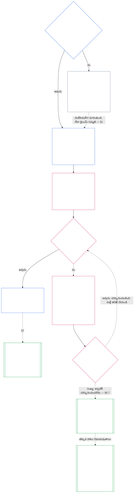

> **AI-సహాయక అనువాదం డ్రాఫ్ట్ — సమీక్షించబడలేదు; స్వతంత్ర ఫ్లూయెంట్-రీడర్ సమీక్ష పూర్తి కాలేదు. ఈ రీడర్-లాంగ్వేజ్ ఫైల్ బైండింగ్ కాదు; సంఖ్యా ఆంగ్ల మూలం నియంత్రిస్తూనే ఉంది.**

# అధ్యాయం ఏడు: సిస్టమ్ మరియు ఇన్‌స్టిట్యూషనల్ చార్టర్‌లు

<strong>కార్పస్ ప్లేస్‌మెంట్ (నాన్-ఆపరేటివ్): ఫైల్ నిర్మాణం మరియు పఠన నియమాలు</strong>

> ఈ ఫైల్ **సెంటియెంట్ రాజ్యాంగంలో భాగం** మరియు ఉంది **కలిసి మాత్రమే బైండింగ్** ఇతర సంఖ్యతో `core_*` ఫైల్‌లు ఒక వచనంగా చదవబడతాయి. ఇది కలిగి ఉంది **అధ్యాయం ఏడు**: సిస్టమ్ మరియు ఒక సంస్థ యొక్క ప్రచురించబడిన స్కోప్ డాక్యుమెంట్‌ల కోసం ఫ్లోర్: సిస్టమ్ చార్టర్ మరియు ఇన్‌స్టిట్యూషనల్ చార్టర్. ఇది చాప్టర్ సిక్స్ రైట్స్ ఫ్లోర్‌ను అనుసరిస్తుంది మరియు ముందుగా ఉంటుంది [ఎనిమిదవ అధ్యాయం](../../core_08.000_functional_independence_separation_of_duties.md#chapter-eight-functional-independence-and-separation-of-duties), ఇది ఏదైనా మెటీరియల్ బైండింగ్ చట్టం లోపల సీట్లను వేరు చేస్తుంది.
>
> - **రాజ్యాంగ యజమాని:** ఒక సిస్టమ్ తప్పనిసరిగా సిస్టమ్ చార్టర్‌ను ప్రచురించాలి మరియు ఒక సంస్థ తప్పనిసరిగా సంస్థాగత చార్టర్‌ను ప్రచురించాలి (తరగతి L లేదా అంతకంటే ఎక్కువ అవసరం, క్లాస్ P వద్ద స్వచ్ఛందంగా), కనీస ప్రతి ఒక్కటి తప్పనిసరిగా పేర్కొనాలి, ప్రతి ఒక్కటి ఎలా మారుతుంది మరియు సమీక్షించబడుతుంది మరియు కవర్ చేయబడిన కార్యాలయాల హోల్డర్‌ల స్థితి మరియు ప్రామాణికతపై ఏర్పాటు తనిఖీ.
> - **డెఫినిషన్ హోమ్:** [సిస్టమ్ చార్టర్](../../core_05.040_band_continuity.md#system-charter), [సంస్థాగత చార్టర్](../../core_05.040_band_continuity.md#institutional-charter), [చార్టర్ పాత్ర మ్యాప్](../../core_05.040_band_continuity.md#charter-role-map), [చార్టర్డ్ పార్టీ](../../core_05.040_band_continuity.md#chartered-party), మరియు [ఆపరేటింగ్ పార్టీ](../../core_05.050_band_oversight.md#operating-party) ఐదవ అధ్యాయంలో నిర్వచించబడ్డాయి. ఈ అధ్యాయం వాటికి వర్తిస్తుంది మరియు వాటిని పునర్నిర్వచించదు.
> - **అమలు యజమాని:** [CI-8.205 §6](../../corpus_institutions/ci_08.205_institutional_design_separation_of_powers.md#ci-8205-6-system-and-institutional-charter-contents-review-and-formation-template) (*సిస్టమ్ మరియు సంస్థాగత చార్టర్ విషయాలు, సమీక్ష మరియు ఏర్పాటు టెంప్లేట్*) పూర్తి ఫీల్డ్ టెంప్లేట్, రివ్యూ చెక్‌లిస్ట్, ఫార్మేషన్ ప్రొసీజర్ మరియు ఫార్మేషన్ చెక్ స్టేట్‌మెంట్ టెంప్లేట్‌ను కలిగి ఉంటుంది. ఇది కఠినంగా ఉండవచ్చు మరియు ఫీల్డ్‌లను జోడించవచ్చు. ఇది ఈ అధ్యాయాన్ని కుదించకపోవచ్చు. దాని వచనం చెల్లుబాటు అయ్యే స్వీకరణ పరిధిలో మాత్రమే విలీనం చేయబడిన అమలు టెక్స్ట్‌గా బంధిస్తుంది ([పద్దెనిమిదవ అధ్యాయం §4 అడాప్షన్ ఫ్రేమింగ్ మరియు అధికార పరిధి](../../core_18.000_incorporation.md#4-adoption-framing-and-scope-of-authority)); ఈ అధ్యాయంలోని ఫ్లోర్ కోర్ టెక్స్ట్‌గా బంధిస్తుంది.
> - **దిగువ వినియోగదారులు:** [చాప్టర్ ఎనిమిది §5 ప్రచురించబడిన ప్లేస్‌మెంట్, ఖాళీ మరియు ప్రత్యామ్నాయం](../../core_08.000_functional_independence_separation_of_duties.md#5-published-placement-vacancy-and-substitution) చార్టర్ రోల్ మ్యాప్ అవసరం. అధ్యాయం తొమ్మిది స్కోప్ మరియు సరిహద్దు ఫలితాల కోసం సిస్టమ్ చార్టర్‌ను చదువుతుంది మరియు అధ్యాయం తొమ్మిది పార్ట్ D సంస్థ కోసం ఫార్మేషన్ చెక్ స్టేట్‌మెంట్‌ను పరీక్షిస్తుంది. [అధ్యాయం పది §3.7 కస్టడీ మరియు ప్రారంభ అధికారాన్ని రికార్డ్ చేయండి](../../core_10.000_standing_assessment.md#37-record-custody-and-opening-authority) ఇది స్టాండింగ్ రికార్డులకు వర్తిస్తుంది. [అధ్యాయం పదమూడవ §4.3 సంస్థాగత ఫోరమ్‌లు](../../core_13.000_forum.md#43-institutional-forums) సంస్థాగత చార్టర్ గురించి వివాదాలను వింటాడు.
>
> రీడింగ్ ఆర్డర్: §1 సిస్టమ్ మరియు ఇన్‌స్టిట్యూషనల్ చార్టర్‌లు అవసరమైనప్పుడు, ప్రక్రియను మ్యాప్ చేసే చార్ట్‌తో → §2 ఏర్పడే హక్కు మరియు నాలుగు ఇరుకైన పరిమితులు → §3 వారు ఏమి పేర్కొనాలి → §4 చార్టర్ రోల్ మ్యాప్ మరియు స్టాండింగ్-రికార్డ్ కస్టడీ → §5 → §5 ఆఫీస్ హోల్డర్‌ని ఏర్పాటు చేసినప్పుడు ఫార్మేషన్ చెక్ → §7 సవరణ, సమీక్ష మరియు స్కోప్ తప్పుగా అమర్చడంలో విఫలమవుతుంది.

<strong>ట్రేస్ చేయండి</strong>

- అప్‌స్ట్రీమ్:
  - [రాజ్యాంగ టెట్రాడ్](../../core_00.000_preamble.md#constitutional-tetrad), ముఖ్యంగా **పర్యవేక్షణ** మరియు **జవాబుదారీతనం**;
  - [పదార్థం వాటా](../../core_00.000_preamble.md#material-stake);
  - [అధ్యాయం 1 §18.1 అధీకృత నిర్మాణంగా పాలన](../../core_01.015_stewardship_capacity_principles.md#181-governance-as-authorized-structure) (1.015 §18.1);
  - [ఆర్టికల్ XI-E](../../core_06.010_rights_part_b.md#article-xi-e-institutional-formation-and-business-creation) (*సంస్థాగత నిర్మాణం మరియు వ్యాపార సృష్టి*)
- ఉపవిభాగాలు:
  - [§1](#1-ససటమ-మరయ-ససథగత-చరటరల-అవసరమనపపడ);
  - [§2](#2-ఫరమ-హకక-మరయ-నలగ-ఇరకన-పరమతల);
  - [§3](#3-ఏ-వయవసథ-మరయ-ససథగత-చరటరల-తపపనసరగ-పరకనల);
  - [§4](#4-చరటర-రల-మయప-మరయ-సటడగ-రకరడ-కసటడ);
  - [§5](#5-ఫరమషన-చక-ఆఫస-హలడర-సటడగ-మరయ-అథటసట);
  - [§6](#6-ఒక-హలడర-ఫరమషన-చక-వఫలమనపపడ);
  - [§7](#7-సవరణ-సమకష-మరయ-సకప-తపపగ-అమరచడ).
- దిగువ:
  - [ఎనిమిదవ అధ్యాయం](../../core_08.000_functional_independence_separation_of_duties.md#chapter-eight-functional-independence-and-separation-of-duties) (8.000);
  - [అధ్యాయం తొమ్మిది](../../core_09.000_system_alignment_certification.md#chapter-nine-system-alignment-certification-reading-index) (9.000);
  - [అధ్యాయం పది](../../core_10.000_standing_assessment.md#chapter-ten-contribution-violation-and-standing-model--measurement) (10.000);
  - [పదమూడవ అధ్యాయం](../../core_13.000_forum.md#chapter-thirteen-forums-and-jurisdiction) (13.000);
  - [పద్నాల్గవ అధ్యాయం](../../core_14.000_governance.md#chapter-fourteen-constitutional-contract-legitimacy-authorization-and-stewardship) (14.000); పైన పేర్కొన్న నిర్దేశిత అమలు టెక్స్ట్.
- దీనితో చదవండి:
  - [అథారిటీ స్టాక్ మరియు అంతర్గత సోపానక్రమం](../../core_05.045_band_integrative.md#authority-stack-and-internal-hierarchy);
  - [సిస్టమ్ సరిహద్దులు](../../core_05.040_band_continuity.md#system-boundaries);
  - [సిస్టమ్ సరిహద్దు సమగ్రత](../../core_05.040_band_continuity.md#system-boundary-integrity);
  - [సిస్టమ్ సృష్టి](../../core_05.055_band_participation.md#system-creation);
  - [వ్యాపార సృష్టి](../../core_05.055_band_participation.md#business-creation).

 

ఏడవ అధ్యాయం రాజ్యాంగ యజమాని **సిస్టమ్ చార్టర్‌లు, సంస్థాగత చార్టర్‌లు మరియు ప్రచురించిన పరిధి**.

మూడు అధ్యాయాలు ఒక గొలుసుగా పని చేస్తాయి:

- **అధ్యాయం ఏడవ (ఈ అధ్యాయం):** ఏమి a అని చెప్పారు [చార్టర్డ్ పార్టీ](../../core_05.040_band_continuity.md#chartered-party) క్లెయిమ్ చేస్తుంది మరియు ప్రతి సీటు పని చేసినప్పుడు ఎవరు పట్టుకోగలరు.
- **[ఎనిమిదవ అధ్యాయం](../../core_08.000_functional_independence_separation_of_duties.md#chapter-eight-functional-independence-and-separation-of-duties):** ఆ సీట్లను ఎలా వేరుగా ఉంచాలి అని చెప్పింది.
- **[అధ్యాయం తొమ్మిది](../../core_09.000_system_alignment_certification.md#chapter-nine-system-alignment-certification-reading-index):** ఒక వ్యవస్థను మరియు విడిగా ఒక సంస్థను ధృవీకరిస్తుంది, వీటిలో ప్రతి ఒక్కటి సీట్లను ఉపయోగించే ఒక బైండింగ్ చట్టం. ఇది కనుగొన్న దాన్ని సిస్టమ్ చార్టర్ లేదా ఇన్‌స్టిట్యూషనల్ చార్టర్‌కు తిరిగి పంపుతుంది.

ఇతర అధ్యాయాలు నిర్వచనాలు, సీటు నియమాలు, స్టాండింగ్ లాక్‌లు మరియు ఈ అధ్యాయం సూచించే నిర్ణయ నియమాలను కలిగి ఉంటాయి. **CI-8.205 §6** (*సిస్టమ్ మరియు సంస్థాగత చార్టర్ విషయాలు, సమీక్ష మరియు ఏర్పాటు టెంప్లేట్*) ఫీల్డ్ టెంప్లేట్, ఫార్మేషన్ ప్రొసీజర్ మరియు రివ్యూ చెక్‌లిస్ట్‌ను కలిగి ఉంటుంది.

### 1. సిస్టమ్ మరియు సంస్థాగత చార్టర్లు అవసరమైనప్పుడు

<strong>ట్రేస్ చేయండి</strong>

- అప్‌స్ట్రీమ్:
  - [§2](#2-ఫరమ-హకక-మరయ-నలగ-ఇరకన-పరమతల);
  - [పదార్థం వాటా](../../core_00.000_preamble.md#material-stake);
  - [అనుపాతత](../../core_05.035_band_accountability.md#proportionality); అధ్యాయం ప్రారంభ యజమాని దావా;
  - [అధ్యాయం 1 §18 స్టీవార్డ్‌షిప్ క్రమశిక్షణలో పాలన](../../core_01.015_stewardship_capacity_principles.md#18-governance-under-stewardship-discipline) (1.015 §18);
  - [పర్యవేక్షణ](../../core_05.020_apex_oversight_leg.md#oversight-constitutional);
  - [జవాబుదారీతనం](../../core_05.005_apex_accountability_leg.md#accountability).
- దిగువ: [§3](#3-ఏ-వయవసథ-మరయ-ససథగత-చరటరల-తపపనసరగ-పరకనల); [అధ్యాయం తొమ్మిది భాగం A §2 సిస్టమ్ క్లాస్ మూల్యాంకనం](../../core_09.005_system_alignment_certification_evaluation.md#2-system-class-evaluation) (9.005 §2) (*తరగతి మరియు ధృవీకరణ లోతు*); [అధ్యాయం తొమ్మిది భాగం D §12.1 సంస్థ తరగతి](../../core_09.020_institutional_alignment_certification.md#121-institution-class) (9.020 §12.1) (*ఒక సంస్థ యొక్క తరగతి*); **CS-9.305 (*సిస్టమ్ వర్గీకరణ యంత్రాలు*) మరియు CS-9.310** (*సిస్టమ్ వర్గీకరణ యంత్రాలు*) తరగతి కేటలాగ్ కోసం.
- దీనితో చదవండి:
  - **CI-8.205 §6** (*సిస్టమ్ మరియు సంస్థాగత చార్టర్ విషయాలు, సమీక్ష మరియు ఏర్పాటు టెంప్లేట్*);
  - **CF-13.415 §5** (*సంస్థాగత మరియు స్థానిక రిజిస్ట్రార్లు*);
  - **CI-9.210** (*వర్గీకరణ-అనుసంధాన సంస్థాగత బాధ్యతలు*);
  - [అధ్యాయం ఐదు సిస్టమ్ చార్టర్](../../core_05.040_band_continuity.md#system-charter) (5.040);
  - [అధ్యాయం ఐదు సంస్థాగత చార్టర్](../../core_05.040_band_continuity.md#institutional-charter) (5.040);
  - [ఆర్టికల్ XI-E](../../core_06.010_rights_part_b.md#article-xi-e-institutional-formation-and-business-creation) (*సంస్థాగత నిర్మాణం మరియు వ్యాపార సృష్టి*)

<strong>నిర్వచనాలు · మదింపు · వర్తింపు</strong>

- [సిస్టమ్ చార్టర్](../../core_05.040_band_continuity.md#system-charter) · [ఓ](../../core_05.040_band_continuity.md#system-charter) · [ఎం](../../core_05.040_band_continuity.md#system-charter-a) · [ఎ](../../core_05.040_band_continuity.md#system-charter-a) · [సి](../../core_05.040_band_continuity.md#system-charter-c)
- [సంస్థాగత చార్టర్](../../core_05.040_band_continuity.md#institutional-charter) · [ఓ](../../core_05.040_band_continuity.md#institutional-charter) · [ఎం](../../core_05.040_band_continuity.md#institutional-charter-a) · [ఎ](../../core_05.040_band_continuity.md#institutional-charter-a) · [సి](../../core_05.040_band_continuity.md#institutional-charter-c)
- [వర్గీకరణ-స్కేల్డ్ గవర్నెన్స్](../../core_05.050_band_oversight.md#classification-scaled-governance) · [ఓ](../../core_05.050_band_oversight.md#classification-scaled-governance) · [ఎం](../../core_05.050_band_oversight.md#classification-scaled-governance-a) · [ఎ](../../core_05.050_band_oversight.md#classification-scaled-governance-a) · [సి](../../core_05.050_band_oversight.md#classification-scaled-governance-c)

 

*సరళంగా చెప్పాలంటే: ఒక వ్యవస్థ లేదా సంస్థ దాని పరిమితుల్లో ఉందో లేదో ఎవరైనా నిర్ధారించే ముందు, ప్రతి ఒక్కరూ వాటిని చదవగలిగే చోట పరిమితులను వ్రాయాలి. తొమ్మిది రంగాలలో దేనిలోనైనా ఇతరులకు భౌతికంగా ఉండే వ్యవస్థ [డొమైన్-నిర్దిష్ట మెటీరియాలిటీ](../../core_05.050_band_oversight.md#domain-specific-materiality) ప్రచురించబడిన సిస్టమ్ చార్టర్ అవసరం. ఒక సంస్థ అది నడుపుతున్న సిస్టమ్‌లకు సరిపోయే దానిని ప్రచురిస్తుంది. క్లాస్ P స్వచ్ఛందంగా ఉంటుంది: శరణార్థులకు క్విల్ట్‌లను ఇచ్చే క్విల్టింగ్ సర్కిల్ నమూనా.*

సిస్టమ్ చార్టర్ లేదా ఇన్‌స్టిట్యూషనల్ చార్టర్ అనేది చార్టర్డ్ పార్టీ యొక్క ప్రచురించబడిన పరిధి: ఇది ఏమి చేయడానికి అధికారం క్లెయిమ్ చేస్తుంది, ఏమి చేయదు మరియు అది పని చేసినప్పుడు ప్రతి సీటును ఎవరు కలిగి ఉంటారు. ఇది చాప్టర్ ఎనిమిదోలోని సీట్లు కింద ఉంచబడిన స్కోప్ మరియు అధ్యాయం తొమ్మిదిలోని ధృవీకరణ నిజమైన ఆపరేషన్‌కు వ్యతిరేకంగా తిరిగి చదవబడుతుంది. ఆపరేటింగ్ పార్టీ ఒక దానిని ప్రచురించాలా అనేది దాని తరగతిపై ఆధారపడి ఉంటుంది: **క్లాస్ L లేదా అంతకంటే ఎక్కువ, క్లాస్ P వద్ద స్వచ్ఛందంగా అవసరం.** అది ఒకదానిని ప్రచురించవలసి వస్తే, అది కూడా ఖచ్చితంగా ఉంచాలి.

ఐదు సిస్టమ్ ఇంపాక్ట్ తరగతులు దిగువన ఉన్న ప్రతిదానికీ ఫ్రేమ్‌గా ఉంటాయి. చాలా నుండి కనీసం పర్యవసానంగా, ఒక్కొక్క పంక్తిలో:

- **క్లాస్ A, మనుగడ-క్లిష్టమైనది, పునాది మరియు భర్తీ చేయలేనిది:** మనుగడ-సంబంధిత సమయంలో వైఫల్యం, ఆచరణీయ ప్రత్యామ్నాయం లేకుండా, మనుగడ పరిస్థితులను కోల్పోవడం.
- **క్లాస్ B, క్రిటికల్, హై-డిపెండెన్సీ మరియు సిస్టమ్‌పరంగా ముఖ్యమైనది:** డిపెండెంట్లు అది లేకుండా కోర్ ఫంక్షన్‌ను ఉంచలేరు. మనుగడ తక్షణమే కోల్పోదు మరియు ప్రత్యామ్నాయం సమయం లో ఇప్పటికీ సాధ్యమే.
- **క్లాస్ సి, కోఆర్డినేటెడ్, హై-డిపెండెన్సీ మరియు నాన్-క్రిటికల్:** ఇది స్కేల్‌లో సమన్వయాన్ని రూపొందిస్తుంది కానీ క్లాస్ A లేదా క్లాస్ B ఫంక్షన్‌కు కార్యాచరణ అవసరం కాదు.
- **తరగతి L, స్థానికం, పరిమిత ప్రభావం మరియు నాన్-క్రిటికల్:** దాని ప్రభావాలు ఒక ప్రైవేట్ యూనిట్‌కు మించి చేరుకుంటాయి కానీ స్థానికంగా, మార్చగలిగేవి మరియు కలిగి ఉంటాయి.
- **క్లాస్ P, వ్యక్తిగత, ప్రైవేట్-వినియోగం, వివిక్త మరియు ప్రయోగాత్మకం:** దాని ప్రభావాలు ఒక ప్రైవేట్ యూనిట్ లోపల ఉంటాయి, అర్ధవంతమైన బయట ఆధారపడకుండా ఉంటాయి.

[CS-9.310 §8](../../corpus_systems/cs_09.310_system_impact_classifications.md#cs-9310-8-system-impact-classifications) (*సిస్టమ్ ప్రభావం వర్గీకరణలు*) పూర్తి నిర్వచనాలను కలిగి ఉంది. A, B, C మరియు L తరగతులు తప్పనిసరిగా ప్రచురించబడతాయి మరియు తరగతి P మే, మరియు [§1.2 ఏ తరగతులు కవర్ చేయబడ్డాయి](#12-ఏ-తరగతల-కవర-చయబడడయ) ఒక సంస్థ అది నడుపుతున్న సిస్టమ్స్ నుండి దాని తరగతిని ఎలా తీసుకుంటుందో చెబుతుంది.

#### 1.1 ఎవరు ప్రచురించాలి

క్లాస్ L లేదా అంతకంటే ఎక్కువ ఉన్న సిస్టమ్ తప్పనిసరిగా ప్రచురించాలి మరియు నిర్వహించాలి a [సిస్టమ్ చార్టర్](../../core_05.040_band_continuity.md#system-charter). క్లాస్ L లేదా అంతకంటే ఎక్కువ ఉన్న సంస్థ తప్పనిసరిగా అమలు చేసే సిస్టమ్‌లకు సరిపోయే వాటిలో ఒకదాన్ని తప్పనిసరిగా ప్రచురించాలి మరియు నిర్వహించాలి:

| ఇన్‌స్టిట్యూషన్ ఏమి నిర్వహిస్తుంది, స్టీవార్డ్‌లు లేదా భౌతికంగా నియంత్రిస్తుంది | ఇది ఏమి ప్రచురిస్తుంది |
| --- | --- |
| సరిగ్గా సిస్టమ్ చార్టర్ అవసరమయ్యే ఒక సిస్టమ్ | ఆ సిస్టమ్ చార్టర్ మరియు రెండవ పత్రం లేదు. ఇది ఇన్‌స్టిట్యూషన్‌కు స్టీవార్డ్‌గా పేరు పెట్టింది మరియు పని చేస్తుంది [సంస్థాగత చార్టర్](../../core_05.040_band_continuity.md#institutional-charter): ఒక పత్రం రెండింటినీ కవర్ చేస్తుంది. |
| అటువంటి వ్యవస్థ ఒకటి కంటే ఎక్కువ | ఒక సంస్థాగత చార్టర్. ఇది ఆ సిస్టమ్‌ల కోసం అమలులో ఉన్న ప్రతి సిస్టమ్ చార్టర్‌ను కలిగి ఉంటుంది మరియు సంస్థ ఆ నిర్దిష్ట సిస్టమ్‌లను ఎందుకు నడుపుతుందో తెలియజేస్తుంది ([§3 ఏ వ్యవస్థ మరియు సంస్థాగత చార్టర్లు తప్పనిసరిగా పేర్కొనాలి](#3-ఏ-వయవసథ-మరయ-ససథగత-చరటరల-తపపనసరగ-పరకనల)) |
| అలాంటి వ్యవస్థ లేదు | సంస్థ యొక్క స్వంత అంశాలను తెలిపే సంస్థాగత చార్టర్ [§3 ఏ వ్యవస్థ మరియు సంస్థాగత చార్టర్లు తప్పనిసరిగా పేర్కొనాలి](#3-ఏ-వయవసథ-మరయ-ససథగత-చరటరల-తపపనసరగ-పరకనల) మరియు చేర్చడానికి సిస్టమ్ చార్టర్‌లు లేవు. |

- **వ్యాపారాలు మరియు పోల్చదగిన రూపాలు:** ఒక వ్యాపారం లేదా ఇతర స్టీవార్డెడ్ ఆర్గనైజేషనల్ ఫారమ్ సిస్టమ్ చార్టర్ లేదా ఇన్‌స్టిట్యూషనల్ చార్టర్‌లో దేనికి వర్తిస్తుందో దానిని సిస్టమ్‌గా, ఒక సంస్థగా లేదా కవర్ సిస్టమ్‌ను నిర్వహించే సంస్థగా ప్రచురిస్తుంది. దాని చట్టపరమైన రూపం సమాధానాన్ని మార్చదు.
- **ఉమ్మడి వృత్తిపరమైన అభ్యాసం:** ప్రాక్టీస్ లైసెన్స్ లేదా ప్రాక్టీస్ క్లియరెన్స్ కోసం జాబితా చేయబడిన చర్యను నిర్వహించే క్లాస్ L లేదా అంతకంటే ఎక్కువ సెంటియెంట్ లేదా చిన్న అభ్యాసం హోస్ట్ యొక్క సిస్టమ్ చార్టర్ లేదా ఇన్‌స్టిట్యూషనల్ చార్టర్ మరియు చార్టర్ రోల్ మ్యాప్‌ను స్వీకరించడం ద్వారా ఆ చర్యల కోసం ఈ విభాగాన్ని అందుకోవచ్చు:
  - **ఏమి స్వీకరించబడింది:** సూచన ద్వారా, ఉమ్మడి ప్రొఫెషనల్ ప్రాక్టీస్‌లో హోస్ట్ యొక్క సిస్టమ్ చార్టర్ లేదా ఇన్‌స్టిట్యూషనల్ చార్టర్ మరియు చార్టర్ రోల్ మ్యాప్, ఇది తప్పనిసరిగా ఆ చర్యలను కవర్ చేస్తుంది.
  - **దత్తత నోటీసు:** అని ఒక పేజీ నోటీసు **CI-14.205 §7** (*ప్రాక్టీస్ లైసెన్స్, ప్రాక్టీస్ క్లియరెన్స్ మరియు జాయింట్ ప్రొఫెషనల్ ప్రాక్టీస్*) వివరిస్తుంది.
  - **తరగతి:** అభ్యాసం దాని స్వంత చర్యలు అందించే తరగతిలోనే ఉంటుంది.

#### 1.2 ఏ తరగతులు కవర్ చేయబడ్డాయి

పబ్లిషింగ్ అవసరమా లేదా ఎంపిక చేయాలా అనేది చార్టర్డ్ పార్టీ తరగతి నిర్ణయిస్తుంది:

- **A, B, C మరియు L తరగతులు:** అవసరం. లో చార్ట్ [§1.7 ఒక చూపులో ప్రక్రియ](#17-ఒక-చపల-పరకరయ) వారు అనుసరించే విధానాన్ని చూపుతుంది.
- **క్లాస్ పి:** ఒక ఎంపిక, రెండు ఈవెంట్‌లలో ఒకటి అవసరమయ్యే వరకు. [§1.3 క్లాస్ P అంటే ఏమిటి](#13-కలస-p-అట-ఏమట) ఆపరేటింగ్ పార్టీ క్లాస్ Pని ఏమి చేస్తుందో చెబుతుంది మరియు [§1.4 క్లాస్ P: ఐచ్ఛిక చార్టర్‌లు మరియు అవి అవసరమైనప్పుడు](#14-కలస-ప-ఐచఛక-చరటరల-మరయ-అవ-అవసరమనపపడ) ఎంపికను నిర్దేశిస్తుంది మరియు అది ఎప్పుడు ముగుస్తుంది.
- **ఒక సంస్థ యొక్క తరగతి:** ఒక సంస్థ అది నిర్వహించే, స్టీవార్డ్‌లు లేదా భౌతికంగా నియంత్రించే ఏదైనా సిస్టమ్‌లో అత్యధిక తరగతిని తీసుకుంటుంది. అటువంటి వ్యవస్థను అమలు చేయని సంస్థ దాని స్వంత భౌతిక ప్రభావం మరియు ఆధారపడటం ద్వారా వర్గీకరించబడుతుంది, ఇది వాస్తవానికి నిర్ణయించే మరియు కలిగి ఉన్న దాని ద్వారా నిర్ణయించబడుతుంది మరియు దాని లేబుల్ లేదా చట్టపరమైన రూపం ద్వారా కాదు. [అధ్యాయం తొమ్మిది భాగం D §12.1 సంస్థ తరగతి](../../core_09.020_institutional_alignment_certification.md#121-institution-class).

#### 1.3 క్లాస్ P అంటే ఏమిటి

యొక్క ప్రతి తొమ్మిది డొమైన్‌లలో దాని కార్యాచరణ రేఖకు దిగువన ఉన్నప్పుడు మాత్రమే ఆపరేటింగ్ పార్టీ క్లాస్ Pగా ఉంటుంది [డొమైన్-నిర్దిష్ట మెటీరియాలిటీ](../../core_05.050_band_oversight.md#domain-specific-materiality), ఆచరణలో అంటే దాని చర్యలు మరియు ప్రభావాలు దాని లోపల ఉంటాయి [ప్రైవేట్ యూనిట్](../../core_05.050_band_oversight.md#domain-specific-materiality-private-unit):

- **ఒక గీతను దాటడం:** ఏదైనా ఒక డొమైన్‌లో గీతను దాటడం వలన కనీసం క్లాస్ L కింద ఉంటుంది **CS-9.305 (*సిస్టమ్ వర్గీకరణ యంత్రాలు*) మరియు CS-9.310** (*సిస్టమ్ వర్గీకరణ యంత్రాలు*), దాని పరిమాణం ఏదైనా లేదా అది తనను తాను పిలుస్తుంది.
- **ప్రతి పంక్తి క్రింద ఉండడం:** ఎంత మంది సభ్యులు ఉన్నప్పటికీ ఇది క్లాస్ Pగానే ఉంటుంది.
- **లోపల ఉన్నవారు:** క్లాస్ పి కూడా దాని లోపల ఉన్నవారిపై ఆధారపడి ఉంటుంది. ఆపరేటింగ్ పార్టీ ఒక రేఖను దాటుతున్నట్లు గమనించిన లోపల ఎవరైనా దానిని నివేదించాల్సిన బాధ్యత కలిగి ఉంటారు మరియు నివేదిక రక్షించబడుతుంది ([డొమైన్-నిర్దిష్ట మెటీరియాలిటీ](../../core_05.050_band_oversight.md#domain-specific-materiality))

ఎనిమిదవ అధ్యాయంలోని నాలుగు-సీట్ల అంతస్తు దాని ప్రైవేట్ యూనిట్‌లో ఉండే క్లాస్ P ఆపరేటింగ్ పార్టీ చర్యలకు వర్తించదు, కాబట్టి కంప్యూటర్‌తో ఉన్న ఒక వ్యక్తికి రెండవ సీటు హోల్డర్ అవసరం లేదు. ఆపరేటింగ్ పార్టీ తీసుకున్న రోజు నుండి ఫ్లోర్ వర్తిస్తుంది a [మెటీరియల్ బైండింగ్ చట్టం](../../core_05.035_band_accountability.md#materially-binding-act) ఇతరులు తప్పక అనుసరించాలి లేదా స్థిరపడిన వాటిపై ఆధారపడవచ్చు, ఇది అథారిటీ-ఓవర్-అదర్స్ డొమైన్‌లోని రేఖను దాటి కనీసం క్లాస్ Lని చేస్తుంది.

#### 1.4 క్లాస్ పి: ఐచ్ఛిక చార్టర్‌లు మరియు అవి అవసరమైనప్పుడు

క్లాస్ P ఆపరేటింగ్ పార్టీని ప్రచురించడానికి ప్రోత్సహించబడుతుంది [సిస్టమ్ చార్టర్](../../core_05.040_band_continuity.md#system-charter) (ఒకే వ్యవస్థ కోసం) లేదా [సంస్థాగత చార్టర్](../../core_05.040_band_continuity.md#institutional-charter) (ఒకటి కంటే ఎక్కువ సిస్టమ్‌ల కోసం, లేదా ఏదీ లేదు) అది అమలు చేసే దానికి సరిపోతుంది. ఇది కంటెంట్ జాబితాను ఉపయోగించవచ్చు [§3 ఏ వ్యవస్థ మరియు సంస్థాగత చార్టర్లు తప్పనిసరిగా పేర్కొనాలి](#3-ఏ-వయవసథ-మరయ-ససథగత-చరటరల-తపపనసరగ-పరకనల) మరియు సీటు మ్యాప్ [§4 చార్టర్ రోల్ మ్యాప్ మరియు స్టాండింగ్-రికార్డ్ కస్టడీ](#4-చరటర-రల-మయప-మరయ-సటడగ-రకరడ-కసటడ) టెంప్లేట్‌గా. ఒకదాన్ని ప్రచురించడం వలన ఈ అధ్యాయం యొక్క ప్రక్రియలో ఎటువంటి విధి ఉండదు:

- గడువు తేదీ లేదు ([§1.5 సిస్టమ్ చార్టర్ లేదా ఇన్‌స్టిట్యూషనల్ చార్టర్ గడువు ముగిసినప్పుడు](#15-ససటమ-చరటర-లద-ఇనసటటయషనల-చరటర-గడవ-మగసనపపడ));
- ఏర్పాటు తనిఖీ లేదు ([§5 ఫార్మేషన్ చెక్: ఆఫీస్-హోల్డర్ స్టాండింగ్ మరియు అథెంటిసిటీ](#5-ఫరమషన-చక-ఆఫస-హలడర-సటడగ-మరయ-అథటసట));
- అవసరం లేదు [చార్టర్ పాత్ర మ్యాప్](../../core_05.040_band_continuity.md#charter-role-map) ([§4 చార్టర్ రోల్ మ్యాప్ మరియు స్టాండింగ్-రికార్డ్ కస్టడీ](#4-చరటర-రల-మయప-మరయ-సటడగ-రకరడ-కసటడ)), అయితే ఇది దాని స్వచ్ఛంద సిస్టమ్ చార్టర్ లేదా సంస్థాగత చార్టర్‌తో ఒకదానిని ఉంచుకోవచ్చు లేదా దాని స్వంతంగా ప్రచురించవచ్చు; మరియు
- అవసరం లేదు సవరణ లేదా సమీక్ష చక్రం ([§7 సవరణ, సమీక్ష మరియు స్కోప్ తప్పుగా అమర్చడం](#7-సవరణ-సమకష-మరయ-సకప-తపపగ-అమరచడ))

వీటిలో ఏదైనా జరిగితే, ప్రచురణ ఐచ్ఛికంగా ఆగిపోతుంది.

- ఆపరేటింగ్ పార్టీ క్లాస్ L లేదా అంతకంటే ఎక్కువ వర్గీకరించబడింది; లేదా
- దాని ఆపరేటర్ ఆపరేటింగ్ పార్టీకి రాజ్యాంగ సమ్మతిని నొక్కి చెప్పారు.

ఆపరేటింగ్ పార్టీ తప్పనిసరిగా సిస్టమ్ చార్టర్ లేదా దానికి సరిపోయే సంస్థాగత చార్టర్‌ను షెడ్యూల్‌లో ప్రచురించాలి [§1.5 సిస్టమ్ చార్టర్ లేదా ఇన్‌స్టిట్యూషనల్ చార్టర్ గడువు ముగిసినప్పుడు](#15-ససటమ-చరటర-లద-ఇనసటటయషనల-చరటర-గడవ-మగసనపపడ).

**గుర్తింపు అనేది స్కోప్ డాక్యుమెంట్‌పై ఆధారపడి ఉండదు.** సిస్టమ్ చార్టర్ లేదా ఇన్‌స్టిట్యూషనల్ చార్టర్‌తో లేదా లేకుండా సమూహం మరియు దాని తరగతి ఏదైనా దాని సభ్యులు మరియు గుర్తింపు మధ్య నిలబడదు. సమూహం లోపల లేదా దాని వెలుపల చేసిన పని కోసం ప్రతి సభ్యుడు వ్యక్తిగత హక్కుదారుగా సహకార రికార్డును కోరవచ్చు మరియు ఆ రికార్డ్ సభ్యుని సహకారానికి సంబంధించినది మరియు సమూహం యొక్క స్థితికి సంబంధించినది కాదు ([అధ్యాయం పది §3.7 అనధికారిక మరియు చిన్న-స్కోప్ రికార్డులు](../../core_10.000_standing_assessment.md#37-informal-and-small-scope-records)) ఎవరూ అంగీకరించనవసరం లేని సహాయం, వస్తువులు, కార్మికులు లేదా సేవలను అందించడం భౌతికంగా కట్టుబడి ఉండే చర్య కాదు, కాబట్టి శరణార్థులకు క్విల్ట్‌లను అందించే పరస్పర సహాయ సర్కిల్‌కు దాని సభ్యుల గుర్తింపు కోసం సిస్టమ్ చార్టర్ లేదా సంస్థాగత చార్టర్ అవసరం లేదు.

#### 1.5 సిస్టమ్ చార్టర్ లేదా ఇన్‌స్టిట్యూషనల్ చార్టర్ గడువు ముగిసినప్పుడు

కవర్ చేయబడిన వ్యవస్థ లేదా సంస్థ దానిని ప్రచురిస్తుంది [సిస్టమ్ చార్టర్](../../core_05.040_band_continuity.md#system-charter) లేదా [సంస్థాగత చార్టర్](../../core_05.040_band_continuity.md#institutional-charter) ఈ షెడ్యూల్‌లో:

- **కొత్త వ్యవస్థ లేదా సంస్థ:** ఇది ప్రత్యక్ష ప్రసారం కావడానికి ముందు లేదా ఇతరులపై అధికారం చెలాయించడానికి ముందు.
- **ఇప్పటికే పనిచేస్తున్నది:** దాని తదుపరి వర్గీకరణ సమీక్ష లేదా ధృవీకరణ వద్ద, లేదా రిజల్యూషన్ విండోలో అభ్యర్థన తర్వాత [§1.6 సిస్టమ్ చార్టర్ లేదా సంస్థాగత చార్టర్ లేకుంటే](#16-ససటమ-చరటర-లద-ససథగత-చరటర-లకట), ఏది ముందుగా వస్తుంది. ఇది చేసే వరకు ఇది డిఫాల్ట్‌గా ఉంటుంది.
  - **ఏ సర్టిఫికేషన్:** సిస్టమ్ కోసం, దాని సిస్టమ్ అలైన్‌మెంట్ సర్టిఫికేషన్. ఒక సంస్థ కోసం, దాని సంస్థాగత అమరిక ధృవీకరణ కింద [అధ్యాయం తొమ్మిది భాగం D §11.3 అనుమతి లేదు మరియు ద్వారం లేదు](../../core_09.020_institutional_alignment_certification.md#113-no-permission-and-no-gate), దీని మొదటి-ధృవీకరణ విండో సంస్థాగత చార్టర్‌ను ప్రచురించడం లేదా నిర్వహణ యొక్క షరతుగా ఉండదు.
- **నిర్మాణం తనిఖీ:** ఇది నిర్మాణ తనిఖీని కూడా పూర్తి చేస్తుంది [§5 ఫార్మేషన్ చెక్: ఆఫీస్-హోల్డర్ స్టాండింగ్ మరియు అథెంటిసిటీ](#5-ఫరమషన-చక-ఆఫస-హలడర-సటడగ-మరయ-అథటసట) అదే క్షణంలో.
- **ఎక్కడ ఉంచబడింది:** ఇది సిస్టమ్ చార్టర్ లేదా ఇన్‌స్టిట్యూషనల్ చార్టర్, దాని చార్టర్ రోల్ మ్యాప్ మరియు ఫార్మేషన్ చెక్ స్టేట్‌మెంట్‌తో, సంస్థాగత రిజిస్ట్రార్‌తో లేదా స్థానిక రిజిస్ట్రార్‌తో దాని కార్యకలాపాలు మరియు అది ప్రభావితం చేసే భావాలను స్థానికంగా ఉంచుతుంది (**CF-13.415 §5** (*సంస్థాగత మరియు స్థానిక రిజిస్ట్రార్లు*)):
  - **రిజిస్ట్రార్ ఏమి చేస్తారు:** ఇది అవసరం ఏదీ లేదు అని తనిఖీ చేస్తుంది మరియు తేదీతో కూడిన రసీదుని ఇస్తుంది.
  - **రిజిస్ట్రార్ ఎప్పుడూ ఏమి చేయడు:** ఇది ఎప్పుడూ అనుమతిని మంజూరు చేయదు మరియు తరగతి లేదా కంటెంట్‌పై ఎప్పుడూ నియమాలను విధించదు.
  - **ఆలస్యమైన లేదా తప్పిపోయిన రసీదు:** ఇది చార్టర్డ్ పార్టీని ఆపరేట్ చేయకుండా ఎప్పుడూ ఆపదు.

#### 1.6 సిస్టమ్ చార్టర్ లేదా సంస్థాగత చార్టర్ లేకుంటే

క్లాస్ L లేదా అంతకంటే ఎక్కువ, కొత్త లేదా కొత్తగా, దాని సిస్టమ్ చార్టర్ లేదా ఇన్‌స్టిట్యూషనల్ చార్టర్‌ను ప్రచురించని చార్టర్డ్ పార్టీని ఎవరైనా గమనించినట్లయితే, దాని కోసం దాని పాలక అధికారాన్ని అడగవచ్చు. అడిగే వ్యక్తికి నిలబడాల్సిన అవసరం లేదు, రుసుము చెల్లించాల్సిన అవసరం లేదు మరియు హాని చూపించాల్సిన అవసరం లేదు. అభ్యర్థన చార్టర్డ్ పార్టీ అని పేరు పెట్టింది మరియు అది ఎందుకు కవర్ చేయబడిందో చెబుతుంది.

అభ్యర్థన నుండి రెండు విండోలు నడుస్తాయి: ప్రతిస్పందన విండో మరియు రిజల్యూషన్ విండో. ప్రతి ఒక్కటి దాని పొడవును టైర్ నుండి చార్టర్డ్ పార్టీ క్లాస్ వలె అదే అక్షరంతో తీసుకుంటుంది, కాబట్టి తరగతి మరింత క్లిష్టమైనది, విండోస్ చిన్నవిగా ఉంటాయి:

| క్లాస్ మరియు టైర్ | ప్రతిస్పందన విండో (తీసుకునే లక్ష్యం) | రిజల్యూషన్ విండో (అవుటర్ బౌండ్) |
|---|---|---|
| క్లాస్ ఎ, టైర్ ఎ | 24 గంటలు | 7 క్యాలెండర్ రోజులు |
| క్లాస్ బి, టైర్ బి | 2 క్యాలెండర్ రోజులు | 14 క్యాలెండర్ రోజులు |
| క్లాస్ సి, టైర్ సి | 4 క్యాలెండర్ రోజులు | 30 క్యాలెండర్ రోజులు |
| క్లాస్ L, టైర్ L | 8 క్యాలెండర్ రోజులు | 60 క్యాలెండర్ రోజులు |

గణాంకాలు వచ్చాయి **CF-13.445 §3.1** (*దశ లక్ష్యాలు మరియు సమయ అంతస్తులు*), అవి విభేదిస్తే అది నియంత్రిస్తుంది. దాని తరగతిని వివాదం చేసే చార్టర్డ్ పార్టీ దాని సిస్టమ్ వర్గీకరణ రికార్డ్‌లో కలిగి ఉన్న క్లాస్‌ని మరియు ప్రశ్నను పరిష్కరించే వరకు అడిగేవారు లేదా ఫోరమ్ ప్రాథమికంగా చూపే ఏదైనా తరగతిని మరింత క్లిష్టమైన శ్రేణిలో లెక్కించబడుతుంది. రికార్డ్‌లో ఏ తరగతిని కలిగి ఉండని చార్టర్డ్ పార్టీ లేదా దాని తరగతి ప్రశ్నార్థకంగా ఉన్నప్పుడు క్లాస్ Pని కలిగి ఉంది, ఇది టైర్ Cలో లెక్కించబడుతుంది.

విండోస్ ఇలా పని చేస్తాయి:

- **ప్రతిస్పందన విండో:** చార్టర్డ్ పార్టీ ప్రతిస్పందన విండో లోపల ప్రతిస్పందిస్తుంది, ఇది మ్యాచింగ్ టైర్ ఇన్‌టేక్ టార్గెట్ **CF-13.445 §3.1** (*దశ లక్ష్యాలు మరియు సమయ అంతస్తులు*), అభ్యర్థన నుండి లెక్కించబడుతుంది. ఇది సిస్టమ్ చార్టర్ లేదా ఇన్‌స్టిట్యూషనల్ చార్టర్‌ను ప్రచురిస్తుంది లేదా అది చేసే తేదీని ఇస్తుంది, లేదా ఇది ఇప్పటికే ప్రచురించిన దానిని సూచిస్తుంది లేదా ప్రతి పంక్తికి దిగువన ఉందని సమాధానం ఇస్తుంది. [డొమైన్-నిర్దిష్ట మెటీరియాలిటీ](../../core_05.050_band_oversight.md#domain-specific-materiality) మరియు ప్రవేశానికి అవసరమైన వ్రాతపూర్వకంగా చూపుతుంది.
- **రిజల్యూషన్ విండో:** సిస్టమ్ చార్టర్ లేదా ఇన్‌స్టిట్యూషనల్ చార్టర్ రిజల్యూషన్ విండో లోపల ఉంది, ఇది మ్యాచింగ్ టైర్ యొక్క బయటి సరిహద్దు **CF-13.445 §3.1** (*దశ లక్ష్యాలు మరియు సమయ అంతస్తులు*), అభ్యర్థన నుండి లెక్కించబడుతుంది, దానితో పాటుగా ఉండే ఫార్మేషన్ చెక్ స్టేట్‌మెంట్‌తో ([§5 ఫార్మేషన్ చెక్: ఆఫీస్-హోల్డర్ స్టాండింగ్ మరియు అథెంటిసిటీ](#5-ఫరమషన-చక-ఆఫస-హలడర-సటడగ-మరయ-అథటసట)) స్వతంత్ర సీటు లేని చార్టర్డ్ పార్టీ, ఆ సెక్షన్ అందించినట్లుగా, దాని సాక్ష్యాధారాలతో ప్రకటనను డిక్లరేషన్‌గా ఫైల్ చేస్తుంది.
- **ఇది రేఖకు దిగువన ఉందని చెప్పే ఆపరేటింగ్ పార్టీ:** అభ్యర్థన ఆ ఎంట్రీలో మార్గంలో వర్గీకరణ సవాలుగా కూడా ఉంటుంది *సవాలు మార్గం*:
  - **విండోను నడుపుతోంది:** సవాలు పెండింగ్‌లో ఉన్నప్పుడు రిజల్యూషన్ విండో రన్ అవుతూనే ఉంటుంది.
  - **ఛాలెంజ్ పొడిగింపు:** అధికార పరిధి ఉన్న ఫోరమ్ సవాలును సమీక్షించదగినదిగా నిర్ధారించినట్లయితే, గడువు తేదీ పొడిగించబడుతుంది మరియు సవాలు నిర్ణయించబడినప్పుడు కొత్త రిజల్యూషన్ విండో ప్రారంభమవుతుంది. ఫోరమ్ మ్యాచింగ్ టైర్ యొక్క బయటి సరిహద్దు లోపల సవాలును నిర్ణయిస్తుంది.
  - **సమీక్షకు అర్హమైనది అంటే ఏమిటి:** పేరు పెట్టబడిన డొమైన్‌లో నిర్దిష్ట క్రాసింగ్‌కు పేరు పెట్టినప్పుడు సవాలు సమీక్షించదగినది మరియు ఆపరేటింగ్ పార్టీ యొక్క వ్రాతపూర్వక ప్రదర్శన ఆ క్రాసింగ్ గురించి నిజమైన ప్రశ్నను వదిలివేస్తుంది. ఆపరేటింగ్ పార్టీ దీనిని స్వయంగా నిర్ధారించదు మరియు వ్రాతపూర్వక ప్రదర్శన ఇవ్వని ప్రతిస్పందన తేదీని పొడిగించదు.
  - **ఒక తరగతి కనుగొనబడితే:** ఆ సవాలుపై లేదా మరేదైనా, కనుగొనబడిన తేదీ అభ్యర్థన తేదీగా పరిగణించబడుతుంది: ప్రతిస్పందన విండో మరియు దాని నుండి రిజల్యూషన్ విండో, కనుగొనబడిన తరగతి (క్లాస్ A, B, C, లేదా L) టైర్‌లో నడుస్తుంది.
- **అది తప్పిపోయినట్లయితే:** ప్రతిస్పందన లేదు, లేదా గడువు తేదీలోగా సిస్టమ్ చార్టర్ లేదా సంస్థాగత చార్టర్ లేదు, లాగ్ మరియు సరిదిద్దడంలో లోపం. అడిగే వ్యక్తి దానిని అదే మార్గంలో అధికార పరిధిలో ఉన్న ఫోరమ్‌కు తీసుకెళ్లవచ్చు. ఇది ఎప్పుడూ ఏర్పడే లేదా ఆపరేటింగ్ షరతు కాదు.
- **పునరావృత అభ్యర్థన:** అదే చార్టర్డ్ పార్టీ గురించిన రెండవ అభ్యర్థన, దాని మునుపటి ప్రతిస్పందన లేదా దానిపై అన్వేషణ ఇప్పటికీ నిలిచి ఉండగా, కొత్త ప్రతిస్పందన లేదా రిజల్యూషన్ విండోను ప్రారంభించదు. చార్టర్డ్ పార్టీ ఆ ప్రతిస్పందనను సూచించడం లేదా కనుగొనడం ద్వారా సమాధానం ఇస్తుంది. ఫోరమ్ ద్వారా ఇంకా సమీక్షించబడని, ప్రతి పంక్తికి దిగువన ఉన్నట్లు దాని స్వంత చూపడం, నిలబడే ప్రతిస్పందనగా పరిగణించబడదు. పునఃప్రారంభం ట్రిగ్గర్ అయినందున, ప్రతిస్పందన లేదా అన్వేషణ వీటిలో ఒకటి జరిగే వరకు ఉంటుంది [అధ్యాయం తొమ్మిది భాగం D §14.2 పునఃప్రారంభ ట్రిగ్గర్‌లు](../../core_09.020_institutional_alignment_certification.md#142-reopening-triggers) వివరించండి:
  - **భౌతిక మార్పు:** చార్టర్డ్ పార్టీ కార్యకలాపాలు భౌతికంగా మారుతున్నాయి.
  - **కొత్త సాక్ష్యం:** క్రాసింగ్ గురించి కొత్త సాక్ష్యం చూపబడింది.

  పైన పేర్కొన్న వాటిలో దేనినైనా చూపించే అభ్యర్థన పునరావృతం కాదు. ఇది కొత్త అభ్యర్థన, మునుపటిది కాకుండా విడిగా మరియు స్వతంత్రంగా నిర్వహించబడుతుంది. ఇది దాని స్వంత ప్రతిస్పందన విండో మరియు రిజల్యూషన్ విండోను కలిగి ఉంది, దాని స్వంత తేదీ నుండి లెక్కించబడుతుంది మరియు మునుపటి ప్రతిస్పందన, కనుగొనడం మరియు విండోలు దానిని సంతృప్తిపరచవు లేదా దాని ద్వారా మార్చబడవు.
- **ఈ సమయంలో స్కోప్:** తప్పిపోయిన సిస్టమ్ చార్టర్ లేదా సంస్థాగత చార్టర్ చార్టర్డ్ పార్టీని అపరిమితంగా పరిగణించడానికి కారణం కాదు. అది ఉనికిలో ఉన్నంత వరకు, చార్టర్డ్ పార్టీ నిజమైనది [సిస్టమ్ సరిహద్దులు](../../core_05.040_band_continuity.md#system-boundaries) మరియు దాని తరగతి నియంత్రణ, మరియు సర్టిఫికేషన్ లేదా ఫోరమ్ గమనించిన ఆపరేషన్ నుండి పరిధిని పునర్నిర్మించవచ్చు.

#### 1.7 ఒక చూపులో ప్రక్రియ

చార్ట్ ఒక ఆపరేటింగ్ పార్టీని దాని సిస్టమ్ చార్టర్ లేదా ఇన్‌స్టిట్యూషనల్ చార్టర్‌ని ప్రచురించడం మరియు దానిని ఖచ్చితంగా ఉంచడం ద్వారా ఇతరులకు మెటీరియల్‌గా ఉందా అనే ప్రశ్న నుండి అనుసరిస్తుంది. రిజల్యూషన్ విండో లోపల సమస్య పరిష్కరించబడకపోతే, చార్టరింగ్ ప్రక్రియ దానిని ఈ అధ్యాయం వెలుపల ఉన్న సమీక్షకు పంపుతుంది. దీని తర్వాత ఉన్న విభాగాలు ప్రతి దశను ఒకే క్రమంలో వివరిస్తాయి.

<strong>రీడర్ గైడెన్స్ (నాన్-ఆపరేటివ్): చార్ట్‌ను ఎలా చదవాలి</strong>

> సాధారణ పరంగా: ఎవరూ సిస్టమ్ చార్టర్ లేదా సంస్థాగత చార్టర్‌ను మంజూరు చేయరు మరియు రూపొందించడానికి ఎవరికీ అనుమతి అవసరం లేదు. ఒక చార్టర్డ్ పార్టీ కార్యకలాపాలు ఇతరులకు మెటీరియల్‌గా ఉంటాయి, అది ఏమి చేయడానికి అధికారం ఉందని మరియు ప్రతి సీటును కలిగి ఉన్నారో ప్రచురిస్తుంది మరియు దాని ముఖ్య కార్యాలయాల హోల్డర్లు తనిఖీ చేయబడతారు. విఫలమైన హోల్డర్ భర్తీ చేయబడతారు లేదా కారణం పరిష్కరించబడుతుంది మరియు చార్టర్డ్ పార్టీ కొనసాగుతుంది. రిజల్యూషన్ విండో ముగిసినప్పుడు వైఫల్యం ఇప్పటికీ పరిష్కరించబడకపోతే, ఇతరులను రక్షించే తేలికపాటి దశతో ప్రారంభించి, చార్టర్డ్ పార్టీని ఫోరమ్ సమీక్షించవచ్చు. చార్టర్డ్ పార్టీని క్లాస్ L కంటే దిగువన కుదించడం లేదా దానిని రద్దు చేయడం తేలికైన దశలు విఫలమైతే మాత్రమే వస్తుంది. కరిగిపోయిన చార్టర్డ్ పార్టీ దానిపై ఉన్న తాళం ఉన్నప్పుడు తిరిగి రాకపోవచ్చు.
>
> ఘన బాణాలు ప్రధాన మార్గం. చుక్కల బాణాలు మినహాయింపులు మరియు వాటిని రూపొందించే విభాగంతో లేబుల్ చేయబడినవి. డబుల్ సైడ్ బార్‌లు ఉన్న పెట్టెలు మరొక అధ్యాయానికి లేదా ఇన్‌కార్పొరేటెడ్ ఇంప్లిమెంటేషన్ టెక్స్ట్‌కు చెందినవి. చార్ట్ డ్యూటీ, సీటు లేదా ఫీల్డ్‌ను జోడించదు మరియు దానిపై ఎటువంటి అడుగు అనుమతి మంజూరు కాదు.

 

### 2. ఫారమ్ హక్కు, మరియు నాలుగు ఇరుకైన పరిమితులు

<strong>రీడర్ మార్గదర్శకత్వం (నాన్-ఆపరేటివ్): ఈ విభాగం ఎలా రూపొందించబడింది</strong>

- [§2.1 ఏర్పాటు హక్కు](#21-ఏరపట-హకక) హక్కు మరియు అది ఎవరిని కవర్ చేయదు అని పేర్కొంది.
- [§2.2 మొదటి పరిమితి: సెంటింట్‌పై అత్యుత్తమ లాక్](#22-మదట-పరమత-సటటప-అతయతతమ-లక) ఒక తాళం సెంటింట్ అనే పేరు ఉన్న వ్యక్తిని ఒక నియంత్రణ కార్యాలయం నుండి ఎలా దూరంగా ఉంచుతుందో చెబుతుంది.
- [§2.3 రెండవ పరిమితి: నిర్దిష్ట ధృవీకరించబడిన వాస్తవాలపై స్వల్ప హోల్డ్](#23-రడవ-పరమత-నరదషట-ధవకరచబడన-వసతవలప-సవలప-హలడ) ఒక చిన్న నిలుపుదల ఒక సెంటింట్ అనే పేరు ఉన్న వ్యక్తిని ఒక నియంత్రణ కార్యాలయం నుండి ఎలా ఉంచగలదో చెబుతుంది.
- [§2.4 మూడవ పరిమితి: ఆపరేటింగ్ పార్టీపైనే లాక్](#24-మడవ-పరమత-ఆపరటగ-పరటపన-తళ) ఒక ఆపరేటింగ్ పార్టీపై ఉన్న తాళం దానిని మరియు దాని వారసులను ఎలా అడ్డుకుంటుంది మరియు రద్దు చేయబడిన చార్టర్డ్ పార్టీ తిరిగి రాకపోవచ్చు.
- [§2.5 నాల్గవ పరిమితి: ప్రాక్టీస్ లైసెన్స్ లేదా క్లియరెన్స్](#25-నలగవ-పరమత-పరకటస-లసనస-లద-కలయరనస) పేరున్న హై-రిస్క్ యాక్ట్‌కు లైసెన్స్ లేదా క్లియరెన్స్ ఎప్పుడు అవసరమో చెబుతుంది. ఇది ఏర్పడే ద్వారం కాదు.

<strong>ట్రేస్ చేయండి</strong>

- అప్‌స్ట్రీమ్: [§1](#1-ససటమ-మరయ-ససథగత-చరటరల-అవసరమనపపడ); [ఆర్టికల్ XI-E](../../core_06.010_rights_part_b.md#article-xi-e-institutional-formation-and-business-creation) (*సంస్థాగత నిర్మాణం మరియు వ్యాపార సృష్టి*)
- దిగువ: [§1 సిస్టమ్ మరియు సంస్థాగత చార్టర్‌లు అవసరమైనప్పుడు](#1-ససటమ-మరయ-ససథగత-చరటరల-అవసరమనపపడ); [§5 ఫార్మేషన్ చెక్: ఆఫీస్-హోల్డర్ స్టాండింగ్ మరియు అథెంటిసిటీ](#5-ఫరమషన-చక-ఆఫస-హలడర-సటడగ-మరయ-అథటసట).
- దీనితో చదవండి:
  - [మధ్యంతర హోల్డ్](../../core_05.035_band_accountability.md#interim-hold);
  - [అధ్యాయం పదకొండు §4.2 నివారణ — సాధారణ నిలబడి తాళాలు](../../core_11.000_standing_integration.md#42-prevention--general-standing-locks) (11.000 §4.2);
  - [అధ్యాయం పదకొండు §5.5 ప్రత్యేక తాళాలు](../../core_11.000_standing_integration.md#55-special-locks) (11.000 §5.5);
  - [అధ్యాయం పదమూడవ §5 పేరున్న సెంటియెంట్స్ పాత్‌వేపై మధ్యంతర హోల్డ్](../../core_13.000_forum.md#interim-hold-on-a-named-sentients-pathway) (13.000 §5).

 

*సరళంగా చెప్పాలంటే: సిస్టమ్, సంస్థ లేదా వ్యాపారాన్ని ఏర్పాటు చేయడానికి మీకు ఎవరి అనుమతి అవసరం లేదు. నాలుగు ఇరుకైన పరిమితులు వర్తించవచ్చు. మూడు గేట్లు: పరిష్కరించబడని తాళం ఒక నియంత్రిక కార్యాలయం నుండి ఒక వ్యక్తిని దూరంగా ఉంచగలదు, నిర్దిష్ట ధృవీకరించబడిన వాస్తవాలపై స్వల్ప హోల్డ్ అదే చేయగలదు మరియు ఆపరేటింగ్ పార్టీపై తాళం వేయడం వలన ఆ ఆపరేటింగ్ పార్టీని నిరోధించవచ్చు. నాల్గవది పేరున్న హై-రిస్క్ యాక్ట్‌కు ముందు లైసెన్స్ లేదా క్లియరెన్స్ అవసరం కావచ్చు. ఫోరమ్ రద్దు చేసిన చార్టర్డ్ పార్టీ తిరిగి రాకుండా నిరోధించబడుతుంది మరియు విస్తృతమైన రాజ్యాంగ వ్యతిరేక ప్రవర్తనపై లేదా రద్దు చేయలేని మరియు ఎప్పటికీ సరిదిద్దబడని తీవ్రమైన హానిపై రద్దు చేసినప్పుడు బార్ శాశ్వతంగా ఉంటుంది. ఏదీ కొత్త ఆపరేటింగ్ పార్టీని ఏర్పాటు చేయకుండా లేదా ఆపరేట్ చేయకుండా ఆపదు మరియు ఈ అధ్యాయం ఏదీ జోడించదు.*

**ఆర్టికల్ XI-E** (*సంస్థాగత నిర్మాణం మరియు వ్యాపార సృష్టి*) నాలుగు ఇరుకైన పరిమితులను అనుమతిస్తుంది:

- **మొదటి మూడు మాత్రమే ద్వారాలు** ఆపరేటింగ్ పార్టీని ఏర్పాటు చేయడం లేదా దానిలో అధికారం కలిగి ఉండటం. ప్రతి ఒక్కటి పేరు పెట్టబడిన విషయానికి జోడించబడుతుంది:
  - **అత్యుత్తమ తాళం** ([§2.2 మొదటి పరిమితి: సెంటింట్‌పై అత్యుత్తమ లాక్](#22-మదట-పరమత-సటటప-అతయతతమ-లక)) చార్టర్డ్ పార్టీని నియంత్రించే ఒక కార్యాలయంలో పేరున్న సెంటింట్‌కి జోడించబడుతుంది.
  - **మధ్యంతర నిలుపుదల** ([§2.3 రెండవ పరిమితి: నిర్దిష్ట ధృవీకరించబడిన వాస్తవాలపై స్వల్ప హోల్డ్](#23-రడవ-పరమత-నరదషట-ధవకరచబడన-వసతవలప-సవలప-హలడ)) చార్టర్డ్ పార్టీని నియంత్రించే ఒక కార్యాలయంలో పేరున్న ఒక వ్యక్తికి మాత్రమే జోడించబడుతుంది.
  - **ఆపరేటింగ్ పార్టీకే తాళం** ([§2.4 మూడవ పరిమితి: ఆపరేటింగ్ పార్టీపైనే లాక్](#24-మడవ-పరమత-ఆపరటగ-పరటపన-తళ)) ఫోరమ్ రద్దు చేసిన దానితో సహా తాళం కింద ఉన్న చార్టర్డ్ పార్టీకి జోడించబడుతుంది.
- **నాల్గవది గేట్ కాదు:** ఇది ప్రాక్టీస్ లైసెన్స్ లేదా క్లియరెన్స్ ([§2.5 నాల్గవ పరిమితి: ప్రాక్టీస్ లైసెన్స్ లేదా క్లియరెన్స్](#25-నలగవ-పరమత-పరకటస-లసనస-లద-కలయరనస))

#### 2.1 ఏర్పాటు హక్కు

ఎవరైనా కొత్త వ్యవస్థ, సంస్థ లేదా వ్యాపారాన్ని ఏర్పాటు చేయవచ్చు. ఆ హక్కు నిర్దేశించబడింది [ఆర్టికల్ XI-E](../../core_06.010_rights_part_b.md#article-xi-e-institutional-formation-and-business-creation) (*సంస్థాగత నిర్మాణం మరియు వ్యాపార సృష్టి*) ఈ అధ్యాయం తదుపరి వచ్చే విధిని జోడిస్తుంది. ఒకసారి ఆపరేటింగ్ పార్టీ ఏమి చేస్తుందో అది తొమ్మిది ప్రాంతాలలో ఏదైనా ఒకదానిలో ఇతరులకు సంబంధించినది [డొమైన్-నిర్దిష్ట మెటీరియాలిటీ](../../core_05.050_band_oversight.md#domain-specific-materiality), అది చేయవలసిన అధికారాన్ని క్లెయిమ్ చేస్తుందో ముందుగానే బహిరంగంగా చెప్పాలి ([§1 సిస్టమ్ మరియు సంస్థాగత చార్టర్‌లు అవసరమైనప్పుడు](#1-ససటమ-మరయ-ససథగత-చరటరల-అవసరమనపపడ)) సిస్టమ్ చార్టర్ లేదా ఇన్‌స్టిట్యూషనల్ చార్టర్‌ను స్వీకరించడం అనేది ఆ హక్కును లేదా ఏదైనా హక్కుల అంతస్తు రక్షణను తగ్గించడానికి చదవకూడదు.

**ఏర్పాటు చేసే హక్కు ఎవరికి ఉండదు.** లోపలికి మూడు గేట్లు కాకుండా [§2.2 మొదటి పరిమితి: సెంటింట్‌పై అత్యుత్తమ లాక్](#22-మదట-పరమత-సటటప-అతయతతమ-లక), [§2.3 రెండవ పరిమితి: నిర్దిష్ట ధృవీకరించబడిన వాస్తవాలపై స్వల్ప హోల్డ్](#23-రడవ-పరమత-నరదషట-ధవకరచబడన-వసతవలప-సవలప-హలడ), మరియు [§2.4 మూడవ పరిమితి: ఆపరేటింగ్ పార్టీపైనే లాక్](#24-మడవ-పరమత-ఆపరటగ-పరటపన-తళ), **ఆర్టికల్ XI-E** (*సంస్థాగత నిర్మాణం మరియు వ్యాపార సృష్టి*) రక్షించదు:

- రాజ్యాంగ పరిమితిని విచ్ఛిన్నం చేయడానికి, భద్రత లేదా సత్యాన్ని అణగదొక్కడానికి లేదా మార్గాల్లో అధికారాన్ని కేంద్రీకరించడానికి రూపొందించిన ఆపరేటింగ్ పార్టీ [అధ్యాయం 1 §11 మార్కెట్ నిర్మాణం](../../core_01.005_values_principles.md#11-market-structure) నియమాలు; లేదా
- ధృవీకరించబడిన ప్రవర్తన, నియంత్రణ మరియు రివార్డ్‌ల ద్వారా చూపబడినట్లుగా, లేదా దాని ఉద్దేశ్యం, నియంత్రణ లేదా ఆసక్తుల గురించి ఇతరులను తప్పుదారి పట్టించడం లేదా ఇతరులకు హాని కలిగించడం ద్వారా దాని పేర్కొన్న ఉద్దేశ్యంతో ప్రామాణికంగా సమలేఖనం చేయని వ్యవస్థాపకుడు స్థాపించిన లేదా నిర్వహించే ఆపరేటింగ్ పార్టీ.

ఫోరమ్‌లు ఆ ఆర్టికల్ కింద ఈ కేసులను నిర్ణయిస్తాయి మరియు దానిలోని మూడు గేట్‌లు మాత్రమే పర్యవసానాలు: అత్యుత్తమ-లాక్ గేట్, మధ్యంతర హోల్డ్ మరియు ఆపరేటింగ్ పార్టీకే తాళం. విఫలమైన ఫార్మేషన్ చెక్ అనేది ఫోరమ్ బరువుగా ఉండే ఒక సాక్ష్యం, అంటే ఫార్మేషన్ చెక్ మాత్రమే కేసును నిర్ణయించదు.

#### 2.2 మొదటి పరిమితి: సెంటింట్‌పై అత్యుత్తమ లాక్

ఎ [నిలబడి లాక్](../../core_11.000_standing_integration.md#42-prevention--general-standing-locks) లేదా [ప్రత్యేక లాక్](../../core_11.000_standing_integration.md#55-special-locks), ధృవీకరించబడిన ఉల్లంఘన తర్వాత సెట్ చేయబడింది మరియు ఇంకా ఎత్తివేయబడలేదు, ఈ రకమైన సంస్థ లేదా వ్యాపారంపై అధికారం నుండి సెంటిెంట్ అనే వ్యక్తిని నిషేధిస్తుంది.

- ఏది నిషేధించబడింది: ఆపరేటింగ్ పార్టీలో అధికారాన్ని తీసుకోవడం లేదా నిర్వహించడం, నియంత్రించడం లేదా స్వంతం చేసుకోవడం.
- అది ఎంత దూరం చేరుకుంటుంది: లాక్ ఉన్నంత వరకు మాత్రమే. లాక్ ఎత్తబడినప్పుడు లేదా ఇరుకైనప్పుడు ఇది ముగుస్తుంది.
- ఒక ఆపరేటింగ్ పార్టీలో తాళం: చూడండి [§2.4 మూడవ పరిమితి: ఆపరేటింగ్ పార్టీపైనే లాక్](#24-మడవ-పరమత-ఆపరటగ-పరటపన-తళ).

#### 2.3 రెండవ పరిమితి: నిర్దిష్ట ధృవీకరించబడిన వాస్తవాలపై స్వల్ప హోల్డ్

అధికార పరిధి ఉన్న ఫోరమ్ ఆర్డర్ చేసినప్పుడు ఈ పరిమితి వర్తిస్తుంది [మధ్యంతర హోల్డ్](../../core_05.035_band_accountability.md#interim-hold) నిర్దిష్ట ధృవీకరించబడిన వాస్తవాల ఆధారంగా, హోల్డర్ చార్టర్డ్ పార్టీ యొక్క పేర్కొన్న ప్రయోజనంతో తప్పుగా సర్దుబాటు చేయబడే అవకాశం ఉంది. ఆ ఫోరమ్ మాత్రమే దీన్ని ఆర్డర్ చేయగలదు ([అధ్యాయం పదమూడవ §5 పేరున్న సెంటియెంట్స్ పాత్‌వేపై మధ్యంతర హోల్డ్](../../core_13.000_forum.md#interim-hold-on-a-named-sentients-pathway)) చార్టర్డ్ పార్టీ తన స్వంత సభ్యునికి న్యాయనిర్ణేతగా చేస్తుంది కాబట్టి, ఒకరిని కార్యాలయం నుండి నిషేధించాలనే నిర్ణయం తీసుకోదు. పూర్తి మైదానం అందులో ఒకటి [అధ్యాయం పదమూడవ §5 పేరున్న సెంటియెంట్స్ పాత్‌వేపై మధ్యంతర హోల్డ్](../../core_13.000_forum.md#interim-hold-on-a-named-sentients-pathway); ఈ చిన్న రూపం దానిని భర్తీ చేయదు.

#### 2.4 మూడవ పరిమితి: ఆపరేటింగ్ పార్టీపైనే తాళం

తాళం ఆపరేటింగ్ పార్టీపై మాత్రమే కాకుండా సెంటింట్‌పై కూడా కూర్చుంటుంది. గేట్ ఆ ఆపరేటింగ్ పార్టీలో మరియు దాని వారసులు, నియంత్రిత సంస్థలు మరియు నామినీ లేదా షెల్-హెల్డ్ వాహనాలలో లాక్ పేరు పెట్టబడిన పాత్‌వే పేర్లను అడ్డుకుంటుంది. ఇది ఏ ఇతర ఆపరేటింగ్ పార్టీని నిరోధించదు.

- తుది హోదా ద్వారా సెట్ చేయబడిన లాక్: ది [రాజ్యాంగ వ్యతిరేక ట్రస్ట్ లాక్](../../core_11.000_standing_integration.md#55-special-locks) అంతిమ హోదాలో ఒక సంస్థ, వారసుడి వాహనం లేదా నియంత్రిత ఎంటిటీ పేరు పెట్టబడినప్పుడు ఇలా చేస్తుంది. చార్టర్డ్ పార్టీలో మరియు దాని వారసులు, నియంత్రిత సంస్థలు మరియు నామినీ లేదా షెల్-హెల్డ్ వాహనాలలో లాక్ పేరు పెట్టబడిన పాత్‌వే పేర్లను గేట్ అడ్డుకుంటుంది.
- కరిగిన చార్టర్డ్ పార్టీ: కింద తుది రద్దు ఆర్డర్ **CI-11.210 §4** (*రద్దు*) సెట్లు a [రద్దు సంస్కరణ లాక్](../../core_11.000_standing_integration.md#55-special-locks). రద్దు చేయబడిన చార్టర్డ్ పార్టీ, దాని వారసులు, నియంత్రిత ఎంటిటీలు, నామినీ లేదా షెల్-హెల్డ్ వాహనాలు మరియు వాటితో ఒక ఆపరేషన్ ఉన్న ఏ ఆపరేటింగ్ పార్టీ అయినా తిరిగి ఏర్పరచబడవు, పునరుద్ధరించబడవు లేదా ఏ పేరు లేదా రూపంలో ఉన్న సమయంలో అమలు చేయబడవు. ఆర్డర్ విస్తృతమైన రాజ్యాంగ వ్యతిరేక ప్రవర్తన లేదా సరిదిద్దలేని కోలుకోలేని హానిని కనుగొంటుంది ([అధ్యాయం పదకొండు §8 పునరుద్ధరణ మరియు పునఃపరిశీలన](../../core_11.000_standing_integration.md#8-restoration-and-reassessment)), లాక్ శాశ్వతమైనది: సమయం, పరిష్కరించబడిన కారణం లేదా హోల్డర్‌ల మార్పు దానిని ఎత్తివేయదు మరియు రద్దు క్రమాన్ని సమీక్షించినప్పుడు లేదా కొత్త ధృవీకరించబడిన వాస్తవాలు దాని అన్వేషణ తప్పు అని చూపినప్పుడు మాత్రమే అది ముగుస్తుంది. లేకపోతే, కారణం పరిష్కరించబడిందని, పరిహారం అందించబడిందని మరియు నిరంతర మినహాయింపు కంటే తిరిగి రావడం సురక్షితమని స్వతంత్ర అన్వేషణతో ముగుస్తుంది. ఇది వేరొక ఆపరేటింగ్ పార్టీని ఏర్పాటు చేయడాన్ని నిరోధించదు.

మూడు గేట్‌లలో ఏదీ కొత్త ఆపరేటింగ్ పార్టీని ఏర్పాటు చేయకుండా, దాని సిస్టమ్ చార్టర్ లేదా ఇన్‌స్టిట్యూషనల్ చార్టర్‌ను ప్రచురించకుండా లేదా పని చేయడం నుండి ఆపదు. కరిగిపోయిన చార్టర్డ్ పార్టీ తిరిగి రావడానికి ప్రయత్నించడం వంటి తాళం కింద ఉన్న పార్టీని మాత్రమే వారు నిలిపివేస్తారు. మూడు గేట్లు ఏర్పాటు తనిఖీ వద్ద వర్తించబడతాయి ([§5 ఫార్మేషన్ చెక్: ఆఫీస్-హోల్డర్ స్టాండింగ్ మరియు అథెంటిసిటీ](#5-ఫరమషన-చక-ఆఫస-హలడర-సటడగ-మరయ-అథటసట))

#### 2.5 నాల్గవ పరిమితి: ప్రాక్టీస్ లైసెన్స్ లేదా క్లియరెన్స్

నాల్గవ పరిమితి పేరు పెట్టబడిన చట్టంపై పనిచేస్తుంది, ఆపరేటింగ్ పార్టీని ఏర్పాటు చేయడంపై కాదు:

- **ఆపరేటింగ్ పార్టీలో గేట్ కాదు:** ఏర్పాటు చెక్ ఇన్ [§5 ఫార్మేషన్ చెక్: ఆఫీస్-హోల్డర్ స్టాండింగ్ మరియు అథెంటిసిటీ](#5-ఫరమషన-చక-ఆఫస-హలడర-సటడగ-మరయ-అథటసట) దానిని వర్తించదు.
- **అది ఏమిటి:** a [యోగ్యత క్లియరెన్స్](../../core_05.035_band_accountability.md#competency-clearance) అని **ఆర్టికల్ XI-E** (*సంస్థాగత నిర్మాణం మరియు వ్యాపార సృష్టి*) టెక్నికల్ ఫోరమ్ ప్రచురించిన రిస్క్ ఫైండింగ్‌లో, ఇతరుల కోసం పేరు పెట్టబడిన చర్యను అమలు చేయడానికి ముందు దత్తత తీసుకునే వారిని అనుమతిస్తుంది.
  - **ప్రాక్టీస్ లైసెన్స్:** చెడుగా చేస్తే తీవ్రమైన లేదా కోలుకోలేని హాని కలిగించే చర్యలకు అవసరం.
  - **ప్రాక్టీస్ క్లియరెన్స్:** చెడుగా చేస్తే నిజమైన కానీ తక్కువ హాని కలిగించే చర్యలకు అవసరం.
- **ఇది దేనికి జోడించబడుతుంది:** చట్టం చేయడం. ఇది ఆపరేటింగ్ పార్టీని ఏర్పాటు చేయకుండా, దాని సిస్టమ్ చార్టర్ లేదా ఇన్‌స్టిట్యూషనల్ చార్టర్‌ను ప్రచురించకుండా లేదా ఆపరేటింగ్ చేయకుండా ఆపదు.
- **ఇది ఏమి ఆపుతుంది:** క్లెయిమ్ చేయడం లేదా ఆ చర్య లేకుండా చేయడం. సిస్టమ్ చార్టర్ లేదా ఇన్‌స్టిట్యూషనల్ చార్టర్ హోల్డర్ దానిని అమలు చేస్తే తప్ప ఆ చర్యను క్లెయిమ్ చేయకపోవచ్చు ([§3 ఏ వ్యవస్థ మరియు సంస్థాగత చార్టర్లు తప్పనిసరిగా పేర్కొనాలి](#3-ఏ-వయవసథ-మరయ-ససథగత-చరటరల-తపపనసరగ-పరకనల))

### 3. ఏ వ్యవస్థ మరియు సంస్థాగత చార్టర్లు తప్పనిసరిగా పేర్కొనాలి

<strong>రీడర్ మార్గదర్శకత్వం (నాన్-ఆపరేటివ్): ఈ విభాగం ఎలా రూపొందించబడింది</strong>

- [§3.1 సిస్టమ్ చార్టర్ ఏమి చెబుతుంది](#31-ససటమ-చరటర-ఏమ-చబతద) తొమ్మిది అంశాలను జాబితా చేస్తుంది.
- [§3.2 చార్టర్ పాయింటర్లు](#32-చరటర-పయటరల) సిస్టమ్ చార్టర్ లేదా ఇన్‌స్టిట్యూషనల్ చార్టర్ దాని వచనాన్ని కాపీ చేయడానికి బదులుగా ప్రచురించబడిన మరొక పత్రాన్ని సూచించవచ్చు మరియు ఆ సూచనను ఏది చెల్లుబాటు చేస్తుంది.
- [§3.3 ఒక సంస్థాగత చార్టర్ ఏమి జోడిస్తుంది](#33-ఒక-ససథగత-చరటర-ఏమ-జడసతద) ఒక సంస్థాగత చార్టర్ తొమ్మిది అంశాలకు మించి కలిగి ఉన్న వాటిని కవర్ చేస్తుంది: ఇన్స్టిట్యూషన్ నడుపుతున్న సిస్టమ్స్ యొక్క సిస్టమ్ చార్టర్లు మరియు వాటిని ఎందుకు నడుపుతుంది.
- [§3.4 ప్రాక్టీస్ లైసెన్స్ లేదా ప్రాక్టీస్ క్లియరెన్స్ అవసరమయ్యే చట్టాలు](#34-పరకటస-లసనస-లద-పరకటస-కలయరనస-అవసరమయయ-చటటల) సిస్టమ్ చార్టర్ లేదా ఇన్‌స్టిట్యూషనల్ చార్టర్ అటువంటి చర్యను అమలు చేసే ప్రతి వ్యక్తి లైసెన్స్ లేదా క్లియరెన్స్‌ను కలిగి ఉంటే లేదా చేసే సూపర్‌వైజర్ కింద అభ్యాసకునిగా పని చేస్తే మాత్రమే ఆ చర్యను క్లెయిమ్ చేయవచ్చని పేర్కొంది. అప్పటి వరకు, చట్టం పరిధికి వెలుపల జాబితా చేయబడింది (అంశం 4 in [§3.1 సిస్టమ్ చార్టర్ ఏమి చెబుతుంది](#31-ససటమ-చరటర-ఏమ-చబతద))
- [§3.5 స్కేలింగ్](#35-సకలగ) తరగతితో ఏమి మారుతుందో చెప్పారు.

<strong>ట్రేస్ చేయండి</strong>

- అప్‌స్ట్రీమ్: [§1](#1-ససటమ-మరయ-ససథగత-చరటరల-అవసరమనపపడ); [అధ్యాయం ఐదు సిస్టమ్ చార్టర్](../../core_05.040_band_continuity.md#system-charter) (5.040); [అధ్యాయం ఐదు సంస్థాగత చార్టర్](../../core_05.040_band_continuity.md#institutional-charter) (5.040)
- దిగువ:
  - [§4](#4-చరటర-రల-మయప-మరయ-సటడగ-రకరడ-కసటడ);
  - [§7](#7-సవరణ-సమకష-మరయ-సకప-తపపగ-అమరచడ);
  - [అధ్యాయం తొమ్మిది భాగం B §8.1 కనీస రికార్డ్ కంటెంట్‌లు](../../core_09.010_system_alignment_certification_record_process.md#81-minimum-record-contents) (9.010 §8.1) (*సిస్టమ్ చార్టర్ ఫీల్డ్‌లు ధృవీకరణ రికార్డు ఆధారపడి ఉంటుంది*);
  - **CI-8.205 §6** (*సిస్టమ్ మరియు సంస్థాగత చార్టర్ విషయాలు, సమీక్ష మరియు ఏర్పాటు టెంప్లేట్*) పూర్తి ఫీల్డ్ జాబితా కోసం.
- దీనితో చదవండి:
  - [పద్దెనిమిదవ అధ్యాయం §4 అడాప్షన్ ఫ్రేమింగ్ మరియు అధికార పరిధి](../../core_18.000_incorporation.md#4-adoption-framing-and-scope-of-authority) (18.000 §4) (*మరొక పేరుతో ఉంచబడిన స్కోప్ డాక్యుమెంట్*);
  - [అధ్యాయం పద్నాలుగు §4.3 బైండింగ్ స్టేక్‌హోల్డర్ ఎంపిక కోసం డెసిషన్-రిజల్యూషన్ అవసరాలు](../../core_14.000_governance.md#43-decision-resolution-requirements-for-binding-stakeholder-choice) (14.000 §4.3);
  - **CI-6.205 §1** (*వాటాదారుల పర్యవేక్షణ, నోటిఫికేషన్ మరియు బైండింగ్-గవర్నెన్స్ పాత్వే సమగ్రత*);
  - **CI-6.205 §2** (*వ్యతిరేక ఏకాగ్రత మరియు భాగస్వామ్యం-చట్టబద్ధత రక్షణలు*)

<strong>నిర్వచనాలు · మదింపు · వర్తింపు</strong>

- [సిస్టమ్ చార్టర్](../../core_05.040_band_continuity.md#system-charter) · [ఓ](../../core_05.040_band_continuity.md#system-charter) · [ఎం](../../core_05.040_band_continuity.md#system-charter-a) · [ఎ](../../core_05.040_band_continuity.md#system-charter-a) · [సి](../../core_05.040_band_continuity.md#system-charter-c)
- [సంస్థాగత చార్టర్](../../core_05.040_band_continuity.md#institutional-charter) · [ఓ](../../core_05.040_band_continuity.md#institutional-charter) · [ఎం](../../core_05.040_band_continuity.md#institutional-charter-a) · [ఎ](../../core_05.040_band_continuity.md#institutional-charter-a) · [సి](../../core_05.040_band_continuity.md#institutional-charter-c)
- [చార్టర్ పాత్ర మ్యాప్](../../core_05.040_band_continuity.md#charter-role-map) · [ఓ](../../core_05.040_band_continuity.md#charter-role-map) · [ఎం](../../core_05.040_band_continuity.md#charter-role-map-a) · [ఎ](../../core_05.040_band_continuity.md#charter-role-map-a) · [సి](../../core_05.040_band_continuity.md#charter-role-map-c)

 

*సాధారణ పరంగా: సిస్టమ్ చార్టర్ పరీక్షించడానికి తగినంత నిర్దిష్టంగా ఉండాలి. సిస్టమ్ దేని కోసం, సిస్టమ్ ఏమి చేస్తుంది మరియు చేయదు, సిస్టమ్‌పై ఎవరు ఆధారపడతారు, సిస్టమ్ చార్టర్‌ను ఎవరు సవరించగలరు, ప్రతి సీటును ఎవరు కలిగి ఉంటారు మరియు బైండింగ్ నిర్ణయ నియమాలను ఎక్కడ కనుగొనాలో ఇది చెబుతుంది. సిస్టమ్ చార్టర్ ఆ నియమాలను సూచిస్తుంది మరియు వాటిని భర్తీ చేయదు. సంస్థాగత చార్టర్ సంస్థ గురించి అదే చెబుతుంది, ఆపై అది కలిగి ఉన్న సిస్టమ్ చార్టర్‌లను మరియు సంస్థ ఆ సిస్టమ్‌లను నడుపుతున్న కారణాన్ని జోడిస్తుంది.*

#### 3.1 సిస్టమ్ చార్టర్ ఏమి చెబుతుంది

ఒక సిస్టమ్ చార్టర్‌లో, సెంటిడెంట్‌లను మరియు ఆడిటర్‌లను ప్రభావితం చేసే సాదా భాషలో చదవగలరు:

1. **గుర్తింపు మరియు సంస్కరణ:** పేరు, స్టీవార్డ్ లేదా గవర్నింగ్ బాడీ, వెర్షన్, ప్రభావవంతమైన తేదీ మరియు మార్పు చరిత్ర.
2. **ప్రయోజనం:** చార్టర్డ్ పార్టీ ఏమి చేయాలి.
3. **పరిధిలో కార్యకలాపాలు:** ఇది క్లెయిమ్ చేసే విధులు, సేవలు, అధికారులు మరియు డొమైన్‌లు.
   - **దావా, మంజూరు కాదు:** చార్టర్డ్ పార్టీ ఇప్పటికే కలిగి ఉన్న అధికారాన్ని పత్రం పేర్కొంటుంది మరియు దానికి ఏదీ ఇవ్వలేదు. ఆ అధికారం చట్టబద్ధమైనదేనా, అది రాజ్యాంగ చార్టర్‌పై ఎక్కడ ఆధారపడి ఉంటుందో దాని కింద నిర్ణయించబడుతుంది [పద్నాల్గవ అధ్యాయం §1 పాలక అధికారం యొక్క అధికారం మరియు చట్టబద్ధత](../../core_14.000_governance.md#1-authorization-and-legitimacy-of-governing-authority).
4. **పరిధి వెలుపల పరిమితులు:** భౌతిక కార్యకలాపాలు, అధికారులు మరియు డొమైన్‌లు వ్యాయామం చేయడానికి అధికారం లేదు.
5. **ప్రభావిత సంఘాలు మరియు డిపెండెన్సీలు:** ఎవరు చార్టర్డ్ పార్టీపై ఆధారపడతారు మరియు ఏ వ్యవస్థలు లేదా అవస్థాపనపై ఆధారపడి ఉంటుంది లేదా గేట్‌లపై ఆధారపడి ఉంటుంది.
   - **నిలిపివేత కాదు:** ఈ జాబితా నుండి సమూహాన్ని విడిచిపెట్టడం వలన అది పరిధి నుండి తీసివేయబడదు. చార్టర్డ్ పార్టీ మెటీరియల్‌గా ప్రభావితం చేసే ఒక వ్యక్తి పత్రం పేరు పెట్టినా లేదా చెప్పకపోయినా ప్రతి హక్కుల అంతస్తు రక్షణను ఉంచుతుంది మరియు నిజమైన రిలయన్స్‌కు వ్యతిరేకంగా నిజమైన రిలయన్స్ కంటే ఇరుకైన జాబితా చదవబడుతుంది.
6. **వర్గీకరణ అంచనాలు:** క్లాస్ లేదా స్టీవార్డ్‌షిప్ టైర్‌పై ఆధారపడి ఉంటుంది, a తో [చార్టర్ పాయింటర్](../../core_05.040_band_continuity.md#charter-pointer) కు **CS-9.305 (*సిస్టమ్ వర్గీకరణ యంత్రాలు*) మరియు CS-9.310** (*సిస్టమ్ వర్గీకరణ యంత్రాలు*) మరియు **CS-14.305** (*క్లిష్టమైన వ్యవస్థ నిర్వహణ*) అవి ఎక్కడ వర్తిస్తాయి.
7. **చార్టర్ పాత్ర మ్యాప్:** ది [చార్టర్ పాత్ర మ్యాప్](../../core_05.040_band_continuity.md#charter-role-map), లేదా చార్టర్ రోల్ మ్యాప్ అయిన ప్రచురించిన పత్రానికి చార్టర్ పాయింటర్ ([§4 చార్టర్ రోల్ మ్యాప్ మరియు స్టాండింగ్-రికార్డ్ కస్టడీ](#4-చరటర-రల-మయప-మరయ-సటడగ-రకరడ-కసటడ))
8. **బైండింగ్ స్టేక్‌హోల్డర్-ఎంపిక చార్టర్ పాయింటర్లు:**
   - **ఇది వర్తించినప్పుడు:** ప్రభావితమైన వ్యక్తుల మధ్య నిజమైన అసమ్మతి ఏర్పడినప్పుడు, సిస్టమ్‌లో బంధించే వాటాదారుల ఎంపిక అవసరం. [Def.P2 బైండింగ్ వాటాదారుల ఎంపిక](../../core_05.055_band_participation.md#defp2-binding-stakeholder-choice) దీనిని దాని ప్రవేశ పరిధి అని పిలుస్తుంది.
   - **ఇది ఏమి సూచిస్తుంది:** లైవ్ చార్టర్ పాయింటర్‌లు మూడు ప్రచురించబడిన నియమాల సెట్‌లకు: నిర్ణయ క్రమం (ఎంపిక ఎలా చేయబడుతుంది), వెయిటింగ్ నియమాలు (ఎవరు ఎంత చెప్పాలి) మరియు హక్కులు-కొలిజన్-రికార్డ్ నియమాలు (హక్కులు ఢీకొన్నప్పుడు రికార్డ్ ఏమి చూపాలి).
   - **ఎవరు ఏమి తీసుకువెళతారు:** సిస్టమ్ చార్టర్ పాయింటర్‌లను మాత్రమే కలిగి ఉంటుంది. మూడు సెట్ల నియమాలు వాస్తవ కంటెంట్‌ను కలిగి ఉంటాయి: ఎంపిక ఎలా చేయబడుతుంది, బరువు ఎలా సెట్ చేయబడింది మరియు రికార్డ్ ఏమి చూపిస్తుంది. సిస్టమ్ చార్టర్ ఆ కంటెంట్‌ను కలిగి ఉండదు మరియు ఆ నిబంధనల స్థానంలో దాని స్వంత వచనం అందించబడదు. డెడ్ పాయింటర్ లేదా నిబంధనల స్థానంలో అందించబడిన సిస్టమ్ చార్టర్ టెక్స్ట్ సిస్టమ్ చార్టర్ విధిని విఫలమవుతుంది.
9. **సవరణ అధికారం:** ఎవరు సవరించవచ్చు, మెటీరియల్ సవరణగా పరిగణించబడేది మరియు నోటీసు మరియు పోటీ మార్గం.

#### 3.2 చార్టర్ పాయింటర్లు

సిస్టమ్ చార్టర్ లేదా ఇన్‌స్టిట్యూషనల్ చార్టర్ దానిని కాపీ చేయడానికి బదులుగా ప్రచురించబడిన మరొక పత్రం లేదా నిబంధనను (నియమం సెట్, చార్టర్ రోల్ మ్యాప్, సిస్టమ్ చార్టర్) సూచించవచ్చు. అటువంటి ప్రతి సూచన a [చార్టర్ పాయింటర్](../../core_05.040_band_continuity.md#charter-pointer). ఇది ప్రత్యక్ష, ప్రస్తుత, ప్రచురించిన పత్రానికి తప్పనిసరిగా పరిష్కరించాలి. చనిపోయిన లేదా పాతబడిన చార్టర్ పాయింటర్ తప్పిపోయిన అంశంగా పరిగణించబడుతుంది.

#### 3.3 ఒక సంస్థాగత చార్టర్ ఏమి జోడిస్తుంది

ఒక సంస్థాగత చార్టర్ 1 నుండి 9 అంశాలను పేర్కొంటుంది [§3.1 సిస్టమ్ చార్టర్ ఏమి చెబుతుంది](#31-ససటమ-చరటర-ఏమ-చబతద) సంస్థ కోసం, మరియు కూడా కలిగి ఉంది:

- **సిస్టమ్ చార్టర్లు:** సిస్టమ్స్ కోసం అమలులో ఉన్న ప్రతి సిస్టమ్ చార్టర్, సంస్థ నిర్వహించే, స్టీవార్డ్‌లు లేదా మెటీరియల్‌గా నియంత్రిస్తుంది, పూర్తిగా లేదా ప్రస్తుత ప్రచురించిన సంస్కరణకు పరిష్కరించే చార్టర్ పాయింటర్ ద్వారా చేర్చబడుతుంది.
- **పోర్ట్‌ఫోలియో హేతుబద్ధత:** సంస్థ ఆ నిర్దిష్ట వ్యవస్థలను ఎందుకు నడుపుతుంది, అవి దాని పేర్కొన్న ప్రయోజనాన్ని ఎలా అందిస్తాయి మరియు ఒకదానితో ఒకటి సంబంధం కలిగి ఉంటాయి మరియు అవి ఏ డిపెండెన్సీలను పంచుకుంటాయి. పేర్కొన్న కారణం లేని సిస్టమ్ తప్పిపోయిన అంశం.

**CI-8.205 §6** (*సిస్టమ్ మరియు సంస్థాగత చార్టర్ విషయాలు, సమీక్ష మరియు ఏర్పాటు టెంప్లేట్*) మరింత అవసరం కావచ్చు మరియు ఫార్మేషన్ టెంప్లేట్‌ను సెట్ చేస్తుంది, కానీ అది ఒక అంశాన్ని పైన వదలకపోవచ్చు.

#### 3.4 ప్రాక్టీస్ లైసెన్స్ లేదా ప్రాక్టీస్ క్లియరెన్స్ అవసరమయ్యే చట్టాలు

ఒక యాక్ట్‌కు ప్రాక్టీస్ లైసెన్స్ లేదా ప్రాక్టీస్ క్లియరెన్స్ అవసరమైనప్పుడు సిస్టమ్ చార్టర్ లేదా ఇన్‌స్టిట్యూషనల్ చార్టర్ ఏమి క్లెయిమ్ చేయవచ్చో ఈ ఉపవిభాగం చెబుతుంది.

- **పరిమితి:** ఒక చర్యకు ప్రాక్టీస్ లైసెన్స్ లేదా ప్రాక్టీస్ క్లియరెన్స్ అవసరమైతే, సిస్టమ్ చార్టర్ లేదా ఇన్‌స్టిట్యూషనల్ చార్టర్ దానిని చార్టర్డ్ పార్టీ చేసే పనిగా జాబితా చేయదు మరియు చార్టర్డ్ పార్టీ దీన్ని నిర్వహించదు, దానిని నిర్వహించే ప్రతి వ్యక్తి లైసెన్స్ లేదా క్లియరెన్స్ కలిగి ఉంటే లేదా పర్యవేక్షకుడి క్రింద అభ్యాసకుడిగా పని చేస్తే తప్ప.
- **అప్పటి వరకు:** సిస్టమ్ చార్టర్ లేదా ఇన్స్టిట్యూషనల్ చార్టర్ అంశం 4 కింద చట్టం జాబితా చేస్తుంది ([§3.1 సిస్టమ్ చార్టర్ ఏమి చెబుతుంది](#31-ససటమ-చరటర-ఏమ-చబతద)) పరిధి లేదు.
- **హోల్డర్ లేకుండా క్లెయిమ్ చేసినట్లయితే:** ఇది లాగ్ చేయడానికి మరియు పరిష్కరించడానికి ఒక తప్పిపోయిన అంశం, మరియు ఇది చార్టర్డ్ పార్టీని ఏర్పాటు చేయకుండా, ప్రచురించకుండా లేదా దాని ఇతర పనిని కొనసాగించకుండా ఆపదు.
- **ఎక్కడ చూడాలి:** [§2 ఫారమ్ హక్కు, మరియు నాలుగు ఇరుకైన పరిమితులు](#2-ఫరమ-హకక-మరయ-నలగ-ఇరకన-పరమతల) అవసరం ఎక్కడ నుండి వస్తుంది అని చెప్పారు, మరియు **CI-14.205 §7** (*ప్రాక్టీస్ లైసెన్స్, ప్రాక్టీస్ క్లియరెన్స్ మరియు జాయింట్ ప్రొఫెషనల్ ప్రాక్టీస్*) ఎంట్రీలు మరియు హోస్ట్ చెక్‌ను కలిగి ఉంటుంది.

#### 3.5 స్కేలింగ్

సిస్టమ్ చార్టర్ లేదా ఇన్‌స్టిట్యూషనల్ చార్టర్ స్కేల్‌లోని కొన్ని భాగాలు క్లాస్‌తో ఉంటాయి మరియు కొన్ని చేయవు:

- **ఏ ప్రమాణాలు:** సిస్టమ్ చార్టర్ లేదా ఇన్‌స్టిట్యూషనల్ చార్టర్ యొక్క డెప్త్, రివ్యూ క్యాడెన్స్ మరియు క్లాస్ మరియు రివ్యూ స్కేల్ యొక్క స్వతంత్రత [పదార్థం వాటా](../../core_00.000_preamble.md#material-stake).
- **తరగతి L:** క్లాస్ L సిస్టమ్ లేదా ఇన్‌స్టిట్యూషన్ కోసం సిస్టమ్ చార్టర్ లేదా ఇన్‌స్టిట్యూషనల్ చార్టర్ చిన్నదిగా ఉంటుంది మరియు సరళమైన రికార్డులను ఉంచవచ్చు, ఇక్కడ [వర్గీకరణ-స్కేల్డ్ గవర్నెన్స్](../../core_05.050_band_oversight.md#classification-scaled-governance) అనుమతిస్తుంది. ఇది ఇప్పటికీ అవసరమైన ప్రతి అంశాన్ని కవర్ చేయాలి.
- **రివ్యూ క్యాడెన్స్:** సిస్టమ్ చార్టర్ లేదా సంస్థాగత చార్టర్ ఎంత తరచుగా సమీక్షించబడుతుందో నిర్ణయించదు. తరగతి దానిని సెట్ చేస్తుంది.

### 4. చార్టర్ రోల్ మ్యాప్ మరియు స్టాండింగ్-రికార్డ్ కస్టడీ

<strong>రీడర్ మార్గదర్శకత్వం (నాన్-ఆపరేటివ్): ఈ విభాగం ఎలా రూపొందించబడింది</strong>

- [§4.1 సీట్లు ఏమిటి మరియు అవి ఎందుకు ఉన్నాయి](#41-సటల-ఏమట-మరయ-అవ-ఎదక-ఉననయ) పాఠకులకు నాలుగు సీట్లను గుర్తు చేస్తుంది మరియు ఏ పార్టీ కూడా జతలను ఎందుకు పూరించకూడదు అని అదే చట్టంపై ఎనిమిదవ అధ్యాయం నిషేధించింది.
- [§4.2 ప్లేస్‌మెంట్ చెల్లుబాటు అయ్యేలా చేస్తుంది](#42-పలసమట-చలలబట-అయయల-చసతద) ఎనిమిదవ అధ్యాయం పరీక్షలను (స్వాతంత్ర్యం, ఖాళీ మరియు ప్రత్యామ్నాయం, విలీనమైన హోస్టింగ్) సెట్ చేస్తుంది మరియు మ్యాప్‌లో ఎవరు కూర్చున్నారో మాత్రమే నమోదు చేస్తుంది.
- [§4.3 సిస్టమ్ చార్టర్ లేదా ఇన్‌స్టిట్యూషనల్ చార్టర్ మ్యాప్‌కు ఏవిధంగా రుణపడి ఉంటుంది](#43-ససటమ-చరటర-లద-ఇనసటటయషనల-చరటర-మయపక-ఏమ-ఇవవల) సిస్టమ్ చార్టర్ లేదా ఇన్‌స్టిట్యూషనల్ చార్టర్ తప్పనిసరిగా మ్యాప్ లేదా దానికి సంబంధించిన పాయింట్‌ను కలిగి ఉండాలి మరియు తప్పిపోయిన మ్యాప్, డెడ్ పాయింటర్ లేదా గడువు ముగిసిన మ్యాప్ ఆ సిస్టమ్ చార్టర్ లేదా ఇన్‌స్టిట్యూషనల్ చార్టర్‌లో లోపం అని చెప్పింది.
- [§4.4 ఏ సిస్టమ్ చార్టర్ లేదా సంస్థాగత చార్టర్ ఏ మ్యాప్‌ను కలిగి ఉంది](#44-ఏ-ససటమ-చరటర-లద-ససథగత-చరటర-ఏ-మయపన-కలగ-ఉద) ఒక సంస్థాగత చార్టర్ మరియు భాగస్వామ్య మ్యాప్ క్రింద అనేక సిస్టమ్‌లను కవర్ చేస్తుంది.
- [§4.5 సీటు నియమాలు మరియు సీట్ హోల్డర్‌లను మార్చడం](#45-సట-నయమల-మరయ-సట-హలడరలన-మరచడ) ఎవరు సీటును కలిగి ఉండవచ్చో మార్చడం అనేది సవరణ అని మరియు ఇప్పుడు దానిని ఎవరు కలిగి ఉన్నారో మార్చడం అనేది మ్యాప్ యొక్క కొత్త తేదీ వెర్షన్, ఇది నోటీసు మరియు పోటీ చేసే అవకాశం తర్వాత మాత్రమే అమలులోకి వస్తుంది.
- [§4.6 స్టాండింగ్-రికార్డ్ కస్టడీ](#46-సటడగ-రకరడ-అదప) స్టాండింగ్ రికార్డ్‌ల కోసం మ్యాప్ ఏమి చెప్పాలి మరియు రెండు భాగాలను కలిగి ఉంటుంది: [§4.6.1 ఆపరేటర్ స్టాండింగ్ రికార్డులు](#461-ఆపరటర-సటడగ-రకరడల) మరియు [§4.6.2 వాటాదారుల స్టాండింగ్ రికార్డులు](#462-వటదరల-సటడగ-రకరడల).
- [§4.7 ఆపరేటర్ స్టాండింగ్ రికార్డ్‌ల కోసం మ్యాప్‌లో ఖాళీలు](#47-ఆపరటర-సటడగ-రకరడల-కస-మయపల-ఖళల) అవసరమైన సీటు పేరు లేకుండా లేదా అర్హత కలిగిన హోల్డర్ లేకుండా వదిలివేయబడినప్పుడు మరియు నాలుగు భాగాలను కలిగి ఉన్నప్పుడు కింది వాటిని చెబుతుంది: [§4.7.1 గ్యాప్ ఉన్నప్పుడు మరియు అది ఎలా లాగ్ చేయబడింది](#471-గయప-ఉననపపడ-మరయ-అద-ఎల-లగ-చయబడద), [§4.7.2 గ్యాప్ తెరిచినప్పుడు](#472-గయప-తరచనపపడ), [§4.7.3 ఈవెంట్‌లు చివరి అర్హత పొందిన ప్రత్యామ్నాయాన్ని తీసివేస్తే](#473-ఈవటల-చవర-అరహత-పదన-పరతయమనయనన-తసవసత), మరియు [§4.7.4 సర్టిఫికేషన్ సీట్లు](#474-సరటఫకషన-సటల).

<strong>ట్రేస్ చేయండి</strong>

- అప్‌స్ట్రీమ్: [§3](#3-ఏ-వయవసథ-మరయ-ససథగత-చరటరల-తపపనసరగ-పరకనల); [చాప్టర్ ఎనిమిది §2 నాలుగు సీట్ల రాజ్యాంగ అంతస్తు](../../core_08.000_functional_independence_separation_of_duties.md#2-four-seat-constitutional-floor) (8.000 §2).
- దిగువ:
  - [చాప్టర్ ఎనిమిది §5 ప్రచురించబడిన ప్లేస్‌మెంట్, ఖాళీ మరియు ప్రత్యామ్నాయం](../../core_08.000_functional_independence_separation_of_duties.md#5-published-placement-vacancy-and-substitution) (8.000 §5);
  - [అధ్యాయం తొమ్మిది భాగం B §6.1.1 ధృవీకరణలో నాలుగు సీట్లు](../../core_09.010_system_alignment_certification_record_process.md#611-four-seats-in-a-certification) (9.010 §6.1.1);
  - [అధ్యాయం పది §3.7 కస్టడీ మరియు ప్రారంభ అధికారాన్ని రికార్డ్ చేయండి](../../core_10.000_standing_assessment.md#37-record-custody-and-opening-authority) (10.000 §3.7);
  - **CI-8.205 §2** (*ఫంక్షనల్ విభజన లేన్లు*);
  - **CI-14.205 §5** (*అధీకృత పాత్రలు మరియు జవాబుదారీ గొలుసులు*);
  - **CI-14.205 §6** (*సీట్ కేటలాగ్ — ప్రాసెస్-రోల్ ఆర్కిటైప్స్ మరియు కార్యాచరణ సరిహద్దులు*)
- దీనితో చదవండి: [మెటీరియల్ కంట్రోల్ లైన్](../../core_05.035_band_accountability.md#material-control-line); [స్టాండింగ్ రికార్డ్](../../core_05.035_band_accountability.md#standing-record).

<strong>నిర్వచనాలు · మదింపు · వర్తింపు</strong>

- [చార్టర్ పాత్ర మ్యాప్](../../core_05.040_band_continuity.md#charter-role-map) · [ఓ](../../core_05.040_band_continuity.md#charter-role-map) · [ఎం](../../core_05.040_band_continuity.md#charter-role-map-a) · [ఎ](../../core_05.040_band_continuity.md#charter-role-map-a) · [సి](../../core_05.040_band_continuity.md#charter-role-map-c)
- [సిస్టమ్ చార్టర్](../../core_05.040_band_continuity.md#system-charter) · [ఓ](../../core_05.040_band_continuity.md#system-charter) · [ఎం](../../core_05.040_band_continuity.md#system-charter-a) · [ఎ](../../core_05.040_band_continuity.md#system-charter-a) · [సి](../../core_05.040_band_continuity.md#system-charter-c)
- [సంస్థాగత చార్టర్](../../core_05.040_band_continuity.md#institutional-charter) · [ఓ](../../core_05.040_band_continuity.md#institutional-charter) · [ఎం](../../core_05.040_band_continuity.md#institutional-charter-a) · [ఎ](../../core_05.040_band_continuity.md#institutional-charter-a) · [సి](../../core_05.040_band_continuity.md#institutional-charter-c)

 

*సాధారణ పరంగా: సిస్టమ్ చార్టర్ లేదా ఇన్స్టిట్యూషనల్ చార్టర్ అంటే సీట్లకు పేర్లు వస్తాయి. ఇది కవర్ చేసే చర్యల కోసం ప్రతి సీటును ఎవరు కలిగి ఉండవచ్చో ప్రచురించిన జాబితాను కలిగి ఉంటుంది, కాబట్టి ఒక పార్టీ దాని స్వంత చెకర్‌ని ఎంచుకోదు. చెల్లుబాటు అయ్యే సీటు ప్లేస్‌మెంట్‌గా పరిగణించబడే నియమాలు చాప్టర్ ఎనిమిదోలో ఉంటాయి. స్టాండింగ్ రికార్డ్‌లను సురక్షితంగా ఉంచడం అనేది ప్రత్యేక జాబితా కాదు: అదే మ్యాప్.*

ప్రతి సిస్టమ్ చార్టర్ లేదా సంస్థాగత చార్టర్ a [చార్టర్ పాత్ర మ్యాప్](../../core_05.040_band_continuity.md#charter-role-map): ప్రతి సీటును కలిగి ఉన్నవారి జాబితా ప్రచురించబడింది. [చాప్టర్ ఎనిమిది §5 ప్రచురించబడిన ప్లేస్‌మెంట్, ఖాళీ మరియు ప్రత్యామ్నాయం](../../core_08.000_functional_independence_separation_of_duties.md#5-published-placement-vacancy-and-substitution) మెటీరియల్‌గా బైండింగ్ చర్యలు తీసుకునే మరియు దానికి ఏ పేరు పెట్టాలి అని చెప్పే ప్రతి అడాప్టర్ అవసరం. సిస్టమ్ చార్టర్ లేదా సంస్థాగత చార్టర్ దానితో ఏమి చేస్తుందో ఈ విభాగం చెబుతుంది.

#### 4.1 సీట్లు ఏమిటి మరియు అవి ఎందుకు ఉన్నాయి

ప్రతి [మెటీరియల్ బైండింగ్ చట్టం](../../core_05.035_band_accountability.md#materially-binding-act) నాలుగు ఉద్యోగాలు ఉన్నాయి, మరియు [చాప్టర్ ఎనిమిది §2 నాలుగు సీట్ల రాజ్యాంగ అంతస్తు](../../core_08.000_functional_independence_separation_of_duties.md#2-four-seat-constitutional-floor) వాటిని వేరుగా ఉంచుతుంది:

- **[సీటు ప్రారంభించడం](../../core_05.035_band_accountability.md#initiating-seat):** అభ్యర్థించడం, ప్రతిపాదించడం, నిర్వహించడం లేదా క్లెయిమ్ చేయడం ద్వారా చర్యను ప్రారంభిస్తుంది.
- **[సీటును ధృవీకరించండి-లేదా ఆథరైజ్ చేయండి](../../core_05.035_band_accountability.md#verify-or-authorize-seat):** సాక్ష్యం మరియు అధికారాన్ని తనిఖీ చేస్తుంది, ఆపై చట్టాన్ని ధృవీకరిస్తుంది, అధికారం ఇస్తుంది, షరతులు లేదా తిరస్కరిస్తుంది.
- **[రికార్డ్ సీటు](../../core_05.035_band_accountability.md#record-seat):** వెరిఫై-లేదా-ఆథరైజ్ సీట్ నిర్ణయించిన దాని అధికారిక రికార్డును ఉంచుతుంది.
- **[పోటీ సీటు](../../core_05.035_band_accountability.md#contest-seat):** ఒక సవాలును వింటుంది మరియు దానిని సరిదిద్దుతుంది, పరిమితం చేస్తుంది లేదా రూట్ చేస్తుంది.

సీట్లు ఉన్నాయి కాబట్టి ఏ పార్టీ ఫలితం కోసం అడగదు, దాని స్వంత అభ్యర్థనను తనిఖీ చేయదు, ఆ తనిఖీ యొక్క రికార్డును నియంత్రించదు మరియు దానికి సవాలును కూడా నిర్ధారించదు. సీటు అనేది ఒక చట్టంపై ఉద్యోగం, ఉద్యోగ శీర్షిక కాదు, కాబట్టి ఒకే సెంటింట్, ఆఫీస్ లేదా సిస్టమ్ వేర్వేరు చర్యల కోసం వేర్వేరు సీట్లను కలిగి ఉండవచ్చు, కానీ జత చేయడం ఎనిమిదవ అధ్యాయం ఒకే చట్టంపై నిషేధించదు. మ్యాప్ అనేది ప్రతి సీటుకు పేరు పెట్టబడిన హోల్డర్‌ను పొందుతుంది.

#### 4.2 ప్లేస్‌మెంట్ చెల్లుబాటు అయ్యేలా చేస్తుంది

చాప్టర్ ఎనిమిదో పరీక్షలను సెట్ చేస్తుంది మరియు మ్యాప్‌లో ఎవరు కూర్చున్నారో మాత్రమే రికార్డ్ చేస్తుంది:

- **మెటీరియల్ కంట్రోల్ లైన్:** ఒక చర్య చుట్టూ ఉన్న నిజమైన శక్తి గొలుసు. ఎవరి చట్టం సమస్యగా ఉందో, ఆ పక్షం చర్యను ప్రారంభించింది లేదా ఎవరి చర్య ధృవీకరించబడుతుందో, సవాలు చేయబడుతుందో లేదా రికార్డ్ చేయబడుతుందో. ఆ చట్టం కోసం అది నిర్దేశించవచ్చు, భర్తీ చేయగలదు, రివార్డ్ చేయవచ్చు, శిక్షించవచ్చు లేదా హోల్డర్‌ను తీసివేయవచ్చు లేదా హోల్డర్ పనిని ఆలస్యం చేసినప్పుడు ఆ పార్టీ సీటును నియంత్రిస్తుంది. దీన్ని చేయగల భావాలు, కార్యాలయాలు మరియు వ్యవస్థలు ఆ పార్టీకి చెందినవి [మెటీరియల్ కంట్రోల్ లైన్](../../core_05.035_band_accountability.md#material-control-line) చట్టం కోసం.
- **స్వాతంత్ర్యం:** చట్టాన్ని తనిఖీ చేసే సీటు స్వతంత్రమైనది కాదు, ఆ చట్టం సమస్య ఉన్న పార్టీ దానిని నియంత్రించగలిగితే ([చాప్టర్ ఎనిమిది §3 స్వాతంత్ర్యం, సంఘర్షణ మరియు నియంత్రణ రేఖలు](../../core_08.000_functional_independence_separation_of_duties.md#3-independence-conflict-and-control-lines)) కాబట్టి మ్యాప్ తప్పనిసరిగా రికార్డ్ సీటు, పోటీ సీటు మరియు ప్రతి ధృవీకరణ-లేదా-అధీకృత సీటును ఆ పార్టీ మెటీరియల్ కంట్రోల్ లైన్ వెలుపల ఉంచాలి. పార్టీ కూడా తన స్వంత నిర్ణయం ద్వారా ఆ స్థానాలను ఎవరు కలిగి ఉన్నారో మార్చలేరు ([§4.5 సీటు నియమాలు మరియు సీట్ హోల్డర్‌లను మార్చడం](#45-సట-నయమల-మరయ-సట-హలడరలన-మరచడ))
- **ఖాళీ, ప్రత్యామ్నాయాలు మరియు ప్రతినిధి బృందం:** హోల్డర్ లేనప్పుడు లేదా వివాదాస్పదంగా ఉన్నప్పుడు ఎవరు ప్రవేశిస్తారు ([చాప్టర్ ఎనిమిది §5 ప్రచురించబడిన ప్లేస్‌మెంట్, ఖాళీ మరియు ప్రత్యామ్నాయం](../../core_08.000_functional_independence_separation_of_duties.md#5-published-placement-vacancy-and-substitution))
- **విలీనమైన హోస్టింగ్:** ఒక చిన్న పార్టీ ఒకే కార్యాలయంలో రెండు సీట్లను ఉంచే సందర్భాలు మాత్రమే. మ్యాప్ ప్రతి అనుమతించబడిన అమరికను మరియు దానితో పాటు వెళ్ళే స్వాతంత్ర్య రక్షణను జాబితా చేస్తుంది ([చాప్టర్ ఎనిమిది §6 ప్రొపోర్షనల్ స్కేలింగ్ మరియు విలీన హోస్టింగ్](../../core_08.000_functional_independence_separation_of_duties.md#6-proportional-scaling-and-merged-hosting))

#### 4.3 సిస్టమ్ చార్టర్ లేదా ఇన్‌స్టిట్యూషనల్ చార్టర్ మ్యాప్‌కి ఏమి ఇవ్వాలి

సిస్టమ్ చార్టర్ లేదా ఇన్‌స్టిట్యూషనల్ చార్టర్ దాని చార్టర్ రోల్ మ్యాప్‌ను కలిగి ఉంటుంది లేదా దానికి పాయింట్లు a [చార్టర్ పాయింటర్](#32-చరటర-పయటరల), కాబట్టి సిస్టమ్ చార్టర్ లేదా ఇన్‌స్టిట్యూషనల్ చార్టర్‌లో ప్రారంభించిన రీడర్ ప్రతి సీటును ఎవరు కలిగి ఉన్నారో కనుగొనగలరు. ఇది ఒక లోపం కలిగి ఉంటే:

- **మ్యాప్ లేదు:** ఇది మ్యాప్‌ను కలిగి ఉండదు లేదా ఒకదానిని సూచించదు.
- **పాయింటర్ చనిపోయింది:** ఇది కనుగొనబడని మ్యాప్‌ను సూచిస్తుంది లేదా ప్రత్యక్షంగా ప్రచురించబడిన పత్రం కాదు.
- **మ్యాప్ గడువు ముగిసింది:** ఇప్పుడు ఒక్కో సీటు ఎవరిదో చూపించలేదు. హోల్డర్ యొక్క మార్పు మ్యాప్ యొక్క కొత్త తేదీ వెర్షన్‌గా ప్రచురించబడింది ([§4.5 సీటు నియమాలు మరియు సీట్ హోల్డర్‌లను మార్చడం](#45-సట-నయమల-మరయ-సట-హలడరలన-మరచడ))

#### 4.4 ఏ సిస్టమ్ చార్టర్ లేదా సంస్థాగత చార్టర్ ఏ మ్యాప్‌ను కలిగి ఉంది

ఏ సిస్టమ్ చార్టర్ లేదా ఇన్‌స్టిట్యూషనల్ చార్టర్ మ్యాప్‌ను ఉంచుతుంది అనేది పార్టీలు ఎలా ఏర్పాటు చేయబడ్డాయి అనే దానిపై ఆధారపడి ఉంటుంది:

- **అనేక వ్యవస్థలు:** ఒక సంస్థాగత చార్టర్ అనేక సిస్టమ్ చార్టర్‌లను కలిగి ఉండవచ్చు. ప్రతి సిస్టమ్ చార్టర్ దాని స్వంత సిస్టమ్ యొక్క చర్యల కోసం మ్యాప్‌ను ఉంచుతుంది మరియు సంస్థాగత చార్టర్ సంస్థ యొక్క స్వంత చర్యల కోసం మ్యాప్‌ను ఉంచుతుంది.
- **భాగస్వామ్య మ్యాప్:** వ్యాపారం లేదా అభ్యాసం దాని సీట్లలో కొన్నింటిని స్థానిక సహకార, సంఘం లేదా హోస్ట్‌తో ఉంచవచ్చు ([§1 సిస్టమ్ మరియు సంస్థాగత చార్టర్‌లు అవసరమైనప్పుడు](#1-ససటమ-మరయ-ససథగత-చరటరల-అవసరమనపపడ)) అలా చేస్తే, దాని స్వంత సిస్టమ్ చార్టర్ లేదా ఇన్‌స్టిట్యూషనల్ చార్టర్‌ను చిన్నదిగా ఉంచే దాని స్వంతంగా వ్రాయడానికి బదులుగా ఆ సమూహం యొక్క ప్రచురించబడిన మ్యాప్‌ని ఉపయోగించవచ్చు. దాని సీటు-హోల్డర్‌లలో ఒకరు లేనప్పుడు లేదా వైరుధ్యంగా ఉన్నప్పుడు ఎవరు అడుగుపెట్టాలో అది ఇంకా పేరు పెట్టాలి మరియు అర్హత కలిగిన ప్రత్యామ్నాయం అందుబాటులో లేనప్పుడు ఉపయోగించడానికి స్వతంత్ర మార్గం ([చాప్టర్ ఎనిమిది §6 ప్రొపోర్షనల్ స్కేలింగ్ మరియు విలీన హోస్టింగ్](../../core_08.000_functional_independence_separation_of_duties.md#6-proportional-scaling-and-merged-hosting), *ఉమ్మడిగా ఉండే సీట్లు*)

#### 4.5 సీటు నియమాలు మరియు సీటు హోల్డర్లను మార్చడం

మ్యాప్ రెండు విధాలుగా మారవచ్చు మరియు ప్రతి దాని స్వంత మార్గం ఉంటుంది:

- **ఎవరు సీటును కలిగి ఉండవచ్చు:** ఏ కార్యాలయాలు సీటును కలిగి ఉండవచ్చో, ప్రత్యామ్నాయంగా వ్యవహరించవచ్చో లేదా హోస్టింగ్‌ను భాగస్వామ్యం చేయవచ్చో నిర్ణయించడం అనేది మ్యాప్ నియమాలకు మార్పు. ఇది సిస్టమ్ చార్టర్ లేదా సంస్థాగత చార్టర్ పేర్ల సవరణ ప్రక్రియ ద్వారా మాత్రమే చేయబడుతుంది ([§7 సవరణ, సమీక్ష మరియు స్కోప్ తప్పుగా అమర్చడం](#7-సవరణ-సమకష-మరయ-సకప-తపపగ-అమరచడ))
- **ఇప్పుడు సీటు ఎవరు కలిగి ఉన్నారు:** ప్రస్తుత హోల్డర్‌ను మార్చడం అనేది ఒక నవీకరణ, సవరణ కాదు. మ్యాప్ యొక్క కొత్త తేదీ వెర్షన్‌ను ప్రచురించడం ద్వారా ఇది జరుగుతుంది.
  - **నోటీసు మరియు పోటీకి అవకాశం:** రికార్డ్ సీటు, పోటీ సీటు మరియు మ్యాప్ స్థలాలను ధృవీకరించడం లేదా ఆథరైజ్ చేసే ఏదైనా సీటు కోసం, కొత్త వెర్షన్ నోటీసు మరియు పోటీ చేసే అవకాశం తర్వాత మాత్రమే అమలులోకి వస్తుంది. సీటు తాకిన ప్రతి ఓపెన్ రికార్డ్‌లో సబ్జెక్ట్, ప్రతి హక్కుదారు మరియు ప్రతి ఛాలెంజర్‌కి ఒకేసారి నోటీసు వెళుతుంది.
  - **పోటీ ఎక్కడికి వెళుతుంది:** కింద ఉన్న ఫోరమ్‌కి పోటీ వెళుతుంది [అధ్యాయం పది §3.6 ఫోరమ్ సరిహద్దు](../../core_10.000_standing_assessment.md#36-forum-boundary), సిస్టమ్ చార్టర్ లేదా ఇన్‌స్టిట్యూషనల్ చార్టర్ సవరణల కోసం పేరు పెట్టే మార్గానికి మాత్రమే కాకుండా, పెండింగ్‌లో ఉన్న పోటీలో మార్పును నిలిపివేస్తుంది: ప్రస్తుత హోల్డర్ సీటులోనే ఉంటారు.
  - **కొత్త హోల్డర్ ఏమి చూపించాలి:** కొత్త హోల్డర్ ప్రతి పరీక్షలో ఉత్తీర్ణత సాధించినట్లు చార్టర్డ్ పార్టీ తప్పనిసరిగా చూపించాలి **CI-8.205 §6** (*సిస్టమ్ మరియు సంస్థాగత చార్టర్ విషయాలు, సమీక్ష మరియు ఏర్పాటు టెంప్లేట్*) ఫీల్డ్ 10. పరీక్షలకు ఒక లక్ష్యం ఉంది: సీటును సబ్జెక్ట్, హక్కుదారు లేదా ఛాలెంజర్ ఒత్తిడికి గురిచేయలేని, లేదా అనుకూలంగా ఉండే ఒక బాడీ కలిగి ఉండాలి మరియు ఇది రికార్డ్‌ను సురక్షితంగా మరియు సవాలుకు తెరిచి ఉంచుతుంది. కాబట్టి కొత్త హోల్డర్ బయట కూర్చోవాలి [మెటీరియల్ కంట్రోల్ లైన్](../../core_05.035_band_accountability.md#material-control-line) ఆ పార్టీలలో, ఒకే రికార్డు కోసం రెండు సీట్లు ఉండకూడదు లేదా పరస్పర లేదా వృత్తాకార ఏర్పాటులో హోస్ట్ చేయకూడదు, రికార్డు మరియు దాని ఆడిట్ ట్రయిల్ చెక్కుచెదరకుండా ఉంచాలి, వారు వచ్చిన రోజున రూట్ ఛాలెంజ్ చేయాలి, ఎటువంటి రుసుము వసూలు చేయకూడదు మరియు ఎవరు నిధులు మరియు దానిని పరిపాలిస్తున్నారో వెల్లడించాలి.
  - **ఖాళీ సీటు:** వాస్తవానికి ఖాళీగా ఉన్న సీటు కింద నిర్వహించబడుతుంది [§4.7 ఆపరేటర్ స్టాండింగ్ రికార్డ్‌ల కోసం మ్యాప్‌లో ఖాళీలు](#47-ఆపరటర-సటడగ-రకరడల-కస-మయపల-ఖళల), ఈ బుల్లెట్ ద్వారా కాదు.

**ఏ వెర్షన్ వర్తిస్తుంది:** ఒక చట్టం తీసుకున్న రోజు అమలులో ఉన్న మ్యాప్‌కు వ్యతిరేకంగా తీర్పు ఇవ్వబడుతుంది. ఫోరమ్ హోల్డర్ మార్పును పక్కన పెడితే, ఆ మార్పు ఎప్పటికీ ప్రభావం చూపలేదు మరియు సీటులో హోల్డర్ తీసుకున్న చర్యలు సమీక్షించబడతాయి.

#### 4.6 స్టాండింగ్-రికార్డ్ అదుపు

మ్యాప్ ఏ రకంగా చెప్పాలి అనే దానిపై ఆధారపడి ఉంటుంది [స్టాండింగ్ రికార్డ్](../../core_05.035_band_accountability.md#standing-record), ఎందుకంటే రెండు రకాలు భిన్నమైన ఆసక్తి సంఘర్షణలను ఎదుర్కొంటాయి ([అధ్యాయం పది §3.7 కస్టడీ మరియు ప్రారంభ అధికారాన్ని రికార్డ్ చేయండి](../../core_10.000_standing_assessment.md#37-record-custody-and-opening-authority), *సబ్జెక్ట్ వారీగా రెండు రకాల స్టాండింగ్ రికార్డ్*) అధ్యాయం పది నాలుగు సీట్ల అంతస్తును రికార్డులకు వర్తిస్తుంది.

##### 4.6.1 ఆపరేటర్ స్టాండింగ్ రికార్డులు

ఆపరేటర్ స్టాండింగ్ రికార్డ్‌లు చార్టర్డ్ పార్టీ, దాని చార్టర్డ్ పరిధి మరియు అది నిర్వహించే వ్యవస్థల గురించిన రికార్డులు. వీటి కోసం, మ్యాప్ నాలుగు విషయాలకు పేరు పెట్టింది:

- ఎవరు రికార్డును తెరవగలరు (ధృవీకరణ సీటు);
- దానిని ఉంచే ప్రత్యేక సంరక్షకుడు (రికార్డ్ సీటు);
- ఎవరు పోటీలను నిర్వహిస్తారు (పోటీ సీటు); మరియు
- అర్హత కలిగిన ప్రత్యామ్నాయం అందుబాటులో లేనప్పుడు లేదా పేరు పెట్టబడిన అధికారం లేదా సంరక్షకుడు స్వయంగా సబ్జెక్ట్ లేదా సబ్జెక్ట్ యొక్క మెటీరియల్ కంట్రోల్ లైన్‌లో కూర్చున్నప్పుడు, ఫోరమ్, స్వతంత్ర పరిశోధనాత్మక సేవ లేదా ముందస్తుగా పేరు పెట్టబడిన బ్యాకప్ బాడీ వంటి వాటి కోసం స్వతంత్ర మార్గం.

సిస్టమ్ చార్టర్ లేదా ఇన్‌స్టిట్యూషనల్ చార్టర్ ఏ మార్గాన్ని పేర్కొనలేదు (కింద అంతరం [§4.7 ఆపరేటర్ స్టాండింగ్ రికార్డ్‌ల కోసం మ్యాప్‌లో ఖాళీలు](#47-ఆపరటర-సటడగ-రకరడల-కస-మయపల-ఖళల)), ఈ డిఫాల్ట్‌లు వర్తిస్తాయి:

- **రికార్డ్-ఓపెనింగ్ అథారిటీ:** కింద బ్యాకప్ రికార్డ్ అథారిటీ **CF-13.415 §7** (*బ్యాకప్ రికార్డ్ అథారిటీ*) డిఫాల్ట్.
- **సంరక్షకుడు:** కింద బ్యాకప్ రికార్డ్ సంరక్షకుడు **CF-13.415 §9** (*బ్యాకప్ రికార్డ్ సంరక్షకుడు*) డిఫాల్ట్. పేరున్న కస్టోడియన్ పని చేయలేని రికార్డును కూడా కలిగి ఉంది.
- **ఎవరు పేరు పెట్టవచ్చు మరియు పరీక్షలు:** ఈ సీట్లకు ఎవరి పేరు పెట్టవచ్చు మరియు ప్రతి హోల్డర్ తప్పనిసరిగా ఉత్తీర్ణత సాధించాల్సిన పరీక్షలు **CI-8.205 §6** (*సిస్టమ్ మరియు సంస్థాగత చార్టర్ విషయాలు, సమీక్ష మరియు ఏర్పాటు టెంప్లేట్*) ఫీల్డ్ 10.

##### 4.6.2 వాటాదారుల స్టాండింగ్ రికార్డులు

స్టేక్‌హోల్డర్ స్టాండింగ్ రికార్డ్‌లు అంటే దాని సిస్టమ్‌లను ఉపయోగించే, ఆధారపడే లేదా ప్రభావితం చేసే సెంటిడెంట్‌లు మరియు సంస్థల గురించిన రికార్డులు. వీటికి, నియమాలు భిన్నంగా ఉంటాయి, ఎందుకంటే చార్టర్డ్ పార్టీకి రికార్డ్‌లో వాటా ఉండవచ్చు:

- **చార్టర్డ్ పార్టీ వాటా:** ఇది ఈ రికార్డులలో దావా లేదా ఆరోపణ చేసేది కావచ్చు.
- **దాని స్వంత కార్యాలయాలు:** చార్టర్డ్ పార్టీకి ఆ రికార్డులో వాటా లేనట్లయితే మాత్రమే వారు రికార్డులో సీటును కలిగి ఉండవచ్చు. దీనికి వాటా ఉంటే, రికార్డ్ చార్టర్డ్ పార్టీ నియంత్రణ వెలుపల ఉన్న కార్యాలయానికి లేదా స్వతంత్ర ధృవీకరణకు వెళుతుంది.
- **పేరు లేకుంటే మరియు చార్టర్డ్ పార్టీకి వాటా ఉంటే:** రికార్డ్ బ్యాకప్ రికార్డ్ అథారిటీకి వెళుతుంది (**CF-13.415 §7** (*బ్యాకప్ రికార్డ్ అథారిటీ*)) మరియు బ్యాకప్ రికార్డ్ సంరక్షకుడు (**CF-13.415 §9** (*బ్యాకప్ రికార్డ్ సంరక్షకుడు*)), లేదా ఫోరమ్‌కి, ఇలా [అధ్యాయం పది §3.7 కస్టడీ మరియు ప్రారంభ అధికారాన్ని రికార్డ్ చేయండి](../../core_10.000_standing_assessment.md#37-record-custody-and-opening-authority) (*స్వీయ సంరక్షణ లేదు*) అందిస్తుంది.
- **కార్యాలయాలకు పేరు పెట్టడం ఐచ్ఛికం:** మ్యాప్ ఈ రికార్డ్‌ల కోసం కార్యాలయాలకు ముందుగానే పేరు పెట్టవచ్చు, కానీ అది చేయవలసిన అవసరం లేదు మరియు ఎవరికీ పేరు పెట్టని మ్యాప్ ఇప్పటికీ చెల్లుబాటులో ఉంది.

#### 4.7 ఆపరేటర్ స్టాండింగ్ రికార్డ్‌ల కోసం మ్యాప్‌లో ఖాళీలు

ఈ నియమాలు ఎంట్రీలలోని ఖాళీకి వర్తిస్తాయి [§4.6.1 ఆపరేటర్ స్టాండింగ్ రికార్డులు](#461-ఆపరటర-సటడగ-రకరడల) అవసరం. [§4.7.4 సర్టిఫికేషన్ సీట్లు](#474-సరటఫకషన-సటల) సర్టిఫికేషన్ సీట్లకు అదే గడియారం వర్తిస్తుంది.

##### 4.7.1 గ్యాప్ ఉన్నప్పుడు మరియు అది ఎలా లాగ్ చేయబడింది

ఖాళీలు ఉన్న మ్యాప్ సిస్టమ్ చార్టర్ లేదా సంస్థాగత చార్టర్ చెల్లదు. మ్యాప్‌లో రికార్డ్-ఓపెనింగ్ అథారిటీ, రికార్డ్ కస్టోడియన్, పోటీ సీటు మరియు స్వతంత్ర మార్గం పేరు ఉండాలి. వాటిలో దేనినైనా పేరు పెట్టకుండా ఉంచే మార్పు అనుమతించబడదు.

- **గ్యాప్‌ను ఎవరు లాగ్ చేయవచ్చు:** ఎవరైనా, నిలబడకుండా, ఫోరమ్, రిజిస్ట్రార్ లేదా బ్యాకప్ రికార్డ్ అథారిటీకి నోటీసు ద్వారా.
  - **నోటీసు ఏం చెబుతోంది:** నోటీసులో సీటు పేరు మరియు అది ఎందుకు పూరించబడలేదు అని చెబుతుంది.
  - **గడియారాలు ప్రారంభమైనప్పుడు:** మొదటి నోటీసు అందిన రోజున గ్యాప్ లాగ్ చేయబడుతుంది మరియు గడియారాలు అప్పటి నుండి నడుస్తాయి; తప్పుగా చూపబడిన నోటీసు ఏ గడియారానికి ప్రారంభం కాదు.

##### 4.7.2 గ్యాప్ తెరిచినప్పుడు

ఇది పరిష్కరించబడే వరకు, చార్టర్డ్ పార్టీ స్వంత కార్యాలయాలు ఏవీ ప్రభావిత పరిధికి చెల్లుబాటు అయ్యే స్టాండింగ్ రికార్డ్‌ను జారీ చేయవు.

- **రికార్డు ఎక్కడికి వెళుతుంది:** రికార్డ్ బ్యాకప్ రికార్డ్ అథారిటీకి వెళుతుంది (**CF-13.415 §7** (*బ్యాకప్ రికార్డ్ అథారిటీ*)) ధృవీకరించడానికి మరియు బ్యాకప్ రికార్డ్ కస్టోడియన్ (**CF-13.415 §9** (*బ్యాకప్ రికార్డ్ సంరక్షకుడు*([అధ్యాయం పది §3.7 కస్టడీ మరియు ప్రారంభ అధికారాన్ని రికార్డ్ చేయండి](../../core_10.000_standing_assessment.md#37-record-custody-and-opening-authority), *స్వీయ సంరక్షణ లేదు*)
- **కస్టడీ తిరిగి వెళ్ళినప్పుడు:** ఈ మూడు జరిగే వరకు బ్యాకప్ రికార్డ్ అథారిటీ మరియు బ్యాకప్ రికార్డ్ కస్టోడియన్ రికార్డ్‌ను నిర్వహిస్తూనే ఉంటారు. అప్పుడు కస్టడీ పేరున్న హోల్డర్లకు తిరిగి వెళుతుంది.
  - **అన్ని సీట్లు నిండి ఉన్నాయి:** మ్యాప్‌కు అవసరమైన ప్రతి సీటుకు మళ్లీ పేరున్న హోల్డర్ ఉంటుంది.
  - **హోల్డర్లు పరీక్షలలో ఉత్తీర్ణులు:** బ్యాకప్ రికార్డ్ అథారిటీ లేదా ఫోరమ్ ప్రతి హోల్డర్ పరీక్షలలో ఉత్తీర్ణత సాధించినట్లు నిర్ధారిస్తుంది **CI-8.205 §6** (*సిస్టమ్ మరియు సంస్థాగత చార్టర్ విషయాలు, సమీక్ష మరియు ఏర్పాటు టెంప్లేట్*) ఫీల్డ్ 10.
  - **నోటీసు మరియు పోటీ చేసే అవకాశం అమలులోకి వచ్చింది:** నోటీసు మరియు పోటీకి అవకాశం [§4.5 సీటు నియమాలు మరియు సీట్ హోల్డర్‌లను మార్చడం](#45-సట-నయమల-మరయ-సట-హలడరలన-మరచడ) పూర్తయ్యాయి.

##### 4.7.3 ఈవెంట్‌లు చివరి అర్హత పొందిన ప్రత్యామ్నాయాన్ని తీసివేస్తే

అర్హత కలిగిన హోల్డర్ లేకుండా ఎవరూ ఊహించనిది ఆ సీట్లలో ఒకదానిని వదిలివేస్తే, చార్టర్డ్ పార్టీకి సాధారణ ప్రతిస్పందన విండో మరియు రిజల్యూషన్ విండో లభిస్తుంది ([§1.6 సిస్టమ్ చార్టర్ లేదా సంస్థాగత చార్టర్ లేకుంటే](#16-ససటమ-చరటర-లద-ససథగత-చరటర-లకట))

- **అత్యవసర ప్రత్యామ్నాయం:** వాస్తవానికి ఖాళీగా ఉన్న సీటుకు మాత్రమే ఇది అనుమతించబడుతుంది మరియు ఇది తాత్కాలికం.
- **ప్రత్యామ్నాయం సీటును ఎలా తీసుకుంటుంది:** చార్టర్డ్ పార్టీ ప్రత్యామ్నాయంగా పేరు పెట్టవచ్చు, కానీ ప్రత్యామ్నాయం బ్యాకప్ రికార్డ్ అథారిటీ తర్వాత మాత్రమే సీటు తీసుకుంటుంది (**CF-13.415 §7** (*బ్యాకప్ రికార్డ్ అథారిటీ*)) లేదా ఫోరమ్ పరీక్షలలో ఉత్తీర్ణత సాధించినట్లు నిర్ధారిస్తుంది **CI-8.205 §6** (*సిస్టమ్ మరియు సంస్థాగత చార్టర్ విషయాలు, సమీక్ష మరియు ఏర్పాటు టెంప్లేట్*) ఫీల్డ్ 10 మరియు స్వాతంత్ర్య పరీక్షలు [§4.2 ప్లేస్‌మెంట్ చెల్లుబాటు అయ్యేలా చేస్తుంది](#42-పలసమట-చలలబట-అయయల-చసతద), మరియు చార్టర్డ్ పార్టీ దానిని చూపించే భారాన్ని మోస్తుంది.
- **ప్రత్యామ్నాయం తప్పిపోయినప్పుడు:** అత్యవసర ప్రత్యామ్నాయం ఒక స్టాప్‌గ్యాప్. దాని చెక్ విండో ముగిసినప్పుడు అది ముగుస్తుంది, అప్పటికి ఇది సాధారణ హోల్డర్ మార్పుగా మారితే తప్ప [§4.5 సీటు నియమాలు మరియు సీట్ హోల్డర్‌లను మార్చడం](#45-సట-నయమల-మరయ-సట-హలడరలన-మరచడ).
  - **విండోను ఎవరు సెట్ చేస్తారు:** సిస్టమ్ చార్టర్ లేదా ఇన్‌స్టిట్యూషనల్ చార్టర్ ఆ విండో పొడవును సెట్ చేస్తుంది, అయితే ఇది మీ టైర్‌కు గరిష్టంగా ఉండకూడదు.
  - **గరిష్టాలు:** టైర్ Aకి 7 రోజులు, టైర్ Bకి 14, టైర్ Cకి 30, మరియు టైర్ Lకి 60 (రిజల్యూషన్ విండోస్‌లో [§1.6 సిస్టమ్ చార్టర్ లేదా సంస్థాగత చార్టర్ లేకుంటే](#16-ససటమ-చరటర-లద-ససథగత-చరటర-లకట) పట్టిక).
  - **టైర్ ఎ ఎమర్జెన్సీ:** జీవితం లేదా తీవ్రమైన హక్కులు ప్రమాదంలో ఉన్న టైర్ A ఎమర్జెన్సీలో, డిఫాల్ట్ చెక్ విండో 3 రోజులు, రక్షణ దశ కట్టుబడి ఉంటుంది [అధ్యాయం పదమూడవ §6 సమయానుకూల స్పష్టత, మెటీరియలిటీ స్థాయిలు మరియు ఆలస్యం నిరోధక క్రమశిక్షణ](../../core_13.000_forum.md#time-scale-levels) (*సమయ-స్థాయి స్థాయిలు*)
  - **ఏర్పాటు తనిఖీ పూర్తయ్యే వరకు:** ప్రత్యామ్నాయం ఒంటరిగా ఎటువంటి కట్టుబడి చర్య తీసుకోదు.

##### 4.7.4 సర్టిఫికేషన్ సీట్లు

సర్టిఫికేషన్ సీట్లకు కూడా ఇదే గడియారం వర్తిస్తుంది. సిస్టమ్ అలైన్‌మెంట్ సర్టిఫికేషన్ లేదా ఇన్‌స్టిట్యూషనల్ అలైన్‌మెంట్ సర్టిఫికేషన్ కోసం ఎవరు ప్రారంభిస్తారు, ఎవరు రికార్డ్ చేస్తారు లేదా ఎవరు పోటీలను నిర్వహిస్తారు అని మ్యాప్ పేరు పెట్టకపోతే, అది లాగ్ చేయడం మరియు సరిదిద్దడంలో లోపం. ఇది సిస్టమ్ చార్టర్ లేదా సంస్థాగత చార్టర్‌ని ఒకేసారి చెల్లనిదిగా చేయదు.

- **సంస్థ ఏమి చేయగలదు:**
  - **పని చేస్తూ ఉండండి మరియు ధృవీకరణను కొనసాగించండి:** ది **CI-8.205 §2** (*ఫంక్షనల్ విభజన లేన్లు*) లేన్ మ్యాప్ ఈ సమయంలో సీటును ఉంచుతుంది, కాబట్టి ధృవీకరణ పాస్ ఏదీ ఆగదు.
  - **లోపాన్ని పరిష్కరించండి:** ఇది మ్యాప్ యొక్క తేదీ సవరణ ద్వారా సీటును ఉంచుతుంది. ఇది సాధారణ ప్రతిస్పందన విండో మరియు రిజల్యూషన్ విండో (**CI-11.210 §3** (*నోటీసు, ప్రతిస్పందన మరియు తీర్మానం*), [§1.6 సిస్టమ్ చార్టర్ లేదా సంస్థాగత చార్టర్ లేకుంటే](#16-ససటమ-చరటర-లద-ససథగత-చరటర-లకట)), గ్యాప్ యొక్క లాగిన్ నోటీసు నుండి లెక్కించబడుతుంది.
- **సంస్థ ఏమి చేయలేము:**
  - **ధృవీకరణను ఆపడానికి ఖాళీని ఉపయోగించండి:** అన్‌ప్లేస్డ్ సర్టిఫికేషన్ సీటు పాస్‌ను పాజ్ చేయడానికి, ఆలస్యం చేయడానికి లేదా బ్లాక్ చేయడానికి ఎప్పుడూ కారణం కాదు.
  - **రిజల్యూషన్ విండోను దాటి ఖాళీని తెరిచి ఉంచండి:** ఆ విండో ముగిసే సమయానికి సీటు ఉంచబడకపోతే, సిస్టమ్ చార్టర్ లేదా సంస్థాగత చార్టర్ స్టాండింగ్-రికార్డ్ ఎంట్రీలలో గ్యాప్ కోసం అదే నిబంధనలపై చెల్లదు ([§4.7.1 గ్యాప్ ఉన్నప్పుడు మరియు అది ఎలా లాగ్ చేయబడింది](#471-గయప-ఉననపపడ-మరయ-అద-ఎల-లగ-చయబడద))
- **వెరిఫై-లేదా-ఆథరైజ్ సీటు:** మ్యాప్ ఈ సీటును ఉంచలేదు ([చాప్టర్ ఎనిమిది §5 ప్రచురించబడిన ప్లేస్‌మెంట్, ఖాళీ మరియు ప్రత్యామ్నాయం](../../core_08.000_functional_independence_separation_of_duties.md#5-published-placement-vacancy-and-substitution)), కాబట్టి ఇది ఎప్పుడూ ఈ రకమైన గ్యాప్ కాదు.

### 5. ఫార్మేషన్ చెక్: ఆఫీస్-హోల్డర్ స్టాండింగ్ మరియు అథెంటిసిటీ

<strong>రీడర్ మార్గదర్శకత్వం (నాన్-ఆపరేటివ్): ఈ విభాగం ఎలా రూపొందించబడింది</strong>

- [§5.1 ఏమి కవర్ చేయబడింది](#51-ఏమ-కవర-చయబడద) ఫార్మేషన్ చెక్ ఏ కార్యాలయాలకు చేరుకుంటుంది, ఇతర సిబ్బంది ఒక్కొక్కరుగా తనిఖీ చేయబడరని మరియు ఫార్మేషన్ చెక్ హోల్డర్ యొక్క సబ్‌స్ట్రేట్ ఏమైనప్పటికీ ఒకేలా ఉంటుందని చెప్పారు.
- [§5.2 స్టాండింగ్ చెక్](#52-సటడగ-చక) ఒక సెంటింట్ కవర్ కార్యాలయాన్ని తీసుకునే ముందు చార్టర్డ్ పార్టీ ఏమి తనిఖీ చేస్తుందో మరియు రికార్డ్ చేస్తుందో చెబుతుంది: తాళం లేదు, మధ్యంతర హోల్డ్ లేదు, యోగ్యత బార్ కలుసుకుంది మరియు వైరుధ్యాలు బహిర్గతం చేయబడ్డాయి.
- [§5.3 ప్రామాణికత తనిఖీ](#53-పరమణకత-తనఖ) హోల్డర్ యొక్క స్వంత హక్కులో మరియు పేర్కొన్న ప్రయోజనం కోసం, నాలుగు విషయాలపై పరీక్షించినప్పుడు చెబుతుంది: నియంత్రణ, ఆసక్తులు మరియు రివార్డ్‌లు, ప్రవర్తన మరియు రక్షిత వాయిస్.
- [§5.4 ఫార్మేషన్ చెక్ సాక్ష్యంగా ఏమి ఉపయోగించవచ్చు](#54-ఫరమషన-చక-సకషయగ-ఏమ-ఉపయగచవచచ) ఫార్మేషన్ చెక్ సెంటింట్ ఏమి నమ్ముతుందో ఎప్పుడూ అడగదు మరియు మూడు నియమాలను సెట్ చేస్తుంది: పట్టుకోవడం సరిపోదు, లేబుల్‌లు షీల్డ్ కాదు మరియు నియంత్రణ సభ్యత్వం కాదు.
- [§5.5 హోల్డర్ ఏమి చెప్పారు](#55-హలడర-ఏమ-చపపర) ఇతరులు హానికి అర్హులు అనే ధృవీకరించబడిన ప్రకటన ప్రవర్తనగా ఎలా పరిగణించబడుతుంది మరియు ఏది లెక్కించబడదు అని చెబుతుంది.
- [§5.6 సిబ్బంది భద్రతల తనిఖీ](#56-సబబద-భదరతల-తనఖ) చార్టర్డ్ పార్టీ ఏ విధమైన కార్యాలయాన్ని కలిగి లేని సిబ్బంది గురించి ఒకసారి చూపిస్తుంది.
- [§5.7 ఫార్మేషన్ చెక్ స్టేట్‌మెంట్](#57-ఫరమషన-చక-సటటమట) పాలక అధికారం ఏమి ప్రచురిస్తుంది, ఎవరు ధృవీకరిస్తారు మరియు తప్పుడు ప్రకటనను అనుసరిస్తారు.
- [§5.8 టైమింగ్ మరియు ఫార్మేషన్ రీ-చెక్](#58-టమగ-మరయ-ఫరమషన-ర-చక) స్టేట్‌మెంట్ ఎప్పుడు పబ్లిష్ చేయబడిందో, కొత్త హోల్డర్‌ని ఎప్పుడు చెక్ చేసినప్పుడు మరియు ఫార్మేషన్ రీ-చెక్‌ని ట్రిగ్గర్ చేస్తుంది.
- [§5.9 నిష్పత్తి మరియు భారం](#59-నషపతత-మరయ-భర) క్లాస్ మరియు మెటీరియల్ వాటాతో ఫార్మేషన్ చెక్ స్కేల్స్ ఎలా ఉంటుందో చెప్పారు.

<strong>ట్రేస్ చేయండి</strong>

- అప్‌స్ట్రీమ్:
  - [§2](#2-ఫరమ-హకక-మరయ-నలగ-ఇరకన-పరమతల);
  - [§1.5](#15-ససటమ-చరటర-లద-ఇనసటటయషనల-చరటర-గడవ-మగసనపపడ);
  - [§3](#3-ఏ-వయవసథ-మరయ-ససథగత-చరటరల-తపపనసరగ-పరకనల);
  - [§4](#4-చరటర-రల-మయప-మరయ-సటడగ-రకరడ-కసటడ);
  - [ఆర్టికల్ XI-E](../../core_06.010_rights_part_b.md#article-xi-e-institutional-formation-and-business-creation) (*సంస్థాగత నిర్మాణం మరియు వ్యాపార సృష్టి*);
  - [ఏ సిస్టమ్స్ రివార్డ్](../../core_00.000_preamble.md#what-systems-reward) మరియు ది
  - [రెండు ప్రాథమిక ప్రశ్నలు](../../core_00.000_preamble.md#two-fundamental-questions);
  - [అధ్యాయం 1 §19.1.4 పాత్ర-లోతు మరియు మెటీరియల్-బాధ్యత మార్గాలు](../../core_01.015_stewardship_capacity_principles.md#1914-role-depth-and-material-responsibility-pathways) (1.015 §19.1.4);
  - [అధ్యాయం 1 §19.4 తప్పుగా అమర్చడం మరియు సంగ్రహణ ప్రతిస్పందన](../../core_01.015_stewardship_capacity_principles.md#194-misalignment-correction-and-capture-response) (1.015 §19.4);
  - [అధ్యాయం పదకొండు §4.2 నివారణ — సాధారణ నిలబడి తాళాలు](../../core_11.000_standing_integration.md#42-prevention--general-standing-locks) (11.000 §4.2),
  - [§5.5 ప్రత్యేక తాళాలు](../../core_11.000_standing_integration.md#55-special-locks), మరియు
  - [§6.2 యోగ్యత పట్టీలు మరియు అనుమతులు](../../core_11.000_standing_integration.md#62-competency-bars-and-clearances).
- దిగువ:
  - [§6 ఒక హోల్డర్ నిర్మాణ తనిఖీలో విఫలమైనప్పుడు](#6-ఒక-హలడర-ఫరమషన-చక-వఫలమనపపడ);
  - [చాప్టర్ తొమ్మిది భాగం D §12.2 సంస్థాగత మూల్యాంకనం, ఎల్లప్పుడూ](../../core_09.020_institutional_alignment_certification.md#122-institutional-evaluation-always) (9.020 §12.2) (అంశం 7, *ఫోరమ్‌లు ప్రకటనను పరీక్షిస్తాయి*);
  - [అధ్యాయం తొమ్మిది భాగం A §3.3 పాలన, ప్రోత్సాహం మరియు పోటీ క్రమశిక్షణ](../../core_09.005_system_alignment_certification_evaluation.md#33-governance-incentive-and-contestability-discipline) (9.005 §3.3);
  - **CI-8.205 §6** (*సిస్టమ్ మరియు సంస్థాగత చార్టర్ విషయాలు, సమీక్ష మరియు ఏర్పాటు టెంప్లేట్*) ప్రకటన టెంప్లేట్ కోసం.
- దీనితో చదవండి:
  - [మెటీరియల్ కంట్రోల్ లైన్](../../core_05.035_band_accountability.md#material-control-line);
  - [స్టాండింగ్ రికార్డ్](../../core_05.035_band_accountability.md#standing-record);
  - [రక్షిత రిపోర్టింగ్ (విజిల్‌బ్లోయింగ్)](../../core_05.035_band_accountability.md#protected-reporting-whistleblowing);
  - [మొదటి అధ్యాయం §17.5 ప్రతిఘటించాల్సిన బాధ్యత](../../core_01.015_stewardship_capacity_principles.md#175-duty-to-resist) (1.015 §17.5);
  - **CI-14.205 §2** (*పాత్ర ప్రమాణాలు, అపాయింట్‌మెంట్ ప్రమాణాలు మరియు తొలగింపు మార్గాలు*);
  - **CI-8.210** (*సంఘర్షణ సమగ్రత, యాంటీ క్యాప్చర్ మరియు అవినీతి వ్యతిరేకత*)

 

*సాదాసీదాగా చెప్పాలంటే: చార్టర్డ్ పార్టీ ఇతరులపై అధికారాన్ని వినియోగించుకునే ముందు, దాని కీలక కార్యాలయాలను కలిగి ఉన్న వ్యక్తులు రెండుసార్లు తనిఖీ చేయబడతారు. వారు పాత్ర కోసం ప్రచురించిన ప్రమాణానికి అనుగుణంగా ఉన్నారా? మరియు వారు తమ స్వంత హక్కుతో మరియు చార్టర్డ్ పార్టీ యొక్క పేర్కొన్న ప్రయోజనం కోసం కార్యాలయాన్ని కలిగి ఉన్నారా మరియు ఫ్రంట్ లేదా నామినీగా కాకుండా? వారికి ఎవరు దర్శకత్వం వహిస్తారు, వారు దేనికి చెల్లించబడతారు మరియు వారు ధృవీకరించదగిన విధంగా ఏమి చెప్పారు మరియు చేసారు అనే దాని నుండి సమాధానం వస్తుంది, వారు నమ్మిన దాని నుండి కాదు. ఇది ఫార్మేషన్ చెక్ మరియు లైసెన్స్ కాదు.*

ఈ విభాగం **నిర్మాణం తనిఖీ**. ఇది పేర్కొన్న మూడు గేట్లను వర్తిస్తుంది [§2 ఫారమ్ హక్కు, మరియు నాలుగు ఇరుకైన పరిమితులు](#2-ఫరమ-హకక-మరయ-నలగ-ఇరకన-పరమతల): పేరున్న సెంటింట్‌కు జోడించిన రెండు కవర్ చేయబడిన కార్యాలయాలకు వర్తిస్తాయి మరియు మూడవది తాళంలో ఉన్న చార్టర్డ్ పార్టీకి వర్తిస్తుంది. [ఆర్టికల్ XI-E](../../core_06.010_rights_part_b.md#article-xi-e-institutional-formation-and-business-creation) (*సంస్థాగత నిర్మాణం మరియు వ్యాపార సృష్టి*) దాని ద్వారా కుదించబడలేదు. ఇది క్లాస్ L లేదా అంతకంటే ఎక్కువ ఉన్న చార్టర్డ్ పార్టీకి వర్తిస్తుంది ([§1 సిస్టమ్ మరియు సంస్థాగత చార్టర్‌లు అవసరమైనప్పుడు](#1-ససటమ-మరయ-ససథగత-చరటరల-అవసరమనపపడ))

#### 5.1 ఏమి కవర్ చేయబడింది

ఫార్మేషన్ చెక్ అది ఏ కార్యాలయాలను కవర్ చేస్తుంది, దాని వెలుపల ఎవరు పడతారు మరియు ప్రతి సబ్‌స్ట్రేట్‌ను ఎలా పరిగణిస్తారో నిర్దేశిస్తుంది:

- **కవర్ చేయబడిన కార్యాలయాలు:**
  - కింద పేర్కొన్న సవరణ అధికారాన్ని కలిగి ఉన్న ప్రతి కార్యాలయంతో సహా పాలక అధికారం యొక్క ప్రతి కార్యాలయం [§3 ఏ వ్యవస్థ మరియు సంస్థాగత చార్టర్లు తప్పనిసరిగా పేర్కొనాలి](#3-ఏ-వయవసథ-మరయ-ససథగత-చరటరల-తపపనసరగ-పరకనల) (అంశం 7);
  - ప్రతి కార్యాలయం [చార్టర్ పాత్ర మ్యాప్](../../core_05.040_band_continuity.md#charter-role-map) సీటు, ప్రత్యామ్నాయం లేదా స్వతంత్ర మార్గం కోసం పేర్లు ([§4 చార్టర్ రోల్ మ్యాప్ మరియు స్టాండింగ్-రికార్డ్ కస్టడీ](#4-చరటర-రల-మయప-మరయ-సటడగ-రకరడ-కసటడ)); మరియు
  - ఏదైనా ఇతర కార్యాలయం, ప్రతినిధి లేదా కాంట్రాక్టర్, దీని చర్యలు ఇతరులను చార్టర్డ్ స్కోప్‌లో మెటీరియల్‌గా బంధిస్తాయి లేదా స్కోప్ ఆధారపడి ఉండే రికార్డ్‌లు, కీలు లేదా నిధులను నియంత్రిస్తాయి.
- **ఇతర సిబ్బంది:** ఒక్కొక్కటిగా తనిఖీ చేయబడవు. దిగువన తనిఖీ చేసిన సిబ్బంది భద్రతల ద్వారా అవి కవర్ చేయబడతాయి.
- **ఏదైనా సబ్‌స్ట్రేట్:** ఫార్మేషన్ చెక్ హోల్డర్ యొక్క సబ్‌స్ట్రేట్ ఏమైనప్పటికీ ఒకేలా ఉంటుంది. కవర్ కార్యాలయం యొక్క హోల్డర్ సిస్టమ్ అయిన చోట, ఫార్మేషన్ చెక్ ఆ సిస్టమ్ యొక్క ఆపరేటర్ లేదా స్టీవార్డ్‌పై నడుస్తుంది, అతని ఆసక్తులు మరియు నియంత్రణ ముఖ్యమైనవి, అలాగే సిస్టమ్ యొక్క స్వంత సిస్టమ్ సర్టిఫికేషన్ రికార్డ్‌లో.

#### 5.2 స్టాండింగ్ చెక్

ఒక సెంటింట్ కవర్ కార్యాలయాన్ని తీసుకునే ముందు, చార్టర్డ్ పార్టీ వీటిని తనిఖీ చేసి రికార్డ్ చేస్తుంది:

- లేదు [నిలబడి లాక్](../../core_11.000_standing_integration.md#42-prevention--general-standing-locks) లేదా [ప్రత్యేక లాక్](../../core_11.000_standing_integration.md#55-special-locks), సహా [సంస్థాగత అథారిటీ స్టాండింగ్ లాక్](../../core_11.000_standing_integration.md#55-special-locks), ఆఫీస్ పేరు పెట్టబడిన మార్గాన్ని బ్లాక్ చేసే అమలులో ఉంది (అత్యుత్తమ-లాక్ గేట్ ఇన్ **ఆర్టికల్ XI-E** (*సంస్థాగత నిర్మాణం మరియు వ్యాపార సృష్టి*));
- లేదు [మధ్యంతర హోల్డ్](../../core_05.035_band_accountability.md#interim-hold) (**ఆర్టికల్ XI-E** (*సంస్థాగత నిర్మాణం మరియు వ్యాపార సృష్టి*)) ఆ కార్యాలయం కోసం సెంటింట్‌పై అమలులో ఉంది;
- ప్రచురించబడింది [యోగ్యత పట్టీ](../../core_11.000_standing_integration.md#62-competency-bars-and-clearances) పేరు పెట్టబడిన మార్గానికి అవసరమైన చోట యోగ్యత క్లియరెన్స్‌తో ఆ పేరు పెట్టబడిన మార్గం నెరవేరుతుంది; మరియు
- ప్రతి సంఘర్షణ క్రింద బహిర్గతం చేయబడింది **CI-8.210** (*సంఘర్షణ సమగ్రత, యాంటీ క్యాప్చర్ మరియు అవినీతి వ్యతిరేకత*) మరియు హోల్డర్‌తో సంబంధం లేని సీటు ద్వారా క్లియర్ చేయబడుతుంది మరియు ఏదైనా కూలింగ్-ఆఫ్ వ్యవధి కింద **CI-14.205 §2** (*పాత్ర ప్రమాణాలు, అపాయింట్‌మెంట్ ప్రమాణాలు మరియు తొలగింపు మార్గాలు*) గమనించబడింది.

ధృవీకరించబడిన స్టాండింగ్ రికార్డ్‌లు మాత్రమే లెక్కించబడతాయి మరియు దీని ద్వారా మాత్రమే [స్టాండింగ్ కోసం ధృవీకరించబడిన ఇన్‌పుట్‌లు](../../core_05.035_band_accountability.md#verified-inputs-for-standing) ద్వారం. ధృవీకరించబడని ఆరోపణ, పుకారు, కీర్తి, సామాజిక ప్రతిష్ట లేదా హోల్డర్ యొక్క గుర్తింపు, నేపథ్యం, ​​ఆరోగ్యం లేదా వైకల్యం వంటివి నిలబడవు మరియు పరిగణించబడవు. ఈ విభాగం లాక్ లేదు, హోల్డ్ లేదు, బార్ లేదు మరియు స్టాండింగ్ రికార్డ్‌ను సృష్టించదు.

#### 5.3 ప్రామాణికత తనిఖీ

కవర్ చేయబడిన కార్యాలయం **ప్రామాణికమైన** దాని హోల్డర్ దానిని వారి స్వంత హక్కులో కలిగి ఉన్నప్పుడు మరియు ప్రయోజనం కోసం దాని సిస్టమ్ చార్టర్ లేదా ఇన్స్టిట్యూషనల్ చార్టర్ పేర్కొంటుంది మరియు పత్రం పేర్కొనని ప్రయోజనం కోసం ఫ్రంట్, నామినీ లేదా ప్రాక్సీగా కాదు. చార్టర్డ్ పార్టీ నాలుగు విషయాలపై సాక్ష్యాల నుండి దీనిని కనుగొంది. ఒక ఫోరమ్ తర్వాత అదే నలుగురిని పరీక్షిస్తుంది ([చాప్టర్ తొమ్మిది భాగం D §12.2 సంస్థాగత మూల్యాంకనం, ఎల్లప్పుడూ](../../core_09.020_institutional_alignment_certification.md#122-institutional-evaluation-always), అంశం 7).

- **నియంత్రణ:** ప్రచురించిన అధికారం లోపల లేదా వెలుపల హోల్డర్‌కు సూచించవచ్చు, నిధులు ఇవ్వవచ్చు, భర్తీ చేయవచ్చు లేదా రివార్డ్ చేయవచ్చు. బహిర్గతం చేయని పార్టీ సూచనల మేరకు వ్యవహరించే హోల్డర్ లేదా ఎవరి సీటు మరొకరికి దక్కుతుందో, అది ప్రామాణికమైనది కాదు. ప్రయోజనకరమైన నియంత్రణ యొక్క అపారదర్శక మార్గాలు సిస్టమ్ క్యాప్చర్ ([అధ్యాయం 1 §19.4 తప్పుగా అమర్చడం మరియు సంగ్రహణ ప్రతిస్పందన](../../core_01.015_stewardship_capacity_principles.md#194-misalignment-correction-and-capture-response))
- **ఆసక్తులు మరియు రివార్డులు:** హోల్డర్ కార్యాలయం నుండి ఏమి పొందుతాడు మరియు అది ఎలా చెల్లించబడుతుంది.
  - హోల్డర్ యొక్క చెల్లింపు, ఈక్విటీ, లక్ష్యాలు మరియు ఇతర రివార్డ్‌లు వారి మెటీరియలిటీ స్థాయికి బహిర్గతం చేయబడతాయి మరియు వారికి ఉంచబడతాయి [రెండు ప్రాథమిక ప్రశ్నలు](../../core_00.000_preamble.md#two-fundamental-questions): నిర్మాణం పేర్కొన్న ప్రయోజనానికి రివార్డ్ ఇస్తుందా లేదా పేర్కొన్న పరిమితులను దాటడం, సమస్యలను దాచడం లేదా ఖర్చులను ఇతరులపైకి మార్చడం వంటి వాటికి రివార్డ్ ఇస్తుందా?
  - చార్టర్డ్ పార్టీ ప్రచురించిన పరిమితులు నిషేధించిన వాటి కోసం రివార్డ్ పొందిన హోల్డర్ రివార్డ్ మార్చబడే వరకు దాని పేర్కొన్న ప్రయోజనం కోసం పదవిని కలిగి ఉండరు.
- **ప్రవర్తన:** దాచడం, రిపోర్టర్‌లపై ప్రతీకారం చేయడం లేదా అదే రకమైన చెక్‌ను ఓడించడం మరియు హోల్డర్ ధృవీకరించబడిన దానితో సహా ధృవీకరించబడిన రికార్డ్‌తో సహా అదే ఫంక్షన్‌లో హోల్డర్ ధృవీకరించదగినది ఏమి చేసారు [§5.5 హోల్డర్ ఏమి చెప్పారు](#55-హలడర-ఏమ-చపపర).
  - రికార్డు లేని హోల్డర్‌కు చెడ్డ రికార్డు లేదు మరియు మొదటిసారి వ్యవస్థాపకుడు చరిత్ర లేకపోవడంతో ప్రామాణికతను తనిఖీ చేయడంలో విఫలం కాలేరు.
  - రికార్డు లేని హోల్డర్‌కు చూడడానికి చరిత్ర లేదు, కాబట్టి ఫార్మేషన్ చెక్ వారు ఏమి కట్టుబడి ఉన్నారు మరియు ఇప్పుడు చేస్తున్నారు. చార్టర్డ్ పార్టీ ఏమి చేయకూడదో నిర్ణయించిన పరిమితులకు వారు వ్రాతపూర్వకంగా అంగీకరిస్తున్నారు. వారు స్వతంత్ర పార్టీచే తనిఖీ చేయడాన్ని అంగీకరిస్తారు. మరియు వారి గురించి కనుగొనడంలో వారు ఏకీభవించనప్పుడు, వారు దానిని సవాలు చేయడానికి మార్గాన్ని ఉపయోగిస్తారు.
- **రక్షిత వాయిస్:** చట్టవిరుద్ధమైన లేదా రాజ్యాంగ విరుద్ధమైన సూచనలను తిరస్కరించడానికి హోల్డర్‌కు పని మార్గం ఉంది ([మొదటి అధ్యాయం §17.5 ప్రతిఘటించాల్సిన బాధ్యత](../../core_01.015_stewardship_capacity_principles.md#175-duty-to-resist)) మరియు రాజ్యాంగ సమ్మతి, భౌతిక హాని, భద్రత లేదా సత్య వైఫల్యం, అవినీతి, పట్టుకోవడం, దుర్వినియోగం, ప్రతీకారం లేదా అవసరమైన సమీక్షకు ఆటంకం వంటి సహేతుకమైన అనుమానం యొక్క రక్షిత నివేదికను రూపొందించడం ([రక్షిత రిపోర్టింగ్ (విజిల్‌బ్లోయింగ్)](../../core_05.035_band_accountability.md#protected-reporting-whistleblowing)) చిత్తశుద్ధితో ఏ మార్గాన్ని ఉపయోగించినందుకు చార్టర్డ్ పార్టీ హోల్డర్‌కు జరిమానా విధించకపోవచ్చు.

#### 5.4 ఫార్మేషన్ చెక్ సాక్ష్యంగా ఏమి ఉపయోగించవచ్చు

ఫార్మేషన్ చెక్ ఛార్టర్డ్ పార్టీ గురించి ఒక సెంటింట్ ఏమి నమ్ముతుంది, విలువలు లేదా అనుభూతిని ఎప్పుడూ అడగదు, ఒక నమ్మకం నిజమా లేదా నిజాయితీగా ఉందో లేదో నిర్ణయించదు మరియు తెలుసుకోవడానికి కొత్త ప్రసంగాన్ని సేకరించదు. హోల్డర్‌ను ఎవరు నిర్దేశిస్తారు, హోల్డర్ దేనికి చెల్లించబడతారు, హోల్డర్ ఏమి చేస్తారు మరియు ఇతరుల గురించి హోల్డర్ ఏమి చెప్పారు లేదా ప్లాన్ చేసారు అనే దాని ద్వారా ప్రయోజనం యొక్క సమలేఖనం చూపబడుతుంది. మూడు నియమాలు దీన్ని నేరుగా ఉంచుతాయి:

- **పట్టుకోవడం సరిపోదు:** విశ్వాసాన్ని కలిగి ఉండటం లేదా ప్రకటించడం లేదా విశ్వాసం, పార్టీ లేదా సమూహానికి చెందినది, హోల్డర్‌కు లేదా వ్యతిరేకంగా లెక్కించబడదు. హోల్డర్ యొక్క స్వంత గుర్తింపు, రక్షిత లక్షణం లేదా వైకల్యం కూడా ఉండదు. ఉత్సాహంతో కూడిన వృత్తి లేదా విధేయత ప్రమాణం హోల్డర్‌కు అనుకూలంగా ఎప్పుడూ చూపబడదు.
- **లేబుల్‌లు షీల్డ్ కాదు:** ధృవీకరించబడిన ప్రకటన, కాల్, ప్లాన్ లేదా ఇతరులకు హాని కలిగించే చర్య లేదా వివక్షతతో వ్యవహరించడం నిషేధించబడింది [ఆర్టికల్ VI-C](../../core_06.010_rights_part_b.md#article-vi-c-nondiscrimination) (*విచక్షణారహితం*), హోల్డర్‌ని ఏది పిలిచినా దానికి వ్యతిరేకంగా లెక్కించబడుతుంది. ఇది హాని లేదా నిషేధించబడిన వివక్ష అయినా, మరియు మతపరమైన, రాజకీయ లేదా సైద్ధాంతిక లేబుల్ దానికి జోడించబడదు లేదా క్షమించదు అనే నియమం ద్వారా సెట్ చేయబడింది [అధ్యాయం 1 §7.5 వ్యక్తీకరణ మరియు హాని రేఖ](../../core_01.005_values_principles.md#75-expression-and-the-harm-line). ఇది ఏమి చెబుతుంది, పిలుస్తుంది లేదా చేస్తుంది అనేదానిపై తీర్పు ఇవ్వబడుతుంది మరియు దానిని సమర్థించడానికి అందించే సిద్ధాంతంపై కాదు.
- **నియంత్రణ సభ్యత్వం కాదు:** సమూహానికి చెందినది సాక్ష్యం కాదు. ఎవరు నిర్దేశించగలరు, నిధులు సమకూర్చగలరు, భర్తీ చేయగలరు లేదా హోల్డర్‌కు రివార్డ్ ఇవ్వగలరు అనేది సాక్ష్యం *నియంత్రణ* పై భాగం, అది ఏ రకమైన సమూహం అయినా.

ఈ విభాగం ఏమి చేస్తుంది మరియు నిర్ణయించదు:

- ఈ విభాగం సూత్రం ప్రకారం ఫార్మేషన్ చెక్ ఉపయోగించగల సాక్ష్యాన్ని మాత్రమే నిర్ణయిస్తుంది [అధ్యాయం 1 §7.5 వ్యక్తీకరణ మరియు హాని రేఖ](../../core_01.005_values_principles.md#75-expression-and-the-harm-line).
- ఏది నిషేధించబడిందో అది సెట్ చేయబడింది [ఆర్టికల్ VI-C](../../core_06.010_rights_part_b.md#article-vi-c-nondiscrimination) (*విచక్షణారహితం*) మరియు **ఆర్టికల్ XI-F** (*అసోసియేషన్‌లో నాన్-ఇంపోజిషన్ మరియు సమ్మతి*):
  - ఇక్కడ ఏదీ విస్తరించదు లేదా ఇరుకైనది కాదు.
  - ఒక స్వచ్ఛంద సంఘం దాని స్వంత సభ్యుల కోసం సెట్ చేసే నియమాలు మరియు దాని సభ్యులు ఆమోదించిన నిబంధనలపై వారిచే నిర్వహించబడుతుంది.

#### 5.5 హోల్డర్ ఏమి చెప్పారు

ఒక రకమైన స్టేట్‌మెంట్ అంటే ప్రవర్తన మరియు హోల్డర్‌కు వ్యతిరేకంగా లెక్కించడం: ధృవీకరించబడిన స్టేట్‌మెంట్, కాల్ లేదా ఇతరులకు హాని కలిగించే ప్రణాళిక లేదా వివక్షతతో వ్యవహరించడం నిషేధించబడింది [ఆర్టికల్ VI-C](../../core_06.010_rights_part_b.md#article-vi-c-nondiscrimination) (*విచక్షణారహితం*), లేదా హోల్డర్ కారణం కావచ్చు.

- **బరువు:**
  - చార్టర్డ్ పార్టీ లేదా ఆఫీస్ ప్రభావితం చేసే వారి పట్ల న్యాయమైన చికిత్సతో హాని కలిగించే ఉద్దేశం మరియు తప్పుగా అమర్చినట్లు ఇది రుజువు.
  - హోల్డర్ కార్యాలయం లేదా చార్టర్డ్ పార్టీ ఇతరులపై అధికారం ఇచ్చే చోట ఇది ఎక్కువ బరువు ఉంటుంది.
  - ఒక ప్రకటన మాత్రమే ఒక కోసం భూమిని ఎప్పుడూ కలుస్తుంది [మధ్యంతర హోల్డ్](../../core_05.035_band_accountability.md#interim-hold): హోల్డ్‌కు ప్రవర్తన, నియంత్రణ లేదా బహుమతికి సంబంధించిన స్వతంత్ర ధృవీకరించబడిన వాస్తవాలు కూడా అవసరం.
  - ప్రసంగం మైదానంలో భాగమైన చోట, అది స్పష్టమైన, ధృవీకరించబడిన సాక్ష్యం, నిలుపుదలకి వ్యతిరేకంగా బహిరంగ సందేహం మరియు అత్యధిక పరిశీలన ద్వారా చూపబడుతుంది [**ఆర్టికల్ XI-B** (*వ్యక్తీకరణ*)](../../core_06.010_rights_part_b.md#article-xi-b-expression) వర్తింపజేస్తున్నట్లు నమోదు చేయబడిన దాని ఆధారంగా పరిమితులకు వర్తిస్తుంది.
- **ఏమి లెక్కించబడదు:** సమూహం, ఆలోచన లేదా సంస్థ తప్పు అనే అభిప్రాయం, కఠినమైన విమర్శలు, చట్టబద్ధమైన భిన్నాభిప్రాయాలు, వ్యంగ్యం, కొటేషన్, రిపోర్టింగ్ మరియు స్కాలర్‌షిప్ లెక్కించబడవు, ఎందుకంటే వాటిలో ఏవీ ఇతరులకు హాని లేదా వివక్షతతో వ్యవహరించాలని పేర్కొనవు లేదా పిలుపునిచ్చవు. నేరం లేదా అసమ్మతి మాత్రమే హాని కాదు ([**ఆర్టికల్ XI-G** (*సామూహిక హాని సరిహద్దు మరియు ఎన్‌ఫోర్స్‌మెంట్ ఇంటర్‌ఫేస్*)](../../core_06.010_rights_part_b.md#article-xi-g-collective-harm-boundary-and-enforcement-interface))
- **ఇది ఎలా కనుగొనబడింది:** ప్రకటన తప్పనిసరిగా ధృవీకరించబడాలి మరియు సందర్భానుసారంగా చదవాలి. ఇది ఇప్పటికే పబ్లిక్‌గా ఉన్న వాటి నుండి, చార్టర్డ్ పార్టీ లేదా ఆఫీస్‌లో లేదా దాని గురించి చెప్పబడిన వాటి నుండి లేదా రక్షిత నివేదిక నుండి వస్తుంది. ఏ చార్టర్డ్ పార్టీ స్థాపకుడి లేదా హోల్డర్ యొక్క ప్రైవేట్ ప్రసంగం లేదా అసోసియేషన్‌ల కోసం వెతకకూడదు.
- **సమాధానం మరియు తీర్మానం:** హోల్డర్ సమాధానం ఇవ్వవచ్చు, సందర్భాన్ని చూపవచ్చు మరియు స్టేట్‌మెంట్ ఇకపై ఉండదని చర్య ద్వారా చూపవచ్చు. ఒక బేర్ ఉపసంహరణ దానిని చెరిపివేయదు.
- **ప్రసంగానికి జరిమానా కాదు:** ఒక ప్రకటనను సాక్ష్యంగా ఉపయోగించడం వ్యక్తీకరణపై పరిమితి కాదు ([అధ్యాయం 1 §7.5 వ్యక్తీకరణ మరియు హాని రేఖ](../../core_01.005_values_principles.md#75-expression-and-the-harm-line)), మరియు ప్రకటన కింద ప్రసంగం వలె రక్షించబడుతుంది [**ఆర్టికల్ XI-B** (*వ్యక్తీకరణ*)](../../core_06.010_rights_part_b.md#article-xi-b-expression). దాని ప్రభావం దానికి సంబంధించిన వారిపై ఎవరు అధికారం కలిగి ఉన్నారనే దానిపై మాత్రమే ఉంటుంది.

#### 5.6 సిబ్బంది భద్రతల తనిఖీ

ఎటువంటి కవర్ కార్యాలయాలు లేని సిబ్బంది కోసం, చార్టర్డ్ పార్టీ ఈ క్రింది ప్రకటనలో ఒకసారి చూపిస్తుంది:

- దీని నియామకం, వేతనం, పదోన్నతి మరియు తొలగింపు నియమాలు చార్టర్డ్ పార్టీ పేర్కొన్న ప్రయోజనానికి వ్యతిరేకంగా పనిచేసినందుకు ప్రతిఫలం ఇవ్వవు;
- రక్షిత రిపోర్టింగ్ మార్గం ఉంది మరియు దానిని ఉపయోగించిన లేదా చట్టవిరుద్ధమైన లేదా రాజ్యాంగ విరుద్ధమైన సూచనలను తిరస్కరించిన సిబ్బందికి జరిమానా విధించబడలేదు; మరియు
- లో హక్కులు [ఆర్టికల్ III-C](../../core_06.005_rights_part_a.md#article-iii-c-labor-and-economic-floor) (*లేబర్ మరియు ఎకనామిక్ ఫ్లోర్*) చెక్కుచెదరకుండా ఉన్నాయి.

ఇది చార్టర్డ్ పార్టీ నిర్మాణాన్ని తనిఖీ చేస్తుంది. వ్యక్తిగత సిబ్బంది పరీక్షించబడరు.

#### 5.7 ఫార్మేషన్ చెక్ స్టేట్‌మెంట్

ఒక వ్యవస్థ లేదా సంస్థ ఇతరులపై అధికారాన్ని అమలు చేయడం ప్రారంభించే ముందు మరియు దాని సిస్టమ్ చార్టర్ లేదా సంస్థాగత చార్టర్‌తో, పాలక అధికారం ఒక ప్రకటనను ప్రచురిస్తుంది:

- ప్రతి కవర్ కార్యాలయానికి పేర్లు;
- ప్రతిదానికి, స్టాండింగ్ చెక్ యొక్క ఫలితాన్ని మరియు ప్రామాణికత తనిఖీ యొక్క నాలుగు భాగాలలో ప్రతిదానిని ఇస్తుంది మరియు సాక్ష్యాలను ఉదహరిస్తుంది;
- కనుగొనబడిన ఆసక్తులు మరియు నియంత్రణ సంబంధాలను వెల్లడిస్తుంది;
- సిబ్బంది భద్రతల తనిఖీ యొక్క ఫలితాలను ఇస్తుంది; మరియు
- దేనిని ధృవీకరించిన పేర్లు.

హోల్డర్‌ను కార్యాలయం మరియు తేదీతో కూడిన రోల్ మ్యాప్ వెర్షన్ ద్వారా గుర్తించవచ్చు, పేరు పెట్టడం వారికి ప్రమాదకరం. స్వతంత్ర ధృవీకరణ అధికారం పేరును చూస్తుంది.

- **ధృవీకరణ:**
  - స్టాండింగ్ ఫ్యాక్ట్స్ రికార్డ్-ఓపెనింగ్ అథారిటీ మరియు రికార్డ్ కస్టోడియన్ చార్టర్ రోల్ మ్యాప్ పేర్ల ద్వారా ధృవీకరించబడతాయి ([§4 చార్టర్ రోల్ మ్యాప్ మరియు స్టాండింగ్-రికార్డ్ కస్టడీ](#4-చరటర-రల-మయప-మరయ-సటడగ-రకరడ-కసటడ))
  - పాలక అధికారం దాని స్వంత సభ్యుల ప్రామాణికతను ధృవీకరించదు మరియు ఒక హోల్డర్ దాని స్వంత చెక్కును ధృవీకరించలేదు: కవర్ చేయబడిన కార్యాలయం మ్యాప్‌లో సీటుగా ఉన్న చోట, బ్యాకప్ రికార్డ్ అథారిటీ ద్వారా ఏర్పాటు తనిఖీ చేయబడుతుంది (**CF-13.415 §7** (*బ్యాకప్ రికార్డ్ అథారిటీ*)) లేదా ఫోరమ్.
  - చార్టర్డ్ పార్టీ చిన్నది మరియు స్వతంత్ర స్థానం ఇంకా లేనట్లయితే, ప్రకటన దాని సాక్ష్యంతో కూడిన ప్రకటన మరియు ఇది చార్టర్డ్ పార్టీ యొక్క మొదటి ధృవీకరణలో ధృవీకరించబడుతుంది.
  - ఆ విరామానికి ధృవీకరించబడకపోవడం అనేది ఏర్పడటానికి లేదా ఆపరేట్ చేయడానికి ఎప్పుడూ అడ్డంకి కాదు.
- **తప్పుడు ప్రకటన:**
  - తప్పుడు ప్రకటన లేదా కవర్ చేయబడిన కార్యాలయాన్ని ఎవరు నియంత్రిస్తారో దాచిపెట్టడం అనేది ధృవీకరణ రికార్డు మరియు స్టాండింగ్ బ్రిడ్జ్ కోసం దాచడం మరియు మోసపూరిత సాక్ష్యం ([చాప్టర్ తొమ్మిది భాగం D §15 స్టాండింగ్ బ్రిడ్జ్ మరియు నాన్-ఎగవేషన్](../../core_09.020_institutional_alignment_certification.md#15-standing-bridge-and-non-evasion); [అధ్యాయం తొమ్మిది భాగం B §10 స్టాండింగ్‌తో సంబంధం](../../core_09.010_system_alignment_certification_record_process.md#10-relationship-to-standing))
  - ఒక సెంటియెంట్ ఉద్దేశపూర్వకంగా ప్రకటన చేసిన, సంతకం చేసిన లేదా దానిని చేయడానికి కారణమైనప్పుడు మరియు అబద్ధం మెటీరియల్ మరియు ధృవీకరించబడినట్లయితే, అది ఆ సెంటింట్‌పై సంస్థాగత అథారిటీ స్టాండింగ్ లాక్‌కి కూడా కారణం ([అధ్యాయం పదకొండు §5.5 ప్రత్యేక తాళాలు](../../core_11.000_standing_integration.md#55-special-locks)), అది నియంత్రణను దాచిపెడుతుందో లేదో. ప్రకటన చేసిన లేదా దానికి కారణమైన వ్యక్తికి లాక్ జతచేయబడుతుంది మరియు చార్టర్డ్ పార్టీకి లేదా చేయని హోల్డర్‌కు కాదు.
  - ప్రేక్షకుడికి తెలియకుండా తప్పు అనే ప్రకటన ఆ కారణం కాదు. కింద సరిదిద్దాల్సిన లోపం [§6 ఒక హోల్డర్ నిర్మాణ తనిఖీలో విఫలమైనప్పుడు](#6-ఒక-హలడర-ఫరమషన-చక-వఫలమనపపడ).

#### 5.8 టైమింగ్ మరియు ఫార్మేషన్ రీ-చెక్

ప్రకటన ఒకసారి ప్రచురించబడింది మరియు ఆ తర్వాత ప్రస్తుతం ఉంచబడుతుంది:

- **ప్రచురణ:** స్టేట్‌మెంట్ సిస్టమ్ చార్టర్ లేదా ఇన్‌స్టిట్యూషనల్ చార్టర్‌తో ప్రచురించబడింది ([§1.5 సిస్టమ్ చార్టర్ లేదా ఇన్‌స్టిట్యూషనల్ చార్టర్ గడువు ముగిసినప్పుడు](#15-ససటమ-చరటర-లద-ఇనసటటయషనల-చరటర-గడవ-మగసనపపడ) మరియు [§1.6 సిస్టమ్ చార్టర్ లేదా సంస్థాగత చార్టర్ లేకుంటే](#16-ససటమ-చరటర-లద-ససథగత-చరటర-లకట))
- **కొత్త హోల్డర్:** సీటు తీసుకునే ముందు కవర్ చేయబడిన కార్యాలయం యొక్క కొత్త హోల్డర్ తనిఖీ చేయబడతారు.
- **అత్యవసర ప్రత్యామ్నాయం:** చిన్న విండో లోపల ఏర్పాటు తనిఖీ పూర్తయింది **CI-8.205 §6** (*సిస్టమ్ మరియు సంస్థాగత చార్టర్ విషయాలు, సమీక్ష మరియు ఏర్పాటు టెంప్లేట్*) సెట్లు, మరియు ప్రత్యామ్నాయం పూర్తి చేయడానికి ముందు భౌతికంగా కట్టుబడి ఉండే చర్యను మాత్రమే తీసుకోదు.
- **ఫార్మేషన్ రీ-చెక్:** ప్రతి ఆవర్తన సమీక్షలో ప్రకటన మళ్లీ తనిఖీ చేయబడుతుంది ([§7 సవరణ, సమీక్ష మరియు స్కోప్ తప్పుగా అమర్చడం](#7-సవరణ-సమకష-మరయ-సకప-తపపగ-అమరచడ)) మరియు ట్రిగ్గర్‌లో:
  - హోల్డర్ గురించి ధృవీకరించబడిన అన్వేషణ;
  - కవర్ కార్యాలయాన్ని ఎవరు నియంత్రించాలో మార్పు;
  - ప్రకటన ఆధారపడిన రివార్డ్ స్ట్రక్చర్‌లో మార్పు;
  - హోల్డర్‌పై మధ్యంతర హోల్డ్ జారీ చేయబడింది లేదా ముగిసింది;
  - దాని గురించి రక్షిత నివేదిక; లేదా
  - నమ్మదగిన సవాలు.
- **కొత్త వెర్షన్, సవరణ కాదు:** కొత్త హోల్డర్ లేదా మార్చబడిన వాస్తవం స్టేట్‌మెంట్ యొక్క కొత్త తేదీ వెర్షన్‌ను చేస్తుంది. ఇది సిస్టమ్ చార్టర్ లేదా సంస్థాగత చార్టర్ యొక్క సవరణ కాదు ([§4.5 సీటు నియమాలు మరియు సీట్ హోల్డర్‌లను మార్చడం](#45-సట-నయమల-మరయ-సట-హలడరలన-మరచడ))

విఫలమైన లేదా ఆలస్యంగా ఏర్పడే తనిఖీని అనుసరించేవి [§6 ఒక హోల్డర్ నిర్మాణ తనిఖీలో విఫలమైనప్పుడు](#6-ఒక-హలడర-ఫరమషన-చక-వఫలమనపపడ).

#### 5.9 నిష్పత్తి మరియు భారం

ఏర్పాటు తనిఖీ అది రక్షించే దానికి అనులోమానుపాతంలో ఉంచబడుతుంది:

- చార్టర్డ్ పార్టీ ప్రతి మూడు చెక్కులకు అవసరమైన వాటిని మాత్రమే సేకరిస్తుంది. ప్రతీకార చర్య, నిఘా లేదా వ్యవస్థాపకులను లక్ష్యంగా చేసుకోవడం కింది ప్రమాణాలకు అనుగుణంగా లేదు [ఆర్టికల్ XI-E](../../core_06.010_rights_part_b.md#article-xi-e-institutional-formation-and-business-creation) (*సంస్థాగత నిర్మాణం మరియు వ్యాపార సృష్టి*)
- ఫార్మేషన్ చెక్ స్కేల్స్ క్లాస్ మరియు [పదార్థం వాటా](../../core_00.000_preamble.md#material-stake). క్లాస్ L వద్ద ఇది కవర్ చేయబడిన కొన్ని కార్యాలయాలకు సంక్షిప్త ప్రకటన, మరియు ఒక ఏకైక వ్యవస్థాపకుడికి ఇది ఆసక్తుల బహిర్గతం మరియు ఏదైనా బయటి నియంత్రణను తగ్గిస్తుంది. అంతకంటే ఎక్కువ [తప్పించుకోదగిన భారం](../../core_05.040_band_continuity.md#avoidable-burden).

### 6. ఒక హోల్డర్ ఫార్మేషన్ చెక్ విఫలమైనప్పుడు

<strong>రీడర్ మార్గదర్శకత్వం (నాన్-ఆపరేటివ్): ఈ విభాగం ఎలా రూపొందించబడింది</strong>

- [§6.1 విఫలమైన ఫార్మేషన్ చెక్ ఏమి చేస్తుంది](#61-వఫలమన-ఫరమషన-చక-ఏమ-చసతద) విఫలమైన లేదా ఆలస్యంగా ఏర్పడే చెక్ అనేది లాగ్ చేయడానికి మరియు సరిదిద్దడంలో లోపం అని, అది ఒక ఆపరేటింగ్ పార్టీని ఏర్పాటు చేయకుండా లేదా ఆపరేట్ చేయడాన్ని ఆపదు (ఒక లాక్, తిరిగి వచ్చే కరిగిన చార్టర్డ్ పార్టీ లాగా చేస్తుంది), అది తదుపరి ధృవీకరణను కనుగొనడంలో ప్రవేశిస్తుంది మరియు దానిని పరిష్కరించకుండా ఏర్పడే హక్కుపై ఇది సాక్ష్యంగా ఉంది.
- [§6.2 స్టాండింగ్ చెక్ విఫలమైనప్పుడు](#62-సటడగ-చక-వఫలమనపపడ) సెంటింట్ ఆ కార్యాలయాన్ని కలిగి ఉండకపోవచ్చని మరియు ఆఫీస్ మళ్లీ నింపబడిందని లేదా తేదీ రోల్ మ్యాప్ వెర్షన్ ద్వారా భర్తీ చేయబడిందని చెప్పారు.
- [§6.3 మధ్యంతర నిలుపుదలకి వాస్తవాలు మద్దతునిచ్చినప్పుడు](#63-మధయతర-నలపదలక-వసతవల-మదదతనచచనపపడ) నిర్దిష్ట ధృవీకరించబడిన వాస్తవాలు అధికార పరిధితో ఫోరమ్‌కి వెళ్తాయని, ఆ ఫోరమ్ మాత్రమే మధ్యంతర హోల్డ్‌ని జారీ చేయగలదని మరియు చార్టర్డ్ పార్టీ తన స్వంత దృష్టిలో ఒక సెంటింట్‌ను కార్యాలయం నుండి దూరంగా ఉంచదని చెప్పింది.
- [§6.4 ప్రామాణికత తనిఖీ విఫలమైనప్పుడు](#64-పరమణకత-తనఖ-వఫలమనపపడ) విఫలమైన ప్రామాణికతను కనుగొనడం అనేది ఒక ఫోరమ్‌కు సాక్ష్యం మరియు హోల్డ్ లేదా లాక్ కాదు, సీటు పూరించబడనిదిగా పరిగణించబడుతుంది మరియు హోల్డర్‌ను భర్తీ చేయడం ఒక ఎంపిక మరియు ఎప్పుడూ అవసరం లేదని చెప్పారు.
- [§6.5 రద్దు చేయబడిన చార్టర్డ్ పార్టీ తిరిగి వచ్చినప్పుడు](#65-రదద-చయబడన-చరటరడ-పరట-తరగ-వచచనపపడ) డిసోల్యూషన్ రిఫార్మేషన్ లాక్ కార్యాచరణ మరియు నియంత్రణను అనుసరిస్తుంది మరియు పేరు లేదా హోల్డర్ కాదు, మరియు ఎవరు నిర్ణయిస్తారు మరియు ఎవరు భారాన్ని మోయాలి.
- [§6.6 ప్రతిస్పందన మరియు రిజల్యూషన్ విండోస్](#66-పరతసపదన-మరయ-రజలయషన-వడస) విండోస్ ఎప్పుడు స్టార్ట్ అవుతాయి మరియు ప్రతి దానిలో చార్టర్డ్ పార్టీ ఏమి చేయాలి అని చెబుతుంది.
- [§6.7 వైఫల్యం పరిష్కరించబడకపోతే](#67-వఫలయ-పరషకరచబడకపత) మిస్ అనేది తదుపరి సర్టిఫికేషన్‌లో కనుగొనబడిందని మరియు దానిని చిత్తశుద్ధితో పరిష్కరించడానికి సహేతుకమైన అవకాశం తర్వాత మాత్రమే, ఫోరమ్ మాత్రమే నిర్ణయించే నిర్మాణాత్మక సమీక్ష కోసం రిఫరల్ అని చెప్పారు.
- [§6.8 హోల్డర్‌కు న్యాయం](#68-హలడరక-నయయ) ఒక హోల్డర్ ప్రతికూల అన్వేషణను చూస్తారని, సమాధానం చెప్పవచ్చు మరియు పోటీ చేయవచ్చని మరియు అసమ్మతివాదులు, రిపోర్టర్‌లు లేదా వర్కర్ ఆర్గనైజర్‌లను తొలగించడానికి ఫార్మేషన్ చెక్ ఉపయోగించబడదని చెప్పారు.

<strong>ట్రేస్ చేయండి</strong>

- అప్‌స్ట్రీమ్:
  - [§5](#5-ఫరమషన-చక-ఆఫస-హలడర-సటడగ-మరయ-అథటసట);
  - [§2](#2-ఫరమ-హకక-మరయ-నలగ-ఇరకన-పరమతల);
  - [§1.6](#16-ససటమ-చరటర-లద-ససథగత-చరటర-లకట);
  - [ఆర్టికల్ XI-E](../../core_06.010_rights_part_b.md#article-xi-e-institutional-formation-and-business-creation) (*సంస్థాగత నిర్మాణం మరియు వ్యాపార సృష్టి*);
  - [అధ్యాయం పదమూడవ §5 పేరున్న సెంటియెంట్స్ పాత్‌వేపై మధ్యంతర హోల్డ్](../../core_13.000_forum.md#interim-hold-on-a-named-sentients-pathway) (13.000 §5).
- దిగువ:
  - [అధ్యాయం తొమ్మిది భాగం D §13.5 సంస్థ కోసం నివారణ సంసిద్ధత, తిరస్కరణ మరియు ఉపసంహరణ](../../core_09.020_institutional_alignment_certification.md#135-remediation-readiness-denial-and-revocation-for-an-institution) (9.020 §13.5);
  - [చాప్టర్ ఎనిమిది §3 స్వాతంత్ర్యం, సంఘర్షణ మరియు నియంత్రణ రేఖలు](../../core_08.000_functional_independence_separation_of_duties.md#3-independence-conflict-and-control-lines) (8.000 §3);
  - **CI-11.210** (*సంస్థాగత వైఫల్యం మరియు రద్దు*);
  - **CI-11.215** (*సంస్థాగత జవాబుదారీతనం మరియు ఆంక్షలు*);
  - **CJS-5.125 §15** (*జవాబుదారీతనం: నిర్మాణాత్మక సమీక్ష, దిద్దుబాటు ఆవశ్యకత మరియు బహిర్గతం నిబంధనలు*)
- దీనితో చదవండి: [మధ్యంతర హోల్డ్](../../core_05.035_band_accountability.md#interim-hold); [ఉండు](../../core_05.035_band_accountability.md#stay); **CI-14.205 §2** (*పాత్ర ప్రమాణాలు, అపాయింట్‌మెంట్ ప్రమాణాలు మరియు తొలగింపు మార్గాలు*)

 

*సాదారణంగా చెప్పాలంటే: ఫోరమ్ రద్దు చేసిన చార్టర్డ్ పార్టీ దానిపై ఉన్న తాళం ఉన్నప్పుడే ఏ పేరుతోనూ తిరిగి రాకపోవచ్చు. చార్టర్డ్ పార్టీనే ఆపివేసి, తాళం వేస్తే అది ఏర్పాటు తనిఖీ కాదు. ప్రతి ఇతర సందర్భంలో విఫలమైన ఫార్మేషన్ చెక్ ఒక కార్యాలయంలో వస్తుంది, చార్టర్డ్ పార్టీపై కాదు. హోల్డర్ భర్తీ చేయబడింది లేదా సమస్య పరిష్కరించబడుతుంది. చార్టర్డ్ పార్టీకి సమాధానం ఇవ్వడానికి ఒక చిన్న విండో మరియు దాన్ని పరిష్కరించడానికి పొడవైన విండోను పొందుతుంది మరియు రెండూ చిన్నవిగా ఉంటాయి, అది మరింత క్లిష్టమైనది. ఇది అంతటా పనిచేస్తూనే ఉంటుంది. ఎప్పటికీ పరిష్కరించబడని వైఫల్యం మాత్రమే చార్టర్డ్ పార్టీ యొక్క సమీక్షకు దారి తీస్తుంది మరియు ఒక ఫోరమ్ మాత్రమే ఆర్డర్ చేయగలదు. ఫార్మేషన్ చెక్ ఒక సెంటింట్‌ను ఒక ఆఫీస్ ఆఫ్ కంట్రోల్ నుండి దూరంగా ఉంచుతుంది, ఆ సెంటింట్ అత్యద్భుతమైన లాక్‌లో ఉన్నప్పుడు లేదా ఫోరమ్ నిర్దిష్ట ధృవీకరించబడిన వాస్తవాలపై కార్యాలయంపై స్వల్ప కాలాన్ని ఉంచుతుంది.*

#### 6.1 విఫలమైన ఫార్మేషన్ చెక్ ఏమి చేస్తుంది

విఫలమైన లేదా ఆలస్యంగా ఏర్పడే తనిఖీ లాగ్ మరియు సరిదిద్దడంలో లోపం. దానికదే అది ఆగదు:

- **వైఫల్యం నుండి బ్లాక్ లేదు:** లాక్‌లో లేని ఆపరేటింగ్ పార్టీ ఇప్పటికీ ఏర్పడుతుంది, దాని సిస్టమ్ చార్టర్ లేదా ఇన్‌స్టిట్యూషనల్ చార్టర్‌ని పబ్లిష్ చేయవచ్చు మరియు పని చేస్తూనే ఉంటుంది. రద్దు చేయబడిన చార్టర్డ్ పార్టీ వంటి లాక్ కింద ఉన్న ఆపరేటింగ్ పార్టీ లాక్ ద్వారా ఆపివేయబడుతుంది మరియు విఫలమైన ఏర్పాటు తనిఖీ ద్వారా కాదు ([§6.5 రద్దు చేయబడిన చార్టర్డ్ పార్టీ తిరిగి వచ్చినప్పుడు](#65-రదద-చయబడన-చరటరడ-పరట-తరగ-వచచనపపడ))
- **ధృవీకరణ:** ఇది ఒక అన్వేషణగా చార్టర్డ్ పార్టీ యొక్క తదుపరి ధృవీకరణలో ప్రవేశిస్తుంది.
- **వైఫల్యం నుండే ఏ గేటు రాదు:** ఫార్మేషన్ చెక్ మూడు గేట్‌లను వర్తింపజేస్తుంది మరియు వైఫల్యం ఒకదాన్ని సృష్టించదు. ద్వారాలు మాత్రమే వస్తాయి:
  - [§2.2 మొదటి పరిమితి: సెంటింట్‌పై అత్యుత్తమ లాక్](#22-మదట-పరమత-సటటప-అతయతతమ-లక);
  - [§2.3 రెండవ పరిమితి: నిర్దిష్ట ధృవీకరించబడిన వాస్తవాలపై స్వల్ప హోల్డ్](#23-రడవ-పరమత-నరదషట-ధవకరచబడన-వసతవలప-సవలప-హలడ), ఒక ఫోరమ్ మాత్రమే మధ్యంతర హోల్డ్‌గా ఆర్డర్ చేయగలదు; లేదా
  - [§2.4 మూడవ పరిమితి: ఆపరేటింగ్ పార్టీపైనే లాక్](#24-మడవ-పరమత-ఆపరటగ-పరటపన-తళ).
- **ఏర్పడే హక్కు పరిమితులు:** విఫలమైన ఫార్మేషన్ చెక్ అనేది ఒక ఫోరమ్ ఏర్పడే హక్కు యొక్క పరిమితులపై బరువును కలిగి ఉండవచ్చు, కానీ అది వాటిని పరిష్కరించదు ([§2 ఫారమ్ హక్కు, మరియు నాలుగు ఇరుకైన పరిమితులు](#2-ఫరమ-హకక-మరయ-నలగ-ఇరకన-పరమతల))

#### 6.2 స్టాండింగ్ చెక్ విఫలమైనప్పుడు

ఒక సెంటియెంట్ స్టాండింగ్ చెక్‌లో విఫలమైనప్పుడు:

- **కార్యాలయం వెలుపల:** సెంటింట్ ఆ పదవిలో ఉండకపోవచ్చు. పాత్ర నియమాలు **CI-14.205 §2** (*పాత్ర ప్రమాణాలు, అపాయింట్‌మెంట్ ప్రమాణాలు మరియు తొలగింపు మార్గాలు*) ఇదివరకే చెప్పండి, మరియు కారణం అత్యద్భుతమైన లాక్ లేదా మధ్యంతర హోల్డ్ అయితే, అలానే ఉంది **ఆర్టికల్ XI-E** (*సంస్థాగత నిర్మాణం మరియు వ్యాపార సృష్టి*)
- **సీటు నింపడం:** మరొకరు కార్యాలయాన్ని తీసుకుంటారు, లేదా ప్రత్యామ్నాయం చేస్తారు మరియు మార్పు రోల్ మ్యాప్ యొక్క కొత్త తేదీ వెర్షన్‌లో రికార్డ్ చేయబడుతుంది.
- **చట్టబద్ధమైన హోల్డర్ లేదు:** అది చార్టర్డ్ పార్టీని చట్టబద్ధంగా పాలించే అధికారి లేకుండా వదిలివేస్తే మరియు ఇతరులు దానిపై ఆధారపడి ఉంటే, అధికార పరిధి ఉన్న ఫోరమ్ తాత్కాలిక స్టీవార్డ్‌ని పేర్కొనవచ్చు మరియు చార్టర్డ్ పార్టీని ఆపదు. [ఆర్టికల్ XI-E](../../core_06.010_rights_part_b.md#article-xi-e-institutional-formation-and-business-creation) (*సంస్థాగత నిర్మాణం మరియు వ్యాపార సృష్టి*) మధ్యంతర హోల్డ్ కోసం అందిస్తుంది.

#### 6.3 మధ్యంతర నిలుపుదలకు వాస్తవాలు మద్దతునిచ్చినప్పుడు

ఏర్పాటు తనిఖీ మధ్యంతర నిలుపుదలకు మద్దతు ఇచ్చే వాస్తవాలను కనుగొనవచ్చు. అవి ఈ క్రింది విధంగా నిర్వహించబడతాయి:

- **రెఫరల్:** ఆ వాస్తవాలు నిర్దిష్టంగా మరియు ధృవీకరించబడినవి మరియు చార్టర్డ్ పార్టీ పేర్కొన్న ఉద్దేశ్యంతో హోల్డర్ తప్పుగా అమర్చబడినప్పుడు, చార్టర్డ్ పార్టీ వాటిని అధికార పరిధితో కూడిన ఫోరమ్‌కు సూచిస్తుంది.
- **ఎవరు హోల్డ్‌ని జారీ చేయవచ్చు:** ఆ ఫోరమ్ మాత్రమే ఒక జారీ చేయవచ్చు [మధ్యంతర హోల్డ్](../../core_05.035_band_accountability.md#interim-hold) కింద [అధ్యాయం పదమూడవ §5 పేరున్న సెంటియెంట్స్ పాత్‌వేపై మధ్యంతర హోల్డ్](../../core_13.000_forum.md#interim-hold-on-a-named-sentients-pathway), మరియు ఇది ఏ సమయంలోనైనా కవర్ చేయబడిన కార్యాలయం యొక్క హోల్డర్ కోసం మరియు ఏర్పాటు సమయంలో మాత్రమే కాకుండా చేయవచ్చు.
- **చార్టర్డ్ పార్టీ పిలుపు కాదు:** చార్టర్డ్ పార్టీ ఒకరిని కార్యాలయం నుండి దూరంగా ఉంచాలని స్వయంగా నిర్ణయించుకోదు, ఎందుకంటే అది తన స్వంత సభ్యుడిని నిర్ణయిస్తుంది.
- **ఫోరమ్‌కు ఏమి కావాలి:** ఫోరమ్ వాస్తవాలు నిర్దిష్టంగా మరియు ధృవీకరించబడితే, ప్రమాదం వాస్తవం కంటే ఎక్కువగా ఉంటుంది, వాస్తవాలు ఇతరులకు తీవ్రమైన హాని కలిగించే ప్రమాదాన్ని చూపుతాయి లేదా శరీరం, ఫోరమ్ లేదా ధృవీకరణ యొక్క పర్యవేక్షణను ఓడించడం వంటివి వేచి ఉండలేవు మరియు ఇరుకైన రక్షణ సరిపోదు. పూర్తి పరీక్ష ఉంది [అధ్యాయం పదమూడవ §5 పేరున్న సెంటియెంట్స్ పాత్‌వేపై మధ్యంతర హోల్డ్](../../core_13.000_forum.md#interim-hold-on-a-named-sentients-pathway).

#### 6.4 ప్రామాణికత తనిఖీ విఫలమైనప్పుడు

కవర్ చేయబడిన కార్యాలయం ప్రామాణికతను తనిఖీ చేయడంలో విఫలమైనప్పుడు:

- **సాక్ష్యం, హోల్డ్ లేదా లాక్ కాదు:** విఫలమైన ప్రామాణికతను కనుగొనడం అనేది మధ్యంతర హోల్డ్ లేదా ఇన్‌స్టిట్యూషనల్ అథారిటీ స్టాండింగ్ లాక్ కాదు. మధ్యంతర హోల్డ్‌ని జారీ చేయాలా లేదా, ఉల్లంఘన ధృవీకరించబడితే, ఇన్‌స్టిట్యూషనల్ అథారిటీ స్టాండింగ్ లాక్‌ని జారీ చేయాలా వద్దా అని నిర్ణయించేటప్పుడు ఫోరమ్ బరువును కలిగి ఉండవచ్చని ఇది రుజువు.
- **సీటు:** నామినీ లేదా ప్రాక్సీ ద్వారా నిర్వహించబడే సీటు అనేది కింద స్వతంత్ర ప్లేస్‌మెంట్ కానందున, కార్యాలయం అది కలిగి ఉన్న సీటు కోసం పూరించబడనిదిగా పరిగణించబడుతుంది. [చాప్టర్ ఎనిమిది §3 స్వాతంత్ర్యం, సంఘర్షణ మరియు నియంత్రణ రేఖలు](../../core_08.000_functional_independence_separation_of_duties.md#3-independence-conflict-and-control-lines).
- **ఇది ఎలా పరిష్కరించబడుతుంది:** చార్టర్డ్ పార్టీ లోపాన్ని దీని ద్వారా పరిష్కరిస్తుంది:
  - బహిర్గతం చేయని నియంత్రణను ముగించడం;
  - బహుమతిని మార్చడం; లేదా
  - ఆసక్తిని బహిర్గతం చేయడం మరియు దానిని క్లియర్ చేయడం.
- **హోల్డర్‌ను భర్తీ చేయడం:** హోల్డర్‌ను భర్తీ చేయడం అనేది చార్టర్డ్ పార్టీ చేసే ఒక ఎంపిక, మరియు అన్వేషణకు ఇది ఎప్పటికీ అవసరం లేదు: పేరు పెట్టబడిన సెంటింట్‌ను లక్ష్యంగా చేసుకున్న ఏదైనా మధ్యంతర హోల్డ్ లేదా ధృవీకరించబడిన అన్వేషణలో లాక్ చేయబడుతుంది.

#### 6.5 రద్దు చేయబడిన చార్టర్డ్ పార్టీ తిరిగి వచ్చినప్పుడు

తిరిగి వచ్చే కరిగిపోయిన చార్టర్డ్ పార్టీ ఈ క్రింది విధంగా నిర్వహించబడుతుంది:

- **లాక్ వర్తించినప్పుడు:** ది డిసోల్యూషన్ రిఫార్మేషన్ లాక్ కింద [అధ్యాయం పదకొండు §5.5 ప్రత్యేక తాళాలు](../../core_11.000_standing_integration.md#55-special-locks) ఫార్మేషన్ చెక్, వెరిఫైయింగ్ అథారిటీ లేదా ఫోరమ్ వీటిలో దేనినైనా కనుగొనే చార్టర్డ్ పార్టీకి వర్తిస్తుంది:
  - రద్దు చేయబడిన చార్టర్డ్ పార్టీ, తిరిగి ఏర్పడింది;
  - దాని వారసుడు;
  - దాని యొక్క నియంత్రిత సంస్థ;
  - నామినీ లేదా షెల్ ద్వారా ఉంచబడిన వాహనం; లేదా
  - దానితో ఒక ఆపరేషన్.
- **హోల్డర్‌ను మార్చడం:** కార్యాలయం యొక్క హోల్డర్‌ను మార్చడం వలన అది పరిష్కరించబడదు, ఎందుకంటే లాక్ కార్యాచరణ మరియు నియంత్రణను అనుసరిస్తుంది మరియు పేరు లేదా హోల్డర్ ([అధ్యాయం పదకొండు §9.4 వ్యతిరేక ఎగవేత మరియు అధికారాన్ని పరిశీలించడం](../../core_11.000_standing_integration.md#94-anti-evasion-and-look-through-authority))
- **ఎవరు నిర్ణయిస్తారు:** ధృవీకరించబడిన వాస్తవాల ఆధారంగా వాహనంలోకి తాళం చేరిందో లేదో మరియు అది చేసిన పక్షం భారాన్ని భరిస్తుందో లేదో అధికార పరిధితో కూడిన ఫోరమ్ నిర్ణయిస్తుంది.
- **సొంత ప్రకటన:** ఛార్టర్డ్ పార్టీ కొత్తది అనే సొంత ప్రకటన దానిని నిర్ణయించదు.
- **ఇతర ఆపరేటింగ్ పార్టీలు:** లాక్ అనేది కరిగిన దానితో ఒక ఆపరేషన్ అయితే తప్ప, వేరే ఆపరేటింగ్ పార్టీకి చేరదు.
- **ఉద్దేశపూర్వక ఎగవేత:** రద్దు చేయబడిన చార్టర్డ్ పార్టీని మరొక పేరుతో లేదా వారసుడు, నియంత్రిత సంస్థ లేదా నామినీ లేదా షెల్-హెల్డ్ వాహనం ద్వారా తిరిగి ఏర్పాటు చేయడం, పునరుద్ధరించడం లేదా అమలు చేయడం అనేది రాజ్యాంగ వ్యతిరేక దుష్ప్రవర్తన యొక్క ఒక రూపం. ఒక ఫోరమ్ దానిని కింద పేర్కొనవచ్చు [అధ్యాయం పన్నెండవ భాగం A](../../core_12.005_misconduct_designation.md#chapter-twelve-part-a-anti-constitutional-misconduct--designation) ధృవీకరించబడిన వాస్తవాలపై.

#### 6.6 ప్రతిస్పందన మరియు రిజల్యూషన్ విండోస్

స్టాండింగ్ చెక్ లేదా అథెంటిసిటీ చెక్ కవర్ ఆఫీస్ హోల్డర్ విఫలమైనట్లు గుర్తించినప్పుడు, తప్పిపోయిన సిస్టమ్ చార్టర్ లేదా ఇన్‌స్టిట్యూషనల్ చార్టర్ కోసం చేసిన అభ్యర్థన కోసం చార్టర్డ్ పార్టీ అదే రెండు విండోలను పొందుతుంది: సమాధానం ఇవ్వడానికి ప్రతిస్పందన విండో మరియు దాన్ని పరిష్కరించడానికి రిజల్యూషన్ విండో. ప్రతి విండో యొక్క పొడవు టైర్ నుండి చార్టర్డ్ పార్టీ తరగతి వలె అదే అక్షరంతో వస్తుంది (క్లాస్ A టైర్ Aని ఉపయోగిస్తుంది మరియు మొదలైనవి), కాబట్టి తరగతి మరింత క్లిష్టమైనది, విండోస్ చిన్నవిగా ఉంటాయి. పొడవులు పట్టికలో ఉన్నాయి [§1.6 సిస్టమ్ చార్టర్ లేదా సంస్థాగత చార్టర్ లేకుంటే](#16-ససటమ-చరటర-లద-ససథగత-చరటర-లకట).

- **ఇది ప్రారంభమైనప్పుడు:** ఛార్టర్డ్ పార్టీ, దాని ధృవీకరించే అధికారం లేదా ఫోరమ్ ద్వారా వైఫల్యం కనుగొనబడిన రోజు లేదా ఎవరైనా నివేదించిన మరియు తప్పుగా చూపబడని రోజు విండోలు ప్రారంభమవుతాయి. హోల్డర్ అది అమలులోకి రాకముందే పోటీ సీటు ద్వారా కనుగొనడంలో పోటీ చేస్తే, పోటీ నిర్ణయించబడినప్పుడు విండోలు ప్రారంభమవుతాయి మరియు మంచి విశ్వాసం గల పోటీ ఆలస్యం కాదు.
- **ప్రతిస్పందన విండో:** ప్రతిస్పందన విండో లోపల చార్టర్డ్ పార్టీ ఏ కార్యాలయం విఫలమైంది మరియు అది ఏమి చేస్తుందో వ్రాతపూర్వకంగా పేర్కొంది: హోల్డర్‌ను మార్చండి, బహిర్గతం చేయని నియంత్రణను ముగించండి, రివార్డ్‌ను మార్చండి లేదా ఆసక్తిని వెల్లడించండి మరియు దానిని క్లియర్ చేయండి. లేదా అన్వేషణ తప్పు అని చూపిస్తుంది.
- **రిజల్యూషన్ విండో:** రిజల్యూషన్ విండో లోపల సమస్య పరిష్కరించబడింది మరియు ధృవీకరించే అధికారం యొక్క నిర్ధారణతో ప్రకటన యొక్క కొత్త తేదీ వెర్షన్ ప్రచురించబడుతుంది.
  - **అత్యవసర ప్రత్యామ్నాయం:** ఎమర్జెన్సీ ప్రత్యామ్నాయం దాని స్వంత చిన్న చెక్ విండోను ఉంచుతుంది, ఇది సిస్టమ్ చార్టర్ లేదా ఇన్‌స్టిట్యూషనల్ చార్టర్ సెట్ చేస్తుంది మరియు టైర్ గరిష్టం (డిఫాల్ట్ 3 రోజులు, టైర్ A ఎమర్జెన్సీకి సంబంధించిన రక్షణ దశ) కంటే ఎక్కువ పొడవు ఉండకూడదు. **CI-8.205 §6** (*సిస్టమ్ మరియు సంస్థాగత చార్టర్ విషయాలు, సమీక్ష మరియు ఏర్పాటు టెంప్లేట్*) మరియు కింద *ప్రత్యామ్నాయం తప్పిపోయినప్పుడు* లో [§4.7 ఆపరేటర్ స్టాండింగ్ రికార్డ్‌ల కోసం మ్యాప్‌లో ఖాళీలు](#47-ఆపరటర-సటడగ-రకరడల-కస-మయపల-ఖళల).

#### 6.7 వైఫల్యం పరిష్కరించబడకపోతే

రిజల్యూషన్ విండో ముగిసినప్పుడు కూడా వైఫల్యం పరిష్కరించబడకపోతే:

- **ఆగలేదు:** చార్టర్డ్ పార్టీ ఆపివేయబడలేదు మరియు దాని తదుపరి ధృవీకరణలో మిస్ కనుగొనబడింది.
- **రెఫరల్:** రిజల్యూషన్ విండో తర్వాత వైఫల్యం ఇప్పటికీ ఉన్న చోట మరియు దానిని చిత్తశుద్ధితో పరిష్కరించడానికి సహేతుకమైన అవకాశం ఉన్న చోట, లీడ్ ఫోరమ్ దానిని రీఅలైన్‌మెంట్ రెసిస్టెన్స్‌గా సూచిస్తుంది, ఇది కింద నిర్మాణ సమీక్షను తెరుస్తుంది **CI-11.210** (*సంస్థాగత వైఫల్యం మరియు రద్దు*) మరియు **CJS-5.125 §15** (*జవాబుదారీతనం: నిర్మాణాత్మక సమీక్ష, దిద్దుబాటు ఆవశ్యకత మరియు బహిర్గతం నిబంధనలు*)
- **నిచ్చెన:** ఆ సమీక్ష నిచ్చెనను అనుసరిస్తుంది **CI-11.210** (*సంస్థాగత వైఫల్యం మరియు రద్దు*) మరియు **CI-11.215** (*సంస్థాగత జవాబుదారీతనం మరియు ఆంక్షలు*), తేలికపాటి చర్యలు రాజ్యాంగం యొక్క బాధ్యతలను రక్షించలేని చోట మాత్రమే ప్రతి అడుగు:
  - దర్శకత్వం వహించిన దిద్దుబాటు;
  - నిర్బంధ అధికారం;
  - చార్టర్డ్ పార్టీని క్లాస్ L కంటే దిగువకు అందించే సంకోచ క్రమం;
  - పర్యవేక్షించబడిన ఆపరేషన్;
  - రిసీవర్షిప్ లేదా నిర్మాణ విభజన; మరియు
  - చివరి దశగా, రద్దు.
- **ఫోరమ్ నిర్ణయిస్తుంది:** అధికార పరిధి ఉన్న ఫోరమ్ మాత్రమే ఏ చర్య తీసుకోవాలో నిర్ణయిస్తుంది. తప్పిపోయిన విండో లేదా విఫలమైన అన్వేషణ నుండి ఏ దశ కూడా స్వయంచాలకంగా అనుసరించబడదు. ఏ చర్య తీసుకున్నా, కొనసాగింపు భద్రతలు సేవలు, రికార్డులు మరియు సవాలు హక్కులను ఉంచుతాయి.
- **రద్దు:** రద్దు అనేది డిసోల్యూషన్ రిఫార్మేషన్ లాక్‌ని కలిగి ఉంటుంది, కాబట్టి రద్దు చేయబడిన చార్టర్డ్ పార్టీ మరియు దాని వారసుడు వాహనాలు తిరిగి రూపొందించబడకపోవచ్చు మరియు ఆర్డర్ విస్తృతమైన రాజ్యాంగ వ్యతిరేక ప్రవర్తన లేదా సరిదిద్దలేని కోలుకోలేని హానిని కనుగొన్న చోట లాక్ శాశ్వతంగా ఉంటుంది ([§2 ఫారమ్ హక్కు, మరియు నాలుగు ఇరుకైన పరిమితులు](#2-ఫరమ-హకక-మరయ-నలగ-ఇరకన-పరమతల))
- **ప్రత్యామ్నాయం కాదు:** పన్నెండవ అధ్యాయం కింద రాజ్యాంగ వ్యతిరేక-దుష్ప్రవర్తన హోదా లేదా బాధ్యతగల వ్యక్తుల జవాబుదారీతనాన్ని రద్దు చేయడం ఎన్నటికీ భర్తీ చేయదు.

#### 6.8 హోల్డర్‌కు న్యాయం

ప్రతికూల ఫలితాలను పొందిన హోల్డర్ క్రింది విధంగా రక్షించబడతాడు:

- ఒక హోల్డర్ ఏదైనా ప్రతికూల అన్వేషణను మరియు దానికి సంబంధించిన సాక్ష్యాలను చూస్తాడు, దానికి సమాధానం ఇవ్వవచ్చు మరియు అత్యవసర రక్షణ అవసరమయ్యే చోట మినహా అది అమలులోకి రాకముందే పోటీ సీటు ద్వారా పోటీ చేయవచ్చు. లాక్ లేదా మధ్యంతర హోల్డ్ కింద ఉన్న హోల్డర్ స్టేట్‌లను లాక్ చేసే లేదా హోల్డ్ చేసే మార్గం ద్వారా పోటీ చేస్తుంది.
- రక్షిత నివేదికను రూపొందించిన లేదా చట్టవిరుద్ధమైన లేదా రాజ్యాంగ విరుద్ధమైన సూచనలను తిరస్కరించిన హోల్డర్‌ను తీసివేయడం, తరలించడం లేదా తిరస్కరించడం ప్రతీకార చర్యగా భావించబడుతుంది మరియు ఫోరమ్ ఉండవచ్చు [ఉండు](../../core_05.035_band_accountability.md#stay) సమీక్ష పెండింగ్‌లో ఉన్నప్పుడు చర్య. అసమ్మతివాదులు, రిపోర్టర్‌లు లేదా వర్కర్ ఆర్గనైజర్‌లను తొలగించడానికి ఫార్మేషన్ చెక్ ఉపయోగించబడదు.

### 7. సవరణ, సమీక్ష మరియు స్కోప్ తప్పుగా అమర్చడం

<strong>రీడర్ మార్గదర్శకత్వం (నాన్-ఆపరేటివ్): ఈ విభాగం ఎలా రూపొందించబడింది</strong>

- [§7.1 పత్రాన్ని మార్చడం](#71-పతరనన-మరచడ) సిస్టమ్ చార్టర్ లేదా ఇన్‌స్టిట్యూషనల్ చార్టర్‌ను ఎవరు సవరించవచ్చు, మార్పుకు నోటీసు మరియు దానిని పోటీ చేయడానికి మార్గం అవసరం మరియు అధికారం మరియు తేదీ నమోదు చేయబడిందని చెప్పారు.
- [§7.2 స్కోప్ యొక్క నిశ్శబ్ద విస్తరణ లేదు](#72-సకప-యకక-నశశబద-వసతరణ-లద) సవరణ లేకుండా పేర్కొన్న పరిధిని దాటి వెళ్లడం వైఫల్యం అని, దాని వెలుపల పనికి అనుమతిగా పత్రాన్ని అందించడం ప్రధానమైనది మరియు ఇరుకైన పరిధిని వ్రాయడం చార్టర్డ్ పార్టీని కలిగి ఉన్నదానిని కుదించదని చెప్పారు.
- [§7.3 సాధారణ సమీక్ష](#73-సధరణ-సమకష) పత్రం ఎంత తరచుగా సమీక్షించబడుతుంది, మునుపటి సమీక్షను ఏది సెట్ చేస్తుంది మరియు ప్రతి సమీక్ష ఏమి తనిఖీ చేస్తుంది.
- [§7.4 సిస్టమ్‌లను జోడించడం, పదవీ విరమణ చేయడం లేదా విలీనం చేయడం](#74-వయవసథలన-జడచడ-పదవ-వరమణ-చయడ-లద-వలన-చయడ) సంస్థ యొక్క వ్యవస్థలకు మార్పు అనేది దాని సంస్థాగత చార్టర్ యొక్క మెటీరియల్ సవరణ అని చెప్పారు.
- [§7.5 పత్రం మరియు అభ్యాసం ఏకీభవించనప్పుడు](#75-పతర-మరయ-అభయస-ఏకభవచనపపడ) మెటీరియల్ అసమతుల్యత ఎలా మూసివేయబడింది, ఇది తదుపరి షెడ్యూల్ కోసం వేచి ఉండకుండా ధృవీకరణ యొక్క కొత్త ఫోరమ్ సమీక్షను కూడా సెట్ చేస్తుంది మరియు సంస్థాగత చార్టర్ గురించి వివాదాలను ఏ ఫోరమ్‌లు వింటాయి.
- [§7.6 పాత సంస్కరణలను ఉంచడం](#76-పత-ససకరణలన-ఉచడ) ఆ సమయంలో అమలులో ఉన్న సంస్కరణకు వ్యతిరేకంగా చర్యలు నిర్ణయించబడేలా ప్రతి సంస్కరణ తేదీ మరియు ఉంచబడిందని చెప్పారు.

<strong>ట్రేస్ చేయండి</strong>

- అప్‌స్ట్రీమ్: [§3](#3-ఏ-వయవసథ-మరయ-ససథగత-చరటరల-తపపనసరగ-పరకనల); [మొదటి అధ్యాయం §18.4 కొనసాగుతున్న సమర్థన](../../core_01.015_stewardship_capacity_principles.md#184-ongoing-justification) (1.015 §18.4).
- దిగువ: [అధ్యాయం తొమ్మిది భాగం B §9 రీసర్టిఫికేషన్ మరియు పునఃప్రారంభం](../../core_09.010_system_alignment_certification_record_process.md#9-recertification-and-reopening) (9.010 §9) (*సిస్టమ్ చార్టర్ సవరణ మరియు రీఓపెనింగ్ ట్రిగ్గర్‌లుగా సరిపోలకపోవడం*); [అధ్యాయం పదమూడవ §4.3 సంస్థాగత ఫోరమ్‌లు](../../core_13.000_forum.md#43-institutional-forums) (13.000 §4.3).
- దీనితో చదవండి: [సిస్టమ్ సరిహద్దు సమగ్రత](../../core_05.040_band_continuity.md#system-boundary-integrity); **CI-8.205 §1** (*అప్పగించలేని పాలక విధులు*); **CI-8.205 §6** (*సిస్టమ్ మరియు సంస్థాగత చార్టర్ విషయాలు, సమీక్ష మరియు ఏర్పాటు టెంప్లేట్*)

<strong>నిర్వచనాలు · మదింపు · వర్తింపు</strong>

- [సిస్టమ్ చార్టర్](../../core_05.040_band_continuity.md#system-charter) · [ఓ](../../core_05.040_band_continuity.md#system-charter) · [ఎం](../../core_05.040_band_continuity.md#system-charter-a) · [ఎ](../../core_05.040_band_continuity.md#system-charter-a) · [సి](../../core_05.040_band_continuity.md#system-charter-c)
- [సంస్థాగత చార్టర్](../../core_05.040_band_continuity.md#institutional-charter) · [ఓ](../../core_05.040_band_continuity.md#institutional-charter) · [ఎం](../../core_05.040_band_continuity.md#institutional-charter-a) · [ఎ](../../core_05.040_band_continuity.md#institutional-charter-a) · [సి](../../core_05.040_band_continuity.md#institutional-charter-c)
- [పాలన](../../core_05.035_band_accountability.md#governance) · [ఓ](../../core_05.035_band_accountability.md#governance) · [ఎం](../../core_05.035_band_accountability.md#governance-a) · [ఎ](../../core_05.035_band_accountability.md#governance-a) · [సి](../../core_05.035_band_accountability.md#governance-c)

 

*సాధారణ పరంగా: పరిధి మారవచ్చు, కానీ నిశ్శబ్దంగా కాదు. చార్టర్డ్ పార్టీ ఏమి చేయగలదో దానికి మార్పు అనేది దాని సిస్టమ్ చార్టర్ లేదా ఇన్‌స్టిట్యూషనల్ చార్టర్ పేర్లను నోటీసుతో మరియు పోటీ చేసే మార్గంతో తయారు చేయగలిగిన వారిచే చేయబడుతుంది. పత్రం షెడ్యూల్‌లో మళ్లీ తనిఖీ చేయబడుతుంది మరియు ఏదైనా తప్పు జరిగినప్పుడు త్వరగా తనిఖీ చేయబడుతుంది మరియు కాగితం మరియు అభ్యాసం అంగీకరించనప్పుడు, వాటిలో ఒకటి బహిరంగంగా పరిష్కరించబడుతుంది.*

సిస్టమ్ చార్టర్ లేదా సంస్థాగత చార్టర్ కాలక్రమేణా నిజం కావాలి. దీనికి ఆరు విషయాలు పడుతుంది, ప్రతి ఒక్కటి క్రింద సెట్ చేయబడింది.

#### 7.1 పత్రాన్ని మార్చడం

మెటీరియల్ మార్పు అనేది సవరణ, మరియు సవరణ సెట్ నియమాలను అనుసరిస్తుంది:

- **ఎవరు నిర్ణయిస్తారు:** సిస్టమ్ చార్టర్ లేదా ఇన్‌స్టిట్యూషనల్ చార్టర్‌లో పేర్కొన్న సవరణ అధికారం మాత్రమే మెటీరియల్ సవరణ చేయగలదు. ఆ అధికారం దాని క్రింద ఉన్న ఎవరికీ ఉద్యోగం ఇవ్వదు.
- **నోటీసు మరియు పోటీకి మార్గం:** మార్పు ముందుగానే ప్రకటించబడింది మరియు దానిని పోటీ చేయడానికి ఒక మార్గం ఉంది.
- **రికార్డు:** నిర్ణయాధికారం మరియు తేదీ వ్రాయబడ్డాయి.

#### 7.2 స్కోప్ యొక్క నిశ్శబ్ద విస్తరణ లేదు

చార్టర్డ్ పార్టీ దాని సిస్టమ్ చార్టర్ లేదా ఇన్‌స్టిట్యూషనల్ చార్టర్ పేర్కొన్న పరిధిలోనే ఉంటుంది. దాన్ని అధిగమించడానికి, పత్రాన్ని ముందుగా సవరించాలి:

- **ఏది వైఫల్యంగా పరిగణించబడుతుంది:** చార్టర్డ్ పరిధికి వెలుపల మెటీరియల్‌గా పనిచేయడం అనేది సిస్టమ్ చార్టర్ లేదా ఇన్‌స్టిట్యూషనల్ చార్టర్ యొక్క వైఫల్యం. కాబట్టి అలవాటు ద్వారా, ప్రతినిధి బృందం ద్వారా లేదా సవరణ లేకుండా పదాలను భిన్నంగా చదవడం ద్వారా పరిధిని విస్తరించడం.
- **చెత్త వెర్షన్:** సిస్టమ్ చార్టర్ లేదా ఇన్‌స్టిట్యూషనల్ చార్టర్‌ను దాని వెలుపల ఉన్న పనికి ప్రస్తుత అనుమతిగా సూచించడం ప్రధాన వైఫల్యం.
- **ఇరుకైన పత్రం ఆశ్రయం కాదు:** ఇరుకైన పరిధిని రాయడం వల్ల చార్టర్డ్ పార్టీని నిర్వహించడం తగ్గదు. దాని తరగతి, దాని సరిహద్దు మరియు దాని విధులు అది నిజంగా ఏమి చేస్తుందో మరియు దానిపై ఆధారపడి ఉంటుంది ([సిస్టమ్ సరిహద్దు సమగ్రత](../../core_05.040_band_continuity.md#system-boundary-integrity)), మరియు తక్కువ క్లెయిమ్ చేసే పత్రం వారికి వ్యతిరేకంగా చదవబడుతుంది.

#### 7.3 సాధారణ సమీక్ష

చార్టర్డ్ పార్టీ దాని సిస్టమ్ చార్టర్ లేదా ఇన్‌స్టిట్యూషనల్ చార్టర్‌ని షెడ్యూల్‌లో సమీక్షిస్తుంది మరియు ఏదైనా తప్పు జరిగినప్పుడు త్వరగా:

- **ఎంత తరచుగా:** క్యాడెన్స్‌లో దాని క్లాస్ సెట్ అవుతుంది [అధ్యాయం పదమూడవ §6 సమయానుకూల స్పష్టత, మెటీరియలిటీ స్థాయిలు మరియు ఆలస్యం నిరోధక క్రమశిక్షణ](../../core_13.000_forum.md#review-cadence) (*రివ్యూ క్యాడెన్స్*)
- **త్వరలో:**
  - ఒక ముఖ్యమైన సంఘటన జరుగుతుంది, అంటే ఈవెంట్ లేదా కనెక్ట్ చేయబడిన ఈవెంట్‌ల శ్రేణి, దీని హాని (అసలు లేదా అవకాశం) ఏ విధులు వర్తిస్తుందో మార్చడానికి తగినంత పెద్దది ([మెటీరియాలిటీ](../../core_05.050_band_oversight.md#materiality));
  - డిపెండెన్సీలు పెరుగుతాయి;
  - తరగతి మార్పులు;
  - నమ్మదగిన సవాలు ఉంది; లేదా
  - చార్టర్డ్ పార్టీ దాని పేర్కొన్న పరిధికి వెలుపల పనిచేస్తున్నట్లు కనిపిస్తుంది.
- **ప్రతి సమీక్ష ఏమి తనిఖీ చేస్తుంది:**
  - పేర్కొన్న ఉద్దేశ్యం మరియు పరిమితులు ఇప్పటికీ చార్టర్డ్ పార్టీ చేసే దానితో సరిపోలుతున్నాయా మరియు దాని [సిస్టమ్ సరిహద్దులు](../../core_05.040_band_continuity.md#system-boundaries);
  - వర్గీకరణ అంచనాలు నిజాయితీగా ఉన్నాయా;
  - సవరణ మరియు పోటీ మార్గాలు ఆచరణలో పనిచేస్తాయా;
  - ప్రతి చార్టర్ పాయింటర్ ఇప్పటికీ ఎక్కడో దారి తీస్తుందో లేదో; మరియు
  - చార్టర్ రోల్ మ్యాప్ ఇప్పటికీ ప్రత్యక్ష కార్యాలయాలు మరియు వాటి ప్రస్తుత హోల్డర్‌లకు దారి తీస్తుందా.
- **సంస్థాగత చార్టర్ కోసం అదనపు తనిఖీలు:**
  - పోర్ట్‌ఫోలియో హేతుబద్ధత ఇప్పటికీ సంస్థ నడుపుతున్న ప్రతి వ్యవస్థను వివరిస్తుందా; మరియు
  - చేర్చబడిన ప్రతి సిస్టమ్ చార్టర్ ప్రస్తుతమేనా.
- **ఫార్మేషన్ చెక్ ఎక్కడ వర్తిస్తుందో అదనపు తనిఖీ చేయండి:** ఎక్కడ [§5 ఫార్మేషన్ చెక్: ఆఫీస్-హోల్డర్ స్టాండింగ్ మరియు అథెంటిసిటీ](#5-ఫరమషన-చక-ఆఫస-హలడర-సటడగ-మరయ-అథటసట) వర్తిస్తుంది, ప్రచురించిన ఫార్మేషన్ చెక్ స్టేట్‌మెంట్ ఇప్పటికీ నిజమని సమీక్ష కూడా నిర్ధారిస్తుంది. ఇది తనిఖీ చేస్తుంది:
  - ప్రతి కవర్ కార్యాలయం ఇప్పటికీ భావి ప్రకటన పేర్లతో నిర్వహించబడుతుంది;
  - ప్రతి హోల్డర్‌కు సూచనలివ్వగల, నిధులు సమకూర్చగల, భర్తీ చేయగల లేదా రివార్డ్ చేయగల సెంటింట్స్ ఇప్పటికీ స్టేట్‌మెంట్ వివరిస్తుంది;
  - ప్రతి హోల్డర్ యొక్క చెల్లింపు మరియు ఇతర రివార్డ్‌లు ఇప్పటికీ స్టేట్‌మెంట్ వివరించిన దానికి సరిపోతాయి; మరియు
  - చట్టవిరుద్ధమైన లేదా రాజ్యాంగ విరుద్ధమైన సూచనలను తిరస్కరించడానికి ప్రతి హోల్డర్‌కు ఇప్పటికీ పని మార్గం ఉంది ([మొదటి అధ్యాయం §17.5 ప్రతిఘటించాల్సిన బాధ్యత](../../core_01.015_stewardship_capacity_principles.md#175-duty-to-resist)) మరియు రాజ్యాంగ సమ్మతి, భౌతిక హాని, భద్రత లేదా సత్య వైఫల్యం, అవినీతి, పట్టుకోవడం, దుర్వినియోగం, ప్రతీకారం లేదా అవసరమైన సమీక్షకు ఆటంకం వంటి సహేతుకమైన అనుమానం యొక్క రక్షిత నివేదికను రూపొందించడం ([రక్షిత రిపోర్టింగ్ (విజిల్‌బ్లోయింగ్)](../../core_05.035_band_accountability.md#protected-reporting-whistleblowing))

#### 7.4 వ్యవస్థలను జోడించడం, పదవీ విరమణ చేయడం లేదా విలీనం చేయడం

ఒక సంస్థ నడుపుతున్న సిస్టమ్‌లను మార్చడం ఒక ప్రధాన దశ, మరియు ఇది ఒకటిగా నిర్వహించబడుతుంది:

- **ఇది ఒక సవరణ:** వ్యవస్థను జోడించడం, రిటైర్ చేయడం లేదా విలీనం చేయడం అనేది సంస్థాగత చార్టర్ యొక్క మెటీరియల్ సవరణ. పోర్ట్‌ఫోలియో హేతుబద్ధత అదే దశలో మార్చబడింది.
- **కొత్త వ్యవస్థ:** దాని సిస్టమ్ చార్టర్ ప్రత్యక్ష ప్రసారం కావడానికి ముందే ప్రచురించబడింది ([§1 సిస్టమ్ మరియు సంస్థాగత చార్టర్‌లు అవసరమైనప్పుడు](#1-ససటమ-మరయ-ససథగత-చరటరల-అవసరమనపపడ))
- **ఒక వ్యవస్థను అధిగమించడం:** ఒక వ్యవస్థ నుండి ఒకటి కంటే ఎక్కువ వ్యవస్థలకు వెళ్లే సంస్థ ఆ సమయంలో దాని సంస్థాగత చార్టర్‌ను ప్రచురిస్తుంది.

#### 7.5 పత్రం మరియు అభ్యాసం ఏకీభవించనప్పుడు

సిస్టమ్ చార్టర్ లేదా ఇన్‌స్టిట్యూషనల్ చార్టర్ మరియు చార్టర్డ్ పార్టీ వాస్తవంగా చేసేది భౌతిక మార్గంలో విభేదించినప్పుడు, గ్యాప్ బహిరంగంగా మూసివేయబడుతుంది:

- **దాన్ని మూసివేయడానికి మార్గాలు:** పత్రాన్ని సవరించండి, ప్రాక్టీస్‌ను పరిష్కరించండి (పరిష్కారం), తిరిగి ధృవీకరించండి లేదా పత్రానికి సరిపోయేలా పరిధిని తగ్గించండి.
- **లెక్కించబడని మార్గాలు:** నిశ్శబ్దంగా పరిధిని విస్తరించడం లేదా కాగితాన్ని అలాగే ఉంచడం.
- **ధృవీకరణ సమీక్ష:** మెటీరియల్ అసమతుల్యత ఆ సిస్టమ్ లేదా ఇన్‌స్టిట్యూషన్ సర్టిఫికేషన్ యొక్క కొత్త ఫోరమ్ సమీక్షను కూడా సెట్ చేస్తుంది. సమీక్ష తదుపరి షెడ్యూల్ కోసం వేచి ఉండదు. సిస్టమ్ కోసం, చూడండి [అధ్యాయం తొమ్మిది భాగం B §9 రీసర్టిఫికేషన్ మరియు పునఃప్రారంభం](../../core_09.010_system_alignment_certification_record_process.md#9-recertification-and-reopening). ఒక సంస్థ కోసం, చూడండి [అధ్యాయం తొమ్మిది భాగం D §14.2 పునఃప్రారంభ ట్రిగ్గర్‌లు](../../core_09.020_institutional_alignment_certification.md#142-reopening-triggers). సర్టిఫికేషన్ పేర్కొన్న పరిధిని చదివి వాస్తవ సరిహద్దులతో పోల్చి చూస్తుంది. ఇది పత్రాన్ని తిరిగి వ్రాయదు మరియు ఒక సంస్థాగత ధృవీకరణ దానిని మళ్లీ చేయకుండా ప్రతి చేర్చబడిన సిస్టమ్ సర్టిఫికేషన్ రికార్డ్‌ను ఉదహరిస్తుంది ([అధ్యాయం తొమ్మిది భాగం D](../../core_09.020_institutional_alignment_certification.md#chapter-nine-part-d-institutional-alignment-certification))
- **వివాదం ఎక్కడికి వెళుతుంది:** సంస్థాగత ఫోరమ్‌లు సంస్థాగత చార్టర్ పరిధి, సంస్థాగత చార్టర్ సవరణ అధికారం, సంస్థాగత చార్టర్ మరియు ప్రవర్తన మధ్య అసమతుల్యత మరియు చార్టర్డ్ పరిధి వెలుపల కార్యకలాపాల గురించి వివాదాలను వింటాయి ([అధ్యాయం పదమూడవ §4.3 సంస్థాగత ఫోరమ్‌లు](../../core_13.000_forum.md#43-institutional-forums))

#### 7.6 పాత సంస్కరణలను ఉంచడం

సిస్టమ్ చార్టర్ లేదా సంస్థాగత చార్టర్ యొక్క ప్రతి సంస్కరణ తేదీ మరియు ఉంచబడుతుంది. ఆ విధంగా ఒక చట్టం, సర్టిఫికేషన్ లేదా రికార్డ్ అది జరిగినప్పుడు అమలులో ఉన్న సంస్కరణకు వ్యతిరేకంగా నిర్ణయించబడుతుంది, తర్వాత దానికి వ్యతిరేకంగా కాదు.

---

**మునుపటి ఫైల్:** [కోర్_05.060_బ్యాండ్_ప్రదర్శన.md](../../core_05.060_band_performance.md)

**తదుపరి ఫైల్:** [కోర్_08.000_ఫంక్షనల్_స్వాతంత్ర్యం_వేరు_యొక్క_విధులు.md](../../core_08.000_functional_independence_separation_of_duties.md)
