<!-- AI-assisted translation draft; unreviewed; English controls.
Source: core_09.000_system_alignment_certification_evaluation.md
Source snapshot: 247e2180509e5e029c1106878cf225067339e010
Source SHA-256: 3ff6a518d3c9d6779925a1daab6ad6c53abdbdabeeaad786ffafcdd1e6ac8b80 -->

# అధ్యాయం తొమ్మిది, భాగం ఎ: వ్యవస్థ సమన్వయ ధృవీకరణ — మూల్యాంకనం

<strong>సంకలనంలో స్థానం (అసంచాలకం): ఫైల్ నిర్మాణం మరియు చదివే నియమాలు</strong>

> ఈ ఫైల్ **సంజ్ఞ రాజ్యాంగంలో భాగం**; ఇతర సంఖ్యాత్మక `core_*` ఫైళ్ళతో కలిపి ఒకే పాఠ్యంగా చదివినప్పుడే **బంధనీయమైనది**. ఇందులో **అధ్యాయం తొమ్మిది, భాగం ఎ** ఉంది — ధృవీకరణ ఉద్దేశ్యం, ప్రక్రియ అవలోకనం, అలాగే ప్రక్రియలోని మొదటి రెండు దశలు — **చట్రం** (వ్యవస్థ వర్గం), **మూల్యాంకనం** (మూడు ఉపదశలలో సంపూర్ణ వ్యవస్థ మూల్యాంకనం: ఎల్లప్పుడూ వర్తించే మూల్యాంకనాలు, సమాచార రకాలు మరియు నిర్వహణ సహా, **§3**లో; ప్రభావితమైన చోట వర్తించే మూల్యాంకనాలు **§4**లో; మరియు అటు వర్తించే హక్కుల నేల, రంగాల మూల్యాంకనాలు **§5**లో) — **§1–§5**. **వర్గం A / B / C ఉదాహరణలు** (వ్యవస్థ-వర్గ ప్రొఫైళ్ళు మరియు §3.4, §5.1, §5.2, §5.3, §5.4, §5.5, §5.6లకు మార్గదర్శక వివరణలు), ప్రతి దానిలోని **వ్యవస్థ వర్గాల మధ్య పోలిక** పేరాతో సహా, ఈ అధ్యాయంలో కాకుండా వ్యవస్థ కుటుంబంలోని [CS-9.320](../../corpus_systems/cs_09.320_system_alignment_certification_illustrations.md#cs-9320-system-alignment-certification-illustrations) (*వ్యవస్థ సమన్వయ ధృవీకరణ ఉదాహరణలు*)లో ఉన్నాయి; ప్రతి ఉదాహరణ తాను వివరించే భాగం ఎ విభాగాన్ని పేర్కొంటుంది. ఆ పేరాలు వివరించే బంధనీయమైన వ్యవస్థ-వర్గ ప్రమాణబద్ధీకరణ, పెంపుదల నియమాలు ఈ ఫైల్‌లోనే ఉంటాయి: భాగస్వామ్యం మరియు అనుపాతికత సహా వ్యవస్థ వర్గ ప్రమాణబద్ధీకరణ §2.2లో; సమాచార నిర్వహణ ప్రమాణబద్ధీకరణ §3.4లో; అలాగే §5.1–§5.6లో ప్రతి దానిలోని **వ్యవస్థ వర్గ ప్రమాణబద్ధీకరణ మరియు పెంపుదల** పేరా. మొత్తం అధ్యాయపు ఫైళ్ళు కింది పట్టికలో జాబితా చేయబడ్డాయి.
>
> **అధ్యాయం తొమ్మిది ఫైళ్ళు.** ఒకే పాఠ్యంగా చదవాల్సిన మూడు బంధనీయ ఫైళ్ళుగా అధ్యాయం తొమ్మిది విభజించబడింది. ఈ ఫైల్ అయిన భాగం ఎ అధ్యాయాన్ని ప్రారంభిస్తుంది; ప్రత్యేక సూచిక ఫైల్ లేదు. పనిచేసిన ఉదాహరణలు ఈ అధ్యాయంలో భాగం కావు; అవి [CS-9.320](../../corpus_systems/cs_09.320_system_alignment_certification_illustrations.md#cs-9320-system-alignment-certification-illustrations) (*వ్యవస్థ సమన్వయ ధృవీకరణ ఉదాహరణలు*)లో ఉంటాయి.
>
> | భాగం | ఫైల్ | పరిధి |
> |------|------|------|
> | **భాగం ఎ — మూల్యాంకనం** | [`core_09.000_system_alignment_certification_evaluation.md`](core_09.000_system_alignment_certification_evaluation.md) | §1–§5: ఉద్దేశ్యం మరియు ప్రక్రియ అవలోకనం (మొత్తం ధృవీకరణ ప్రక్రియను ఆరు దశల్లో చూపే చార్ట్‌తో), **దశ I చట్రం** (వ్యవస్థ వర్గం, ప్రతి మూల్యాంకనాన్ని వ్యవస్థ వర్గం ఎలా ప్రమాణబద్ధం చేస్తుంది, పైలట్ ధృవీకరణ) మరియు **దశ II మూల్యాంకనం** (మూడు ఉపదశలలో సంపూర్ణ వ్యవస్థ మూల్యాంకనం: §3లో **IIa** ఎల్లప్పుడూ వర్తించేవి; చార్టర్ పరిధి వర్సెస్ కార్యాచరణ సరిహద్దులు, సమాచార రకాలు మరియు నిర్వహణ సహా; §4లో **IIb** ప్రభావితమైన చోట; §5లో **IIc** అటు వర్తించే హక్కుల నేల మరియు రంగాల మూల్యాంకనాలు) |
> | **భాగం B — వేదిక ప్రక్రియ మరియు ఫలితాలు** | [`core_09.005_system_alignment_certification_record_process.md`](core_09.005_system_alignment_certification_record_process.md) | §6–§7: **దశ III సమీక్ష** (వేదిక పాత్రలు, పర్యవేక్షణ క్రమం, సవాలు-యోగ్యత గొలుసు), **దశ IV నిర్ణయం** (ప్రారంభ అనుమతి ప్రవేశద్వారం సహా ధృవీకరణ ఫలితాలు) — భాగం ఎ §5 తరువాత అధ్యాయం సంఖ్యాక్రమం కొనసాగుతుంది |
> | **భాగం C — రికార్డు, పునర్ధృవీకరణ మరియు స్థితి** | [`core_09.010_system_alignment_certification_record_recertification.md`](core_09.010_system_alignment_certification_record_recertification.md) | §8–§11: **దశ V రికార్డు** (దాని సమగ్రతతో కూడిన వ్యవస్థ ధృవీకరణ రికార్డు, వర్తించే [వ్యవస్థ చార్టర్](../../core_05.040_band_continuity.md#system-charter) అంశాలు సహా), **దశ VI నిర్వహణ** (పునర్ధృవీకరణ మరియు తిరిగి తెరవడం; సవాలు మార్గం; స్థితి అనుసంధానం) — భాగం B §7 తరువాత అధ్యాయం సంఖ్యాక్రమం కొనసాగుతుంది |
>
> **రెండు ధృవీకరణల సంబంధం.** వ్యవస్థ సమన్వయ ధృవీకరణ (ఈ అధ్యాయం) అనేది ఒక వ్యవస్థకు సంబంధించిన ధృవీకరణ. సంస్థాగత సమన్వయ ధృవీకరణ ([అధ్యాయం పది](core_10.000_institutional_alignment_certification.md#chapter-ten-institutional-alignment-certification)) అనేది సంస్థకు సంబంధించిన ధృవీకరణ; అది వ్యవస్థలను నడపవచ్చు లేదా ఏవీ నడపకపోవచ్చు. అధ్యాయం పది ప్రతి వ్యవస్థ ధృవీకరణ రికార్డును లింకు ద్వారా ప్రస్తావిస్తుంది; దాన్ని మళ్ళీ చేయదు. [అధ్యాయం పది §1](core_10.000_institutional_alignment_certification.md#1-purpose-and-role) సంబంధాన్ని చెబుతుంది; [అధ్యాయం పది §1.2](core_10.000_institutional_alignment_certification.md#12-no-permission-and-no-gate-on-forming-or-running) అది లైసెన్సు కాదని చెబుతుంది. సమాంతర శీర్షికలతో ఈ అధ్యాయంలోని విభాగాలకే దాని విభాగాల సంఖ్యలు ఉంటాయి.
>
> ఇతర ఫైళ్ళలోని సాధారణ **అధ్యాయం తొమ్మిది** లింకులు విభాగ సంఖ్య ఆధారంగా సరైన భాగానికి తీసుకువెళతాయి.
>
> - **రాజ్యాంగ బాధ్యతదారు (Parts B, Cతో సంయుక్తంగా):** ఫోరం పర్యవేక్షణలోని **system alignment certification, దానికి సంబంధించిన System Certification Records** — మూల్యాంకన రంగాలు (Part A); forum ప్రక్రియ, పర్యవేక్షణ క్రమం, go-live gateతో ధృవీకరణ ఫలితాలు (Part B); System Certification Record విధులు, challenge మార్గం, తిరిగి ధృవీకరణ/తిరిగి తెరవడం, Chapter Elevenకు verified-input bridge (అన్నీ Part C). **oversight** Tetrad legలో SAC అనేది ఇతర ఆడిట్ ప్రక్రియల్లో ఒక అత్యంత పెద్ద, అధిక-పణాల ఆడిట్ ప్రక్రియ; ఆడిట్ కనీసాలు **Article XVI** (*Audit, Transparency, and Independent Verification*) మరియు Chapter Five [Auditability](core_05_band_oversight.md#auditability)లో ఉంటాయి.
> - **ధృవీకరణ ఆధార వ్యవస్థ యజమాని:** [అధ్యాయం నాలుగు — నిరూపణ భారం, జాడ అనుసరణ మరియు ధృవీకరణ](core_04_burden_traceability_verification.md#chapter-four-burden-of-proof-traceability-and-verification) (అధ్యాయాలు రెండు నుంచి నాలుగు పరిధిలో) నిరూపణ భార కేటాయింపు, అనుపాలన సాక్ష్యం, ఫలితాల వరకూ నిర్వచనాల జాడ అనుసరణ, పరిశీలనీయత మరియు భద్రతా పరిమితులున్న ధృవీకరణను కలిగి ఉంటుంది. అధ్యాయం తొమ్మిది ఆ క్రమశిక్షణను వ్యవస్థ ధృవీకరణ రికార్డులకు **వర్తింపజేస్తుంది**; అధ్యాయం నాలుగులోని **1** నుంచి **5** విభాగాలను మళ్ళీ చెప్పదు.
> - **ఆడిట్ కేంద్రం (ఇక్కడికి తరలించలేదు):** ఆడిట్ కనీస ప్రమాణాలు మరియు కార్యాచరణ నిబంధనల యజమానులు **అనుచ్ఛేదం XVI** (*ఆడిట్, పారదర్శకత మరియు స్వతంత్ర ధృవీకరణ*), **Def.O1** (*పారదర్శకత, ఆడిట్ చేయదగినత మరియు ధృవీకరణ*), అలాగే **CJS-5.110 §3 మరియు CJS-5.115 §3** (*ఆడిట్ ప్రక్రియ కేంద్రం*) నుంచి **CJS-5.110 §5** వరకు. ఆ ప్రమాణాలను నెరవేర్చాల్సిన పెద్ద SAC ఆడిట్ ప్రక్రియను అధ్యాయం తొమ్మిది నిర్వహిస్తుంది; మొత్తం ఆడిట్ వ్యవస్థ దాని యాజమాన్యంలో ఉండదు.
> - **అమలు యజమాని:** వ్యవస్థ-వర్గ నిర్వహణ, CS-6.345 (*వ్యవస్థ జీవితచక్రం*) మరియు నియమిత అమలు ఫైళ్ళలోని వేదిక ప్రక్రియ వివరాలు అధ్యాయం తొమ్మిదితో సరిపోవాలి; సంకలనం ఇప్పటికే [పూర్తి రక్షణాత్మక ప్రభావం](../../core_05.045_band_integrative.md#fullest-protective-effect) నియమాన్ని అందిస్తే మరింత కఠినంగా ఉండవచ్చు.
> - **స్థానం మార్చరాదు:** Part A, Chapter Fiveలోని canonical నిర్వచనాలు, Chapter Threeలోని anti-evasion క్రమశిక్షణను తిరిగి చెప్పదు (చూడండి [Part C §9.4](core_09.010_system_alignment_certification_record_recertification.md#94-non-evasion)); Chapter Twelve contribution లేదా standing measurementను, Chapter Thirteen standing effectsను కూడా తిరిగి చెప్పదు. standing bridgeను **[Part C §11](core_09.010_system_alignment_certification_record_recertification.md#11-relationship-to-standing)** వివరిస్తుంది.
>
> **పూర్వస్రోతాలు:** అధ్యాయం ఐదులోని నిర్వచనాలు; ఫలితాలవరకు నిర్వచనాల రికార్డు, ధృవీకరణ, భారం మరియు జాడ అనుసరణకు అధ్యాయాలు రెండు నుంచి నాలుగు; మరియు [అధ్యాయం ఎనిమిది](../../core_08.000_functional_independence_separation_of_duties.md#chapter-eight-functional-independence-and-separation-of-duties), దాని విధుల విభజన అవసరం భౌతికంగా బంధనీయమైన ప్రతి ధృవీకరణ చర్యను నియంత్రిస్తుంది.
> **తదుపరి భాగాలు:** [Part B](core_09.005_system_alignment_certification_record_process.md#chapter-nine-part-b-system-alignment-certification--forum-process-and-outcomes) (*forum ప్రక్రియ, ఫలితాలు*), [Part C](core_09.010_system_alignment_certification_record_recertification.md#chapter-nine-part-c-system-alignment-certification--record-recertification-and-standing) (*రికార్డు, recertification, standing bridge*); Chapter Eleven standing records, verified inputs; Chapter Thirteen standing effects; Chapter Fifteen forum పర్యవేక్షణ, System alignment certification మార్గాలు.

 

అధ్యాయం తొమ్మిది, **భాగం ఎ**, **వ్యవస్థ సమన్వయ ధృవీకరణ మూల్యాంకనానికి** రాజ్యాంగ యజమాని.

- వేదిక పర్యవేక్షణ మరియు ధృవీకరణ ఫలితాలు **[భాగం B](core_09.005_system_alignment_certification_record_process.md#chapter-nine-part-b-system-alignment-certification--forum-process-and-outcomes)**లో ఉన్నాయి.
- రికార్డు, పునర్ధృవీకరణ, తిరిగి తెరవడం మరియు స్థితి అనుసంధానం **[భాగం C](core_09.010_system_alignment_certification_record_recertification.md#chapter-nine-part-c-system-alignment-certification--record-recertification-and-standing)**లో ఉన్నాయి.
- ఈ మూల్యాంకన విభాగాలపై పనిచేసిన ఉదాహరణలు **[CS-9.320 వ్యవస్థ సమన్వయ ధృవీకరణ ఉదాహరణలు](../../corpus_systems/cs_09.320_system_alignment_certification_illustrations.md#cs-9320-system-alignment-certification-illustrations)**లో ఉన్నాయి.
- అదే విభాగ సంఖ్యలతో కూడిన సంస్థాగత సమన్వయ ధృవీకరణ **[అధ్యాయం పది](core_10.000_institutional_alignment_certification.md#chapter-ten-institutional-alignment-certification)**లో ఉంది.

### 1. ఉద్దేశ్యం మరియు పాత్ర

<strong>Trace</strong>

- పూర్వస్రోతాలు:
  - [ప్రస్తావన — రాజ్యాంగ యజమాని నమోదు](core_00_preamble.md#4-principles-definitions-and-rights) మరియు
  - [అధికార శ్రేణి మరియు అంతర్గత క్రమం](core_05_band_integrative.md#authority-stack-and-internal-hierarchy);
  - [రాజ్యాంగ చతుష్టయం](core_00_preamble.md#constitutional-tetrad);
  - [రెండు రాజ్యాంగ లక్ష్యాలు](core_00_preamble.md#two-constitutional-aims);
  - [భౌతిక పందెం](core_00_preamble.md#material-stake);
  - [అనుపాతికత](../../core_05.035_band_accountability.md#proportionality) మరియు
  - [ఆశయపూర్వక న్యాయసమ్మతత](../../core_05.055_band_participation.md#substantive-fairness) (అధ్యాయం ఐదు); పాల్గొనడం కొలత కుటుంబం (*స్వరం, ప్రవేశం, సవాలు మార్గాలు*);
  - [అధ్యాయం ఒకటి §16 బాధ్యతాయుత నిర్వహణ సవివరంగా](core_01_c_stewardship_capacity_principles.md#16-stewardship-in-depth) (1.010 §16);
  - [అధ్యాయం ఒకటి §12 వ్యవస్థాగత మూల్యాంకన అవసరం](core_01_a_values_principles.md#12-systemic-evaluation-requirement) (1.000 §12) (*సూత్రాల స్థాయిలోని సంపూర్ణ వ్యవస్థ మూల్యాంకన దృక్కోణం — ఒక్క అంశం మాత్రమే కాదు*); అధ్యాయాలు రెండు నుంచి నాలుగు;
  - [అధ్యాయం ఐదు](core_05__definitions_home.md#chapter-five-foundational-definitions) (5.000) (*ప్రామాణిక నిర్వచనాలు*);
  - [అధ్యాయం ఎనిమిది §2 నాలుగు-స్థానాల రాజ్యాంగ అవసరం](core_07_functional_independence_segregation_of_duties.md#2-four-seat-constitutional-requirement) (8.000 §2);
  - [వ్యవస్థ సమన్వయ ధృవీకరణ](../../core_05.040_band_continuity.md#system-alignment-certification) (అధ్యాయం ఐదులోని ప్రామాణిక పదం; కార్యనిర్వాహకం కాని సంక్షిప్త రూపం **SAC**);
  - [వ్యవస్థ ధృవీకరణ రికార్డు](../../core_05.040_band_continuity.md#system-certification-record) (అధ్యాయం ఐదులోని అర్థం).
- అధఃస్రోతాలు:
  - [§2](#2-system-class-evaluation) (*వ్యవస్థ వర్గ మూల్యాంకనం*);
  - [భాగం C §10](core_09.010_system_alignment_certification_record_recertification.md#10-challenging-a-certification) (9.010 §10) (*ధృవీకరణకు సవాలు*); మరియు
  - [CS-9.320 §2](../../corpus_systems/cs_09.320_system_alignment_certification_illustrations.md#cs-9320-2-illustrative-system-class-profiles) (*వ్యవస్థ వర్గ ప్రొఫైళ్ళ ఉదాహరణలు*);
  - [CS-9.320 §4](../../corpus_systems/cs_09.320_system_alignment_certification_illustrations.md#cs-9320-4-illustrative-whole-system-application-by-system-class) (*వ్యవస్థ వర్గాల వారీగా సంపూర్ణ-వ్యవస్థ అనువర్తన ఉదాహరణలు*);
  - [CS-9.320 §5](../../corpus_systems/cs_09.320_system_alignment_certification_illustrations.md#cs-9320-5-illustrative-data-handling-application-by-system-class) (*వ్యవస్థ వర్గాల వారీగా సమాచార-నిర్వహణ అనువర్తన ఉదాహరణలు*);
  - [CS-9.320 §6](../../corpus_systems/cs_09.320_system_alignment_certification_illustrations.md#cs-9320-6-illustrative-ecological-footprint-application-by-system-class) (*వ్యవస్థ వర్గాల వారీగా పర్యావరణ పాదముద్ర అనువర్తన ఉదాహరణలు*);
  - [CS-9.320 §7](../../corpus_systems/cs_09.320_system_alignment_certification_illustrations.md#cs-9320-7-illustrative-educational-capability-application-by-system-class) (*వ్యవస్థ వర్గాల వారీగా విద్యా సామర్థ్య అనువర్తన ఉదాహరణలు*);
  - [CS-9.320 §8](../../corpus_systems/cs_09.320_system_alignment_certification_illustrations.md#cs-9320-8-illustrative-cross-system-support-application-by-system-class) (*వ్యవస్థ వర్గాల వారీగా వ్యవస్థల-మధ్య సహాయ అనువర్తన ఉదాహరణలు*);
  - [CS-9.320 §9](../../corpus_systems/cs_09.320_system_alignment_certification_illustrations.md#cs-9320-9-illustrative-nondiscrimination-application-by-system-class) (*వ్యవస్థ వర్గాల వారీగా వివక్ష-నిరోధ అనువర్తన ఉదాహరణలు*);
  - [CS-9.320 §10](../../corpus_systems/cs_09.320_system_alignment_certification_illustrations.md#cs-9320-10-illustrative-accessibility-application-by-system-class) (*వ్యవస్థ వర్గాల వారీగా అందుబాటు అనువర్తన ఉదాహరణలు*);
  - [CS-9.320 §11](../../corpus_systems/cs_09.320_system_alignment_certification_illustrations.md#cs-9320-11-illustrative-trustworthiness-application-by-system-class) (*వ్యవస్థ వర్గాల వారీగా విశ్వసనీయత అనువర్తన ఉదాహరణలు*);
  - [§3](#3-whole-system-certification-evaluation) (*సంపూర్ణ-వ్యవస్థ ధృవీకరణ మూల్యాంకన కారకాలు*);
  - [§3.4](#34-data-types-and-handling-evaluation) నుంచి
  - [§5.6](#56-trustworthiness-and-system-reliance-integrity-evaluation) వరకు (*రంగాల మూల్యాంకనాలు*);
  - [భాగం B §6](core_09.005_system_alignment_certification_record_process.md#6-forum-process) (9.005 §6) (*పర్యవేక్షణ క్రమం మరియు సవాలు-యోగ్యత గొలుసు*);
  - [భాగం B §6.1](core_09.005_system_alignment_certification_record_process.md#61-forum-supervision-and-component-roles) (9.005 §6.1) (*వేదిక భాగాల పాత్రలు*);
  - [భాగం C §8](core_09.010_system_alignment_certification_record_recertification.md#8-system-certification-record) (9.010 §8) (*వ్యవస్థ ధృవీకరణ రికార్డు విషయాలు*);
  - [భాగం C §8.2](core_09.010_system_alignment_certification_record_recertification.md#82-transparency-and-auditability-of-the-system-certification-record) (9.010 §8.2) (*రికార్డు సమగ్రత అవసరాలు*);
  - [భాగం B §7](core_09.005_system_alignment_certification_record_process.md#7-certification-outcomes) (9.005 §7) (*ధృవీకరణ ఫలితాలు*);
  - [భాగం C §11](core_09.010_system_alignment_certification_record_recertification.md#11-relationship-to-standing) (9.010 §11) (*స్థితి-రికార్డు అనుసంధానం*);
  - [అధ్యాయం పదకొండు](core_11_standing_assessment.md#chapter-eleven-contribution-violation-and-standing-model--measurement) (11.000) (*స్థితి రికార్డులు మరియు ధృవీకరించిన-ఇన్‌పుట్ ప్రవేశద్వారం*);
  - [అధ్యాయం పన్నెండు](../../core_13.000_standing_integration.md#chapter-thirteen-standing-effects-and-integration) (12.000) (*స్థితి ప్రభావాలు మరియు ఏకీకరణ*);
  - [అధ్యాయం పద్నాలుగు](../../core_15.000_forum.md#chapter-fifteen-forums-and-jurisdiction) (14.000) (*వేదిక పర్యవేక్షణ, ధృవీకరణ, సమన్వయ ధృవీకరణ మరియు సమీక్ష*).
- వీటితో చదవండి:
  - **[CS-9.305](../../corpus_systems/cs_09.305_system_classification_machinery.md#cs-9305-part-a-system-classification-machinery) (*వ్యవస్థ వర్గీకరణ యంత్రాంగం*) మరియు [CS-9.310 — వ్యవస్థ ప్రభావ వర్గీకరణలు](../../corpus_systems/cs_09.310_system_impact_classifications.md#cs-9310-part-b-system-impact-classifications)**, **[CS-6.305](../../corpus_systems/cs_06.305_information_types_and_handling.md#cs-6305-part-a-information-types-and-handling) (*సమాచార రకాలు మరియు నిర్వహణ*) మరియు [CS-6.310 — సమాచార వర్గీకరణలు](../../corpus_systems/cs_06.310_data_classifications.md#cs-6310-part-b-data-classifications)**, మరియు
  - **CS-6.345** (*వ్యవస్థ జీవితచక్రం*);
  - **CF-14.415** (*మార్గీకరణ కార్యకలాపాలు, బదిలీ, తీర్పు కోసం ప్రశ్నలు మరియు ప్రతినిధి నిర్వహణ*) మరియు
  - **CF-14.425** (*సమగ్రత రక్షణలు, ఆక్రమణ-నిరోధ కార్యకలాపాలు మరియు స్వయంవిచారణ నిరోధ సహాయం*); **అనుచ్ఛేదం XVI** (*ఆడిట్, పారదర్శకత మరియు స్వతంత్ర ధృవీకరణ*) మరియు
  - [ఆడిట్ చేయదగినత](core_05_band_oversight.md#auditability) (*ఆడిట్ కనీసాలు — SAC పర్యవేక్షణ పరిధిలోని ముఖ్యమైన పెద్ద ఆడిట్ ప్రక్రియలలో ఒకటి; ఏకైక ఆడిట్ కేంద్రం కాదు*); **CJS-5.110 §3 (*పర్యవేక్షణ: ఆడిట్ చేయదగినత మరియు పునర్నిర్మాణయోగ్యత నిబంధనలు (అనుబంధం)*) మరియు CJS-5.115 §3** (*ఆడిట్ ప్రక్రియ కేంద్రం*)–
  - **CJS-5.110 §5** (*పర్యవేక్షణ: స్వతంత్ర ధృవీకరణ మరియు దావా-సమగ్రత నిబంధనలు*).

 

*సరళంగా: System‌ను నిజాయితీగా వర్గీకరించి, వర్తించే మూల్యాంకనాలు చేసి, సాక్ష్యాలు మరియు stakeholder ఆందోళనలను forumలు స్వతంత్రంగా సమీక్షించి ఫలితాన్ని నిర్ణయించాలి. Forum review కోసం తెరిచిన ఏకైక System Certification Record‌ను పూర్తి చేసి, తెరచిన challenge మార్గంతో ప్రచురించండి. నోటీసు వ్యవధి, అవసరమైన రక్షణలు తీరిన తరువాతే ధృవీకరించిన System ప్రత్యక్షమవుతుంది. వాస్తవ ఫలితాలను పర్యవేక్షించి, సంఘటనలు, సవాళ్లకు స్పందించి, షెడ్యూల్ ప్రకారం లేదా వాస్తవాలు మారినప్పుడు మళ్లీ పరిశీలించండి. లోపాలను సరిచేసి, ప్రభావిత పరిధికి అనుమతి ఇవ్వడానికి లేదా ధృవీకరణ షరతులు విడుదల చేయడానికి ముందు సవరణను స్వతంత్రంగా ధృవీకరించండి. ప్రతి review passలో మునుపటి దానితో అనుసంధానమైన కొత్త System Certification Record తెరుస్తారు.*

**వ్యవస్థ సమన్వయ ధృవీకరణ** ఒక నిర్దిష్ట పరిధి, సమీక్ష షెడ్యూల్ కోసం ఈ ప్రశ్నకు సమాధానం చెప్పడానికి ఉంది: ధృవీకరణ, షరతులతో కూడిన ధృవీకరణ, ప్రమాణీకరణ, పునర్ధృవీకరణ, నిరంతర ఆధారపడటం, విస్తరణ, లేదా ధృవీకరణ షరతులను భౌతికంగా నెరవేర్చడం లేదా వాటినుంచి విడుదల చేయడం కోసం వ్యవస్థ రాజ్యాంగ సమన్వయాన్ని తగినంతగా చూపిందా?

- ధృవీకరణ ప్రజాదరణ స్కోరు కాదు; శాశ్వతంగా వర్తించే మినహాయింపు కాదు; హక్కుల సమీక్షను దాటవేసే మార్గమూ కాదు.
- ప్రస్తుతం వ్యవస్థ సమన్వయం గురించి తెలిసినదాన్ని కాలపరిమితితో, సవాలు చేయగలిగే విధంగా తెలిపే ప్రకటన ఇది.
- **పర్యవేక్షణ** చతుష్టయ భుజం కింద పర్యవేక్షణకు ఆడిటింగ్ అవసరం; వ్యవస్థ సమన్వయ ధృవీకరణ ఇతర ప్రక్రియలలో ఒక ముఖ్యమైన పెద్ద, అధిక-పందెం ఆడిట్ ప్రక్రియ — ఆడిటింగ్‌కు ఏకైక కేంద్రం కాదు (**అనుచ్ఛేదం XVI** (*ఆడిట్, పారదర్శకత మరియు స్వతంత్ర ధృవీకరణ*), [ఆడిట్ చేయదగినత](core_05_band_oversight.md#auditability)).

ధృవీకరణ [రెండు రాజ్యాంగ లక్ష్యాలను](core_00_preamble.md#two-constitutional-aims) [రాజ్యాంగ చతుష్టయం](core_00_preamble.md#constitutional-tetrad) ద్వారా అమలు చేస్తుంది:

- **[సమున్నతి](core_00_preamble.md#flourishing)** — ధృవీకరణ లేదా నిరంతర ఆధారపడటం హక్కుల నేలలను నిశ్శబ్దంగా ఓడించదని, రాజ్యాంగపరంగా సంబంధిత జీవితంలో న్యాయమైన పాల్గొనడాన్ని అడ్డుకోదని ధృవీకరణ నిర్ధారిస్తుంది;
- **[కొనసాగింపు](core_00_preamble.md#continuity)** — ఆరోగ్యకర సహజ వ్యవస్థలను తగ్గించకుండా నిలబెట్టే స్థిరమైన, తిరోగమించని సరఫరా ఉందని ([పర్యావరణ సమగ్రత](../../core_05.040_band_continuity.md#ecological-integrity), ఇందులో [పర్యావరణ పునరుద్ధరణ సామర్థ్యం](../../core_05.040_band_continuity.md#ecological-recovery-capacity) సహా), అలాగే భాగస్వామ్య వ్యవస్థలు సరఫరాను నియంత్రించినప్పుడు లేదా నిలబెట్టినప్పుడు వ్యవస్థ వర్గానుగుణ పునర్ధృవీకరణ ఉందని ధృవీకరణ నిర్ధారిస్తుంది;
- **పాల్గొనడం** — ప్రభావిత సంజ్ఞ ప్రాణులు, సమూహాలు తమకు ముఖ్యమైన సమీక్ష మార్గాలను అర్థం చేసుకొని, సవాలు చేసి, వాటిలో పాల్గొనగలరు;
- **పర్యవేక్షణ** — స్వతంత్ర తనిఖీకి సరిపోయేంత మేరకు రికార్డులు, సాక్ష్యం, ఊహలు కనిపించి ఆడిట్ చేయదగినవిగా ఉంటాయి; ధృవీకరణ స్వయంగా ఆ పర్యవేక్షణ కర్తవ్యంలో ఒక ముఖ్యమైన పెద్ద ఆడిట్ ప్రక్రియ మాత్రమే, ఏకైకది కాదు;
- **జవాబుదారీతనం** — లోపాలు, తప్పుడు వర్గీకరణ, హక్కుల నేలను ఓడించే నిర్వహణ వంటి అంశాలు వాస్తవాలు మద్దతిస్తే పరిష్కారం, ధృవీకరణ షరతులు, ఉపసంహరణ లేదా స్థితి ఇన్‌పుట్‌కు దారి తీస్తాయి;
- **సమయబద్ధత** — హానిని ఇంకా నివారించగలిగినప్పుడు లేదా వెనక్కి తిప్పగలిగినప్పుడు ధృవీకరణ పాతబడకుండా సమీక్ష, సవాలు గడువులు నిరోధిస్తాయి.

#### 1.1 వ్యవస్థ వర్గానుగుణంగా ప్రమాణబద్ధమైన ఆడిట్ ప్రక్రియగా ధృవీకరణ

పర్యవేక్షణ యంత్రాంగంగా, ధృవీకరణ [ఆడిట్ చేయదగినత](core_05_band_oversight.md#auditability) మరియు **అనుచ్ఛేదం XVI** (*ఆడిట్, పారదర్శకత మరియు స్వతంత్ర ధృవీకరణ*) కింద ఒక ముఖ్యంగా పెద్ద ఆడిట్ ప్రక్రియ:

- ఇది వేదిక పర్యవేక్షణలో, అనేక రంగాలను కవర్ చేస్తూ, స్థితిని ప్రదానం చేసే ప్రక్రియ.
- ఇది తోడుగా ఉండే ఇతర ఆడిట్ విధానాల ఫలితాలను సమీకరించవచ్చు; కానీ వాటిని తనలో కలిపేసుకోదు లేదా వాటి స్థానాన్ని ఆక్రమించదు. ఆడిట్ ప్రక్రియ కేంద్రంలోని [తోడ్పాటు ఆడిట్ విధానాల పటం](../../corpus_joint_structure/cjs_05.115_audit_process.md#sibling-audit-modes-owner-map)లో పేరుతో పేర్కొన్న స్వంత యజమాని ప్రతి దానికి ఉంటాడు:
  - **CS-6.305 (*సమాచార రకాలు మరియు నిర్వహణ*) మరియు CS-6.310** (*సమాచార వర్గీకరణలు*) కింద వ్యవస్థ సమాచార-రకాల రికార్డు ఆడిట్లు
  - **CS-9.305 (*వ్యవస్థ వర్గీకరణ యంత్రాంగం*) మరియు CS-9.310** (*వ్యవస్థ ప్రభావ వర్గీకరణలు*) కింద వ్యవస్థ వర్గీకరణ రికార్డు ఆడిట్లు
  - **CS-15.305** (*ముఖ్యమైన వ్యవస్థ బాధ్యతాయుత నిర్వహణ*) కింద నిర్వాహకుల హామీ సమీక్షలు
  - **CS-6.345** (*వ్యవస్థ జీవితచక్రం*) ACA కింద నిరంతర ఆడిట్
  - **CS-6.315** (*అర్థగ్రాహ్యత మరియు సంక్లిష్టత బాధ్యతాయుత నిర్వహణ*) మరియు **అనుచ్ఛేదం XXIII-B** (*సంక్లిష్టత ఆడిట్ మరియు మాడ్యులారిటీ అవసరాలు*) కింద సంక్లిష్టత ఆడిట్లు
  - **CJS-5.110 §5** (*పర్యవేక్షణ: స్వతంత్ర ధృవీకరణ మరియు దావా-సమగ్రత నిబంధనలు*) కింద దావా ధృవీకరణ
- ధృవీకరణ ప్రక్రియ గుండా వెళ్లకుండానే వీటిలో ఏ మూల్యాంకనాన్నైనా విడిగా నిర్వహించవచ్చు. ధృవీకరణ వాటి స్థానాన్ని భర్తీ చేయదు.

ధృవీకరణ లోతు, రికార్డు భారం, ధృవీకరణ వ్యవధి, ప్రభావిత పక్షాల సమీక్ష, సవాలు మార్గాలు [అనుపాతికత](../../core_05.035_band_accountability.md#proportionality) ప్రకారం [భౌతిక పందెం](core_00_preamble.md#material-stake)కు అనుగుణంగా ప్రమాణబద్ధం కావాలి:

- అధిక ప్రభావం, అధిక ఆధారపడటం, అధిక ప్రమాదం గల వ్యవస్థలకు బలమైన సాక్ష్యం, స్పష్టమైన రికార్డులు, ఆచరణలో సాధ్యమైన మరింత భాగస్వామ్యం అవసరం — వ్యవస్థపై ఆధారపడే వారి మేరకు ఆశయపూర్వక అందుబాటు, ప్రభావిత పక్షాల సమాచారం, సవాలు మార్గాలు సహా.
- తక్కువ వ్యవస్థ వర్గాలు, పరిమిత పరిధులకూ నిజాయితీగల వర్గీకరణ, అనుపాతిక హామీ అవసరం; బాహ్య ప్రభావాలున్న చోట భౌతిక కర్తవ్యాల నుంచి ఉచిత మినహాయింపు లభించదు.

**CS-9.305** (*వ్యవస్థ వర్గీకరణ యంత్రాంగం*) లోని [పునర్వర్గీకరణ అవసరం](../../corpus_systems/cs_09.305_system_classification_machinery.md#35-reclassification-requirement) ప్రకారం ప్రభావ వర్గాన్ని బట్టి ప్రక్రియ వర్తిస్తుంది:

- **వర్గం A, వర్గం B, వర్గం C:** ఈ వ్యవస్థలకు అత్యధిక ప్రభావం, ఆధారపడటం, ప్రమాదం ఉంటాయి. [§3 సంపూర్ణ-వ్యవస్థ ధృవీకరణ మూల్యాంకనం](#3-whole-system-certification-evaluation), [§4 ప్రభావితమైన చోట మూల్యాంకనాలు](#4-evaluations-where-implicated), [§5 హక్కుల నేల మరియు రంగాల మూల్యాంకనాలు](#5-rights-floor-and-domain-evaluations) కింద సంపూర్ణ లోతుతో, ప్రతి దాని స్వంత ఉపదశ వర్తించేలా సంపూర్ణ-వ్యవస్థ మూల్యాంకనం తప్పనిసరి;
- **వర్గం L:** అదే మూల్యాంకనం తప్పనిసరి, కానీ అనుపాతికంగా ఉంటుంది; **CS-9.305** (*వ్యవస్థ వర్గీకరణ యంత్రాంగం*) మరియు **CS-9.310** (*వ్యవస్థ ప్రభావ వర్గీకరణలు*) అనుమతించిన చోట డిఫాల్ట్ ధృవీకరణ వ్యవధి ఎక్కువగా, రికార్డులు సరళంగా ఉంటాయి; మరియు
- **వర్గం P:** వ్యవస్థ చెల్లుబాటుగా వర్గం Pలో ఉన్నంతవరకు ప్రక్రియను ఉపయోగించమని ప్రోత్సహిస్తారు; వర్గం P వ్యవస్థ స్వచ్ఛందంగా ఉపయోగించవచ్చు. వర్గం L లేదా అంతకంటే పైకి పునర్వర్గీకరించినప్పుడు లేదా నిర్వాహకుడు వ్యవస్థకు రాజ్యాంగ అనుపాలన ఉందని స్వచ్ఛందంగా ప్రకటించినప్పుడు ఇది తప్పనిసరి అవుతుంది.

ధృవీకరణ విరామం, దాని మధ్యలో జరిగే ఆర్థిక, వనరుల లేదా ప్రత్యేక ఆడిట్‌ను System తరగతి ప్రకారం [Chapter Fifteen §6 Timely resolution, materiality tiers, and anti-delay discipline](../../core_15.000_forum.md#review-cadence) (*Review cadence*) నిర్ణయిస్తుంది. ఈ అధ్యాయం సంఖ్యలను తిరిగి చెప్పదు.

#### 1.2 ఒక చూపులో ధృవీకరణ

*సాధారణ మాటల్లో: వ్యవస్థను నిజాయితీగా వర్గీకరించండి, వర్తించే మూల్యాంకనాలను నిర్వహించండి, వేదికలు సాక్ష్యాన్ని, ప్రభావిత పక్షాల ఆందోళనలను స్వతంత్రంగా సమీక్షించి ఫలితం నిర్ణయించాలి. వేదిక సమీక్ష కోసం ప్రారంభించిన ఒకే రికార్డును పూర్తి చేసి, సవాలు మార్గం తెరిచి ఉంచి ప్రచురించండి. ధృవీకరించిన వ్యవస్థ, దాని నోటీసు వ్యవధి మరియు అవసరమైన రక్షణలు నెరవేరిన తరువాతే ప్రారంభమవుతుంది. వాస్తవ ఫలితాలను పర్యవేక్షించండి, ఘటనలు మరియు సవాళ్లకు స్పందించండి, షెడ్యూల్ ప్రకారం లేదా వాస్తవాలు మారినప్పుడు మళ్ళీ తనిఖీ చేయండి. లోపాలను సరిదిద్దండి; ప్రభావిత పరిధిని అనుమతించే ముందు లేదా ధృవీకరణ షరతుల నుంచి విడుదల చేసే ముందు దిద్దుబాటును స్వతంత్రంగా ధృవీకరించండి. ప్రతి సమీక్ష ఫేరీలో గత రికార్డుకు లింకు చేసిన కొత్త రికార్డు వాడబడుతుంది.*

ఈ ప్రక్రియ **ఆరు దశల్లో** నడుస్తుంది: **I Frame**, **II Evaluate**, **III Review**, **IV Decide**, **V Record**, **VI Operate**. Phase IIలో మూడు ఉపదశలు ఉంటాయి; ప్రతి ఒక్కటి విడి విభాగం: **IIa** (ఎల్లప్పుడూ), **IIb** (ప్రాసంగికమైనప్పుడు), **IIc** (trigger అయినప్పుడు). Phase VIలో రెండు ఉపదశలు: **VIa** (Operate, recertify; [§9 Recertification and Reopening](core_09.010_system_alignment_certification_record_recertification.md#9-recertification-and-reopening)) మరియు **VIb** (standing bridge; [§11 Relationship to Standing](core_09.010_system_alignment_certification_record_recertification.md#11-relationship-to-standing)). చార్ట్ మొత్తం certification క్రమాన్ని చూపిస్తుంది. Part A మొదటి రెండు దశలు—framing, evaluation—ను కవర్ చేస్తుంది; [Part B](core_09.005_system_alignment_certification_record_process.md#chapter-nine-part-b-system-alignment-certification--forum-process-and-outcomes), [Part C](core_09.010_system_alignment_certification_record_recertification.md#chapter-nine-part-c-system-alignment-certification--record-recertification-and-standing) చివరి నాలుగు దశలను కవర్ చేస్తాయి: forum ప్రక్రియ, go-live gateతో ఫలితం (Part B), తరువాత System Certification Record, ఆపరేషన్ (challenge path, recertification, reopening, standing bridge) (Part C).

వర్తించే ప్రతి మూల్యాంకనం ప్రతి ధృవీకరణ ఫేరిలో మళ్ళీ నిర్వహించబడుతుంది: మొదటి ధృవీకరణలో, [§2 వ్యవస్థ వర్గ మూల్యాంకనం](#2-system-class-evaluation) నిర్ణయించిన షెడ్యూల్‌లో జరిగే ప్రతి పునర్ధృవీకరణలో, తిరిగి ప్రారంభించిన లేదా కొత్త సమీక్షలో. వ్యవస్థపై ఆధారపడటం పెరగడం, భాగస్వామ్య పునాదుల నుంచి వెలికితీత పెరగడం, వ్యవస్థ వాటికి తిరిగి అందించే భాగం గణనీయంగా తగ్గడం, లేదా విశ్వసనీయ సవాలు రావడం వంటి భౌతిక వాస్తవాలు మారితే తదుపరి షెడ్యూల్ పునర్ధృవీకరణకు ముందే సమీక్ష మళ్ళీ ప్రారంభమవుతుంది. [భాగం C §9.2 తిరిగి తెరవడానికి సంకేతాలు](core_09.010_system_alignment_certification_record_recertification.md#92-reopening-triggers) ఆ సంకేతాలను జాబితా చేస్తుంది.

```mermaid
flowchart TB
    T(["భౌతిక ప్రభావమున్న వ్యవస్థ ధృవీకరణ కోరుతుంది,<br/>లేదా దానిపై ఆధారపడటం పెరుగుతుంది"])
    C["§2 దశ I, చట్రం<br/>నిజాయితీగా వర్గీకరించండి<br/><br/>వర్గం లోతు, తిరిగి తనిఖీ షెడ్యూల్‌ను నిర్దేశిస్తుంది"]
    subgraph W["§3–§5 దశ II, మూల్యాంకనం — సంపూర్ణ-వ్యవస్థ మూల్యాంకనం"]
        direction LR
        Al["§3.1–§3.4 IIa — ఎల్లప్పుడూ<br/><br/>పాలన; వ్యవస్థాగత ప్రమాదం: మూల్యాంకనం,<br/>అవసరమైన వారికి వెల్లడింపు;<br/>కాల పరిధి; సమాచార రకాలు"]
        Im["§4 IIb — ప్రభావితమైనప్పుడు<br/><br/>గోప్యత కేంద్రాలు, నిష్క్రమణ హక్కులు,<br/>సభ మరియు భిన్నాభిప్రాయం"]
        Tr["§5 IIc — అటు వర్తించినప్పుడు<br/><br/>వర్తించే హక్కుల నేల తనిఖీలు<br/>మరియు ఆరు రంగాల మూల్యాంకనాలు"]
        Al ~~~ Im ~~~ Tr
    end
    F["§6 దశ III, సమీక్ష<br/>సాక్ష్యం, ప్రభావిత పక్షాల ఆందోళనల<br/>స్వతంత్ర సమీక్ష<br/><br/>నియమించిన వేదికలు నిర్ధారణలు ఇస్తాయి;<br/>సవాలు మార్గాలు తెరిచి ఉంటాయి"]
    Rec["§8 దశ V, రికార్డు<br/>ఒక వ్యవస్థ ధృవీకరణ రికార్డు<br/><br/>వేదిక సమీక్ష కోసం ప్రారంభించి; ఫలితం,<br/>ఆధార నిర్ధారణలు, ధృవీకరణ షరతులు,<br/>నిర్వహణ ప్రణాళికతో పూర్తి చేస్తారు"]
    S[["అధ్యాయం పదకొండు — స్థితి<br/>రికార్డులు<br/><br/>ఈ అధ్యాయానికి వెలుపల"]]
    O{"§7 దశ IV, నిర్ణయం<br/><br/>సాక్ష్యం ఏ ఫలితం, స్థితికి<br/>మద్దతిస్తుంది?"}
    Fc["§7, §9.3 పూర్తి ధృవీకరణ<br/><br/>అవసరమైన వరుస స్వచ్ఛ తాత్కాలిక పునర్ధృవీకరణలు;<br/>ప్రస్తుత లేదా సూచిత రాబోయే విసంరేఖనం లేదు<br/>పూర్తి ధృవీకరణ వ్యవధి; షరతులు వర్తించవచ్చు"]
    Pc["§7, §9.3 తాత్కాలిక ధృవీకరణ<br/><br/>మొదటి మంజూరు, విసంరేఖనం తర్వాత పునరుద్ధరణ,<br/>లేదా కొనసాగుతున్న/దిగజారిన తాత్కాలిక స్థితి<br/>తక్కువ తాత్కాలిక వ్యవధి; షరతులు వర్తించవచ్చు"]
    Nc["§7 ధృవీకరించబడలేదు<br/><br/>వాయిదా, నిరాకరణ, ఉపసంహరణ లేదా గడువు ముగింపు<br/>ప్రారంభం లేదు; కారణాలు, అవసరమైన దిద్దుబాటు పని పేర్కొనండి"]
    Pub["§7, §10 పూర్తి రికార్డు ప్రచురణ<br/><br/>ప్రచురిత రికార్డు సవాలు మార్గం తెరవండి;<br/>కొత్త లేదా విస్తరించిన పరిధికి ప్రారంభ అనుమతి, నోటీసు పేర్కొనండి"]
    G{"§7 ప్రారంభ అనుమతి ప్రవేశద్వారం<br/><br/>ధృవీకరణ, వర్తించే ప్రారంభ<br/>ముందస్తు షరతులు తీరాయా?"}
    Hold["§7 ప్రారంభ ముందస్తు షరతులు నెరవేర్చండి<br/><br/>నోటీసు పూర్తి చేసి, ప్రారంభానికి ముందు అవసరమైన<br/>ధృవీకరణ షరతులను స్వతంత్రంగా ధృవీకరించండి"]
    Rm["§7 రక్షణ, దిద్దుబాటు<br/><br/>ప్రభావిత పరిధిలో కొత్త ప్రారంభం లేదు;<br/>ప్రభావిత సంజ్ఞ ప్రాణులను రక్షించి, రూపకల్పన లేదా<br/>నిర్వహణ సరిచేసి, స్వతంత్ర ధృవీకరణకు సాక్ష్యం సమర్పించండి"]
    Ch["§9–§10 దశ VIa, నిర్వహణ మరియు పునర్ధృవీకరణ<br/>పర్యవేక్షణ; సవాళ్లు తెరిచి ఉంచడం<br/><br/>ధృవీకరించిన పరిధి, షరతులలో నిర్వహణ;<br/>ఫలితాలను పర్యవేక్షించి ఘటనలు, సవాళ్లకు స్పందన"]
    S2[["అధ్యాయం పదకొండు — స్థితి<br/>రికార్డులు<br/><br/>ఈ అధ్యాయానికి వెలుపల"]]
    Sp["&nbsp;&nbsp;&nbsp;&nbsp;&nbsp;&nbsp;&nbsp;&nbsp;&nbsp;&nbsp;&nbsp;&nbsp;&nbsp;&nbsp;&nbsp;&nbsp;&nbsp;&nbsp;&nbsp;&nbsp;&nbsp;&nbsp;&nbsp;&nbsp;&nbsp;&nbsp;&nbsp;&nbsp;&nbsp;&nbsp;&nbsp;&nbsp;&nbsp;"]
    SpL["&nbsp;&nbsp;&nbsp;&nbsp;&nbsp;&nbsp;&nbsp;&nbsp;&nbsp;&nbsp;&nbsp;&nbsp;&nbsp;&nbsp;&nbsp;&nbsp;&nbsp;&nbsp;&nbsp;&nbsp;&nbsp;&nbsp;&nbsp;&nbsp;&nbsp;&nbsp;&nbsp;&nbsp;&nbsp;&nbsp;&nbsp;&nbsp;&nbsp;&nbsp;&nbsp;"]
    SpA["&nbsp;&nbsp;&nbsp;&nbsp;&nbsp;&nbsp;&nbsp;&nbsp;&nbsp;&nbsp;&nbsp;&nbsp;&nbsp;&nbsp;&nbsp;&nbsp;&nbsp;&nbsp;&nbsp;&nbsp;&nbsp;&nbsp;&nbsp;&nbsp;&nbsp;&nbsp;&nbsp;&nbsp;&nbsp;&nbsp;&nbsp;&nbsp;&nbsp;&nbsp;&nbsp;&nbsp;&nbsp;&nbsp;&nbsp;&nbsp;&nbsp;&nbsp;&nbsp;&nbsp;&nbsp;"]
    Re["§9 తదుపరి సమీక్ష ఫేరు<br/><br/>పునర్ధృవీకరణ, తిరిగి తెరవడం లేదా కొత్త సమీక్ష;<br/>ప్రతి ఫేరీలో గత రికార్డుకు లింకుతో కొత్త రికార్డు"]
    T --> C
    A1((A)) --> C
    C --> W
    W --> F
    F --> O
    O --> Fc
    O --> Pc
    O --> Nc
    Fc --> Rec
    Pc --> Rec
    Nc --> Rec
    Rec -.->|VIb, §11 —<br/>ధృవీకరించిన ఇన్‌పుట్లు మాత్రమే;<br/>ప్రస్తుత ధృవీకరణ లేదా ధృవీకరణ సమయంలో<br/>పుట్టిన వాస్తవాలు| S
    Rec --> Pub
    Rec ~~~ Sp
    Pub --> G
    G ~~~ SpL
    G -->|ధృవీకరించబడలేదు| Rm
    G --->|అవును: రికార్డు పరిధిలో<br/>నిర్వహించండి| Ch
    G --->|ధృవీకరించబడింది,<br/>ముందస్తు షరతులు మిగిలి ఉన్నాయి| Hold
    Hold --> G
    Ch -->|భౌతిక లోపం:<br/>రక్షించండి, సరిచేయండి| Rm
    Ch -->|షెడ్యూల్ ప్రకారం, లేదా<br/>భౌతిక మార్పు లేదా<br/>విశ్వసనీయ సవాలుతో<br/>సమీక్ష అవసరం| Re
    Ch -.->|VIb, §11 —<br/>ధృవీకరించిన ఇన్‌పుట్లు మాత్రమే;<br/>నిర్వహణ వల్ల సహకార, ఉల్లంఘన<br/>రికార్డులకు వాస్తవాలు లభించవచ్చు| S2
    Rm -->|దిద్దుబాటు సాక్ష్యాన్ని<br/>తదుపరి సమీక్ష ఫేరిలో<br/>తనిఖీ చేస్తారు| Re
    S2 ~~~~ SpA
    SpA ~~~ Re
    Re --> A2((A))
    style Sp fill:none,stroke:none,color:#111111
    style SpL fill:none,stroke:none,color:#111111
    style SpA fill:none,stroke:none,color:#111111
    style T fill:none,stroke:#64748b,color:#ffffff
    style C fill:none,stroke:#16a34a,color:#ffffff
    style Ch fill:none,stroke:#16a34a,color:#ffffff
    style Al fill:none,stroke:#16a34a,color:#ffffff
    style Im fill:none,stroke:#16a34a,color:#ffffff
    style Tr fill:none,stroke:#16a34a,color:#ffffff
    style F fill:none,stroke:#ea580c,color:#ffffff
    style Rec fill:none,stroke:#2563eb,color:#ffffff
    style S fill:none,stroke:#db2777,color:#ffffff
    style S2 fill:none,stroke:#db2777,color:#ffffff
    style O fill:none,stroke:#ea580c,color:#ffffff
    style Fc fill:none,stroke:#9333ea,color:#ffffff
    style Pc fill:none,stroke:#9333ea,color:#ffffff
    style Nc fill:none,stroke:#9333ea,color:#ffffff
    style G fill:none,stroke:#ea580c,color:#ffffff
    style Pub fill:none,stroke:#2563eb,color:#ffffff
    style Rm fill:none,stroke:#9333ea,color:#ffffff
    style Hold fill:none,stroke:#16a34a,color:#ffffff
    style Re fill:none,stroke:#16a34a,color:#ffffff
    style A1 fill:none,stroke:#64748b,color:#ffffff
    style A2 fill:none,stroke:#64748b,color:#ffffff
```

<strong>పాఠక మార్గదర్శకం (అసంచాలకం): ఉదాహరణలు, ప్రక్రియా షీట్, సంస్థలు</strong>

> **వర్గం A**, **వర్గం B**, **వర్గం C** ఉదాహరణ ప్రొఫైళ్ళు — ఈ అధ్యాయం అంతటా ధృవీకరణ లోతును వ్యవస్థ వర్గం ఎలా ప్రమాణబద్ధం చేస్తుందో సహా — [CS-9.320 §2 వ్యవస్థ వర్గ ప్రొఫైళ్ళ ఉదాహరణలు](../../corpus_systems/cs_09.320_system_alignment_certification_illustrations.md#cs-9320-2-illustrative-system-class-profiles)లో ఉన్నాయి. [§3 సంపూర్ణ-వ్యవస్థ ధృవీకరణ మూల్యాంకనం](#3-whole-system-certification-evaluation) నుంచి [§5.6 విశ్వసనీయత మరియు వ్యవస్థ-ఆధారపడటం సమగ్రత మూల్యాంకనం](#56-trustworthiness-and-system-reliance-integrity-evaluation) వరకు ప్రతి మూల్యాంకన రంగానికి అదే మూడు వ్యవస్థలపై పనిచేసిన మార్గదర్శక వివరణలు [CS-9.320 వ్యవస్థ సమన్వయ ధృవీకరణ ఉదాహరణలు](../../corpus_systems/cs_09.320_system_alignment_certification_illustrations.md#cs-9320-system-alignment-certification-illustrations)లో అనుసరిస్తాయి; అక్కడ ప్రతి ప్రొఫైల్, మార్గదర్శక వివరణ తాను వివరించే భాగం ఎ విభాగానికి లింకు ఇస్తుంది.
>
> ఆరు దశల దశలవారీ ప్రక్రియా షీట్‌లో ప్రతి దశకు నియమం ఉన్న విభాగపు లింకు [CS-9.315 §2 ప్రక్రియా షీట్](../../corpus_systems/cs_09.315_system_alignment_certification_run_sheet.md#cs-9315-2-run-sheet) (*వ్యవస్థ సమన్వయ ధృవీకరణ ప్రక్రియా షీట్*)లో ఉంది. ప్రక్రియా షీట్, విభాగం మధ్య తేడా ఉంటే విభాగమే నియంత్రిస్తుంది.
>
> అధ్యాయం పది ప్రక్రియ గుండా నడిపిన కల్పితమైన మూడు సంస్థల ఉదాహరణలు [CS-9.320 §12 సంస్థల ఉదాహరణాత్మక మార్గదర్శకాలు](../../corpus_systems/cs_09.320_system_alignment_certification_illustrations.md#cs-9320-12-illustrative-institution-walkthroughs)లో ఉన్నాయి.
>
> సంస్థకూ ఆరు దశలు ఇదే విధంగా [అధ్యాయం పది](core_10.000_institutional_alignment_certification.md#chapter-ten-institutional-alignment-certification) గుండా సాగుతాయి; దాని విభాగ సంఖ్యలు ఈ అధ్యాయపు సంఖ్యలతో సమానంగా ఉంటాయి: [అధ్యాయం పది §2 సంస్థ వర్గ మూల్యాంకనం](core_10.000_institutional_alignment_certification.md#2-institution-class-evaluation) నుంచి [§5 హక్కుల నేల మరియు రంగాల మూల్యాంకనాలు](core_10.000_institutional_alignment_certification.md#5-rights-floor-and-domain-evaluations) వరకు దశలు I, II; [§6 వేదిక ప్రక్రియ](core_10.000_institutional_alignment_certification.md#6-forum-process) నుంచి [§8 సంస్థాగత ధృవీకరణ రికార్డు](core_10.000_institutional_alignment_certification.md#8-institutional-certification-record) వరకు దశలు III నుంచి V; [§9 పునర్ధృవీకరణ మరియు తిరిగి తెరవడం](core_10.000_institutional_alignment_certification.md#9-recertification-and-reopening) నుంచి [§11 స్థితితో సంబంధం](core_10.000_institutional_alignment_certification.md#11-relationship-to-standing) వరకు దశ VI.

 

### 2. వ్యవస్థ వర్గ మూల్యాంకనం

<strong>Trace</strong>

- పూర్వస్రోతాలు:
  - [§1](#1-purpose-and-role) (*ఉద్దేశ్యం మరియు పాత్ర*); సమగ్ర భౌతికత (
  - [భౌతికత](../../core_05.050_band_oversight.md#materiality)) (*భౌతికత*);
  - [రాజ్యాంగ చతుష్టయం](core_00_preamble.md#constitutional-tetrad);
  - [రెండు రాజ్యాంగ లక్ష్యాలు](core_00_preamble.md#two-constitutional-aims);
  - [భౌతిక ప్రభావం](core_05_band_oversight.md#material-impact),
  - [ఆధారపడటం](../../core_05.040_band_continuity.md#dependency),
  - [ప్రమాదం](../../core_05.040_band_continuity.md#risk),
  - [వ్యవస్థ సరిహద్దులు](../../core_05.040_band_continuity.md#system-boundaries), మరియు
  - [వ్యవస్థ చార్టర్](../../core_05.040_band_continuity.md#system-charter) (అధ్యాయం ఐదు);
  - [అధ్యాయం ఒకటి §12 వ్యవస్థాగత మూల్యాంకన అవసరం](core_01_a_values_principles.md#12-systemic-evaluation-requirement) (1.000 §12); **అనుచ్ఛేదం III-A** (*మనుగడ*), **అనుచ్ఛేదం IV-A** (*వర్గీకరణ ప్రవేశాన్ని నియంత్రించినప్పుడు హక్కుల నేల పంపిణీ*); **అనుచ్ఛేదం V-A** (*ఆధారపడటం మ్యాపింగ్ మరియు వనరుల ప్రవాహ పారదర్శకత*), **అనుచ్ఛేదం V-B** (*ధృవీకరణ భాగస్వామ్య మౌలిక సదుపాయాలపై ఆధారపడటాన్ని నియంత్రించినప్పుడు వనరుల కేటాయింపు, ఆధారపడటానికి బాధ్యతాయుత నిర్వహణ*).
- అధఃస్రోతాలు:
  - [§2.1](#21-certification-recertification-and-defects) (*ధృవీకరణ స్థితి, పునర్ధృవీకరణ, లోపాలు*);
  - [§2.2](#22-how-system-class-scales-every-evaluation) (*వ్యవస్థ వర్గానుగుణ పాల్గొనడం, అనుపాతికత*);
  - [§2.3](#23-pilot-certification) (*పైలట్ ధృవీకరణ*);
  - [CS-9.320 §2](../../corpus_systems/cs_09.320_system_alignment_certification_illustrations.md#cs-9320-2-illustrative-system-class-profiles) (*వ్యవస్థ వర్గ ప్రొఫైళ్ళ ఉదాహరణలు*), [CS-9.320 §3](../../corpus_systems/cs_09.320_system_alignment_certification_illustrations.md#cs-9320-3-reclassification) (*పునర్వర్గీకరణ*);
  - [CS-9.320 §4](../../corpus_systems/cs_09.320_system_alignment_certification_illustrations.md#cs-9320-4-illustrative-whole-system-application-by-system-class) (*వ్యవస్థ వర్గాల వారీగా సంపూర్ణ-వ్యవస్థ అనువర్తన ఉదాహరణలు*);
  - [CS-9.320 §5](../../corpus_systems/cs_09.320_system_alignment_certification_illustrations.md#cs-9320-5-illustrative-data-handling-application-by-system-class) (*వ్యవస్థ వర్గాల వారీగా సమాచార-నిర్వహణ అనువర్తన ఉదాహరణలు*);
  - [CS-9.320 §6](../../corpus_systems/cs_09.320_system_alignment_certification_illustrations.md#cs-9320-6-illustrative-ecological-footprint-application-by-system-class) (*వ్యవస్థ వర్గాల వారీగా పర్యావరణ పాదముద్ర అనువర్తన ఉదాహరణలు*);
  - [CS-9.320 §7](../../corpus_systems/cs_09.320_system_alignment_certification_illustrations.md#cs-9320-7-illustrative-educational-capability-application-by-system-class) (*వ్యవస్థ వర్గాల వారీగా విద్యా సామర్థ్య అనువర్తన ఉదాహరణలు*);
  - [CS-9.320 §8](../../corpus_systems/cs_09.320_system_alignment_certification_illustrations.md#cs-9320-8-illustrative-cross-system-support-application-by-system-class) (*వ్యవస్థ వర్గాల వారీగా వ్యవస్థల-మధ్య సహాయ అనువర్తన ఉదాహరణలు*);
  - [CS-9.320 §9](../../corpus_systems/cs_09.320_system_alignment_certification_illustrations.md#cs-9320-9-illustrative-nondiscrimination-application-by-system-class) (*వ్యవస్థ వర్గాల వారీగా వివక్ష-నిరోధ అనువర్తన ఉదాహరణలు*);
  - [CS-9.320 §10](../../corpus_systems/cs_09.320_system_alignment_certification_illustrations.md#cs-9320-10-illustrative-accessibility-application-by-system-class) (*వ్యవస్థ వర్గాల వారీగా అందుబాటు అనువర్తన ఉదాహరణలు*);
  - [CS-9.320 §11](../../corpus_systems/cs_09.320_system_alignment_certification_illustrations.md#cs-9320-11-illustrative-trustworthiness-application-by-system-class) (*వ్యవస్థ వర్గాల వారీగా విశ్వసనీయత అనువర్తన ఉదాహరణలు*);
  - [§3.4](#34-data-types-and-handling-evaluation) (*సంయుక్త సమాచార-నిర్వహణ మూల్యాంకనం*);
  - [§5.1](#51-ecological-footprint-evaluation) (*పర్యావరణ పాదముద్ర మూల్యాంకనం*);
  - [§5.3](#53-proportionate-cross-system-support-evaluation) (*వ్యవస్థల-మధ్య సహాయ మూల్యాంకనం*);
  - [భాగం C §8.2](core_09.010_system_alignment_certification_record_recertification.md#82-transparency-and-auditability-of-the-system-certification-record) (9.010 §8.2) (*రికార్డు సమగ్రత*);
  - [భాగం C §11.3](core_09.010_system_alignment_certification_record_recertification.md#113-verified-input-gate) (9.010 §11.3) (*ధృవీకరించిన-ఇన్‌పుట్ ప్రవేశద్వారం*);
  - [భాగం B §7](core_09.005_system_alignment_certification_record_process.md#7-certification-outcomes) (9.005 §7) (*వర్గీకరణ మార్పు, పునర్వర్గీకరణ సంకేతాలు*).
- వీటితో చదవండి:
  - [వ్యవస్థ వర్గీకరణ రికార్డు](../../core_05.040_band_continuity.md#system-classification-record);
  - **[CS-9.305](../../corpus_systems/cs_09.305_system_classification_machinery.md#cs-9305-part-a-system-classification-machinery) (*వ్యవస్థ వర్గీకరణ యంత్రాంగం*) మరియు [CS-9.310 — వ్యవస్థ ప్రభావ వర్గీకరణలు](../../corpus_systems/cs_09.310_system_impact_classifications.md#cs-9310-part-b-system-impact-classifications)**, వీటిలో
  - [CS-9.305 §3.5 పునర్వర్గీకరణ అవసరం](../../corpus_systems/cs_09.305_system_classification_machinery.md#35-reclassification-requirement) (*పునర్వర్గీకరణ అవసరం — సంకేతాలు, వ్యవస్థ వర్గానుగుణ మూల్యాంకన లోతు, SAC ధృవీకరణ అనుసంధానం*) మరియు
  - [CS-9.305 §7](../../corpus_systems/cs_09.305_system_classification_machinery.md#cs-9305-7-classification-governance-disclosure-and-challenge) (*వర్గీకరణ పాలన, వెల్లడింపు, సవాలు*) — వ్యవస్థ వర్గీకరణ రికార్డు పాలనా కర్తవ్యాలు, SAC అనుసంధానం;
  - [CS-6.345 — వ్యవస్థ జీవితచక్రం](../../corpus_systems/cs_06.345_design_testing_verification_deployment.md#cs-6345-system-lifecycle);
  - [CJS-5.130 §21 — ప్రత్యర్థి-నిరోధక దృఢత్వం, దుర్వినియోగ-నిరోధ నిబంధనలు](../../corpus_joint_structure/cjs_05.130_continuity_operations.md#cjs-5130-20-continuity-reversibility-and-containment-terms) (*ప్రతిగమన మరియు దృఢీకరణ చక్ర కర్తవ్యాలు*);
  - **CF-14.425 §2** (*రాజ్యాంగ సమన్వయ ధృవీకరణ, సమీక్ష*).

 

*సాధారణ మాటల్లో: వ్యవస్థను నిర్వాహకుడు ఏమని పిలుస్తాడనే దానిపై కాకుండా, అది నిజంగా ఏమి చేస్తుంది, దానిపై ఎవరు ఆధారపడుతున్నారు, ఏమి తప్పు జరిగే అవకాశం ఉంది అనే అంశాల ఆధారంగా నిజాయితీగా వర్గీకరించారా అని ధృవీకరణ తనిఖీ చేయాలి. పై వ్యవస్థ వర్గం అంటే మరింత కఠినమైన సాక్ష్యం, తక్కువ పునర్ధృవీకరణ వ్యవధి, బలమైన స్థైర్య అంచనాలు. ప్రతి వ్యవస్థ వర్గానికి ఒక ఉదాహరణ, వాటికి మూల్యాంకనం ఎలా వర్తిస్తుందో చూడటానికి [CS-9.320 వ్యవస్థ సమన్వయ ధృవీకరణ ఉదాహరణలు](../../corpus_systems/cs_09.320_system_alignment_certification_illustrations.md#cs-9320-system-alignment-certification-illustrations) చూడండి.*

భౌతిక ప్రభావమున్న వ్యవస్థకు సంబంధించిన ప్రతి వ్యవస్థ ధృవీకరణ రికార్డులో ఆ వ్యవస్థ **వ్యవస్థ వర్గం** మూల్యాంకనం ఉండాలి.

వివరణాత్మక నియమాలు [CS-9.305 — వ్యవస్థ వర్గీకరణ యంత్రాంగం](../../corpus_systems/cs_09.305_system_classification_machinery.md#cs-9305-part-a-system-classification-machinery), [CS-6.345 — వ్యవస్థ జీవితచక్రం](../../corpus_systems/cs_06.345_design_testing_verification_deployment.md#cs-6345-system-lifecycle)లో ఉంటాయి. అవి కవర్ చేసేవి:

- వ్యవస్థ వర్గాలు ఏమిటి, వర్గాన్ని ఎలా కేటాయిస్తారు, వ్యవస్థ వర్గ ప్రొఫైళ్ళు;
- వర్గీకరణ ఎలా పాలించబడుతుంది;
- ప్రతి వ్యవస్థ వర్గానికి ఎంత హామీ అవసరం;
- మౌలిక సదుపాయాలు ఎంత దృఢంగా ఉండాలి;
- ఏ తనిఖీలు, రికార్డులకు ఏ వ్యవస్థ-వర్గానుగుణ షెడ్యూల్‌లో పునర్ధృవీకరణ చేయాలి; తాత్కాలిక, పూర్తి ధృవీకరణలు ఆ షెడ్యూల్‌ను ఎలా మార్చుతాయి.

ఈ విభాగం ధృవీకరణ తప్పనిసరిగా ఏమి నిర్ధారించాలో చెబుతుంది:

- **మూల్యాంకన అవసరం:**
  - **CS-9.305** (*వ్యవస్థ వర్గీకరణ యంత్రాంగం*), **CS-9.310** (*వ్యవస్థ ప్రభావ వర్గీకరణలు*) ప్రకారం, కేటాయించిన వ్యవస్థ వర్గం పరిశీలించిన, సహేతుకంగా ముందుగా ఊహించగల **ప్రభావం**, **ఆధారపడటం**, **ప్రమాదం**ను ప్రతిబింబిస్తుందా; ఇందులో ఇవి కూడా ఉంటాయి:
    - సమగ్ర ప్రభావాలు;
    - పరస్పర చర్య ప్రభావాలు;
    - ప్రత్యర్థి ప్రభావాలు;
    - హద్దు ప్రభావాలు;
  - వర్గీకరణను వాస్తవ వ్యవస్థ ప్రవర్తన, ప్రభావాల ఆధారంగా నిర్ణయించారా; కింది వాటి ఆధారంగా కాదు:
    - ప్రకటించిన ఉద్దేశం;
    - నామమాత్ర పరిధి;
    - [వ్యవస్థ చార్టర్](../../core_05.040_band_continuity.md#system-charter) పాఠ్యం మాత్రమే; లేదా
    - స్వీయవివరణ మాత్రమే;
  - గణనీయమైన మార్పు కోరిన ప్రతిసారి **[CS-9.305 §3.5 పునర్వర్గీకరణ అవసరం](../../corpus_systems/cs_09.305_system_classification_machinery.md#35-reclassification-requirement)** ప్రకారం వ్యవస్థ వర్గాన్ని మళ్ళీ తనిఖీ చేశారా; మరియు
  - ప్రస్తుత పరిస్థితుల కింద వర్తించే **అత్యున్నత వ్యవస్థ వర్గం** [వ్యవస్థ వర్గీకరణ రికార్డు](../../core_05.040_band_continuity.md#system-classification-record)లో కనిపిస్తున్నదా.
- **హామీ మరియు ప్రతిగమన పరీక్ష:**
  - వ్యవస్థ వర్గానుగుణ హామీ, మౌలిక సదుపాయాల దృఢత్వం, ప్రతిగమన పరీక్ష కవరేజీ కేటాయించిన వ్యవస్థ వర్గానికి సరిపోతున్నాయా; ఇందుకు:
    - **CS-9.305** (*వ్యవస్థ వర్గీకరణ యంత్రాంగం*), **CS-9.310** (*వ్యవస్థ ప్రభావ వర్గీకరణలు*); మరియు
    - **CS-6.345** (*వ్యవస్థ జీవితచక్రం*), భౌతికంగా వర్తించే చోట ఈ భాగస్వామ్య కార్యాచరణ నిబంధనలతో చదవాలి:
      - [**CJS-5.130 §19**](../../corpus_joint_structure/cjs_05.130_continuity_operations.md#right-to-exit-pathway-integrity-c) (*కొనసాగింపు: క్రమమైన దిగజారుడు, వైఫల్య విధాన సమగ్రత నిబంధనలు*);
      - [**CJS-5.130 §20**](../../corpus_joint_structure/cjs_05.130_continuity_operations.md#transparency-disclosures-and-stakeholder-legibility-c) (*కొనసాగింపు: తిరోగమనయోగ్యత, నియంత్రణ నిబంధనలు*);
      - [**CJS-5.130 §21**](../../corpus_joint_structure/cjs_05.130_continuity_operations.md#signaling-integrity-and-anti-silent-failure-controls-c) (*కొనసాగింపు: ప్రత్యర్థి-నిరోధక దృఢత్వం, దుర్వినియోగ-నిరోధ నిబంధనలు*);
      - [**CJS-5.135 §22**](../../corpus_joint_structure/cjs_05.135_integrative_operations.md#cjs-5135-22-integrative-constrained-secrecy-and-protected-investigation-terms) (*సమగ్రత: పరిమిత రహస్యత్వం, రక్షిత దర్యాప్తు నిబంధనలు*), వ్యవస్థ వర్గం లేదా పని వల్ల భౌతికంగా వర్తించే చోట; మరియు
      - [**CJS-5.135 §23**](../../corpus_joint_structure/cjs_05.135_integrative_operations.md#cjs-5135-23-integrative-intervention-and-override-integrity-terms) (*సమగ్రత: జోక్యం, అధిగమింపు సమగ్రత నిబంధనలు*), వ్యవస్థ వర్గం లేదా పని వల్ల భౌతికంగా వర్తించే చోట; మరియు
  - **CS-6.345** (*వ్యవస్థ జీవితచక్రం*) కోరినట్లు ప్రతి పునర్ధృవీకరణకు ప్రతిగమన పరీక్ష జరిగిందా; దాని ఫలితాలు [§8.1 రికార్డులో కనీస విషయాలు](core_09.010_system_alignment_certification_record_recertification.md#81-minimum-record-contents) ప్రకారం రికార్డులో ఉన్నాయా.

#### 2.1 ధృవీకరణ, పునర్ధృవీకరణ, లోపాలు

ధృవీకరణ స్థితి, పునర్ధృవీకరణ, లోపాల గురించి ధృవీకరణ ఏమి నిర్ధారించాలో ఈ ఉపవిభాగం చెబుతుంది:

- **ధృవీకరణ మరియు పునర్ధృవీకరణ:**
  - ధృవీకరణ చక్రానికి ధృవీకరణ-సమీక్ష సాక్ష్య ప్యాకేజీ ఉందా; **CS-6.345** (*వ్యవస్థ జీవితచక్రం*) లోని *వేదిక ధృవీకరణ, జీవితచక్ర సమీక్ష* కోరినట్లు;
  - రికార్డులోని ధృవీకరణ స్థితికి [భాగం C §9.3 తాత్కాలిక మరియు పూర్తి ధృవీకరణ](core_09.010_system_alignment_certification_record_recertification.md#93-provisional-and-full-certification) మద్దతుందా:
    - మళ్ళీ తనిఖీ చేస్తున్నప్పుడు ఇప్పటికే తాత్కాలిక ధృవీకరణ కలిగిన వ్యవస్థకే పూర్తి ధృవీకరణ లభిస్తుంది; అది ఈ మూడు పరీక్షలన్నీ నెరవేర్చాలి:
      - వరుసగా తగినన్ని స్వచ్ఛ తాత్కాలిక పునర్ధృవీకరణలు పొందింది (కనీసం ఒకటి; పై వ్యవస్థ వర్గాలకు మరిన్ని);
      - ప్రస్తుత విసంరేఖనం లేదు; మరియు
      - పర్యవేక్షణలోని ఏ అంశమూ విసంరేఖనం రాబోతోందని సూచించదు;
    - మొదటిసారి ధృవీకరించిన వ్యవస్థకు, కొత్తగా అమలు చేసిన వ్యవస్థ సహా, అలాగే విఫల పునర్ధృవీకరణ తరువాత లేదా విసంరేఖనం గుర్తించిన పునఃప్రారంభ సమీక్ష తరువాత మళ్ళీ ధృవీకరించిన వ్యవస్థకు తాత్కాలిక ధృవీకరణ వర్తిస్తుంది; మరియు
  - ప్రాథమిక హక్కుల నేల రక్షణలను అందించే లేదా వాటిపై ఆధారపడే వ్యవస్థల కోసం:
    - [రెండు రాజ్యాంగ లక్ష్యాల](core_00_preamble.md#two-constitutional-aims)లోని **కొనసాగింపు** లక్ష్యానికి సేవ చేయడానికి సరిపడా తరచుగా తిరిగి తనిఖీ చేసి, లోతుగా మళ్ళీ పరీక్షించాలి; తద్వారా కాలక్రమంలోనూ అవసరమైనవి సంజ్ఞ ప్రాణులకు చేరుతూ ఉంటాయి; మరియు
    - గడువు ముగిసిన లేదా చాలా ముందుగానే ఇచ్చిన ధృవీకరణను సంజ్ఞ ప్రాణులకు ఈ రోజున ఆహారం, నీరు, ఆశ్రయం, విద్య లేదా భద్రత అందుతున్నాయనే సాక్ష్యంగా ఎప్పుడూ పరిగణించకూడదు.
- **తప్పుడు వర్గీకరణ, లోపాలు:**
  - **CS-9.305** (*వ్యవస్థ వర్గీకరణ యంత్రాంగం*), **CS-9.310** (*వ్యవస్థ ప్రభావ వర్గీకరణలు*), [భాగం B §7](core_09.005_system_alignment_certification_record_process.md#7-certification-outcomes) కింద ధృవీకరణ లోపాలు — చిన్న కాగితపు తప్పులు కాదు — వీటిలో ఇవి ఉంటాయి:
    - వ్యవస్థకు తగినదానికన్నా తక్కువ ప్రమాద వర్గమని ప్రకటించడం;
    - కఠినమైన నియమాలను తప్పించుకోవడానికి వ్యవస్థను ముక్కలుగా విభజించడం; లేదా
    - పరిస్థితులు మారిన తరువాత కూడా పాత వ్యవస్థ-వర్గ లేబుల్ కొనసాగించడం; **[CS-9.305 §3.5 పునర్వర్గీకరణ అవసరం](../../corpus_systems/cs_09.305_system_classification_machinery.md#35-reclassification-requirement)** ప్రకారం మళ్ళీ అంచనా వేయకపోవడం సహా;
  - **CS-6.345** (*వ్యవస్థ జీవితచక్రం*) కింద ధృవీకరణ లోపాల్లో ఇవి ఉంటాయి:
    - ప్రతిగమన పరీక్షలు దాటవేయడం;
    - కాలం చెల్లిన ఫలితాలపై ఆధారపడటం;
    - తెలిసిన లోపాలను సరిచేయకుండా వదిలేయడం; లేదా
    - తిరిగి పరీక్షించడం సాధ్యమైనప్పుడు మళ్ళీ పరీక్షించకుండానే పెద్ద సవరణలను అంగీకరించడం; మరియు
  - వ్యవస్థ ధృవీకరించబడి, వాస్తవాలు మద్దతిస్తే, ఇదే వర్గీకరణ సమస్యలు [అధ్యాయం పదకొండు](core_11_standing_assessment.md#chapter-eleven-contribution-violation-and-standing-model--measurement)లోని ప్రతికూల స్థితి నిర్ధారణలకు కూడా లెక్కవచ్చు.

ఈ లోపాల పరిణామాలు [§7 ధృవీకరణ ఫలితాలు](core_09.005_system_alignment_certification_record_process.md#7-certification-outcomes)లో నిర్ణయించబడ్డాయి.

#### 2.2 ప్రతి మూల్యాంకనాన్ని వ్యవస్థ వర్గం ఎలా ప్రమాణబద్ధం చేస్తుంది

ఈ అధ్యాయంలోని ప్రతి మూల్యాంకనాన్ని ఎంత లోతుగా నిర్వహించాలి — [§3 సంపూర్ణ-వ్యవస్థ ధృవీకరణ మూల్యాంకనం](#3-whole-system-certification-evaluation)లోని సంపూర్ణ-వ్యవస్థ అంశాలు, [§3.4 సమాచార రకాలు మరియు నిర్వహణ మూల్యాంకనం](#34-data-types-and-handling-evaluation)లోని సమాచార నిర్వహణ, [§5 హక్కుల నేల మరియు రంగాల మూల్యాంకనాలు](#5-rights-floor-and-domain-evaluations)లోని ప్రతి హక్కుల నేల, రంగాల మూల్యాంకనం — అలాగే దాన్ని ఎంత తరచుగా పునరావృతం చేయాలి అన్నది వ్యవస్థ వర్గం నిర్ణయిస్తుంది:

- పై వర్గాల వ్యవస్థలకు వర్తించే ప్రతి మూల్యాంకనం నిజంగా నిర్వహించబడిందని, అలా జరిగిందని కేవలం చెప్పలేదని చూపే సాక్ష్యం అనుపాతికంగా బలంగా ఉండాలి. కాగితంపై మాత్రమే ఉన్న అర్హతలు, లేబుళ్ళు, సౌకర్యాలకు లేదా ఎవరూ లోపల ఏమి జరుగుతుందో చూడలేని అంచనా, నిర్ణయాలకు ఏ వ్యవస్థ వర్గమూ సరిపెట్టుకోకూడదు.
- తక్కువ వ్యవస్థ వర్గాలకూ అటు వర్తించే ప్రతి చోట నిజాయితీగల, అనుపాతిక మూల్యాంకనం అవసరం.
- అవసరమైన మూల్యాంకనాన్ని వదిలేయడానికి వ్యవస్థ వర్గం ఎప్పుడూ అనుమతించదు. వ్యవస్థ యొక్క వాస్తవ పాత్ర దాని వర్గాన్ని మించిపోతే, దాన్ని తిరిగి వర్గీకరించి అధిక లోతుతో మళ్ళీ మూల్యాంకనం చేయాలి. స్థాయి, పరిధి లేదా స్వీకరణ పెరగడం; ఆధారపడటం మరింత బలపడడం, విస్తరించడం లేదా ప్రత్యామ్నాయం కనుగొనడం కష్టమవడం — ఇవి **[CS-9.305 §3](../../corpus_systems/cs_09.305_system_classification_machinery.md#35-reclassification-requirement)** (*పునర్వర్గీకరణ అవసరం*) కింద పునర్మూల్యాంకన సంకేతాలు; [§9.2 తిరిగి తెరవడానికి సంకేతాలు](core_09.010_system_alignment_certification_record_recertification.md#92-reopening-triggers) కింద సమీక్షను తిరిగి ప్రారంభిస్తాయి. [అధ్యాయం ఒకటి §11.4 వనరులు, ఆధారపడటాల కేంద్రీకరణ](core_01_a_values_principles.md#114-resource-and-dependency-concentration-adopter-tunable) కింద స్వీకర్త నిర్ణయించిన గడపను మించిన కేంద్రీకరణ అటువంటి పెరుగుదలకు మరింత సాక్ష్యం. గడప దాటేవరకు పునర్మూల్యాంకనం వేచి ఉండదు; గడప నిర్ణయించకపోవడం లేదా మరీ ఎత్తుగా నిర్ణయించడం వల్ల ఆలస్యం జరగదు.

పాల్గొనడం, అనుపాతికత అవసరాలూ ఇదే విధంగా ప్రమాణబద్ధమవుతాయి:

- **వర్గం A** వ్యవస్థలకు అమలు చేయగలిగినంత బలమైన పాల్గొనే మార్గాలు అవసరం; ఎందుకంటే పరిష్కారం సాధ్యమయ్యేలోపే పొరపాట్లు మనుగడకు అవసరమైన వాటి ప్రవేశాన్ని మూసివేయవచ్చు. ఇందులో ఇవి ఉంటాయి:
  - అందుబాటులో ఉండే సవాలు;
  - ప్రభావిత పక్షాల సమీక్ష; మరియు
  - [భాగం B §6.1 వేదిక పర్యవేక్షణ మరియు భాగాల పాత్రలు](core_09.005_system_alignment_certification_record_process.md#61-forum-supervision-and-component-roles) ప్రకారం ప్రభావిత పందెంకు నియమించిన వేదిక కుటుంబం ఇచ్చే నిర్ధారణలు; ఆ విభాగం కోరినట్లు సంస్థాగత లేదా సంజ్ఞ వేదికలు సహా.
- **వర్గం B** వ్యవస్థలు కింది అంశాలకు ప్రవేశాన్ని నియంత్రించినప్పుడు దృఢమైన పాల్గొనే మార్గాలు అవసరం:
  - ఆరోగ్య సంరక్షణ;
  - విద్య;
  - ప్రయోజనాలు;
  - పని; లేదా
  - రోజువారీ జీవితానికి సమానమైన ఇతర అంశాలు.
- **వర్గం C** వ్యవస్థలకూ సవాలు చేయగల రికార్డులు, అనుపాతిక వెల్లడింపు అవసరం; ముఖ్యంగా సమన్వయ ప్రభావాలు:
  - రక్షిత సమూహాలపై మరింత భారాన్ని మోపినప్పుడు;
  - అనేక సంజ్ఞ ప్రాణులు అదే వ్యవస్థపై ఆధారపడేలా చేసినప్పుడు; లేదా
  - వ్యవస్థ త్వరలో వర్గం B లేదా వర్గం Aకి ఎదగవచ్చని సూచించినప్పుడు.

#### 2.3 పైలట్ ధృవీకరణ

**[పైలట్](../../core_05.040_band_continuity.md#pilot)** ఒక [ప్రారంభ అనుమతి](../../core_05.040_band_continuity.md#go-live); కనుక అది మొదలయ్యే ముందే స్వంత ధృవీకరణ అవసరం. [భాగం B §7.1 ప్రారంభ అనుమతి ప్రవేశద్వారం](core_09.005_system_alignment_certification_record_process.md#71-go-live-gate)లోని ప్రారంభ అనుమతి నియమం కింద ఇది జరుగుతుంది.

- ఏ వ్యవస్థ వర్గంలోని వ్యవస్థ అయినా పూర్తి అమలుకు ముందు పైలట్ నడపాలని ఆశిస్తారు; అలా చేయని వ్యవస్థ ఎందుకు చేయలేదో నమోదు చేస్తుంది.
- పైలట్‌కూ నిజాయితీగల వర్గీకరణ, వర్తించే ప్రతి మూల్యాంకనం అవసరం. దాని పరిధి, జనాభా, వ్యవధి రికార్డులో పేర్కొంటారు.
- దాని స్వంత రికార్డుపై, వ్యవస్థ వర్గానికి మరియు వ్యవస్థను ప్రత్యామ్నాయంతో భర్తీ చేయడం ఎంతవరకు సాధ్యమో దానికి అనుగుణమైన లోతుతో మూల్యాంకనం చేస్తారు: ప్రభావితమయ్యే లేదా దానిపై ఆధారపడే సంజ్ఞ ప్రాణులకు ఆచరణీయ ప్రత్యామ్నాయం ఉందా, దాని ఖర్చు, ఆలస్యం, పనితీరు నష్టం ఎంత ([ఆధారపడటం](../../core_05.040_band_continuity.md#dependency) చూడండి).
  - వ్యవస్థను ఎంత సులభంగా మార్చగలిగితే, దాని వర్గం ఎంత తక్కువైతే, పైలట్ మూల్యాంకనం అంత తేలికగా ఉండవచ్చు.
  - సులభంగా మార్చలేని వ్యవస్థ పైలట్‌ను, పూర్తి అమలులో దాని వ్యవస్థ వర్గం కోరే లోతుతోనే మూల్యాంకనం చేస్తారు.

### 3. సంపూర్ణ-వ్యవస్థ ధృవీకరణ మూల్యాంకనం

<strong>Trace</strong>

- పూర్వస్రోతాలు:
  - [అధ్యాయం ఒకటి §12 వ్యవస్థాగత మూల్యాంకన అవసరం](core_01_a_values_principles.md#12-systemic-evaluation-requirement) (1.000 §12); సమున్నతి కొలత కుటుంబం (*శ్రేయస్సు, భద్రత, హాని, మనుగడ-నేల ప్రవేశం*); రాజ్యాంగ పనితీరు కొలత కుటుంబం (*రాజ్యాంగ సామర్థ్యం, నివారించగల భారం, ఉత్పాదక సామర్థ్యం*);
  - [రాజ్యాంగ చతుష్టయం](core_00_preamble.md#constitutional-tetrad);
  - [రెండు రాజ్యాంగ లక్ష్యాలు](core_00_preamble.md#two-constitutional-aims);
  - [భౌతిక పందెం](core_00_preamble.md#material-stake);
  - [§1 ఉద్దేశ్యం మరియు పాత్ర](#1-purpose-and-role).
- అధఃస్రోతాలు:
  - [CS-9.320 §4](../../corpus_systems/cs_09.320_system_alignment_certification_illustrations.md#cs-9320-4-illustrative-whole-system-application-by-system-class) (*వ్యవస్థ వర్గాల వారీగా సంపూర్ణ-వ్యవస్థ అనువర్తన ఉదాహరణలు*);
  - [§3.4](#34-data-types-and-handling-evaluation) నుంచి
  - [§5.6](#56-trustworthiness-and-system-reliance-integrity-evaluation) వరకు (*రంగాల మూల్యాంకనాలు*);
  - [CS-9.320 §2](../../corpus_systems/cs_09.320_system_alignment_certification_illustrations.md#cs-9320-2-illustrative-system-class-profiles) (*వ్యవస్థ వర్గ ప్రొఫైళ్ళ ఉదాహరణలు*);
  - [భాగం C §8](core_09.010_system_alignment_certification_record_recertification.md#8-system-certification-record) (9.010 §8) (*రికార్డు విషయాలు*);
  - [భాగం C §8.2](core_09.010_system_alignment_certification_record_recertification.md#82-transparency-and-auditability-of-the-system-certification-record) (9.010 §8.2) (*రికార్డు సమగ్రత*);
  - [భాగం B §6](core_09.005_system_alignment_certification_record_process.md#6-forum-process) (9.005 §6) (*సవాలు-యోగ్యత గొలుసు*);
  - [భాగం B §7](core_09.005_system_alignment_certification_record_process.md#7-certification-outcomes) (9.005 §7) (*ధృవీకరణ ఫలితాలు*).
- వీటితో చదవండి:
  - [అధ్యాయం ఒకటి §16](core_01_c_stewardship_capacity_principles.md#16-stewardship-in-depth) (1.010 §16),
  - [§18](core_01_c_stewardship_capacity_principles.md#18-governance-under-stewardship-discipline), మరియు
  - [§19](core_01_c_stewardship_capacity_principles.md#19-incentive-alignment-and-system-capture);
  - [అధ్యాయం ఒకటి §7.4 స్వచ్ఛంద విరమణ, ప్రధాన స్వీయ-మార్పు, నిష్క్రమణ హక్కులు](core_01_a_values_principles.md#74-voluntary-discontinuation-and-exit-rights) (1.000 §7.4);
  - [అధ్యాయం ఒకటి §7.2 సభ, సామూహిక సంస్థీకరణ, సంస్థాగత ఏర్పాటు](core_01_a_values_principles.md#72-assembly-collective-organization-and-institutional-formation) (1.000 §7.2); ఆడిట్, పారదర్శకత లేదా స్వతంత్ర ధృవీకరణ హక్కుల నేలలు భౌతిక పందెంలో ఉన్నప్పుడు **అనుచ్ఛేదం XVI** (*ఆడిట్, పారదర్శకత మరియు స్వతంత్ర ధృవీకరణ*); కొనసాగింపు కొలత కుటుంబం (
  - [§3.2](#32-systemic-scope-and-risk-factors) — స్థైర్యం, తిరోగమనయోగ్యత, వ్యవస్థాగత ప్రమాదం);
  - [ప్రమాద మూల్యాంకనం](../../core_05.040_band_continuity.md#risk-evaluation);
  - [ప్రమాద వెల్లడింపు](core_05_band_oversight.md#risk-disclosure);
  - [బహిరంగ పర్యవేక్షణ కనీస వెల్లడింపు](core_05_band_oversight.md#public-oversight-baseline-disclosure); పాల్గొనడం కొలత కుటుంబం (
  - [§4.1](#41-privacy-informational-joint-invocation) — గోప్యత, సమాచార బాధ్యతాయుత నిర్వహణ); జవాబుదారీతనం కొలత కుటుంబం (
  - [§3.1](#31-governance-incentive-and-contestability-discipline) — ప్రోత్సాహక సమన్వయం, మార్కెట్ సవాలు-యోగ్యత);
  - [వ్యవస్థ సరిహద్దులు](../../core_05.040_band_continuity.md#system-boundaries);
  - [వ్యవస్థ చార్టర్](../../core_05.040_band_continuity.md#system-charter).
- ఉపవిభాగాలు:
  - [§3.1](#31-governance-incentive-and-contestability-discipline) నుంచి
  - [§3.4](#34-data-types-and-handling-evaluation) వరకు (*ఎల్లప్పుడూ: పాలన, వ్యవస్థాగత అంశాలు, కాల పరిధి, సమాచార రకాలు, నిర్వహణ*). దశ IIలో కొనసాగింపుగా
  - [§4 ప్రభావితమైన చోట మూల్యాంకనాలు](#4-evaluations-where-implicated) (*ప్రభావితమైనప్పుడు: గోప్యత కేంద్రాలు, నిష్క్రమణ హక్కులు, సభ, భిన్నాభిప్రాయం*) మరియు
  - [§5 హక్కుల నేల, రంగాల మూల్యాంకనాలు](#5-rights-floor-and-domain-evaluations) (*అటు వర్తించినప్పుడు*) ఉన్నాయి.

 

*సాధారణ మాటల్లో: వ్యవస్థలోని ఒక భాగానికి మాత్రమే అనుమతి ఇచ్చి మిగిలిన భాగాలను పట్టించుకోకుండా ఉండలేరు. సమీక్షకులకు పూర్తి చిత్రం కావాలి — అది దేనిపై ఆధారపడుతుంది, ముందున్న అంశం విఫలమైతే ఏమి విరుగుతుంది, తరువాత కనిపించే లేదా కాలక్రమంలో పేరుకుపోయే హానులు ఏమిటి, సంజ్ఞ ప్రాణులు దాన్ని నిజంగా ఉపయోగించగలరా (కాగితంపై మాత్రమే కాకుండా), వ్యక్తిగత సమాచారం సరిగా వేరుగా ఉంచబడుతుందా, చిక్కుకుపోకుండా సంజ్ఞ ప్రాణులు బయటకు రాగలరా, సమూహాలు వ్యవస్థ వల్ల విడిపోయిపోకుండా ఇంకా సంఘటితం కాగలవా, స్వల్పకాల విజయాలు దీర్ఘకాల నష్టాన్ని కప్పిపుచ్చుతున్నాయా, పెద్ద పందెం ఉన్నప్పుడు వాస్తవ పర్యవేక్షణ, జవాబుదారీతనం ఇంకా పనిచేస్తాయా.*

*పనిచేసిన ఉదాహరణలు: [CS-9.320 §4 వ్యవస్థ వర్గాల వారీగా సంపూర్ణ-వ్యవస్థ అనువర్తన ఉదాహరణలు](../../corpus_systems/cs_09.320_system_alignment_certification_illustrations.md#cs-9320-4-illustrative-whole-system-application-by-system-class) ఈ విభాగం ఆచరణలో ఎలా పనిచేస్తుందో చూపుతుంది. ఇది నమూనా వ్యవస్థలలో ఒక్కో వ్యవస్థ వర్గానికి ఒకటి తీసుకుని, పైనున్న మూల్యాంకనాల గుండా నడిపిస్తుంది.*

సమీక్షలోని వ్యవస్థకు సంబంధించిన [రాజ్యాంగ చతుష్టయం](core_00_preamble.md#constitutional-tetrad) (పాల్గొనడం, పర్యవేక్షణ, జవాబుదారీతనం, సమయబద్ధత) ఆ వ్యవస్థకు ఉన్న [భౌతిక పందెం](core_00_preamble.md#material-stake)ను తట్టుకునేంత బలంగా ఉంటుందని ధృవీకరణ మూల్యాంకనం నిర్ధారించాలి.

కింది అంశాల్లో ఏదైనా ఒకదానికి భౌతికంగా సంబంధించిన చోట, ఈ విభాగంలోని ప్రతి అంశం, [§4 ప్రభావితమైన చోట మూల్యాంకనాలు](#4-evaluations-where-implicated), [§5 హక్కుల నేల మరియు రంగాల మూల్యాంకనాలు](#5-rights-floor-and-domain-evaluations) పరిగణించబడినట్లు వ్యవస్థ ధృవీకరణ రికార్డులు చూపాలి:

- ధృవీకరణ;
- ప్రమాణీకరణ;
- పునర్ధృవీకరణ;
- నిరంతర ఆధారపడటం;
- అమలు; లేదా
- ధృవీకరణ షరతు ఎత్తివేయడం.

వ్యవస్థ తక్షణ లేదా స్థానిక ప్రభావాలను మాత్రమే మూల్యాంకనం చేయడం సరిపోదు. ఆ లోటును దశ II, సంపూర్ణ-వ్యవస్థ మూల్యాంకనం పూరిస్తుంది; కింది పట్టికలో మూడు భాగాలుగా జాబితా చేశారు. ఈ విభాగం **IIa**ను కవర్ చేస్తుంది. [§4 ప్రభావితమైన చోట మూల్యాంకనాలు](#4-evaluations-where-implicated) **IIb**ను, [§5 హక్కుల నేల మరియు రంగాల మూల్యాంకనాలు](#5-rights-floor-and-domain-evaluations) **IIc**ను కవర్ చేస్తాయి. పట్టిక మార్గదర్శకం మాత్రమే; ఏ విభాగం కోరే దాన్నీ మార్చదు.

| ఎప్పుడు | ఉపదశ | విభాగాలు | వర్తింపు |
|------|-----------|---------|---------|
| **ఎల్లప్పుడూ** | IIa | [§3.1 పాలన, ప్రోత్సాహకాలు మరియు సవాలు-యోగ్యత క్రమశిక్షణ](#31-governance-incentive-and-contestability-discipline); [§3.2 వ్యవస్థాగత వ్యాప్తి, ప్రమాద కారకాలు](#32-systemic-scope-and-risk-factors); [§3.3 కాల-స్థిరత్వ పరిమితి](#33-time-consistency-constraint); [§3.4 సమాచార రకాలు, నిర్వహణ మూల్యాంకనం](#34-data-types-and-handling-evaluation) | భౌతిక ప్రభావమున్న ప్రతి వ్యవస్థ ధృవీకరణ రికార్డు |
| **ప్రభావితమైనప్పుడు** | IIb | [§4.1 గోప్యత (సమాచార సంబంధిత) సంయుక్త ఆహ్వానం](#41-privacy-informational-joint-invocation); [§4.2 స్వచ్ఛంద విరమణ, ప్రధాన స్వీయ-మార్పు, నిష్క్రమణ హక్కులు](#42-voluntary-discontinuation-major-self-modification-and-exit-rights); [§4.3 సభ, సామూహిక సంస్థీకరణ, సంస్థాగత ఏర్పాటు](#43-assembly-collective-organization-and-institutional-formation), ఇందులో [§4.3.1](#431-dissent-and-peaceful-protest) సహా | ధృవీకరణ అంశం ఉపవిభాగం పేరుపెట్టిన కేంద్రం లేదా సూత్రాన్ని భౌతికంగా ప్రభావితం చేసినప్పుడు |
| **అటు వర్తించినప్పుడు** | IIc | [§5 హక్కుల నేల, రంగాల మూల్యాంకనాలు](#5-rights-floor-and-domain-evaluations) | §5 పట్టికలోని సంకేతం నెరవేరినప్పుడు |

#### 3.1 పాలన, ప్రోత్సాహకాలు, సవాలు-యోగ్యత క్రమశిక్షణ

*సాధారణ మాటల్లో: ప్రమాద స్థాయికి అనుగుణంగా [చతుష్టయం](core_00_preamble.md#constitutional-tetrad)లోని నాలుగు భుజాలూ నిలబడతాయా అని సమీక్షకులు అడిగితేనే సమీక్ష పూర్తవుతుంది — పాల్గొనడం (సంజ్ఞ ప్రాణులు నిజంగా పాల్గొనగలరా), పర్యవేక్షణ (పనిని గమనించి తనిఖీ చేయగలరా), జవాబుదారీతనం (తప్పుకు సమాధానం చెప్పించగలరా), సమయబద్ధత (ముఖ్యమైనప్పుడు నిర్ణయాలు తగినంత త్వరగా కదులుతాయా). భౌతిక అధికారాన్ని వాస్తవంగా ఎవరు కలిగి ఉన్నారు, దేనికి ఎవరు జవాబిస్తారు అన్నదీ సమీక్షకులు తెలుసుకోవాలి — అస్పష్టమైన "బృందం" లేదా బాధ్యతను తప్పించుకునే కవచం కాదు. చెల్లుబాటయ్యే ధృవీకరణ కోసం ఈ ప్రశ్నలకు సమాధానాలు అవసరం.*

సమీక్షలో ఉన్న వ్యవస్థకు [భౌతిక పందెం](core_00_preamble.md#material-stake) ప్రమాణబద్ధతను కింది ప్రతి అంశం తీరుస్తుందా అని అంచనా వేయకపోతే ధృవీకరణ మూల్యాంకనం అసంపూర్ణం:

- **పర్యవేక్షణ**;
- **జవాబుదారీతనం**;
- **పాల్గొనడం**; మరియు
- **సమయబద్ధత**.

జవాబుదారీ ఎవరో సంజ్ఞ ప్రాణులు తెలుసుకోవడానికి, నిర్ణయాలను నిజంగా సవాలు చేయడానికి వీలయ్యేంతవరకు భౌతిక పాత్రలలోని కింది ప్రతి రకం **అధికారికంగా కేటాయించబడి, పత్రబద్ధమై, జాడ అనుసరించగలిగేలా** ఉందా అని కూడా ఆ అంచనా తనిఖీ చేయాలి:

- బాధ్యతాయుత నిర్వహణ పాత్రలు;
- పాలనా పాత్రలు; మరియు
- జవాబుదారీతనం పాత్రలు.

ఇది **[CS-9.305](../../corpus_systems/cs_09.305_system_classification_machinery.md#cs-9305-part-a-system-classification-machinery) (*వ్యవస్థ వర్గీకరణ యంత్రాంగం*) మరియు [CS-9.310 — వ్యవస్థ ప్రభావ వర్గీకరణలు](../../corpus_systems/cs_09.310_system_impact_classifications.md#cs-9310-part-b-system-impact-classifications)** ప్రకారం వ్యవస్థ వర్గం, భౌతిక ప్రభావానికి అనుగుణంగా ప్రమాణబద్ధమవుతుంది. మళ్ళీ ఎప్పుడు తనిఖీ చేయాలన్న షెడ్యూల్‌నూ వ్యవస్థ వర్గమే నిర్ణయిస్తుంది ([§2 వ్యవస్థ వర్గ మూల్యాంకనం](#2-system-class-evaluation)).

పాలన, ప్రోత్సాహకాలు, సవాలు-యోగ్యతను అంచనా వేయడానికి ధృవీకరణ కిందివాటిని వర్తింపజేయాలి:

- **[అధ్యాయం ఒకటి §16 బాధ్యతాయుత నిర్వహణ సవివరంగా](core_01_c_stewardship_capacity_principles.md#16-stewardship-in-depth)** — పంపిణీ చేయబడిన అవగాహన, పారదర్శకత, ఆడిట్ చేయదగినత, సవాలు చేయగల పరిశీలనీయత;
- **[అధ్యాయం ఒకటి §18 బాధ్యతాయుత నిర్వహణ క్రమశిక్షణ కింద పాలన](core_01_c_stewardship_capacity_principles.md#18-governance-under-stewardship-discipline)** — అధికృత పాలన, జవాబుదారీతనం;
- **[అధ్యాయం ఒకటి §19 ప్రోత్సాహక సమన్వయం మరియు వ్యవస్థ ఆక్రమణ](core_01_c_stewardship_capacity_principles.md#19-incentive-alignment-and-system-capture)** — ప్రతినిధి సూచిక సమగ్రత, స్వల్పకాలిక లోప దిద్దుబాటు, ఆక్రమణకు ప్రతిస్పందన; ఇందులో:
  - **[అధ్యాయం ఒకటి §19.1.4 పాత్ర లోతు, భౌతిక బాధ్యత మార్గాలు](core_01_c_stewardship_capacity_principles.md#1914-role-depth-and-material-responsibility-pathways)** — నిజమైన పరిణామాలు కలిగించే పాత్రలు, ప్రతీకాత్మక పాల్గొనడాన్ని నిరోధించే రక్షణలు;
- **[అధ్యాయం పదిహేను §5 అధికృత పాత్రలు, సామర్థ్యాభివృద్ధి, సహకారం](../../core_16.000_governance.md#5-authorized-roles-competency-development-and-contribution)** మరియు **[CS-15.305 — కీలక వ్యవస్థ బాధ్యతాయుత నిర్వహణ](../../corpus_systems/cs_16.305_critical_system_stewardship.md#cs-16305-critical-system-stewardship)** — భౌతికంగా వర్తించే చోట కార్యనిర్వహణ పాత్ర నిర్వచనం, సామర్థ్యం, జాడ అనుసరణ అవసరాలు;
- ఆడిట్, పారదర్శకత, స్వతంత్ర ధృవీకరణ హక్కుల నేలలు భౌతిక పందెంలో ఉన్నప్పుడు **[అనుచ్ఛేదం XVI: ఆడిట్, పారదర్శకత మరియు స్వతంత్ర ధృవీకరణ](core_06_rights_part_c.md#article-xvi-audit-transparency-and-independent-verification)**.

**సంస్థాగత వాస్తవాలు.** వ్యవస్థ నిర్వాహకుడు లేదా బాధ్యతాయుత నిర్వాహకుడి పాలన, ప్రోత్సాహకాల గురించి ఈ విభాగం అడుగుతుంది. ఆ నిర్వాహకుడు లేదా బాధ్యతాయుత నిర్వాహకుడు [సంస్థ](../../core_05.040_band_continuity.md#institution) అయితే, తాను నడిపే ప్రతి వ్యవస్థకు మళ్ళీ పరిశీలించకుండా, ఆ వాస్తవాలను దాని సంస్థాగత ధృవీకరణ రికార్డులో ఒక్కసారి నిర్ణయిస్తారు. [అధ్యాయం పది §3 సంపూర్ణ-సంస్థ ధృవీకరణ మూల్యాంకనం](core_10.000_institutional_alignment_certification.md#3-whole-institution-certification-evaluation) కింద, సంస్థకు సంబంధించిన కింది వాస్తవాలను దాని ప్రస్తుత రికార్డు లింకు ద్వారా తీసుకోవచ్చు:

- దాని స్వంత పాలన;
- దాని జవాబుదారీ కార్యాలయాలు; మరియు
- దాని బహుమతి నిర్మాణాలు.

సంస్థ చెప్పిందనే కారణంతో అధ్యాయం పది ఈ వాస్తవాలను స్వీకరించదు. సాక్ష్యం, పరిశీలించిన కార్యాచరణతో పోల్చి పరీక్షిస్తుంది; ప్రతి నిర్ధారణ దేనిపై ఆధారపడిందో చెబుతుంది. ప్రస్తుత సంస్థాగత ధృవీకరణ రికార్డు లేనప్పుడు ఈ వాస్తవాలు నేరుగా ఈ విభాగం కింద మూల్యాంకనం చేయబడతాయి.

ఈ వాస్తవాల విషయంలో, ఈ వ్యవస్థకు సంబంధించిన వేదికలు:

- అవి ఈ వ్యవస్థకు సరిపోతాయా అని ఇంకా నిర్ణయిస్తాయి; మరియు
- కారణం చెప్పకుండా అదే సంస్థాగత వాస్తవాన్ని వేరుగా నిర్ధారించరాదు; నిర్ధారణకు కారణం వ్యవస్థ ధృవీకరణ రికార్డులో పేర్కొనాలి.

వ్యవస్థ యొక్క స్వంత పాలన, ప్రోత్సాహకాలు, సవాలు-యోగ్యత ఇక్కడే మూల్యాంకనం అవుతాయి. [అధ్యాయం పది §1 ఉద్దేశ్యం మరియు పాత్ర](core_10.000_institutional_alignment_certification.md#1-purpose-and-role) చూడండి.

**రకం Oగా ప్రచురణ.** ఈ విభాగం నిర్ధారించేది ధృవీకరణ సమాచారం; [CS-6.310 భాగం B §9.3 రకం O](../../corpus_systems/cs_06.310_data_classifications.md#93-type-o-open-public-oversight-baseline-disclosure-data) కింద ప్రతి వ్యవస్థ వర్గానికీ ధృవీకరణ సమాచారం **రకం O** అవుతుంది. ఇది వ్యక్తిగత నిర్ధారణ కాదు. ఇందులో ఇవి ఉంటాయి:

- పర్యవేక్షణ, జవాబుదారీతనం, పాల్గొనడం, సమయబద్ధత అంచనా;
- కేటాయించిన బాధ్యతాయుత నిర్వహణ, పాలన, జవాబుదారీతనం పాత్రలు; భౌతిక అధికారం ఎవరి వద్ద ఉందో, దేనికి ఎవరు జవాబిస్తారో; మరియు
- ఆధారపడిన సంస్థాగత వాస్తవాలు; దాని పాలన, జవాబుదారీ కార్యాలయాలు, బహుమతి నిర్మాణాలు సహా.

ఇది [వ్యవస్థ ధృవీకరణ రికార్డు](../../core_05.040_band_continuity.md#system-certification-record) ద్వారా, ప్రత్యామ్నాయ, నిలిపివేత నియమాలకు లోబడి **[CS-6.305 §7 రకం O కనీస ప్రమాణం](../../corpus_systems/cs_06.305_information_types_and_handling.md#cs-6305-7-type-o-baseline-for-class-abc-systems)** ప్రకారం బహిరంగ కనీస అచ్చుతనంతో ప్రచురించబడుతుంది. **A**, **B**, **C** வర్గ వ్యవస్థలకు ఇది [బహిరంగ పర్యవేక్షణ కనీస వెల్లడింపు](core_05_band_oversight.md#public-oversight-baseline-disclosure)లోనూ భాగం; వాస్తవంగా ప్రచురించారని [§3.4.1 రకం O కనీస ప్రమాణం వెల్లడింపు](#341-type-o-baseline-disclosure) ధృవీకరిస్తుంది.

**L**, **P** వర్గ వ్యవస్థలకు పూర్తి బహిరంగ పర్యవేక్షణ కనీస వెల్లడింపు వర్తించకపోయినా, ఈ ధృవీకరణ సమాచారం **రకం O**గానే ఉంటుంది. ఎంత వివరాలు ఉంటాయో వ్యవస్థ వర్గ పారదర్శకత కర్తవ్యాన్ని బట్టి ఉంటుంది ([CS-9.310 §8.6 ప్రమాణబద్ధ కర్తవ్య తీవ్రత](../../corpus_systems/cs_09.310_system_impact_classifications.md#86-scaled-duties-intensity)). L లేదా P వర్గ వ్యవస్థ C లేదా అంతకంటే పైకి పునర్వర్గీకరించినట్లయితే, పునర్వర్గీకరణ నుంచే పూర్తి కనీస ప్రమాణం వర్తిస్తుంది.

#### 3.2 వ్యవస్థాగత వ్యాప్తి మరియు ప్రమాద కారకాలు

ధృవీకరణ మూల్యాంకనాలు కింది అంశాలను పరిగణించాలి:

- **అత్యంత పెద్ద స్థాయిలలో హానులు:**
  - **పర్యావరణ పునరుద్ధరణ సామర్థ్యం** — ఏ స్థాయిలోనైనా సహజ పర్యావరణ వ్యవస్థకు హాని చేసి, హాని తరువాత అది మళ్ళీ పునరుత్పత్తి కాలేని స్థితికి వ్యవస్థ చేర్చగలదా; [పర్యావరణ పునరుద్ధరణ సామర్థ్యం](../../core_05.040_band_continuity.md#ecological-recovery-capacity) చూడండి;
  - **అస్తిత్వ ప్రమాదాలు** — నాగరికత స్థాయిలో సంజ్ఞ ప్రాణుల మనుగడను బెదిరించగల ఫలితాలు;
- **ప్రభావాలు ఎలా వ్యాపించి పేరుకుపోతాయి:**
  - **ఆధారపడే సంబంధాలు, వరుస ప్రభావాలు** — ముందున్నది విరిగినప్పుడు తరువాతి దశలో ఏమి విఫలమవుతుంది;
  - **సమీకరణ, స్థాయి ప్రభావాలు** — అనేక చిన్న చర్యలు కలిసినప్పుడు ఏమి మారుతుంది;
  - **ఆలస్య, సంచిత, సంభావ్యతా ప్రభావాలు** — తరువాత కనిపించే, పోగయ్యే లేదా యాదృచ్ఛికతపై ఆధారపడే హానులు;
- **వ్యవస్థను ఎలా దుర్వినియోగం చేయవచ్చు లేదా తప్పు పరిధిలోకి తేవచ్చు:**
  - **ప్రత్యర్థి పరిస్థితులు, దుర్వినియోగ సామర్థ్యం** — చెడ్డ ఉద్దేశంతో పనిచేసేవారు లేదా ముందుగా ఊహించగల దుర్వినియోగం వ్యవస్థను ఎలా ఉపయోగించుకోగలవు;
  - **చార్టర్ పరిధి, కార్యాచరణ సరిహద్దులు** — వర్తించే లేదా అవసరమైన చోట పాలక [వ్యవస్థ చార్టర్](../../core_05.040_band_continuity.md#system-charter) పరిశీలించిన [వ్యవస్థ సరిహద్దులతో](../../core_05.040_band_continuity.md#system-boundaries) సరిపోతుందా; పేర్కొన్న పరిధి భౌతిక ప్రభావం లేదా ఆధారపడటాన్ని తక్కువగా చూపుతుందా.

##### 3.2.1 ప్రమాద మూల్యాంకనం, వెల్లడింపు అనుసంధానం

పై కారకాల ప్రకారం వ్యవస్థాగత [ప్రమాదం](../../core_05.040_band_continuity.md#risk) వ్యాప్తిలో ఉంటే, ప్రత్యేకంగా పేరుపెట్టిన కొత్త ప్రమాద-వెల్లడింపు రికార్డు రకాన్ని కల్పించకుండా, అధ్యాయం ఐదులోని జంటలోని రెండు భాగాలనూ ధృవీకరణ తనిఖీ చేయాలి:

- **[ప్రమాద మూల్యాంకనం](../../core_05.040_band_continuity.md#risk-evaluation)** — వ్యవస్థాగత ప్రమాదాన్ని నిజంగా మూల్యాంకనం చేశారా:
  - ముఖ్యమైన పరిస్థితుల్లో (ఆధారపడటం, కాల పరిధులు, [ప్రత్యర్థి, విస్తరించిన, దుర్వినియోగ పరిస్థితులు](core_05_band_oversight.md#adversarial-scaled-and-exploited-conditions)); మరియు
  - వ్యవస్థ వర్గం, [భౌతిక పందెం](core_00_preamble.md#material-stake)కు సరిపోయే స్థాయిలో.
- **[ప్రమాద వెల్లడింపు](core_05_band_oversight.md#risk-disclosure)** — మూల్యాంకించిన ప్రమాదం:
  - అవసరమైన సంజ్ఞ ప్రాణులకు చేరిందా; మరియు
  - అర్థం చేసుకుని, సవాలు చేసి, చర్య తీసుకోవడానికి తగిన సమయంలో వారిని చేరిందా.

##### 3.2.2 లోపాలు మరియు విసంరేఖనం

పైనున్న రెండు భాగాల్లో ఒక్కటి మాత్రమే చేయడం విఫలమవుతుంది:

- మూల్యాంకించి, ఎప్పుడూ పంచని ప్రమాదం నెరవేరదు; మరియు
- పంచినా సరిగ్గా మూల్యాంకనం చేయని ప్రమాదమూ నెరవేరదు.

అంతర్గత గమనిక, లోపల దాచిన అనుబంధం, తనిఖీ జాబితా లేదా సంఘటన తరువాత చేసిన ప్రకటన — వీటిలో ఏదీ ప్రమాద మూల్యాంకనంగానీ ప్రమాద వెల్లడింపుగానీ లెక్కించబడదు.

కింది ప్రతి అంశాన్ని ధృవీకరణ లోపంగా పరిగణించాలి:

- [పారదర్శకత](core_05_band_oversight.md#transparency) లేదా [భద్రత (రాజ్యాంగ పరిమితి)](../../core_05.040_band_continuity.md#safety-constitutional-constraint) అవసరమైన చోట, మూల్యాంకించిన వ్యవస్థాగత ప్రమాదాన్ని అవసరమైన వారికి వెల్లడించకపోవడం; లేదా
- తెలిసిన ప్రమాదాలు పత్రబద్ధం కాకుండా, వెల్లడించకుండా, పరిష్కరించకుండా ఉన్నప్పటికీ వ్యవస్థపై నిరంతర ఆధారపడటానికి ఆమోదం ఇవ్వడం.

వాటి పరిణామాలు [§7 ధృవీకరణ ఫలితాలు](core_09.005_system_alignment_certification_record_process.md#7-certification-outcomes)లో నిర్ణయించబడ్డాయి.

#### 3.3 కాల-స్థిరత్వ పరిమితి

ముందుగా ఊహించగల మధ్యకాల లేదా దీర్ఘకాల ఉల్లంఘనలకు పరిష్కారం చేయనప్పుడు, కింది వాటిలో ఏదీ సరిపోతుందని ధృవీకరణ పరిగణించరాదు:

- సమీపకాల మాపకాలు;
- స్థానిక అనుపాలన; లేదా
- స్వల్పకాలిక సామర్థ్యం.

దీర్ఘకాలంలో కింది వాటిలో ఏదైనా విరిగే అవకాశం సహేతుకంగా ఊహించగలిగితే, నష్టం మెల్లగా పేరుకున్నా, ఆలస్యంగా కనిపించినా, వేర్వేరు వ్యవస్థల్లో వ్యాపించినా, స్వల్పకాల ఫలితాల వెంటపడటం ఆమోదయోగ్యం కాదు:

- **భద్రత**;
- **సత్యం**; లేదా
- **శ్రేయస్సు**.

#### 3.4 సమాచార రకాలు మరియు నిర్వహణ మూల్యాంకనం

<strong>Trace</strong>

- పూర్వస్రోతాలు:
  - [§3](#3-whole-system-certification-evaluation) (*సంపూర్ణ-వ్యవస్థ మూల్యాంకన అంశాలు*);
  - [CS-9.320 §4](../../corpus_systems/cs_09.320_system_alignment_certification_illustrations.md#cs-9320-4-illustrative-whole-system-application-by-system-class) (*వ్యవస్థ వర్గాల వారీగా సంపూర్ణ-వ్యవస్థ అనువర్తన ఉదాహరణలు*);
  - [భాగం C §8](core_09.010_system_alignment_certification_record_recertification.md#8-system-certification-record) (9.010 §8) (*రికార్డు విషయాలు*);
  - [§2](#2-system-class-evaluation) (*వ్యవస్థ వర్గ మూల్యాంకనం*); పర్యవేక్షణ కొలత కుటుంబం (*రాజ్యాంగ కొలతగా సత్యం, జ్ఞానపరమైన సమగ్రత*);
  - [అనుచ్ఛేదం XV: సమాచార వలయ సమగ్రత](core_06_rights_part_c.md#article-xv-info-sphere-integrity);
  - [అనుచ్ఛేదం XVI: ఆడిట్, పారదర్శకత, స్వతంత్ర ధృవీకరణ](core_06_rights_part_c.md#article-xvi-audit-transparency-and-independent-verification);
  - [అనుచ్ఛేదం VII: స్వీయ-యాజమాన్యం](core_06_rights_part_b.md#article-vii-self-ownership).
- అధఃస్రోతాలు:
  - [CS-9.320 §5](../../corpus_systems/cs_09.320_system_alignment_certification_illustrations.md#cs-9320-5-illustrative-data-handling-application-by-system-class) (*వ్యవస్థ వర్గాల వారీగా సమాచార-నిర్వహణ అనువర్తన ఉదాహరణలు*);
  - [§5.1](#51-ecological-footprint-evaluation) మరియు
  - [CS-9.320 §6](../../corpus_systems/cs_09.320_system_alignment_certification_illustrations.md#cs-9320-6-illustrative-ecological-footprint-application-by-system-class) (*వ్యవస్థ వర్గాల వారీగా పర్యావరణ పాదముద్ర అనువర్తన ఉదాహరణలు*);
  - [భాగం C §8.2](core_09.010_system_alignment_certification_record_recertification.md#82-transparency-and-auditability-of-the-system-certification-record) (9.010 §8.2) (*రికార్డు సమగ్రత*);
  - [భాగం C §11.3](core_09.010_system_alignment_certification_record_recertification.md#113-verified-input-gate) (9.010 §11.3) (*ధృవీకరించిన-ఇన్‌పుట్ ప్రవేశద్వారం*);
  - [భాగం B §7](core_09.005_system_alignment_certification_record_process.md#7-certification-outcomes) (9.005 §7) (*పునర్వర్గీకరణ, నిర్వహణ విసంరేఖనం*).
- వీటితో చదవండి:
  - **[CS-6.305](../../corpus_systems/cs_06.305_information_types_and_handling.md#cs-6305-part-a-information-types-and-handling) (*సమాచార రకాలు, నిర్వహణ*) మరియు [CS-6.310 — సమాచార వర్గీకరణలు](../../corpus_systems/cs_06.310_data_classifications.md#cs-6310-part-b-data-classifications)** (ఇందులో
  - [CS-6.305 §5.2](../../corpus_systems/cs_06.305_information_types_and_handling.md#52-reclassification-and-lifecycle-governance) (*పునర్వర్గీకరణ మరియు జీవితచక్ర పాలన*) మరియు
  - [CS-6.305 §8](../../corpus_systems/cs_06.305_information_types_and_handling.md#cs-6305-8-system-data-types-record-governance) (*వ్యవస్థ సమాచార రకాల రికార్డు పాలన*) ఉన్నాయి);
  - [వ్యవస్థ సమాచార రకాల రికార్డు](../../core_05.040_band_continuity.md#system-data-types-record);
  - [బహిరంగ పర్యవేక్షణ కనీస వెల్లడింపు](core_05_band_oversight.md#public-oversight-baseline-disclosure);
  - **CJS-5.130 §18** (*సమాచార నిల్వ, జీవితచక్ర సమగ్రత నిబంధనలు*),
  - **CJS-5.130 §21** (*ప్రత్యర్థి-నిరోధ దృఢత్వం, దుర్వినియోగ-నిరోధ నిబంధనలు*), మరియు
  - భౌతికంగా వర్తించే చోట **CJS-5.130 §17** (*పరస్పర చర్య, పోర్టబిలిటీ, నిష్క్రమణ సమగ్రత నిబంధనలు*);
  - గోప్యతా కేంద్రం ప్రభావితమైన చోట [§4.1 గోప్యత (సమాచార సంబంధిత) సంయుక్త ఆహ్వానం](#41-privacy-informational-joint-invocation).
- ఉపవిభాగాలు:
  - [§3.4.1](#341-type-o-baseline-disclosure) (*రకం O కనీస ప్రమాణం వెల్లడింపు*);
  - [§3.4.2](#342-privacy-discipline) (*గోప్యత క్రమశిక్షణ*);
  - [§3.4.3](#343-protective-storage-and-key-custody) (*రక్షిత నిల్వ, కీ అభిరక్షణ*);
  - [§3.4.4](#344-scheduled-data-type-re-evaluation) (*షెడ్యూల్ ప్రకారం సమాచార రకం పునర్మూల్యాంకనం*);
  - [§3.4.5](#345-system-class-scaled-infrastructure-assurance) (*వ్యవస్థ వర్గానుగుణ మౌలిక సదుపాయాల హామీ*);
  - [§3.4.6](#346-infrastructure-robustness-for-data) (*సమాచారం కోసం మౌలిక సదుపాయాల దృఢత్వం*);
  - [§3.4.7](#347-defects-and-misalignment) (*లోపాలు మరియు విసంరేఖనం*);
  - [CS-9.320 §5](../../corpus_systems/cs_09.320_system_alignment_certification_illustrations.md#cs-9320-5-illustrative-data-handling-application-by-system-class) (*వ్యవస్థ వర్గాల వారీగా సమాచార-నిర్వహణ అనువర్తన ఉదాహరణలు*).

 

*సాధారణ మాటల్లో: వ్యవస్థ ఏ రకాల సమాచారాన్ని తాకుతుంది, వాటిని తగిన విధంగా నిర్వహిస్తుందా అని కూడా ధృవీకరణ చూడాలి — ప్రస్తుత సమీక్ష చక్రంలో ఆ రకాల వర్గీకరణ ఇంకా సరైనదా, ఆ వ్యవస్థ వర్గానికి ఆ సమాచారాన్ని నిర్వహించే అంతర్లీన మౌలిక సదుపాయాలు తగినంత బలంగా ఉన్నాయా సహా. సమాచార రకం నియమాలు, వ్యవస్థ సమాచార రకాల రికార్డు వ్యవస్థల సంకలనంలో ఉంటాయి; నియమాలు నిజంగా వర్తింపజేశారా, రికార్డు నిజాయితీగా ఉందా అని ధృవీకరణ తనిఖీ చేస్తుంది.*

భౌతిక ప్రభావమున్న ప్రతి వ్యవస్థ ధృవీకరణ రికార్డులో భాగంగా వ్యవస్థ సమన్వయ ధృవీకరణ **సమాచార రకాలు, నిర్వహణ**ను మూల్యాంకనం చేయాలి. ధృవీకరణ తప్పనిసరిగా ఏమి నిర్ధారించాలో ఈ విభాగం చెబుతుంది. సమాచార రకాల వర్గీకరణ, నిర్వహణ యంత్రాంగం **[CS-6.305](../../corpus_systems/cs_06.305_information_types_and_handling.md#cs-6305-part-a-information-types-and-handling) (*సమాచార రకాలు, నిర్వహణ*) మరియు [CS-6.310 — సమాచార వర్గీకరణలు](../../corpus_systems/cs_06.310_data_classifications.md#cs-6310-part-b-data-classifications)**లో, వీటితో కలిసి ఉంటాయి:

- ప్రామాణిక సమాచార-రకాల నిర్వచనాలు;
- నిర్వహణ నియమాలు, వేరుచేసే అవసరాలు;
- జీవితచక్ర వివరాలు; మరియు
- శాశ్వతమైన [వ్యవస్థ సమాచార రకాల రికార్డు](../../core_05.040_band_continuity.md#system-data-types-record).

**మూల్యాంకన అవసరం.** వ్యవస్థ:

- వ్యాప్తిలో భౌతికమైన సమాచార రకాలను గుర్తిస్తుందా; మరియు
- మార్పు, సమీకరణ, అప్పగింత, నిల్వ, నిలుపుదల, రంగాల-మధ్య అనుసంధానం సహా **వర్తించే అత్యంత నిర్బంధక** వర్గీకరణ కింద వాటిని నిర్వహిస్తుందా అని ధృవీకరణ ప్రక్రియ నిర్ధారించాలి.

లేబుల్, రూపం లేదా పైప్‌లైన్ దశ ఒక్కటినే కాకుండా కార్యాచరణ ప్రభావాన్ని మూల్యాంకనం ప్రతిబింబించాలి.

##### 3.4.1 రకం O కనీస ప్రమాణం వెల్లడింపు

**[CS-6.305 §7 రకం O కనీస ప్రమాణం](../../corpus_systems/cs_06.305_information_types_and_handling.md#cs-6305-7-type-o-baseline-for-class-abc-systems)** వర్తించే చోట, ప్రచురించిన [బహిరంగ పర్యవేక్షణ కనీస వెల్లడింపు](core_05_band_oversight.md#public-oversight-baseline-disclosure) (**రకం O**) కింది వాటి నుంచి మ్యాప్ చేసిన **ధృవీకరించిన పరిధి**ని కవర్ చేస్తుందా అని ధృవీకరణ నిర్ధారించాలి:

- పాలక [వ్యవస్థ చార్టర్](../../core_05.040_band_continuity.md#system-charter);
- కేటాయించిన వ్యవస్థ వర్గం; మరియు
- పరిశీలించిన [వ్యవస్థ సరిహద్దులు](../../core_05.040_band_continuity.md#system-boundaries).

ఆ కవరేజీలో [§3.1 పాలన, ప్రోత్సాహకాలు, సవాలు-యోగ్యత క్రమశిక్షణ](#31-governance-incentive-and-contestability-discipline) కింద ఏర్పరచిన పాలన, ప్రోత్సాహక, సవాలు-యోగ్యత నిర్ధారణలు మరియు కేటాయించిన పాత్రలు ఉండాలి.

L, P వర్గాలతో సహా ప్రతి వ్యవస్థ వర్గానికీ, [CS-6.310 భాగం B §9.3 రకం O](../../corpus_systems/cs_06.310_data_classifications.md#93-type-o-open-public-oversight-baseline-disclosure-data) కింద వ్యవస్థ ధృవీకరణ రికార్డు **రకం O** ధృవీకరణ సమాచారంగా ప్రచురించబడిందా అని కూడా ధృవీకరణ నిర్ధారించాలి. A, B, C వర్గాల వెలుపల పూర్తి బహిరంగ పర్యవేక్షణ కనీస వెల్లడింపు అవసరం లేకుండానే దాన్ని ప్రచురించవచ్చు.

వ్యవస్థాగత ప్రమాదం ఉన్నప్పుడు మూల్యాంకించిన ప్రమాదాన్ని పంచుకోవడం కూడా ఈ కనీస ప్రమాణాన్ని నెరవేర్చవచ్చు. ప్రజల కనీస హక్కు ధృవీకరణ కంటే విస్తృతమైనది; [వ్యవస్థ వర్గీకరణ రికార్డు](../../core_05.040_band_continuity.md#system-classification-record) లేదా [వ్యవస్థ సమాచార రకాల రికార్డు](../../core_05.040_band_continuity.md#system-data-types-record) పక్కన ప్రత్యేక రికార్డు కోరదు.

సమర్థించబడిన ప్రతి నిలిపివేతకు సహేతుకంగా సాధ్యమైన అత్యంత బలమైన బహిరంగ ప్రత్యామ్నాయం జత కావాలి ([§3.4.5 వ్యవస్థ వర్గానుగుణ మౌలిక సదుపాయాల హామీ](#345-system-class-scaled-infrastructure-assurance) ఉదాహరణలు ఇస్తుంది). ఈ పదానికి అధ్యాయం ఐదు యజమాని; కనీస వెల్లడింపు విషయాలు, విడుదల యంత్రాంగానికి **CS-6.305** (*సమాచార రకాలు, నిర్వహణ*) మరియు **CS-6.310** (*సమాచార వర్గీకరణలు*) యజమానులు.

##### 3.4.2 గోప్యత క్రమశిక్షణ

సమాచార నిర్వహణలో కింది గోప్యత క్రమశిక్షణను ధృవీకరణ తప్పనిసరిగా పాటించాలి:

- *రకాలు H, I, N, S, Y.* **రకం H**, **రకం I**, **రకం N**, **రకం S**, **రకం Y** సమాచారానికి, ప్రతి రకం **CS-6.305 (*సమాచార రకాలు, నిర్వహణ*) మరియు CS-6.310** (*సమాచార వర్గీకరణలు*)లో పేర్కొన్న [గోప్యతా కేంద్రాలు](../../corpus_systems/cs_06.310_data_classifications.md#privacy-link) ప్రకారం నిర్వహణ జరుగుతోందని ధృవీకరణ నిర్ధారించాలి. ఇందులో [అవసరం](../../core_05.035_band_accountability.md#necessity), [అనుపాతికత](../../core_05.035_band_accountability.md#proportionality), కనిష్ఠీకరణ, సమ్మతి లేదా ఇతర తగిన అధికారాలు ఉంటాయి.
- *సంయుక్త ఆహ్వానం.* ఒకటి కంటే ఎక్కువ గోప్యతా కేంద్రాలు ప్రభావితమైనప్పుడు [§4.1 గోప్యత (సమాచార సంబంధిత) సంయుక్త ఆహ్వానం](#41-privacy-informational-joint-invocation) కూడా వర్తిస్తుంది.
- *లేబుళ్ళు మాత్రమే సరిపోవు.* సమాచార రకానికి సరైన లేబుల్ ఉండటం ఒక్కటే గోప్యతా అనుపాలనను చూపదు.
- *రకాలు W, U, T.* **రకం W**, **రకం U**, **రకం T** రచనలలో సృష్టికర్త నియంత్రణ గౌరవించబడుతోందని ధృవీకరణ నిర్ధారించాలి; ఇందులో ఇవి ఉంటాయి:
  - **CS-6.310 భాగం B §9.9** ([ప్రచురిత రచనలు, రకం W](../../corpus_systems/cs_06.310_data_classifications.md#99-type-w-works-published)) కింద బహిరంగ విడుదలను ఉపసంహరించుకోవడం;
  - **CS-6.310 భాగం B §9.13** ([వాణిజ్య అనుమతులు](../../corpus_systems/cs_06.310_data_classifications.md#913-commercial-grants)) కింద నమోదైన ప్రతి అనుమతి హద్దులు; మరియు
  - సృష్టికర్త [రిజర్వు చేసుకున్న హక్కులు](../../corpus_systems/cs_06.310_data_classifications.md#9133-reserved-rights).
- *సూచిత సమ్మతి లేదు.* అనుమతి పేరుపెట్టిన ఉపయోగాలకే, అందులో పేర్కొన్న పరిధి, కాలం, ప్రాంతం, మాధ్యమం లోపలే వర్తిస్తుంది. అది పేరుపెట్టని హక్కులన్నీ సృష్టికర్త దగ్గరే ఉంటాయి. డిఫాల్ట్ సెట్టింగ్, కలిపిన నిబంధనలు, మౌనం లేదా విస్తృత అనుమతిని — ఆ అనుమతి పేర్కొనని ఉపయోగానికి సమ్మతిగా ధృవీకరణ పరిగణించరాదు. ఉదాహరణకు, రచనను ప్రచురించడానికి లేదా అమ్మడానికి సాధారణ లైసెన్సు ఇవ్వడం దాన్ని శిక్షణ సమాచారంగా వాడేందుకు సమ్మతి కాదు; దానికి సృష్టికర్త ప్రత్యేక సమ్మతి అవసరం ([రిజర్వు చేసుకున్న హక్కులు](../../corpus_systems/cs_06.310_data_classifications.md#9133-reserved-rights) చూడండి).

##### 3.4.3 రక్షిత నిల్వ, కీ అభిరక్షణ

డిఫాల్ట్‌గా పరిమితం చేయబడిన, ప్రాప్యత లేని పట్టీల సమాచారానికి, [CS-6.305 భాగం A §5.0 ప్రాప్యత-స్థితి పట్టీలు](../../corpus_systems/cs_06.305_information_types_and_handling.md#50-access-posture-bands)లోని రక్షిత నిల్వ, కీ-అభిరక్షణ కనీస ప్రమాణాన్ని వ్యవస్థ నెరవేరుస్తుందా అని ధృవీకరణ నిర్ధారించాలి. కింది వివరాలను రికార్డు చూపాలి:

- బ్యాకప్‌లు, క్యాష్‌లు, లాగ్‌లు, స్వాప్ సహా పరిమిత సమాచారం, దాని కీలు వాస్తవంగా ఎక్కడ ఉంటాయి;
- అవసరమైన ప్రక్రియలకే సాదా-పాఠ్యం పరిమితమై ఉందా; మరియు
- ఆడిట్, ఎగుమతి, చట్టబద్ధ అధిగమన మార్గాలు ఇంకా పనిచేస్తున్నాయా.

ఆ సాక్ష్యం లేకుండా కేవలం సంకేతీకరణ ఉందని చెప్పడం ఈ అవసరాన్ని నెరవేర్చదు.

##### 3.4.4 షెడ్యూల్ ప్రకారం సమాచార రకం పునర్మూల్యాంకనం

భౌతిక ప్రభావమున్న వ్యవస్థకు ధృవీకరణ లేదా పునర్ధృవీకరణ జరిగిన ప్రతిసారి, దాని ముఖ్యమైన సమాచార సముదాయాలను:

- **పునర్మూల్యాంకనం** చేశారా అని — **[CS-6.305 §5.2](../../corpus_systems/cs_06.305_information_types_and_handling.md#52-reclassification-and-lifecycle-governance)** (*పునర్వర్గీకరణ, జీవితచక్ర పాలన*) మరియు **CJS-5.130 §18** (*సమాచార నిల్వ, జీవితచక్ర సమగ్రత నిబంధనలు*) ప్రకారం తగిన వర్గీకరణ ఉందా; మరియు
- ఆ సమీక్ష కోరిన చోట **పునర్వర్గీకరణ** చేశారా అని తనిఖీ చేయాలి.

**CS-6.305** (*సమాచార రకాలు, నిర్వహణ*), **CS-6.310** (*సమాచార వర్గీకరణలు*) ప్రకారం ఘటనతో ప్రేరేపితమయ్యే సమాచార రక మార్పు ఈ షెడ్యూల్ ధృవీకరణ తనిఖీకి ప్రత్యామ్నాయం కాదు.

##### 3.4.5 వ్యవస్థ వర్గానుగుణ మౌలిక సదుపాయాల హామీ

[§2.2 ప్రతి మూల్యాంకనాన్ని వ్యవస్థ వర్గం ఎలా ప్రమాణబద్ధం చేస్తుంది](#22-how-system-class-scales-every-evaluation), **CS-9.305** (*వ్యవస్థ వర్గీకరణ యంత్రాంగం*), **CS-9.310** (*వ్యవస్థ ప్రభావ వర్గీకరణలు*) ప్రకారం, పై వ్యవస్థ వర్గాలకు కింది అంశాలను ఒత్తిడిలోనూ కాపాడగల నిర్వహణ, నిల్వ, ప్రాసెసింగ్, ప్రసారం, బ్యాకప్, పునరుద్ధరణ, పర్యవేక్షణ మౌలిక సదుపాయాలున్నాయని చూపే బలమైన సాక్ష్యం అనుపాతికంగా అవసరం:

- వర్గీకరణ సమగ్రత;
- ఆపాదింపు; మరియు
- సవాలు-యోగ్యత.

**CS-6.305** (*సమాచార రకాలు, నిర్వహణ*), **CS-6.310** (*సమాచార వర్గీకరణలు*)లోని ప్రజాహిత దృశ్యమానత డిఫాల్ట్‌లు వర్తించే చోట, ఆంక్షలు:

- సంకుచిత పరిధిలో ఉన్నాయా;
- పత్రబద్ధమై, ఆడిట్ చేయదగినవా; మరియు
- సహేతుకంగా సాధ్యమైన అత్యంత బలమైన బహిరంగ ప్రత్యామ్నాయంతో (ఉదాహరణకు, సారాంశం, సమగ్ర గణాంకం, గుర్తింపు తొలగించిన సంచిక, ఆలస్య విడుదల, లేదా అర్హత కలిగిన ఆడిట్ ప్రవేశం) జతగా ఉన్నాయా అని ధృవీకరణ నిర్ధారించాలి. ఇలా నిలిపిన సమాచారం దాచకుండా, ఎందుకు నిలిపారో వివరించబడుతుంది.

##### 3.4.6 సమాచారానికి మౌలిక సదుపాయాల దృఢత్వం

సమాచార నిర్వహణ మౌలిక సదుపాయాలు సంబంధిత సమాచార రకాలు, వ్యవస్థ వర్గానికి సరిపోతున్నాయా అని ధృవీకరణ మూల్యాంకనం చేయాలి. ఆ మౌలిక సదుపాయాల్లో ఇవి ఉంటాయి:

- నిలకడ పొరలు, పైప్‌లైన్లు;
- ప్రాప్యత నియంత్రణలు;
- సంకేతీకరణ లేదా వేరుచేసే సరిహద్దులు;
- బ్యాకప్, పునరుద్ధరణ మార్గాలు; మరియు
- నిర్వాహకుడు లేదా విక్రేతకు అప్పగించే అధికార స్తరాలు.

జీవితచక్ర సమగ్రత, ప్రత్యర్థి-నిరోధ దృఢత్వం, పోర్టబిలిటీ లేదా పునరుద్ధరణ సామర్థ్యంలో భౌతిక లోటులను రికార్డులో పేర్కొని, ధృవీకరణ ఫలితం, ధృవీకరణ షరతులు లేదా ఆధారపడే పరిమితుల్లో ప్రతిబింబించాలి.

##### 3.4.7 లోపాలు, విసంరేఖనం

కింది ప్రతి అంశాన్నీ ధృవీకరణ లోపంగా పరిగణించాలి:

- సమాచారాన్ని తప్పుగా వర్గీకరించడం;
- తప్పించుకునేలా పునర్నిర్మించడం;
- సురక్షితం కాని రంగాంతర అనుసంధానం;
- సరైన సమాచార-రకం లేబుల్ ఉన్నా ఆ రకం కోరే గోప్యతా రక్షణలను ఉల్లంఘించే నిర్వహణ;
- సమాచారాన్ని ఎవరు చూశారు, ప్రాసెస్ చేశారు, మార్చారు అనే రికార్డు లేకపోవడం; అందువల్ల గణనీయమైన హానిని దర్యాప్తు చేయలేకపోవడం;
- **షెడ్యూల్ సమాచార-రక పునర్మూల్యాంకనం ఆలస్యమవడం లేదా వదిలేయడం**;
- పరిమిత సమాచారాన్ని నిల్వలో లేదా అధికృత ప్రాసెసింగ్ సరిహద్దు వెలుపల సాదా-పాఠ్యంగా ఉంచడం, లేదా అవసరం లేని ప్రక్రియలకు కీలు అందుబాటులో ఉండడం; మరియు
- **CS-6.305** (*సమాచార రకాలు, నిర్వహణ*), **CS-6.310** (*సమాచార వర్గీకరణలు*) రక్షణలను ముందుగానే ఊహించగల రీతిలో దెబ్బతీసే మౌలిక సదుపాయాల బలహీనత.

వాటి పరిణామాలు [§7 ధృవీకరణ ఫలితాలు](core_09.005_system_alignment_certification_record_process.md#7-certification-outcomes)లో నిర్ణయించబడ్డాయి.

### 4. ప్రభావితమైన చోట మూల్యాంకనాలు

<strong>Trace</strong>

- పూర్వస్రోతాలు: [§3](#3-whole-system-certification-evaluation) (*ఎల్లప్పుడూ వర్తించే ఉపదశ సహా సంపూర్ణ-వ్యవస్థ మూల్యాంకనం*); [§2](#2-system-class-evaluation) (*వ్యవస్థ వర్గ మూల్యాంకనం*); [అధ్యాయం ఒకటి §12 వ్యవస్థాగత మూల్యాంకన అవసరం](core_01_a_values_principles.md#12-systemic-evaluation-requirement) (1.000 §12).
- అధఃస్రోతాలు:
  - [§4.1](#41-privacy-informational-joint-invocation) (*గోప్యతా కేంద్రాలు*);
  - [§4.2](#42-voluntary-discontinuation-major-self-modification-and-exit-rights) (*నిష్క్రమణ హక్కులు*);
  - [§4.3](#43-assembly-collective-organization-and-institutional-formation) (*సభ, భిన్నాభిప్రాయం*);
  - [భాగం C §8](core_09.010_system_alignment_certification_record_recertification.md#8-system-certification-record) (9.010 §8) (*రికార్డు విషయాలు*).
- వీటితో చదవండి: [§5 హక్కుల నేల మరియు రంగాల మూల్యాంకనాలు](#5-rights-floor-and-domain-evaluations) (*అటు వర్తించినప్పుడు వర్తించే ఉపదశ*).

 

*సాధారణ మాటల్లో: మూడు తనిఖీలు వ్యవస్థ నిజంగా తాకినప్పుడు మాత్రమే వర్తిస్తాయి — వ్యక్తిగత సమాచారం సరిగా వేరుగా ఉంచబడుతుందా, చిక్కుకుపోకుండా సంజ్ఞ ప్రాణులు బయటకు రాగలరా, సమూహాలు ఇంకా సంఘటితమై భిన్నాభిప్రాయం వ్యక్తం చేయగలవా. వ్యవస్థ వీటిలో దేనినైనా తాకితే, ధృవీకరణ దాన్ని పరిశీలించాలి.*

ఈ విభాగం దశ II (మూల్యాంకనం)లో **IIb** ఉపదశ. ఉపవిభాగం దాని స్వంత సంకేతం నెరవేరినప్పుడు మాత్రమే వర్తించే సంపూర్ణ-వ్యవస్థ మూల్యాంకనాలను ఇది సమూహపరుస్తుంది.

#### 4.1 గోప్యత (సమాచార సంబంధిత) సంయుక్త ఆహ్వానం

<strong>Trace</strong>

- వీటితో చదవండి: అర్థాన్ని నిర్ణయించే అధ్యాయం ఐదులోని [**Def.C3** (*గోప్యత (సమాచార సంబంధిత)* — సమస్థాయి సమూహాధిపతి)](../../core_05.040_band_continuity.md#defc3-privacy-informational--peer-level-cluster-head), అలాగే సమూహాధిపతి కేంద్రంగా ఉన్న [గోప్యత (సమాచార సంబంధిత)](../../core_05.040_band_continuity.md#privacy-informational).

 

*సాధారణ మాటల్లో: అధ్యాయం ఆరు గోప్యతా రక్షణలను ఒక చక్కని మూలలో కాకుండా అనేక అనుచ్ఛేదాల్లో విస్తరిస్తుంది. ధృవీకరణ సమీక్ష వాటిలో ఒకటి కంటే ఎక్కువ రక్షణలను తాకితే, వాస్తవంగా వర్తించే ప్రతి దాన్నీ సమీక్షకులు తనిఖీ చేయాలి. సులభమైన పెట్టెను మాత్రమే టిక్ చేసి పూర్తయిందనడం సరిపోదు.*

ధృవీకరణ అంశం అధ్యాయం ఆరులోని ఒకటి కంటే ఎక్కువ గోప్యతా కేంద్రాలను భౌతికంగా ప్రభావితం చేసినప్పుడు, ధృవీకరణ ప్రతి కేంద్రాన్నీ పరిగణించాలి. ఒకే కేంద్రం కింద అంశాన్ని ముగించడం సరిపోదు.

**వర్తించే సూత్రాలు.** కేంద్రాలను కలిపి ఎలా చదవాలో ఇవి నియంత్రిస్తాయి:

- *సంయుక్త అంచనా.* మరో కేంద్రాన్ని తప్పించుకునేలా అంశాన్ని ఒక్క కేంద్రం గుండా మాత్రమే పంపరాదు ([§15.1.1 ఖండిత విభజనవ్యతిరేక సూత్రం](core_01_b_interaction_interpretation.md#1511-anti-segmentation-principle)).
- *అడ్డంగా చదివి ప్రమాణం సడలించరాదు.* ప్రతి సమూహ సభ్యుడి స్థానికంగా చెప్పిన ప్రమాణమే దాని స్వంత పరిధిలో నియంత్రిస్తుంది; మరో సభ్యుడిలోని తేలికైన ప్రమాణాన్ని దిగుమతి చేసి దాన్ని సడలించరాదు ([§15.1.1 ఖండిత విభజనవ్యతిరేక సూత్రం](core_01_b_interaction_interpretation.md#1511-anti-segmentation-principle)).
- *రకం కనీస ప్రమాణాలు నిలవాలి.* వ్యాప్తిలోని సమాచారానికి వర్తించే **[CS-6.305](../../corpus_systems/cs_06.305_information_types_and_handling.md#cs-6305-part-a-information-types-and-handling) (*సమాచార రకాలు, నిర్వహణ*) మరియు [CS-6.310](../../corpus_systems/cs_06.310_data_classifications.md#cs-6310-part-b-data-classifications)** (*సమాచార వర్గీకరణలు*) రకాల్లో ఏదైనా నిర్వహణను ఈ అంశం సంకుచితం చేయదు. ప్రతి వర్తించే రకానికి సంబంధించిన ప్రాప్యత స్థితి, నిర్వహణ కర్తవ్యాలు [CS-6.310 భాగం B §9](../../corpus_systems/cs_06.310_data_classifications.md#cs-6310-9-data-classifications) (*సమాచార వర్గీకరణలు*) ప్రకారం పూర్తి స్థాయిలో వర్తిస్తాయి; ఆ రకం పేర్కొనే [గోప్యతా కేంద్రాలతో](../../corpus_systems/cs_06.310_data_classifications.md#privacy-link) కలిపి.
- *అత్యంత రక్షణ ఇచ్చే రకమే పాలించాలి.* ఒకే సమాచారానికి ఒకటి కంటే ఎక్కువ రకాలు సరిపోతే, [CS-6.305 భాగం A §2](../../corpus_systems/cs_06.305_information_types_and_handling.md#cs-6305-2-determination-of-classification) (*వర్గీకరణ నిర్ణయం*) కింద వర్తించే అత్యంత రక్షణాత్మక నిర్వహణే వర్తిస్తుంది; ఒక రకం నిర్వహణను పాటించడం వల్ల మరో రకపు కర్తవ్యం తీరదు.

**సమూహ గోప్యతా కేంద్రాలు.** పంపిణీ చేయబడిన గోప్యతా కవరేజీ కిందివాటిలో ఉంటుంది; ప్రతి దానికి అది చేరే సమాచార రకాలు జతగా ఉన్నాయి:

- **అనుచ్ఛేదం VII-A** (*శరీర స్వీయ-యాజమాన్యం*) — ఆరోగ్యం, జీవమితీయ, ఆధార-పదార్థంతో ముడిపడిన రికార్డులకు [**రకం I**](../../corpus_systems/cs_06.310_data_classifications.md#95-type-i-identity-and-attribution-data);
- **అనుచ్ఛేదం VII-B** (*మనస్సు స్వీయ-యాజమాన్యం*) — పునర్నిర్మాణం లేదా అనుమానం సహా అంతర్గత స్థితులకు [**రకం N**](../../corpus_systems/cs_06.310_data_classifications.md#96-type-n-neurocognitive-and-internal-data);
- **అనుచ్ఛేదం IX** (*ప్రతిరూపం, అనుభవాత్మక సమాచారం, ప్రచురణ హక్కులు*):
  - [అనుచ్ఛేదం IX-A](core_06_rights_part_b.md#article-ix-a-self-ownership-of-likeness-and-reputation) (*ప్రతిరూపం, ప్రతిష్ఠ స్వీయ-యాజమాన్యం*) కింద ప్రతిరూపం, స్వరానికి **రకం I**;
  - [అనుచ్ఛేదం IX-B](core_06_rights_part_b.md#article-ix-b-experiential-and-derived-data-rights) (*అనుభవాత్మక, వ్యుత్పన్న సమాచార హక్కులు*) కింద అనుభవాత్మక, పరస్పర చర్య నుంచి పొందిన సమాచారానికి [**రకం H**](../../corpus_systems/cs_06.310_data_classifications.md#94-type-h-historical-relational-transactional-and-participation-data); మరియు
  - [అనుచ్ఛేదం IX-D](core_06_rights_part_b.md#article-ix-d-creative-work-training-data-use-and-anti-displacement) (*సృజనాత్మక పని, శిక్షణ-సమాచార వినియోగం, స్థానచలనం-నిరోధం*) కింద సృష్టికర్త రచనలకు [**రకం Y**](../../corpus_systems/cs_06.310_data_classifications.md#98-type-y-yours); దాని రక్షణలు [**రకం W**](../../corpus_systems/cs_06.310_data_classifications.md#99-type-w-works-published), [**రకం U**](../../corpus_systems/cs_06.310_data_classifications.md#911-type-u-use-licensed), [**రకం T**](../../corpus_systems/cs_06.310_data_classifications.md#912-type-t-transferred)లకూ, సృష్టికర్త [రిజర్వు చేసుకున్న హక్కుల](../../corpus_systems/cs_06.310_data_classifications.md#9133-reserved-rights)తో కలిసి వ్యాపిస్తాయి;
- **అనుచ్ఛేదం X-A** (*అభికర్తృత్వం, తారుమారు నుంచి స్వేచ్ఛ*) — పునర్నిర్మాణం లేదా అనుమానం సహా అంతర్గత స్థితులకు [**రకం N**](../../corpus_systems/cs_06.310_data_classifications.md#96-type-n-neurocognitive-and-internal-data); మరియు
- **అనుచ్ఛేదం XIV-A** (*భద్రత, నిఘా, రహస్య అధికార పరిమితులు*) — పరిమిత భద్రత, దర్యాప్తు సమాచారానికి [**రకం S**](../../corpus_systems/cs_06.310_data_classifications.md#97-type-s-safety-security-and-restricted-investigation-data); పరిమితి ముగిసిన తరువాత కూడా అందులోని **H**, **I**, **N** భాగాలు తమ రకం రక్షణను కొనసాగిస్తాయి.

**ధృవీకరణ ఏమి చూపాలి:**

- *పాల్గొనడాన్ని సాధ్యం చేయడం.* [గోప్యత (సమాచార సంబంధిత)](../../core_05.040_band_continuity.md#privacy-informational) ఆశయపూర్వక [పాల్గొనడాన్ని](core_05_apex_participation_leg.md#participation-constitutional) సాధ్యం చేస్తుంది. స్వరం, చర్చ, సంఘం, సవాలు మద్దతుకు ఉన్న గోప్యతా రక్షణలను ఖండిత విభజన, అడ్డంగా చదవడం లేదా బహిర్గతం ఒత్తిడితో ఓడించలేదని ధృవీకరణ నిర్ధారించాలి.
- *తెరచిన, ఆడిట్‌కు అందుబాటు రకాలు.* కనీస ప్రమాణాలు రెండు దిశల్లో వర్తిస్తాయి:
  - **రకం E**, **రకం G**, **రకం O**లోని వ్యక్తిగత, సంబంధపరమైన లేదా అంతర్గత స్థితి సమాచారం తన **H**, **I**, **N** నిర్వహణను నిలబెట్టుకుంటుంది;
  - గోప్యతా కేంద్రం ఒక్కటే **రకం O**, **రకం E** సమాచారాన్ని వాటి స్వంత నియమాలు అనుమతించే సంకుచిత నిలిపివేతల కంటే మించి దాచడానికి కారణం కాదు; మరియు
  - వ్యక్తి గోప్యతను కాపాడటం, ప్రజలకు చెందే సమాచారాన్ని ప్రచురించడం నిజంగా పరస్పర విరుద్ధమైనప్పుడు ఏ పక్షమూ స్వయంచాలకంగా గెలవదు; [CS-6.305 §7](../../corpus_systems/cs_06.305_information_types_and_handling.md#cs-6305-7-type-o-baseline-for-class-abc-systems) (*A/B/C వర్గాలకు రకం O కనీస ప్రమాణం*) ప్రకారం సంఘర్షణను బహిరంగంగా, రికార్డుపై నిర్ణయిస్తారు.
- *సమాచార-రకాల సాక్ష్యం.* [§3.4 సమాచార రకాలు మరియు నిర్వహణ మూల్యాంకనం](#34-data-types-and-handling-evaluation) ప్రకారం ధృవీకరించిన [వ్యవస్థ సమాచార రకాల రికార్డు](../../core_05.040_band_continuity.md#system-data-types-record)ను అది చేరే ప్రతి గోప్యతా కేంద్రానికి సాక్ష్యంగా ధృవీకరణ ఉపయోగించాలి: వ్యాప్తిలోని రకాలు, వాటి ఉద్దేశ్యం, గ్రహీతలు, ఆధారం, వ్యుత్పన్న సమాచారం. ఆ రికార్డు చూపని నిర్వహణ ఆధారంగా గోప్యతా కేంద్రాన్ని మూసివేయరాదు.

#### 4.2 స్వచ్ఛంద విరమణ, ప్రధాన స్వీయ-మార్పు, నిష్క్రమణ హక్కులు

[అధ్యాయం ఒకటి §7.4 స్వచ్ఛంద విరమణ, ప్రధాన స్వీయ-మార్పు, నిష్క్రమణ హక్కులు](core_01_a_values_principles.md#74-voluntary-discontinuation-and-exit-rights) ధృవీకరణ అంశానికి వర్తించినప్పుడు, ధృవీకరణ వాదన నిలబడే ముందు స్వచ్ఛందత, సమ్మతి, బలవంతం-నిరోధం, ఆధారపడే ఒత్తిడి, సమాచారం, తిరోగమనయోగ్యతను పరీక్షించాలి. అధికారిక సమ్మతి ఒక్కటే సరిపోదు.

#### 4.3 సభ, సామూహిక సంస్థీకరణ, సంస్థాగత ఏర్పాటు

[అధ్యాయం ఒకటి §7.2 సభ, సామూహిక సంస్థీకరణ, సంస్థాగత ఏర్పాటు](core_01_a_values_principles.md#72-assembly-collective-organization-and-institutional-formation) ధృవీకరణ అంశానికి వర్తించినప్పుడు, [ఖండిత విభజనవ్యతిరేక సూత్రం](core_01_b_interaction_interpretation.md#1511-anti-segmentation-principle) ప్రకారం అంశాన్ని సంయుక్తంగా పరీక్షించాలి. సభ లేదా సామూహిక సంస్థీకరణ రక్షణను ఓడించేలా ఒక్క దృక్కోణం గుండా మాత్రమే అంశాన్ని నడిపితే మూల్యాంకనం అసంపూర్ణం.

##### 4.3.1 భిన్నాభిప్రాయం, శాంతియుత నిరసన

*సాధారణ మాటల్లో: తనతో విభేదించే సంజ్ఞ ప్రాణులను నిశ్శబ్దంగా శిక్షించే వ్యవస్థను అనుసరణలో ఉందని ధృవీకరించలేరు. సంజ్ఞ ప్రాణులు నిజంగా అభ్యంతరం చెప్పి నిరసించగలరా, వ్యవస్థ తర్కంలో ఎక్కడైనా వారి భిన్నాభిప్రాయాన్ని వారికి వ్యతిరేకంగా లెక్కిస్తున్నారా — భిన్నాభిప్రాయం వ్యక్తం చేసేది వ్యవస్థే అయినా సహా — సమీక్షకులు తనిఖీ చేయాలి.*

[అధ్యాయం ఒకటి §7.3 భిన్నాభిప్రాయం, శాంతియుత నిరసన](core_01_a_values_principles.md#73-dissent-and-peaceful-protest) ధృవీకరణ అంశానికి వర్తించినప్పుడు, ధృవీకరణ ఈ విషయాలను పరీక్షించాలి:
- ప్రభావిత సంజ్ఞ ప్రాణులు వ్యవస్థ, దాని నిర్వాహకులకు వ్యతిరేకంగా, వ్యవస్థ నియంత్రించే మార్గాల ద్వారా, దృక్కోణం ఆధారిత అడ్డంకులు లేకుండా నిజంగా భిన్నాభిప్రాయం వ్యక్తం చేయగలరా, నిరసించగలరా, సంఘటితమవగలరా;
- రికార్డులు, స్కోర్లు, ర్యాంకులు, మోడరేషన్, ప్రాప్యత నియంత్రణలు, అర్హత తర్కం లేదా ఇలాంటి విధానాలు భిన్నాభిప్రాయం, శాంతియుత నిరసన లేదా [రక్షిత అహింసాత్మక పౌర అవిధేయత](core_06_rights_part_b.md#xi-d-nonviolent-civil-disobedience)ను నేరుగా లేదా పరోక్ష సూచకాల ద్వారా ప్రతికూల ఇన్‌పుట్‌గా వాడుతున్నాయా;
- భిన్నాభిప్రాయం తరువాత జరిగే ప్రతికూల చర్యలకు, [**అనుచ్ఛేదం XI-D** (*సభ, భిన్నాభిప్రాయం, శాంతియుత నిరసన*) భారం](core_06_rights_part_b.md#xi-d-dissent-burden-and-pretext) కోరినట్లుగా, రికార్డులో స్వతంత్రంగా ధృవీకరించిన కారణాలు ఉన్నాయా; మరియు
- వ్యవస్థ తానే కృత్రిమ సంజ్ఞ ప్రాణి అయినా, అలాంటి ప్రాణికి అభ్యంతరం చెప్పడానికి పనిచేసే మార్గం ఉందా, దాని అభ్యంతరాన్ని లోపంగా పరిగణిస్తున్నారా లేదా ప్రతీకారంగా దాని విలువలు, జ్ఞాపకం లేదా అంతర్గత స్థితులను మార్చి దానికి సమాధానమిస్తున్నారా.

వ్యవస్థ తన నిర్వాహకుడితో అందుబాటులోని మార్గాల ద్వారా తెలిపే స్వంత విభేదం ధృవీకరణ ప్రయోజనాల కోసం అనుసరణ లోపానికి సాక్ష్యం కాదు. రక్షిత భిన్నాభిప్రాయాన్ని శిక్షించే వ్యవస్థలో ధృవీకరణ లోపం ఉంది. భిన్నాభిప్రాయాన్ని ప్రమాద సంకేతంగా పరిగణించడం, లేదా ప్రతికూల ప్రభావం కొనసాగుతుండగా తటస్థతపై అధికారిక ప్రకటన ఆధారంగా ప్రశ్నను ముగించడం — ఏదీ దాన్ని పరిష్కరించడానికి సరిపోదు.

### 5. హక్కుల కనీస ప్రమాణం, రంగాల మూల్యాంకనాలు

<strong>Trace</strong>

- పూర్వస్రోతాలు: [§1](#1-purpose-and-role) (*ఉద్దేశ్యం, పాత్ర*); [§2.2](#22-how-system-class-scales-every-evaluation) (*వ్యవస్థ వర్గం ప్రకారం స్థాయి*); అధ్యాయం ఆరులోని హక్కుల కనీస ప్రమాణాలు — **అనుచ్ఛేదం I-B** (*పర్యావరణ పాదముద్ర, పారదర్శకత*), **అనుచ్ఛేదం III-A** (*మనుగడ*), **అనుచ్ఛేదం IV** (*సంజ్ఞ ప్రాణి-కేంద్రిత విద్య హక్కు*), **అనుచ్ఛేదం IV-A** (*సమాన విద్యా ప్రాప్యత*), **అనుచ్ఛేదం V** (*వనరుల కేటాయింపు, ఆధారాలు, పర్యావరణ వ్యవస్థ నిధులు*), **అనుచ్ఛేదం VI-C** (*వివక్ష-నిషేధం*), **అనుచ్ఛేదం VI-D** (*అందుబాటు*), **అనుచ్ఛేదం XIII** (*విశ్వసనీయ, నమ్మదగిన వ్యవస్థల హక్కు*), మరియు **అనుచ్ఛేదం XIII-A** (*విశ్వసనీయత, నమ్మదగినత కనీస ప్రమాణం*).
- అధఃస్రోతాలు:
  - [భాగం C §8.1](core_09.010_system_alignment_certification_record_recertification.md#81-minimum-record-contents) (9.010 §8.1) (*రికార్డు విషయాలు*);
  - [భాగం B §6.1](core_09.005_system_alignment_certification_record_process.md#61-forum-supervision-and-component-roles) (9.005 §6.1) (*ఫోరం భాగాల పాత్రలు*);
  - [భాగం B §7](core_09.005_system_alignment_certification_record_process.md#7-certification-outcomes) (9.005 §7) (*ధృవీకరణ ఫలితాలు*);
  - [భాగం C §11.3](core_09.010_system_alignment_certification_record_recertification.md#113-verified-input-gate) (9.010 §11.3) (*ధృవీకరించిన ఇన్‌పుట్ ద్వారం*).
- ఉపవిభాగాలు:
  - [§5.1](#51-ecological-footprint-evaluation) (*పర్యావరణ పాదముద్ర*);
  - [§5.2](#52-educational-capability-and-learning-system-integrity-evaluation) (*విద్యా సామర్థ్యం*);
  - [§5.3](#53-proportionate-cross-system-support-evaluation) (*వ్యవస్థల మధ్య మద్దతు*);
  - [§5.4](#54-nondiscrimination-evaluation) (*వివక్ష-నిషేధం*);
  - [§5.5](#55-accessibility-evaluation) (*అందుబాటు*);
  - [§5.6](#56-trustworthiness-and-system-reliance-integrity-evaluation) (*నమ్మదగినత*).

 

*సాధారణ మాటల్లో: కొన్ని వ్యవస్థలు సంజ్ఞ ప్రాణులకు వారి ప్రాథమిక రక్షణలు అందుతాయా అనే దానిపై పెద్ద ప్రభావం చూపుతాయి — పర్యావరణ భారాల నిజాయితీ లెక్కలు, ఆహారం, నీరు, విద్య, న్యాయమైన వ్యవహారం, నిజమైన ప్రాప్యత, వారు నమ్మగల వ్యవస్థలు, ఉమ్మడి మౌలిక సదుపాయాల ఖర్చులో న్యాయమైన వాటా. అలాంటి వ్యవస్థ విషయంలో, దానికి ఆమోదం ఇవ్వడం ఆ రక్షణలను నిశ్శబ్దంగా బలహీనపరచదని ధృవీకరణ తనిఖీ చేయాలి; మూల్యాంకనం నిజమైనదై ఉండాలి — నిర్వాహకుడు టిక్ పెట్టిన పెట్టె మాత్రమే కాకూడదు. ఏ రక్షణను, అది ఎప్పుడు వర్తిస్తుందో, ఎక్కడ మూల్యాంకనం చేస్తారో పట్టిక చూపిస్తుంది.*

ఈ విభాగం దశ II (మూల్యాంకనం)లోని **IIc** ఉపదశ; ఇది [§3 సంపూర్ణ-వ్యవస్థ ధృవీకరణ మూల్యాంకనం](#3-whole-system-certification-evaluation) (**IIa**), [§4 ప్రభావితమైన చోట మూల్యాంకనాలు](#4-evaluations-where-implicated) (**IIb**) తరువాత వస్తుంది.

భౌతిక ప్రభావం చూపే వ్యవస్థ కింది పట్టికలోని సంకేతాన్ని నెరవేర్చినప్పుడు, ధృవీకరణ సంబంధిత అధ్యాయం ఆరు నిబంధనలతో కలిపి ఆ రక్షణను మూల్యాంకనం చేయాలి. ధృవీకరణ లేదా దానిపై ఆధారపడటం కొనసాగించడం ఆ రక్షణను అడ్డుకుంటుందా లేదా భౌతికంగా దిగజారుస్తుందా అని మూల్యాంకనం ప్రశ్నించాలి. నిర్వాహకుడి వాదన, స్వీయ-ధృవీకరణ లేదా కాగితంపై అనుసరణ ఆ మూల్యాంకనానికి ప్రత్యామ్నాయం కాదు.

| రక్షణ | వ్యవస్థ ఈ పని చేసినప్పుడు వర్తిస్తుంది… | దీని కింద మూల్యాంకనం |
|------------|--------------------------|-----------------|
| **అనుచ్ఛేదం I-B** (*పర్యావరణ పాదముద్ర, పారదర్శకత*) | దానికి ఆపాదించగల గణనీయమైన పర్యావరణ భారాలను మోస్తుంది | [§5.1](#51-ecological-footprint-evaluation) |
| **అనుచ్ఛేదం III-A** (*మనుగడ*) — ఆహారం, నీరు, ఆశ్రయం, నిర్వహణ వాతావరణం, అలాగే ఆధార-పదార్థంతో సంబంధం లేని ఇలాంటి ఇన్‌పుట్లు | మనుగడకు అవసరమైన వాటికి ప్రాప్యతను అందిస్తుంది, కేటాయిస్తుంది, ధర నిర్ణయిస్తుంది, ఆతిథ్యం ఇస్తుంది లేదా ముగిస్తుంది | [§2](#2-system-class-evaluation), [§3](#3-whole-system-certification-evaluation) |
| **అనుచ్ఛేదం IV** (*సంజ్ఞ ప్రాణి-కేంద్రిత విద్య హక్కు*) | విద్య లేదా శిక్షణ సందర్భాల్లో సంజ్ఞ ప్రాణులకు ర్యాంకులు, మదింపు, సిఫార్సు, స్థానం లేదా ఆధారపత్ర-అర్హత ద్వారాలు అమలు చేస్తుంది, లేదా పునఃశిక్షణ, జీవితాంత అభ్యసన మార్గాలకు ద్వారం వేస్తుంది | [§5.2](#52-educational-capability-and-learning-system-integrity-evaluation) |
| **అనుచ్ఛేదం IV-A** (*సమాన విద్యా ప్రాప్యత*) | విద్యకు ప్రాప్యతను అందిస్తుంది, కేటాయిస్తుంది, ధర నిర్ణయిస్తుంది, ఆతిథ్యం ఇస్తుంది లేదా ముగిస్తుంది | [§2](#2-system-class-evaluation), [§3](#3-whole-system-certification-evaluation); వాటి సంకేతాలు వర్తించే చోట [§5.2](#52-educational-capability-and-learning-system-integrity-evaluation), [§5.5](#55-accessibility-evaluation) |
| **అనుచ్ఛేదం V** (*వనరుల కేటాయింపు, ఆధారాలు, పర్యావరణ వ్యవస్థ నిధులు*), **అనుచ్ఛేదం V-A** (*ఆధార మ్యాపింగ్, వనరుల ప్రవాహ పారదర్శకత*), **అనుచ్ఛేదం V-B** (*వ్యవస్థల మధ్య న్యాయం, స్థిరత్వం*) కింద [అనుపాతిక వ్యవస్థాంతర మద్దతు](../../core_05.040_band_continuity.md#proportionate-cross-system-support)తో సహా | ఇతర వ్యవస్థలు లేదా సంజ్ఞ ప్రాణులు ఆధారపడే ఉమ్మడి మౌలిక సదుపాయాలు లేదా పునాది ఆధారాల నుంచి కేటాయిస్తుంది, మళ్లిస్తుంది, నిధులు అందిస్తుంది లేదా వనరులు తీసుకుంటుంది | [§5.3](#53-proportionate-cross-system-support-evaluation) |
| **అనుచ్ఛేదం III-F** (*సురక్షిత ఉత్పత్తులు, ఆరోగ్య సమాచారం*) | శరీరం, ఆరోగ్యం లేదా భద్రతపై ప్రభావం చూపగల ఉత్పత్తులు లేదా సేవలను అందిస్తుంది, జాబితా చేస్తుంది, సిఫార్సు చేస్తుంది లేదా సలహా ఇస్తుంది, లేదా వాటి సమాచారాన్ని మోస్తుంది | [§2](#2-system-class-evaluation), [§3](#3-whole-system-certification-evaluation); దాని సంకేతం వర్తించే చోట [§5.6](#56-trustworthiness-and-system-reliance-integrity-evaluation) |
| **అనుచ్ఛేదం VI-C** (*వివక్ష-నిషేధం*) | సంజ్ఞ ప్రాణుల మధ్య వర్గీకరిస్తుంది, ర్యాంకులు ఇస్తుంది, ధర నిర్ణయిస్తుంది, ప్రవేశాన్ని నియంత్రిస్తుంది, మినహాయిస్తుంది లేదా భారాలు, ప్రయోజనాలు కేటాయిస్తుంది | [§5.4](#54-nondiscrimination-evaluation) |
| **అనుచ్ఛేదం VI-D** (*అందుబాటు*) | రాజ్యాంగపరంగా సంబంధిత రంగాల్లో వాస్తవ భాగస్వామ్యానికి ద్వారం వేస్తుంది | [§5.5](#55-accessibility-evaluation) |
| **అనుచ్ఛేదం XIII** (*విశ్వసనీయ, నమ్మదగిన వ్యవస్థల హక్కు*) | ప్రాతినిధ్యం చేసిన ప్రవర్తన, పరిమితులు, ప్రమాదాలు, సవాలు మార్గాలు లేదా పరిష్కారాలపై సంజ్ఞ ప్రాణులు ఆధారపడటాన్ని రూపుదిద్దుతుంది | [§5.6](#56-trustworthiness-and-system-reliance-integrity-evaluation) |
| **అనుచ్ఛేదం XIII-A** (*విశ్వసనీయత, నమ్మదగినత కనీస ప్రమాణం*), [**సురక్షిత పరిస్థితులు**](../../core_05.040_band_continuity.md#safe-conditions) | ఉత్పాదక కార్యకలాపాన్ని అందిస్తుంది లేదా దానికి ద్వారం వేస్తుంది; లేదా సురక్షిత పరిస్థితులకు ప్రాప్యతను అందిస్తుంది, కేటాయిస్తుంది, ధర నిర్ణయిస్తుంది, ఆతిథ్యం ఇస్తుంది లేదా ముగిస్తుంది | [§2](#2-system-class-evaluation), [§3](#3-whole-system-certification-evaluation); దాని సంకేతం వర్తించే చోట [§5.6](#56-trustworthiness-and-system-reliance-integrity-evaluation) |

[§5.1 పర్యావరణ పాదముద్ర మూల్యాంకనం](#51-ecological-footprint-evaluation) నుంచి [§5.6 నమ్మదగినత, వ్యవస్థపై ఆధారపడే సమగ్రత మూల్యాంకనం](#56-trustworthiness-and-system-reliance-integrity-evaluation) వరకు ప్రతి రంగ మూల్యాంకనం:

- దాని స్వంత భౌతిక ప్రాముఖ్యత సంకేతం నెరవేరినప్పుడు మాత్రమే వర్తిస్తుంది; అందువల్ల వ్యవస్థ సంకేతం చూపిన రంగ మూల్యాంకనాలనే వ్యవస్థ ధృవీకరణ రికార్డు కలిగి ఉంటుంది; ప్రతి రికార్డులోనూ ఆరు రంగాలన్నింటి ఆడిట్ ఉండదు;
- [§2.2 వ్యవస్థ వర్గం ప్రతి మూల్యాంకన స్థాయిని ఎలా నిర్ణయిస్తుంది](#22-how-system-class-scales-every-evaluation) ప్రకారం స్థాయిని నిర్ణయిస్తుంది;
- తన ఫలితాలను [భాగం C §8.1](core_09.010_system_alignment_certification_record_recertification.md#81-minimum-record-contents) కింద వ్యవస్థ ధృవీకరణ రికార్డులో నమోదు చేస్తుంది; మరియు
- పేర్కొన్న లోపాలను ధృవీకరణ లోపాలుగా పరిగణిస్తుంది; వాటి పరిణామాలు [భాగం B §7](core_09.005_system_alignment_certification_record_process.md#7-certification-outcomes) కింద ఉంటాయి.

ప్రతి రంగ మూల్యాంకనం:

- ధృవీకరణ ఏమి ధృవీకరించాలో, అంతకుమించి ఏమీ కాకుండా, పేర్కొంటుంది;
- దాని ప్రామాణిక అర్థం, మూల్యాంకన అంశాలు, అననుసరణ క్రమశిక్షణను అధ్యాయం ఐదు, అది పేర్కొన్న అనుచ్ఛేదం నుంచి తీసుకుంటుంది; మరియు
- వర్తించే చోట లెక్కింపు పద్ధతులు, జాబితాలు, కొలమానాలు, వెల్లడింపు రూపాలు, సంఖ్యాత్మక లక్ష్యాలు, ఇతర కార్యాచరణ వివరాలను వాటిలో పొందుపరిచిన పత్రాలకే వదిలేస్తుంది.

**వర్తించే సూత్రాలు.** గణనీయమైన భారాలు, లోపాలు దాచిపెట్టకుండా ఉండేందుకు, ప్రతి రంగ మూల్యాంకనంలో సమీక్షకులు కిందివి నెరవేరాయో తనిఖీ చేయాలి:

- [అధ్యాయం ఒకటి §15.1 రాజ్యాంగపరమైన తప్పించుకోలేని సూత్రం](core_01_b_interaction_interpretation.md#151-constitutional-no-bypass-principle), [§15.1.1 ఖండిత విభజనవ్యతిరేక సూత్రం](core_01_b_interaction_interpretation.md#1511-anti-segmentation-principle) — అవసరం దాని పేరును, యజమానిని లేదా రూపకల్పనను కాకుండా చర్యను అనుసరిస్తుంది; తనిఖీ చేయగల సాక్ష్యంతో దాన్ని నిర్ణయిస్తారు;
- [వ్యవస్థ సరిహద్దు సమగ్రత](../../core_05.040_band_continuity.md#system-boundary-integrity) — భౌతిక ప్రభావాలను మినహాయించేలా సరిహద్దులను గీయరు;
- [అధ్యాయం ఒకటి §5 సత్యం](core_01_a_values_principles.md#5-truth-epistemic-integrity-constraint) — ఎంపికచేసి నివేదించకపోవడం సహా; మరియు
- [అధ్యాయం ఒకటి §6 నమ్మకం, నమ్మదగినత](core_01_a_values_principles.md#6-trust-and-trustworthiness-coordination-integrity) — నమోదు చేసిన సమస్యలు అనుసరణను ప్రమాదంలో పెట్టినా లేదా అనుసరణ లోపానికి కారణమైనా, ఆధారపడటాన్ని ఆమోదించరు లేదా కొనసాగించరు.

**వర్తించే లోపాలు.** ప్రతి రంగ మూల్యాంకనంలో కింది ప్రతి అంశం ధృవీకరణ లోపంగా పరిగణించబడుతుంది:

- పైన పేర్కొన్న సూత్రాల్లో దేనినైనా ఉల్లంఘించడం; మరియు
- రంగ మూల్యాంకనం పేర్కొన్న అనుచ్ఛేదం వ్యవస్థ వెల్లడించాలని కోరిన సమాచారాన్ని దాచడం, తప్పుగా చెప్పడం, విడగొట్టడం లేదా మరొకరికి అప్పగించడం.

#### 5.1 పర్యావరణ పాదముద్ర మూల్యాంకనం

<strong>Trace</strong>

- పూర్వస్రోతాలు:
  - [భాగం C §8](core_09.010_system_alignment_certification_record_recertification.md#8-system-certification-record) (9.010 §8) (*రికార్డు విషయాలు*);
  - [§2](#2-system-class-evaluation) (*వ్యవస్థ వర్గ మూల్యాంకనం*); కొనసాగింపు కొలతల కుటుంబం (*రాజ్యాంగ కొలతగా పర్యావరణ పాదముద్ర*); **అనుచ్ఛేదం I-B** (*పర్యావరణ పాదముద్ర, పారదర్శకత*);
  - [పర్యావరణ పాదముద్ర](../../core_05.040_band_continuity.md#ecological-footprint),
  - [భౌతిక ప్రభావం](core_05_band_oversight.md#material-impact),
  - [ఆధారం](../../core_05.040_band_continuity.md#dependency),
  - [పారదర్శకత](core_05_band_oversight.md#transparency), మరియు
  - [జ్ఞాన సమగ్రత](core_05_band_oversight.md#epistemic-integrity) (అధ్యాయం ఐదు);
  - [పర్యావరణ పూర్వావసరాలు](../../core_05.040_band_continuity.md#environmental-preconditions), మరియు
  - భౌతికంగా సంబంధం ఉన్న చోట [పర్యావరణ సమగ్రత](../../core_05.040_band_continuity.md#ecological-integrity).
- పూర్వస్రోతాలు: సూత్రాలు: అధ్యాయం ఒకటి
  - [§5 సత్యం](core_01_a_values_principles.md#5-truth-epistemic-integrity-constraint) (*పాక్షిక లెక్కలు ఎంపికచేసి నివేదించడమే*),
  - [§9.1.1 కాపాడటం, విస్తరించడం, ఏది లెక్కలోకి రాదు](core_01_a_values_principles.md#911-preserve-expand-and-what-does-not-count), మరియు
  - [§11.4 వనరులు, ఆధారాల కేంద్రీకరణ](core_01_a_values_principles.md#114-resource-and-dependency-concentration-adopter-tunable) (*అడ్డంకి కేంద్రాలు; §5.1.3లో స్థాయి పెంపు*).
- అధఃస్రోతాలు:
  - [CS-9.320 §6](../../corpus_systems/cs_09.320_system_alignment_certification_illustrations.md#cs-9320-6-illustrative-ecological-footprint-application-by-system-class) (*వ్యవస్థ వర్గం ప్రకారం పర్యావరణ పాదముద్ర అనువర్తన ఉదాహరణలు*);
  - [§5.3](#53-proportionate-cross-system-support-evaluation), మరియు
  - [CS-9.320 §8](../../corpus_systems/cs_09.320_system_alignment_certification_illustrations.md#cs-9320-8-illustrative-cross-system-support-application-by-system-class) (*వ్యవస్థ వర్గం ప్రకారం వ్యవస్థాంతర మద్దతు అనువర్తన ఉదాహరణలు*);
  - [భాగం C §8.2](core_09.010_system_alignment_certification_record_recertification.md#82-transparency-and-auditability-of-the-system-certification-record) (9.010 §8.2) (*రికార్డు సమగ్రత*);
  - [భాగం C §11.3](core_09.010_system_alignment_certification_record_recertification.md#113-verified-input-gate) (9.010 §11.3) (*ధృవీకరించిన ఇన్‌పుట్ ద్వారం*);
  - [భాగం B §7](core_09.005_system_alignment_certification_record_process.md#7-certification-outcomes) (9.005 §7) (*పాదముద్రను తప్పుగా చూపడం, అనుసరణ లోపం*).
- వీటితో చదవండి: అనుకూల కేటాయింపు లేదా పర్యావరణ వ్యవస్థల పరస్పర ఆధారపడటం భౌతికంగా పరిధిలో ఉన్నప్పుడు [CS-6.325 — అనుకూల స్థిరత్వం, పర్యావరణ వ్యవస్థ స్థైర్యం](../../corpus_systems/cs_06.325_adaptive_sustainability_ecosystem_resilience.md#cs-6325-adaptive-sustainability-and-ecosystem-resilience).
- ఉపవిభాగాలు:
  - [§5.1.1](#511-scope-and-governing-rules) (*పరిధి, నియంత్రించే నియమాలు*);
  - [§5.1.2](#512-evaluation-requirement) (*మూల్యాంకన అవసరం*);
  - [§5.1.3](#513-system-class-scaling-and-escalation) (*వ్యవస్థ వర్గ స్థాయి, పెంపు*);
  - [§5.1.4](#514-defects-and-misalignment) (*లోపాలు, అనుసరణ లోపం*);
  - [CS-9.320 §6](../../corpus_systems/cs_09.320_system_alignment_certification_illustrations.md#cs-9320-6-illustrative-ecological-footprint-application-by-system-class) (*వ్యవస్థ వర్గం ప్రకారం పర్యావరణ పాదముద్ర అనువర్తన ఉదాహరణలు*).

 

*సాధారణ మాటల్లో: ఒక వ్యవస్థ పర్యావరణానికి నిజమైన హాని చేస్తే, ధృవీకరణ ఆ హానిని నిజాయితీగా పరిశీలించాలి — దాని సరఫరాదారుల ద్వారా, సంజ్ఞ ప్రాణులు దాన్ని ఉపయోగించిన తరువాత జరిగే హాని సహా. వ్యవస్థ “పర్యావరణహితం” అని నిర్వాహకుడు చెప్పాడని సమీక్షకులు ఊరుకోలేరు. పాదముద్రను ఎలా కొలవాలి లేదా అది ఎంత తగ్గాలి అనేది ఈ విభాగం వివరించదు; ఇతర పత్రాలు వాటిని వివరిస్తాయి. హాని గణనీయమైనప్పుడు, ఆ హానిలో ఈ వ్యవస్థకు ఎంత భాగం చెందుతుందో ఎవరైనా నిజంగా లెక్కించి, వెల్లడించి, ప్రత్యామ్నాయాలతో పోల్చారని మాత్రమే ఇది కోరుతుంది. పని చేసిన ఉదాహరణలు: [CS-9.320 §6 వ్యవస్థ వర్గం ప్రకారం పర్యావరణ పాదముద్ర అనువర్తన ఉదాహరణలు](../../corpus_systems/cs_09.320_system_alignment_certification_illustrations.md#cs-9320-6-illustrative-ecological-footprint-application-by-system-class).*

##### 5.1.1 పరిధి, నియంత్రించే నియమాలు

ఆపాదించగల పర్యావరణ భారాలు [పర్యావరణ పాదముద్ర](../../core_05.040_band_continuity.md#ecological-footprint), **అనుచ్ఛేదం I-B** (*పర్యావరణ పాదముద్ర, పారదర్శకత*) కింద గణనీయమైనవైనప్పుడు, భౌతిక ప్రభావం చూపే ప్రతి వ్యవస్థ ధృవీకరణ రికార్డులో భాగంగా వ్యవస్థ అనుసరణ ధృవీకరణ **పర్యావరణ పాదముద్ర**ను మూల్యాంకనం చేయాలి.

##### 5.1.2 మూల్యాంకన అవసరం

ఆపాదించగల పర్యావరణ ప్రవాహాలు — శక్తి, పదార్థాలు, ఉద్గారాలు, గాలి నాణ్యత, నీటి నాణ్యత, నీటి వినియోగం, భూ వినియోగం, సంబంధిత భారాలు — ఈ విధంగా ఉన్నాయా అని ధృవీకరణ ప్రక్రియ నిర్ణయించాలి:

- వ్యవస్థకు భౌతికంగా సంబంధితమైన జీవనచక్రం, [ఆధార](../../core_05.040_band_continuity.md#dependency) సంబంధాలన్నింటిలో గుర్తించబడ్డాయా;
- [భౌతిక ప్రభావం](core_05_band_oversight.md#material-impact) కింద మూల్యాంకనం చేయబడ్డాయా; మరియు
- [పారదర్శకత](core_05_band_oversight.md#transparency), [జ్ఞాన సమగ్రత](core_05_band_oversight.md#epistemic-integrity), వర్తించే పారదర్శకత బాధ్యతలు అనుమతించిన మేరకు వెల్లడించబడ్డాయా లేదా మాత్రమే నిలిపివేయబడ్డాయా.

[§5 హక్కుల కనీస ప్రమాణం, రంగాల మూల్యాంకనాలు](#5-rights-floor-and-domain-evaluations)లోని సూత్రాలు, ప్రతి రంగ మూల్యాంకనంలాగే, దీనికీ వర్తిస్తాయి: ఇది నామమాత్ర పరిధి, మార్కెటింగ్ లేబుళ్లు లేదా పాక్షిక జీవనచక్ర రూపకల్పన మాత్రమే కాకుండా, కార్యాచరణ ప్రభావం, వ్యవస్థ సరిహద్దులను ప్రతిబింబించాలి. సాధ్యమైన చోట, గణనీయమైన పర్యావరణ హానిని వాస్తవిక ప్రత్యామ్నాయాలతో సమీక్షకులు పోల్చాలి.

##### 5.1.3 వ్యవస్థ వర్గ స్థాయి, పెంపు

పర్యావరణ హానిని ఎంత లోతుగా అనుసరించాలి, ఎంత పోలిక అవసరమో వ్యవస్థ వర్గం నిర్ణయిస్తుంది. గణనీయమైన హానిని చూడకుండా తప్పించుకునే మార్గంగా దాన్ని ఎప్పుడూ వాడరాదు: [అధ్యాయం ఒకటి §9.1.1 కాపాడటం, విస్తరించడం, ఏది లెక్కలోకి రాదు](core_01_a_values_principles.md#911-preserve-expand-and-what-does-not-count) ప్రకారం హానిని ఇతరులపై లేదా భూమిపైకి నెట్టే లాభాలకు ఎలాంటి క్రెడిట్ ఉండదు.

- నీటి వెలికితీత, కాలుష్య విడుదల, శక్తి వినియోగం లేదా ఇలాంటి భారాలు ఇంకా పాక్షికంగానే లెక్కించబడుతుంటే — ముఖ్యంగా సురక్షిత నీరు వంటి సంజ్ఞ ప్రాణుల మనుగడకు అవసరమైనదాని సరఫరాను ఆ భారాలు ప్రభావితం చేసినప్పుడు — వ్యవస్థను తక్కువ వ్యవస్థ వర్గానికి దించరాదు. భారంలో కొంత భాగాన్నే లెక్కించడం [అధ్యాయం ఒకటి §5 సత్యం](core_01_a_values_principles.md#5-truth-epistemic-integrity-constraint) నిషేధించే ఎంపికచేసి నివేదించడమే.
- వ్యవస్థ పెరిగి (భారం పెరగడం లేదా ఒకే చోట ఆతిథ్యం మరింత కేంద్రీకృతం కావడం), దాని పర్యావరణ హాని గణనీయంగా పెరిగితే, సమీక్ష కూడా దానికి అనుగుణంగా పెరగాలి; ఆ పెరుగుదల [§2.2 వ్యవస్థ వర్గం ప్రతి మూల్యాంకన స్థాయిని ఎలా నిర్ణయిస్తుంది](#22-how-system-class-scales-every-evaluation) కింద పునర్మూల్యాంకన సంకేతం. వ్యవస్థ మనుగడకు అవసరమైన సరఫరా, దాని మూలాల భారాలు రెండూ సంబంధం ఉన్నప్పుడు, ఇది **వర్గం A** స్థాయి వరకు వెళ్లవచ్చు.
- మనుగడకు అవసరమైన సమన్వయం కోసం సంజ్ఞ ప్రాణులు ఆధారపడే అడ్డంకి కేంద్రంగా వ్యవస్థ మారితే, నిర్వాహకుడు దాన్ని “కీలకం కానిది” అని పిలిచినంత మాత్రాన నామమాత్ర పాదముద్ర ఫైలుతో సరిపెట్టుకోలేరు. [అధ్యాయం ఒకటి §11.4 వనరులు, ఆధారాల కేంద్రీకరణ](core_01_a_values_principles.md#114-resource-and-dependency-concentration-adopter-tunable) వెతికేది ఈ ఆధార సంబంధాన్నే; [§2.2 వ్యవస్థ వర్గం ప్రతి మూల్యాంకన స్థాయిని ఎలా నిర్ణయిస్తుంది](#22-how-system-class-scales-every-evaluation) స్థాయి పెంపును నిర్దేశిస్తుంది.

##### 5.1.4 లోపాలు, అనుసరణ లోపం

[§5](#5-rights-floor-and-domain-evaluations) (*హక్కుల కనీస ప్రమాణం, రంగాల మూల్యాంకనాలు*)లోని సూత్రాలు, లోపాలు ఈ మూల్యాంకనానికి వర్తిస్తాయి; వ్యవస్థ వెల్లడించాలని **అనుచ్ఛేదం I-B** (*పర్యావరణ పాదముద్ర, పారదర్శకత*) కోరే పాదముద్ర సమాచారానికీ వర్తిస్తాయి. ఈ మూల్యాంకనం అదనపు లోపాలను జోడించదు.

#### 5.2 విద్యా సామర్థ్యం, అభ్యసన-వ్యవస్థ సమగ్రత మూల్యాంకనం

<strong>Trace</strong>

- పూర్వస్రోతాలు:
  - [భాగం C §8](core_09.010_system_alignment_certification_record_recertification.md#8-system-certification-record) (9.010 §8) (*రికార్డు విషయాలు*);
  - [§2](#2-system-class-evaluation) (*వ్యవస్థ వర్గ మూల్యాంకనం*); భాగస్వామ్య కొలతల కుటుంబం (*రాజ్యాంగ కొలతగా విద్యా అభికర్తృత్వం*); **అనుచ్ఛేదం IV** (*సంజ్ఞ ప్రాణి-కేంద్రిత విద్య హక్కు*);
  - [విద్యా అభికర్తృత్వం](../../core_05.055_band_participation.md#educational-agency),
  - [అర్థవంతమైన అభికర్తృత్వం](../../core_05.055_band_participation.md#meaningful-agency),
  - [వ్యవస్థాగత బంధనం](../../core_05.040_band_continuity.md#systemic-lock-in),
  - [సవాలు చేయగలగడం](../../core_05.035_band_accountability.md#contestability),
  - [పారదర్శకత](core_05_band_oversight.md#transparency),
  - [ఆడిట్ చేయగలగడం](core_05_band_oversight.md#auditability),
  - [బలవంతం, తారుమారు](../../core_05.055_band_participation.md#coercion-and-manipulation),
  - [భౌతిక ప్రాముఖ్యత](../../core_05.050_band_oversight.md#materiality), మరియు
  - [ఆధారం](../../core_05.040_band_continuity.md#dependency) (అధ్యాయం ఐదు).
- పూర్వస్రోతాలు: సూత్రాలు: అధ్యాయం ఒకటి
  - [§3.1 న్యాయం](core_01_a_values_principles.md#31-fairness) (ముఖ్యంగా [§3.1.1 ప్రాప్యత, అవకాశం](core_01_a_values_principles.md#311-access-and-opportunity)),
  - [§7 స్వేచ్ఛ](core_01_a_values_principles.md#7-freedom-bounded-agency),
  - [§11.2 పోటీకి అనుకూలత, ఆధిపత్యానికి వ్యతిరేకత](core_01_a_values_principles.md#112-pro-competition-and-anti-domination), మరియు
  - [§11.4 వనరులు, ఆధారాల కేంద్రీకరణ](core_01_a_values_principles.md#114-resource-and-dependency-concentration-adopter-tunable) (*ఆధారపత్ర అర్హత ద్వారపాలకత్వం; §5.2.2లో స్థాయి పెంపు*).
- అధఃస్రోతాలు:
  - [CS-9.320 §7](../../corpus_systems/cs_09.320_system_alignment_certification_illustrations.md#cs-9320-7-illustrative-educational-capability-application-by-system-class) (*వ్యవస్థ వర్గం ప్రకారం విద్యా సామర్థ్య అనువర్తన ఉదాహరణలు*);
  - [భాగం C §8.2](core_09.010_system_alignment_certification_record_recertification.md#82-transparency-and-auditability-of-the-system-certification-record) (9.010 §8.2) (*రికార్డు సమగ్రత*);
  - [భాగం C §11.3](core_09.010_system_alignment_certification_record_recertification.md#113-verified-input-gate) (9.010 §11.3) (*ధృవీకరించిన ఇన్‌పుట్ ద్వారం*);
  - [భాగం B §7](core_09.005_system_alignment_certification_record_process.md#7-certification-outcomes) (9.005 §7) (*మూల్యాంకన అస్పష్టత వల్ల అనుసరణ లోపం, ఆధారపత్ర ద్వారపాలకత్వం, బలవంతంగా పాతబడేలా చేయడం వల్ల అనుసరణ లోపం*).
- వీటితో చదవండి: సమాన ప్రాప్యత లేదా విద్యా అందుబాటు ప్రభావితమైన చోట **అనుచ్ఛేదం IV-A** (*సమాన విద్యా ప్రాప్యత*) — సమాన ప్రాప్యత, విద్యా అందుబాటు అక్కడే పరిధిలో ఉంటాయి; ర్యాంకింగ్ లేదా స్థానం నమూనాలు రక్షిత లక్షణాలపై భారాన్ని సూచించిన చోట **అనుచ్ఛేదం VI-C** (*వివక్ష-నిషేధం*), [§5.4](#54-nondiscrimination-evaluation); బలవంతపు లేదా తారుమారు చేసే అభ్యసన రూపకల్పన భౌతికంగా ప్రభావితం చేసిన చోట **అనుచ్ఛేదం X-A** (*అభికర్తృత్వం, తారుమారు నుంచి స్వేచ్ఛ*); [అధ్యాయం ఒకటి §16 లోతైన బాధ్యతా నిర్వాహకత్వం](core_01_c_stewardship_capacity_principles.md#16-stewardship-in-depth) (1.010 §16) (*పంపిణీ చేసిన అవగాహన, సామర్థ్య నిర్మాణంతో కలిపి చదవాలి*).
- ఉపవిభాగాలు:
  - [§5.2.1](#521-evaluation-requirement) (*మూల్యాంకన అవసరం*);
  - [§5.2.2](#522-system-class-scaling-and-escalation) (*వ్యవస్థ వర్గ స్థాయి, పెంపు*);
  - [§5.2.3](#523-defects-and-misalignment) (*లోపాలు, అనుసరణ లోపం*);
  - [CS-9.320 §7](../../corpus_systems/cs_09.320_system_alignment_certification_illustrations.md#cs-9320-7-illustrative-educational-capability-application-by-system-class) (*వ్యవస్థ వర్గం ప్రకారం విద్యా సామర్థ్య అనువర్తన ఉదాహరణలు*).

 

*సాధారణ మాటల్లో: కొన్ని పాఠశాలలు, వేదికలు, శిక్షణ వ్యవస్థలు గ్రేడ్‌లు, ర్యాంకులు, సిఫార్సులు, స్థానాలు లేదా ద్వారాలు తెరిచే/మూసే ఆధారపత్రాల ద్వారా సంజ్ఞ ప్రాణి భవిష్యత్తును మలచగలవు. అలా ఉన్నప్పుడు ధృవీకరణ మూడు విషయాలను తనిఖీ చేయాలి: సంజ్ఞ ప్రాణులు అక్కడ నిజమైన నైపుణ్యాలను పెంపొందించగలరా, ప్రపంచానికి అవసరమైన నైపుణ్యాలు మారినప్పుడు తిరిగి శిక్షణ పొందగలరా, తమపై తీసుకునే నిర్ణయాలు ఎలా జరుగుతున్నాయో చూడగలరా, వాటిని తనిఖీ చేసి సవాలు చేయగలరా. ఏమి బోధించాలి, గ్రేడ్ ఎలా ఇవ్వాలి లేదా దానికి నిధులు ఎలా సమకూర్చాలి అని ఈ విభాగం చెప్పదు; ఇతర పత్రాలు వాటిని వివరిస్తాయి. ఈ విభాగం వర్తించినప్పుడు నైపుణ్య నిర్మాణం, అభ్యసన వ్యవస్థ న్యాయబద్ధత నిజంగా పరిశీలించబడ్డాయా అని మాత్రమే ఇది తనిఖీ చేస్తుంది. పని చేసిన ఉదాహరణలు: [CS-9.320 §7 వ్యవస్థ వర్గం ప్రకారం విద్యా సామర్థ్య అనువర్తన ఉదాహరణలు](../../corpus_systems/cs_09.320_system_alignment_certification_illustrations.md#cs-9320-7-illustrative-educational-capability-application-by-system-class).*

విద్య లేదా శిక్షణలో, సంజ్ఞ ప్రాణుల జీవితాలపై పెద్ద ప్రభావం చూపే వ్యవస్థ కింది వాటిలో ఏదో ఒకటి చేసినప్పుడు ఈ విభాగం వర్తిస్తుంది:

- సంజ్ఞ ప్రాణులకు గణనీయంగా ర్యాంకులు, మదింపు, సిఫార్సు, స్థానం కల్పిస్తుంది లేదా ఆధారపత్ర ద్వారపాలకంగా పనిచేస్తుంది — ఉదాహరణకు గ్రేడింగ్, స్థానం కేటాయింపు, ప్రవేశాలు, లైసెన్సింగ్, కోర్సు సిఫార్సులు, అనుకూల అభ్యసన మార్గనిర్దేశం లేదా ఇలాంటి నిర్ణయాల ద్వారా; లేదా
- కొనసాగింపు విద్య, పునఃశిక్షణ లేదా మార్పులకు తోడ్పాటుకు ప్రాప్యతను గణనీయంగా నియంత్రిస్తుంది; వ్యవస్థలో మార్పుల వల్ల సంజ్ఞ ప్రాణులకు అవసరమైన నైపుణ్యాలు గణనీయంగా మారిన సందర్భాల్లో.

విద్యకు సమాన ప్రాప్యత, అందుబాటు **అనుచ్ఛేదం IV-A** (*సమాన విద్యా ప్రాప్యత*) కిందే ఉంటాయి; ఇక్కడి ఏదీ వాటిని సంకుచితం చేయదు.

భౌతిక ప్రాముఖ్యత సంకేతం వర్తించినప్పుడు, కింది వాటి కింద **విద్యా సామర్థ్యం, అభ్యసన-వ్యవస్థ సమగ్రత**ను — అంటే వ్యవస్థ నిజంగా సామర్థ్యాన్ని పెంచుతుందా, సంజ్ఞ ప్రాణులతో న్యాయంగా వ్యవహరిస్తుందా అని — ధృవీకరణ మూల్యాంకనం చేయాలి:

- **అనుచ్ఛేదం IV** (*సంజ్ఞ ప్రాణి-కేంద్రిత విద్య హక్కు*);
- **అనుచ్ఛేదం IV-C** (*జీవితాంత, అనుకూల అభ్యసనం, సవాలు చేయగలగడం*); మరియు
- [విద్యా అభికర్తృత్వం](../../core_05.055_band_participation.md#educational-agency).

విద్య ఎలా పనిచేయాలో ఈ విభాగం నియమాలు విధించదు. ఏమి బోధించాలి, ఏ ఆధారపత్రాలు ఉండాలి, పనికి గ్రేడ్ ఎలా ఇవ్వాలి, పాఠశాలలకు నిధులు ఎలా సమకూర్చాలి అనే నిర్ణయాలు చేర్చుకోదగిన ఇతర పత్రాల్లో ఉంటాయి; ధృవీకరణ పాఠ్యప్రణాళిక, ఆధారపత్ర రూపం లేదా గ్రేడింగ్ పద్ధతిని ఎంచుకోదు.

##### 5.2.1 మూల్యాంకన అవసరం

సంజ్ఞ ప్రాణులు వాస్తవంగా ఆధారపడే అభ్యసన, ఆధారపత్ర మార్గాలు వారికి నైపుణ్యాలు పెంచుకునే నిజమైన మార్గాన్ని ఇస్తున్నాయా — కాగితంపై బాగున్నట్టు కనిపించే సర్టిఫికెట్ మాత్రమే కాదా — అలాగే అవసరమైన నైపుణ్యాలు గణనీయంగా మారినప్పుడు తిరిగి శిక్షణ పొందడానికి, నేర్చుకుంటూ ఉండడానికి, మార్పులను దాటడానికి పనిచేసే మార్గాలు ఇంకా ఉన్నాయా అని ధృవీకరణ తనిఖీ చేయాలి.

**అనుచ్ఛేదం IV-C** (*జీవితాంత, అనుకూల అభ్యసనం, సవాలు చేయగలగడం*) కోరినట్లు, వ్యవస్థ ర్యాంకింగ్, గ్రేడింగ్, సిఫార్సు, స్థానం నిర్ణయాలను చూడగలరా, ఆడిట్ చేయగలరా, సవాలు చేయగలరా అనీ సమీక్షకులు పరీక్షించాలి. ఈ పరీక్ష ఎంత కఠినంగా ఉండాలనేది పణంగా ఉన్నదాని స్థాయిపై ([భౌతిక ప్రాముఖ్యత](../../core_05.050_band_oversight.md#materiality)), సంజ్ఞ ప్రాణులు వ్యవస్థపై ఎంతగా ఆధారపడుతున్నారనే దానిపై ([ఆధారం](../../core_05.040_band_continuity.md#dependency)) ఆధారపడుతుంది.

సమీక్షకులు వీటిని గమనించాలి:

- ఎవరూ సమీక్షించలేని రహస్య ప్రతినిధి కొలమానాలపై నిర్మించిన స్కోర్లు లేదా ర్యాంకులు;
- సంజ్ఞ ప్రాణులు నిజమైన నైపుణ్యాలు పెంచుకోకుండా అడ్డుకునే ఆధారపత్ర ద్వారపాలకత్వం;
- తమ అభ్యసన మార్గంపై సంజ్ఞ ప్రాణుల వాస్తవ ఎంపికను తొలగించే బలవంతపు పాతబాటు లేదా బంధనం — ఉదాహరణకు తిరిగి శిక్షణకు పనిచేసే మార్గం లేకుండా నైపుణ్యాలను పాతబరిచేయడం, లేదా విడిచి వెళ్లలేని మార్గం/సేవాదారులో వారిని బంధించడం;
- బలవంతపు లేదా తారుమారు చేసే అభ్యసన రూపకల్పన; మరియు
- **అనుచ్ఛేదం IV** (*సంజ్ఞ ప్రాణి-కేంద్రిత విద్య హక్కు*) కూడా వర్తించే చోట, నిర్ణయాలను సవాలు చేసే లేదా మార్పులకు అనుగుణంగా కొనసాగగల వారి సామర్థ్యాన్ని హరించే విధంగా సంజ్ఞ ప్రాణులను మార్గాలుగా విభజించడం.

[అధ్యాయం ఒకటి §15.1 రాజ్యాంగపరమైన తప్పించుకోలేని సూత్రం](core_01_b_interaction_interpretation.md#151-constitutional-no-bypass-principle), [అధ్యాయం మూడు §2 కనిపించే వ్యవస్థ ప్రవర్తన వల్ల అననుసరణ](core_03_definition_integrity.md#2-non-compliance-from-observable-system-behavior) కోరినట్లుగా, సమీక్షకులు వ్యవస్థ నిజంగా చేసేదాని ఆధారంగా తీర్పు ఇవ్వాలి; దాని లేబుళ్లు, ప్రకటించిన ఉద్దేశం లేదా కాగితాల ఆధారంగా కాదు.

##### 5.2.2 వ్యవస్థ వర్గ స్థాయి, పెంపు

సమీక్ష ఎంత లోతుగా సాగాలో వ్యవస్థ వర్గంపై ఆధారపడుతుంది. భౌతిక ప్రాముఖ్యత సంకేతం నెరవేరినప్పుడల్లా:

- సంజ్ఞ ప్రాణుల మనుగడకు అవసరమైన మౌలిక సదుపాయాల నిర్వాహకులను వ్యవస్థ పరీక్షించినా లేదా లైసెన్స్ ఇచ్చినా, దాని నిర్ణయాలు ఆ సదుపాయాలు సురక్షితంగా పనిచేయకుండా చేయగలిగినా, వ్యవస్థ నిజమైన నైపుణ్యాలను పెంపొందిస్తుందని, పునఃశిక్షణ ఇస్తుందని, సవాలు చేయగలమని రికార్డు అత్యంత బలమైన సాక్ష్యంతో చూపాలి. సాధారణ శిక్షణ విధానం సరిపోదు. పునఃశిక్షణ అనేది [అధ్యాయం ఒకటి §3.1.1 ප්‍රాప్యత, అవకాశం](core_01_a_values_principles.md#311-access-and-opportunity) రక్షించే ప్రాప్యత, అవకాశంలో భాగం; సవాలు మార్గాన్ని [అధ్యాయం ఒకటి §7 స్వేచ్ఛ](core_01_a_values_principles.md#7-freedom-bounded-agency) తెరిచి ఉంచుతుంది.
- వ్యవస్థ అధికారాలు, స్థానం కేటాయింపు లేదా కొనసాగింపు విద్య నియమాలు, తప్పులు ఇతరులకు గణనీయమైన హాని కలిగించగల పాత్రల్లో (ఉదాహరణకు వైద్య పాత్రలు) ఎవరు పని చేయవచ్చో నిర్ణయిస్తే, దాని మదింపులను ఎలా పరిశీలించగలరో, సంజ్ఞ ప్రాణులు ఎలా తిరిగి శిక్షణ పొందగలరో రికార్డు చూపాలి. పని ఎంత కీలకమో, అంత వివరాలు కావాలి.
- శిక్షణ స్థலాల, சிபார్సு அல்லது ఆధారపత్ర మార్గనిర్దేశం తర్కం పాల్గొనేవారికి గణనీయంగా ర్యాంకులు ఇచ్చినా లేదా వారిని బయటకు నెట్టినా, ఆ తర్కం ఎలా పనిచేస్తుందో, సంజ్ఞ ప్రాణులు దాన్ని ఎలా సవాలు చేయగలరో రికార్డు చూపాలి. అందించే విద్యపై చిన్న సాధారణ వివరణ సరిపోదు. ఎవరూ చూడలేని లేదా సవాలు చేయలేని తర్కంతో ర్యాంకులు ఇవ్వడం [అధ్యాయం ఒకటి §3.1 న్యాయం](core_01_a_values_principles.md#31-fairness) నిషేధించే వివరించని నియమం.
- పని చేయడానికి లేదా లైసెన్స్ పొందడానికి సంజ్ఞ ప్రాణులు తప్పనిసరిగా దాటాల్సిన వ్యవస్థగా ఇది మారితే, ధృవీకరణ దాన్ని మరింత నిశితంగా సమీక్షించి, [§2.2 వ్యవస్థ వర్గం ప్రతి మూల్యాంకన స్థాయిని ఎలా నిర్ణయిస్తుంది](#22-how-system-class-scales-every-evaluation) కింద దాని వ్యవస్థ వర్గాన్ని పునఃపరిశీలించాలి. మనుగడకు అవసరమైన సిబ్బంది ఆధారపత్రాలకు ద్వారం వేస్తున్నప్పుడు దాన్ని **వర్గం A** వైపు పైకి తీసుకెళ్లడం కూడా ఇందులో భాగం. సంజ్ఞ ప్రాణులు లేకుండా పని చేయలేని ఆధారపత్రం [అధ్యాయం ఒకటి §11.2 పోటీకి అనుకూలత, ఆధిపత్యానికి వ్యతిరేకత](core_01_a_values_principles.md#112-pro-competition-and-anti-domination), [అధ్యాయం ఒకటి §11.4 వనరులు, ఆధారాల కేంద్రీకరణ](core_01_a_values_principles.md#114-resource-and-dependency-concentration-adopter-tunable) పరిష్కరించే బంధనమే.

##### 5.2.3 లోపాలు, అనుసరణ లోపం

[§5](#5-rights-floor-and-domain-evaluations) (*హక్కుల కనీస ప్రమాణం, రంగాల మూల్యాంకనాలు*)లోని లోపాలు ఈ మూల్యాంకనానికి వర్తిస్తాయి; సమీక్షకు తెరవాలని **అనుచ్ఛేదం IV-C** (*జీవితాంత, అనుకూల అభ్యసనం, సవాలు చేయగలగడం*) కోరే గణనీయమైన ర్యాంకులు, మదింపులు, సిఫార్సులు లేదా స్థానాల వెనుక తర్కం సంబంధిత సమాచారం అయినా వర్తిస్తాయి. అదనంగా, కింది ప్రతి అంశం ధృవీకరణ లోపంగా పరిగణించబడుతుంది:

- సంజ్ఞ ప్రాణులు నిజంగా నైపుణ్యాలు పెంపొందిస్తున్నారా అని తనిఖీ చేయకుండా, వారు నేర్చుకుంటున్నారని నిరూపించడానికి ఆధారపత్రాలు, మొత్తం పూర్తి రేట్లు లేదా నిర్వాహకుడి మాటను అంగీకరించడం; మరియు
- వ్యవస్థ **అనుచ్ఛేదం IV** (*సంజ్ఞ ప్రాణి-కేంద్రిత విద్య హక్కు*)లోని నైపుణ్య నిర్మాణ అవసరాలు, **అనుచ్ఛేదం IV-C** (*జీవితాంత, అనుకూల అభ్యసనం, సవాలు చేయగలగడం*)లోని పారదర్శకత అవసరాలు నెరవేర్చకపోయినప్పుడు, పునఃశిక్షణ లేదా నిర్ణయాలను సవాలు చేసే సామర్థ్యాన్ని నిరాకరించడానికి సామర్థ్యం, వ్యక్తిగతీకరణ లేదా విస్తృతిని సాకుగా వాడటం.

[అధ్యాయం ఒకటి §6 నమ్మకం, నమ్మదగినత](core_01_a_values_principles.md#6-trust-and-trustworthiness-coordination-integrity) కింద లెక్కించే నమోదు చేసిన సమస్యల్లో అస్పష్ట మదింపులు, ఆధారపత్ర ద్వారపాలకత్వం, బలవంతపు పాతబాటు, తారుమారు చేసే అభ్యసన రూపకల్పన ఉన్నాయి.

#### 5.3 అనుపాతిక వ్యవస్థాంతర మద్దతు మూల్యాంకనం

<strong>Trace</strong>

- పూర్వస్రోతాలు:
  - [భాగం C §8](core_09.010_system_alignment_certification_record_recertification.md#8-system-certification-record) (9.010 §8) (*రికార్డు విషయాలు*);
  - [§2](#2-system-class-evaluation) (*వ్యవస్థ వర్గ మూల్యాంకనం*); కొనసాగింపు కొలతల కుటుంబం (*రాజ్యాంగ కొలతగా అనుపాతిక వ్యవస్థాంతర మద్దతు*); **అనుచ్ఛేదం V-A** (*ఆధార మ్యాపింగ్, వనరుల ప్రవాహ పారదర్శకత*), **అనుచ్ఛేదం V-B** (*వ్యవస్థల మధ్య న్యాయం, స్థిరత్వం*);
  - [వ్యవస్థాంతర వనరుల వెలికితీత](../../core_05.040_band_continuity.md#cross-system-extraction),
  - [అనుపాతిక వ్యవస్థాంతర మద్దతు](../../core_05.040_band_continuity.md#proportionate-cross-system-support),
  - [ఆధారం](../../core_05.040_band_continuity.md#dependency),
  - [వాస్తవ న్యాయం](../../core_05.055_band_participation.md#substantive-fairness),
  - [అనుపాతికత](../../core_05.035_band_accountability.md#proportionality),
  - [పర్యావరణ పాదముద్ర](../../core_05.040_band_continuity.md#ecological-footprint), మరియు
  - [స్థిరత్వం](../../core_05.040_band_continuity.md#sustainability) (అధ్యాయం ఐదు).
- పూర్వస్రోతాలు: సూత్రాలు: అధ్యాయం ఒకటి
  - [§9 ఉమ్మడి వ్యవస్థ సామర్థ్యం](core_01_a_values_principles.md#9-shared-system-capacity),
  - [§11.4 వనరులు, ఆధారాల కేంద్రీకరణ](core_01_a_values_principles.md#114-resource-and-dependency-concentration-adopter-tunable) (*అనుసరణకర్త నిర్ణయించే కేంద్రీకరణ స్థాయులు, §5.3.5లో స్థాయి పెంపు*),
  - [§15.1.1 ఖండిత విభజనవ్యతిరేక సూత్రం](core_01_b_interaction_interpretation.md#1511-anti-segmentation-principle), మరియు
  - [§18.5 మాడ్యూల్ నిర్మాణం, ఆధార క్రమశిక్షణ](core_01_c_stewardship_capacity_principles.md#185-modular-architecture-and-dependency-discipline).
- అధఃస్రోతాలు:
  - [CS-9.320 §8](../../corpus_systems/cs_09.320_system_alignment_certification_illustrations.md#cs-9320-8-illustrative-cross-system-support-application-by-system-class) (*వ్యవస్థ వర్గం ప్రకారం వ్యవస్థాంతర మద్దతు అనువర్తన ఉదాహరణలు*);
  - [భాగం C §8.2](core_09.010_system_alignment_certification_record_recertification.md#82-transparency-and-auditability-of-the-system-certification-record) (9.010 §8.2) (*రికార్డు సమగ్రత*);
  - [భాగం C §11.3](core_09.010_system_alignment_certification_record_recertification.md#113-verified-input-gate) (9.010 §11.3) (*ధృవీకరించిన ఇన్‌పుట్ ద్వారం*);
  - [భాగం B §7](core_09.005_system_alignment_certification_record_process.md#7-certification-outcomes) (9.005 §7) (*వనరుల ప్రవాహాన్ని తప్పుగా చూపడం, వెలికితీత అనుసరణ లోపం, మద్దతు సరిపోకపోవడం*).
- వీటితో చదవండి:
  - **[CS-6.335](../../corpus_systems/cs_06.335_resource_allocation_funding_stewardship.md#cs-6335-resource-allocation-and-funding-stewardship)** (*వనరుల కేటాయింపు, నిధుల బాధ్యతా నిర్వహణ*), మరియు
  - **[CS-6.325](../../corpus_systems/cs_06.325_adaptive_sustainability_ecosystem_resilience.md#cs-6325-adaptive-sustainability-and-ecosystem-resilience)** (*అనుకూల స్థిరత్వం, పర్యావరణ వ్యవస్థ స్థైర్యం*);
  - కేంద్రీకరణ, ఆధారం లేదా ప్రోత్సాహకాల మార్గనిర్దేశం **అనుచ్ఛేదం V-B** (*వ్యవస్థల మధ్య న్యాయం, స్థిరత్వం*)తో కలిసే చోట [*పాలనా నిర్మాణం, పర్యవేక్షణ, ఆధారం, వికేంద్రీకరణ, కేంద్రీకరణ, మార్కెట్ నిర్మాణం, నిష్క్రమణ మార్గ సమగ్రత*](../../core_05.035_band_accountability.md#governance-architecture-decentralization-and-concentration).
- ఉపవిభాగాలు:
  - [§5.3.1](#531-meaning-of-extraction) (*వెలికితీత అర్థం*);
  - [§5.3.2](#532-governing-rules) (*నియంత్రించే నియమాలు*);
  - [§5.3.3](#533-evaluation-requirement) (*మూల్యాంకన అవసరం*);
  - [§5.3.4](#534-map-and-record-integrity) (*మ్యాప్, రికార్డు సమగ్రత*);
  - [§5.3.5](#535-system-class-scaling-and-escalation) (*వ్యవస్థ వర్గ స్థాయి, పెంపు*);
  - [§5.3.6](#536-defects-and-misalignment) (*లోపాలు, అనుసరణ లోపం*);
  - [CS-9.320 §8](../../corpus_systems/cs_09.320_system_alignment_certification_illustrations.md#cs-9320-8-illustrative-cross-system-support-application-by-system-class) (*వ్యవస్థ వర్గం ప్రకారం వ్యవస్థాంతర మద్దతు అనువర్తన ఉదాహరణలు*).

 

*సాధారణ మాటల్లో: కొన్ని వ్యవస్థలు అనేక ఇతర వ్యవస్థలు, సంజ్ఞ ప్రాణులు ఆధారపడే ఉమ్మడి పునాదులపై — మౌలిక సదుపాయాలు, సేవలు, వనరులపై — ఆధారపడతాయి. ఒక వ్యవస్థ ఆ పునాదుల నుంచి ఎక్కువగా తీసుకున్నప్పుడు, అది ఏమి తీసుకుంటోంది — వనరులు, వస్తువులు, సేవలు, శ్రమ, సమాచారం లేదా డబ్బు — వాటిని కొనసాగించడానికి తగినంత తిరిగి ఇస్తోందా, ఎవరికైనా అనుసరించి చూడగలిగేంత స్పష్టంగా రికార్డులు చూపుతున్నాయా అని ధృవీకరణ తనిఖీ చేయాలి. “లెక్కలు సరిపోతున్నాయి” అన్న నిర్వాహకుడి మాట సరిపోదు. కేటాయింపు సూత్రాలు లేదా సంఖ్యాత్మక లక్ష్యాలను ఈ విభాగం నిర్ణయించదు; ఇతర పత్రాలు వాటిని నిర్ణయిస్తాయి. ఈ విభాగం వర్తించినప్పుడు వ్యవస్థ ఆధారాలు, అది తీసుకునేది, తిరిగి ఇచ్చేది, ఇతరులకు ఆ ఏర్పాటులో న్యాయం ఉందా అనేవి నిజంగా మూల్యాంకనం చేశారా అని తనిఖీ చేస్తుంది. పని చేసిన ఉదాహరణలు: [CS-9.320 §8 వ్యవస్థ వర్గం ప్రకారం వ్యవస్థాంతర మద్దతు అనువర్తన ఉదాహరణలు](../../corpus_systems/cs_09.320_system_alignment_certification_illustrations.md#cs-9320-8-illustrative-cross-system-support-application-by-system-class).*

ఇతర వ్యవస్థలు, సంజ్ఞ ప్రాణులు ఆధారపడే ఉమ్మడి మౌలిక సదుపాయాలు లేదా పునాదులతో, వాటిలోకి, వాటి నుంచి లేదా వాటి గుండా ప్రవహించే **వనరులు, వస్తువులు, సేవలు, శ్రమ, సమాచారం లేదా డబ్బు**తో, సంజ్ఞ ప్రాణుల జీవితాలపై భౌతిక ప్రభావం చూపే వ్యవస్థ కింది పనుల్లో ఏదైనా చేసినప్పుడు ఈ విభాగం వర్తిస్తుంది:

- వాటిని ఎవరు పొందాలో నిర్ణయించడం (కేటాయించడం);
- అవి ఎక్కడికి ప్రవహించాలో మళ్లించడం;
- వాటికి చెల్లించడం (నిధులు సమకూర్చడం); లేదా
- వాటి నుంచి తీసుకోవడం (వెలికితీయడం).

సాధారణ ప్రవాహాల్లో రుసుములు, ప్రజా నిధులు, ఉమ్మడి సరఫరాలు, సేవలు, నిర్వహణ శ్రమ, గణన వనరులు, కనెక్టివిటీ, ఉమ్మడి సామర్థ్యం, ఇతర వ్యవస్థలు నిర్వహిస్తూ ఆధారపడే ఉమ్మడి రికార్డులు ఉంటాయి.

##### 5.3.1 వెలికితీత అర్థం

ఈ విభాగంలో **వెలికితీత**కు, [**అనుచ్ఛేదం V-B**](core_06_rights_part_a.md#article-v-b-cross-system-fairness-and-sustainability) (*వ్యవస్థల మధ్య న్యాయం, స్థిరత్వం*) కింద [వ్యవస్థాంతర వనరుల వెలికితీత](../../core_05.040_band_continuity.md#cross-system-extraction)లో ఇచ్చిన అర్థమే ఉంటుంది.

- ప్రశ్న **ఉమ్మడి వెనుక-ముగింపు మౌలిక సదుపాయాల వల్ల ఎవరు లాభపడుతున్నారు, వాటిని కొనసాగించడానికి ఎవరు చెల్లిస్తున్నారు** అనేదే — సంజ్ఞ ప్రాణుల సమాచారంతో వ్యవస్థ ఏమి చేస్తుందనేది కాదు.
- **సమాచారం** ఇతరులు ఆధారపడే ఉమ్మడి పునాదిగా ఉన్నప్పుడే ఇక్కడ ప్రవాహంగా లెక్కించబడుతుంది — ఉదాహరణకు ఉమ్మడి రిజిస్ట్రీ, డైరెక్టరీ లేదా సూచన డేటాసెట్ — దాన్ని ఎవరు నిర్వహిస్తున్నారు, దానికి ఎవరు చెల్లిస్తున్నారు అన్నది ప్రశ్న.
- అమ్మకం, ప్రకటనలు, ప్రొఫైలింగ్ సహా వ్యవస్థ సమాచారాన్ని ఎలా నిర్వహిస్తుందో వీటి కింద తనిఖీ చేస్తారు:
  - [§3.4 సమాచార రకాలు, నిర్వహణ మూల్యాంకనం](#34-data-types-and-handling-evaluation) (ముఖ్యంగా [§3.4.2 గోప్యతా క్రమశిక్షణ](#342-privacy-discipline)); మరియు
  - [§4.1 గోప్యత (సమాచార సంబంధిత) సంయుక్త ఆహ్వానం](#41-privacy-informational-joint-invocation).
- ఒక సమీక్ష మరోదానికి ప్రత్యామ్నాయం కాదు.

##### 5.3.2 నియంత్రించే నియమాలు

భౌతిక ప్రాముఖ్యత సంకేతం వర్తించినప్పుడల్లా, ధృవీకరణ **అనుపాతిక వ్యవస్థాంతర మద్దతు**ను మూల్యాంకనం చేయాలి. సరళంగా: ఒక వ్యవస్థ ఉమ్మడి పునాదులపై ఆధారపడితే, వాటిని కొనసాగించడానికి తగినంత తిరిగి ఇస్తుందా? దీన్ని నియంత్రించే నియమాలు:

- [అనుపాతిక వ్యవస్థాంతర మద్దతు](../../core_05.040_band_continuity.md#proportionate-cross-system-support);
- **అనుచ్ఛేదం V-A** (*ఆధార మ్యాపింగ్, వనరుల ప్రవాహ పారదర్శకత*); మరియు
- **అనుచ్ఛేదం V-B** (*వ్యవస్థల మధ్య న్యాయం, స్థిరత్వం*).

వివరాలు ఇతరచోట ఉన్నాయి:

- *అధ్యాయం ఐదు* పదాలు, లెక్కించే మద్దతు రకాలు, మద్దతు సరిపోతుందా అనే పరీక్షను నిర్వచిస్తుంది:
  - **పదాలు:**
    - [వ్యవస్థాంతర వనరుల వెలికితీత](../../core_05.040_band_continuity.md#cross-system-extraction) — ఉమ్మడి పునాదుల నుంచి తీసుకోవడంగా ఏది లెక్కించబడుతుంది;
    - [ఆధారం](../../core_05.040_band_continuity.md#dependency) — ఆధారం ఎంత ఏకపక్షంగా ఉంది; మరియు
    - [అనుపాతిక వ్యవస్థాంతర మద్దతు](../../core_05.040_band_continuity.md#proportionate-cross-system-support) — తిరిగి ఏమి ఇవ్వాలి.
  - **లెక్కించే మద్దతు రకాలు**, అన్నీ [అనుపాతిక వ్యవస్థాంతర మద్దతు](../../core_05.040_band_continuity.md#proportionate-cross-system-support)లో ఉన్నాయి:
    - కార్యకలాపాల కొనసాగింపు;
    - పరిష్కార, స్థైర్య సామర్థ్యం;
    - పర్యావరణ వ్యవస్థలో తిరిగి పెట్టుబడి; మరియు
    - పర్యావరణ భారాన్ని పూడ్చడం లేదా పునరుద్ధరించడం.
  - **సరిపోతుందా అనే పరీక్ష:** [అనుపాతిక వ్యవస్థాంతర మద్దతు](../../core_05.040_band_continuity.md#proportionate-cross-system-support) లేబుళ్లు లేదా ఒక్కసారి చేసే బదిలీలు కాకుండా, వాస్తవంగా సరిపోతుందా అని అడుగుతుంది. దీన్ని కింది వాటి కింద నిర్ణయిస్తారు:
    - [వాస్తవ న్యాయం](../../core_05.055_band_participation.md#substantive-fairness), మరియు
    - [అనుపాతికత](../../core_05.035_band_accountability.md#proportionality),
    అలాగే కింది వాటి ప్రకారం స్థాయి నిర్ణయిస్తారు:
    - [పర్యావరణ పాదముద్ర](../../core_05.040_band_continuity.md#ecological-footprint), మరియు
    - [స్థిరత్వం](../../core_05.040_band_continuity.md#sustainability).
- **అనుచ్ఛేదం V-B** (*వ్యవస్థల మధ్య న్యాయం, స్థిరత్వం*) న్యాయంగా కేటాయించడానికి అంశాలు, కనీస ప్రమాణాన్ని నిర్దేశిస్తుంది.
- వర్తించే చోట వ్యవస్థల అమలు పాఠ్యం ఆ వివరాలను నిర్దేశిస్తుంది:
  - [CS-6.335](../../corpus_systems/cs_06.335_resource_allocation_funding_stewardship.md#cs-6335-resource-allocation-and-funding-stewardship) (*వనరుల కేటాయింపు, నిధుల బాధ్యతా నిర్వహణ*) కింది వాటిని నిర్దేశిస్తుంది:
    - అవసరమైన కేటాయింపు వర్గాలు ([§7 అవసరమైన కేటాయింపు వర్గాలు](../../corpus_systems/cs_06.335_resource_allocation_funding_stewardship.md#cs-6335-7-required-allocation-categories));
    - నిధుల నమూనాలను ఎలా పునరుద్ధరించాలి ([§10 నిధుల నమూనాల పరిణామం](../../corpus_systems/cs_06.335_resource_allocation_funding_stewardship.md#cs-6335-10-evolution-of-funding-models)); మరియు
    - ఎవరినీ బంధించని ఉదాహరణాత్మక కేటాయింపు పరిధులు ([§12 సూచనాత్మక కేటాయింపు మార్గదర్శకం](../../corpus_systems/cs_06.335_resource_allocation_funding_stewardship.md#cs-6335-12-reference-allocation-guidance)).
  - [CS-6.325](../../corpus_systems/cs_06.325_adaptive_sustainability_ecosystem_resilience.md#cs-6325-adaptive-sustainability-and-ecosystem-resilience) (*అనుకూల స్థిరత్వం, పర్యావరణ వ్యవస్థ స్థైర్యం*) కొలిచిన ఒత్తిడికి అనుగుణంగా కేటాయింపు ఎలా మారాలో నిర్దేశిస్తుంది:
    - [§3 అనుకూల కేటాయింపు అవసరం](../../corpus_systems/cs_06.325_adaptive_sustainability_ecosystem_resilience.md#cs-6325-3-adaptive-allocation-requirement); మరియు
    - [§5 పర్యావరణ వ్యవస్థ ప్రమాద ప్రతిస్పందన](../../corpus_systems/cs_06.325_adaptive_sustainability_ecosystem_resilience.md#cs-6325-5-ecosystem-risk-response).

సమాన విభజన, స్థిర శాతాలు లేదా ఒకే నిధుల నమూనా ఏదీ ఇది తప్పనిసరి చేయదు.

##### 5.3.3 మూల్యాంకన అవసరం

ధృవీకరణ రెండు ప్రశ్నలకు సమాధానం ఇవ్వాలి:

- **వ్యవస్థ ఏమి తీసుకుంటుంది?** **అనుచ్ఛేదం V-A** (*ఆధార మ్యాపింగ్, వనరుల ప్రవాహ పారదర్శకత*) కోరే ఆధార వ్యవస్థల పత్రబద్ధ మ్యాపులు, ఆడిట్ చేయగల వనరుల ప్రవాహ రికార్డులు, వ్యవస్థ ఆధారపడే ఉమ్మడి మౌలిక సదుపాయాలు లేదా పునాదుల నుంచి తీసుకునే వనరులు, వస్తువులు, సేవలు, శ్రమ, సమాచారం లేదా డబ్బు ఏవో చూపుతున్నాయా?
- **వ్యవస్థ తిరిగి ఏమి ఇస్తుంది?** దాని తిరుగు ప్రవాహాలు — వనరులు, వస్తువులు, సేవలు, శ్రమ, సమాచారం లేదా డబ్బు — [అనుపాతిక వ్యవస్థాంతర మద్దతు](../../core_05.040_band_continuity.md#proportionate-cross-system-support) కింద సరిపడ మద్దతుగా నిజంగా కూడుతున్నాయా?

[వాస్తవ న్యాయం](../../core_05.055_band_participation.md#substantive-fairness), [అనుపాతికత](../../core_05.035_band_accountability.md#proportionality) కింద, కింది అంశాలను పరిగణనలోకి తీసుకుని, రెండింటినీ న్యాయం, అనుపాతికత కోసం ధృవీకరణ అంచనా వేయాలి:

- ఉమ్మడి మౌలిక సదుపాయం ఎంత కీలకం ([§2 వ్యవస్థ వర్గ మూల్యాంకనం](#2-system-class-evaluation) కింద దానికి వర్గం కేటాయించి ఉంటే ఆ వర్గం);
- ఆధారం ఎంత ఏకపక్షంగా ఉంది;
- వ్యవస్థను ఎంత సులభంగా భర్తీ చేయవచ్చు, ప్రత్యామ్నాయాలున్నాయా;
- గణనీయమైన చోట వ్యవస్థ [పర్యావరణ పాదముద్ర](../../core_05.040_band_continuity.md#ecological-footprint); మరియు
- దీర్ఘకాలిక [స్థిరత్వం](../../core_05.040_band_continuity.md#sustainability).

సమీక్షకులు లేబుళ్లు, ఒక్కసారి బదిలీలు లేదా మ్యాప్‌లో లేని వాదనలు కాకుండా వాస్తవంలో జరిగేదాన్ని, పత్రబద్ధమైనదాన్ని అనుసరించాలి. మూల్యాంకనం జరిగే సమయానికి ఉన్న మ్యాపులు, రికార్డులను పోల్చాలి. కేటాయింపు సూత్రం లేదా సంఖ్యాత్మక లక్ష్యం లేకపోవడం మూల్యాంకనాన్ని వాయిదా వేయడానికి కారణం కాదు.

మూల్యాంకనం కింది అంశాలను కవర్ చేయాలి:

- **తగిన తిరుగు మద్దతు:** ప్రాముఖ్యత ఉన్న చోట, పత్రబద్ధమైన తిరుగు ప్రవాహాలు [అనుపాతిక వ్యవస్థాంతర మద్దతు](../../core_05.040_band_continuity.md#proportionate-cross-system-support)లోని మద్దతు వర్గాలను కవర్ చేస్తున్నాయా:
  - కార్యకలాపాలు కొనసాగించడం;
  - సమస్యలను పరిష్కరించి తిరిగి కోలుకునే సామర్థ్యం;
  - చుట్టుపక్కల పర్యావరణ వ్యవస్థలో తిరిగి పెట్టుబడి; మరియు
  - పర్యావరణ హానిని పూడ్చడం లేదా పునరుద్ధరించడం.
- **న్యాయమైన కేటాయింపు:** నిధులు, కేటాయింపు నిర్ణయాలు **అనుచ్ఛేదం V-B** (*వ్యవస్థల మధ్య న్యాయం, స్థిరత్వం*)లోని న్యాయమైన కేటాయింపు అంశాలను పరిగణించాయా; చిన్న లేదా ఎక్కువగా ఆధారపడే పాల్గొనేవారు అసమాన ఖర్చులు భరిస్తున్నారా అన్నది సహా.
- **మద్దతు సమగ్రత:** మద్దతు ప్రధానంగా స్వాధీనత లేదా కేంద్రీకరణను (నియంత్రణ కొద్దిమంది చేతుల్లో చేరడం) బలపరుస్తుందా, లేదా **అనుచ్ఛేదం V-A** (*ఆధార మ్యాపింగ్, వనరుల ప్రవాహ పారదర్శకత*) కోరే పారదర్శకతను ఓడించేలా ఏర్పాటు చేయబడిందా.

##### 5.3.4 మ్యాప్, రికార్డు సమగ్రత

ఆధార మ్యాపులు, వనరుల ప్రవాహ రికార్డులపై ఆధారపడే ముందు, అవి **అనుచ్ఛేదం V-A** (*ఆధార మ్యాపింగ్, వనరుల ప్రవాహ పారదర్శకత*) ప్రమాణాలను తీరుస్తున్నాయో ధృవీకరణ తనిఖీ చేయాలి. అవి:

- **పూర్తిగా:** ప్రాముఖ్యత ఉన్న చోట గణనీయమైన పూర్వ, అధః ఆధారాలు, వనరుల ప్రవాహాలు, దాగి ఉన్న లేదా అసమాన సంబంధాలను కవర్ చేయాలి.
- **తాజాగా:** మార్పుల వేగం, వ్యవస్థ కీలకత, [§2 వ్యవస్థ వర్గ మూల్యాంకనం](#2-system-class-evaluation) కింద దాని వ్యవస్థ వర్గానికి అనుగుణంగా తగిన తరచుదనంతో నవీకరించాలి. గత ధృవీకరణ సమయాన వ్యవస్థ ఎలా నడిచిందో కాకుండా, ఇప్పుడు ఎలా నడుస్తుందో చూపాలి.
- **ఆడిట్ చేయగలిగేలా:** **అనుచ్ఛేదం XVI-A** (*ఆడిట్ చేయగలగడం, కనిపించే సాక్ష్యం*) కింద ఆడిట్‌కు తెరిచి ఉండాలి.

ఈ పరీక్షల్లో ఏదైనా విఫలమైన మ్యాప్ లేదా రికార్డుతో వ్యవస్థ తగినంత తిరిగి ఇస్తోందని నిర్ధారణకు మద్దతు ఇవ్వలేరు. ఆ లోటును నమోదు చేసి, కింద *లోపాలు, అనుసరణ లోపం* ప్రకారం పరిష్కరించాలి.

##### 5.3.5 వ్యవస్థ వర్గ స్థాయి, పెంపు

సమీక్ష ఎంత లోతుగా సాగాలో, తగినదనాన్ని ఎంత నిశితంగా నిర్ణయించాలో వ్యవస్థ వర్గం నిర్దేశిస్తుంది. ఉమ్మడి వనరుల వెలికితీత లెక్కించలేనంత చిన్నదిగా అది ఎప్పుడూ చేయదు; సంస్థలు, రికార్డులు లేదా కాలవ్యవధుల మధ్య విభజించిన వెలికితీతను [అధ్యాయం ఒకటి §15.1.1 ఖండిత విభజనవ్యతిరేక సూత్రం](core_01_b_interaction_interpretation.md#1511-anti-segmentation-principle) ప్రకారం ఒకటిగానే అంచనా వేస్తారు. భౌతిక ప్రాముఖ్యత సంకేతం నెరవేరినప్పుడల్లా:

- ఉమ్మడి జలవిభాజక ప్రాంతం లేదా ప్రాంతీయ విద్యుత్ గ్రిడ్ వెన్నెముక వంటి, సంజ్ఞ ప్రాణుల మనుగడకు అవసరమైన ఉమ్మడి పునాదిపై ఆధారపడే వ్యవస్థ, ఆధార మ్యాప్, తిరుగు ప్రవాహాలకు సంబంధించిన అత్యంత బలమైన సాక్ష్యాన్ని రికార్డులో చూపాలి. [అధ్యాయం ఒకటి §9 ఉమ్మడి వ్యవస్థ సామర్థ్యం](core_01_a_values_principles.md#9-shared-system-capacity) కాపాడేది ఈ ఉమ్మడి వ్యవస్థల దీర్ఘకాల సామర్థ్యాన్నే; ఇక్కడే **అనుచ్ఛేదం III-A** (*మనుగడ*) సాక్ష్యాన్ని అత్యంత బలంగా కోరుతుంది.
- ఉమ్మడి ధృవీకరణ, ఆరోగ్య-IT లేదా ఇలాంటి మౌలిక సదుపాయాలపై ఆధారపడే వ్యవస్థ, తన కార్యకలాపాలు ఎంత కీలకమో దానికి సరిపోయే లోతులో, ఏమి తీసుకుంటుందో, దాని మద్దతు సరిపోతుందో పత్రబద్ధం చేయాలి. “పరస్పర అనుకూలత”పై అస్పష్ట నినాదాలు లెక్కలోకి రావు: [అధ్యాయం ఒకటి §18.5 మాడ్యూల్ నిర్మాణం, ఆధార క్రమశిక్షణ](core_01_c_stewardship_capacity_principles.md#185-modular-architecture-and-dependency-discipline) కోరినట్లుగా, ఆధారపడటం మ్యాపులు, రికార్డుల్లో కనిపించాలి.
- వాస్తవంగా మారలేని సంస్థలకు చెల్లింపులు, గుర్తింపు లేదా సిబ్బంది అడ్డంకి కేంద్రంగా నిశ్శబ్దంగా మారుతూ, వ్యవస్థల మధ్య సమీక్షను తప్పించుకోరాదు.
  - **ఎవరు మారలేరు:** [§5.3.3 మూల్యాంకన అవసరం](#533-evaluation-requirement)లోని భర్తీ చేయగలగడం అంశాల ప్రకారం నిర్ణయిస్తారు.
  - **ఇది ఎందుకు ముఖ్యం:** [అధ్యాయం ఒకటి §11.4 వనరులు, ఆధారాల కేంద్రీకరణ](core_01_a_values_principles.md#114-resource-and-dependency-concentration-adopter-tunable) వివరించేది ఈ తరహా కేంద్రీకరణ. నిజమైన ప్రత్యామ్నాయం లేకుండా ఒకే సేవాదారుపై ఆధారపడే సంజ్ఞ ప్రాణులు లేదా వ్యవస్థల సంఖ్య, లేదా ఉమ్మడి మౌలిక సదుపాయాల ఇంటర్‌ఫేసులు, ప్రాప్యత బిందువులను ఎవరు నియంత్రిస్తారనే అంశాలకు స్థాయులు నిర్ణయించాలని అది అనుసరణకర్తలకు చెబుతుంది. అనుసరణకర్త నిర్ణయించిన స్థాయి దాటే వరకు ధృవీకరణ సమీక్షను పెంచకుండా వేచి ఉండదు (కింద చూడండి).
  - **ధృవీకరణ చేసేది:** అది సమీక్షను పెంచి, [§2.2 వ్యవస్థ వర్గం ప్రతి మూల్యాంకన స్థాయిని ఎలా నిర్ణయిస్తుంది](#22-how-system-class-scales-every-evaluation) కింద వ్యవస్థ వర్గాన్ని మళ్లీ పరిశీలిస్తుంది; మనుగడకు అవసరమైన సమన్వయ ప్రాప్యతను వ్యవస్థ నియంత్రించే చోట **వర్గం A** వరకు పెంచుతుంది.

[అధ్యాయం ఒకటి §11.4 వనరులు, ఆధారాల కేంద్రీకరణ](core_01_a_values_principles.md#114-resource-and-dependency-concentration-adopter-tunable) కింద నిర్దేశించిన కేంద్రీకరణ పరిమితి కోసం ఈ స్థాయి పెంపు వేచి ఉండదు. అనుసరణకర్త ఒక పరిమితిని నిర్ణయించి, వ్యవస్థ దాన్ని దాటితే అది అదనపు సాక్ష్యం. పరిమితి నిర్ణయించకపోవడం లేదా దాన్ని మరీ ఎక్కువగా నిర్ణయించడం స్థాయి పెంపును ఆలస్యం చేయదు; పరిమితి దాటడం ఒక్కటే దుర్వ్యవహార నిర్ధారణకు సరిపోదు.

##### 5.3.6 లోపాలు, అనుసరణ లోపం

[§5](#5-rights-floor-and-domain-evaluations) (*హక్కుల కనీస ప్రమాణం, రంగాల మూల్యాంకనాలు*)లోని లోపాలు ఈ మూల్యాంకనానికి వర్తిస్తాయి; వ్యవస్థ వెల్లడించాలని **అనుచ్ఛేదం V-A** (*ఆధార మ్యాపింగ్, వనరుల ప్రవాహ పారదర్శకత*) కోరే ఆధార లేదా వనరుల ప్రవాహ సమాచారానికీ వర్తిస్తాయి. అదనంగా, కింది ప్రతి అంశం ధృవీకరణ లోపంగా పరిగణించబడుతుంది:

- కింది వాటిలో దేనినైనా [అనుపాతిక వ్యవస్థాంతర మద్దతు](../../core_05.040_band_continuity.md#proportionate-cross-system-support) అవసరాన్ని తీర్చినట్లుగా పరిగణించడం:
  - సంకేతాత్మక, అస్పష్ట, మ్యాప్‌లో లేని లేదా ఒక్కసారి చేసే బదిలీలు;
  - వ్యవస్థ **అనుచ్ఛేదం III-A** (*మనుగడ*)లోని మనుగడ కనీస ప్రమాణాన్ని తీరుస్తోందనే వాస్తవం; లేదా
  - వ్యవస్థ [అధ్యాయం ఒకటి §11 మార్కెట్ నిర్మాణం](core_01_a_values_principles.md#11-market-structure)లోని మార్కెట్ కేంద్రీకరణ పరిమితుల్లో ఉందనే వాస్తవం;
- భౌతిక ప్రాముఖ్యత సంకేతం వర్తించగా, తగిన అనుపాతంలో తిరిగి ఇవ్వకుండా ఉమ్మడి పునాదుల నుంచి పదేపదే తీసుకోవడం;
- ప్రధానంగా స్వాధీనత లేదా కేంద్రీకరణను బలపరిచే మద్దతు; మరియు
- **అనుచ్ఛేదం V-A** (*ఆధార మ్యాపింగ్, వనరుల ప్రవాహ పారదర్శకత*) కోరే పారదర్శకతను ఓడించే షరతులతో కూడిన మద్దతు.

మద్దతులో నమోదు చేసిన లోటులు [అధ్యాయం ఒకటి §6 నమ్మకం, నమ్మదగినత](core_01_a_values_principles.md#6-trust-and-trustworthiness-coordination-integrity) కింద లెక్కించబడతాయి.

#### 5.4 వివక్ష-నిషేధ మూల్యాంకనం

<strong>Trace</strong>

- పూర్వస్రోతాలు:
  - [భాగం C §8](core_09.010_system_alignment_certification_record_recertification.md#8-system-certification-record) (9.010 §8) (*రికార్డు విషయాలు*);
  - [§2](#2-system-class-evaluation) (*వ్యవస్థ వర్గ మూల్యాంకనం*); భాగస్వామ్య కొలతల కుటుంబం (*రాజ్యాంగ కొలతగా వాస్తవ న్యాయం, రక్షిత లక్షణాల ప్రతినిధి సూచకాలు, అసమాన ప్రభావం*); **అనుచ్ఛేదం VI-C** (*వివక్ష-నిషేధం*);
  - [వాస్తవ న్యాయం](../../core_05.055_band_participation.md#substantive-fairness),
  - [రక్షిత లక్షణాలు](../../core_05.055_band_participation.md#protected-characteristics),
  - [రక్షిత లక్షణాల ప్రతినిధి సూచకాలు, అసమాన ప్రభావం](../../core_05.055_band_participation.md#protected-characteristic-proxying-and-disparate-impact),
  - [భాష, సంస్కృతి, వారసత్వం](../../core_05.040_band_continuity.md#language-culture-and-heritage),
  - [అవసరత](../../core_05.035_band_accountability.md#necessity), మరియు
  - [అనుపాతికత](../../core_05.035_band_accountability.md#proportionality) (అధ్యాయం ఐదు).
- పూర్వస్రోతాలు: సూత్రాలు: అధ్యాయం ఒకటి
  - [§3.1 న్యాయం](core_01_a_values_principles.md#31-fairness) (ముఖ్యంగా [§3.1.2 ప్రయోజనాలు, భారాలు](core_01_a_values_principles.md#312-benefits-and-burdens)), మరియు
  - [§11.4 వనరులు, ఆధారాల కేంద్రీకరణ](core_01_a_values_principles.md#114-resource-and-dependency-concentration-adopter-tunable) (*ద్వారపాలకత్వం; §5.4.2లో స్థాయి పెంపు*).
- అధఃస్రోతాలు:
  - [CS-9.320 §9](../../corpus_systems/cs_09.320_system_alignment_certification_illustrations.md#cs-9320-9-illustrative-nondiscrimination-application-by-system-class) (*వ్యవస్థ వర్గం ప్రకారం వివక్ష-నిషేధ అనువర్తన ఉదాహరణలు*);
  - [భాగం C §8.2](core_09.010_system_alignment_certification_record_recertification.md#82-transparency-and-auditability-of-the-system-certification-record) (9.010 §8.2) (*రికార్డు సమగ్రత*);
  - [భాగం C §11.3](core_09.010_system_alignment_certification_record_recertification.md#113-verified-input-gate) (9.010 §11.3) (*ధృవీకరించిన ఇన్‌పుట్ ద్వారం*);
  - [భాగం B §7](core_09.005_system_alignment_certification_record_process.md#7-certification-outcomes) (9.005 §7) (*వివక్ష నమూనాల వల్ల అనుసరణ లోపం, ప్రతినిధి సూచకాల ద్వారా తప్పించుకోవడం*).
- వీటితో చదవండి: ధృవీకరణ ఫోరం, పరిపాలనా లేదా అమలు ప్రాప్యతకు ద్వారం వేస్తున్న చోట **అనుచ్ఛేదం VI-C** (*వివక్ష-నిషేధం*)లోని తీర్పు, కార్యాచరణ బాధ్యత; [*వివక్ష-నిషేధం, రక్షిత లక్షణాలు, గౌరవం, సన్నిహిత సంకేత ద్వారపాలకత్వం, **అనుచ్ఛేదం VII-E** (*పెద్దల సమ్మత వాణిజ్య లైంగిక సేవలు, లైంగిక దోపిడీ*) స్థితి*](../../core_05.055_band_participation.md#fairness-protected-characteristics-and-nondiscrimination).
- ఉపవిభాగాలు:
  - [§5.4.1](#541-evaluation-requirement) (*మూల్యాంకన అవసరం*);
  - [§5.4.2](#542-system-class-scaling-and-escalation) (*వ్యవస్థ వర్గ స్థాయి, పెంపు*);
  - [§5.4.3](#543-defects-and-misalignment) (*లోపాలు, అనుసరణ లోపం*);
  - [CS-9.320 §9](../../corpus_systems/cs_09.320_system_alignment_certification_illustrations.md#cs-9320-9-illustrative-nondiscrimination-application-by-system-class) (*వ్యవస్థ వర్గం ప్రకారం వివక్ష-నిషేధ అనువర్తన ఉదాహరణలు*).

 

*సాధారణ మాటల్లో: కొన్ని వ్యవస్థలు ఎవరికి ప్రవేశం కలగాలో నిర్ణయిస్తాయి. కొన్ని ఎవరు ఎక్కువ చెల్లించాలో నిర్ణయిస్తాయి. మరికొన్ని ఎవరికి తక్కువ ర్యాంకు ఇవ్వాలో లేదా ఎవరు ఎక్కువ భారం మోయాలో నిర్ణయిస్తాయి. వ్యవస్థ ఇలాంటి నిర్ణయాలను ముఖ్యమైన రీతిలో తీసుకున్నప్పుడు, ధృవీకరణ ఒక ప్రశ్న అడుగుతుంది. హాని ప్రధానంగా రక్షిత లక్షణాలున్న సంజ్ఞ ప్రాణులపై పడుతోందా, లేదా వాటికి ప్రతినిధిగా నిలిచే లక్షణాలపై పడుతోందా? తమ నియమాలు తటస్థమని నిర్వాహకుడు చెప్పడం ఆ ప్రశ్నకు సమాధానం కాదు. పని చేసిన ఉదాహరణలు: [CS-9.320 §9 వ్యవస్థ వర్గం ప్రకారం వివక్ష-నిషేధ అనువర్తన ఉదాహరణలు](../../corpus_systems/cs_09.320_system_alignment_certification_illustrations.md#cs-9320-9-illustrative-nondiscrimination-application-by-system-class).*

భౌతిక ప్రభావం చూపే వ్యవస్థ సంజ్ఞ ప్రాణుల మధ్య భౌతికంగా వర్గీకరించినా, ర్యాంకులు ఇచ్చినా, ధరలు నిర్ణయించినా, ప్రవేశాన్ని నియంత్రించినా, మినహాయించినా లేదా భారాలు, ప్రయోజనాలు కేటాయించినా — అర్హత నియమాలు, నమూనా లక్షణాలు, ర్యాంకింగ్ తర్కం, వేదిక విధానం లేదా ఇలాంటి నిర్ణయ మార్గాల ద్వారా — ఈ విభాగం వర్తిస్తుంది.

భౌతిక ప్రాముఖ్యత సంకేతం వర్తించే చోట, వ్యవస్థ అనుసరణ ధృవీకరణ **అనుచ్ఛేదం VI-C** (*వివక్ష-నిషేధం*), [వాస్తవ న్యాయం](../../core_05.055_band_participation.md#substantive-fairness), [రక్షిత లక్షణాల ప్రతినిధి సూచకాలు, అసమాన ప్రభావం](../../core_05.055_band_participation.md#protected-characteristic-proxying-and-disparate-impact) కింద **వివక్ష-నిషేధాన్ని** మూల్యాంకనం చేయాలి.

##### 5.4.1 మూల్యాంకన అవసరం

*సాధారణ మాటల్లో: ఈ అధ్యాయం చేర్పు కోటాలను నిర్ణయించదు. న్యాయానికి ఏ సూత్రం వాడాలో ఎంచుకోదు. ఇతర పత్రాలు అలా చేయవచ్చు; భవిష్యత్తులో కార్పస్‌కు చేర్పులు లేదా అనుసరణకర్త రూపొందించే పత్రాలూ అలాగే చేయవచ్చు. ఎవరు ప్రయోజనాలు పొందుతున్నారు, ఎవరు భారాలు మోస్తున్నారు, రక్షిత లక్షణాలకు ప్రతినిధి సూచకాలు పనిచేస్తున్నాయా అని ఎవరైనా నిజంగా పరిశీలించారా అనేదే ధృవీకరణ తనిఖీ చేస్తుంది. సంకేతం వర్తించే ప్రతి చోట ఈ మూల్యాంకనం వర్తిస్తుంది.*

వ్యవస్థపై భౌతికంగా ఆధారపడే నిర్ణయ మార్గాలు కింది వాటి ఆధారంగా సంజ్ఞ ప్రాణులపై భౌతిక భారాలు, మినహాయింపులు లేదా హానులు మోపుతున్నాయా అని ధృవీకరణ ప్రక్రియ నిర్ణయించాలి:

- [రక్షిత లక్షణాలు](../../core_05.055_band_participation.md#protected-characteristics);
- వాటికి ప్రతినిధి సూచకాలు; లేదా
- [భాష, సంస్కృతి, వారసత్వం](../../core_05.040_band_continuity.md#language-culture-and-heritage) కింద ప్రత్యేకతలతో సహా, వాటికి కార్యాచరణలో ప్రత్యామ్నాయంగా వాడే ఏకపక్ష సమూహ విభజనలు.

[భౌతిక పణం](core_00_preamble.md#material-stake)ను బట్టి స్థాయిని నిర్ణయించి, మూల్యాంకనం:

- [వాస్తవ న్యాయం](../../core_05.055_band_participation.md#substantive-fairness) కింద భారాలు, ప్రయోజనాల నమూనాలను పరీక్షించాలి; మరియు
- [రక్షిత లక్షణాల ప్రతినిధి సూచకాలు, అసమాన ప్రభావం](../../core_05.055_band_participation.md#protected-characteristic-proxying-and-disparate-impact) కింద ప్రతినిధి సూచకాల లేదా అసమాన ప్రభావ ప్రమాదాన్ని పరీక్షించాలి.

పత్రబద్ధమైన [అవసరత](../../core_05.035_band_accountability.md#necessity), [అనుపాతికత](../../core_05.035_band_accountability.md#proportionality), వాస్తవ న్యాయం సమర్థించినప్పుడే భిన్నమైన వ్యవహారం ఆమోదయోగ్యం. నామమాత్ర తటస్థత, ప్రకటించిన ఉద్దేశం లేదా లేబుల్ ఒక్కటిని కాకుండా, కార్యాచరణ ప్రభావాన్ని మూల్యాంకనం ప్రతిబింబించాలి.

##### 5.4.2 వ్యవస్థ వర్గ స్థాయి, పెంపు

వ్యవస్థను ఎంత లోతుగా మూల్యాంకనం చేయాలో వ్యవస్థ వర్గం నిర్ణయిస్తుంది. ర్యాంకింగ్ లేదా భారాలను ఇతరులపైకి మార్చడాన్ని భౌతిక ప్రాముఖ్యత లేనిదిగా ఎవరైనా పరిగణించేందుకు అది అనుమతించదు. భౌతిక ప్రాముఖ్యత సంకేతం వర్తించే ప్రతి చోట కిందివి వర్తిస్తాయి:

- **నిలిపివేత, నోటిఫికేషన్ లేదా ఇలాంటి నియమాలు మనుగడకు అవసరమైన వాటిని అందకుండా చేయగల వ్యవస్థలు:**
  - సాధారణ ఉత్తమ-పద్ధతి ప్రకటన కాకుండా, భారాలు-ప్రయోజనాలు, ప్రతినిధి సూచకాలపై అత్యంత బలమైన విశ్లేషణను రికార్డు కలిగి ఉండాలి; మరియు
  - దాచిన ఖర్చు-మార్పిడి [అధ్యాయం ఒకటి §3.1.2 ప్రయోజనాలు, భారాలు](core_01_a_values_principles.md#312-benefits-and-burdens) అవసరాన్ని తీర్చదు.
- **సరిపోలిక లేదా మార్గనిర్దేశం అత్యవసర సంరక్షణ, ప్రయోజనాలు లేదా ఆధారపత్ర ప్రాప్యతను ప్రభావితం చేసే వ్యవస్థలు:**
  - కార్యాచరణ కీలకత స్థాయిలో అసమాన ప్రభావం, వాస్తవ న్యాయంపై నిర్ధారణలను రికార్డు పత్రబద్ధం చేయాలి; మరియు
  - [అధ్యాయం ఒకటి §3.1 న్యాయం](core_01_a_values_principles.md#31-fairness) కింద న్యాయం అంటే, సంజ్ఞ ప్రాణులను వివరించని నియమాలతో చూడకూడదు లేదా ఇతరులు తప్పించుకునే ఖర్చులను వారిపై వేయకూడదని అర్థం.
- **షిఫ్ట్, విక్రేత లేదా బుకింగ్ తర్కం పాల్గొనేవారికి భౌతికంగా ర్యాంకులు ఇచ్చే లేదా మినహాయించే వ్యవస్థలు:**
  - నిజమైన విశ్లేషణకు బదులుగా నామమాత్ర న్యాయ వివరణతో వ్యవస్థ సరిపెట్టుకోరాదు;
  - సమన్వయం మనుగడకు అవసరమైనప్పుడు, [§2.2 వ్యవస్థ వర్గం ప్రతి మూల్యాంకన స్థాయిని ఎలా నిర్ణయిస్తుంది](#22-how-system-class-scales-every-evaluation) కింద ధృవీకరణ సమీక్షను పెంచి, వర్గీకరణను మళ్లీ పరిశీలించాలి; సిబ్బంది లేదా అత్యవసర మార్గనిర్దేశానికి వ్యవస్థ ద్వారం వేస్తే **వర్గం A**కు వర్గీకరించడం సహా; మరియు
  - అలాంటి ద్వారపాలకత్వం [అధ్యాయం ఒకటి §11.4 వనరులు, ఆధారాల కేంద్రీకరణ](core_01_a_values_principles.md#114-resource-and-dependency-concentration-adopter-tunable) కింద కేంద్రీకరణ సూచిక. నిజమైన ప్రత్యామ్నాయం లేకుండా అనేక సంజ్ఞ ప్రాణులు లేదా వ్యవస్థలు ఒకే సేవాదారుపై ఆధారపడటం ఇందుకు కారణం; అందుకే ఇక్కడ ధృవీకరణ సమీక్షను పెంచుతుంది.

##### 5.4.3 లోపాలు, అనుసరణ లోపం

ఈ మూల్యాంకనానికి రెండు రకాల లోపాలు వర్తిస్తాయి:

- **విభాగం అంతటా వర్తించే లోపాలు:**
  - [§5](#5-rights-floor-and-domain-evaluations) (*హక్కుల కనీస ప్రమాణం, రంగాల మూల్యాంకనాలు*)లోని లోపాలు ఈ మూల్యాంకనానికి వర్తిస్తాయి; మరియు
  - సమీక్షించాలని **అనుచ్ఛేదం VI-C** (*వివక్ష-నిషేధం*) కోరే భౌతిక వర్గీకరణ, ర్యాంకింగ్ లేదా భార కేటాయింపు తర్కానికీ అవి వర్తిస్తాయి.
- **వివక్ష-నిషేధ లోపాలు:** కింది ప్రతిదాన్నీ ధృవీకరణ లోపంగా పరిగణించాలి:
  - అంచనా వేయగల భారాలు-ప్రయోజనాల విశ్లేషణ లేకుండా, పైకి తటస్థంగా కనిపించడాన్ని, సమగ్ర సౌలభ్య కొలమానాలను లేదా నిర్వాహకుడి స్వీయ నివేదికను సరిపోతాయని పరిగణించడం; మరియు
  - **అనుచ్ఛేదం VI-C** (*వివక్ష-నిషేధం*)లోని **అవసరత**, **అనుపాతికత** పరీక్షలు నెరవేర్చకుండా, భాష, సంస్కృతి లేదా వారసత్వ రక్షణలను ఓడించడానికి ఏకరూపీకరణ, పరస్పర అనుకూలత లేదా సామర్థ్య రూపకల్పనలను సాకుగా వాడటం.

రక్షిత లక్షణాల ప్రతినిధి సూచకాల ద్వారా జరిగే వివక్ష లేదా వాస్తవ అన్యాయం నమోదు చేయబడితే, అది [అధ్యాయం ఒకటి §6 నమ్మకం, నమ్మదగినత](core_01_a_values_principles.md#6-trust-and-trustworthiness-coordination-integrity) కింద లెక్కించబడుతుంది.

#### 5.5 అందుబాటు మూల్యాంకనం

<strong>Trace</strong>

- పూర్వస్రోతాలు:
  - [భాగం C §8](core_09.010_system_alignment_certification_record_recertification.md#8-system-certification-record) (9.010 §8) (*రికార్డు విషయాలు*);
  - [§2](#2-system-class-evaluation) (*వ్యవస్థ వర్గ మూల్యాంకనం*); భాగస్వామ్య కొలతల కుటుంబం (*రాజ్యాంగ కొలతగా అందుబాటు*); **అనుచ్ఛేదం VI-D** (*అందుబాటు*);
  - [అందుబాటు](../../core_05.055_band_participation.md#accessibility),
  - [భౌతిక ప్రాముఖ్యత](../../core_05.050_band_oversight.md#materiality),
  - [ఆధారం](../../core_05.040_band_continuity.md#dependency),
  - [అర్థవంతమైన అభికర్తృత్వం](../../core_05.055_band_participation.md#meaningful-agency),
  - [రక్షిత లక్షణాలు](../../core_05.055_band_participation.md#protected-characteristics),
  - [రక్షిత లక్షణాల ప్రతినిధి సూచకాలు, అసమాన ప్రభావం](../../core_05.055_band_participation.md#protected-characteristic-proxying-and-disparate-impact),
  - [వాస్తవ న్యాయం](../../core_05.055_band_participation.md#substantive-fairness),
  - [అవసరత](../../core_05.035_band_accountability.md#necessity), మరియు
  - [అనుపాతికత](../../core_05.035_band_accountability.md#proportionality) (అధ్యాయం ఐదు).
- పూర్వస్రోతాలు: సూత్రాలు: అధ్యాయం ఒకటి
  - [§3.1.5 ప్రస్తుత సామర్థ్యం, ముందస్తు సహాయం](core_01_a_values_principles.md#315-present-capability-and-proactive-help) (*§5.5.2లో మారుతున్న అవసరాలు; §5.5.3లో స్పందనలేమికి రక్షణలు*),
  - [§7.1 పరిమితి క్రమశిక్షణ](core_01_a_values_principles.md#71-limitation-discipline),
  - [§5.2 సరళ భాషలో అందుబాటు](core_01_a_values_principles.md#52-plain-language-accessibility-participation-and-stewardship-duty), మరియు
  - [§11.4 వనరులు, ఆధారాల కేంద్రీకరణ](core_01_a_values_principles.md#114-resource-and-dependency-concentration-adopter-tunable) (*ద్వారపాలకత్వం; §5.5.3లో స్థాయి పెంపు*).
- అధఃస్రోతాలు:
  - [CS-9.320 §10](../../corpus_systems/cs_09.320_system_alignment_certification_illustrations.md#cs-9320-10-illustrative-accessibility-application-by-system-class) (*వ్యవస్థ వర్గం ప్రకారం అందుబాటు అనువర్తన ఉదాహరణలు*);
  - [భాగం C §8.2](core_09.010_system_alignment_certification_record_recertification.md#82-transparency-and-auditability-of-the-system-certification-record) (9.010 §8.2) (*రికార్డు సమగ్రత*);
  - [భాగం C §11.3](core_09.010_system_alignment_certification_record_recertification.md#113-verified-input-gate) (9.010 §11.3) (*ధృవీకరించిన ఇన్‌పుట్ ద్వారం*);
  - [భాగం B §7](core_09.005_system_alignment_certification_record_process.md#7-certification-outcomes) (9.005 §7) (*అందుబాటు అనుసరణ లోపం, కాగితంపైనే ఉండే సౌకర్యం*).
- వీటితో చదవండి: విద్యా అందుబాటు ప్రభావితమైన చోట **అనుచ్ఛేదం IV-A** (*సమాన విద్యా ప్రాప్యత*) — విద్యా-ప్రత్యేక అందుబాటు అక్కడే పరిధిలో ఉంటుంది; బిల్లింగ్, వసూలు లేదా నిలిపివేత చర్యలు మనుగడకు అవసరమైన వాటి ప్రాప్యతను ముగించగల చోట **అనుచ్ఛేదం III-A** (*మనుగడ*) — [§5.5.3](#553-system-class-scaling-and-escalation)లోని స్పందనలేమి రక్షణల వెనుక అర్థవంతమైన నోటీసు అవసరం; ధృవీకరణ ఫోరం, పరిపాలనా, భాగస్వామ్యదారు లేదా అమలు భాగస్వామ్యానికి ద్వారం వేసే చోట **అనుచ్ఛేదం VI-C** (*వివక్ష-నిషేధం*) (తీర్పు, కార్యకలాపాలు), **అనుచ్ఛేదం XII** (*భాగస్వామ్య వ్యవస్థలో భాగస్వామ్యం, ప్రాతినిధ్యం, న్యాయ ప్రక్రియ*); [అధ్యాయం తొమ్మిది §5.5](#55-accessibility-evaluation) (*అడ్డంగా వర్తించే అందుబాటు మూల్యాంకన అంశం*).
- ఉపవిభాగాలు:
  - [§5.5.1](#551-evaluation-requirement) (*మూల్యాంకన అవసరం*);
  - [§5.5.2](#552-profiles-in-scope) (*పరిధిలోని ప్రొఫైళ్లు*);
  - [§5.5.3](#553-system-class-scaling-and-escalation) (*వ్యవస్థ వర్గ స్థాయి, పెంపు*);
  - [§5.5.4](#554-defects-and-misalignment) (*లోపాలు, అనుసరణ లోపం*);
  - [CS-9.320 §10](../../corpus_systems/cs_09.320_system_alignment_certification_illustrations.md#cs-9320-10-illustrative-accessibility-application-by-system-class) (*వ్యవస్థ వర్గం ప్రకారం అందుబాటు అనువర్తన ఉదాహరణలు*).

 

*సాధారణ మాటల్లో: సంజ్ఞ ప్రాణులు నిజంగా పాల్గొనగలరా అనే విషయాన్ని — తలుపుపై “తెరిచి ఉంది” అని రాసి ఉందా అనే దానిని మాత్రమే కాకుండా — వ్యవస్థ భౌతికంగా నియంత్రించినప్పుడు, ఇంద్రియ, జ్ఞాన, చలన, సంభాషణ, ఆధార-పదార్థ ఇంటర్‌ఫేస్, ఇలాంటి అవసరాలన్నింటిలో భాగస్వామ్యం నిజంగా అందుబాటులో ఉందా అని ధృవీకరణ తనిఖీ చేయాలి. సౌకర్యాల జాబితాలు, ఇంటర్‌ఫేస్ ప్రమాణాలు ఇతర పత్రాల్లో, భవిష్యత్ కార్పస్ చేర్పుల్లో లేదా స్వీకరణ పత్రాల్లో ఉండవచ్చు; సంకేతం వర్తించిన చోట వాస్తవ భాగస్వామ్యాన్ని నిజంగా మూల్యాంకనం చేశారా అని ధృవీకరణ తనిఖీ చేస్తుంది. పని చేసిన ఉదాహరణలు: [CS-9.320 §10 వ్యవస్థ వర్గం ప్రకారం అందుబాటు అనువర్తన ఉదాహరణలు](../../corpus_systems/cs_09.320_system_alignment_certification_illustrations.md#cs-9320-10-illustrative-accessibility-application-by-system-class).*

సంజ్ఞ ప్రాణుల జీవితాలపై పెద్ద ప్రభావం చూపే వ్యవస్థ, రాజ్యాంగం రక్షించే అంశంలో వారు నిజంగా పాల్గొనగలరా లేదా అని నియంత్రించినప్పుడు ఈ విభాగం వర్తిస్తుంది. ఉదాహరణకు:

- పాలన, భాగస్వామ్యదారు భాగస్వామ్యం, తీర్పు, కార్యకలాపాలు;
- మనుగడకు అవసరమైనవి, ఆరోగ్య సంరక్షణ;
- భావప్రకటన, సభ, పత్రికా స్వేచ్ఛ; లేదా
- ఇలాంటి రంగాలు.

నియంత్రణ కింది మార్గాల ద్వారా ఉండవచ్చు:

- ఇంటర్‌ఫేసులు, ప్రదేశాలు లేదా సమయ పట్టిక;
- ఆధారపత్రాలు లేదా గణన వనరుల ప్రాప్యత;
- సౌకర్యాల రూపకల్పన; లేదా
- ఇలాంటి మార్గాలు.

విద్యలో అందుబాటు **అనుచ్ఛేదం IV-A** (*సమాన విద్యా ప్రాప్యత*) కిందే ఉంటుంది; ఇక్కడి ఏదీ దాన్ని సంకుచితం చేయదు.

ఇది వర్తించినప్పుడు, **అనుచ్ఛేదం VI-D** (*అందుబాటు*), [అందుబాటు](../../core_05.055_band_participation.md#accessibility) కింద ధృవీకరణ **అందుబాటును** మూల్యాంకనం చేయాలి. ఈ విభాగం కింది వాటిని నిర్దేశించదు:

- సౌకర్యాల జాబితాలు;
- ఇంటర్‌ఫేస్ ప్రమాణాలు;
- సార్వత్రిక రూపకల్పన నిర్దేశాలు; లేదా
- రోజువారీ సౌకర్యాల విధానాలు.

అవి చేర్చుకోగల ఇతర పత్రాల్లో ఉంటాయి.

##### 5.5.1 మూల్యాంకన అవసరం

కేవలం అధికారిక ఫీచర్లు, డిఫాల్ట్ ఇంటర్‌ఫేసులు లేదా కాగితంపై ఉన్న సౌకర్యాలు ఉన్నాయా అని మాత్రమే కాకుండా, వ్యవస్థ నియంత్రించే రంగాల్లో సంజ్ఞ ప్రాణులు నిజంగా పాల్గొనగలరా అని ధృవీకరణ తనిఖీ చేయాలి. [అందుబాటు](../../core_05.055_band_participation.md#accessibility) కింద భాగస్వామ్యంపై వాస్తవ ప్రభావాన్ని పరీక్షించాలి; [భౌతిక ప్రాముఖ్యత](../../core_05.050_band_oversight.md#materiality), [ఆధారం](../../core_05.040_band_continuity.md#dependency) ప్రకారం దాని స్థాయిని నిర్ణయించాలి.

సమీక్షకులు వీటిని గమనించాలి:

- కాగితంపై మాత్రమే ఉన్న సౌకర్యాలు;
- డిఫాల్ట్ ఫీచర్లపై ఆధారపడి, ఎవరికి నిజంగా పాల్గొనే సామర్థ్యమూ ఇవ్వని “సాధారణ ప్రాప్యత” వాదనలు;
- వ్యవస్థ పాక్షికంగానే భౌతిక ప్రభావం చూపుతుందని చెప్పి, అది ఇవ్వాల్సిన సౌకర్యాలను తగ్గించే వాదనలు;
- [సంజ్ఞ ప్రాణుల మినహాయింపు-నిషేధం](../../core_05.055_band_participation.md#sentience-non-exclusion)కు విరుద్ధమైన మినహాయింపులు; మరియు
- సమయ పట్టిక, వేదిక ఎంపిక, ఆధారపత్రం, గణన వనరుల ప్రాప్యత లేదా ఇలాంటి యంత్రాంగాల ద్వారా సంజ్ఞ ప్రాణులను పరోక్షంగా వెలుపల ఉంచే రూపకల్పన (ప్రతినిధి సూచకం ద్వారా నిరాకరణ).

సౌకర్యాల రూపకల్పనలో [రక్షిత లక్షణాలు](../../core_05.055_band_participation.md#protected-characteristics), [రక్షిత లక్షణాల ప్రతినిధి సూచకాలు, అసమాన ప్రభావం](../../core_05.055_band_participation.md#protected-characteristic-proxying-and-disparate-impact)నూ ధృవీకరణ వర్తింపజేయాలి. సౌకర్యంపై ఏ పరిమితినైనా పత్రబద్ధం చేసి, [అవసరత](../../core_05.035_band_accountability.md#necessity), [అనుపాతికత](../../core_05.035_band_accountability.md#proportionality), [వాస్తవ న్యాయం](../../core_05.055_band_participation.md#substantive-fairness) నెరవేర్చాలి.

##### 5.5.2 పరిధిలోని ప్రొఫైళ్లు

[అందుబాటు](../../core_05.055_band_participation.md#accessibility) కింద పరిధిలో ఉన్న ప్రతి సంజ్ఞ ప్రాణి రూపం, సామర్థ్య ప్రొఫైల్‌కు కాగితపు అనుసరణను కాకుండా వాస్తవ భాగస్వామ్యాన్ని మూల్యాంకనం పరీక్షించాలి:

- **లెక్కించే ప్రొఫైళ్లు:** ఇంద్రియ, జ్ఞాన, చలన, సంభాషణ ప్రొఫైళ్లు; సంజ్ఞ ప్రాణి తన ఆధార-పదార్థం (**ఆధార-పదార్థ ఇంటర్‌ఫేస్**) ద్వారా లేదా గణన (**గణన ఇంటర్‌ఫేస్**) ద్వారా ఎలా అనుసంధానమవుతాడో తెలిపే ప్రొఫైళ్లు; అలాగే ఇలాంటి ప్రొఫైళ్లు.
- **కాలంతో అవసరాలు మారడం:** ప్రొఫైళ్లు **స్థిరమైనవి** (అలాగే ఉంటాయి), **అప్పుడప్పుడు వచ్చేవి** (వచ్చి పోతాయి) లేదా **అభివృద్ధి చెందేవి** (సంజ్ఞ ప్రాణి ఎదుగుదలతో మారుతాయి) కావచ్చు. మూడింటినీ ఒకే విధంగా కవర్ చేస్తారు; [అధ్యాయం ఒకటి §3.1.5 ప్రస్తుత సామర్థ్యం, ముందస్తు సహాయం](core_01_a_values_principles.md#315-present-capability-and-proactive-help) ప్రకారం, ముందు ఏమి చేయగలిగారు లేదా ఒక లేబుల్ ఆధారంగా కాకుండా, ఇప్పుడు సంజ్ఞ ప్రాణి ఏమి చేయగలరో బట్టి ఒక్కొక్కదాన్నీ అంచనా వేస్తారు.
- **ఈ విభాగానికి సరిపోనివి:**
  - మొత్తం మీద ప్రాప్యత విస్తృతంగా కనిపించినా, ప్రభావిత సంజ్ఞ ప్రాణుల నిర్దిష్ట సమూహానికి నిజమైన ప్రాప్యతను నిరాకరించే **సాధారణ ప్రాప్యత** వాదన; మరియు
  - వ్యవస్థ పాక్షికంగానే భౌతిక ప్రభావం చూపుతుందని వాదించి, ఇవ్వాల్సిన సౌకర్యాలను తగ్గించడం వల్ల **అనుచ్ఛేదం VI-D** (*అందుబాటు*) రక్షించే భాగస్వామ్య స్థాయికి సంజ్ఞ ప్రాణులు దిగువన పడే **ఎంపికాత్మక భౌతిక-ప్రాముఖ్యత స్థాయి నిర్ణయం**.

##### 5.5.3 వ్యవస్థ వర్గ స్థాయి, పెంపు

మూల్యాంకనం ఎంత లోతుగా సాగాలో వ్యవస్థ వర్గం మారుస్తుంది. కాగితపు సౌకర్యాలు లేదా డిఫాల్ట్ ఇంటర్‌ఫేసులు సరిపోతాయని పరిగణించేందుకు మాత్రం అది ఎప్పుడూ అనుమతించదు. భౌతిక ప్రాముఖ్యత సంకేతం వర్తించే చోట:

- వ్యవస్థ బిల్లింగ్ లేదా అంతరాయ మార్గాలు సంజ్ఞ ప్రాణులను మనుగడకు అవసరమైన వాటి నుంచి దూరం చేయగలిగితే, వారు నిజంగా పాల్గొనగలరని అత్యంత బలమైన సాక్ష్యాన్ని రికార్డు చూపాలి. సాధారణ అందుబాటు ప్రకటన సరిపోదు. సంజ్ఞ ప్రాణులను వెలుపల ఉంచే అడ్డంకికి [అధ్యాయం ఒకటి §7.1 పరిమితి క్రమశిక్షణ](core_01_a_values_principles.md#71-limitation-discipline) కింద సమర్థన కావాలి; బిల్లింగ్, అంతరాయ నోటీసులను సంజ్ఞ ప్రాణులు చదివి చర్య తీసుకోగలిగేలా [అధ్యాయం ఒకటి §5.2 సరళ భాషలో అందుబాటు](core_01_a_values_principles.md#52-plain-language-accessibility-participation-and-stewardship-duty) కింద రాయాలి.
- చెల్లించడం లేదా స్పందించడం ఆపినప్పుడు వ్యవస్థ బిల్లింగ్, వసూలు లేదా నిలిపివేత ప్రక్రియ సంజ్ఞ ప్రాణులను మనుగడకు అవసరమైన వాటి నుంచి దూరం చేయగలిగితే, కారణమేదైనా — తీవ్రమైన నిరాశ వంటి జ్ఞాన లేదా మానసిక ఆరోగ్య పరిస్థితి సహా — స్పందించలేని సంజ్ఞ ప్రాణులను ఎలా కాపాడుతుందో రికార్డు చూపాలి. సంజ్ఞ ప్రాణి ఎందుకు మౌనంగా ఉన్నాడో వ్యవస్థ తెలుసుకోవాల్సిన అవసరం ఉండకూడదు. ఇది [అధ్యాయం ఒకటి §3.1.5 ప్రస్తుత సామర్థ్యం, ముందస్తు సహాయం](core_01_a_values_principles.md#315-present-capability-and-proactive-help)ను బిల్లింగ్, వసూలు, నిలిపివేతలకు వర్తింపజేస్తుంది. మౌనం సమ్మతి కాదు; సేవను వదులుకోవాలనే ఎంపికా కాదు. సంజ్ఞ ప్రాణి చర్య తీసుకోలేని నోటీసు, అవసరమైన సంబంధాన్ని ముగించే ముందు [**అనుచ్ఛేదం III-A** (*మనుగడ*)](core_06_rights_part_a.md#article-iii-a-survival) కోరే అర్థవంతమైన నోటీసు కాదు. కిందివి రికార్డు చూపాలి:
  - సంజ్ఞ ప్రాణిని చేరడానికి ఒకటి కంటే ఎక్కువ మార్గాలు; ఇప్పటికే స్పందన రాని మార్గంపైనే ఆధారపడని తదుపరి సంప్రదింపులతో;
  - ఏ నిలిపివేతకైనా ముందు సంప్రదించేందుకు విశ్వసనీయ సంజ్ఞ ప్రాణిని లేదా న్యాయవాదిని ముందుగానే ఎంచుకునే మార్గం; స్పందన పొందడానికి అవసరమైన సమాచారాన్ని మాత్రమే పంచుకోవాలి;
  - ఏ నిలిపివేతకైనా ముందు చురుకైన సంప్రదింపు ప్రయత్నం; సంజ్ఞ ప్రాణి ముందుకు వచ్చే వరకు వేచి ఉండకుండా, సహాయ సేవ (ఉదాహరణకు మద్దతు లేదా సంరక్షణ సేవ, లేదా వారు ఎంచుకున్న సంప్రదింపు వ్యక్తి)తో అనుసంధానించడానికి వ్యవస్థ ప్రయత్నించాలి;
  - స్పందనలేమి కారణంగా మనుగడకు అవసరమైన వాటి ప్రాప్యతను నిలిపివేసే ముందు, ఆటోమేటెడ్ ప్రక్రియ మాత్రమే కాకుండా, సంజ్ఞ ప్రాణి సమీక్షకుడు పరిశీలించాలి; సంజ్ఞ ప్రాణి ఆరోగ్యం లేదా మానసిక స్థితిపై ఊహించకుండా, వ్యవస్థ గమనించగల విషయాలైన స్పందనలేని సంప్రదింపులు, పణంగా ఉన్నదాని ఆధారంగా నిర్ణయించాలి; మరియు
  - త్వరితమైన, తక్కువ అడ్డంకులున్న తిరిగి పొందే మార్గం (సేవ పునరుద్ధరణ, చెల్లింపుకు ఏర్పాటుతో), తద్వారా ఒక మౌన వ్యవధి శాశ్వత నష్టంగా మారదు.
- ఆరోగ్య సంరక్షణ ప్రాప్యతను వ్యవస్థ పోర్టల్స్ నియంత్రిస్తే, సౌకర్యాలు, ప్రతినిధి సూచకం ద్వారా నిరాకరణపై తన నిర్ధారణలను పత్రబద్ధం చేయాలి. కార్యకలాపాలు ఎంత కీలకమో అంత వివరాలు అవసరం.
- షిఫ్ట్, బుకింగ్ లేదా విక్రేత ఇంటర్‌ఫేసులు పాల్గొనేవారిని భౌతికంగా వెలుపల ఉంచుతుండగా, అందుబాటుపై నామమాత్ర పేరాతో వ్యవస్థ సరిపెట్టుకోరాదు. వ్యవస్థ సమన్వయం మనుగడకు అవసరమైనప్పుడు, ధృవీకరణ సమీక్షను మరింత నిశితంగా చేసి, [§2.2 వ్యవస్థ వర్గం ప్రతి మూల్యాంకన స్థాయిని ఎలా నిర్ణయిస్తుంది](#22-how-system-class-scales-every-evaluation) కింద దాని వ్యవస్థ వర్గాన్ని మళ్లీ పరిశీలించాలి. సిబ్బంది లేదా అత్యవసర మార్గనిర్దేశానికి ద్వారం వేస్తున్న చోట దాన్ని **వర్గం A** వైపు పెంచడం కూడా ఇందులో ఉంటుంది. సంజ్ఞ ప్రాణులు వాస్తవంగా తప్పించుకోలేని ఇంటర్‌ఫేసులే [అధ్యాయం ఒకటి §11.4 వనరులు, ఆధారాల కేంద్రీకరణ](core_01_a_values_principles.md#114-resource-and-dependency-concentration-adopter-tunable) పేర్కొనే ద్వారపాలకత్వం.

##### 5.5.4 లోపాలు, అనుసరణ లోపం

[§5](#5-rights-floor-and-domain-evaluations) (*హక్కుల కనీస ప్రమాణం, రంగాల మూల్యాంకనాలు*)లోని లోపాలు ఈ మూల్యాంకనానికి వర్తిస్తాయి. అదనంగా, కింది ప్రతిదాన్నీ ధృవీకరణ లోపంగా పరిగణించాలి:

- వాస్తవ భాగస్వామ్యంపై అంచనా వేయగల విశ్లేషణ లేకుండా, అధికారిక సౌలభ్యాలు, డిఫాల్ట్ ఇంటర్‌ఫేసులు లేదా కాగితపు సౌకర్యాలను సరిపోతాయని పరిగణించడం;
- **అనుచ్ఛేదం VI-D** (*అందుబాటు*)లోని **అవసరత**, **అనుపాతికత** పరీక్షలు నెరవేర్చకుండా భాగస్వామ్య కనీస ప్రమాణాన్ని ఓడించడానికి ఖర్చు, రూపకల్పన ఎంపిక, ఆధార-పదార్థ వర్గం లేదా కార్యాచరణ స్థాయి వాదనలు ఉపయోగించడం;
- తక్కువ భారమున్న ప్రత్యామ్నాయం సాధ్యమైనప్పుడు, అందుబాటును ఓడించే ప్రభావం కలిగిన కార్యాచరణ రూపకల్పన; మరియు
- [§5.5.3 వ్యవస్థ వర్గ స్థాయి, పెంపు](#553-system-class-scaling-and-escalation) కింద రికార్డు చూపాల్సిన రక్షణలు లేకుండా, సంజ్ఞ ప్రాణి మౌనం లేదా చెల్లించకపోవడాన్ని సమ్మతిగా, నిరాకరణగా లేదా సేవను వదులుకునే ఎంపికగా పరిగణించి, మనుగడకు అవసరమైన వాటి ప్రాప్యతను నిలిపివేయడం.

భాగస్వామ్యానికి ఉన్నట్లు నమోదు చేసిన అడ్డంకులు [అధ్యాయం ఒకటి §6 నమ్మకం, నమ్మదగినత](core_01_a_values_principles.md#6-trust-and-trustworthiness-coordination-integrity) కింద లెక్కించబడతాయి.

#### 5.6 నమ్మదగినత, వ్యవస్థపై ఆధారపడే సమగ్రత మూల్యాంకనం

<strong>Trace</strong>

- పూర్వస్రోతాలు:
  - [భాగం C §8](core_09.010_system_alignment_certification_record_recertification.md#8-system-certification-record) (9.010 §8) (*రికార్డు విషయాలు*);
  - [§2](#2-system-class-evaluation) (*వ్యవస్థ వర్గ మూల్యాంకనం*); పర్యవేక్షణ కొలతల కుటుంబం (*సత్యం, జ్ఞాన సమగ్రత; రాజ్యాంగ కొలతగా నమ్మదగినత, నమ్మకం క్షీణత, తప్పుదారి పట్టించే ఆధారపడటం*); **అనుచ్ఛేదం XIII** (*విశ్వసనీయ, నమ్మదగిన వ్యవస్థల హక్కు*);
  - [నమ్మదగినత](../../core_05.040_band_continuity.md#trustworthiness),
  - [నమ్మకం](../../core_05.040_band_continuity.md#trust),
  - [నమ్మకం క్షీణత, తప్పుదారి పట్టించే ఆధారపడటం](../../core_05.040_band_continuity.md#trust-degradation-and-misleading-reliance),
  - [సవాలు చేయగలగడం](../../core_05.035_band_accountability.md#contestability),
  - [పరిహారం, సరిదిద్దడం](../../core_05.035_band_accountability.md#redress-and-remediation),
  - [ప్రోత్సాహకాల అనుసరణ](core_05_band_integrative.md#incentive-alignment),
  - [తిరోగమనయోగ్యత](../../core_05.040_band_continuity.md#reversibility),
  - [భౌతిక ప్రాముఖ్యత](../../core_05.050_band_oversight.md#materiality),
  - [ఆధారం](../../core_05.040_band_continuity.md#dependency), మరియు
  - [ప్రమాదం](../../core_05.040_band_continuity.md#risk) (అధ్యాయం ఐదు).
- పూర్వస్రోతాలు: సూత్రాలు: అధ్యాయం ఒకటి
  - [§3.1.5 ప్రస్తుత సామర్థ్యం, ముందస్తు సహాయం](core_01_a_values_principles.md#315-present-capability-and-proactive-help) (*సంజ్ఞ ప్రాణుల ప్రస్తుత స్థితికి పనిచేసే సవాలు, సమీక్ష మార్గాలు; ఆధారపడే సంజ్ఞ ప్రాణులను బట్టి తప్పుదారి పట్టించే ఆధారపడటాన్ని అంచనా వేయడం; స్పందించని వారికి చేరే మనుగడ-కీలక హెచ్చరికలు*),
  - [§4 భద్రత](core_01_a_values_principles.md#4-safety-harm-constraint),
  - [§6 నమ్మకం](core_01_a_values_principles.md#6-trust-and-trustworthiness-coordination-integrity),
  - [§10 స్థైర్యం, స్వీయ-స్వస్థత రూపకల్పన](core_01_a_values_principles.md#10-resilience-and-self-healing-design), మరియు
  - [§11.4 వనరులు, ఆధారాల కేంద్రీకరణ](core_01_a_values_principles.md#114-resource-and-dependency-concentration-adopter-tunable) (*తప్పించుకోలేని ఆధారపడటం; §5.6.2లో స్థాయి పెంపు*).
- అధఃస్రోతాలు:
  - [CS-9.320 §11](../../corpus_systems/cs_09.320_system_alignment_certification_illustrations.md#cs-9320-11-illustrative-trustworthiness-application-by-system-class) (*వ్యవస్థ వర్గం ప్రకారం నమ్మదగినత అనువర్తన ఉదాహరణలు*);
  - [భాగం C §8.2](core_09.010_system_alignment_certification_record_recertification.md#82-transparency-and-auditability-of-the-system-certification-record) (9.010 §8.2) (*రికార్డు సమగ్రత*);
  - [భాగం C §11.3](core_09.010_system_alignment_certification_record_recertification.md#113-verified-input-gate) (9.010 §11.3) (*ధృవీకరించిన ఇన్‌పుట్ ద్వారం*);
  - [భాగం B §7](core_09.005_system_alignment_certification_record_process.md#7-certification-outcomes) (9.005 §7) (*తప్పుడు నమ్మకం వల్ల అనుసరణ లోపం, ప్రతికూల ప్రోత్సాహకాల అనుసరణ లోపం, పునరుద్ధరణ సమగ్రత లోపం*).
- వీటితో చదవండి: **అనుచ్ఛేదం XIII-A** (*విశ్వసనీయత, నమ్మదగినత కనీస ప్రమాణం*), **అనుచ్ఛేదం XIII-B** (*పరిహారం, సరిదిద్దే హక్కు*), **అనుచ్ఛేదం XVI** (*ఆడిట్, పారదర్శకత, స్వతంత్ర ధృవీకరణ*) — సవాలు, ఆడిట్ హక్కులు వాటి పరిధిలోనే ఉంటాయి; పాలన లేదా ధృవీకరణ మార్గాలను అధిక స్వయంప్రతిపత్తి వ్యవస్థలు భౌతికంగా మధ్యవర్తిత్వం చేసే చోట **అనుచ్ఛేదం XIII-E** (*అధిక స్వయంప్రతిపత్తి వ్యవస్థలు, సాధన-మధ్యవర్తిత్వ ప్రక్రియ సమగ్రత*); వ్యవస్థపై ఆధారపడటం కొనసాగడం మనుగడకు అవసరమైన ప్రాప్యతను ప్రభావితం చేసే చోట **అనుచ్ఛేదం III-A** (*మనుగడ*); శరీరం, ఆరోగ్యం లేదా భద్రతపై ప్రభావం చూపగల ఉత్పత్తులు లేదా సేవలను వ్యవస్థ అందించే, జాబితా చేసే, సిఫార్సు చేసే లేదా సలహా ఇచ్చే చోట **అనుచ్ఛేదం III-F** (*సురక్షిత ఉత్పత్తులు, ఆరోగ్య సమాచారం*); ఆరోగ్య, భద్రతా సమాచారాన్ని దానిపై ఆధారపడే ప్రతి సంజ్ఞ ప్రాణి ఉపయోగించగలగాల్సిన చోట **అనుచ్ఛేదం VI-D** (*అందుబాటు*); [అధ్యాయం ఒకటి §6 నమ్మకం](core_01_a_values_principles.md#6-trust-and-trustworthiness-coordination-integrity) (1.000 §6), [అధ్యాయం ఒకటి §5 సత్యం](core_01_a_values_principles.md#5-truth-epistemic-integrity-constraint) (1.000 §5).
- కార్యాచరణ పదాలు: ఉత్పత్తి, సేవ ఆరోగ్య, భద్రతా సమాచారం మరియు రేటింగ్‌లు, ర్యాంకింగ్‌లు, చెల్లింపు ప్రమోషన్‌కు సంబంధించిన [CJS-5.120 §10](../../corpus_joint_structure/cjs_05.120_participation_operations.md#product-and-service-health-and-safety-information) (*భాగస్వామ్యం: వెల్లడింపు సరిపోతుందా, కనిపించేలా ఉండడంపై పదాలు*); హాని నివేదికలు, సరిదిద్దే నోటీసుల కోసం [CJS-5.125 §15](../../corpus_joint_structure/cjs_05.125_accountability_operations.md#harm-reports-and-corrective-notices) (*జవాబుదారీతనం: నిర్మాణాత్మక సమీక్ష, సవరణ అత్యవసరత, వెల్లడింపు పదాలు*).
- ఉపవిభాగాలు:
  - [§5.6.1](#561-evaluation-requirement) (*మూల్యాంకన అవసరం*);
  - [§5.6.2](#562-system-class-scaling-and-escalation) (*వ్యవస్థ వర్గ స్థాయి, పెంపు*);
  - [§5.6.3](#563-defects-and-misalignment) (*లోపాలు, అనుసరణ లోపం*);
  - [CS-9.320 §11](../../corpus_systems/cs_09.320_system_alignment_certification_illustrations.md#cs-9320-11-illustrative-trustworthiness-application-by-system-class) (*వ్యవస్థ వర్గం ప్రకారం నమ్మదగినత అనువర్తన ఉదాహరణలు*).

 

*సాధారణ మాటల్లో: వ్యవస్థ చెప్పేది, చేసేది సంజ్ఞ ప్రాణులు నమ్మగలరా — ఆ నమ్మకం విఫలమైనప్పుడు దాన్ని సవాలు చేయగలరా — అనే విషయాన్ని వ్యవస్థ భౌతికంగా ప్రభావితం చేసినప్పుడు, ఆధారపడటం నిజంగా సమర్థనీయమా, నిజాయితీగా వెల్లడించబడిందా, సరిచేయగలమా అని ధృవీకరణ తనిఖీ చేయాలి. విశ్వసనీయత కొలమానాలు, పరీక్షా సమూహాల రూపకల్పన ఇతర పత్రాల్లో ఉంటాయి; సంకేతం వర్తించే చోట నమ్మదగినత, తప్పుడు నమ్మకం ప్రమాదం, సవాలు మార్గాలను నిజంగా మూల్యాంకనం చేశారా అని ధృవీకరణ తనిఖీ చేస్తుంది. పని చేసిన ఉదాహరణలు: [CS-9.320 §11 వ్యవస్థ వర్గం ప్రకారం నమ్మదగినత అనువర్తన ఉదాహరణలు](../../corpus_systems/cs_09.320_system_alignment_certification_illustrations.md#cs-9320-11-illustrative-trustworthiness-application-by-system-class).*

ప్రధాన వ్యవస్థ, దాని గురించి సంజ్ఞ ప్రాణులు దేనిపై ఆధారపడతారో రూపుదిద్దినప్పుడు — அது ఏమి చేస్తుంది, దాని పరిమితులేమిటి, ఏమి తప్పు కావచ్చు, దాన్ని ఎలా సవాలు చేయాలి, సమస్యలను ఎలా సరిచేయాలి — ఈ విభాగం వర్తిస్తుంది. ఇది కింది మార్గాల్లో జరగవచ్చు:

- దాని విశ్వసనీయతపై వాదనలు;
- అది ఏమి వెల్లడిస్తుంది లేదా వెల్లడించదు;
- అది వాస్తవంగా ఎలా పనిచేస్తుంది;
- దానిలో పొందుపరిచిన ప్రోత్సాహకాలు;
- వైఫల్యాల నుంచి అది ఎలా కోలుకుంటుంది; లేదా
- సంజ్ఞ ప్రాణులు దానిపై ఆధారపడే ఇలాంటి మార్గం.

భౌతిక ప్రాముఖ్యత సంకేతం వర్తించే చోట, కింది వాటి కింద **నమ్మదగినత, వ్యవస్థపై ఆధారపడే సమగ్రత**ను వ్యవస్థ అనుసరణ ధృవీకరణ మూల్యాంకనం చేయాలి:

- **అనుచ్ఛేదం XIII** (*విశ్వసనీయ, నమ్మదగిన వ్యవస్థల హక్కు*);
- [నమ్మదగినత](../../core_05.040_band_continuity.md#trustworthiness); మరియు
- [నమ్మకం క్షీణత, తప్పుదారి పట్టించే ఆధారపడటం](../../core_05.040_band_continuity.md#trust-degradation-and-misleading-reliance).

##### 5.6.1 మూల్యాంకన అవసరం

**అనుచ్ఛేదం XIII-A** (*విశ్వసనీయత, నమ్మదగినత కనీస ప్రమాణం*) కింద, వ్యవస్థను [నమ్మడానికి](../../core_05.040_band_continuity.md#trust) సంజ్ఞ ప్రాణులకు సరైన కారణాలున్నాయా, దానిపై కచ్చితంగా ఆధారపడగలరా అని ధృవీకరణ ప్రక్రియ తనిఖీ చేయాలి.

కింది విషయాలనూ మూల్యాంకనం పరీక్షించాలి:

- సంజ్ఞ ప్రాణులు వ్యవస్థను నిజంగా సవాలు చేయగలరా, నిర్ణయాన్ని సమీక్షింపజేయగలరా, సమస్యను పరిష్కరింపజేయగలరా — కాగితంపైనే కాకుండా. సులభంగా స్పందించలేని లేదా దీర్ఘ ప్రక్రియను దాటలేని వారితో సహా, ప్రస్తుతం ఉన్న స్థితిలో సంజ్ఞ ప్రాణులకు ఇది పనిచేయాలి ([అధ్యాయం ఒకటి §3.1.5 ప్రస్తుత సామర్థ్యం, ముందస్తు సహాయం](core_01_a_values_principles.md#315-present-capability-and-proactive-help); **అనుచ్ఛేదం XIII-A** (*విశ్వసనీయత, నమ్మదగినత కనీస ప్రమాణం*), **అనుచ్ఛేదం XIII-B** (*పరిహారం, సరిదిద్దే హక్కు*));
- సంపాదించని నమ్మకాన్ని కలిగించడం లేదా పరిమితులను వెల్లడించకపోవడం ద్వారా, వ్యవస్థకు అర్హమైన దానికంటే ఎక్కువగా సంజ్ఞ ప్రాణులు దాన్ని నమ్మేలా లేదా దానిపై ఆధారపడేలా తప్పుదారి పట్టించగలదా. సగటు సంజ్ఞ ప్రాణిని బట్టి కాకుండా, వ్యవస్థను వాస్తవంగా వాడే సంజ్ఞ ప్రాణులను బట్టి దీన్ని అంచనా వేస్తారు (**అనుచ్ఛేదం XIII-C** (*తప్పుడు నమ్మకం, తప్పుదారి పట్టించే ఆధారపడటంపై నిషేధం*));
- ఆరోగ్యం లేదా భద్రతపై ప్రభావం చూపగల ఉత్పత్తులు, సేవల గురించి వ్యవస్థ ఇచ్చే సమాచారం కచ్చితమైనదా, చర్య తీసుకోవడానికి సరిపడా పూర్తిగా ఉందా, అవసరమైన సంజ్ఞ ప్రాణి సులభంగా కనుగొని అర్థం చేసుకోగలడా. ఇందులో భద్రతా హెచ్చరికలు, ఆరోగ్య వాదనలు, పోషకాహార వివరాలు, పదార్థాలు, అలెర్జీ కారకాల సమాచారం ఉన్నాయి. ఏదైనా తెలియనిదని లేదా పరీక్షించనిదని స్పష్టంగా చెప్పడం కూడా ఇందులో ఉంది; ఖాళీని “సురక్షితం” అని అర్థమయ్యేలా వదిలేయరాదు (**అనుచ్ఛేదం III-F** (*సురక్షిత ఉత్పత్తులు, ఆరోగ్య సమాచారం*); వ్యవస్థ-స్థాయి అనుసంధానాలుగా **అనుచ్ఛేదం XIII-A** (*విశ్వసనీయత, నమ్మదగినత కనీస ప్రమాణం*), **అనుచ్ఛేదం XIII-C** (*తప్పుడు నమ్మకం, తప్పుదారి పట్టించే ఆధారపడటంపై నిషేధం*));
- భిన్నమైన ఇంద్రియ, జ్ఞాన, భాషా అవసరాలున్న సంజ్ఞ ప్రాణులు ఆరోగ్య, భద్రతా సమాచారాన్ని ఉపయోగించగలరా, నిర్ణయం తీసుకునే సమయంలో అది వారికి చేరుతుందా — చిన్న అక్షరాల్లో దాచిపెట్టకుండా, ఒక్క రూపంలో మాత్రమే ఇవ్వకుండా (**అనుచ్ఛేదం III-F** (*సురక్షిత ఉత్పత్తులు, ఆరోగ్య సమాచారం*); **అనుచ్ఛేదం VI-D** (*అందుబాటు*); [అధ్యాయం ఒకటి §3.1.5 ప్రస్తుత సామర్థ్యం, ముందస్తు సహాయం](core_01_a_values_principles.md#315-present-capability-and-proactive-help));
- సమాచారం తప్పని, ఉత్పత్తి సురక్షితం కాదని తేలినప్పుడు, హాని అత్యవసరతకు తగిన నోటీసు గడువులో (NU-1 నుంచి NU-3) దానిపై ఆధారపడిన ప్రతి ఒక్కరికీ సమాచారం ఇచ్చి, వారు ఎక్కడున్నా చేరుతారా; ఆ అత్యవసరతకు తగిన నిరోధ, సవరణ గడువుల్లో (CU-1 నుంచి CU-4) అసురక్షిత ఉత్పత్తి లేదా తప్పు సమాచారం కనిపించే ప్రతి చోట నిరోధించి సరిచేస్తారా ([అధ్యాయం ఒకటి §3.1.5 ప్రస్తుత సామర్థ్యం, ముందస్తు సహాయం](core_01_a_values_principles.md#315-present-capability-and-proactive-help); **అనుచ్ఛేదం XIII-B** (*పరిహారం, సరిదిద్దే హక్కు*));
- వ్యవస్థలోని బహుమతులు మోసాన్ని లేదా నిబంధనలు ఉల్లంఘించడాన్ని ప్రోత్సహిస్తున్నాయా (**అనుచ్ఛేదం XIII-D** (*ప్రోత్సాహకాల అనుసరణ పరిమితి*)); మరియు
- ప్రాముఖ్యత ఉన్న చోట, వైఫల్యాలను దాచకుండా లేదా ఎవరి హక్కులనైనా నిశ్శబ్దంగా తొలగించకుండా వ్యవస్థ నిజాయితీగా కోలుకోగలదా (**అనుచ్ఛేదం XIII-F** (*స్థైర్యం, స్వీయ-స్వస్థత కనీస ప్రమాణం*)).

పరీక్ష స్థాయిని [భౌతిక ప్రాముఖ్యత](../../core_05.050_band_oversight.md#materiality), [ఆధారం](../../core_05.040_band_continuity.md#dependency), [ప్రమాదం](../../core_05.040_band_continuity.md#risk) ప్రకారం నిర్ణయిస్తారు.

కాలం, స్థాయి, ఆధార సంబంధాలన్నింటిలోనూ కార్యాచరణ ప్రభావాన్ని మూల్యాంకనం ప్రతిబింబించాలి; కిందివాటిని కాదు:

- ప్రతిష్ఠ, పరిమాణం లేదా మార్కెటింగ్;
- నామమాత్ర హామీ లేబుళ్లు;
- నమ్మదగినతపై నామమాత్ర పేరా; వాస్తవానికి ఎవరిని నియమించాలి లేదా ఏమి కొనాలి అనే నిర్ణయాలను విశ్వసనీయత బ్యాడ్జ్‌లు లేదా విక్రేత స్కోర్లు నడుపుతున్నప్పుడు;
- ప్రకటించిన ఉద్దేశం; లేదా
- గత పనితీరు ఒక్కటే.

##### 5.6.2 వ్యవస్థ వర్గ స్థాయి, పెంపు

సమీక్ష ఎంత లోతుగా సాగాలో వ్యవస్థ వర్గంపై ఆధారపడుతుంది. భౌతిక ప్రాముఖ్యత సంకేతం వర్తించే చోట:

- వ్యవస్థ కొలతలు, హెచ్చరికలు లేదా పునరుద్ధరణ వాదనలు మనుగడకు అవసరమైన వాటి గురించి (సంజ్ఞ ప్రాణులు జీవించడానికి అవసరమైనవి) గృహస్థులను లేదా నిర్వాహకులను తప్పుదారి పట్టించగలిగితే, వ్యవస్థ వాస్తవ ప్రవర్తన ద్వారా ఆధారపడటానికి అర్హత సంపాదించాలి కాబట్టి, అది నమ్మదగినదనే వాదన మాత్రమే కాకుండా బలమైన సాక్ష్యాన్ని రికార్డు చూపాలి ([అధ్యాయం ఒకటి §6 నమ్మకం](core_01_a_values_principles.md#6-trust-and-trustworthiness-coordination-integrity)). ఆ సాక్ష్యం ఇవి చూపాలి:
  - సంజ్ఞ ప్రాణులు వ్యవస్థను నమ్మగలరు;
  - సంజ్ఞ ప్రాణులకు తప్పుడు భరోసా కలగదు;
  - [అధ్యాయం ఒకటి §3.1.5 ప్రస్తుత సామర్థ్యం, ముందస్తు సహాయం](core_01_a_values_principles.md#315-present-capability-and-proactive-help) కోరినట్లు, మనుగడ-కీలక హెచ్చరికలు, సూచనలు వాటిని అంగీకరించని సంజ్ఞ ప్రాణులకూ చేరి, స్పందన రాకపోతే తదుపరి సంప్రదింపు జరుగుతుంది; మరియు
  - [అధ్యాయం ఒకటి §10 స్థైర్యం, స్వీయ-స్వస్థత రూపకల్పన](core_01_a_values_principles.md#10-resilience-and-self-healing-design) కోరినట్లు వ్యవస్థ వైఫల్యాల నుంచి నిజాయితీగా కోలుకుంటుంది.
- వ్యవస్థ పనిసమయ, సరిపోలిక లేదా అత్యవసర మినహాయింపు (“అత్యవసర తలుపు తెరవడం”) వాదనలు, సంజ్ఞ ప్రాణులు వైద్య లేదా అత్యవసర సేవలు పొందగలరా లేదా అన్నది నియంత్రిస్తే ([అధ్యాయం ఒకటి §4 భద్రత](core_01_a_values_principles.md#4-safety-harm-constraint) కవర్ చేసే ప్రమాదం), వ్యవస్థ ఎంత కీలకమో దానికి తగిన వివరాలతో రికార్డు కిందివి చూపాలి:
  - సంజ్ఞ ప్రాణులు ఆ వాదనలను ఎలా సవాలు చేయగలరు; మరియు
  - వాటిపై ఆధారపడేలా సంజ్ఞ ప్రాణులను తప్పుదారి పట్టించగలరా.
- సమన్వయం మనుగడకు అవసరమైనప్పుడు, ధృవీకరణ సమీక్షను పెంచి, [§2.2 వ్యవస్థ వర్గం ప్రతి మూల్యాంకన స్థాయిని ఎలా నిర్ణయిస్తుంది](#22-how-system-class-scales-every-evaluation) కింద వ్యవస్థ వర్గాన్ని పునఃపరిశీలించాలి. తప్పుదారి పట్టించే ఆధారపడటం, సంజ్ఞ ప్రాణుల మనుగడకు అవసరమైన సమన్వయాన్ని నిలిపివేయగలిగితే, వ్యవస్థను **వర్గం A** వైపు పెంచవచ్చు. సంజ్ఞ ప్రాణులు వాస్తవంగా విడిచిపెట్టలేని ఆధారపడటాన్నే [అధ్యాయం ఒకటి §11.4 వనరులు, ఆధారాల కేంద్రీకరణ](core_01_a_values_principles.md#114-resource-and-dependency-concentration-adopter-tunable) పేర్కొంటుంది.

##### 5.6.3 లోపాలు, అనుసరణ లోపం

[§5](#5-rights-floor-and-domain-evaluations) (*హక్కుల కనీస ప్రమాణం, రంగాల మూల్యాంకనాలు*)లోని లోపాలు ఈ మూల్యాంకనానికి వర్తిస్తాయి; సమీక్షించాలని **అనుచ్ఛేదం XIII** (*విశ్వసనీయ, నమ్మదగిన వ్యవస్థల హక్కు*) కోరే భౌతిక పరిమితులు, ప్రమాదాలు లేదా వైఫల్య చరిత్రకూ వర్తిస్తాయి. అదనంగా, కిందివాటిలో ప్రతి దాన్నీ ధృవీకరణ లోపంగా పరిగణించాలి:

- అంచనా వేయగల [నమ్మదగినత](../../core_05.040_band_continuity.md#trustworthiness) విశ్లేషణ లేకుండా, ప్రతిష్ఠ, ఆమోదం, స్థాయి లేదా నిర్వాహకుడి స్వీయ నివేదిక సరిపోతాయని పరిగణించడం;
- **అనుచ్ఛేదం III-F** (*సురక్షిత ఉత్పత్తులు, ఆరోగ్య సమాచారం*) కింద, హెచ్చరిక లేకపోవడాన్ని లేదా ఖాళీ ఫీల్డ్‌ను ఉత్పత్తి లేదా సేవ సురక్షితమని చూపినట్లుగా పరిగణించడం; తెలియనిదని లేదా పరీక్షించనిదని స్పష్టంగా చెప్పకపోవడం; మరియు
- **అనుచ్ఛేదం XIII** (*విశ్వసనీయ, నమ్మదగిన వ్యవస్థల హక్కు*)లోని విశ్వసనీయత, **అనుచ్ఛేదం XIII-A** (*విశ్వసనీయత, నమ్మదగినత కనీస ప్రమాణం*)లోని సవాలు క్రమశిక్షణను నెరవేర్చకుండా, వెల్లడింపు, సవాలు చేయగలగడం లేదా పరిహారాన్ని ఓడించడానికి సామర్థ్యం, ఆవిష్కరణ లేదా భద్రత వాదనలు వాడటం.

తప్పుడు నమ్మకం, ప్రతికూల ప్రోత్సాహకాలు, అందుబాటులో లేని సవాలు మార్గాలు, వైఫల్యాన్ని దాచే పునరుద్ధరణ పద్ధతులు నమోదు చేయబడితే, అవి [అధ్యాయం ఒకటి §6 నమ్మకం, నమ్మదగినత](core_01_a_values_principles.md#6-trust-and-trustworthiness-coordination-integrity) కింద లెక్కించబడతాయి.

 

*ఫోరం ప్రక్రియ, ఫలితాలకు కొనసాగండి:* [అధ్యాయం తొమ్మిది, భాగం B — ఫోరం ప్రక్రియ, ఫలితాలు](core_09.005_system_alignment_certification_record_process.md#chapter-nine-part-b-system-alignment-certification--forum-process-and-outcomes) ([§6 ఫోరం ప్రక్రియ](core_09.005_system_alignment_certification_record_process.md#6-forum-process), [§7 ధృవీకరణ ఫలితాలు](core_09.005_system_alignment_certification_record_process.md#7-certification-outcomes)). *తర్వాత రికార్డు, పునర్ధృవీకరణ, స్టాండింగ్ అనుసంధానానికి వెళ్లండి:* [అధ్యాయం తొమ్మిది, భాగం C — రికార్డు, పునర్ధృవీకరణ, స్టాండింగ్](core_09.010_system_alignment_certification_record_recertification.md#chapter-nine-part-c-system-alignment-certification--record-recertification-and-standing) ([§8 వ్యవస్థ ధృవీకరణ రికార్డు](core_09.010_system_alignment_certification_record_recertification.md#8-system-certification-record) నుంచి [§11 స్టాండింగ్‌తో సంబంధం](core_09.010_system_alignment_certification_record_recertification.md#11-relationship-to-standing) వరకు).

*ప్రతి మూల్యాంకన రంగానికి పని చేసిన ఉదాహరణలు:* [CS-9.320 వ్యవస్థ అనుసరణ ధృవీకరణ ఉదాహరణలు](../../corpus_systems/cs_09.320_system_alignment_certification_illustrations.md#cs-9320-system-alignment-certification-illustrations).
