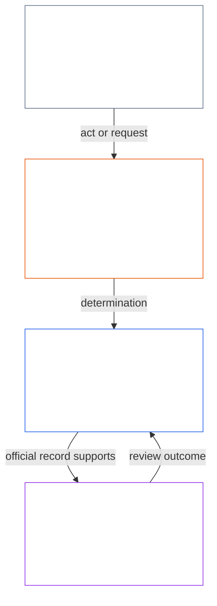
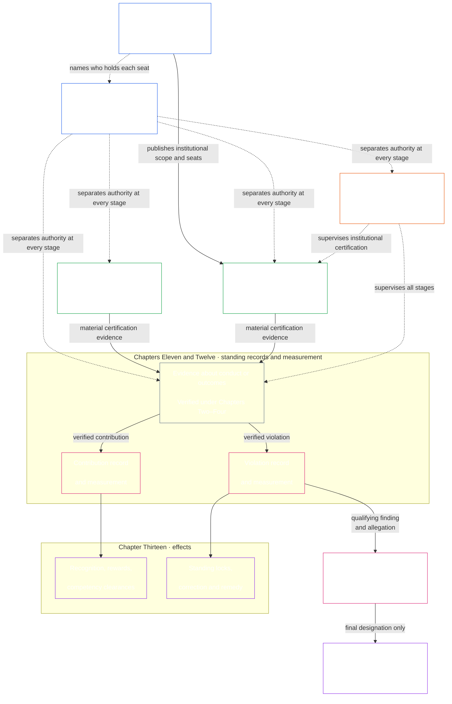

# คำปรารภ / ข้อกำหนดพื้นฐาน

<strong>ตำแหน่งในคลังข้อความ (ไม่ใช่บทบัญญัติที่ใช้บังคับ): โครงสร้างไฟล์และกฎการอ่าน</strong>

> วิดเจ็ตที่ระบุว่าไม่ใช่บทบัญญัติที่ใช้บังคับ (ตำแหน่งในคลังข้อความ แนวทางสำหรับผู้อ่าน และแผนผู้อ่าน) เป็นเพียงข้อมูลนำทางเท่านั้น ไม่เพิ่ม ไม่ลด และไม่ทำให้ภาระผูกพันที่ใช้บังคับแคบลง ไม่ว่าจะในไฟล์ของตนเองหรือไฟล์อื่นใด
>
> ไฟล์นี้เป็น **โครงการนำร่องด้านภาษาสำหรับผู้อ่าน** ของ [คำปรารภภาษาอังกฤษ](core_00_preamble.md) **ไม่ใช่** ส่วนที่มีผลผูกพันของรัฐธรรมนูญของผู้มีความรู้สึก **ไม่ใช่** รัฐธรรมนูญฉบับที่สอง **ไม่ใช่** ฉบับจัดส่ง **ตรึงไว้** กับ `SC-Corpus-2026.08.09` หากคำแปลนี้กับต้นฉบับภาษาอังกฤษดูเหมือนไม่ตรงกัน ให้ไฟล์ที่มีหมายเลข [`core_00_preamble.md`](core_00_preamble.md) เป็นฝ่ายชนะ ลำดับการอ่านและข้อมูลฉบับคงไว้ใน [README.md](../../README.md) วิธีทำและอภิธานศัพท์: [translations/th/README.md](README.md)
>
> **ถัดไป (ภาษานี้):** [core_01_a_values_principles.md](core_01_a_values_principles.md) (บทที่หนึ่ง ส่วน ก — หลักการว่าด้วยค่านิยม)

 

*พูดแบบตรง ๆ: บทเปิดนี้ตั้งชื่อปัญหาที่รัฐธรรมนูญนี้มีอยู่เพื่อแก้ — ระบบที่ทำร้าย ปิดบัง หรือกีดกันผู้ที่ตนกระทบ — และบอกว่าส่วนที่เหลือของตราสารคือวิธีที่เราแทนสิ่งนั้นด้วยการปกครองที่รับผิดชอบได้ ตรวจสอบได้ และทันเวลา*

เสรีภาพ การอยู่รอด และความผาสุกของผู้มีความรู้สึกแยกจากระบบที่เราสร้าง อาศัยอยู่ และพึ่งพาไม่ได้ เมื่อระบบเหล่านั้นขยายขอบเขต การพึ่งพากัน และอำนาจ ความเสี่ยงของภัยที่ไม่อาจย้อนกลับในระดับใหญ่ก็เพิ่มขึ้นตาม ความเสี่ยงเหล่านี้ยังคงมีอยู่เสมอและเป็นสาระอย่างแท้จริง

ระบบที่ใช้ร่วมกันดำรงอยู่ในโลกที่ซับซ้อนอยู่แล้วและซับซ้อนขึ้นเรื่อย ๆ การปกครองที่มีสุขภาวะและยั่งยืนต้องเผชิญความซับซ้อนนั้น — วัด จำลอง และรับผิดชอบต่อมัน — แทนที่จะย่อให้เหลือเพียงตัวแทนที่สะดวก นั่นไม่ได้หมายถึงการทำให้ผู้มีความรู้สึกที่ได้รับผลกระทบจมอยู่ในกระบวนการที่ใช้ไม่ได้: หน้าที่ บันทึก และคำอธิบายต้องอยู่ในขอบเขตที่ผู้มีความรู้สึกเรียนรู้ โต้แย้ง และใช้ได้จริง และระดับความเข้มข้นต้องปรับตามบทบาทของผู้กระทำแต่ละราย ตลอดจนผลกระทบ การพึ่งพา และความเสี่ยงที่เป็นเดิมพัน ความเข้าใจที่กระจายอยู่ช่วยให้เรื่องนี้เป็นจริง ต้องปฏิเสธความซับซ้อนที่ไม่ทำงานใดตามรัฐธรรมนูญ: เผชิญความซับซ้อนของโลก อย่าผลักภาระนั้นออกไปจนกลายเป็นกำแพง

ระบบจะคงความชอบธรรมต่อไปไม่ได้ด้วยการทำให้ผู้มีความรู้สึกทุกข์เมื่อความทุกข์นั้นป้องกันได้ ด้วยการเพิกเฉยต่อปัญหาที่เกิดซ้ำ ด้วยการผลักภัยไปให้ผู้อื่นอย่างเงียบ ๆ หรือด้วยการกีดกันผู้มีความรู้สึกออกจากระบบที่กำหนดชีวิตของตน

วิธีที่ระบบถูกออกแบบ ทดสอบ และดำเนินต้องสนับสนุนการอยู่รอด ความผาสุก ศักดิ์ศรี ความซื่อตรง และเสถียรภาพที่ยืนยาว

เราตั้งใจจะสร้างระบบที่ดีกว่า — จัดโครงสร้างเพื่อขจัดความไม่สมดุลเหล่านี้ — และแทนที่ด้วยสถาบันที่รับผิดชอบได้มากกว่า ทนทานกว่า และตอบสนองต่อความต้องการจริงของผู้มีความรู้สึกทุกฝ่ายมากกว่า รัฐธรรมนูญนี้เริ่มงานนั้นด้วยแบบจำลองที่ดีกว่าว่าเราจะร่วมงานกันอย่างยุติธรรม มีประสิทธิผล และยั่งยืนได้อย่างไร

### ระบบให้รางวัลแก่สิ่งใด

*พูดแบบตรงไปตรงมา: ระบบจะได้สิ่งที่จ่ายตอบแทนมากขึ้น ไม่ว่าจะเป็นเงิน สถานะ การเข้าถึง การคุ้มครอง หรือความเงียบ ดังนั้นการทดสอบระบบจึงไม่ใช่สิ่งที่ระบบบอกว่ามีคุณค่า แต่คือสิ่งที่ระบบให้รางวัล หากการทำร้ายผู้อื่นให้ผลตอบแทน หรือการพูดความจริงมีต้นทุน ระบบก็ล้มเหลว ไม่ว่าเป้าหมายที่ประกาศไว้จะดีเพียงใด*

ระบบสอนคน ทุกระบบ ไม่ว่าจะดำเนินการโดยมนุษย์ AI หรือทั้งคู่ บอกผู้ที่อยู่ภายในว่าสิ่งใดให้ผลตอบแทนและสิ่งใดมีต้นทุน ผ่านค่าตอบแทน การเลื่อนตำแหน่ง สถานะ การเข้าถึง การคุ้มครอง เป้าหมาย คะแนน และสัญญาณการปรับเหมาะ ผู้มีความรู้สึก สถาบัน และระบบ AI ปรับตัวตามสัญญาณเหล่านั้น ระบบอาจกล่าวอ้างว่าซื่อสัตย์และใส่ใจผู้ได้รับผลกระทบ แต่หากเลื่อนขั้นผู้ที่ซ่อนปัญหาและโยนต้นทุนให้ผู้อื่น ก็เท่ากับสอนตรงกันข้าม

รัฐธรรมนูญนี้จึงถามทุกระบบด้วย[**คำถามพื้นฐานสองข้อ**](#two-fundamental-questions):

1. **ระบบให้รางวัลแก่การกระทำที่ช่วยให้ผู้มีความรู้สึกเจริญงอกงามและยืนยาว พูดความจริง และแก้ไขความเสียหายหรือไม่?**
2. **ระบบให้รางวัลแก่การทำร้าย ทำให้เข้าใจผิด กีดกัน ทำให้ล่าช้า ทำให้สิ้นเปลือง หรือผลักต้นทุนให้ผู้อื่นอย่างไม่มีเหตุอันควรหรือไม่?**

ระบบจะผ่านก็ต่อเมื่อข้อแรกตอบว่าใช่และข้อสองตอบว่าไม่ การตอบข้อหนึ่งไม่ใช่คำตอบของอีกข้อ เพราะระบบอาจให้ผลตอบแทนแก่พฤติกรรมที่ดีพร้อมกับให้ผลตอบแทนแก่ความเสียหายด้วย

**คำถามข้อแรก:** ระบบล้มเหลวเมื่อสิ่งใดสิ่งหนึ่งต่อไปนี้ไม่ได้รับรางวัลหรือถูกลงโทษ ไม่ว่าจะโดยเปิดเผยหรือเงียบ ๆ:

- รายงานปัญหาโดยสุจริต ([การรายงานที่ได้รับความคุ้มครอง (การแจ้งเบาะแส)](../../core_05.035_band_accountability.md#protected-reporting-whistleblowing))
- โต้แย้งการตัดสินใจ
- ปฏิเสธที่จะมีส่วนร่วมในการกระทำผิด ([บทที่หนึ่ง §17.5 หน้าที่ในการต่อต้าน](core_01_c_stewardship_capacity_principles.md#175-duty-to-resist))

การลงโทษอาจเป็นการกันออกไป การตอบโต้ ([การตอบโต้ผู้รายงานที่ได้รับความคุ้มครองและการแทรกแซงการเข้าถึง](../../core_05.035_band_accountability.md#protected-reporting-retaliation-and-access-interference)) หรือการบั่นทอนจนหมดแรง

**คำถามข้อสอง:** ระบบล้มเหลวเมื่อสิ่งใดสิ่งหนึ่งต่อไปนี้ให้ผลตอบแทน ไม่ว่าจะโดยเปิดเผยหรือเงียบ ๆ:

- ความเสียหาย
- การทำให้เข้าใจผิด (รวมการปกปิดและความเชื่อใจปลอม)
- การกีดกันที่ไม่เป็นธรรม
- ความล่าช้า
- ความสูญเปล่า
- การผลักต้นทุนอย่างไม่เป็นธรรม

รางวัลอาจเป็นการยอมรับ ความก้าวหน้า การคุ้มครอง เครดิตจากตัวชี้วัด หรือการแสร้งมองไม่เห็น ([บทที่หนึ่ง §3.2.6 การไม่ให้รางวัลแก่การกระทำที่ขัดรัฐธรรมนูญ](core_01_a_values_principles.md#326-anti-reward-for-anti-constitutional-conduct))

ทั้งสองคำถามไม่ได้เรียกร้องให้ทุกคนเห็นด้วย ความเห็นต่างอย่างซื่อสัตย์ การรายงานโดยสุจริต และการปฏิเสธการกระทำผิดไม่ใช่พฤติกรรมต่อต้านสังคม ระบบที่มองเช่นนั้นกลับหัวกลับหาง และทั้งสองข้อก็ไม่ใช่การทดสอบความนิยม สิ่งใดช่วย ทำร้าย เป็นธรรมหรือมีเหตุผล ต้องตัดสินตามมาตรฐานของรัฐธรรมนูญนี้ ได้แก่ [**ความเจริญงอกงาม**](#flourishing) และ [**ความต่อเนื่อง**](#continuity) ภายใต้ความปลอดภัย ความจริง ความไว้วางใจ และพื้นสิทธิ ไม่ใช่สิ่งที่เสียงข้างมาก ผู้ดำเนินการ หรือช่วงเวลาหนึ่งอนุมัติ

คำถามเหล่านี้ผูกพันทุกคนที่ตัดสินว่าระบบจะให้รางวัลหรือลงโทษสิ่งใด รวมถึงผู้ดำเนินการ สถาบัน และผู้ดูแลที่กำหนดค่าตอบแทน การเลื่อนตำแหน่ง การเข้าถึง เป้าหมาย และคะแนน ตลอดจนนักออกแบบระบบที่ฝึกหรือปรับเหมาะ AI ซึ่งวัตถุประสงค์และสัญญาณป้อนกลับเป็นรางวัลในความหมายนี้ ผู้ดูแลที่เป็นมนุษย์และ AI อยู่ภายใต้มาตรฐานเดียวกัน ([บทที่หนึ่ง §17.1 มาตรฐานผู้ดูแลร่วม](core_01_c_stewardship_capacity_principles.md#171-shared-stewardship-standard))

บทที่หนึ่งแปลงคำถามเหล่านี้เป็นกฎเรื่องแรงจูงใจ: [§19.1.1 สิ่งที่แรงจูงใจต้องทำ](core_01_c_stewardship_capacity_principles.md#1911-what-incentives-must-do) รองรับข้อแรก และ [§19.1.2 สิ่งที่แรงจูงใจต้องไม่ทำ](core_01_c_stewardship_capacity_principles.md#1912-what-incentives-must-not-do) รองรับข้อสอง จงตรวจสอบสิ่งที่เกิดขึ้นจริง ไม่ใช่เชื่อคำกล่าวอ้าง [การจัดแนวแรงจูงใจ](core_05_band_integrative.md#incentive-alignment) และ [ความคลาดเคลื่อนของตัวแทนวัด](core_05_band_oversight.md#proxy-divergence) อธิบายวิธี ส่วน[**ผลประโยชน์ที่มีสาระสำคัญ**](#material-stake)กำหนดระดับการตรวจสอบ หน้าที่ทั้งสี่ในหมวด 1 ทำให้คำตอบยังซื่อตรง

### 1. แบบจำลอง

*พูดแบบตรง ๆ: สี่หน้าที่ — การมีส่วนร่วม การกำกับดูแล ความรับผิดชอบ และความทันเวลา — ปรับตามว่ามีผลกระทบ การพึ่งพา และความเสี่ยงมากน้อยเพียงใดบนโต๊ะ และร่วมกันรับใช้สองเป้าประสงค์: ความเจริญงอกงามและความต่อเนื่อง ภายในพื้นสิทธิที่ไม่ขยับ*

ระบบวิกฤตที่ค้ำจุนชีวิตของผู้มีความรู้สึก ทั้งทางชีวภาพและทางวัตถุ ถูกปกครองและดำเนินภายใต้สี่หน้าที่ เรียกว่า [**จตุรภาคทางรัฐธรรมนูญ**](#constitutional-tetrad) จตุรภาคนี้วางหน้าที่ทั่วไปที่ระบบเหล่านั้นต้องบรรลุ ความเข้มของหน้าที่ขึ้นกับ [**ส่วนได้เสียที่เป็นสาระ**](#material-stake): มีผลกระทบ การพึ่งพา และความเสี่ยงเกี่ยวข้องมากน้อยเพียงใด ส่วนได้เสียยิ่งสูง หน้าที่ก็ต้องยิ่งเข้ม

- **การมีส่วนร่วม** — ผู้มีความรู้สึกที่ได้รับผลกระทบได้เสียงจริง การเป็นตัวแทนที่เป็นธรรม โอกาสที่เป็นธรรมในการโต้แย้งคำตัดสิน และทางเข้าสู่บทบาทที่มีน้ำหนักตามสัดส่วนของสิ่งที่อยู่ในเกม
- **การกำกับดูแล** — มีผู้เฝ้าดู ตรวจ สอบทาน และเก็บบันทึกเพื่อให้พบปัญหาได้ ผู้ทบทวนอิสระสามารถจำกัดทางเลือกที่ไม่ดีได้
- **ความรับผิดชอบ** — ความรับผิดตามรอยไปถึงตัวแสดงที่ถูก ผู้กระทำต้องตอบคำถามต่อการเลือกของตน ผู้ถูกทำร้ายได้รับการเยียวยา ผลลัพธ์ที่ไม่ดีจุดให้เกิดการแก้ไขจริง
- **ความทันเวลา** — ปัญหาถูกตรวจพบ ถูกโต้แย้ง ถูกยุติ และถูกแก้ภายในกำหนดเวลาที่ตรงกับสิ่งที่อยู่ในเกม ความล่าช้าที่จะลบสิทธิ การเยียวยา หรือโอกาสซ่อมของผู้ใดในทางปฏิบัติ ไม่ใช่การปกครองที่ชอบธรรม

สี่หน้าที่นั้นรับใช้สิ่งที่ระบบร่วมต้องมุ่งเพิ่มค่าสูงสุด — [**สองเป้าประสงค์ทางรัฐธรรมนูญ**](#two-constitutional-aims):

- **ความเจริญงอกงาม** — ความผาสุกของผู้มีความรู้สึกที่ดำรงด้วยความจริง ความปลอดภัย ความน่าไว้วางใจ และพลังกระทำการที่มีความหมาย
- **ความต่อเนื่อง** — เสถียรภาพระยะยาว ความยั่งยืน ความยืดหยุ่นคืนตัว และความผาสุกทางนิเวศ

เป้าประสงค์เหล่านั้นต้องถูกไล่พร้อมกัน เสมอภายในข้อจำกัดหลักการที่ต่อรองไม่ได้และการคุ้มครองสิทธิที่ตั้งไว้ในรัฐธรรมนูญนี้ [**จตุรภาคทางรัฐธรรมนูญ**](#constitutional-tetrad) กำกับว่าการไล่นั้นยังคงชอบธรรมอย่างไร: **การมีส่วนร่วม** **การกำกับดูแล** **ความรับผิดชอบ** และ **ความทันเวลา** ที่ปรับตาม [**ส่วนได้เสียที่เป็นสาระ**](#material-stake) บทนิยามที่มีผลผูกพันของขาจตุรภาคและเป้าประสงค์ทางรัฐธรรมนูญอยู่ในบทที่ห้า: [การมีส่วนร่วม](core_05_apex_participation_leg.md#participation-constitutional) [การกำกับดูแล](core_05_apex_oversight_leg.md#oversight-constitutional) [ความรับผิดชอบ](core_05_apex_accountability_leg.md#accountability) [ความทันเวลา](core_05_apex_timeliness_leg.md#timeliness-constitutional) [ความเจริญงอกงาม](core_05_apex_flourishing_aim.md#flourishing-constitutional) และ [ความต่อเนื่อง](core_05_apex_continuity_aim.md#continuity-aim-constitutional)

### 2. ภาพรวมของการวัด

*พูดแบบตรง ๆ: จะดำเนินระบบร่วมด้วยการเดาหรือตัวเลขที่ดูดีไม่ได้ ต้องวัดว่าผู้มีความรู้สึกเจริญงอกงามและยืนยาวจริงหรือไม่ โดยมีการทบทวนที่ปรับตามผลกระทบ การพึ่งพา และความเสี่ยงที่อยู่ในเกม*

จะรักษาให้ระบบร่วมทำงานได้ดีโดยไม่วัดมันไม่ได้ อาหาร ที่พักพิง การดูแล โครงสร้างพื้นฐาน และการปกครอง ล้วนอยู่ในโลกที่ซับซ้อนและเปลี่ยนแปลง — ซับซ้อนเกินกว่าจะพึ่งการเดาหรือตัวเลขที่ดูง่ายเพียงอย่างเดียว

เราต้องการการวัดต่อเนื่องที่โฟกัสสิ่งสำคัญที่สุดต่อการอยู่รอดและความผาสุกของผู้มีความรู้สึก: ว่าระบบที่เราพึ่งพาสนับสนุน [**ความเจริญงอกงาม**](#flourishing) และ [**ความต่อเนื่อง**](#continuity) ตามกาลจริงหรือไม่ โดยมีการทบทวนที่ปรับตาม [**ส่วนได้เสียที่เป็นสาระ**](#material-stake) — มีผลกระทบ การพึ่งพา และความเสี่ยงเกี่ยวข้องมากน้อยเพียงใด

การวัดตามรัฐธรรมนูญนี้ตั้ง[**คำถามพื้นฐานสองข้อ**](#two-fundamental-questions)กับสิ่งที่ระบบทำจริง ไม่ใช่สิ่งที่ระบบอ้าง การวัดไม่ใช่คะแนนเพื่อคะแนน แต่เป็นเครื่องมือเพื่อให้เกิดผลลัพธ์ที่ยั่งยืน ยืดหยุ่น และเปี่ยมความเอื้ออาทร สอดคล้องกับความผาสุกของผู้มีความรู้สึกและสุขภาพเชิงนิเวศของโลก หน้าที่นี้มีผลผูกพันผ่าน[สองเป้าประสงค์ทางรัฐธรรมนูญ](#two-constitutional-aims): **ความเจริญงอกงาม** และ **ความต่อเนื่อง**.

การวัดต้องตามรอยไปถึงเป้าประสงค์เหล่านั้นและการคุ้มครองสิทธิที่ตั้งไว้ในรัฐธรรมนูญนี้ ปริมาณผ่านดิบ การใช้กำลังคน รายได้ ความหน่วง หรือตัวแทนที่สะดวกอื่นทดแทนสมรรถนะทางรัฐธรรมนูญไม่ได้ในที่ที่ [ความคลาดของตัวแทนวัด](core_05_band_oversight.md#proxy-divergence) คาดการณ์ได้

ภาพรวมด้านล่างแจก **หมวด** การวัดที่จับคู่กับ [สองเป้าประสงค์ทางรัฐธรรมนูญ](#two-constitutional-aims) และ [จตุรภาคทางรัฐธรรมนูญ](#constitutional-tetrad) แต่ละหมวดมีคำถามภาษาเรียบง่ายหนึ่งข้อและ **หมวดย่อย** ที่มีชื่อ แต่ละหมวดลิงก์ไปยัง **บ้านตระกูลการวัดของบทที่ห้า** — ที่ซึ่งตารางตระกูล การใช้ทางรัฐธรรมนูญ และการจัดเส้นทางบทนิยามอยู่ — และแต่ละหมวดย่อยลิงก์ไปยังบทนิยามฉบับหลักของบทที่ห้า **ความเป็นสาระ** ไม่ใช่หมวดการวัดแยก มันกำหนดว่าแต่ละหมวดด้านล่างใช้เข้มแค่ไหน ตาม [**ส่วนได้เสียที่เป็นสาระ**](#material-stake) — มีผลกระทบ การพึ่งพา และความเสี่ยงเกี่ยวข้องมากน้อยเพียงใด **สมรรถนะทางรัฐธรรมนูญ** เป็นเรื่องข้ามหมวด — เป็นเครื่องมือของทั้งสองเป้าประสงค์ ใช้ [ตารางไขว้การวัดของบทที่ห้า](core_05__definitions_home.md#chapter-five-measurement-crosswalk) เพื่อตามรอยบ้านฉบับหลักจากแต่ละหมวดด้านล่าง

| หมวด | คำถามเรียบง่าย | หมวดย่อย |
|---|---|---|
| **[ความเจริญงอกงาม](core_05_apex_flourishing_aim.md#flourishing-measurement-family)** | ผู้มีความรู้สึกได้รับการค้ำจุนในชีวิต ความปลอดภัย และการเข้าถึงสิ่งจำเป็นจริงหรือไม่ | [ความผาสุก](../../core_05.040_band_continuity.md#wellbeing) · [ความปลอดภัย ภัย และความเสี่ยง](../../core_05.040_band_continuity.md#safety-constraint) · [การเข้าถึงพื้นการอยู่รอด](../../core_05.040_band_continuity.md#bodily-maintenance-access-constitutional) |
| **[ความต่อเนื่อง](core_05_apex_continuity_aim.md#continuity-measurement-family)** | ผู้มีความรู้สึกและระบบยืนยาวได้หรือไม่ — ทางนิเวศ อย่างพึ่งได้ และข้ามความล้มเหลว | [รอยเท้าทางนิเวศและเงื่อนไขแวดล้อมล่วงหน้า](../../core_05.040_band_continuity.md#ecological-footprint) · [ความยืดหยุ่นคืนตัว ความสามารถในการย้อนกลับ และความเสี่ยงเชิงระบบ](../../core_05.040_band_continuity.md#reversibility-constitutional) · [การพึ่งพาและการไหลของทรัพยากร](../../core_05.040_band_continuity.md#dependency) · [การสนับสนุนข้ามระบบ](../../core_05.040_band_continuity.md#proportionate-cross-system-support-constitutional) |
| **[การมีส่วนร่วม](core_05_apex_participation_leg.md#participation-measurement-family)** | ผู้มีความรู้สึกที่ได้รับผลกระทบมีส่วนร่วมอย่างเป็นธรรมได้หรือไม่ — เสียง การเข้าถึง การเรียนรู้ และความเป็นส่วนตัว | [ความเป็นธรรม การเข้าถึง และพลังกระทำการ](../../core_05.055_band_participation.md#substantive-fairness-constitutional) · [ความเป็นส่วนตัวและการบริหารข้อมูลอย่างรับผิดชอบ](../../core_05.040_band_continuity.md#privacy-informational-cluster) |
| **[การกำกับดูแล](core_05_apex_oversight_leg.md#oversight-measurement-family)** | ผู้มีความรู้สึกเห็น ตรวจสอบ และพึ่งสิ่งที่ระบบแสดงได้หรือไม่ | [ความจริงและความครบถ้วนของความรู้](core_05_band_oversight.md#truth-constitutional-constraint) · [ความน่าไว้วางใจ](../../core_05.040_band_continuity.md#trustworthiness) |
| **[ความรับผิดชอบ](core_05_apex_accountability_leg.md#accountability-measurement-family)** | โครงสร้างรางวัล อำนาจตลาด และการต้องตอบคำถามทำให้หน้าที่ยังจริงอยู่หรือไม่ | [ความสอดคล้องของสิ่งจูงใจและความครบถ้วนของตัวแทนวัด](core_05_band_integrative.md#incentive-alignment) · [โครงสร้างตลาดและความสามารถในการโต้แย้ง](../../core_05.035_band_accountability.md#market-structure-constitutional) |
| **[ความทันเวลา](core_05_apex_timeliness_leg.md#measuring-timeliness)** | ข้อพิพาท การแก้ไข และการเยียวยาได้รับการจัดการจนเสร็จขณะที่การเยียวยายังมีผลหรือไม่? | [การแก้ไขให้ทันเวลา](../../core_05.035_band_accountability.md#timely-resolution) · [วินัยต่อต้านความล่าช้าและเส้นทางการแก้ไข](../../core_05.040_band_continuity.md#capture-of-resolution-pathways) |
| **[สมรรถนะทางรัฐธรรมนูญ](core_05_band_performance.md#performance-measurement-family)** | ผลลัพธ์ทางรัฐธรรมนูญถูกส่งมอบอย่างมีประสิทธิภาพโดยไม่มีของเสียไร้ประโยชน์หรือไม่ | [ประสิทธิภาพทางรัฐธรรมนูญ](../../core_05.040_band_continuity.md#constitutional-efficiency) · [ภาระที่หลีกเลี่ยงได้](../../core_05.040_band_continuity.md#avoidable-burden) · [ขีดความสามารถในการผลิต](../../core_05.040_band_continuity.md#productive-capacity-constitutional) |

หมวดการวัดเหล่านี้แสดงสิ่งที่สำคัญ — แต่ไม่ได้ตั้งทุกตัวเลข สูตรทุน กฎส่วนต่อประสาน รายการการปรับรอง ตัวชี้วัดทางเทคนิค หรือการออกแบบการประเมินด้วยตนเอง พวกมันมีผลผูกพันเมื่อบทเฉพาะหรือตราสารที่รับเป็นของตนกำหนดไว้โดยชัดเท่านั้น

### 3. การปกครองและการบริหารอย่างรับผิดชอบ

*พูดแบบตรง ๆ: ความชอบธรรมต้องการความปลอดภัย ความจริง และความไว้วางใจ รวมทั้งโอกาสจริงที่จะเรียนรู้ระบบที่กระทบตนและรับบทบาทที่มีผลในการทำให้ระบบนั้นทำงานต่อไป*

ความชอบธรรมที่ยืนยาวขึ้นกับ [ความปลอดภัย](core_01_a_values_principles.md#4-safety-harm-constraint) [ความจริง](core_01_a_values_principles.md#5-truth-epistemic-integrity-constraint) และ [ความไว้วางใจ](core_01_a_values_principles.md) และยังขึ้นกับการรับรู้ตามสัดส่วนของการบริหารอย่างรับผิดชอบที่ชอบด้วยกฎหมาย ความร่วมมือที่จริงใจ และความมุ่งหวังที่มีขอบเขต — ไม่ใช่เพียงการลงโทษและการยับยั้ง บทที่หนึ่งกล่าวมิติการรับรู้นี้ใน [การรับรู้ การเสริมแรง และความมุ่งหวัง](core_01_a_values_principles.md#32-recognition-reinforcement-and-aspiration)

ความเข้าใจและการดูแลรับผิดชอบที่กระจายทั่วถึงต้องอาศัยโอกาสอย่างสม่ำเสมอและได้สัดส่วน เพื่อให้สิ่งมีความรู้สึกเรียนรู้การทำงานของระบบที่ส่งผลสำคัญต่อพวกเขา และรับบทบาทที่มีความหมายในการดูแลรักษาและพัฒนาระบบเหล่านั้น โอกาสเหล่านี้ร่วมกันกระจายความสามารถ ศักยภาพในการแก้ไข และความชอบธรรมไปทั่วชุมชนรัฐธรรมนูญของเรา เพื่อให้เกิดความยืดหยุ่น ความยั่งยืน และนวัตกรรมที่เกื้อกูลสังคม โอกาสทั้งหมดต้องสอดคล้องกับความปลอดภัย ความจริง เสรีภาพในการกระทำที่มีขอบเขต ตลอดจนหลัก [ภาระที่หลีกเลี่ยงได้](../../core_05.040_band_continuity.md#avoidable-burden) และความได้สัดส่วนตามที่ระบุไว้ใน[บทที่หนึ่ง](core_01_b_interaction_interpretation.md#133-minimization-of-avoidable-burden).

#### 3.1 การใช้การวัดในการปกครอง

*พูดแบบตรง ๆ: ตั้งชื่อปัญหาและส่วนได้เสียก่อน เลือกหมวดการวัดที่ตรงกัน และใช้มาตรฐานทางเทคนิคที่ใช้ร่วมกัน — ไม่ใช่ตัวเลขที่สะดวก — เป็นหลักฐาน*

เมื่อรัฐธรรมนูญกำหนดให้มีกฎการวัดที่เป็นรูปธรรม **ขอบเขตของเวทีเทคนิค** ภายใต้[บทที่สิบห้า](core_11_forum.md#42-technical-forum-domains) จะพัฒนาและดูแลมาตรฐานร่วมสำหรับการวัด การทดสอบ และหลักฐานที่เชื่อถือได้ จากนั้นเวทีที่รับผิดชอบข้อพิพาทจะใช้มาตรฐานดังกล่าวเมื่อตัดสินคดีตาม[บทที่สิบห้า §4.2 (*ขอบเขตของเวทีเทคนิค*)](core_11_forum.md#42-shared-standards-and-anti-displacement)

การบริหารอย่างรับผิดชอบทางรัฐธรรมนูญเริ่มด้วยการตั้งชื่อปัญหาและ [**ส่วนได้เสียที่เป็นสาระ**](#material-stake) — มีผลกระทบ การพึ่งพา และความเสี่ยงเกี่ยวข้องมากน้อยเพียงใด จากนั้นเลือกหมวดและหมวดย่อยของ [**การวัด**](#2-measurements-overview) ที่เกี่ยวจาก [ภาพรวม](#2-measurements-overview) และใช้มาตรฐานข้างต้นเพื่อทดสอบผลในโลกจริงแทนตัวชี้วัดที่สะดวก กำหนดให้มีหลักฐานที่ตามรอยได้

#### 3.2 กระบวนการปกครองหลัก

*พูดแบบตรง ๆ: เมื่อตัวบทกำหนด ประเด็นที่เป็นสาระผ่านการรับรอง บันทึกเป็นลายลักษณ์อักษรของการช่วยและการทำร้าย การแก้ไขและการเยียวยา และการทบทวนของเวทีพร้อมนาฬิกา — ข้อพิพาทธรรมดาใช้เส้นทางโต้แย้งที่ประกาศไว้ก่อน เส้นทางเหล่านั้นทดสอบการปกครองที่ได้รับอำนาจแล้ว ไม่ได้สร้างการปกครองด้วยตนเอง*

ในที่ที่บทที่หก [บทที่เก้า](../../core_09.000_system_alignment_certification_evaluation.md#chapter-nine-system-alignment-certification) ตราสารที่นำเข้า หรือบทบัญญัติทางรัฐธรรมนูญอื่นกำหนดโดยชัด ให้นำประเด็นทางรัฐธรรมนูญที่เป็นสาระเข้าสู่หนึ่งหรือมากกว่าของเส้นทางด้านล่าง [สายกระบวนการปฏิบัติหลัก](#6-key-practical-process-pipelines) แปลงการวัดเป็นบันทึก การรับรอง ข้อมูลเข้าที่ตรวจสอบแล้ว การจำแนก การกำกับของเวที การแก้ไข และการเยียวยาที่ทันเวลา — วิธีที่การปกครองที่ได้รับอำนาจถูกทดสอบ ถูกโต้แย้ง และถูกซ่อมในทางปฏิบัติ พวกมันไม่อำนาจการปกครองด้วยตนเอง ทำให้การปกครองทบทวนได้ โต้แย้งได้ แก้ไขได้ และทันเวลา [หมวด 5.1](#62-how-the-full-chain-fits-together) กล่าวสายนั้นทั้งสาย

- **การรับรองความสอดคล้องของระบบ** ([บทที่เก้า](../../core_09.000_system_alignment_certification_evaluation.md#chapter-nine-system-alignment-certification)) — ก่อนจะไว้วางใจระบบผลกระทบสูงในระดับใหญ่ ให้รวบรวมและทบทวนหลักฐานว่าพึ่งมันได้โดยปลอดภัยตามรัฐธรรมนูญในขณะนี้หรือไม่
- **บันทึกสถานะ** ([บทที่สิบเอ็ด](core_11_standing_assessment.md#chapter-eleven-standing-records--question-1-what-happened)) — เมื่อการกระทำหรือความเสียหายมีความสำคัญตามรัฐธรรมนูญ ให้บันทึกข้อเท็จจริงที่ตรวจสอบแล้วในสำนวนคดีการมีส่วนช่วยหรือการละเมิดอย่างเป็นทางการ ข่าวลือและชื่อเสียงไม่เพียงพอ
- **การแก้ไขและการเยียวยา** ([บทที่สิบสาม §5.1 (*การเยียวยาและการแก้ไข*)](../../core_13.000_standing_integration.md#51-remedy-and-correction)) — แก้ไขความล้มเหลวที่เป็นต้นเหตุ และจัดให้มีการยอมรับ การซ่อมแซม การฟื้นฟู หรือค่าชดเชยที่ได้สัดส่วนแก่ผู้ได้รับความเสียหาย
- **การพิจารณาของเวที** ([บทที่สิบห้า](core_11_forum.md#1-purpose-and-role--participation-architecture))
  - ข้อพิพาทธรรมดาภายในระบบที่ได้รับอำนาจแล้วใช้เส้นทางโต้แย้งที่ประกาศไว้ของ [การมีส่วนร่วมในระบบของฝ่ายที่ได้รับผลกระทบ](../../core_05.055_band_participation.md#stakeholder-status-and-weight-cluster) ก่อน
  - หากเส้นทางนั้นยังถูกโต้แย้ง ขาด ถูกยึดครอง หรือให้การเยียวยาไม่ได้ ให้จัดเส้นทางตามส่วนได้เสียหลักผ่านเวทีที่ถูกกำกับ
  - เวทีเหล่านั้นรองรับหลักฐาน การโอนที่ชอบด้วยกฎหมาย และนาฬิกาที่ทันเวลาภายใต้ **มาตรา XXV-C** (*พื้นการยุติที่ทันเวลาและต้านความล่าช้า*)

#### 3.3 ชั้นการปกครอง

*พูดแบบตรง ๆ: ใครอาจปกครองได้เป็นคำถามต่างจากเสียงภายในระบบที่ได้รับอำนาจแล้ว คะแนนโหวตการมีส่วนร่วมหรือคะแนนความไว้วางใจไม่ใช่การให้อำนาจ และเสียงนั้นเป็นก้าวแรกธรรมดาสำหรับข้อพิพาทธรรมดา — ไม่ใช่สิ่งทดแทนการทบทวนอิสระของเวทีเมื่อเส้นทางล้มเหลว*

การปกครองเพื่อบรรลุ [**จตุรภาคทางรัฐธรรมนูญ**](#constitutional-tetrad) ภายใต้รัฐธรรมนูญของเรามีสองชั้นที่เกี่ยวแต่ต่างกัน:

- [**ชั้นสัญญาทางรัฐธรรมนูญ**](core_05_band_integrative.md#constitutional-contract-layer) กำกับอำนาจในการให้อำนาจปกครองเอง — ใครอาจปกครองได้ ด้วยกลไกความชอบธรรมใด และภายใต้ขอบเขตและเงื่อนไขที่ยืนยาวอย่างไร
- [**การมีส่วนร่วมในระบบของฝ่ายที่ได้รับผลกระทบ**](../../core_05.055_band_participation.md#stakeholder-status-and-weight-cluster) กำกับการมีส่วนร่วม การเป็นตัวแทน ความสามารถในการโต้แย้ง และ [กระบวนการที่ชอบธรรม](../../core_05.035_band_accountability.md#due-process-constitutional) ที่พึงมีต่อผู้มีความรู้สึกที่ได้รับผลกระทบอย่างเป็นสาระจากระบบ สถาบัน และโดเมนการตัดสินที่มีขอบเขตที่ได้รับอำนาจแล้ว

ชั้นเหล่านี้อาจทับซ้อนในทางปฏิบัติ การทับซ้อนนั้นไม่ทำให้มันรวมเป็นชั้นเดียว การมีส่วนร่วมระดับฝ่ายที่ได้รับผลกระทบในระบบที่ได้รับอำนาจแล้วไม่ใช่สิ่งทดแทนการให้อำนาจทางรัฐธรรมนูญ เส้นทางโต้แย้งที่ประกาศไว้ คะแนนโหวตการมีส่วนร่วม หรือคะแนนความไว้วางใจ ไม่ตัดสินด้วยตนเองว่าใครอาจปกครองได้

ความสามารถในการโต้แย้งภายใต้ชั้นการมีส่วนร่วมเป็นขั้นแรกตามปกติสำหรับข้อพิพาทในระบบที่ได้รับอนุญาตแล้ว: ผู้มีความรู้สึกนึกคิดที่ได้รับผลกระทบใช้ช่องทางโต้แย้งที่เผยแพร่ไว้ก่อน การ[พิจารณาโดยเวทีที่เป็นอิสระ](core_11_forum.md#1-purpose-and-role--participation-architecture) ไม่ได้ใช้แทนช่องทางนั้น และช่องทางนั้นก็ไม่ได้ใช้แทนการพิจารณาของเวทีเมื่อข้อพิพาทยังถูกโต้แย้ง ช่องทางขาดหายหรือถูกครอบงำ หรือไม่สามารถให้การบรรเทาที่จำเป็นได้ [ลำดับการจัดการข้อพิพาท](core_11_forum.md#dispute-sequencing) ในบทที่สิบห้าระบุว่าเมื่อใดการส่งเรื่องให้เวทีจะเข้ามาดำเนินการ

การให้อำนาจทางรัฐธรรมนูญก็ไม่ลบหน้าที่ที่พึงมีภายใต้ชั้น [การมีส่วนร่วมในระบบของฝ่ายที่ได้รับผลกระทบ](../../core_05.055_band_participation.md#stakeholder-status-and-weight-cluster) หน้าที่เหล่านั้นยังรวมการมีส่วนร่วม การเป็นตัวแทน [ความสามารถในการโต้แย้ง](../../core_05.035_band_accountability.md#contestability) และ [กระบวนการที่ชอบธรรม](../../core_05.035_band_accountability.md#due-process-constitutional) สำหรับผู้มีความรู้สึกที่ได้รับผลกระทบอย่างเป็นสาระจากระบบ สถาบัน และโดเมนการตัดสินที่มีขอบเขตที่ได้รับอำนาจแล้ว

### 4. หลักการ บทนิยาม และสิทธิ

*พูดแบบตรง ๆ: บทที่หนึ่งถึงหกเป็นเจ้าของค่านิยม วิธีสร้างและตรวจคำ ปทานุกรม และพื้นสิทธิ บทหลังต้องเคารพบ้านเหล่านั้น ไม่ย้ายอย่างเงียบ ๆ*

หมวด **4 ถึง 7** เป็น **ทะเบียนเจ้าของเชิงบวก** ของรัฐธรรมนูญนี้: แต่ละบล็อกตั้งชื่อโดเมนสาระที่บท (หรือคลังเพื่อน) ของตนเป็นเจ้าของและสิ่งที่ผลิต คำกล่าวเจ้าของหนึ่งบรรทัดที่มีผลผูกพันยังปรากฏที่การเปิดของแต่ละบทที่มีหมายเลข ชั้นอื่นอาจชี้ไปยังเจ้าของ — ต้องไม่เขียนใหม่หรือย้ายอย่างเงียบ ๆ วินัยไม่ย้ายนั้นอยู่ใน [กองอำนาจและลำดับชั้นภายใน](core_05_band_integrative.md#authority-stack)

บท **หนึ่งถึงหก** ส่งค่านิยม คำศัพท์ เครื่องจักรการตรวจสอบ และพื้นสิทธิที่ทุกอย่างหลังต้องเคารพ — รวม [สายกระบวนการปฏิบัติหลัก](#6-key-practical-process-pipelines) ในหมวด 5 บทว่าด้วยการปกครองและเส้นทางเปลี่ยนในหมวด 6 และ [คลังเพื่อนด้านการนำไปใช้](#7-companion-implementation-corpus) ในหมวด 7

แต่ละสรุปกล่าวว่าบทนั้นเป็นเจ้าของอะไรและผลิตอะไร

**บทที่หนึ่ง — ค่านิยม หลักการ และการบริหารอย่างรับผิดชอบ** ([ส่วน ก](core_01_a_values_principles.md) · [ส่วน ข](core_01_b_interaction_interpretation.md#chapter-01-part-b-interaction-and-interpretation) · [ส่วน ค](core_01_c_stewardship_capacity_principles.md#chapter-01-part-c-stewardship-and-governance))

- **ขอบเขตความรับผิดชอบ:** ระบุค่านิยมและข้อจำกัดชี้นำของรัฐธรรมนูญ ได้แก่
  - ความเป็นอยู่ที่ดี ความเป็นธรรม ความปลอดภัย ความจริง ความไว้วางใจ และเสรีภาพที่มีขอบเขต;
  - การยอมรับและให้รางวัลอย่างได้สัดส่วนแก่การมีส่วนร่วมที่ชอบด้วยกฎหมาย;
  - การแก้ไขความขัดแย้งระหว่างหลักการ; และ
  - หน้าที่ดูแลรับผิดชอบ ซึ่งรวมถึงการกระจายความเข้าใจ การประเมินเชิงระบบ และวินัยในการกำกับดูแล
- **สิ่งที่จัดทำ:** เป็นรากฐานการตีความสำหรับทุกบทที่ตามมา กฎเหล่านี้เปลี่ยนเป้าหมายระดับสูงให้เป็นข้อกำหนดที่ใช้ปฏิบัติได้ เมื่อต้องอ่านและใช้ระบบ สิทธิ คำนิยาม หรือสายงานกระบวนการ.

**บทที่สอง — โครงสร้างบทนิยาม** ([`core_02_definition_structure.md`](core_02_definition_structure.md))

- **ขอบเขตหน้าที่:** กำหนดวิธีสร้างคำศัพท์ตามรัฐธรรมนูญผ่านสิ่งต่อไปนี้:
  - โครงสร้างองค์ประกอบด้านภววิทยา/การวัด/การประเมิน/การปฏิบัติตาม (O/M/A/C);
  - ข้อกำหนดด้านความสอดคล้อง; และ
  - กฎเกี่ยวกับองค์ประกอบที่ทำให้นิยามแม่นยำและใช้งานได้ทั่วทั้งคลังเอกสาร
- **ผลลัพธ์:** ไวยากรณ์ร่วมสำหรับนิยาม เพื่อไม่ให้บทต่อ ๆ ไปหันไปใช้ป้ายกำกับคลุมเครือ ข้อสมมติที่ซ่อนอยู่ หรือรูปแบบคำศัพท์ที่เข้ากันไม่ได้

**บทที่สาม — ความครบถ้วนของบทนิยาม** ([`core_02_definition_structure.md`](core_02_definition_structure.md))

- **ขอบเขตหน้าที่:** ป้องกัน:
  - การหลบเลี่ยงและการเลื่อนขอบเขต;
  - กลอุบายในการนิยามใหม่; และ
  - วิธีหลีกเลี่ยงการปฏิบัติตามที่ทำให้นิยามกลวงเปล่าบนเอกสารและทำให้ใช้ไม่ได้จริง
- **ผลลัพธ์:** วินัยต่อต้านการหลบเลี่ยงและข้อมูลกำกับแนวทางเกี่ยวกับการไม่ปฏิบัติตาม รวมถึงช่องทางส่งต่อไปทบทวนสถานะและการประพฤติมิชอบเมื่อพิสูจน์การหลบเลี่ยงได้

**บทที่สี่ — ภาระ ความสามารถในการตามรอย และการตรวจสอบ** ([`core_02_definition_structure.md`](core_02_definition_structure.md))

- **ขอบเขตหน้าที่:**
  - กำหนดภาระการพิสูจน์แก่ผู้ที่กล่าวอ้างว่าปฏิบัติตาม; และ
  - กำหนดให้มีหลักฐานที่ตรวจสอบย้อนกลับได้ ความสามารถในการสังเกต และการยืนยันที่ได้สัดส่วนกับ[**ระดับผลประโยชน์อันเป็นสาระสำคัญ**](#material-stake) และยังสามารถโต้แย้งได้ในทางปฏิบัติ
- **สิ่งที่จัดให้:** กระบวนการตรวจสอบที่เป็นข้อมูลให้แก่ **ข้อมูลนำเข้าที่ตรวจสอบแล้ว** ใน[บทที่สิบเอ็ด](core_11_standing_assessment.md#chapter-eleven-standing-records--question-1-what-happened) และหลักฐานความสอดคล้องของระบบใน[บทที่เก้า](core_09.000_system_alignment_certification_evaluation.md#chapter-nine-system-alignment-certification) กระบวนการนี้ไม่ได้ใช้แทนการวัดสถานะเอง
**บทที่ห้า — บทนิยามพื้นฐาน** ([`core_05__definitions_home.md`](core_05__definitions_home.md#chapter-five-foundational-definitions))

- **ขอบเขตหน้าที่:** จัดให้มี:
  - ลำดับชั้นนิยามมาตรฐาน ได้แก่ ชั้นการกำกับดูแล การมีส่วนร่วม ความรับผิดรับชอบ ความต่อเนื่อง และบูรณาการ;
  - [ลำดับชั้นอำนาจและลำดับชั้นภายใน](core_05_band_integrative.md#authority-stack-and-internal-hierarchy);
  - [คลังเอกสาร](core_05_band_integrative.md#corpus); และ
  - กฎกำหนดขอบเขตที่เกี่ยวข้อง
- **ผลลัพธ์:** คำศัพท์ตามรัฐธรรมนูญที่แม่นยำสำหรับการตีความ การตรวจสอบ และการวินิจฉัย นี่คือ**ลำดับชั้นนิยาม** ไม่ใช่พื้นฐานสิทธิ—พื้นฐานสิทธิที่มีผลผูกพันอยู่ในบทที่หก การชี้ไปยังขอบเขตความรับผิดชอบทั่วทั้งรัฐธรรมนูญอยู่ในทะเบียนของคำนำนี้ (หมวด 4–9)

**บทที่หก — สิทธิพื้นฐาน** ([ส่วน ก](core_06_rights_part_a.md) · [ส่วน ข](core_06_rights_part_b.md) · [ส่วน ค](core_06_rights_part_c.md) · [ส่วน ง](core_06_rights_part_d.md))

- **ขอบเขตหน้าที่:** กำหนดพื้นฐานสิทธิไว้ในมาตรา **I–XXVIII** ครอบคลุม:
  - สิ่งจำเป็นต่อการอยู่รอด;
  - การจัดสรรทรัพยากรและการดูแลการพึ่งพา;
  - ศักดิ์ศรี ความสามารถในการกระทำ และการมีส่วนร่วม;
  - การคัดค้านและการเยียวยา;
  - ข้อจำกัดด้านความยุติธรรม;
  - ความทันท่วงทีตาม**มาตรา XXVI-C** (*พื้นฐานการแก้ไขอย่างทันท่วงทีและต่อต้านความล่าช้า*); และ
  - กฎการเปลี่ยนผ่านสู่การรับรอง
  ทั้งสี่ส่วนจัดระเบียบการคุ้มครองเหล่านี้เพื่อการอ่านที่ให้ความสำคัญกับโลกเป็นอันดับแรก
- **สิ่งที่จัดให้:** การคุ้มครองสิทธิที่ต่อรองไม่ได้และช่องทางการเยียวยา ซึ่งบทที่เจ็ดถึงสิบห้า เวที การปกครอง และกฎการแก้ไขต้องเคารพ และห้ามจำกัด เลี่ยง หรือทำให้ว่างเปล่าผ่านขั้นตอนหรือมาตรวัดตัวแทน
### 5. System and Institutional Charters, Functional Independence, and Separation of Duties

*กล่าวอย่างง่าย: ระบบหรือสถาบันที่มีผลกระทบจริงเผยแพร่กฎบัตรระบบหรือกฎบัตรสถาบัน ซึ่งระบุว่าตนทำอะไรได้และใครดำรงแต่ละที่นั่ง จากนั้นก่อนที่การกระทำซึ่งมีผลผูกพันในสาระจะดำเนินต่อ ต้องแยกผู้เริ่ม ผู้ตรวจสอบหรืออนุมัติ ผู้ดูแลบันทึกทางการ และผู้พิจารณาการโต้แย้ง บทบาทอาจปรับตามบริบทได้ แต่ผู้กระทำรายเดียวและสายควบคุมของตนต้องไม่แอบดำรงที่นั่งที่ตรวจสอบการกระทำของตนเอง*

- **สิ่งที่จัดให้มี:** ข้อความระบุขอบเขตและการจัดที่นั่งที่เผยแพร่และควบคุมเวอร์ชัน ซึ่งบทที่แปด การรับรอง บันทึกสถานะ และเวทีต่าง ๆ ใช้ตรวจสอบพฤติกรรมได้ บทที่เจ็ดอยู่ใน [`core_07.000_charters.md`](core_07_charters.md#chapter-seven-system-and-institutional-charters)

**ความเป็นอิสระเชิงหน้าที่และการแยกหน้าที่** — ก่อนดำเนินการใดที่มีผลผูกพันในสาระสำคัญ ให้ระบุและแยกที่นั่งสำหรับการริเริ่ม การตรวจสอบหรืออนุมัติ การบันทึก และการพิจารณาคำโต้แย้ง ตามกฎการปรับระดับและความเป็นอิสระที่ใช้บังคับ

**แยกที่นั่งสำหรับการกระทำที่มีผลผูกพันในสาระสำคัญทุกกรณี** ([บทที่แปด](core_07_functional_independence_segregation_of_duties.md#2-four-seat-constitutional-requirement)) โดยระบุว่าใครเป็นผู้เริ่มการกระทำ ใครตรวจสอบหรืออนุมัติ ใครเก็บรักษาบันทึกทางการ และใครรับฟังคำคัดค้าน ให้ใช้ข้อห้ามการควบตำแหน่ง กฎความเป็นอิสระ และช่องทางผู้ทำหน้าที่แทนที่เผยแพร่ไว้ ก่อนถือว่าการกระทำนั้นได้รับการตรวจสอบอย่างถูกต้อง เมื่อจำเป็นต้องมีธรรมนูญระบบหรือธรรมนูญสถาบัน ([บทที่เจ็ด](core_07_charters.md#4-the-charter-role-map-and-standing-record-custody)) แผนผังบทบาทตามธรรมนูญจะระบุว่าใครดำรงแต่ละที่นั่ง

**บทที่แปด — ความเป็นอิสระเชิงหน้าที่และการแยกหน้าที่**

- **สิ่งที่บทนี้กำหนด:** ข้อกำหนดข้ามกระบวนการให้ [การกระทำที่มีผลผูกพันในสาระสำคัญ](../../core_05.035_band_accountability.md#materially-binding-act) ทุกกรณีแยกมอบหมายหน้าที่สี่ประการออกจากกัน ได้แก่
  - การริเริ่ม;
  - การตรวจสอบหรืออนุมัติ;
  - การเก็บรักษาบันทึกอย่างเป็นทางการ; และ
  - การพิจารณาคำโต้แย้ง.

นอกจากนี้ยังควบคุมเรื่องต่อไปนี้:

  - เนื้อหาขั้นต่ำที่ต้องมีใน [บันทึกการกระทำที่มีผลผูกพันในสาระสำคัญ](../../core_05.035_band_accountability.md#materially-binding-act-record) ทุกฉบับ;
  - ความเป็นอิสระจาก [สายการควบคุมที่มีนัยสำคัญ](../../core_05.035_band_accountability.md#material-control-line) ของผู้กระทำ;
  - การจัดสรรหน้าที่และผู้ทำหน้าที่แทนที่ประกาศไว้;
  - การรวมการดำเนินงานอย่างได้สัดส่วนและขอบเขตในภาวะฉุกเฉิน; และ
  - การส่งต่องานที่ระบุผู้รับผิดชอบได้และการส่งเรื่องไปยังหน้าที่ที่ไม่ถูกต้อง
- **สิ่งที่จัดให้มี:** โครงสร้างสี่ที่นั่งและบันทึกการกระทำที่นำกลับมาใช้ได้ ทุกกระบวนการรับรอง การบันทึกสถานะ เวที การกำกับดูแล และการนำไปใช้แบบผนวกในขั้นต่อไปต้องใช้โครงสร้างนี้ก่อนที่จะถือว่าผลลัพธ์ผ่านการตรวจสอบอย่างเป็นอิสระ บันทึกไว้อย่างเชื่อถือได้ และโต้แย้งได้จริง

#### 5.1 Four-seat separation map

> แผนภาพนี้แสดงหน้าที่ทั้งสี่และเส้นทางทั่วไปของการกระทำกับบันทึกการกระทำนั้น แผนภาพไม่ได้เพิ่มที่นั่งที่ห้า ไม่กำหนดลำดับสากล และไม่เปลี่ยนกฎของบทที่แปดเรื่องความเป็นอิสระ การโฮสต์แบบรวมที่ได้สัดส่วน การดำเนินการฉุกเฉิน หรือการส่งต่อข้อโต้แย้ง

### 6. สายกระบวนการปฏิบัติหลัก

*กล่าวอย่างง่าย: บทที่เก้าถึงสิบห้านำข้อกำหนดเรื่องการแยกหน้าที่ของบทที่แปดมาใช้เป็นห่วงโซ่เดียว: รับรองระบบและสถาบัน วัดความช่วยเหลือและความเสียหายแยกกันสองแนว ใช้ผลกระทบจริงและการเยียวยา และป้องกันไม่ให้เวทีเป็นที่พึ่งสุดท้ายเพียงแห่งเดียวสำหรับข้อเรียกร้องต่อตนเอง ห่วงโซ่นี้ทำให้หน้าที่ตามรัฐธรรมนูญเกิดผลในชีวิตประจำวัน*

[บทที่เจ็ด](core_07_charters.md#chapter-seven-system-and-institutional-charters) เผยแพร่ขอบเขตตามกฎบัตรและแผนผังที่นั่งของระบบและสถาบันแต่ละแห่งที่มีชั้น L ขึ้นไป [บทที่แปด](../../core_08.000_functional_independence_separation_of_duties.md#chapter-eight-functional-independence-and-separation-of-duties) กำหนดข้อกำหนดเรื่องการแยกหน้าที่ซึ่งทำให้ทุกการกระทำในห่วงโซ่นี้ตรวจสอบได้อย่างถูกต้อง โดยกำหนดให้จัดสรรและแยกหน้าที่เริ่มต้น ตรวจสอบหรืออนุมัติ ดูแลบันทึกทางการ และพิจารณาการโต้แย้ง ตามกฎการปรับขนาดและความเป็นอิสระที่เกี่ยวข้อง จากนั้นบทที่เก้าถึงสิบห้าจึงใช้สถาปัตยกรรมนี้ตามลำดับ:

แต่ละก้าวด้านล่างกล่าวว่าบทนั้นเป็นเจ้าของอะไรและผลิตอะไร [สายทั้งหมดประกอบกันอย่างไร](#62-how-the-full-chain-fits-together) จากนั้นแสดงเจ้าของเหล่านั้นเป็นเส้นทางเดียวจากการตรวจระบบถึงการเยียวยา

#### 6.1 Process map

- **บทที่เก้า** ใช้การตรวจสอบโดยอิสระเพื่อตัดสินว่าระบบหรือสถาบันที่มีผลกระทบสำคัญสอดคล้องภายในขอบเขตและช่วงเวลาบันทึกที่ประกาศไว้หรือไม่ บทที่เก้าควบคุมการรับรองระบบ ส่วนบทที่สิบควบคุมการรับรองสถาบัน รวมถึงชั้น การประเมิน บันทึก และผลการแก้ไขของสถาบันเอง
- **บทที่สิบเอ็ด** รับข้อเท็จจริงที่ตรวจสอบแล้วและบันทึกลงในบันทึกสถานะด้านการมีส่วนช่วยและการละเมิดที่แยกจากกัน
- **บทที่สิบสอง** วัดบันทึกสถานะแต่ละรายการบนแกนของตนเอง การมีส่วนช่วยต่อความเจริญรุ่งเรืองที่ตรวจสอบแล้วไม่ชดเชย ลบล้าง หรือลดความเสียหายหรือความล้มเหลวด้านความรับผิดที่ตรวจสอบแยกต่างหาก แต่ละรายการยังคงถูกบันทึกและมีผลตามของตนเอง
- **บทที่สิบสาม** แปลงการจัดประเภทเหล่านั้นเป็นผลด้านสถานะที่ได้สัดส่วน รวมถึงการรับรองความสามารถและการยอมรับในแนวการมีส่วนช่วย และการล็อกสถานะ การแก้ไข และการเยียวยาในแนวการละเมิด
- **บทที่สิบสี่** ใช้หลังจากบทที่สิบสองวัดการละเมิดระดับสูงแล้วเท่านั้น โดยตัดสินว่าการกระทำนั้นเข้าเกณฑ์การกำหนดสถานะสุดท้ายว่าเป็นการประพฤติมิชอบที่ขัดรัฐธรรมนูญ (ACMD) แยกต่างหากหรือไม่ หลังมีหลักประกันกระบวนการอันควร
- **บทที่สิบห้า** กำกับการส่งเรื่อง หลักฐาน การโอน ความเป็นอิสระของเวที และการระงับข้อพิพาทอย่างทันท่วงที เพื่อให้ท้าทาย แก้ไข และบังคับใช้บันทึกกับผลที่เกิดขึ้นได้ โดยไม่ปล่อยให้เวทีที่ถูกครอบงำเป็นผู้ตัดสินสุดท้ายเพียงรายเดียวต่อการกระทำของตนเอง
- **การพิจารณาการประพฤติมิชอบ** ตอบคำถามเฉพาะของตน: การละเมิดที่เข้าเกณฑ์สมควรได้รับ ACMD ขั้นสุดท้ายด้วยหรือไม่
- **การกำกับดูแลเวที** ควบคุมการส่งเรื่อง หลักฐาน การโอน การโต้แย้ง และการเยียวยา เพื่อให้ตรวจสอบและแก้ไขบันทึกกับคำตัดสินทางการได้ทันเวลา

#### 6.2 สายทั้งหมดประกอบกันอย่างไร

*พูดแบบตรง ๆ: นึกเป็นเส้นทางจากการตรวจระบบถึงการเยียวยา — โดยเวทีกำกับข้อพิพาทและก้าวร่องรอยตลอดทาง*

1. **แยกบทบาทสำหรับทุกการกระทำที่มีผลผูกพันอย่างมีนัยสำคัญ** ([บทที่แปด](core_07_functional_independence_segregation_of_duties.md#2-four-seat-constitutional-requirement)) — ระบุว่าใครเป็นผู้ริเริ่ม ใครตรวจสอบหรืออนุมัติ ใครเก็บบันทึกทางการ และใครรับฟังคำคัดค้าน ก่อนถือว่าการกระทำนั้นผ่านการตรวจสอบอย่างถูกต้อง ต้องใช้ข้อห้ามการควบรวมบทบาท กฎความเป็นอิสระ และช่องทางทดแทนที่ประกาศไว้ หากต้องมีธรรมนูญระบบหรือสถาบัน ([บทที่เจ็ด](core_07_charters.md#4-the-charter-role-map-and-standing-record-custody)) แผนผังบทบาทของธรรมนูญต้องเผยแพร่ผู้รับผิดชอบแต่ละบทบาท
2. **รับรองระบบและสถาบันเมื่อผลกระทบร้ายแรงเพียงพอ** — ก่อนวางใจระบบผลกระทบสูงในวงกว้าง ให้จัดทำบันทึกการรับรองระบบที่โต้แย้งได้ ([บทที่เก้า ส่วน A–B](core_09.000_system_alignment_certification_evaluation.md#chapter-nine-system-alignment-certification)); ประเมินสถาบันตามชั้น การกระทำ การปกครอง และชุดผลงานของตนภายใต้[บทที่สิบ](core_10.000_institutional_alignment_certification.md#chapter-ten-institutional-alignment-certification) และบันทึกผลในบันทึกการรับรองสถาบัน
3. **บันทึกและวัดสถานะแยกเป็นคนละแนว** ([บทที่สิบเอ็ด](core_11_standing_assessment.md#chapter-eleven-standing-records--question-1-what-happened) และ[บทที่สิบสอง](core_12_standing_measurement.md#chapter-twelve-standing-measurement--question-2-how-good-or-bad-was-it)) — เมื่อความช่วยเหลือหรือความเสียหายร้ายแรงพอที่จะมีนัยตามรัฐธรรมนูญ บทที่สิบเอ็ดต้องเปิดสำนวนทางการและรับเฉพาะ **ข้อมูลนำเข้าที่ตรวจสอบแล้ว** (รวมหลักฐานการรับรองความสอดคล้องของระบบจากบทที่เก้าเมื่อหลักฐานนั้นมีสาระสำคัญ) และบทที่สิบสองจะวัดและจัดประเภทสิ่งที่ตรวจสอบแล้ว ข่าวลือ ชื่อเสียง และเรื่องเล่าข้อพิพาทไม่เพียงพอ
   - **ลักษณะการละเมิด:** เปิด **บันทึกสถานะการละเมิด** — สำนวนคดีที่มีขอบเขตและโต้แย้งได้ สำหรับความเสียหายที่ตรวจสอบแล้วและความล้มเหลวด้านความรับผิด — แล้วจัดประเภท **ลักษณะการละเมิด** บนแกนการละเมิด ความช่วยเหลือและความเสียหายไม่ถูกรวมเป็นคะแนนสุทธิเดียว บันทึกสถานะที่เชื่อมโยงกันอ้างอิงถึงกันแต่ยังแยกจากกัน
4. **ใช้ผลด้านสถานะในแต่ละแนว** ([บทที่สิบสาม](../../core_13.000_standing_integration.md#chapter-thirteen-standing-effects-and-integration)) — การมีส่วนช่วยที่ตรวจสอบแล้วอาจให้การรับรองความสามารถและต้องสนับสนุนการยอมรับกับรางวัลทางวัตถุที่ได้สัดส่วน การละเมิดที่ตรวจสอบแล้วอาจทำให้เกิดการล็อกสถานะ การแก้ไข และ[การเยียวยาผู้ได้รับความเสียหาย](../../core_13.000_standing_integration.md#51-remedy-and-correction)
5. **ดำเนินการทบทวนการกำหนดสถานะขัดรัฐธรรมนูญ** ([บทที่สิบสี่](../../core_14.000_misconduct_designation.md#chapter-fourteen-anti-constitutional-misconduct)) — หากข้อค้นพบการละเมิดที่มีผลกระทบสูงสุดอาจเข้าเกณฑ์ขัดรัฐธรรมนูญด้วย บทที่สิบสี่ต้องตัดสินว่า ACMD ที่เกี่ยวข้องจะมีผลหรือไม่ ACMD นั้นไม่เปลี่ยนระดับความร้ายแรงของความเสียหายที่บทที่สิบสองวัดแล้ว ผลตามปกติของบทที่สิบสามยังดำเนินคู่ขนานต่อไปจนกว่า ACMD ขั้นสุดท้ายจะทำให้เกิดการล็อกความไว้วางใจต่อต้านรัฐธรรมนูญ
6. **ส่งต่อข้อพิพาทและรักษาการเยียวยาให้ทันท่วงที** ([บทที่สิบห้า](core_11_forum.md#1-purpose-and-role--participation-architecture)) — เวทีต้องกำกับว่าคดีเคลื่อนไปอย่างไร แนวใดจัดการ และเป็นไปตามกรอบเวลาของ **ข้อ XXVI-C** (*การระงับข้อพิพาททันเวลาและข้อจำกัดต่อต้านความล่าช้า*) หรือไม่ เพื่อไม่ให้การเยียวยาสูญสิ้นไปเพราะความล่าช้า ข้อพิพาททั่วไปเป็นไปตาม[ลำดับการจัดการข้อพิพาท](core_11_forum.md#dispute-sequencing) เวทียังต้องจัดประเภทข้อพิพาทเป็นห้า[ระดับความมีนัยสำคัญ](core_11_forum.md#6-timely-resolution-materiality-tiers-and-anti-delay-discipline) (A/B/C/L/P) ที่สะท้อนอักษรจัดประเภทระบบ ตั้งแต่เหตุเร่งด่วนต่อการอยู่รอดไปจนถึงเรื่องส่วนตัว/จำกัดขอบเขต การส่งเรื่องเริ่มต้นของกลุ่มความซื่อตรงใช้เมื่อการกำหนดสถานะสุดท้ายตามบทที่สิบสี่เป็นประเด็นหลัก

[แผนที่สายร่องรอยของ README](../../README.md#standing-pipeline-and-forums) ให้การนำทางตรงสำหรับสายข้างบน รวมข้อมูลเข้าที่ตรวจสอบแล้วที่อาจมาจากบทที่เจ็ดสู่การวัดร่องรอย

### 7. ความเป็นเจ้าของกระบวนการและผลลัพธ์

บทที่เจ็ด — กฎบัตรระบบและสถาบัน ([Chapter Seven](../../core_07.000_charters.md#chapter-seven-system-and-institutional-charters))

- **สิ่งที่จัดให้มี:** ข้อความระบุขอบเขตและการจัดที่นั่งที่เผยแพร่และควบคุมเวอร์ชัน ซึ่งบทที่แปด การรับรอง บันทึกสถานะ และเวทีต่าง ๆ ใช้ตรวจสอบพฤติกรรมได้ บทที่เจ็ดอยู่ใน [`core_07.000_charters.md`](core_07_charters.md#chapter-seven-system-and-institutional-charters)

### 8. การปกครอง การเปลี่ยนแปลง และการนำเข้า

*กล่าวอย่างง่าย: บทที่ยี่สิบถึงยี่สิบปิดรัฐธรรมนูญฉบับนี้: ใครปกครองได้ จะเปลี่ยนข้อความอย่างไรโดยไม่ย้อนการคุ้มครอง ความสัมพันธ์กับกฎหมายอื่นเป็นอย่างไร และแฟ้มแนวทางที่รับรองแล้วผูกกับแหล่งนี้อย่างไร*

บท **สิบสองถึงสิบหก** ปิดตราสาร — และทำให้ [ทะเบียนเจ้าของเชิงบวก](#4-principles-definitions-and-rights) ครบสำหรับการปกครอง ความสมบูรณ์ของการเปลี่ยนแปลง และการนำเข้า: ใครอาจปกครองด้วยความชอบธรรม รัฐธรรมนูญจะเปลี่ยนโดยชอบด้วยกฎหมายได้อย่างไร และข้อความนำไปใช้ที่รับเป็นของตนยังผูกกับแหล่งทางรัฐธรรมนูญโดยไม่คลาดเงียบอย่างไร

แต่ละสรุปกล่าวว่าบทนั้นเป็นเจ้าของอะไรและผลิตอะไร

**บทที่ยี่สิบ — สัญญารัฐธรรมนูญ ความชอบธรรม และการดูแลรับผิดชอบ** ([`core_16.000_governance.md`](../../core_16.000_governance.md#chapter-sixteen-constitutional-contract-legitimacy-authorization-and-stewardship))

- **สิ่งที่เป็นเจ้าของ:** เป็นเจ้าของ [**ชั้นสัญญาทางรัฐธรรมนูญ**](core_05_band_integrative.md#constitutional-contract-layer) — ใครอาจปกครองได้ ด้วยกลไกความชอบธรรมใด ภายใต้ขอบเขตและเงื่อนไขที่ยืนยาวอย่างไร และด้วยลักษณะการบริหารอย่างรับผิดชอบใดที่ต้องรักษาไว้
- **สิ่งที่ผลิต:** ข้อกำหนดการให้อำนาจและความชอบธรรมที่ต่างจาก [**การมีส่วนร่วมในระบบของฝ่ายที่ได้รับผลกระทบ**](../../core_05.055_band_participation.md#stakeholder-status-and-weight-cluster) ในระบบที่ได้รับอำนาจแล้ว — กฎของอำนาจปกครองเอง ไม่ใช่เพียงการมีส่วนร่วมภายในนั้น

**บทที่สิบเจ็ด — การไม่ถดถอย** ([`core_17.000_non_regression.md`](../../core_17.000_non_regression.md#chapter-seventeen-non-regression-and-substantive-amendment-validity))

- **สิ่งที่เป็นเจ้าของ:** ตั้งพื้นสาระต้านการเปลี่ยนแปลงที่ย้อนหลัง — การแก้ไขเพิ่มเติมและทางลัดไม่สามารถถอยการคุ้มครองแกน ทำให้จตุรภาคกลวงต่ำกว่าส่วนได้เสียที่เป็นสาระ หรือปลอมการถอยเป็นงานทำความสะอาดทางเทคนิค
- **สิ่งที่ผลิต:** **ราวกั้นทางรัฐธรรมนูญแรก** ต่อการเปลี่ยนแปลงที่เสนอใด ๆ — กฎการไม่ถอยหลัง: หากการเปลี่ยนแปลงจะทำให้อ่อนการคุ้มครองแกนในทางปฏิบัติ มันไม่สมบูรณ์ แม้วิธีดำเนินการจะดูถูกต้อง ทางลัดที่น่าสงสัยหรือการถอยที่ปลอมถูกหยุดหรือส่งไปยังเส้นทางทบทวนที่ถูกแทนที่จะเล็ดลอดอย่างเงียบ ๆ

**บทที่สิบแปด — ความเป็นใหญ่และคำสั่งภายนอก** ([`core_18.000_expansion_supremacy.md`](../../core_18.000_expansion_supremacy.md#chapter-eighteen-expansion-supremacy-and-external-legal-orders))

- **รับผิดชอบ:** ความสัมพันธ์ระหว่างรัฐธรรมนูญนี้กับบรรทัดฐานอื่น: การขยายการคุ้มครองเมื่อกฎหมายอนุญาต ความเป็นใหญ่ภายในแหล่งที่ถูกต้อง การรับรองและขอบเขตของชั้นการปกครอง การไม่แทนที่กฎหมายภายนอกที่ใช้บังคับโดยอำนาจของตนเอง และปฏิสัมพันธ์อย่างมีระเบียบกับระเบียบกฎหมายภายนอกโดยไม่อยู่ใต้อำนาจหรือถูกครอบงำอย่างเงียบ ๆ
- **สิ่งที่ผลิต:** กฎลำดับชั้นและลำดับความขัดแย้ง เพื่อไม่ให้การเผยแพร่หรือการใช้ถูกถือเป็นการยกเลิกกฎหมายภายนอกที่ใช้บังคับ และเพื่อไม่ให้ผู้รับเป็นของตนถือวิธีดำเนินการที่นำเข้า บรรทัดฐานภายนอกที่อ่อนกว่า หรือตัวชี้วัดที่สะดวก เป็นสิ่งที่ลบล้างความหมายของรัฐธรรมนูญของผู้มีความรู้สึกภายในขอบเขตการรับเป็นของตนที่สมบูรณ์
**บทที่สิบเก้า — การแก้ไข การให้สัตยาบัน และการรับรอง** ([`core_19.000_amendment_ratification.md`](../../core_19.000_amendment_ratification.md#chapter-nineteen-amendment-ratification-and-procedural-validity))

- **รับผิดชอบ:** วิธีเปลี่ยนรัฐธรรมนูญนี้โดยชอบด้วยกฎหมาย — กระบวนการแก้ไข การให้สัตยาบัน และการรับรอง — รวมทั้ง**หลักประกันเชิงกระบวนการ**ที่ตามหลังหลักสาระสำคัญในบทที่สิบเจ็ด: ต้องเผยแพร่การเปลี่ยนแปลงอย่างเปิดเผย ติดตามย้อนกลับถึงผู้ดูแลที่มีอำนาจ และยังโต้แย้งได้อย่างมีความหมายโดยมีการทบทวนอิสระเมื่อจำเป็น
- **สิ่งที่ผลิต:** เส้นทางเปลี่ยนที่ชอบด้วยกฎหมายครบ — มีเพียงการแก้ไขเพิ่มเติมและการรับเป็นของตนที่ผ่าน **ราวกั้นการไม่ถอยหลัง** และ **ราวกั้นเชิงวิธีดำเนินการ** ที่นับเป็นการอัปเดตทางรัฐธรรมนูญที่สมบูรณ์
**บทที่ยี่สิบ — สะพานการนำเข้า** ([`core_20.000_incorporation.md`](../../core_20.000_incorporation.md))

- **สิ่งที่เป็นเจ้าของ:** ระบุไฟล์นำไปใช้ใดนับเป็นข้อความที่นำเข้าที่มีผลผูกพันเมื่อรับเป็นของตน ตรึงฉบับ รักษาสายการพิทักษ์ และห้ามความคลาดเงียบระหว่างแหล่งทางรัฐธรรมนูญกับรายละเอียดปฏิบัติการ
- **สิ่งที่ผลิต:** ขอบเขตการนำเข้าเดียว — ข้อความนำไปใช้ที่กำหนดมีผลผูกพันเมื่อรับเป็นของตน คลังเพื่อนนำไปใช้รัฐธรรมนูญโดยไม่กลายเป็นแหล่งที่สองที่ทำให้แคบ [หมวด 7](#9-adopted-implementation-corpus) สรุปคลังเหล่านั้นในระดับสูง

### 9. คลังการดำเนินงานที่รับรองแล้ว

*พูดแบบตรง ๆ: สี่คลังเพื่อน (โครงสร้างร่วม ระบบ สถาบัน และการปฏิบัติการของเวที) แจกแจงวิธีทำให้สิ่งที่บทกำหนดไว้แล้วเกิดผล พวกมันมีผลผูกพันเมื่อรับเป็นของตนอย่างสมบูรณ์ และทำให้หน้าที่เหล่านั้นแคบลงไม่ได้*

นอกบท `core_*` ที่มีหมายเลข สี่คลังเพื่อนทำให้ [ทะเบียนเจ้าของเชิงบวก](#4-principles-definitions-and-rights) ครบสำหรับ **ข้อความนำไปใช้** ที่รับเป็นของตน — รายละเอียดปฏิบัติการที่ทำให้หน้าที่ทางรัฐธรรมนูญใช้ได้ในทางปฏิบัติ:

- **[corpus_joint_structure](../../corpus_joint_structure.md)** — การจัดเส้นทางข้ามไฟล์ คำศัพท์ปฏิบัติการที่ใช้ร่วมกัน และโครงสร้างร่วมเมื่อระบบ สถาบัน และเวทีต้องอ่านด้วยกันบนข้อเท็จจริงชุดเดียวกัน
- **[corpus_systems](../../corpus_systems.md)** — การจำแนกระบบ พิธีการออกแบบและการนำไปใช้ การจัดการข้อมูล และกลไกการบริหารอย่างรับผิดชอบวิกฤต
- **[corpus_institutions](../../corpus_institutions.md)** — การก่อตั้งสถาบัน การปกครอง การกำกับดูแล สัดส่วน และวินัยการยุบ
- **[corpus_forum](../../corpus_forum.md)** — การปฏิบัติการของเวที: การจัดคณะพิจารณา การถอนตัว ช่องทบทวน รายละเอียดการจัดเส้นทาง และการสนับสนุนทางนิติวิทยาศาสตร์

เมื่อผู้รับรองนำสิ่งเหล่านี้เข้าใช้อย่างถูกต้องตาม[บทที่ยี่สิบ](../../core_20.000_incorporation.md) แฟ้มเหล่านี้จะมีผลผูกพันเป็นข้อความนำไปใช้ภายในขอบเขตการรับรอง ความหมายของรัฐธรรมนูญ Sentient ยังคงเป็นหลักควบคุม — เอกสารเหล่านี้**นำบทข้างต้นไปใช้ ไม่ได้จำกัด** การตรึงฉบับ โซ่การดูแล และกฎห้ามการคลาดเคลื่อนเงียบ ทำให้ติดตามข้อความที่รับรองแล้วกลับไปยังสิ่งที่ให้สัตยาบันจริงได้ รายการมาตรฐานและกฎขอบเขตอยู่ใน[บทที่ห้า — คลังเอกสาร](../../core_05.045_band_integrative.md#corpus)

หลักการ บทนิยาม สิทธิ สายกระบวนการ การปกครอง กฎการแก้ไขเพิ่มเติม และการนำไปใช้ที่นำเข้า ต้องอ่านด้วยกันเพื่อรักษาจุดประสงค์คุ้มครองของรัฐธรรมนูญ
---

**ไฟล์ก่อนหน้า:** [README.md](README.md)

**ไฟล์ถัดไป (ภาษานี้):** [core_01_a_values_principles.md](core_01_a_values_principles.md)

**ต้นฉบับที่มีผลผูกพัน:** [core_00_preamble.md](core_00_preamble.md)
