# บทที่เจ็ด ส่วน ก: การรับรองความสอดคล้องของระบบ — การประเมิน

<strong>ตำแหน่งในคลังข้อความ (ไม่ใช่บทบัญญัติที่ใช้บังคับ): โครงสร้างไฟล์และกฎการอ่าน</strong>

> ไฟล์นี้เป็น **โครงการนำร่องด้านภาษาสำหรับผู้อ่าน** ของ [บทที่เจ็ด ส่วน ก ภาษาอังกฤษ](../../core_08_a_system_alignment_certification_evaluation.md) **ไม่ใช่** ส่วนที่มีผลผูกพันของรัฐธรรมนูญของผู้มีความรู้สึก **ไม่ใช่** รัฐธรรมนูญฉบับที่สอง **ไม่ใช่** ฉบับจัดส่ง **ตรึงไว้** กับ `SC-Corpus-2026.08.09` หากคำแปลนี้กับต้นฉบับภาษาอังกฤษดูเหมือนไม่ตรงกัน ให้ไฟล์ที่มีหมายเลข [`core_07_a_system_alignment_certification_evaluation.md`](../../core_08_a_system_alignment_certification_evaluation.md) เป็นฝ่ายชนะ ลำดับการอ่านและข้อมูลฉบับคงไว้ใน [README.md](../../README.md) วิธีทำและอภิธานศัพท์: [translations/th/README.md](README.md)
>
> มี **บทที่เจ็ด ส่วน ก** — ข้อกำหนด **การประเมิน** การรับรอง (ชั้นระบบ ปัจจัยทั้งระบบ และตะขอประเมินโดเมน) **ส่วน ข** — บันทึกการรับรอง กระบวนการเวที สะพานร่องรอย และการเปิดใหม่ — อยู่ใน [`core_07_b_system_alignment_certification_record_process.md`](core_07_b_system_alignment_certification_record_process.md)
>
> - **เจ้าของทางรัฐธรรมนูญ (ร่วมกับส่วน ข):** **การรับรองความสอดคล้องของระบบและบันทึกที่เกี่ยวข้อง** ที่เวทีกำกับ — โดเมนการประเมิน (ส่วน ก); หน้าที่บันทึกการรับรอง ผลการรับรู้ จังหวะการรับรองซ้ำ ลำดับการกำกับ สายความสามารถในการโต้แย้ง และสะพานข้อมูลเข้าที่ตรวจสอบแล้วสู่บทที่แปด (ส่วน ข) ภายใต้ขา **การกำกับดูแล** ของจตุรภาค SAC เป็นกระบวนการตรวจที่ใหญ่และมีส่วนได้เสียสูงเป็นพิเศษในบรรดาอื่น; พื้นการตรวจคงอยู่ที่ **มาตรา XVI** และ [ความสามารถในการตรวจ](core_05_band_oversight.md#auditability) ของบทที่ห้า
> - **เจ้าของฐานการตรวจสอบ:** [บทที่สี่ — ภาระการพิสูจน์ ความสามารถในการตามรอย และการตรวจสอบ](core_04_burden_traceability_verification.md#chapter-four-burden-of-proof-traceability-and-verification) (ภายในบทที่สองถึงสี่) เป็นเจ้าของการจัดสรรภาระ หลักฐานการปฏิบัติตาม ความสามารถในการตามรอยบทนิยาม ความสังเกตได้ และการตรวจสอบที่ถูกจำกัดด้วยความมั่นคง บทที่เจ็ด **นำ** วินัยนั้น **ไปใช้** กับบันทึกการรับรองความสอดคล้องของระบบ; **ไม่** กล่าวซ้ำหมวด **1** ถึง **5** ของบทที่สี่
> - **บ้านของการตรวจ (ไม่ย้ายมาที่นี่):** **มาตรา XVI** (*การตรวจ ความโปร่งใส และการตรวจสอบอิสระ*) **Def.O1** (*ความโปร่งใส ความสามารถในการตรวจ และการตรวจสอบ*) และ **CJS-3.3**–**CJS-3.5** เป็นเจ้าของพื้นการตรวจและคำปฏิบัติการ บทที่เจ็ดดำเนินกระบวนการตรวจ SAC ที่ใหญ่เป็นพิเศษซึ่งต้องสนองพื้นเหล่านั้น; ไม่เป็นเจ้าของการตรวจทั้งหมด
> - **เจ้าของการนำไปใช้:** การปฏิบัติชั้นระบบ CS-5 และรายละเอียดกระบวนการเวทีในไฟล์นำไปใช้ที่กำหนด ต้องคงสอดคล้องกับบทที่เจ็ด และอาจเข้มกว่าในที่ที่คลังข้อความมีตรรกะกฎที่เข้มกว่าอยู่แล้ว
> - **กฎต้านการย้าย:** ส่วน กไม่กล่าวซ้ำบทนิยามฉบับหลักของบทที่ห้า วินัยต้านการหลบของบทที่สาม (ดู [ส่วน ข §16](core_07_b_system_alignment_certification_record_process.md#16-reopening-drift-and-non-evasion)) การวัดการมีส่วนช่วยหรือร่องรอยของบทที่แปด หรือผลของร่องรอยของบทที่เก้า **[ส่วน ข §15](core_07_b_system_alignment_certification_record_process.md#15-relationship-to-standing)** กล่าวขอบสะพานร่องรอยอย่างชัดเจน
>
> **ต้นทาง:** บทนิยามบทที่ห้า และบันทึก การตรวจสอบ ภาระ และความสามารถในการตามรอยจากบทนิยามไปยังผลของบทที่สองถึงสี่
> **ปลายทาง:** [ส่วน ข](core_07_b_system_alignment_certification_record_process.md#chapter-seven-part-b-certification-record-and-process) (*บันทึก กระบวนการเวที และสะพานร่องรอย*); บันทึกร่องรอยและข้อมูลเข้าที่ตรวจสอบแล้วของบทที่แปด; ผลของร่องรอยของบทที่เก้า; การกำกับของเวทีและเส้นทางการรับรองความสอดคล้องของระบบของบทที่สิบเอ็ด
>
> **ประตูผู้บริหารอย่างรับผิดชอบ (ไม่ใช่บทบัญญัติที่ใช้บังคับ):** คำแถลงก้าวถัดไปที่มีผลผูกพัน: [คำแถลงเชิงปฏิบัติของผู้บริหารอย่างรับผิดชอบ](#operative-steward-statement-sac) ตัวชี้สนับสนุนใน [`implementation/STEWARD_ENTRY_DOORS.md`](../../implementation/STEWARD_ENTRY_DOORS.md) ทำให้แคบลงไม่ได้

>
> **ก่อนหน้า (ภาษานี้):** [core_07_system_alignment_certification.md](core_07_system_alignment_certification.md#chapter-seven-system-alignment-certification-index)
>
> **ถัดไป (ภาษานี้):** [core_07_b_system_alignment_certification_record_process.md](core_07_b_system_alignment_certification_record_process.md#chapter-seven-part-b-certification-record-and-process)
> **ส่วนโค้งการอ่าน:** §1 จุดประสงค์และบทบาท → §2 ชั้นระบบ → §3 การประเมินทั้งระบบ → §4–§10 การประเมินโดเมน

 

บทที่เจ็ด **ส่วน ก** เป็นเจ้าของทางรัฐธรรมนูญของ **การประเมินการรับรองความสอดคล้องของระบบ** เนื้อหาบันทึก การกำกับของเวที เส้นทางโต้แย้ง และสะพานร่องรอยอยู่ใน **[ส่วน ข](core_07_b_system_alignment_certification_record_process.md#chapter-seven-part-b-certification-record-and-process)**

> **คำแถลงเชิงปฏิบัติของผู้บริหารอย่างรับผิดชอบ.** **เจ้าของ:** บทที่เจ็ด (SAC ที่เวทีกำกับ) เลนส์ชั้นหลักการ: บทที่หนึ่ง §14 SAC เป็นกระบวนการตรวจที่ใหญ่เป็นพิเศษภายใต้มาตรา XVI / ความสามารถในการตรวจ — ไม่ใช่การตรวจเดียว **การกระทำที่ห้าม:** อย่าถือการทดสอบหน่วย รายการตรวจความเป็นส่วนตัว หรือป้ายสอดคล้องเฉพาะที่เป็นการรับรอง อย่าข้ามหน้าต่างโต้แย้ง อย่าประดิษฐ์บ้านการตรวจที่ห้า อย่าถือตราการรับรองหรือคะแนน LEQU เป็นสถานะความเป็นผู้มีความรู้สึก **นาฬิกา:** เปิดหรือคืนเส้นทางบทที่เจ็ดที่โต้แย้งได้ รวมหน้าต่างโต้แย้งของฝ่ายที่ได้รับผลกระทบ ก่อนข้อกล่าวอ้างว่าสอดคล้อง

### 1. วัตถุประสงค์และบทบาท

<strong>สายเชื่อมโยง</strong>

- ต้นทาง: [คำนำ — ทะเบียนผู้รับผิดชอบตามรัฐธรรมนูญ](../../core_00_preamble.md#4-principles-definitions-and-rights) และ [ลำดับชั้นอำนาจและโครงสร้างภายใน](../../core_05_band_integrative.md#authority-stack-and-internal-hierarchy); [จตุรภาคทางรัฐธรรมนูญ](../../core_00_preamble.md#constitutional-tetrad); [สองเป้าประสงค์ทางรัฐธรรมนูญ](../../core_00_preamble.md#two-constitutional-aims); [ส่วนได้เสียที่เป็นสาระ](../../core_00_preamble.md#material-stake); [ความได้สัดส่วน](../../core_05_band_accountability.md#proportionality) และ [ความเป็นธรรมในสาระ](../../core_05_band_participation.md#substantive-fairness) (บทที่ห้า); กลุ่มการวัดการมีส่วนร่วม (*เสียง การเข้าถึง และช่องทางโต้แย้ง*); [บทที่หนึ่ง §16 การบริหารอย่างรับผิดชอบโดยละเอียด](../../core_01_c_stewardship_capacity_principles.md#16-stewardship-in-depth); [บทที่หนึ่ง §12 ข้อกำหนดการประเมินเชิงระบบ](../../core_01_a_values_principles.md#12-systemic-evaluation-requirement); บทที่สองถึงสี่; [บทที่ห้า](../../core_05__definitions_home.md#chapter-five-foundational-definitions) (*นิยามหลัก*); [บทที่เจ็ด §2 พื้นฐานรัฐธรรมนูญสี่ที่นั่ง](../../core_07_functional_independence_segregation_of_duties.md#2-four-seat-constitutional-floor); [การรับรองความสอดคล้องของระบบ](../../core_05_band_continuity.md#system-alignment-certification) (ศัพท์หลักในบทที่ห้า; คำย่อที่ไม่มีผลปฏิบัติ **SAC**); [บันทึกการรับรองระบบ](../../core_05_band_continuity.md#system-certification-record) (ความหมายตามบทที่ห้า)
- ปลายทาง: [§2](#2-system-class-evaluation) (*การประเมินชั้นระบบ*); [ส่วน B §9.1](core_07_b_system_alignment_certification_record_process.md#91-challenging-a-certification) (*การโต้แย้งการรับรอง*); [ตัวอย่างประวัติชั้นระบบในส่วน C](../../core_08_c_system_alignment_certification_illustrations.md#illustrative-system-class-profiles-non-exhaustive); [ตัวอย่างการพิจารณาทั้งระบบในส่วน C](../../core_08_c_system_alignment_certification_illustrations.md#illustrative-whole-system-application-by-system-class-non-exhaustive); [§3.4.8](../../core_08_c_system_alignment_certification_illustrations.md#348-illustrative-data-handling-application-by-system-class-non-exhaustive); [§5.1.5](../../core_08_c_system_alignment_certification_illustrations.md#515-illustrative-ecological-footprint-application-by-system-class-non-exhaustive); [§5.2.5](../../core_08_c_system_alignment_certification_illustrations.md#525-illustrative-educational-capability-application-by-system-class-non-exhaustive); [§5.3.8](../../core_08_c_system_alignment_certification_illustrations.md#538-illustrative-cross-system-support-application-by-system-class-non-exhaustive); [§5.4.5](../../core_08_c_system_alignment_certification_illustrations.md#545-illustrative-nondiscrimination-application-by-system-class-non-exhaustive); [§5.5.6](../../core_08_c_system_alignment_certification_illustrations.md#556-illustrative-accessibility-application-by-system-class-non-exhaustive); [§5.6.5](../../core_08_c_system_alignment_certification_illustrations.md#565-illustrative-trustworthiness-application-by-system-class-non-exhaustive); [§3](#3-whole-system-certification-evaluation); [§3.4](#34-data-types-and-handling-evaluation) ถึง [§5.6](#56-trustworthiness-and-system-reliance-integrity-evaluation) (*การประเมินแต่ละด้าน*); [ส่วน B §6](core_07_b_system_alignment_certification_record_process.md#6-forum-process); [ส่วน B §6.1](core_07_b_system_alignment_certification_record_process.md#61-forum-supervision-and-component-roles); [ส่วน B §8](core_07_b_system_alignment_certification_record_process.md#8-system-certification-record); [ส่วน B §8.2](core_07_b_system_alignment_certification_record_process.md#82-record-integrity-transparency-and-auditability); [ส่วน B §7](core_07_b_system_alignment_certification_record_process.md#7-certification-outcomes); [ส่วน B §10](core_07_b_system_alignment_certification_record_process.md#10-relationship-to-standing); [บทที่เก้า](../../core_09_standing_assessment.md#chapter-nine-contribution-violation-and-standing-model--measurement); [บทที่สิบ](../../core_10_standing_integration.md#chapter-ten-standing-effects-and-integration); [บทที่สิบสอง](../../core_12_forum.md#chapter-twelve-forums-and-jurisdiction)
- อ่านร่วมกับ: [corpus_systems.md](../../corpus_systems.md) โดยเฉพาะ **CS-3 — การจำแนกและการจัดการระบบ**, **CS-2 — ประเภทและการจัดการข้อมูล**, และ **CS-5** (*พื้นผิวความสามารถที่ผู้ใช้มองเห็น*); [corpus_forum.md](../../corpus_forum.md) โดยเฉพาะ **CF-5** (*การกำหนดเส้นทาง การโอน การรับรอง และการปฏิบัติต่อผู้แทน*) และ **CF-7** (*มาตรการคุ้มครองความซื่อตรง การปฏิบัติการต่อต้านการครอบงำ และการสนับสนุนเพื่อต่อต้านการตัดสินตนเอง*); **มาตรา XVI** (*การตรวจสอบ ความโปร่งใส และการยืนยันโดยอิสระ*) และ [ความสามารถในการตรวจสอบ](../../core_05_band_oversight.md#auditability); **CJS-3.3** (*การกำกับดูแล: คำศัพท์ว่าด้วยความสามารถในการตรวจสอบและการสร้างกลับ (ภาคผนวก)*) ถึง **CJS-3.5** (*การกำกับดูแล: การยืนยันโดยอิสระและความซื่อตรงของข้อกล่าวอ้าง*)

 

*พูดแบบตรง ๆ: เมื่อระบบหนึ่งมีความสำคัญต่อชีวิตของผู้มีความรู้สึกจริง ๆ การรับรองต้อง **ได้สัดส่วน** — เข้มงวดเท่าที่ผลกระทบ การพึ่งพา และความเสี่ยงจริงของระบบต้องการ ไม่ใช่รายการตรวจสอบแบบเดียวสำหรับทุกระบบหรือเพียงประทับตรา และต้อง **เปิดให้มีส่วนร่วม** ด้วย: ผู้มีความรู้สึกและชุมชนที่ได้รับผลกระทบต้องเห็นได้ว่าตรวจสอบอะไร เข้าใจได้ว่าตัดสินอย่างไร และโต้แย้งได้เมื่อมีสิ่งผิดพลาด เวทีพิจารณาหลักฐาน บันทึกลงในทะเบียนการรับรอง และกำหนดให้ตรวจซ้ำตามกำหนดเวลาที่สอดคล้องกับความเสี่ยง ระบบชั้น A, B และ C ใช้กระบวนการเต็มรูปแบบ ส่วนชั้น L ใช้กระบวนการที่เบากว่า ส่วนชั้น P สนับสนุนให้ใช้ และต้องใช้เมื่อผลกระทบล้ำพ้นหน่วยส่วนตัวหรือผู้ดำเนินการกล่าวอ้างว่าระบบปฏิบัติตามรัฐธรรมนูญ*

*การรับรองไม่ใช่คะแนนความนิยม ใบอนุญาตถาวร หรือทางลัดเพื่อข้ามการทบทวนสิทธิ แต่เป็นคำกล่าวที่มีกรอบเวลาและโต้แย้งได้เกี่ยวกับสิ่งที่ทราบในขณะนี้เกี่ยวกับความสอดคล้องของระบบ ภายใต้ขาของ **การกำกับดูแล** ในจตุรภาค การกำกับดูแลกำหนดให้มีการตรวจสอบ การรับรองความสอดคล้องของระบบเป็นหนึ่งในกระบวนการตรวจสอบที่มีขนาดใหญ่และมีเดิมพันสูงเป็นพิเศษ — ไม่ใช่ที่ตั้งเพียงแห่งเดียวของงานตรวจสอบ (**มาตรา XVI**, [ความสามารถในการตรวจสอบ](../../core_05_band_oversight.md#auditability)).*

**การรับรองความสอดคล้องของระบบ** ตอบคำถามหนึ่งข้อภายใต้ขอบเขตและกำหนดการทบทวนที่ระบุไว้: ระบบแสดงความสอดคล้องกับรัฐธรรมนูญเพียงพอสำหรับการรับรอง การรับรองแบบมีเงื่อนไข การยืนยัน การรับรองซ้ำ การพึ่งพาระบบต่อไป การนำระบบไปใช้ หรือการปลดเงื่อนไขที่มีนัยสำคัญหรือไม่?

ความลึกของการรับรอง ภาระในการจัดทำบันทึก รอบเวลาการรับรองซ้ำ การทบทวนโดยผู้มีส่วนได้เสีย และช่องทางโต้แย้ง ต้องเพิ่มตาม [ส่วนได้เสียที่เป็นสาระ](../../core_00_preamble.md#material-stake) ภายใต้ [ความได้สัดส่วน](../../core_05_band_accountability.md#proportionality):

- ระบบที่มีผลกระทบ การพึ่งพา และความเสี่ยงสูงกว่าต้องมีหลักฐานหนักแน่นขึ้น บันทึกชัดเจนขึ้น และมีส่วนร่วมได้จริงมากขึ้น — รวมถึงการเข้าถึงได้อย่างเป็นสาระ ข้อมูลจากผู้มีส่วนได้เสีย และช่องทางโต้แย้งที่เหมาะกับผู้พึ่งพาระบบ
- ชั้นระบบที่ต่ำกว่าและขอบเขตจำกัดก็ยังต้องจำแนกอย่างซื่อตรงและมีหลักประกันตามสัดส่วน ไม่ได้รับการยกเว้นจากหน้าที่ที่มีสาระเมื่อเกิดผลกระทบภายนอก

กระบวนการใช้ตามชั้นผลกระทบดังที่ [CS-3 §3.5 ข้อกำหนดการจัดชั้นใหม่](../../corpus_systems/cs_03_a_system_classification_machinery.md#35-reclassification-requirement) กำหนดไว้:

- **ชั้น A, ชั้น B และชั้น C:** ระบบเหล่านี้มีผลกระทบ การพึ่งพา และความเสี่ยงสูงที่สุด การประเมินทั้งระบบตาม [§3](#3-whole-system-certification-evaluation), [§4](#4-evaluations-where-implicated) และ [§5](#5-rights-floor-and-domain-evaluations) เป็นข้อบังคับด้วยความลึกเต็มที่สำหรับแต่ละระดับที่ใช้บังคับ
- **ชั้น L:** ต้องประเมินเช่นเดียวกันแต่ให้ได้สัดส่วน โดยปกติเว้นช่วงตรวจซ้ำนานกว่าและใช้บันทึกที่เรียบง่ายกว่าได้เมื่อ CS-3 อนุญาต และ
- **ชั้น P:** สนับสนุนให้ใช้กระบวนการเมื่อระบบยังจัดอยู่ในชั้น P อย่างถูกต้อง และอาจใช้โดยสมัครใจ กระบวนการนี้เป็นข้อบังคับเมื่อจัดชั้นใหม่เป็น L หรือสูงกว่า หรือเมื่อผู้ดำเนินการสมัครใจกล่าวอ้างว่าระบบปฏิบัติตามรัฐธรรมนูญ

การรับรองนำ [สองเป้าประสงค์ทางรัฐธรรมนูญ](../../core_00_preamble.md#two-constitutional-aims) ไปปฏิบัติผ่าน [จตุรภาคทางรัฐธรรมนูญ](../../core_00_preamble.md#constitutional-tetrad):

- **[ความเจริญงอกงาม](../../core_00_preamble.md#flourishing)** — ตรวจว่าการรับรองหรือการพึ่งพาต่อไปจะไม่ทำลายพื้นสิทธิอย่างเงียบ ๆ หรือขัดขวางการมีส่วนร่วมอย่างเป็นธรรมในชีวิตที่เกี่ยวข้องตามรัฐธรรมนูญ
- **[ความต่อเนื่อง](../../core_00_preamble.md#continuity)** — ตรวจอุปทานที่ยั่งยืนและไม่ถดถอย ซึ่งค้ำจุนระบบธรรมชาติที่สมบูรณ์แทนการบั่นทอน ([ความสมบูรณ์ทางนิเวศ](../../core_05_band_continuity.md#ecological-integrity) รวมถึง [ศักยภาพการฟื้นตัวทางนิเวศ](../../core_05_band_continuity.md#ecological-recovery-capacity)) และตรวจการรับรองซ้ำที่ปรับตามชั้นระบบเมื่อระบบร่วมกันเป็นประตูหรือค้ำจุนการส่งมอบ
- **การมีส่วนร่วม** — ผู้มีความรู้สึกและชุมชนที่ได้รับผลกระทบเข้าใจ โต้แย้ง และเข้าร่วมช่องทางทบทวนที่มีความหมายต่อพวกเขาได้
- **การกำกับดูแล** — บันทึก หลักฐาน และสมมติฐานมองเห็นและตรวจสอบได้พอสำหรับการตรวจโดยอิสระ การรับรองเองเป็นกระบวนการตรวจสอบขนาดใหญ่ภายใต้หน้าที่นี้ แต่ไม่ใช่กระบวนการเดียว
- **ความรับผิดชอบ** — ข้อบกพร่อง การจำแนกผิด และการดำเนินงานที่ทำลายพื้นสิทธิจะส่งต่อไปสู่การเยียวยา เงื่อนไข การถอน หรือข้อมูลสำหรับสถานะ เมื่อข้อเท็จจริงรองรับ
- **ความทันเวลา** — กำหนดเวลาทบทวนและโต้แย้งป้องกันไม่ให้การรับรองล้าสมัยในขณะที่ยังป้องกันหรือย้อนกลับความเสียหายได้

ในฐานะเครื่องมือกำกับดูแล การรับรองเป็นกระบวนการตรวจสอบขนาดใหญ่ภายใต้ [ความสามารถในการตรวจสอบ](../../core_05_band_oversight.md#auditability) และ **มาตรา XVI** (*การตรวจสอบ ความโปร่งใส และการยืนยันโดยอิสระ*):

- อยู่ภายใต้การกำกับของเวที ครอบคลุมหลายด้าน และเป็นกระบวนการที่มอบสถานะ
- อาจรวมผลจากวิธีตรวจสอบที่เกี่ยวเนื่องกัน แต่ไม่กลืนหรือแทนที่ แต่ละวิธียังคงมีเจ้าของของตนเองตาม [แผนผังเจ้าของวิธีตรวจสอบที่เกี่ยวเนื่อง](../../corpus_joint_structure/cjs_03u_audit_process.md#sibling-audit-modes-owner-map) ในส่วนหลักของกระบวนการตรวจสอบ:
  - การตรวจบันทึกประเภทข้อมูลระบบภายใต้ **CS-2**
  - การตรวจบันทึกการจัดชั้นระบบภายใต้ **CS-3**
  - การทบทวนหลักประกันการบริหารอย่างรับผิดชอบภายใต้ **CS-4**
  - การตรวจสอบต่อเนื่องภายใต้ **CS-5** (*การออกแบบ การทดสอบ การยืนยัน และการนำไปใช้*) ACA
  - การตรวจสอบความซับซ้อนภายใต้ **CS-6** และ **มาตรา XXIII-B**
  - การยืนยันข้อกล่าวอ้างภายใต้ **CJS-3.5**
- ยังดำเนินการตรวจสอบเหล่านี้แยกกันได้โดยไม่ต้องผ่านการรับรอง การรับรองไม่ได้แทนที่การตรวจเหล่านี้

#### 1.1 ภาพรวมการรับรอง

*พูดแบบตรง ๆ: จำแนกระบบอย่างซื่อตรง ดำเนินการประเมินที่ใช้บังคับ ให้เวทีตรวจหลักฐานและข้อกังวลของผู้มีส่วนได้เสียอย่างเป็นอิสระ แล้วตัดสินผล จัดทำบันทึกฉบับเดียวที่เปิดไว้ให้เวทีทบทวนให้เสร็จและเผยแพร่พร้อมช่องทางโต้แย้งที่เปิดอยู่ ระบบที่ได้รับการรับรองจะเริ่มทำงานได้ต่อเมื่อครบช่วงแจ้งและมีมาตรการคุ้มครองที่กำหนดครบแล้ว ติดตามผลจริง ตอบสนองต่อเหตุการณ์และข้อโต้แย้ง และตรวจซ้ำตามกำหนดหรือเมื่อข้อเท็จจริงเปลี่ยน แก้ข้อบกพร่องและให้ตรวจสอบการแก้ไขโดยอิสระก่อนอนุญาตขอบเขตที่ได้รับผลกระทบหรือปลดเงื่อนไข แต่ละรอบทบทวนใช้บันทึกใหม่ที่เชื่อมโยงกับฉบับก่อน*

กระบวนการมี **หกช่วง**: **I กำหนดกรอบ**, **II ประเมิน**, **III ทบทวน**, **IV ตัดสิน**, **V บันทึก**, และ **VI ดำเนินงาน** ช่วง II มีสามระดับ โดยแต่ละระดับอยู่ในหัวข้อของตน: **IIa** (ใช้เสมอ), **IIb** (เมื่อมีประเด็นเกี่ยวข้อง), และ **IIc** (เมื่อมีเหตุให้เริ่มใช้) ช่วง VI มีสองช่วงย่อย: **VIa** (ดำเนินงานและรับรองซ้ำ [§9](core_07_b_system_alignment_certification_record_process.md#9-recertification-and-reopening)) และ **VIb** (สะพานสู่สถานะ [§10](core_07_b_system_alignment_certification_record_process.md#10-relationship-to-standing)) แผนภาพแสดงกระบวนการรับรองทั้งหมดตามลำดับนั้น ส่วน A ครอบคลุมสองช่วงแรก คือกำหนดกรอบและประเมิน [ส่วน B](core_07_b_system_alignment_certification_record_process.md#chapter-eight-part-b-system-alignment-certification--record-and-process) ครอบคลุมสี่ช่วงหลัง ได้แก่ กระบวนการของเวที ผลและประตูอนุญาตให้เริ่มดำเนินงาน บันทึก และการดำเนินงาน (ช่องทางโต้แย้ง การรับรองซ้ำและการเปิดทบทวนใหม่ รวมถึงสะพานสู่สถานะ)

การประเมินทุกข้อที่ใช้บังคับต้องทำซ้ำในทุกรอบการรับรอง ได้แก่ เมื่อรับรองครั้งแรก ทุกครั้งที่รับรองซ้ำตามกำหนดใน [§2](#2-system-class-evaluation) และทุกครั้งที่เปิดทบทวนใหม่หรือเริ่มทบทวนใหม่ ข้อเท็จจริงที่เป็นสาระเปลี่ยนไปเมื่อใด ต้องเปิดทบทวนก่อนวันรับรองซ้ำตามกำหนดครั้งถัดไป เช่น การพึ่งพาระบบเพิ่มขึ้น การสกัดจากฐานร่วมเพิ่มขึ้น สิ่งที่ระบบคืนกลับสู่ฐานเหล่านั้นลดลงอย่างมีนัยสำคัญ หรือมีข้อโต้แย้งที่น่าเชื่อถือ [ส่วน B §9](core_07_b_system_alignment_certification_record_process.md#9-recertification-and-reopening) ระบุเหตุเริ่มต้นไว้

```mermaid
flowchart TB
    T(["ระบบที่มีผลกระทบเป็นสาระขอรับรอง<br/>หรือมีการพึ่งพาระบบเพิ่มขึ้น"])
    C["ช่วง I กำหนดกรอบ — §2<br/>จำแนกอย่างซื่อตรง<br/><br/>ชั้นระบบกำหนดระดับความลึกและกำหนดตรวจซ้ำ"]
    subgraph W["ช่วง II ประเมิน — §3–§5 การประเมินทั้งระบบ"]
        direction LR
        Al["IIa, §3.1–§3.4 — ใช้เสมอ<br/><br/>ความเสี่ยงเชิงระบบ: ประเมินและเปิดเผย<br/>แก่ผู้ที่ต้องทราบ; ขอบเวลา;<br/>การกำกับดูแล; ประเภทข้อมูล"]
        Im["IIb, §4 — เมื่อเกี่ยวข้อง<br/><br/>จุดด้านความเป็นส่วนตัว สิทธิออกจากระบบ<br/>การชุมนุมและการเห็นต่าง"]
        Tr["IIc, §5 — เมื่อมีเหตุเริ่มใช้<br/><br/>การตรวจพื้นสิทธิที่ใช้บังคับ<br/>และการประเมินหกด้าน"]
        Al ~~~ Im ~~~ Tr
    end
    F["ช่วง III ทบทวน — §6<br/>ทบทวนหลักฐานและข้อกังวลของผู้มีส่วนได้เสีย<br/>โดยอิสระ<br/><br/>เวทีที่ได้รับมอบหมายออกข้อค้นพบ;<br/>ช่องทางโต้แย้งยังคงเปิด"]
    Rec["ช่วง V บันทึก — §8<br/>บันทึกการรับรองระบบหนึ่งฉบับ<br/><br/>เปิดให้เวทีทบทวน; ทำให้สมบูรณ์ด้วยผล<br/>ข้อค้นพบสนับสนุน เงื่อนไข และแผนดำเนินงาน"]
    S[["บทที่เก้า — บันทึก<br/>สถานะ<br/><br/>อยู่นอกบทนี้"]]
    O{"ช่วง IV ตัดสิน — §7<br/><br/>หลักฐานรองรับผลและสถานะ<br/>แบบใด?"}
    Fc["การรับรองเต็มรูปแบบ — §7, §9.2<br/><br/>ต้องมีการรับรองซ้ำชั่วคราวที่ผ่านต่อเนื่องตามจำนวน;<br/>ไม่มีการไม่สอดคล้องในปัจจุบันหรือที่กำลังจะเกิด<br/>รอบรับรองซ้ำนานกว่า; อาจมีเงื่อนไข"]
    Pc["การรับรองชั่วคราว — §7, §9.2<br/><br/>ให้ครั้งแรก ฟื้นตัวหลังไม่สอดคล้อง<br/>หรือคงสถานะชั่วคราว/ลดระดับสถานะชั่วคราว<br/>รอบรับรองซ้ำสั้นกว่า; อาจมีเงื่อนไข"]
    Nc["ยังไม่ได้รับการรับรอง — §7<br/><br/>เลื่อน ปฏิเสธ ถอน หรือหมดอายุ<br/>ห้ามเริ่มดำเนินงาน; ระบุเหตุผลและงานแก้ไขที่ต้องทำ"]
    Pub["เผยแพร่บันทึกที่เสร็จสมบูรณ์ — §7, §9.1<br/><br/>เปิดช่องทางโต้แย้งบันทึกที่เผยแพร่;<br/>สำหรับขอบเขตใหม่หรือขยาย ให้แจ้งการเริ่มดำเนินงานและช่วงแจ้ง"]
    G{"ประตูอนุญาตเริ่มดำเนินงาน — §7<br/><br/>การรับรองและข้อกำหนดเริ่มดำเนินงาน<br/>ที่ใช้บังคับครบแล้วหรือไม่?"}
    Hold["ทำข้อกำหนดก่อนเริ่มดำเนินงานให้ครบ — §7<br/><br/>ให้ครบช่วงแจ้งและตรวจสอบโดยอิสระ<br/>ซึ่งเงื่อนไขที่ต้องครบก่อนเริ่มดำเนินงาน"]
    Rm["คุ้มครองและแก้ไข — §7, §9.2<br/><br/>ห้ามเริ่มดำเนินงานใหม่ในขอบเขตที่ได้รับผลกระทบ;<br/>คุ้มครองผู้มีความรู้สึกที่ได้รับผลกระทบ แก้การออกแบบหรือการดำเนินงาน<br/>และส่งหลักฐานเพื่อการตรวจสอบโดยอิสระ"]
    Ch["ช่วง VIa ดำเนินงานและรับรองซ้ำ — §9–§9.2<br/>ติดตามและเปิดช่องทางโต้แย้งไว้<br/><br/>ดำเนินงานภายในขอบเขตและเงื่อนไขที่รับรอง;<br/>ติดตามผลและตอบสนองต่อเหตุการณ์กับข้อโต้แย้ง"]
    S2[["บทที่เก้า — บันทึก<br/>สถานะ<br/><br/>อยู่นอกบทนี้"]]
    Sp["&nbsp;&nbsp;&nbsp;&nbsp;&nbsp;&nbsp;&nbsp;&nbsp;&nbsp;&nbsp;&nbsp;&nbsp;&nbsp;&nbsp;&nbsp;&nbsp;&nbsp;&nbsp;&nbsp;&nbsp;&nbsp;&nbsp;&nbsp;&nbsp;&nbsp;&nbsp;&nbsp;&nbsp;&nbsp;&nbsp;&nbsp;&nbsp;&nbsp;"]
    SpL["&nbsp;&nbsp;&nbsp;&nbsp;&nbsp;&nbsp;&nbsp;&nbsp;&nbsp;&nbsp;&nbsp;&nbsp;&nbsp;&nbsp;&nbsp;&nbsp;&nbsp;&nbsp;&nbsp;&nbsp;&nbsp;&nbsp;&nbsp;&nbsp;&nbsp;&nbsp;&nbsp;&nbsp;&nbsp;&nbsp;&nbsp;&nbsp;&nbsp;&nbsp;&nbsp;"]
    SpA["&nbsp;&nbsp;&nbsp;&nbsp;&nbsp;&nbsp;&nbsp;&nbsp;&nbsp;&nbsp;&nbsp;&nbsp;&nbsp;&nbsp;&nbsp;&nbsp;&nbsp;&nbsp;&nbsp;&nbsp;&nbsp;&nbsp;&nbsp;&nbsp;&nbsp;&nbsp;&nbsp;&nbsp;&nbsp;&nbsp;&nbsp;&nbsp;&nbsp;&nbsp;&nbsp;&nbsp;&nbsp;&nbsp;&nbsp;&nbsp;&nbsp;&nbsp;&nbsp;&nbsp;&nbsp;"]
    Re["รอบทบทวนถัดไป — §9<br/><br/>รับรองซ้ำ เปิดทบทวนใหม่ หรือทบทวนใหม่;<br/>แต่ละรอบเปิดบันทึกใหม่ที่เชื่อมกับฉบับก่อน"]
    T --> C
    A1((A)) --> C
    C --> W
    W --> F
    F --> O
    O --> Fc
    O --> Pc
    O --> Nc
    Fc --> Rec
    Pc --> Rec
    Nc --> Rec
    Rec -.->|VIb, §10 —<br/>เฉพาะข้อมูลนำเข้าที่ตรวจสอบแล้ว;<br/>การรับรองปัจจุบันหรือข้อเท็จจริง<br/>ที่เกิดขึ้นระหว่างการรับรอง| S
    Rec --> Pub
    Rec ~~~ Sp
    Pub --> G
    G ~~~ SpL
    G -->|ไม่ได้รับรอง| Rm
    G --->|ใช่: ดำเนินงาน<br/>ภายในขอบเขตในบันทึก| Ch
    G --->|รับรองแล้ว,<br/>ข้อกำหนดยังไม่ครบ| Hold
    Hold --> G
    Ch -->|ข้อบกพร่องที่เป็นสาระ:<br/>คุ้มครองและแก้ไข| Rm
    Ch -->|ตามกำหนด หรือมี<br/>การเปลี่ยนแปลงเป็นสาระ<br/>หรือข้อโต้แย้งน่าเชื่อถือ<br/>ที่ต้องทบทวน| Re
    Ch -.->|VIb, §10 —<br/>เฉพาะข้อมูลนำเข้าที่ตรวจสอบแล้ว;<br/>การดำเนินงานอาจให้ข้อเท็จจริง<br/>สำหรับบันทึกการมีส่วนร่วม<br/>และการละเมิด| S2
    Rm -->|ตรวจหลักฐานการแก้ไข<br/>ในรอบทบทวน<br/>ครั้งถัดไป| Re
    S2 ~~~~ SpA
    SpA ~~~ Re
    Re --> A2((A))
    style Sp fill:none,stroke:none,color:#111111
    style SpL fill:none,stroke:none,color:#111111
    style SpA fill:none,stroke:none,color:#111111
    style T fill:none,stroke:#64748b,color:#ffffff
    style C fill:none,stroke:#16a34a,color:#ffffff
    style Ch fill:none,stroke:#16a34a,color:#ffffff
    style Al fill:none,stroke:#16a34a,color:#ffffff
    style Im fill:none,stroke:#16a34a,color:#ffffff
    style Tr fill:none,stroke:#16a34a,color:#ffffff
    style F fill:none,stroke:#ea580c,color:#ffffff
    style Rec fill:none,stroke:#2563eb,color:#ffffff
    style S fill:none,stroke:#db2777,color:#ffffff
    style S2 fill:none,stroke:#db2777,color:#ffffff
    style O fill:none,stroke:#ea580c,color:#ffffff
    style Fc fill:none,stroke:#9333ea,color:#ffffff
    style Pc fill:none,stroke:#9333ea,color:#ffffff
    style Nc fill:none,stroke:#9333ea,color:#ffffff
    style G fill:none,stroke:#ea580c,color:#ffffff
    style Pub fill:none,stroke:#2563eb,color:#ffffff
    style Rm fill:none,stroke:#9333ea,color:#ffffff
    style Hold fill:none,stroke:#16a34a,color:#ffffff
    style Re fill:none,stroke:#16a34a,color:#ffffff
    style A1 fill:none,stroke:#64748b,color:#ffffff
    style A2 fill:none,stroke:#64748b,color:#ffffff
```

<strong>แนวทางอ่าน (ไม่มีผลปฏิบัติ): หกช่วง</strong>

> | ช่วง | หัวข้อ | คำถามที่ช่วงนี้ตอบ | อยู่ที่ |
> |-------|----------|----------------------------|-------|
> | **I. กำหนดกรอบ** | [§2](#2-system-class-evaluation) | ระบบอยู่ชั้นใด และต้องประเมินลึกและบ่อยเพียงใด? | ส่วน A |
> | **II. ประเมิน** | [§3](#3-whole-system-certification-evaluation) (IIa, เสมอ) · [§4](#4-evaluations-where-implicated) (IIb, เมื่อเกี่ยวข้อง) · [§5](#5-rights-floor-and-domain-evaluations) (IIc, เมื่อมีเหตุเริ่มใช้) | ระบบทั้งหมดทำอะไร — เสมอ เมื่อเกี่ยวข้อง และเมื่อมีเหตุเริ่มใช้? | ส่วน A |
> | **III. ทบทวน** | [§6](core_07_b_system_alignment_certification_record_process.md#6-forum-process) | เวทีอิสระใดตรวจหลักฐานและข้อกังวลของผู้มีส่วนได้เสีย ตามลำดับใด และจะโต้แย้งได้อย่างไร? | ส่วน B |
> | **IV. ตัดสิน** | [§7](core_07_b_system_alignment_certification_record_process.md#7-certification-outcomes) | เวทีได้ข้อสรุปใด และระบบเริ่มดำเนินงานได้หรือไม่? | ส่วน B |
> | **V. บันทึก** | [§8](core_07_b_system_alignment_certification_record_process.md#8-system-certification-record) | บันทึกฉบับเดียวที่เปิดให้เวทีทบทวนครบทั้งผล ข้อค้นพบสนับสนุน เงื่อนไข และแผนดำเนินงานหรือไม่ และตรวจสอบได้หรือไม่? | ส่วน B |
> | **VI. ดำเนินงาน** | [§9](core_07_b_system_alignment_certification_record_process.md#9-recertification-and-reopening) (VIa, ดำเนินงานและรับรองซ้ำ) · [§10](core_07_b_system_alignment_certification_record_process.md#10-relationship-to-standing) (VIb, สะพานสู่สถานะ) | ใครติดตามผลและตอบเหตุการณ์กับข้อโต้แย้ง ตรวจสอบการแก้ไขอย่างไร ทบทวนซ้ำเมื่อใด และอะไรจะไปถึงสถานะ? | ส่วน B |
>
> ตัวอย่างประวัติ **ชั้น A**, **ชั้น B**, **ชั้น C** — และการปรับความลึกของการรับรองตามชั้นระบบตลอดบทนี้ — อยู่ใน [ตัวอย่างประวัติชั้นระบบ (ไม่ครบถ้วน)](../../core_08_c_system_alignment_certification_illustrations.md#illustrative-system-class-profiles-non-exhaustive) ตัวอย่างขั้นตอนของระบบสามระบบเดียวกันในแต่ละด้านการประเมิน ตั้งแต่ [§3](#3-whole-system-certification-evaluation) ถึง [§5.6](#56-trustworthiness-and-system-reliance-integrity-evaluation) อยู่ใน [ส่วน C — ตัวอย่าง](../../core_08_c_system_alignment_certification_illustrations.md#chapter-eight-part-c-system-alignment-certification--illustrations) ซึ่งเชื่อมแต่ละประวัติและตัวอย่างกลับไปยังหัวข้อในส่วน A ที่อธิบายไว้

 

### 2. การประเมินชั้นระบบ

<strong>การเชื่อมโยงที่ตรวจสอบย้อนกลับได้</strong>

- **ต้นทาง:** [§1](#1-purpose-and-role) (*วัตถุประสงค์และบทบาท*); สาระสำคัญเชิงบูรณาการ ([สาระสำคัญ](core_05_band_oversight.md#materiality)); [จตุรภาคทางรัฐธรรมนูญ](core_00_preamble.md#constitutional-tetrad); [สองเป้าประสงค์ทางรัฐธรรมนูญ](core_00_preamble.md#two-constitutional-aims); [ผลกระทบที่เป็นสาระ](core_05_band_oversight.md#material-impact), [การพึ่งพา](core_05_band_continuity.md#dependency), [ความเสี่ยง](core_05_band_continuity.md#risk), [ขอบเขตของระบบ](core_05_band_continuity.md#system-boundaries) และ [กฎบัตร](core_05_band_continuity.md#charter) (บทที่ห้า); [บทที่หนึ่ง §12 ข้อกำหนดการประเมินเชิงระบบ](core_01_a_values_principles.md#12-systemic-evaluation-requirement); **มาตรา III-A** (*การอยู่รอด*) และ **มาตรา IV-A** (*การส่งมอบพื้นสิทธิเมื่อการจัดชั้นกำหนดการเข้าถึง*); **มาตรา V-A** (*การทำแผนที่การพึ่งพาและความโปร่งใสของกระแสทรัพยากร*) และ **มาตรา V-B** (*การจัดสรรทรัพยากรและการดูแลการพึ่งพาเมื่อการรับรองกำหนดการพึ่งพาโครงสร้างพื้นฐานร่วม*).
- **ปลายทาง:** [§2.1](#21-how-system-class-scales-every-evaluation) (*การมีส่วนร่วมและความได้สัดส่วนตามชั้นระบบ*); [§2.2](#22-pilot-certification) (*การรับรองนำร่อง*); [ประวัติชั้นระบบและการจัดชั้นใหม่ในส่วน C](core_08_c_system_alignment_certification_illustrations.md#illustrative-system-class-profiles-non-exhaustive) (*ประวัติชั้นระบบเชิงตัวอย่าง*); [ตัวอย่างการประยุกต์กับระบบทั้งหมดในส่วน C](core_08_c_system_alignment_certification_illustrations.md#illustrative-whole-system-application-by-system-class-non-exhaustive); ตัวอย่างการจัดการข้อมูล [§3.4.8](core_08_c_system_alignment_certification_illustrations.md#348-illustrative-data-handling-application-by-system-class-non-exhaustive), รอยเท้าทางนิเวศ [§5.1.5](core_08_c_system_alignment_certification_illustrations.md#515-illustrative-ecological-footprint-application-by-system-class-non-exhaustive), ความสามารถทางการศึกษา [§5.2.5](core_08_c_system_alignment_certification_illustrations.md#525-illustrative-educational-capability-application-by-system-class-non-exhaustive), การสนับสนุนข้ามระบบ [§5.3.8](core_08_c_system_alignment_certification_illustrations.md#538-illustrative-cross-system-support-application-by-system-class-non-exhaustive), การไม่เลือกปฏิบัติ [§5.4.5](core_08_c_system_alignment_certification_illustrations.md#545-illustrative-nondiscrimination-application-by-system-class-non-exhaustive), การเข้าถึงได้ [§5.5.6](core_08_c_system_alignment_certification_illustrations.md#556-illustrative-accessibility-application-by-system-class-non-exhaustive), และความน่าเชื่อถือ [§5.6.5](core_08_c_system_alignment_certification_illustrations.md#565-illustrative-trustworthiness-application-by-system-class-non-exhaustive); [§3.4](#34-data-types-and-handling-evaluation) (*การประเมินร่วมด้านการจัดการข้อมูล*); [§5.1](#51-ecological-footprint-evaluation) (*การประเมินรอยเท้าทางนิเวศ*); [§5.3](#53-proportionate-cross-system-support-evaluation) (*การประเมินการสนับสนุนข้ามระบบอย่างได้สัดส่วน*); [ส่วน B §8.2](core_08_b_system_alignment_certification_record_process.md#82-record-integrity-transparency-and-auditability) (*ความครบถ้วนของบันทึก*); [ส่วน B §10](core_08_b_system_alignment_certification_record_process.md#10-relationship-to-standing) (*เกณฑ์รับข้อมูลนำเข้าที่ผ่านการตรวจสอบ*); [ส่วน B §7](core_08_b_system_alignment_certification_record_process.md#7-certification-outcomes) (*การเลื่อนไหลของการจัดชั้นและตัวกระตุ้นให้จัดชั้นใหม่*).
- **อ่านร่วมกับ:** [บันทึกการจัดชั้นระบบ](core_05_band_continuity.md#system-classification-record); [corpus_systems.md](corpus_systems.md), **CS-3 — การจัดชั้นและการจัดการระบบ**, รวมถึง [**CS-3 §3.5 ข้อกำหนดการจัดชั้นใหม่**](corpus_systems/cs_03_a_system_classification_machinery.md#35-reclassification-requirement) (*ตัวกระตุ้น ความลึกของการประเมินตามชั้นระบบ และจุดเชื่อมการตรวจสอบ SAC*) และ [**CS-3 §7**](corpus_systems/cs_03_a_system_classification_machinery.md#cs-37-classification-governance-disclosure-and-challenge) (*ธรรมาภิบาลการจัดชั้น การเปิดเผย และการโต้แย้ง*) — หน้าที่ด้านธรรมาภิบาลของบันทึกการจัดชั้นระบบและจุดเชื่อม SAC; [CS-5 — การออกแบบ การทดสอบ การตรวจสอบ และการนำไปใช้](corpus_systems/cs_05_design_testing_verification_deployment.md); [CJS-3.21 — คำศัพท์ด้านความทนทานต่อฝ่ายตรงข้ามและการต้านทานการใช้ในทางที่ผิด](corpus_joint_structure/cjs_03c_continuity_operations.md#cjs-321-continuity-adversarial-robustness-and-abuse-resistance-terms) (*หน้าที่ด้านการทดสอบการถดถอยและวงจรเสริมความแข็งแกร่ง*); [corpus_forum.md](corpus_forum.md), **CF-7.2** (*การรับรองและทบทวนความสอดคล้องทางรัฐธรรมนูญ*).

 

*กล่าวโดยง่าย: การรับรองต้องตรวจสอบว่าจัดชั้นระบบอย่างตรงไปตรงมาหรือไม่ โดยดูจากสิ่งที่ระบบทำจริง สิ่งที่พึ่งพาระบบ และสิ่งที่อาจผิดพลาด ไม่ใช่จากชื่อที่ผู้ดำเนินการเรียก ชั้นระบบที่สูงขึ้นหมายถึงต้องมีหลักฐานเข้มงวดขึ้น ตรวจซ้ำถี่ขึ้น และคาดหวังความยืดหยุ่นทนทานสูงขึ้น ดู [ส่วน C — ตัวอย่าง](core_08_c_system_alignment_certification_illustrations.md#chapter-eight-part-c-system-alignment-certification--illustrations) สำหรับตัวอย่างหนึ่งระบบในแต่ละชั้นและวิธีใช้การประเมินกับระบบนั้น.*

บันทึกการรับรองทุกฉบับสำหรับระบบที่มีผลกระทบเป็นสาระต้องมีการประเมิน **ชั้นระบบ** ของระบบนั้น

กฎโดยละเอียดอยู่ใน [corpus_systems.md](corpus_systems.md), [CS-3 — การจัดชั้นและการจัดการระบบ](corpus_systems/cs_03_a_system_classification_machinery.md) และ [CS-5 — การออกแบบ การทดสอบ การตรวจสอบ และการนำไปใช้](corpus_systems/cs_05_design_testing_verification_deployment.md) ซึ่งกำหนดเรื่องต่อไปนี้:

- มีชั้นระบบใดบ้าง กำหนดชั้นระบบอย่างไร และมีประวัติชั้นระบบแบบใด;
- กำกับดูแลการจัดชั้นอย่างไร;
- แต่ละชั้นระบบต้องมีหลักประกันมากเพียงใด;
- โครงสร้างพื้นฐานต้องทนทานเพียงใด;
- การตรวจและบันทึกใดต้องรับรองซ้ำ ตามกำหนดเวลาที่ปรับตามชั้นระบบอย่างไร และการรับรองชั่วคราวกับการรับรองเต็มรูปแบบเปลี่ยนกำหนดเวลานั้นอย่างไร

ส่วนนี้ระบุสิ่งที่การรับรองต้องตรวจสอบ

การรับรองต้องตรวจสอบว่า:

- **ข้อกำหนดด้านการประเมิน:**
  - ชั้นระบบที่กำหนดสะท้อน **ผลกระทบ**, **การพึ่งพา** และ **ความเสี่ยง** ที่สังเกตพบและคาดการณ์ได้อย่างสมเหตุสมผลตาม CS-3 (*กลไกการจัดชั้นระบบ*) รวมถึง:
    - ผลกระทบสะสม;
    - ผลกระทบจากปฏิสัมพันธ์;
    - ผลกระทบจากฝ่ายตรงข้าม;
    - ผลกระทบจากเกณฑ์ขีดจำกัด;
  - การจัดชั้นพิจารณาจากพฤติกรรมและผลกระทบจริงของระบบ ไม่ใช่จาก:
    - เจตนาที่ประกาศไว้;
    - ขอบเขตตามชื่อ;
    - ข้อความใน [กฎบัตร](core_05_band_continuity.md#charter)เพียงอย่างเดียว; หรือ
    - คำอธิบายตนเองเพียงอย่างเดียว;
  - มีการตรวจชั้นระบบอีกครั้งตาม **[ข้อกำหนดการจัดชั้นใหม่ CS-3 §3.5](corpus_systems/cs_03_a_system_classification_machinery.md#35-reclassification-requirement)** ทุกครั้งที่การเปลี่ยนแปลงสำคัญทำให้ต้องตรวจ; และ
  - [บันทึกการจัดชั้นระบบ](core_05_band_continuity.md#system-classification-record) แสดง **ชั้นระบบสูงสุดที่ใช้ได้** ภายใต้สภาพปัจจุบัน
- **หลักประกันและการทดสอบการถดถอย:**
  - หลักประกัน ความทนทานของโครงสร้างพื้นฐาน และขอบเขตการทดสอบการถดถอยที่ปรับตามชั้นระบบสอดคล้องกับชั้นที่กำหนด ตาม:
    - CS-3 (*กลไกการจัดชั้นระบบ*); และ
    - CS-5 (*พื้นผิวความสามารถที่ผู้ใช้เห็น*) โดยอ่านร่วมกับคำศัพท์ปฏิบัติการร่วมต่อไปนี้เมื่อมีสาระสำคัญ:
      - [**CJS-3.19**](corpus_joint_structure/cjs_03c_continuity_operations.md#cjs-319-continuity-graceful-degradation-and-failure-mode-integrity-terms) (*ความต่อเนื่อง: การลดระดับอย่างราบรื่นและความครบถ้วนของรูปแบบความล้มเหลว*);
      - [**CJS-3.20**](corpus_joint_structure/cjs_03c_continuity_operations.md#cjs-320-continuity-reversibility-and-containment-terms) (*ความต่อเนื่อง: การย้อนกลับได้และการควบคุมขอบเขต*);
      - [**CJS-3.21**](corpus_joint_structure/cjs_03c_continuity_operations.md#cjs-321-continuity-adversarial-robustness-and-abuse-resistance-terms) (*ความต่อเนื่อง: ความทนทานต่อฝ่ายตรงข้ามและการต้านทานการใช้ในทางที่ผิด*); และ
      - [**CJS-3.22**](corpus_joint_structure/cjs_03i_integrative_operations.md#cjs-322-integrative-constrained-secrecy-and-protected-investigation-terms) (*บูรณาการ: การรักษาความลับแบบมีข้อจำกัดและการสอบสวนที่ได้รับการคุ้มครอง*) กับ [**CJS-3.23**](corpus_joint_structure/cjs_03i_integrative_operations.md#cjs-323-integrative-intervention-and-override-integrity-terms) (*บูรณาการ: การแทรกแซงและความครบถ้วนของการสั่งทับ*) เมื่อชั้นหรือหน้าที่ของระบบทำให้ข้อกำหนดเหล่านี้ใช้ได้อย่างมีสาระสำคัญ; และ
  - มีการทดสอบการถดถอยทุกครั้งที่รับรองซ้ำตามที่ CS-5 (*พื้นผิวความสามารถที่ผู้ใช้เห็น*) กำหนด และบันทึกผลไว้ตาม [§8.1 เนื้อหาขั้นต่ำของบันทึก](core_08_b_system_alignment_certification_record_process.md#81-minimum-record-contents) หรือไม่
- **การรับรองและการรับรองซ้ำ:**
  - มีชุดหลักฐานการรับรองและการทบทวนสำหรับรอบการรับรองตามข้อกำหนด *การรับรองโดยเวทีและการทบทวนวงจรชีวิต* ของ CS-5 (*พื้นผิวความสามารถที่ผู้ใช้เห็น*) หรือไม่;
  - สถานะการรับรองในบันทึกมีหลักฐานรองรับตาม [ส่วน B §9.2 การรับรองชั่วคราวและเต็มรูปแบบ](core_08_b_system_alignment_certification_record_process.md#92-provisional-and-full-certification) หรือไม่:
    - รับรองเต็มรูปแบบได้เฉพาะเมื่อ:
      - ผ่านเกณฑ์ขั้นต่ำของการรับรองซ้ำที่สะอาดต่อเนื่อง;
      - ไม่มีความไม่สอดคล้องในปัจจุบัน; และ
      - ไม่มีตัวชี้วัดการติดตามที่บ่งชี้ความไม่สอดคล้องซึ่งใกล้จะเกิด;
    - รับรองชั่วคราวสำหรับระบบที่การรับรองซ้ำครั้งล่าสุดไม่ผ่าน; และ
  - สำหรับระบบที่ส่งมอบหรือพึ่งพาการคุ้มครองพื้นสิทธิขั้นพื้นฐาน:
    - ความถี่ในการตรวจซ้ำและความลึกของการทดสอบซ้ำสนับสนุนเป้าหมาย **ความต่อเนื่อง** ใน [สองเป้าประสงค์ทางรัฐธรรมนูญ](core_00_preamble.md#two-constitutional-aims) หรือไม่ กล่าวคือ สิ่งจำเป็นยังไปถึงผู้มีความรู้สึกเมื่อเวลาผ่านไป;
    - ไม่มีการถือว่าการรับรองที่ล้าสมัยหรือเร็วเกินไปเป็นหลักฐานว่าผู้มีความรู้สึกได้รับอาหาร น้ำ ที่พัก การศึกษา หรือความปลอดภัยจริงในวันนี้
- **การจัดชั้นผิดและข้อบกพร่อง:**
  - ข้อบกพร่องด้านการรับรองตาม CS-3 (*กลไกการจัดชั้นระบบ*) และ [ส่วน B §7](core_08_b_system_alignment_certification_record_process.md#7-certification-outcomes) ไม่ใช่ข้อผิดพลาดเอกสารเล็กน้อย แต่รวมถึง:
    - อ้างชั้นความเสี่ยงต่ำกว่าที่ระบบควรอยู่;
    - แบ่งระบบเป็นส่วน ๆ เพื่อเลี่ยงกฎที่เข้มงวดกว่า; หรือ
    - คงป้ายชั้นระบบเก่าไว้หลังสถานการณ์เปลี่ยน รวมถึงไม่ประเมินใหม่ตาม **[ข้อกำหนดการจัดชั้นใหม่ CS-3 §3.5](corpus_systems/cs_03_a_system_classification_machinery.md#35-reclassification-requirement)**;
  - ข้อบกพร่องด้านการรับรองตาม CS-5 (*พื้นผิวความสามารถที่ผู้ใช้เห็น*) รวมถึง:
    - ข้ามการทดสอบการถดถอย;
    - อาศัยผลลัพธ์ที่ล้าสมัย;
    - ปล่อยข้อขัดข้องที่ทราบแล้วไว้โดยไม่แก้; หรือ
    - ยอมรับการแก้ไขครั้งใหญ่โดยไม่ทดสอบซ้ำ ทั้งที่สามารถทดสอบซ้ำได้; และ
  - เมื่อระบบได้รับการรับรองและข้อเท็จจริงรองรับ ปัญหาการจัดชั้นแบบเดียวกันอาจนำไปประกอบข้อค้นพบด้านสถานะในทางเสียหายใน [บทที่เก้า](core_09_standing_assessment.md#chapter-nine-contribution-violation-and-standing-model--measurement) ได้ด้วย

ผลของข้อบกพร่องเหล่านี้กำหนดไว้ใน [§7 ผลการรับรอง](core_08_b_system_alignment_certification_record_process.md#7-certification-outcomes)

#### 2.1 ชั้นระบบกำหนดขนาดของการประเมินแต่ละรายการอย่างไร

ชั้นระบบกำหนดว่าจะดำเนินการประเมินทุกรายการในบทนี้ลึกเพียงใด — ปัจจัยระดับระบบทั้งหมดใน [§3 การประเมินการรับรองทั้งระบบ](#3-whole-system-certification-evaluation), การจัดการข้อมูลใน [§3.4 การประเมินประเภทและการจัดการข้อมูล](#34-data-types-and-handling-evaluation), และการประเมินพื้นสิทธิและรายสาขาทุกข้อใน [§5](#5-rights-floor-and-domain-evaluations) — รวมถึงความถี่ในการทำซ้ำ:

- ระบบชั้นสูงต้องมีหลักฐานที่เข้มแข็งขึ้นตามสัดส่วนว่าได้ทำการประเมินแต่ละรายการที่ใช้จริง ไม่ใช่เพียงกล่าวอ้างว่าได้ทำ;
- ระบบชั้นต่ำก็ยังต้องได้รับการประเมินอย่างตรงไปตรงมาและได้สัดส่วนเมื่อมีตัวกระตุ้นที่ใช้ได้;
- ชั้นระบบไม่เคยอนุญาตให้ข้ามการประเมินที่จำเป็น หากบทบาทจริงของระบบเกินชั้นของตน ต้องจัดชั้นใหม่และประเมินใหม่ในระดับที่ลึกกว่า ตาม [§9 การรับรองซ้ำและการเปิดทบทวนใหม่](core_08_b_system_alignment_certification_record_process.md#9-recertification-and-reopening);
- ชั้นระบบกำหนดความลึกของการทบทวน แต่ไม่ทำให้การยอมรับคุณสมบัติ ป้าย หรือการปรับอำนวยความสะดวกที่มีอยู่เพียงบนกระดาษ หรือการประเมินและการตัดสินใจที่ไม่มีใครตรวจดูได้ กลายเป็นสิ่งที่ยอมรับได้

ข้อกำหนดด้านการมีส่วนร่วมและความได้สัดส่วนปรับตามชั้นในลักษณะเดียวกัน:

- ระบบ **ชั้น A** ต้องมีเส้นทางการมีส่วนร่วมที่เข้มแข็งที่สุดเท่าที่ปฏิบัติได้ เพราะข้อผิดพลาดอาจปิดกั้นสิ่งจำเป็นต่อการอยู่รอดก่อนที่จะมีการเยียวยา ซึ่งรวมถึง:
  - ช่องทางคัดค้านที่เข้าถึงได้;
  - การทบทวนโดยผู้มีส่วนได้เสีย; และ
  - ข้อค้นพบจากครอบครัวเวทีที่ได้รับมอบหมายให้ดูแลส่วนได้เสียที่ได้รับผลกระทบตาม [ส่วน B §6.1 การกำกับดูแลของเวทีและบทบาทขององค์ประกอบ](core_08_b_system_alignment_certification_record_process.md#61-forum-supervision-and-component-roles) รวมถึงเวทีสถาบันหรือเวทีผู้มีความรู้สึกตามที่ส่วนนั้นกำหนด
- ระบบ **ชั้น B** ต้องมีการมีส่วนร่วมที่เข้มแข็งเมื่อระบบควบคุมการเข้าถึง:
  - การดูแลสุขภาพ;
  - การศึกษา;
  - สวัสดิการ;
  - งาน; หรือ
  - ด้านอื่นของชีวิตประจำวันในระดับใกล้เคียงกัน
- ระบบ **ชั้น C** ก็ยังต้องมีบันทึกที่โต้แย้งได้และการเปิดเผยข้อมูลอย่างได้สัดส่วน โดยเฉพาะเมื่อผลจากการประสานงาน:
  - สร้างภาระให้กลุ่มที่ได้รับความคุ้มครอง;
  - ทำให้การพึ่งพากระจุกตัว; หรือ
  - ส่งสัญญาณว่าจะยกระดับเป็นชั้น B หรือ A

#### 2.2 การรับรองนำร่อง

**[โครงการนำร่อง](core_05_band_continuity.md#pilot)** คือ [การเริ่มใช้งานจริง](core_05_band_continuity.md#go-live) จึงต้องมีการรับรองเฉพาะของตนก่อนเริ่ม ตามกฎการเริ่มใช้งานจริงใน [ส่วน B §7 ผลการรับรอง](core_08_b_system_alignment_certification_record_process.md#7-certification-outcomes)

- คาดหวังให้ระบบทุกชั้นดำเนินโครงการนำร่องก่อนนำไปใช้เต็มรูปแบบ หากไม่ทำ ต้องบันทึกเหตุผลไว้
- โครงการนำร่องยังต้องมีการจัดชั้นอย่างตรงไปตรงมาและการประเมินทุกรายการที่มีตัวกระตุ้นใช้ได้ พร้อมระบุขอบเขต กลุ่มประชากร และระยะเวลาในบันทึก
- ประเมินโครงการนำร่องจากบันทึกของตนเอง โดยปรับความลึกตามชั้นระบบและความสามารถในการทดแทนระบบ: มีทางเลือกที่ใช้ได้จริงสำหรับผู้มีความรู้สึกที่จะได้รับผลหรือพึ่งพาระบบหรือไม่ และทางเลือกนั้นมีต้นทุน ความล่าช้า และการสูญเสียการทำงานเท่าใด (ดู [การพึ่งพา](core_05_band_continuity.md#dependency))
  - ยิ่งเปลี่ยนระบบได้ง่ายและชั้นระบบต่ำ การประเมินโครงการนำร่องก็อาจเบาลงได้
  - โครงการนำร่องของระบบที่เปลี่ยนแทนได้ยาก ต้องประเมินในระดับความลึกที่ชั้นระบบกำหนดสำหรับการนำไปใช้เต็มรูปแบบ

### 3. การประเมินการรับรองทั้งระบบ

<strong>สายเชื่อมโยง</strong>

- ต้นทาง: [บทที่หนึ่ง §12 ข้อกำหนดการประเมินเชิงระบบ](../../core_01_a_values_principles.md#12-systemic-evaluation-requirement); กลุ่มการวัดความเจริญงอกงาม (*ความเป็นอยู่ที่ดี ความปลอดภัย อันตราย และการเข้าถึงพื้นการอยู่รอด*); กลุ่มการวัดสมรรถนะทางรัฐธรรมนูญ (*ประสิทธิภาพทางรัฐธรรมนูญ ภาระที่หลีกเลี่ยงได้ และศักยภาพการผลิต*); [จตุรภาคทางรัฐธรรมนูญ](../../core_00_preamble.md#constitutional-tetrad); [สองเป้าประสงค์ทางรัฐธรรมนูญ](../../core_00_preamble.md#two-constitutional-aims); [ส่วนได้เสียที่เป็นสาระ](../../core_00_preamble.md#material-stake); [§1 วัตถุประสงค์และบทบาท](#1-purpose-and-role).
- ปลายทาง: [ตัวอย่างการตรวจสอบทั้งระบบในส่วน ค](../../core_08_c_system_alignment_certification_illustrations.md#illustrative-whole-system-application-by-system-class-non-exhaustive) (*ตัวอย่างการตรวจสอบทั้งระบบ*); [§3.4](#34-data-types-and-handling-evaluation) ถึง [§5.6](#56-trustworthiness-and-system-reliance-integrity-evaluation) (*การประเมินโดเมน*); [ประวัติชั้นระบบในส่วน ค](../../core_08_c_system_alignment_certification_illustrations.md#illustrative-system-class-profiles-non-exhaustive) (*ประวัติชั้นระบบตัวอย่าง*); [ส่วน ข §8](core_07_b_system_alignment_certification_record_process.md#11-system-certification-record) (*เนื้อหาบันทึก*); [ส่วน ข §8.2](core_07_b_system_alignment_certification_record_process.md#12-transparency-auditability-and-contestability) (*ความสมบูรณ์ของบันทึก*); [ส่วน ข §6](core_07_b_system_alignment_certification_record_process.md#14-supervisory-sequence-and-contestability-chain) (*สายการโต้แย้ง*); [ส่วน ข §7](core_07_b_system_alignment_certification_record_process.md#16-reopening-drift-and-non-evasion) (*การเปิดใหม่และการต่อต้านการหลบเลี่ยง*).
- อ่านร่วมกับ: [บทที่หนึ่ง §16](../../core_01_c_stewardship_capacity_principles.md#16-stewardship-in-depth), [§18](../../core_01_c_stewardship_capacity_principles.md#18-governance-under-stewardship-discipline), และ [§19](../../core_01_c_stewardship_capacity_principles.md#19-incentive-alignment-and-system-capture); [บทที่หนึ่ง §7.4 การยุติโดยสมัครใจ การปรับเปลี่ยนตนเองครั้งใหญ่ และสิทธิในการออก](../../core_01_a_values_principles.md#74-voluntary-discontinuation-and-exit-rights); [บทที่หนึ่ง §7.2 การรวมตัว องค์กรส่วนรวม และการก่อตั้งสถาบัน](../../core_01_a_values_principles.md#72-assembly-collective-organization-and-institutional-formation); **มาตรา XVI** (*การตรวจ ความโปร่งใส และการตรวจสอบอิสระ*) เมื่อพื้นสิทธิด้านการตรวจ ความโปร่งใส หรือการตรวจสอบอิสระมีส่วนได้เสียเป็นสาระ; กลุ่มการวัดความต่อเนื่อง ([§3.1](#31-systemic-scope-and-risk-factors) — ความทนทาน การย้อนคืนได้ และความเสี่ยงเชิงระบบ); [การประเมินความเสี่ยง](../../core_05_band_continuity.md#risk-evaluation); [การเปิดเผยความเสี่ยง](../../core_05_band_oversight.md#risk-disclosure); [การเปิดเผยพื้นฐานการกำกับดูแลสาธารณะ](../../core_05_band_oversight.md#public-oversight-baseline-disclosure); กลุ่มการวัดการมีส่วนร่วม ([§4.1](#41-privacy-informational-joint-invocation) — ความเป็นส่วนตัวและการดูแลข้อมูล); กลุ่มการวัดความรับผิดชอบ ([§3.3](#33-governance-incentive-and-contestability-discipline) — การจัดแนวแรงจูงใจและการแข่งขันในตลาด); [ขอบเขตระบบ](../../core_05_band_continuity.md#system-boundaries); [กฎบัตร](../../core_05_band_continuity.md#charter).
- หัวข้อย่อย: [§3.1](#31-systemic-scope-and-risk-factors) ถึง [§3.4](#34-data-types-and-handling-evaluation) (*ต้องทำเสมอ: ปัจจัยเชิงระบบ ระยะเวลา ธรรมาภิบาล และชนิดกับการจัดการข้อมูล*) ระยะที่ II ดำเนินต่อใน [§4 การประเมินเมื่อเกี่ยวข้อง](#4-evaluations-where-implicated) (*เมื่อเกี่ยวข้อง: จุดความเป็นส่วนตัว สิทธิออก และการรวมตัวกับความเห็นต่าง*) และ [§5 การประเมินพื้นสิทธิและโดเมน](#5-rights-floor-and-domain-evaluations) (*เมื่อมีตัวกระตุ้น*).

 

*พูดแบบตรง ๆ: คุณไม่อาจอนุมัติส่วนหนึ่งของระบบแล้วมองข้ามส่วนอื่น ผู้ประเมินต้องเห็นภาพทั้งหมด—ระบบพึ่งพาอะไร อะไรจะพังเมื่อสิ่งต้นทางล้มเหลว อันตรายใดเกิดภายหลังหรือสะสมเมื่อเวลาผ่านไป ผู้มีความรู้สึกใช้งานได้จริงหรือไม่ (ไม่ใช่แค่บนกระดาษ) ข้อมูลส่วนตัวได้รับการกั้นแยกอย่างเหมาะสมหรือไม่ ผู้มีความรู้สึกออกไปได้โดยไม่ถูกกักไว้หรือไม่ กลุ่มต่าง ๆ ยังรวมตัวได้โดยระบบไม่ทำให้แตกแยกหรือไม่ ผลประโยชน์ระยะสั้นซ่อนความเสียหายระยะยาวหรือไม่ และการกำกับดูแลกับความรับผิดชอบที่แท้จริงยังทำงานได้หรือไม่เมื่อมีส่วนได้เสียสูง*

*ตัวอย่างประกอบ: [ส่วน ค](../../core_08_c_system_alignment_certification_illustrations.md#illustrative-whole-system-application-by-system-class-non-exhaustive) แสดงการใช้ส่วนนี้ในทางปฏิบัติ โดยยกตัวอย่างระบบสามระบบ ระบบละหนึ่งชั้น แล้วไล่ตรวจแต่ละระบบตามข้อข้างต้น*

การประเมินการรับรองความสอดคล้องของระบบยังไม่สมบูรณ์ หากพิจารณาเพียงผลกระทบเฉพาะหน้า หรือเฉพาะพื้นที่ การประเมินทั้งระบบ (ระยะที่ II) ซึ่งปิดช่องว่างนี้มีสามระดับ แต่ละระดับอยู่ในส่วนของตนเองและแสดงไว้ในตารางด้านล่าง ส่วนนี้กำหนดระดับแรก **IIa**; [§4 การประเมินเมื่อเกี่ยวข้อง](#4-evaluations-where-implicated) กำหนด **IIb** และ [§5 การประเมินพื้นสิทธิและโดเมน](#5-rights-floor-and-domain-evaluations) กำหนด **IIc** ตารางนี้ช่วยให้ผู้อ่านเห็นภาพ ไม่เพิ่ม ลดขอบเขต หรือเปลี่ยนลำดับข้อกำหนดของส่วนหรือหัวข้อย่อยใด

| ระดับ | ระยะย่อย | ส่วน | ใช้กับ |
|------|-----------|----------|---------|
| **เสมอ** | IIa | [§3.1 ขอบเขตเชิงระบบและปัจจัยความเสี่ยง](#31-systemic-scope-and-risk-factors); [§3.2 ข้อจำกัดความสอดคล้องตามเวลา](#32-time-consistency-constraint); [§3.3 วินัยด้านธรรมาภิบาล แรงจูงใจ และการโต้แย้ง](#33-governance-incentive-and-contestability-discipline); [§3.4 การประเมินชนิดและการจัดการข้อมูล](#34-data-types-and-handling-evaluation) | บันทึกการรับรองทุกฉบับที่มีผลกระทบเป็นสาระ |
| **เมื่อเกี่ยวข้อง** | IIb | [§4.1 การเรียกใช้ร่วมด้านความเป็นส่วนตัว (ข้อมูล)](#41-privacy-informational-joint-invocation); [§4.2 การยุติโดยสมัครใจ การปรับเปลี่ยนตนเองครั้งใหญ่ และสิทธิในการออก](#42-voluntary-discontinuation-major-self-modification-and-exit-rights); [§4.3 การรวมตัว องค์กรส่วนรวม และการก่อตั้งสถาบัน](#43-assembly-collective-organization-and-institutional-formation) รวมถึง [§4.3.1](#431-dissent-and-peaceful-protest) | เมื่อเรื่องการรับรองเกี่ยวข้องเป็นสาระกับจุดหรือหลักการที่หัวข้อย่อยระบุ |
| **เมื่อมีตัวกระตุ้น** | IIc | [§5 การประเมินพื้นสิทธิและโดเมน](#5-rights-floor-and-domain-evaluations) | เมื่อเป็นไปตามตัวกระตุ้นในตาราง §5 |

บันทึกการรับรองต้องแสดงว่าการประเมินได้พิจารณาปัจจัยต่อไปนี้ในกรณีที่มีสาระต่อ:

- การรับรอง;
- การตรวจสอบความถูกต้อง;
- การรับรองซ้ำ;
- การพึ่งพาต่อเนื่อง;
- การนำไปใช้งาน; หรือ
- การยกเงื่อนไขที่กำหนดกับการรับรอง

การประเมินต้องยืนยันด้วยว่า [จตุรภาคทางรัฐธรรมนูญ](../../core_00_preamble.md#constitutional-tetrad) จะปรับระดับตาม [ส่วนได้เสียที่เป็นสาระ](../../core_00_preamble.md#material-stake) ของระบบที่กำลังทบทวน

#### 3.1 ขอบเขตเชิงระบบและปัจจัยความเสี่ยง

การประเมินการรับรองต้องพิจารณา:

- **ความสัมพันธ์ของการพึ่งพาและผลกระทบต่อเนื่อง** — เมื่อสิ่งต้นทางเสียหาย สิ่งใดปลายทางจะล้มเหลว;
- **ผลจากการรวมและขนาด** — อะไรเปลี่ยนไปเมื่อการกระทำเล็ก ๆ จำนวนมากรวมกัน;
- **ผลกระทบล่าช้า สะสม และเชิงความน่าจะเป็น** — อันตรายที่เกิดภายหลัง สะสม หรือขึ้นอยู่กับโอกาส;
- **สภาวะเชิงปฏิปักษ์และศักยภาพการใช้ในทางที่ผิด** — ผู้ไม่หวังดีหรือการใช้ผิดแบบที่คาดการณ์ได้อาจหาประโยชน์จากระบบอย่างไร;
- **ขอบเขตตามกฎบัตรเทียบกับขอบเขตการทำงาน** — [กฎบัตร](../../core_05_band_continuity.md#charter) ที่กำกับดูแล (หากมีหรือจำเป็นต้องมี) สอดคล้องกับ [ขอบเขตระบบ](../../core_05_band_continuity.md#system-boundaries) ที่สังเกตได้หรือไม่ และขอบเขตที่ระบุทำให้ผลกระทบหรือการพึ่งพาที่เป็นสาระดูเล็กลงหรือไม่;
- **ความสามารถในการฟื้นตัวของระบบนิเวศ** — ระบบอาจทำลาย [ความสามารถในการฟื้นตัวของระบบนิเวศ](../../core_05_band_continuity.md#ecological-recovery-capacity) ตามธรรมชาติใด ๆ ในระดับใดก็ตาม จนระบบนิเวศนั้นไม่อาจฟื้นตัวหลังเกิดความเสียหายได้หรือไม่;
- **ความเสี่ยงต่อการดำรงอยู่** — ผลลัพธ์ที่อาจคุกคามการอยู่รอดของผู้มีความรู้สึกในระดับอารยธรรม

**สะพานเชื่อมระหว่างการประเมินและการเปิดเผยความเสี่ยง.** เมื่อ [ความเสี่ยง](../../core_05_band_continuity.md#risk) เชิงระบบอยู่ในขอบเขตตามปัจจัยข้างต้น การรับรองต้องตรวจสอบทั้งสองด้านของคู่ข้อกำหนดในบทที่ห้า—ไม่สร้างบันทึกชนิดใหม่ที่มีชื่อเฉพาะสำหรับการเปิดเผยความเสี่ยง:

- **[การประเมินความเสี่ยง](../../core_05_band_continuity.md#risk-evaluation)** — มีการประเมินความเสี่ยงเชิงระบบจริงภายใต้สภาวะที่สำคัญ (การพึ่งพา ระยะเวลา และ[สภาวะเชิงปฏิปักษ์ ขยายขนาด และถูกใช้ประโยชน์](../../core_05_band_oversight.md#adversarial-scaled-and-exploited-conditions)) โดยปรับขนาดตามชั้นระบบและ[ส่วนได้เสียที่เป็นสาระ](../../core_00_preamble.md#material-stake)หรือไม่; และ
- **[การเปิดเผยความเสี่ยง](../../core_05_band_oversight.md#risk-disclosure)** — ความเสี่ยงที่ประเมินแล้วไปถึงผู้มีความรู้สึกที่จำเป็นต้องรู้ทันเวลาที่จะเข้าใจ โต้แย้ง และดำเนินการหรือไม่

ทำเพียงด้านเดียวถือว่าไม่ผ่าน:

- ความเสี่ยงที่ประเมินแล้วแต่ไม่เคยแบ่งปันไม่ผ่าน; และ
- ความเสี่ยงที่แบ่งปันแต่ไม่เคยประเมินอย่างเหมาะสมไม่ผ่าน

**ข้อบกพร่องและความไม่สอดคล้อง.** ต้องถือสิ่งต่อไปนี้เป็นข้อบกพร่องของการรับรอง:

- ถือบันทึกภายใน ภาคผนวกที่ซ่อนไว้ รายการตรวจสอบ หรือคำกล่าวย้อนหลังว่าเป็นการประเมินหรือการเปิดเผยอย่างใดอย่างหนึ่ง;
- ไม่เปิดเผยความเสี่ยงเชิงระบบที่ประเมินแล้วแก่ผู้ที่จำเป็นต้องรู้ ในกรณีที่ [ความโปร่งใส](../../core_05_band_oversight.md#transparency) หรือ [ความปลอดภัย (ข้อจำกัดทางรัฐธรรมนูญ)](../../core_05_band_continuity.md#safety-constitutional-constraint) กำหนดไว้; หรือ
- อนุมัติให้พึ่งพาระบบต่อไป ทั้งที่ความเสี่ยงซึ่งทราบอยู่ไม่ได้รับการบันทึก เปิดเผย และจัดการ

ผลที่ตามมากำหนดไว้ใน [§7 ผลการรับรอง](core_07_b_system_alignment_certification_record_process.md#16-reopening-drift-and-non-evasion)

#### 3.2 ข้อจำกัดความสอดคล้องตามเวลา

การรับรองห้ามถือว่าตัวชี้วัดระยะใกล้ การปฏิบัติตามในพื้นที่ หรือประสิทธิภาพระยะสั้นเพียงพอ หากยังไม่จัดการการละเมิดระยะกลางหรือระยะยาวที่คาดการณ์ได้ การเพิ่มประสิทธิภาพระยะสั้นใช้ไม่ได้ หากคาดการณ์ได้ว่าจะก่อให้เกิดการละเมิดข้อจำกัดด้าน **ความปลอดภัย**, **ความจริง**, หรือ **ความเป็นอยู่ที่ดี** ในระยะกลางหรือยาว ภายใต้สภาวะสะสม ล่าช้า หรือข้ามระบบ

#### 3.3 วินัยด้านธรรมาภิบาล แรงจูงใจ และการโต้แย้ง

*พูดแบบตรง ๆ: การทบทวนยังไม่เสร็จ เว้นแต่ผู้ประเมินจะถามว่าองค์ประกอบทั้งสี่ของ [จตุรภาค](../../core_00_preamble.md#constitutional-tetrad) จะยังคงอยู่ตามระดับความเสี่ยงหรือไม่ ได้แก่ การมีส่วนร่วม (ผู้มีความรู้สึกเข้าร่วมได้จริงหรือไม่) การกำกับดูแล (งานถูกเฝ้าดูและตรวจสอบได้หรือไม่) ความรับผิดชอบ (การกระทำผิดมีผู้รับผิดหรือไม่) และความทันเวลา (การตัดสินใจเดินหน้าเร็วพอเมื่อสำคัญหรือไม่) ผู้ประเมินต้องรู้ด้วยว่าใครมีอำนาจที่เป็นสาระจริง และใครรับผิดชอบเรื่องใด—ไม่ใช่คำตอบคลุมเครือว่า “ทีม” หรือองค์กรเปลือกที่ใช้โยนความผิด ต้องตอบคำถามเหล่านี้เพื่อให้การรับรองใช้ได้*

การประเมินการรับรองไม่สมบูรณ์ หากไม่ประเมินว่า **การกำกับดูแล**, **ความรับผิดชอบ**, **การมีส่วนร่วม**, และ **ความทันเวลา** จะปรับระดับตาม [ส่วนได้เสียที่เป็นสาระ](../../core_00_preamble.md#material-stake) ของระบบที่ตรวจหรือไม่ การประเมินต้องรวมถึงว่าบทบาทด้านการดูแลอย่างรับผิดชอบ ธรรมาภิบาล และความรับผิดชอบที่เป็นสาระ **ได้รับการมอบหมายอย่างเป็นทางการ จัดทำเอกสาร และตามรอยได้** เพียงพอหรือไม่ เพื่อให้การระบุผู้รับผิดชอบและช่องทางโต้แย้งที่ใช้ได้จริงทำงานได้ โดยปรับตามชั้นระบบและผลกระทบที่เป็นสาระตาม **[corpus_systems.md](../../corpus_systems.md), CS-3 — การจำแนกและการจัดการระบบ**

เพื่อให้เป็นไปตามวินัยนี้ การรับรองต้องอ่าน:

- **[บทที่หนึ่ง §16 การดูแลอย่างรับผิดชอบโดยละเอียด](../../core_01_c_stewardship_capacity_principles.md#16-stewardship-in-depth)** — ความเข้าใจที่กระจายตัว ความโปร่งใส ความสามารถในการตรวจ และการสังเกตการณ์ที่โต้แย้งได้;
- **[บทที่หนึ่ง §18 ธรรมาภิบาลภายใต้วินัยการดูแลอย่างรับผิดชอบ](../../core_01_c_stewardship_capacity_principles.md#18-governance-under-stewardship-discipline)** — ธรรมาภิบาลที่ได้รับอนุญาตและความรับผิดชอบภายใต้วินัยการดูแล;
- **[บทที่หนึ่ง §19 การจัดแนวแรงจูงใจและการครอบงำระบบ](../../core_01_c_stewardship_capacity_principles.md#19-incentive-alignment-and-system-capture)** — การจัดแนวแรงจูงใจ ความสมบูรณ์ของตัวแทนวัด การแก้ข้อบกพร่องระยะสั้น และการตอบสนองต่อการครอบงำ;
- **[บทที่หนึ่ง §19.1.4 เส้นทางความลึกของบทบาทและความรับผิดชอบที่เป็นสาระ](../../core_01_c_stewardship_capacity_principles.md#1914-role-depth-and-material-responsibility-pathways)** — เส้นทางบทบาทที่มีผลสำคัญและวินัยต้านการมีส่วนร่วมเชิงสัญลักษณ์;
- **[บทที่สิบสาม §5 บทบาทที่ได้รับอนุญาต การพัฒนาความสามารถ และการมีส่วนช่วย](../../core_13_governance.md#5-authorized-roles-competency-development-and-contribution)** และ **[corpus_systems.md](../../corpus_systems.md), CS-4 — การดูแลระบบสำคัญ** — พื้นขั้นต่ำที่ใช้ได้จริงสำหรับการกำหนดบทบาท ความสามารถ และการตามรอยเมื่อมีสาระ;
- **[มาตรา XVI: การตรวจ ความโปร่งใส และการตรวจสอบอิสระ](../../core_06_rights_part_c.md#article-xvi-audit-transparency-and-independent-verification)** เมื่อพื้นสิทธิด้านการตรวจ ความโปร่งใส หรือการตรวจสอบอิสระมีส่วนได้เสียเป็นสาระ

#### 3.4 การประเมินชนิดและการจัดการข้อมูล

<strong>สายเชื่อมโยง</strong>

- ต้นทาง: [§3](#3-whole-system-certification-evaluation) (*ปัจจัยการประเมินทั้งระบบ*); [ตัวอย่างตรวจสอบทั้งระบบในส่วน ค](../../core_08_c_system_alignment_certification_illustrations.md#illustrative-whole-system-application-by-system-class-non-exhaustive) (*ตัวอย่างการตรวจสอบทั้งระบบ*); [ส่วน ข §8](core_07_b_system_alignment_certification_record_process.md#11-system-certification-record) (*เนื้อหาบันทึก*); [§2](#2-system-class-evaluation) (*การประเมินชั้นระบบ*); กลุ่มการวัดการกำกับดูแล (*ความจริงและความสมบูรณ์ทางญาณวิทยาในฐานะการวัดทางรัฐธรรมนูญ*); [มาตรา XV: ความสมบูรณ์ของเขตข้อมูลข่าวสาร](../../core_06_rights_part_c.md#article-xv-info-sphere-integrity); [มาตรา XVI: การตรวจ ความโปร่งใส และการตรวจสอบอิสระ](../../core_06_rights_part_c.md#article-xvi-audit-transparency-and-independent-verification); [มาตรา VII: การเป็นเจ้าของตนเอง](../../core_06_rights_part_b.md#article-vii-self-ownership).
- ปลายทาง: [§3.4.8](../../core_08_c_system_alignment_certification_illustrations.md#348-illustrative-data-handling-application-by-system-class-non-exhaustive) (*ตัวอย่างการจัดการข้อมูล*); [§5.1](#51-ecological-footprint-evaluation) และ [§5.1.5](../../core_08_c_system_alignment_certification_illustrations.md#515-illustrative-ecological-footprint-application-by-system-class-non-exhaustive) (*การประเมินและตัวอย่างรอยเท้าทางนิเวศ*); [ส่วน ข §8.2](core_07_b_system_alignment_certification_record_process.md#12-transparency-auditability-and-contestability) (*ความสมบูรณ์ของบันทึก*); [ส่วน ข §10](core_07_b_system_alignment_certification_record_process.md#15-relationship-to-standing) (*ด่านข้อมูลนำเข้าที่ตรวจสอบแล้ว*); [ส่วน ข §7](core_07_b_system_alignment_certification_record_process.md#16-reopening-drift-and-non-evasion) (*การจัดประเภทใหม่และความไม่สอดคล้องด้านการจัดการ*).
- อ่านร่วมกับ: [corpus_systems.md](../../corpus_systems.md), **CS-2 — ชนิดและการจัดการข้อมูล** (รวมถึง **[CS-2 §5.2](../../corpus_systems/cs_02_a_information_types_and_handling.md#52-reclassification-and-lifecycle-governance)** (*การจัดประเภทใหม่และธรรมาภิบาลวงจรชีวิต*) และ **[CS-2 §8](../../corpus_systems/cs_02_a_information_types_and_handling.md#cs-28-system-data-types-record-governance)** (*ธรรมาภิบาลบันทึกชนิดข้อมูลระบบ*)); [บันทึกชนิดข้อมูลระบบ](../../core_05_band_continuity.md#system-data-types-record); [การเปิดเผยพื้นฐานการกำกับดูแลสาธารณะ](../../core_05_band_oversight.md#public-oversight-baseline-disclosure); **CJS-3.18** (*ข้อกำหนดการเก็บรักษาข้อมูลและความสมบูรณ์ของวงจรชีวิต*), **CJS-3.21** (*ข้อกำหนดความทนทานต่อปฏิปักษ์และการต่อต้านการใช้ผิด*), และ **CJS-3.17** (*ข้อกำหนดการทำงานร่วมกัน การพกพา และความสมบูรณ์ของการออก*) เมื่อมีผลเป็นสาระ; [§4.1 การเรียกใช้ร่วมด้านความเป็นส่วนตัว (ข้อมูล)](#41-privacy-informational-joint-invocation) เมื่อมีจุดความเป็นส่วนตัวเกี่ยวข้อง.
- หัวข้อย่อย: [§3.4.1](#341-type-o-baseline-disclosure) (*การเปิดเผยพื้นฐานชนิด O*); [§3.4.2](#342-privacy-discipline) (*วินัยความเป็นส่วนตัว*); [§3.4.3](#343-protective-storage-and-key-custody) (*การจัดเก็บเพื่อคุ้มครองและการดูแลกุญแจ*); [§3.4.4](#344-periodic-data-type-re-evaluation) (*การประเมินชนิดข้อมูลซ้ำเป็นระยะ*); [§3.4.5](#345-system-class-scaled-infrastructure-assurance) (*การรับประกันโครงสร้างพื้นฐานตามชั้นระบบ*); [§3.4.6](#346-infrastructure-robustness-for-data) (*ความทนทานของโครงสร้างพื้นฐานข้อมูล*); [§3.4.7](#347-defects-and-misalignment) (*ข้อบกพร่องและความไม่สอดคล้อง*); [§3.4.8](../../core_08_c_system_alignment_certification_illustrations.md#348-illustrative-data-handling-application-by-system-class-non-exhaustive) (*ตัวอย่างการจัดการข้อมูลตามชั้นระบบ*).

 

*พูดแบบตรง ๆ: การรับรองต้องดูด้วยว่าระบบแตะต้องข้อมูลชนิดใดและจัดการข้อมูลนั้นอย่างเหมาะสมหรือไม่ รวมถึงการจัดประเภทชนิดยังถูกต้องในรอบทบทวนปัจจุบันหรือไม่ และโครงสร้างพื้นฐานที่รองรับแข็งแรงพอสำหรับข้อมูลนั้นในชั้นระบบนี้หรือไม่ กฎเรื่องชนิดข้อมูลและบันทึกชนิดข้อมูลระบบอยู่ในคลังระบบ ส่วนการรับรองตรวจว่ามีการใช้กฎจริงและบันทึกมีความซื่อตรง*

การรับรองความสอดคล้องของระบบต้องประเมิน **ชนิดและการจัดการข้อมูล** เป็นส่วนหนึ่งของบันทึกการรับรองทุกฉบับที่มีผลกระทบเป็นสาระ ส่วนนี้กำหนดสิ่งที่การรับรองต้องตรวจสอบ อนุกรมวิธานชนิดและกลไกการจัดการอยู่ใน **[corpus_systems.md](../../corpus_systems.md), CS-2 — ชนิดและการจัดการข้อมูล** พร้อมกับ:

- บทนิยามชนิดข้อมูลที่เป็นหลัก;
- กฎการจัดการและข้อกำหนดการแยก;
- รายละเอียดวงจรชีวิต; และ
- [บันทึกชนิดข้อมูลระบบ](../../core_05_band_continuity.md#system-data-types-record) ที่คงทน

**ข้อกำหนดการประเมิน.** กระบวนการรับรองต้องพิจารณาว่าระบบ:

- ระบุชนิดข้อมูลที่อยู่ในขอบเขตอย่างมีสาระ; และ
- จัดการข้อมูลตามประเภทที่เข้มงวดที่สุดซึ่งใช้บังคับ รวมถึงระหว่างการแปลง การรวม การมอบหมาย การจัดเก็บ การเก็บรักษา และการเชื่อมโยงข้ามโดเมน

การประเมินต้องสะท้อนผลเชิงหน้าที่ ไม่ใช่ดูเพียงป้าย รูปแบบ หรือขั้นตอนในสายงาน

##### 3.4.1 การเปิดเผยพื้นฐานชนิด O

เมื่อ **[พื้นฐานชนิด O ส่วน A §7 ของ CS-2](../../corpus_systems/cs_02_a_information_types_and_handling.md#cs-27-type-o-baseline-for-class-abc-systems)** ใช้บังคับ การรับรองต้องตรวจสอบด้วยว่า [การเปิดเผยพื้นฐานการกำกับดูแลสาธารณะ](../../core_05_band_oversight.md#public-oversight-baseline-disclosure) (**ชนิด O**) ที่เผยแพร่ครอบคลุม **ขอบเขตที่รับรอง** โดยจับคู่จาก:

- [กฎบัตร](../../core_05_band_continuity.md#charter) ที่กำกับดูแล (หรือเครื่องมือกำหนดขอบเขตที่เผยแพร่ซึ่งเทียบเท่า);
- ชั้นระบบที่กำหนด; และ
- [ขอบเขตระบบ](../../core_05_band_continuity.md#system-boundaries) ที่สังเกตได้

การแบ่งปันความเสี่ยงที่ประเมินแล้วอาจนับเป็นส่วนหนึ่งของพื้นฐานนี้ได้ เมื่อมีความเสี่ยงเชิงระบบ สิทธิพื้นฐานของสาธารณะนี้กว้างกว่าการรับรอง และไม่ได้เรียกร้องบันทึกแยกเพิ่มจาก [บันทึกการจำแนกระบบ](../../core_05_band_continuity.md#system-classification-record) หรือ [บันทึกชนิดข้อมูลระบบ](../../core_05_band_continuity.md#system-data-types-record)

การระงับข้อมูลแต่ละครั้งที่มีเหตุผลรองรับต้องมาพร้อมสิ่งทดแทนสาธารณะที่เข้มแข็งที่สุดเท่าที่สมเหตุสมผล ([§3.4.5 การรับประกันโครงสร้างพื้นฐานตามชั้นระบบ](#345-system-class-scaled-infrastructure-assurance) ให้ตัวอย่าง) บทที่ห้าเป็นเจ้าของคำศัพท์ ส่วน CS-2 (*ชนิดและการจัดการข้อมูล*) เป็นเจ้าของเนื้อหาพื้นฐานและกลไกการเผยแพร่

##### 3.4.2 วินัยความเป็นส่วนตัว

การรับรองต้องใช้วินัยความเป็นส่วนตัวต่อการจัดการข้อมูลดังต่อไปนี้:

- *ชนิด H, I, N, S และ Y.* สำหรับข้อมูล **ชนิด H**, **ชนิด I**, **ชนิด N**, **ชนิด S** และ **ชนิด Y** การรับรองต้องตรวจสอบว่าการจัดการเป็นไปตาม [บ้านความเป็นส่วนตัว](../../corpus_systems/cs_02_b_data_classifications.md#privacy-link) ที่แต่ละชนิดระบุไว้ใน **CS-2** (*ชนิดและการจัดการข้อมูล*) รวมถึง [ความจำเป็น](../../core_05_band_accountability.md#necessity), [ความได้สัดส่วน](../../core_05_band_accountability.md#proportionality), การลดข้อมูลให้น้อยที่สุด และความยินยอมหรืออำนาจอื่นที่เพียงพอ
- *การเรียกใช้ร่วม.* เมื่อมีจุดความเป็นส่วนตัวมากกว่าหนึ่งจุดเกี่ยวข้อง [§4.1 การเรียกใช้ร่วมด้านความเป็นส่วนตัว (ข้อมูล)](#41-privacy-informational-joint-invocation) ก็ใช้บังคับด้วย
- *ป้ายกำกับไม่เพียงพอ.* ป้ายชนิดที่ถูกต้องไม่ได้แสดงการปฏิบัติตามความเป็นส่วนตัวด้วยตัวมันเอง
- *งานชนิด W, U และ T.* สำหรับงาน **ชนิด W**, **ชนิด U** และ **ชนิด T** การรับรองต้องตรวจสอบว่าเคารพการควบคุมของผู้สร้าง รวมถึง:
  - การถอนการเผยแพร่สาธารณะตาม [CS-2 ส่วน B §9.9](../../corpus_systems/cs_02_b_data_classifications.md#99-type-w-works-published) (*ชนิด W: งานที่เผยแพร่*);
  - ขอบเขตของการให้สิทธิแต่ละครั้งที่บันทึกไว้ตาม [CS-2 ส่วน B §9.13](../../corpus_systems/cs_02_b_data_classifications.md#913-commercial-grants) (*การให้สิทธิทางการค้า*); และ
  - [สิทธิที่ผู้สร้างสงวนไว้](../../corpus_systems/cs_02_b_data_classifications.md#9133-reserved-rights)
- *ห้ามถือว่ามีความยินยอมโดยนัย.* การให้สิทธิใดห้ามถือเป็นความยินยอมต่อการใช้ที่ไม่ได้ระบุไว้ในนั้น

##### 3.4.3 การจัดเก็บเพื่อคุ้มครองและการดูแลกุญแจ

สำหรับข้อมูลในแถบที่จำกัดการเข้าถึงโดยปริยายและแถบที่เข้าถึงไม่ได้ การรับรองต้องตรวจสอบว่าระบบเป็นไปตามพื้นขั้นต่ำด้านการจัดเก็บเพื่อคุ้มครองและการดูแลกุญแจใน [CS-2 ส่วน A §5.0 แถบท่าทีการเข้าถึง](../../corpus_systems/cs_02_a_information_types_and_handling.md#50-access-posture-bands) บันทึกต้องแสดงว่า:
- ข้อมูลจำกัดและกุญแจอยู่ที่ใดจริง รวมถึงข้อมูลสำรอง แคช บันทึก และพื้นที่สลับ;
- ข้อความธรรมดาถูกจำกัดอยู่ในกระบวนการที่จำเป็นต้องใช้; และ
- ช่องทางตรวจ ส่งออก และการใช้อำนาจเหนือกว่านั้นโดยชอบด้วยกฎหมายยังทำงานได้

คำกล่าวว่าเข้ารหัสแล้วโดยไม่มีหลักฐานดังกล่าวไม่ผ่านการตรวจนี้

##### 3.4.4 การประเมินชนิดข้อมูลซ้ำเป็นระยะ

ในทุกรอบการรับรองหรือรับรองซ้ำที่มีผลกระทบเป็นสาระ กระบวนการต้องตรวจสอบว่าชุดข้อมูลที่มีสาระในขอบเขตได้รับ:

- **การประเมินซ้ำเป็นระยะ** เพื่อจัดประเภทให้เหมาะสมตาม **[CS-2 §5.2](../../corpus_systems/cs_02_a_information_types_and_handling.md#52-reclassification-and-lifecycle-governance)** (*การจัดประเภทใหม่และธรรมาภิบาลวงจรชีวิต*) และ **CJS-3.18** (*ข้อกำหนดการเก็บรักษาข้อมูลและความสมบูรณ์ของวงจรชีวิต*); และ
- **การจัดประเภทใหม่** เมื่อการทบทวนนั้นกำหนดให้ทำ

ความถี่ต้องปรับตามชั้นระบบและผลกระทบที่เป็นสาระตาม [§2 การประเมินชั้นระบบ](#2-system-class-evaluation) การเปลี่ยนประเภทเมื่อเกิดเหตุการณ์ตาม CS-2 (*ชนิดและการจัดการข้อมูล*) ไม่ทดแทนการตรวจรับรองเป็นระยะนี้

##### 3.4.5 การรับประกันโครงสร้างพื้นฐานตามชั้นระบบ

ตาม [§2.1 วิธีที่ชั้นระบบปรับระดับทุกการประเมิน](#21-how-system-class-scales-every-evaluation) และ CS-3 (*กลไกการจำแนกระบบ*) ระบบชั้นสูงต้องมีหลักฐานที่เข้มแข็งขึ้นตามสัดส่วนว่าโครงสร้างพื้นฐานการจัดการ การจัดเก็บ การประมวลผล การส่งผ่าน การสำรอง การกู้คืน และการติดตาม สามารถรักษาสิ่งต่อไปนี้ได้ภายใต้ความกดดัน:

- ความสมบูรณ์ของการจำแนก;
- การระบุแหล่งที่มา; และ
- ความสามารถในการโต้แย้ง

เมื่อข้อกำหนดเริ่มต้นด้านการมองเห็นเพื่อประโยชน์สาธารณะของ CS-2 (*ชนิดและการจัดการข้อมูล*) ใช้บังคับ การรับรองต้องตรวจสอบว่าข้อจำกัดนั้น:

- จำกัดขอบเขตอย่างแคบ;
- มีเอกสารและตรวจสอบได้; และ
- มาพร้อมสิ่งทดแทนสาธารณะที่เข้มแข็งที่สุดเท่าที่สมเหตุสมผล (เช่น บทสรุป ข้อมูลรวม รุ่นที่ลบตัวระบุออก การเผยแพร่ล่าช้า หรือการเข้าถึงเพื่อการตรวจสอบโดยผู้มีคุณสมบัติ) เพื่ออธิบายสิ่งที่ไม่เปิดเผย แทนที่จะซ่อนไว้เฉย ๆ

##### 3.4.6 ความทนทานของโครงสร้างพื้นฐานข้อมูล

การรับรองต้องประเมินว่าโครงสร้างพื้นฐานจัดการข้อมูลเหมาะสมกับชนิดข้อมูลและชั้นระบบที่เกี่ยวข้องหรือไม่ โครงสร้างพื้นฐานดังกล่าวรวมถึง:

- ชั้นและสายงานจัดเก็บถาวร;
- การควบคุมการเข้าถึง;
- ขอบเขตการเข้ารหัสหรือการแยก;
- ช่องทางสำรองและกู้คืน; และ
- สายการมอบหมายงานแก่ผู้ดำเนินการหรือผู้ขาย

ช่องว่างที่มีสาระด้านความสมบูรณ์ของวงจรชีวิต ความทนทานต่อปฏิปักษ์ ความสามารถในการพกพา หรือการกู้คืน ต้องระบุไว้ในบันทึกและสะท้อนในผลการรับรอง เงื่อนไข หรือขีดจำกัดการพึ่งพา

##### 3.4.7 ข้อบกพร่องและความไม่สอดคล้อง

ต้องถือสิ่งต่อไปนี้แต่ละข้อเป็นข้อบกพร่องของการรับรอง:

- การจำแนกข้อมูลผิด;
- การปรับโครงสร้างเพื่อหลบเลี่ยง;
- การเชื่อมโยงข้ามโดเมนที่ไม่ปลอดภัย;
- การจัดการที่ตรงกับป้ายชนิด แต่ไม่ผ่านบ้านความเป็นส่วนตัวที่ชนิดนั้นระบุ;
- ไม่มีการระบุแหล่งที่มา ทั้งที่ไม่อาจสอบสวนอันตรายที่เป็นสาระได้;
- **การประเมินชนิดข้อมูลเป็นระยะที่ล่าช้าหรือถูกข้าม**;
- เก็บข้อมูลจำกัดไว้เป็นข้อความธรรมดาหรืออยู่นอกขอบเขตประมวลผลที่ได้รับอนุญาต หรือมีกระบวนการที่ไม่จำเป็นเข้าถึงกุญแจได้; และ
- โครงสร้างพื้นฐานเปราะบางจนคาดการณ์ได้ว่าจะทำให้การคุ้มครองของ CS-2 (*ชนิดและการจัดการข้อมูล*) ใช้ไม่ได้

ผลที่ตามมากำหนดไว้ใน [§7 ผลการรับรอง](core_07_b_system_alignment_certification_record_process.md#16-reopening-drift-and-non-evasion)

### 4. การประเมินในกรณีที่เกี่ยวข้อง

<strong>ร่องรอยอ้างอิง</strong>

- ต้นทาง: [§3](#3-whole-system-certification-evaluation) (*การประเมินทั้งระบบ รวมถึงระดับที่ใช้เสมอ*); [§2](#2-system-class-evaluation) (*การประเมินชั้นของระบบ*); [บทที่หนึ่ง §12 ข้อกำหนดการประเมินเชิงระบบ](core_01_a_values_principles.md#12-systemic-evaluation-requirement)
- ปลายทาง: [§4.1](#41-privacy-informational-joint-invocation) (*จุดเชื่อมโยงด้านความเป็นส่วนตัว*); [§4.2](#42-voluntary-discontinuation-major-self-modification-and-exit-rights) (*สิทธิในการออกจากระบบ*); [§4.3](#43-assembly-collective-organization-and-institutional-formation) (*การชุมนุมและการเห็นต่าง*); [ส่วน B §8](core_07_b_system_alignment_certification_record_process.md#8-system-certification-record) (*เนื้อหาของบันทึก*)
- อ่านประกอบกับ [§5 การประเมินพื้นสิทธิและด้านต่าง ๆ](#5-rights-floor-and-domain-evaluations) (*ระดับที่ใช้เมื่อมีเงื่อนไขกระตุ้น*)

 

*พูดให้เข้าใจง่าย: การตรวจสอบสามเรื่องนี้ใช้เฉพาะเมื่อระบบเกี่ยวข้องกับเรื่องนั้นจริง ๆ ได้แก่ ข้อมูลส่วนตัวถูกแยกและคุ้มครองอย่างเหมาะสมหรือไม่ ผู้มีความรู้สึกออกไปได้โดยไม่ถูกกักไว้หรือไม่ และกลุ่มยังจัดตั้งตัวเองและแสดงความเห็นต่างได้หรือไม่ หากระบบเกี่ยวข้องกับข้อใด การรับรองต้องตรวจสอบข้อนั้น*

ส่วนนี้เป็นขั้นย่อย **IIb** ของระยะ II (ประเมิน) โดยรวบรวมการประเมินทั้งระบบที่ใช้เมื่อเรื่องการรับรองเกี่ยวข้องอย่างมีนัยสำคัญกับจุดเชื่อมโยงหรือหลักการที่หัวข้อย่อยระบุ ส่วนนี้ไม่เพิ่ม ไม่จำกัด และไม่จัดลำดับข้อกำหนดของหัวข้อย่อยใดใหม่

#### 4.1 การเรียกใช้ความเป็นส่วนตัว (ด้านข้อมูล) ร่วมกัน

<strong>ร่องรอยอ้างอิง</strong>

- อ่านประกอบกับ บทที่ห้า [**Def.C3** (*ความเป็นส่วนตัว (ด้านข้อมูล)* — หัวหน้ากลุ่มระดับเดียวกัน)](core_05_band_continuity.md#defc3-privacy-informational--peer-level-cluster-head) และ [ความเป็นส่วนตัว (ด้านข้อมูล)](core_05_band_continuity.md#privacy-informational) ซึ่งเป็นที่ตั้งหลักของหัวหน้ากลุ่มและเป็นผู้กำหนดความหมาย

 

*พูดให้เข้าใจง่าย: บทที่หกกระจายการคุ้มครองความเป็นส่วนตัวไว้ในหลายบทบัญญัติ ไม่ได้รวมไว้ในมุมเดียวอย่างเป็นระเบียบ หากการตรวจรับรองเกี่ยวข้องกับการคุ้มครองหลายข้อ ผู้ตรวจต้องตรวจทุกข้อที่ใช้จริง การเลือกข้อที่ตรวจง่ายที่สุดแล้วประกาศว่าจบแล้วไม่เพียงพอ*

เมื่อเรื่องการรับรองเกี่ยวข้องอย่างมีนัยสำคัญกับจุดเชื่อมโยงด้านความเป็นส่วนตัวในบทที่หกมากกว่าหนึ่งจุด การรับรองต้องพิจารณาทุกจุด การปิดเรื่องโดยพิจารณาเพียงจุดเดียวไม่เพียงพอ

- *การเอื้อให้มีส่วนร่วม.* [ความเป็นส่วนตัว (ด้านข้อมูล)](core_05_band_continuity.md#privacy-informational) เอื้อให้เกิด [การมีส่วนร่วม](core_05_apex_participation_leg.md#participation-constitutional) อย่างแท้จริง การรับรองต้องยืนยันว่าการคุ้มครองความเป็นส่วนตัวซึ่งสนับสนุนการแสดงความเห็น การปรึกษาหารือ การสมาคม และการโต้แย้ง ไม่ถูกทำลายด้วยการแบ่งแยก การนำข้อมูลข้ามบริบทมาอ่านประกอบ หรือแรงกดดันให้เปิดเผย
- *จุดเชื่อมโยงในกลุ่ม.* การคุ้มครองความเป็นส่วนตัวที่กระจายอยู่ครอบคลุม **มาตรา VII-A** (*การเป็นเจ้าของร่างกายตนเอง*), **มาตรา VII-B** (*การเป็นเจ้าของจิตใจตนเอง*), **มาตรา IX** (*รูปลักษณ์ ข้อมูลประสบการณ์ และสิทธิในการเผยแพร่*), **มาตรา X-A** (*ความเป็นผู้กระทำการและเสรีภาพจากการบงการ*) และ **มาตรา XIV-A** (*ความมั่นคง ข่าวกรอง และข้อจำกัดอำนาจลับ*)
- *กฎการเรียกใช้ร่วมกัน.* เมื่อเรื่องนั้นเกี่ยวข้องอย่างมีนัยสำคัญกับหลายจุด การรับรองต้องครอบคลุมทุกจุด และห้ามใช้จุดหนึ่งเป็นช่องทางให้หลีกเลี่ยงอีกจุดหนึ่ง
- *ห้ามผ่อนมาตรฐานด้วยการนำข้ามบริบทมาเทียบ.* มาตรฐานที่สมาชิกกลุ่มแต่ละรายระบุไว้เฉพาะในขอบเขตของตนเป็นมาตรฐานที่ควบคุม และห้ามทำให้อ่อนลงโดยนำมาตรฐานที่ผ่อนปรนกว่าจากสมาชิกอีกรายมาใช้
- *คงพื้นขั้นต่ำของประเภทข้อมูล.* ปัจจัยนี้ไม่จำกัดการจัดการข้อมูลประเภทใดใน **[corpus_systems.md](corpus_systems.md), CS-2** (*ประเภทข้อมูลและการจัดการ*) ที่ใช้กับข้อมูลในขอบเขต ท่าทีการเข้าถึงและหน้าที่จัดการของแต่ละประเภทตาม [CS-2 ส่วน B §9](corpus_systems/cs_02_b_data_classifications.md#cs-29-data-classifications) (*การจำแนกประเภทข้อมูล*) ใช้เต็มรูปแบบ พร้อมกับ[จุดเชื่อมโยงด้านความเป็นส่วนตัว](corpus_systems/cs_02_b_data_classifications.md#privacy-link)ที่ประเภทนั้นระบุ หากข้อมูลเดียวกันเข้าข่ายหลายประเภท ให้ใช้การจัดการที่คุ้มครองมากที่สุดตาม [CS-2 ส่วน A §2](corpus_systems/cs_02_a_information_types_and_handling.md#cs-22-determination-of-classification) (*การกำหนดประเภท*) และการปฏิบัติตามการจัดการของประเภทหนึ่งไม่ทำให้พ้นหน้าที่ของอีกประเภท จุดเชื่อมโยงข้างต้นครอบคลุมประเภทต่อไปนี้:
  - **มาตรา VII-A** (*การเป็นเจ้าของร่างกายตนเอง*) — [**ประเภท I**](corpus_systems/cs_02_b_data_classifications.md#95-type-i-identity-and-attribution-data) สำหรับบันทึกสุขภาพ ชีวมิติ และข้อมูลที่เชื่อมโยงกับฐานรองรับ;
  - **มาตรา VII-B** (*การเป็นเจ้าของจิตใจตนเอง*) และ **มาตรา X-A** (*ความเป็นผู้กระทำการและเสรีภาพจากการบงการ*) — [**ประเภท N**](corpus_systems/cs_02_b_data_classifications.md#96-type-n-neurocognitive-and-internal-data) สำหรับสภาวะภายใน รวมถึงการสร้างขึ้นใหม่หรือการอนุมานสภาวะเหล่านั้น;
  - **มาตรา IX** (*รูปลักษณ์ ข้อมูลประสบการณ์ และสิทธิในการเผยแพร่*) — **ประเภท I** สำหรับรูปลักษณ์และเสียงตาม [มาตรา IX-A](core_06_rights_part_b.md#article-ix-a-self-ownership-of-likeness-and-reputation) (*การเป็นเจ้าของรูปลักษณ์และชื่อเสียงตนเอง*); [**ประเภท H**](corpus_systems/cs_02_b_data_classifications.md#94-type-h-historical-relational-transactional-and-participation-data) สำหรับข้อมูลประสบการณ์และข้อมูลที่ได้จากการโต้ตอบตาม [มาตรา IX-B](core_06_rights_part_b.md#article-ix-b-experiential-and-derived-data-rights) (*สิทธิในข้อมูลประสบการณ์และข้อมูลอนุพันธ์*); และ [**ประเภท Y**](corpus_systems/cs_02_b_data_classifications.md#98-type-y-yours) สำหรับผลงานของผู้สร้างตาม [มาตรา IX-D](core_06_rights_part_b.md#article-ix-d-creative-work-training-data-use-and-anti-displacement) (*งานสร้างสรรค์ การใช้เป็นข้อมูลฝึก และการป้องกันการเบียดขับ*) ซึ่งการคุ้มครองขยายไปถึง [**ประเภท W**](corpus_systems/cs_02_b_data_classifications.md#99-type-w-works-published), [**ประเภท U**](corpus_systems/cs_02_b_data_classifications.md#911-type-u-use-licensed) และ [**ประเภท T**](corpus_systems/cs_02_b_data_classifications.md#912-type-t-transferred) พร้อมกับ[สิทธิที่สงวนไว้](corpus_systems/cs_02_b_data_classifications.md#9133-reserved-rights)ของผู้สร้าง; และ
  - **มาตรา XIV-A** (*ความมั่นคง ข่าวกรอง และข้อจำกัดอำนาจลับ*) — [**ประเภท S**](corpus_systems/cs_02_b_data_classifications.md#97-type-s-safety-security-and-restricted-investigation-data) สำหรับเนื้อหาความมั่นคงและการสืบสวนที่ถูกจำกัด โดยองค์ประกอบ **H**, **I** หรือ **N** ยังคงได้รับการคุ้มครองตามประเภทนั้นเมื่อข้อจำกัดสิ้นสุดลง

  พื้นขั้นต่ำเหล่านี้ใช้ได้ทั้งสองทิศทางกับประเภทที่เปิดเผยและประเภทที่เข้าถึงได้เพื่อการตรวจสอบ:
  - เนื้อหาส่วนบุคคล ความสัมพันธ์ หรือสภาวะภายในที่อยู่ในเนื้อหา **ประเภท E**, **ประเภท G** หรือ **ประเภท O** ยังคงได้รับการจัดการตาม **H**, **I** หรือ **N**;
  - จุดเชื่อมโยงด้านความเป็นส่วนตัวเพียงอย่างเดียวไม่ใช่เหตุให้ระงับข้อมูล **ประเภท O** หรือ **ประเภท E** เกินกว่าข้อยกเว้นที่จำกัดซึ่งกฎของประเภทนั้นอนุญาต; และ
  - เมื่อการคุ้มครองความเป็นส่วนตัวของบุคคลกับการเผยแพร่สิ่งที่สาธารณชนพึงได้รับขัดกันจริง ไม่มีฝ่ายใดชนะโดยอัตโนมัติ แต่ให้ตัดสินข้อขัดแย้งอย่างเปิดเผยและบันทึกไว้ตาม [CS-2 ส่วน A §7](corpus_systems/cs_02_a_information_types_and_handling.md#cs-27-type-o-baseline-for-class-abc-systems) (*พื้นฐานประเภท O สำหรับระบบชั้น A/B/C*)
- *หลักฐานประเภทข้อมูล.* การรับรองต้องใช้[บันทึกประเภทข้อมูลของระบบ](core_05_band_continuity.md#system-data-types-record) ซึ่งตรวจสอบตาม [§3.4 การประเมินประเภทข้อมูลและการจัดการ](#34-data-types-and-handling-evaluation) เป็นหลักฐานสำหรับจุดเชื่อมโยงด้านความเป็นส่วนตัวแต่ละจุดที่ครอบคลุม โดยต้องมีประเภทข้อมูลในขอบเขต วัตถุประสงค์ ผู้รับข้อมูล ฐานอำนาจ และข้อมูลอนุพันธ์ ห้ามปิดประเด็นความเป็นส่วนตัวโดยอาศัยการจัดการที่บันทึกดังกล่าวไม่ได้แสดงไว้

#### 4.2 การยุติโดยสมัครใจ การเปลี่ยนแปลงตนเองครั้งใหญ่ และสิทธิในการออก

เมื่อ [บทที่หนึ่ง §7.4 การยุติโดยสมัครใจ การเปลี่ยนแปลงตนเองครั้งใหญ่ และสิทธิในการออก](core_01_a_values_principles.md#74-voluntary-discontinuation-and-exit-rights) ใช้กับเรื่องการรับรอง การรับรองต้องตรวจสอบความสมัครใจ ความยินยอม การไม่บังคับ แรงกดดันจากการพึ่งพา ข้อมูล และความสามารถในการย้อนกลับ ก่อนที่ข้อกล่าวอ้างเรื่องการรับรองจะยืนอยู่ได้ การยินยอมอย่างเป็นทางการเพียงอย่างเดียวไม่เพียงพอ

#### 4.3 การชุมนุม การจัดตั้งกลุ่ม และการก่อรูปสถาบัน

เมื่อ [บทที่หนึ่ง §7.2 การชุมนุม การจัดตั้งกลุ่ม และการก่อรูปสถาบัน](core_01_a_values_principles.md#72-assembly-collective-organization-and-institutional-formation) ใช้กับเรื่องการรับรอง การรับรองต้องตรวจสอบเรื่องนี้ร่วมกันตาม [หลักการต่อต้านการแบ่งแยก](core_01_b_interaction_interpretation.md#1511-anti-segmentation-principle) การประเมินไม่สมบูรณ์หากพิจารณาเรื่องผ่านกรอบเดียวจนทำให้การคุ้มครองการชุมนุมหรือการจัดตั้งกลุ่มถูกทำลาย

##### 4.3.1 การเห็นต่างและการประท้วงโดยสงบ

*พูดให้เข้าใจง่าย: จะรับรองว่าระบบสอดคล้องไม่ได้ หากระบบลงโทษผู้มีความรู้สึกที่ไม่เห็นด้วยอย่างเงียบ ๆ ผู้ตรวจต้องตรวจสอบว่าผู้มีความรู้สึกสามารถคัดค้านและประท้วงได้จริงหรือไม่ และมีการนำความเห็นต่างมาใช้เป็นผลเสียต่อพวกเขาที่ใดในตรรกะของระบบหรือไม่ รวมถึงกรณีที่ระบบเองเป็นผู้เห็นต่าง*

เมื่อ [บทที่หนึ่ง §7.3 การเห็นต่างและการประท้วงโดยสงบ](core_01_a_values_principles.md#73-dissent-and-peaceful-protest) ใช้กับเรื่องการรับรอง การรับรองต้องตรวจสอบว่า:

- ผู้มีความรู้สึกที่ได้รับผลกระทบสามารถคัดค้าน ประท้วง และจัดตั้งกลุ่มต่อต้านระบบและผู้ปฏิบัติงานได้จริง ผ่านช่องทางที่ระบบควบคุม โดยไม่มีการกีดกันตามจุดยืนหรือไม่;
- บันทึก คะแนน การจัดอันดับ การกลั่นกรองเนื้อหา การควบคุมการเข้าถึง ตรรกะคุณสมบัติ หรือกลไกที่เทียบเคียงกัน ใช้ความเห็นต่าง การประท้วงโดยสงบ หรือ[การไม่เชื่อฟังทางแพ่งโดยสันติที่ได้รับความคุ้มครอง](core_06_rights_part_b.md#xi-d-nonviolent-civil-disobedience) เป็นข้อมูลนำเข้าที่ก่อผลเสีย ทั้งโดยตรงหรือผ่านตัวแทนหรือไม่;
- การกระทำที่ก่อผลเสียภายหลังการเห็นต่างมีเหตุผลอิสระที่ผ่านการตรวจสอบและบันทึกไว้ ตามที่[ภาระพิสูจน์ใน **มาตรา XI-D** (*การชุมนุม การเห็นต่าง และการประท้วงโดยสงบ*)](core_06_rights_part_b.md#xi-d-dissent-burden-and-pretext) กำหนดหรือไม่; และ
- หากระบบเป็นหรือโฮสต์ผู้มีความรู้สึกสังเคราะห์ ผู้มีความรู้สึกนั้นมีช่องทางคัดค้านที่ใช้งานได้หรือไม่ และการคัดค้านถูกมองว่าเป็นข้อบกพร่อง หรือถูกตอบโต้ด้วยการแก้ไขค่านิยม ความทรงจำ หรือสภาวะภายในของตนหรือไม่

การที่ระบบเองไม่เห็นด้วยกับผู้ปฏิบัติงานและแสดงออกผ่านช่องทางที่มีอยู่ ไม่ใช่หลักฐานของความไม่สอดคล้องเพื่อวัตถุประสงค์การรับรอง ระบบที่ลงโทษความเห็นต่างที่ได้รับความคุ้มครองมีข้อบกพร่องด้านการรับรอง การถือว่าความเห็นต่างเป็นสัญญาณความเสี่ยง หรือปิดประเด็นด้วยถ้อยแถลงเป็นทางการเรื่องความเป็นกลางทั้งที่ผลเสียยังคงอยู่ ไม่เพียงพอที่จะยุติการตรวจสอบ

### 5. พื้นสิทธิและการประเมินรายโดเมน

<strong>การสืบย้อนแหล่งที่มา</strong>

- ต้นทาง: [§1](#1-purpose-and-role) (*วัตถุประสงค์และบทบาท*); [§2.1](#21-how-system-class-scales-every-evaluation) (*การปรับขนาดการประเมินตามชั้นของระบบ*); พื้นสิทธิในบทที่หก — **มาตรา I-B** (*รอยเท้าทางนิเวศและความโปร่งใส*), **มาตรา III-A** (*การอยู่รอด*), **มาตรา IV** (*สิทธิในการศึกษาที่มีผู้มีความรู้สึกเป็นศูนย์กลาง*), **มาตรา IV-A** (*การเข้าถึงการศึกษาอย่างเท่าเทียม*), **มาตรา V** (*การจัดสรรทรัพยากร การพึ่งพา และเงินทุนระบบนิเวศ*), **มาตรา VI-C** (*การไม่เลือกปฏิบัติ*), **มาตรา VI-D** (*การเข้าถึงได้*), **มาตรา XIII** (*สิทธิในระบบที่พึ่งได้และน่าไว้วางใจ*) และ **มาตรา XIII-A** (*มาตรฐานพื้นฐานด้านความพึ่งได้และความน่าไว้วางใจ*)
- ปลายทาง: [Part B §8.1](core_07_b_system_alignment_certification_record_process.md#111-minimum-record-contents) (*เนื้อหาบันทึก*); [Part B §6.1](core_07_b_system_alignment_certification_record_process.md#141-supervisory-sequence) (*บทบาทองค์ประกอบของเวที*); [Part B §7](core_07_b_system_alignment_certification_record_process.md#16-reopening-drift-and-non-evasion) (*ผลการพิจารณาและการเปิดใหม่*); [Part B §10](core_07_b_system_alignment_certification_record_process.md#15-relationship-to-standing) (*ด่านข้อมูลนำเข้าที่ผ่านการตรวจสอบ*).
- หมวดย่อย: [§5.1](#51-ecological-footprint-evaluation) (*การประเมินรอยเท้าทางนิเวศ*); [§5.2](#52-educational-capability-and-learning-system-integrity-evaluation) (*ความสามารถด้านการศึกษา*); [§5.3](#53-proportionate-cross-system-support-evaluation) (*การสนับสนุนระหว่างระบบตามสัดส่วน*); [§5.4](#54-nondiscrimination-evaluation) (*การไม่เลือกปฏิบัติ*); [§5.5](#55-accessibility-evaluation) (*การเข้าถึงได้*); [§5.6](#56-trustworthiness-and-system-reliance-integrity-evaluation) (*ความน่าไว้วางใจ*).

 

*พูดแบบตรง ๆ: บางระบบส่งผลอย่างมากต่อการที่ผู้มีความรู้สึกจะได้รับหลักประกันพื้นฐานหรือไม่ ได้แก่ การบัญชีภาระทางสิ่งแวดล้อมอย่างซื่อตรง อาหารและน้ำ การศึกษา การปฏิบัติอย่างเป็นธรรม การเข้าถึงได้จริง ระบบที่ไว้วางใจได้ และส่วนแบ่งที่เป็นธรรมของต้นทุนโครงสร้างพื้นฐานร่วม เมื่อระบบมีผลเช่นนั้น การรับรองต้องตรวจว่าการอนุมัติระบบจะไม่บ่อนทำลายหลักประกันเหล่านั้นอย่างเงียบ ๆ และการตรวจต้องเกิดขึ้นจริง ไม่ใช่เพียงช่องที่ผู้ดำเนินการทำเครื่องหมายไว้ ตารางแสดงว่าการตรวจแต่ละรายการครอบคลุมหลักประกันใด ใช้เมื่อใด และประเมินไว้ที่ใด*

หมวดนี้เป็นระยะย่อย **IIc** ของระยะที่ II (ประเมิน) ต่อจาก [§3 การประเมินการรับรองทั้งระบบ](#3-whole-system-certification-evaluation) (**IIa**) และ [§4 การประเมินเมื่อมีประเด็นเกี่ยวข้อง](#4-evaluations-where-implicated) (**IIb**)

เมื่อระบบที่มีผลกระทบเป็นสาระเข้าเกณฑ์ตัวกระตุ้นในตารางด้านล่าง การรับรองต้องประเมินหลักประกันที่เกี่ยวข้อง โดยอ่านควบคู่กับข้อกำหนดในบทที่หกที่เกี่ยวข้อง การประเมินต้องถามว่าการรับรองหรือการพึ่งพาระบบต่อไปจะปิดกั้นหรือทำให้หลักประกันนั้นเสื่อมลงอย่างเป็นสาระหรือไม่ การยืนยันของผู้ดำเนินการ การรับรองตนเอง หรือการปฏิบัติตามข้อกำหนดบนเอกสารไม่อาจใช้แทนการประเมินดังกล่าวได้

| หลักประกัน | ใช้เมื่อระบบ… | ประเมินตาม |
|------------|--------------------------|-----------------|
| **มาตรา I-B** (*รอยเท้าทางนิเวศและความโปร่งใส*) | ก่อภาระทางสิ่งแวดล้อมที่เป็นสาระและระบุโยงถึงระบบได้ | [§5.1](#51-ecological-footprint-evaluation) |
| **มาตรา III-A** (*การอยู่รอด*) — อาหาร น้ำ ที่พัก สภาพแวดล้อมการทำงาน และปัจจัยนำเข้าที่เทียบเคียงได้โดยไม่ขึ้นกับฐานรองรับ | จัดหา จัดสรร กำหนดราคา เป็นโฮสต์ หรือยุติการเข้าถึงสิ่งจำเป็นต่อการอยู่รอด | [§2](#2-system-class-evaluation) และ [§3](#3-whole-system-certification-evaluation) |
| **มาตรา IV** (*สิทธิในการศึกษาที่มีผู้มีความรู้สึกเป็นศูนย์กลาง*) | จัดอันดับ ประเมิน แนะนำ จัดตำแหน่ง หรือควบคุมด่านคุณวุฒิของผู้มีความรู้สึกในบริบทการศึกษาหรือฝึกอบรม หรือปิดกั้นเส้นทางการฝึกทักษะใหม่และการเรียนรู้ตลอดชีวิต | [§5.2](#52-educational-capability-and-learning-system-integrity-evaluation) |
| **มาตรา IV-A** (*การเข้าถึงการศึกษาอย่างเท่าเทียม*) | จัดหา จัดสรร กำหนดราคา เป็นโฮสต์ หรือยุติการเข้าถึงการศึกษา | [§2](#2-system-class-evaluation) และ [§3](#3-whole-system-certification-evaluation); [§5.2](#52-educational-capability-and-learning-system-integrity-evaluation) และ [§5.5](#55-accessibility-evaluation) เมื่อเข้าเกณฑ์ตัวกระตุ้นของหมวดนั้น |
| **มาตรา V** (*การจัดสรรทรัพยากร การพึ่งพา และเงินทุนระบบนิเวศ*) รวมถึง [การสนับสนุนระหว่างระบบตามสัดส่วน](../../core_05_band_continuity.md#proportionate-cross-system-support) ภายใต้ **มาตรา V-A** (*การทำแผนที่การพึ่งพาและความโปร่งใสของการไหลเวียนทรัพยากร*) และ **มาตรา V-B** (*ความเป็นธรรมและความยั่งยืนระหว่างระบบ*) | จัดสรร กำหนดเส้นทาง ให้ทุน หรือดึงทรัพยากรจากโครงสร้างพื้นฐานร่วม หรือจากการพึ่งพาพื้นฐานที่ระบบอื่นหรือผู้มีความรู้สึกต้องอาศัย | [§5.3](#53-proportionate-cross-system-support-evaluation) |
| **มาตรา VI-C** (*การไม่เลือกปฏิบัติ*) | จัดประเภท จัดอันดับ กำหนดราคา ปิดกั้นการเข้าถึง กีดกัน หรือจัดสรรภาระและประโยชน์ระหว่างผู้มีความรู้สึก | [§5.4](#54-nondiscrimination-evaluation) |
| **มาตรา VI-D** (*การเข้าถึงได้*) | ปิดกั้นการมีส่วนร่วมอย่างเป็นสาระในขอบเขตที่รัฐธรรมนูญเกี่ยวข้อง | [§5.5](#55-accessibility-evaluation) |
| **มาตรา XIII** (*สิทธิในระบบที่พึ่งได้และน่าไว้วางใจ*) | กำหนดการพึ่งพาของผู้มีความรู้สึกต่อพฤติกรรม ข้อจำกัด ความเสี่ยง ช่องทางโต้แย้ง หรือการแก้ไขเยียวยาที่ระบบกล่าวอ้าง | [§5.6](#56-trustworthiness-and-system-reliance-integrity-evaluation) |
| **มาตรา XIII-A** (*มาตรฐานพื้นฐานด้านความพึ่งได้และความน่าไว้วางใจ*) และ [**สภาวะปลอดภัย**](../../core_05_band_continuity.md#safe-conditions) | จัดหาหรือปิดกั้นกิจกรรมที่ก่อผลผลิต หรือจัดหา จัดสรร กำหนดราคา เป็นโฮสต์ หรือยุติการเข้าถึงสภาวะปลอดภัย | [§2](#2-system-class-evaluation) และ [§3](#3-whole-system-certification-evaluation); [§5.6](#56-trustworthiness-and-system-reliance-integrity-evaluation) เมื่อเข้าเกณฑ์ตัวกระตุ้น |

การประเมินรายโดเมนแต่ละรายการตั้งแต่ [§5.1 การประเมินรอยเท้าทางนิเวศ](#51-ecological-footprint-evaluation) ถึง [§5.6 การประเมินความน่าไว้วางใจและความครบถ้วนของการพึ่งระบบ](#56-trustworthiness-and-system-reliance-integrity-evaluation):

- ใช้เฉพาะเมื่อเข้าเกณฑ์ตัวกระตุ้นความเป็นสาระของตนเอง และไม่กำหนดให้ต้องตรวจสอบเต็มรูปแบบในบันทึกการรับรองทุกฉบับ;
- ปรับขนาดตามชั้นของระบบภายใต้ [§2.1 ชั้นของระบบกำหนดขนาดของการประเมินแต่ละรายการอย่างไร](#21-how-system-class-scales-every-evaluation);
- บันทึกข้อค้นพบลงในบันทึกการรับรองตาม [Part B §8.1](core_07_b_system_alignment_certification_record_process.md#111-minimum-record-contents); และ
- ถือข้อบกพร่องที่ระบุไว้เป็นข้อบกพร่องด้านการรับรอง โดยมีผลตาม [Part B §7](core_07_b_system_alignment_certification_record_process.md#16-reopening-drift-and-non-evasion)

การประเมินรายโดเมนแต่ละรายการระบุสิ่งที่การรับรองต้องตรวจสอบ และไม่เกินกว่านั้น ความหมายหลัก ปัจจัยการประเมิน และหลักเกณฑ์เมื่อไม่ปฏิบัติตามอยู่ในบทที่ห้าและมาตราที่ระบุ วิธีการบัญชี รายการแค็ตตาล็อก มาตรวัด รูปแบบการเปิดเผย เป้าหมายเชิงตัวเลข และกลไกการดำเนินงานอื่นอยู่ในตราสารที่นำมาใช้โดยอ้างอิงเมื่อเกี่ยวข้อง การประเมินรายโดเมนไม่ได้กล่าวซ้ำหรือกำหนดกลไกเหล่านั้น

#### 5.1 การประเมินรอยเท้าทางนิเวศ

<strong>การสืบย้อนแหล่งที่มา</strong>

- ต้นทาง: [Part B §8](core_07_b_system_alignment_certification_record_process.md#11-system-certification-record) (*เนื้อหาบันทึก*); [§2](#2-system-class-evaluation) (*การประเมินชั้นของระบบ*); ตระกูลการวัดความต่อเนื่อง (*รอยเท้าทางนิเวศในฐานะการวัดทางรัฐธรรมนูญ*); **มาตรา I-B** (*รอยเท้าทางนิเวศและความโปร่งใส*); [รอยเท้าทางนิเวศ](../../core_05_band_continuity.md#ecological-footprint), [ผลกระทบที่เป็นสาระ](core_05_band_oversight.md#material-impact), [การพึ่งพา](../../core_05_band_continuity.md#dependency), [ความโปร่งใส](core_05_band_oversight.md#transparency) และ [ความครบถ้วนทางญาณวิทยา](core_05_band_oversight.md#epistemic-integrity) (บทที่ห้า); [เงื่อนไขเบื้องต้นด้านสิ่งแวดล้อม](../../core_05_band_continuity.md#environmental-preconditions) และ [ความครบถ้วนของระบบนิเวศ](../../core_05_band_continuity.md#ecological-integrity) เมื่อเกี่ยวข้องอย่างเป็นสาระ
- ปลายทาง: [§5.1.5](../../core_08_c_system_alignment_certification_illustrations.md#515-illustrative-ecological-footprint-application-by-system-class-non-exhaustive) (*ตัวอย่างการไล่ตรวจรอยเท้าทางนิเวศ*); [§5.3](#53-proportionate-cross-system-support-evaluation) และ [§5.3.8](../../core_08_c_system_alignment_certification_illustrations.md#538-illustrative-cross-system-support-application-by-system-class-non-exhaustive) (*การประเมินและตัวอย่างการสนับสนุนระหว่างระบบ*); [Part B §8.2](core_07_b_system_alignment_certification_record_process.md#12-transparency-auditability-and-contestability) (*ความครบถ้วนของบันทึก*); [Part B §10](core_07_b_system_alignment_certification_record_process.md#15-relationship-to-standing) (*ด่านข้อมูลนำเข้าที่ผ่านการตรวจสอบ*); [Part B §7](core_07_b_system_alignment_certification_record_process.md#16-reopening-drift-and-non-evasion) (*การบิดเบือนและความไม่สอดคล้องของรอยเท้า*)
- อ่านควบคู่กับ: [corpus_systems.md](../../corpus_systems.md), [CS-8 — ความยั่งยืนแบบปรับตัวและความยืดหยุ่นของระบบนิเวศ](../../corpus_systems/cs_08_adaptive_sustainability_ecosystem_resilience.md) เมื่อการจัดสรรแบบปรับตัวหรือการพึ่งพาระหว่างระบบนิเวศอยู่ในขอบเขตอย่างเป็นสาระ
- หมวดย่อย: [§5.1.1](#511-scope-and-governing-rules) (*ขอบเขตและกฎกำกับ*); [§5.1.2](#512-evaluation-requirement) (*ข้อกำหนดการประเมิน*); [§5.1.3](#513-system-class-scaling-and-escalation) (*การปรับขนาดและยกระดับตามชั้นของระบบ*); [§5.1.4](#514-defects-and-misalignment) (*ข้อบกพร่องและความไม่สอดคล้อง*); [§5.1.5](../../core_08_c_system_alignment_certification_illustrations.md#515-illustrative-ecological-footprint-application-by-system-class-non-exhaustive) (*ตัวอย่างการใช้การประเมินรอยเท้าทางนิเวศตามชั้นของระบบ*).

 

*พูดแบบตรง ๆ: หากระบบก่อความเสียหายต่อสิ่งแวดล้อมจริง การรับรองต้องพิจารณาความเสียหายนั้นอย่างตรงไปตรงมา รวมทั้งความเสียหายที่เกิดผ่านผู้จัดหาและผลที่เกิดหลังผู้มีความรู้สึกใช้ระบบ ผู้ตรวจไม่อาจเชื่อคำกล่าวของผู้ดำเนินการเพียงว่าเป็นระบบ “สีเขียว” หมวดนี้ไม่ได้อธิบายวิธีวัดรอยเท้าหรือระดับการลดที่ต้องทำ เอกสารอื่นดูแลเรื่องนั้น หมวดนี้กำหนดเพียงว่าเมื่อความเสียหายมีนัยสำคัญ ต้องมีการคำนวณจริงว่าส่วนใดเป็นของระบบนี้ เปิดเผยข้อมูล และเปรียบเทียบกับทางเลือก ตัวอย่าง: [§5.1.5 ตัวอย่างการใช้การประเมินรอยเท้าทางนิเวศตามชั้นของระบบ (ไม่ครอบคลุมทั้งหมด)](../../core_08_c_system_alignment_certification_illustrations.md#515-illustrative-ecological-footprint-application-by-system-class-non-exhaustive).*

##### 5.1.1 ขอบเขตและกฎกำกับ

การรับรองความสอดคล้องของระบบต้องประเมิน **รอยเท้าทางนิเวศ** เป็นส่วนหนึ่งของบันทึกการรับรองทุกฉบับสำหรับระบบที่มีผลกระทบเป็นสาระ เมื่อภาระทางสิ่งแวดล้อมที่ระบุโยงถึงระบบเป็นสาระตาม [รอยเท้าทางนิเวศ](../../core_05_band_continuity.md#ecological-footprint) และ **มาตรา I-B** (*รอยเท้าทางนิเวศและความโปร่งใส*)

##### 5.1.2 ข้อกำหนดการประเมิน

กระบวนการรับรองต้องพิจารณาว่ากระแสทางสิ่งแวดล้อมที่ระบุโยงถึงระบบ ได้แก่ พลังงาน วัสดุ การปล่อยมลพิษ คุณภาพอากาศ คุณภาพน้ำ การใช้น้ำ การใช้ที่ดิน และภาระที่เกี่ยวข้อง ได้รับการ:

- ระบุครอบคลุมตลอดวงจรชีวิตส่วนที่เกี่ยวข้องเป็นสาระของระบบ และความสัมพันธ์ด้าน [การพึ่งพา](../../core_05_band_continuity.md#dependency);
- ประเมินตาม [ผลกระทบที่เป็นสาระ](core_05_band_oversight.md#material-impact); และ
- เปิดเผยหรือระงับการเปิดเผยเฉพาะเท่าที่ [ความโปร่งใส](core_05_band_oversight.md#transparency), [ความครบถ้วนทางญาณวิทยา](core_05_band_oversight.md#epistemic-integrity) และหน้าที่ด้านความโปร่งใสที่ใช้บังคับอนุญาต

การประเมินต้องสะท้อนผลเชิงหน้าที่และขอบเขตของระบบ ไม่ใช่พิจารณาเพียงขอบเขตตามชื่อ ป้ายการตลาด หรือกรอบวงจรชีวิตที่ไม่ครบถ้วน

เมื่อทำได้ในทางปฏิบัติ ผู้ตรวจต้องเปรียบเทียบความเสียหายทางสิ่งแวดล้อมที่สำคัญของระบบกับทางเลือกที่เป็นจริง และตรวจด้วยว่าความเสียหายนั้นไม่ได้ถูกซ่อนโดย:

- **ตีเส้นขอบเขตให้แคบ** — กำหนดขอบเขตระบบให้ผลกระทบร้ายแรงที่สุดอยู่นอกขอบเขต;
- **ผลักภาระไปให้ผู้อื่น** — โอนงานที่เป็นอันตรายให้ผู้จัดหาหรือหุ้นส่วน เพื่อไม่ให้นับเป็นภาระของระบบเอง; หรือ
- **เผยแพร่แต่ข่าวดี** — รายงานตัวเลขที่เป็นคุณและตัดตัวเลขที่ไม่เป็นคุณออก

##### 5.1.3 การปรับขนาดและยกระดับตามชั้นของระบบ

ชั้นของระบบกำหนดว่าต้องติดตามความเสียหายทางสิ่งแวดล้อมลึกเพียงใดและต้องเปรียบเทียบมากน้อยเพียงใด ชั้นของระบบไม่ใช่วิธีหลีกเลี่ยงการตรวจความเสียหายที่มีนัยสำคัญ

- ห้ามลดชั้นของระบบในขณะที่การดึงน้ำ การปล่อยมลพิษ การใช้พลังงาน หรือภาระคล้ายกันยังถูกนับเพียงบางส่วน โดยเฉพาะเมื่อภาระนั้นกระทบการส่งมอบสิ่งที่ผู้มีความรู้สึกต้องใช้เพื่ออยู่รอด เช่น น้ำสะอาดปลอดภัย
- หากระบบเติบโตขึ้น (ภาระเพิ่ม หรือการโฮสต์กระจุกตัวอยู่ในแห่งเดียวมากขึ้น) และความเสียหายทางสิ่งแวดล้อมเพิ่มขึ้นอย่างมีนัยสำคัญ การตรวจต้องเพิ่มขึ้นตามนั้น ซึ่งอาจต้องประเมินลึกถึง **ชั้น A** เมื่อเกี่ยวข้องทั้งการส่งมอบสิ่งจำเป็นต่อการอยู่รอดและภาระจากแหล่งที่มา
- หากระบบกลายเป็นคอขวดที่ผู้มีความรู้สึกต้องพึ่งพาเพื่อการประสานงานที่จำเป็นต่อการอยู่รอด ระบบจะใช้เพียงไฟล์รอยเท้าสัญลักษณ์ไม่ได้ เพียงเพราะผู้ดำเนินการเรียกระบบว่า “ไม่สำคัญ”

##### 5.1.4 ข้อบกพร่องและความไม่สอดคล้อง

สิ่งต่อไปนี้แต่ละรายการถือเป็นข้อบกพร่องด้านการรับรอง:

- ซ่อน บิดเบือน แยกส่วน หรือส่งต่อข้อมูลรอยเท้าที่มีนัยสำคัญซึ่งกฎการรับรองหรือ **มาตรา I-B** (*รอยเท้าทางนิเวศและความโปร่งใส*) กำหนดให้เปิดเผย;
- ประเมินเฉพาะส่วนของวงจรชีวิตระบบที่ผู้ดำเนินการเลือกนำเสนอ ทั้งที่จำเป็นต้องพิจารณาภาพที่กว้างกว่า; และ
- ยอมรับคำกล่าวอ้างเรื่องรอยเท้าจากคำยืนยันของผู้ดำเนินการ โดยไม่มีหลักฐานที่ตรวจสอบได้

#### 5.2 การประเมินความสามารถด้านการศึกษาและความครบถ้วนของระบบการเรียนรู้

<strong>การสืบย้อนแหล่งที่มา</strong>

- ต้นทาง: [Part B §8](core_07_b_system_alignment_certification_record_process.md#11-system-certification-record) (*เนื้อหาบันทึก*); [§2](#2-system-class-evaluation) (*การประเมินชั้นของระบบ*); ตระกูลการวัดการมีส่วนร่วม (*อำนาจตัดสินใจด้านการศึกษาในฐานะการวัดทางรัฐธรรมนูญ*); **มาตรา IV** (*สิทธิในการศึกษาที่มีผู้มีความรู้สึกเป็นศูนย์กลาง*); [อำนาจตัดสินใจด้านการศึกษา](../../core_05_band_participation.md#educational-agency), [อำนาจตัดสินใจที่มีความหมาย](../../core_05_band_participation.md#meaningful-agency), [การล็อกอินเชิงระบบ](../../core_05_band_continuity.md#systemic-lock-in), [ความสามารถในการโต้แย้ง](../../core_05_band_accountability.md#contestability), [ความโปร่งใส](core_05_band_oversight.md#transparency), [ความสามารถในการตรวจสอบ](core_05_band_oversight.md#auditability), [การบังคับและการชักจูง](../../core_05_band_participation.md#coercion-and-manipulation), [ความเป็นสาระ](core_05_band_oversight.md#materiality) และ [การพึ่งพา](../../core_05_band_continuity.md#dependency) (บทที่ห้า)
- ปลายทาง: [§5.2.5](../../core_08_c_system_alignment_certification_illustrations.md#525-illustrative-educational-capability-application-by-system-class-non-exhaustive) (*ตัวอย่างการไล่ตรวจความสามารถด้านการศึกษา*); [Part B §8.2](core_07_b_system_alignment_certification_record_process.md#12-transparency-auditability-and-contestability) (*ความครบถ้วนของบันทึก*); [Part B §10](core_07_b_system_alignment_certification_record_process.md#15-relationship-to-standing) (*ด่านข้อมูลนำเข้าที่ผ่านการตรวจสอบ*); [Part B §7](core_07_b_system_alignment_certification_record_process.md#16-reopening-drift-and-non-evasion) (*ความไม่สอดคล้องจากการประเมินที่ไม่โปร่งใส การควบคุมด่านคุณวุฒิ และการทำให้ล้าสมัยโดยบังคับ*)
- อ่านควบคู่กับ: **มาตรา IV-A** (*การเข้าถึงการศึกษาอย่างเท่าเทียม*) เมื่อเกี่ยวข้องกับการเข้าถึงอย่างเท่าเทียมหรือการเข้าถึงได้ของการศึกษา — ความรับผิดชอบด้านการเข้าถึงอย่างเท่าเทียมและการเข้าถึงได้ของการศึกษายังคงเป็นของมาตรานั้น; **มาตรา VI-C** (*การไม่เลือกปฏิบัติ*) และ [§5.4](#54-nondiscrimination-evaluation) เมื่อรูปแบบการจัดอันดับหรือจัดตำแหน่งเกี่ยวข้องกับการสร้างภาระตามลักษณะที่ได้รับความคุ้มครอง; **มาตรา X-A** (*อำนาจตัดสินใจและเสรีภาพจากการชักจูง*) เมื่อการออกแบบการเรียนรู้แบบบังคับหรือชักจูงเกี่ยวข้องอย่างเป็นสาระ; [บทที่หนึ่ง §16 การดูแลจัดการเชิงลึก](core_01_c_stewardship_capacity_principles.md#16-stewardship-in-depth) (*อ่านควบคู่เรื่องความเข้าใจแบบกระจายตัวและการสร้างความสามารถ*)
- หมวดย่อย: [§5.2.1](#521-materiality-trigger-and-governing-rules) (*ตัวกระตุ้นความเป็นสาระและกฎกำกับ*); [§5.2.2](#522-evaluation-requirement) (*ข้อกำหนดการประเมิน*); [§5.2.3](#523-system-class-scaling-and-escalation) (*การปรับขนาดและยกระดับตามชั้นของระบบ*); [§5.2.4](#524-defects-and-misalignment) (*ข้อบกพร่องและความไม่สอดคล้อง*); [§5.2.5](../../core_08_c_system_alignment_certification_illustrations.md#525-illustrative-educational-capability-application-by-system-class-non-exhaustive) (*ตัวอย่างการใช้การประเมินความสามารถด้านการศึกษาตามชั้นของระบบ*)

 

*พูดแบบตรง ๆ: โรงเรียน แพลตฟอร์ม และระบบฝึกอบรมบางแห่งอาจกำหนดอนาคตของผู้มีความรู้สึกผ่านคะแนน การจัดอันดับ คำแนะนำ การจัดตำแหน่ง หรือคุณวุฒิที่เปิดหรือปิดโอกาส เมื่อเป็นเช่นนั้น การรับรองต้องตรวจสามเรื่อง: ผู้มีความรู้สึกสามารถสร้างทักษะจริงได้หรือไม่; สามารถฝึกทักษะใหม่เมื่อทักษะที่โลกต้องการเปลี่ยนไปหรือไม่; และสามารถเห็น ตรวจสอบ และโต้แย้งการตัดสินใจเกี่ยวกับตนเองได้หรือไม่ หมวดนี้ไม่ได้กำหนดว่าจะสอนอะไร ให้คะแนนอย่างไร หรือจัดหาเงินทุนอย่างไร เอกสารอื่นดูแลเรื่องเหล่านั้น หมวดนี้ตรวจเพียงว่าเมื่อใช้บังคับ ได้ประเมินการสร้างทักษะและความเป็นธรรมของระบบการเรียนรู้จริงหรือไม่ ตัวอย่าง: [§5.2.5 ตัวอย่างการใช้การประเมินความสามารถด้านการศึกษาตามชั้นของระบบ (ไม่ครอบคลุมทั้งหมด)](../../core_08_c_system_alignment_certification_illustrations.md#525-illustrative-educational-capability-application-by-system-class-non-exhaustive).*

##### 5.2.1 ตัวกระตุ้นความเป็นสาระและกฎกำกับ

หมวดนี้ใช้เมื่อระบบที่ส่งผลอย่างมากต่อชีวิตของผู้มีความรู้สึกทำสิ่งใดสิ่งหนึ่งต่อไปนี้ในด้านการศึกษาหรือการฝึกอบรม:

- จัดอันดับ ประเมิน แนะนำ จัดตำแหน่ง หรือทำหน้าที่เป็นผู้ควบคุมด่านคุณวุฒิสำหรับผู้มีความรู้สึกอย่างมีนัยสำคัญ เช่น ผ่านการให้คะแนน การจัดตำแหน่ง การรับเข้า การออกใบอนุญาต คำแนะนำรายวิชา การกำหนดเส้นทางการเรียนรู้แบบปรับตัว หรือการตัดสินใจที่คล้ายกัน; หรือ
- ควบคุมการเข้าถึงการศึกษาต่อเนื่อง การฝึกทักษะใหม่ หรือความช่วยเหลือในช่วงเปลี่ยนผ่านอย่างมีนัยสำคัญ ในกรณีที่การเปลี่ยนแปลงระบบทำให้ทักษะที่ผู้มีความรู้สึกต้องการเปลี่ยนไปอย่างมีนัยสำคัญ

การเข้าถึงการศึกษาอย่างเท่าเทียมและการเข้าถึงได้ยังอยู่ภายใต้ **มาตรา IV-A** (*การเข้าถึงการศึกษาอย่างเท่าเทียม*) และไม่มีข้อความใดในที่นี้ทำให้สิทธิเหล่านั้นแคบลง

เมื่อเข้าเกณฑ์ตัวกระตุ้นความเป็นสาระ การรับรองต้องประเมิน **ความสามารถด้านการศึกษาและความครบถ้วนของระบบการเรียนรู้** — กล่าวคือ ระบบสร้างความสามารถได้จริงและปฏิบัติต่อผู้มีความรู้สึกอย่างเป็นธรรมหรือไม่ — ตาม:

- **มาตรา IV** (*สิทธิในการศึกษาที่มีผู้มีความรู้สึกเป็นศูนย์กลาง*);
- **มาตรา IV-C** (*การเรียนรู้ตลอดชีวิตและการเรียนรู้แบบปรับตัวและความสามารถในการโต้แย้ง*); และ
- [อำนาจตัดสินใจด้านการศึกษา](../../core_05_band_participation.md#educational-agency)

หมวดนี้ไม่ได้กำหนดกฎการดำเนินงานด้านการศึกษา การตัดสินใจว่าจะสอนอะไร มีคุณวุฒิแบบใด ประเมินงานอย่างไร และให้ทุนโรงเรียนอย่างไร อยู่ในเอกสารอื่นที่อาจนำมาใช้ประกอบ และการรับรองไม่ได้เลือกหลักสูตร รูปแบบคุณวุฒิ หรือวิธีให้คะแนน

##### 5.2.2 ข้อกำหนดการประเมิน

การรับรองต้องตรวจว่าเส้นทางการเรียนรู้และคุณวุฒิที่ผู้มีความรู้สึกพึ่งพาในทางปฏิบัติมอบช่องทางจริงในการสร้างทักษะให้หรือไม่ ไม่ใช่เพียงใบรับรองที่ดูดีบนกระดาษ และผู้มีความรู้สึกยังมีวิธีที่ทำได้จริงในการฝึกทักษะใหม่ เรียนรู้อย่างต่อเนื่อง และผ่านช่วงเปลี่ยนผ่านเมื่อทักษะที่ต้องการเปลี่ยนไปอย่างมีนัยสำคัญหรือไม่

ผู้ตรวจต้องทดสอบด้วยว่าสามารถมองเห็น ตรวจสอบ และโต้แย้งการตัดสินใจจัดอันดับ ให้คะแนน แนะนำ และจัดตำแหน่งของระบบได้หรือไม่ ตามที่ **มาตรา IV-C** (*การเรียนรู้ตลอดชีวิตและการเรียนรู้แบบปรับตัวและความสามารถในการโต้แย้ง*) กำหนด ความเข้มงวดของการทดสอบขึ้นอยู่กับส่วนได้เสียมากเพียงใด ([ความเป็นสาระ](core_05_band_oversight.md#materiality)) และผู้มีความรู้สึกพึ่งพาระบบมากเพียงใด ([การพึ่งพา](../../core_05_band_continuity.md#dependency))

ผู้ตรวจต้องเฝ้าระวัง:

- คะแนนหรือการจัดอันดับที่สร้างจากตัวแทนที่ซ่อนอยู่ (พร็อกซี) ซึ่งไม่มีใครตรวจสอบได้;
- การควบคุมด่านคุณวุฒิที่ขัดขวางไม่ให้ผู้มีความรู้สึกเรียนรู้ทักษะจริง;
- การทำให้ล้าสมัยหรือการล็อกอินโดยบังคับ ซึ่งพรากสิทธิออกเสียงของผู้มีความรู้สึกเกี่ยวกับเส้นทางของตนเอง;
- การออกแบบการเรียนรู้แบบบังคับหรือชักจูง; และ
- การจัดผู้มีความรู้สึกเข้าเส้นทางต่าง ๆ ในลักษณะที่พรากความสามารถในการโต้แย้งการตัดสินใจหรือปรับตัวต่อไป เมื่อ **มาตรา IV** (*สิทธิในการศึกษาที่มีผู้มีความรู้สึกเป็นศูนย์กลาง*) ใช้บังคับด้วย

ผู้ตรวจต้องตัดสินจากสิ่งที่ระบบทำจริง ไม่ใช่ป้ายการเข้าถึง สิ่งที่ผู้ออกแบบกล่าวว่าตั้งใจ หรือเอกสารที่ดูเรียบร้อย

##### 5.2.3 การปรับขนาดและยกระดับตามชั้นของระบบ

ความลึกของการตรวจขึ้นอยู่กับชั้นของระบบ เมื่อเข้าเกณฑ์ตัวกระตุ้นความเป็นสาระ:

- หากระบบทดสอบหรือออกใบอนุญาตให้ผู้ปฏิบัติงานโครงสร้างพื้นฐานที่ผู้มีความรู้สึกต้องใช้เพื่ออยู่รอด และการตัดสินใจของระบบอาจทำให้โครงสร้างพื้นฐานนั้นทำงานอย่างปลอดภัยไม่ได้ บันทึกต้องแสดงหลักฐานที่หนักแน่นที่สุดว่าระบบช่วยสร้างทักษะจริง มีการฝึกทักษะใหม่ และสามารถโต้แย้งได้ นโยบายการฝึกอบรมทั่วไปยังไม่เพียงพอ
- หากสิทธิพิเศษ การจัดตำแหน่ง หรือกฎการศึกษาต่อเนื่องของระบบกำหนดว่าใครทำงานในบทบาททางคลินิกได้ บันทึกต้องแสดงวิธีตรวจสอบการประเมินและวิธีที่ผู้มีความรู้สึกจะฝึกทักษะใหม่ ยิ่งงานมีความสำคัญยิ่งต้องให้รายละเอียดมากขึ้น
- ย่อหน้าสั้น ๆ เกี่ยวกับการศึกษาไม่เพียงพอ เมื่อการจัดสรรที่ฝึก คำแนะนำ หรือการส่งต่อคุณวุฒิของระบบจัดอันดับหรือปิดกั้นผู้เข้าร่วมอย่างมีนัยสำคัญ
- หากผู้มีความรู้สึกต้องผ่านระบบเพื่อทำงานหรือขอรับใบอนุญาต การรับรองต้องตรวจเข้มขึ้นและทบทวนชั้นของระบบตาม [§2 การประเมินชั้นของระบบ](#2-system-class-evaluation) และ [Part B §7 ผลการรับรอง](core_07_b_system_alignment_certification_record_process.md#16-reopening-drift-and-non-evasion) ซึ่งรวมถึงการยกระดับไปทาง **ชั้น A** เมื่อมีการปิดกั้นคุณวุฒิสำหรับการจัดกำลังคนที่จำเป็นต่อการอยู่รอด

##### 5.2.4 ข้อบกพร่องและความไม่สอดคล้อง

สิ่งต่อไปนี้แต่ละรายการถือเป็นข้อบกพร่องด้านการรับรอง:

- ซ่อน บิดเบือน กระจายแยกส่วน หรือผลักภาระตรรกะเบื้องหลังการจัดอันดับ การประเมิน คำแนะนำ หรือการจัดตำแหน่งที่มีนัยสำคัญไปให้ผู้อื่น ทั้งที่ **มาตรา IV-C** (*การเรียนรู้ตลอดชีวิตและการเรียนรู้แบบปรับตัวและความสามารถในการโต้แย้ง*) กำหนดให้ตรรกะนั้นเปิดให้ตรวจสอบ;
- ยอมรับคุณวุฒิ อัตราการเรียนจบโดยรวม หรือคำกล่าวของผู้ดำเนินการเป็นหลักฐานว่าผู้มีความรู้สึกกำลังเรียนรู้ โดยไม่ตรวจว่าพวกเขากำลังสร้างทักษะจริงหรือไม่;
- รับรองว่าผู้มีความรู้สึกพึ่งพาระบบต่อไปได้ ทั้งที่ปัญหาที่บันทึกไว้ เช่น การประเมินที่ไม่โปร่งใส การควบคุมด่านคุณวุฒิ การทำให้ล้าสมัยโดยบังคับ หรือการออกแบบการเรียนรู้แบบชักจูง คุกคามความสอดคล้องกับรัฐธรรมนูญอย่างมีนัยสำคัญ; และ
- ใช้ประสิทธิภาพ การปรับให้เหมาะเฉพาะบุคคล หรือขนาดเป็นข้ออ้างเพื่อปฏิเสธการฝึกทักษะใหม่หรือความสามารถในการโต้แย้งการตัดสินใจ เมื่อระบบไม่เป็นไปตามข้อกำหนดการสร้างทักษะใน **มาตรา IV** (*สิทธิในการศึกษาที่มีผู้มีความรู้สึกเป็นศูนย์กลาง*) และข้อกำหนดด้านความโปร่งใสใน **มาตรา IV-C** (*การเรียนรู้ตลอดชีวิตและการเรียนรู้แบบปรับตัวและความสามารถในการโต้แย้ง*)

#### 5.3 การประเมินการสนับสนุนระหว่างระบบตามสัดส่วน

<strong>การสืบย้อนแหล่งที่มา</strong>

- ต้นทาง: [Part B §8](core_07_b_system_alignment_certification_record_process.md#11-system-certification-record) (*เนื้อหาบันทึก*); [§2](#2-system-class-evaluation) (*การประเมินชั้นของระบบ*); ตระกูลการวัดความต่อเนื่อง (*การสนับสนุนระหว่างระบบตามสัดส่วนในฐานะการวัดทางรัฐธรรมนูญ*); **มาตรา V-A** (*การทำแผนที่การพึ่งพาและความโปร่งใสของการไหลเวียนทรัพยากร*) และ **มาตรา V-B** (*ความเป็นธรรมและความยั่งยืนระหว่างระบบ*); [การดึงทรัพยากรข้ามระบบ](../../core_05_band_continuity.md#cross-system-extraction), [การสนับสนุนระหว่างระบบตามสัดส่วน](../../core_05_band_continuity.md#proportionate-cross-system-support), [การพึ่งพา](../../core_05_band_continuity.md#dependency), [ความเป็นธรรมเชิงสาระ](../../core_05_band_participation.md#substantive-fairness), [ความได้สัดส่วน](../../core_05_band_accountability.md#proportionality), [รอยเท้าทางนิเวศ](../../core_05_band_continuity.md#ecological-footprint) และ [ความยั่งยืน](../../core_05_band_continuity.md#sustainability) (บทที่ห้า)
- ปลายทาง: [§5.3.8](../../core_08_c_system_alignment_certification_illustrations.md#538-illustrative-cross-system-support-application-by-system-class-non-exhaustive) (*ตัวอย่างการไล่ตรวจการสนับสนุนระหว่างระบบ*); [Part B §8.2](core_07_b_system_alignment_certification_record_process.md#12-transparency-auditability-and-contestability) (*ความครบถ้วนของบันทึก*); [Part B §10](core_07_b_system_alignment_certification_record_process.md#15-relationship-to-standing) (*ด่านข้อมูลนำเข้าที่ผ่านการตรวจสอบ*); [Part B §7](core_07_b_system_alignment_certification_record_process.md#16-reopening-drift-and-non-evasion) (*การบิดเบือนการไหลเวียนทรัพยากร ความไม่สอดคล้องจากการดึงทรัพยากร และการสนับสนุนไม่เพียงพอ*)
- อ่านควบคู่กับ: **[corpus_systems.md](../../corpus_systems.md)**, **CS-9** (*การจัดสรรทรัพยากรและการดูแลเงินทุน*) และ **CS-8** (*ความยั่งยืนแบบปรับตัวและความยืดหยุ่นของระบบนิเวศ*); [*สถาปัตยกรรมการกำกับดูแล การกำกับดูแล การพึ่งพา การกระจายศูนย์ การกระจุกตัว โครงสร้างตลาด และความครบถ้วนของเส้นทางออก*](../../core_05_band_accountability.md#governance-architecture-decentralization-and-concentration) เมื่อการกระจุกตัว การพึ่งพา หรือการกำหนดเส้นทางสิ่งจูงใจเกี่ยวข้องกับ **มาตรา V-B** (*ความเป็นธรรมและความยั่งยืนระหว่างระบบ*)
- หมวดย่อย: [§5.3.1](#531-materiality-trigger) (*ตัวกระตุ้นความเป็นสาระ*); [§5.3.2](#532-meaning-of-extraction) (*ความหมายของการดึงทรัพยากร*); [§5.3.3](#533-governing-rules) (*กฎกำกับ*); [§5.3.4](#534-evaluation-requirement) (*ข้อกำหนดการประเมิน*); [§5.3.5](#535-map-and-record-integrity) (*ความครบถ้วนของแผนที่และบันทึก*); [§5.3.6](#536-system-class-scaling-and-escalation) (*การปรับขนาดและยกระดับตามชั้นของระบบ*); [§5.3.7](#537-defects-and-misalignment) (*ข้อบกพร่องและความไม่สอดคล้อง*); [§5.3.8](../../core_08_c_system_alignment_certification_illustrations.md#538-illustrative-cross-system-support-application-by-system-class-non-exhaustive) (*ตัวอย่างการใช้การประเมินการสนับสนุนระหว่างระบบตามชั้นของระบบ*)

 

*พูดแบบตรง ๆ: บางระบบพึ่งพารากฐานร่วม ได้แก่ โครงสร้างพื้นฐาน บริการ และทรัพยากรที่ระบบและผู้มีความรู้สึกอื่นจำนวนมากต้องอาศัย เมื่อระบบหนึ่งใช้รากฐานเหล่านั้นอย่างหนัก การรับรองต้องตรวจว่าระบบคืนกลับมากพอที่จะคงรากฐานไว้หรือไม่ และบันทึกแสดงเรื่องนี้ชัดพอให้ตรวจสอบย้อนกลับได้หรือไม่ คำกล่าวของผู้ดำเนินการว่า “บัญชีสมดุลแล้ว” ยังไม่เพียงพอ หมวดนี้ไม่ได้กำหนดสูตรการจัดสรรหรือเป้าหมายเชิงตัวเลข เอกสารอื่นดูแลเรื่องนั้น หมวดนี้ตรวจว่าเมื่อใช้บังคับ ได้ประเมินการพึ่งพาของระบบ สิ่งที่นำไป สิ่งที่คืนกลับ และความเป็นธรรมของการจัดการต่อผู้อื่นจริงหรือไม่ ตัวอย่าง: [§5.3.8 ตัวอย่างการใช้การประเมินการสนับสนุนระหว่างระบบตามชั้นของระบบ (ไม่ครอบคลุมทั้งหมด)](../../core_08_c_system_alignment_certification_illustrations.md#538-illustrative-cross-system-support-application-by-system-class-non-exhaustive).*

##### 5.3.1 ตัวกระตุ้นความเป็นสาระ

หมวดนี้ใช้เมื่อระบบที่มีผลกระทบเป็นสาระต่อชีวิตของผู้มีความรู้สึกทำสิ่งใดสิ่งหนึ่งต่อไปนี้กับโครงสร้างพื้นฐานหรือรากฐานร่วม ซึ่งเป็นสิ่งที่ระบบและผู้มีความรู้สึกอื่นพึ่งพา:

- ตัดสินว่าใครจะได้รับสิ่งนั้น (จัดสรร);
- กำหนดเส้นทางการไหลของสิ่งนั้น;
- จ่ายเงินสำหรับสิ่งนั้น (ให้ทุน); หรือ
- ดึงทรัพยากรจากสิ่งนั้น

##### 5.3.2 ความหมายของการดึงทรัพยากร

ในหมวดนี้ **การดึงทรัพยากร** มีความหมายตามที่กำหนดไว้ใน [การดึงทรัพยากรข้ามระบบ](../../core_05_band_continuity.md#cross-system-extraction) ภายใต้ [มาตรา V-B](core_06_rights_part_a.md#article-v-b-cross-system-fairness-and-sustainability) (*ความเป็นธรรมและความยั่งยืนระหว่างระบบ*)

- คำถามคือ **ใครได้ประโยชน์จากแบ็กเอนด์ร่วม และใครจ่ายค่าใช้จ่ายเพื่อให้ดำเนินงานต่อได้** ไม่ใช่ระบบทำอะไรกับข้อมูลของผู้มีความรู้สึก
- การจัดการข้อมูลของระบบ รวมถึงการขาย โฆษณา และจัดทำโปรไฟล์ ตรวจสอบภายใต้ [§3.4 การประเมินประเภทและการจัดการข้อมูล](#34-data-types-and-handling-evaluation) (โดยเฉพาะ [§3.4.2 วินัยด้านความเป็นส่วนตัว](#342-privacy-discipline)) และ [§4.1 การเรียกใช้ร่วมด้านความเป็นส่วนตัว (ข้อมูล)](#41-privacy-informational-joint-invocation)
- การตรวจอย่างใดอย่างหนึ่งใช้แทนอีกอย่างหนึ่งไม่ได้

##### 5.3.3 กฎกำกับ

เมื่อเข้าเกณฑ์ตัวกระตุ้นความเป็นสาระ การรับรองต้องประเมิน **การสนับสนุนระหว่างระบบตามสัดส่วน** พูดง่าย ๆ คือ หากระบบใช้รากฐานร่วม ระบบคืนกลับมากพอที่จะรักษารากฐานนั้นไว้หรือไม่ กฎกำกับเรื่องนี้ได้แก่:

- [การสนับสนุนระหว่างระบบตามสัดส่วน](../../core_05_band_continuity.md#proportionate-cross-system-support);
- **มาตรา V-A** (*การทำแผนที่การพึ่งพาและความโปร่งใสของการไหลเวียนทรัพยากร*); และ
- **มาตรา V-B** (*ความเป็นธรรมและความยั่งยืนระหว่างระบบ*)

รายละเอียดอยู่ในเอกสารอื่น:

- *บทที่ห้า* กำหนดคำศัพท์ ประเภทการสนับสนุนที่นับได้ และเกณฑ์ว่าการสนับสนุนเพียงพอหรือไม่
- **มาตรา V-B** (*ความเป็นธรรมและความยั่งยืนระหว่างระบบ*) กำหนดปัจจัยการจัดสรรอย่างเป็นธรรมและพื้นขั้นต่ำ
- *[corpus_systems.md](../../corpus_systems.md)*, **CS-9** (*การจัดสรรทรัพยากรและการดูแลเงินทุน*) และ **CS-8** (*ความยั่งยืนแบบปรับตัวและความยืดหยุ่นของระบบนิเวศ*) กำหนดหมวดการจัดสรร วิธีต่ออายุเงินทุน และเป้าหมายเชิงตัวเลขเมื่อใช้บังคับ

ไม่ได้กำหนดให้แบ่งเท่ากัน ใช้เปอร์เซ็นต์ตายตัว หรือใช้รูปแบบเงินทุนแบบใดแบบหนึ่ง

##### 5.3.4 ข้อกำหนดการประเมิน

การรับรองต้องตอบคำถามสองข้อ:

- **ระบบนำอะไรไป?** แผนที่ระบบที่พึ่งพาซึ่งจัดทำเป็นเอกสารและบันทึกการไหลเวียนทรัพยากรที่ตรวจสอบได้ตาม **มาตรา V-A** (*การทำแผนที่การพึ่งพาและความโปร่งใสของการไหลเวียนทรัพยากร*) แสดงหรือไม่ว่าระบบดึงทรัพยากรจากโครงสร้างพื้นฐานหรือรากฐานร่วมที่ตนพึ่งพา?
- **ระบบคืนอะไรกลับมา?** กระแสการคืนกลับของระบบรวมแล้วเป็นการสนับสนุนที่เพียงพอตาม [การสนับสนุนระหว่างระบบตามสัดส่วน](../../core_05_band_continuity.md#proportionate-cross-system-support) หรือไม่?

การรับรองต้องพิจารณาความเป็นธรรมและความได้สัดส่วนของทั้งสองเรื่องภายใต้ [ความเป็นธรรมเชิงสาระ](../../core_05_band_participation.md#substantive-fairness) และ [ความได้สัดส่วน](../../core_05_band_accountability.md#proportionality) โดยคำนึงถึง:

- โครงสร้างพื้นฐานร่วมมีความสำคัญเพียงใด (ชั้นของระบบตาม [§2 การประเมินชั้นของระบบ](#2-system-class-evaluation) หากมีการกำหนดชั้น);
- การพึ่งพาเป็นฝ่ายเดียวมากเพียงใด;
- ระบบเปลี่ยนแทนได้ง่ายเพียงใด และมีทางเลือกหรือไม่;
- [รอยเท้าทางนิเวศ](../../core_05_band_continuity.md#ecological-footprint) ของระบบ เมื่อมีนัยสำคัญ; และ
- [ความยั่งยืน](../../core_05_band_continuity.md#sustainability) ระยะยาว

ผู้ตรวจต้องพิจารณาสิ่งที่เกิดขึ้นจริงและสิ่งที่บันทึกไว้ ไม่ใช่ป้ายกำกับ การโอนเงินครั้งเดียว หรือคำกล่าวที่ไม่อยู่ในแผนที่ ต้องเปรียบเทียบแผนที่และบันทึกตามสภาพในขณะประเมิน การไม่มีสูตรการจัดสรรหรือเป้าหมายตัวเลขไม่ใช่เหตุให้เลื่อนการประเมินออกไป

การประเมินต้องครอบคลุม:

- **การคืนกลับที่เพียงพอ:** กระแสการคืนกลับที่บันทึกไว้ครอบคลุมหมวดการสนับสนุนใน [การสนับสนุนระหว่างระบบตามสัดส่วน](../../core_05_band_continuity.md#proportionate-cross-system-support) หรือไม่ ตามความเกี่ยวข้อง:
  - การทำให้การดำเนินงานดำเนินต่อไปได้;
  - ความสามารถในการแก้ปัญหาและฟื้นตัว;
  - การลงทุนซ้ำในระบบนิเวศโดยรอบ; และ
  - การชดเชยหรือฟื้นฟูความเสียหายทางนิเวศ
- **การจัดสรรอย่างเป็นธรรม:** การตัดสินใจด้านเงินทุนและการจัดสรรคำนึงถึงปัจจัยการจัดสรรอย่างเป็นธรรมตาม **มาตรา V-B** (*ความเป็นธรรมและความยั่งยืนระหว่างระบบ*) หรือไม่ รวมถึงผู้เข้าร่วมที่มีขนาดเล็กกว่าหรือพึ่งพามากกว่าต้องแบกรับต้นทุนไม่เท่าเทียมหรือไม่
- **ความครบถ้วนของการสนับสนุน:** การสนับสนุนทำให้การยึดครองหรือการกระจุกตัวแน่นแฟ้นขึ้นเป็นหลักหรือไม่ (การควบคุมไปรวมอยู่ในมือไม่กี่ราย) หรือถูกจัดขึ้นเพื่อหลีกเลี่ยงความโปร่งใสที่ **มาตรา V-A** (*การทำแผนที่การพึ่งพาและความโปร่งใสของการไหลเวียนทรัพยากร*) กำหนดหรือไม่

##### 5.3.5 ความครบถ้วนของแผนที่และบันทึก

ก่อนอาศัยแผนที่การพึ่งพาและบันทึกการไหลเวียนทรัพยากร การรับรองต้องตรวจว่าเอกสารเหล่านั้นเป็นไปตาม **มาตรา V-A** (*การทำแผนที่การพึ่งพาและความโปร่งใสของการไหลเวียนทรัพยากร*) โดยต้อง:

- **ครบถ้วน:** ครอบคลุมการพึ่งพาและการไหลเวียนทรัพยากรที่มีนัยสำคัญทั้งต้นน้ำและปลายน้ำ ตลอดจนความสัมพันธ์ที่ซ่อนอยู่หรือไม่สมดุลเมื่อเกี่ยวข้อง
- **เป็นปัจจุบัน:** ปรับปรุงบ่อยเพียงพอตามความเร็วในการเปลี่ยนแปลงและความสำคัญของระบบ รวมถึงชั้นของระบบตาม [§2 การประเมินชั้นของระบบ](#2-system-class-evaluation) ต้องแสดงระบบขณะทำงานในปัจจุบัน ไม่ใช่ตอนที่รับรองครั้งก่อน
- **ตรวจสอบได้:** เปิดให้ตรวจสอบตาม **มาตรา XVI-A** (*ความสามารถในการตรวจสอบและหลักฐานที่สังเกตได้*)

แผนที่หรือบันทึกที่ไม่ผ่านข้อใดข้อหนึ่งไม่อาจใช้สนับสนุนข้อสรุปว่าระบบคืนกลับมากพอ ต้องบันทึกช่องว่างและจัดการตามหัวข้อ *ข้อบกพร่องและความไม่สอดคล้อง* ด้านล่าง

##### 5.3.6 การปรับขนาดและยกระดับตามชั้นของระบบ

ชั้นของระบบกำหนดความลึกของการตรวจและความเข้มงวดในการพิจารณาความเพียงพอ แต่ไม่ทำให้การดึงทรัพยากรร่วมกลายเป็นเรื่องเล็กเกินกว่าจะนับ เมื่อเข้าเกณฑ์ตัวกระตุ้นความเป็นสาระ:

- ระบบที่ใช้รากฐานร่วมซึ่งผู้มีความรู้สึกต้องใช้เพื่ออยู่รอด เช่น ลุ่มน้ำร่วม หรือโครงข่ายหลักของระบบไฟฟ้าภูมิภาค ต้องแสดงหลักฐานที่หนักแน่นที่สุดเกี่ยวกับแผนที่การพึ่งพาและกระแสการคืนกลับในบันทึก
- ระบบที่พึ่งพาการยืนยันตัวตนร่วม ระบบไอทีสุขภาพ หรือโครงสร้างพื้นฐานคล้ายกัน ต้องบันทึกว่าระบบนำอะไรไปและการสนับสนุนเพียงพอหรือไม่ โดยลงรายละเอียดตามความสำคัญของการดำเนินงาน สโลแกนคลุมเครือเรื่อง “การทำงานร่วมกัน” ไม่นับ
- ระบบต้องไม่หลบเลี่ยงการตรวจข้ามระบบในขณะที่ค่อย ๆ กลายเป็นคอขวดด้านการชำระเงิน อัตลักษณ์ หรือการจัดกำลังคนให้สถาบันที่เปลี่ยนไปใช้ทางเลือกอื่นไม่ได้จริง เมื่อเกิดกรณีนี้ การรับรองต้องยกระดับการตรวจและทบทวนชั้นของระบบตาม [§2 การประเมินชั้นของระบบ](#2-system-class-evaluation) และ [Part B §7 ผลการรับรอง](core_07_b_system_alignment_certification_record_process.md#16-reopening-drift-and-non-evasion) จนถึง **ชั้น A** เมื่อระบบควบคุมการเข้าถึงการประสานงานที่จำเป็นต่อการอยู่รอด

##### 5.3.7 ข้อบกพร่องและความไม่สอดคล้อง

สิ่งต่อไปนี้แต่ละรายการถือเป็นข้อบกพร่องด้านการรับรอง:

- ซ่อน บิดเบือน แยกส่วน หรือผลักข้อมูลที่มีนัยสำคัญเกี่ยวกับการพึ่งพาหรือการไหลเวียนทรัพยากรไปให้ผู้อื่น ทั้งที่ **มาตรา V-A** (*การทำแผนที่การพึ่งพาและความโปร่งใสของการไหลเวียนทรัพยากร*) กำหนดให้เปิดเผย;
- ถือว่าสิ่งต่อไปนี้อย่างใดอย่างหนึ่งเพียงพอที่จะปฏิบัติตาม [การสนับสนุนระหว่างระบบตามสัดส่วน](../../core_05_band_continuity.md#proportionate-cross-system-support):
  - การโอนแบบสัญลักษณ์ ไม่โปร่งใส อยู่นอกแผนที่ หรือเกิดขึ้นครั้งเดียว;
  - ข้อเท็จจริงที่ว่าระบบผ่านพื้นการอยู่รอดตาม **มาตรา III-A** (*การอยู่รอด*); หรือ
  - ข้อเท็จจริงที่ว่าระบบอยู่ภายในขีดจำกัดการกระจุกตัวของตลาดตาม [บทที่หนึ่ง §11 โครงสร้างตลาด](core_01_a_values_principles.md#11-market-structure);
- ดึงทรัพยากรจากรากฐานร่วมซ้ำ ๆ โดยไม่คืนกลับตามสัดส่วน ทั้งที่เข้าเกณฑ์ตัวกระตุ้นความเป็นสาระ;
- การสนับสนุนที่ทำให้การยึดครองหรือการกระจุกตัวแน่นแฟ้นขึ้นเป็นหลัก;
- การสนับสนุนที่มีเงื่อนไขพ่วงซึ่งทำให้ความโปร่งใสตาม **มาตรา V-A** (*การทำแผนที่การพึ่งพาและความโปร่งใสของการไหลเวียนทรัพยากร*) ล้มเหลว; และ
- รับรองการพึ่งพาต่อไปทั้งที่ช่องว่างด้านการสนับสนุนที่บันทึกไว้คุกคามความสอดคล้องกับรัฐธรรมนูญอย่างมีนัยสำคัญ

#### 5.4 การประเมินการไม่เลือกปฏิบัติ

<strong>การสืบย้อนแหล่งที่มา</strong>

- ต้นทาง: [Part B §8](core_07_b_system_alignment_certification_record_process.md#11-system-certification-record) (*เนื้อหาบันทึก*); [§2](#2-system-class-evaluation) (*การประเมินชั้นของระบบ*); ตระกูลการวัดการมีส่วนร่วม (*ความเป็นธรรมเชิงสาระและการใช้ลักษณะที่ได้รับความคุ้มครองเป็นตัวแทนและผลกระทบที่แตกต่างในฐานะการวัดทางรัฐธรรมนูญ*); **มาตรา VI-C** (*การไม่เลือกปฏิบัติ*); [ความเป็นธรรมเชิงสาระ](../../core_05_band_participation.md#substantive-fairness), [ลักษณะที่ได้รับความคุ้มครอง](../../core_05_band_participation.md#protected-characteristics), [การใช้ลักษณะที่ได้รับความคุ้มครองเป็นตัวแทนและผลกระทบที่แตกต่าง](../../core_05_band_participation.md#protected-characteristic-proxying-and-disparate-impact), [ภาษา วัฒนธรรม และมรดก](../../core_05_band_continuity.md#language-culture-and-heritage), [ความจำเป็น](../../core_05_band_accountability.md#necessity) และ [ความได้สัดส่วน](../../core_05_band_accountability.md#proportionality) (บทที่ห้า)
- ปลายทาง: [§5.4.5](../../core_08_c_system_alignment_certification_illustrations.md#545-illustrative-nondiscrimination-application-by-system-class-non-exhaustive) (*ตัวอย่างการไล่ตรวจการไม่เลือกปฏิบัติ*); [Part B §8.2](core_07_b_system_alignment_certification_record_process.md#12-transparency-auditability-and-contestability) (*ความครบถ้วนของบันทึก*); [Part B §10](core_07_b_system_alignment_certification_record_process.md#15-relationship-to-standing) (*ด่านข้อมูลนำเข้าที่ผ่านการตรวจสอบ*); [Part B §7](core_07_b_system_alignment_certification_record_process.md#16-reopening-drift-and-non-evasion) (*ความไม่สอดคล้องจากรูปแบบการเลือกปฏิบัติและการหลบเลี่ยงผ่านตัวแทน*)
- อ่านควบคู่กับ: หน้าที่ด้านการวินิจฉัยและการดำเนินงานของ **มาตรา VI-C** (*การไม่เลือกปฏิบัติ*) เมื่อการรับรองปิดกั้นการเข้าถึงเวที การบริหาร หรือการบังคับใช้; [*การไม่เลือกปฏิบัติ ลักษณะที่ได้รับความคุ้มครอง ศักดิ์ศรี การปิดกั้นด้วยสัญญาณส่วนตัว และสถานะตาม **มาตรา VII-E** (*บริการทางเพศเชิงพาณิชย์ที่ผู้ใหญ่ยินยอมและการแสวงหาประโยชน์ทางเพศ*)*](../../core_05_band_participation.md#fairness-protected-characteristics-and-nondiscrimination)
- หมวดย่อย: [§5.4.1](#541-materiality-trigger-and-governing-rules) (*ตัวกระตุ้นความเป็นสาระและกฎกำกับ*); [§5.4.2](#542-evaluation-requirement) (*ข้อกำหนดการประเมิน*); [§5.4.3](#543-system-class-scaling-and-escalation) (*การปรับขนาดและยกระดับตามชั้นของระบบ*); [§5.4.4](#544-defects-and-misalignment) (*ข้อบกพร่องและความไม่สอดคล้อง*); [§5.4.5](../../core_08_c_system_alignment_certification_illustrations.md#545-illustrative-nondiscrimination-application-by-system-class-non-exhaustive) (*ตัวอย่างการใช้การประเมินการไม่เลือกปฏิบัติตามชั้นของระบบ*)

 

*พูดแบบตรง ๆ: เมื่อระบบตัดสินอย่างเป็นสาระว่าใครจะได้รับการยอมรับ ใครจ่ายมากกว่า ใครถูกจัดอันดับต่ำกว่า หรือใครแบกรับภาระหนักกว่า การรับรองต้องตรวจว่ารูปแบบดังกล่าวผลักความเสียหายไปยังลักษณะที่ได้รับความคุ้มครองหรือตัวแทนของลักษณะนั้นหรือไม่ ไม่ใช่แค่ผู้ดำเนินการกล่าวว่ากฎเป็นกลาง โควตาการมีส่วนร่วมและอัลกอริทึมความเป็นธรรมเฉพาะอาจอยู่ในตราสารอื่น การเพิ่มคลังข้อความภายหลัง หรือตราสารการรับเอามาใช้ การรับรองตรวจว่ามีการประเมินรูปแบบภาระและประโยชน์รวมถึงความเสี่ยงจากตัวแทนจริงหรือไม่เมื่อเข้าเกณฑ์ตัวกระตุ้น ตัวอย่าง: [§5.4.5 ตัวอย่างการใช้การประเมินการไม่เลือกปฏิบัติตามชั้นของระบบ (ไม่ครอบคลุมทั้งหมด)](../../core_08_c_system_alignment_certification_illustrations.md#545-illustrative-nondiscrimination-application-by-system-class-non-exhaustive).*

##### 5.4.1 ตัวกระตุ้นความเป็นสาระและกฎกำกับ

หมวดนี้ใช้เมื่อระบบที่ส่งผลเป็นสาระจำแนก จัดอันดับ กำหนดราคา ปิดกั้นการเข้าถึง กีดกัน หรือจัดสรรภาระและประโยชน์ระหว่างผู้มีความรู้สึกอย่างเป็นสาระ รวมถึงผ่านกฎคุณสมบัติ คุณลักษณะของแบบจำลอง ตรรกะการจัดอันดับ นโยบายแพลตฟอร์ม หรือเส้นทางการตัดสินใจที่เทียบเคียงกัน

เมื่อเข้าเกณฑ์ตัวกระตุ้นความเป็นสาระ การรับรองความสอดคล้องของระบบต้องประเมิน **การไม่เลือกปฏิบัติ** ตาม **มาตรา VI-C** (*การไม่เลือกปฏิบัติ*), [ความเป็นธรรมเชิงสาระ](../../core_05_band_participation.md#substantive-fairness) และ [การใช้ลักษณะที่ได้รับความคุ้มครองเป็นตัวแทนและผลกระทบที่แตกต่าง](../../core_05_band_participation.md#protected-characteristic-proxying-and-disparate-impact)

##### 5.4.2 ข้อกำหนดการประเมิน

กระบวนการรับรองต้องพิจารณาว่าเส้นทางการตัดสินใจที่ระบบอาศัยอย่างเป็นสาระก่อภาระ การกีดกัน หรือความเสียหายที่เป็นสาระแก่ผู้มีความรู้สึกโดยอาศัย [ลักษณะที่ได้รับความคุ้มครอง](../../core_05_band_participation.md#protected-characteristics) ตัวแทนของลักษณะดังกล่าว หรือกลุ่มที่กำหนดขึ้นโดยพลการและใช้แทนในทางหน้าที่หรือไม่ รวมถึงการคุ้มครองเฉพาะด้านภาษา วัฒนธรรม และมรดกตาม [ภาษา วัฒนธรรม และมรดก](../../core_05_band_continuity.md#language-culture-and-heritage) การประเมินต้องทดสอบรูปแบบภาระและประโยชน์ตาม [ความเป็นธรรมเชิงสาระ](../../core_05_band_participation.md#substantive-fairness) และความเสี่ยงจากตัวแทนหรือผลกระทบที่แตกต่างตาม [การใช้ลักษณะที่ได้รับความคุ้มครองเป็นตัวแทนและผลกระทบที่แตกต่าง](../../core_05_band_participation.md#protected-characteristic-proxying-and-disparate-impact) โดยปรับตาม [ส่วนได้เสียที่เป็นสาระ](core_00_preamble.md#material-stake) การปฏิบัติที่แตกต่างยอมรับได้เฉพาะเมื่อมี [ความจำเป็น](../../core_05_band_accountability.md#necessity), [ความได้สัดส่วน](../../core_05_band_accountability.md#proportionality) และความเป็นธรรมเชิงสาระที่บันทึกไว้รองรับ การประเมินต้องสะท้อนผลเชิงหน้าที่ ไม่ใช่เพียงความเป็นกลางตามชื่อ เจตนาที่ประกาศ หรือป้ายกำกับ

##### 5.4.3 การปรับขนาดและยกระดับตามชั้นของระบบ

ชั้นของระบบเปลี่ยนความลึกของการประเมิน แต่ไม่ได้อนุญาตให้ถือว่าการจัดอันดับหรือการผลักภาระเป็นเรื่องไม่มีสาระ เมื่อเข้าเกณฑ์ตัวกระตุ้นความเป็นสาระ:

- หากกฎการปิดระบบ การแจ้งเตือน หรือกฎที่เทียบเคียงกันอาจปิดกั้นสิ่งจำเป็นต่อการอยู่รอด บันทึกต้องมีการวิเคราะห์ภาระและประโยชน์รวมถึงตัวแทนที่หนักแน่นที่สุด ไม่ใช่เพียงคำกล่าวทั่วไปเรื่องแนวปฏิบัติที่ดี
- หากตรรกะการจับคู่หรือกำหนดเส้นทางของระบบส่งผลต่อการดูแลฉุกเฉิน สิทธิประโยชน์ หรือการเข้าถึงคุณวุฒิ ต้องบันทึกข้อค้นพบเรื่องผลกระทบที่แตกต่างและความเป็นธรรมเชิงสาระตามระดับความสำคัญของการดำเนินงาน
- ระบบต้องไม่เก็บย่อหน้าความเป็นธรรมแบบขอไปทีไว้ ขณะที่ตรรกะกะงาน ผู้ขาย หรือการจองจัดอันดับหรือกีดกันผู้เข้าร่วมอย่างเป็นสาระ เมื่อการประสานงานจำเป็นต่อการอยู่รอด การรับรองต้องยกระดับการตรวจและจัดชั้นใหม่ตาม [§2 การประเมินชั้นของระบบ](#2-system-class-evaluation) และ [Part B §7 ผลการรับรอง](core_07_b_system_alignment_certification_record_process.md#16-reopening-drift-and-non-evasion) รวมถึงยกระดับไปทาง **ชั้น A** เมื่อมีการปิดกั้นการจัดกำลังคนหรือกำหนดเส้นทางฉุกเฉิน

##### 5.4.4 ข้อบกพร่องและความไม่สอดคล้อง

สิ่งต่อไปนี้แต่ละรายการต้องถือเป็นข้อบกพร่องด้านการรับรอง:

- ปกปิด บิดเบือน แยกส่วน หรือผลักตรรกะการจำแนก การจัดอันดับ หรือการจัดสรรภาระที่เป็นสาระไปให้ผู้อื่น ทั้งที่ **มาตรา VI-C** (*การไม่เลือกปฏิบัติ*) กำหนดให้ตรวจสอบ;
- ถือว่าความเป็นกลางที่เห็นภายนอก ตัวชี้วัดความสะดวกโดยรวม หรือรายงานตนเองของผู้ดำเนินการเพียงพอ โดยไม่มีการวิเคราะห์ภาระและประโยชน์ที่ประเมินได้;
- รับรองการพึ่งพาต่อไป ทั้งที่การเลือกปฏิบัติผ่านตัวแทนหรือความไม่เป็นธรรมเชิงสาระที่บันทึกไว้คุกคามความสอดคล้องกับรัฐธรรมนูญอย่างเป็นสาระ; และ
- ใช้กรอบการทำให้เป็นแบบเดียวกัน การทำงานร่วมกันได้ หรือประสิทธิภาพเพื่อบ่อนทำลายการคุ้มครองภาษา วัฒนธรรม หรือมรดก โดยไม่ผ่านการทดสอบ **ความจำเป็น** และ **ความได้สัดส่วน** ตาม **มาตรา VI-C** (*การไม่เลือกปฏิบัติ*)

#### 5.5 การประเมินการเข้าถึงได้

<strong>การสืบย้อนแหล่งที่มา</strong>

- ต้นทาง: [Part B §8](core_07_b_system_alignment_certification_record_process.md#11-system-certification-record) (*เนื้อหาบันทึก*); [§2](#2-system-class-evaluation) (*การประเมินชั้นของระบบ*); ตระกูลการวัดการมีส่วนร่วม (*การเข้าถึงได้ในฐานะการวัดทางรัฐธรรมนูญ*); **มาตรา VI-D** (*การเข้าถึงได้*); [การเข้าถึงได้](../../core_05_band_participation.md#accessibility), [ความเป็นสาระ](core_05_band_oversight.md#materiality), [การพึ่งพา](../../core_05_band_continuity.md#dependency), [อำนาจตัดสินใจที่มีความหมาย](../../core_05_band_participation.md#meaningful-agency), [ลักษณะที่ได้รับความคุ้มครอง](../../core_05_band_participation.md#protected-characteristics), [การใช้ลักษณะที่ได้รับความคุ้มครองเป็นตัวแทนและผลกระทบที่แตกต่าง](../../core_05_band_participation.md#protected-characteristic-proxying-and-disparate-impact), [ความเป็นธรรมเชิงสาระ](../../core_05_band_participation.md#substantive-fairness), [ความจำเป็น](../../core_05_band_accountability.md#necessity) และ [ความได้สัดส่วน](../../core_05_band_accountability.md#proportionality) (บทที่ห้า)
- ปลายทาง: [§5.5.6](../../core_08_c_system_alignment_certification_illustrations.md#556-illustrative-accessibility-application-by-system-class-non-exhaustive) (*ตัวอย่างการไล่ตรวจการเข้าถึงได้*); [Part B §8.2](core_07_b_system_alignment_certification_record_process.md#12-transparency-auditability-and-contestability) (*ความครบถ้วนของบันทึก*); [Part B §10](core_07_b_system_alignment_certification_record_process.md#15-relationship-to-standing) (*ด่านข้อมูลนำเข้าที่ผ่านการตรวจสอบ*); [Part B §7](core_07_b_system_alignment_certification_record_process.md#16-reopening-drift-and-non-evasion) (*ความไม่สอดคล้องด้านการเข้าถึงได้และการจัดสิ่งอำนวยความสะดวกที่มีเพียงในเอกสาร*)
- อ่านควบคู่กับ: **มาตรา IV-A** (*การเข้าถึงการศึกษาอย่างเท่าเทียม*) เมื่อเกี่ยวข้องกับการเข้าถึงได้ของการศึกษา — ความรับผิดชอบด้านการเข้าถึงได้เฉพาะการศึกษายังคงเป็นของมาตรานั้น; **มาตรา VI-C** (*การไม่เลือกปฏิบัติ*) (การวินิจฉัยและการดำเนินงาน) และ **มาตรา XII** (*การมีส่วนร่วมของระบบผู้มีส่วนได้เสีย การเป็นตัวแทน และกระบวนการอันชอบธรรม*) เมื่อการรับรองปิดกั้นการมีส่วนร่วมในเวที การบริหาร ผู้มีส่วนได้เสีย หรือการบังคับใช้; [บทที่แปด §5.5](#55-accessibility-evaluation) (*จุดเชื่อมปัจจัยประเมินการเข้าถึงได้ข้ามขอบเขต*)
- หมวดย่อย: [§5.5.1](#551-materiality-trigger-and-governing-rules) (*ตัวกระตุ้นความเป็นสาระและกฎกำกับ*); [§5.5.2](#552-evaluation-requirement) (*ข้อกำหนดการประเมิน*); [§5.5.3](#553-profiles-in-scope) (*โพรไฟล์ที่อยู่ในขอบเขต*); [§5.5.4](#554-system-class-scaling-and-escalation) (*การปรับขนาดและยกระดับตามชั้นของระบบ*); [§5.5.5](#555-defects-and-misalignment) (*ข้อบกพร่องและความไม่สอดคล้อง*); [§5.5.6](../../core_08_c_system_alignment_certification_illustrations.md#556-illustrative-accessibility-application-by-system-class-non-exhaustive) (*ตัวอย่างการใช้การประเมินการเข้าถึงได้ตามชั้นของระบบ*)

 

*พูดแบบตรง ๆ: เมื่อระบบควบคุมอย่างเป็นสาระว่าผู้มีความรู้สึกจะมีส่วนร่วมได้จริงหรือไม่ ไม่ใช่เพียงมีป้ายที่ประตูว่า “เปิด” การรับรองต้องตรวจว่าการมีส่วนร่วมเข้าถึงได้จริงตามความต้องการด้านประสาทสัมผัส การรู้คิด การเคลื่อนไหว การสื่อสาร ส่วนต่อประสานกับฐานรองรับ และความต้องการที่เทียบเคียงกันหรือไม่ รายการสิ่งอำนวยความสะดวกและมาตรฐานส่วนต่อประสานอาจอยู่ในตราสารอื่น การเพิ่มคลังข้อความภายหลัง หรือตราสารการรับเอามาใช้ การรับรองตรวจว่ามีการประเมินการมีส่วนร่วมเชิงสาระจริงหรือไม่เมื่อเข้าเกณฑ์ตัวกระตุ้น ตัวอย่าง: [§5.5.6 ตัวอย่างการใช้การประเมินการเข้าถึงได้ตามชั้นของระบบ (ไม่ครอบคลุมทั้งหมด)](../../core_08_c_system_alignment_certification_illustrations.md#556-illustrative-accessibility-application-by-system-class-non-exhaustive).*

##### 5.5.1 ตัวกระตุ้นความเป็นสาระและกฎกำกับ

หมวดนี้ใช้เมื่อระบบที่ส่งผลอย่างมากต่อชีวิตของผู้มีความรู้สึกควบคุมว่าพวกเขาจะเข้าร่วมในเรื่องที่รัฐธรรมนูญคุ้มครองได้จริงหรือไม่ เช่น:

- การกำกับดูแล การมีส่วนร่วมของผู้มีส่วนได้เสีย การวินิจฉัย และการดำเนินงาน;
- สิ่งจำเป็นต่อการอยู่รอดและการดูแลสุขภาพ;
- การแสดงออก การชุมนุม และสื่อมวลชน; หรือ
- ด้านอื่นที่เทียบเคียงกัน

การควบคุมอาจเกิดขึ้นผ่าน:

- ส่วนต่อประสาน สถานที่ หรือการกำหนดเวลา;
- คุณวุฒิหรือการเข้าถึงทรัพยากรประมวลผล;
- วิธีออกแบบสิ่งอำนวยความสะดวก; หรือ
- เส้นทางที่คล้ายกัน

การเข้าถึงได้ด้านการศึกษายังคงอยู่ภายใต้ **มาตรา IV-A** (*การเข้าถึงการศึกษาอย่างเท่าเทียม*) และไม่มีข้อความใดในที่นี้ทำให้แคบลง

เมื่อใช้บังคับ การรับรองต้องประเมิน **การเข้าถึงได้** ตาม **มาตรา VI-D** (*การเข้าถึงได้*) และ [การเข้าถึงได้](../../core_05_band_participation.md#accessibility) หมวดนี้ไม่ได้กำหนด:

- รายการสิ่งอำนวยความสะดวก;
- มาตรฐานส่วนต่อประสาน;
- ข้อกำหนดการออกแบบสากล; หรือ
- ขั้นตอนจัดสิ่งอำนวยความสะดวกในแต่ละวัน

เรื่องเหล่านั้นอยู่ในเอกสารอื่นที่อาจนำมาใช้ประกอบ

##### 5.5.2 ข้อกำหนดการประเมิน

การรับรองต้องตรวจว่าผู้มีความรู้สึกมีส่วนร่วมในด้านที่ระบบควบคุมได้จริงหรือไม่ ไม่ใช่ตรวจเพียงว่ามีคุณลักษณะอย่างเป็นทางการ ส่วนต่อประสานเริ่มต้น หรือสิ่งอำนวยความสะดวกบนเอกสารหรือไม่ ต้องทดสอบผลจริงต่อการมีส่วนร่วมตาม [การเข้าถึงได้](../../core_05_band_participation.md#accessibility) โดยปรับตาม [ความเป็นสาระ](core_05_band_oversight.md#materiality) และ [การพึ่งพา](../../core_05_band_continuity.md#dependency)

ผู้ตรวจต้องเฝ้าระวัง:

- สิ่งอำนวยความสะดวกที่มีเพียงบนเอกสาร;
- คำกล่าวอ้างเรื่อง “การเข้าถึงทั่วไป” ที่พึ่งคุณลักษณะเริ่มต้น แต่ไม่ได้ให้ความสามารถจริงแก่ใครในการเข้าร่วม;
- การอ้างว่าระบบเป็นสาระเพียงบางส่วนเพื่อจำกัดสิ่งอำนวยความสะดวกที่ต้องจัดให้;
- การกีดกันที่ขัดกับ [การไม่กีดกันผู้มีความรู้สึก](../../core_05_band_participation.md#sentience-non-exclusion); และ
- การออกแบบที่กีดกันผู้มีความรู้สึกทางอ้อมผ่านตารางเวลา การเลือกสถานที่ การให้คุณวุฒิ การเข้าถึงทรัพยากรประมวลผล หรือกลไกคล้ายกัน (การปฏิเสธผ่านตัวแทน)

การรับรองต้องใช้ [ลักษณะที่ได้รับความคุ้มครอง](../../core_05_band_participation.md#protected-characteristics) และ [การใช้ลักษณะที่ได้รับความคุ้มครองเป็นตัวแทนและผลกระทบที่แตกต่าง](../../core_05_band_participation.md#protected-characteristic-proxying-and-disparate-impact) พิจารณาการออกแบบสิ่งอำนวยความสะดวกด้วย ข้อจำกัดใด ๆ ต่อสิ่งอำนวยความสะดวกต้องบันทึกไว้และต้องเป็นไปตาม [ความจำเป็น](../../core_05_band_accountability.md#necessity), [ความได้สัดส่วน](../../core_05_band_accountability.md#proportionality) และ [ความเป็นธรรมเชิงสาระ](../../core_05_band_participation.md#substantive-fairness)

##### 5.5.3 โพรไฟล์ที่อยู่ในขอบเขต

การประเมินต้องทดสอบการมีส่วนร่วมจริงสำหรับรูปแบบและโพรไฟล์ความสามารถของผู้มีความรู้สึกทุกแบบ ไม่ใช่เพียงการทำตามข้อกำหนดบนเอกสาร:

- ต้องครอบคลุมหมวดโพรไฟล์ที่เกี่ยวข้องทุกหมวด ได้แก่ ประสาทสัมผัส การรู้คิด การเคลื่อนไหว การสื่อสาร **ส่วนต่อประสานกับฐานรองรับ** และ **ส่วนต่อประสานการประมวลผล**
- ใช้ข้อกำหนดเดียวกันไม่ว่าโพรไฟล์จะ **คงที่**, **เป็นช่วง ๆ** หรือ **พัฒนาการ**
- รูปแบบ **การเข้าถึงทั่วไป** ที่อ้างว่ามีให้ใช้อย่างกว้างขวางโดยรวม แต่ทำให้โพรไฟล์เฉพาะที่ได้รับผลกระทบเข้าไม่ถึง หรือ **การปรับขนาดตามความเป็นสาระแบบเลือกเฉพาะ** ซึ่งทำลายพื้นการมีส่วนร่วม ไม่เป็นไปตามหมวดนี้

##### 5.5.4 การปรับขนาดและยกระดับตามชั้นของระบบ

ชั้นของระบบเปลี่ยนความลึกของการประเมิน แต่ไม่อนุญาตให้ถือว่าสิ่งอำนวยความสะดวกบนเอกสารหรือส่วนต่อประสานเริ่มต้นเพียงพอ เมื่อเข้าเกณฑ์ตัวกระตุ้นความเป็นสาระ:

- หากช่องทางเรียกเก็บเงินหรือระบบขัดข้องของระบบอาจตัดผู้มีความรู้สึกจากสิ่งจำเป็นต่อการอยู่รอด บันทึกต้องแสดงหลักฐานที่หนักแน่นที่สุดว่าผู้มีความรู้สึกสามารถมีส่วนร่วมได้จริง คำแถลงทั่วไปเรื่องการเข้าถึงได้ไม่เพียงพอ
- หากพอร์ทัลของระบบควบคุมการเข้าถึงการดูแลสุขภาพ ต้องบันทึกข้อค้นพบเกี่ยวกับสิ่งอำนวยความสะดวกและการปฏิเสธผ่านตัวแทน ยิ่งการดำเนินงานสำคัญมากเท่าใด ต้องลงรายละเอียดมากขึ้นเท่านั้น
- ระบบไม่อาจอาศัยเพียงย่อหน้าสัญลักษณ์เรื่องการเข้าถึงได้ ในขณะที่ส่วนต่อประสานกะงาน การจอง หรือผู้ขายกีดกันผู้เข้าร่วมอย่างเป็นสาระ เมื่อการประสานงานของระบบกลายเป็นสิ่งจำเป็นต่อการอยู่รอด การรับรองต้องตรวจเข้มขึ้นและทบทวนชั้นของระบบตาม [§2 การประเมินชั้นของระบบ](#2-system-class-evaluation) และ [Part B §7 ผลการรับรอง](core_07_b_system_alignment_certification_record_process.md#16-reopening-drift-and-non-evasion) ซึ่งรวมถึงการยกระดับไปทาง **ชั้น A** เมื่อมีการปิดกั้นการจัดกำลังคนหรือการกำหนดเส้นทางฉุกเฉิน

##### 5.5.5 ข้อบกพร่องและความไม่สอดคล้อง

สิ่งต่อไปนี้แต่ละรายการต้องถือเป็นข้อบกพร่องด้านการรับรอง:

- ถือว่าสิ่งอำนวยความสะดวกอย่างเป็นทางการ ส่วนต่อประสานเริ่มต้น หรือสิ่งอำนวยความสะดวกบนเอกสารเพียงพอ โดยไม่มีการวิเคราะห์การมีส่วนร่วมเชิงสาระที่ประเมินได้;
- รับรองการพึ่งพาต่อไป ทั้งที่อุปสรรคต่อการมีส่วนร่วมที่บันทึกไว้คุกคามความสอดคล้องกับรัฐธรรมนูญอย่างเป็นสาระ;
- ใช้กรอบเรื่องต้นทุน ทางเลือกการออกแบบ ชั้นของฐานรองรับ หรือขนาดการดำเนินงานเพื่อทำลายพื้นการมีส่วนร่วม โดยไม่ผ่านการทดสอบ **ความจำเป็น** และ **ความได้สัดส่วน** ของ **มาตรา VI-D** (*การเข้าถึงได้*); และ
- การออกแบบการดำเนินงานที่ทำให้การเข้าถึงได้ล้มเหลว ทั้งที่มีทางเลือกซึ่งสร้างภาระน้อยกว่าและทำได้

#### 5.6 การประเมินความน่าไว้วางใจและความครบถ้วนของการพึ่งระบบ

<strong>การสืบย้อนแหล่งที่มา</strong>

- ต้นทาง: [Part B §8](core_07_b_system_alignment_certification_record_process.md#11-system-certification-record) (*เนื้อหาบันทึก*); [§2](#2-system-class-evaluation) (*การประเมินชั้นของระบบ*); ตระกูลการวัดการกำกับดูแล (*ความจริงและความครบถ้วนทางญาณวิทยา; ความน่าไว้วางใจและการเสื่อมถอยของความไว้วางใจและการพึ่งพาที่ทำให้เข้าใจผิดในฐานะการวัดทางรัฐธรรมนูญ*); **มาตรา XIII** (*สิทธิในระบบที่พึ่งได้และน่าไว้วางใจ*); [ความน่าไว้วางใจ](../../core_05_band_continuity.md#trustworthiness), [ความไว้วางใจ](../../core_05_band_continuity.md#trust), [การเสื่อมถอยของความไว้วางใจและการพึ่งพาที่ทำให้เข้าใจผิด](../../core_05_band_continuity.md#trust-degradation-and-misleading-reliance), [ความสามารถในการโต้แย้ง](../../core_05_band_accountability.md#contestability), [การเยียวยาและการแก้ไข](../../core_05_band_accountability.md#redress-and-remediation), [ความสอดคล้องของสิ่งจูงใจ](../../core_05_band_integrative.md#incentive-alignment), [ความสามารถในการย้อนกลับ](../../core_05_band_continuity.md#reversibility), [ความเป็นสาระ](core_05_band_oversight.md#materiality), [การพึ่งพา](../../core_05_band_continuity.md#dependency) และ [ความเสี่ยง](../../core_05_band_continuity.md#risk) (บทที่ห้า)
- ปลายทาง: [§5.6.5](../../core_08_c_system_alignment_certification_illustrations.md#565-illustrative-trustworthiness-application-by-system-class-non-exhaustive) (*ตัวอย่างการไล่ตรวจความน่าไว้วางใจ*); [Part B §8.2](core_07_b_system_alignment_certification_record_process.md#12-transparency-auditability-and-contestability) (*ความครบถ้วนของบันทึก*); [Part B §10](core_07_b_system_alignment_certification_record_process.md#15-relationship-to-standing) (*ด่านข้อมูลนำเข้าที่ผ่านการตรวจสอบ*); [Part B §7](core_07_b_system_alignment_certification_record_process.md#16-reopening-drift-and-non-evasion) (*ความไม่สอดคล้องจากความไว้วางใจเท็จ สิ่งจูงใจที่บิดเบือน และความครบถ้วนของการฟื้นคืน*)
- อ่านควบคู่กับ: **มาตรา XIII-A** (*มาตรฐานพื้นฐานด้านความพึ่งได้และความน่าไว้วางใจ*), **มาตรา XIII-B** (*สิทธิในการเยียวยาและการแก้ไข*) และ **มาตรา XVI** (*การตรวจ ความโปร่งใส และการตรวจสอบอิสระ*) — สิทธิในการโต้แย้งและตรวจสอบยังคงเป็นของมาตราเหล่านั้น; **มาตรา XIII-E** (*ระบบอัตโนมัติสูงและความครบถ้วนของกระบวนการที่ใช้เครื่องมือเป็นสื่อกลาง*) เมื่อระบบอัตโนมัติสูงเป็นสื่อกลางในการกำกับดูแลหรือการตรวจสอบอย่างเป็นสาระ; **มาตรา III-A** (*การอยู่รอด*) เมื่อการพึ่งระบบต่อไปจะกระทบการเข้าถึงสิ่งจำเป็นต่อการอยู่รอด; [บทที่หนึ่ง §6 ความไว้วางใจ](core_01_a_values_principles.md#6-trust-and-trustworthiness-coordination-integrity) และ [บทที่หนึ่ง §5 ความจริง](core_01_a_values_principles.md#5-truth-epistemic-integrity-constraint)
- หมวดย่อย: [§5.6.1](#561-materiality-trigger-and-governing-rules) (*ตัวกระตุ้นความเป็นสาระและกฎกำกับ*); [§5.6.2](#562-evaluation-requirement) (*ข้อกำหนดการประเมิน*); [§5.6.3](#563-system-class-scaling-and-escalation) (*การปรับขนาดและยกระดับตามชั้นของระบบ*); [§5.6.4](#564-defects-and-misalignment) (*ข้อบกพร่องและความไม่สอดคล้อง*); [§5.6.5](../../core_08_c_system_alignment_certification_illustrations.md#565-illustrative-trustworthiness-application-by-system-class-non-exhaustive) (*ตัวอย่างการใช้การประเมินความน่าไว้วางใจตามชั้นของระบบ*)

 

*พูดแบบตรง ๆ: เมื่อระบบส่งผลอย่างเป็นสาระว่าผู้มีความรู้สึกจะเชื่อสิ่งที่ระบบกล่าวและทำหรือไม่ และจะโต้แย้งได้หรือไม่เมื่อความไว้วางใจนั้นล้มเหลว การรับรองต้องตรวจว่าการพึ่งพานั้นมีเหตุผลรองรับ เปิดเผยอย่างซื่อตรง และแก้ไขได้จริงหรือไม่ มาตรวัดความพึ่งได้และการออกแบบชุดทดสอบอยู่ในตราสารอื่น การรับรองตรวจว่ามีการประเมินความน่าไว้วางใจ ความเสี่ยงจากความไว้วางใจเท็จ และช่องทางโต้แย้งจริงหรือไม่เมื่อเข้าเกณฑ์ตัวกระตุ้น ตัวอย่าง: [§5.6.5 ตัวอย่างการใช้การประเมินความน่าไว้วางใจตามชั้นของระบบ (ไม่ครอบคลุมทั้งหมด)](../../core_08_c_system_alignment_certification_illustrations.md#565-illustrative-trustworthiness-application-by-system-class-non-exhaustive).*

##### 5.6.1 ตัวกระตุ้นความเป็นสาระและกฎกำกับ

หมวดนี้ใช้เมื่อระบบขนาดใหญ่กำหนดสิ่งที่ผู้คนไว้วางใจให้ระบบทำ ได้แก่ ระบบทำอะไร มีข้อจำกัดตรงไหน อะไรอาจผิดพลาด จะโต้แย้งอย่างไร และปัญหาได้รับการแก้ไขอย่างไร ซึ่งอาจเกิดขึ้นผ่าน:

- คำกล่าวอ้างเรื่องความพึ่งได้ของระบบ;
- สิ่งที่ระบบเปิดเผยและไม่เปิดเผย;
- วิธีดำเนินงานจริง;
- สิ่งจูงใจที่ฝังอยู่ในระบบ;
- วิธีฟื้นตัวจากความล้มเหลว; หรือ
- วิธีอื่นที่คล้ายกันซึ่งทำให้ผู้คนต้องพึ่งระบบ

เมื่อเข้าเกณฑ์ตัวกระตุ้นความเป็นสาระ การรับรองความสอดคล้องของระบบต้องประเมิน **ความน่าไว้วางใจและความครบถ้วนของการพึ่งระบบ** ตาม:

- **มาตรา XIII** (*สิทธิในระบบที่พึ่งได้และน่าไว้วางใจ*);
- [ความน่าไว้วางใจ](../../core_05_band_continuity.md#trustworthiness); และ
- [การเสื่อมถอยของความไว้วางใจและการพึ่งพาที่ทำให้เข้าใจผิด](../../core_05_band_continuity.md#trust-degradation-and-misleading-reliance)

##### 5.6.2 ข้อกำหนดการประเมิน

กระบวนการรับรองต้องตรวจว่าผู้คนมีเหตุผลที่ดีในการ [ไว้วางใจ](../../core_05_band_continuity.md#trust) ระบบ และพึ่งพาระบบได้อย่างถูกต้องตาม **มาตรา XIII-A** (*มาตรฐานพื้นฐานด้านความพึ่งได้และความน่าไว้วางใจ*) หรือไม่

การประเมินต้องทดสอบด้วยว่า:

- ผู้คนสามารถโต้แย้งระบบได้จริง ขอให้ทบทวนคำตัดสิน และได้รับการแก้ไข ไม่ใช่เพียงมีสิทธินี้บนเอกสาร (**มาตรา XIII-A** (*มาตรฐานพื้นฐานด้านความพึ่งได้และความน่าไว้วางใจ*) และ **มาตรา XIII-B** (*สิทธิในการเยียวยาและการแก้ไข*));
- ผู้คนอาจถูกชักนำให้ไว้วางใจหรือพึ่งพาระบบอย่างผิด ๆ รวมถึงผ่านการสร้างความไว้วางใจเทียมหรือการไม่เปิดเผยข้อจำกัด (**มาตรา XIII-C** (*ข้อห้ามความไว้วางใจเท็จและการพึ่งพาที่ทำให้เข้าใจผิด*));
- สิ่งจูงใจของระบบให้รางวัลแก่การหลอกลวงหรือลัดขั้นตอน (**มาตรา XIII-D** (*ข้อจำกัดด้านความสอดคล้องของสิ่งจูงใจ*)); และ
- ระบบสามารถฟื้นตัวจากความล้มเหลวอย่างซื่อตรง โดยไม่ปกปิดหรือค่อย ๆ ทำให้สิทธิของใครแคบลงในกรณีที่เกี่ยวข้อง (**มาตรา XIII-F** (*มาตรฐานพื้นฐานด้านความยืดหยุ่นและการซ่อมแซมตนเอง*))

ปรับขนาดการทดสอบตาม [ความเป็นสาระ](core_05_band_oversight.md#materiality), [การพึ่งพา](../../core_05_band_continuity.md#dependency) และ [ความเสี่ยง](../../core_05_band_continuity.md#risk)

การประเมินต้องสะท้อนผลเชิงหน้าที่ข้ามเวลา ขนาด และการพึ่งพา ไม่ใช่พิจารณาจาก:

- ชื่อเสียง ขนาด หรือการตลาด;
- ป้ายรับรองอย่างเป็นทางการ;
- ย่อหน้าสัญลักษณ์เรื่องความน่าไว้วางใจ ทั้งที่ป้ายความพึ่งได้หรือคะแนนจากผู้ขายเป็นตัวกำหนดจริงว่าใครจะได้รับการจัดกำลังคนหรือซื้ออะไร;
- เจตนาที่ประกาศ; หรือ
- ผลงานในอดีตเพียงอย่างเดียว

##### 5.6.3 การปรับขนาดและยกระดับตามชั้นของระบบ

ความลึกของการตรวจขึ้นอยู่กับชั้นของระบบ เมื่อเข้าเกณฑ์ตัวกระตุ้นความเป็นสาระ:

- หากค่าที่อ่านได้ การแจ้งเตือน หรือคำกล่าวอ้างเรื่องการฟื้นตัวของระบบอาจทำให้ครัวเรือนหรือผู้ดำเนินการเข้าใจผิดเกี่ยวกับสิ่งจำเป็นต่อการอยู่รอด บันทึกต้องแสดงหลักฐานที่หนักแน่น ไม่ใช่เพียงอ้างว่าระบบพึ่งได้ หลักฐานต้องแสดงว่า:
  - ผู้คนไว้วางใจระบบได้;
  - ผู้คนจะไม่ได้รับความมั่นใจที่ผิดพลาด; และ
  - ระบบฟื้นตัวจากความล้มเหลวอย่างซื่อตรง
- หากคำกล่าวอ้างของระบบเรื่องเวลาพร้อมใช้งาน การจับคู่ หรือการข้ามขั้นตอนฉุกเฉิน (การเข้าถึง “break-glass”) ควบคุมว่าผู้คนจะได้รับการดูแลทางคลินิกหรือบริการฉุกเฉินได้หรือไม่ บันทึกต้องแสดงรายละเอียดตามความสำคัญของระบบว่า:
  - ผู้คนโต้แย้งคำกล่าวอ้างเหล่านั้นได้อย่างไร; และ
  - ผู้คนอาจถูกชักนำให้พึ่งพาคำกล่าวอ้างเหล่านั้นอย่างผิด ๆ หรือไม่
- เมื่อการประสานงานจำเป็นต่อการอยู่รอด การรับรองต้องยกระดับการตรวจและทบทวนชั้นของระบบตาม [§2 การประเมินชั้นของระบบ](#2-system-class-evaluation) และ [Part B §7 ผลการรับรอง](core_07_b_system_alignment_certification_record_process.md#16-reopening-drift-and-non-evasion) ซึ่งอาจรวมถึงการยกระดับระบบไปทาง **ชั้น A** เมื่อการพึ่งพาที่ทำให้เข้าใจผิดอาจตัดการประสานงานที่จำเป็นต่อการอยู่รอด

##### 5.6.4 ข้อบกพร่องและความไม่สอดคล้อง

สิ่งต่อไปนี้แต่ละรายการต้องถือเป็นข้อบกพร่องด้านการรับรอง:

- ปกปิด บิดเบือน แยกส่วน หรือผลักข้อจำกัด ความเสี่ยง หรือประวัติความล้มเหลวที่เป็นสาระไปให้ผู้อื่น ทั้งที่ **มาตรา XIII** (*สิทธิในระบบที่พึ่งได้และน่าไว้วางใจ*) กำหนดให้ตรวจสอบ;
- ถือว่าชื่อเสียง การรับรอง ขนาด หรือรายงานตนเองของผู้ดำเนินการเพียงพอ โดยไม่มีการวิเคราะห์ [ความน่าไว้วางใจ](../../core_05_band_continuity.md#trustworthiness) ที่ประเมินได้;
- รับรองการพึ่งพาต่อไป ทั้งที่ความไว้วางใจเท็จ สิ่งจูงใจที่บิดเบือน ช่องทางโต้แย้งที่เข้าถึงไม่ได้ หรือแนวปฏิบัติการฟื้นตัวที่ปกปิดความล้มเหลวซึ่งบันทึกไว้ คุกคามความสอดคล้องกับรัฐธรรมนูญอย่างเป็นสาระ; และ
- ใช้กรอบเรื่องประสิทธิภาพ นวัตกรรม หรือความมั่นคงเพื่อบ่อนทำลายการเปิดเผย ความสามารถในการโต้แย้ง หรือการเยียวยา โดยไม่เป็นไปตามข้อกำหนดด้านความพึ่งได้ของ **มาตรา XIII** (*สิทธิในระบบที่พึ่งได้และน่าไว้วางใจ*) และวินัยการโต้แย้งตาม **มาตรา XIII-A** (*มาตรฐานพื้นฐานด้านความพึ่งได้และความน่าไว้วางใจ*)

 

*ไปต่อยังกระบวนการเวที บันทึก ผลการพิจารณา และสะพานสู่สถานะทางกฎหมาย:* [บทที่แปด, Part B — บันทึกและกระบวนการ](core_07_b_system_alignment_certification_record_process.md#chapter-seven-part-b-system-alignment-certification--record-and-process) ([§6 กระบวนการเวที](core_07_b_system_alignment_certification_record_process.md#13-forum-supervision-and-component-roles) ถึง [§10 ความสัมพันธ์กับสถานะทางกฎหมาย](core_07_b_system_alignment_certification_record_process.md#15-relationship-to-standing))

*ตัวอย่างสำหรับแต่ละด้านการประเมิน:* [บทที่แปด, Part C — ตัวอย่างประกอบ](../../core_08_c_system_alignment_certification_illustrations.md#chapter-eight-part-c-system-alignment-certification--illustrations)

---

**ไฟล์ก่อนหน้า (ภาษานี้):** [core_07_system_alignment_certification.md](core_07_system_alignment_certification.md#chapter-seven-system-alignment-certification-index)

**ไฟล์ถัดไป (ภาษานี้):** [core_07_b_system_alignment_certification_record_process.md](core_07_b_system_alignment_certification_record_process.md#chapter-seven-part-b-certification-record-and-process)

**ต้นฉบับที่มีผลผูกพัน:** [core_07_a_system_alignment_certification_evaluation.md](../../core_08_a_system_alignment_certification_evaluation.md)
