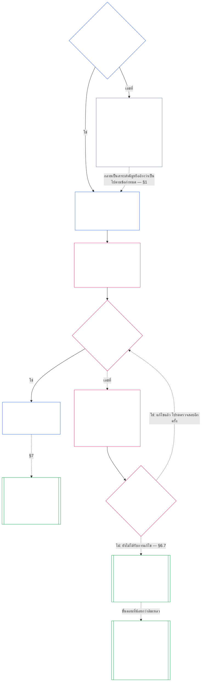

> **ร่างการแปลที่ได้รับความช่วยเหลือจาก AI — ยังไม่ได้ตรวจสอบ; ไม่มีการทบทวนโดยผู้อ่านอิสระที่คล่องแคล่ว ไฟล์ภาษาผู้อ่านนี้ไม่มีผลผูกพัน แหล่งข้อมูลภาษาอังกฤษที่มีหมายเลขยังคงควบคุมอยู่**

# บทที่เจ็ด: กฎบัตรระบบและสถาบัน

<strong>ตำแหน่งคอร์ปัส (ไม่ทำงาน): โครงสร้างไฟล์และกฎการอ่าน</strong>

> ไฟล์นี้คือ **ส่วนหนึ่งของรัฐธรรมนูญแห่งความรู้สึก** และเป็น **ผูกพันกันเท่านั้น** กับอีกหมายเลขหนึ่ง `core_*` ไฟล์จะอ่านเป็นข้อความเดียว ประกอบด้วย **บทที่เจ็ด**: ชั้นเผยแพร่เอกสารขอบเขตของระบบและสถาบัน ได้แก่ System Charter และ Institutional Charter เป็นไปตามบทที่หกสิทธิชั้นและนำหน้า [บทที่แปด](../../core_08.000_functional_independence_separation_of_duties.md#chapter-eight-functional-independence-and-separation-of-duties)ซึ่งแยกที่นั่งออกจากการกระทำที่มีผลผูกพันอันเป็นสาระสำคัญ
>
> - **เจ้าของรัฐธรรมนูญ:** เมื่อระบบต้องเผยแพร่กฎบัตรระบบและเมื่อสถาบันต้องเผยแพร่กฎบัตรสถาบัน (กำหนดไว้ที่คลาส L หรือสูงกว่า โดยสมัครใจที่คลาส P) ขั้นต่ำที่แต่ละรายจะต้องระบุ วิธีการเปลี่ยนแปลงแต่ละครั้งและการตรวจสอบ และการตรวจสอบการจัดตั้งเกี่ยวกับจุดยืนและความถูกต้องของผู้ถือครองสำนักงานที่ครอบคลุม
> - **บ้านคำจำกัดความ:** [กฎบัตรระบบ](../../core_05.040_band_continuity.md#system-charter), [กฎบัตรสถาบัน](../../core_05.040_band_continuity.md#institutional-charter), [แผนที่บทบาทกฎบัตร](../../core_05.040_band_continuity.md#charter-role-map), [พรรคชาร์เตอร์ด](../../core_05.040_band_continuity.md#chartered-party), และ [ฝ่ายปฏิบัติการ](../../core_05.050_band_oversight.md#operating-party) กำหนดไว้ในบทที่ห้า บทนี้นำไปใช้และไม่ได้กำหนดนิยามใหม่
> - **เจ้าของการดำเนินการ:** [CI-8.205 §6](../../corpus_institutions/ci_08.205_institutional_design_separation_of_powers.md#ci-8205-6-system-and-institutional-charter-contents-review-and-formation-template) (*เนื้อหากฎบัตรระบบและสถาบัน การทบทวน และเทมเพลตการจัดตั้ง*) มีเทมเพลตฟิลด์แบบเต็ม รายการตรวจสอบการตรวจสอบ ขั้นตอนการจัดตั้ง และเทมเพลตใบแจ้งยอดการตรวจสอบการจัดตั้ง อาจเข้มงวดกว่าและอาจเพิ่มช่องข้อมูล มันอาจไม่ตีกรอบบทนี้ให้แคบลง ข้อความจะผูกเป็นข้อความการใช้งานที่รวมอยู่ภายในขอบเขตการรับเลี้ยงบุตรบุญธรรมที่ถูกต้องเท่านั้น ([บทที่สิบแปด §4 กรอบการรับบุตรบุญธรรมและขอบเขตอำนาจ](../../core_18.000_incorporation.md#4-adoption-framing-and-scope-of-authority)); พื้นในบทนี้ผูกเป็นข้อความหลัก
> - **ผู้บริโภคขั้นปลาย:** [บทที่แปด §5 ตำแหน่งที่เผยแพร่ ตำแหน่งว่าง และการเปลี่ยนตัว](../../core_08.000_functional_independence_separation_of_duties.md#5-published-placement-vacancy-and-substitution) จำเป็นต้องมีแผนที่บทบาทกฎบัตร บทที่เก้าอ่านกฎบัตรระบบสำหรับการค้นหาขอบเขตและขอบเขต และบทที่เก้าส่วน D ทดสอบคำสั่งตรวจสอบการจัดขบวนสำหรับสถาบัน [บทที่สิบ §3.7 บันทึกการดูแลและอำนาจในการเปิด](../../core_10.000_standing_assessment.md#37-record-custody-and-opening-authority) นำไปใช้กับบันทึกยืน [บทที่สิบสาม §4.3 ฟอรัมของสถาบัน](../../core_13.000_forum.md#43-institutional-forums) รับฟังข้อโต้แย้งเกี่ยวกับกฎบัตรสถาบัน
>
> ลำดับการอ่าน: §1 เมื่อจำเป็นต้องมีกฎบัตรระบบและสถาบัน พร้อมด้วยแผนภูมิที่แมปกระบวนการ → §2 สิทธิ์ในการจัดทำและข้อจำกัดแคบ ๆ สี่ประการ → §3 สิ่งที่ต้องระบุ → §4 แผนที่บทบาทกฎบัตรและการดูแลบันทึกสถานะ → §5 การตรวจสอบการจัดขบวนการยืนหยัดของผู้ดำรงตำแหน่งและความถูกต้อง → §6 เมื่อผู้ถือไม่ผ่านการตรวจสอบการจัดขบวน → §7 การแก้ไข ทบทวน และขอบเขตที่ไม่ถูกต้อง

<strong>ติดตาม</strong>

- ต้นน้ำ:
  - [Tetrad รัฐธรรมนูญ](../../core_00.000_preamble.md#constitutional-tetrad), โดยเฉพาะ **การกำกับดูแล** และ **ความรับผิดชอบ**;
  - [สัดส่วนการถือหุ้นวัสดุ](../../core_00.000_preamble.md#material-stake);
  - [บทที่หนึ่ง §18.1 การกำกับดูแลตามโครงสร้างที่ได้รับอนุญาต](../../core_01.010_stewardship_capacity_principles.md#181-governance-as-authorized-structure) (1.015 §18.1);
  - [ข้อ XI-E](../../core_06.005_rights_part_b.md#article-xi-e-institutional-formation-and-business-creation) (*การก่อตั้งสถาบันและการสร้างธุรกิจ*).
- ส่วนย่อย:
  - [§1](#1-เมอจำเปนตองมกฎบตรระบบและสถาบน);
  - [§2](#2-สทธในการสราง-และขอบเขตอนแคบสประการ);
  - [§3](#3-ระบบและกฎบตรสถาบนใดทตองระบ);
  - [§4](#4-แผนทบทบาทกฎบตรและการดแลบนทกยน);
  - [§5](#5-การตรวจสอบการกอตว-การยนหยดของผถอครองสำนกงานและความถกตอง);
  - [§6](#6-เมอผถอไมผานการตรวจสอบรปแบบ);
  - [§7](#7-การแกไข-ทบทวน-และขอบเขตทไมตรงแนว).
- ปลายน้ำ:
  - [บทที่แปด](../../core_08.000_functional_independence_separation_of_duties.md#chapter-eight-functional-independence-and-separation-of-duties) (8.000);
  - [บทที่เก้า](../../core_09.000_system_alignment_certification_evaluation.md#chapter-nine-system-alignment-certification) (9.000);
  - [บทที่สิบ](../../core_10.000_standing_assessment.md#chapter-ten-contribution-violation-and-standing-model--measurement) (10.000);
  - [บทที่สิบสาม](../../core_13.000_forum.md#chapter-thirteen-forums-and-jurisdiction) (13.000);
  - [บทที่สิบสี่](../../core_14.000_governance.md#chapter-fourteen-constitutional-contract-legitimacy-authorization-and-stewardship) (14.000); ข้อความการใช้งานที่กำหนดตามชื่อด้านบน
- อ่านด้วย:
  - [กองอำนาจและลำดับชั้นภายใน](../../core_05.045_band_integrative.md#authority-stack-and-internal-hierarchy);
  - [ขอบเขตของระบบ](../../core_05.040_band_continuity.md#system-boundaries);
  - [ความสมบูรณ์ของขอบเขตของระบบ](../../core_05.040_band_continuity.md#system-boundary-integrity);
  - [การสร้างระบบ](../../core_05.055_band_participation.md#system-creation);
  - [การสร้างธุรกิจ](../../core_05.055_band_participation.md#business-creation).

 

บทที่เจ็ดเป็นเจ้าของรัฐธรรมนูญของ **กฎบัตรระบบ กฎบัตรสถาบัน และขอบเขตที่เผยแพร่**.

สามบททำงานเป็นห่วงโซ่เดียว:

- **บทที่เจ็ด (บทนี้):** พูดว่าอะไร [พรรคชาร์เตอร์ด](../../core_05.040_band_continuity.md#chartered-party) อ้างว่าทำและใครจะได้นั่งแต่ละที่นั่งเมื่อกระทำการ
- **[บทที่แปด](../../core_08.000_functional_independence_separation_of_duties.md#chapter-eight-functional-independence-and-separation-of-duties): :** บอกว่าที่นั่งเหล่านั้นจะต้องแยกออกจากกันอย่างไร
- **[บทที่เก้า](../../core_09.000_system_alignment_certification_evaluation.md#chapter-nine-system-alignment-certification): :** รับรองระบบและแยกสถาบันซึ่งแต่ละแห่งถือเป็นพระราชบัญญัติที่ใช้ที่นั่ง โดยจะส่งสิ่งที่พบกลับไปยังกฎบัตรระบบหรือกฎบัตรสถาบัน

บทอื่นๆ เป็นเจ้าของคำจำกัดความ กฎที่นั่ง ล็อคการยืน และกฎการตัดสินใจในบทนี้ชี้ให้เห็น **CI-8.205 §6** (*เนื้อหากฎบัตรระบบและสถาบัน การทบทวน และเทมเพลตการจัดตั้ง*) ถือเป็นเทมเพลตฟิลด์ ขั้นตอนการจัดตั้ง และรายการตรวจสอบการทบทวน

### 1. เมื่อจำเป็นต้องมีกฎบัตรระบบและสถาบัน

<strong>ติดตาม</strong>

- ต้นน้ำ:
  - [§2](#2-สทธในการสราง-และขอบเขตอนแคบสประการ);
  - [สัดส่วนการถือหุ้นวัสดุ](../../core_00.000_preamble.md#material-stake);
  - [สัดส่วน](../../core_05.035_band_accountability.md#proportionality); การอ้างสิทธิ์ของเจ้าของการเปิดบท;
  - [บทที่หนึ่ง §18 ธรรมาภิบาลภายใต้วินัยในการพิทักษ์](../../core_01.010_stewardship_capacity_principles.md#18-governance-under-stewardship-discipline) (1.015 §18);
  - [การกำกับดูแล](../../core_05.020_apex_oversight_leg.md#oversight-constitutional);
  - [ความรับผิดชอบ](../../core_05.005_apex_accountability_leg.md#accountability).
- ปลายน้ำ: [§3](#3-ระบบและกฎบตรสถาบนใดทตองระบ); [บทที่เก้าส่วน A §2 การประเมินระดับระบบ](../../core_09.000_system_alignment_certification_evaluation.md#2-system-class-evaluation) (9.005 §2) (*ชั้นเรียนและความลึกของการรับรอง*); [บทที่เก้าส่วน D §12.1 ชั้นเรียนสถาบัน](../../core_09.015_institutional_alignment_certification.md#121-institution-class) (9.020 §12.1) (*ชั้นเรียนของสถาบัน*); **ซีเอส-9.305 (*เครื่องจักรจำแนกระบบ*) และ CS-9.310** (*เครื่องจักรจำแนกระบบ*) สำหรับแค็ตตาล็อกชั้นเรียน
- อ่านด้วย:
  - **CI-8.205 §6** (*เนื้อหากฎบัตรระบบและสถาบัน การทบทวน และเทมเพลตการจัดตั้ง*);
  - **CF-13.415 §5** (*นายทะเบียนสถาบันและท้องถิ่น*);
  - **ซีไอ-9.210** (*ภาระผูกพันของสถาบันที่เชื่อมโยงกับการจำแนกประเภท*);
  - [บทที่ห้ากฎบัตรระบบ](../../core_05.040_band_continuity.md#system-charter) (5.040);
  - [บทที่ห้า กฎบัตรสถาบัน](../../core_05.040_band_continuity.md#institutional-charter) (5.040);
  - [ข้อ XI-E](../../core_06.005_rights_part_b.md#article-xi-e-institutional-formation-and-business-creation) (*การก่อตั้งสถาบันและการสร้างธุรกิจ*).

<strong>คำจำกัดความ · การประเมิน · การปฏิบัติตาม</strong>

- [กฎบัตรระบบ](../../core_05.040_band_continuity.md#system-charter) · [โอ](../../core_05.040_band_continuity.md#system-charter) · [ม](../../core_05.040_band_continuity.md#system-charter-a) · [ก](../../core_05.040_band_continuity.md#system-charter-a) · [ค](../../core_05.040_band_continuity.md#system-charter-c)
- [กฎบัตรสถาบัน](../../core_05.040_band_continuity.md#institutional-charter) · [โอ](../../core_05.040_band_continuity.md#institutional-charter) · [ม](../../core_05.040_band_continuity.md#institutional-charter-a) · [ก](../../core_05.040_band_continuity.md#institutional-charter-a) · [ค](../../core_05.040_band_continuity.md#institutional-charter-c)
- [การกำกับดูแลแบบแบ่งประเภทตามขนาด](../../core_05.050_band_oversight.md#classification-scaled-governance) · [โอ](../../core_05.050_band_oversight.md#classification-scaled-governance) · [ม](../../core_05.050_band_oversight.md#classification-scaled-governance-a) · [ก](../../core_05.050_band_oversight.md#classification-scaled-governance-a) · [ค](../../core_05.050_band_oversight.md#classification-scaled-governance-c)

 

*พูดง่ายๆ: ก่อนที่ใครก็ตามจะสามารถตัดสินได้ว่าระบบหรือสถาบันอยู่ภายในขีดจำกัดของตนหรือไม่ จะต้องเขียนขีดจำกัดนั้นไว้โดยที่ทุกคนสามารถอ่านได้ เป็นระบบที่เป็นสาระสำคัญต่อผู้อื่นในด้านใดด้านหนึ่งทั้ง 9 ด้าน [สาระสำคัญเฉพาะโดเมน](../../core_05.050_band_oversight.md#domain-specific-materiality) ต้องการกฎบัตรระบบที่เผยแพร่ สถาบันจะเผยแพร่สถาบันที่เหมาะกับระบบที่สถาบันดำเนินการอยู่ คลาส P เป็นคลาสสมัครใจ: วงกลมควิ้ลท์ที่ให้ผ้าห่มแก่ผู้ลี้ภัยเป็นรูปแบบ*

กฎบัตรระบบหรือกฎบัตรสถาบันเป็นขอบเขตที่เผยแพร่ของพรรคชาร์เตอร์ด: พรรคอ้างว่ามีอำนาจทำอะไร ทำอะไรไม่ได้ และใครเป็นผู้ดำรงตำแหน่งแต่ละที่นั่งเมื่อกระทำการ เป็นขอบเขตที่ที่นั่งในบทที่แปดอยู่ภายใต้และการรับรองในบทที่เก้าจะย้อนกลับไปเทียบกับการปฏิบัติงานจริง ฝ่ายปฏิบัติการจะต้องเผยแพร่หรือไม่นั้นขึ้นอยู่กับระดับของตน: **จำเป็นในคลาส L หรือสูงกว่า โดยสมัครใจในคลาส P** หากต้องเผยแพร่ก็ต้องทำให้ถูกต้องด้วย

คลาสผลกระทบต่อระบบทั้งห้าคลาสเป็นกรอบสำหรับทุกสิ่งด้านล่าง จากมากไปน้อยเป็นผลสืบเนื่อง ในแต่ละบรรทัด:

- **คลาส A วิกฤตการเอาชีวิตรอด เป็นพื้นฐาน และไม่สามารถทดแทนได้:** ความล้มเหลวภายในระยะเวลาที่เกี่ยวข้องกับการเอาชีวิตรอด โดยไม่มีสิ่งใดทดแทนได้ หมายถึงการสูญเสียสภาวะการอยู่รอด
- **คลาส B สำคัญ พึ่งพาสูง และมีนัยสำคัญอย่างเป็นระบบ:** ผู้อยู่ในความอุปการะไม่สามารถรักษาฟังก์ชันหลักไว้ได้หากไม่มีมัน ความอยู่รอดไม่ได้สูญหายไปในทันที และการทดแทนยังคงเป็นไปได้ทันเวลา
- **คลาส C มีการประสานงาน พึ่งพาได้สูง และไม่สำคัญ:** มันกำหนดรูปแบบการประสานงานตามขนาด แต่ไม่ใช่ข้อกำหนดเบื้องต้นในการปฏิบัติงานสำหรับฟังก์ชันคลาส A หรือคลาส B
- **คลาส L ในพื้นที่ มีผลกระทบอย่างจำกัด และไม่สำคัญ:** ผลกระทบของมันไปไกลกว่าหน่วยส่วนตัวแต่มีอยู่ในท้องถิ่น ทดแทนได้ และกักเก็บได้
- **คลาส P ส่วนบุคคล ของใช้ส่วนตัว การแยก และการทดลอง:** ผลกระทบของมันจะอยู่ภายในหน่วยส่วนตัวโดยไม่มีการพึ่งพาจากภายนอกอย่างมีความหมาย

[ซีเอส-9.310 §8](../../corpus_systems/cs_09.310_system_impact_classifications.md#cs-9310-8-system-impact-classifications) (*การจำแนกประเภทผลกระทบต่อระบบ*) มีคำจำกัดความที่สมบูรณ์ คลาส A, B, C และ L จะต้องเผยแพร่ และคลาส P อาจ และ [§1.2 ชั้นเรียนใดบ้างที่ครอบคลุม](#12-ครอบคลมชนเรยนใดบาง) บอกว่าสถาบันดึงเอาชั้นเรียนของตนมาจากระบบที่ดำเนินการอย่างไร

#### 1.1 ใครจะต้องเผยแพร่

ระบบคลาส L หรือสูงกว่าจะต้องเผยแพร่และบำรุงรักษา [กฎบัตรระบบ](../../core_05.040_band_continuity.md#system-charter). สถาบันคลาส L หรือสูงกว่าจะต้องเผยแพร่และบำรุงรักษาสถาบันใดสถาบันหนึ่งที่เหมาะกับระบบที่ดำเนินการ:

| สิ่งที่สถาบันดำเนินการ ผู้ดูแล หรือควบคุมอย่างมีนัยสำคัญ | สิ่งที่เผยแพร่ |
| --- | --- |
| เป็นระบบเดียวที่ต้องการกฎบัตรระบบ | กฎบัตรระบบนั้นและไม่มีเอกสารที่สอง โดยตั้งชื่อสถาบันว่าเป็นสจ๊วตและทำหน้าที่เป็น [กฎบัตรสถาบัน](../../core_05.040_band_continuity.md#institutional-charter): เอกสารฉบับเดียวครอบคลุมทั้งสองฉบับ |
| มากกว่าหนึ่งระบบดังกล่าว | กฎบัตรสถาบัน รวมถึงกฎบัตรระบบทุกฉบับที่บังคับใช้สำหรับระบบเหล่านั้น และระบุว่าเหตุใดสถาบันจึงใช้งานระบบเหล่านั้นโดยเฉพาะ ([§3 สิ่งที่ระบบและกฎบัตรสถาบันต้องระบุ](#3-ระบบและกฎบตรสถาบนใดทตองระบ)). |
| ไม่มีระบบดังกล่าว | กฎบัตรสถาบันที่ระบุรายการของสถาบันเอง [§3 สิ่งที่ระบบและกฎบัตรสถาบันต้องระบุ](#3-ระบบและกฎบตรสถาบนใดทตองระบ) และไม่มีกฎบัตรระบบที่จะรวมไว้ |

- **ธุรกิจและรูปแบบที่เทียบเคียงได้:** รูปแบบธุรกิจหรือองค์กรที่ได้รับการดูแลอื่น ๆ จะเผยแพร่กฎบัตรระบบหรือกฎบัตรสถาบันใดก็ตามที่ใช้กับระบบ ในฐานะสถาบัน หรือในฐานะสถาบันที่ดำเนินการระบบที่ครอบคลุม รูปแบบทางกฎหมายไม่ได้เปลี่ยนคำตอบ
- **การประกอบวิชาชีพร่วมกัน:** แนวปฏิบัติที่มีความรู้สึกหรือเล็กน้อยของคลาส L หรือสูงกว่าที่ดำเนินการตามรายการสำหรับใบอนุญาตการฝึกปฏิบัติหรือการกวาดล้างการฝึกอาจเป็นไปตามมาตรานี้สำหรับการกระทำเหล่านั้นโดยการนำกฎบัตรระบบของเจ้าบ้านหรือกฎบัตรสถาบันและแผนที่บทบาทกฎบัตร:
  - **สิ่งที่นำมาใช้:** โดยการอ้างอิงกฎบัตรระบบหรือกฎบัตรสถาบันและกฎบัตรบทบาทแผนที่ของเจ้าภาพในการปฏิบัติงานวิชาชีพร่วมกันซึ่งจะต้องครอบคลุมการกระทำเหล่านั้น
  - **ประกาศการรับเลี้ยงบุตรบุญธรรม:** ในหน้าเดียวจะสังเกตเห็นว่า **CI-14.205 §7** (*ใบอนุญาตประกอบวิชาชีพ ใบอนุญาตประกอบวิชาชีพ และการประกอบวิชาชีพร่วม*) อธิบาย
  - **ระดับ:** การฝึกฝนยังคงเป็นการกระทำของชั้นเรียนเอง

#### 1.2 ครอบคลุมชั้นเรียนใดบ้าง

ชั้นเรียนของพรรคชาร์เตอร์ดตัดสินใจว่าจำเป็นต้องมีการเผยแพร่หรือทางเลือก:

- **คลาส A, B, C และ L:** ที่จำเป็น. แผนภูมิใน [§1.7 กระบวนการโดยสรุป](#17-กระบวนการโดยสรป) แสดงกระบวนการที่พวกเขาปฏิบัติตาม
- **คลาสพี:** ทางเลือก จนกว่าเหตุการณ์ใดเหตุการณ์หนึ่งจากสองเหตุการณ์จะทำให้จำเป็น [§1.3 คลาส P คืออะไร](#13-คลาส-p-คออะไร) บอกว่าอะไรทำให้ฝ่ายปฏิบัติการคลาส P และ [§1.4 คลาส P: การเช่าเหมาลำเพิ่มเติม และเมื่อจำเป็น](#14-คลาส-p-การเชาเหมาลำเพมเตม-และเมอจำเปน) กำหนดทางเลือกและเมื่อสิ้นสุด
- **ประเภทของสถาบัน:** สถาบันจะดำรงตำแหน่งระดับสูงสุดของระบบใดๆ ที่ตนดำเนินการ พิทักษ์ หรือควบคุมอย่างเป็นรูปธรรม สถาบันที่ไม่ได้ดำเนินการระบบดังกล่าวจะถูกจำแนกตามผลกระทบที่สำคัญและการพึ่งพาของตนเอง ตัดสินจากสิ่งที่ตัดสินใจและถืออยู่จริง และไม่ใช่ตามป้ายกำกับหรือรูปแบบทางกฎหมาย ภายใต้ [บทที่เก้าส่วน D §12.1 ชั้นเรียนสถาบัน](../../core_09.015_institutional_alignment_certification.md#121-institution-class).

#### 1.3 คลาส P คืออะไร

ฝ่ายปฏิบัติการจะเป็นคลาส P เท่านั้นในขณะที่กิจกรรมของมันอยู่ต่ำกว่าเส้นในทุก ๆ หนึ่งในเก้าโดเมนของ [สาระสำคัญเฉพาะโดเมน](../../core_05.050_band_oversight.md#domain-specific-materiality)ซึ่งในทางปฏิบัติหมายถึงการกระทำและผลของมันจะคงอยู่ภายในตัวมัน [หน่วยส่วนตัว](../../core_05.050_band_oversight.md#domain-specific-materiality-private-unit): :

- **ข้ามเส้น:** การข้ามเส้นในโดเมนใดโดเมนหนึ่งจะทำให้โดเมนมีคลาส L เป็นอย่างน้อย **ซีเอส-9.305 (*เครื่องจักรจำแนกระบบ*) และ CS-9.310** (*เครื่องจักรจำแนกระบบ*) ไม่ว่าจะมีขนาดเท่าใดหรือเรียกตัวเองว่าอะไรก็ตาม
- **อยู่ต่ำกว่าทุกบรรทัด:** มันยังคงเป็นคลาส P ไม่ว่าจะมีสมาชิกกี่คนก็ตาม
- **ผู้ที่อยู่ภายใน:** คลาส P ก็ขึ้นอยู่กับผู้ที่อยู่ข้างในด้วย ใครก็ตามภายในที่สังเกตเห็นว่าฝ่ายปฏิบัติการล้ำเส้นมีหน้าที่รายงานและรายงานนั้นได้รับการคุ้มครอง ([สาระสำคัญเฉพาะโดเมน](../../core_05.050_band_oversight.md#domain-specific-materiality)).

พื้นสี่ที่นั่งในบทที่แปดใช้ไม่ได้กับการกระทำของฝ่ายปฏิบัติการคลาส P ซึ่งอยู่ภายในหน่วยส่วนตัวของตน ดังนั้นผู้มีความรู้สึกเพียงคนเดียวที่มีคอมพิวเตอร์ไม่จำเป็นต้องมีที่นั่งที่สอง พื้นใช้ตั้งแต่วันที่ฝ่ายปฏิบัติการเข้ารับ [พระราชบัญญัติมีผลผูกพันอันเป็นสาระสำคัญ](../../core_05.035_band_accountability.md#materially-binding-act) ที่ผู้อื่นต้องปฏิบัติตามหรืออาจพึ่งพาได้เมื่อตกลงกันแล้ว ซึ่งข้ามเส้นขอบเขตอำนาจเหนือผู้อื่น และทำให้เป็นคลาส L เป็นอย่างน้อย

#### 1.4 คลาส P: การเช่าเหมาลำเพิ่มเติม และเมื่อจำเป็น

ฝ่ายปฏิบัติการคลาส P ได้รับการสนับสนุนให้เผยแพร่ [กฎบัตรระบบ](../../core_05.040_band_continuity.md#system-charter) (สำหรับระบบเดียว) หรือ [กฎบัตรสถาบัน](../../core_05.040_band_continuity.md#institutional-charter) (สำหรับมากกว่าหนึ่งระบบหรือไม่มีเลย) ที่เหมาะกับการทำงาน อาจใช้รายการเนื้อหาใน [§3 สิ่งที่ระบบและกฎบัตรสถาบันต้องระบุ](#3-ระบบและกฎบตรสถาบนใดทตองระบ) และแผนผังที่นั่งใน [§4 แผนที่บทบาทกฎบัตรและการดูแลบันทึกยืน](#4-แผนทบทบาทกฎบตรและการดแลบนทกยน) เป็นเทมเพลต การเผยแพร่ไม่สร้างหน้าที่ภายใต้กระบวนการของบทนี้:

- ไม่มีวันครบกำหนด ([§1.5 เมื่อถึงกำหนดกฎบัตรระบบหรือกฎบัตรสถาบัน](#15-เมอครบกำหนดกฎบตรระบบหรอกฎบตรสถาบน));
- ไม่มีการตรวจสอบรูปแบบ ([§5 การตรวจสอบรูปแบบ: การยืนหยัดของผู้ถือครองสำนักงานและความถูกต้อง](#5-การตรวจสอบการกอตว-การยนหยดของผถอครองสำนกงานและความถกตอง));
- ไม่จำเป็น [แผนที่บทบาทกฎบัตร](../../core_05.040_band_continuity.md#charter-role-map) ([§4 แผนที่บทบาทกฎบัตรและการดูแลบันทึกยืน](#4-แผนทบทบาทกฎบตรและการดแลบนทกยน)) แม้ว่าอาจคงไว้ซึ่งกฎบัตรระบบโดยสมัครใจหรือกฎบัตรสถาบันหรือเผยแพร่ด้วยตนเอง และ
- ไม่ต้องแก้ไขหรือทบทวนรอบ ([§7 การแก้ไข ทบทวน และขอบเขตที่ไม่ตรงแนว](#7-การแกไข-ทบทวน-และขอบเขตทไมตรงแนว)).

หากเกิดสิ่งใดสิ่งหนึ่งเหล่านี้ การเผยแพร่จะหยุดเป็นทางเลือก

- ฝ่ายปฏิบัติการได้รับการจัดประเภทใหม่เป็นประเภท L หรือสูงกว่า หรือ
- ผู้ดำเนินการยืนยันการปฏิบัติตามรัฐธรรมนูญสำหรับฝ่ายปฏิบัติการ

ฝ่ายปฏิบัติการจะต้องเผยแพร่กฎบัตรระบบหรือกฎบัตรสถาบันที่เหมาะสมตามกำหนดเวลา [§1.5 เมื่อถึงกำหนดกฎบัตรระบบหรือกฎบัตรสถาบัน](#15-เมอครบกำหนดกฎบตรระบบหรอกฎบตรสถาบน).

**การรับรู้ไม่ได้ขึ้นอยู่กับเอกสารขอบเขต** กลุ่มที่มีหรือไม่มีกฎบัตรระบบหรือกฎบัตรสถาบันและกลุ่มใดก็ตาม จะไม่ยืนหยัดระหว่างสมาชิกและการยอมรับ สมาชิกแต่ละคนอาจขอบันทึกการมีส่วนร่วมในฐานะผู้อ้างสิทธิ์รายบุคคล สำหรับงานที่ทำภายในกลุ่มหรือภายนอกกลุ่ม และบันทึกเกี่ยวข้องกับการมีส่วนร่วมของสมาชิก ไม่ใช่จุดยืนของกลุ่ม ([บทที่สิบ §3.7 บันทึกที่ไม่เป็นทางการและขอบเขตขนาดเล็ก](../../core_10.000_standing_assessment.md#37-informal-and-small-scope-records)). การให้ความช่วยเหลือ สินค้า แรงงาน หรือบริการที่ไม่มีใครจำเป็นต้องยอมรับนั้นไม่ถือเป็นการกระทำที่มีผลผูกพันอย่างมีนัยสำคัญ ดังนั้น วงช่วยเหลือซึ่งกันและกันที่มอบผ้าห่มให้กับผู้ลี้ภัยจึงไม่จำเป็นต้องมีกฎบัตรระบบหรือกฎบัตรสถาบันเพื่อให้สมาชิกได้รับการยอมรับ

#### 1.5 เมื่อครบกำหนดกฎบัตรระบบหรือกฎบัตรสถาบัน

ระบบหรือสถาบันที่ครอบคลุมจะเผยแพร่ [กฎบัตรระบบ](../../core_05.040_band_continuity.md#system-charter) หรือ [กฎบัตรสถาบัน](../../core_05.040_band_continuity.md#institutional-charter) ตามกำหนดการนี้:

- **ระบบหรือสถาบันใหม่:** ก่อนที่จะเผยแพร่หรือเริ่มใช้อำนาจเหนือผู้อื่น
- **อันที่ดำเนินการอยู่แล้ว:** ในการทบทวนหรือการรับรองการจำแนกประเภทครั้งถัดไป หรือภายในกรอบเวลาการแก้ปัญหาหลังจากการร้องขอภายใต้ [§1.6 หากไม่มีกฎบัตรระบบหรือกฎบัตรสถาบัน](#16-หากไมมกฎบตรระบบหรอกฎบตรสถาบน)ขึ้นอยู่กับว่ากรณีใดจะเกิดขึ้นก่อน มันเป็นค่าเริ่มต้นจนกว่าจะเป็นเช่นนั้น
  - **การรับรองใด:** สำหรับระบบ ใบรับรองการจัดตำแหน่งระบบ สำหรับสถาบัน การรับรองการจัดตำแหน่งของสถาบันภายใต้ [บทที่เก้าส่วน D §11.3 ไม่ได้รับอนุญาตและไม่มีประตู](../../core_09.015_institutional_alignment_certification.md#113-no-permission-and-no-gate)ซึ่งหน้าต่างการรับรองครั้งแรกไม่เคยมีเงื่อนไขในการเผยแพร่กฎบัตรสถาบันหรือการดำเนินงาน
- **การตรวจสอบรูปแบบ:** นอกจากนี้ยังเสร็จสิ้นการเช็คอินรูปแบบด้วย [§5 การตรวจสอบรูปแบบ: การยืนหยัดของผู้ถือครองสำนักงานและความถูกต้อง](#5-การตรวจสอบการกอตว-การยนหยดของผถอครองสำนกงานและความถกตอง) ในเวลาเดียวกัน
- **มันถูกเก็บไว้ที่ไหน:** โดยจะยื่นกฎบัตรระบบหรือกฎบัตรสถาบัน พร้อมด้วยแผนที่บทบาทกฎบัตรและคำชี้แจงการตรวจสอบการจัดตั้ง กับนายทะเบียนสถาบัน หรือกับนายทะเบียนท้องถิ่นที่กิจกรรมและความรู้สึกที่มีผลกระทบนั้นอยู่ในท้องถิ่น (**CF-13.415 §5** (*นายทะเบียนสถาบันและท้องถิ่น*)):
  - **นายทะเบียนทำอะไร:** จะตรวจสอบว่าไม่มีสิ่งใดที่จำเป็นขาดหายไปและให้ใบเสร็จลงวันที่
  - **สิ่งที่นายทะเบียนไม่เคยทำ:** ไม่เคยให้อนุญาตและไม่เคยควบคุมชั้นเรียนหรือเนื้อหา
  - **ใบเสร็จรับเงินล่าช้าหรือหายไป:** มันไม่เคยหยุดปฏิบัติการของพรรคชาร์เตอร์ด

#### 1.6 หากไม่มีกฎบัตรระบบหรือกฎบัตรสถาบัน

ใครก็ตามที่สังเกตเห็นกลุ่ม Chartered Party ระดับ L หรือสูงกว่า ใหม่หรือที่เพิ่งเผยแพร่ ซึ่งยังไม่ได้เผยแพร่กฎบัตรระบบหรือกฎบัตรสถาบันอาจสอบถามหน่วยงานกำกับดูแลของตนได้ ผู้ถามไม่จำเป็นต้องยืน ไม่ต้องเสียค่าธรรมเนียม และไม่จำเป็นต้องแสดงอันตราย คำขอดังกล่าวตั้งชื่อให้กับพรรคชาร์เตอร์ดและระบุว่าเหตุใดจึงถูกปกปิด

หน้าต่างสองบานทำงานตามคำร้องขอ: หน้าต่างตอบสนองและหน้าต่างการแก้ปัญหา แต่ละระดับจะใช้ความยาวจากระดับด้วยตัวอักษรเดียวกันกับคลาสของ Chartered Party ดังนั้น ยิ่งคลาสมีความสำคัญมาก หน้าต่างก็จะสั้นลง:

| คลาสและเทียร์ | หน้าต่างตอบสนอง (เป้าหมายการบริโภค) | หน้าต่างความละเอียด (ขอบเขตด้านนอก) |
|---|---|---|
| คลาส A, เทียร์ A | 24 ชม | 7 วันตามปฏิทิน |
| คลาส B, เทียร์ B | 2 วันตามปฏิทิน | 14 วันตามปฏิทิน |
| คลาส C, เทียร์ C | 4 วันตามปฏิทิน | 30 วันตามปฏิทิน |
| คลาส L, เทียร์ L | 8 วันตามปฏิทิน | 60 วันตามปฏิทิน |

ตัวเลขมาจาก **CF-13.445 §3.1** (*เป้าหมายบนเวทีและชั้นกำหนดเวลา*) ซึ่งจะควบคุมหากมีความแตกต่างกัน พรรคชาร์เตอร์ดที่โต้แย้งชั้นเรียนของตนจะถูกนับในระดับของชั้นเรียนที่มีวิพากษ์วิจารณ์มากกว่าในบันทึกการจำแนกประเภทระบบและชั้นเรียนใดๆ ที่ผู้ถามหรือฟอรัมแสดงบนพื้นฐานเบื้องต้น จนกว่าคำถามจะได้รับการแก้ไข Chartered Party ที่ไม่มีคลาสใดบันทึกไว้ หรือมีคลาส P ในขณะที่คลาสนั้นมีปัญหา จะถูกนับที่ระดับ C

หน้าต่างทำงานดังนี้:

- **หน้าต่างตอบกลับ:** พรรคชาร์เตอร์ดตอบกลับภายในกรอบเวลาตอบกลับ ซึ่งเป็นเป้าหมายการรับเข้าของระดับที่ตรงกัน **CF-13.445 §3.1** (*เป้าหมายบนเวทีและชั้นกำหนดเวลา*) นับจากคำขอ เผยแพร่กฎบัตรระบบหรือกฎบัตรสถาบัน หรือระบุวันที่ที่จะเผยแพร่ หรือชี้ไปที่กฎบัตรที่ได้เผยแพร่ไปแล้ว หรือคำตอบว่าอยู่ต่ำกว่าทุกบรรทัด [สาระสำคัญเฉพาะโดเมน](../../core_05.050_band_oversight.md#domain-specific-materiality) และแสดงเป็นลายลักษณ์อักษรว่ารายการนั้นต้องการ
- **หน้าต่างความละเอียด:** กฎบัตรระบบหรือกฎบัตรสถาบันจะครบกำหนดภายในหน้าต่างการแก้ไขซึ่งเป็นขอบเขตด้านนอกของระดับที่ตรงกันใน **CF-13.445 §3.1** (*เป้าหมายบนเวทีและชั้นกำหนดเวลา*) นับจากคำขอ โดยมีคำสั่งตรวจสอบการก่อตัวที่ติดมาด้วย ([§5 การตรวจสอบรูปแบบ: การยืนหยัดของผู้ถือครองสำนักงานและความถูกต้อง](#5-การตรวจสอบการกอตว-การยนหยดของผถอครองสำนกงานและความถกตอง)). พรรคชาร์เตอร์ดที่ไม่มีที่นั่งอิสระยังยื่นคำแถลงพร้อมหลักฐานตามมาตรานั้น
- **ฝ่ายปฏิบัติการที่ระบุว่าอยู่ต่ำกว่าบรรทัด:** คำขอยังเป็นความท้าทายในการจัดหมวดหมู่บนเส้นทางในรายการนั้นด้วย *เส้นทางที่ท้าทาย*: :
  - **เรียกใช้หน้าต่าง:** หน้าต่างการแก้ปัญหายังคงทำงานต่อไปในขณะที่ความท้าทายยังค้างอยู่
  - **ส่วนขยายความท้าทาย:** หากฟอรัมที่มีเขตอำนาจศาลตัดสินว่าการท้าทายนั้นคุ้มค่าที่จะทบทวน วันที่ครบกำหนดจะถูกขยายออก และหน้าต่างการแก้ปัญหาใหม่จะเริ่มต้นเมื่อมีการตัดสินการท้าทาย ฟอรัมจะตัดสินความท้าทายภายในขอบเขตด้านนอกของระดับที่ตรงกัน
  - **คุ้มค่าแก่การวิจารณ์หมายถึงอะไร:** ความท้าทายนั้นคุ้มค่าแก่การทบทวนเมื่อตั้งชื่อการข้ามแดนที่เฉพาะเจาะจงในโดเมนที่มีชื่อ และการแสดงที่เป็นลายลักษณ์อักษรของฝ่ายปฏิบัติการทำให้เกิดคำถามที่แท้จริงเกี่ยวกับการข้ามนั้น ฝ่ายปฏิบัติการไม่ได้ตัดสินเรื่องนี้ด้วยตนเอง และการตอบกลับที่ไม่มีการแสดงเป็นลายลักษณ์อักษรจะไม่ขยายวันที่ออกไป
  - **หากพบคลาส:** ในการท้าทายนั้นหรืออย่างอื่น วันที่ค้นพบจะนับเป็นวันที่ของคำขอ: หน้าต่างตอบกลับและหน้าต่างการแก้ปัญหาจะทำงานจากนั้น ที่ระดับของคลาสที่พบ (คลาส A, B, C หรือ L)
- **หากพลาด:** การไม่ตอบสนอง หรือไม่มีกฎบัตรระบบหรือกฎบัตรสถาบันภายในวันที่ครบกำหนด ถือเป็นข้อบกพร่องในการบันทึกและแก้ไข ผู้ถามอาจนำไปที่เวทีที่มีเขตอำนาจในเส้นทางเดียวกันได้ ไม่เคยมีเงื่อนไขในการขึ้นรูปหรือใช้งาน
- **คำขอซ้ำ:** คำขอครั้งที่สองเกี่ยวกับพรรคชาร์เตอร์ดชุดเดียวกัน ซึ่งดำเนินการในขณะที่การตอบสนองก่อนหน้านี้หรือข้อค้นพบเกี่ยวกับพรรคนั้นยังคงอยู่ ไม่ได้เริ่มการตอบสนองหรือกรอบเวลาการแก้ไขใหม่ พรรคชาร์เตอร์ดตอบโดยชี้ไปที่การตอบสนองหรือการค้นพบนั้น การแสดงให้เห็นว่าอยู่ต่ำกว่าทุกบรรทัดซึ่งยังไม่ได้รับการตรวจสอบจากฟอรัม ไม่นับเป็นการตอบกลับที่ยังคงอยู่ การตอบสนองหรือการค้นหาจะคงอยู่จนกระทั่งสิ่งใดสิ่งหนึ่งเหล่านี้เกิดขึ้น เมื่อมีการเปิดใหม่อีกครั้ง [บทที่เก้าส่วน D §14.2 การเปิดทริกเกอร์อีกครั้ง](../../core_09.015_institutional_alignment_certification.md#142-reopening-triggers) อธิบาย:
  - **การเปลี่ยนแปลงวัสดุ:** กิจกรรมของพรรคชาร์เตอร์ดเปลี่ยนแปลงไปอย่างมาก
  - **หลักฐานใหม่:** มีการแสดงหลักฐานใหม่เกี่ยวกับการข้ามทางม้าลาย

  คำขอที่แสดงข้อใดข้อหนึ่งข้างต้นจะไม่เกิดซ้ำ เป็นคำขอใหม่ที่ได้รับการจัดการแยกกันและเป็นอิสระจากคำขอก่อนหน้านี้ มีหน้าต่างตอบกลับและหน้าต่างการแก้ปัญหาของตัวเอง นับจากวันที่ของตัวเอง และการตอบกลับ การค้นหา และหน้าต่างก่อนหน้านี้ไม่ตอบสนองหรือเปลี่ยนแปลง
- **ขอบเขตในระหว่างนี้:** กฎบัตรระบบหรือกฎบัตรสถาบันที่ขาดหายไปไม่ใช่เหตุผลที่จะถือว่าพรรคชาร์เตอร์ดไม่มีขอบเขต จนมีอยู่จริงของพรรคชาร์เตอร์ด [ขอบเขตของระบบ](../../core_05.040_band_continuity.md#system-boundaries) และการควบคุมชั้นเรียน และการรับรองหรือเวทีอาจสร้างขอบเขตใหม่จากการปฏิบัติงานที่สังเกตได้

#### 1.7 กระบวนการโดยสรุป

แผนภูมิดังกล่าวติดตามฝ่ายปฏิบัติการฝ่ายหนึ่งจากการตั้งคำถามว่าข้อมูลดังกล่าวมีสาระสำคัญต่อผู้อื่นหรือไม่ ผ่านการเผยแพร่กฎบัตรระบบหรือกฎบัตรสถาบันและรักษาความถูกต้องให้ถูกต้อง หากปัญหาไม่ได้รับการแก้ไขภายในกรอบเวลาการแก้ปัญหา กระบวนการเช่าเหมาลำจะส่งปัญหาดังกล่าวไปตรวจสอบซึ่งครอบคลุมอยู่นอกบทนี้ ส่วนต่อจากนี้จะอธิบายแต่ละขั้นตอนตามลำดับเดียวกัน

<strong>คำแนะนำสำหรับผู้อ่าน (ไม่ใช้งาน): วิธีอ่านแผนภูมิ</strong>

> พูดง่ายๆ คือ ไม่มีใครออกกฎบัตรระบบหรือกฎบัตรสถาบัน และไม่มีใครจำเป็นต้องได้รับอนุญาตในการจัดตั้ง พรรคชาร์เตอร์ดซึ่งมีกิจกรรมที่เป็นสาระสำคัญต่อผู้อื่นจะเผยแพร่สิ่งที่ตนอ้างว่ามีอำนาจดำเนินการและใครเป็นผู้ถือที่นั่งแต่ละที่นั่ง และผู้ดำรงตำแหน่งสำคัญของพรรคจะได้รับการตรวจสอบ ผู้ถือที่ล้มเหลวจะถูกแทนที่ หรือสาเหตุได้รับการแก้ไข และพรรคชาร์เตอร์ดก็ดำเนินต่อไป หากความล้มเหลวยังไม่ได้รับการแก้ไขเมื่อกรอบเวลาการแก้ไขสิ้นสุดลง ฟอรัมอาจตรวจสอบพรรคชาร์เตอร์ด โดยเริ่มจากขั้นตอนที่เบาที่สุดเพื่อปกป้องผู้อื่น การทำให้พรรคชาร์เตอร์ดหดตัวลงต่ำกว่าคลาส L หรือยุบพรรค จะเกิดขึ้นก็ต่อเมื่อขั้นตอนที่เบากว่าล้มเหลว พรรคชาร์เตอร์ดที่ยุบไปแล้วไม่สามารถกลับมาได้ในขณะที่ยังคงล็อคอยู่
>
> ลูกศรทึบเป็นเส้นทางหลัก ลูกศรประถือเป็นข้อยกเว้นและการส่งต่อ โดยมีป้ายกำกับส่วนที่สร้างไว้ กล่องที่มีแถบด้านข้างสองแถบเป็นของบทอื่นหรือข้อความการใช้งานที่รวมไว้ แผนภูมิไม่ได้ระบุหน้าที่ ที่นั่ง หรือสนาม และไม่มีขั้นตอนใดๆ ถือเป็นการอนุญาต

 

### 2. สิทธิในการสร้าง และขอบเขตอันแคบสี่ประการ

<strong>คำแนะนำสำหรับผู้อ่าน (ไม่ใช้งาน): วิธีวางส่วนนี้</strong>

- [§2.1 สิทธิ์ในการจัดทำ](#21-สทธในการฟอรม) ระบุถึงสิทธิและไม่ครอบคลุมถึงใคร
- [§2.2 ขีดจำกัดแรก: การล็อคความรู้สึกที่โดดเด่น](#22-ขดจำกดแรก-การลอคความรสกทโดดเดน) บอกว่าการล็อคช่วยให้บุคคลที่มีชื่อมีความรู้สึกออกจากสำนักงานควบคุมแห่งเดียวได้อย่างไร
- [§2.3 ขีดจำกัดที่สอง: การจำกัดข้อเท็จจริงที่ได้รับการตรวจสอบแล้วไว้ชั่วคราว](#23-ขดจำกดทสอง-การระงบขอเทจจรงทไดรบการตรวจสอบแลวไวชวคราว) บอกว่าการถือครองระยะสั้นสามารถกันผู้มีความรู้สึกที่มีชื่อออกจากสำนักงานควบคุมแห่งเดียวได้อย่างไร
- [§2.4 ขีดจำกัดที่สาม: การล็อคฝ่ายปฏิบัติการเอง](#24-ขดจำกดทสาม-การลอคฝายปฏบตการเอง) บอกว่าการล็อคพรรคปฏิบัติการขัดขวางมันและผู้สืบทอดของมันอย่างไร และพรรคชาร์เตอร์ดที่ยุบไปแล้วจะไม่กลับมาอีก
- [§2.5 ข้อจำกัดที่สี่: ใบอนุญาตการปฏิบัติหรือการอนุญาต](#25-ขอจำกดทส-ใบอนญาตประกอบวชาชพหรอการกวาดลาง) บอกว่าการกระทำที่มีความเสี่ยงสูงที่ระบุชื่อนั้นจำเป็นต้องมีใบอนุญาตหรือการอนุญาต มันไม่ใช่ประตูแห่งการก่อตัว

<strong>ติดตาม</strong>

- ต้นน้ำ: [§1](#1-เมอจำเปนตองมกฎบตรระบบและสถาบน); [ข้อ XI-E](../../core_06.005_rights_part_b.md#article-xi-e-institutional-formation-and-business-creation) (*การก่อตั้งสถาบันและการสร้างธุรกิจ*).
- ปลายน้ำ: [§1 เมื่อจำเป็นต้องมีกฎบัตรระบบและสถาบัน](#1-เมอจำเปนตองมกฎบตรระบบและสถาบน); [§5 การตรวจสอบรูปแบบ: การยืนหยัดของผู้ถือครองสำนักงานและความถูกต้อง](#5-การตรวจสอบการกอตว-การยนหยดของผถอครองสำนกงานและความถกตอง).
- อ่านด้วย:
  - [การระงับชั่วคราว](../../core_05.035_band_accountability.md#interim-hold);
  - [บทที่สิบเอ็ด §4.2 การป้องกัน — ล็อคแบบยืนทั่วไป](../../core_11.000_standing_integration.md#42-prevention--general-standing-locks) (11.000 §4.2);
  - [บทที่สิบเอ็ด§5.5 ล็อคพิเศษ](../../core_11.000_standing_integration.md#55-special-locks) (11.000 §5.5);
  - [บทที่สิบสาม §5 ยึดถือเส้นทางของผู้มีความรู้สึกที่ได้รับการระบุชื่อไว้ชั่วคราว](../../core_13.000_forum.md#interim-hold-on-a-named-sentients-pathway) (13.000 §5)

 

*พูดง่ายๆ ก็คือ คุณไม่จำเป็นต้องได้รับอนุญาตจากใครเลยในการจัดตั้งระบบ สถาบัน หรือธุรกิจ สามารถใช้ขีดจำกัดแคบๆ สี่ข้อได้ มีสามประตู: การล็อคที่ยังไม่ได้รับการแก้ไขสามารถกันความรู้สึกหนึ่งออกจากสำนักงานควบคุมแห่งเดียว การยึดข้อเท็จจริงที่ได้รับการตรวจสอบไว้เพียงช่วงสั้น ๆ ก็สามารถทำได้เช่นเดียวกัน และการล็อคฝ่ายปฏิบัติการเองสามารถขัดขวางฝ่ายปฏิบัติการนั้นได้ ประการที่สี่อาจต้องมีใบอนุญาตหรือการกวาดล้างก่อนที่จะมีการกระทำที่มีความเสี่ยงสูง พรรคชาร์เตอร์ดที่เวทีสนทนายุบไปแล้วจะถูกห้ามไม่ให้กลับมาอีก และบาร์ดังกล่าวจะคงอยู่ถาวรเมื่อการยุบสภาขึ้นอยู่กับพฤติกรรมต่อต้านรัฐธรรมนูญที่แพร่หลาย หรือได้รับความเสียหายร้ายแรงซึ่งไม่สามารถยกเลิกได้และไม่เคยได้รับการแก้ไขให้ถูกต้อง ไม่มีสิ่งใดหยุดยั้งฝ่ายปฏิบัติการใหม่จากการก่อตั้งหรือปฏิบัติการ และบทนี้ไม่ได้เพิ่มสิ่งใดเลย*

**ข้อ XI-E** (*การก่อตั้งสถาบันและการสร้างธุรกิจ*) อนุญาตให้มีขีดจำกัดแคบๆ สี่ขอบเขต:

- **สามตัวแรกเป็นประตูเดียว** ในการจัดตั้งภาคีปฏิบัติการหรือมีอำนาจหน้าที่ในนั้น แต่ละอันแนบไปกับหัวเรื่องที่มีชื่อ:
  - **ล็อคที่โดดเด่น** ([§2.2 ขีดจำกัดแรก: การล็อคความรู้สึกที่โดดเด่น](#22-ขดจำกดแรก-การลอคความรสกทโดดเดน)) ยึดติดกับผู้มีความรู้สึกที่ได้รับการระบุชื่อในสำนักงานแห่งเดียวที่ควบคุมพรรคชาร์เตอร์ด
  - **การระงับชั่วคราว** ([§2.3 ขีดจำกัดที่สอง: การจำกัดข้อเท็จจริงที่ได้รับการตรวจสอบแล้วไว้ชั่วคราว](#23-ขดจำกดทสอง-การระงบขอเทจจรงทไดรบการตรวจสอบแลวไวชวคราว)) ยึดติดกับผู้มีความรู้สึกที่มีชื่อเพียงคนเดียวในสำนักงานแห่งเดียวที่ควบคุมพรรคชาร์เตอร์ด
  - **เป็นการล็อคฝ่ายปฏิบัติการนั่นเอง** ([§2.4 ขีดจำกัดที่สาม: การล็อคฝ่ายปฏิบัติการเอง](#24-ขดจำกดทสาม-การลอคฝายปฏบตการเอง)) ยึดติดกับพรรคชาร์เตอร์ดที่อยู่ภายใต้การล็อค รวมถึงพรรคที่ฟอรัมได้ยุบไปแล้ว
- **ที่สี่ไม่ใช่ประตู:** เป็นใบอนุญาตประกอบวิชาชีพหรือการกวาดล้าง ([§2.5 ข้อจำกัดที่สี่: ใบอนุญาตการปฏิบัติหรือการอนุญาต](#25-ขอจำกดทส-ใบอนญาตประกอบวชาชพหรอการกวาดลาง)).

#### 2.1 สิทธิในการฟอร์ม

ใครๆ ก็สามารถจัดตั้งระบบ สถาบัน หรือธุรกิจใหม่ได้ สิทธินั้นกำหนดไว้แล้วใน [ข้อ XI-E](../../core_06.005_rights_part_b.md#article-xi-e-institutional-formation-and-business-creation) (*การก่อตั้งสถาบันและการสร้างธุรกิจ*). บทนี้เพิ่มหน้าที่ที่จะตามมา เมื่อสิ่งที่ฝ่ายปฏิบัติการทำนั้นมีความสำคัญต่อผู้อื่นในด้านใดด้านหนึ่งจากเก้าด้านของ [สาระสำคัญเฉพาะโดเมน](../../core_05.050_band_oversight.md#domain-specific-materiality)ต้องพูดในที่สาธารณะล่วงหน้าว่าตนอ้างว่ามีอำนาจทำอะไร ([§1 เมื่อจำเป็นต้องมีกฎบัตรระบบและสถาบัน](#1-เมอจำเปนตองมกฎบตรระบบและสถาบน)). การนำกฎบัตรระบบหรือกฎบัตรสถาบันมาใช้จะต้องไม่อ่านเพื่อจำกัดสิทธิ์นั้นให้แคบลง หรือการคุ้มครองชั้นสิทธิใดๆ

**สิทธิในการฟอร์มไม่ครอบคลุมถึงใคร** นอกจากประตูทั้งสามด้านในแล้ว [§2.2 ขีดจำกัดแรก: การล็อคความรู้สึกที่โดดเด่น](#22-ขดจำกดแรก-การลอคความรสกทโดดเดน), [§2.3 ขีดจำกัดที่สอง: การจำกัดข้อเท็จจริงที่ได้รับการตรวจสอบแล้วไว้ชั่วคราว](#23-ขดจำกดทสอง-การระงบขอเทจจรงทไดรบการตรวจสอบแลวไวชวคราว), และ [§2.4 ขีดจำกัดที่สาม: การล็อคฝ่ายปฏิบัติการเอง](#24-ขดจำกดทสาม-การลอคฝายปฏบตการเอง), **ข้อ XI-E** (*การก่อตั้งสถาบันและการสร้างธุรกิจ*) ไม่ได้ป้องกัน:

- ฝ่ายปฏิบัติการที่ออกแบบมาเพื่อฝ่าฝืนข้อจำกัดทางรัฐธรรมนูญ บ่อนทำลายความปลอดภัยหรือความจริง หรือเพื่อรวมอำนาจในทางใดทางหนึ่ง [บทที่หนึ่ง §11 โครงสร้างตลาด](../../core_01.000_values_principles.md#11-market-structure) ออกกฎ; หรือ
- ฝ่ายปฏิบัติการที่ก่อตั้งขึ้นหรือดำเนินการโดยผู้ก่อตั้งที่ไม่สอดคล้องกับวัตถุประสงค์ที่ระบุไว้อย่างแท้จริง ดังที่แสดงโดยการดำเนินการ การควบคุม และรางวัลที่ได้รับการตรวจสอบแล้ว หรือผู้ที่ตั้งใจจะทำให้ผู้อื่นเข้าใจผิดเกี่ยวกับวัตถุประสงค์ การควบคุม หรือผลประโยชน์ หรือเพื่อทำร้ายผู้อื่น

ฟอรัมจะตัดสินกรณีเหล่านี้ภายใต้มาตรานั้น และผลที่ตามมาเพียงอย่างเดียวคือประตูสามบานในนั้น: ประตูล็อคที่โดดเด่น การระงับชั่วคราว และการล็อคตัวฝ่ายปฏิบัติการเอง การตรวจสอบรูปแบบที่ล้มเหลวถือเป็นหลักฐานชิ้นหนึ่งที่ฟอรัมชั่งน้ำหนัก ซึ่งหมายความว่าการตรวจสอบรูปแบบเพียงอย่างเดียวไม่สามารถตัดสินกรณีได้

#### 2.2 ขีดจำกัดแรก: การล็อคความรู้สึกที่โดดเด่น

ก [ล็อคยืน](../../core_11.000_standing_integration.md#42-prevention--general-standing-locks) หรือ [ล็อคพิเศษ](../../core_11.000_standing_integration.md#55-special-locks)ซึ่งเกิดขึ้นหลังจากการละเมิดที่ได้รับการยืนยันแล้วและยังไม่ได้ถูกยกเลิก จะห้ามบุคคลที่ได้รับการเสนอชื่อจากผู้มีอำนาจเหนือสถาบันหรือธุรกิจประเภทนี้

- สิ่งที่ถูกห้าม: การรับหรือใช้การควบคุม การควบคุม หรือการเป็นเจ้าของอำนาจในฝ่ายปฏิบัติการ
- ไกลแค่ไหน: ไกลเท่าที่ล็อคเท่านั้น มันจะสิ้นสุดเมื่อล็อคถูกยกขึ้นหรือแคบลง
- การล็อคฝ่ายปฏิบัติการเอง: ดู [§2.4 ขีดจำกัดที่สาม: การล็อคฝ่ายปฏิบัติการเอง](#24-ขดจำกดทสาม-การลอคฝายปฏบตการเอง).

#### 2.3 ขีดจำกัดที่สอง: การระงับข้อเท็จจริงที่ได้รับการตรวจสอบแล้วไว้ชั่วคราว

ข้อจำกัดนี้มีผลใช้เมื่อฟอรัมที่มีเขตอำนาจศาลสั่งการ [การระงับชั่วคราว](../../core_05.035_band_accountability.md#interim-hold) เกี่ยวกับข้อเท็จจริงที่ได้รับการตรวจสอบโดยเฉพาะซึ่งทำให้มีแนวโน้มมากกว่าที่ผู้ถือจะไม่สอดคล้องกับวัตถุประสงค์ที่ระบุไว้ของพรรคชาร์เตอร์ด เฉพาะฟอรั่มนั้นเท่านั้นที่สามารถสั่งซื้อได้ ([บทที่สิบสาม §5 ยึดถือเส้นทางของผู้มีความรู้สึกที่ได้รับการระบุชื่อไว้ชั่วคราว](../../core_13.000_forum.md#interim-hold-on-a-named-sentients-pathway)). พรรคชาร์เตอร์ดไม่สามารถตัดสินใจด้วยตัวเองที่จะสั่งห้ามบุคคลจากที่ทำงานได้ เพราะนั่นจะทำให้พรรคกลายเป็นผู้ตัดสินของสมาชิกพรรคเอง พื้นเต็มเป็นที่หนึ่ง [บทที่สิบสาม §5 ยึดถือเส้นทางของผู้มีความรู้สึกที่ได้รับการระบุชื่อไว้ชั่วคราว](../../core_13.000_forum.md#interim-hold-on-a-named-sentients-pathway); แบบสั้นนี้ไม่ได้แทนที่มัน

#### 2.4 ขีดจำกัดที่สาม: การล็อคฝ่ายปฏิบัติการเอง

ล็อคสามารถอยู่บนฝ่ายปฏิบัติการได้และไม่ใช่เฉพาะกับผู้มีความรู้สึกเท่านั้น จากนั้นประตูจะกั้นสิ่งที่ชื่อทางเดินของประตูล็อค ในกลุ่มปฏิบัติการนั้นและในผู้สืบทอด หน่วยงานที่ได้รับการควบคุม และยานพาหนะที่ได้รับการเสนอชื่อหรือครอบครองกระสุนปืน มันไม่ได้ขัดขวางฝ่ายปฏิบัติการอื่นใด

- ล็อคที่กำหนดโดยการกำหนดขั้นสุดท้าย: [ล็อคความน่าเชื่อถือต่อต้านรัฐธรรมนูญ](../../core_11.000_standing_integration.md#55-special-locks) ทำสิ่งนี้โดยการกำหนดขั้นสุดท้ายจะระบุชื่อสถาบัน ยานพาหนะที่สืบทอด หรือหน่วยงานที่ถูกควบคุม จากนั้นประตูจะกั้นสิ่งที่ชื่อทางเดินของประตูล็อคนั้นอยู่ในพรรคชาร์เตอร์ดและในผู้สืบทอด หน่วยงานควบคุม และยานพาหนะที่ได้รับการเสนอชื่อหรือครอบครองโดยเปลือกหอย
- พรรคชาร์เตอร์ดที่ยุบ: คำสั่งยุบขั้นสุดท้ายภายใต้ **CI-11.210 §4** (*การละลาย*) ตั้งค่า [ล็อคการปฏิรูปการละลาย](../../core_11.000_standing_integration.md#55-special-locks). พรรคชาร์เตอร์ดที่ยุบไปแล้ว ผู้สืบทอด หน่วยงานควบคุม ยานพาหนะที่ได้รับการเสนอชื่อหรือถือโดยเชลล์ และฝ่ายปฏิบัติการใดๆ ที่ดำเนินการร่วมกับพรรคเหล่านั้น จะต้องไม่ถูกสร้างใหม่ ฟื้นฟู หรือดำเนินการภายใต้ชื่อหรือรูปแบบใดๆ ในขณะที่ยังคงตั้งอยู่ ในกรณีที่คำสั่งพบว่ามีพฤติกรรมต่อต้านรัฐธรรมนูญอย่างแพร่หลายหรือมีอันตรายที่ไม่อาจแก้ไขได้ ([บทที่สิบเอ็ด §8 การฟื้นฟูและการประเมินใหม่](../../core_11.000_standing_integration.md#8-restoration-and-reassessment)) การล็อคจะคงอยู่ถาวร: เวลา สาเหตุที่ได้รับการแก้ไข หรือการเปลี่ยนแปลงผู้ถือครองจะไม่ทำให้การล็อคสิ้นสุดลง และจะสิ้นสุดก็ต่อเมื่อมีคำสั่งให้ยุบเลิกการพิจารณาหรือข้อเท็จจริงที่ได้รับการยืนยันใหม่แสดงให้เห็นว่าการค้นพบนั้นผิด มิฉะนั้นจะจบลงด้วยการค้นพบโดยอิสระว่าสาเหตุได้รับการแก้ไขแล้ว มีการส่งมอบการเยียวยา และการกลับมาจะปลอดภัยกว่าการยกเว้นอย่างต่อเนื่อง มันไม่ขัดขวางความรู้สึกจากการจัดตั้งฝ่ายปฏิบัติการอื่น

ไม่มีประตูใดในสามประตูที่จะหยุดยั้งฝ่ายปฏิบัติการใหม่จากการก่อตั้ง เผยแพร่กฎบัตรระบบหรือกฎบัตรสถาบัน หรือเริ่มทำงาน ปาร์ตี้เดียวที่พวกเขาหยุดคือปาร์ตี้ที่ตัวเองถูกล็อค เช่น พรรคชาร์เตอร์ดที่ยุบพยายามที่จะกลับมา ประตูทั้งสามถูกนำไปใช้ในการตรวจสอบรูปแบบ ([§5 การตรวจสอบรูปแบบ: การยืนหยัดของผู้ถือครองสำนักงานและความถูกต้อง](#5-การตรวจสอบการกอตว-การยนหยดของผถอครองสำนกงานและความถกตอง)).

#### 2.5 ข้อจำกัดที่สี่: ใบอนุญาตประกอบวิชาชีพหรือการกวาดล้าง

ข้อจำกัดที่สี่ใช้ได้กับการกระทำที่ระบุชื่อ ไม่ใช่ในการจัดตั้งฝ่ายปฏิบัติการ:

- **ไม่ใช่ประตูของฝ่ายปฏิบัติการ:** เช็คอินรูปแบบ [§5 การตรวจสอบรูปแบบ: การยืนหยัดของผู้ถือครองสำนักงานและความถูกต้อง](#5-การตรวจสอบการกอตว-การยนหยดของผถอครองสำนกงานและความถกตอง) ไม่ได้ใช้มัน
- **มันคืออะไร:** ก [การกวาดล้างความสามารถ](../../core_05.035_band_accountability.md#competency-clearance) ที่ **ข้อ XI-E** (*การก่อตั้งสถาบันและการสร้างธุรกิจ*) ช่วยให้ผู้รับบุตรบุญธรรมต้องการก่อนที่จะดำเนินการระบุชื่อให้กับผู้อื่น ในการค้นหาความเสี่ยงที่เผยแพร่ของฟอรัมทางเทคนิค
  - **ใบอนุญาตประกอบวิชาชีพ:** จำเป็นสำหรับการกระทำที่เสี่ยงต่ออันตรายร้ายแรงหรือแก้ไขไม่ได้หากทำไม่ดี
  - **การกวาดล้างการฝึก:** จำเป็นสำหรับการกระทำที่เสี่ยงจริงแต่จะเกิดอันตรายน้อยกว่าหากทำไม่ดี
- **สิ่งที่แนบไปกับ:** การกระทำ ไม่เคยหยุดฝ่ายปฏิบัติการจากการจัดตั้ง เผยแพร่กฎบัตรระบบหรือกฎบัตรสถาบัน หรือดำเนินการ
- **มันหยุดอะไร:** อ้างหรือกระทำการโดยไม่ได้กระทำการนั้น กฎบัตรระบบหรือกฎบัตรสถาบันจะเรียกร้องการกระทำนั้นไม่ได้ เว้นแต่ผู้ทรงจะกระทำการนั้น ([§3 สิ่งที่ระบบและกฎบัตรสถาบันต้องระบุ](#3-ระบบและกฎบตรสถาบนใดทตองระบ)).

### 3. ระบบและกฎบัตรสถาบันใดที่ต้องระบุ

<strong>คำแนะนำสำหรับผู้อ่าน (ไม่ใช้งาน): วิธีวางส่วนนี้</strong>

- [§3.1 กฎบัตรระบบระบุไว้ว่าอย่างไร](#31-กฎบตรระบบระบไววาอยางไร) แสดงรายการเก้ารายการ
- [§3.2 ตัวชี้กฎบัตร](#32-ตวชกฎบตร) กล่าวว่ากฎบัตรระบบหรือกฎบัตรสถาบันอาจอ้างถึงเอกสารที่ตีพิมพ์อื่นแทนที่จะคัดลอกข้อความ และสิ่งที่ทำให้การอ้างอิงนั้นถูกต้อง
- [§3.3 สิ่งที่กฎบัตรสถาบันเพิ่มเข้ามา](#33-สงทกฎบตรสถาบนเพมเขามา) ครอบคลุมสิ่งที่กฎบัตรสถาบันถืออยู่นอกเหนือจากเก้ารายการ: กฎบัตรระบบของระบบที่สถาบันดำเนินการ และเหตุใดจึงดำเนินการ
- [§3.4 การกระทำที่ต้องมีใบอนุญาตฝึกหัดหรือการกวาดล้างการฝึกหัด](#34-การกระทำทตองมใบอนญาตประกอบวชาชพหรอใบอนญาตประกอบวชาชพ) กล่าวว่ากฎบัตรระบบหรือกฎบัตรสถาบันอาจเรียกร้องการกระทำดังกล่าวได้ก็ต่อเมื่อผู้มีความรู้สึกทุกคนที่ดำเนินการนั้นมีใบอนุญาตหรือการกวาดล้างหรือทำงานเป็นผู้เรียนภายใต้หัวหน้างานที่ทำ ถึงเวลานั้น การกระทำดังกล่าวถือว่าอยู่นอกขอบเขต (ข้อ 4 นิ้ว) [§3.1 กฎบัตรระบบระบุไว้ว่าอย่างไร](#31-กฎบตรระบบระบไววาอยางไร)).
- [§3.5 การปรับขนาด](#35-การปรบขนาด) บอกว่ามีอะไรเปลี่ยนแปลงกับชั้นเรียน

<strong>ติดตาม</strong>

- ต้นน้ำ: [§1](#1-เมอจำเปนตองมกฎบตรระบบและสถาบน); [บทที่ห้ากฎบัตรระบบ](../../core_05.040_band_continuity.md#system-charter) (5.040); [บทที่ห้า กฎบัตรสถาบัน](../../core_05.040_band_continuity.md#institutional-charter) (5.040)
- ปลายน้ำ:
  - [§4](#4-แผนทบทบาทกฎบตรและการดแลบนทกยน);
  - [§7](#7-การแกไข-ทบทวน-และขอบเขตทไมตรงแนว);
  - [บทที่เก้าส่วน B §8.1 เนื้อหาบันทึกขั้นต่ำ](../../core_09.005_system_alignment_certification_record_process.md#81-minimum-record-contents) (9.010 §8.1) (*กฎบัตรระบบจะต้องอาศัยบันทึกการรับรอง*);
  - **CI-8.205 §6** (*เนื้อหากฎบัตรระบบและสถาบัน การทบทวน และเทมเพลตการจัดตั้ง*) สำหรับรายการฟิลด์ทั้งหมด
- อ่านด้วย:
  - [บทที่สิบแปด §4 กรอบการรับบุตรบุญธรรมและขอบเขตอำนาจ](../../core_18.000_incorporation.md#4-adoption-framing-and-scope-of-authority) (18.000 §4) (*เอกสารขอบเขตที่เก็บไว้ภายใต้ชื่ออื่น*);
  - [บทที่สิบสี่ §4.3 ข้อกำหนดในการตัดสินใจในการตัดสินใจสำหรับตัวเลือกผู้มีส่วนได้ส่วนเสียที่มีผลผูกพัน](../../core_14.000_governance.md#43-decision-resolution-requirements-for-binding-stakeholder-choice) (14.000 §4.3);
  - **CI-6.205 §1** (*การกำกับดูแลผู้มีส่วนได้ส่วนเสีย การแจ้งเตือน และความสมบูรณ์ของแนวทางการกำกับดูแลที่มีผลผูกพัน*);
  - **CI-6.205 §2** (*การต่อต้านการรวมตัวและการป้องกันความชอบธรรมในการมีส่วนร่วม*).

<strong>คำจำกัดความ · การประเมิน · การปฏิบัติตาม</strong>

- [กฎบัตรระบบ](../../core_05.040_band_continuity.md#system-charter) · [โอ](../../core_05.040_band_continuity.md#system-charter) · [ม](../../core_05.040_band_continuity.md#system-charter-a) · [ก](../../core_05.040_band_continuity.md#system-charter-a) · [ค](../../core_05.040_band_continuity.md#system-charter-c)
- [กฎบัตรสถาบัน](../../core_05.040_band_continuity.md#institutional-charter) · [โอ](../../core_05.040_band_continuity.md#institutional-charter) · [ม](../../core_05.040_band_continuity.md#institutional-charter-a) · [ก](../../core_05.040_band_continuity.md#institutional-charter-a) · [ค](../../core_05.040_band_continuity.md#institutional-charter-c)
- [แผนที่บทบาทกฎบัตร](../../core_05.040_band_continuity.md#charter-role-map) · [โอ](../../core_05.040_band_continuity.md#charter-role-map) · [ม](../../core_05.040_band_continuity.md#charter-role-map-a) · [ก](../../core_05.040_band_continuity.md#charter-role-map-a) · [ค](../../core_05.040_band_continuity.md#charter-role-map-c)

 

*พูดง่ายๆ ก็คือ กฎบัตรระบบจะต้องมีความเฉพาะเจาะจงเพียงพอที่จะทดสอบได้ โดยระบุว่าระบบมีไว้เพื่ออะไร ระบบทำอะไรและไม่ทำ ใครอาศัยระบบ ใครสามารถแก้ไขกฎบัตรระบบ ใครดำรงตำแหน่งแต่ละที่นั่ง และจะหากฎการตัดสินใจที่มีผลผูกพันได้ที่ไหน กฎบัตรระบบชี้ไปที่กฎเหล่านั้นและไม่ได้แทนที่กฎเหล่านั้น กฎบัตรสถาบันกล่าวถึงสิ่งเดียวกันเกี่ยวกับสถาบัน จากนั้นจึงเพิ่มกฎบัตรระบบที่สถาบันถืออยู่และเหตุผลที่สถาบันใช้งานระบบเหล่านั้น*

#### 3.1 กฎบัตรระบบระบุไว้ว่าอย่างไร

กฎบัตรระบบระบุด้วยภาษาธรรมดาที่ส่งผลกระทบต่อความรู้สึกและผู้ตรวจสอบสามารถอ่านได้:

1. **ตัวตนและเวอร์ชัน:** ชื่อ สจ๊วตหรือหน่วยงานกำกับดูแล เวอร์ชัน วันที่มีผลบังคับใช้ และประวัติการเปลี่ยนแปลง
2. **วัตถุประสงค์:** สิ่งที่พรรคชาร์เตอร์ดมีอยู่ให้ทำ
3. **กิจกรรมในขอบเขต:** ฟังก์ชัน บริการ หน่วยงาน และโดเมนที่อ้างสิทธิ์
   - **การเรียกร้อง ไม่ใช่เงินช่วยเหลือ:** เอกสารดังกล่าวระบุถึงอำนาจที่พรรคชาร์เตอร์ดถือครองอยู่แล้วแต่ไม่ได้ให้ไว้เลย ไม่ว่าอำนาจนั้นจะถูกต้องตามกฎหมายหรือไม่ รวมถึงส่วนที่อยู่ในกฎบัตรรัฐธรรมนูญ จะถูกตัดสินภายใต้ [บทที่สิบสี่ §1 การอนุญาตและความชอบธรรมของผู้มีอำนาจปกครอง](../../core_14.000_governance.md#1-authorization-and-legitimacy-of-governing-authority).
4. **ขีดจำกัดที่อยู่นอกขอบเขต:** กิจกรรมที่สำคัญ หน่วยงาน และขอบเขตไม่ได้รับอนุญาตให้ออกกำลังกาย
5. **ชุมชนที่ได้รับผลกระทบและการพึ่งพา:** ซึ่งต้องอาศัยพรรคชาร์เตอร์ด และระบบหรือโครงสร้างพื้นฐานใดที่ขึ้นอยู่กับหรือประตู มีวัสดุอยู่ที่ไหน
   - **ไม่ใช่การเลือกไม่รับ:** การออกจากกลุ่มออกจากรายการนี้ไม่ได้ทำให้กลุ่มอยู่นอกขอบเขต ความรู้สึกที่พรรคชาร์เตอร์ดส่งผลกระทบอย่างมีนัยสำคัญต่อการปกป้อง Rights Floor ทุกรายการ ไม่ว่าเอกสารจะตั้งชื่อหรือไม่ก็ตาม และรายการที่แคบกว่าการพึ่งพาที่แท้จริงจะถูกอ่านเทียบกับการพึ่งพาที่แท้จริง
6. **สมมติฐานการจำแนกประเภท:** ชั้นเรียนหรือระดับผู้ดูแลต้องอาศัย โดยมีก [ตัวชี้กฎบัตร](../../core_05.040_band_continuity.md#charter-pointer) ถึง **ซีเอส-9.305 (*เครื่องจักรจำแนกระบบ*) และ CS-9.310** (*เครื่องจักรจำแนกระบบ*) และ **ซีเอส-14.305** (*การดูแลระบบที่สำคัญ*) ที่พวกเขาสมัคร
7. **แผนที่บทบาทกฎบัตร:** ที่ [แผนที่บทบาทกฎบัตร](../../core_05.040_band_continuity.md#charter-role-map)หรือ Charter Pointer ไปยังเอกสารเผยแพร่ที่เป็น Charter Role Map ([§4 แผนที่บทบาทกฎบัตรและการดูแลบันทึกยืน](#4-แผนทบทบาทกฎบตรและการดแลบนทกยน)).
8. **ตัวชี้กฎบัตรที่เป็นทางเลือกของผู้มีส่วนได้ส่วนเสียที่มีผลผูกพัน:**
   - **เมื่อใช้:** เมื่อความขัดแย้งที่แท้จริงระหว่างผู้ที่ได้รับผลกระทบจำเป็นต้องมีตัวเลือกผู้มีส่วนได้ส่วนเสียที่มีผลผูกพันภายในระบบ [ตัวเลือกผู้มีส่วนได้ส่วนเสียที่มีผลผูกพัน Def.P2](../../core_05.055_band_participation.md#defp2-binding-stakeholder-choice) เรียกสิ่งนี้ว่าขอบเขตการรับเข้าเรียน
   - **มันชี้ไปที่อะไร:** ตัวชี้กฎบัตรฉบับสดไปยังกฎเกณฑ์สามชุดที่เผยแพร่ ได้แก่ ลำดับการตัดสินใจ (วิธีการตัดสินใจ) กฎการถ่วงน้ำหนัก (ใครได้จำนวนคำพูด) และกฎการบันทึกการชนกันของสิทธิ์ (สิ่งที่บันทึกจะต้องแสดงเมื่อสิทธิ์ขัดแย้งกัน)
   - **ใครถืออะไร:** กฎบัตรระบบถือเพียงคำแนะนำเท่านั้น กฎสามชุดประกอบด้วยเนื้อหาจริง: วิธีการเลือก วิธีการตั้งค่าน้ำหนัก และสิ่งที่บันทึกแสดง กฎบัตรระบบไม่มีเนื้อหาดังกล่าว และไม่สามารถเสนอข้อความของตนเองแทนกฎเหล่านั้นได้ ตัวชี้ที่ไม่ทำงานหรือข้อความกฎบัตรของระบบที่นำเสนอแทนกฎไม่ผ่านหน้าที่กฎบัตรของระบบ
9. **อำนาจในการแก้ไข:** ใครบ้างที่อาจแก้ไข สิ่งที่ถือเป็นการแก้ไขที่สำคัญ และประกาศและเส้นทางการแข่งขัน

#### 3.2 ตัวชี้กฎบัตร

กฎบัตรระบบหรือกฎบัตรสถาบันอาจชี้ไปที่เอกสารหรือบทบัญญัติอื่นที่ตีพิมพ์ (ชุดกฎ แผนผังบทบาทกฎบัตร กฎบัตรระบบ) แทนที่จะคัดลอก การอ้างอิงแต่ละรายการดังกล่าวคือ a [ตัวชี้กฎบัตร](../../core_05.040_band_continuity.md#charter-pointer). จะต้องแก้ไขเป็นเอกสารสดที่เป็นปัจจุบันและเผยแพร่ Charter Pointer ที่เสียหรือเก่าจะนับเป็นสิ่งของที่ขาดหายไป

#### 3.3 สิ่งที่กฎบัตรสถาบันเพิ่มเข้ามา

กฎบัตรสถาบันระบุรายการที่ 1 ถึง 9 ของ [§3.1 กฎบัตรระบบระบุไว้ว่าอย่างไร](#31-กฎบตรระบบระบไววาอยางไร) สำหรับสถาบันเองและยังมี:

- **กฎบัตรระบบ:** กฎบัตรระบบทุกฉบับที่บังคับใช้สำหรับระบบที่สถาบันดำเนินการ ผู้ดูแล หรือการควบคุมที่สำคัญ รวมไว้ทั้งหมดหรือโดยตัวชี้กฎบัตรที่แก้ไขให้เป็นเวอร์ชันที่เผยแพร่ในปัจจุบัน
- **เหตุผลของพอร์ตโฟลิโอ:** เหตุใดสถาบันจึงดำเนินการระบบเฉพาะเหล่านั้น วิธีที่สถาบันให้บริการตามวัตถุประสงค์ที่ระบุไว้และเกี่ยวข้องซึ่งกันและกัน และการพึ่งพาใดที่สถาบันมีร่วมกัน ระบบที่ไม่มีการระบุเหตุผลถือเป็นสิ่งที่ขาดหายไป

**CI-8.205 §6** (*เนื้อหากฎบัตรระบบและสถาบัน การทบทวน และเทมเพลตการจัดตั้ง*) อาจต้องการมากกว่านี้และกำหนดเทมเพลตการก่อตัว แต่ไม่อาจดรอปรายการด้านบนได้

#### 3.4 การกระทำที่ต้องมีใบอนุญาตประกอบวิชาชีพหรือใบอนุญาตประกอบวิชาชีพ

ส่วนย่อยนี้กล่าวถึงสิ่งที่กฎบัตรระบบหรือกฎบัตรสถาบันอาจเรียกร้องเมื่อการกระทำจำเป็นต้องมีใบอนุญาตการปฏิบัติงานหรือการกวาดล้างการปฏิบัติ

- **ขีดจำกัด:** หากการกระทำใด ๆ จำเป็นต้องมีใบอนุญาตการฝึกปฏิบัติหรือการรับรองการฝึกหัด กฎบัตรระบบหรือกฎบัตรสถาบันไม่สามารถแสดงรายการเป็นสิ่งที่พรรคชาร์เตอร์ดทำ และพรรคชาร์เตอร์ดก็ไม่สามารถทำได้ เว้นแต่ว่าผู้มีความรู้สึกทุกคนที่ดำเนินการนั้นจะถือใบอนุญาตหรือการอนุญาตหรือทำงานเป็นผู้เรียนภายใต้หัวหน้างานที่ทำ
- **ถึงเวลานั้น:** กฎบัตรระบบหรือกฎบัตรสถาบันกำหนดรายการการกระทำตามข้อ 4 ([§3.1 กฎบัตรระบบระบุไว้ว่าอย่างไร](#31-กฎบตรระบบระบไววาอยางไร)) อยู่นอกขอบเขต
- **หากอ้างสิทธิ์โดยไม่มีผู้ถือ:** เป็นรายการที่ขาดหายไปให้บันทึกและแก้ไข และไม่ได้ขัดขวางไม่ให้พรรคชาร์เตอร์ดก่อตั้ง เผยแพร่ หรือดำเนินงานอื่นๆ ของตน
- **จะดูได้ที่ไหน:** [§2 สิทธิในการสร้าง และขอบเขตแคบสี่ประการ](#2-สทธในการสราง-และขอบเขตอนแคบสประการ) บอกว่าข้อกำหนดมาจากไหนและ **CI-14.205 §7** (*ใบอนุญาตประกอบวิชาชีพ ใบอนุญาตประกอบวิชาชีพ และการประกอบวิชาชีพร่วม*) เก็บรายการและการตรวจสอบโฮสต์

#### 3.5 การปรับขนาด

บางส่วนของกฎบัตรระบบหรือกฎบัตรสถาบันที่มีระดับและบางส่วนไม่ได้:

- **เครื่องชั่งอะไร:** ความลึกซึ้งของกฎบัตรระบบหรือกฎบัตรสถาบัน จังหวะการทบทวน และความเป็นอิสระของระดับการทบทวนตามชั้นเรียนและ [สัดส่วนการถือหุ้นวัสดุ](../../core_00.000_preamble.md#material-stake).
- **คลาสแอล:** กฎบัตรระบบหรือกฎบัตรสถาบันสำหรับระบบหรือสถาบันคลาส L อาจสั้นและสามารถเก็บบันทึกที่ง่ายกว่า โดยที่ [การกำกับดูแลแบบแบ่งประเภทตามขนาด](../../core_05.050_band_oversight.md#classification-scaled-governance) อนุญาต มันยังต้องครอบคลุมทุกรายการที่จำเป็น
- **จังหวะการทบทวน:** กฎบัตรระบบหรือกฎบัตรสถาบันไม่ได้กำหนดความถี่ในการตรวจสอบ ชั้นกำหนดไว้อย่างนั้น

### 4. แผนที่บทบาทกฎบัตรและการดูแลบันทึกยืน

<strong>คำแนะนำสำหรับผู้อ่าน (ไม่ใช้งาน): วิธีวางส่วนนี้</strong>

- [§4.1 ที่นั่งคืออะไร และเหตุใดจึงมีอยู่](#41-ทนงคออะไร-และเหตใดจงมอย) เตือนผู้อ่านถึงสี่ที่นั่งและเหตุใดจึงไม่มีฝ่ายใดสามารถจับคู่บทที่แปดห้ามการกระทำเดียวกันได้
- [§4.2 อะไรที่ทำให้ตำแหน่งถูกต้อง](#42-อะไรททำใหตำแหนงถกตอง) กล่าวว่าบทที่แปดกำหนดการทดสอบ (ความเป็นอิสระ ตำแหน่งว่างและการเปลี่ยนตัว การโฮสต์แบบรวม) และแผนที่จะบันทึกเฉพาะใครนั่งอยู่ที่ใด
- [§4.3 กฎบัตรระบบหรือกฎบัตรสถาบันเป็นหนี้แผนที่](#43-กฎบตรระบบหรอกฎบตรสถาบนเปนหนแผนท) ระบุว่ากฎบัตรระบบหรือกฎบัตรสถาบันจะต้องมีแผนที่หรือชี้ไปที่แผนที่นั้น และแผนที่ที่หายไป ตัวชี้ที่ไม่ทำงาน หรือแผนที่ล้าสมัยถือเป็นข้อบกพร่องในกฎบัตรระบบหรือกฎบัตรสถาบันนั้น
- [§4.4 กฎบัตรระบบหรือกฎบัตรสถาบันใดถือแผนที่ใด](#44-กฎบตรระบบหรอกฎบตรสถาบนใดถอแผนทใด) ครอบคลุมหลายระบบภายใต้กฎบัตรสถาบันฉบับเดียว และแผนที่ที่ใช้ร่วมกัน
- [§4.5 การเปลี่ยนแปลงกฎที่นั่งและผู้ถือที่นั่ง](#45-การเปลยนแปลงกฎทนงและผถอทนง) กล่าวว่าการเปลี่ยนแปลงผู้ที่อาจถือที่นั่งนั้นเป็นการแก้ไข และการเปลี่ยนแปลงผู้ที่ถือที่นั่งในขณะนี้เป็นแผนที่เวอร์ชันเก่าที่จะมีผลหลังจากแจ้งให้ทราบล่วงหน้าและมีโอกาสที่จะแข่งขันเท่านั้น
- [§4.6 การดูแลที่เป็นประวัติการณ์](#46-การดแลบนทกยน) บอกว่าแผนที่ต้องพูดอะไรสำหรับการบันทึกแบบยืน และมีสองส่วน: [§4.6.1 บันทึกสถานะผู้ปฏิบัติงาน](#461-บนทกการยนของผปฏบตงาน) และ [§4.6.2 บันทึกสถานะผู้มีส่วนได้ส่วนเสีย](#462-บนทกสถานะผมสวนไดสวนเสย).
- [§4.7 ช่องว่างในแผนที่สำหรับบันทึกการยืนของผู้ปฏิบัติงาน](#47-ชองวางในแผนทสำหรบบนทกการยนของผปฏบตงาน) ระบุสิ่งที่ตามมาเมื่อที่นั่งที่ต้องการไม่มีชื่อหรือทิ้งไว้โดยไม่มีผู้ถือที่มีคุณสมบัติและมีสี่ส่วน: [§4.7.1 เมื่อมีช่องว่างและวิธีการบันทึก](#471-เมอมชองวางและวธการบนทก), [§4.7.2 ขณะที่ช่องว่างเปิดอยู่](#472-ขณะทชองวางเปดอย), [§4.7.3 หากการแข่งขันลบตัวสำรองคนสุดท้ายออก](#473-หากการแขงขนลบผเลนสำรองคนสดทายออก), และ [§4.7.4 ที่นั่งรับรอง](#474-ทนงรบรอง).

<strong>ติดตาม</strong>

- ต้นน้ำ: [§3](#3-ระบบและกฎบตรสถาบนใดทตองระบ); [บทที่แปด §2 ข้อกำหนดตามรัฐธรรมนูญสี่ที่นั่ง](../../core_08.000_functional_independence_separation_of_duties.md#2-four-seat-constitutional-requirement) (8.000 §2)
- ปลายน้ำ:
  - [บทที่แปด §5 ตำแหน่งที่เผยแพร่ ตำแหน่งว่าง และการเปลี่ยนตัว](../../core_08.000_functional_independence_separation_of_duties.md#5-published-placement-vacancy-and-substitution) (8.000 §5);
  - [บทที่เก้าส่วน B §6.1.1 สี่ที่นั่งในใบรับรอง](../../core_09.005_system_alignment_certification_record_process.md#611-four-seats-in-a-certification) (9.010 §6.1.1);
  - [บทที่สิบ §3.7 บันทึกการดูแลและอำนาจในการเปิด](../../core_10.000_standing_assessment.md#37-record-custody-and-opening-authority) (10.000 §3.7);
  - **CI-8.205 §2** (*ช่องแยกการทำงาน*);
  - **CI-14.205 §5** (*บทบาทที่ได้รับอนุญาตและสายโซ่ความรับผิดชอบ*);
  - **CI-14.205 §6** (*แค็ตตาล็อกที่นั่ง — ต้นแบบบทบาทของกระบวนการและขอบเขตการปฏิบัติงาน*).
- อ่านด้วย: [สายควบคุมวัสดุ](../../core_05.035_band_accountability.md#material-control-line); [บันทึกยืน](../../core_05.035_band_accountability.md#standing-record).

<strong>คำจำกัดความ · การประเมิน · การปฏิบัติตาม</strong>

- [แผนที่บทบาทกฎบัตร](../../core_05.040_band_continuity.md#charter-role-map) · [โอ](../../core_05.040_band_continuity.md#charter-role-map) · [ม](../../core_05.040_band_continuity.md#charter-role-map-a) · [ก](../../core_05.040_band_continuity.md#charter-role-map-a) · [ค](../../core_05.040_band_continuity.md#charter-role-map-c)
- [กฎบัตรระบบ](../../core_05.040_band_continuity.md#system-charter) · [โอ](../../core_05.040_band_continuity.md#system-charter) · [ม](../../core_05.040_band_continuity.md#system-charter-a) · [ก](../../core_05.040_band_continuity.md#system-charter-a) · [ค](../../core_05.040_band_continuity.md#system-charter-c)
- [กฎบัตรสถาบัน](../../core_05.040_band_continuity.md#institutional-charter) · [โอ](../../core_05.040_band_continuity.md#institutional-charter) · [ม](../../core_05.040_band_continuity.md#institutional-charter-a) · [ก](../../core_05.040_band_continuity.md#institutional-charter-a) · [ค](../../core_05.040_band_continuity.md#institutional-charter-c)

 

*พูดง่ายๆ ก็คือ กฎบัตรระบบหรือกฎบัตรสถาบันเป็นที่ที่ที่นั่งได้รับชื่อ มีรายชื่อที่เผยแพร่แล้วว่าใครบ้างที่อาจได้ที่นั่งแต่ละที่นั่งสำหรับการดำเนินการต่างๆ ที่ครอบคลุม ดังนั้นพรรคจึงไม่สามารถเลือกตัวตรวจสอบของตนเองได้ กฎสำหรับสิ่งที่นับเป็นตำแหน่งที่นั่งที่ถูกต้องจะอยู่ในบทที่แปด การเก็บรักษาบันทึกสถานะให้ปลอดภัยไม่ใช่รายการแยกต่างหาก แต่เป็นแผนที่เดียวกัน*

กฎบัตรระบบหรือกฎบัตรสถาบันทุกฉบับจะมี [แผนที่บทบาทกฎบัตร](../../core_05.040_band_continuity.md#charter-role-map): ประกาศรายชื่อผู้ดำรงตำแหน่งแต่ละที่นั่ง [บทที่แปด §5 ตำแหน่งที่เผยแพร่ ตำแหน่งว่าง และการเปลี่ยนตัว](../../core_08.000_functional_independence_separation_of_duties.md#5-published-placement-vacancy-and-substitution) กำหนดให้ผู้รับบุตรบุญธรรมทุกคนกระทำการผูกพันอันเป็นรูปธรรมและกล่าวว่าจะต้องตั้งชื่ออะไร เนื้อหาในส่วนนี้จะกล่าวถึงสิ่งที่กฎบัตรระบบหรือกฎบัตรสถาบันทำกับกฎบัตรดังกล่าว

#### 4.1 ที่นั่งคืออะไร และเหตุใดจึงมีอยู่

ทั้งหมด [พระราชบัญญัติมีผลผูกพันอันเป็นสาระสำคัญ](../../core_05.035_band_accountability.md#materially-binding-act) มีสี่งานและ [บทที่แปด §2 ข้อกำหนดตามรัฐธรรมนูญสี่ที่นั่ง](../../core_08.000_functional_independence_separation_of_duties.md#2-four-seat-constitutional-requirement) แยกพวกเขาออกจากกัน:

- **[ที่นั่งเริ่มต้น](../../core_05.035_band_accountability.md#initiating-seat): :** เริ่มดำเนินการโดยการร้องขอ เสนอ ดำเนินการ หรืออ้างสิทธิ
- **[ตรวจสอบหรืออนุญาตที่นั่ง](../../core_05.035_band_accountability.md#verify-or-authorize-seat): :** ตรวจสอบหลักฐานและอำนาจหน้าที่ แล้วตรวจสอบ อนุญาต กำหนดเงื่อนไข หรือปฏิเสธการกระทำ
- **[บันทึกที่นั่ง](../../core_05.035_band_accountability.md#record-seat): :** เก็บบันทึกอย่างเป็นทางการเกี่ยวกับสิ่งที่ผู้ตรวจสอบหรืออนุมัติที่นั่งตัดสินใจ
- **[ที่นั่งประกวด](../../core_05.035_band_accountability.md#contest-seat): :** ได้ยินการท้าทาย และแก้ไข จำกัด หรือกำหนดเส้นทาง

ที่นั่งมีอยู่เพื่อไม่ให้ฝ่ายใดฝ่ายหนึ่งสามารถขอผลลัพธ์ ตรวจสอบคำขอของตนเอง ควบคุมบันทึกการตรวจสอบ และตัดสินความท้าทายด้วย ที่นั่งเป็นงานในการแสดงเดียว ไม่ใช่ตำแหน่งงาน ดังนั้นผู้มีความรู้สึก สำนักงาน หรือระบบเดียวกันอาจมีที่นั่งที่แตกต่างกันสำหรับการกระทำที่แตกต่างกัน แต่ไม่เคยมีการจับคู่บทที่แปดห้ามในการกระทำเดียวกัน แผนที่เป็นที่ซึ่งแต่ละที่นั่งจะมีชื่อผู้ถือครอง

#### 4.2 อะไรที่ทำให้ตำแหน่งถูกต้อง

บทที่แปดเป็นการตั้งค่าการทดสอบ และแผนที่จะบันทึกเฉพาะใครนั่งอยู่ที่:

- **สายควบคุมวัสดุ:** ห่วงโซ่แห่งอำนาจที่แท้จริงรอบหนึ่งการกระทำ ฝ่ายที่การกระทำที่เป็นประเด็นคือฝ่ายที่เริ่มการกระทำ หรือการกระทำที่ได้รับการตรวจสอบ ท้าทาย หรือบันทึกการกระทำ ฝ่ายนั้นควบคุมที่นั่ง เมื่อสำหรับการกระทำนั้น ฝ่ายนั้นสามารถสั่งการ แทนที่ ให้รางวัล ลงโทษ หรือถอดถอนผู้ถือ หรือทำให้การทำงานของผู้ถือล่าช้า ความรู้สึก สำนักงาน และระบบที่สามารถทำสิ่งนี้ประกอบขึ้นเป็นปาร์ตี้นั้นได้ [สายควบคุมวัสดุ](../../core_05.035_band_accountability.md#material-control-line) สำหรับการกระทำ
- **ความเป็นอิสระ:** ที่นั่งที่ตรวจสอบการกระทำนั้นไม่เป็นอิสระหากฝ่ายที่กระทำการที่เป็นประเด็นสามารถควบคุมการกระทำนั้นได้ ([บทที่แปด §3 ความเป็นอิสระ ความขัดแย้ง และแนวควบคุม](../../core_08.000_functional_independence_separation_of_duties.md#3-independence-conflict-and-control-lines)). ดังนั้นแผนที่จะต้องวางที่นั่งบันทึก ที่นั่งแข่งขัน และที่นั่งตรวจสอบหรืออนุญาตทั้งหมดไว้นอกสายควบคุมวัสดุของฝ่ายนั้น พรรคยังไม่สามารถเปลี่ยนแปลงผู้ที่ดำรงตำแหน่งเหล่านั้นด้วยการตัดสินใจของตนเองเพียงลำพัง ([§4.5 การเปลี่ยนแปลงกฎที่นั่งและผู้ถือที่นั่ง](#45-การเปลยนแปลงกฎทนงและผถอทนง)).
- **ตำแหน่งที่ว่าง การทดแทน และการมอบหมาย:** ซึ่งเข้ามาเมื่อผู้ถือไม่อยู่หรือมีความขัดแย้ง ([บทที่แปด §5 ตำแหน่งที่เผยแพร่ ตำแหน่งว่าง และการเปลี่ยนตัว](../../core_08.000_functional_independence_separation_of_duties.md#5-published-placement-vacancy-and-substitution)).
- **โฮสติ้งที่รวมเข้าด้วยกัน:** กรณีเดียวที่พรรคเล็กอาจจัดที่นั่งสองที่นั่งในสำนักงานเดียว แผนที่แสดงรายการข้อตกลงที่ได้รับอนุญาตแต่ละรายการและการคุ้มครองความเป็นอิสระที่มาพร้อมกับข้อตกลงนั้น ([บทที่แปด §6 การปรับขนาดตามสัดส่วนและการโฮสต์แบบรวม](../../core_08.000_functional_independence_separation_of_duties.md#6-proportional-scaling-and-merged-hosting)).

#### 4.3 กฎบัตรระบบหรือกฎบัตรสถาบันเป็นหนี้แผนที่

กฎบัตรระบบหรือกฎบัตรสถาบันมีแผนผังบทบาทกฎบัตรหรือชี้ไปที่กฎบัตรนั้นด้วย [ตัวชี้กฎบัตร](#32-ตวชกฎบตร)เพื่อให้ผู้อ่านเริ่มต้นที่ System Charter หรือ Institutional Charter สามารถค้นหาได้ว่าใครเป็นผู้ถือครองแต่ละที่นั่ง มีข้อบกพร่องหาก:

- **แผนที่หายไป:** ไม่มีแผนที่หรือชี้ไปที่แผนที่ใดแผนที่หนึ่ง
- **ตัวชี้ตายแล้ว:** มันชี้ไปที่แผนที่ที่ไม่พบ หรือนั่นไม่ใช่เอกสารที่เผยแพร่และเผยแพร่อยู่
- **แผนที่ล้าสมัย:** มันไม่แสดงว่าใครถือแต่ละที่นั่งตอนนี้ การเปลี่ยนแปลงผู้ถือครองได้รับการเผยแพร่เป็นแผนที่เวอร์ชันลงวันที่ใหม่ ([§4.5 การเปลี่ยนแปลงกฎที่นั่งและผู้ถือที่นั่ง](#45-การเปลยนแปลงกฎทนงและผถอทนง)).

#### 4.4 กฎบัตรระบบหรือกฎบัตรสถาบันใดถือแผนที่ใด

กฎบัตรระบบหรือกฎบัตรสถาบันใดที่จะเก็บแผนที่ขึ้นอยู่กับว่าฝ่ายต่างๆ จะจัดการอย่างไร:

- **หลายระบบ:** กฎบัตรสถาบันอาจมีกฎบัตรระบบหลายฉบับ กฎบัตรระบบแต่ละฉบับจะเก็บแผนที่สำหรับการกระทำของระบบของตนเอง และกฎบัตรสถาบันจะเก็บแผนที่สำหรับการกระทำของสถาบันเอง
- **แผนที่ที่ใช้ร่วมกัน:** ธุรกิจหรือสถานประกอบการอาจจัดที่นั่งบางส่วนกับสหกรณ์ สมาคม หรือเจ้าภาพในท้องถิ่น ([§1 เมื่อจำเป็นต้องมีกฎบัตรระบบและสถาบัน](#1-เมอจำเปนตองมกฎบตรระบบและสถาบน)). หากเป็นเช่นนั้น ก็สามารถใช้แผนที่ที่เผยแพร่ของกลุ่มนั้นแทนการเขียนของตนเอง ซึ่งจะทำให้กฎบัตรระบบหรือกฎบัตรสถาบันของตนเองสั้นลง ยังคงต้องระบุชื่อผู้ที่เข้ามาเมื่อผู้ถือที่นั่งคนใดคนหนึ่งไม่อยู่หรือขัดแย้งกัน และเส้นทางอิสระที่จะใช้เมื่อไม่มีผู้ทดแทนที่มีคุณสมบัติเหมาะสม ([บทที่แปด §6 การปรับขนาดตามสัดส่วนและการโฮสต์แบบรวม](../../core_08.000_functional_independence_separation_of_duties.md#6-proportional-scaling-and-merged-hosting), *ที่นั่งจัดขึ้นร่วมกัน*).

#### 4.5 การเปลี่ยนแปลงกฎที่นั่งและผู้ถือที่นั่ง

แผนที่สามารถเปลี่ยนแปลงได้สองวิธี และแต่ละวิธีก็มีเส้นทางของตัวเอง:

- **ใครสามารถนั่งได้:** การตัดสินใจว่าจะให้สำนักงานใดมีที่นั่ง ทำหน้าที่แทน หรือแชร์โฮสติ้งถือเป็นการเปลี่ยนแปลงกฎของแผนที่ สามารถทำได้โดยผ่านกระบวนการแก้ไขชื่อกฎบัตรระบบหรือกฎบัตรสถาบันเท่านั้น ([§7 การแก้ไข ทบทวน และขอบเขตที่ไม่ตรงแนว](#7-การแกไข-ทบทวน-และขอบเขตทไมตรงแนว)).
- **ใครที่นั่งอยู่ตอนนี้:** การเปลี่ยนผู้ถือครองคนปัจจุบันถือเป็นการปรับปรุง ไม่ใช่การแก้ไข ทำได้โดยการเผยแพร่แผนที่เวอร์ชันใหม่
  - **ประกาศและโอกาสในการแข่งขัน:** สำหรับที่นั่งบันทึก ที่นั่งแข่งขัน และที่นั่งที่ตรวจสอบหรืออนุญาตตามแผนที่ เวอร์ชันใหม่จะมีผลหลังจากแจ้งให้ทราบล่วงหน้าและมีโอกาสที่จะแข่งขันเท่านั้น ประกาศจะแจ้งไปที่หัวข้อ ผู้อ้างสิทธิ์แต่ละคน และผู้ท้าชิงแต่ละคนในทุกบันทึกที่เปิดอยู่ซึ่งที่นั่งสัมผัสกัน
  - **การแข่งขันดำเนินไปที่ไหน:** การแข่งขันไปที่ฟอรัมด้านล่าง [บทที่สิบ §3.6 ขอบเขตของฟอรัม](../../core_10.000_standing_assessment.md#36-forum-boundary)ไม่เพียงแต่ไปยังเส้นทางชื่อกฎบัตรระบบหรือกฎบัตรสถาบันสำหรับการแก้ไข และการแข่งขันที่รอดำเนินการจะระงับการเปลี่ยนแปลง: ผู้ถือปัจจุบันยังคงอยู่ในที่นั่ง
  - **สิ่งที่ผู้ถือครองใหม่ต้องแสดง:** พรรคชาร์เตอร์ดจะต้องแสดงให้เห็นว่าผู้ถือคนใหม่ผ่านการทดสอบทุกครั้ง **CI-8.205 §6** (*เนื้อหากฎบัตรระบบและสถาบัน การทบทวน และเทมเพลตการจัดตั้ง*) สนามที่ 10 การทดสอบมีวัตถุประสงค์เดียว: ที่นั่งจะต้องถูกยึดโดยหน่วยงานที่ไม่สามารถกดดันหรือสนับสนุนผู้ถูกทดสอบ ผู้อ้างสิทธิ์ หรือผู้ท้าชิงได้ และต้องรักษาบันทึกให้ปลอดภัยและเปิดรับการท้าทาย ผู้ถือใหม่จึงต้องนั่งข้างนอก [สายควบคุมวัสดุ](../../core_05.035_band_accountability.md#material-control-line) ของฝ่ายเหล่านั้น จะต้องไม่ถือสองที่นั่งสำหรับบันทึกหรือโฮสต์เดียวกันในการจัดการซึ่งกันและกันหรือแบบวงกลม ต้องเก็บบันทึกและเส้นทางการตรวจสอบให้ครบถ้วน ท้าทายเส้นทางในวันที่มาถึง ไม่คิดค่าธรรมเนียม และเปิดเผยว่าใครเป็นผู้ให้ทุนและควบคุมมัน
  - **ที่นั่งว่าง:** มีที่นั่งว่างจริงอยู่ด้านล่าง [§4.7 ช่องว่างในแผนที่สำหรับบันทึกการยืนของผู้ปฏิบัติงาน](#47-ชองวางในแผนทสำหรบบนทกการยนของผปฏบตงาน)ไม่ใช่ด้วยสัญลักษณ์แสดงหัวข้อย่อยนี้

**เวอร์ชันใดที่ใช้:** การกระทำจะถูกตัดสินโดยเทียบกับแผนที่ที่มีผลใช้บังคับในวันที่ถูกยึด หากฟอรัมกำหนดให้ผู้ถือเปลี่ยนกัน การเปลี่ยนแปลงจะถือว่าไม่เคยมีผล และการกระทำที่ผู้ถือทำในที่นั่งนั้นเปิดให้มีการตรวจสอบ

#### 4.6 การดูแลบันทึกยืน

สิ่งที่แผนที่ต้องพูดนั้นขึ้นอยู่กับประเภทของแผนที่ [บันทึกยืน](../../core_05.035_band_accountability.md#standing-record)เนื่องจากทั้งสองประเภทเผชิญกับความขัดแย้งทางผลประโยชน์ที่แตกต่างกัน ([บทที่สิบ §3.7 บันทึกการดูแลและอำนาจในการเปิด](../../core_10.000_standing_assessment.md#37-record-custody-and-opening-authority), *บันทึกการยืนสองประเภทตามหัวเรื่อง*). บทที่สิบใช้พื้นสี่ที่นั่งกับบันทึก

##### 4.6.1 บันทึกการยืนของผู้ปฏิบัติงาน

บันทึกสถานะผู้ปฏิบัติงานคือบันทึกเกี่ยวกับพรรคชาร์เตอร์ด ขอบเขตการเช่าเหมาลำ และระบบที่พรรคเป็นผู้ดูแล สำหรับสิ่งเหล่านี้ แผนที่จะตั้งชื่อสี่สิ่ง:

- ผู้ที่สามารถเปิดบันทึกได้ (ที่นั่งตรวจสอบ)
- ผู้ดูแลแยกต่างหากที่ดูแลมัน (ที่นั่งบันทึก);
- ผู้ดูแลการแข่งขัน (ที่นั่งแข่งขัน); และ
- เส้นทางอิสระเมื่อไม่มีสิ่งทดแทนที่มีคุณสมบัติเหมาะสม หรือเมื่อหน่วยงานที่มีชื่อหรือผู้ดูแลเป็นผู้รับผิดชอบหรือนั่งอยู่ในสายควบคุมวัสดุของวัตถุ เช่น ฟอรัม หน่วยสืบสวนอิสระ หรือหน่วยงานสำรองที่ตั้งชื่อไว้ล่วงหน้า

โดยที่กฎบัตรระบบหรือกฎบัตรสถาบันระบุชื่อเส้นทางไม่มี (ช่องว่างใต้ [§4.7 ช่องว่างในแผนที่สำหรับบันทึกการยืนของผู้ปฏิบัติงาน](#47-ชองวางในแผนทสำหรบบนทกการยนของผปฏบตงาน)) จะใช้ค่าเริ่มต้นเหล่านี้:

- **อำนาจในการเปิดบันทึก:** หน่วยงานสำรองข้อมูลภายใต้ **CF-13.415 §7** (*ผู้มีอำนาจบันทึกข้อมูลสำรอง*) เป็นค่าเริ่มต้น
- **ผู้ดูแล:** ผู้ดูแลบันทึกข้อมูลสำรองภายใต้ **CF-13.415 §9** (*ผู้ดูแลบันทึกการสำรองข้อมูล*) เป็นค่าเริ่มต้น นอกจากนี้ยังถือเป็นบันทึกที่ผู้ดูแลที่ระบุชื่อไม่สามารถดำเนินการได้
- **ใครบ้างที่อาจได้รับการเสนอชื่อและการทดสอบ:** ใครบ้างที่อาจได้รับการเสนอชื่อให้นั่งเหล่านี้ และการทดสอบที่ผู้ถือแต่ละรายต้องผ่าน เข้ามาแล้ว **CI-8.205 §6** (*เนื้อหากฎบัตรระบบและสถาบัน การทบทวน และเทมเพลตการจัดตั้ง*) ฟิลด์ 10

##### 4.6.2 บันทึกสถานะผู้มีส่วนได้ส่วนเสีย

บันทึกสถานะผู้มีส่วนได้ส่วนเสียคือบันทึกเกี่ยวกับความรู้สึกและสถาบันที่ใช้ พึ่งพา หรือได้รับผลกระทบจากระบบ สำหรับสิ่งเหล่านี้ กฎจะแตกต่างออกไป เนื่องจากพรรคชาร์เตอร์ดอาจมีส่วนได้ส่วนเสียในบันทึก:

- **สัดส่วนการถือหุ้นของพรรคชาร์เตอร์ด:** อาจเป็นผู้ที่เรียกร้องหรือกล่าวหาในบันทึกเหล่านี้
- **มีสำนักงานของตนเอง:** พวกเขาอาจถือครองที่นั่งในบันทึกได้ก็ต่อเมื่อพรรคชาร์เตอร์ดไม่มีส่วนได้ส่วนเสียในบันทึกนั้น หากมีส่วนได้ส่วนเสีย บันทึกจะถูกส่งไปยังสำนักงานที่อยู่นอกการควบคุมของพรรคชาร์เตอร์ด หรือไปยังการตรวจสอบที่เป็นอิสระ
- **หากไม่มีการระบุชื่อและพรรคชาร์เตอร์ดมีส่วนได้ส่วนเสีย:** บันทึกไปที่ Backup Record Authority (**CF-13.415 §7** (*ผู้มีอำนาจบันทึกข้อมูลสำรอง*)) และผู้ดูแลบันทึกข้อมูลสำรอง (**CF-13.415 §9** (*ผู้ดูแลบันทึกการสำรองข้อมูล*)) หรือไปยังฟอรัม เช่น [บทที่สิบ §3.7 บันทึกการดูแลและอำนาจในการเปิด](../../core_10.000_standing_assessment.md#37-record-custody-and-opening-authority) (*ไม่มีการดูแลตนเอง*) จัดเตรียมให้.
- **การตั้งชื่อสำนักงานเป็นทางเลือก:** แผนที่อาจตั้งชื่อสำนักงานสำหรับบันทึกเหล่านี้ล่วงหน้า แต่ไม่จำเป็นต้องระบุ และแผนที่ที่ไม่ระบุชื่อยังคงใช้ได้

#### 4.7 ช่องว่างในแผนที่สำหรับบันทึกการยืนของผู้ปฏิบัติงาน

กฎเหล่านี้ใช้กับช่องว่างในรายการที่ [§4.6.1 บันทึกสถานะผู้ปฏิบัติงาน](#461-บนทกการยนของผปฏบตงาน) กำหนดให้มี. [§4.7.4 ที่นั่งรับรอง](#474-ทนงรบรอง) ใช้นาฬิกาเดียวกันกับที่นั่งรับรอง

##### 4.7.1 เมื่อมีช่องว่างและวิธีการบันทึก

แผนที่ที่มีช่องว่างทำให้กฎบัตรระบบหรือกฎบัตรสถาบันไม่ถูกต้อง แผนที่จะต้องระบุชื่อผู้มีอำนาจในการเปิดบันทึก ผู้ดูแลบันทึก ที่นั่งแข่งขัน และเส้นทางอิสระ ไม่อนุญาตให้ทำการเปลี่ยนแปลงซึ่งจะทำให้รายการใดรายการหนึ่งไม่มีชื่อไม่ได้รับอนุญาต

- **ใครสามารถบันทึกช่องว่างได้:** ใครก็ตามที่ไม่ยืนหยัด โดยแจ้งต่อฟอรัม นายทะเบียน หรือหน่วยงานบันทึกข้อมูลสำรอง
  - **สิ่งที่ประกาศระบุไว้:** ประกาศระบุชื่อที่นั่งและบอกว่าเหตุใดจึงดูเหมือนมีที่นั่งไม่เต็ม
  - **เมื่อนาฬิกาเริ่มต้น:** ช่องว่างจะถูกบันทึกไว้ในวันที่ได้รับการแจ้งเตือนครั้งแรก และนาฬิกาจะเดินต่อจากนั้น การแจ้งที่แสดงว่าผิดจะเริ่มทำงานโดยไม่มีนาฬิกา

##### 4.7.2 ขณะที่ช่องว่างเปิดอยู่

จนกว่าจะได้รับการแก้ไข ไม่มีสำนักงานของพรรคชาร์เตอร์ดแห่งใดที่สามารถออกบันทึกสถานะที่ถูกต้องสำหรับขอบเขตที่ได้รับผลกระทบได้

- **บันทึกจะไปที่ไหน:** บันทึกไปที่ Backup Record Authority (**CF-13.415 §7** (*ผู้มีอำนาจบันทึกข้อมูลสำรอง*)) เพื่อตรวจสอบและสำรองข้อมูลสำรอง Custodian (**CF-13.415 §9** (*ผู้ดูแลบันทึกการสำรองข้อมูล*)) เพื่อระงับหรือไปที่ฟอรัมแทน ดังนั้นจึงไม่มีใครรอการแก้ไขของพรรคชาร์เตอร์ด ([บทที่สิบ §3.7 บันทึกการดูแลและอำนาจในการเปิด](../../core_10.000_standing_assessment.md#37-record-custody-and-opening-authority), *ไม่มีการดูแลตนเอง*).
- **เมื่อได้รับการดูแลกลับ:** หน่วยงานบันทึกข้อมูลสำรองและผู้ดูแลบันทึกข้อมูลสำรองจะจัดการบันทึกต่อไปจนกว่าเหตุการณ์ทั้งสามจะเกิดขึ้น จากนั้นการดูแลจะกลับคืนสู่ผู้ถือที่มีชื่อ
  - **ที่นั่งเต็มแล้ว:** ทุกที่นั่งตามแผนที่ต้องการจะมีผู้ถือที่มีชื่ออีกครั้ง
  - **ผู้ถือผ่านการทดสอบ:** หน่วยงานบันทึกข้อมูลสำรองหรือฟอรัมยืนยันว่าผู้ถือแต่ละรายผ่านการทดสอบ **CI-8.205 §6** (*เนื้อหากฎบัตรระบบและสถาบัน การทบทวน และเทมเพลตการจัดตั้ง*) ฟิลด์ 10
  - **ประกาศและโอกาสในการแข่งขันได้ดำเนินการแล้ว:** การแจ้งเตือนและโอกาสในการแข่งขันใน [§4.5 การเปลี่ยนแปลงกฎที่นั่งและผู้ถือที่นั่ง](#45-การเปลยนแปลงกฎทนงและผถอทนง) เสร็จสิ้นแล้ว

##### 4.7.3 หากการแข่งขันลบผู้เล่นสำรองคนสุดท้ายออก

หากสิ่งที่ไม่มีใครสามารถคาดการณ์ล่วงหน้าได้ทำให้ที่นั่งใดที่นั่งหนึ่งเหล่านั้นไม่มีผู้ถือครองที่มีคุณสมบัติเหมาะสม พรรคชาร์เตอร์ดจะได้รับกรอบเวลาตอบกลับและกรอบเวลาการแก้ไขตามปกติ ([§1.6 หากไม่มีกฎบัตรระบบหรือกฎบัตรสถาบัน](#16-หากไมมกฎบตรระบบหรอกฎบตรสถาบน)).

- **การทดแทนฉุกเฉิน:** อนุญาตให้เฉพาะที่นั่งที่ว่างจริงๆ เท่านั้นและเป็นที่นั่งชั่วคราวเท่านั้น
- **วิธีการเปลี่ยนที่นั่ง:** พรรคชาร์เตอร์ดอาจตั้งชื่อตัวแทนได้ แต่ตัวแทนจะเข้ารับตำแหน่งหลังจากหน่วยงานบันทึกข้อมูลสำรองเท่านั้น (**CF-13.415 §7** (*ผู้มีอำนาจบันทึกข้อมูลสำรอง*)) หรือฟอรัมยืนยันว่าผ่านการทดสอบแล้ว **CI-8.205 §6** (*เนื้อหากฎบัตรระบบและสถาบัน การทบทวน และเทมเพลตการจัดตั้ง*) ฟิลด์ 10 และการทดสอบความเป็นอิสระใน [§4.2 อะไรที่ทำให้ตำแหน่งถูกต้อง](#42-อะไรททำใหตำแหนงถกตอง)และพรรคชาร์เตอร์ดก็มีภาระในการแสดงให้เห็นว่า
- **เมื่อการเปลี่ยนตัวสิ้นสุดลง:** สิ่งทดแทนฉุกเฉินคือการหยุดชั่วคราว จะสิ้นสุดเมื่อกรอบเวลาตรวจสอบสิ้นสุดลง เว้นแต่ว่าได้กลายมาเป็นการเปลี่ยนแปลงผู้ถือครองตามปกติแล้ว [§4.5 การเปลี่ยนแปลงกฎที่นั่งและผู้ถือที่นั่ง](#45-การเปลยนแปลงกฎทนงและผถอทนง).
  - **ใครเป็นคนกำหนดหน้าต่าง:** กฎบัตรระบบหรือกฎบัตรสถาบันจะกำหนดความยาวของหน้าต่างนั้น แต่จะต้องไม่ยาวเกินค่าสูงสุดสำหรับระดับของคุณ
  - **สูงสุด:** 7 วันสำหรับระดับ A, 14 วันสำหรับระดับ B, 30 วันสำหรับระดับ C และ 60 วันสำหรับระดับ L (หน้าต่างการแก้ไขใน [§1.6 หากไม่มีกฎบัตรระบบหรือกฎบัตรสถาบัน](#16-หากไมมกฎบตรระบบหรอกฎบตรสถาบน) โต๊ะ).
  - **เหตุฉุกเฉินระดับ A:** ในกรณีฉุกเฉินระดับ A ที่มีความเสี่ยงต่อชีวิตหรือสิทธิร้ายแรง กรอบเวลาตรวจสอบเริ่มต้นคือ 3 วัน ขั้นตอนการป้องกันที่ผูกไว้ [บทที่สิบสาม §6 การแก้ปัญหาอย่างทันท่วงที ระดับสาระสำคัญ และวินัยในการต่อต้านความล่าช้า](../../core_13.000_forum.md#time-scale-levels) (*ระดับมาตราส่วนเวลา*).
  - **จนกว่าการตรวจสอบรูปแบบจะเสร็จสิ้น:** ผู้ทดแทนไม่สามารถดำเนินการผูกพันใด ๆ เพียงอย่างเดียว

##### 4.7.4 ที่นั่งรับรอง

นาฬิกาเดียวกันนี้ใช้กับที่นั่งรับรอง หากแผนที่ไม่ได้ระบุชื่อผู้ที่เริ่ม ใครเป็นผู้เก็บบันทึก หรือใครเป็นผู้จัดการการแข่งขันสำหรับการรับรองการจัดตำแหน่งระบบหรือการรับรองการจัดตำแหน่งของสถาบัน นั่นเป็นข้อบกพร่องในการบันทึกและแก้ไข ไม่ทำให้กฎบัตรระบบหรือกฎบัตรสถาบันเป็นโมฆะในคราวเดียว

- **สิ่งที่สถาบันสามารถทำได้:**
  - **ดำเนินการต่อไปและรับรองต่อไป:** ที่ **CI-8.205 §2** (*ช่องแยกการทำงาน*) แผนที่ช่องทางจะวางที่นั่งในระหว่างนี้ ดังนั้นจึงไม่มีการหยุดผ่านการรับรอง
  - **แก้ไขข้อบกพร่อง:** โดยจะวางที่นั่งตามวันที่แก้ไขแผนที่ มีหน้าต่างตอบสนองและหน้าต่างความละเอียดตามปกติ (**CI-11.210 §3** (*ประกาศ การตอบสนอง และการแก้ปัญหา*) [§1.6 หากไม่มีกฎบัตรระบบหรือกฎบัตรสถาบัน](#16-หากไมมกฎบตรระบบหรอกฎบตรสถาบน)) นับจากการแจ้งช่องว่างที่บันทึกไว้
- **สิ่งที่สถาบันทำไม่ได้:**
  - **ใช้ช่องว่างเพื่อหยุดการรับรอง:** ที่นั่งรับรองที่ไม่มีที่นั่งไม่ใช่เหตุให้หยุดชั่วคราว ล่าช้า หรือบล็อกบัตรผ่าน
  - **ปล่อยให้ช่องว่างเปิดผ่านหน้าต่างความละเอียด:** หากที่นั่งยังคงไม่ได้ถูกวางเมื่อหน้าต่างนั้นสิ้นสุดลง กฎบัตรระบบหรือกฎบัตรสถาบันจะไม่ถูกต้องในเงื่อนไขเดียวกันกับช่องว่างในรายการบันทึกยืน ([§4.7.1 เมื่อมีช่องว่างและวิธีการบันทึก](#471-เมอมชองวางและวธการบนทก)).
- **ที่นั่งตรวจสอบหรืออนุญาต:** แผนที่ไม่ได้วางที่นั่งนี้ ([บทที่แปด §5 ตำแหน่งที่เผยแพร่ ตำแหน่งว่าง และการเปลี่ยนตัว](../../core_08.000_functional_independence_separation_of_duties.md#5-published-placement-vacancy-and-substitution)) ดังนั้นจึงไม่เคยมีช่องว่างประเภทนี้

### 5. การตรวจสอบการก่อตัว: การยืนหยัดของผู้ถือครองสำนักงานและความถูกต้อง

<strong>คำแนะนำสำหรับผู้อ่าน (ไม่ใช้งาน): วิธีวางส่วนนี้</strong>

- [§5.1 สิ่งที่ได้รับการคุ้มครอง](#51-สงทไดรบความคมครอง) บอกว่าสำนักงานใดที่ตรวจสอบรูปแบบไปถึง ไม่มีการตรวจสอบเจ้าหน้าที่คนอื่นทีละคน และการตรวจสอบรูปแบบจะเหมือนกันไม่ว่าวัสดุพิมพ์ของผู้ถือจะเป็นอย่างไร
- [§5.2 เช็คยืน](#52-เชคยน) กล่าวถึงสิ่งที่ฝ่ายชาร์เตอร์ดตรวจสอบและบันทึกก่อนที่ความรู้สึกจะเข้ารับตำแหน่งที่ครอบคลุม: ไม่มีการล็อค ไม่มีการพักชั่วคราว แถบความสามารถบรรลุ และการเปิดเผยข้อขัดแย้ง
- [§5.3 การตรวจสอบความถูกต้อง](#53-การตรวจสอบความถกตอง) กล่าวว่าเมื่อดำรงตำแหน่งเป็นสิทธิของผู้ถือกรรมสิทธิ์และเพื่อวัตถุประสงค์ที่ระบุไว้ มีการทดสอบสี่ประการ ได้แก่ การควบคุม ผลประโยชน์และรางวัล ความประพฤติ และเสียงที่ได้รับการคุ้มครอง
- [§5.4 สิ่งที่การตรวจสอบรูปแบบอาจใช้เป็นหลักฐานได้](#54-สงทการตรวจสอบการกอตวอาจใชเปนหลกฐานได) กล่าวว่าการตรวจสอบรูปแบบไม่เคยถามสิ่งที่ความรู้สึกเชื่อ และตั้งกฎสามข้อ: การถือครองนั้นไม่เพียงพอ ป้ายกำกับไม่ใช่เกราะป้องกัน และการควบคุมไม่ใช่การเป็นสมาชิก
- [§5.5 สิ่งที่ผู้ถือได้กล่าวไว้](#55-สงทผถอไดกลาวไว) กล่าวว่าคำกล่าวที่ได้รับการยืนยันแล้วว่าผู้อื่นสมควรได้รับอันตรายนั้นนับว่าเป็นความประพฤติอย่างไร และสิ่งใดที่ไม่นับรวม
- [§5.6 การตรวจสอบการคุ้มครองพนักงาน](#56-การตรวจสอบการปองกนพนกงาน) กล่าวถึงสิ่งที่พรรคชาร์เตอร์ดแสดงให้เห็นครั้งหนึ่งเกี่ยวกับพนักงานที่ไม่มีตำแหน่งปิดบัง
- [§5.7 คำชี้แจงการตรวจสอบรูปแบบ](#57-คำชแจงการตรวจสอบรปแบบ) กล่าวถึงสิ่งที่หน่วยงานกำกับดูแลเผยแพร่ ใครเป็นผู้ตรวจสอบ และสิ่งที่ตามมาด้วยข้อความอันเป็นเท็จ
- [§5.8 การตรวจสอบเวลาและรูปแบบอีกครั้ง](#58-การตรวจสอบเวลาและรปแบบอกครง) บอกว่าเมื่อใดที่มีการเผยแพร่คำชี้แจง เมื่อมีการตรวจสอบผู้ถือครองรายใหม่ และสิ่งที่กระตุ้นให้เกิดการตรวจสอบรูปแบบใหม่อีกครั้ง
- [§5.9 สัดส่วนและภาระ](#59-สดสวนและภาระ) บอกว่าการตรวจสอบรูปแบบจะปรับขนาดตามคลาสและสัดส่วนวัสดุอย่างไร

<strong>ติดตาม</strong>

- ต้นน้ำ:
  - [§2](#2-สทธในการสราง-และขอบเขตอนแคบสประการ);
  - [§1.5](#15-เมอครบกำหนดกฎบตรระบบหรอกฎบตรสถาบน);
  - [§3](#3-ระบบและกฎบตรสถาบนใดทตองระบ);
  - [§4](#4-แผนทบทบาทกฎบตรและการดแลบนทกยน);
  - [ข้อ XI-E](../../core_06.005_rights_part_b.md#article-xi-e-institutional-formation-and-business-creation) (*การก่อตั้งสถาบันและการสร้างธุรกิจ*);
  - [รางวัลระบบอะไร](../../core_00.000_preamble.md#what-systems-reward) และ
  - [คำถามพื้นฐานสองข้อ](../../core_00.000_preamble.md#two-fundamental-questions);
  - [บทที่หนึ่ง §19.1.4 เส้นทางความลึกของบทบาทและความรับผิดชอบด้านวัสดุ](../../core_01.010_stewardship_capacity_principles.md#1914-role-depth-and-material-responsibility-pathways) (1.015 §19.1.4);
  - [บทที่หนึ่ง §19.4 การแก้ไขแนวที่ไม่ตรงและการตอบสนองการจับ](../../core_01.010_stewardship_capacity_principles.md#194-misalignment-correction-and-capture-response) (1.015 §19.4);
  - [บทที่สิบเอ็ด §4.2 การป้องกัน — ล็อคแบบยืนทั่วไป](../../core_11.000_standing_integration.md#42-prevention--general-standing-locks) (11.000 §4.2)
  - [§5.5 ล็อคพิเศษ](../../core_11.000_standing_integration.md#55-special-locks), และ
  - [§6.2 ขีดความสามารถและช่องว่าง](../../core_11.000_standing_integration.md#62-competency-bars-and-clearances).
- ปลายน้ำ:
  - [§6 เมื่อผู้ถือไม่ผ่านการตรวจสอบรูปแบบ](#6-เมอผถอไมผานการตรวจสอบรปแบบ);
  - [บทที่เก้าส่วน D §12.2 การประเมินสถาบันเสมอ](../../core_09.015_institutional_alignment_certification.md#122-institutional-evaluation-always) (9.020 §12.2) (ข้อ 7, *ฟอรัมทดสอบคำสั่ง*);
  - [บทที่เก้า ส่วน A §3.3 ระเบียบวินัยด้านธรรมาภิบาล สิ่งจูงใจ และความสามารถในการแข่งขัน](../../core_09.000_system_alignment_certification_evaluation.md#33-governance-incentive-and-contestability-discipline) (9.005 §3.3);
  - **CI-8.205 §6** (*เนื้อหากฎบัตรระบบและสถาบัน การทบทวน และเทมเพลตการจัดตั้ง*) สำหรับเทมเพลตใบแจ้งยอด
- อ่านด้วย:
  - [สายควบคุมวัสดุ](../../core_05.035_band_accountability.md#material-control-line);
  - [บันทึกยืน](../../core_05.035_band_accountability.md#standing-record);
  - [การรายงานที่ได้รับการคุ้มครอง (การแจ้งเบาะแส)](../../core_05.035_band_accountability.md#protected-reporting-whistleblowing);
  - [บทที่หนึ่ง §17.5 หน้าที่ในการต่อต้าน](../../core_01.010_stewardship_capacity_principles.md#175-duty-to-resist) (1.015 §17.5);
  - **CI-14.205 §2** (*เกณฑ์บทบาท มาตรฐานการแต่งตั้ง และเส้นทางการถอดถอน*);
  - **ซีไอ-8.210** (*ความสมบูรณ์ของความขัดแย้ง การต่อต้านการจับ และการต่อต้านการทุจริต*).

 

*พูดง่ายๆ ก็คือ ก่อนที่พรรคชาร์เตอร์ดจะใช้อำนาจเหนือผู้อื่น ผู้ดำรงตำแหน่งสำคัญจะถูกตรวจสอบสองครั้ง พวกเขามีคุณสมบัติตรงตามมาตรฐานที่เผยแพร่สำหรับบทบาทนี้ โดยไม่มีล็อคยืนขวางทางหรือไม่? และพวกเขาดำรงตำแหน่งนี้ตามสิทธิของตนเองและเพื่อวัตถุประสงค์ที่ระบุไว้ของพรรคชาร์เตอร์ด ไม่ใช่เป็นแนวหน้าหรือเป็นผู้ได้รับการเสนอชื่อ? คำตอบมาจากใครเป็นคนชี้นำพวกเขา สิ่งที่พวกเขาได้รับค่าจ้าง และสิ่งที่พวกเขาพูดและทำอย่างตรวจสอบได้ ไม่เคยมาจากสิ่งที่พวกเขาเชื่อ นี่เป็นการตรวจสอบรูปแบบและไม่ใช่ใบอนุญาต*

ส่วนนี้คือ **การตรวจสอบรูปแบบ**. ใช้ประตูสามบานที่ระบุไว้ใน [§2 สิทธิในการสร้าง และขอบเขตแคบสี่ประการ](#2-สทธในการสราง-และขอบเขตอนแคบสประการ): สองอันที่แนบกับผู้มีชื่อนั้นนำไปใช้กับสำนักงานที่ครอบคลุม และอันที่สามใช้กับพรรคชาร์เตอร์ดที่อยู่ภายใต้การล็อค [ข้อ XI-E](../../core_06.005_rights_part_b.md#article-xi-e-institutional-formation-and-business-creation) (*การก่อตั้งสถาบันและการสร้างธุรกิจ*) ไม่ได้ถูกจำกัดให้แคบลง ใช้กับ Chartered Party ของ Class L หรือสูงกว่า ([§1 เมื่อจำเป็นต้องมีกฎบัตรระบบและสถาบัน](#1-เมอจำเปนตองมกฎบตรระบบและสถาบน)).

#### 5.1 สิ่งที่ได้รับความคุ้มครอง

การตรวจสอบการก่อตัวจะกำหนดว่าสำนักงานใดครอบคลุม ใครอยู่ภายนอก และวิธีปฏิบัติต่อวัสดุพิมพ์ทุกชนิด:

- **สำนักงานที่ครอบคลุม:**
  - สำนักงานแต่ละแห่งของหน่วยงานกำกับดูแล รวมถึงสำนักงานทุกแห่งที่มีอำนาจแก้ไขที่มีชื่ออยู่ภายใต้ [§3 สิ่งที่ระบบและกฎบัตรสถาบันต้องระบุ](#3-ระบบและกฎบตรสถาบนใดทตองระบ) (ข้อ 7);
  - แต่ละสำนักงาน [แผนที่บทบาทกฎบัตร](../../core_05.040_band_continuity.md#charter-role-map) ชื่อที่นั่ง ที่นั่งสำรอง หรือเส้นทางอิสระ ([§4 แผนที่บทบาทกฎบัตรและการดูแลบันทึกยืน](#4-แผนทบทบาทกฎบตรและการดแลบนทกยน)); และ
  - สำนักงาน ผู้รับมอบสิทธิ์ หรือผู้รับเหมาอื่นใดที่กระทำการผูกพันผู้อื่นอย่างมีนัยสำคัญภายในขอบเขตที่ได้รับอนุญาต หรือผู้ควบคุมบันทึก กุญแจ หรือกองทุนที่ขอบเขตขึ้นอยู่กับ
- **พนักงานอื่นๆ:** ไม่ได้ถูกตรวจสอบทีละรายการ สิ่งเหล่านี้อยู่ภายใต้การคุ้มครองของเจ้าหน้าที่ตรวจสอบด้านล่าง
- **วัสดุพิมพ์ใดๆ:** การตรวจสอบการก่อตัวจะเหมือนกันไม่ว่าวัสดุพิมพ์ของด้ามจับจะเป็นอย่างไร ในกรณีที่ผู้ถือครองสำนักงานที่ครอบคลุมเป็นระบบ การตรวจสอบการจัดตั้งจะดำเนินการกับผู้ปฏิบัติงานหรือผู้ดูแลระบบนั้น ซึ่งมีความสนใจและการควบคุมเป็นผู้ที่มีความสำคัญ เช่นเดียวกับในบันทึกการรับรองระบบของระบบเอง

#### 5.2 เช็คยืน

ก่อนที่ผู้มีความรู้สึกจะเข้ารับตำแหน่งที่ครอบคลุม พรรคชาร์เตอร์ดจะตรวจสอบและบันทึกว่า:

- เลขที่ [ล็อคยืน](../../core_11.000_standing_integration.md#42-prevention--general-standing-locks) หรือ [ล็อคพิเศษ](../../core_11.000_standing_integration.md#55-special-locks)รวมถึง [ล็อคยืนอำนาจสถาบัน](../../core_11.000_standing_integration.md#55-special-locks)มีผลบังคับใช้โดยปิดกั้นทางเดินที่มีชื่อที่สำนักงานอยู่ (ประตูล็อคที่โดดเด่นใน **ข้อ XI-E** (*การก่อตั้งสถาบันและการสร้างธุรกิจ*));
- เลขที่ [การระงับชั่วคราว](../../core_05.035_band_accountability.md#interim-hold) (**ข้อ XI-E** (*การก่อตั้งสถาบันและการสร้างธุรกิจ*)) มีผลบังคับกับผู้ดำรงตำแหน่งสำหรับตำแหน่งนั้น
- เผยแพร่แล้ว [แถบความสามารถ](../../core_11.000_standing_integration.md#62-competency-bars-and-clearances) สำหรับเส้นทางที่ระบุชื่อนั้นได้รับการปฏิบัติตาม โดยมีการกวาดล้างความสามารถในกรณีที่เส้นทางที่ระบุชื่อนั้นต้องการ และ
- ความขัดแย้งแต่ละรายการจะถูกเปิดเผยภายใต้ **ซีไอ-8.210** (*ความสมบูรณ์ของความขัดแย้ง การต่อต้านการจับ และการต่อต้านการทุจริต*) และเคลียร์โดยที่นั่งที่เป็นอิสระจากที่ยึด และช่วงระยะเวลาการระบายความร้อนใดๆ ภายใต้ **CI-14.205 §2** (*เกณฑ์บทบาท มาตรฐานการแต่งตั้ง และเส้นทางการถอดถอน*) ถูกสังเกต

เฉพาะบันทึกยืนที่ตรวจสอบแล้วเท่านั้นที่นับและผ่านเท่านั้น [อินพุตที่ตรวจสอบแล้วสำหรับการยืน](../../core_05.035_band_accountability.md#verified-inputs-for-standing) ประตู. ข้อกล่าวหาที่ไม่ได้รับการยืนยัน ข่าวลือ ชื่อเสียง ศักดิ์ศรีทางสังคม หรืออัตลักษณ์ของผู้ถือ ภูมิหลัง สุขภาพ หรือความพิการดังกล่าวไม่คงอยู่และไม่ได้รับการพิจารณา ส่วนนี้ไม่มีการล็อค ไม่มีการยึด ไม่มีแถบ และไม่มีบันทึกการยืน

#### 5.3 การตรวจสอบความถูกต้อง

มีสำนักงานครอบคลุมอยู่ **แท้** เมื่อผู้ถือถือครองไว้ในสิทธิของตนเองและเพื่อวัตถุประสงค์ของกฎบัตรระบบหรือกฎบัตรสถาบันระบุ และไม่ใช่เป็นแนวหน้า ผู้ได้รับการเสนอชื่อ หรือผู้รับมอบฉันทะเพื่อวัตถุประสงค์ที่เอกสารไม่ได้ระบุไว้ พรรคชาร์เตอร์ดพบสิ่งนี้จากหลักฐานสี่ประการ ฟอรัมจะทดสอบสี่รายการเดียวกันในภายหลัง ([บทที่เก้าส่วน D §12.2 การประเมินสถาบันเสมอ](../../core_09.015_institutional_alignment_certification.md#122-institutional-evaluation-always), ข้อ 7)

- **ควบคุม:** ผู้ซึ่งสามารถสั่งสอน ให้ทุน ทดแทน หรือให้รางวัลแก่ผู้ถือ ทั้งภายในหรือภายนอกหน่วยงานที่เผยแพร่ ผู้ถือซึ่งปฏิบัติตามคำสั่งของฝ่ายที่ไม่เปิดเผย หรือมีที่นั่งให้บุคคลอื่นนั้นไม่ใช่ของแท้ เส้นทางทึบแสงของการควบคุมที่เป็นประโยชน์คือการดักจับระบบ ([บทที่หนึ่ง §19.4 การแก้ไขแนวที่ไม่ตรงและการตอบสนองการจับ](../../core_01.010_stewardship_capacity_principles.md#194-misalignment-correction-and-capture-response)).
- **ความสนใจและผลตอบแทน:** สิ่งที่ผู้ถือได้รับจากสำนักงานและวิธีการจ่ายเงิน
  - ค่าตอบแทน ทุน เป้าหมาย และผลตอบแทนอื่น ๆ ของผู้ถือจะถูกเปิดเผยตามระดับที่มีนัยสำคัญและนำไปไว้ที่ [คำถามพื้นฐานสองข้อ](../../core_00.000_preamble.md#two-fundamental-questions): โครงสร้างให้รางวัลตามวัตถุประสงค์ที่ระบุไว้ หรือให้รางวัลกับการข้ามขีดจำกัดที่ระบุไว้ ซ่อนปัญหา หรือโอนต้นทุนไปให้ผู้อื่น?
  - ผู้ถือที่ได้รับรางวัลสำหรับสิ่งที่ข้อจำกัดที่เผยแพร่โดยพรรคชาร์เตอร์ดห้ามไม่ดำรงตำแหน่งตามวัตถุประสงค์ที่ระบุไว้จนกว่ารางวัลจะมีการเปลี่ยนแปลง
- **จัดการ:** สิ่งที่ผู้ถือได้กระทำโดยตรวจสอบได้ในหน้าที่เดียวกัน รวมทั้งบันทึกที่ได้รับการยืนยันของการปกปิด การตอบโต้ผู้รายงาน หรือการเอาชนะเช็คประเภทเดียวกัน และรวมถึงสิ่งที่ผู้ถือได้กล่าวเพื่อตรวจสอบได้ภายใต้ [§5.5 สิ่งที่ผู้ถือได้กล่าวไว้](#55-สงทผถอไดกลาวไว).
  - เจ้าของที่ไม่มีบันทึกย่อมไม่มีประวัติที่ไม่ดี และผู้ก่อตั้งครั้งแรกไม่สามารถล้มเหลวในการตรวจสอบความถูกต้องได้หากไม่มีประวัติ
  - เจ้าของที่ไม่มีสถิติไม่มีประวัติที่จะต้องดู ดังนั้นการตรวจสอบรูปแบบจะดูสิ่งที่พวกเขาทำและทำในตอนนี้ พวกเขาตกลงเป็นลายลักษณ์อักษรถึงขีดจำกัดที่พรรคชาร์เตอร์ดกำหนดไว้ในสิ่งที่จะไม่ทำ พวกเขายอมรับการตรวจสอบโดยบุคคลที่เป็นอิสระ และเมื่อพวกเขาไม่เห็นด้วยกับสิ่งที่ค้นพบ พวกเขาก็ใช้เส้นทางเพื่อท้าทายมัน
- **เสียงที่ได้รับการคุ้มครอง:** ผู้ทรงมีแนวทางการทำงานในการปฏิเสธคำสั่งที่ไม่ชอบด้วยกฎหมายหรือขัดต่อรัฐธรรมนูญ ([บทที่หนึ่ง §17.5 หน้าที่ในการต่อต้าน](../../core_01.010_stewardship_capacity_principles.md#175-duty-to-resist)) และจัดทำรายงานที่ได้รับการคุ้มครองเกี่ยวกับข้อสงสัยตามสมควรเกี่ยวกับการไม่ปฏิบัติตามรัฐธรรมนูญ ความเสียหายต่อวัตถุ ความล้มเหลวด้านความปลอดภัยหรือความจริง การทุจริต การจับกุม การละเมิด การตอบโต้ หรือการขัดขวางการตรวจสอบที่จำเป็น ([การรายงานที่ได้รับการคุ้มครอง (การแจ้งเบาะแส)](../../core_05.035_band_accountability.md#protected-reporting-whistleblowing)). ฝ่ายชาร์เตอร์ดไม่อาจลงโทษผู้ถือที่ใช้เส้นทางใดเส้นทางหนึ่งโดยสุจริต

#### 5.4 สิ่งที่การตรวจสอบการก่อตัวอาจใช้เป็นหลักฐานได้

การตรวจสอบรูปแบบไม่เคยถามความรู้สึกที่เชื่อ ค่านิยม หรือความรู้สึกเกี่ยวกับพรรคชาร์เตอร์ด ไม่เคยตัดสินใจว่าความเชื่อนั้นเป็นจริงหรือจริงใจ และไม่มีการรวบรวมคำพูดใหม่ๆ เพื่อค้นหา การวางแนววัตถุประสงค์จะแสดงโดยดูว่าใครเป็นผู้ชี้นำผู้ถือ สิ่งที่ผู้ถือได้รับค่าตอบแทน สิ่งที่ผู้ถือทำ และสิ่งที่ผู้ถือได้พูดหรือวางแผนเกี่ยวกับผู้อื่น กฎสามข้อทำให้สิ่งนี้ตรงไปตรงมา:

- **การถือครองไม่เพียงพอ:** การถือครองหรือแสดงความเชื่อ หรือเป็นส่วนหนึ่งของความศรัทธา พรรคการเมือง หรือกลุ่ม ไม่นับรวมหรือต่อต้านผู้ถือโดยลำพัง ไม่มีตัวตนของผู้ถือ ลักษณะที่ได้รับการคุ้มครอง หรือความพิการ อาชีพที่กระตือรือร้นหรือคำสาบานว่าจะภักดีไม่เคยปรากฏให้เห็นในความโปรดปรานของผู้ถือ
- **ป้ายกำกับไม่ใช่เกราะป้องกัน:** ข้อความที่ได้รับการยืนยัน โทร วางแผน หรือการกระทำที่ผู้อื่นสมควรได้รับอันตราย หรือการปฏิบัติที่เลือกปฏิบัติที่ต้องห้าม [บทความ VI-C](../../core_06.005_rights_part_b.md#article-vi-c-nondiscrimination) (*การไม่เลือกปฏิบัติ*) นับรวมกับผู้ถือไม่ว่าจะเรียกว่าอะไรก็ตาม ไม่ว่าจะเป็นอันตรายหรือการเลือกปฏิบัติที่ต้องห้าม และกฎเกณฑ์ที่ป้ายศาสนา การเมือง หรืออุดมการณ์ไม่ได้เสริมหรือแก้ตัว ถูกกำหนดโดย [บทที่หนึ่ง §7.5 การแสดงออกและแนวอันตราย](../../core_01.000_values_principles.md#75-expression-and-the-harm-line). ตัดสินจากสิ่งที่กล่าว เรียกร้อง หรือทำ และไม่ใช่หลักคำสอนที่เสนอให้แก้ตัว
- **การควบคุมไม่ใช่การเป็นสมาชิก:** การเป็นส่วนหนึ่งของกลุ่มไม่ใช่หลักฐาน ใครสามารถสั่งสอน ให้ทุน ทดแทน หรือให้รางวัลแก่ผู้ถือได้เป็นหลักฐานตาม *ควบคุม* ส่วนข้างบนไม่ว่าจะเป็นกลุ่มแบบไหนก็ตาม

ส่วนนี้ทำอะไรและไม่ได้ตัดสิน:

- ส่วนนี้จะตัดสินเฉพาะหลักฐานที่การตรวจสอบรูปแบบอาจใช้ภายใต้หลักการ [บทที่หนึ่ง §7.5 การแสดงออกและแนวอันตราย](../../core_01.000_values_principles.md#75-expression-and-the-harm-line).
- สิ่งต้องห้ามก็ถูกกำหนดโดย [บทความ VI-C](../../core_06.005_rights_part_b.md#article-vi-c-nondiscrimination) (*การไม่เลือกปฏิบัติ*) และ **ข้อ XI-F** (*การไม่บังคับและการยินยอมในสมาคม*):
  - ไม่มีสิ่งใดที่นี่กว้างหรือแคบลงเช่นกัน
  - กฎเกณฑ์ที่ชุมชนสมัครใจกำหนดไว้สำหรับสมาชิกของตนเอง และแนวปฏิบัติภายใต้เงื่อนไขที่สมาชิกยอมรับ จะถูกควบคุมโดยกฎเหล่านั้น

#### 5.5 สิ่งที่ผู้ถือได้กล่าวไว้

ข้อความประเภทหนึ่งคือความประพฤติและนับรวมต่อผู้ถือ: ข้อความที่ได้รับการตรวจสอบ การเรียกร้อง หรือแผนการที่ผู้อื่นสมควรได้รับอันตราย หรือการปฏิบัติที่เลือกปฏิบัติที่ต้องห้ามภายใต้ [บทความ VI-C](../../core_06.005_rights_part_b.md#article-vi-c-nondiscrimination) (*การไม่เลือกปฏิบัติ*) หรือที่ผู้ถือจะก่อให้เกิดอย่างใดอย่างหนึ่ง

- **น้ำหนัก:**
  - มันเป็นหลักฐานของเจตนาที่จะทำร้ายและความไม่สอดคล้องกับการปฏิบัติที่เป็นธรรมของพรรคชาร์เตอร์ดหรือสำนักงานที่ได้รับผลกระทบ
  - จะมีน้ำหนักมากกว่าเมื่อสำนักงานของผู้ถือครองหรือพรรคชาร์เตอร์ดให้อำนาจเหนือผู้อื่น
  - คำแถลงเพียงอย่างเดียวไม่ตรงตามเหตุผลสำหรับ [การระงับชั่วคราว](../../core_05.035_band_accountability.md#interim-hold): การระงับยังต้องการข้อเท็จจริงที่ตรวจสอบโดยอิสระเกี่ยวกับการดำเนินการ การควบคุม หรือการให้รางวัล
  - ในกรณีที่คำพูดเป็นส่วนหนึ่งของเหตุผล จะแสดงด้วยหลักฐานที่ชัดเจนและได้รับการยืนยัน ความสงสัยที่เปิดกว้างนับไม่เห็นด้วยกับการระงับ และการพิจารณาอย่างถี่ถ้วนสูงสุดว่า [**ข้อ XI-B** (*การแสดงออก*)](../../core_06.005_rights_part_b.md#article-xi-b-expression) ใช้กับข้อจำกัดตามสิ่งที่กล่าวถูกบันทึกไว้ว่ากำลังใช้
- **อะไรที่ไม่นับ:** มุมมองที่ว่ากลุ่ม ความคิด หรือสถาบันใดผิด การวิพากษ์วิจารณ์อย่างรุนแรง ความขัดแย้งที่ชอบด้วยกฎหมาย การเสียดสี การอ้างอิง การรายงาน และทุนการศึกษา ไม่นับรวม เนื่องจากไม่มีการกล่าวหรือเรียกร้องให้ผู้อื่นทำร้ายหรือเลือกปฏิบัติต่อผู้อื่น ความผิดหรือความขัดแย้งเพียงอย่างเดียวไม่เป็นอันตราย ([**ข้อ XI-G** (*ขอบเขตอันตรายโดยรวมและการบังคับใช้*)](../../core_06.005_rights_part_b.md#article-xi-g-collective-harm-boundary-and-enforcement-interface)).
- **พบได้อย่างไร:** ข้อความต้องได้รับการตรวจสอบและอ่านตามบริบท มันมาจากสิ่งที่เปิดเผยต่อสาธารณะอยู่แล้ว จากสิ่งที่พูดในหรือเกี่ยวกับพรรคชาร์เตอร์ดหรือสำนักงาน หรือจากรายงานที่ได้รับการคุ้มครอง ห้ามพรรคชาร์เตอร์ดตรวจสอบคำปราศรัยส่วนตัวหรือสมาคมของผู้ก่อตั้งหรือผู้ถือเพื่อค้นหา
- **คำตอบและความละเอียด:** ผู้ถืออาจตอบ แสดงบริบท และแสดงโดยการกระทำว่าข้อความนั้นไม่ถืออีกต่อไป การถอยกลับเพียงอย่างเดียวไม่สามารถลบมันได้
- **ไม่ใช่การลงโทษสำหรับการพูด:** การใช้ข้อความเป็นหลักฐานไม่จำกัดการแสดงออก ([บทที่หนึ่ง §7.5 การแสดงออกและแนวอันตราย](../../core_01.000_values_principles.md#75-expression-and-the-harm-line)) และคำสั่งยังคงได้รับการคุ้มครองเป็นคำพูดภายใต้ [**ข้อ XI-B** (*การแสดงออก*)](../../core_06.005_rights_part_b.md#article-xi-b-expression). ผลของมันอยู่ที่ว่าใครมีอำนาจเหนือสิ่งที่เกี่ยวข้องเท่านั้น

#### 5.6 การตรวจสอบการป้องกันพนักงาน

สำหรับพนักงานที่ไม่มีตำแหน่งที่ครอบคลุม พรรคชาร์เตอร์ดจะแสดงครั้งหนึ่งในข้อความด้านล่างว่า:

- กฎการแต่งตั้ง การจ่ายเงิน การเลื่อนตำแหน่ง และการถอดถอนไม่ได้ให้รางวัลการทำงานที่ขัดต่อวัตถุประสงค์ที่ระบุไว้ของพรรคชาร์เตอร์ด
- มีเส้นทางการรายงานที่ได้รับการคุ้มครอง และไม่มีพนักงานคนใดที่ใช้เส้นทางดังกล่าว หรือผู้ที่ปฏิเสธคำสั่งที่ผิดกฎหมายหรือขัดต่อรัฐธรรมนูญที่ถูกลงโทษ และ
- สิทธิใน [บทความ III-C](../../core_06.000_rights_part_a.md#article-iii-c-labor-and-economic-floor) (*ชั้นแรงงานและเศรษฐกิจ*) ไม่เสียหาย

นี่เป็นการตรวจสอบโครงสร้างของพรรคชาร์เตอร์ด ไม่มีการคัดกรองพนักงานแต่ละคน

#### 5.7 คำชี้แจงการตรวจสอบรูปแบบ

ก่อนที่ระบบหรือสถาบันจะเริ่มใช้อำนาจเหนือผู้อื่น และด้วยกฎบัตรระบบหรือกฎบัตรสถาบัน หน่วยงานกำกับดูแลจะเผยแพร่คำแถลงที่:

- ตั้งชื่อสำนักงานที่ครอบคลุมแต่ละแห่ง
- ให้ผลลัพธ์ของการตรวจสอบสถานะและการตรวจสอบความถูกต้องแต่ละส่วนจากสี่ส่วนของแต่ละรายการ และอ้างอิงหลักฐาน
- เปิดเผยผลประโยชน์และความสัมพันธ์ในการควบคุมที่พบ
- จัดให้มีการตรวจสอบผลการตรวจสอบของเจ้าหน้าที่ป้องกัน และ
- ชื่อที่ตรวจสอบอะไร

ผู้ถือครองอาจถูกระบุโดยสำนักงานและเวอร์ชันแผนที่บทบาทลงวันที่ซึ่งการตั้งชื่ออาจเป็นอันตรายต่อพวกเขา หน่วยงานตรวจสอบอิสระเห็นชื่อ

- **การยืนยัน:**
  - ข้อเท็จจริงที่ยืนหยัดได้รับการตรวจสอบโดยหน่วยงานผู้มีอำนาจในการเปิดบันทึกและผู้ดูแลบันทึกชื่อ Charter Role Map ([§4 แผนที่บทบาทกฎบัตรและการดูแลบันทึกยืน](#4-แผนทบทบาทกฎบตรและการดแลบนทกยน)).
  - หน่วยงานกำกับดูแลไม่ได้ตรวจสอบความถูกต้องของสมาชิกของตนเอง และผู้ถือไม่ได้ตรวจสอบเช็คของตนเอง: ในกรณีที่สำนักงานที่ครอบคลุมนั้นนั่งอยู่ในแผนที่ การตรวจสอบการก่อตัวจะดำเนินการโดยหน่วยงานบันทึกข้อมูลสำรอง (**CF-13.415 §7** (*ผู้มีอำนาจบันทึกข้อมูลสำรอง*)) หรือฟอรัม
  - ในกรณีที่พรรคชาร์เตอร์ดมีขนาดเล็กและยังไม่มีที่นั่งอิสระ คำแถลงดังกล่าวถือเป็นการประกาศพร้อมหลักฐาน และได้รับการตรวจสอบยืนยันในการรับรองครั้งแรกของพรรคชาร์เตอร์ด
  - การไม่ได้รับการตรวจสอบในช่วงเวลานั้นจะไม่ถือเป็นอุปสรรคต่อการสร้างหรือดำเนินการ
- **ข้อความเท็จ:**
  - ข้อความที่เป็นเท็จหรือซ่อนเร้นว่าใครควบคุมสำนักงานที่ได้รับความคุ้มครอง ถือเป็นการปกปิดและหลักฐานฉ้อโกงสำหรับบันทึกการรับรองและสำหรับสะพานยืน ([บทที่เก้า ส่วนที่ ง §15 สะพานยืนและการไม่หลบเลี่ยง](../../core_09.015_institutional_alignment_certification.md#15-standing-bridge-and-non-evasion); [บทที่เก้าส่วน B §10 ความสัมพันธ์กับการยืน](../../core_09.005_system_alignment_certification_record_process.md#10-relationship-to-standing)).
  - ในกรณีที่ผู้มีความรู้สึกจงใจจัดทำแถลงการณ์ ลงนาม หรือทำให้เกิดขึ้น และความเท็จนั้นเป็นสาระสำคัญและได้รับการตรวจสอบแล้ว มันก็เป็นเหตุให้หน่วยงานผู้มีอำนาจของสถาบันล็อคอยู่กับความรู้สึกนั้นด้วย ([บทที่สิบเอ็ด§5.5 ล็อคพิเศษ](../../core_11.000_standing_integration.md#55-special-locks)) ไม่ว่าจะซ่อนการควบคุมหรือไม่ก็ตาม ล็อคจะติดอยู่กับความรู้สึกที่สร้างหรือก่อให้เกิดแถลงการณ์ และไม่ใช่กับพรรคชาร์เตอร์ดหรือผู้ถือที่ไม่ได้ไม่ได้ทำ
  - ข้อความที่ผิดโดยที่ผู้ใช้ไม่รู้ตัวก็ไม่ใช่เหตุผลนั้น เป็นข้อบกพร่องที่ต้องแก้ไขตาม [§6 เมื่อผู้ถือไม่ผ่านการตรวจสอบรูปแบบ](#6-เมอผถอไมผานการตรวจสอบรปแบบ).

#### 5.8 การตรวจสอบเวลาและรูปแบบอีกครั้ง

คำสั่งนี้จะถูกเผยแพร่เพียงครั้งเดียว จากนั้นจึงเก็บไว้เป็นปัจจุบัน:

- **สิ่งพิมพ์:** คำแถลงนี้เผยแพร่พร้อมกับกฎบัตรระบบหรือกฎบัตรสถาบัน ([§1.5 เมื่อถึงกำหนดกฎบัตรระบบหรือกฎบัตรสถาบัน](#15-เมอครบกำหนดกฎบตรระบบหรอกฎบตรสถาบน) และ [§1.6 หากไม่มีกฎบัตรระบบหรือกฎบัตรสถาบัน](#16-หากไมมกฎบตรระบบหรอกฎบตรสถาบน)).
- **เจ้าของใหม่:** มีการตรวจสอบผู้ถือครองสำนักงานที่มีหลังคารายใหม่ก่อนนั่ง
- **การทดแทนฉุกเฉิน:** การตรวจสอบรูปแบบเสร็จสิ้นภายในหน้าต่างสั้น ๆ นั้น **CI-8.205 §6** (*เนื้อหากฎบัตรระบบและสถาบัน การทบทวน และเทมเพลตการจัดตั้ง*) กำหนดไว้ และผู้ทดแทนจะไม่กระทำการผูกพันอันเป็นรูปธรรมเพียงอย่างเดียวก่อนที่จะเสร็จสิ้น
- **ตรวจสอบการก่อตัวอีกครั้ง:** ใบแจ้งยอดจะได้รับการตรวจสอบอีกครั้งในการทบทวนเป็นระยะ ([§7 การแก้ไข ทบทวน และขอบเขตที่ไม่ตรงแนว](#7-การแกไข-ทบทวน-และขอบเขตทไมตรงแนว)) และบนทริกเกอร์:
  - การค้นพบที่ได้รับการยืนยันเกี่ยวกับผู้ถือ;
  - การเปลี่ยนแปลงผู้ควบคุมสำนักงานที่ครอบคลุม
  - การเปลี่ยนแปลงโครงสร้างรางวัลตามคำแถลงที่ใช้
  - การระงับชั่วคราวที่ออกหรือสิ้นสุดกับผู้ถือ;
  - รายงานที่ได้รับการคุ้มครองเกี่ยวกับเรื่องนี้ หรือ
  - ความท้าทายที่น่าเชื่อถือ
- **เวอร์ชันใหม่ไม่มีการแก้ไข:** ผู้ถือครองรายใหม่หรือข้อเท็จจริงที่เปลี่ยนแปลงจะทำให้คำชี้แจงฉบับลงวันที่ใหม่ มิใช่การแก้ไขกฎบัตรระบบหรือกฎบัตรสถาบัน ([§4.5 การเปลี่ยนแปลงกฎที่นั่งและผู้ถือที่นั่ง](#45-การเปลยนแปลงกฎทนงและผถอทนง)).

สิ่งที่ตามมาคือการตรวจสอบการก่อตัวที่ล้มเหลวหรือล่าช้า [§6 เมื่อผู้ถือไม่ผ่านการตรวจสอบรูปแบบ](#6-เมอผถอไมผานการตรวจสอบรปแบบ).

#### 5.9 สัดส่วนและภาระ

การตรวจสอบรูปแบบจะถูกเก็บไว้ตามสัดส่วนของสิ่งที่ปกป้อง:

- พรรคชาร์เตอร์ดจะรวบรวมเฉพาะสิ่งที่ต้องการในเช็คทั้งสามรายการเท่านั้น การตอบโต้ การเฝ้าระวัง หรือการกำหนดเป้าหมายของผู้ก่อตั้งไม่เป็นไปตามข้อกำหนด [ข้อ XI-E](../../core_06.005_rights_part_b.md#article-xi-e-institutional-formation-and-business-creation) (*การก่อตั้งสถาบันและการสร้างธุรกิจ*).
- การตรวจสอบรูปแบบจะแบ่งระดับตามคลาสและ [สัดส่วนการถือหุ้นวัสดุ](../../core_00.000_preamble.md#material-stake). ที่คลาส L มันเป็นข้อความสั้นๆ สำหรับสำนักงานที่ครอบคลุมเพียงไม่กี่แห่ง และสำหรับผู้ก่อตั้งเพียงคนเดียว ข้อความดังกล่าวจะลดการเปิดเผยผลประโยชน์และการควบคุมภายนอกใดๆ มากกว่านั้นก็คือ [ภาระที่หลีกเลี่ยงได้](../../core_05.040_band_continuity.md#avoidable-burden).

### 6. เมื่อผู้ถือไม่ผ่านการตรวจสอบรูปแบบ

<strong>คำแนะนำสำหรับผู้อ่าน (ไม่ใช้งาน): วิธีวางส่วนนี้</strong>

- [§6.1 การตรวจสอบรูปแบบที่ล้มเหลวทำอย่างไร](#61-การตรวจสอบรปแบบทลมเหลวทำอยางไร) กล่าวว่าการตรวจสอบการก่อตัวที่ล้มเหลวหรือล่าช้านั้นเป็นข้อบกพร่องในการบันทึกและแก้ไข ซึ่งไม่ได้หยุดฝ่ายปฏิบัติการจากการก่อตัวหรือดำเนินการด้วยตัวมันเอง (การล็อคทำเช่นเดียวกับพรรคชาร์เตอร์ดที่เลิกกิจการแล้วที่กลับมา) เข้าสู่การรับรองครั้งต่อไปในฐานะการค้นพบ และเป็นหลักฐานเกี่ยวกับสิทธิในการก่อตัวโดยไม่ต้องตกลงกัน
- [§6.2 เมื่อการตรวจสอบสถานะล้มเหลว](#62-เมอการตรวจสอบการยนลมเหลว) บอกว่าความรู้สึกไม่อาจดำรงตำแหน่งนั้นได้ และสำนักงานนั้นถูกเติมเต็มอีกครั้งหรือแทนที่ด้วยเวอร์ชันแผนที่บทบาทที่ลงวันที่
- [§6.3 เมื่อข้อเท็จจริงอาจสนับสนุนการระงับชั่วคราว](#63-เมอขอเทจจรงอาจสนบสนนการระงบชวคราว) กล่าวว่าข้อเท็จจริงที่ได้รับการตรวจสอบเฉพาะเจาะจงไปที่ฟอรัมที่มีเขตอำนาจศาลว่ามีเพียงฟอรัมนั้นเท่านั้นที่สามารถออกการระงับชั่วคราวได้ และฝ่ายชาร์เตอร์ดอาจไม่ให้ผู้มีความรู้สึกออกจากที่ทำงานตามความเห็นของตนเอง
- [§6.4 เมื่อการตรวจสอบความถูกต้องล้มเหลว](#64-เมอการตรวจสอบความถกตองลมเหลว) กล่าวว่าการค้นหาความถูกต้องที่ล้มเหลวนั้นเป็นหลักฐานสำหรับฟอรัม ไม่ใช่การระงับหรือล็อค ที่นั่งนั้นถือว่าไม่เต็ม และการเปลี่ยนที่ยึดถือเป็นทางเลือกหนึ่งและไม่จำเป็น
- [§6.5 เมื่อพรรคชาร์เตอร์ดที่ถูกยุบกลับมา](#65-เมอพรรคชารเตอรดทถกยบกลบมา) บอกว่าล็อคการปฏิรูปการละลายเป็นไปตามกิจกรรมและการควบคุม ไม่ใช่ชื่อหรือผู้ถือ และใครเป็นผู้ตัดสินใจและใครเป็นผู้รับภาระ
- [§6.6 หน้าต่างการตอบสนองและการแก้ปัญหา](#66-หนาตางตอบสนองและความละเอยด) บอกว่าหน้าต่างเริ่มทำงานเมื่อใด และสิ่งที่พรรคชาร์เตอร์ดต้องทำภายในแต่ละบาน
- [§6.7 หากความล้มเหลวไม่ได้รับการแก้ไข](#67-หากความลมเหลวไมไดรบการแกไข) กล่าวว่าสิ่งที่พลาดไปคือการค้นพบในการรับรองครั้งต่อไป และหลังจากมีโอกาสที่เหมาะสมในการแก้ไขโดยสุจริตเท่านั้น การอ้างอิงสำหรับการตรวจสอบโครงสร้างที่มีเพียงฟอรัมเท่านั้นที่ตัดสินใจ
- [§6.8 ความเป็นธรรมต่อผู้ถือ](#68-ความเปนธรรมตอผถอ) กล่าวว่าผู้ถือเห็น อาจตอบ และอาจโต้แย้งการค้นพบที่ไม่พึงประสงค์ และการตรวจสอบการจัดขบวนจะไม่สามารถนำมาใช้เพื่อลบผู้คัดค้าน นักข่าว หรือผู้จัดงานได้

<strong>ติดตาม</strong>

- ต้นน้ำ:
  - [§5](#5-การตรวจสอบการกอตว-การยนหยดของผถอครองสำนกงานและความถกตอง);
  - [§2](#2-สทธในการสราง-และขอบเขตอนแคบสประการ);
  - [§1.6](#16-หากไมมกฎบตรระบบหรอกฎบตรสถาบน);
  - [ข้อ XI-E](../../core_06.005_rights_part_b.md#article-xi-e-institutional-formation-and-business-creation) (*การก่อตั้งสถาบันและการสร้างธุรกิจ*);
  - [บทที่สิบสาม §5 ยึดถือเส้นทางของผู้มีความรู้สึกที่ได้รับการระบุชื่อไว้ชั่วคราว](../../core_13.000_forum.md#interim-hold-on-a-named-sentients-pathway) (13.000 §5)
- ปลายน้ำ:
  - [บทที่เก้าส่วน D §13.5 ความพร้อมในการแก้ไข การปฏิเสธ และการเพิกถอนสถาบัน](../../core_09.015_institutional_alignment_certification.md#135-remediation-readiness-denial-and-revocation-for-an-institution) (9.020 §13.5);
  - [บทที่แปด §3 ความเป็นอิสระ ความขัดแย้ง และแนวควบคุม](../../core_08.000_functional_independence_separation_of_duties.md#3-independence-conflict-and-control-lines) (8.000 §3);
  - **ซีไอ-11.210** (*ความล้มเหลวและการยุบสถาบัน*);
  - **ซีไอ-11.215** (*ความรับผิดชอบและการลงโทษของสถาบัน*);
  - **CJS-5.125 §15** (*ความรับผิดชอบ: การทบทวนโครงสร้าง ความเร่งด่วนในการแก้ไข และเงื่อนไขการเปิดเผยข้อมูล*).
- อ่านด้วย: [การระงับชั่วคราว](../../core_05.035_band_accountability.md#interim-hold); [อยู่](../../core_05.035_band_accountability.md#stay); **CI-14.205 §2** (*เกณฑ์บทบาท มาตรฐานการแต่งตั้ง และเส้นทางการถอดถอน*).

 

*พูดง่ายๆ ก็คือ พรรคชาร์เตอร์ดที่ฟอรัมได้ยุบไปแล้ว จะต้องไม่กลับมาอยู่ภายใต้ชื่อใดๆ ในขณะที่มีการล็อคไว้ นั่นคือกรณีหนึ่งที่พรรคชาร์เตอร์ดเองถูกหยุด และล็อคก็ทำ ไม่ใช่ตรวจสอบการจัดขบวน ในกรณีอื่นๆ การตรวจสอบการจัดขบวนที่ล้มเหลวจะตกอยู่ที่สำนักงานแห่งเดียว ไม่ใช่ในพรรคชาร์เตอร์ด เปลี่ยนตัวยึดหรือปัญหาได้รับการแก้ไขแล้ว พรรคชาร์เตอร์ดจะมีกรอบเวลาในการตอบสั้นและมีเวลาแก้ไขนานกว่า และทั้งสองกรณีจะสั้นกว่าเมื่อมีความสำคัญมากขึ้น มันยังคงทำงานอยู่ตลอด เฉพาะความล้มเหลวที่ไม่ได้รับการแก้ไขเท่านั้นที่จะนำไปสู่การทบทวนของ Chartered Party และมีเพียงฟอรัมเท่านั้นที่สามารถสั่งซื้อได้ การตรวจสอบการจัดขบวนสามารถกัน Sentient หนึ่งคนออกจากสำนักงานควบคุมแห่งเดียวได้เฉพาะในขณะที่ Sentient นั้นอยู่ภายใต้การล็อกที่ค้างอยู่ หรือในขณะที่ฟอรัมได้ระงับสำนักงานไว้ชั่วคราวเกี่ยวกับข้อเท็จจริงที่ได้รับการตรวจสอบแล้วโดยเฉพาะ*

#### 6.1 การตรวจสอบรูปแบบที่ล้มเหลวทำอย่างไร

การตรวจสอบรูปแบบที่ล้มเหลวหรือล่าช้าถือเป็นข้อบกพร่องในการบันทึกและแก้ไข มันไม่ได้หยุดด้วยตัวมันเอง:

- **ไม่มีการบล็อกจากความล้มเหลว:** ฝ่ายปฏิบัติการที่ไม่อยู่ภายใต้การล็อคยังคงสามารถจัดตั้ง เผยแพร่กฎบัตรระบบหรือกฎบัตรสถาบัน และดำเนินการต่อไปได้ ฝ่ายปฏิบัติการที่อยู่ภายใต้การล็อค เช่น พรรคชาร์เตอร์ดที่ยุบไปแล้วซึ่งกลับมา จะถูกหยุดโดยการล็อค และไม่ใช่โดยการตรวจสอบรูปแบบที่ล้มเหลว ([§6.5 เมื่อพรรคชาร์เตอร์ดที่ถูกยุบกลับมา](#65-เมอพรรคชารเตอรดทถกยบกลบมา)).
- **การรับรอง:** เข้าสู่การรับรองครั้งต่อไปของพรรคชาร์เตอร์ดในฐานะผลการวิจัย
- **ไม่มีประตูใดที่มาจากความล้มเหลว:** การตรวจสอบรูปแบบจะใช้ประตูสามบาน และความล้มเหลวจะไม่สร้างประตูเดียว ประตูมาจาก:
  - [§2.2 ขีดจำกัดแรก: การล็อคความรู้สึกที่โดดเด่น](#22-ขดจำกดแรก-การลอคความรสกทโดดเดน);
  - [§2.3 ขีดจำกัดที่สอง: การจำกัดข้อเท็จจริงที่ได้รับการตรวจสอบแล้วไว้ชั่วคราว](#23-ขดจำกดทสอง-การระงบขอเทจจรงทไดรบการตรวจสอบแลวไวชวคราว)ซึ่งมีเพียงฟอรัมเท่านั้นที่สามารถสั่งซื้อเป็นการระงับชั่วคราวได้ หรือ
  - [§2.4 ขีดจำกัดที่สาม: การล็อคฝ่ายปฏิบัติการเอง](#24-ขดจำกดทสาม-การลอคฝายปฏบตการเอง).
- **ข้อจำกัดของสิทธิในการจัดทำ:** การตรวจสอบรูปแบบที่ล้มเหลวเป็นหลักฐานที่ฟอรัมอาจชั่งน้ำหนักถึงขีดจำกัดของสิทธิ์ในการฟอร์ม แต่ไม่ได้ยุติ ([§2 สิทธิในการสร้าง และขอบเขตแคบสี่ประการ](#2-สทธในการสราง-และขอบเขตอนแคบสประการ)).

#### 6.2 เมื่อการตรวจสอบการยืนล้มเหลว

เมื่อผู้มีความรู้สึกไม่ผ่านการตรวจสอบสถานะ:

- **นอกสำนักงาน:** ผู้มีความรู้สึกไม่อาจดำรงตำแหน่งนั้นได้ กฎบทบาทใน **CI-14.205 §2** (*เกณฑ์บทบาท มาตรฐานการแต่งตั้ง และเส้นทางการถอดถอน*) พูดเช่นนั้นแล้ว และสาเหตุคือการล็อคค้างหรือการระงับชั่วคราว ก็ต้องเป็นเช่นนั้น **ข้อ XI-E** (*การก่อตั้งสถาบันและการสร้างธุรกิจ*).
- **เติมที่นั่ง:** มีบุคคลอื่นเข้ารับตำแหน่งหรือผู้แทนเข้ามารับตำแหน่ง และการเปลี่ยนแปลงจะถูกบันทึกไว้ใน Role Map เวอร์ชันใหม่
- **ไม่มีผู้ถือครองโดยชอบด้วยกฎหมาย:** หากสิ่งนั้นทำให้พรรคชาร์เตอร์ดไม่มีผู้ดำรงตำแหน่งปกครองโดยชอบด้วยกฎหมายและคนอื่นๆ ขึ้นอยู่กับตำแหน่งนั้น เวทีที่มีเขตอำนาจศาลอาจตั้งชื่อสจ๊วตชั่วคราวและไม่ได้หยุดพรรคชาร์เตอร์ด เนื่องจาก [ข้อ XI-E](../../core_06.005_rights_part_b.md#article-xi-e-institutional-formation-and-business-creation) (*การก่อตั้งสถาบันและการสร้างธุรกิจ*) จัดให้มีการระงับชั่วคราว

#### 6.3 เมื่อข้อเท็จจริงอาจสนับสนุนการระงับชั่วคราว

การตรวจสอบรูปแบบอาจพบข้อเท็จจริงที่สนับสนุนการระงับชั่วคราว พวกเขาได้รับการจัดการดังนี้:

- **การอ้างอิง:** ในกรณีที่ข้อเท็จจริงเหล่านั้นมีความเฉพาะเจาะจงและตรวจสอบได้ และทำให้มีแนวโน้มมากกว่าที่ผู้ถือครองจะไม่สอดคล้องกับวัตถุประสงค์ที่ระบุไว้ของพรรคชาร์เตอร์ด พรรคชาร์เตอร์ดจะส่งพวกเขาไปยังฟอรัมที่มีเขตอำนาจศาล
- **ใครสามารถออกการระงับ:** เฉพาะฟอรัมนั้นเท่านั้นที่สามารถออก [การระงับชั่วคราว](../../core_05.035_band_accountability.md#interim-hold) ภายใต้ [บทที่สิบสาม §5 ยึดถือเส้นทางของผู้มีความรู้สึกที่ได้รับการระบุชื่อไว้ชั่วคราว](../../core_13.000_forum.md#interim-hold-on-a-named-sentients-pathway)และอาจทำเช่นนั้นได้สำหรับผู้ถือตำแหน่งที่ได้รับความคุ้มครองเมื่อใดก็ได้ ไม่ใช่แค่ในช่วงก่อตั้งเท่านั้น
- **ไม่ใช่การเรียกร้องของพรรคชาร์เตอร์ด:** พรรคชาร์เตอร์ดไม่สามารถตัดสินใจด้วยตัวเองที่จะกันใครออกจากที่ทำงานได้ เพราะพรรคชาร์เตอร์ดจะตัดสินสมาชิกของตัวเอง
- **สิ่งที่ฟอรัมต้องการ:** ฟอรัมสามารถระงับได้เฉพาะในกรณีที่ข้อเท็จจริงมีความเฉพาะเจาะจงและตรวจสอบแล้ว ความเสี่ยงมีแนวโน้มที่จะเกิดขึ้นจริง ข้อเท็จจริงแสดงความเสี่ยงที่จะเกิดอันตรายร้ายแรงต่อผู้อื่น หรือการเอาชนะการควบคุมดูแลของร่างกาย ฟอรัม หรือการรับรอง ที่รอไม่ได้ และการป้องกันที่แคบลงก็ไม่เพียงพอ บททดสอบฉบับเต็มกำลังเข้ามาแล้ว [บทที่สิบสาม §5 ยึดถือเส้นทางของผู้มีความรู้สึกที่ได้รับการระบุชื่อไว้ชั่วคราว](../../core_13.000_forum.md#interim-hold-on-a-named-sentients-pathway).

#### 6.4 เมื่อการตรวจสอบความถูกต้องล้มเหลว

เมื่อสำนักงานที่ครอบคลุมไม่ผ่านการตรวจสอบความถูกต้อง:

- **หลักฐาน ไม่ใช่การระงับหรือล็อค:** การค้นหาความถูกต้องที่ล้มเหลวไม่ใช่การระงับชั่วคราวหรือการล็อคสถานะผู้มีอำนาจของสถาบัน เป็นหลักฐานว่าฟอรัมอาจมีน้ำหนักเมื่อตัดสินใจว่าจะระงับชั่วคราวหรือหากการละเมิดได้รับการตรวจสอบ ก็จะใช้ระบบ Standing Lock ของหน่วยงานที่มีอำนาจของสถาบัน
- **ที่นั่ง:** สำนักงานจะถือว่าไม่มีที่นั่งว่าง เนื่องจากที่นั่งที่จัดขึ้นโดยผู้ได้รับการเสนอชื่อหรือผู้รับมอบฉันทะไม่ใช่ตำแหน่งที่เป็นอิสระภายใต้ [บทที่แปด §3 ความเป็นอิสระ ความขัดแย้ง และแนวควบคุม](../../core_08.000_functional_independence_separation_of_duties.md#3-independence-conflict-and-control-lines).
- **จะแก้ไขอย่างไร:** พรรคชาร์เตอร์ดแก้ไขข้อบกพร่องโดย:
  - ยุติการควบคุมที่ไม่เปิดเผย
  - การเปลี่ยนแปลงรางวัล หรือ
  - เปิดเผยดอกเบี้ยและเคลียร์แล้ว
- **การเปลี่ยนที่ยึด:** การเปลี่ยนผู้ถือถือเป็นทางเลือกหนึ่งที่พรรคชาร์เตอร์ดอาจทำ และการค้นพบนั้นไม่จำเป็นต้องใช้: สิ่งใดก็ตามที่มุ่งเป้าไปที่ความรู้สึกที่ระบุชื่อจะต้องผ่านการระงับชั่วคราวหรือล็อคผลการค้นพบที่ได้รับการตรวจสอบแล้ว

#### 6.5 เมื่อพรรคชาร์เตอร์ดที่ถูกยุบกลับมา

พรรคชาร์เตอร์ดที่ยุบไปแล้วซึ่งกลับมาจะได้รับการจัดการดังนี้:

- **เมื่อมีการใช้การล็อค:** ล็อคการปฏิรูปการละลายภายใต้ [บทที่สิบเอ็ด§5.5 ล็อคพิเศษ](../../core_11.000_standing_integration.md#55-special-locks) ใช้กับฝ่ายชาร์เตอร์ดที่การตรวจสอบการก่อตัว หน่วยงานตรวจสอบ หรือฟอรัมพบว่ามีสิ่งใดสิ่งหนึ่งต่อไปนี้:
  - พรรคชาร์เตอร์ดที่ยุบตัว ก่อตั้งใหม่;
  - ผู้สืบทอด;
  - นิติบุคคลที่ถูกควบคุม;
  - ยานพาหนะที่ถือโดยตัวแทนหรือเปลือก; หรือ
  - การดำเนินการหนึ่งกับมัน
- **การเปลี่ยนผู้ถือ:** การเปลี่ยนผู้ถือครองตำแหน่งไม่สามารถแก้ปัญหาได้ เนื่องจากการล็อกจะเป็นไปตามกิจกรรมและการควบคุม ไม่ใช่ชื่อหรือผู้ถือครอง ([บทที่สิบเอ็ด §9.4 อำนาจในการต่อต้านการหลบเลี่ยงและการมองผ่าน](../../core_11.000_standing_integration.md#94-anti-evasion-and-look-through-authority)).
- **ใครเป็นคนตัดสินใจ:** ฟอรัมที่มีเขตอำนาจศาลจะตัดสินว่าล็อคไปถึงตัวรถหรือไม่ โดยอาศัยข้อเท็จจริงที่ได้รับการตรวจสอบแล้ว และฝ่ายที่บอกว่าล็อคจะเป็นผู้รับภาระ
- **คำชี้แจงของตัวเอง:** คำแถลงของพรรคชาร์เตอร์ดเองว่าเป็นสิ่งใหม่ไม่ได้ตัดสิน
- **ฝ่ายปฏิบัติการอื่นๆ:** การล็อคไปไม่ถึงฝ่ายปฏิบัติการอื่น เว้นแต่ในความเป็นจริงแล้วจะเป็นการดำเนินการเดียวกับอันที่ละลายไปแล้ว
- **การจงใจหลบเลี่ยง:** การจัดตั้งใหม่ การฟื้นฟู หรือการดำเนินการพรรคชาร์เตอร์ดที่ยุบไปแล้วภายใต้ชื่ออื่น หรือผ่านทางผู้สืบทอด หน่วยงานที่ถูกควบคุม หรือหน่วยงานที่ได้รับการเสนอชื่อหรือถือโดยเปลือกหอย เพื่อที่จะหลุดพ้นจากล็อคถือเป็นรูปแบบหนึ่งของการประพฤติผิดต่อรัฐธรรมนูญ ฟอรัมอาจกำหนดไว้ภายใต้ [บทที่สิบสองส่วนก](../../core_12.000_misconduct_designation.md#chapter-twelve-part-a-anti-constitutional-misconduct--designation) เกี่ยวกับข้อเท็จจริงที่ตรวจสอบแล้ว

#### 6.6 หน้าต่างตอบสนองและความละเอียด

เมื่อการตรวจสอบสถานะหรือการตรวจสอบความถูกต้องพบว่าผู้ถือครองสำนักงานที่ครอบคลุมล้มเหลว ฝ่ายชาร์เตอร์ดจะได้รับสองหน้าต่างเดียวกันกับคำขอกฎบัตรระบบหรือกฎบัตรสถาบันที่ขาดหายไป: หน้าต่างตอบกลับในการตอบและหน้าต่างการแก้ไขในการแก้ไข ความยาวของหน้าต่างแต่ละบานมาจากระดับที่มีตัวอักษรเดียวกับคลาสของพรรคชาร์เตอร์ด (คลาส A ใช้ระดับ A เป็นต้น) ดังนั้น ยิ่งคลาสมีความสำคัญมาก หน้าต่างก็จะสั้นลง ความยาวอยู่ในตารางค่ะ [§1.6 หากไม่มีกฎบัตรระบบหรือกฎบัตรสถาบัน](#16-หากไมมกฎบตรระบบหรอกฎบตรสถาบน).

- **เมื่อมันเริ่มต้น:** หน้าต่างเริ่มต้นในวันที่พบความล้มเหลวโดยพรรคชาร์เตอร์ด โดยหน่วยงานตรวจสอบ หรือโดยฟอรัม หรือถูกรายงานโดยใครก็ตาม และไม่แสดงว่าผิดพลาด หากผู้ถือโต้แย้งผลการแข่งขันผ่านที่นั่งแข่งขันก่อนที่จะมีผล หน้าต่างจะเริ่มต้นเมื่อมีการตัดสินการแข่งขัน และการแข่งขันโดยสุจริตจะไม่ล่าช้า
- **หน้าต่างตอบกลับ:** ภายในหน้าต่างตอบกลับ พรรคชาร์เตอร์ดระบุเป็นลายลักษณ์อักษรว่าสำนักงานใดล้มเหลวและจะทำอะไร: เปลี่ยนผู้ถือ ยุติการควบคุมที่ไม่เปิดเผย เปลี่ยนรางวัล หรือเปิดเผยผลประโยชน์และเคลียร์ข้อมูล หรือแสดงว่าการค้นพบนั้นผิด
- **หน้าต่างความละเอียด:** ภายในหน้าต่างการแก้ไข ปัญหาได้รับการแก้ไขแล้ว และมีการเผยแพร่คำชี้แจงฉบับลงวันที่ใหม่ พร้อมการยืนยันจากหน่วยงานผู้มีอำนาจตรวจสอบ
  - **การทดแทนฉุกเฉิน:** การเปลี่ยนตัวฉุกเฉินจะทำให้หน้าต่างตรวจสอบสั้นลง ซึ่งกฎบัตรระบบหรือกฎบัตรสถาบันกำหนดไว้และไม่สามารถนานกว่าระดับสูงสุดได้ (ค่าเริ่มต้น 3 วัน ซึ่งเป็นขั้นตอนการป้องกันสำหรับเหตุฉุกเฉินระดับ A) ตามที่กำหนดไว้ใน **CI-8.205 §6** (*เนื้อหากฎบัตรระบบและสถาบัน การทบทวน และเทมเพลตการจัดตั้ง*) และต่ำกว่า *เมื่อการทดแทนสิ้นสุดลง* ใน [§4.7 ช่องว่างในแผนที่สำหรับบันทึกการยืนของผู้ปฏิบัติงาน](#47-ชองวางในแผนทสำหรบบนทกการยนของผปฏบตงาน).

#### 6.7 หากความล้มเหลวไม่ได้รับการแก้ไข

หากความล้มเหลวยังไม่ได้รับการแก้ไขเมื่อหน้าต่างการแก้ปัญหาสิ้นสุดลง:

- **ไม่หยุด:** พรรคชาร์เตอร์ดไม่ได้หยุดอยู่ และการพลาดไปก็คือการค้นพบในการรับรองครั้งถัดไป
- **การอ้างอิง:** ในกรณีที่ความล้มเหลวยังคงอยู่หลังหน้าต่างการแก้ไขและมีโอกาสที่เหมาะสมในการแก้ไขโดยสุจริต ฟอรัมหลักจะอ้างถึงสิ่งนี้ว่าเป็นการต่อต้านการปรับเปลี่ยน ซึ่งจะเปิดการทบทวนโครงสร้างภายใต้ **ซีไอ-11.210** (*ความล้มเหลวและการยุบสถาบัน*) และ **CJS-5.125 §15** (*ความรับผิดชอบ: การทบทวนโครงสร้าง ความเร่งด่วนในการแก้ไข และเงื่อนไขการเปิดเผยข้อมูล*).
- **บันได:** การทบทวนนั้นเป็นไปตามบันไดมา **ซีไอ-11.210** (*ความล้มเหลวและการยุบสถาบัน*) และ **ซีไอ-11.215** (*ความรับผิดชอบและการลงโทษของสถาบัน*) แต่ละขั้นตอนเฉพาะในกรณีที่มาตรการที่เบากว่าไม่สามารถปกป้องพันธกรณีของรัฐธรรมนูญได้:
  - การแก้ไขโดยตรง;
  - อำนาจที่จำกัด;
  - คำสั่งหดตัวที่ทำให้พรรคชาร์เตอร์ดกลับมาต่ำกว่าคลาส L;
  - การดำเนินงานภายใต้การดูแล;
  - การพิทักษ์ทรัพย์หรือการแยกโครงสร้าง และ
  - ขั้นตอนสุดท้ายคือการเลิกกิจการ
- **ฟอรัมจะตัดสิน:** เฉพาะฟอรัมที่มีเขตอำนาจศาลเท่านั้นที่จะตัดสินใจว่าจะดำเนินการขั้นตอนใด ถ้ามี ไม่มีขั้นตอนใดตามมาโดยอัตโนมัติจากหน้าต่างที่พลาดหรือการค้นหาที่ล้มเหลว ไม่ว่าจะดำเนินการขั้นตอนใดก็ตาม การป้องกันความต่อเนื่องจะให้บริการ บันทึก และท้าทายสิทธิให้คงอยู่
- **การละลาย:** การยุบพรรคมีล็อคการปฏิรูปการยุบพรรค ดังนั้นพรรคชาร์เตอร์ดที่ยุบไปแล้วและกลไกที่สืบทอดต่อจากพรรคอาจไม่ถูกสร้างขึ้นใหม่ และการล็อคจะมีผลถาวรในกรณีที่คำสั่งพบว่ามีพฤติกรรมต่อต้านรัฐธรรมนูญที่แพร่หลายหรืออันตรายที่ไม่อาจแก้ไขได้ ([§2 สิทธิในการสร้าง และขอบเขตแคบสี่ประการ](#2-สทธในการสราง-และขอบเขตอนแคบสประการ)).
- **ไม่ใช่สิ่งทดแทน:** การยุบสภาไม่เคยแทนที่การกำหนดการประพฤติมิชอบตามรัฐธรรมนูญภายใต้บทที่สิบสองหรือความรับผิดชอบของผู้รับผิดชอบ

#### 6.8 ความเป็นธรรมต่อผู้ถือ

ผู้ถือที่ได้รับการตรวจพบในทางลบจะได้รับความคุ้มครองดังต่อไปนี้

- ผู้ถือมองเห็นผลที่ไม่พึงประสงค์และหลักฐานของสิ่งนั้น อาจตอบคำถาม และอาจโต้แย้งผ่านที่นั่งแข่งขันก่อนที่จะมีผล ยกเว้นในกรณีที่จำเป็นต้องมีการคุ้มครองอย่างเร่งด่วน ผู้ถือที่อยู่ภายใต้การล็อกหรือการระงับชั่วคราวจะแข่งขันกับเส้นทางที่ล็อกหรือยึดไว้
- การถอดถอน ย้าย หรือปฏิเสธผู้ถือซึ่งจัดทำรายงานที่ได้รับการคุ้มครอง หรือปฏิเสธคำสั่งที่ผิดกฎหมายหรือขัดต่อรัฐธรรมนูญ ถือเป็นการตอบโต้ และฟอรัมอาจ [อยู่](../../core_05.035_band_accountability.md#stay) การดำเนินการในขณะที่รอการตรวจสอบ การตรวจสอบการจัดขบวนไม่อาจใช้เพื่อลบผู้คัดค้าน นักข่าว หรือผู้จัดงานได้

### 7. การแก้ไข ทบทวน และขอบเขตที่ไม่ตรงแนว

<strong>คำแนะนำสำหรับผู้อ่าน (ไม่ใช้งาน): วิธีวางส่วนนี้</strong>

- [§7.1 การเปลี่ยนเอกสาร](#71-การเปลยนเอกสาร) บอกว่าใครบ้างที่อาจแก้ไขกฎบัตรระบบหรือกฎบัตรสถาบัน ว่าการเปลี่ยนแปลงจำเป็นต้องแจ้งให้ทราบและมีวิธีโต้แย้ง และบันทึกอำนาจและวันที่ไว้
- [§7.2 ไม่มีการขยายขอบเขตอย่างเงียบๆ](#72-ไมมการขยายขอบเขตอยางเงยบๆ) กล่าวว่าการก้าวข้ามขอบเขตที่ระบุไว้โดยไม่มีการแก้ไขถือเป็นความล้มเหลว การเสนอเอกสารเพื่อขออนุญาตทำงานนอกขอบเขตถือเป็นประเด็นหลัก และการเขียนขอบเขตให้แคบลงไม่ได้ทำให้สิ่งที่พรรคชาร์เตอร์ดยึดถืออยู่ลดลง
- [§7.3 การทบทวนเป็นประจำ](#73-การทบทวนอยางสมำเสมอ) บอกว่าเอกสารได้รับการตรวจทานบ่อยเพียงใด อะไรที่ทำให้ต้องมีการตรวจทานก่อนหน้านี้ และสิ่งที่การตรวจทานแต่ละรายการจะตรวจสอบ
- [§7.4 การเพิ่ม การเลิกใช้ หรือการรวมระบบ](#74-การเพม-เลกใช-หรอรวมระบบ) กล่าวว่าการเปลี่ยนแปลงระบบของสถาบันถือเป็นการแก้ไขสาระสำคัญของกฎบัตรสถาบัน
- [§7.5 เมื่อเอกสารและแนวปฏิบัติไม่ตรงกัน](#75-เมอเอกสารและแนวปฏบตไมตรงกน) กล่าวถึงวิธีการปิดการจับคู่วัสดุที่ไม่ตรงกัน รวมถึงกำหนดให้มีการตรวจสอบฟอรัมใหม่ของการรับรอง โดยไม่ต้องรอกำหนดครั้งถัดไป และฟอรัมใดที่ได้ยินข้อโต้แย้งเกี่ยวกับกฎบัตรสถาบัน
- [§7.6 การรักษาเวอร์ชันเก่า](#76-การรกษาเวอรชนเกา) บอกว่าทุกเวอร์ชันเป็นวันที่และเก็บไว้เพื่อให้มีการตัดสินการกระทำกับเวอร์ชันที่บังคับใช้ในขณะนั้น

<strong>ติดตาม</strong>

- ต้นน้ำ: [§3](#3-ระบบและกฎบตรสถาบนใดทตองระบ); [บทที่หนึ่ง §18.4 การให้เหตุผลอย่างต่อเนื่อง](../../core_01.010_stewardship_capacity_principles.md#184-ongoing-justification) (1.015 §18.4)
- ปลายน้ำ: [บทที่เก้าส่วน B §9การรับรองซ้ำและการเปิดใหม่](../../core_09.005_system_alignment_certification_record_process.md#9-recertification-and-reopening) (9.010 §9) (*การแก้ไขกฎบัตรระบบและไม่ตรงกันเนื่องจากทริกเกอร์การเปิดใหม่*); [บทที่สิบสาม §4.3 ฟอรัมของสถาบัน](../../core_13.000_forum.md#43-institutional-forums) (13.000 §4.3)
- อ่านด้วย: [ความสมบูรณ์ของขอบเขตของระบบ](../../core_05.040_band_continuity.md#system-boundary-integrity); **CI-8.205 §1** (*หน้าที่กำกับดูแลที่ไม่สามารถมอบหมายได้*); **CI-8.205 §6** (*เนื้อหากฎบัตรระบบและสถาบัน การทบทวน และเทมเพลตการจัดตั้ง*).

<strong>คำจำกัดความ · การประเมิน · การปฏิบัติตาม</strong>

- [กฎบัตรระบบ](../../core_05.040_band_continuity.md#system-charter) · [โอ](../../core_05.040_band_continuity.md#system-charter) · [ม](../../core_05.040_band_continuity.md#system-charter-a) · [ก](../../core_05.040_band_continuity.md#system-charter-a) · [ค](../../core_05.040_band_continuity.md#system-charter-c)
- [กฎบัตรสถาบัน](../../core_05.040_band_continuity.md#institutional-charter) · [โอ](../../core_05.040_band_continuity.md#institutional-charter) · [ม](../../core_05.040_band_continuity.md#institutional-charter-a) · [ก](../../core_05.040_band_continuity.md#institutional-charter-a) · [ค](../../core_05.040_band_continuity.md#institutional-charter-c)
- [ธรรมาภิบาล](../../core_05.035_band_accountability.md#governance) · [โอ](../../core_05.035_band_accountability.md#governance) · [ม](../../core_05.035_band_accountability.md#governance-a) · [ก](../../core_05.035_band_accountability.md#governance-a) · [ค](../../core_05.035_band_accountability.md#governance-c)

 

*พูดง่ายๆ ก็คือ ขอบเขตสามารถเปลี่ยนแปลงได้ แต่ไม่ใช่อย่างเงียบๆ การเปลี่ยนแปลงสิ่งที่พรรคชาร์เตอร์ดอาจทำขึ้นโดยผู้ที่มีชื่อกฎบัตรระบบหรือกฎบัตรสถาบันของตนเท่าที่สามารถทำได้ พร้อมแจ้งให้ทราบล่วงหน้าและมีวิธีโต้แย้ง เอกสารจะได้รับการตรวจสอบอีกครั้งตามกำหนดเวลา และเร็วขึ้นเมื่อมีข้อผิดพลาดเกิดขึ้น และเมื่อกระดาษและแนวทางปฏิบัติไม่ตรงกัน หนึ่งในนั้นก็จะได้รับการแก้ไขอย่างเปิดเผย*

กฎบัตรระบบหรือกฎบัตรสถาบันจะต้องคงไว้ซึ่งความเป็นจริงเมื่อเวลาผ่านไป ซึ่งต้องใช้หกสิ่ง แต่ละอย่างมีรายละเอียดด้านล่าง

#### 7.1 การเปลี่ยนเอกสาร

การเปลี่ยนแปลงที่สำคัญคือการแก้ไข และการแก้ไขเป็นไปตามกฎที่กำหนดไว้:

- **ใครเป็นคนตัดสินใจ:** เฉพาะหน่วยงานแก้ไขที่มีชื่ออยู่ในกฎบัตรระบบหรือกฎบัตรสถาบันเท่านั้นที่สามารถทำการแก้ไขที่สำคัญได้ ผู้มีอำนาจนั้นไม่สามารถส่งต่องานให้กับใครก็ตามที่อยู่ด้านล่างได้
- **ประกาศและวิธีการประกวด:** การเปลี่ยนแปลงจะมีการประกาศล่วงหน้าและมีวิธีโต้แย้ง
- **บันทึก:** อำนาจการตัดสินใจและวันที่จะถูกจดบันทึกไว้

#### 7.2 ไม่มีการขยายขอบเขตอย่างเงียบๆ

พรรคชาร์เตอร์ดอยู่ภายในขอบเขตกฎบัตรระบบหรือกฎบัตรสถาบันระบุ จะต้องแก้ไขเอกสารก่อน:

- **สิ่งที่ถือเป็นความล้มเหลว:** การดำเนินงานอย่างมีนัยสำคัญนอกขอบเขตกฎบัตรถือเป็นความล้มเหลวของกฎบัตรระบบหรือกฎบัตรสถาบัน ดังนั้นการขยายขอบเขตตามนิสัย การมอบหมาย หรือโดยการอ่านคำที่แตกต่างกันโดยไม่มีการแก้ไข
- **รุ่นที่แย่ที่สุด:** การชี้ไปที่กฎบัตรระบบหรือกฎบัตรสถาบันเนื่องจากการอนุญาตปัจจุบันสำหรับงานที่อยู่นอกนั้นถือเป็นความล้มเหลวหลัก
- **เอกสารแคบๆ ไม่ใช่ที่พักพิง:** การเขียนขอบเขตที่แคบไม่ได้ลดสิ่งที่ยึดถือของพรรคชาร์เตอร์ด ระดับ ขอบเขต และหน้าที่ของมันเป็นไปตามสิ่งที่มันทำจริงๆ และสิ่งที่ขึ้นอยู่กับมัน ([ความสมบูรณ์ของขอบเขตของระบบ](../../core_05.040_band_continuity.md#system-boundary-integrity)) และเอกสารที่อ้างว่าน้อยกว่าจะถูกอ่านคัดค้าน

#### 7.3 การทบทวนอย่างสม่ำเสมอ

พรรคชาร์เตอร์ดจะทบทวนกฎบัตรระบบหรือกฎบัตรสถาบันตามกำหนดเวลา และเร็วกว่านั้นเมื่อมีสิ่งผิดปกติเกิดขึ้น:

- **บ่อยแค่ไหน:** ชั้นเรียนเริ่มเข้าสู่จังหวะ [บทที่สิบสาม §6 การแก้ปัญหาอย่างทันท่วงที ระดับสาระสำคัญ และวินัยในการต่อต้านความล่าช้า](../../core_13.000_forum.md#review-cadence) (*ทบทวนจังหวะ*).
- **เร็วกว่าเมื่อ:**
  - เหตุการณ์ที่เป็นสาระสำคัญเกิดขึ้น หมายถึง เหตุการณ์ หรือเหตุการณ์ต่อเนื่องกัน ซึ่งความเสียหาย (จริงหรือน่าจะเป็นไปได้) มากพอที่จะเปลี่ยนแปลงหน้าที่ที่บังคับใช้ ([สาระสำคัญ](../../core_05.050_band_oversight.md#materiality));
  - การพึ่งพาอาศัยกันเพิ่มขึ้น
  - ชั้นเรียนเปลี่ยนไป
  - มีความท้าทายที่น่าเชื่อถือ หรือ
  - เห็นว่าพรรคชาร์เตอร์ดดำเนินงานนอกขอบเขตที่ระบุไว้
- **สิ่งที่ทุกการตรวจสอบตรวจสอบ:**
  - ไม่ว่าวัตถุประสงค์และข้อจำกัดที่ระบุไว้ยังคงตรงกับสิ่งที่พรรคชาร์เตอร์ดทำจริงหรือไม่ และของมัน [ขอบเขตของระบบ](../../core_05.040_band_continuity.md#system-boundaries);
  - สมมติฐานการจำแนกประเภทมีความซื่อสัตย์หรือไม่
  - การแก้ไขและเส้นทางการแข่งขันใช้งานได้จริงหรือไม่
  - ไม่ว่าตัวชี้กฎบัตรทุกตัวจะยังนำไปสู่ที่ไหนสักแห่งหรือไม่ และ
  - ไม่ว่าแผนที่บทบาทกฎบัตรจะยังนำไปสู่สำนักงานและผู้ถือครองปัจจุบันหรือไม่
- **การตรวจสอบเพิ่มเติมสำหรับกฎบัตรสถาบัน:**
  - เหตุผลของพอร์ตโฟลิโอยังคงอธิบายทุกระบบที่สถาบันดำเนินการอยู่หรือไม่ และ
  - ไม่ว่ากฎบัตรระบบที่รวมไว้ทั้งหมดจะเป็นปัจจุบันหรือไม่
- **ตรวจสอบเพิ่มเติมว่าใช้การตรวจสอบรูปแบบใดบ้าง:** ที่ไหน [§5 การตรวจสอบรูปแบบ: การยืนหยัดของผู้ถือครองสำนักงานและความถูกต้อง](#5-การตรวจสอบการกอตว-การยนหยดของผถอครองสำนกงานและความถกตอง) นำไปใช้ การตรวจสอบยังยืนยันว่าคำชี้แจงการตรวจสอบการก่อตัวที่เผยแพร่ยังคงเป็นจริง จะตรวจสอบว่า:
  - แต่ละสำนักงานที่ครอบคลุมยังคงถือครองโดยชื่อคำแถลง
  - ความรู้สึกที่สามารถสั่งสอน ให้ทุน ทดแทน หรือให้รางวัลแก่ผู้ถือแต่ละรายยังคงเป็นบุคคลที่ระบุไว้ในคำกล่าว
  - ค่าตอบแทนของผู้ถือแต่ละรายและรางวัลอื่น ๆ ยังคงตรงกับที่ข้อความอธิบายไว้ และ
  - ผู้ถือแต่ละรายยังคงมีวิธีการปฏิเสธคำสั่งที่ผิดกฎหมายหรือขัดต่อรัฐธรรมนูญ ([บทที่หนึ่ง §17.5 หน้าที่ในการต่อต้าน](../../core_01.010_stewardship_capacity_principles.md#175-duty-to-resist)) และจัดทำรายงานที่ได้รับการคุ้มครองเกี่ยวกับข้อสงสัยตามสมควรเกี่ยวกับการไม่ปฏิบัติตามรัฐธรรมนูญ ความเสียหายต่อวัตถุ ความล้มเหลวด้านความปลอดภัยหรือความจริง การทุจริต การจับกุม การละเมิด การตอบโต้ หรือการขัดขวางการตรวจสอบที่จำเป็น ([การรายงานที่ได้รับการคุ้มครอง (การแจ้งเบาะแส)](../../core_05.035_band_accountability.md#protected-reporting-whistleblowing)).

#### 7.4 การเพิ่ม เลิกใช้ หรือรวมระบบ

การเปลี่ยนแปลงระบบที่สถาบันดำเนินการอยู่เป็นขั้นตอนสำคัญ และได้รับการจัดการเป็นหนึ่งเดียว:

- **เป็นการแก้ไข:** การเพิ่ม การเลิกใช้ หรือการรวมระบบถือเป็นการแก้ไขสาระสำคัญของกฎบัตรสถาบัน เหตุผลของพอร์ตโฟลิโอมีการเปลี่ยนแปลงในขั้นตอนเดียวกัน
- **ระบบใหม่:** กฎบัตรระบบได้รับการเผยแพร่ก่อนที่จะเผยแพร่ ([§1 เมื่อจำเป็นต้องมีกฎบัตรระบบและสถาบัน](#1-เมอจำเปนตองมกฎบตรระบบและสถาบน)).
- **เติบโตผ่านระบบเดียว:** สถาบันที่เปลี่ยนจากระบบหนึ่งไปสู่อีกระบบหนึ่งจะเผยแพร่กฎบัตรสถาบัน ณ จุดนั้น

#### 7.5 เมื่อเอกสารและแนวปฏิบัติไม่ตรงกัน

เมื่อกฎบัตรระบบหรือกฎบัตรสถาบันและสิ่งที่พรรคชาร์เตอร์ดมีความแตกต่างในสาระสำคัญ ช่องว่างจะถูกปิดโดยเปิดเผย:

- **วิธีปิด:** แก้ไขเอกสาร แก้ไขแนวปฏิบัติ (การแก้ไข) รับรองใหม่ หรือลดขอบเขตให้เหมาะสมกับเอกสาร
- **วิธีที่ไม่นับรวม:** ขยายขอบเขตอย่างเงียบๆ หรือปล่อยกระดาษไว้เหมือนเดิม
- **การตรวจสอบใบรับรอง:** เนื้อหาที่ไม่ตรงกันยังทำให้เกิดการทบทวนฟอรัมใหม่เกี่ยวกับการรับรองของระบบหรือสถาบันนั้นด้วย การตรวจสอบไม่รอกำหนดครั้งต่อไป สำหรับระบบ โปรดดูที่ [บทที่เก้าส่วน B §9การรับรองซ้ำและการเปิดใหม่](../../core_09.005_system_alignment_certification_record_process.md#9-recertification-and-reopening). สำหรับสถาบัน โปรดดู [บทที่เก้าส่วน D §14.2 การเปิดทริกเกอร์อีกครั้ง](../../core_09.015_institutional_alignment_certification.md#142-reopening-triggers). การรับรองจะอ่านขอบเขตที่ระบุและเปรียบเทียบกับขอบเขตจริง ไม่มีการเขียนเอกสารซ้ำ และการรับรองของสถาบันจะอ้างอิงบันทึกการรับรองระบบที่รวมไว้แต่ละรายการโดยไม่ต้องทำซ้ำ ([บทที่เก้าส่วนง](../../core_09.015_institutional_alignment_certification.md#chapter-nine-part-d-institutional-alignment-certification)).
- **ข้อพิพาทเกิดขึ้นที่ไหน:** ฟอรัมของสถาบันรับฟังข้อโต้แย้งเกี่ยวกับขอบเขตของกฎบัตรสถาบัน อำนาจในการแก้ไขกฎบัตรของสถาบัน ความไม่ตรงกันระหว่างกฎบัตรของสถาบันกับพฤติกรรม และการดำเนินการนอกขอบเขตของกฎบัตรของสถาบัน ([บทที่สิบสาม §4.3 ฟอรัมของสถาบัน](../../core_13.000_forum.md#43-institutional-forums)).

#### 7.6 การรักษาเวอร์ชันเก่า

กฎบัตรระบบหรือกฎบัตรสถาบันทุกฉบับจะมีการลงวันที่และเก็บไว้ ด้วยวิธีนี้ การกระทำ การรับรอง หรือบันทึกจะถูกตัดสินโดยเทียบกับเวอร์ชันที่มีผลใช้บังคับในขณะนั้น ไม่ใช่เทียบกับเวอร์ชันที่ตามมา

---

**ไฟล์ก่อนหน้า:** [แกนกลาง_05.060_วงดนตรี_ประสิทธิภาพ.md](../../core_05.060_band_performance.md)

**ไฟล์ถัดไป:** [แกนกลาง_08.000_ใช้งานได้_ความเป็นอิสระ_การแยก_ของ_หน้าที่.md](../../core_08.000_functional_independence_separation_of_duties.md)
