<!-- AI-assisted translation draft; unreviewed; English controls.
Source: core_09.000_system_alignment_certification_evaluation.md
Source snapshot: 247e2180509e5e029c1106878cf225067339e010
Source SHA-256: 3ff6a518d3c9d6779925a1daab6ad6c53abdbdabeeaad786ffafcdd1e6ac8b80 -->

# บทที่เก้า ส่วน ก: การรับรองความสอดคล้องของระบบ — การประเมิน

<strong>ตำแหน่งในคลังข้อความ (ไม่ใช่บทบัญญัติที่ใช้บังคับ): โครงสร้างไฟล์และกฎการอ่าน</strong>

> ไฟล์นี้ **เป็นส่วนหนึ่งของรัฐธรรมนูญของผู้มีความรู้สึก** และ **มีผลผูกพันเมื่ออ่านร่วมกันเท่านั้น** กับไฟล์ `core_*` ที่มีหมายเลขอื่น ๆ ในฐานะข้อความเดียวกัน ไฟล์นี้ประกอบด้วย **บทที่เก้า ส่วน ก** — วัตถุประสงค์ของการรับรอง ภาพรวมกระบวนการ และสองระยะแรกของกระบวนการ ได้แก่ **กำหนดกรอบ** (ชั้นของระบบ) และ **ประเมิน** (การประเมินทั้งระบบในสามระยะย่อย: การประเมินที่ใช้เสมอ รวมถึงประเภทข้อมูลและการจัดการข้อมูล ใน **§3**; การประเมินที่ใช้เมื่อมีประเด็นเกี่ยวข้อง ใน **§4**; และการประเมินพื้นสิทธิและด้านต่าง ๆ ที่ใช้เมื่อมีตัวกระตุ้น ใน **§5**) — **§1–§5** ตัวอย่างประกอบ **ชั้น A / B / C** (โปรไฟล์ชั้นของระบบและตัวอย่างขั้นตอนสำหรับ §3.4, §5.1, §5.2, §5.3, §5.4, §5.5 และ §5.6) รวมถึงย่อหน้า **การอ่านเทียบข้ามชั้นของระบบ** ของแต่ละหัวข้อ อยู่ใน [CS-9.320](../../corpus_systems/cs_09.320_system_alignment_certification_illustrations.md#cs-9320-system-alignment-certification-illustrations) (*ภาพประกอบการรับรองความสอดคล้องของระบบ*) ในหมวดระบบ ไม่ได้อยู่ในบทนี้ แต่ละตัวอย่างระบุส่วน ก ที่ตนประกอบให้เห็น กฎที่มีผลผูกพันเกี่ยวกับการปรับระดับและการยกระดับตามชั้นของระบบซึ่งย่อหน้าเหล่านั้นประกอบให้เห็นยังคงอยู่ในไฟล์นี้ ได้แก่ การปรับระดับตามชั้นของระบบ รวมถึงการมีส่วนร่วมและความได้สัดส่วน ใน §2.2; การปรับระดับการจัดการข้อมูล ใน §3.4; และย่อหน้า **การปรับระดับและการยกระดับตามชั้นของระบบ** ในแต่ละข้อ §5.1–§5.6 ไฟล์ทั้งหมดของบทนี้แสดงไว้ในตารางด้านล่าง
>
> **ไฟล์ในบทที่เก้า** บทที่เก้าแบ่งออกเป็นไฟล์ที่มีผลผูกพันสามไฟล์ ซึ่งให้อ่านเป็นข้อความเดียวกัน ส่วน ก ซึ่งเป็นไฟล์นี้ เปิดบทนี้ ไม่มีไฟล์ดัชนีแยกต่างหาก ภาพประกอบไม่ใช่ส่วนหนึ่งของบท แต่อยู่ใน [CS-9.320](../../corpus_systems/cs_09.320_system_alignment_certification_illustrations.md#cs-9320-system-alignment-certification-illustrations) (*ภาพประกอบการรับรองความสอดคล้องของระบบ*)
>
> | ส่วน | ไฟล์ | ขอบเขตที่กำกับ |
> |------|------|------|
> | **ส่วน ก — การประเมิน** | [`core_09.000_system_alignment_certification_evaluation.md`](core_09.000_system_alignment_certification_evaluation.md) | §1–§5: วัตถุประสงค์และภาพรวมกระบวนการ (พร้อมแผนภาพกระบวนการรับรองทั้งหมดในหกระยะ), **ระยะ I กำหนดกรอบ** (ชั้นของระบบ วิธีที่ชั้นของระบบปรับระดับการประเมินทุกข้อ และการรับรองโครงการนำร่อง) และ **ระยะ II ประเมิน** (การประเมินทั้งระบบในสามระยะย่อย: **IIa** ใช้เสมอ ใน §3 รวมถึงขอบเขตตามกฎบัตรเทียบกับขอบเขตการทำงาน ตลอดจนประเภทข้อมูลและการจัดการข้อมูล; **IIb** เมื่อมีประเด็นเกี่ยวข้อง ใน §4; และ **IIc** เมื่อมีตัวกระตุ้น คือการประเมินพื้นสิทธิและด้านต่าง ๆ ใน §5) |
> | **ส่วน ข — กระบวนการและผลลัพธ์ในเวที** | [`core_09.005_system_alignment_certification_record_process.md`](core_09.005_system_alignment_certification_record_process.md) | §6–§7: **ระยะ III ตรวจทาน** (บทบาทของเวที ลำดับการกำกับดูแล และสายการโต้แย้ง) และ **ระยะ IV ตัดสิน** (ผลลัพธ์การรับรอง รวมถึงข้อห้ามเริ่มดำเนินงาน) — เลขมาตราต่อเนื่องจากส่วน ก §5 |
> | **ส่วน ค — บันทึก การรับรองซ้ำ และสถานะ** | [`core_09.010_system_alignment_certification_record_recertification.md`](core_09.010_system_alignment_certification_record_recertification.md) | §8–§11: **ระยะ V บันทึก** (บันทึกการรับรองระบบและความครบถ้วนสมบูรณ์ รวมถึงช่องข้อมูล [กฎบัตรระบบ](../../core_05.040_band_continuity.md#system-charter) ที่กำกับ) และ **ระยะ VI ดำเนินงาน** (การรับรองซ้ำและการเปิดทบทวน การโต้แย้ง และสะพานเชื่อมสู่สถานะ) — เลขมาตราต่อเนื่องจากส่วน ข §7 |
>
> **ความสัมพันธ์ระหว่างการรับรองทั้งสองประเภท** การรับรองความสอดคล้องของระบบ (บทนี้) เป็นการรับรองระบบ ส่วนการรับรองความสอดคล้องของสถาบัน ([บทที่สิบ](core_10.000_institutional_alignment_certification.md#chapter-ten-institutional-alignment-certification)) เป็นการรับรองสถาบัน ซึ่งอาจดำเนินระบบหรือไม่ก็ได้ บทที่สิบอ้างถึงบันทึกการรับรองระบบแต่ละระบบด้วยลิงก์ และไม่ประเมินซ้ำ; [บทที่สิบ §1](core_10.000_institutional_alignment_certification.md#1-purpose-and-role) ระบุความสัมพันธ์นี้ และ [บทที่สิบ §1.2](core_10.000_institutional_alignment_certification.md#12-no-permission-and-no-gate-on-forming-or-running) ระบุว่าไม่ใช่ใบอนุญาต ส่วนต่าง ๆ ของบทนั้นใช้เลขเดียวกับบทนี้ภายใต้ชื่อที่ขนานกัน
>
> ลิงก์ทั่วไปไปยัง **บทที่เก้า** ในไฟล์อื่นจะนำไปยังส่วนที่เหมาะสมตามเลขมาตรา
>
> - **ผู้รับผิดชอบตามรัฐธรรมนูญ (ร่วมกับส่วน B และ C):** **การรับรองความสอดคล้องของระบบและระเบียนการรับรองระบบที่เกี่ยวข้อง** ภายใต้การกำกับดูแลของเวทีพิจารณา — ขอบเขตการประเมิน (ส่วน A); กระบวนการของเวที ลำดับการกำกับดูแล และผลการรับรองพร้อมด่านอนุญาตให้เริ่มใช้งาน (ส่วน B); หน้าที่เกี่ยวกับระเบียนการรับรองระบบ ช่องทางคัดค้าน การรับรองซ้ำและการเปิดพิจารณาใหม่ ตลอดจนสะพานข้อมูลนำเข้าที่ตรวจสอบแล้วไปยังบทที่สิบเอ็ด (ทั้งหมดอยู่ในส่วน C) ในองค์ประกอบ **การกำกับดูแล** ของเตตระด SAC เป็นหนึ่งในกระบวนการตรวจสอบที่มีขนาดใหญ่และมีความเสี่ยงสูงเป็นพิเศษ ส่วนฐานของการตรวจสอบยังอยู่ใน **มาตรา XVI** (*การตรวจสอบ ความโปร่งใส และการตรวจสอบยืนยันโดยอิสระ*) และ [ความสามารถในการตรวจสอบ](core_05_band_oversight.md#auditability) ในบทที่ห้า
> - **ผู้กำกับโครงสร้างพื้นฐานสำหรับการตรวจยืนยัน:** [บทที่สี่ — ภาระการพิสูจน์ การติดตามย้อนกลับ และการตรวจยืนยัน](core_04_burden_traceability_verification.md#chapter-four-burden-of-proof-traceability-and-verification) (ภายในบทที่สองถึงสี่) กำกับการจัดสรรภาระ หลักฐานการปฏิบัติตาม การติดตามนิยามย้อนกลับ หลักความสามารถในการสังเกต และการตรวจยืนยันภายใต้ข้อจำกัดด้านความมั่นคงปลอดภัย บทที่เก้า **นำ** ระเบียบวินัยดังกล่าวมาใช้กับบันทึกการรับรองระบบ แต่ **ไม่ได้** กล่าวซ้ำมาตรา **1** ถึง **5** ของบทที่สี่
> - **ที่ตั้งของการตรวจสอบ (ไม่ได้ย้ายมาไว้ที่นี่):** **มาตรา XVI** (*การตรวจสอบ ความโปร่งใส และการตรวจยืนยันโดยอิสระ*), **Def.O1** (*ความโปร่งใส ความสามารถในการตรวจสอบ และการตรวจยืนยัน*) และ **CJS-5.110 §3 กับ CJS-5.115 §3** (*ที่ตั้งของกระบวนการตรวจสอบ*)–**CJS-5.110 §5** กำกับพื้นฐานการตรวจสอบและข้อกำหนดเชิงปฏิบัติ บทที่เก้าดำเนินกระบวนการตรวจสอบ SAC ที่มีขนาดใหญ่เป็นพิเศษหนึ่งกระบวนการ ซึ่งต้องเป็นไปตามพื้นฐานเหล่านั้น แต่ไม่ได้กำกับการตรวจสอบทั้งหมด
> - **ผู้กำกับการนำไปใช้:** การจัดการตามชั้นของระบบ, CS-6.345 (*วงจรชีวิตของระบบ*) และรายละเอียดกระบวนการของเวทีในไฟล์ดำเนินงานที่กำหนด ต้องสอดคล้องกับบทที่เก้า และอาจเข้มงวดกว่าได้เมื่อคลังข้อความกำหนดกฎ [ผลในการคุ้มครองสูงสุด](../../core_05.045_band_integrative.md#fullest-protective-effect) ไว้แล้ว
> - **กฎห้ามย้ายเนื้อหา:** ส่วน A ไม่กล่าวซ้ำคำนิยามหลักในบทที่ห้า วินัยต่อต้านการหลบเลี่ยงในบทที่สาม (ดู [ส่วน C §9.4](core_09.010_system_alignment_certification_record_recertification.md#94-non-evasion)) การวัดการมีส่วนร่วมหรือสถานะในบทที่สิบสอง หรือผลของสถานะในบทที่สิบสาม **[ส่วน C §11](core_09.010_system_alignment_certification_record_recertification.md#11-relationship-to-standing)** กำหนดสะพานเชื่อมไปยังสถานะ
>
> **ต้นทาง:** บทนิยามในบทที่ห้า; บทที่สองถึงสี่ว่าด้วยบันทึก การตรวจยืนยัน ภาระ และการติดตามนิยามย้อนกลับไปยังผลลัพธ์; และ [บทที่แปด](../../core_08.000_functional_independence_separation_of_duties.md#chapter-eight-functional-independence-and-separation-of-duties) ซึ่งข้อกำหนดการแยกหน้าที่ใช้บังคับกับทุกการกระทำรับรองที่มีผลผูกพันอย่างเป็นสาระ
> **เนื้อหาต่อเนื่อง:** [ส่วน B](core_09.005_system_alignment_certification_record_process.md#chapter-nine-part-b-system-alignment-certification--forum-process-and-outcomes) (*กระบวนการและผลของเวที*) และ [ส่วน C](core_09.010_system_alignment_certification_record_recertification.md#chapter-nine-part-c-system-alignment-certification--record-recertification-and-standing) (*ระเบียน การรับรองซ้ำ และสะพานเชื่อมสถานะ*); ระเบียนสถานะและข้อมูลนำเข้าที่ตรวจสอบแล้วในบทที่สิบเอ็ด; ผลของสถานะในบทที่สิบสาม; การกำกับดูแลเวทีและช่องทางการรับรองความสอดคล้องของระบบในบทที่สิบห้า

 

บทที่เก้า **ส่วน ก** เป็นผู้กำกับตามรัฐธรรมนูญในเรื่อง **การประเมินการรับรองความสอดคล้องของระบบ**

- การกำกับดูแลเวทีและผลลัพธ์การรับรองอยู่ใน **[ส่วน ข](core_09.005_system_alignment_certification_record_process.md#chapter-nine-part-b-system-alignment-certification--forum-process-and-outcomes)**
- บันทึก การรับรองซ้ำและการเปิดทบทวน และสะพานเชื่อมสู่สถานะอยู่ใน **[ส่วน ค](core_09.010_system_alignment_certification_record_recertification.md#chapter-nine-part-c-system-alignment-certification--record-recertification-and-standing)**
- ภาพประกอบการประเมินในส่วนนี้อยู่ใน **[CS-9.320 ภาพประกอบการรับรองความสอดคล้องของระบบ](../../corpus_systems/cs_09.320_system_alignment_certification_illustrations.md#cs-9320-system-alignment-certification-illustrations)**
- การรับรองความสอดคล้องของสถาบันที่ใช้เลขมาตราเดียวกันอยู่ใน **[บทที่สิบ](core_10.000_institutional_alignment_certification.md#chapter-ten-institutional-alignment-certification)**

### 1. วัตถุประสงค์และบทบาท

<strong>การติดตาม</strong>

- ต้นทาง:
  - [คำปรารภ — ทะเบียนผู้กำกับเรื่องตามรัฐธรรมนูญ](core_00_preamble.md#4-principles-definitions-and-rights) และ
  - [ลำดับชั้นอำนาจและลำดับชั้นภายใน](core_05_band_integrative.md#authority-stack-and-internal-hierarchy);
  - [จตุรภาคทางรัฐธรรมนูญ](core_00_preamble.md#constitutional-tetrad);
  - [สองเป้าประสงค์ทางรัฐธรรมนูญ](core_00_preamble.md#two-constitutional-aims);
  - [ส่วนได้เสียที่เป็นสาระ](core_00_preamble.md#material-stake);
  - [ความได้สัดส่วน](../../core_05.035_band_accountability.md#proportionality) และ
  - [ความเป็นธรรมในสาระ](../../core_05.055_band_participation.md#substantive-fairness) (บทที่ห้า); กลุ่มการวัดการมีส่วนร่วม (*เสียง การเข้าถึง และเส้นทางโต้แย้ง*);
  - [บทที่หนึ่ง §16 การบริหารอย่างรับผิดชอบโดยละเอียด](core_01_c_stewardship_capacity_principles.md#16-stewardship-in-depth) (1.010 §16);
  - [บทที่หนึ่ง §12 ข้อกำหนดการประเมินเชิงระบบ](core_01_a_values_principles.md#12-systemic-evaluation-requirement) (1.000 §12) (*กรอบประเมินทั้งระบบระดับหลักการ ไม่ใช่เพียงมุมใดมุมหนึ่ง*); บทที่สองถึงสี่;
  - [บทที่ห้า](core_05__definitions_home.md#chapter-five-foundational-definitions) (5.000) (*บทนิยามหลัก*);
  - [บทที่แปด §2 ข้อกำหนดสี่ตำแหน่งตามรัฐธรรมนูญ](core_07_functional_independence_segregation_of_duties.md#2-four-seat-constitutional-requirement) (8.000 §2);
  - [การรับรองความสอดคล้องของระบบ](../../core_05.040_band_continuity.md#system-alignment-certification) (คำหลักตามบทนิยามในบทที่ห้า; คำย่อ **SAC** ที่ไม่มีผลใช้บังคับ);
  - [บันทึกการรับรองระบบ](../../core_05.040_band_continuity.md#system-certification-record) (ความหมายตามบทที่ห้า)
- ปลายทาง:
  - [§2](#2-system-class-evaluation) (*การประเมินชั้นของระบบ*);
  - [ส่วน ค §10](core_09.010_system_alignment_certification_record_recertification.md#10-challenging-a-certification) (9.010 §10) (*การโต้แย้งการรับรอง*); และ
  - [CS-9.320 §2](../../corpus_systems/cs_09.320_system_alignment_certification_illustrations.md#cs-9320-2-illustrative-system-class-profiles) (*ตัวอย่างโปรไฟล์ชั้นของระบบ*);
  - [CS-9.320 §4](../../corpus_systems/cs_09.320_system_alignment_certification_illustrations.md#cs-9320-4-illustrative-whole-system-application-by-system-class) (*ตัวอย่างการใช้การประเมินทั้งระบบตามชั้นของระบบ*);
  - [CS-9.320 §5](../../corpus_systems/cs_09.320_system_alignment_certification_illustrations.md#cs-9320-5-illustrative-data-handling-application-by-system-class) (*ตัวอย่างการใช้การประเมินการจัดการข้อมูลตามชั้นของระบบ*);
  - [CS-9.320 §6](../../corpus_systems/cs_09.320_system_alignment_certification_illustrations.md#cs-9320-6-illustrative-ecological-footprint-application-by-system-class) (*ตัวอย่างการใช้การประเมินรอยเท้าทางนิเวศตามชั้นของระบบ*);
  - [CS-9.320 §7](../../corpus_systems/cs_09.320_system_alignment_certification_illustrations.md#cs-9320-7-illustrative-educational-capability-application-by-system-class) (*ตัวอย่างการใช้การประเมินความสามารถด้านการศึกษาตามชั้นของระบบ*);
  - [CS-9.320 §8](../../corpus_systems/cs_09.320_system_alignment_certification_illustrations.md#cs-9320-8-illustrative-cross-system-support-application-by-system-class) (*ตัวอย่างการใช้การสนับสนุนข้ามระบบตามชั้นของระบบ*);
  - [CS-9.320 §9](../../corpus_systems/cs_09.320_system_alignment_certification_illustrations.md#cs-9320-9-illustrative-nondiscrimination-application-by-system-class) (*ตัวอย่างการใช้การไม่เลือกปฏิบัติตามชั้นของระบบ*);
  - [CS-9.320 §10](../../corpus_systems/cs_09.320_system_alignment_certification_illustrations.md#cs-9320-10-illustrative-accessibility-application-by-system-class) (*ตัวอย่างการใช้การเข้าถึงได้ตามชั้นของระบบ*);
  - [CS-9.320 §11](../../corpus_systems/cs_09.320_system_alignment_certification_illustrations.md#cs-9320-11-illustrative-trustworthiness-application-by-system-class) (*ตัวอย่างการใช้ความน่าไว้วางใจตามชั้นของระบบ*);
  - [§3](#3-whole-system-certification-evaluation) (*ปัจจัยประเมินการรับรองทั้งระบบ*);
  - [§3.4](#34-data-types-and-handling-evaluation) ถึง
  - [§5.6](#56-trustworthiness-and-system-reliance-integrity-evaluation) (*การประเมินด้านต่าง ๆ*);
  - [ส่วน ข §6](core_09.005_system_alignment_certification_record_process.md#6-forum-process) (9.005 §6) (*ลำดับการกำกับดูแลและสายการโต้แย้ง*);
  - [ส่วน ข §6.1](core_09.005_system_alignment_certification_record_process.md#61-forum-supervision-and-component-roles) (9.005 §6.1) (*บทบาทของเวทีตามองค์ประกอบ*);
  - [ส่วน ค §8](core_09.010_system_alignment_certification_record_recertification.md#8-system-certification-record) (9.010 §8) (*เนื้อหาบันทึกการรับรองระบบ*);
  - [ส่วน ค §8.2](core_09.010_system_alignment_certification_record_recertification.md#82-transparency-and-auditability-of-the-system-certification-record) (9.010 §8.2) (*ข้อกำหนดความครบถ้วนสมบูรณ์ของบันทึก*);
  - [ส่วน ข §7](core_09.005_system_alignment_certification_record_process.md#7-certification-outcomes) (9.005 §7) (*ผลลัพธ์การรับรอง*);
  - [ส่วน ค §11](core_09.010_system_alignment_certification_record_recertification.md#11-relationship-to-standing) (9.010 §11) (*สะพานเชื่อมสู่บันทึกสถานะ*);
  - [บทที่สิบเอ็ด](core_11_standing_assessment.md#chapter-eleven-contribution-violation-and-standing-model--measurement) (11.000) (*บันทึกสถานะและการควบคุมข้อมูลนำเข้าที่ผ่านการตรวจยืนยัน*);
  - [บทที่สิบสอง](../../core_13.000_standing_integration.md#chapter-thirteen-standing-effects-and-integration) (12.000) (*ผลของสถานะและการบูรณาการ*);
  - [บทที่สิบสี่](../../core_15.000_forum.md#chapter-fifteen-forums-and-jurisdiction) (14.000) (*การกำกับดูแลเวที การรับรอง การรับรองความสอดคล้อง และการทบทวน*)
- อ่านร่วมกับ:
  - **[CS-9.305](../../corpus_systems/cs_09.305_system_classification_machinery.md#cs-9305-part-a-system-classification-machinery) (*กลไกจำแนกประเภทระบบ*) และ [CS-9.310 — การจำแนกระบบตามผลกระทบ](../../corpus_systems/cs_09.310_system_impact_classifications.md#cs-9310-part-b-system-impact-classifications)**, **[CS-6.305](../../corpus_systems/cs_06.305_information_types_and_handling.md#cs-6305-part-a-information-types-and-handling) (*ประเภทข้อมูลและการจัดการข้อมูล*) และ [CS-6.310 — การจำแนกประเภทข้อมูล](../../corpus_systems/cs_06.310_data_classifications.md#cs-6310-part-b-data-classifications)**; และ
  - **CS-6.345** (*วงจรชีวิตของระบบ*);
  - **CF-14.415** (*การดำเนินงานด้านการจัดเส้นทาง การส่งต่อ คำถามเพื่อให้วินิจฉัย และการปฏิบัติต่อผู้แทน*) และ
  - **CF-14.425** (*มาตรการคุ้มครองความครบถ้วน การดำเนินงานป้องกันการครอบงำ และการสนับสนุนเพื่อห้ามตัดสินตนเอง*); **มาตรา XVI** (*การตรวจสอบ ความโปร่งใส และการตรวจยืนยันโดยอิสระ*) และ
  - [ความสามารถในการตรวจสอบ](core_05_band_oversight.md#auditability) (*พื้นฐานการตรวจสอบ — SAC เป็นกระบวนการตรวจสอบขนาดใหญ่ภายใต้การกำกับดูแลกระบวนการหนึ่ง ไม่ใช่แหล่งกำกับการตรวจสอบเพียงแห่งเดียว*); **CJS-5.110 §3 (*การกำกับดูแล: ข้อกำหนดภาคผนวกเรื่องความสามารถในการตรวจสอบและการสร้างคืนได้*) และ CJS-5.115 §3** (*ที่ตั้งของกระบวนการตรวจสอบ*)–
  - **CJS-5.110 §5** (*การกำกับดูแล: ข้อกำหนดเรื่องการตรวจยืนยันโดยอิสระและความครบถ้วนของข้อกล่าวอ้าง*)

 

*กล่าวอย่างง่าย: จัดประเภทระบบอย่างซื่อตรง ดำเนินการประเมินที่เกี่ยวข้อง ให้เวทีพิจารณาตรวจสอบหลักฐานและข้อกังวลของผู้มีส่วนได้เสียอย่างเป็นอิสระ แล้วตัดสินผล จัดทำระเบียนการรับรองระบบฉบับเดียวที่เปิดไว้ให้เวทีพิจารณา และเผยแพร่พร้อมช่องทางคัดค้านที่เปิดอยู่ ระบบที่ได้รับการรับรองจะเริ่มใช้งานได้ต่อเมื่อพ้นช่วงแจ้งเตือนและปฏิบัติตามมาตรการคุ้มครองที่กำหนดแล้ว ติดตามผลที่เกิดขึ้นจริง ตอบสนองต่อเหตุการณ์และการคัดค้าน และทบทวนตามกำหนดหรือเมื่อข้อเท็จจริงเปลี่ยนแปลง แก้ไขข้อบกพร่องและให้ตรวจสอบยืนยันการแก้ไขอย่างเป็นอิสระก่อนอนุญาตให้ใช้ขอบเขตที่ได้รับผลกระทบหรือปลดเงื่อนไขการรับรอง การทบทวนแต่ละรอบใช้ระเบียนการรับรองระบบฉบับใหม่ที่เชื่อมโยงกับฉบับก่อนหน้า.*

**การรับรองความสอดคล้องของระบบ** มีไว้เพื่อตอบคำถามหนึ่งข้อสำหรับขอบเขตและตารางการทบทวนที่ระบุไว้: ระบบได้แสดงความสอดคล้องตามรัฐธรรมนูญเพียงพอที่จะได้รับการรับรอง การรับรองแบบมีเงื่อนไข การตรวจยืนยัน การรับรองซ้ำ การพึ่งพาต่อเนื่อง การนำไปใช้ หรือการปฏิบัติตามสาระสำคัญหรือการได้รับการยกเว้นจากเงื่อนไขการรับรองแล้วหรือไม่?

- การรับรองไม่ใช่คะแนนความนิยม การผ่านตลอดไป หรือวิธีเลี่ยงการทบทวนสิทธิ
- เป็นข้อความที่มีกรอบเวลาและโต้แย้งได้เกี่ยวกับสิ่งที่ทราบในขณะนี้ว่าระบบสอดคล้องเพียงใด
- ภายใต้เสาการกำกับดูแลของจตุรภาค หน้าที่กำกับดูแลรวมถึงการตรวจสอบ การรับรองความสอดคล้องของระบบเป็นกระบวนการตรวจสอบขนาดใหญ่และมีเดิมพันสูงกระบวนการหนึ่งในบรรดากระบวนการอื่น ๆ ไม่ใช่แหล่งกำกับการตรวจสอบเพียงแห่งเดียว (**มาตรา XVI** (*การตรวจสอบ ความโปร่งใส และการตรวจยืนยันโดยอิสระ*), [ความสามารถในการตรวจสอบ](core_05_band_oversight.md#auditability))

การรับรองนำ [สองเป้าประสงค์ทางรัฐธรรมนูญ](core_00_preamble.md#two-constitutional-aims) ไปปฏิบัติผ่าน [จตุรภาคทางรัฐธรรมนูญ](core_00_preamble.md#constitutional-tetrad):

- **[ความเจริญงอกงาม](core_00_preamble.md#flourishing)** — การรับรองตรวจยืนยันว่าการรับรองหรือการพึ่งพาต่อไปจะไม่ทำลายพื้นสิทธิอย่างเงียบ ๆ หรือขัดขวางการมีส่วนร่วมอย่างเป็นธรรมในชีวิตที่เกี่ยวข้องกับรัฐธรรมนูญ;
- **[ความต่อเนื่อง](core_00_preamble.md#continuity)** — การรับรองตรวจยืนยันการจัดหาอย่างต่อเนื่องและไม่ถดถอย ซึ่งค้ำจุนระบบธรรมชาติที่สมบูรณ์แทนที่จะบั่นทอน ([ความครบถ้วนสมบูรณ์ทางนิเวศ](../../core_05.040_band_continuity.md#ecological-integrity) รวมถึง [ขีดความสามารถในการฟื้นฟูทางนิเวศ](../../core_05.040_band_continuity.md#ecological-recovery-capacity)) และการรับรองซ้ำที่ปรับตามชั้นของระบบเมื่อระบบร่วมเป็นประตูควบคุมหรือค้ำจุนการส่งมอบ;
- **การมีส่วนร่วม** — ผู้มีความรู้สึกและชุมชนที่ได้รับผลกระทบเข้าใจ โต้แย้ง และมีส่วนร่วมในเส้นทางทบทวนที่มีความหมายต่อพวกเขาได้;
- **การกำกับดูแล** — บันทึก หลักฐาน และสมมติฐานมองเห็นและตรวจสอบได้เพียงพอต่อการตรวจสอบโดยอิสระ; การรับรองเองเป็นกระบวนการตรวจสอบขนาดใหญ่กระบวนการหนึ่งภายใต้หน้าที่กำกับดูแลดังกล่าว ไม่ใช่กระบวนการเดียว;
- **ความรับผิดชอบ** — ข้อบกพร่อง การจัดชั้นผิด และการดำเนินงานที่ทำลายพื้นสิทธิจะถูกส่งต่อไปสู่การเยียวยา เงื่อนไขการรับรอง การเพิกถอน หรือข้อมูลนำเข้าสู่สถานะเมื่อข้อเท็จจริงรองรับ;
- **ความทันเวลา** — กรอบเวลาการทบทวนและการโต้แย้งป้องกันไม่ให้การรับรองล้าสมัยในขณะที่ยังป้องกันหรือแก้ผลเสียหายได้

#### 1.1 การรับรองในฐานะกระบวนการตรวจสอบที่ปรับตามชั้นของระบบ

ในฐานะกลไกกำกับดูแล การรับรองเป็นกระบวนการตรวจสอบขนาดใหญ่กระบวนการหนึ่งภายใต้ [ความสามารถในการตรวจสอบ](core_05_band_oversight.md#auditability) และ **มาตรา XVI** (*การตรวจสอบ ความโปร่งใส และการตรวจยืนยันโดยอิสระ*):

- อยู่ภายใต้การกำกับดูแลของเวที ครอบคลุมหลายด้าน และให้สถานะ
- อาจผสานผลจากรูปแบบการตรวจสอบที่เกี่ยวข้อง แต่ไม่กลืนหรือใช้แทนรูปแบบเหล่านั้น แต่ละรูปแบบยังคงมีผู้กำกับของตนเองตามที่ระบุใน [แผนผังรูปแบบการตรวจสอบที่เกี่ยวข้อง](../../corpus_joint_structure/cjs_05.115_audit_process.md#sibling-audit-modes-owner-map) ของที่ตั้งกระบวนการตรวจสอบ:
  - การตรวจสอบบันทึกประเภทข้อมูลของระบบตาม **CS-6.305 (*ประเภทข้อมูลและการจัดการข้อมูล*) และ CS-6.310** (*การจำแนกประเภทข้อมูล*)
  - การตรวจสอบบันทึกการจำแนกประเภทระบบตาม **CS-9.305 (*กลไกจำแนกประเภทระบบ*) และ CS-9.310** (*การจำแนกระบบตามผลกระทบ*)
  - การตรวจทานการรับรองของผู้ดูแลตาม **CS-15.305** (*การดูแลระบบวิกฤต*)
  - การตรวจสอบอย่างต่อเนื่องตาม **CS-6.345** (*วงจรชีวิตของระบบ*) ACA
  - การตรวจสอบความซับซ้อนตาม **CS-6.315** (*การดูแลความเข้าใจได้และความซับซ้อน*) และ **มาตรา XXIII-B** (*ข้อกำหนดการตรวจสอบความซับซ้อนและความเป็นโมดูล*)
  - การตรวจยืนยันข้อกล่าวอ้างตาม **CJS-5.110 §5** (*การกำกับดูแล: ข้อกำหนดเรื่องการตรวจยืนยันโดยอิสระและความครบถ้วนของข้อกล่าวอ้าง*)
- ยังสามารถดำเนินการประเมินเหล่านี้แยกต่างหากได้โดยไม่ต้องผ่านการรับรอง การรับรองไม่ได้ใช้แทนการประเมินเหล่านั้น

ความลึกของการรับรอง ภาระการจัดทำบันทึก ช่วงเวลาการรับรอง การทบทวนโดยผู้มีส่วนได้เสีย และเส้นทางการโต้แย้ง ต้องปรับตาม [ส่วนได้เสียที่เป็นสาระ](core_00_preamble.md#material-stake) ตามหลัก [ความได้สัดส่วน](../../core_05.035_band_accountability.md#proportionality):

- ระบบที่มีผลกระทบ การพึ่งพา และความเสี่ยงสูงกว่าต้องมีหลักฐานหนักแน่นกว่า บันทึกชัดเจนกว่า และการมีส่วนร่วมที่ทำได้จริงกว่า รวมถึงการเข้าถึงได้อย่างเป็นสาระ ข้อมูลจากผู้มีส่วนได้เสีย และเส้นทางโต้แย้งที่ปรับตามผู้ที่พึ่งพาระบบ
- ชั้นของระบบที่ต่ำกว่าและขอบเขตที่จำกัดยังต้องจำแนกอย่างซื่อตรงและให้หลักประกันอย่างได้สัดส่วน โดยไม่มีข้อยกเว้นจากหน้าที่ที่เป็นสาระเมื่อมีผลกระทบภายนอก

กระบวนการนี้ใช้ตามชั้นผลกระทบ ดังที่ [ข้อกำหนดการจัดชั้นใหม่](../../corpus_systems/cs_09.305_system_classification_machinery.md#35-reclassification-requirement) ใน **CS-9.305** (*กลไกจำแนกประเภทระบบ*) กำหนดไว้:

- **ชั้น A, ชั้น B และชั้น C:** ระบบเหล่านี้มีผลกระทบ การพึ่งพา และความเสี่ยงสูงสุด จึงต้องประเมินทั้งระบบอย่างเต็มระดับตาม [§3 การประเมินการรับรองทั้งระบบ](#3-whole-system-certification-evaluation), [§4 การประเมินเมื่อมีประเด็นเกี่ยวข้อง](#4-evaluations-where-implicated) และ [§5 การประเมินพื้นสิทธิและด้านต่าง ๆ](#5-rights-floor-and-domain-evaluations) โดยใช้แต่ละระยะย่อยของตน;
- **ชั้น L:** ต้องประเมินเช่นเดียวกันแต่ให้ได้สัดส่วน โดยอาจใช้ช่วงเวลารับรองเริ่มต้นที่ยาวกว่าและบันทึกที่เรียบง่ายกว่า เมื่อ **CS-9.305** (*กลไกจำแนกประเภทระบบ*) และ **CS-9.310** (*การจำแนกระบบตามผลกระทบ*) อนุญาต; และ
- **ชั้น P:** ขอแนะนำให้ใช้กระบวนการนี้ตราบใดที่ระบบยังจัดอยู่ในชั้น P อย่างถูกต้อง และระบบชั้น P อาจเลือกใช้โดยสมัครใจ กระบวนการจะกลายเป็นข้อบังคับเมื่อจัดชั้นใหม่เป็นชั้น L ขึ้นไป หรือเมื่อผู้ดำเนินงานสมัครใจอ้างว่าระบบปฏิบัติตามรัฐธรรมนูญ

ช่วงเวลาระหว่างการรับรอง และการตรวจสอบทางการเงิน ทรัพยากร หรือเฉพาะเรื่องที่เกิดขึ้น ณ จุดกึ่งกลาง กำหนดตามประเภทระบบใน [บทที่สิบห้า §6 การแก้ไขให้ทันเวลา ระดับความสำคัญ และวินัยต่อต้านความล่าช้า](../../core_15.000_forum.md#review-cadence) (*รอบการทบทวน*) บทนี้ไม่กล่าวซ้ำตัวเลข

#### 1.2 ภาพรวมการรับรอง

*พูดแบบตรง ๆ: จำแนกระบบอย่างซื่อตรง ดำเนินการประเมินที่ใช้บังคับ ให้เวทีตรวจสอบหลักฐานและข้อกังวลของผู้มีส่วนได้เสียอย่างเป็นอิสระ แล้วตัดสินผล จัดทำบันทึกเดียวที่เปิดไว้สำหรับการตรวจทานของเวทีให้เสร็จและเผยแพร่พร้อมเส้นทางโต้แย้งที่เปิดอยู่ ระบบที่ได้รับการรับรองจะเริ่มดำเนินงานได้หลังพ้นช่วงแจ้งเตือนและปฏิบัติตามมาตรการคุ้มครองที่กำหนด ติดตามผลที่เกิดขึ้นจริง ตอบสนองต่อเหตุการณ์และการโต้แย้ง และตรวจสอบตามกำหนดหรือเมื่อข้อเท็จจริงเปลี่ยน แก้ข้อบกพร่องและให้ตรวจยืนยันการแก้ไขโดยอิสระก่อนอนุญาตขอบเขตที่ได้รับผลกระทบหรือยกเลิกเงื่อนไขการรับรอง การทบทวนแต่ละครั้งใช้บันทึกใหม่ที่เชื่อมโยงกับบันทึกก่อนหน้า*

กระบวนการนี้มี **หกช่วง**: **I วางกรอบ**, **II ประเมิน**, **III ทบทวน**, **IV ตัดสิน**, **V บันทึก**, และ **VI ดำเนินงาน** ช่วง II มีสามช่วงย่อย โดยแต่ละช่วงมีหัวข้อของตนเอง ได้แก่ **IIa** (เสมอ), **IIb** (เมื่อเกี่ยวข้อง) และ **IIc** (เมื่อมีเหตุให้เริ่มใช้) ช่วง VI มีสองช่วงย่อย โดยแต่ละช่วงมีหัวข้อของตนเอง ได้แก่ **VIa** (ดำเนินงานและรับรองซ้ำ [§9 การรับรองซ้ำและการเปิดพิจารณาใหม่](core_09.010_system_alignment_certification_record_recertification.md#9-recertification-and-reopening)) และ **VIb** (สะพานเชื่อมสถานะ [§11 ความสัมพันธ์กับสถานะ](core_09.010_system_alignment_certification_record_recertification.md#11-relationship-to-standing)) แผนภาพแสดงกระบวนการรับรองทั้งหมดตามลำดับนี้ ส่วน A ครอบคลุมสองช่วงแรก คือการวางกรอบและการประเมิน; [ส่วน B](core_09.005_system_alignment_certification_record_process.md#chapter-nine-part-b-system-alignment-certification--forum-process-and-outcomes) และ [ส่วน C](core_09.010_system_alignment_certification_record_recertification.md#chapter-nine-part-c-system-alignment-certification--record-recertification-and-standing) ครอบคลุมสี่ช่วงสุดท้าย ได้แก่ กระบวนการของเวทีและผลพร้อมด่านอนุญาตให้เริ่มใช้งาน (ส่วน B) จากนั้นเป็นระเบียนการรับรองระบบและการดำเนินงาน (ช่องทางคัดค้าน การรับรองซ้ำและเปิดพิจารณาใหม่ และสะพานเชื่อมสถานะ) (ส่วน C)

การประเมินทุกข้อที่ใช้บังคับจะดำเนินการอีกครั้งในทุกขั้นตอนการรับรอง ได้แก่ การรับรองครั้งแรก การรับรองซ้ำแต่ละครั้งตามกำหนดใน [§2 การประเมินชั้นของระบบ](#2-system-class-evaluation) และการตรวจทานที่เปิดใหม่หรือเริ่มใหม่ การทบทวนจะเปิดใหม่ก่อนกำหนดรับรองซ้ำครั้งถัดไปเมื่อข้อเท็จจริงที่เป็นสาระเปลี่ยน เช่น การพึ่งพาระบบที่เพิ่มขึ้น การดึงทรัพยากรจากพื้นฐานร่วมที่เพิ่มขึ้น การส่งคืนทรัพยากรให้พื้นฐานร่วมลดลงอย่างมีนัยสำคัญ หรือมีการโต้แย้งที่น่าเชื่อถือ [ส่วน ค §9.2 ตัวกระตุ้นการเปิดทบทวน](core_09.010_system_alignment_certification_record_recertification.md#92-reopening-triggers) ระบุตัวกระตุ้นไว้

```mermaid
flowchart TB
    T(["ระบบที่มีผลกระทบเป็นสาระขอรับการรับรอง<br/>หรือการพึ่งพาระบบเพิ่มขึ้น"])
    C["§2 ระยะ I กำหนดกรอบ<br/>จำแนกอย่างซื่อตรง<br/><br/>ชั้นกำหนดความลึกและกำหนดการตรวจซ้ำ"]
    subgraph W["§3–§5 ระยะ II ประเมิน — การประเมินทั้งระบบ"]
        direction LR
        Al["§3.1–§3.4 IIa — ใช้เสมอ<br/><br/>การกำกับดูแล; ความเสี่ยงเชิงระบบ: ประเมิน<br/>และเปิดเผยแก่ผู้ที่จำเป็นต้องทราบ;<br/>กรอบเวลา; ประเภทข้อมูล"]
        Im["§4 IIb — เมื่อมีประเด็นเกี่ยวข้อง<br/><br/>ฐานความเป็นส่วนตัว สิทธิในการออกจากระบบ<br/>การชุมนุมและการเห็นต่าง"]
        Tr["§5 IIc — เมื่อมีตัวกระตุ้น<br/><br/>การตรวจพื้นสิทธิที่ใช้บังคับ<br/>และการประเมินด้านต่าง ๆ หกข้อ"]
        Al ~~~ Im ~~~ Tr
    end
    F["§6 ระยะ III ตรวจทาน<br/>ตรวจหลักฐานและข้อกังวล<br/>ของผู้มีส่วนได้เสียอย่างเป็นอิสระ<br/><br/>เวทีที่ได้รับมอบหมายออกข้อค้นพบ;<br/>เส้นทางโต้แย้งยังเปิดอยู่"]
    Rec["§8 ระยะ V บันทึก<br/>บันทึกการรับรองระบบหนึ่งฉบับ<br/><br/>เปิดไว้ให้เวทีตรวจทาน; จัดทำให้เสร็จพร้อมผลลัพธ์<br/>ข้อค้นพบประกอบ เงื่อนไขการรับรอง และแผนดำเนินงาน"]
    S[["บทที่สิบเอ็ด — บันทึก<br/>สถานะ<br/><br/>อยู่นอกบทนี้"]]
    O{"§7 ระยะ IV ตัดสิน<br/><br/>หลักฐานรองรับผลลัพธ์และสถานะ<br/>ใดบ้าง?"}
    Fc["§7, §9.3 การรับรองเต็มรูปแบบ<br/><br/>รับรองซ้ำแบบชั่วคราวที่สะอาดติดต่อกันตามจำนวนที่กำหนด;<br/>ไม่มีความไม่สอดคล้องในปัจจุบันหรือที่มีสัญญาณใกล้เกิด<br/>ช่วงรับรองเต็มรูปแบบ; อาจมีเงื่อนไขการรับรอง"]
    Pc["§7, §9.3 การรับรองชั่วคราว<br/><br/>ให้ครั้งแรก ฟื้นฟูหลังความไม่สอดคล้อง<br/>หรือคง/ปรับลดสถานะชั่วคราว<br/>ช่วงชั่วคราวสั้นกว่า; อาจมีเงื่อนไขการรับรอง"]
    Nc["§7 ไม่ได้รับการรับรอง<br/><br/>เลื่อน ปฏิเสธ เพิกถอน หรือหมดอายุ<br/>ห้ามเริ่มดำเนินงาน; ระบุเหตุผลและงานแก้ไขที่จำเป็น"]
    Pub["§7, §10 เผยแพร่บันทึกที่จัดทำเสร็จ<br/><br/>เปิดเส้นทางโต้แย้งบันทึกที่เผยแพร่;<br/>สำหรับขอบเขตใหม่หรือขยาย ให้ระบุการเริ่มดำเนินงานและการแจ้ง"]
    G{"§7 ข้อห้ามเริ่มดำเนินงาน<br/><br/>การรับรองและเงื่อนไขก่อนเริ่มดำเนินงาน<br/>ที่ใช้บังคับครบถ้วนหรือไม่?"}
    Hold["§7 ปฏิบัติตามเงื่อนไขก่อนเริ่มดำเนินงาน<br/><br/>ส่งการแจ้งให้ครบและตรวจยืนยันโดยอิสระ<br/>ต่อเงื่อนไขการรับรองที่ต้องทำก่อนเริ่มดำเนินงาน"]
    Rm["§7, §9.3 คุ้มครองและแก้ไข<br/><br/>ยังไม่เริ่มดำเนินงานใหม่ในขอบเขตที่ได้รับผลกระทบ;<br/>คุ้มครองผู้มีความรู้สึกที่ได้รับผลกระทบ แก้การออกแบบหรือการดำเนินงาน<br/>และส่งหลักฐานเพื่อตรวจยืนยันโดยอิสระ"]
    Ch["§9–§10 ระยะ VIa ดำเนินงานและรับรองซ้ำ<br/>ติดตามและเปิดรับการโต้แย้ง<br/><br/>ดำเนินงานในขอบเขตที่รับรองและตามเงื่อนไขการรับรอง;<br/>ติดตามผลและตอบสนองต่อเหตุการณ์กับการโต้แย้ง"]
    S2[["บทที่สิบเอ็ด — บันทึก<br/>สถานะ<br/><br/>อยู่นอกบทนี้"]]
    Sp["&nbsp;&nbsp;&nbsp;&nbsp;&nbsp;&nbsp;&nbsp;&nbsp;&nbsp;&nbsp;&nbsp;&nbsp;&nbsp;&nbsp;&nbsp;&nbsp;&nbsp;&nbsp;&nbsp;&nbsp;&nbsp;&nbsp;&nbsp;&nbsp;&nbsp;&nbsp;&nbsp;&nbsp;&nbsp;&nbsp;&nbsp;&nbsp;&nbsp;"]
    SpL["&nbsp;&nbsp;&nbsp;&nbsp;&nbsp;&nbsp;&nbsp;&nbsp;&nbsp;&nbsp;&nbsp;&nbsp;&nbsp;&nbsp;&nbsp;&nbsp;&nbsp;&nbsp;&nbsp;&nbsp;&nbsp;&nbsp;&nbsp;&nbsp;&nbsp;&nbsp;&nbsp;&nbsp;&nbsp;&nbsp;&nbsp;&nbsp;&nbsp;&nbsp;&nbsp;"]
    SpA["&nbsp;&nbsp;&nbsp;&nbsp;&nbsp;&nbsp;&nbsp;&nbsp;&nbsp;&nbsp;&nbsp;&nbsp;&nbsp;&nbsp;&nbsp;&nbsp;&nbsp;&nbsp;&nbsp;&nbsp;&nbsp;&nbsp;&nbsp;&nbsp;&nbsp;&nbsp;&nbsp;&nbsp;&nbsp;&nbsp;&nbsp;&nbsp;&nbsp;&nbsp;&nbsp;&nbsp;&nbsp;&nbsp;&nbsp;&nbsp;&nbsp;&nbsp;&nbsp;&nbsp;&nbsp;"]
    Re["§9 ขั้นตอนทบทวนครั้งถัดไป<br/><br/>รับรองซ้ำ เปิดทบทวน หรือทบทวนใหม่;<br/>แต่ละขั้นตอนเปิดบันทึกใหม่ที่เชื่อมกับฉบับก่อน"]
    T --> C
    A1((ก)) --> C
    C --> W
    W --> F
    F --> O
    O --> Fc
    O --> Pc
    O --> Nc
    Fc --> Rec
    Pc --> Rec
    Nc --> Rec
    Rec -.->|VIb, §11 —<br/>เฉพาะข้อมูลนำเข้าที่ตรวจยืนยันแล้ว;<br/>การรับรองปัจจุบันหรือข้อเท็จจริง<br/>ที่เกิดระหว่างการรับรอง| S
    Rec --> Pub
    Rec ~~~ Sp
    Pub --> G
    G ~~~ SpL
    G -->|ไม่รับรอง| Rm
    G --->|ใช่: ดำเนินงาน<br/>ภายในขอบเขตบันทึก| Ch
    G --->|รับรองแล้ว,<br/>รอเงื่อนไขก่อนเริ่มดำเนินงาน| Hold
    Hold --> G
    Ch -->|ข้อบกพร่องเป็นสาระ:<br/>คุ้มครองและแก้ไข| Rm
    Ch -->|ตามกำหนด หรือ<br/>เมื่อข้อเท็จจริงเปลี่ยนเป็นสาระ<br/>หรือมีการโต้แย้งน่าเชื่อถือ<br/>ที่ต้องตรวจทาน| Re
    Ch -.->|VIb, §11 —<br/>เฉพาะข้อมูลนำเข้าที่ตรวจยืนยันแล้ว;<br/>การดำเนินงานอาจให้ข้อเท็จจริง<br/>สำหรับบันทึกการมีส่วนสนับสนุน<br/>และการละเมิด| S2
    Rm -->|ตรวจหลักฐานการแก้ไข<br/>ในขั้นตอนทบทวน<br/>ครั้งถัดไป| Re
    S2 ~~~~ SpA
    SpA ~~~ Re
    Re --> A2((ก))
    style Sp fill:none,stroke:none,color:#111111
    style SpL fill:none,stroke:none,color:#111111
    style SpA fill:none,stroke:none,color:#111111
    style T fill:none,stroke:#64748b,color:#ffffff
    style C fill:none,stroke:#16a34a,color:#ffffff
    style Ch fill:none,stroke:#16a34a,color:#ffffff
    style Al fill:none,stroke:#16a34a,color:#ffffff
    style Im fill:none,stroke:#16a34a,color:#ffffff
    style Tr fill:none,stroke:#16a34a,color:#ffffff
    style F fill:none,stroke:#ea580c,color:#ffffff
    style Rec fill:none,stroke:#2563eb,color:#ffffff
    style S fill:none,stroke:#db2777,color:#ffffff
    style S2 fill:none,stroke:#db2777,color:#ffffff
    style O fill:none,stroke:#ea580c,color:#ffffff
    style Fc fill:none,stroke:#9333ea,color:#ffffff
    style Pc fill:none,stroke:#9333ea,color:#ffffff
    style Nc fill:none,stroke:#9333ea,color:#ffffff
    style G fill:none,stroke:#ea580c,color:#ffffff
    style Pub fill:none,stroke:#2563eb,color:#ffffff
    style Rm fill:none,stroke:#9333ea,color:#ffffff
    style Hold fill:none,stroke:#16a34a,color:#ffffff
    style Re fill:none,stroke:#16a34a,color:#ffffff
    style A1 fill:none,stroke:#64748b,color:#ffffff
    style A2 fill:none,stroke:#64748b,color:#ffffff
```

<strong>คู่มือผู้อ่าน (ไม่มีผลใช้บังคับ): ภาพประกอบ ใบสรุปลำดับงาน และสถาบัน</strong>

> ตัวอย่างโปรไฟล์ **ชั้น A**, **ชั้น B** และ **ชั้น C** — และวิธีที่ชั้นของระบบปรับระดับความลึกของการรับรองตลอดบทนี้ — อยู่ใน [CS-9.320 §2 ตัวอย่างโปรไฟล์ชั้นของระบบ](../../corpus_systems/cs_09.320_system_alignment_certification_illustrations.md#cs-9320-2-illustrative-system-class-profiles) มีตัวอย่างขั้นตอนของระบบทั้งสามเดียวกันสำหรับแต่ละด้านประเมินใน [§3 การประเมินการรับรองทั้งระบบ](#3-whole-system-certification-evaluation) ถึง [§5.6 การประเมินความน่าไว้วางใจและความครบถ้วนสมบูรณ์ของการพึ่งพาระบบ](#56-trustworthiness-and-system-reliance-integrity-evaluation) ใน [CS-9.320 ภาพประกอบการรับรองความสอดคล้องของระบบ](../../corpus_systems/cs_09.320_system_alignment_certification_illustrations.md#cs-9320-system-alignment-certification-illustrations) ซึ่งเชื่อมโยงแต่ละโปรไฟล์และตัวอย่างกลับไปยังส่วน ก ที่นำมาแสดง
>
> ใบสรุปลำดับงานทีละขั้นสำหรับหกระยะ พร้อมลิงก์จากแต่ละขั้นไปยังส่วนที่มีกฎ กำหนดไว้ใน [CS-9.315 §2 ใบสรุปลำดับงาน](../../corpus_systems/cs_09.315_system_alignment_certification_run_sheet.md#cs-9315-2-run-sheet) (*ใบสรุปลำดับงานการรับรองความสอดคล้องของระบบ*) หากใบสรุปลำดับงานกับข้อกำหนดในส่วนใดต่างกัน ให้ยึดข้อกำหนดในส่วนนั้น
>
> ตัวอย่างสมมติของสถาบันสามแห่งที่ผ่านกระบวนการของบทที่สิบอยู่ใน [CS-9.320 §12 ตัวอย่างขั้นตอนของสถาบัน](../../corpus_systems/cs_09.320_system_alignment_certification_illustrations.md#cs-9320-12-illustrative-institution-walkthroughs)
>
> สำหรับสถาบัน กระบวนการหกระยะเดียวกันดำเนินตาม [บทที่สิบ](core_10.000_institutional_alignment_certification.md#chapter-ten-institutional-alignment-certification) ซึ่งใช้เลขมาตราเดียวกับบทนี้: ระยะ I และ II ใน [บทที่สิบ §2 การประเมินชั้นของสถาบัน](core_10.000_institutional_alignment_certification.md#2-institution-class-evaluation) ถึง [§5 การประเมินพื้นสิทธิและด้านต่าง ๆ](core_10.000_institutional_alignment_certification.md#5-rights-floor-and-domain-evaluations), ระยะ III ถึง V ใน [§6 กระบวนการในเวที](core_10.000_institutional_alignment_certification.md#6-forum-process) ถึง [§8 บันทึกการรับรองสถาบัน](core_10.000_institutional_alignment_certification.md#8-institutional-certification-record), และระยะ VI ใน [§9 การรับรองซ้ำและการเปิดทบทวน](core_10.000_institutional_alignment_certification.md#9-recertification-and-reopening) ถึง [§11 ความสัมพันธ์กับสถานะ](core_10.000_institutional_alignment_certification.md#11-relationship-to-standing)

 

### 2. การประเมินชั้นของระบบ

<strong>การติดตาม</strong>

- ต้นทาง:
  - [§1](#1-purpose-and-role) (*วัตถุประสงค์และบทบาท*); สาระสำคัญเชิงบูรณาการ (
  - [สาระสำคัญ](../../core_05.050_band_oversight.md#materiality)) (*สาระสำคัญ*);
  - [จตุรภาคทางรัฐธรรมนูญ](core_00_preamble.md#constitutional-tetrad);
  - [สองเป้าประสงค์ทางรัฐธรรมนูญ](core_00_preamble.md#two-constitutional-aims);
  - [ผลกระทบที่เป็นสาระ](core_05_band_oversight.md#material-impact),
  - [การพึ่งพา](../../core_05.040_band_continuity.md#dependency),
  - [ความเสี่ยง](../../core_05.040_band_continuity.md#risk),
  - [ขอบเขตของระบบ](../../core_05.040_band_continuity.md#system-boundaries) และ
  - [กฎบัตรระบบ](../../core_05.040_band_continuity.md#system-charter) (บทที่ห้า);
  - [บทที่หนึ่ง §12 ข้อกำหนดการประเมินเชิงระบบ](core_01_a_values_principles.md#12-systemic-evaluation-requirement) (1.000 §12); **มาตรา III-A** (*การอยู่รอด*) และ **มาตรา IV-A** (*การส่งมอบพื้นสิทธิเมื่อการจำแนกประเภทเป็นประตูควบคุมการเข้าถึง*); **มาตรา V-A** (*การทำแผนที่การพึ่งพาและความโปร่งใสของกระแสทรัพยากร*) และ **มาตรา V-B** (*การจัดสรรทรัพยากรและการดูแลการพึ่งพาเมื่อการรับรองเป็นประตูควบคุมการพึ่งพาโครงสร้างพื้นฐานร่วม*).
- ปลายทาง:
  - [§2.1](#21-certification-recertification-and-defects) (*สถานะการรับรอง การรับรองซ้ำ และข้อบกพร่อง*);
  - [§2.2](#22-how-system-class-scales-every-evaluation) (*การมีส่วนร่วมและความได้สัดส่วนที่ปรับตามชั้นของระบบ*);
  - [§2.3](#23-pilot-certification) (*การรับรองโครงการนำร่อง*);
  - [CS-9.320 §2](../../corpus_systems/cs_09.320_system_alignment_certification_illustrations.md#cs-9320-2-illustrative-system-class-profiles) (*ตัวอย่างโปรไฟล์ชั้นของระบบ*) และ [CS-9.320 §3](../../corpus_systems/cs_09.320_system_alignment_certification_illustrations.md#cs-9320-3-reclassification) (*การจัดชั้นใหม่*);
  - [CS-9.320 §4](../../corpus_systems/cs_09.320_system_alignment_certification_illustrations.md#cs-9320-4-illustrative-whole-system-application-by-system-class) (*ตัวอย่างการใช้การประเมินทั้งระบบตามชั้นของระบบ*);
  - [CS-9.320 §5](../../corpus_systems/cs_09.320_system_alignment_certification_illustrations.md#cs-9320-5-illustrative-data-handling-application-by-system-class) (*ตัวอย่างการใช้การประเมินการจัดการข้อมูลตามชั้นของระบบ*);
  - [CS-9.320 §6](../../corpus_systems/cs_09.320_system_alignment_certification_illustrations.md#cs-9320-6-illustrative-ecological-footprint-application-by-system-class) (*ตัวอย่างการใช้การประเมินรอยเท้าทางนิเวศตามชั้นของระบบ*);
  - [CS-9.320 §7](../../corpus_systems/cs_09.320_system_alignment_certification_illustrations.md#cs-9320-7-illustrative-educational-capability-application-by-system-class) (*ตัวอย่างการใช้การประเมินความสามารถด้านการศึกษาตามชั้นของระบบ*);
  - [CS-9.320 §8](../../corpus_systems/cs_09.320_system_alignment_certification_illustrations.md#cs-9320-8-illustrative-cross-system-support-application-by-system-class) (*ตัวอย่างการใช้การสนับสนุนข้ามระบบตามชั้นของระบบ*);
  - [CS-9.320 §9](../../corpus_systems/cs_09.320_system_alignment_certification_illustrations.md#cs-9320-9-illustrative-nondiscrimination-application-by-system-class) (*ตัวอย่างการใช้การไม่เลือกปฏิบัติตามชั้นของระบบ*);
  - [CS-9.320 §10](../../corpus_systems/cs_09.320_system_alignment_certification_illustrations.md#cs-9320-10-illustrative-accessibility-application-by-system-class) (*ตัวอย่างการใช้การเข้าถึงได้ตามชั้นของระบบ*);
  - [CS-9.320 §11](../../corpus_systems/cs_09.320_system_alignment_certification_illustrations.md#cs-9320-11-illustrative-trustworthiness-application-by-system-class) (*ตัวอย่างการใช้ความน่าไว้วางใจตามชั้นของระบบ*);
  - [§3.4](#34-data-types-and-handling-evaluation) (*การประเมินการจัดการข้อมูลร่วมกัน*);
  - [§5.1](#51-ecological-footprint-evaluation) (*การประเมินรอยเท้าทางนิเวศ*);
  - [§5.3](#53-proportionate-cross-system-support-evaluation) (*การประเมินการสนับสนุนข้ามระบบ*);
  - [ส่วน ค §8.2](core_09.010_system_alignment_certification_record_recertification.md#82-transparency-and-auditability-of-the-system-certification-record) (9.010 §8.2) (*ความครบถ้วนสมบูรณ์ของบันทึก*);
  - [ส่วน ค §11.3](core_09.010_system_alignment_certification_record_recertification.md#113-verified-input-gate) (9.010 §11.3) (*การควบคุมข้อมูลนำเข้าที่ผ่านการตรวจยืนยัน*);
  - [ส่วน ข §7](core_09.005_system_alignment_certification_record_process.md#7-certification-outcomes) (9.005 §7) (*การคลาดเคลื่อนของการจำแนกและตัวกระตุ้นให้จัดชั้นใหม่*).
- อ่านร่วมกับ:
  - [บันทึกการจำแนกประเภทระบบ](../../core_05.040_band_continuity.md#system-classification-record);
  - **[CS-9.305](../../corpus_systems/cs_09.305_system_classification_machinery.md#cs-9305-part-a-system-classification-machinery) (*กลไกจำแนกประเภทระบบ*) และ [CS-9.310 — การจำแนกระบบตามผลกระทบ](../../corpus_systems/cs_09.310_system_impact_classifications.md#cs-9310-part-b-system-impact-classifications)** รวมถึง **
  - [CS-9.305 §3.5 ข้อกำหนดการจัดชั้นใหม่](../../corpus_systems/cs_09.305_system_classification_machinery.md#35-reclassification-requirement)** (*ข้อกำหนดการจัดชั้นใหม่ — ตัวกระตุ้น ความลึกของการประเมินที่ปรับตามชั้นของระบบ และสะพานการตรวจยืนยัน SAC*) และ **
  - [CS-9.305 §7](../../corpus_systems/cs_09.305_system_classification_machinery.md#cs-9305-7-classification-governance-disclosure-and-challenge)** (*การกำกับดูแลการจำแนก การเปิดเผย และการโต้แย้ง*) — หน้าที่กำกับดูแลบันทึกการจำแนกประเภทระบบและสะพานเชื่อม SAC;
  - [CS-6.345 — วงจรชีวิตของระบบ](../../corpus_systems/cs_06.345_design_testing_verification_deployment.md#cs-6345-system-lifecycle);
  - [CJS-5.130 §21 — ข้อกำหนดด้านความทนทานต่อการโจมตีและการต่อต้านการใช้ในทางมิชอบ](../../corpus_joint_structure/cjs_05.130_continuity_operations.md#cjs-5130-20-continuity-reversibility-and-containment-terms) (*หน้าที่ด้านการทดสอบการถดถอยและวงจรการเสริมความแข็งแกร่ง*);
  - **CF-14.425 §2** (*การรับรองและทบทวนความสอดคล้องตามรัฐธรรมนูญ*).

 

*พูดแบบตรง ๆ: การรับรองต้องตรวจว่าระบบได้รับการจำแนกอย่างซื่อตรงหรือไม่ — ไม่ใช่ตามชื่อที่ผู้ดำเนินงานเรียก แต่ตามสิ่งที่ระบบทำจริง สิ่งที่พึ่งพาระบบ และสิ่งที่อาจผิดพลาด ชั้นของระบบที่สูงขึ้นหมายถึงต้องมีหลักฐานเข้มงวดขึ้น ช่วงรับรองซ้ำสั้นลง และความคาดหวังด้านความยืดหยุ่นที่เข้มแข็งขึ้น ดู [CS-9.320 ภาพประกอบการรับรองความสอดคล้องของระบบ](../../corpus_systems/cs_09.320_system_alignment_certification_illustrations.md#cs-9320-system-alignment-certification-illustrations) เพื่อดูตัวอย่างระบบหนึ่งระบบต่อชั้นของระบบและวิธีประเมินแต่ละระบบ*

บันทึกการรับรองระบบทุกฉบับของระบบที่มีผลกระทบเป็นสาระต้องมีการประเมิน **ชั้นของระบบ**

กฎโดยละเอียดอยู่ใน [CS-9.305 — กลไกจำแนกประเภทระบบ](../../corpus_systems/cs_09.305_system_classification_machinery.md#cs-9305-part-a-system-classification-machinery) และ [CS-6.345 — วงจรชีวิตของระบบ](../../corpus_systems/cs_06.345_design_testing_verification_deployment.md#cs-6345-system-lifecycle) ซึ่งครอบคลุมเรื่องต่อไปนี้:

- ชั้นของระบบมีอะไรบ้าง กำหนดชั้นของระบบอย่างไร และโปรไฟล์ชั้นของระบบ;
- กำกับดูแลการจำแนกประเภทอย่างไร;
- แต่ละชั้นของระบบต้องมีหลักประกันเพียงใด;
- โครงสร้างพื้นฐานต้องมีความทนทานเพียงใด;
- ต้องรับรองซ้ำการตรวจสอบและบันทึกใด ตามกำหนดการที่ปรับตามชั้นของระบบ และการรับรองชั่วคราวกับเต็มรูปแบบเปลี่ยนกำหนดการนั้นอย่างไร

ส่วนนี้ระบุสิ่งที่การรับรองต้องตรวจยืนยัน:

- **ข้อกำหนดการประเมิน:**
  - ชั้นของระบบที่กำหนดสะท้อน **ผลกระทบ**, **การพึ่งพา** และ **ความเสี่ยง** ที่สังเกตได้และคาดการณ์ได้อย่างสมเหตุสมผลตาม **CS-9.305** (*กลไกจำแนกประเภทระบบ*) และ **CS-9.310** (*การจำแนกระบบตามผลกระทบ*) หรือไม่ รวมถึง:
    - ผลกระทบโดยรวม;
    - ผลกระทบจากปฏิสัมพันธ์;
    - ผลกระทบจากฝ่ายตรงข้าม;
    - ผลกระทบจากเกณฑ์ตัด;
  - การจำแนกประเภทกำหนดจากพฤติกรรมและผลกระทบจริงของระบบ ไม่ใช่จาก:
    - เจตนาที่ประกาศ;
    - ขอบเขตในนาม;
    - ข้อความใน [กฎบัตรระบบ](../../core_05.040_band_continuity.md#system-charter) เพียงอย่างเดียว; หรือ
    - คำอธิบายตนเองเพียงอย่างเดียว;
  - มีการตรวจชั้นของระบบอีกครั้งตาม **[CS-9.305 §3.5 ข้อกำหนดการจัดชั้นใหม่](../../corpus_systems/cs_09.305_system_classification_machinery.md#35-reclassification-requirement)** ทุกครั้งที่มีการเปลี่ยนแปลงสำคัญซึ่งเรียกร้องให้ทำเช่นนั้นหรือไม่; และ
  - [บันทึกการจำแนกประเภทระบบ](../../core_05.040_band_continuity.md#system-classification-record) แสดง **ชั้นของระบบสูงสุดที่ใช้บังคับ** ภายใต้เงื่อนไขปัจจุบันหรือไม่
- **หลักประกันและการทดสอบการถดถอย:**
  - หลักประกันที่ปรับตามชั้นของระบบ ความทนทานของโครงสร้างพื้นฐาน และความครอบคลุมของการทดสอบการถดถอยสอดคล้องกับชั้นของระบบที่กำหนดตาม:
    - CS-9.305 (*กลไกจำแนกประเภทระบบ*) และ CS-9.310 (*การจำแนกระบบตามผลกระทบ*); และ
    - CS-6.345 (*วงจรชีวิตของระบบ*) อ่านร่วมกับข้อกำหนดปฏิบัติการร่วมต่อไปนี้ในกรณีที่มีความเกี่ยวข้องเป็นสาระ:
      - [**CJS-5.130 §19**](../../corpus_joint_structure/cjs_05.130_continuity_operations.md#right-to-exit-pathway-integrity-c) (*ความต่อเนื่อง: ข้อกำหนดการลดระดับอย่างราบรื่นและความครบถ้วนสมบูรณ์ของรูปแบบความล้มเหลว*);
      - [**CJS-5.130 §20**](../../corpus_joint_structure/cjs_05.130_continuity_operations.md#transparency-disclosures-and-stakeholder-legibility-c) (*ความต่อเนื่อง: ข้อกำหนดเรื่องความย้อนกลับได้และการควบคุมขอบเขต*);
      - [**CJS-5.130 §21**](../../corpus_joint_structure/cjs_05.130_continuity_operations.md#signaling-integrity-and-anti-silent-failure-controls-c) (*ความต่อเนื่อง: ข้อกำหนดด้านความทนทานต่อการโจมตีและการต่อต้านการใช้ในทางมิชอบ*);
      - [**CJS-5.135 §22**](../../corpus_joint_structure/cjs_05.135_integrative_operations.md#cjs-5135-22-integrative-constrained-secrecy-and-protected-investigation-terms) (*บูรณาการ: ข้อกำหนดเรื่องความลับที่มีข้อจำกัดและการสอบสวนที่ได้รับความคุ้มครอง*) เมื่อชั้นหรือหน้าที่ของระบบทำให้มีความเกี่ยวข้องเป็นสาระ; และ
      - [**CJS-5.135 §23**](../../corpus_joint_structure/cjs_05.135_integrative_operations.md#cjs-5135-23-integrative-intervention-and-override-integrity-terms) (*บูรณาการ: ข้อกำหนดด้านการแทรกแซงและความครบถ้วนสมบูรณ์ของการสั่งข้าม*) เมื่อชั้นหรือหน้าที่ของระบบทำให้มีความเกี่ยวข้องเป็นสาระ; และ
  - มีการทดสอบการถดถอยในการรับรองซ้ำแต่ละครั้งตามที่ CS-6.345 (*วงจรชีวิตของระบบ*) กำหนด พร้อมบันทึกผลไว้ตาม [§8.1 เนื้อหาขั้นต่ำของบันทึก](core_09.010_system_alignment_certification_record_recertification.md#81-minimum-record-contents) หรือไม่

#### 2.1 การรับรอง การรับรองซ้ำ และข้อบกพร่อง

ส่วนย่อยนี้ระบุสิ่งที่การรับรองต้องตรวจยืนยันเกี่ยวกับสถานะการรับรอง การรับรองซ้ำ และข้อบกพร่อง:

- **การรับรองและการรับรองซ้ำ:**
  - มีชุดหลักฐานการรับรองและการทบทวนสำหรับรอบการรับรองตามที่ CS-6.345 (*วงจรชีวิตของระบบ*) *การรับรองโดยเวทีและการทบทวนวงจรชีวิต* กำหนดหรือไม่;
  - สถานะการรับรองในบันทึกมีหลักฐานรองรับตาม [ส่วน ค §9.3 การรับรองชั่วคราวและเต็มรูปแบบ](core_09.010_system_alignment_certification_record_recertification.md#93-provisional-and-full-certification) หรือไม่:
    - จะให้การรับรองเต็มรูปแบบได้เฉพาะเมื่อระบบมีสถานะรับรองชั่วคราวอยู่แล้วในขณะที่ได้รับการตรวจซ้ำ และผ่านการทดสอบทั้งสามข้อต่อไปนี้:
      - ผ่านการรับรองซ้ำชั่วคราวที่สะอาดติดต่อกันเพียงพอ (อย่างน้อยหนึ่งครั้ง และต้องมากขึ้นสำหรับชั้นของระบบที่สูงกว่า);
      - ไม่มีความไม่สอดคล้องในปัจจุบัน; และ
      - ไม่มีสิ่งที่ติดตามอยู่ซึ่งแสดงว่าความไม่สอดคล้องกำลังจะเกิดขึ้น;
    - การรับรองชั่วคราวใช้กับระบบที่ได้รับการรับรองครั้งแรก รวมถึงระบบที่เพิ่งนำไปใช้ และระบบที่ได้รับการรับรองอีกครั้งหลังการรับรองซ้ำที่ไม่ผ่านหรือหลังการเปิดทบทวนที่พบความไม่สอดคล้อง; และ
  - สำหรับระบบที่จัดหาหรือพึ่งพาการคุ้มครองพื้นสิทธิขั้นพื้นฐาน:
    - ตรวจระบบซ้ำบ่อยเพียงพอ และทดสอบซ้ำอย่างลึกซึ้งพอ เพื่อสนองเป้าประสงค์ **ความต่อเนื่อง** ใน [สองเป้าประสงค์ทางรัฐธรรมนูญ](core_00_preamble.md#two-constitutional-aims) เพื่อให้สิ่งจำเป็นยังส่งถึงผู้มีความรู้สึกได้ต่อเนื่อง; และ
    - ห้ามถือว่าการรับรองที่ล้าสมัยหรือออกให้เร็วเกินไปเป็นหลักฐานว่าผู้มีความรู้สึกยังได้รับอาหาร น้ำ ที่พักพิง การศึกษา หรือความปลอดภัยในปัจจุบัน
- **การจำแนกผิดและข้อบกพร่อง:**
  - ข้อบกพร่องการรับรองตาม CS-9.305 (*กลไกจำแนกประเภทระบบ*) และ CS-9.310 (*การจำแนกระบบตามผลกระทบ*) และ [ส่วน ข §7](core_09.005_system_alignment_certification_record_process.md#7-certification-outcomes) ไม่ใช่ความผิดพลาดด้านเอกสารเล็กน้อย รวมถึง:
    - อ้างชั้นความเสี่ยงต่ำกว่าที่ระบบควรได้รับ;
    - แบ่งระบบเป็นส่วนย่อยเพื่อหลีกเลี่ยงกฎที่เข้มงวดกว่า; หรือ
    - คงป้ายชั้นของระบบเดิมไว้ทั้งที่เงื่อนไขเปลี่ยนไป รวมถึงไม่ประเมินใหม่ตาม **[CS-9.305 §3.5 ข้อกำหนดการจัดชั้นใหม่](../../corpus_systems/cs_09.305_system_classification_machinery.md#35-reclassification-requirement)**;
  - ข้อบกพร่องการรับรองตาม CS-6.345 (*วงจรชีวิตของระบบ*) รวมถึง:
    - ข้ามการทดสอบการถดถอย;
    - อาศัยผลที่ล้าสมัย;
    - ปล่อยให้จุดเสียหายที่ทราบแล้วไม่ได้รับการแก้ไข; หรือ
    - ยอมรับการแก้ไขครั้งใหญ่โดยไม่ทดสอบซ้ำทั้งที่ทำได้; และ
  - เมื่อระบบได้รับการรับรองและข้อเท็จจริงรองรับ ปัญหาการจำแนกประเภทเดียวกันอาจนับรวมเป็นข้อค้นพบด้านสถานะที่เป็นผลเสียใน [บทที่สิบเอ็ด](core_11_standing_assessment.md#chapter-eleven-contribution-violation-and-standing-model--measurement) ด้วย

ผลตามมาของข้อบกพร่องเหล่านี้กำหนดไว้ใน [§7 ผลลัพธ์การรับรอง](core_09.005_system_alignment_certification_record_process.md#7-certification-outcomes)

#### 2.2 ชั้นระบบกำหนดระดับความเข้มข้นของการประเมินแต่ละครั้งอย่างไร

ชั้นระบบกำหนดว่าการประเมินแต่ละครั้งในบทนี้ต้องดำเนินการอย่างลึกซึ้งเพียงใด — ทั้งปัจจัยระดับทั้งระบบใน [§3 การประเมินเพื่อรับรองทั้งระบบ](#3-whole-system-certification-evaluation) การจัดการข้อมูลใน [§3.4 การประเมินประเภทและการจัดการข้อมูล](#34-data-types-and-handling-evaluation) และการประเมินพื้นสิทธิและด้านต่าง ๆ ใน [§5 การประเมินพื้นสิทธิและด้านต่าง ๆ](#5-rights-floor-and-domain-evaluations) — รวมถึงต้องทำซ้ำบ่อยเพียงใด:

- ระบบชั้นสูงต้องมีหลักฐานที่เข้มแข็งขึ้นตามสัดส่วนว่าได้ดำเนินการประเมินแต่ละครั้งที่เกี่ยวข้องจริง ไม่ใช่เพียงกล่าวอ้าง ระบบทุกชั้นต้องไม่พอใจกับคุณวุฒิ ป้ายกำกับ หรือการปรับอำนวยความสะดวกที่มีอยู่เพียงบนกระดาษ หรือกับการประเมินและการตัดสินใจที่ไม่มีใครตรวจสอบได้
- ระบบชั้นต่ำก็ยังต้องได้รับการประเมินอย่างซื่อตรงและได้สัดส่วนเมื่อมีตัวกระตุ้นที่เกี่ยวข้อง
- ชั้นระบบไม่อนุญาตให้ข้ามการประเมินที่กำหนดไว้ ระบบที่บทบาทจริงเติบโตเกินชั้นระบบของตนต้องถูกจัดชั้นใหม่และประเมินซ้ำในระดับความลึกที่สูงขึ้น การเติบโตด้านขนาด การเข้าถึง หรือการยอมรับใช้ และการพึ่งพาที่เข้มข้นขึ้น กว้างขึ้น หรือทดแทนได้ยากขึ้น เป็นตัวกระตุ้นให้ประเมินใหม่ตาม **[CS-9.305 §3](../../corpus_systems/cs_09.305_system_classification_machinery.md#35-reclassification-requirement)** (*ข้อกำหนดการจัดชั้นใหม่*) และทำให้ต้องเปิดการทบทวนอีกครั้งตาม [§9.2 ตัวกระตุ้นให้เปิดการทบทวนอีกครั้ง](core_09.010_system_alignment_certification_record_recertification.md#92-reopening-triggers) การกระจุกตัวที่เกินเกณฑ์ซึ่งผู้รับใช้กำหนดไว้ตาม [บทที่หนึ่ง §11.4 การกระจุกตัวของทรัพยากรและการพึ่งพา](core_01_a_values_principles.md#114-resource-and-dependency-concentration-adopter-tunable) เป็นหลักฐานเพิ่มเติมของการเติบโตดังกล่าว การประเมินใหม่ไม่ต้องรอให้ข้ามเกณฑ์ และเกณฑ์ที่ยังไม่ได้กำหนดหรือตั้งไว้สูงเกินไปก็ไม่ทำให้การประเมินล่าช้า

ข้อกำหนดด้านการมีส่วนร่วมและความได้สัดส่วนก็เพิ่มระดับไปในทำนองเดียวกัน:

- ระบบ **ชั้น A** ต้องมีช่องทางการมีส่วนร่วมที่เข้มแข็งที่สุดเท่าที่ปฏิบัติได้ เพราะความผิดพลาดอาจตัดโอกาสเข้าถึงสิ่งจำเป็นต่อการอยู่รอดก่อนที่จะเยียวยาได้ ช่องทางเหล่านี้รวมถึง:
  - การคัดค้านที่เข้าถึงได้;
  - การทบทวนโดยผู้มีส่วนได้เสีย; และ
  - ข้อค้นพบจากครอบครัวเวทีที่ได้รับมอบหมายให้ดูแลส่วนได้เสียที่ได้รับผลกระทบตาม [ส่วน B §6.1 การกำกับดูแลโดยเวทีและบทบาทขององค์ประกอบ](core_09.005_system_alignment_certification_record_process.md#61-forum-supervision-and-component-roles) รวมถึงเวทีสถาบันหรือเวทีผู้มีความรู้สึกตามที่ส่วนนั้นกำหนด
- ระบบ **ชั้น B** ต้องจัดให้มีการมีส่วนร่วมอย่างเข้มแข็งเมื่อระบบเป็นประตูควบคุมการเข้าถึง:
  - การดูแลสุขภาพ;
  - การศึกษา;
  - สวัสดิการ;
  - การทำงาน; หรือ
  - ชีวิตประจำวันในด้านอื่นที่เทียบเคียงกัน
- ระบบ **ชั้น C** ก็ยังต้องจัดให้มีบันทึกที่โต้แย้งได้และการเปิดเผยข้อมูลที่ได้สัดส่วน โดยเฉพาะเมื่อผลจากการประสานงาน:
  - เพิ่มภาระให้กลุ่มที่ได้รับความคุ้มครอง;
  - ทำให้ผู้มีความรู้สึกจำนวนมากต้องพึ่งพาระบบเดียวกัน; หรือ
  - บ่งชี้ว่าระบบอาจเลื่อนขึ้นเป็นชั้น B หรือชั้น A ในไม่ช้า

#### 2.3 การรับรองโครงการนำร่อง

**[โครงการนำร่อง](../../core_05.040_band_continuity.md#pilot)** คือการ [เริ่มใช้งานจริง](../../core_05.040_band_continuity.md#go-live) จึงต้องได้รับการรับรองของตนเองก่อนเริ่ม ตามกฎการเริ่มใช้งานจริงใน [ส่วน B §7.1 ประตูอนุมัติก่อนเริ่มใช้งานจริง](core_09.005_system_alignment_certification_record_process.md#71-go-live-gate)

- คาดหวังให้ระบบทุกชั้นระบบดำเนินโครงการนำร่องก่อนนำไปใช้เต็มรูปแบบ หากไม่ดำเนินการ ต้องบันทึกเหตุผลไว้
- โครงการนำร่องยังต้องได้รับการจัดชั้นอย่างซื่อตรงและผ่านการประเมินทุกครั้งที่มีตัวกระตุ้น และต้องระบุขอบเขต ประชากร และระยะเวลาไว้ในบันทึก
- ประเมินโครงการนำร่องจากบันทึกของโครงการเอง โดยกำหนดระดับความลึกตามชั้นระบบและความสามารถในการทดแทนระบบ กล่าวคือ มีทางเลือกที่ใช้ได้จริงสำหรับผู้มีความรู้สึกที่จะได้รับผลกระทบหรือพึ่งพาระบบหรือไม่ และมีต้นทุน ความล่าช้า และการสูญเสียการทำงานเพียงใด (ดู [การพึ่งพา](../../core_05.040_band_continuity.md#dependency))
  - ยิ่งทดแทนระบบได้ง่าย และชั้นระบบต่ำเท่าใด การประเมินโครงการนำร่องก็อาจยิ่งเบาลงได้
  - โครงการนำร่องของระบบที่ทดแทนได้ยากต้องได้รับการประเมินในระดับความลึกตามที่ชั้นระบบกำหนดไว้สำหรับการใช้งานเต็มรูปแบบ

### 3. การประเมินเพื่อรับรองทั้งระบบ

<strong>ร่องรอย</strong>

- ต้นทาง:
  - [บทที่หนึ่ง §12 ข้อกำหนดการประเมินเชิงระบบ](core_01_a_values_principles.md#12-systemic-evaluation-requirement) (1.000 §12); ครอบครัวการวัดความเจริญงอกงาม (*ความเป็นอยู่ที่ดี ความปลอดภัย อันตราย และการเข้าถึงพื้นฐานเพื่อความอยู่รอด*); ครอบครัวการวัดสมรรถนะทางรัฐธรรมนูญ (*ประสิทธิภาพทางรัฐธรรมนูญ ภาระที่หลีกเลี่ยงได้ และขีดความสามารถในการผลิต*);
  - [จตุรภาคทางรัฐธรรมนูญ](core_00_preamble.md#constitutional-tetrad);
  - [สองเป้าประสงค์ทางรัฐธรรมนูญ](core_00_preamble.md#two-constitutional-aims);
  - [ส่วนได้เสียที่เป็นสาระ](core_00_preamble.md#material-stake);
  - [§1 วัตถุประสงค์และบทบาท](#1-purpose-and-role)
- ปลายทาง:
  - [CS-9.320 §4](../../corpus_systems/cs_09.320_system_alignment_certification_illustrations.md#cs-9320-4-illustrative-whole-system-application-by-system-class) (*ตัวอย่างการประยุกต์ใช้ทั้งระบบแยกตามชั้นระบบ*);
  - [§3.4](#34-data-types-and-handling-evaluation) ถึง
  - [§5.6](#56-trustworthiness-and-system-reliance-integrity-evaluation) (*การประเมินด้านต่าง ๆ*);
  - [CS-9.320 §2](../../corpus_systems/cs_09.320_system_alignment_certification_illustrations.md#cs-9320-2-illustrative-system-class-profiles) (*ตัวอย่างประวัติชั้นระบบ*);
  - [ส่วน C §8](core_09.010_system_alignment_certification_record_recertification.md#8-system-certification-record) (9.010 §8) (*เนื้อหาของบันทึก*);
  - [ส่วน C §8.2](core_09.010_system_alignment_certification_record_recertification.md#82-transparency-and-auditability-of-the-system-certification-record) (9.010 §8.2) (*ความครบถ้วนของบันทึก*);
  - [ส่วน B §6](core_09.005_system_alignment_certification_record_process.md#6-forum-process) (9.005 §6) (*สายโซ่การโต้แย้งได้*);
  - [ส่วน B §7](core_09.005_system_alignment_certification_record_process.md#7-certification-outcomes) (9.005 §7) (*ผลการรับรอง*)
- อ่านประกอบกับ:
  - [บทที่หนึ่ง §16](core_01_c_stewardship_capacity_principles.md#16-stewardship-in-depth) (1.010 §16),
  - [§18](core_01_c_stewardship_capacity_principles.md#18-governance-under-stewardship-discipline), และ
  - [§19](core_01_c_stewardship_capacity_principles.md#19-incentive-alignment-and-system-capture);
  - [บทที่หนึ่ง §7.4 การยุติโดยสมัครใจ การปรับเปลี่ยนตนเองครั้งใหญ่ และสิทธิในการออก](core_01_a_values_principles.md#74-voluntary-discontinuation-and-exit-rights) (1.000 §7.4);
  - [บทที่หนึ่ง §7.2 การรวมตัว การจัดตั้งองค์กรร่วม และการก่อตั้งสถาบัน](core_01_a_values_principles.md#72-assembly-collective-organization-and-institutional-formation) (1.000 §7.2); **ข้อ XVI** (*การตรวจสอบ ความโปร่งใส และการยืนยันอย่างเป็นอิสระ*) เมื่อพื้นสิทธิด้านการตรวจสอบ ความโปร่งใส หรือการยืนยันอย่างเป็นอิสระมีส่วนได้เสียที่เป็นสาระ; ครอบครัวการวัดความต่อเนื่อง (
  - [§3.2](#32-systemic-scope-and-risk-factors) — ความยืดหยุ่น การย้อนกลับได้ และความเสี่ยงเชิงระบบ);
  - [การประเมินความเสี่ยง](../../core_05.040_band_continuity.md#risk-evaluation);
  - [การเปิดเผยความเสี่ยง](core_05_band_oversight.md#risk-disclosure);
  - [การเปิดเผยข้อมูลพื้นฐานด้านการกำกับดูแลสาธารณะ](core_05_band_oversight.md#public-oversight-baseline-disclosure); ครอบครัวการวัดการมีส่วนร่วม (
  - [§4.1](#41-privacy-informational-joint-invocation) — ความเป็นส่วนตัวและการดูแลข้อมูล); ครอบครัวการวัดความรับผิดชอบ (
  - [§3.1](#31-governance-incentive-and-contestability-discipline) — การจัดแนวแรงจูงใจและความสามารถในการแข่งขันของตลาด);
  - [ขอบเขตของระบบ](../../core_05.040_band_continuity.md#system-boundaries);
  - [กฎบัตรของระบบ](../../core_05.040_band_continuity.md#system-charter)
- หัวข้อย่อย:
  - [§3.1](#31-governance-incentive-and-contestability-discipline) ถึง
  - [§3.4](#34-data-types-and-handling-evaluation) (*ต้องทำเสมอ: ธรรมาภิบาล ปัจจัยเชิงระบบ กรอบเวลา และประเภทและการจัดการข้อมูล*) ระยะที่ II ดำเนินต่อใน
  - [§4 การประเมินเมื่อมีประเด็นเกี่ยวข้อง](#4-evaluations-where-implicated) (*เมื่อมีประเด็นเกี่ยวข้อง: จุดที่เกี่ยวกับความเป็นส่วนตัว สิทธิในการออก และการรวมตัวกับการแสดงความเห็นต่าง*) และ
  - [§5 การประเมินพื้นสิทธิและด้านต่าง ๆ](#5-rights-floor-and-domain-evaluations) (*เมื่อมีตัวกระตุ้น*)

 

*พูดแบบตรง ๆ: คุณอนุมัติชิ้นส่วนหนึ่งของระบบแล้วละเลยส่วนที่เหลือไม่ได้ ผู้ทบทวนต้องเห็นภาพทั้งหมด — ระบบพึ่งพาอะไรบ้าง อะไรจะพังเมื่อสิ่งต้นทางล้มเหลว อันตรายใดปรากฏภายหลังหรือสะสมตามเวลา ผู้มีความรู้สึกใช้ระบบได้จริงหรือไม่ (ไม่ใช่แค่มีระบุไว้บนกระดาษ) ข้อมูลส่วนตัวยังคงถูกแยกป้องกันอย่างเหมาะสมหรือไม่ ผู้มีความรู้สึกออกจากระบบได้โดยไม่ติดกับหรือไม่ กลุ่มต่าง ๆ ยังรวมตัวกันได้โดยระบบไม่ทำให้แตกแยกหรือไม่ ความสำเร็จระยะสั้นบดบังความเสียหายระยะยาวหรือไม่ และการกำกับดูแลกับความรับผิดชอบที่แท้จริงจะยังทำงานได้หรือไม่เมื่อมีเดิมพันสูง*

*ตัวอย่างประกอบ: [CS-9.320 §4 ตัวอย่างการประยุกต์ใช้ทั้งระบบแยกตามชั้นระบบ](../../corpus_systems/cs_09.320_system_alignment_certification_illustrations.md#cs-9320-4-illustrative-whole-system-application-by-system-class) แสดงให้เห็นการนำส่วนนี้ไปใช้จริง โดยยกตัวอย่างระบบสามระบบ ระบบละหนึ่งชั้นระบบ แล้วไล่ประเมินแต่ละระบบตามการประเมินข้างต้น*

การประเมินเพื่อรับรองต้องยืนยันว่า [จตุรภาคทางรัฐธรรมนูญ](core_00_preamble.md#constitutional-tetrad) (การมีส่วนร่วม การกำกับดูแล ความรับผิดชอบ และความทันเวลา) จะแข็งแกร่งเพียงพอที่จะตอบสนอง [ส่วนได้เสียที่เป็นสาระ](core_00_preamble.md#material-stake) ของระบบที่อยู่ระหว่างการทบทวน

บันทึกการรับรองระบบต้องแสดงให้เห็นว่าการประเมินพิจารณาปัจจัยแต่ละข้อในส่วนนี้ ใน [§4 การประเมินเมื่อมีประเด็นเกี่ยวข้อง](#4-evaluations-where-implicated) และใน [§5 การประเมินพื้นสิทธิและด้านต่าง ๆ](#5-rights-floor-and-domain-evaluations) เมื่อปัจจัยนั้นมีสาระต่อกรณีใดกรณีหนึ่งต่อไปนี้:

- การรับรอง;
- การยืนยันความถูกต้อง;
- การรับรองซ้ำ;
- การพึ่งพาต่อเนื่อง;
- การนำไปใช้งาน; หรือ
- การยกเลิกเงื่อนไขการรับรอง

การประเมินเฉพาะผลกระทบโดยตรงหรือเฉพาะที่ของระบบยังไม่เพียงพอ ระยะที่ II ซึ่งเป็นการประเมินทั้งระบบ จะเติมเต็มช่องว่างนั้นเป็นสามส่วนตามที่ระบุในตารางด้านล่าง ส่วนนี้ครอบคลุมส่วน **IIa** [§4 การประเมินเมื่อมีประเด็นเกี่ยวข้อง](#4-evaluations-where-implicated) ครอบคลุม **IIb** และ [§5 การประเมินพื้นสิทธิและด้านต่าง ๆ](#5-rights-floor-and-domain-evaluations) ครอบคลุม **IIc** ตารางนี้เป็นเพียงแนวทาง ไม่เปลี่ยนแปลงข้อกำหนดของส่วนใด

| เมื่อใด | ระยะย่อย | ส่วนต่าง ๆ | ใช้กับ |
|------|-----------|----------|---------|
| **เสมอ** | IIa | [§3.1 วินัยด้านธรรมาภิบาล แรงจูงใจ และความสามารถในการโต้แย้ง](#31-governance-incentive-and-contestability-discipline); [§3.2 ขอบเขตเชิงระบบและปัจจัยความเสี่ยง](#32-systemic-scope-and-risk-factors); [§3.3 ข้อจำกัดด้านความสอดคล้องตามเวลา](#33-time-consistency-constraint); [§3.4 การประเมินประเภทและการจัดการข้อมูล](#34-data-types-and-handling-evaluation) | บันทึกการรับรองระบบทุกรายการที่มีผลกระทบเป็นสาระสำคัญ |
| **เมื่อมีประเด็นเกี่ยวข้อง** | IIb | [§4.1 การเรียกใช้ร่วมกันด้านความเป็นส่วนตัว (ข้อมูล)](#41-privacy-informational-joint-invocation); [§4.2 การยุติโดยสมัครใจ การปรับเปลี่ยนตนเองครั้งใหญ่ และสิทธิในการออก](#42-voluntary-discontinuation-major-self-modification-and-exit-rights); [§4.3 การรวมตัว การจัดองค์กรร่วม และการก่อตั้งสถาบัน](#43-assembly-collective-organization-and-institutional-formation) รวมถึง [§4.3.1](#431-dissent-and-peaceful-protest) | เมื่อเรื่องการรับรองมีผลกระทบเป็นสาระต่อจุดหรือหลักการที่หัวข้อย่อยนั้นระบุ |
| **เมื่อมีตัวกระตุ้น** | IIc | [§5 การประเมินพื้นสิทธิและด้านต่าง ๆ](#5-rights-floor-and-domain-evaluations) | เมื่อเป็นไปตามตัวกระตุ้นในตาราง §5 |

#### 3.1 วินัยด้านธรรมาภิบาล แรงจูงใจ และความสามารถในการโต้แย้ง

*พูดแบบตรง ๆ: การทบทวนยังไม่เสร็จ เว้นแต่ผู้ทบทวนจะถามว่าขาทั้งสี่ของ [จตุรภาค](core_00_preamble.md#constitutional-tetrad) จะยังมั่นคงเมื่อเผชิญระดับความเสี่ยงที่เกี่ยวข้องหรือไม่ — การมีส่วนร่วม (ผู้มีความรู้สึกเข้าร่วมได้จริงหรือไม่) การกำกับดูแล (สามารถเฝ้าดูและตรวจสอบงานได้หรือไม่) ความรับผิดชอบ (สามารถเรียกร้องคำตอบต่อการกระทำผิดได้หรือไม่) และความทันเวลา (การตัดสินใจจะดำเนินไปเร็วพอเมื่อมีความสำคัญหรือไม่) ผู้ทบทวนยังต้องทราบด้วยว่าใครมีอำนาจที่เป็นสาระจริง และใครต้องตอบต่อเรื่องใด — ไม่ใช่คำคลุมเครือว่า “ทีม” หรือองค์กรบังหน้าที่โยนความผิด การรับรองที่ถูกต้องต้องตอบคำถามเหล่านี้ได้*

การประเมินเพื่อรับรองยังไม่ครบถ้วน หากไม่ประเมินว่าสิ่งต่อไปนี้แต่ละข้อจะตอบสนอง [ส่วนได้เสียที่เป็นสาระ](core_00_preamble.md#material-stake) ตามระดับของระบบที่อยู่ระหว่างการทบทวนหรือไม่:

- **การกำกับดูแล**;
- **ความรับผิดชอบ**;
- **การมีส่วนร่วม**; และ
- **ความทันเวลา**

การประเมินดังกล่าวต้องตรวจด้วยว่าบทบาทที่เป็นสาระต่อไปนี้แต่ละประเภทได้รับ **การมอบหมายอย่างเป็นทางการ บันทึกไว้ และตรวจสอบย้อนกลับได้** เพียงพอหรือไม่ เพื่อให้ผู้มีความรู้สึกทราบว่าใครต้องรับผิดและสามารถคัดค้านการตัดสินใจได้จริง:

- บทบาทด้านการบริหารอย่างรับผิดชอบ;
- บทบาทด้านธรรมาภิบาล; และ
- บทบาทด้านความรับผิดชอบ

การประเมินนี้ปรับตามชั้นระบบและผลกระทบที่เป็นสาระภายใต้ **[CS-9.305](../../corpus_systems/cs_09.305_system_classification_machinery.md#cs-9305-part-a-system-classification-machinery) (*กลไกการจัดชั้นระบบ*) และ [CS-9.310 — การจัดชั้นผลกระทบของระบบ](../../corpus_systems/cs_09.310_system_impact_classifications.md#cs-9310-part-b-system-impact-classifications)** ชั้นระบบยังกำหนดตารางเวลาที่จะตรวจสอบซ้ำด้วย ([§2 การประเมินชั้นระบบ](#2-system-class-evaluation))

ในการประเมินธรรมาภิบาล แรงจูงใจ และความสามารถในการโต้แย้ง การรับรองต้องใช้ข้อกำหนดต่อไปนี้:

- **[บทที่หนึ่ง §16 การบริหารอย่างรับผิดชอบเชิงลึก](core_01_c_stewardship_capacity_principles.md#16-stewardship-in-depth)** — ความเข้าใจที่กระจายอยู่ ความโปร่งใส ความสามารถในการตรวจสอบ และการสังเกตการณ์ที่โต้แย้งได้;
- **[บทที่หนึ่ง §18 ธรรมาภิบาลภายใต้วินัยการบริหารอย่างรับผิดชอบ](core_01_c_stewardship_capacity_principles.md#18-governance-under-stewardship-discipline)** — ธรรมาภิบาลที่ได้รับอำนาจและการต้องตอบรับผิด;
- **[บทที่หนึ่ง §19 การจัดแนวแรงจูงใจและการครอบงำระบบ](core_01_c_stewardship_capacity_principles.md#19-incentive-alignment-and-system-capture)** — ความครบถ้วนของตัวชี้วัดแทน การแก้ข้อบกพร่องที่มุ่งระยะสั้น และการตอบสนองต่อการครอบงำ รวมถึง:
  - **[บทที่หนึ่ง §19.1.4 เส้นทางความลึกของบทบาทและความรับผิดชอบที่เป็นสาระ](core_01_c_stewardship_capacity_principles.md#1914-role-depth-and-material-responsibility-pathways)** — บทบาทที่มีผลตามมาจริง และมาตรการป้องกันการมีส่วนร่วมเชิงสัญลักษณ์;
- **[บทที่สิบห้า §5 บทบาทที่ได้รับอำนาจ การพัฒนาสมรรถนะ และการมีส่วนร่วม](../../core_16.000_governance.md#5-authorized-roles-competency-development-and-contribution)** และ **[CS-15.305 — การบริหารระบบสำคัญอย่างรับผิดชอบ](../../corpus_systems/cs_16.305_critical_system_stewardship.md#cs-16305-critical-system-stewardship)** — ข้อกำหนดที่มีผลจริงเกี่ยวกับการกำหนดบทบาท สมรรถนะ และการตรวจสอบย้อนกลับ เมื่อมีสาระเกี่ยวข้อง;
- **[ข้อ XVI: การตรวจสอบ ความโปร่งใส และการยืนยันอย่างเป็นอิสระ](core_06_rights_part_c.md#article-xvi-audit-transparency-and-independent-verification)** เมื่อพื้นสิทธิด้านการตรวจสอบ ความโปร่งใส หรือการยืนยันอย่างเป็นอิสระมีส่วนได้เสียที่เป็นสาระ

**ข้อเท็จจริงเชิงสถาบัน.** ส่วนนี้ถามถึงธรรมาภิบาลและแรงจูงใจของผู้ดำเนินการหรือผู้บริหารระบบอย่างรับผิดชอบ หากผู้ดำเนินการหรือผู้บริหารนั้นเป็น [สถาบัน](../../core_05.040_band_continuity.md#institution) ให้ระบุข้อเท็จจริงเหล่านั้นเพียงครั้งเดียวในบันทึกการรับรองสถาบัน แทนการระบุซ้ำสำหรับทุกระบบที่สถาบันดำเนินการ อาจอ้างอิงข้อเท็จจริงต่อไปนี้เกี่ยวกับสถาบันจากบันทึกปัจจุบันของสถาบันตาม [บทที่สิบ §3 การประเมินเพื่อรับรองทั้งสถาบัน](core_10.000_institutional_alignment_certification.md#3-whole-institution-certification-evaluation) ได้โดยใช้ลิงก์:

- ธรรมาภิบาลของสถาบันเอง;
- สำนักงานที่ต้องรับผิด; และ
- โครงสร้างรางวัลตอบแทน

บทที่สิบไม่ได้ยอมรับข้อเท็จจริงเหล่านี้เพียงเพราะสถาบันกล่าวอ้าง แต่ตรวจสอบกับหลักฐานและการดำเนินงานที่สังเกตได้ และข้อค้นพบแต่ละข้อระบุว่าตั้งอยู่บนสิ่งใด หากไม่มีบันทึกการรับรองสถาบันฉบับปัจจุบัน ให้ประเมินข้อเท็จจริงเหล่านี้โดยตรงตามส่วนนี้

สำหรับข้อเท็จจริงเหล่านี้ เวทีของระบบนี้:

- ยังคงเป็นผู้ตัดสินว่าข้อเท็จจริงเพียงพอสำหรับระบบนี้หรือไม่; และ
- ต้องไม่วินิจฉัยข้อเท็จจริงเชิงสถาบันเดียวกันแตกต่างออกไปโดยไม่ระบุเหตุผลไว้ในบันทึกการรับรองระบบ

ธรรมาภิบาล แรงจูงใจ และความสามารถในการโต้แย้งของระบบเองยังคงต้องประเมินในส่วนนี้ ดู [บทที่สิบ §1 วัตถุประสงค์และบทบาท](core_10.000_institutional_alignment_certification.md#1-purpose-and-role)

**การเผยแพร่เป็นประเภท O.** สิ่งที่ส่วนนี้จัดทำขึ้นคือข้อมูลการรับรอง และข้อมูลการรับรองเป็น **ประเภท O** สำหรับระบบทุกชั้นตาม [CS-6.310 ส่วน B §9.3 ประเภท O](../../corpus_systems/cs_06.310_data_classifications.md#93-type-o-open-public-oversight-baseline-disclosure-data) นี่ไม่ใช่ข้อค้นพบส่วนตัว ซึ่งครอบคลุม:

- การประเมินการกำกับดูแล ความรับผิดชอบ การมีส่วนร่วม และความทันเวลา;
- บทบาทด้านการบริหารอย่างรับผิดชอบ ธรรมาภิบาล และความรับผิดชอบที่ได้รับมอบหมาย รวมทั้งผู้มีอำนาจที่เป็นสาระและผู้ที่ต้องตอบรับผิดในแต่ละเรื่อง; และ
- ข้อเท็จจริงเชิงสถาบันที่นำมาใช้อ้างอิง รวมถึงธรรมาภิบาล สำนักงานที่ต้องรับผิด และโครงสร้างรางวัลตอบแทน

เผยแพร่ผ่าน [บันทึกการรับรองระบบ](../../core_05.040_band_continuity.md#system-certification-record) ด้วยความครบถ้วนในระดับพื้นฐานสาธารณะ ตามกฎการใช้ข้อมูลแทนและการระงับการเปิดเผยของ **[CS-6.305 §7 พื้นฐานประเภท O](../../corpus_systems/cs_06.305_information_types_and_handling.md#cs-6305-7-type-o-baseline-for-class-abc-systems)** สำหรับระบบ **ชั้น A**, **ชั้น B** และ **ชั้น C** ข้อมูลนี้ยังเป็นส่วนหนึ่งของ [การเปิดเผยข้อมูลพื้นฐานด้านการกำกับดูแลสาธารณะ](core_05_band_oversight.md#public-oversight-baseline-disclosure) และ [§3.4.1 การเปิดเผยข้อมูลพื้นฐานประเภท O](#341-type-o-baseline-disclosure) ตรวจสอบว่ามีการเผยแพร่จริง

ระบบ **ชั้น L** และ **ชั้น P** ไม่ต้องจัดทำการเปิดเผยข้อมูลพื้นฐานด้านการกำกับดูแลสาธารณะฉบับเต็ม แต่ข้อมูลการรับรองนี้ยังคงเป็น **ประเภท O** ระดับรายละเอียดเป็นไปตามหน้าที่ด้านความโปร่งใสของชั้นระบบตาม [CS-9.310 §8.6 ความเข้มข้นของหน้าที่ที่ปรับตามระดับ](../../corpus_systems/cs_09.310_system_impact_classifications.md#86-scaled-duties-intensity) หากจัดชั้นระบบชั้น L หรือชั้น P ใหม่เป็นชั้น C หรือสูงกว่า ให้ใช้พื้นฐานฉบับเต็มนับตั้งแต่การจัดชั้นใหม่

#### 3.2 ขอบเขตเชิงระบบและปัจจัยความเสี่ยง

การประเมินเพื่อรับรองต้องพิจารณา:

- **อันตรายในระดับขนาดใหญ่ที่สุด:**
  - **ขีดความสามารถในการฟื้นฟูทางนิเวศ** — ระบบอาจทำลาย [ขีดความสามารถในการฟื้นฟูทางนิเวศ](../../core_05.040_band_continuity.md#ecological-recovery-capacity) ของระบบนิเวศธรรมชาติใด ๆ ในระดับใดก็ตาม จนไม่สามารถฟื้นตัวหลังเกิดอันตรายได้หรือไม่;
  - **ความเสี่ยงต่อการดำรงอยู่** — ผลลัพธ์ที่อาจคุกคามการอยู่รอดของผู้มีความรู้สึกในระดับอารยธรรม;
- **การแพร่กระจายและการสะสมของผลกระทบ:**
  - **ความสัมพันธ์ในการพึ่งพาและผลกระทบต่อเนื่องเป็นลูกโซ่** — สิ่งใดจะล้มเหลวในขั้นปลายเมื่อสิ่งหนึ่งในขั้นต้นทางขัดข้อง;
  - **ผลจากการรวมตัวและขนาด** — เกิดการเปลี่ยนแปลงใดเมื่อการกระทำเล็ก ๆ จำนวนมากรวมกัน;
  - **ผลกระทบที่ล่าช้า สะสม และขึ้นอยู่กับความน่าจะเป็น** — อันตรายที่ปรากฏภายหลัง สะสมเพิ่มขึ้น หรือขึ้นอยู่กับโอกาส;
- **การนำระบบไปใช้ในทางที่ผิดหรือกำหนดขอบเขตผิด:**
  - **สภาวะที่เป็นปฏิปักษ์และโอกาสในการใช้ผิด** — ผู้กระทำที่ไม่หวังดีหรือการใช้ในทางที่ผิดที่คาดการณ์ได้อาจฉวยประโยชน์จากระบบอย่างไร;
  - **ขอบเขตตามกฎบัตรเทียบกับขอบเขตการทำงาน** — [กฎบัตรของระบบ](../../core_05.040_band_continuity.md#system-charter) ที่ใช้กำกับ (หากมีหรือกำหนดให้ต้องมี) สอดคล้องกับ [ขอบเขตของระบบ](../../core_05.040_band_continuity.md#system-boundaries) ที่สังเกตได้หรือไม่ และขอบเขตที่ระบุไว้ประเมินผลกระทบหรือการพึ่งพาที่เป็นสาระต่ำกว่าความเป็นจริงหรือไม่

##### 3.2.1 สะพานเชื่อมการประเมินและการเปิดเผยความเสี่ยง

เมื่อ [ความเสี่ยง](../../core_05.040_band_continuity.md#risk) เชิงระบบอยู่ในขอบเขตตามปัจจัยข้างต้น การรับรองต้องตรวจสอบองค์ประกอบทั้งสองส่วนที่บทที่ห้ากำหนดไว้ — ไม่ใช่สร้างประเภทบันทึกการเปิดเผยความเสี่ยงที่มีชื่อแยกต่างหากขึ้นมา:

- **[การประเมินความเสี่ยง](../../core_05.040_band_continuity.md#risk-evaluation)** — มีการประเมินความเสี่ยงเชิงระบบจริงหรือไม่:
  - ภายใต้สภาวะที่สำคัญ (การพึ่งพา กรอบเวลา และ [สภาวะที่เป็นปฏิปักษ์ ขยายขนาด และถูกฉวยประโยชน์](core_05_band_oversight.md#adversarial-scaled-and-exploited-conditions)); และ
  - ในระดับที่เหมาะกับชั้นระบบและ [ส่วนได้เสียที่เป็นสาระ](core_00_preamble.md#material-stake)
- **[การเปิดเผยความเสี่ยง](core_05_band_oversight.md#risk-disclosure)** — ความเสี่ยงที่ประเมินแล้ว:
  - ไปถึงผู้มีความรู้สึกที่จำเป็นต้องทราบหรือไม่; และ
  - ไปถึงพวกเขาทันเวลาเพื่อให้เข้าใจ คัดค้าน และดำเนินการหรือไม่

##### 3.2.2 ข้อบกพร่องและการไม่สอดคล้องกัน

การดำเนินการเพียงส่วนใดส่วนหนึ่งจากสองส่วนข้างต้นถือว่าไม่ผ่าน:

- ความเสี่ยงที่ประเมินแล้วแต่ไม่เคยเปิดเผยไม่ผ่าน; และ
- ความเสี่ยงที่เปิดเผยแล้วแต่ไม่เคยประเมินอย่างเหมาะสมก็ไม่ผ่าน

บันทึกภายใน ภาคผนวกที่ซ่อนไว้ รายการตรวจสอบ หรือถ้อยแถลงที่จัดทำภายหลังไม่นับเป็นทั้งการประเมินความเสี่ยงหรือการเปิดเผยความเสี่ยง

ต้องถือว่าสิ่งต่อไปนี้แต่ละข้อเป็นข้อบกพร่องในการรับรอง:

- ไม่เปิดเผยความเสี่ยงเชิงระบบที่ประเมินแล้วแก่ผู้ที่จำเป็นต้องทราบ ทั้งที่ [ความโปร่งใส](core_05_band_oversight.md#transparency) หรือ [ความปลอดภัย (ข้อจำกัดทางรัฐธรรมนูญ)](../../core_05.040_band_continuity.md#safety-constitutional-constraint) กำหนดให้ทำ; หรือ
- อนุมัติให้พึ่งพาระบบต่อไป ขณะที่ความเสี่ยงที่ทราบแล้วยังไม่ได้บันทึก เปิดเผย หรือจัดการ

ผลที่ตามมากำหนดไว้ใน [§7 ผลการรับรอง](core_09.005_system_alignment_certification_record_process.md#7-certification-outcomes)

#### 3.3 ข้อจำกัดด้านความสอดคล้องตามเวลา

การรับรองต้องไม่ถือว่าสิ่งต่อไปนี้เพียงพอ หากยังไม่ได้จัดการการละเมิดที่คาดการณ์ได้ในระยะกลางหรือระยะยาว:

- ตัวชี้วัดระยะใกล้;
- การปฏิบัติตามข้อกำหนดเฉพาะที่; หรือ
- ประสิทธิภาพในกรอบเวลาสั้น

การไล่ตามผลลัพธ์ระยะสั้นเป็นสิ่งที่ยอมรับไม่ได้ หากคาดหมายได้อย่างสมเหตุสมผลว่าอาจทำให้สิ่งต่อไปนี้เสื่อมถอยในภายหน้า แม้ความเสียหายจะค่อย ๆ สะสม ปรากฏขึ้นล่าช้า หรือแพร่กระจายข้ามระบบต่าง ๆ:

- **ความปลอดภัย**;
- **ความจริง**; หรือ
- **ความเป็นอยู่ที่ดี**

#### 3.4 การประเมินประเภทและการจัดการข้อมูล

<strong>ร่องรอย</strong>

- ต้นทาง:
  - [§3](#3-whole-system-certification-evaluation) (*ปัจจัยการประเมินทั้งระบบ*);
  - [CS-9.320 §4](../../corpus_systems/cs_09.320_system_alignment_certification_illustrations.md#cs-9320-4-illustrative-whole-system-application-by-system-class) (*ตัวอย่างการประยุกต์ใช้ทั้งระบบแยกตามชั้นระบบ*);
  - [ส่วน C §8](core_09.010_system_alignment_certification_record_recertification.md#8-system-certification-record) (9.010 §8) (*เนื้อหาของบันทึก*);
  - [§2](#2-system-class-evaluation) (*การประเมินชั้นระบบ*); ครอบครัวการวัดการกำกับดูแล (*ความจริงและความครบถ้วนทางญาณวิทยาในฐานะการวัดทางรัฐธรรมนูญ*);
  - [ข้อ XV: ความครบถ้วนของพื้นที่สารสนเทศ](core_06_rights_part_c.md#article-xv-info-sphere-integrity);
  - [ข้อ XVI: การตรวจสอบ ความโปร่งใส และการยืนยันอย่างเป็นอิสระ](core_06_rights_part_c.md#article-xvi-audit-transparency-and-independent-verification);
  - [ข้อ VII: การเป็นเจ้าของตนเอง](core_06_rights_part_b.md#article-vii-self-ownership)
- ปลายทาง:
  - [CS-9.320 §5](../../corpus_systems/cs_09.320_system_alignment_certification_illustrations.md#cs-9320-5-illustrative-data-handling-application-by-system-class) (*ตัวอย่างการประยุกต์ใช้การจัดการข้อมูลแยกตามชั้นระบบ*);
  - [§5.1](#51-ecological-footprint-evaluation) และ
  - [CS-9.320 §6](../../corpus_systems/cs_09.320_system_alignment_certification_illustrations.md#cs-9320-6-illustrative-ecological-footprint-application-by-system-class) (*ตัวอย่างการประยุกต์ใช้การประเมินรอยเท้าทางนิเวศแยกตามชั้นระบบ*);
  - [ส่วน C §8.2](core_09.010_system_alignment_certification_record_recertification.md#82-transparency-and-auditability-of-the-system-certification-record) (9.010 §8.2) (*ความครบถ้วนของบันทึก*);
  - [ส่วน C §11.3](core_09.010_system_alignment_certification_record_recertification.md#113-verified-input-gate) (9.010 §11.3) (*ประตูตรวจสอบข้อมูลนำเข้า*);
  - [ส่วน B §7](core_09.005_system_alignment_certification_record_process.md#7-certification-outcomes) (9.005 §7) (*การจัดชั้นใหม่และการจัดการความไม่สอดคล้อง*)
- อ่านประกอบกับ:
  - **[CS-6.305](../../corpus_systems/cs_06.305_information_types_and_handling.md#cs-6305-part-a-information-types-and-handling) (*ประเภทและการจัดการสารสนเทศ*) และ [CS-6.310 — การจัดชั้นข้อมูล](../../corpus_systems/cs_06.310_data_classifications.md#cs-6310-part-b-data-classifications)** (รวมถึง **
  - [CS-6.305 §5.2](../../corpus_systems/cs_06.305_information_types_and_handling.md#52-reclassification-and-lifecycle-governance)** (*การจัดชั้นใหม่และธรรมาภิบาลวงจรชีวิต*) และ **
  - [CS-6.305 §8](../../corpus_systems/cs_06.305_information_types_and_handling.md#cs-6305-8-system-data-types-record-governance)** (*ธรรมาภิบาลบันทึกประเภทข้อมูลระบบ*));
  - [บันทึกประเภทข้อมูลระบบ](../../core_05.040_band_continuity.md#system-data-types-record);
  - [การเปิดเผยข้อมูลพื้นฐานด้านการกำกับดูแลสาธารณะ](core_05_band_oversight.md#public-oversight-baseline-disclosure);
  - **CJS-5.130 §18** (*เงื่อนไขการเก็บรักษาข้อมูลและความครบถ้วนของวงจรชีวิต*),
  - **CJS-5.130 §21** (*เงื่อนไขความทนทานต่อปฏิปักษ์และการต้านทานการใช้ในทางที่ผิด*), และ
  - **CJS-5.130 §17** (*เงื่อนไขการทำงานร่วมกัน การเคลื่อนย้ายได้ และความครบถ้วนของสิทธิในการออก*) เมื่อมีสาระเกี่ยวข้อง;
  - [§4.1 การเรียกใช้ร่วมกันด้านความเป็นส่วนตัว (ข้อมูล)](#41-privacy-informational-joint-invocation) เมื่อมีจุดที่เกี่ยวกับความเป็นส่วนตัว
- หัวข้อย่อย:
  - [§3.4.1](#341-type-o-baseline-disclosure) (*การเปิดเผยข้อมูลพื้นฐานประเภท O*);
  - [§3.4.2](#342-privacy-discipline) (*วินัยด้านความเป็นส่วนตัว*);
  - [§3.4.3](#343-protective-storage-and-key-custody) (*การจัดเก็บเพื่อคุ้มครองและการดูแลกุญแจ*);
  - [§3.4.4](#344-scheduled-data-type-re-evaluation) (*การประเมินประเภทข้อมูลซ้ำตามกำหนดเวลา*);
  - [§3.4.5](#345-system-class-scaled-infrastructure-assurance) (*การยืนยันโครงสร้างพื้นฐานตามชั้นระบบ*);
  - [§3.4.6](#346-infrastructure-robustness-for-data) (*ความทนทานของโครงสร้างพื้นฐานสำหรับข้อมูล*);
  - [§3.4.7](#347-defects-and-misalignment) (*ข้อบกพร่องและการไม่สอดคล้องกัน*);
  - [CS-9.320 §5](../../corpus_systems/cs_09.320_system_alignment_certification_illustrations.md#cs-9320-5-illustrative-data-handling-application-by-system-class) (*ตัวอย่างการประยุกต์ใช้การจัดการข้อมูลแยกตามชั้นระบบ*)

 

*พูดแบบตรง ๆ: การรับรองยังต้องพิจารณาด้วยว่าระบบแตะต้องข้อมูลประเภทใด และจัดการข้อมูลเหล่านั้นอย่างเหมาะสมหรือไม่ — รวมถึงประเภทข้อมูลยังถูกต้องในการทบทวนรอบปัจจุบันหรือไม่ และโครงสร้างพื้นฐานที่รองรับแข็งแกร่งพอสำหรับข้อมูลประเภทนั้นและชั้นระบบนั้นหรือไม่ กฎเกี่ยวกับประเภทข้อมูลและบันทึกประเภทข้อมูลระบบอยู่ในคลังระบบ ส่วนการรับรองตรวจสอบว่ามีการใช้กฎจริงและบันทึกนั้นตรงไปตรงมาหรือไม่*

การรับรองความสอดคล้องของระบบต้องประเมิน **ประเภทและการจัดการข้อมูล** เป็นส่วนหนึ่งของบันทึกการรับรองระบบทุกรายการที่มีผลกระทบเป็นสาระสำคัญ ส่วนนี้ระบุสิ่งที่การรับรองต้องตรวจสอบ อนุกรมวิธานประเภทข้อมูลและกลไกการจัดการอยู่ใน **[CS-6.305](../../corpus_systems/cs_06.305_information_types_and_handling.md#cs-6305-part-a-information-types-and-handling) (*ประเภทและการจัดการสารสนเทศ*) และ [CS-6.310 — การจัดชั้นข้อมูล](../../corpus_systems/cs_06.310_data_classifications.md#cs-6310-part-b-data-classifications)** พร้อมกับ:

- นิยามประเภทสารสนเทศที่เป็นหลักเกณฑ์มาตรฐาน;
- กฎการจัดการและข้อกำหนดการแยกข้อมูล;
- รายละเอียดวงจรชีวิต; และ
- [บันทึกประเภทข้อมูลระบบ](../../core_05.040_band_continuity.md#system-data-types-record) ที่คงทนถาวร

**ข้อกำหนดการประเมิน.** กระบวนการรับรองต้องพิจารณาว่าระบบ:

- ระบุประเภทข้อมูลที่อยู่ในขอบเขตอย่างเป็นสาระสำคัญ; และ
- จัดการข้อมูลเหล่านั้นตามการจัดชั้นที่ **เข้มงวดที่สุดที่ใช้บังคับ** รวมถึงระหว่างการแปลง การรวม การมอบหมาย การจัดเก็บ การเก็บรักษา และการเชื่อมโยงข้ามโดเมน

การประเมินต้องสะท้อนผลในทางปฏิบัติ ไม่ใช่พิจารณาเพียงป้ายกำกับ รูปแบบ หรือขั้นตอนในสายงาน

##### 3.4.1 การเปิดเผยข้อมูลพื้นฐานประเภท O

เมื่อใช้ **[พื้นฐานประเภท O ตาม CS-6.305 §7](../../corpus_systems/cs_06.305_information_types_and_handling.md#cs-6305-7-type-o-baseline-for-class-abc-systems)** การรับรองต้องตรวจสอบด้วยว่า [การเปิดเผยข้อมูลพื้นฐานด้านการกำกับดูแลสาธารณะ](core_05_band_oversight.md#public-oversight-baseline-disclosure) (**ประเภท O**) ที่เผยแพร่ครอบคลุม **ขอบเขตที่ได้รับการรับรอง** ซึ่งกำหนดจาก:

- [กฎบัตรของระบบ](../../core_05.040_band_continuity.md#system-charter) ที่ใช้กำกับ;
- ชั้นระบบที่กำหนด; และ
- [ขอบเขตของระบบ](../../core_05.040_band_continuity.md#system-boundaries) ที่สังเกตได้

ความครอบคลุมนั้นต้องรวมข้อค้นพบด้านธรรมาภิบาล แรงจูงใจ และความสามารถในการโต้แย้ง รวมทั้งบทบาทที่ได้รับมอบหมายตาม [§3.1 วินัยด้านธรรมาภิบาล แรงจูงใจ และความสามารถในการโต้แย้ง](#31-governance-incentive-and-contestability-discipline)

สำหรับระบบทุกชั้น รวมถึงชั้น L และชั้น P การรับรองต้องตรวจสอบด้วยว่ามีการเผยแพร่บันทึกการรับรองระบบเป็นข้อมูลการรับรอง **ประเภท O** ตาม [CS-6.310 ส่วน B §9.3 ประเภท O](../../corpus_systems/cs_06.310_data_classifications.md#93-type-o-open-public-oversight-baseline-disclosure-data) การเผยแพร่ไม่จำเป็นต้องจัดทำการเปิดเผยข้อมูลพื้นฐานด้านการกำกับดูแลสาธารณะฉบับเต็มสำหรับระบบนอกชั้น A, B และ C

การเปิดเผยความเสี่ยงที่ประเมินแล้วอาจนับเป็นส่วนหนึ่งของพื้นฐานนี้ได้ด้วย เมื่อมีความเสี่ยงเชิงระบบ สิทธิพื้นฐานของสาธารณชนนี้กว้างกว่าการรับรอง และไม่ได้กำหนดให้จัดทำบันทึกแยกต่างหากควบคู่กับ [บันทึกการจัดชั้นระบบ](../../core_05.040_band_continuity.md#system-classification-record) หรือ [บันทึกประเภทข้อมูลระบบ](../../core_05.040_band_continuity.md#system-data-types-record)

การระงับการเปิดเผยแต่ละกรณีที่มีเหตุผลรองรับต้องมีข้อมูลทดแทนสาธารณะที่เข้มแข็งที่สุดเท่าที่ทำได้อย่างสมเหตุสมผล ([§3.4.5 การยืนยันโครงสร้างพื้นฐานตามชั้นระบบ](#345-system-class-scaled-infrastructure-assurance) ให้ตัวอย่าง) บทที่ห้าเป็นผู้กำหนดความหมายของคำนี้ ส่วน CS-6.305 (*ประเภทและการจัดการสารสนเทศ*) และ CS-6.310 (*การจัดชั้นข้อมูล*) เป็นผู้กำหนดเนื้อหาพื้นฐานและกลไกการเผยแพร่

##### 3.4.2 วินัยด้านความเป็นส่วนตัว

การรับรองต้องกำกับการจัดการข้อมูลตามวินัยด้านความเป็นส่วนตัวต่อไปนี้:

- *ประเภท H, I, N, S และ Y.* สำหรับข้อมูล **ประเภท H**, **ประเภท I**, **ประเภท N**, **ประเภท S** และ **ประเภท Y** การรับรองต้องตรวจสอบว่าการจัดการเป็นไปตาม [ฐานความเป็นส่วนตัว](../../corpus_systems/cs_06.310_data_classifications.md#privacy-link) ที่แต่ละประเภทระบุไว้ใน **CS-6.305 (*ประเภทและการจัดการสารสนเทศ*) และ CS-6.310** (*การจัดชั้นข้อมูล*) รวมถึง [ความจำเป็น](../../core_05.035_band_accountability.md#necessity) [ความได้สัดส่วน](../../core_05.035_band_accountability.md#proportionality) การลดข้อมูลให้เหลือน้อยที่สุด และความยินยอมหรืออำนาจอื่นที่เพียงพอ
- *การเรียกใช้ร่วมกัน.* เมื่อมีจุดที่เกี่ยวกับความเป็นส่วนตัวมากกว่าหนึ่งจุด ให้ใช้ [§4.1 การเรียกใช้ร่วมกันด้านความเป็นส่วนตัว (ข้อมูล)](#41-privacy-informational-joint-invocation) ด้วย
- *ป้ายกำกับอย่างเดียวไม่เพียงพอ.* การระบุป้ายประเภทให้ถูกต้องไม่ได้แสดงด้วยตัวเองว่าปฏิบัติตามข้อกำหนดความเป็นส่วนตัว
- *ประเภท W, U และ T.* สำหรับผลงาน **ประเภท W**, **ประเภท U** และ **ประเภท T** การรับรองต้องตรวจสอบว่าเคารพการควบคุมของผู้สร้าง รวมถึง:
  - การถอนผลงานที่เผยแพร่ต่อสาธารณะตาม [CS-6.310 ส่วน B §9.9](../../corpus_systems/cs_06.310_data_classifications.md#99-type-w-works-published) (*ประเภท W: ผลงานที่เผยแพร่แล้ว*);
  - ขอบเขตของการอนุญาตแต่ละรายการที่บันทึกไว้ตาม [CS-6.310 ส่วน B §9.13](../../corpus_systems/cs_06.310_data_classifications.md#913-commercial-grants) (*การอนุญาตเชิงพาณิชย์*); และ
  - [สิทธิที่ผู้สร้างสงวนไว้](../../corpus_systems/cs_06.310_data_classifications.md#9133-reserved-rights)
- *ห้ามอนุมานความยินยอม.* การอนุญาตครอบคลุมเฉพาะการใช้งานที่ระบุไว้ ภายในขอบเขต ระยะเวลา เขตแดน และสื่อที่กำหนด สิ่งใดที่ไม่ได้ระบุยังคงเป็นสิทธิของผู้สร้าง การรับรองต้องไม่ถือว่าการตั้งค่าเริ่มต้น เงื่อนไขที่รวมมาให้ การนิ่งเฉย หรือการอนุญาตที่กว้างกว่าเป็นความยินยอมให้ใช้ในแบบที่ไม่ได้ระบุไว้ในการอนุญาต ตัวอย่างเช่น ใบอนุญาตทั่วไปให้เผยแพร่หรือขายผลงาน ไม่ใช่ความยินยอมให้นำไปใช้เป็นข้อมูลฝึก ซึ่งต้องได้รับความยินยอมเฉพาะจากผู้สร้างเอง (ดู [สิทธิที่ผู้สร้างสงวนไว้](../../corpus_systems/cs_06.310_data_classifications.md#9133-reserved-rights))

##### 3.4.3 การจัดเก็บเพื่อคุ้มครองและการดูแลกุญแจ

สำหรับข้อมูลในระดับที่จำกัดโดยปริยายและระดับที่เข้าถึงไม่ได้ การรับรองต้องตรวจสอบว่าระบบเป็นไปตามข้อกำหนดขั้นต่ำด้านการจัดเก็บเพื่อคุ้มครองและการดูแลกุญแจใน [CS-6.305 ส่วน A §5.0 ระดับลักษณะการเข้าถึง](../../corpus_systems/cs_06.305_information_types_and_handling.md#50-access-posture-bands) บันทึกต้องแสดงให้เห็นว่า:
- ข้อมูลที่จำกัดและกุญแจของข้อมูลนั้นอยู่ที่ใดจริง รวมถึงข้อมูลสำรอง แคช บันทึก และพื้นที่สลับ;
- ข้อความธรรมดาถูกจำกัดอยู่ในกระบวนการที่จำเป็นต้องใช้เท่านั้น; และ
- เส้นทางการตรวจสอบ การส่งออก และการใช้อำนาจเหนือกฎหมายยังคงทำงานได้

การกล่าวอ้างว่ามีการเข้ารหัสโดยไม่มีหลักฐานดังกล่าวไม่เป็นไปตามข้อกำหนดนี้

##### 3.4.4 การประเมินประเภทข้อมูลซ้ำตามกำหนดเวลา

ทุกครั้งที่รับรองหรือรับรองซ้ำระบบที่มีผลกระทบเป็นสาระสำคัญ การทบทวนต้องตรวจสอบว่าชุดข้อมูลสำคัญได้รับการ:

- **ประเมินซ้ำ** เพื่อจัดชั้นอย่างเหมาะสมตาม **[CS-6.305 §5.2](../../corpus_systems/cs_06.305_information_types_and_handling.md#52-reclassification-and-lifecycle-governance)** (*การจัดชั้นใหม่และธรรมาภิบาลวงจรชีวิต*) และ **CJS-5.130 §18** (*เงื่อนไขการเก็บรักษาข้อมูลและความครบถ้วนของวงจรชีวิต*); และ
- **จัดชั้นใหม่** เมื่อการทบทวนนั้นกำหนดให้ทำ

การจัดประเภทใหม่เมื่อเกิดเหตุการณ์ตาม CS-6.305 (*ประเภทและการจัดการสารสนเทศ*) และ CS-6.310 (*การจัดชั้นข้อมูล*) ไม่ได้ใช้แทนการตรวจสอบตามกำหนดเวลาในการรับรองนี้

##### 3.4.5 การยืนยันโครงสร้างพื้นฐานตามชั้นระบบ

ตาม [§2.2 ชั้นระบบกำหนดระดับความเข้มข้นของการประเมินแต่ละครั้งอย่างไร](#22-how-system-class-scales-every-evaluation) และ CS-9.305 (*กลไกการจัดชั้นระบบ*) กับ CS-9.310 (*การจัดชั้นผลกระทบของระบบ*) ระบบชั้นสูงต้องแสดงหลักฐานที่เข้มแข็งขึ้นตามสัดส่วนว่าโครงสร้างพื้นฐานด้านการจัดการ การจัดเก็บ การประมวลผล การส่งผ่าน การสำรองข้อมูล การกู้คืน และการติดตามตรวจสอบสามารถรักษาสิ่งต่อไปนี้ไว้ได้ภายใต้ความกดดัน:

- ความครบถ้วนของการจัดชั้น;
- การระบุที่มา; และ
- ความสามารถในการโต้แย้ง

เมื่อค่าตั้งต้นเรื่องการมองเห็นเพื่อประโยชน์สาธารณะของ CS-6.305 (*ประเภทและการจัดการสารสนเทศ*) และ CS-6.310 (*การจัดชั้นข้อมูล*) ใช้บังคับ การรับรองต้องตรวจสอบว่าข้อจำกัด:

- มีขอบเขตแคบเท่าที่จำเป็น;
- มีเอกสารบันทึกและตรวจสอบได้; และ
- มาพร้อมข้อมูลทดแทนสาธารณะที่เข้มแข็งที่สุดเท่าที่ทำได้อย่างสมเหตุสมผล (เช่น บทสรุป ข้อมูลรวม รุ่นที่ตัดข้อมูลระบุตัวบุคคล การเผยแพร่ล่าช้า หรือการเข้าถึงเพื่อการตรวจสอบแบบมีคุณสมบัติ) เพื่ออธิบายสิ่งที่ระงับไว้ แทนที่จะเพียงซ่อนข้อมูลนั้น

##### 3.4.6 ความทนทานของโครงสร้างพื้นฐานสำหรับข้อมูล

การรับรองต้องประเมินว่าโครงสร้างพื้นฐานด้านการจัดการข้อมูลเหมาะสมกับประเภทข้อมูลและชั้นระบบที่เกี่ยวข้องหรือไม่ โครงสร้างพื้นฐานดังกล่าวประกอบด้วย:

- ชั้นการเก็บรักษาและสายงานข้อมูล;
- การควบคุมการเข้าถึง;
- การเข้ารหัสหรือขอบเขตการแยก;
- เส้นทางการสำรองและกู้คืน; และ
- สายการมอบหมายงานให้ผู้ปฏิบัติงานหรือผู้ขาย

ต้องระบุช่องว่างที่เป็นสาระสำคัญด้านความครบถ้วนของวงจรชีวิต ความทนทานต่อปฏิปักษ์ การเคลื่อนย้ายได้ หรือความสามารถในการกู้คืนไว้ในบันทึก และสะท้อนในผลการรับรอง เงื่อนไขการรับรอง หรือข้อจำกัดการพึ่งพา

##### 3.4.7 ข้อบกพร่องและการไม่สอดคล้องกัน

ต้องถือว่าสิ่งต่อไปนี้แต่ละข้อเป็นข้อบกพร่องในการรับรอง:

- การจัดชั้นข้อมูลผิด;
- การปรับโครงสร้างเพื่อหลบเลี่ยง;
- การเชื่อมโยงข้ามโดเมนที่ไม่ปลอดภัย;
- การจัดการที่ติดป้ายประเภทถูกต้องแต่ยังทำลายการคุ้มครองความเป็นส่วนตัวที่ประเภทนั้นกำหนด;
- ไม่มีบันทึกว่าใครเข้าถึง ประมวลผล หรือเปลี่ยนแปลงข้อมูล จนไม่อาจสอบสวนอันตรายร้ายแรงได้;
- **การประเมินประเภทข้อมูลซ้ำตามกำหนดเวลาที่เกินกำหนดหรือถูกข้ามไป**;
- การเก็บข้อมูลที่จำกัดไว้เป็นข้อความธรรมดา หรืออยู่นอกขอบเขตการประมวลผลที่ได้รับอนุญาต หรือมีกระบวนการที่ไม่จำเป็นเข้าถึงกุญแจได้; และ
- ความเปราะบางของโครงสร้างพื้นฐานที่คาดการณ์ได้ว่าจะทำให้มาตรการคุ้มครองของ CS-6.305 (*ประเภทและการจัดการสารสนเทศ*) และ CS-6.310 (*การจัดชั้นข้อมูล*) ใช้ไม่ได้ผล

ผลที่ตามมากำหนดไว้ใน [§7 ผลการรับรอง](core_09.005_system_alignment_certification_record_process.md#7-certification-outcomes)

### 4. การประเมินเมื่อมีประเด็นเกี่ยวข้อง

<strong>ร่องรอย</strong>

- ต้นทาง: [§3](#3-whole-system-certification-evaluation) (*การประเมินทั้งระบบ รวมถึงระยะย่อยที่ใช้บังคับเสมอ*); [§2](#2-system-class-evaluation) (*การประเมินชั้นระบบ*); [บทที่หนึ่ง §12 ข้อกำหนดการประเมินเชิงระบบ](core_01_a_values_principles.md#12-systemic-evaluation-requirement) (1.000 §12)
- ปลายทาง:
  - [§4.1](#41-privacy-informational-joint-invocation) (*จุดที่เกี่ยวกับความเป็นส่วนตัว*);
  - [§4.2](#42-voluntary-discontinuation-major-self-modification-and-exit-rights) (*สิทธิในการออก*);
  - [§4.3](#43-assembly-collective-organization-and-institutional-formation) (*การรวมตัวและการแสดงความเห็นต่าง*);
  - [ส่วน C §8](core_09.010_system_alignment_certification_record_recertification.md#8-system-certification-record) (9.010 §8) (*เนื้อหาของบันทึก*)
- อ่านประกอบกับ: [§5 การประเมินพื้นสิทธิและด้านต่าง ๆ](#5-rights-floor-and-domain-evaluations) (*ระยะย่อยที่ใช้เมื่อมีตัวกระตุ้น*)

 

*พูดแบบตรง ๆ: มีการตรวจสอบสามเรื่องเฉพาะเมื่อระบบเกี่ยวข้องกับเรื่องนั้นจริง ได้แก่ ข้อมูลส่วนตัวยังคงถูกแยกป้องกันอย่างเหมาะสมหรือไม่ ผู้มีความรู้สึกออกจากระบบได้โดยไม่ติดกับหรือไม่ และกลุ่มต่าง ๆ ยังรวมตัวและแสดงความเห็นต่างได้หรือไม่ หากระบบเกี่ยวข้องกับเรื่องใด การรับรองต้องตรวจสอบเรื่องนั้น*

ส่วนนี้เป็นระยะย่อย **IIb** ของระยะที่ II (ประเมิน) โดยรวบรวมการประเมินทั้งระบบที่ใช้เฉพาะเมื่อเป็นไปตามตัวกระตุ้นของหัวข้อย่อยนั้น

#### 4.1 การเรียกใช้ร่วมกันด้านความเป็นส่วนตัว (ข้อมูล)

<strong>ร่องรอย</strong>

- อ่านประกอบกับ: บทที่ห้า [**Def.C3** (*ความเป็นส่วนตัว (ข้อมูล)* — หัวหน้ากลุ่มระดับเดียวกัน)](../../core_05.040_band_continuity.md#defc3-privacy-informational--peer-level-cluster-head) และ [ความเป็นส่วนตัว (ข้อมูล)](../../core_05.040_band_continuity.md#privacy-informational) ซึ่งเป็นฐานของหัวหน้ากลุ่มและเป็นผู้กำหนดความหมาย

 

*พูดแบบตรง ๆ: บทที่หกกระจายการคุ้มครองความเป็นส่วนตัวไว้ในหลายข้อ ไม่ได้รวมไว้ในมุมเดียวอย่างเรียบร้อย หากการทบทวนเพื่อรับรองเกี่ยวข้องกับการคุ้มครองมากกว่าหนึ่งข้อ ผู้ทบทวนต้องตรวจสอบทุกข้อที่ใช้บังคับจริง การผ่านช่องที่ง่ายที่สุดแล้วถือว่าเสร็จไม่เพียงพอ*

เมื่อเรื่องการรับรองมีส่วนเกี่ยวข้องเป็นสาระกับจุดด้านความเป็นส่วนตัวในบทที่หกมากกว่าหนึ่งจุด การรับรองต้องพิจารณาจุดเหล่านั้นแต่ละจุด การปิดเรื่องโดยอาศัยเพียงจุดเดียวไม่เพียงพอ

**หลักการที่ใช้บังคับ.** หลักการเหล่านี้กำหนดวิธีอ่านจุดต่าง ๆ ร่วมกัน:

- *การประเมินร่วมกัน.* ห้ามส่งเรื่องผ่านจุดหนึ่งในลักษณะที่ทำให้หลบเลี่ยงอีกจุดได้ ([§15.1.1 หลักการต่อต้านการแบ่งแยกเป็นส่วน](core_01_b_interaction_interpretation.md#1511-anti-segmentation-principle))
- *ห้ามผ่อนคลายโดยอ้างเทียบข้ามกลุ่ม.* มาตรฐานที่สมาชิกแต่ละรายของกลุ่มกำหนดไว้เฉพาะที่มีผลควบคุมภายในขอบเขตของตน และห้ามผ่อนคลายโดยนำมาตรฐานที่ผ่อนปรนกว่าจากสมาชิกอื่นมาใช้ ([§15.1.1 หลักการต่อต้านการแบ่งแยกเป็นส่วน](core_01_b_interaction_interpretation.md#1511-anti-segmentation-principle))
- *คงข้อกำหนดขั้นต่ำของประเภทข้อมูลไว้.* ปัจจัยนี้ไม่จำกัดการจัดการข้อมูลประเภท **[CS-6.305](../../corpus_systems/cs_06.305_information_types_and_handling.md#cs-6305-part-a-information-types-and-handling) (*ประเภทและการจัดการสารสนเทศ*) และ [CS-6.310](../../corpus_systems/cs_06.310_data_classifications.md#cs-6310-part-b-data-classifications)** (*การจัดชั้นข้อมูล*) ใด ๆ ที่ใช้กับข้อมูลในขอบเขต หน้าที่ด้านลักษณะการเข้าถึงและการจัดการของแต่ละประเภทที่ใช้บังคับตาม [CS-6.310 ส่วน B §9](../../corpus_systems/cs_06.310_data_classifications.md#cs-6310-9-data-classifications) (*การจัดชั้นข้อมูล*) ให้ใช้เต็มรูปแบบพร้อมกับ [ฐานความเป็นส่วนตัว](../../corpus_systems/cs_06.310_data_classifications.md#privacy-link) ที่ประเภทนั้นระบุไว้
- *ให้ประเภทที่คุ้มครองมากที่สุดเป็นตัวกำกับ.* เมื่อข้อมูลเดียวกันเข้าข่ายมากกว่าหนึ่งประเภท ให้ใช้การจัดการที่คุ้มครองมากที่สุดซึ่งใช้บังคับตาม [CS-6.305 ส่วน A §2](../../corpus_systems/cs_06.305_information_types_and_handling.md#cs-6305-2-determination-of-classification) (*การกำหนดประเภทข้อมูล*) และการปฏิบัติตามการจัดการของประเภทหนึ่งไม่ได้ทำให้พ้นจากข้อกำหนดของอีกประเภท

**จุดในกลุ่ม.** การคุ้มครองความเป็นส่วนตัวที่กระจายอยู่ครอบคลุมบทบัญญัติต่อไปนี้ โดยแต่ละข้อสัมพันธ์กับประเภทข้อมูลที่เข้าถึงได้:

- **ข้อ VII-A** (*การเป็นเจ้าของร่างกายตนเอง*) — [**ประเภท I**](../../corpus_systems/cs_06.310_data_classifications.md#95-type-i-identity-and-attribution-data) สำหรับบันทึกสุขภาพ ชีวมิติ และข้อมูลที่เชื่อมโยงกับฐานรองรับ;
- **ข้อ VII-B** (*การเป็นเจ้าของจิตใจตนเอง*) — [**ประเภท N**](../../corpus_systems/cs_06.310_data_classifications.md#96-type-n-neurocognitive-and-internal-data) สำหรับสภาวะภายใน รวมถึงการสร้างขึ้นใหม่หรือการอนุมาน;
- **ข้อ IX** (*รูปลักษณ์ ข้อมูลจากประสบการณ์ และสิทธิในการเผยแพร่*):
  - **ประเภท I** สำหรับรูปลักษณ์และเสียงตาม [ข้อ IX-A](core_06_rights_part_b.md#article-ix-a-self-ownership-of-likeness-and-reputation) (*การเป็นเจ้าของรูปลักษณ์และชื่อเสียงตนเอง*);
  - [**ประเภท H**](../../corpus_systems/cs_06.310_data_classifications.md#94-type-h-historical-relational-transactional-and-participation-data) สำหรับข้อมูลจากประสบการณ์และปฏิสัมพันธ์ตาม [ข้อ IX-B](core_06_rights_part_b.md#article-ix-b-experiential-and-derived-data-rights) (*สิทธิในข้อมูลจากประสบการณ์และข้อมูลที่ได้มา*); และ
  - [**ประเภท Y**](../../corpus_systems/cs_06.310_data_classifications.md#98-type-y-yours) สำหรับผลงานของผู้สร้างตาม [ข้อ IX-D](core_06_rights_part_b.md#article-ix-d-creative-work-training-data-use-and-anti-displacement) (*ผลงานสร้างสรรค์ การใช้เป็นข้อมูลฝึก และการป้องกันการเบียดขับ*) โดยการคุ้มครองยังคงมีผลต่อเนื่องไปยัง [**ประเภท W**](../../corpus_systems/cs_06.310_data_classifications.md#99-type-w-works-published), [**ประเภท U**](../../corpus_systems/cs_06.310_data_classifications.md#911-type-u-use-licensed) และ [**ประเภท T**](../../corpus_systems/cs_06.310_data_classifications.md#912-type-t-transferred) พร้อมกับ [สิทธิที่ผู้สร้างสงวนไว้](../../corpus_systems/cs_06.310_data_classifications.md#9133-reserved-rights);
- **ข้อ X-A** (*ความเป็นผู้กระทำการและเสรีภาพจากการบงการ*) — [**ประเภท N**](../../corpus_systems/cs_06.310_data_classifications.md#96-type-n-neurocognitive-and-internal-data) สำหรับสภาวะภายใน รวมถึงการสร้างขึ้นใหม่หรือการอนุมาน; และ
- **ข้อ XIV-A** (*ขอบเขตด้านความมั่นคง ข่าวกรอง และอำนาจลับ*) — [**ประเภท S**](../../corpus_systems/cs_06.310_data_classifications.md#97-type-s-safety-security-and-restricted-investigation-data) สำหรับเนื้อหาด้านความมั่นคงและการสอบสวนที่ถูกจำกัด โดยองค์ประกอบ **H**, **I** หรือ **N** ยังคงได้รับการคุ้มครองตามประเภทนั้นเมื่อการจำกัดสิ้นสุดลง

**สิ่งที่การรับรองต้องแสดงให้เห็น:**

- *การเอื้อให้มีส่วนร่วม.* [ความเป็นส่วนตัว (ข้อมูล)](../../core_05.040_band_continuity.md#privacy-informational) เอื้อให้เกิด [การมีส่วนร่วม](core_05_apex_participation_leg.md#participation-constitutional) อย่างมีสาระ การรับรองต้องยืนยันว่าการคุ้มครองความเป็นส่วนตัวที่สนับสนุนการแสดงความเห็น การปรึกษาหารือ การรวมกลุ่ม และการคัดค้าน ไม่ถูกทำให้หมดผลด้วยการแบ่งแยกเป็นส่วน การอ้างเทียบข้ามกลุ่ม หรือแรงกดดันให้เปิดเผยข้อมูล
- *ประเภทที่เปิดเผยและเข้าถึงเพื่อตรวจสอบได้.* ข้อกำหนดขั้นต่ำทำงานทั้งสองทิศทาง:
  - เนื้อหาส่วนบุคคล เนื้อหาเกี่ยวกับความสัมพันธ์ หรือเนื้อหาเกี่ยวกับสภาวะภายในที่อยู่ในข้อมูล **ประเภท E**, **ประเภท G** หรือ **ประเภท O** ยังคงต้องจัดการตาม **ประเภท H**, **ประเภท I** หรือ **ประเภท N**;
  - จุดด้านความเป็นส่วนตัวเพียงอย่างเดียวไม่เป็นเหตุให้ระงับข้อมูล **ประเภท O** หรือ **ประเภท E** เกินกว่าการระงับการเปิดเผยอย่างจำกัดที่กฎของข้อมูลประเภทนั้นอนุญาต; และ
  - เมื่อการคุ้มครองความเป็นส่วนตัวของบุคคลหนึ่งกับการเผยแพร่สิ่งที่สาธารณชนมีสิทธิได้รับขัดแย้งกันจริง ไม่มีฝ่ายใดชนะโดยอัตโนมัติ ต้องวินิจฉัยข้อขัดแย้งอย่างเปิดเผยและบันทึกเหตุผลไว้ตาม [CS-6.305 §7](../../corpus_systems/cs_06.305_information_types_and_handling.md#cs-6305-7-type-o-baseline-for-class-abc-systems) (*พื้นฐานประเภท O สำหรับระบบชั้น A/B/C*)
- *หลักฐานประเภทข้อมูล.* การรับรองต้องใช้ [บันทึกประเภทข้อมูลระบบ](../../core_05.040_band_continuity.md#system-data-types-record) ที่ตรวจสอบตาม [§3.4 การประเมินประเภทและการจัดการข้อมูล](#34-data-types-and-handling-evaluation) เป็นหลักฐานสำหรับแต่ละจุดด้านความเป็นส่วนตัวที่บันทึกครอบคลุม ได้แก่ ประเภทข้อมูลในขอบเขตและวัตถุประสงค์ ผู้รับข้อมูล ฐานอำนาจ และข้อมูลที่ได้มา ห้ามปิดประเด็นด้านความเป็นส่วนตัวโดยอาศัยการจัดการข้อมูลที่บันทึกนั้นไม่แสดงให้เห็น

#### 4.2 การยุติโดยสมัครใจ การปรับเปลี่ยนตนเองครั้งใหญ่ และสิทธิในการออก

เมื่อ [บทที่หนึ่ง §7.4 การยุติโดยสมัครใจ การปรับเปลี่ยนตนเองครั้งใหญ่ และสิทธิในการออก](core_01_a_values_principles.md#74-voluntary-discontinuation-and-exit-rights) ใช้กับเรื่องการรับรอง การรับรองต้องทดสอบความสมัครใจ ความยินยอม การป้องกันการบีบบังคับ แรงกดดันจากการพึ่งพา ข้อมูล และความสามารถในการย้อนกลับ ก่อนที่ข้อกล่าวอ้างเพื่อการรับรองจะมีผล การยินยอมอย่างเป็นทางการเพียงอย่างเดียวไม่เพียงพอ

#### 4.3 การรวมตัว การจัดองค์กรร่วม และการก่อตั้งสถาบัน

เมื่อ [บทที่หนึ่ง §7.2 การรวมตัว การจัดองค์กรร่วม และการก่อตั้งสถาบัน](core_01_a_values_principles.md#72-assembly-collective-organization-and-institutional-formation) ใช้กับเรื่องการรับรอง การรับรองต้องประเมินประเด็นนั้นร่วมกันตาม [หลักการต่อต้านการแบ่งแยกเป็นส่วน](core_01_b_interaction_interpretation.md#1511-anti-segmentation-principle) การประเมินยังไม่ครบถ้วน หากส่งเรื่องผ่านกรอบมุมมองเพียงด้านเดียวในลักษณะที่ทำลายการคุ้มครองการรวมตัวหรือการจัดองค์กรร่วม

##### 4.3.1 การแสดงความเห็นต่างและการประท้วงโดยสงบ

*พูดแบบตรง ๆ: ไม่อาจรับรองว่าระบบสอดคล้องได้ หากระบบลงโทษผู้มีความรู้สึกที่ไม่เห็นด้วยอย่างเงียบ ๆ ผู้ทบทวนต้องตรวจสอบว่าผู้มีความรู้สึกสามารถคัดค้านและประท้วงได้จริงหรือไม่ และการแสดงความเห็นต่างถูกนำไปนับเป็นผลเสียต่อพวกเขาในตรรกะส่วนใดของระบบหรือไม่ — รวมถึงกรณีที่ผู้แสดงความเห็นต่างคือระบบเอง*

เมื่อ [บทที่หนึ่ง §7.3 การแสดงความเห็นต่างและการประท้วงโดยสงบ](core_01_a_values_principles.md#73-dissent-and-peaceful-protest) ใช้กับเรื่องการรับรอง การรับรองต้องตรวจสอบ:
- ผู้มีความรู้สึกที่ได้รับผลกระทบสามารถแสดงความเห็นต่าง ประท้วง และรวมตัวต่อต้านระบบและผู้ดำเนินการผ่านช่องทางที่ระบบควบคุมได้จริงหรือไม่ โดยไม่มีการกีดกันตามมุมมอง;
- บันทึก คะแนน การจัดอันดับ การกลั่นกรอง การควบคุมการเข้าถึง ตรรกะการพิจารณาคุณสมบัติ หรือกลไกเทียบเคียง ใช้การแสดงความเห็นต่าง การประท้วงโดยสงบ หรือ [การขัดขืนทางแพ่งโดยสันติที่ได้รับความคุ้มครอง](core_06_rights_part_b.md#xi-d-nonviolent-civil-disobedience) เป็นข้อมูลนำเข้าในทางลบโดยตรงหรือผ่านตัวแทนหรือไม่;
- การกระทำในทางลบที่เกิดตามหลังการแสดงความเห็นต่างมีเหตุผลอิสระที่ตรวจสอบแล้วบันทึกไว้หรือไม่ ตามที่ [ภาระพิสูจน์ตาม **ข้อ XI-D** (*การรวมตัว การแสดงความเห็นต่าง และการประท้วงโดยสงบ*)](core_06_rights_part_b.md#xi-d-dissent-burden-and-pretext) กำหนด; และ
- เมื่อระบบเป็นหรือรองรับผู้มีความรู้สึกสังเคราะห์ ผู้มีความรู้สึกนั้นมีช่องทางใช้งานได้จริงในการคัดค้านหรือไม่ และการคัดค้านของตนถูกถือเป็นข้อบกพร่องหรือถูกตอบโต้ด้วยการแก้ไขค่านิยม ความทรงจำ หรือสภาวะภายในของตนหรือไม่

การที่ระบบไม่เห็นด้วยกับผู้ดำเนินการของตนและแสดงออกผ่านช่องทางที่มีอยู่ ไม่ใช่หลักฐานของการไม่สอดคล้องเพื่อวัตถุประสงค์ในการรับรอง ระบบที่ลงโทษการแสดงความเห็นต่างที่ได้รับความคุ้มครองมีข้อบกพร่องในการรับรอง การถือว่าความเห็นต่างเป็นสัญญาณความเสี่ยง หรือปิดประเด็นด้วยคำแถลงอย่างเป็นทางการว่าเป็นกลางทั้งที่ผลกระทบในทางลบยังคงอยู่ ไม่เพียงพอที่จะปิดประเด็น

### 5. การประเมินพื้นสิทธิและด้านต่าง ๆ

<strong>ร่องรอย</strong>

- ต้นทาง: [§1](#1-purpose-and-role) (*วัตถุประสงค์และบทบาท*); [§2.2](#22-how-system-class-scales-every-evaluation) (*การปรับตามชั้นระบบ*); พื้นสิทธิตามบทที่หก — **ข้อ I-B** (*รอยเท้าทางนิเวศและความโปร่งใส*), **ข้อ III-A** (*การอยู่รอด*), **ข้อ IV** (*สิทธิในการศึกษาที่มีผู้มีความรู้สึกเป็นศูนย์กลาง*), **ข้อ IV-A** (*การเข้าถึงการศึกษาอย่างเท่าเทียม*), **ข้อ V** (*การจัดสรรทรัพยากร การพึ่งพา และการจัดหาเงินทุนแก่ระบบนิเวศ*), **ข้อ VI-C** (*การไม่เลือกปฏิบัติ*), **ข้อ VI-D** (*การเข้าถึงได้*), **ข้อ XIII** (*สิทธิในระบบที่เชื่อถือได้และไว้วางใจได้*), และ **ข้อ XIII-A** (*พื้นฐานด้านความน่าเชื่อถือและความไว้วางใจได้*)
- ปลายทาง:
  - [ส่วน C §8.1](core_09.010_system_alignment_certification_record_recertification.md#81-minimum-record-contents) (9.010 §8.1) (*เนื้อหาขั้นต่ำของบันทึก*);
  - [ส่วน B §6.1](core_09.005_system_alignment_certification_record_process.md#61-forum-supervision-and-component-roles) (9.005 §6.1) (*บทบาทขององค์ประกอบในเวที*);
  - [ส่วน B §7](core_09.005_system_alignment_certification_record_process.md#7-certification-outcomes) (9.005 §7) (*ผลการรับรอง*);
  - [ส่วน C §11.3](core_09.010_system_alignment_certification_record_recertification.md#113-verified-input-gate) (9.010 §11.3) (*ประตูตรวจสอบข้อมูลนำเข้า*)
- หัวข้อย่อย:
  - [§5.1](#51-ecological-footprint-evaluation) (*รอยเท้าทางนิเวศ*);
  - [§5.2](#52-educational-capability-and-learning-system-integrity-evaluation) (*ขีดความสามารถด้านการศึกษา*);
  - [§5.3](#53-proportionate-cross-system-support-evaluation) (*การสนับสนุนข้ามระบบ*);
  - [§5.4](#54-nondiscrimination-evaluation) (*การไม่เลือกปฏิบัติ*);
  - [§5.5](#55-accessibility-evaluation) (*การเข้าถึงได้*);
  - [§5.6](#56-trustworthiness-and-system-reliance-integrity-evaluation) (*ความน่าเชื่อถือ*)

 

*พูดแบบตรง ๆ: ระบบบางระบบมีผลอย่างมากต่อการที่ผู้มีความรู้สึกจะได้รับความคุ้มครองพื้นฐานหรือไม่ — เช่น การทำบัญชีภาระด้านสิ่งแวดล้อมอย่างซื่อตรง อาหารและน้ำ การศึกษา การปฏิบัติอย่างเป็นธรรม การเข้าถึงจริง ระบบที่ไว้วางใจได้ และส่วนแบ่งที่เป็นธรรมของต้นทุนโครงสร้างพื้นฐานร่วม เมื่อเป็นเช่นนั้น การรับรองต้องตรวจสอบว่าการอนุมัติระบบจะไม่บั่นทอนการคุ้มครองเหล่านั้นอย่างเงียบ ๆ และการประเมินต้องเกิดขึ้นจริง ไม่ใช่เพียงช่องที่ผู้ดำเนินการทำเครื่องหมาย ตารางแสดงว่าการประเมินแต่ละครั้งครอบคลุมการคุ้มครองใด ใช้เมื่อใด และประเมินไว้ที่ใด*

ส่วนนี้เป็นระยะย่อย **IIc** ของระยะที่ II (ประเมิน) ต่อจาก [§3 การประเมินเพื่อรับรองทั้งระบบ](#3-whole-system-certification-evaluation) (**IIa**) และ [§4 การประเมินเมื่อมีประเด็นเกี่ยวข้อง](#4-evaluations-where-implicated) (**IIb**)

เมื่อระบบที่มีผลกระทบเป็นสาระสำคัญเข้าเงื่อนไขตัวกระตุ้นในตารางด้านล่าง การรับรองต้องประเมินการคุ้มครองที่เกี่ยวข้อง โดยอ่านประกอบกับบทบัญญัติในบทที่หกที่เกี่ยวข้อง การประเมินต้องถามว่าการรับรองหรือการพึ่งพาต่อไปจะทำให้การคุ้มครองนั้นหมดไปหรือเสื่อมถอยอย่างเป็นสาระสำคัญหรือไม่ คำกล่าวอ้างของผู้ดำเนินการ การรับรองตนเอง หรือการปฏิบัติตามบนกระดาษใช้แทนการประเมินดังกล่าวไม่ได้

| การคุ้มครอง | ใช้เมื่อระบบ… | ประเมินตาม |
|------------|--------------------------|-----------------|
| **ข้อ I-B** (*รอยเท้าทางนิเวศและความโปร่งใส*) | ก่อภาระด้านสิ่งแวดล้อมที่ระบุแหล่งที่มาได้และมีสาระสำคัญ | [§5.1](#51-ecological-footprint-evaluation) |
| **ข้อ III-A** (*การอยู่รอด*) — อาหาร น้ำ ที่พักพิง สภาพแวดล้อมการทำงาน และปัจจัยนำเข้าอื่นที่เทียบเคียงกันโดยไม่ขึ้นกับฐานรองรับ | จัดหา จัดสรร กำหนดราคา รองรับ หรือยุติการเข้าถึงสิ่งจำเป็นต่อการอยู่รอด | [§2](#2-system-class-evaluation) และ [§3](#3-whole-system-certification-evaluation) |
| **ข้อ IV** (*สิทธิในการศึกษาที่มีผู้มีความรู้สึกเป็นศูนย์กลาง*) | จัดอันดับ ประเมิน แนะนำ จัดวาง หรือควบคุมคุณสมบัติรับรองของผู้มีความรู้สึกในบริบทการศึกษาหรือฝึกอบรม หรือควบคุมเส้นทางการฝึกทักษะใหม่และการเรียนรู้ตลอดชีวิต | [§5.2](#52-educational-capability-and-learning-system-integrity-evaluation) |
| **ข้อ IV-A** (*การเข้าถึงการศึกษาอย่างเท่าเทียม*) | จัดหา จัดสรร กำหนดราคา รองรับ หรือยุติการเข้าถึงการศึกษา | [§2](#2-system-class-evaluation) และ [§3](#3-whole-system-certification-evaluation); [§5.2](#52-educational-capability-and-learning-system-integrity-evaluation) และ [§5.5](#55-accessibility-evaluation) เมื่อเป็นไปตามตัวกระตุ้นของหัวข้อนั้น |
| **ข้อ V** (*การจัดสรรทรัพยากร การพึ่งพา และการจัดหาเงินทุนแก่ระบบนิเวศ*) รวมถึง [การสนับสนุนข้ามระบบอย่างได้สัดส่วน](../../core_05.040_band_continuity.md#proportionate-cross-system-support) ตาม **ข้อ V-A** (*การทำแผนที่การพึ่งพาและความโปร่งใสของกระแสทรัพยากร*) และ **ข้อ V-B** (*ความเป็นธรรมและความยั่งยืนข้ามระบบ*) | จัดสรร ส่งต่อ จัดหาเงินทุน หรือดึงทรัพยากรจากโครงสร้างพื้นฐานร่วม หรือจากการพึ่งพาพื้นฐานที่ระบบอื่นหรือผู้มีความรู้สึกอาศัยอยู่ | [§5.3](#53-proportionate-cross-system-support-evaluation) |
| **ข้อ III-F** (*ผลิตภัณฑ์ที่ปลอดภัยและข้อมูลสุขภาพ*) | จัดหา แสดงรายการ แนะนำ หรือให้คำปรึกษาเกี่ยวกับผลิตภัณฑ์หรือบริการที่อาจส่งผลต่อร่างกาย สุขภาพ หรือความปลอดภัย หรือจัดการข้อมูลเกี่ยวกับสิ่งเหล่านั้น | [§2](#2-system-class-evaluation) และ [§3](#3-whole-system-certification-evaluation); [§5.6](#56-trustworthiness-and-system-reliance-integrity-evaluation) เมื่อเป็นไปตามตัวกระตุ้นของหัวข้อนั้น |
| **ข้อ VI-C** (*การไม่เลือกปฏิบัติ*) | จัดประเภท จัดอันดับ กำหนดราคา ควบคุมการเข้าถึง กีดกัน หรือจัดสรรภาระและประโยชน์ระหว่างผู้มีความรู้สึก | [§5.4](#54-nondiscrimination-evaluation) |
| **ข้อ VI-D** (*การเข้าถึงได้*) | ควบคุมการมีส่วนร่วมอย่างมีสาระในด้านที่เกี่ยวข้องกับรัฐธรรมนูญ | [§5.5](#55-accessibility-evaluation) |
| **ข้อ XIII** (*สิทธิในระบบที่เชื่อถือได้และไว้วางใจได้*) | กำหนดการพึ่งพาของผู้มีความรู้สึกต่อพฤติกรรม ข้อจำกัด ความเสี่ยง ช่องทางคัดค้าน หรือการเยียวยาที่มีการนำเสนอไว้ | [§5.6](#56-trustworthiness-and-system-reliance-integrity-evaluation) |
| **ข้อ XIII-A** (*พื้นฐานด้านความน่าเชื่อถือและความไว้วางใจได้*) และ [**สภาวะที่ปลอดภัย**](../../core_05.040_band_continuity.md#safe-conditions) | จัดหาหรือควบคุมกิจกรรมการผลิต หรือจัดหา จัดสรร กำหนดราคา รองรับ หรือยุติการเข้าถึงสภาวะที่ปลอดภัย | [§2](#2-system-class-evaluation) และ [§3](#3-whole-system-certification-evaluation); [§5.6](#56-trustworthiness-and-system-reliance-integrity-evaluation) เมื่อเป็นไปตามตัวกระตุ้นของหัวข้อนั้น |

การประเมินแต่ละด้านใน [§5.1 การประเมินรอยเท้าทางนิเวศ](#51-ecological-footprint-evaluation) ถึง [§5.6 การประเมินความน่าเชื่อถือและความครบถ้วนของการพึ่งพาระบบ](#56-trustworthiness-and-system-reliance-integrity-evaluation):

- ใช้เฉพาะเมื่อเป็นไปตามตัวกระตุ้นด้านสาระสำคัญของตนเอง ดังนั้นบันทึกการรับรองระบบจะรวมเฉพาะการประเมินด้านที่ระบบมีตัวกระตุ้น ไม่ใช่การตรวจสอบทั้งหกด้านในบันทึกทุกฉบับ;
- ปรับตามชั้นระบบตาม [§2.2 ชั้นระบบกำหนดระดับความเข้มข้นของการประเมินแต่ละครั้งอย่างไร](#22-how-system-class-scales-every-evaluation);
- บันทึกข้อค้นพบไว้ในบันทึกการรับรองระบบตาม [ส่วน C §8.1](core_09.010_system_alignment_certification_record_recertification.md#81-minimum-record-contents); และ
- ถือว่าข้อบกพร่องที่ระบุไว้เป็นข้อบกพร่องในการรับรอง โดยมีผลตาม [ส่วน B §7](core_09.005_system_alignment_certification_record_process.md#7-certification-outcomes)

การประเมินแต่ละด้าน:

- ระบุสิ่งที่การรับรองต้องตรวจสอบเท่านั้น ไม่เกินกว่านั้น;
- รับความหมายหลัก ปัจจัยการประเมิน และวินัยเมื่อไม่ปฏิบัติตามจากบทที่ห้าและข้อที่ระบุชื่อ; และ
- ให้เอกสารที่นำมาอ้างอิงกำหนดวิธีการทำบัญชี รายการข้อมูล ตัวชี้วัด รูปแบบการเปิดเผย เป้าหมายเชิงตัวเลข และกลไกการดำเนินงานอื่นตามที่ใช้บังคับ

**หลักการที่ใช้บังคับ.** ในการประเมินทุกด้าน ผู้ทบทวนต้องตรวจสอบว่าสิ่งต่อไปนี้เป็นจริง เพื่อไม่ให้ซ่อนภาระและข้อบกพร่องสำคัญ:

- [บทที่หนึ่ง §15.1 หลักการห้ามหลีกเลี่ยงข้อกำหนดทางรัฐธรรมนูญ](core_01_b_interaction_interpretation.md#151-constitutional-no-bypass-principle) และ [§15.1.1 หลักการต่อต้านการแบ่งแยกเป็นส่วน](core_01_b_interaction_interpretation.md#1511-anti-segmentation-principle) — ข้อกำหนดติดตามการกระทำ ไม่ใช่ป้ายกำกับ เจ้าของ หรือกรอบมุมมอง และตัดสินจากหลักฐานที่ตรวจสอบได้;
- [ความครบถ้วนของขอบเขตระบบ](../../core_05.040_band_continuity.md#system-boundary-integrity) — ไม่กำหนดขอบเขตเพื่อกันผลกระทบที่เป็นสาระสำคัญออกไป;
- [บทที่หนึ่ง §5 ความจริง](core_01_a_values_principles.md#5-truth-epistemic-integrity-constraint) — รวมถึงการไม่รายงานข้อมูลแบบเลือกเฉพาะ; และ
- [บทที่หนึ่ง §6 ความไว้วางใจและความน่าไว้วางใจ](core_01_a_values_principles.md#6-trust-and-trustworthiness-coordination-integrity) — ไม่รับรองหรือดำเนินการพึ่งพาต่อ ขณะที่ปัญหาที่บันทึกไว้คุกคามความสอดคล้องหรือก่อให้เกิดการไม่สอดคล้อง

**ข้อบกพร่องที่ใช้บังคับ.** ในการประเมินทุกด้าน สิ่งต่อไปนี้แต่ละข้อถือเป็นข้อบกพร่องในการรับรอง:

- การละเมิดหลักการใด ๆ ข้างต้น; และ
- การซ่อน บิดเบือน แบ่งแยก หรือส่งต่อข้อมูลที่ข้อซึ่งระบุในการประเมินด้านนั้นกำหนดให้ระบบเปิดเผย

#### 5.1 การประเมินรอยเท้าทางนิเวศ

<strong>ร่องรอย</strong>

- ต้นทาง:
  - [ส่วน C §8](core_09.010_system_alignment_certification_record_recertification.md#8-system-certification-record) (9.010 §8) (*เนื้อหาของบันทึก*);
  - [§2](#2-system-class-evaluation) (*การประเมินชั้นระบบ*); ครอบครัวการวัดความต่อเนื่อง (*รอยเท้าทางนิเวศในฐานะการวัดทางรัฐธรรมนูญ*); **ข้อ I-B** (*รอยเท้าทางนิเวศและความโปร่งใส*);
  - [รอยเท้าทางนิเวศ](../../core_05.040_band_continuity.md#ecological-footprint),
  - [ผลกระทบที่เป็นสาระ](core_05_band_oversight.md#material-impact),
  - [การพึ่งพา](../../core_05.040_band_continuity.md#dependency),
  - [ความโปร่งใส](core_05_band_oversight.md#transparency), และ
  - [ความครบถ้วนทางญาณวิทยา](core_05_band_oversight.md#epistemic-integrity) (บทที่ห้า);
  - [เงื่อนไขเบื้องต้นด้านสิ่งแวดล้อม](../../core_05.040_band_continuity.md#environmental-preconditions) และ
  - [ความครบถ้วนทางนิเวศ](../../core_05.040_band_continuity.md#ecological-integrity) เมื่อมีส่วนเกี่ยวข้องเป็นสาระ
- ต้นทาง: หลักการในบทที่หนึ่ง
  - [§5 ความจริง](core_01_a_values_principles.md#5-truth-epistemic-integrity-constraint) (*การนับเพียงบางส่วนคือการรายงานแบบเลือกเฉพาะ*),
  - [§9.1.1 การธำรงไว้ การขยาย และสิ่งที่ไม่นับ](core_01_a_values_principles.md#911-preserve-expand-and-what-does-not-count), และ
  - [§11.4 การกระจุกตัวของทรัพยากรและการพึ่งพา](core_01_a_values_principles.md#114-resource-and-dependency-concentration-adopter-tunable) (*จุดคอขวด; การยกระดับตาม §5.1.3*)
- ปลายทาง:
  - [CS-9.320 §6](../../corpus_systems/cs_09.320_system_alignment_certification_illustrations.md#cs-9320-6-illustrative-ecological-footprint-application-by-system-class) (*ตัวอย่างการประยุกต์ใช้รอยเท้าทางนิเวศแยกตามชั้นระบบ*);
  - [§5.3](#53-proportionate-cross-system-support-evaluation) และ
  - [CS-9.320 §8](../../corpus_systems/cs_09.320_system_alignment_certification_illustrations.md#cs-9320-8-illustrative-cross-system-support-application-by-system-class) (*ตัวอย่างการประยุกต์ใช้การสนับสนุนข้ามระบบแยกตามชั้นระบบ*);
  - [ส่วน C §8.2](core_09.010_system_alignment_certification_record_recertification.md#82-transparency-and-auditability-of-the-system-certification-record) (9.010 §8.2) (*ความครบถ้วนของบันทึก*);
  - [ส่วน C §11.3](core_09.010_system_alignment_certification_record_recertification.md#113-verified-input-gate) (9.010 §11.3) (*ประตูตรวจสอบข้อมูลนำเข้า*);
  - [ส่วน B §7](core_09.005_system_alignment_certification_record_process.md#7-certification-outcomes) (9.005 §7) (*การบิดเบือนรอยเท้าและการไม่สอดคล้อง*)
- อ่านประกอบกับ: [CS-6.325 — ความยั่งยืนที่ปรับตัวได้และความยืดหยุ่นของระบบนิเวศ](../../corpus_systems/cs_06.325_adaptive_sustainability_ecosystem_resilience.md#cs-6325-adaptive-sustainability-and-ecosystem-resilience) เมื่อการจัดสรรแบบปรับตัวหรือการพึ่งพากันของระบบนิเวศอยู่ในขอบเขตอย่างเป็นสาระ
- หัวข้อย่อย:
  - [§5.1.1](#511-scope-and-governing-rules) (*ขอบเขตและกฎที่ใช้กำกับ*);
  - [§5.1.2](#512-evaluation-requirement) (*ข้อกำหนดการประเมิน*);
  - [§5.1.3](#513-system-class-scaling-and-escalation) (*การปรับตามชั้นระบบและการยกระดับ*);
  - [§5.1.4](#514-defects-and-misalignment) (*ข้อบกพร่องและการไม่สอดคล้อง*);
  - [CS-9.320 §6](../../corpus_systems/cs_09.320_system_alignment_certification_illustrations.md#cs-9320-6-illustrative-ecological-footprint-application-by-system-class) (*ตัวอย่างการประยุกต์ใช้รอยเท้าทางนิเวศแยกตามชั้นระบบ*)

 

*พูดแบบตรง ๆ: หากระบบสร้างความเสียหายต่อสิ่งแวดล้อมจริง การรับรองต้องตรวจสอบความเสียหายนั้นอย่างซื่อตรง — รวมถึงความเสียหายที่เกิดผ่านผู้จัดหาและผลที่เกิดหลังผู้มีความรู้สึกใช้ระบบ ผู้ทบทวนจะเชื่อคำยืนยันของผู้ดำเนินการว่าระบบ “เป็นมิตรต่อสิ่งแวดล้อม” อย่างเดียวไม่ได้ ส่วนนี้ไม่ได้อธิบายวิธีวัดรอยเท้าหรือต้องลดลงเท่าใด เอกสารอื่นกำหนดเรื่องเหล่านั้นไว้ ส่วนนี้กำหนดเพียงว่า เมื่อความเสียหายมีนัยสำคัญ ต้องมีผู้คำนวณจริงว่าส่วนใดเป็นของระบบนี้ เปิดเผยข้อมูล และเปรียบเทียบกับทางเลือก ตัวอย่างประกอบ: [CS-9.320 §6 ตัวอย่างการประยุกต์ใช้รอยเท้าทางนิเวศแยกตามชั้นระบบ](../../corpus_systems/cs_09.320_system_alignment_certification_illustrations.md#cs-9320-6-illustrative-ecological-footprint-application-by-system-class).*

##### 5.1.1 ขอบเขตและกฎที่ใช้กำกับ

การรับรองความสอดคล้องของระบบต้องประเมิน **รอยเท้าทางนิเวศ** เป็นส่วนหนึ่งของบันทึกการรับรองระบบทุกรายการที่มีผลกระทบเป็นสาระสำคัญ เมื่อภาระด้านสิ่งแวดล้อมที่ระบุแหล่งที่มาได้มีสาระตาม [รอยเท้าทางนิเวศ](../../core_05.040_band_continuity.md#ecological-footprint) และ **ข้อ I-B** (*รอยเท้าทางนิเวศและความโปร่งใส*)

##### 5.1.2 ข้อกำหนดการประเมิน

กระบวนการรับรองต้องพิจารณาว่ากระแสด้านสิ่งแวดล้อมที่ระบุแหล่งที่มาได้ — พลังงาน วัสดุ การปล่อยมลพิษ คุณภาพอากาศ คุณภาพน้ำ การใช้น้ำ การใช้ที่ดิน และภาระที่เกี่ยวข้อง — ได้รับการ:

- ระบุครอบคลุมวงจรชีวิตของระบบและความสัมพันธ์ด้าน [การพึ่งพา](../../core_05.040_band_continuity.md#dependency) ที่เกี่ยวข้องอย่างเป็นสาระ;
- ประเมินตาม [ผลกระทบที่เป็นสาระ](core_05_band_oversight.md#material-impact); และ
- เปิดเผยหรือระงับการเปิดเผยเฉพาะตามที่ [ความโปร่งใส](core_05_band_oversight.md#transparency) [ความครบถ้วนทางญาณวิทยา](core_05_band_oversight.md#epistemic-integrity) และหน้าที่ด้านความโปร่งใสที่ใช้บังคับอนุญาต

หลักการใน [§5 การประเมินพื้นสิทธิและด้านต่าง ๆ](#5-rights-floor-and-domain-evaluations) ใช้กับการประเมินนี้เช่นเดียวกับการประเมินทุกด้าน กล่าวคือ ต้องสะท้อนผลในทางปฏิบัติและขอบเขตของระบบ ไม่ใช่อาศัยเพียงขอบเขตที่ระบุไว้ ป้ายทางการตลาด หรือการตีกรอบวงจรชีวิตเพียงบางส่วน หากทำได้ในทางปฏิบัติ ผู้ทบทวนต้องเปรียบเทียบอันตรายสำคัญต่อสิ่งแวดล้อมของระบบกับทางเลือกที่เป็นจริงด้วย

##### 5.1.3 การปรับตามชั้นระบบและการยกระดับ

ชั้นระบบเป็นตัวกำหนดว่าต้องสืบย้อนอันตรายต่อสิ่งแวดล้อมลึกเพียงใด และต้องเปรียบเทียบมากน้อยเพียงใด แต่ห้ามใช้ชั้นระบบเพื่อหลีกเลี่ยงการตรวจสอบอันตรายที่มีนัยสำคัญ: [บทที่หนึ่ง §9.1.1 การธำรงไว้ การขยาย และสิ่งที่ไม่นับ](core_01_a_values_principles.md#911-preserve-expand-and-what-does-not-count) ไม่ให้เครดิตกับผลได้ที่ผลักภาระอันตรายไปให้ผู้อื่นหรือโลก

- ห้ามลดชั้นระบบของระบบ ขณะที่การสูบน้ำ การปล่อยมลพิษ การใช้พลังงาน หรือภาระคล้ายกันยังถูกนับเพียงบางส่วน — โดยเฉพาะเมื่อภาระเหล่านั้นส่งผลต่อการจัดหาสิ่งที่ผู้มีความรู้สึกต้องใช้เพื่อความอยู่รอด เช่น น้ำสะอาด การนับภาระเพียงบางส่วนคือการรายงานแบบเลือกเฉพาะที่ [บทที่หนึ่ง §5 ความจริง](core_01_a_values_principles.md#5-truth-epistemic-integrity-constraint) ห้ามไว้
- หากระบบเติบโตขึ้น (มีภาระงานมากขึ้น หรือการรองรับกระจุกตัวอยู่ในที่เดียวมากขึ้น) และอันตรายต่อสิ่งแวดล้อมเพิ่มขึ้นอย่างมีนัยสำคัญ การทบทวนต้องขยายตามไปด้วย และการเติบโตนี้เป็นตัวกระตุ้นให้ประเมินใหม่ตาม [§2.2 ชั้นระบบกำหนดระดับความเข้มข้นของการประเมินแต่ละครั้งอย่างไร](#22-how-system-class-scales-every-evaluation) ซึ่งอาจหมายถึงการเพิ่มระดับความลึกไปจนถึง **ชั้น A** เมื่อเกี่ยวข้องทั้งการจัดหาสิ่งจำเป็นต่อการอยู่รอดของระบบและภาระจากแหล่งที่มาของสิ่งเหล่านั้น
- หากระบบกลายเป็นจุดคอขวดที่ผู้มีความรู้สึกต้องพึ่งพาเพื่อประสานงานเรื่องจำเป็นต่อการอยู่รอด ระบบจะใช้เพียงเอกสารรอยเท้าทางนิเวศที่มีเนื้อหาเล็กน้อยไม่ได้ เพียงเพราะผู้ดำเนินการเรียกระบบว่า “ไม่สำคัญอย่างยิ่ง” นั่นคือการพึ่งพาที่ [บทที่หนึ่ง §11.4 การกระจุกตัวของทรัพยากรและการพึ่งพา](core_01_a_values_principles.md#114-resource-and-dependency-concentration-adopter-tunable) มุ่งตรวจสอบ และ [§2.2 ชั้นระบบกำหนดระดับความเข้มข้นของการประเมินแต่ละครั้งอย่างไร](#22-how-system-class-scales-every-evaluation) กำหนดระดับที่ต้องยกระดับ

##### 5.1.4 ข้อบกพร่องและการไม่สอดคล้องกัน

หลักการและข้อบกพร่องใน [§5](#5-rights-floor-and-domain-evaluations) (*การประเมินพื้นสิทธิและด้านต่าง ๆ*) ใช้กับการประเมินนี้ รวมถึงข้อมูลรอยเท้าทางนิเวศที่ **ข้อ I-B** (*รอยเท้าทางนิเวศและความโปร่งใส*) กำหนดให้ระบบเปิดเผย การประเมินนี้ไม่ได้เพิ่มข้อบกพร่องอื่น

#### 5.2 การประเมินขีดความสามารถด้านการศึกษาและความครบถ้วนของระบบการเรียนรู้

<strong>ร่องรอย</strong>

- ต้นทาง:
  - [ส่วน C §8](core_09.010_system_alignment_certification_record_recertification.md#8-system-certification-record) (9.010 §8) (*เนื้อหาของบันทึก*);
  - [§2](#2-system-class-evaluation) (*การประเมินชั้นระบบ*); ครอบครัวการวัดการมีส่วนร่วม (*ความสามารถในการเรียนรู้ในฐานะการวัดทางรัฐธรรมนูญ*); **ข้อ IV** (*สิทธิในการศึกษาที่มีผู้มีความรู้สึกเป็นศูนย์กลาง*);
  - [ความสามารถในการเรียนรู้](../../core_05.055_band_participation.md#educational-agency),
  - [ความเป็นผู้กระทำการอย่างมีความหมาย](../../core_05.055_band_participation.md#meaningful-agency),
  - [การล็อกอินเชิงระบบ](../../core_05.040_band_continuity.md#systemic-lock-in),
  - [ความสามารถในการโต้แย้ง](../../core_05.035_band_accountability.md#contestability),
  - [ความโปร่งใส](core_05_band_oversight.md#transparency),
  - [ความสามารถในการตรวจสอบ](core_05_band_oversight.md#auditability),
  - [การบีบบังคับและการบงการ](../../core_05.055_band_participation.md#coercion-and-manipulation),
  - [ความเป็นสาระสำคัญ](../../core_05.050_band_oversight.md#materiality), และ
  - [การพึ่งพา](../../core_05.040_band_continuity.md#dependency) (บทที่ห้า)
- ต้นทาง: หลักการในบทที่หนึ่ง
  - [§3.1 ความเป็นธรรม](core_01_a_values_principles.md#31-fairness) (โดยเฉพาะ [§3.1.1 การเข้าถึงและโอกาส](core_01_a_values_principles.md#311-access-and-opportunity)),
  - [§7 เสรีภาพ](core_01_a_values_principles.md#7-freedom-bounded-agency),
  - [§11.2 ส่งเสริมการแข่งขันและต่อต้านการครอบงำ](core_01_a_values_principles.md#112-pro-competition-and-anti-domination), และ
  - [§11.4 การกระจุกตัวของทรัพยากรและการพึ่งพา](core_01_a_values_principles.md#114-resource-and-dependency-concentration-adopter-tunable) (*การผูกขาดการรับรองคุณสมบัติ; การยกระดับตาม §5.2.2*)
- ปลายทาง:
  - [CS-9.320 §7](../../corpus_systems/cs_09.320_system_alignment_certification_illustrations.md#cs-9320-7-illustrative-educational-capability-application-by-system-class) (*ตัวอย่างการประยุกต์ใช้ขีดความสามารถด้านการศึกษาแยกตามชั้นระบบ*);
  - [ส่วน C §8.2](core_09.010_system_alignment_certification_record_recertification.md#82-transparency-and-auditability-of-the-system-certification-record) (9.010 §8.2) (*ความครบถ้วนของบันทึก*);
  - [ส่วน C §11.3](core_09.010_system_alignment_certification_record_recertification.md#113-verified-input-gate) (9.010 §11.3) (*ประตูตรวจสอบข้อมูลนำเข้า*);
  - [ส่วน B §7](core_09.005_system_alignment_certification_record_process.md#7-certification-outcomes) (9.005 §7) (*การไม่สอดคล้องจากความทึบแสงของการประเมิน การผูกขาดการรับรองคุณสมบัติ และการทำให้ล้าสมัยโดยบังคับ*)
- อ่านประกอบกับ: **ข้อ IV-A** (*การเข้าถึงการศึกษาอย่างเท่าเทียม*) เมื่อเกี่ยวข้องกับการเข้าถึงอย่างเท่าเทียมหรือการเข้าถึงการศึกษาได้ — การเข้าถึงอย่างเท่าเทียมและการเข้าถึงการศึกษายังคงกำหนดไว้ในข้อนั้น; **ข้อ VI-C** (*การไม่เลือกปฏิบัติ*) และ [§5.4](#54-nondiscrimination-evaluation) เมื่อรูปแบบการจัดอันดับหรือจัดวางทำให้เกิดภาระต่อคุณลักษณะที่ได้รับความคุ้มครอง; **ข้อ X-A** (*ความเป็นผู้กระทำการและเสรีภาพจากการบงการ*) เมื่อการออกแบบการเรียนรู้ที่บีบบังคับหรือบงการมีสาระเกี่ยวข้อง; [บทที่หนึ่ง §16 การบริหารอย่างรับผิดชอบเชิงลึก](core_01_c_stewardship_capacity_principles.md#16-stewardship-in-depth) (1.010 §16) (*อ่านประกอบเรื่องความเข้าใจที่กระจายอยู่และการสร้างขีดความสามารถ*)
- หัวข้อย่อย:
  - [§5.2.1](#521-evaluation-requirement) (*ข้อกำหนดการประเมิน*);
  - [§5.2.2](#522-system-class-scaling-and-escalation) (*การปรับตามชั้นระบบและการยกระดับ*);
  - [§5.2.3](#523-defects-and-misalignment) (*ข้อบกพร่องและการไม่สอดคล้อง*);
  - [CS-9.320 §7](../../corpus_systems/cs_09.320_system_alignment_certification_illustrations.md#cs-9320-7-illustrative-educational-capability-application-by-system-class) (*ตัวอย่างการประยุกต์ใช้ขีดความสามารถด้านการศึกษาแยกตามชั้นระบบ*)

 

*พูดแบบตรง ๆ: โรงเรียน แพลตฟอร์ม และระบบฝึกอบรมบางแห่งอาจกำหนดอนาคตของผู้มีความรู้สึกผ่านเกรด การจัดอันดับ คำแนะนำ การจัดวาง หรือตรารับรองคุณสมบัติที่เปิดหรือปิดโอกาส เมื่อเป็นเช่นนั้น การรับรองต้องตรวจสอบสามเรื่อง: ผู้มีความรู้สึกสามารถสร้างทักษะที่ใช้ได้จริงหรือไม่ สามารถฝึกทักษะใหม่เมื่อทักษะที่โลกต้องการเปลี่ยนไปได้หรือไม่ และสามารถเห็นวิธีตัดสินใจเกี่ยวกับตน ตรวจสอบการตัดสินใจนั้น และโต้แย้งได้หรือไม่ ส่วนนี้ไม่ได้กำหนดว่าจะสอนอะไร ให้เกรดอย่างไร หรือจัดหาเงินทุนอย่างไร เอกสารอื่นกำหนดเรื่องเหล่านั้น ส่วนนี้ตรวจสอบเพียงว่ามีการพิจารณาการสร้างทักษะและความเป็นธรรมของระบบการเรียนรู้จริงเมื่อใช้บังคับ ตัวอย่างประกอบ: [CS-9.320 §7 ตัวอย่างการประยุกต์ใช้ขีดความสามารถด้านการศึกษาแยกตามชั้นระบบ](../../corpus_systems/cs_09.320_system_alignment_certification_illustrations.md#cs-9320-7-illustrative-educational-capability-application-by-system-class).*

ส่วนนี้ใช้เมื่อระบบที่มีผลกระทบสำคัญต่อชีวิตของผู้มีความรู้สึกทำสิ่งใดสิ่งหนึ่งต่อไปนี้ในด้านการศึกษาหรือการฝึกอบรม:

- จัดอันดับ ประเมิน แนะนำ จัดวาง หรือทำหน้าที่เป็นผู้ควบคุมการรับรองคุณสมบัติของผู้มีความรู้สึกอย่างมีนัยสำคัญ — เช่น ผ่านการให้เกรด การจัดวาง การรับเข้า การออกใบอนุญาต คำแนะนำรายวิชา การจัดเส้นทางการเรียนรู้แบบปรับตัว หรือการตัดสินใจในลักษณะเดียวกัน; หรือ
- ควบคุมการเข้าถึงการศึกษาต่อเนื่อง การฝึกทักษะใหม่ หรือความช่วยเหลือในการเปลี่ยนผ่านอย่างมีนัยสำคัญ ในกรณีที่การเปลี่ยนแปลงของระบบเปลี่ยนทักษะที่ผู้มีความรู้สึกจำเป็นต้องใช้อย่างมีนัยสำคัญ

การเข้าถึงการศึกษาอย่างเท่าเทียมและการเข้าถึงได้ยังคงอยู่ภายใต้ **ข้อ IV-A** (*การเข้าถึงการศึกษาอย่างเท่าเทียม*) และไม่มีข้อความใดในที่นี้จำกัดสิทธิดังกล่าว

เมื่อเป็นไปตามตัวกระตุ้นด้านสาระสำคัญ การรับรองต้องประเมิน **ขีดความสามารถด้านการศึกษาและความครบถ้วนของระบบการเรียนรู้** — กล่าวคือ ระบบสร้างขีดความสามารถจริงและปฏิบัติต่อผู้มีความรู้สึกอย่างเป็นธรรมหรือไม่ — ตาม:

- **ข้อ IV** (*สิทธิในการศึกษาที่มีผู้มีความรู้สึกเป็นศูนย์กลาง*);
- **ข้อ IV-C** (*การเรียนรู้ตลอดชีวิตและการเรียนรู้แบบปรับตัว พร้อมความสามารถในการโต้แย้ง*); และ
- [ความสามารถในการเรียนรู้](../../core_05.055_band_participation.md#educational-agency)

ส่วนนี้ไม่ได้กำหนดกฎสำหรับวิธีดำเนินการศึกษาด้วยตัวเอง การตัดสินใจว่าจะสอนอะไร มีคุณวุฒิรับรองแบบใด ให้คะแนนงานอย่างไร และจัดหาเงินทุนแก่โรงเรียนอย่างไร กำหนดไว้ในเอกสารอื่นที่อาจนำมาอ้างอิง และการรับรองไม่ได้เลือกหลักสูตร รูปแบบคุณวุฒิ หรือวิธีให้คะแนน

##### 5.2.1 ข้อกำหนดการประเมิน

การรับรองต้องตรวจสอบว่าเส้นทางการเรียนรู้และการรับรองคุณสมบัติที่ผู้มีความรู้สึกพึ่งพาจริงช่วยให้สร้างทักษะได้จริงหรือไม่ — ไม่ใช่เพียงให้ใบรับรองที่ดูดีบนกระดาษ — และผู้มีความรู้สึกยังมีวิธีที่ใช้ได้จริงในการฝึกทักษะใหม่ เรียนรู้อย่างต่อเนื่อง และผ่านช่วงเปลี่ยนผ่านเมื่อทักษะที่จำเป็นเปลี่ยนแปลงอย่างมีนัยสำคัญหรือไม่

ผู้ทบทวนต้องทดสอบด้วยว่าการตัดสินใจจัดอันดับ ให้คะแนน แนะนำ และจัดวางของระบบสามารถมองเห็น ตรวจสอบ และคัดค้านได้หรือไม่ ตามที่ **ข้อ IV-C** (*การเรียนรู้ตลอดชีวิตและการเรียนรู้แบบปรับตัว พร้อมความสามารถในการโต้แย้ง*) กำหนด ความเข้มงวดของการทดสอบขึ้นอยู่กับสิ่งที่มีส่วนได้เสียมากเพียงใด ([ความเป็นสาระสำคัญ](../../core_05.050_band_oversight.md#materiality)) และผู้มีความรู้สึกพึ่งพาระบบมากเพียงใด ([การพึ่งพา](../../core_05.040_band_continuity.md#dependency))

ผู้ทบทวนต้องระวังสิ่งต่อไปนี้:

- คะแนนหรืออันดับที่สร้างจากสิ่งแทนซึ่งซ่อนอยู่และไม่มีใครทบทวนได้;
- การผูกขาดการรับรองคุณสมบัติซึ่งขัดขวางไม่ให้ผู้มีความรู้สึกสร้างทักษะจริง;
- การบังคับให้ล้าสมัยหรือการล็อกอินที่พรากทางเลือกจริงของผู้มีความรู้สึกในการกำหนดเส้นทางการเรียนรู้ของตน — เช่น ทำให้ทักษะล้าสมัยโดยไม่มีวิธีฝึกทักษะใหม่ที่ใช้ได้จริง หรือกักให้อยู่ในสายการเรียนหรือกับผู้ให้บริการที่ออกไปไม่ได้;
- การออกแบบการเรียนรู้ที่บีบบังคับหรือบงการ; และ
- การคัดแยกผู้มีความรู้สึกเข้าสู่สายการเรียนในลักษณะที่พรากความสามารถในการคัดค้านการตัดสินใจหรือปรับตัวต่อไป เมื่อ **ข้อ IV** (*สิทธิในการศึกษาที่มีผู้มีความรู้สึกเป็นศูนย์กลาง*) ใช้บังคับด้วย

ผู้ทบทวนตัดสินจากสิ่งที่ระบบทำจริง ไม่ใช่ป้ายกำกับ เจตนาที่กล่าวอ้าง หรือเอกสาร ตามที่ [บทที่หนึ่ง §15.1 หลักการห้ามหลีกเลี่ยงข้อกำหนดทางรัฐธรรมนูญ](core_01_b_interaction_interpretation.md#151-constitutional-no-bypass-principle) และ [บทที่สาม §2 การไม่ปฏิบัติตามจากพฤติกรรมระบบที่สังเกตได้](core_03_definition_integrity.md#2-non-compliance-from-observable-system-behavior) กำหนด

##### 5.2.2 การปรับตามชั้นระบบและการยกระดับ

ความลึกของการทบทวนขึ้นอยู่กับชั้นของระบบ เมื่อเป็นไปตามตัวกระตุ้นด้านสาระสำคัญ:

- หากระบบทดสอบหรือออกใบอนุญาตแก่ผู้ปฏิบัติการโครงสร้างพื้นฐานที่ผู้มีความรู้สึกต้องใช้เพื่ออยู่รอด และการตัดสินใจของระบบอาจทำให้โครงสร้างพื้นฐานนั้นไม่สามารถทำงานได้อย่างปลอดภัย บันทึกต้องแสดงหลักฐานที่หนักแน่นที่สุดว่าระบบสร้างทักษะจริง มีการฝึกทักษะใหม่ และคัดค้านได้ นโยบายฝึกอบรมทั่วไปไม่เพียงพอ การฝึกทักษะใหม่เป็นส่วนหนึ่งของการเข้าถึงและโอกาสที่ [บทที่หนึ่ง §3.1.1 การเข้าถึงและโอกาส](core_01_a_values_principles.md#311-access-and-opportunity) คุ้มครอง และช่องทางคัดค้านเป็นสิ่งที่ [บทที่หนึ่ง §7 เสรีภาพ](core_01_a_values_principles.md#7-freedom-bounded-agency) รักษาไว้
- หากสิทธิพิเศษ การจัดวาง หรือกฎการศึกษาต่อเนื่องของระบบเป็นตัวตัดสินว่าใครทำงานในบทบาทที่ความผิดพลาดอาจก่ออันตรายร้ายแรงแก่ผู้อื่นได้ (เช่น บทบาททางคลินิก) บันทึกต้องแสดงให้เห็นว่าสามารถตรวจสอบการประเมินของระบบได้อย่างไร และผู้มีความรู้สึกฝึกทักษะใหม่ได้อย่างไร งานยิ่งสำคัญเท่าใด ก็ยิ่งต้องแสดงรายละเอียดมากขึ้น
- หากตรรกะของระบบในการจัดสรรที่ฝึกอบรม การแนะนำ หรือการส่งต่อเพื่อรับรองคุณสมบัติจัดอันดับหรือกีดกันผู้เข้าร่วมอย่างมีนัยสำคัญ บันทึกต้องแสดงว่าตรรกะนั้นทำงานอย่างไรและผู้มีความรู้สึกคัดค้านได้อย่างไร คำอธิบายทั่วไปสั้น ๆ เกี่ยวกับการศึกษาที่จัดให้ไม่เพียงพอ การจัดอันดับด้วยตรรกะที่ไม่มีใครมองเห็นหรือโต้แย้งได้คือกฎที่ไม่อธิบาย ซึ่ง [บทที่หนึ่ง §3.1 ความเป็นธรรม](core_01_a_values_principles.md#31-fairness) ห้ามไว้
- หากระบบกลายเป็นสิ่งที่ผู้มีความรู้สึกต้องผ่านเพื่อทำงานหรือรับใบอนุญาต การรับรองต้องทบทวนระบบอย่างใกล้ชิดยิ่งขึ้นและพิจารณาชั้นระบบใหม่ตาม [§2.2 ชั้นระบบกำหนดระดับความเข้มข้นของการประเมินแต่ละครั้งอย่างไร](#22-how-system-class-scales-every-evaluation) รวมถึงเลื่อนขึ้นสู่ระดับ **ชั้น A** เมื่อมีการควบคุมคุณวุฒิสำหรับบุคลากรที่จำเป็นต่อการอยู่รอด คุณวุฒิที่ผู้มีความรู้สึกขาดไม่ได้คือการล็อกอินที่ [บทที่หนึ่ง §11.2 ส่งเสริมการแข่งขันและต่อต้านการครอบงำ](core_01_a_values_principles.md#112-pro-competition-and-anti-domination) และ [บทที่หนึ่ง §11.4 การกระจุกตัวของทรัพยากรและการพึ่งพา](core_01_a_values_principles.md#114-resource-and-dependency-concentration-adopter-tunable) กล่าวถึง

##### 5.2.3 ข้อบกพร่องและการไม่สอดคล้องกัน

ข้อบกพร่องใน [§5](#5-rights-floor-and-domain-evaluations) (*การประเมินพื้นสิทธิและด้านต่าง ๆ*) ใช้กับการประเมินนี้ รวมถึงกรณีที่ข้อมูลที่เกี่ยวข้องคือตรรกะเบื้องหลังการจัดอันดับ การประเมิน คำแนะนำ หรือการจัดวางที่มีนัยสำคัญ ซึ่ง **ข้อ IV-C** (*การเรียนรู้ตลอดชีวิตและการเรียนรู้แบบปรับตัว พร้อมความสามารถในการโต้แย้ง*) กำหนดให้เปิดให้ทบทวนได้ นอกจากนี้ สิ่งต่อไปนี้แต่ละข้อถือเป็นข้อบกพร่องในการรับรอง:

- ยอมรับคุณวุฒิ อัตราการเรียนจบโดยรวม หรือคำยืนยันของผู้ดำเนินการเป็นหลักฐานว่าผู้มีความรู้สึกกำลังเรียนรู้ โดยไม่ตรวจสอบว่าพวกเขากำลังสร้างทักษะจริงหรือไม่; และ
- ใช้ประสิทธิภาพ การปรับให้เหมาะกับบุคคล หรือขนาดเป็นข้ออ้างเพื่อปฏิเสธการฝึกทักษะใหม่หรือความสามารถในการคัดค้านการตัดสินใจ ทั้งที่ระบบยังไม่ผ่านข้อกำหนดการสร้างทักษะตาม **ข้อ IV** (*สิทธิในการศึกษาที่มีผู้มีความรู้สึกเป็นศูนย์กลาง*) และข้อกำหนดความโปร่งใสตาม **ข้อ IV-C** (*การเรียนรู้ตลอดชีวิตและการเรียนรู้แบบปรับตัว พร้อมความสามารถในการโต้แย้ง*)

ปัญหาที่บันทึกไว้ซึ่งนับตาม [บทที่หนึ่ง §6 ความไว้วางใจและความน่าไว้วางใจ](core_01_a_values_principles.md#6-trust-and-trustworthiness-coordination-integrity) รวมถึงการประเมินที่ทึบแสง การผูกขาดการรับรองคุณสมบัติ การบังคับให้ล้าสมัย และการออกแบบการเรียนรู้ที่บงการ

#### 5.3 การประเมินการสนับสนุนข้ามระบบอย่างได้สัดส่วน

<strong>ร่องรอย</strong>

- ต้นทาง:
  - [ส่วน C §8](core_09.010_system_alignment_certification_record_recertification.md#8-system-certification-record) (9.010 §8) (*เนื้อหาของบันทึก*);
  - [§2](#2-system-class-evaluation) (*การประเมินชั้นระบบ*); ครอบครัวการวัดความต่อเนื่อง (*การสนับสนุนข้ามระบบอย่างได้สัดส่วนในฐานะการวัดทางรัฐธรรมนูญ*); **ข้อ V-A** (*การทำแผนที่การพึ่งพาและความโปร่งใสของกระแสทรัพยากร*) และ **ข้อ V-B** (*ความเป็นธรรมและความยั่งยืนข้ามระบบ*);
  - [การดึงทรัพยากรจากระบบอื่น](../../core_05.040_band_continuity.md#cross-system-extraction),
  - [การสนับสนุนข้ามระบบอย่างได้สัดส่วน](../../core_05.040_band_continuity.md#proportionate-cross-system-support),
  - [การพึ่งพา](../../core_05.040_band_continuity.md#dependency),
  - [ความเป็นธรรมในสาระ](../../core_05.055_band_participation.md#substantive-fairness),
  - [ความได้สัดส่วน](../../core_05.035_band_accountability.md#proportionality),
  - [รอยเท้าทางนิเวศ](../../core_05.040_band_continuity.md#ecological-footprint), และ
  - [ความยั่งยืน](../../core_05.040_band_continuity.md#sustainability) (บทที่ห้า)
- ต้นทาง: หลักการในบทที่หนึ่ง
  - [§9 ขีดความสามารถของระบบร่วม](core_01_a_values_principles.md#9-shared-system-capacity),
  - [§11.4 การกระจุกตัวของทรัพยากรและการพึ่งพา](core_01_a_values_principles.md#114-resource-and-dependency-concentration-adopter-tunable) (*ระดับการกระจุกตัวที่ผู้รับใช้กำหนดและการยกระดับตาม §5.3.5*),
  - [§15.1.1 หลักการต่อต้านการแบ่งแยกเป็นส่วน](core_01_b_interaction_interpretation.md#1511-anti-segmentation-principle), และ
  - [§18.5 สถาปัตยกรรมแบบโมดูลาร์และวินัยด้านการพึ่งพา](core_01_c_stewardship_capacity_principles.md#185-modular-architecture-and-dependency-discipline)
- ปลายทาง:
  - [CS-9.320 §8](../../corpus_systems/cs_09.320_system_alignment_certification_illustrations.md#cs-9320-8-illustrative-cross-system-support-application-by-system-class) (*ตัวอย่างการประยุกต์ใช้การสนับสนุนข้ามระบบแยกตามชั้นระบบ*);
  - [ส่วน C §8.2](core_09.010_system_alignment_certification_record_recertification.md#82-transparency-and-auditability-of-the-system-certification-record) (9.010 §8.2) (*ความครบถ้วนของบันทึก*);
  - [ส่วน C §11.3](core_09.010_system_alignment_certification_record_recertification.md#113-verified-input-gate) (9.010 §11.3) (*ประตูตรวจสอบข้อมูลนำเข้า*);
  - [ส่วน B §7](core_09.005_system_alignment_certification_record_process.md#7-certification-outcomes) (9.005 §7) (*การบิดเบือนกระแสทรัพยากร การดึงทรัพยากรที่ไม่สอดคล้อง และการสนับสนุนที่ไม่เพียงพอ*)
- อ่านประกอบกับ:
  - **[CS-6.335](../../corpus_systems/cs_06.335_resource_allocation_funding_stewardship.md#cs-6335-resource-allocation-and-funding-stewardship)** (*การจัดสรรทรัพยากรและการบริหารเงินทุนอย่างรับผิดชอบ*), และ
  - **[CS-6.325](../../corpus_systems/cs_06.325_adaptive_sustainability_ecosystem_resilience.md#cs-6325-adaptive-sustainability-and-ecosystem-resilience)** (*ความยั่งยืนที่ปรับตัวได้และความยืดหยุ่นของระบบนิเวศ*);
  - [*สถาปัตยกรรมธรรมาภิบาล การกำกับดูแล การพึ่งพา การกระจายอำนาจ การกระจุกตัว โครงสร้างตลาด และความครบถ้วนของเส้นทางการออก*](../../core_05.035_band_accountability.md#governance-architecture-decentralization-and-concentration) เมื่อการกระจุกตัว การพึ่งพา หรือการส่งต่อแรงจูงใจเกี่ยวพันกับ **ข้อ V-B** (*ความเป็นธรรมและความยั่งยืนข้ามระบบ*)
- หัวข้อย่อย:
  - [§5.3.1](#531-meaning-of-extraction) (*ความหมายของการดึงทรัพยากร*);
  - [§5.3.2](#532-governing-rules) (*กฎที่ใช้กำกับ*);
  - [§5.3.3](#533-evaluation-requirement) (*ข้อกำหนดการประเมิน*);
  - [§5.3.4](#534-map-and-record-integrity) (*ความครบถ้วนของแผนที่และบันทึก*);
  - [§5.3.5](#535-system-class-scaling-and-escalation) (*การปรับตามชั้นระบบและการยกระดับ*);
  - [§5.3.6](#536-defects-and-misalignment) (*ข้อบกพร่องและการไม่สอดคล้อง*);
  - [CS-9.320 §8](../../corpus_systems/cs_09.320_system_alignment_certification_illustrations.md#cs-9320-8-illustrative-cross-system-support-application-by-system-class) (*ตัวอย่างการประยุกต์ใช้การสนับสนุนข้ามระบบแยกตามชั้นระบบ*)

 

*พูดแบบตรง ๆ: ระบบบางระบบพึ่งพารากฐานร่วม — โครงสร้างพื้นฐาน บริการ และทรัพยากรที่ระบบอื่นและผู้มีความรู้สึกจำนวนมากอาศัยอยู่ เมื่อระบบใช้รากฐานเหล่านั้นอย่างมาก การรับรองต้องตรวจสอบว่าระบบนำอะไรไปใช้ — ทรัพยากร สินค้า บริการ แรงงาน ข้อมูล หรือเงิน — และคืนกลับเพียงพอให้รากฐานดำเนินต่อไปได้หรือไม่ รวมถึงบันทึกแสดงเรื่องนี้ชัดพอให้ใครก็ตรวจสอบย้อนกลับได้หรือไม่ คำยืนยันของผู้ดำเนินการว่า “บัญชีลงตัว” ไม่เพียงพอ ส่วนนี้ไม่ได้กำหนดสูตรจัดสรรหรือเป้าหมายตัวเลข เอกสารอื่นกำหนดเรื่องเหล่านั้น ส่วนนี้ตรวจสอบว่าได้ประเมินการพึ่งพา สิ่งที่ระบบนำไปใช้ สิ่งที่คืนกลับ และความเป็นธรรมของข้อตกลงต่อผู้อื่นจริงหรือไม่เมื่อใช้บังคับ ตัวอย่างประกอบ: [CS-9.320 §8 ตัวอย่างการประยุกต์ใช้การสนับสนุนข้ามระบบแยกตามชั้นระบบ](../../corpus_systems/cs_09.320_system_alignment_certification_illustrations.md#cs-9320-8-illustrative-cross-system-support-application-by-system-class).*

ส่วนนี้ใช้เมื่อระบบที่มีผลกระทบเป็นสาระต่อชีวิตของผู้มีความรู้สึกดำเนินการอย่างใดอย่างหนึ่งต่อไปนี้กับโครงสร้างพื้นฐานหรือรากฐานร่วม — สิ่งที่ระบบอื่นและผู้มีความรู้สึกพึ่งพา — และกับ **ทรัพยากร สินค้า บริการ แรงงาน ข้อมูล หรือเงิน** ที่ไหลเข้า ออก หรือผ่านสิ่งเหล่านั้น:

- ตัดสินว่าใครได้รับสิ่งเหล่านั้น (จัดสรร);
- กำหนดทิศทางการไหล (ส่งต่อ);
- จ่ายค่าใช้จ่าย (ให้เงินทุน); หรือ
- นำสิ่งเหล่านั้นออกไป (ดึงทรัพยากร)

กระแสที่พบโดยทั่วไป ได้แก่ ค่าธรรมเนียมและเงินทุนสาธารณะ วัสดุและบริการร่วม แรงงานบำรุงรักษาและดูแลรักษา การประมวลผลและการเชื่อมต่อ ความสามารถในการรองรับที่ใช้ร่วมกัน และบันทึกร่วมที่ระบบอื่นดูแลและพึ่งพา

##### 5.3.1 ความหมายของการดึงทรัพยากร

ในส่วนนี้ **การดึงทรัพยากร** มีความหมายตามที่กำหนดไว้ใน [การดึงทรัพยากรจากระบบอื่น](../../core_05.040_band_continuity.md#cross-system-extraction) ภายใต้ [ข้อ V-B](core_06_rights_part_a.md#article-v-b-cross-system-fairness-and-sustainability) (*ความเป็นธรรมและความยั่งยืนข้ามระบบ*)

- คำถามคือ **ใครได้รับประโยชน์จากระบบสนับสนุนร่วม และใครจ่ายเงินให้ระบบเหล่านั้นทำงานต่อไป** — ไม่ใช่ระบบทำอะไรกับข้อมูลของผู้มีความรู้สึก
- **ข้อมูล** นับเป็นกระแสในที่นี้เฉพาะเมื่อข้อมูลนั้นเป็นรากฐานร่วมที่ผู้อื่นพึ่งพาเอง — เช่น ทะเบียนกลาง ไดเรกทอรี หรือชุดข้อมูลอ้างอิงร่วม — และคำถามคือใครดูแลข้อมูลและใครเป็นผู้จ่าย
- วิธีที่ระบบจัดการข้อมูล รวมถึงการขาย การโฆษณา และการจัดทำประวัติผู้ใช้ ตรวจสอบภายใต้:
  - [§3.4 การประเมินประเภทและการจัดการข้อมูล](#34-data-types-and-handling-evaluation) (โดยเฉพาะ [§3.4.2 วินัยด้านความเป็นส่วนตัว](#342-privacy-discipline)); และ
  - [§4.1 การเรียกใช้ร่วมกันด้านความเป็นส่วนตัว (ข้อมูล)](#41-privacy-informational-joint-invocation)
- การทบทวนทั้งสองอย่างใช้แทนกันไม่ได้

##### 5.3.2 กฎที่ใช้กำกับ

เมื่อเป็นไปตามตัวกระตุ้นด้านสาระสำคัญ การรับรองต้องประเมิน **การสนับสนุนข้ามระบบอย่างได้สัดส่วน** พูดง่าย ๆ คือ หากระบบใช้รากฐานร่วม ระบบคืนกลับเพียงพอให้รากฐานเหล่านั้นดำเนินต่อไปได้หรือไม่ กฎที่ใช้กำกับได้แก่:

- [การสนับสนุนข้ามระบบอย่างได้สัดส่วน](../../core_05.040_band_continuity.md#proportionate-cross-system-support);
- **ข้อ V-A** (*การทำแผนที่การพึ่งพาและความโปร่งใสของกระแสทรัพยากร*); และ
- **ข้อ V-B** (*ความเป็นธรรมและความยั่งยืนข้ามระบบ*)

รายละเอียดระบุไว้ที่อื่น:

- *บทที่ห้า* กำหนดคำศัพท์ ประเภทการสนับสนุนที่นับได้ และการทดสอบว่าการสนับสนุนเพียงพอหรือไม่:
  - **คำศัพท์:**
    - [การดึงทรัพยากรจากระบบอื่น](../../core_05.040_band_continuity.md#cross-system-extraction) — สิ่งใดนับเป็นการนำทรัพยากรจากรากฐานร่วม;
    - [การพึ่งพา](../../core_05.040_band_continuity.md#dependency) — การพึ่งพานั้นเป็นฝ่ายเดียวมากเพียงใด; และ
    - [การสนับสนุนข้ามระบบอย่างได้สัดส่วน](../../core_05.040_band_continuity.md#proportionate-cross-system-support) — ต้องคืนสิ่งใดกลับไป
  - **ประเภทการสนับสนุนที่นับได้** ซึ่งทั้งหมดอยู่ใน [การสนับสนุนข้ามระบบอย่างได้สัดส่วน](../../core_05.040_band_continuity.md#proportionate-cross-system-support):
    - ความต่อเนื่องของการดำเนินงาน;
    - ขีดความสามารถในการเยียวยาและฟื้นตัว;
    - การลงทุนซ้ำในระบบนิเวศ; และ
    - การชดเชยหรือฟื้นฟูภาระทางนิเวศ
  - **การทดสอบความเพียงพอ:** [การสนับสนุนข้ามระบบอย่างได้สัดส่วน](../../core_05.040_band_continuity.md#proportionate-cross-system-support) กำหนดความเพียงพอในสาระ ไม่ใช่ป้ายกำกับหรือการโอนเพียงครั้งเดียว โดยตัดสินตาม:
    - [ความเป็นธรรมในสาระ](../../core_05.055_band_participation.md#substantive-fairness) และ
    - [ความได้สัดส่วน](../../core_05.035_band_accountability.md#proportionality),
    และปรับตาม:
    - [รอยเท้าทางนิเวศ](../../core_05.040_band_continuity.md#ecological-footprint) และ
    - [ความยั่งยืน](../../core_05.040_band_continuity.md#sustainability)
- **ข้อ V-B** (*ความเป็นธรรมและความยั่งยืนข้ามระบบ*) กำหนดปัจจัยในการจัดสรรอย่างเป็นธรรมและระดับขั้นต่ำเอง
- ข้อความการดำเนินงานในคลังระบบกำหนดรายละเอียดเหล่านั้นเมื่อใช้บังคับ:
  - [CS-6.335](../../corpus_systems/cs_06.335_resource_allocation_funding_stewardship.md#cs-6335-resource-allocation-and-funding-stewardship) (*การจัดสรรทรัพยากรและการบริหารเงินทุนอย่างรับผิดชอบ*) กำหนด:
    - หมวดการจัดสรรที่กำหนด ([§7 หมวดการจัดสรรที่กำหนด](../../corpus_systems/cs_06.335_resource_allocation_funding_stewardship.md#cs-6335-7-required-allocation-categories));
    - วิธีต่ออายุรูปแบบเงินทุน ([§10 วิวัฒนาการของรูปแบบเงินทุน](../../corpus_systems/cs_06.335_resource_allocation_funding_stewardship.md#cs-6335-10-evolution-of-funding-models)); และ
    - ช่วงการจัดสรรเพื่อใช้อ้างอิง ซึ่งไม่มีผลผูกพันใคร ([§12 แนวทางการจัดสรรเพื่อใช้อ้างอิง](../../corpus_systems/cs_06.335_resource_allocation_funding_stewardship.md#cs-6335-12-reference-allocation-guidance))
  - [CS-6.325](../../corpus_systems/cs_06.325_adaptive_sustainability_ecosystem_resilience.md#cs-6325-adaptive-sustainability-and-ecosystem-resilience) (*ความยั่งยืนที่ปรับตัวได้และความยืดหยุ่นของระบบนิเวศ*) กำหนดวิธีปรับการจัดสรรตามความตึงเครียดที่วัดได้:
    - [§3 ข้อกำหนดการจัดสรรแบบปรับตัว](../../corpus_systems/cs_06.325_adaptive_sustainability_ecosystem_resilience.md#cs-6325-3-adaptive-allocation-requirement); และ
    - [§5 การตอบสนองต่อความเสี่ยงของระบบนิเวศ](../../corpus_systems/cs_06.325_adaptive_sustainability_ecosystem_resilience.md#cs-6325-5-ecosystem-risk-response)

ข้อกำหนดนี้ไม่ได้บังคับให้แบ่งเท่ากัน ใช้เปอร์เซ็นต์ตายตัว หรือใช้รูปแบบเงินทุนแบบใดแบบหนึ่ง

##### 5.3.3 ข้อกำหนดการประเมิน

การรับรองต้องตอบคำถามสองข้อ:

- **ระบบนำอะไรไปใช้?** แผนที่ระบบที่พึ่งพาซึ่งจัดทำไว้และบันทึกกระแสทรัพยากรที่ตรวจสอบได้ตามที่ **ข้อ V-A** (*การทำแผนที่การพึ่งพาและความโปร่งใสของกระแสทรัพยากร*) กำหนด แสดงหรือไม่ว่าระบบนำทรัพยากร สินค้า บริการ แรงงาน ข้อมูล หรือเงินใดจากโครงสร้างพื้นฐานหรือรากฐานร่วมที่ตนพึ่งพา?
- **ระบบคืนอะไรกลับ?** กระแสสิ่งตอบแทน — ในรูปทรัพยากร สินค้า บริการ แรงงาน ข้อมูล หรือเงิน — รวมแล้วเป็นการสนับสนุนที่เพียงพอตาม [การสนับสนุนข้ามระบบอย่างได้สัดส่วน](../../core_05.040_band_continuity.md#proportionate-cross-system-support) หรือไม่?

การรับรองต้องตัดสินทั้งสองข้อโดยพิจารณาความเป็นธรรมและความได้สัดส่วน ตาม [ความเป็นธรรมในสาระ](../../core_05.055_band_participation.md#substantive-fairness) และ [ความได้สัดส่วน](../../core_05.035_band_accountability.md#proportionality) โดยคำนึงถึง:

- ความสำคัญอย่างยิ่งของโครงสร้างพื้นฐานร่วม (ชั้นระบบตาม [§2 การประเมินชั้นระบบ](#2-system-class-evaluation) หากมีการกำหนด);
- การพึ่งพาเป็นฝ่ายเดียวมากเพียงใด;
- ระบบทดแทนได้ง่ายเพียงใด และมีทางเลือกหรือไม่;
- [รอยเท้าทางนิเวศ](../../core_05.040_band_continuity.md#ecological-footprint) ของระบบ เมื่อมีนัยสำคัญ; และ
- [ความยั่งยืน](../../core_05.040_band_continuity.md#sustainability) ในระยะยาว

ผู้ทบทวนต้องพิจารณาสิ่งที่เกิดขึ้นจริงและสิ่งที่บันทึกไว้ — ไม่ใช่ป้ายกำกับ การโอนเพียงครั้งเดียว หรือคำกล่าวอ้างที่ไม่อยู่ในแผนที่ โดยเปรียบเทียบแผนที่และบันทึกตามสภาพ ณ เวลาที่ประเมิน การไม่มีสูตรจัดสรรหรือเป้าหมายตัวเลขไม่ใช่เหตุให้เลื่อนการประเมิน

การประเมินต้องครอบคลุม:

- **สิ่งตอบแทนที่เพียงพอ:** กระแสสิ่งตอบแทนที่บันทึกไว้ครอบคลุมหมวดการสนับสนุนใน [การสนับสนุนข้ามระบบอย่างได้สัดส่วน](../../core_05.040_band_continuity.md#proportionate-cross-system-support) หรือไม่เมื่อมีความสำคัญ:
  - การทำให้การดำเนินงานต่อเนื่อง;
  - ขีดความสามารถในการแก้ปัญหาและฟื้นตัว;
  - การลงทุนซ้ำในระบบนิเวศโดยรอบ; และ
  - การชดเชยหรือฟื้นฟูความเสียหายทางนิเวศ
- **การจัดสรรอย่างเป็นธรรม:** การตัดสินใจด้านเงินทุนและการจัดสรรคำนึงถึงปัจจัยการจัดสรรอย่างเป็นธรรมใน **ข้อ V-B** (*ความเป็นธรรมและความยั่งยืนข้ามระบบ*) หรือไม่ รวมถึงผู้เข้าร่วมรายเล็กกว่าหรือพึ่งพามากกว่าต้องแบกรับต้นทุนไม่เท่าเทียมหรือไม่
- **ความครบถ้วนของการสนับสนุน:** การสนับสนุนส่วนใหญ่ทำให้การครอบงำหรือการกระจุกตัวฝังแน่นขึ้นหรือไม่ (การควบคุมไปรวมอยู่ในมือคนไม่กี่ราย) หรือถูกจัดให้ขัดขวางความโปร่งใสที่ **ข้อ V-A** (*การทำแผนที่การพึ่งพาและความโปร่งใสของกระแสทรัพยากร*) กำหนดหรือไม่

##### 5.3.4 ความครบถ้วนของแผนที่และบันทึก

ก่อนพึ่งพาแผนที่การพึ่งพาและบันทึกกระแสทรัพยากร การรับรองต้องตรวจสอบว่าเอกสารเหล่านั้นเป็นไปตาม **ข้อ V-A** (*การทำแผนที่การพึ่งพาและความโปร่งใสของกระแสทรัพยากร*) หรือไม่ โดยต้อง:

- **ครบถ้วน:** ครอบคลุมการพึ่งพา กระแสทรัพยากร และความสัมพันธ์ต้นทางและปลายทางที่มีนัยสำคัญ รวมถึงสิ่งที่ซ่อนอยู่หรือไม่สมดุล เมื่อมีความสำคัญ;
- **เป็นปัจจุบัน:** ปรับปรุงบ่อยเพียงพอเมื่อพิจารณาจากความเร็วของการเปลี่ยนแปลงและความสำคัญของระบบ รวมถึงชั้นระบบตาม [§2 การประเมินชั้นระบบ](#2-system-class-evaluation) โดยแสดงระบบตามที่ทำงานอยู่ในขณะนี้ ไม่ใช่สภาพเมื่อรับรองครั้งก่อน; และ
- **ตรวจสอบได้:** เปิดให้ตรวจสอบตาม **ข้อ XVI-A** (*ความสามารถในการตรวจสอบและหลักฐานที่สังเกตได้*)

แผนที่หรือบันทึกที่ไม่ผ่านการทดสอบข้อใดข้อหนึ่งไม่อาจใช้สนับสนุนข้อค้นพบว่าระบบคืนสิ่งตอบแทนเพียงพอ ต้องบันทึกช่องว่างและจัดการตามหัวข้อ *ข้อบกพร่องและการไม่สอดคล้อง* ด้านล่าง

##### 5.3.5 การปรับตามชั้นระบบและการยกระดับ

ชั้นระบบกำหนดความลึกของการทบทวนและความเข้มงวดในการพิจารณาความเพียงพอ ชั้นระบบไม่ทำให้การดึงทรัพยากรจากส่วนรวมมีนัยสำคัญน้อยลง และให้ตัดสินการดึงทรัพยากรที่แบ่งข้ามนิติบุคคล บันทึก หรือช่วงเวลาเป็นรายการเดียวตาม [บทที่หนึ่ง §15.1.1 หลักการต่อต้านการแบ่งแยกเป็นส่วน](core_01_b_interaction_interpretation.md#1511-anti-segmentation-principle) เมื่อเป็นไปตามตัวกระตุ้นด้านสาระสำคัญ:

- ระบบที่ใช้รากฐานร่วมซึ่งผู้มีความรู้สึกจำเป็นต้องพึ่งพาเพื่ออยู่รอด — เช่น ลุ่มน้ำร่วม หรือโครงข่ายหลักของระบบไฟฟ้าภูมิภาค — ต้องบันทึกหลักฐานที่หนักแน่นที่สุดเกี่ยวกับแผนที่การพึ่งพาและกระแสสิ่งตอบแทน ระบบเหล่านี้คือระบบร่วมที่ขีดความสามารถระยะยาวได้รับการคุ้มครองตาม [บทที่หนึ่ง §9 ขีดความสามารถของระบบร่วม](core_01_a_values_principles.md#9-shared-system-capacity) และเหตุนี้ **ข้อ III-A** (*การอยู่รอด*) จึงกำหนดให้หลักฐานในกรณีนี้หนักแน่นที่สุด
- ระบบที่พึ่งพาการยืนยันตัวตนร่วม ระบบสารสนเทศสุขภาพ หรือโครงสร้างพื้นฐานคล้ายกัน ต้องบันทึกสิ่งที่ตนนำไปใช้และการสนับสนุนเพียงพอหรือไม่ โดยมีความลึกสอดคล้องกับความสำคัญของการดำเนินงาน คำขวัญคลุมเครือเรื่อง “การทำงานร่วมกัน” ไม่นับ การพึ่งพาต้องปรากฏให้เห็นในแผนที่และบันทึกตามที่ [บทที่หนึ่ง §18.5 สถาปัตยกรรมแบบโมดูลาร์และวินัยด้านการพึ่งพา](core_01_c_stewardship_capacity_principles.md#185-modular-architecture-and-dependency-discipline) กำหนด
- ระบบต้องไม่หลบเลี่ยงการทบทวนข้ามระบบ ขณะที่ค่อย ๆ กลายเป็นจุดคอขวดด้านการชำระเงิน อัตลักษณ์ หรือบุคลากรของสถาบันที่เปลี่ยนระบบไม่ได้จริง
  - **ใครเปลี่ยนไม่ได้:** พิจารณาจากปัจจัยการทดแทนใน [§5.3.3 ข้อกำหนดการประเมิน](#533-evaluation-requirement)
  - **เหตุที่เรื่องนี้สำคัญ:** นี่คือการกระจุกตัวในลักษณะที่ [บทที่หนึ่ง §11.4 การกระจุกตัวของทรัพยากรและการพึ่งพา](core_01_a_values_principles.md#114-resource-and-dependency-concentration-adopter-tunable) กล่าวถึง โดยกำหนดให้ผู้รับใช้ตั้งระดับไว้ เช่น จำนวนผู้มีความรู้สึกหรือระบบที่พึ่งพาผู้ให้บริการรายเดียวโดยไม่มีทางเลือกจริง หรือผู้ที่ควบคุมส่วนเชื่อมต่อและจุดเข้าถึงโครงสร้างพื้นฐานร่วม การรับรองไม่รอให้ข้ามระดับที่ผู้รับใช้ตั้งไว้ก่อนจึงยกระดับการทบทวน (ดูด้านล่าง)
  - **การรับรองดำเนินการอย่างไร:** ยกระดับการทบทวนและพิจารณาชั้นระบบใหม่ตาม [§2.2 ชั้นระบบกำหนดระดับความเข้มข้นของการประเมินแต่ละครั้งอย่างไร](#22-how-system-class-scales-every-evaluation) จนถึง **ชั้น A** เมื่อระบบควบคุมการเข้าถึงการประสานงานที่จำเป็นต่อการอยู่รอด

การยกระดับไม่ต้องรอระดับการกระจุกตัวที่กำหนดตาม [บทที่หนึ่ง §11.4 การกระจุกตัวของทรัพยากรและการพึ่งพา](core_01_a_values_principles.md#114-resource-and-dependency-concentration-adopter-tunable) ระดับที่ผู้รับใช้ตั้งไว้และระบบข้ามแล้วเป็นหลักฐานเพิ่มเติม ระดับที่ยังไม่ได้ตั้งหรือสูงเกินไปไม่ทำให้การยกระดับล่าช้า และการข้ามระดับเพียงอย่างเดียวไม่ใช่ข้อค้นพบว่ามีการประพฤติมิชอบ

##### 5.3.6 ข้อบกพร่องและการไม่สอดคล้องกัน

ข้อบกพร่องใน [§5](#5-rights-floor-and-domain-evaluations) (*การประเมินพื้นสิทธิและด้านต่าง ๆ*) ใช้กับการประเมินนี้ รวมถึงข้อมูลการพึ่งพาหรือกระแสทรัพยากรที่ **ข้อ V-A** (*การทำแผนที่การพึ่งพาและความโปร่งใสของกระแสทรัพยากร*) กำหนดให้ระบบเปิดเผย นอกจากนี้ สิ่งต่อไปนี้แต่ละข้อถือเป็นข้อบกพร่องในการรับรอง:

- ถือว่าสิ่งใดสิ่งหนึ่งต่อไปนี้เพียงพอต่อ [การสนับสนุนข้ามระบบอย่างได้สัดส่วน](../../core_05.040_band_continuity.md#proportionate-cross-system-support):
  - การโอนเชิงสัญลักษณ์ ทึบแสง ไม่อยู่ในแผนที่ หรือเกิดขึ้นครั้งเดียว;
  - ข้อเท็จจริงที่ว่าระบบผ่านพื้นฐานการอยู่รอดตาม **ข้อ III-A** (*การอยู่รอด*); หรือ
  - ข้อเท็จจริงที่ว่าระบบอยู่ภายในข้อจำกัดการกระจุกตัวของตลาดตาม [บทที่หนึ่ง §11 โครงสร้างตลาด](core_01_a_values_principles.md#11-market-structure);
- นำทรัพยากรจากรากฐานร่วมซ้ำ ๆ โดยไม่คืนกลับตามสัดส่วน เมื่อเป็นไปตามตัวกระตุ้นด้านสาระสำคัญ;
- การสนับสนุนที่ทำให้การครอบงำหรือการกระจุกตัวฝังแน่นขึ้นเป็นหลัก; และ
- การสนับสนุนที่มีเงื่อนไขผูกมัดซึ่งทำลายความโปร่งใสที่ **ข้อ V-A** (*การทำแผนที่การพึ่งพาและความโปร่งใสของกระแสทรัพยากร*) กำหนด

ช่องว่างด้านการสนับสนุนที่บันทึกไว้ให้นับตาม [บทที่หนึ่ง §6 ความไว้วางใจและความน่าไว้วางใจ](core_01_a_values_principles.md#6-trust-and-trustworthiness-coordination-integrity)

#### 5.4 การประเมินการไม่เลือกปฏิบัติ

<strong>ร่องรอย</strong>

- ต้นทาง:
  - [ส่วน C §8](core_09.010_system_alignment_certification_record_recertification.md#8-system-certification-record) (9.010 §8) (*เนื้อหาของบันทึก*);
  - [§2](#2-system-class-evaluation) (*การประเมินชั้นระบบ*); ครอบครัวการวัดการมีส่วนร่วม (*ความเป็นธรรมในสาระและการใช้สิ่งแทนคุณลักษณะที่ได้รับความคุ้มครองกับผลกระทบที่แตกต่างกันในฐานะการวัดทางรัฐธรรมนูญ*); **ข้อ VI-C** (*การไม่เลือกปฏิบัติ*);
  - [ความเป็นธรรมในสาระ](../../core_05.055_band_participation.md#substantive-fairness),
  - [คุณลักษณะที่ได้รับความคุ้มครอง](../../core_05.055_band_participation.md#protected-characteristics),
  - [การใช้สิ่งแทนคุณลักษณะที่ได้รับความคุ้มครองและผลกระทบที่แตกต่างกัน](../../core_05.055_band_participation.md#protected-characteristic-proxying-and-disparate-impact),
  - [ภาษา วัฒนธรรม และมรดก](../../core_05.040_band_continuity.md#language-culture-and-heritage),
  - [ความจำเป็น](../../core_05.035_band_accountability.md#necessity), และ
  - [ความได้สัดส่วน](../../core_05.035_band_accountability.md#proportionality) (บทที่ห้า)
- ต้นทาง: หลักการในบทที่หนึ่ง
  - [§3.1 ความเป็นธรรม](core_01_a_values_principles.md#31-fairness) (โดยเฉพาะ [§3.1.2 ประโยชน์และภาระ](core_01_a_values_principles.md#312-benefits-and-burdens)) และ
  - [§11.4 การกระจุกตัวของทรัพยากรและการพึ่งพา](core_01_a_values_principles.md#114-resource-and-dependency-concentration-adopter-tunable) (*การควบคุมทางเข้า; การยกระดับตาม §5.4.2*)
- ปลายทาง:
  - [CS-9.320 §9](../../corpus_systems/cs_09.320_system_alignment_certification_illustrations.md#cs-9320-9-illustrative-nondiscrimination-application-by-system-class) (*ตัวอย่างการประยุกต์ใช้การไม่เลือกปฏิบัติแยกตามชั้นระบบ*);
  - [ส่วน C §8.2](core_09.010_system_alignment_certification_record_recertification.md#82-transparency-and-auditability-of-the-system-certification-record) (9.010 §8.2) (*ความครบถ้วนของบันทึก*);
  - [ส่วน C §11.3](core_09.010_system_alignment_certification_record_recertification.md#113-verified-input-gate) (9.010 §11.3) (*ประตูตรวจสอบข้อมูลนำเข้า*);
  - [ส่วน B §7](core_09.005_system_alignment_certification_record_process.md#7-certification-outcomes) (9.005 §7) (*การไม่สอดคล้องจากรูปแบบการเลือกปฏิบัติและการหลบเลี่ยงด้วยสิ่งแทน*)
- อ่านประกอบกับ: หน้าที่ด้านการวินิจฉัยและการดำเนินงานตาม **ข้อ VI-C** (*การไม่เลือกปฏิบัติ*) เมื่อการรับรองควบคุมการเข้าถึงเวที การบริหาร หรือการบังคับใช้; [*การไม่เลือกปฏิบัติ คุณลักษณะที่ได้รับความคุ้มครอง ศักดิ์ศรี การควบคุมการเข้าถึงด้วยสัญญาณส่วนตัว และสถานะตาม **ข้อ VII-E** (*บริการทางเพศเชิงพาณิชย์โดยสมัครใจของผู้ใหญ่และการแสวงประโยชน์ทางเพศ*)*](../../core_05.055_band_participation.md#fairness-protected-characteristics-and-nondiscrimination)
- หัวข้อย่อย:
  - [§5.4.1](#541-evaluation-requirement) (*ข้อกำหนดการประเมิน*);
  - [§5.4.2](#542-system-class-scaling-and-escalation) (*การปรับตามชั้นระบบและการยกระดับ*);
  - [§5.4.3](#543-defects-and-misalignment) (*ข้อบกพร่องและการไม่สอดคล้อง*);
  - [CS-9.320 §9](../../corpus_systems/cs_09.320_system_alignment_certification_illustrations.md#cs-9320-9-illustrative-nondiscrimination-application-by-system-class) (*ตัวอย่างการประยุกต์ใช้การไม่เลือกปฏิบัติแยกตามชั้นระบบ*)

 

*พูดแบบตรง ๆ: บางระบบตัดสินว่าใครได้เข้า บางระบบตัดสินว่าใครต้องจ่ายแพงกว่า บางระบบตัดสินว่าใครถูกจัดอันดับต่ำกว่าหรือแบกรับภาระหนักกว่า เมื่อระบบตัดสินใจเช่นนี้อย่างมีนัยสำคัญ การรับรองถามคำถามเดียว: อันตรายตกอยู่กับผู้มีความรู้สึกที่มีคุณลักษณะได้รับความคุ้มครองเป็นส่วนใหญ่ หรือกับลักษณะที่ใช้แทนคุณลักษณะเหล่านั้นหรือไม่ คำกล่าวของผู้ดำเนินการว่ากฎเป็นกลางไม่ได้ตอบคำถามนี้ ตัวอย่างประกอบ: [CS-9.320 §9 ตัวอย่างการประยุกต์ใช้การไม่เลือกปฏิบัติแยกตามชั้นระบบ](../../corpus_systems/cs_09.320_system_alignment_certification_illustrations.md#cs-9320-9-illustrative-nondiscrimination-application-by-system-class).*

ส่วนนี้ใช้เมื่อระบบที่มีผลกระทบเป็นสาระสำคัญจำแนก จัดอันดับ กำหนดราคา ควบคุมการเข้าถึง กีดกัน หรือจัดสรรภาระและประโยชน์ระหว่างผู้มีความรู้สึกอย่างมีสาระ — รวมถึงผ่านกฎคุณสมบัติ คุณลักษณะของแบบจำลอง ตรรกะการจัดอันดับ นโยบายแพลตฟอร์ม หรือเส้นทางการตัดสินใจที่เทียบเคียงกัน

การรับรองความสอดคล้องของระบบต้องประเมิน **การไม่เลือกปฏิบัติ** ตาม **ข้อ VI-C** (*การไม่เลือกปฏิบัติ*) [ความเป็นธรรมในสาระ](../../core_05.055_band_participation.md#substantive-fairness) และ [การใช้สิ่งแทนคุณลักษณะที่ได้รับความคุ้มครองและผลกระทบที่แตกต่างกัน](../../core_05.055_band_participation.md#protected-characteristic-proxying-and-disparate-impact) เมื่อเป็นไปตามตัวกระตุ้นด้านสาระสำคัญ

##### 5.4.1 ข้อกำหนดการประเมิน

*พูดแบบตรง ๆ: บทนี้ไม่ได้กำหนดโควตาการมีส่วนร่วม ไม่ได้เลือกสูตรความเป็นธรรม เอกสารอื่นอาจกล่าวถึงเรื่องเหล่านั้น เช่นเดียวกับส่วนเพิ่มเติมในคลังข้อความหรือเอกสารที่ผู้รับใช้จัดทำ การรับรองเพียงตรวจสอบว่ามีผู้พิจารณาจริงหรือไม่ว่าใครได้รับประโยชน์ ใครแบกรับภาระ และมีการใช้สิ่งแทนลักษณะที่ได้รับความคุ้มครองหรือไม่ การประเมินนี้ใช้ทุกครั้งที่เป็นไปตามตัวกระตุ้น*

กระบวนการรับรองต้องพิจารณาว่าเส้นทางการตัดสินใจที่ระบบใช้อาศัยอย่างเป็นสาระก่อภาระ การกีดกัน หรืออันตรายที่เป็นสาระแก่ผู้มีความรู้สึก โดยอาศัยสิ่งต่อไปนี้หรือไม่:

- [คุณลักษณะที่ได้รับความคุ้มครอง](../../core_05.055_band_participation.md#protected-characteristics);
- สิ่งแทนคุณลักษณะเหล่านั้น; หรือ
- การจัดกลุ่มตามอำเภอใจที่ใช้แทนกันในทางปฏิบัติ รวมถึงการจำแนกเฉพาะด้านภาษา วัฒนธรรม และมรดกตาม [ภาษา วัฒนธรรม และมรดก](../../core_05.040_band_continuity.md#language-culture-and-heritage)

การประเมินต้องปรับตาม [ส่วนได้เสียที่เป็นสาระ](core_00_preamble.md#material-stake) และ:

- ทดสอบรูปแบบภาระและประโยชน์ตาม [ความเป็นธรรมในสาระ](../../core_05.055_band_participation.md#substantive-fairness); และ
- ทดสอบความเสี่ยงจากสิ่งแทนหรือผลกระทบที่แตกต่างกันตาม [การใช้สิ่งแทนคุณลักษณะที่ได้รับความคุ้มครองและผลกระทบที่แตกต่างกัน](../../core_05.055_band_participation.md#protected-characteristic-proxying-and-disparate-impact)

การปฏิบัติที่แตกต่างกันยอมรับได้เฉพาะเมื่อมี [ความจำเป็น](../../core_05.035_band_accountability.md#necessity) [ความได้สัดส่วน](../../core_05.035_band_accountability.md#proportionality) และความเป็นธรรมในสาระที่บันทึกไว้รองรับ การประเมินต้องสะท้อนผลในทางปฏิบัติ ไม่ใช่เพียงความเป็นกลางตามชื่อ เจตนาที่ประกาศ หรือป้ายกำกับ

##### 5.4.2 การปรับตามชั้นระบบและการยกระดับ

ชั้นระบบกำหนดความลึกในการประเมินระบบ แต่ไม่อนุญาตให้ถือว่าการจัดอันดับหรือการผลักภาระไม่มีสาระ เมื่อเป็นไปตามตัวกระตุ้นด้านสาระสำคัญ ให้ใช้ข้อกำหนดต่อไปนี้:

- **ระบบที่การตัดการให้บริการ การแจ้งเตือน หรือกฎเทียบเคียงอาจตัดโอกาสเข้าถึงสิ่งจำเป็นต่อการอยู่รอด:**
  - บันทึกต้องมีการวิเคราะห์ภาระและประโยชน์ ตลอดจนสิ่งแทนที่หนักแน่นที่สุด ไม่ใช่เพียงถ้อยแถลงทั่วไปเรื่องแนวปฏิบัติที่ดี; และ
  - การผลักต้นทุนให้ผู้อื่นโดยซ่อนเร้นไม่เป็นไปตาม [บทที่หนึ่ง §3.1.2 ประโยชน์และภาระ](core_01_a_values_principles.md#312-benefits-and-burdens)
- **ระบบที่ตรรกะการจับคู่หรือส่งต่อกระทบการดูแลฉุกเฉิน สวัสดิการ หรือการเข้าถึงคุณวุฒิ:**
  - บันทึกต้องระบุข้อค้นพบเรื่องผลกระทบที่แตกต่างกันและความเป็นธรรมในสาระ ณ ระดับความสำคัญในการดำเนินงาน; และ
  - เหตุผลคือความเป็นธรรมตาม [บทที่หนึ่ง §3.1 ความเป็นธรรม](core_01_a_values_principles.md#31-fairness) หมายถึงผู้มีความรู้สึกไม่ถูกปฏิบัติตามกฎที่ไม่มีคำอธิบาย หรือถูกทิ้งให้แบกรับต้นทุนที่ผู้อื่นหลีกเลี่ยงได้
- **ระบบที่ตรรกะเรื่องกะงาน ผู้ขาย หรือการจองจัดอันดับหรือกีดกันผู้เข้าร่วมอย่างเป็นสาระ:**
  - ระบบต้องไม่ใช้ย่อหน้าสั้น ๆ เชิงพิธีการเรื่องความเป็นธรรมแทนการวิเคราะห์จริง;
  - เมื่อการประสานงานกลายเป็นสิ่งจำเป็นต่อการอยู่รอด การรับรองต้องยกระดับการทบทวนและการจัดชั้นใหม่ตาม [§2.2 ชั้นระบบกำหนดระดับความเข้มข้นของการประเมินแต่ละครั้งอย่างไร](#22-how-system-class-scales-every-evaluation) รวมถึงจัดชั้นใหม่เป็น **ชั้น A** เมื่อระบบควบคุมการจัดบุคลากรหรือการส่งต่อฉุกเฉิน; และ
  - การควบคุมทางเข้าในลักษณะนี้เป็นตัวบ่งชี้การกระจุกตัวตาม [บทที่หนึ่ง §11.4 การกระจุกตัวของทรัพยากรและการพึ่งพา](core_01_a_values_principles.md#114-resource-and-dependency-concentration-adopter-tunable) เพราะผู้มีความรู้สึกหรือระบบจำนวนมากพึ่งพาผู้ให้บริการรายเดียวโดยไม่มีทางเลือกจริง นั่นคือเหตุที่การรับรองต้องยกระดับการทบทวนในกรณีนี้

##### 5.4.3 ข้อบกพร่องและการไม่สอดคล้องกัน

ข้อบกพร่องสองชุดใช้กับการประเมินนี้:

- **ข้อบกพร่องที่ใช้กับทั้งส่วน:**
  - ข้อบกพร่องใน [§5](#5-rights-floor-and-domain-evaluations) (*การประเมินพื้นสิทธิและด้านต่าง ๆ*) ใช้กับการประเมินนี้; และ
  - ใช้กับตรรกะการจำแนก จัดอันดับ หรือจัดสรรภาระที่เป็นสาระ เมื่อ **ข้อ VI-C** (*การไม่เลือกปฏิบัติ*) กำหนดให้ทบทวน
- **ข้อบกพร่องด้านการไม่เลือกปฏิบัติ:** ต้องถือว่าสิ่งต่อไปนี้แต่ละข้อเป็นข้อบกพร่องในการรับรองด้วย:
  - ถือว่าความเป็นกลางที่เห็นภายนอก ตัวชี้วัดความสะดวกโดยรวม หรือการรายงานตนเองของผู้ดำเนินการเพียงพอ โดยไม่มีการวิเคราะห์ภาระและประโยชน์ที่ประเมินได้; และ
  - ใช้กรอบการทำให้เป็นเนื้อเดียวกัน การทำงานร่วมกัน หรือประสิทธิภาพเพื่อทำลายการคุ้มครองภาษา วัฒนธรรม หรือมรดก โดยไม่ผ่านการทดสอบ **ความจำเป็น** และ **ความได้สัดส่วน** ของ **ข้อ VI-C** (*การไม่เลือกปฏิบัติ*)

การเลือกปฏิบัติผ่านสิ่งแทนหรือความไม่เป็นธรรมในสาระที่บันทึกไว้ให้นับตาม [บทที่หนึ่ง §6 ความไว้วางใจและความน่าไว้วางใจ](core_01_a_values_principles.md#6-trust-and-trustworthiness-coordination-integrity)

#### 5.5 การประเมินการเข้าถึงได้

<strong>ร่องรอย</strong>

- ต้นทาง:
  - [ส่วน C §8](core_09.010_system_alignment_certification_record_recertification.md#8-system-certification-record) (9.010 §8) (*เนื้อหาของบันทึก*);
  - [§2](#2-system-class-evaluation) (*การประเมินชั้นระบบ*); ครอบครัวการวัดการมีส่วนร่วม (*การเข้าถึงได้ในฐานะการวัดทางรัฐธรรมนูญ*); **ข้อ VI-D** (*การเข้าถึงได้*);
  - [การเข้าถึงได้](../../core_05.055_band_participation.md#accessibility),
  - [ความเป็นสาระสำคัญ](../../core_05.050_band_oversight.md#materiality),
  - [การพึ่งพา](../../core_05.040_band_continuity.md#dependency),
  - [ความเป็นผู้กระทำการอย่างมีความหมาย](../../core_05.055_band_participation.md#meaningful-agency),
  - [คุณลักษณะที่ได้รับความคุ้มครอง](../../core_05.055_band_participation.md#protected-characteristics),
  - [การใช้สิ่งแทนคุณลักษณะที่ได้รับความคุ้มครองและผลกระทบที่แตกต่างกัน](../../core_05.055_band_participation.md#protected-characteristic-proxying-and-disparate-impact),
  - [ความเป็นธรรมในสาระ](../../core_05.055_band_participation.md#substantive-fairness),
  - [ความจำเป็น](../../core_05.035_band_accountability.md#necessity), และ
  - [ความได้สัดส่วน](../../core_05.035_band_accountability.md#proportionality) (บทที่ห้า)
- ต้นทาง: หลักการในบทที่หนึ่ง
  - [§3.1.5 ขีดความสามารถในปัจจุบันและความช่วยเหลือเชิงรุก](core_01_a_values_principles.md#315-present-capability-and-proactive-help) (*ความต้องการที่เปลี่ยนไปใน §5.5.2; มาตรการป้องกันกรณีไม่ตอบสนองใน §5.5.3*),
  - [§7.1 วินัยด้านข้อจำกัด](core_01_a_values_principles.md#71-limitation-discipline),
  - [§5.2 การเข้าถึงได้ด้วยภาษาธรรมดา](core_01_a_values_principles.md#52-plain-language-accessibility-participation-and-stewardship-duty), และ
  - [§11.4 การกระจุกตัวของทรัพยากรและการพึ่งพา](core_01_a_values_principles.md#114-resource-and-dependency-concentration-adopter-tunable) (*การควบคุมทางเข้า; การยกระดับตาม §5.5.3*)
- ปลายทาง:
  - [CS-9.320 §10](../../corpus_systems/cs_09.320_system_alignment_certification_illustrations.md#cs-9320-10-illustrative-accessibility-application-by-system-class) (*ตัวอย่างการประยุกต์ใช้การเข้าถึงได้แยกตามชั้นระบบ*);
  - [ส่วน C §8.2](core_09.010_system_alignment_certification_record_recertification.md#82-transparency-and-auditability-of-the-system-certification-record) (9.010 §8.2) (*ความครบถ้วนของบันทึก*);
  - [ส่วน C §11.3](core_09.010_system_alignment_certification_record_recertification.md#113-verified-input-gate) (9.010 §11.3) (*ประตูตรวจสอบข้อมูลนำเข้า*);
  - [ส่วน B §7](core_09.005_system_alignment_certification_record_process.md#7-certification-outcomes) (9.005 §7) (*การไม่สอดคล้องด้านการเข้าถึงได้และการปรับอำนวยความสะดวกที่มีแต่บนกระดาษ*)
- อ่านประกอบกับ: **ข้อ IV-A** (*การเข้าถึงการศึกษาอย่างเท่าเทียม*) เมื่อเกี่ยวข้องกับการเข้าถึงการศึกษาได้ — การเข้าถึงได้เฉพาะด้านการศึกษายังคงกำหนดไว้ในข้อนั้น; **ข้อ III-A** (*การอยู่รอด*) เมื่อขั้นตอนการเรียกเก็บเงิน การติดตามหนี้ หรือการตัดบริการอาจยุติการเข้าถึงสิ่งจำเป็นต่อการอยู่รอด — ข้อกำหนดเรื่องการแจ้งให้ทราบอย่างมีความหมายซึ่งอยู่เบื้องหลังมาตรการป้องกันกรณีไม่ตอบสนองใน [§5.5.3](#553-system-class-scaling-and-escalation); **ข้อ VI-C** (*การไม่เลือกปฏิบัติ*) (การวินิจฉัยและการดำเนินงาน) และ **ข้อ XII** (*การมีส่วนร่วมของผู้มีส่วนได้เสียในระบบ การเป็นตัวแทน และกระบวนการที่ชอบธรรม*) เมื่อการรับรองควบคุมการมีส่วนร่วมในเวที การบริหาร ผู้มีส่วนได้เสีย หรือการบังคับใช้; [บทที่เก้า §5.5](#55-accessibility-evaluation) (*จุดอ้างอิงปัจจัยการประเมินการเข้าถึงได้ที่ใช้ข้ามด้าน*)
- หัวข้อย่อย:
  - [§5.5.1](#551-evaluation-requirement) (*ข้อกำหนดการประเมิน*);
  - [§5.5.2](#552-profiles-in-scope) (*ประวัติความต้องการในขอบเขต*);
  - [§5.5.3](#553-system-class-scaling-and-escalation) (*การปรับตามชั้นระบบและการยกระดับ*);
  - [§5.5.4](#554-defects-and-misalignment) (*ข้อบกพร่องและการไม่สอดคล้อง*);
  - [CS-9.320 §10](../../corpus_systems/cs_09.320_system_alignment_certification_illustrations.md#cs-9320-10-illustrative-accessibility-application-by-system-class) (*ตัวอย่างการประยุกต์ใช้การเข้าถึงได้แยกตามชั้นระบบ*)

 

*พูดแบบตรง ๆ: เมื่อระบบควบคุมอย่างเป็นสาระว่าผู้มีความรู้สึกจะเข้าร่วมได้จริงหรือไม่ — ไม่ใช่แค่มีป้ายติดประตูว่า “เปิด” — การรับรองต้องตรวจสอบว่าการมีส่วนร่วมเข้าถึงได้จริงตามความต้องการด้านประสาทสัมผัส การรู้คิด การเคลื่อนไหว การสื่อสาร ส่วนเชื่อมต่อกับฐานรองรับ และความต้องการเทียบเคียงหรือไม่ รายการการปรับอำนวยความสะดวกและมาตรฐานส่วนเชื่อมต่ออาจอยู่ในเอกสารอื่น ข้อความเพิ่มเติมในคลัง หรือเอกสารการรับไปใช้ การรับรองตรวจสอบว่ามีการประเมินการมีส่วนร่วมในสาระจริงเมื่อเป็นไปตามตัวกระตุ้น ตัวอย่างประกอบ: [CS-9.320 §10 ตัวอย่างการประยุกต์ใช้การเข้าถึงได้แยกตามชั้นระบบ](../../corpus_systems/cs_09.320_system_alignment_certification_illustrations.md#cs-9320-10-illustrative-accessibility-application-by-system-class).*

ส่วนนี้ใช้เมื่อระบบที่มีผลกระทบสำคัญต่อชีวิตของผู้มีความรู้สึกควบคุมว่าพวกเขาจะเข้าร่วมในสิ่งที่รัฐธรรมนูญคุ้มครองได้จริงหรือไม่ เช่น:

- ธรรมาภิบาล การมีส่วนร่วมของผู้มีส่วนได้เสีย การวินิจฉัย และการดำเนินงาน;
- สิ่งจำเป็นต่อการอยู่รอดและการดูแลสุขภาพ;
- การแสดงออก การรวมตัว และสื่อมวลชน; หรือ
- ด้านอื่นที่เทียบเคียงกัน

การควบคุมอาจเกิดขึ้นผ่าน:

- ส่วนเชื่อมต่อ สถานที่ หรือการจัดตารางเวลา;
- คุณวุฒิหรือการเข้าถึงการประมวลผล;
- วิธีออกแบบการปรับอำนวยความสะดวก; หรือ
- ช่องทางอื่นที่คล้ายกัน

การเข้าถึงได้ด้านการศึกษายังคงอยู่ภายใต้ **ข้อ IV-A** (*การเข้าถึงการศึกษาอย่างเท่าเทียม*) และไม่มีข้อความใดในที่นี้จำกัดเรื่องดังกล่าว

เมื่อใช้บังคับ การรับรองต้องประเมิน **การเข้าถึงได้** ตาม **ข้อ VI-D** (*การเข้าถึงได้*) และ [การเข้าถึงได้](../../core_05.055_band_participation.md#accessibility) ส่วนนี้ไม่ได้กำหนด:

- รายการการปรับอำนวยความสะดวก;
- มาตรฐานส่วนเชื่อมต่อ;
- ข้อกำหนดการออกแบบเพื่อทุกคน; หรือ
- ขั้นตอนการปรับอำนวยความสะดวกในแต่ละวัน

เรื่องเหล่านั้นอยู่ในเอกสารอื่นที่อาจนำมาอ้างอิง

##### 5.5.1 ข้อกำหนดการประเมิน

การรับรองต้องตรวจสอบว่าผู้มีความรู้สึกเข้าร่วมในด้านที่ระบบควบคุมได้จริงหรือไม่ ไม่ใช่ตรวจเพียงว่ามีคุณลักษณะอย่างเป็นทางการ ส่วนเชื่อมต่อเริ่มต้น หรือการปรับอำนวยความสะดวกบนกระดาษหรือไม่ ต้องทดสอบผลจริงต่อการมีส่วนร่วมตาม [การเข้าถึงได้](../../core_05.055_band_participation.md#accessibility) โดยปรับตาม [ความเป็นสาระสำคัญ](../../core_05.050_band_oversight.md#materiality) และ [การพึ่งพา](../../core_05.040_band_continuity.md#dependency)

ผู้ทบทวนต้องระวังสิ่งต่อไปนี้:

- การปรับอำนวยความสะดวกที่มีอยู่เพียงบนกระดาษ;
- คำกล่าวอ้างเรื่อง “การเข้าถึงทั่วไป” ที่อาศัยคุณลักษณะเริ่มต้น แต่ไม่ได้ให้ใครมีความสามารถจริงในการเข้าร่วม;
- การอ้างว่าระบบมีสาระเพียงบางส่วนเพื่อจำกัดการปรับอำนวยความสะดวกที่ต้องจัดให้;
- การกีดกันที่ขัดกับ [การไม่กีดกันผู้มีความรู้สึก](../../core_05.055_band_participation.md#sentience-non-exclusion); และ
- การออกแบบที่กีดกันผู้มีความรู้สึกทางอ้อมผ่านการจัดตาราง สถานที่ การรับรองคุณสมบัติ การเข้าถึงการประมวลผล หรือกลไกคล้ายกัน (การปฏิเสธผ่านสิ่งแทน)

การรับรองต้องใช้ [คุณลักษณะที่ได้รับความคุ้มครอง](../../core_05.055_band_participation.md#protected-characteristics) และ [การใช้สิ่งแทนคุณลักษณะที่ได้รับความคุ้มครองและผลกระทบที่แตกต่างกัน](../../core_05.055_band_participation.md#protected-characteristic-proxying-and-disparate-impact) กับการออกแบบการปรับอำนวยความสะดวกด้วย ข้อจำกัดใด ๆ ในการปรับอำนวยความสะดวกต้องมีเอกสารบันทึกและเป็นไปตาม [ความจำเป็น](../../core_05.035_band_accountability.md#necessity) [ความได้สัดส่วน](../../core_05.035_band_accountability.md#proportionality) และ [ความเป็นธรรมในสาระ](../../core_05.055_band_participation.md#substantive-fairness)

##### 5.5.2 ประวัติความต้องการในขอบเขต

การประเมินต้องทดสอบการมีส่วนร่วมจริง ไม่ใช่การปฏิบัติตามบนกระดาษ สำหรับรูปแบบและประวัติความสามารถของผู้มีความรู้สึกทุกรูปแบบที่อยู่ในขอบเขตตาม [การเข้าถึงได้](../../core_05.055_band_participation.md#accessibility):

- **ประวัติที่นับรวม:** ความต้องการด้านประสาทสัมผัส การรู้คิด การเคลื่อนไหว และการสื่อสาร; ประวัติว่าผู้มีความรู้สึกเชื่อมต่อผ่านฐานรองรับของตนอย่างไร (**ส่วนเชื่อมต่อกับฐานรองรับ**) หรือผ่านการประมวลผล (**ส่วนเชื่อมต่อการประมวลผล**); และประวัติอื่นที่เทียบเคียงกัน
- **ความต้องการเปลี่ยนแปลงตามเวลาอย่างไร:** ประวัติอาจ **คงที่** (ไม่เปลี่ยน) **เป็นช่วง ๆ** (เกิดขึ้นและหายไป) หรือ **พัฒนาการ** (เปลี่ยนแปลงไปเมื่อผู้มีความรู้สึกพัฒนา) ทั้งสามประเภทได้รับความคุ้มครองเหมือนกัน และแต่ละประเภทตัดสินจากสิ่งที่ผู้มีความรู้สึกทำได้ในขณะนี้ ไม่ใช่สิ่งที่เคยทำได้หรือป้ายกำกับ ตาม [บทที่หนึ่ง §3.1.5 ขีดความสามารถในปัจจุบันและความช่วยเหลือเชิงรุก](core_01_a_values_principles.md#315-present-capability-and-proactive-help)
- **สิ่งที่ไม่เป็นไปตามส่วนนี้:**
  - คำกล่าวอ้างเรื่อง **การเข้าถึงทั่วไป** เมื่อโดยรวมดูเหมือนเข้าถึงได้กว้าง แต่ผู้มีความรู้สึกที่ได้รับผลกระทบกลุ่มหนึ่งยังเข้าถึงจริงไม่ได้; และ
  - **การปรับตามสาระสำคัญแบบเลือกเฉพาะ** เมื่ออ้างว่าระบบมีสาระเพียงบางส่วนเพื่อจำกัดการปรับอำนวยความสะดวกที่ต้องจัดให้ จนผู้มีความรู้สึกได้รับการมีส่วนร่วมต่ำกว่าระดับที่ **ข้อ VI-D** (*การเข้าถึงได้*) คุ้มครอง

##### 5.5.3 การปรับตามชั้นระบบและการยกระดับ

ชั้นระบบเปลี่ยนความลึกของการประเมิน แต่ไม่อนุญาตให้ถือว่าการปรับอำนวยความสะดวกบนกระดาษหรือส่วนเชื่อมต่อเริ่มต้นเพียงพอ เมื่อเป็นไปตามตัวกระตุ้นด้านสาระสำคัญ:

- หากช่องทางเรียกเก็บเงินหรือไฟดับของระบบอาจตัดผู้มีความรู้สึกจากสิ่งจำเป็นต่อการอยู่รอด บันทึกต้องแสดงหลักฐานหนักแน่นที่สุดว่าผู้มีความรู้สึกเข้าร่วมได้จริง คำแถลงทั่วไปเรื่องการเข้าถึงได้ไม่เพียงพอ อุปสรรคที่กีดกันผู้มีความรู้สึกต้องมีเหตุผลรองรับตาม [บทที่หนึ่ง §7.1 วินัยด้านข้อจำกัด](core_01_a_values_principles.md#71-limitation-discipline) และประกาศเรียกเก็บเงินกับประกาศไฟดับต้องเขียนให้ผู้มีความรู้สึกอ่านและดำเนินการได้ตาม [บทที่หนึ่ง §5.2 การเข้าถึงได้ด้วยภาษาธรรมดา](core_01_a_values_principles.md#52-plain-language-accessibility-participation-and-stewardship-duty)
- หากกระบวนการเรียกเก็บเงิน ติดตามหนี้ หรือตัดบริการของระบบอาจตัดผู้มีความรู้สึกจากสิ่งจำเป็นต่อการอยู่รอดเมื่อหยุดจ่ายหรือหยุดตอบ บันทึกต้องแสดงว่าระบบคุ้มครองผู้มีความรู้สึกที่ไม่อาจตอบสนองได้อย่างไร ไม่ว่าจะด้วยเหตุผลใด รวมถึงภาวะรู้คิดหรือสุขภาพจิต เช่น ภาวะซึมเศร้ารุนแรง ระบบไม่จำเป็นต้องรู้เหตุผลที่ผู้มีความรู้สึกเงียบ เรื่องนี้นำ [บทที่หนึ่ง §3.1.5 ขีดความสามารถในปัจจุบันและความช่วยเหลือเชิงรุก](core_01_a_values_principles.md#315-present-capability-and-proactive-help) มาใช้กับการเรียกเก็บเงิน ติดตามหนี้ และตัดบริการ ความเงียบไม่ใช่ความยินยอม และไม่ใช่การเลือกสละบริการ ประกาศที่ผู้มีความรู้สึกดำเนินการตามไม่ได้ไม่ใช่การแจ้งให้ทราบอย่างมีความหมายที่ [**ข้อ III-A** (*การอยู่รอด*)](core_06_rights_part_a.md#article-iii-a-survival) กำหนดก่อนยุติความสัมพันธ์ที่จำเป็น บันทึกต้องแสดงให้เห็นว่า:
  - ติดต่อผู้มีความรู้สึกได้มากกว่าหนึ่งช่องทาง โดยติดตามผ่านช่องทางที่ไม่ใช่ช่องทางที่ไม่ได้รับคำตอบไปแล้ว;
  - ผู้มีความรู้สึกเลือกบุคคลที่ไว้วางใจหรือผู้สนับสนุนล่วงหน้าให้ติดต่อก่อนตัดบริการได้ โดยเปิดเผยเฉพาะข้อมูลที่จำเป็นต่อการได้รับคำตอบ;
  - ติดต่อเชิงรุกก่อนตัดบริการ โดยระบบพยายามเชื่อมผู้มีความรู้สึกกับความช่วยเหลือ (เช่น บริการสนับสนุนหรือดูแล หรือผู้ติดต่อที่เลือกไว้) แทนการรอให้พวกเขาเข้ามาหา;
  - ให้ผู้ทบทวนที่เป็นผู้มีความรู้สึก ไม่ใช่กระบวนการอัตโนมัติเพียงอย่างเดียว ตรวจสอบก่อนตัดสิ่งจำเป็นต่อการอยู่รอดเพราะไม่ตอบ โดยพิจารณาจากสิ่งที่ระบบสังเกตได้ (การติดต่อที่ไม่ได้รับคำตอบและสิ่งที่มีส่วนได้เสีย) ไม่ใช่การคาดเดาสุขภาพหรือสภาวะจิตใจของผู้มีความรู้สึก; และ
  - มีช่องทางกลับมาใช้บริการได้รวดเร็วและมีอุปสรรคน้อย (คืนบริการและจัดการชำระเงิน) เพื่อไม่ให้การเงียบครั้งหนึ่งกลายเป็นการสูญเสียถาวร
- หากพอร์ทัลของระบบควบคุมการเข้าถึงการดูแลสุขภาพ ต้องบันทึกข้อค้นพบเรื่องการปรับอำนวยความสะดวกและการปฏิเสธผ่านสิ่งแทน ยิ่งการดำเนินงานสำคัญเท่าใด ก็ยิ่งต้องแสดงรายละเอียดมากขึ้น
- ระบบไม่อาจใช้ย่อหน้าเชิงพิธีการเรื่องการเข้าถึงได้แทนการวิเคราะห์จริง ขณะที่ส่วนเชื่อมต่อด้านกะงาน การจอง หรือผู้ขายกีดกันผู้เข้าร่วมอย่างเป็นสาระ เมื่อการประสานงานของระบบจำเป็นต่อการอยู่รอด การรับรองต้องทบทวนอย่างใกล้ชิดยิ่งขึ้นและพิจารณาชั้นระบบใหม่ตาม [§2.2 ชั้นระบบกำหนดระดับความเข้มข้นของการประเมินแต่ละครั้งอย่างไร](#22-how-system-class-scales-every-evaluation) รวมถึงเลื่อนขึ้นสู่ **ชั้น A** เมื่อควบคุมการจัดบุคลากรหรือการส่งต่อฉุกเฉิน ส่วนเชื่อมต่อที่ผู้มีความรู้สึกหลีกเลี่ยงไม่ได้จริงคือการควบคุมทางเข้าที่ [บทที่หนึ่ง §11.4 การกระจุกตัวของทรัพยากรและการพึ่งพา](core_01_a_values_principles.md#114-resource-and-dependency-concentration-adopter-tunable) ระบุ

##### 5.5.4 ข้อบกพร่องและการไม่สอดคล้องกัน

ข้อบกพร่องใน [§5](#5-rights-floor-and-domain-evaluations) (*การประเมินพื้นสิทธิและด้านต่าง ๆ*) ใช้กับการประเมินนี้ นอกจากนี้ ต้องถือว่าสิ่งต่อไปนี้แต่ละข้อเป็นข้อบกพร่องในการรับรอง:

- ถือว่าคุณลักษณะอย่างเป็นทางการ ส่วนเชื่อมต่อเริ่มต้น หรือการปรับอำนวยความสะดวกบนกระดาษเพียงพอ โดยไม่มีการวิเคราะห์การมีส่วนร่วมในสาระที่ประเมินได้;
- ใช้กรอบเรื่องต้นทุน การเลือกแบบ การแบ่งประเภทฐานรองรับ หรือขนาดการดำเนินงานเพื่อทำลายพื้นฐานการมีส่วนร่วม โดยไม่ผ่านการทดสอบ **ความจำเป็น** และ **ความได้สัดส่วน** ของ **ข้อ VI-D** (*การเข้าถึงได้*);
- การออกแบบการดำเนินงานที่มีผลทำลายการเข้าถึงได้ ทั้งที่มีทางเลือกซึ่งสร้างภาระน้อยกว่าและทำได้จริง; และ
- ถือว่าความเงียบหรือการไม่ชำระเงินของผู้มีความรู้สึกเป็นความยินยอม เป็นการปฏิเสธ หรือเป็นการเลือกสละบริการ แล้วตัดสิ่งจำเป็นต่อการอยู่รอดโดยไม่มีมาตรการป้องกันที่บันทึกต้องแสดงตาม [§5.5.3 การปรับตามชั้นระบบและการยกระดับ](#553-system-class-scaling-and-escalation)

อุปสรรคต่อการมีส่วนร่วมที่บันทึกไว้ให้นับตาม [บทที่หนึ่ง §6 ความไว้วางใจและความน่าไว้วางใจ](core_01_a_values_principles.md#6-trust-and-trustworthiness-coordination-integrity)

#### 5.6 การประเมินความน่าไว้วางใจและความครบถ้วนของการพึ่งพาระบบ

<strong>ร่องรอย</strong>

- ต้นทาง:
  - [ส่วน C §8](core_09.010_system_alignment_certification_record_recertification.md#8-system-certification-record) (9.010 §8) (*เนื้อหาของบันทึก*);
  - [§2](#2-system-class-evaluation) (*การประเมินชั้นระบบ*); ครอบครัวการวัดการกำกับดูแล (*ความจริงและความครบถ้วนทางญาณวิทยา; ความน่าไว้วางใจ ความเสื่อมถอยของความไว้วางใจ และการพึ่งพาที่ทำให้เข้าใจผิดในฐานะการวัดทางรัฐธรรมนูญ*); **ข้อ XIII** (*สิทธิในระบบที่เชื่อถือได้และไว้วางใจได้*);
  - [ความน่าไว้วางใจ](../../core_05.040_band_continuity.md#trustworthiness),
  - [ความไว้วางใจ](../../core_05.040_band_continuity.md#trust),
  - [ความเสื่อมถอยของความไว้วางใจและการพึ่งพาที่ทำให้เข้าใจผิด](../../core_05.040_band_continuity.md#trust-degradation-and-misleading-reliance),
  - [ความสามารถในการโต้แย้ง](../../core_05.035_band_accountability.md#contestability),
  - [การชดเชยความเสียหายและการเยียวยา](../../core_05.035_band_accountability.md#redress-and-remediation),
  - [การจัดแนวแรงจูงใจ](core_05_band_integrative.md#incentive-alignment),
  - [ความสามารถในการย้อนกลับ](../../core_05.040_band_continuity.md#reversibility),
  - [ความเป็นสาระสำคัญ](../../core_05.050_band_oversight.md#materiality),
  - [การพึ่งพา](../../core_05.040_band_continuity.md#dependency), และ
  - [ความเสี่ยง](../../core_05.040_band_continuity.md#risk) (บทที่ห้า)
- ต้นทาง: หลักการในบทที่หนึ่ง
  - [§3.1.5 ขีดความสามารถในปัจจุบันและความช่วยเหลือเชิงรุก](core_01_a_values_principles.md#315-present-capability-and-proactive-help) (*ช่องทางคัดค้านและทบทวนที่ใช้งานได้สำหรับผู้มีความรู้สึกในสภาพปัจจุบัน; ประเมินการพึ่งพาที่ทำให้เข้าใจผิดเทียบกับผู้มีความรู้สึกที่พึ่งพาจริง; การแจ้งเตือนสำคัญต่อการอยู่รอดที่ไปถึงผู้ไม่ตอบสนอง*),
  - [§4 ความปลอดภัย](core_01_a_values_principles.md#4-safety-harm-constraint),
  - [§6 ความไว้วางใจ](core_01_a_values_principles.md#6-trust-and-trustworthiness-coordination-integrity),
  - [§10 การออกแบบเพื่อความยืดหยุ่นและฟื้นฟูตนเอง](core_01_a_values_principles.md#10-resilience-and-self-healing-design), และ
  - [§11.4 การกระจุกตัวของทรัพยากรและการพึ่งพา](core_01_a_values_principles.md#114-resource-and-dependency-concentration-adopter-tunable) (*การพึ่งพาที่หลีกเลี่ยงไม่ได้; การยกระดับตาม §5.6.2*)
- ปลายทาง:
  - [CS-9.320 §11](../../corpus_systems/cs_09.320_system_alignment_certification_illustrations.md#cs-9320-11-illustrative-trustworthiness-application-by-system-class) (*ตัวอย่างการประยุกต์ใช้ความน่าไว้วางใจแยกตามชั้นระบบ*);
  - [ส่วน C §8.2](core_09.010_system_alignment_certification_record_recertification.md#82-transparency-and-auditability-of-the-system-certification-record) (9.010 §8.2) (*ความครบถ้วนของบันทึก*);
  - [ส่วน C §11.3](core_09.010_system_alignment_certification_record_recertification.md#113-verified-input-gate) (9.010 §11.3) (*ประตูตรวจสอบข้อมูลนำเข้า*);
  - [ส่วน B §7](core_09.005_system_alignment_certification_record_process.md#7-certification-outcomes) (9.005 §7) (*การไม่สอดคล้องจากความไว้วางใจที่เป็นเท็จ แรงจูงใจที่บิดเบือน และความครบถ้วนของการฟื้นตัว*)
- อ่านประกอบกับ: **ข้อ XIII-A** (*พื้นฐานด้านความน่าเชื่อถือและความไว้วางใจได้*) และ **ข้อ XIII-B** (*สิทธิในการชดเชยความเสียหายและการเยียวยา*) และ **ข้อ XVI** (*การตรวจสอบ ความโปร่งใส และการยืนยันอย่างเป็นอิสระ*) — สิทธิในการคัดค้านและตรวจสอบยังคงกำหนดไว้ในข้อเหล่านั้น; **ข้อ XIII-E** (*ระบบอัตโนมัติสูงและความครบถ้วนของกระบวนการที่ใช้เครื่องมือ*) เมื่อระบบอัตโนมัติสูงเป็นตัวกลางในช่องทางธรรมาภิบาลหรือการยืนยันอย่างเป็นสาระ; **ข้อ III-A** (*การอยู่รอด*) เมื่อการพึ่งพาระบบต่อไปกระทบการเข้าถึงสิ่งจำเป็นต่อการอยู่รอด; **ข้อ III-F** (*ผลิตภัณฑ์ที่ปลอดภัยและข้อมูลสุขภาพ*) เมื่อระบบจัดหา แสดงรายการ แนะนำ หรือให้คำปรึกษาเกี่ยวกับผลิตภัณฑ์หรือบริการที่อาจส่งผลต่อร่างกาย สุขภาพ หรือความปลอดภัย; **ข้อ VI-D** (*การเข้าถึงได้*) เมื่อผู้มีความรู้สึกทุกคนที่พึ่งพาข้อมูลสุขภาพและความปลอดภัยต้องใช้งานข้อมูลนั้นได้; [บทที่หนึ่ง §6 ความไว้วางใจ](core_01_a_values_principles.md#6-trust-and-trustworthiness-coordination-integrity) (1.000 §6) และ [บทที่หนึ่ง §5 ความจริง](core_01_a_values_principles.md#5-truth-epistemic-integrity-constraint) (1.000 §5)
- เงื่อนไขการดำเนินงาน: [CJS-5.120 §10](../../corpus_joint_structure/cjs_05.120_participation_operations.md#product-and-service-health-and-safety-information) (*การมีส่วนร่วม: เงื่อนไขความเพียงพอในการเปิดเผยและการสังเกตได้*) สำหรับข้อมูลสุขภาพและความปลอดภัยของผลิตภัณฑ์และบริการ รวมถึงการจัดอันดับ คะแนน และการส่งเสริมการขายแบบชำระเงิน; [CJS-5.125 §15](../../corpus_joint_structure/cjs_05.125_accountability_operations.md#harm-reports-and-corrective-notices) (*ความรับผิดชอบ: เงื่อนไขการทบทวนเชิงโครงสร้าง ความเร่งด่วนในการแก้ไข และการเปิดเผย*) สำหรับรายงานอันตรายและประกาศแก้ไข
- หัวข้อย่อย:
  - [§5.6.1](#561-evaluation-requirement) (*ข้อกำหนดการประเมิน*);
  - [§5.6.2](#562-system-class-scaling-and-escalation) (*การปรับตามชั้นระบบและการยกระดับ*);
  - [§5.6.3](#563-defects-and-misalignment) (*ข้อบกพร่องและการไม่สอดคล้อง*);
  - [CS-9.320 §11](../../corpus_systems/cs_09.320_system_alignment_certification_illustrations.md#cs-9320-11-illustrative-trustworthiness-application-by-system-class) (*ตัวอย่างการประยุกต์ใช้ความน่าไว้วางใจแยกตามชั้นระบบ*)

 

*พูดแบบตรง ๆ: เมื่อระบบส่งผลอย่างเป็นสาระต่อการที่ผู้มีความรู้สึกจะไว้วางใจสิ่งที่ระบบพูดและทำได้หรือไม่ — และคัดค้านได้เมื่อความไว้วางใจนั้นล้มเหลว — การรับรองต้องตรวจสอบว่าการพึ่งพานั้นมีเหตุผลรองรับ เปิดเผยอย่างซื่อตรง และแก้ไขได้จริงหรือไม่ ตัวชี้วัดความน่าเชื่อถือและรูปแบบชุดทดสอบอยู่ในเอกสารอื่น การรับรองตรวจสอบว่ามีการประเมินความน่าไว้วางใจ ความเสี่ยงจากความไว้วางใจที่เป็นเท็จ และช่องทางคัดค้านจริงหรือไม่เมื่อเป็นไปตามตัวกระตุ้น ตัวอย่างประกอบ: [CS-9.320 §11 ตัวอย่างการประยุกต์ใช้ความน่าไว้วางใจแยกตามชั้นระบบ](../../corpus_systems/cs_09.320_system_alignment_certification_illustrations.md#cs-9320-11-illustrative-trustworthiness-application-by-system-class).*

ส่วนนี้ใช้เมื่อระบบหลักกำหนดสิ่งที่ผู้มีความรู้สึกพึ่งพาจากระบบ ได้แก่ ระบบทำอะไร ขีดจำกัดอยู่ที่ใด อะไรอาจผิดพลาด จะคัดค้านอย่างไร และจะแก้ปัญหาอย่างไร เรื่องนี้อาจเกิดผ่าน:

- คำกล่าวอ้างว่าระบบเชื่อถือได้เพียงใด;
- สิ่งที่ระบบเปิดเผยและไม่เปิดเผย;
- วิธีดำเนินงานจริง;
- แรงจูงใจที่ฝังอยู่ในระบบ;
- วิธีฟื้นตัวจากความล้มเหลว; หรือ
- วิธีอื่นที่ทำให้ผู้มีความรู้สึกพึ่งพาระบบ

เมื่อเป็นไปตามตัวกระตุ้นด้านสาระสำคัญ การรับรองความสอดคล้องของระบบต้องประเมิน **ความน่าไว้วางใจและความครบถ้วนของการพึ่งพาระบบ** ตาม:

- **ข้อ XIII** (*สิทธิในระบบที่เชื่อถือได้และไว้วางใจได้*);
- [ความน่าไว้วางใจ](../../core_05.040_band_continuity.md#trustworthiness); และ
- [ความเสื่อมถอยของความไว้วางใจและการพึ่งพาที่ทำให้เข้าใจผิด](../../core_05.040_band_continuity.md#trust-degradation-and-misleading-reliance)

##### 5.6.1 ข้อกำหนดการประเมิน

กระบวนการรับรองต้องตรวจสอบว่าผู้มีความรู้สึกมีเหตุผลที่ดีในการ [ไว้วางใจ](../../core_05.040_band_continuity.md#trust) ระบบและพึ่งพาระบบได้อย่างถูกต้องตาม **ข้อ XIII-A** (*พื้นฐานด้านความน่าเชื่อถือและความไว้วางใจได้*) หรือไม่

การประเมินต้องทดสอบด้วยว่า:

- ผู้มีความรู้สึกคัดค้านระบบ ขอให้ทบทวนการตัดสินใจ และแก้ปัญหาได้จริงหรือไม่ — ไม่ใช่เพียงบนกระดาษ ต้องใช้ได้กับผู้มีความรู้สึกในสภาพปัจจุบัน รวมถึงผู้ที่ตอบสนองได้ยากหรือผ่านกระบวนการยาว ๆ ได้ยาก ([บทที่หนึ่ง §3.1.5 ขีดความสามารถในปัจจุบันและความช่วยเหลือเชิงรุก](core_01_a_values_principles.md#315-present-capability-and-proactive-help); **ข้อ XIII-A** (*พื้นฐานด้านความน่าเชื่อถือและความไว้วางใจได้*) และ **ข้อ XIII-B** (*สิทธิในการชดเชยความเสียหายและการเยียวยา*));
- ผู้มีความรู้สึกอาจถูกทำให้เข้าใจผิดจนไว้วางใจหรือพึ่งพาระบบเกินกว่าที่ควรหรือไม่ ไม่ว่าจะจากความไว้วางใจที่ระบบยังไม่สมควรได้รับหรือข้อจำกัดที่ระบบไม่เปิดเผย ให้ตัดสินโดยพิจารณาผู้มีความรู้สึกที่ใช้ระบบจริง ไม่ใช่ผู้มีความรู้สึกโดยเฉลี่ย (**ข้อ XIII-C** (*การห้ามความไว้วางใจที่เป็นเท็จและการพึ่งพาที่ทำให้เข้าใจผิด*));
- ข้อมูลที่ระบบให้เกี่ยวกับผลิตภัณฑ์และบริการที่อาจส่งผลต่อสุขภาพหรือความปลอดภัยถูกต้อง ครบพอให้ดำเนินการ และผู้มีความรู้สึกที่ต้องการข้อมูลค้นหาและเข้าใจได้ง่ายหรือไม่ ซึ่งครอบคลุมคำเตือนด้านความปลอดภัย ข้อกล่าวอ้างด้านสุขภาพ ข้อมูลโภชนาการ ส่วนประกอบ และข้อมูลสารก่อภูมิแพ้ และรวมถึงการระบุอย่างชัดเจนเมื่อยังไม่ทราบหรือยังไม่ทดสอบ แทนการปล่อยช่องว่างที่ตีความได้ว่า “ปลอดภัย” (**ข้อ III-F** (*ผลิตภัณฑ์ที่ปลอดภัยและข้อมูลสุขภาพ*) โดยมี **ข้อ XIII-A** (*พื้นฐานด้านความน่าเชื่อถือและความไว้วางใจได้*) และ **ข้อ XIII-C** (*การห้ามความไว้วางใจที่เป็นเท็จและการพึ่งพาที่ทำให้เข้าใจผิด*) เป็นจุดเชื่อมในชั้นระบบ);
- ผู้มีความรู้สึกที่มีความต้องการด้านประสาทสัมผัส การรู้คิด และภาษาต่างกันใช้งานข้อมูลสุขภาพและความปลอดภัยได้หรือไม่ และได้รับข้อมูลทันเวลาตัดสินใจ ไม่ใช่ถูกซ่อนไว้ในตัวพิมพ์เล็กหรือเสนอเพียงรูปแบบเดียว (**ข้อ III-F** (*ผลิตภัณฑ์ที่ปลอดภัยและข้อมูลสุขภาพ*); **ข้อ VI-D** (*การเข้าถึงได้*); [บทที่หนึ่ง §3.1.5 ขีดความสามารถในปัจจุบันและความช่วยเหลือเชิงรุก](core_01_a_values_principles.md#315-present-capability-and-proactive-help));
- เมื่อข้อมูลดังกล่าวผิดพลาดหรือพบว่าผลิตภัณฑ์ไม่ปลอดภัย ทุกคนที่พึ่งพาข้อมูลได้รับแจ้งภายในกรอบเวลาแจ้งเตือนที่เหมาะกับความเร่งด่วนของอันตราย (NU-1 ถึง NU-3) และได้รับการติดต่อ ณ ที่ที่ตนอยู่หรือไม่ รวมถึงควบคุมผลิตภัณฑ์ที่ไม่ปลอดภัยหรือแก้ข้อมูลที่ผิดในทุกที่ที่ปรากฏภายในกรอบเวลาควบคุมและแก้ไขที่เหมาะกับความเร่งด่วนนั้น (CU-1 ถึง CU-4) หรือไม่ ([บทที่หนึ่ง §3.1.5 ขีดความสามารถในปัจจุบันและความช่วยเหลือเชิงรุก](core_01_a_values_principles.md#315-present-capability-and-proactive-help); **ข้อ XIII-B** (*สิทธิในการชดเชยความเสียหายและการเยียวยา*));
- รางวัลตอบแทนที่ฝังอยู่ในระบบส่งเสริมการหลอกลวงหรือการตัดมุมหรือไม่ (**ข้อ XIII-D** (*ข้อจำกัดด้านการจัดแนวแรงจูงใจ*)); และ
- เมื่อมีความสำคัญ ระบบฟื้นตัวจากความล้มเหลวอย่างซื่อตรงได้หรือไม่ โดยไม่ซ่อนความล้มเหลวหรือพรากสิทธิของผู้ใดอย่างเงียบ ๆ (**ข้อ XIII-F** (*พื้นฐานด้านความยืดหยุ่นและการฟื้นฟูตนเอง*))

การทดสอบปรับตาม [ความเป็นสาระสำคัญ](../../core_05.050_band_oversight.md#materiality) [การพึ่งพา](../../core_05.040_band_continuity.md#dependency) และ [ความเสี่ยง](../../core_05.040_band_continuity.md#risk)

การประเมินต้องสะท้อนผลในทางปฏิบัติเมื่อพิจารณาตามเวลา ขนาด และการพึ่งพา ไม่ใช่พิจารณาจาก:

- ชื่อเสียง ขนาด หรือการตลาด;
- ป้ายรับรองอย่างเป็นทางการ;
- ย่อหน้าเชิงพิธีการเรื่องความน่าไว้วางใจ ทั้งที่ป้ายความน่าเชื่อถือหรือคะแนนผู้ขายเป็นตัวกำหนดจริงว่าใครได้รับการจัดบุคลากรหรือเลือกซื้ออะไร;
- เจตนาที่ประกาศ; หรือ
- ผลการดำเนินงานในอดีตเพียงอย่างเดียว

##### 5.6.2 การปรับตามชั้นระบบและการยกระดับ

ความลึกของการทบทวนขึ้นอยู่กับชั้นของระบบ เมื่อเป็นไปตามตัวกระตุ้นด้านสาระสำคัญ:

- หากค่าที่อ่านได้ การแจ้งเตือน หรือคำกล่าวอ้างเรื่องการฟื้นตัวของระบบอาจทำให้ครัวเรือนหรือผู้ปฏิบัติการเข้าใจผิดเกี่ยวกับสิ่งจำเป็นต่อการอยู่รอด (สิ่งที่ผู้มีความรู้สึกต้องใช้เพื่อดำรงชีวิต) บันทึกต้องแสดงหลักฐานที่หนักแน่น ไม่ใช่เพียงคำกล่าวอ้างว่าระบบเชื่อถือได้ เพราะการพึ่งพาต้องได้มาจากพฤติกรรมจริงของระบบ ([บทที่หนึ่ง §6 ความไว้วางใจ](core_01_a_values_principles.md#6-trust-and-trustworthiness-coordination-integrity)) หลักฐานต้องแสดงว่า:
  - ผู้มีความรู้สึกไว้วางใจระบบได้;
  - ผู้มีความรู้สึกจะไม่ได้รับความมั่นใจผิด ๆ;
  - การแจ้งเตือนและคำแนะนำที่สำคัญต่อการอยู่รอดไปถึงผู้มีความรู้สึกที่ไม่ยืนยันรับทราบ และมีการติดตามเมื่อไม่ได้รับคำตอบตามที่ [บทที่หนึ่ง §3.1.5 ขีดความสามารถในปัจจุบันและความช่วยเหลือเชิงรุก](core_01_a_values_principles.md#315-present-capability-and-proactive-help) กำหนด; และ
  - ระบบฟื้นตัวจากความล้มเหลวอย่างซื่อตรงตามที่ [บทที่หนึ่ง §10 การออกแบบเพื่อความยืดหยุ่นและฟื้นฟูตนเอง](core_01_a_values_principles.md#10-resilience-and-self-healing-design) กำหนด
- หากคำกล่าวอ้างเรื่องเวลาพร้อมใช้งาน การจับคู่ หรือการเข้าถึงฉุกเฉินโดยมีข้อยกเว้น (“การเข้าถึงฉุกเฉิน”) ของระบบเป็นตัวควบคุมว่าผู้มีความรู้สึกจะได้รับการดูแลทางคลินิกหรือบริการฉุกเฉินหรือไม่ (ความเสี่ยงที่ [บทที่หนึ่ง §4 ความปลอดภัย](core_01_a_values_principles.md#4-safety-harm-constraint) ครอบคลุม) บันทึกต้องแสดงสิ่งต่อไปนี้โดยมีรายละเอียดสอดคล้องกับความสำคัญของระบบ:
  - ผู้มีความรู้สึกคัดค้านคำกล่าวอ้างเหล่านั้นได้อย่างไร; และ
  - ผู้มีความรู้สึกอาจถูกทำให้เข้าใจผิดจนพึ่งพาคำกล่าวอ้างเหล่านั้นหรือไม่
- เมื่อการประสานงานกลายเป็นสิ่งจำเป็นต่อการอยู่รอด การรับรองต้องยกระดับการทบทวนและพิจารณาชั้นระบบใหม่ตาม [§2.2 ชั้นระบบกำหนดระดับความเข้มข้นของการประเมินแต่ละครั้งอย่างไร](#22-how-system-class-scales-every-evaluation) ซึ่งอาจหมายถึงการเลื่อนระบบขึ้นสู่ **ชั้น A** เมื่อการพึ่งพาที่ทำให้เข้าใจผิดอาจตัดการประสานงานที่ผู้มีความรู้สึกจำเป็นต้องใช้เพื่ออยู่รอด การพึ่งพาที่ผู้มีความรู้สึกหลีกเลี่ยงไม่ได้จริงคือการพึ่งพาที่ [บทที่หนึ่ง §11.4 การกระจุกตัวของทรัพยากรและการพึ่งพา](core_01_a_values_principles.md#114-resource-and-dependency-concentration-adopter-tunable) กล่าวถึง

##### 5.6.3 ข้อบกพร่องและการไม่สอดคล้องกัน

ข้อบกพร่องใน [§5](#5-rights-floor-and-domain-evaluations) (*การประเมินพื้นสิทธิและด้านต่าง ๆ*) ใช้กับการประเมินนี้ รวมถึงข้อจำกัด ความเสี่ยง หรือประวัติความล้มเหลวที่เป็นสาระ เมื่อ **ข้อ XIII** (*สิทธิในระบบที่เชื่อถือได้และไว้วางใจได้*) กำหนดให้ทบทวน นอกจากนี้ ต้องถือว่าสิ่งต่อไปนี้แต่ละข้อเป็นข้อบกพร่องในการรับรอง:

- ถือว่าชื่อเสียง การรับรอง ขนาด หรือการรายงานตนเองของผู้ดำเนินการเพียงพอ โดยไม่มีการวิเคราะห์ [ความน่าไว้วางใจ](../../core_05.040_band_continuity.md#trustworthiness) ที่ประเมินได้;
- ถือว่าการไม่มีคำเตือนหรือช่องว่างแสดงว่าผลิตภัณฑ์หรือบริการปลอดภัย แทนการระบุอย่างชัดเจนว่ายังไม่ทราบหรือยังไม่ทดสอบ ตาม **ข้อ III-F** (*ผลิตภัณฑ์ที่ปลอดภัยและข้อมูลสุขภาพ*); และ
- ใช้กรอบเรื่องประสิทธิภาพ นวัตกรรม หรือความมั่นคงเพื่อทำลายการเปิดเผย ความสามารถในการโต้แย้ง หรือการชดเชยความเสียหาย โดยไม่ผ่านข้อกำหนดด้านความน่าเชื่อถือของ **ข้อ XIII** (*สิทธิในระบบที่เชื่อถือได้และไว้วางใจได้*) และวินัยด้านการคัดค้านของ **ข้อ XIII-A** (*พื้นฐานด้านความน่าเชื่อถือและความไว้วางใจได้*)

ความไว้วางใจที่เป็นเท็จ แรงจูงใจที่บิดเบือน ช่องทางคัดค้านที่เข้าถึงไม่ได้ และแนวปฏิบัติการฟื้นตัวที่ซ่อนความล้มเหลวซึ่งบันทึกไว้ ให้นับตาม [บทที่หนึ่ง §6 ความไว้วางใจและความน่าไว้วางใจ](core_01_a_values_principles.md#6-trust-and-trustworthiness-coordination-integrity)

 

*ต่อไปยังกระบวนการและผลลัพธ์ของเวที:* [บทที่เก้า ส่วน B — กระบวนการและผลลัพธ์ของเวที](core_09.005_system_alignment_certification_record_process.md#chapter-nine-part-b-system-alignment-certification--forum-process-and-outcomes) ([§6 กระบวนการของเวที](core_09.005_system_alignment_certification_record_process.md#6-forum-process) และ [§7 ผลการรับรอง](core_09.005_system_alignment_certification_record_process.md#7-certification-outcomes)) *จากนั้นไปยังสะพานเชื่อมเรื่องบันทึก การรับรองซ้ำ และสถานะ:* [บทที่เก้า ส่วน C — บันทึก การรับรองซ้ำ และสถานะ](core_09.010_system_alignment_certification_record_recertification.md#chapter-nine-part-c-system-alignment-certification--record-recertification-and-standing) ([§8 บันทึกการรับรองระบบ](core_09.010_system_alignment_certification_record_recertification.md#8-system-certification-record) ถึง [§11 ความสัมพันธ์กับสถานะ](core_09.010_system_alignment_certification_record_recertification.md#11-relationship-to-standing))

*ตัวอย่างประกอบสำหรับแต่ละด้านการประเมิน:* [CS-9.320 ตัวอย่างประกอบการรับรองความสอดคล้องของระบบ](../../corpus_systems/cs_09.320_system_alignment_certification_illustrations.md#cs-9320-system-alignment-certification-illustrations)
