<!-- AI-assisted translation draft; unreviewed. Complete current-source Chapter Nine Part B, lines 1–775; source SHA-256 c35fb170bf1d5c5feb22099772a0262ae5e7cf22c15f407d9a9103cfa0e5213f. Draft only; do not synchronize into translations/. -->

# บทที่เก้า ส่วน B: การรับรองความสอดคล้องของระบบ — กระบวนการและผลลัพธ์ของที่ประชุม

<strong>ตำแหน่งในคลังเอกสาร (ไม่มีผลบังคับ): โครงสร้างไฟล์และกฎการอ่าน</strong>

> ไฟล์นี้ **เป็นส่วนหนึ่งของรัฐธรรมนูญแห่งผู้มีสภาวะรับรู้** และ **มีผลผูกพันเมื่ออ่านร่วมกันเท่านั้น** กับไฟล์ `core_*` ที่มีหมายเลขอื่น ๆ โดยถือเป็นข้อความเดียวกัน ไฟล์นี้ประกอบด้วย **บทที่เก้า ส่วน B** — **กระบวนการของที่ประชุม** (บทบาทขององค์ประกอบ ลำดับการกำกับดูแล และสายโซ่การโต้แย้ง) และ **ผลลัพธ์** ของการรับรองพร้อมด่านก่อนเริ่มใช้งานจริง (**§6–§7** ซึ่งต่อเนื่องจากส่วน A §§1–5) **ส่วน A** — วัตถุประสงค์ กรอบ (ชั้นของระบบ) และข้อกำหนดการประเมิน — อยู่ใน [`core_09.000_system_alignment_certification_evaluation.md`](core_09.000_system_alignment_certification_evaluation.md) **ส่วน C** — **บันทึก**การรับรองและความครบถ้วนของบันทึก เส้นทาง**ท้าทาย**พร้อมการรับรองใหม่และการเปิดพิจารณาอีกครั้ง และสะพานเชื่อม**สถานะความเป็นสมาชิก** (**§8–§10**) — อยู่ใน [`core_09.010_system_alignment_certification_record_recertification.md`](core_09.010_system_alignment_certification_record_recertification.md)
>
> - **เจ้าของตามรัฐธรรมนูญ (ร่วมกับส่วน A และ C):** การรับรองความสอดคล้องของระบบและบันทึกที่เกี่ยวข้องภายใต้การกำกับดูแลของที่ประชุม ในขา **การกำกับดูแล**ของเตตระ SAC เป็นหนึ่งในกระบวนการตรวจสอบที่มีขนาดใหญ่และมีเดิมพันสูงเป็นพิเศษ พื้นฐานขั้นต่ำของการตรวจสอบยังคงอยู่ที่ **Article XVI** (*การตรวจสอบ ความโปร่งใส และการตรวจยืนยันอย่างเป็นอิสระ*) และบทที่ห้า [ความสามารถในการตรวจสอบ](core_05_band_oversight.md#auditability)
> - **ข้อมูลนำเข้าการประเมิน:** [ส่วน A §2](core_09.000_system_alignment_certification_evaluation.md#2-system-class-evaluation) ถึง [§5](core_09.000_system_alignment_certification_evaluation.md#5-rights-floor-and-domain-evaluations) ให้ผลการประเมินที่ที่ประชุมทบทวนและใช้เป็นฐานของผลลัพธ์
> - **กฎห้ามย้ายที่ตั้งความรับผิดชอบ:** ส่วน B ไม่กล่าวซ้ำถึงกลไกการประเมินของส่วน A คำนิยามมาตรฐานของบทที่ห้า การวัดสถานะความเป็นสมาชิกในบทที่สิบ หรือผลด้านสถานะความเป็นสมาชิกในบทที่สิบเอ็ด ขอบเขตสะพานเชื่อมสถานะระบุไว้ใน [ส่วน C §10](core_09.010_system_alignment_certification_record_recertification.md#11-relationship-to-standing) ส่วน B ยังไม่ย้ายความเป็นเจ้าของการตรวจสอบจาก **Article XVI** (*การตรวจสอบ ความโปร่งใส และการตรวจยืนยันอย่างเป็นอิสระ*) / **Def.O1** / **CJS-5.110 §3 และ CJS-5.115 §3** (*ที่ตั้งหลักของกระบวนการตรวจสอบ*)–**CJS-5.110 §5**
>
> **ต้นทาง:** [ส่วน A](core_09.000_system_alignment_certification_evaluation.md#chapter-nine-part-a-system-alignment-certification--evaluation); [บทที่แปด](../../core_08.000_functional_independence_separation_of_duties.md#chapter-eight-functional-independence-and-separation-of-duties) ความเป็นอิสระเชิงหน้าที่และการแบ่งแยกหน้าที่; การกำกับดูแลของที่ประชุมในบทที่สิบสาม; วินัยการตรวจยืนยันในบทที่สองถึงสี่
> **ปลายทาง:** [ส่วน C](core_09.010_system_alignment_certification_record_recertification.md#chapter-nine-part-c-system-alignment-certification--record-recertification-and-standing); บันทึกสถานะความเป็นสมาชิกและข้อมูลนำเข้าที่ตรวจยืนยันแล้วในบทที่สิบ; ผลด้านสถานะความเป็นสมาชิกในบทที่สิบเอ็ด

<strong>การติดตามที่มา</strong>

- ต้นทาง:
  - [ส่วน A §1](core_09.000_system_alignment_certification_evaluation.md#1-purpose-and-role) (9.000 §1) (*วัตถุประสงค์การรับรองและภาพรวมกระบวนการ*);
  - [ส่วน A §2](core_09.000_system_alignment_certification_evaluation.md#2-system-class-evaluation) (9.000 §2) ถึง
  - [§5](core_09.000_system_alignment_certification_evaluation.md#5-rights-floor-and-domain-evaluations) (*ผลการประเมินสำหรับบันทึก*);
  - [บทที่แปด §2 ข้อกำหนดตามรัฐธรรมนูญเรื่องสี่ที่นั่ง](core_07_functional_independence_segregation_of_duties.md#2-four-seat-constitutional-requirement) (8.000 §2);
  - [เตตระตามรัฐธรรมนูญ](core_00_preamble.md#constitutional-tetrad);
  - [เป้าหมายตามรัฐธรรมนูญสองประการ](core_00_preamble.md#two-constitutional-aims)
- ปลายทาง:
  - [§6](#6-forum-process) และ
  - [§7](#7-certification-outcomes);
  - [ส่วน C §8](core_09.010_system_alignment_certification_record_recertification.md#8-system-certification-record) ถึง
  - [§10](core_09.010_system_alignment_certification_record_recertification.md#11-relationship-to-standing) (*บันทึก การรับรองใหม่ และสะพานเชื่อมสถานะความเป็นสมาชิก*);
  - [บทที่สิบ](core_11_standing_assessment.md#chapter-eleven-contribution-violation-and-standing-model--measurement) (10.000);
  - [บทที่สิบสาม](../../core_15.000_forum.md#chapter-fifteen-forums-and-jurisdiction) (13.000)
- อ่านร่วมกับ: **[CF-13.415](../../corpus_forum/cf_15.415_routing_operations_transfer_certification_representative_treatment.md#cf-15415-routing-operations-transfer-questions-for-ruling-and-representative-treatment)** (*การกำหนดเส้นทางการดำเนินงาน การโอน การรับรอง และการปฏิบัติต่อผู้แทน*) และ **[CF-13.425](../../corpus_forum/cf_15.425_integrity_safeguards_anti_capture_anti_self_judging.md#cf-15425-integrity-safeguards-anti-capture-operations-and-anti-self-judging-support)** (*มาตรการคุ้มครองความครบถ้วน การต่อต้านการครอบงำ และการสนับสนุนเพื่อต่อต้านการตัดสินตนเอง*)

 

บทที่เก้า **ส่วน B** เป็นเจ้าของตามรัฐธรรมนูญในส่วนต่อไปนี้ของการรับรองความสอดคล้องของระบบ:

- **ระยะที่ III การทบทวน:** **กระบวนการภายใต้การกำกับดูแลของที่ประชุม** ([§6 กระบวนการของที่ประชุม](#6-forum-process)); และ
- **ระยะที่ IV การตัดสินใจ:** **ผลลัพธ์** ([§7 ผลลัพธ์การรับรอง](#7-certification-outcomes))

**ส่วน C** ดำเนินต่อด้วย **ระยะที่ V บันทึก** และ **ระยะที่ VI ดำเนินงาน** (การรับรองใหม่และการเปิดพิจารณาอีกครั้ง รวมถึงสะพานเชื่อมสถานะความเป็นสมาชิก): [ส่วน C §8 บันทึกการรับรองระบบ](core_09.010_system_alignment_certification_record_recertification.md#8-system-certification-record), [§9 การรับรองใหม่และการเปิดพิจารณาอีกครั้ง](core_09.010_system_alignment_certification_record_recertification.md#9-recertification-and-reopening) และ [§10 ความสัมพันธ์กับสถานะความเป็นสมาชิก](core_09.010_system_alignment_certification_record_recertification.md#11-relationship-to-standing)

ข้อกำหนดการประเมินอยู่ใน **[ส่วน A](core_09.000_system_alignment_certification_evaluation.md#chapter-nine-part-a-system-alignment-certification--evaluation)** (**ระยะที่ I กำหนดกรอบ** และ **ระยะที่ II ประเมิน**) ซึ่งสิ้นสุดที่ [§5 การประเมินพื้นฐานสิทธิและด้านต่าง ๆ](core_09.000_system_alignment_certification_evaluation.md#5-rights-floor-and-domain-evaluations) ส่วนนี้ดำเนินบทต่อที่ **§6** (*กระบวนการของที่ประชุม*) และส่วน C ดำเนินต่อที่ **§8** (*บันทึกการรับรองระบบ*) [ส่วน A §1.2 ภาพรวมการรับรอง](core_09.000_system_alignment_certification_evaluation.md#12-certification-at-a-glance) แสดงกระบวนการทั้งหมด

*กล่าวอย่างง่าย: ส่วน A อธิบายวิธี **กำหนดกรอบ** และ **ประเมิน** ระบบ ส่วน B อธิบายสิ่งที่เกิดขึ้นถัดไป ที่ประชุมทบทวนข้อค้นพบและได้ **ผลลัพธ์** และไม่มีสิ่งใดเริ่มใช้งานจริงจนกว่าระบบจะได้รับการรับรอง ส่วน C ครอบคลุมสิ่งที่เกิดหลังการตัดสินใจ ได้แก่ **บันทึก** เส้นทาง**ท้าทาย** การรักษาการรับรองให้เป็นปัจจุบัน และความเชื่อมโยงกับ**สถานะความเป็นสมาชิก**.*

การรับรองตามส่วนนี้:

- อยู่ภายใต้การกำกับดูแลของที่ประชุมและเปิดให้ท้าทายตาม [§6 กระบวนการของที่ประชุม](#6-forum-process) และเส้นทางท้าทายบันทึกที่เผยแพร่จะเปิดตาม [ส่วน C §9.1 การท้าทายการรับรอง](core_09.010_system_alignment_certification_record_recertification.md#10-challenging-a-certification); และ
- จบลงด้วยผลลัพธ์ที่ระบุไว้ตาม [§7 ผลลัพธ์การรับรอง](#7-certification-outcomes) และไม่มีระบบใดเริ่มใช้งานจริงก่อนรับการรับรอง

ผลลัพธ์จะบันทึกไว้ใน **บันทึกการรับรองระบบ** ฉบับเดียวที่มีขอบเขตชัดเจนตาม [ส่วน C §8 บันทึกการรับรองระบบ](core_09.010_system_alignment_certification_record_recertification.md#8-system-certification-record) ปรับให้เป็นปัจจุบันตาม [ส่วน C §9 การรับรองใหม่และการเปิดพิจารณาอีกครั้ง](core_09.010_system_alignment_certification_record_recertification.md#9-recertification-and-reopening) และอาจเป็นข้อมูลนำเข้าที่ตรวจยืนยันแล้วสำหรับบทที่สิบได้ผ่าน [ส่วน C §10 ความสัมพันธ์กับสถานะความเป็นสมาชิก](core_09.010_system_alignment_certification_record_recertification.md#11-relationship-to-standing) เท่านั้น

แผนภาพด้านล่างเป็นส่วนของกระบวนการในส่วน B และ C จากแผนภาพกระบวนการใน [ส่วน A §1.2 ภาพรวมการรับรอง](core_09.000_system_alignment_certification_evaluation.md#12-certification-at-a-glance): ตั้งแต่ **ระยะที่ III การทบทวน** ถึง **ระยะที่ VI การดำเนินงาน** ([§6 กระบวนการของที่ประชุม](#6-forum-process) ถึง [ส่วน C §10 ความสัมพันธ์กับสถานะความเป็นสมาชิก](core_09.010_system_alignment_certification_record_recertification.md#11-relationship-to-standing)) ส่วน B เป็นเจ้าของโหนดการทบทวนและการตัดสินใจ ([§6 กระบวนการของที่ประชุม](#6-forum-process) และ [§7 ผลลัพธ์การรับรอง](#7-certification-outcomes)) ส่วน C เป็นเจ้าของโหนดบันทึก การรับรองใหม่ และสะพานเชื่อมสถานะ ([§8 บันทึกการรับรองระบบ](core_09.010_system_alignment_certification_record_recertification.md#8-system-certification-record) ถึง [§10 ความสัมพันธ์กับสถานะความเป็นสมาชิก](core_09.010_system_alignment_certification_record_recertification.md#11-relationship-to-standing)) แผนภาพเริ่มจากงานกำหนดกรอบและประเมินในส่วน A และการทบทวนแต่ละรอบใหม่จะย้อนกลับไปที่นั่นผ่านตัวเชื่อม A

```mermaid
flowchart TB
    PA["§2–§5 ส่วน A — ระยะ I–II<br/><br/>จัดชั้นและประเมินระบบแล้ว;<br/>ส่งต่อข้อค้นพบจากการประเมิน"]
    F["§6 ระยะ III การทบทวน<br/>ทบทวนหลักฐานและข้อกังวลของผู้มีส่วนได้เสีย<br/>อย่างเป็นอิสระ<br/><br/>ที่ประชุมที่ได้รับมอบหมายออกข้อค้นพบ;<br/>ช่องทางท้าทายยังเปิดอยู่"]
    Rec["§8 ระยะ V บันทึก<br/>บันทึกการรับรองระบบหนึ่งฉบับ<br/><br/>เปิดให้ที่ประชุมทบทวน; จัดทำให้สมบูรณ์พร้อมผลลัพธ์,<br/>ข้อค้นพบสนับสนุน เงื่อนไข และแผนดำเนินงาน"]
    S[["บทที่สิบ — บันทึก<br/>สถานะความเป็นสมาชิก<br/><br/>อยู่นอกบทนี้"]]
    O{"§7 ระยะ IV การตัดสินใจ<br/><br/>หลักฐานสนับสนุนผลลัพธ์<br/>และสถานะใด?"}
    Fc["§7, §9.2 การรับรองเต็มรูปแบบ<br/><br/>ต้องมีการรับรองชั่วคราวใหม่ที่สะอาดต่อเนื่องกันตามจำนวน;<br/>ไม่มีความไม่สอดคล้องในปัจจุบันหรือที่บ่งชี้ว่าจะเกิดขึ้น<br/>ช่วงเวลารับรองเต็มรูปแบบ; อาจมีเงื่อนไข"]
    Pc["§7, §9.2 การรับรองชั่วคราว<br/><br/>การให้ครั้งแรก การฟื้นตัวหลังความไม่สอดคล้อง,<br/>หรือคงสถานะชั่วคราวหรือลดระดับลง<br/>ช่วงเวลาชั่วคราวสั้นกว่า; อาจมีเงื่อนไข"]
    Nc["§7 ไม่ได้รับการรับรอง<br/><br/>เลื่อน ปฏิเสธ ถอน หรือหมดอายุ<br/>ห้ามเริ่มใช้งานจริง; ระบุเหตุผลและงานแก้ไขที่จำเป็น"]
    Pub["§7, §9.1 เผยแพร่บันทึกที่จัดทำเสร็จแล้ว<br/><br/>เปิดเส้นทางท้าทายบันทึกที่เผยแพร่;<br/>สำหรับขอบเขตใหม่หรือขยาย ให้ระบุการเริ่มใช้งานจริงและการแจ้ง"]
    G{"§7 ด่านก่อนเริ่มใช้งานจริง<br/><br/>ผ่านการรับรองและข้อกำหนดเบื้องต้น<br/>ที่เกี่ยวข้องแล้วหรือไม่?"}
    Hold["§7 ปฏิบัติตามข้อกำหนดก่อนเริ่มใช้งานจริง<br/><br/>ดำเนินการแจ้งให้ครบและตรวจยืนยันเงื่อนไข<br/>ที่ต้องทำก่อนเริ่มใช้งานจริงอย่างเป็นอิสระ"]
    Rm["§7 คุ้มครองและแก้ไข<br/><br/>ห้ามเริ่มใช้งานจริงใหม่ในขอบเขตที่ได้รับผลกระทบ;<br/>คุ้มครองผู้มีสภาวะรับรู้ที่ได้รับผลกระทบ แก้ไขการออกแบบหรือการดำเนินงาน,<br/>และส่งหลักฐานให้ตรวจยืนยันอย่างเป็นอิสระ"]
    Ch["§9–§9.2 ระยะ VIa ดำเนินงานและรับรองใหม่<br/>ติดตามและเปิดช่องทางท้าทายไว้<br/><br/>ดำเนินงานภายในขอบเขตและเงื่อนไขที่รับรอง;<br/>ติดตามผลลัพธ์และตอบสนองต่อเหตุการณ์และการท้าทาย"]
    S2[["บทที่สิบ — บันทึก<br/>สถานะความเป็นสมาชิก<br/><br/>อยู่นอกบทนี้"]]
    Re["§9 รอบทบทวนถัดไป<br/><br/>รับรองใหม่ เปิดพิจารณาอีกครั้ง หรือทบทวนใหม่;<br/>แต่ละรอบเปิดบันทึกใหม่ที่เชื่อมโยงกับฉบับก่อน"]
    Sp["&nbsp;&nbsp;&nbsp;&nbsp;&nbsp;&nbsp;&nbsp;&nbsp;&nbsp;&nbsp;&nbsp;&nbsp;&nbsp;&nbsp;&nbsp;&nbsp;&nbsp;&nbsp;&nbsp;&nbsp;&nbsp;&nbsp;&nbsp;&nbsp;&nbsp;&nbsp;&nbsp;&nbsp;&nbsp;&nbsp;&nbsp;&nbsp;&nbsp;"]
    SpL["&nbsp;&nbsp;&nbsp;&nbsp;&nbsp;&nbsp;&nbsp;&nbsp;&nbsp;&nbsp;&nbsp;&nbsp;&nbsp;&nbsp;&nbsp;&nbsp;&nbsp;&nbsp;&nbsp;&nbsp;&nbsp;&nbsp;&nbsp;&nbsp;&nbsp;&nbsp;&nbsp;&nbsp;&nbsp;&nbsp;&nbsp;&nbsp;&nbsp;&nbsp;&nbsp;"]
    SpA["&nbsp;&nbsp;&nbsp;&nbsp;&nbsp;&nbsp;&nbsp;&nbsp;&nbsp;&nbsp;&nbsp;&nbsp;&nbsp;&nbsp;&nbsp;&nbsp;&nbsp;&nbsp;&nbsp;&nbsp;&nbsp;&nbsp;&nbsp;&nbsp;&nbsp;&nbsp;&nbsp;&nbsp;&nbsp;&nbsp;&nbsp;&nbsp;&nbsp;&nbsp;&nbsp;&nbsp;&nbsp;&nbsp;&nbsp;&nbsp;&nbsp;&nbsp;&nbsp;&nbsp;&nbsp;"]
    A1((A)) --> PA
    PA --> F
    F --> O
    O --> Fc
    O --> Pc
    O --> Nc
    Fc --> Rec
    Pc --> Rec
    Nc --> Rec
    Rec -.->|VIb, §10 —<br/>ข้อมูลนำเข้าที่ตรวจยืนยันแล้วเท่านั้น;<br/>การรับรองปัจจุบันหรือข้อเท็จจริง<br/>ที่เกิดขึ้นระหว่างการรับรอง| S
    Rec --> Pub
    Rec ~~~ Sp
    Pub --> G
    G ~~~ SpL
    G -->|ไม่ได้รับการรับรอง| Rm
    G --->|ใช่: ดำเนินงาน<br/>ภายในขอบเขตบันทึก| Ch
    G --->|รับรองแล้ว,<br/>แต่ข้อกำหนดเบื้องต้นยังค้าง| Hold
    Hold --> G
    Ch -->|ข้อบกพร่องสำคัญ:<br/>คุ้มครองและแก้ไข| Rm
    Ch -->|ตามกำหนด หรือ<br/>มีการเปลี่ยนแปลงสำคัญหรือ<br/>การท้าทายที่น่าเชื่อถือ<br/>ซึ่งต้องทบทวน| Re
    Ch -.->|VIb, §10 —<br/>ข้อมูลนำเข้าที่ตรวจยืนยันแล้วเท่านั้น;<br/>การดำเนินงานอาจให้ข้อเท็จจริง<br/>สำหรับบันทึกการมีส่วนร่วมและ<br/>การละเมิด| S2
    Rm -->|ตรวจหลักฐานการแก้ไข<br/>ในรอบทบทวนถัดไป| Re
    S2 ~~~~ SpA
    SpA ~~~ Re
    Re --> A2((A))
    style Sp fill:none,stroke:none,color:#111111
    style SpL fill:none,stroke:none,color:#111111
    style SpA fill:none,stroke:none,color:#111111
    style PA fill:none,stroke:#16a34a,color:#ffffff
    style Ch fill:none,stroke:#16a34a,color:#ffffff
    style F fill:none,stroke:#ea580c,color:#ffffff
    style Rec fill:none,stroke:#2563eb,color:#ffffff
    style S fill:none,stroke:#db2777,color:#ffffff
    style S2 fill:none,stroke:#db2777,color:#ffffff
    style O fill:none,stroke:#ea580c,color:#ffffff
    style Fc fill:none,stroke:#9333ea,color:#ffffff
    style Pc fill:none,stroke:#9333ea,color:#ffffff
    style Nc fill:none,stroke:#9333ea,color:#ffffff
    style G fill:none,stroke:#ea580c,color:#ffffff
    style Pub fill:none,stroke:#2563eb,color:#ffffff
    style Rm fill:none,stroke:#9333ea,color:#ffffff
    style Hold fill:none,stroke:#16a34a,color:#ffffff
    style Re fill:none,stroke:#16a34a,color:#ffffff
    style A1 fill:none,stroke:#64748b,color:#ffffff
    style A2 fill:none,stroke:#64748b,color:#ffffff
```

### 6. กระบวนการของเวที

<strong>ร่องรอย</strong>

- ต้นทาง:
  - [ส่วน A §3 การประเมินเพื่อรับรองทั้งระบบ](core_09.000_system_alignment_certification_evaluation.md#3-whole-system-certification-evaluation) (9.000 §3),
  - [§4 การประเมินเมื่อเกี่ยวข้อง](core_09.000_system_alignment_certification_evaluation.md#4-evaluations-where-implicated), และ
  - [§5 การประเมินพื้นสิทธิและโดเมน](core_09.000_system_alignment_certification_evaluation.md#5-rights-floor-and-domain-evaluations) (*ข้อค้นพบจากการประเมินที่เวทีพิจารณา*);
  - [บทที่แปด §2 ข้อกำหนดตามรัฐธรรมนูญเรื่องสี่ที่นั่ง](core_07_functional_independence_segregation_of_duties.md#2-four-seat-constitutional-requirement) (8.000 §2) และ
  - [§9 ความสัมพันธ์กับกระบวนการภายหลัง](core_07_functional_independence_segregation_of_duties.md#9-relationship-to-later-processes) (*สี่ที่นั่งและหน้าที่ในการระบุว่าการรับรองใช้ที่นั่งเหล่านั้นอย่างไร; นำมาใช้ใน
  - [§6.1.1](#611-four-seats-in-a-certification)*);
  - [แผนผังบทบาทตามกฎบัตร](../../core_05.040_band_continuity.md#charter-role-map) (*ตำแหน่งที่จัดไว้สำหรับที่นั่งในการรับรอง*);
  - [บทที่สิบสาม §4](core_11_forum.md#4-forum-family-definitions--accountability-through-adjudication) (13.000 §4) (*ตระกูลเวที การรับรองความสอดคล้องที่นำโดย Integrity การส่งต่อองค์ประกอบ และการตรวจยืนยัน*);
  - [บทที่สิบสาม §3](core_11_forum.md#3-transfer-consolidation-and-coordination--continuity-and-anti-capture) (13.000 §3) (*การประสานความสอดคล้องที่นำโดย Integrity และการป้องกันการตัดสินตนเอง*); ตระกูลการวัดความตรงเวลา (*การแก้ไขอย่างทันท่วงทีและวินัยต่อต้านความล่าช้า*);
  - [จตุรภาคแห่งรัฐธรรมนูญ](core_00_preamble.md#constitutional-tetrad) — **การมีส่วนร่วม**, **การกำกับดูแล**, **ความรับผิดรับชอบ**, และ **ความตรงเวลา**;
  - [ความสามารถในการโต้แย้ง](../../core_05.035_band_accountability.md#contestability).
- ปลายทาง:
  - [§7](#7-certification-outcomes) (*ผลลัพธ์และประตูก่อนเริ่มใช้งานจริง*);
  - [ส่วน C §8](core_09.010_system_alignment_certification_record_recertification.md#8-system-certification-record) (*เนื้อหาและความครบถ้วนของบันทึก*);
  - [ส่วน C §9](core_09.010_system_alignment_certification_record_recertification.md#9-recertification-and-reopening) (*การรับรองซ้ำ การเปิดใหม่ และช่องทางโต้แย้ง*);
  - [ส่วน C §10](core_09.010_system_alignment_certification_record_recertification.md#11-relationship-to-standing) (*ประตูรับข้อมูลเข้าที่ผ่านการตรวจยืนยัน*);
  - [บทที่สิบสาม §5](../../core_15.000_forum.md#5-escalation-and-questions-for-ruling) (13.000 §5) (*การยกระดับระหว่างตระกูลและการรับรองตามรัฐธรรมนูญ*).
- อ่านร่วมกับ:
  - [การจัดลำดับข้อพิพาท](core_11_forum.md#dispute-sequencing) ตามบทที่สิบสาม §1;
  - [คำนำ §3.3](core_00_preamble.md#33-governance-layers);
  - **CF-13.415** (*การกำหนดเส้นทาง การโอน การรับรอง และการปฏิบัติต่อตัวแทน*),
  - **CF-13.425** (*มาตรการคุ้มครอง Integrity การป้องกันการครอบงำ และการสนับสนุนต่อต้านการตัดสินตนเอง*), และ
  - **CF-13.440** (*เวทีผู้เชี่ยวชาญทางเทคนิคและห้องพิจารณาเฉพาะทาง*);
  - [Article XIII-A](core_06_rights_part_c.md#article-xiii-a-reliability-and-trustworthiness-baseline) (*พื้นฐานความเชื่อถือได้และความน่าไว้วางใจ*) และ
  - [Article XIII-B](core_06_rights_part_c.md#article-xiii-b-right-to-redress-and-remedy) (*สิทธิในการแก้ไขเยียวยาและการบรรเทา*).
- หัวข้อย่อย:
  - [§6.1](#61-forum-supervision-and-component-roles) (*บทบาทขององค์ประกอบเวที* ซึ่งประกอบด้วย
  - [§6.1.1 ที่นั่งทั้งสี่ในการรับรอง](#611-four-seats-in-a-certification) และ
  - [§6.1.2 เวทีด้านเทคนิค](#612-technical-forums) ถึง
  - [§6.1.7 ตระกูลเวทีตามรัฐธรรมนูญและตระกูลเวทีประจำอื่น ๆ](#617-constitutional-and-other-regular-forum-families) โดยมีหนึ่งหัวข้อสำหรับแต่ละตระกูลเวที);
  - [§6.2](#62-supervisory-sequence) (*ลำดับการกำกับดูแล* ซึ่งประกอบด้วย
  - [§6.2.1 เปิดช่องทางโต้แย้งก่อน](#621-challenge-path-first),
  - [§6.2.2 ลำดับโดยปริยาย](#622-default-sequence),
  - [§6.2.3 การคุ้มครองเร่งด่วน](#623-urgent-protection), และ
  - [§6.2.4 การมีส่วนร่วมระหว่างการทบทวน](#624-participation-during-review));
  - [§6.3](#63-contestability-chain) (*ห่วงโซ่ความสามารถในการโต้แย้ง*);
  - [§6.4](#64-anti-bypass) (*การป้องกันการเลี่ยง*); อ่านร่วมกับ
  - [ส่วน C §9.1](core_09.010_system_alignment_certification_record_recertification.md#10-challenging-a-certification) (*การโต้แย้งการรับรอง*) และ
  - [ส่วน C §9.1.1](core_09.010_system_alignment_certification_record_recertification.md#102-contestability-paths) (*ช่องทางโต้แย้ง*).

 

*กล่าวอย่างง่าย: การรับรองไม่ใช่กองความเห็นจากมุมต่าง ๆ งานประเมินอาจดำเนินไปพร้อมกันได้ แต่จากจุดนี้บันทึกจะเดินตามลำดับ คือทบทวน แล้วตัดสิน แล้วจึงเผยแพร่บันทึก เวทีแต่ละประเภทจัดการส่วนที่กำหนดไว้ของการทบทวน และเวทีหลักหนึ่งแห่งรวบรวมส่วนต่าง ๆ เข้าด้วยกัน ฝ่ายที่ได้รับผลกระทบสามารถโต้แย้งในระดับที่ข้อพิพาทเกิดขึ้นได้ โดยไม่หลงอยู่ในระบบราชการภายในหรือถูกส่งวนไปมาระหว่างเวที*

ส่วนนี้คือ **ระยะที่ III การทบทวน** โดยกำหนด **ลำดับการกำกับดูแล** ตามรัฐธรรมนูญ (ลำดับที่เวทีใช้กำกับบันทึกการรับรอง) และ **ห่วงโซ่ความสามารถในการโต้แย้ง** (ช่องทางโต้แย้งที่ตรงกับจุดเกิดข้อพิพาท)

สำหรับระบบที่มีผลกระทบสำคัญ กระบวนการที่เวทีกำกับดูแลตามบทที่สิบสามเป็นสิ่งจำเป็นทุกครั้งที่เวทีดำเนินการเกี่ยวกับการรับรอง งานดังกล่าวประกอบด้วยระยะต่อไปนี้:

- **ระยะที่ III การทบทวน** (ส่วนนี้): ทบทวนหลักฐานและข้อกังวลของผู้มีส่วนได้เสียอย่างเป็นอิสระในทุกรอบ;
- **ระยะที่ IV การตัดสิน** ([§7 ผลการรับรอง](#7-certification-outcomes)): ผลลัพธ์ ได้แก่ การรับรองความสอดคล้องตามรัฐธรรมนูญอย่างเป็นทางการ (**ชั่วคราว**หรือ**เต็มรูปแบบ** มีหรือไม่มีเงื่อนไข) การเลื่อน การ**ไม่รับรอง** การ**ถอน** หรือการปลดเงื่อนไข;
- **ระยะที่ V บันทึก** ([ส่วน C §8 บันทึกการรับรองระบบ](core_09.010_system_alignment_certification_record_recertification.md#8-system-certification-record)): จัดทำและเผยแพร่บันทึกการรับรองระบบฉบับเดียวให้เสร็จสมบูรณ์; และ
- **ระยะที่ VIa การดำเนินงานและการรับรองซ้ำ** ([ส่วน C §9 การรับรองซ้ำและการเปิดใหม่](core_09.010_system_alignment_certification_record_recertification.md#9-recertification-and-reopening)): **การรับรองซ้ำ**, **การตรวจยืนยัน**ระบบที่มีอยู่ และการทบทวนที่เปิดใหม่หรือเริ่มใหม่ แต่ละกรณีเริ่มรอบใหม่ซึ่งย้อนกลับไปยังระยะที่ I

การหมดอายุทำให้การรับรองสิ้นสุดลงตามเวลา ไม่ต้องมีการกระทำจากเวที แต่ยังต้องระบุไว้ในบันทึกตาม [ส่วน C §8 บันทึกการรับรองระบบ](core_09.010_system_alignment_certification_record_recertification.md#8-system-certification-record)

ภายใต้[จตุรภาคแห่งรัฐธรรมนูญ](core_00_preamble.md#constitutional-tetrad):

- ลำดับการกำกับดูแลทำให้ **การกำกับดูแล** และ **ความรับผิดรับชอบ** เกิดขึ้นจริงในตระกูลเวทีต่าง ๆ; และ
- ห่วงโซ่ความสามารถในการโต้แย้งทำให้ **การมีส่วนร่วม** และ **ความตรงเวลา** เกิดขึ้นจริง เพื่อให้ผู้มีสภาวะรับรู้ซึ่งได้รับผลกระทบสามารถโต้แย้งการรับรองได้ ก่อนที่การพึ่งพาระบบซึ่งควบคุมปัจจัยจำเป็นต่อการอยู่รอด การศึกษา หรือความปลอดภัยจะย้อนคืนไม่ได้

กระบวนการเวทีโดยละเอียดอยู่กับชั้นเจ้าของ **เวทีและเขตอำนาจ** ([บทที่สิบสาม](../../core_15.000_forum.md#chapter-fifteen-forums-and-jurisdiction)) รายละเอียดการปฏิบัติงานส่งต่อไปยัง **[CS-9.315](../../corpus_systems/cs_09.315_system_alignment_certification_run_sheet.md#cs-9315-system-alignment-certification-run-sheet)** (*คู่มือปฏิบัติการรับรองความสอดคล้องของระบบ*) และกฎระบบที่เอกสารนั้นอ้างถึง ตาม [คำนำ — ทะเบียนเจ้าของตามรัฐธรรมนูญ](core_00_preamble.md#4-principles-definitions-and-rights) และ [ลำดับอำนาจและโครงสร้างภายใน](core_05_band_integrative.md#owner-non-relocation)

#### 6.1 การกำกับดูแลของเวทีและบทบาทองค์ประกอบ

*กล่าวอย่างง่าย: การรับรองว่าระบบสอดคล้องกับรัฐธรรมนูญต้องมีการตรวจหลักฐานและข้อกังวลของผู้มีส่วนได้เสียโดยอิสระ เวทีแต่ละประเภทรับผิดชอบงานส่วนที่ได้รับมอบหมาย ผู้มีสภาวะรับรู้ที่ได้รับผลกระทบสามารถเพิ่มหลักฐานและโต้แย้งการทบทวนก่อนเผยแพร่ผล ผ่านช่องทางโต้แย้งขององค์ประกอบและด้าน Integrity ไม่มีสาขาความเชี่ยวชาญใดทำกระบวนการทั้งหมดได้ลำพัง แม้แต่การทบทวนทางเทคนิคหรือการประสานงานของ Integrity ก็ตาม.*

ส่วนนี้กำหนด **บทบาทองค์ประกอบ** ของเวทีแต่ละตระกูลในการรับรองความสอดคล้องของระบบ ซึ่งครอบคลุมทุกรอบของการรับรอง การตรวจยืนยัน หรือการรับรองซ้ำ รวมถึงรอบที่ลงท้ายด้วยการถอนหรือไม่รับรอง และบันทึกที่เกี่ยวข้องตาม [ส่วน C §8 บันทึกการรับรองระบบ](core_09.010_system_alignment_certification_record_recertification.md#8-system-certification-record) บทบาทเหล่านี้เป็นส่วนประกอบของลำดับกำกับดูแลใน [§6.2 ลำดับกำกับดูแล](#62-supervisory-sequence) คำนิยามเวทีฉบับเต็มและรายละเอียดการส่งต่ออยู่ใน [บทที่สิบสาม](../../core_15.000_forum.md#chapter-fifteen-forums-and-jurisdiction), [CF-13.405](../../corpus_forum/cf_15.405_forum_formation_chamber_structure.md#cf-15405-forum-formation-forum-structure-mapping-and-chamber-structure) (*การก่อตั้งเวที การทำแผนผังโครงสร้างเวที และโครงสร้างห้องพิจารณา*) และ [CF-13.415](../../corpus_forum/cf_15.415_routing_operations_transfer_certification_representative_treatment.md#cf-15415-routing-operations-transfer-questions-for-ruling-and-representative-treatment) (*การกำหนดเส้นทางปฏิบัติการ การโอน การรับรอง และการปฏิบัติต่อตัวแทน*) แต่ละตระกูลมีเพียงบทบาทที่มีขอบเขตในการจัดทำ กำกับดูแล หรือโต้แย้งบันทึกการรับรอง และไม่มีตระกูลใดรับงานที่เป็นของอีกตระกูล

##### 6.1.1 ที่นั่งทั้งสี่ในการรับรอง

อนุส่วนนี้แสดงวิธีที่บทที่เก้านำ[ข้อกำหนดตามรัฐธรรมนูญเรื่องที่นั่งทั้งสี่ §2 ของบทที่แปด](core_07_functional_independence_segregation_of_duties.md#2-four-seat-constitutional-requirement) มาใช้ [บทที่แปด §9 ความสัมพันธ์กับกระบวนการภายหลัง](core_07_functional_independence_segregation_of_duties.md#9-relationship-to-later-processes) กำหนดให้ทุกกระบวนการภายหลังระบุวิธีมอบหมายและใช้ที่นั่งทั้งสี่ และอนุส่วนนี้คือคำอธิบายดังกล่าวสำหรับการรับรอง การรับรองเป็น[การกระทำที่มีผลผูกพันในสาระสำคัญ](../../core_05.035_band_accountability.md#materially-binding-act) ดังนั้นทุกรอบจึงมีที่นั่งทั้งสี่ตามที่บทที่แปดกำหนด โดยใช้ชื่อที่บทนั้นระบุ อนุส่วนนี้ไม่เพิ่มที่นั่งและไม่ผ่อนคลายกฎใดของบทที่แปด กฎอื่นในบทนี้อาจเข้มงวดกว่าได้ แต่ห้ามอ่อนกว่า

สำหรับการกระทำรับรอง ที่นั่งต่าง ๆ จัดให้แก่ผู้ดำรงตำแหน่งดังนี้:

- **[ที่นั่งผู้ริเริ่ม](../../core_05.035_band_accountability.md#initiating-seat):** ผู้ดำเนินระบบ ผู้ดูแล ผู้ขาย หรือผู้เสนอรายอื่นที่ขอรับรอง เป็นผู้ยื่นคำขอ ดำเนินการ หรืออ้างว่ามีความสอดคล้อง
- **[ที่นั่งผู้ตรวจสอบหรือผู้อนุมัติ](../../core_05.035_band_accountability.md#verify-or-authorize-seat):** เวทีหรือผู้มีอำนาจขององค์ประกอบที่มีขอบเขต ซึ่งตรวจหลักฐานและอำนาจตามมาตรฐานที่ใช้บังคับและออกข้อค้นพบภายในอำนาจนั้น
- **[ที่นั่งบันทึก](../../core_05.035_band_accountability.md#record-seat):** สำนักงานที่เปิด บันทึก แก้ไข เก็บรักษา และเผยแพร่บันทึกการรับรองระบบที่ประสานไว้ บันทึกดังกล่าวคือบันทึกการกระทำสำหรับการรับรอง (ดู [ส่วน C §8.1 เนื้อหาบันทึกขั้นต่ำ](core_09.010_system_alignment_certification_record_recertification.md#81-minimum-record-contents))
- **[ที่นั่งโต้แย้ง](../../core_05.035_band_accountability.md#contest-seat):** ช่องทางโต้แย้งบันทึกที่เผยแพร่ พร้อมเวทีทบทวนหรือเวทีสำรองที่มีอำนาจ สำหรับการกระทำที่ถูกโต้แย้ง (ดู [ส่วน C §9.1.1 ช่องทางโต้แย้ง](core_09.010_system_alignment_certification_record_recertification.md#102-contestability-paths))

**ตำแหน่งของที่นั่ง:**

- [แผนผังบทบาทตามกฎบัตร](../../core_05.040_band_continuity.md#charter-role-map) ของระบบระบุตำแหน่งที่นั่งผู้ริเริ่ม ที่นั่งบันทึก และที่นั่งโต้แย้งสำหรับการรับรอง โดยระบุสำนักงานที่มีสิทธิ ผู้ดูแลที่ได้รับอนุญาตให้ดำรงที่นั่งในปัจจุบัน และผู้แทน
- ที่นั่งบันทึกและที่นั่งโต้แย้งที่ระบุในแผนผังต้องอยู่นอก[แนวควบคุมที่มีนัยสำคัญ](../../core_05.035_band_accountability.md#material-control-line) ของผู้ดำเนินระบบและผู้เสนอ
- แผนผังไม่ได้กำหนดที่นั่งผู้ตรวจสอบหรือผู้อนุมัติ เวทีนำและผู้มีอำนาจขององค์ประกอบได้รับมอบหมายตาม [§6.2 ลำดับกำกับดูแล](#62-supervisory-sequence) และบทที่สิบสาม เพื่อไม่ให้ผู้ดำเนินระบบเลือกผู้ตรวจสอบของตนเองได้
- บันทึกการรับรองระบบระบุรุ่นของแผนผังบทบาทตามกฎบัตรที่ใช้กับแต่ละรอบ (ดู [ส่วน C §8.1 เนื้อหาบันทึกขั้นต่ำ](core_09.010_system_alignment_certification_record_recertification.md#81-minimum-record-contents))
- ที่นั่งซึ่งแผนผังยังไม่ได้จัดวางถือเป็นข้อบกพร่องของกฎบัตรระบบที่ต้องบันทึกและแก้ไข และรอบดังกล่าวต้องดำเนินตาม [บทที่แปด §5 การจัดวางที่เผยแพร่ ตำแหน่งว่าง และการแทนที่](core_07_functional_independence_segregation_of_duties.md#5-published-placement-vacancy-and-substitution)

**อยู่นอกผู้ดำเนินระบบ:** ผู้ดำรงที่นั่งผู้ตรวจสอบหรือผู้อนุมัติในการรับรองต้องอยู่นอก[แนวควบคุมที่มีนัยสำคัญ](../../core_05.035_band_accountability.md#material-control-line) ของผู้ดำเนินระบบและผู้เสนอ และต้องไม่มีส่วนได้เสียที่ผลลัพธ์จะเป็นผู้ตัดสิน โดยเฉพาะอย่างยิ่ง:

- ผู้ดำเนินระบบ ผู้ดูแล ผู้ขาย หรือผู้เสนอรายอื่นห้ามเลือก แต่งตั้ง ให้ทุนผ่านช่องทางที่ตนควบคุม หรือถอดถอนเวทีหรือผู้มีอำนาจองค์ประกอบที่ตรวจสอบตน
- ผู้ที่ทำงานให้ เป็นเจ้าของโดย หรือขึ้นต่อผู้เสนอ ห้ามดำรงที่นั่งในการรับรองของผู้เสนอนั้น
- ผู้มีสภาวะรับรู้ที่ไม่อาจปฏิบัติตามเงื่อนไขนี้ต้องถอนตัวจากรอบนั้น (การถอนตัวตามบทที่สิบสาม)
- การจัดวางที่ไม่เป็นไปตามนี้ไม่มีผล แม้แผนผังบทบาทตามกฎบัตรจะระบุไว้ก็ตาม ([บทที่แปด §3 ความเป็นอิสระ ผลประโยชน์ทับซ้อน และแนวควบคุม](core_07_functional_independence_segregation_of_duties.md#3-independence-conflict-and-control-lines))

ตระกูลเวทีอาจดำรงที่นั่งต่างกันในการกระทำต่างรายการ แต่ห้ามใช้ชื่อของตระกูลเพื่อรวมที่นั่งที่[ข้อกำหนดตามรัฐธรรมนูญเรื่องที่นั่งทั้งสี่ §2 ของบทที่แปด](core_07_functional_independence_segregation_of_duties.md#2-four-seat-constitutional-requirement) ห้ามรวมไว้ในการกระทำเดียวกัน

**เวทีนำและผู้ถือบันทึก:**

- เวทีนำดำรงที่นั่งผู้ตรวจสอบหรือผู้อนุมัติสำหรับผลลัพธ์ ส่วนแต่ละเวทีหรือผู้มีอำนาจที่ออกข้อค้นพบองค์ประกอบดำรงที่นั่งดังกล่าวสำหรับข้อค้นพบนั้น
- เวทีนำกำกับลำดับ แต่ห้ามดำรงที่นั่งบันทึกในการกระทำเดียวกัน
- ผู้ถือบันทึกที่ระบุในแผนผังบทบาทตามกฎบัตรเปิด แก้ไข เก็บรักษา และเผยแพร่บันทึก โดยบันทึกสิ่งที่เวทีผู้ตัดสินกำหนดและไม่ตัดสินเรื่องใดด้วยตนเอง
- หน้าที่ “บันทึกเดียวที่ประสานกัน” ในบทที่สิบสามเป็นหน้าที่ของเวทีนำในการประสานบันทึก ไม่ใช่การเก็บรักษาบันทึก

##### 6.1.2 เวทีด้านเทคนิค

**ส่วนงานด้านเทคนิค:**

- ดูแลและใช้ข้อกำหนดทางเทคนิค วิธีการวัด ระเบียบวิธีทดสอบ มาตรฐานหลักฐานผู้เชี่ยวชาญ วิธีลดความไม่แน่นอน และข้อค้นพบเรื่องความเพียงพอทางเทคนิค ภายในขอบเขตอำนาจโดยชอบด้วยกฎหมาย
- จัดทำ **ข้อค้นพบองค์ประกอบ** สำหรับบันทึกการรับรอง รวมถึงข้อค้นพบเรื่องการรับประกันที่ปรับตามระดับชั้นระบบและโครงสร้างพื้นฐานการจัดการข้อมูลตาม [§2 การประเมินระดับชั้นระบบ](core_09.000_system_alignment_certification_evaluation.md#2-system-class-evaluation) และ [§3.4 การประเมินชนิดและการจัดการข้อมูล](core_09.000_system_alignment_certification_evaluation.md#34-data-types-and-handling-evaluation)
- ตอบคำถามทางเทคนิคที่เวทีนำรับรองและส่งให้ตาม [บทที่สิบสาม §4.2 ขอบเขตของเวทีเทคนิค](core_11_forum.md#42-technical-forum-domains)
- จัดทำข้อค้นพบองค์ประกอบเกี่ยวกับข้อมูลสุขภาพและความปลอดภัย เมื่อระบบจัดหา แสดงรายการ แนะนำ หรือให้คำปรึกษาเกี่ยวกับผลิตภัณฑ์หรือบริการที่อาจกระทบต่อร่างกาย สุขภาพ หรือความปลอดภัย [§5.6 การประเมินความน่าเชื่อถือและความสมบูรณ์ของการพึ่งพาระบบ](core_09.000_system_alignment_certification_evaluation.md#56-trustworthiness-and-system-reliance-integrity-evaluation) ทดสอบเรื่องนี้ภายใต้ **Article III-F** (*ผลิตภัณฑ์ปลอดภัยและข้อมูลสุขภาพ*) ข้อค้นพบทางเทคนิคระบุว่าคำเตือน ข้ออ้างด้านสุขภาพ ข้อมูลโภชนาการ ส่วนประกอบ และข้อมูลสารก่อภูมิแพ้ถูกต้อง มีหลักฐานรองรับ เป็นปัจจุบัน และระบุอย่างชัดเจนว่าสิ่งใดไม่ทราบหรือยังไม่ได้ทดสอบหรือไม่; และ
- ดำรงบทบาทองค์ประกอบด้าน[การวินิจฉัยสถานะความรู้สึก](../../core_05.055_band_participation.md#sentience-status-adjudication) (การประเมินตัวชี้วัด หลักฐานผู้เชี่ยวชาญ และการจัดการความไม่แน่นอนที่มีขอบเขต):
  - ใช้เมื่อการรับรองส่งผลอย่างมีนัยสำคัญต่อการนับผู้ใดเป็น **sentient** เพื่อวัตถุประสงค์ด้านสิทธิ สถานะ หรือการคุ้มครอง ตาม [Article VI-B](core_06_rights_part_b.md#article-vi-b-sentience-status-adjudication-floor) (*พื้นฐานการวินิจฉัยสถานะความรู้สึก*);
  - เวทีเทคนิคเป็นเวทีนำโดยปริยายตาม [บทที่สิบสาม §4.2 ขอบเขตของเวทีเทคนิค](core_11_forum.md#42-technical-forum-domains) และ [บทที่สิบสาม §5 การยกระดับและการรับรอง](../../core_15.000_forum.md#5-escalation-and-questions-for-ruling) (*กลไกส่งต่อเรื่องการวินิจฉัยสถานะความรู้สึก*);
  - เมื่อบทที่สิบสามกำหนด ให้ส่งเรื่องไปยังช่องทางเฉพาะของ Integrity สถาบัน หรือรัฐธรรมนูญตามกลไกดังกล่าว

##### 6.1.3 เวทีด้าน Integrity

**การประสานงานนำโดยปริยาย:**

- เป็นผู้นำการรับรองความสอดคล้องตามรัฐธรรมนูญอย่างเป็นทางการและการตรวจยืนยันความสอดคล้องอย่างต่อเนื่อง เว้นแต่บทที่สิบสามจะกำหนดผลประโยชน์หลักอื่น
- ใช้มาตรฐานของเวทีเทคนิคเมื่อเกี่ยวข้องในสาระสำคัญ; และ
- ส่งต่อ รับรอง หรือ[พักเรื่อง](../../core_05.035_band_accountability.md#stay) (หยุดชั่วคราว) สำหรับคำถามองค์ประกอบที่เป็นของเวทีตระกูลอื่น ตามข้อกำหนดใน [§6.2 ลำดับกำกับดูแล](#62-supervisory-sequence)

##### 6.1.4 เวทีด้านสิ่งแวดล้อม

**ความสอดคล้องด้านสิ่งแวดล้อมเมื่อระบบนิเวศมีความสำคัญ:**

- ดำรงบทบาทองค์ประกอบด้านความสอดคล้องกับสิ่งแวดล้อม เมื่อมีการสัมผัสผลกระทบต่อระบบนิเวศ การพึ่งพาเงื่อนไขเบื้องต้นทางสิ่งแวดล้อม ภาระตลอดวงจรชีวิต หน้าที่ฟื้นฟู หรือความเสี่ยงเชิงนิเวศที่คาดหมายได้อย่างสมเหตุสมผลอย่างมีนัยสำคัญ; และ
- รวมการระบุแหล่งที่มา การเปิดเผย และการเปรียบเทียบ[รอยเท้าทางนิเวศ](../../core_05.040_band_continuity.md#ecological-footprint) ตาม [§5.1 การประเมินรอยเท้าทางนิเวศ](core_09.000_system_alignment_certification_evaluation.md#51-ecological-footprint-evaluation) เมื่อภาระสิ่งแวดล้อมที่ระบุแหล่งได้มีนัยสำคัญ

##### 6.1.5 เวทีผู้มีสภาวะรับรู้

เมื่อระบบส่งผลอย่างมีนัยสำคัญต่อวิธีที่ชุมชนปกครองตนเอง เวทีผู้มีสภาวะรับรู้จะ:

- จัดทำ **ข้อค้นพบด้านการปกครองชุมชน** ว่าการตัดสินใจของระบบเป็นไปตามกระบวนการที่ชุมชนประกาศไว้หรือไม่ เปิดโอกาสให้สมาชิกที่ได้รับผลกระทบแสดงความเห็นและโต้แย้งหรือไม่ และผ่านการทดสอบในส่วน A ที่เกี่ยวข้องหรือไม่ ([§4.3 การชุมนุม การจัดตั้งองค์กรร่วม และการก่อตั้งสถาบัน](core_09.000_system_alignment_certification_evaluation.md#43-assembly-collective-organization-and-institutional-formation), [§5.3 การประเมินการสนับสนุนระหว่างระบบอย่างได้สัดส่วน](core_09.000_system_alignment_certification_evaluation.md#53-proportionate-cross-system-support-evaluation), และ [§5.4 การประเมินการไม่เลือกปฏิบัติ](core_09.000_system_alignment_certification_evaluation.md#54-nondiscrimination-evaluation)) ครอบคลุมสมาชิกภาพ การกีดกัน การกลั่นกรอง การเข้าถึงกระบวนการชุมชนร่วม ปัจจัยนำเข้าสำหรับการมีส่วนร่วม และการใช้ทรัพยากรร่วม ไม่ว่าใครเป็นผู้ดำเนินระบบ ([บทที่สิบสาม §4.1 เวทีผู้มีสภาวะรับรู้](core_11_forum.md#41-sentient-forums) อธิบายเรื่องเหล่านี้);
- รับผิดชอบองค์ประกอบด้านพื้นสิทธิเมื่อผลประโยชน์อยู่ในระดับชุมชน เช่น การกีดกัน การเข้าถึงกระบวนการชุมชนร่วม หรือการใช้ทรัพยากรร่วม เวทีสถาบันรับผิดชอบคำถามพื้นสิทธิในภาพกว้างตาม [§6.1.6 เวทีสถาบัน](#616-institutional-forums) หากไม่มีตระกูลใดรับผิดชอบองค์ประกอบนี้ ผู้นำ Integrity จะใช้พื้นสิทธิโดยอาศัยข้อค้นพบจากองค์ประกอบอื่น;
- ยอมให้เวทีสถาบันเป็นผู้ตัดสินขั้นสุดท้ายในรอบนั้นหากข้อค้นพบเรื่องพื้นสิทธิขัดแย้งกัน ข้อค้นพบทั้งสองยังคงอยู่ในบันทึกตาม [§6.2 ลำดับกำกับดูแล](#62-supervisory-sequence) และความขัดแย้งยังโต้แย้งได้ตาม [§6.3 ห่วงโซ่การโต้แย้ง](#63-contestability-chain);
- รับฟังข้อโต้แย้งที่จำกัดอยู่เฉพาะข้อค้นพบด้านการปกครองชุมชน (ช่องทางของเวทีองค์ประกอบตาม [§6.3 ห่วงโซ่การโต้แย้ง](#63-contestability-chain)) และรับหลักฐานหรือข้อกังวลระดับชุมชนจากสมาชิกที่ได้รับผลกระทบระหว่างการทบทวน ตามหน้าที่ด้านการมีส่วนร่วมของเวทีที่ได้รับมอบหมายภายใต้ [§6.2 ลำดับกำกับดูแล](#62-supervisory-sequence); และ
- พิจารณาการเยียวยาและการฟื้นฟูระหว่างผู้มีสภาวะรับรู้ หลังจากรอบหนึ่งพบความเสียหายต่อสมาชิกชุมชน ตาม [บทที่สิบสาม §4.1 เวทีผู้มีสภาวะรับรู้](core_11_forum.md#41-sentient-forums) การดำเนินการนี้เกิดหลังรอบนั้นและไม่สร้างช่องทางพิจารณาเนื้อหาซ้ำอีกชุดหนึ่ง

##### 6.1.6 เวทีสถาบัน

เมื่อมีสถาบันเกี่ยวข้อง เวทีสถาบันจะ:

- จัดทำข้อค้นพบองค์ประกอบว่าสถาบันได้รับอนุญาตและมีหน้าที่ทำอะไร อยู่ภายใต้ขอบเขตการกำกับใด ถูกจัดประเภทอย่างไร และปฏิบัติตามหน้าที่หรือไม่ เมื่อคำถามเหล่านี้เกิดขึ้นในการรับรอง; และ
- ตัดสินว่าการรับรองจะรักษาหรือทำลายพื้นสิทธิที่รัฐธรรมนูญคุ้มครองหรือไม่ ใช้เมื่อพื้นสิทธิเหล่านั้นเกี่ยวข้องอย่างมีนัยสำคัญและเป็นจริงข้อใดข้อหนึ่งต่อไปนี้: สถาบันเป็นคู่กรณีที่จำเป็น; ผู้ดำเนินระบบหรือผู้ดูแลเป็นสถาบัน; หรือประเด็นหลักคืออำนาจหน้าที่ของสถาบันหรือการปฏิบัติตามข้อกำกับ พื้นสิทธิคือพื้นสิทธิในบทที่หกตามตาราง [ส่วน A §5 การประเมินพื้นสิทธิและด้านต่าง ๆ](core_09.000_system_alignment_certification_evaluation.md#5-rights-floor-and-domain-evaluations) การตัดสินรวมถึงการประเมินตามหมวดที่ตรงกันในตารางนั้น เมื่อเข้าเงื่อนไขกระตุ้น พื้นสิทธิมีดังนี้:
  - **Article III-A** (*การอยู่รอด*);
  - **Article IV-A** (*การเข้าถึงการศึกษาอย่างเท่าเทียม*);
  - **Article IV** (*สิทธิในการศึกษาที่มีผู้มีสภาวะรับรู้เป็นศูนย์กลาง*);
  - **Article V** (*การจัดสรรทรัพยากร การพึ่งพา และเงินสนับสนุนระบบนิเวศ*);
  - **Article VI-C** (*การไม่เลือกปฏิบัติ*);
  - **Article VI-D** (*การเข้าถึงได้*);
  - **Article XIII** (*สิทธิในระบบที่เชื่อถือได้และน่าไว้วางใจ*); และ
  - **Article XIII-A** (*พื้นฐานความเชื่อถือได้และความน่าไว้วางใจ*) พร้อมกับ [**เงื่อนไขที่ปลอดภัย**](../../core_05.040_band_continuity.md#safe-conditions)

##### 6.1.7 ตระกูลเวทีตามรัฐธรรมนูญและตระกูลเวทีประจำอื่น ๆ

**ประเด็นรัฐธรรมนูญและประเด็นคงเหลือ:**

- รับผิดชอบคำถามที่บทที่สิบสามมอบให้ ได้แก่ ข้อความรัฐธรรมนูญมีผลใช้ได้หรือไม่ มีความหมายอย่างไร และการแก้ไขระดับทั้งประเภทจำเป็นต้องปรับโครงสร้างการปกครองหรือไม่ รวมถึงคำถามอื่นที่บทที่สิบสามมอบประเด็นหลักให้ตระกูลที่ไม่ได้ระบุไว้ข้างต้น;
- ตอบคำถามรัฐธรรมนูญที่เวทีนำส่งให้ตาม [บทที่สิบสาม §5 การยกระดับและการรับรอง](../../core_15.000_forum.md#5-escalation-and-questions-for-ruling): คำถามเรื่องความสมบูรณ์ใช้ได้ คำถามเชิงโครงสร้างเกี่ยวกับการปรับโครงสร้างการปกครอง หรือข้อขัดแย้งระหว่างคณะพิจารณาชั้นล่างในประเด็นรัฐธรรมนูญ จนกว่าจะตอบ เวทีนำถือว่าประเด็นนั้นได้ข้อยุติสุดท้ายไม่ได้ ([§6.2 ลำดับกำกับดูแล](#62-supervisory-sequence) ขั้นที่ 5); และ
- ห้ามให้ความเชี่ยวชาญทางเทคนิคหรือการประสานงานของ Integrity เข้ามารับช่วงคำถามเหล่านี้

#### 6.2 ลำดับการกำกับดูแล

*กล่าวอย่างง่าย: **การพักเรื่อง** คือการหยุดชั่วคราว โดยชะลอการอนุมัติขั้นสุดท้าย การพึ่งพา หรือขั้นทบทวนถัดไป จนกว่าเวทีที่เหมาะสมจะทบทวนเสร็จ การพักเรื่องไม่ใช่คำตอบสุดท้ายว่าใช่หรือไม่*

##### 6.2.1 เปิดช่องทางโต้แย้งก่อน

ก่อนที่เวทีใดจะลงนามรับรองบันทึกการรับรอง บันทึกนั้นต้องระบุ[ช่องทางโต้แย้งบันทึกที่เผยแพร่](core_09.010_system_alignment_certification_record_recertification.md#102-contestability-paths) ตาม [ส่วน C §9.1 การโต้แย้งการรับรอง](core_09.010_system_alignment_certification_record_recertification.md#10-challenging-a-certification) โดยต้องระบุผู้รับข้อโต้แย้ง วิธีส่งข้อโต้แย้ง และช่วงเวลาที่กำหนด ช่องทางจะเปิดเมื่อเผยแพร่ผลลัพธ์ หากระบบเริ่มดำเนินงานแล้ว ช่องทางนั้นเปิดอยู่ก่อนแล้ว (ดู [ส่วน C §9.1.1 ช่องทางการโต้แย้ง](core_09.010_system_alignment_certification_record_recertification.md#102-contestability-paths)) บันทึกที่ไม่ระบุช่องทางนี้ลงนามรับรองไม่ได้ ระบบที่มีผู้มีส่วนได้เสียจะคงสถานะการรับรองไว้ไม่ได้หากไม่มีช่องทางเปิดที่โต้แย้งได้ ไม่ว่าข้อค้นพบขององค์ประกอบจะระบุอย่างไรก็ตาม

##### 6.2.2 ลำดับโดยปริยาย

**ลำดับการกำกับดูแล** คือลำดับทีละขั้นที่เวทีใช้กำกับบันทึกการรับรอง บทที่สิบสามอาจกำหนดลำดับอื่นที่ชอบด้วยกฎหมายเมื่อมีส่วนได้เสียหลัก การคุ้มครองจากการตัดสินตนเอง หรือการส่งต่อการรับรองเข้ามาเกี่ยวข้อง หากไม่ใช่กรณีดังกล่าว ให้ใช้ลำดับโดยปริยายดังนี้:

1. **การประสานงานนำ:** เวที **Integrity** เป็นผู้นำการรับรองความสอดคล้องตามรัฐธรรมนูญอย่างเป็นทางการ การตรวจสอบยืนยัน หรือการรับรองซ้ำในแต่ละรอบ รวมถึงรอบที่จบด้วยการถอนหรือไม่รับรอง โดยสั่งให้ผู้ถือที่นั่งบันทึก (ดู [§6.1 การกำกับดูแลของเวทีและบทบาทองค์ประกอบ](#61-forum-supervision-and-component-roles)) เปิดบันทึกการรับรองฉบับเดียวที่ประสานกันสำหรับรอบนั้น และผู้ถือที่นั่งบันทึกเป็นผู้ดูแลบันทึก บันทึกที่เปิดในขั้นนี้จะทำให้เสร็จในระยะ V (ดูขั้น 6) ข้อยกเว้นคือกรณีที่บทที่สิบสามกำหนดผู้นำที่ชอบด้วยกฎหมายรายอื่นสำหรับส่วนได้เสียหลัก
2. **ข้อค้นพบองค์ประกอบ:** ตระกูลเวทีด้านเทคนิค สิ่งแวดล้อม สถาบัน ผู้มีสภาวะรับรู้ รัฐธรรมนูญ และตระกูลอื่นที่ได้รับมอบหมาย ต่างจัดทำข้อค้นพบองค์ประกอบที่มีขอบเขตภายในเขตอำนาจโดยชอบด้วยกฎหมายของตน:
   - **เวทีด้านเทคนิค** จัดหาข้อกำหนด วิธีการ การทดสอบ และข้อค้นพบเรื่องความเพียงพอทางเทคนิค รวมถึงข้อค้นพบองค์ประกอบด้าน[การวินิจฉัยสถานะความรู้สึก](../../core_05.055_band_participation.md#sentience-status-adjudication) เมื่อ [§6.1 การกำกับดูแลของเวทีและบทบาทองค์ประกอบ](#61-forum-supervision-and-component-roles) มอบหมายส่วนได้เสียนั้น;
   - **เวทีด้านสิ่งแวดล้อม** จัดหาข้อค้นพบองค์ประกอบด้านความสอดคล้องทางสิ่งแวดล้อมที่จำเป็น เมื่อมีการสัมผัสระบบนิเวศอย่างมีนัยสำคัญ รวมถึงประเมิน[รอยเท้าทางนิเวศ](../../core_05.040_band_continuity.md#ecological-footprint) ตาม [§5.1 การประเมินรอยเท้าทางนิเวศ](core_09.000_system_alignment_certification_evaluation.md#51-ecological-footprint-evaluation) เมื่อภาระด้านสิ่งแวดล้อมที่ระบุแหล่งได้มีนัยสำคัญ;
   - **เวทีสถาบัน** จัดหาข้อค้นพบองค์ประกอบที่จำเป็นเกี่ยวกับอำนาจหน้าที่ของสถาบันและพื้นสิทธิ เมื่อ [§6.1 การกำกับดูแลของเวทีและบทบาทองค์ประกอบ](#61-forum-supervision-and-component-roles) มอบหมายส่วนได้เสียเหล่านั้น;
   - **เวทีผู้มีสภาวะรับรู้** จัดหาข้อค้นพบด้านการปกครองชุมชน เมื่อระบบส่งผลอย่างมีนัยสำคัญต่อวิธีที่ชุมชนปกครองตนเอง และจัดหาข้อค้นพบองค์ประกอบด้านพื้นสิทธิสำหรับส่วนได้เสียระดับชุมชน โดยให้เวทีสถาบันเป็นผู้ชี้ขาดเมื่อข้อค้นพบทั้งสองขัดกัน ([§6.1.5 เวทีผู้มีสภาวะรับรู้](#615-sentient-forums)); และ
   - ตระกูลเวที **รัฐธรรมนูญ** และตระกูลอื่นที่ได้รับมอบหมายจัดหาข้อค้นพบองค์ประกอบสำหรับส่วนได้เสียที่บทที่สิบสามมอบให้
3. **การส่งต่อ การรับรอง และการพักเรื่อง:** เวทีนำต้องส่งต่อ รับรอง หรือ[พักเรื่อง](../../core_05.035_band_accountability.md#stay)คำถามองค์ประกอบใด ๆ ที่เป็นของตระกูลเวทีอื่นเป็นหลัก จนกว่างานองค์ประกอบที่จำเป็นซึ่งรองรับการอนุญาตจะเสร็จ เวทีนำห้ามอนุญาตขอบเขตที่ได้รับผลกระทบ และห้ามยกเลิกหรือผ่อนเงื่อนไขของขอบเขตนั้นอย่างมีนัยสำคัญ งานองค์ประกอบที่จำเป็นประกอบด้วย:
   - ข้อค้นพบทุกข้อที่เวทีองค์ประกอบต้องให้;
   - คำตัดสินต่อข้อคัดค้านที่มีสาระสำคัญ (ซึ่งอาจกระทบผลลัพธ์);
   - การตรวจยืนยันว่าได้ปฏิบัติตามเงื่อนไขใด ๆ ที่ต้องทำก่อนอนุญาตแล้ว; และ
   - คำตอบต่อคำถามที่ส่งให้เวทีอื่น (คำถามที่ได้รับการรับรอง) หากการอนุญาตขึ้นอยู่กับคำตอบนั้น

   มีกฎสองข้อเพื่อป้องกันการเลี่ยงขั้นตอนและการทำให้กระบวนการหยุดชะงัก:
   - **การดำเนินงานแบบจำกัดต้องมีข้อค้นพบที่เสร็จสมบูรณ์:** หน่วยงานองค์ประกอบอาจออกข้อค้นพบที่เสร็จสมบูรณ์เพื่อสนับสนุนการดำเนินงานภายในขีดจำกัดที่กำหนด ภายใต้เงื่อนไขต่อเนื่องหรืองานแก้ไขที่ระบุไว้ (ดู [§7.1 ประตูอนุญาตให้เริ่มใช้งานจริง](#71-go-live-gate)) ข้อค้นพบต้องอธิบายว่าเหตุใดขอบเขตที่อนุญาตจึงยังคงคุ้มครองพื้นสิทธิที่เกี่ยวข้อง และยังต้องตรวจยืนยันอะไรบ้าง
   - **ความเงียบไม่ใช่การอนุมัติ:** ข้อคัดค้านที่ยังไม่มีคำตอบ ข้อค้นพบที่ขาดหาย หรือความเงียบขององค์ประกอบ ไม่ถือเป็นการอนุญาตไม่ว่าในกรณีใด
4. **การบูรณาการเพื่อการตัดสินใจ:** เวทีนำบูรณาการข้อค้นพบองค์ประกอบเพื่อใช้ตัดสินใจ ผู้ถือที่นั่งบันทึกบันทึกข้อค้นพบเหล่านั้นในบันทึกการรับรองฉบับเดียวที่เปิดในขั้น 1 จากนั้นบันทึกจะระบุสภาพ ณ เวลาตัดสินใจว่าเวทีหรือหน่วยงานใดให้ข้อค้นพบแต่ละข้อ ข้อค้นพบกล่าวว่าอย่างไร รายการที่ยังไม่คลี่คลายทุกข้อ เงื่อนไขทุกข้อ และข้อจำกัดการพึ่งพาทุกประการ
5. **การวินิจฉัยประเด็นรัฐธรรมนูญ:** หากความหมายหรือความสมบูรณ์ของรัฐธรรมนูญ หรือการเยียวยาเชิงโครงสร้างสำหรับทั้งกลุ่ม เป็นประเด็นที่มีสาระสำคัญ เวทีนำต้องรับรองคำถามหรือยกระดับตามบทที่สิบสาม ก่อนถือว่าประเด็นนั้นได้ข้อยุติแล้ว
6. **ส่งต่อสู่ระยะ IV และระยะ V:** เวทีนำระบุผลลัพธ์ตาม [§7 ผลการรับรอง](#7-certification-outcomes) (ระยะ IV, ตัดสินใจ) จากนั้นผู้ถือที่นั่งบันทึกทำบันทึกให้เสร็จตาม [ส่วน C §8 บันทึกการรับรองระบบ](core_09.010_system_alignment_certification_record_recertification.md#8-system-certification-record) (ระยะ V, บันทึก) โดยใส่ผลลัพธ์และข้อกังวลที่นำมาพิจารณา ไม่เปิดบันทึกฉบับที่สองสำหรับการตัดสินใจ

##### 6.2.3 การคุ้มครองเร่งด่วน

การคุ้มครองเร่งด่วนไม่ต้องรอลำดับขั้นนี้ อาจสั่งพักเรื่อง มาตรการคุ้มครองชั่วคราว หรือจำกัดการพึ่งพา ก่อนลำดับจะเสร็จ รวมถึงก่อนตัดสินใจถอนการรับรอง โดยมาตรการเหล่านี้อยู่ภายใต้ข้อกำหนดต่อไปนี้:

- [§7 ผลการรับรอง](#7-certification-outcomes);
- [§6.3 ห่วงโซ่การโต้แย้ง](#63-contestability-chain);
- [การคุ้มครองชั่วคราว](core_11_forum.md#interim-protection) ในบทที่สิบสาม; และ
- [§6.1 มาตรการฉุกเฉินและภาระการดำเนินการต่อ](../../core_15.000_forum.md#61-emergency-measures-and-continuation-burden) ในบทที่สิบสาม

ลำดับขั้นยังคงดำเนินต่อ และต้องบันทึกมาตรการไว้ในบันทึก

##### 6.2.4 การมีส่วนร่วมระหว่างการทบทวน

ระหว่างการประเมินและการทบทวนของเวที เวทีที่ได้รับมอบหมายต้องจัดช่องทางที่ใช้งานได้จริงและเข้าถึงได้ให้ผู้มีสภาวะรับรู้ที่ได้รับผลกระทบส่งหลักฐานและข้อกังวล โดยปรับตามระดับชั้นระบบและผลกระทบที่มีสาระสำคัญ

- การประเมินระบุผู้มีสภาวะรับรู้ที่ได้รับผลกระทบจากผลจริงและผลที่คาดหมายได้อย่างสมเหตุสมผล รวมถึงการพึ่งพา และต้องทำเช่นนี้ก่อนนำระบบไปใช้งานด้วย การที่ระบบยังไม่ทำงานไม่ได้แสดงว่าไม่มีใครได้รับผลกระทบ
- ช่องทางองค์ประกอบ ช่องทาง Integrity นำ และช่องทางยกระดับตาม [§6.3 ห่วงโซ่การโต้แย้ง](#63-contestability-chain) ยังคงเปิดตลอดการทบทวน
- การเปิดช่องทางโต้แย้งบันทึกที่เผยแพร่ตามปกติพร้อมผลลัพธ์ ไม่ทำให้ช่องทางการมีส่วนร่วมและการทบทวนเหล่านี้ล่าช้า

การส่งทุกครั้งระหว่างการทบทวนต้องลงใน **บันทึกการส่งข้อเสนอระหว่างการทบทวน** ฉบับเดียว ซึ่งผู้ถือที่นั่งบันทึกเก็บไว้เป็นส่วนหนึ่งของบันทึกการรับรองระบบ บันทึกนี้ทำงานดังนี้:

- **ส่งข้อเสนอที่ใด:** ส่งให้ผู้ถือที่นั่งบันทึกหรือเวทีที่ได้รับมอบหมายใดก็ได้ เวทีที่ได้รับข้อเสนอส่งต่อให้ผู้ถือที่นั่งบันทึกภายในเป้าหมายรับเรื่องของ Tier ที่ตรงกับระดับชั้นของระบบ ([CF-13.445 §3.1](../../corpus_forum/cf_15.445_performance_backlog_publication_accessibility.md#cf-15445-31-stage-targets-and-outer-bounds) (*เป้าหมายรายขั้นและขอบเขตภายนอก*)).
- **ผู้ถือที่นั่งบันทึกทำอะไร:** บันทึกวันส่ง แหล่งที่มา และเวทีที่ข้อเสนอนั้นเกี่ยวข้อง แจ้งผู้ส่งว่าได้รับแล้ว ส่งต่อไปยังเวทีนั้น และภายหลังบันทึกการดำเนินการของเวทีต่อข้อเสนอนั้น
- **ห้ามคัดกรอง:** ผู้ถือที่นั่งบันทึกไม่ตัดสินความเกี่ยวข้องหรือน้ำหนักของข้อเสนอ และห้ามปฏิเสธ ทิ้ง หรือทำให้ล่าช้า
- **ข้อเสนอแบบไม่เปิดเผยชื่อและเป็นความลับ:** ผู้ส่งอาจขอไม่เปิดเผยชื่อหรือขอให้เก็บเป็นความลับ จนกว่าเวทีนำจะตัดสิน ตัวตนผู้ส่งและเนื้อหาใด ๆ ที่เปิดเผยตัวตนนั้นจะถูกปกปิดจากทุกคน รวมถึงผู้ดำเนินระบบ หากเวทีนำเห็นว่าควรเก็บเป็นความลับ ตามแนวทางที่ [การรายงานที่ได้รับความคุ้มครอง (การแจ้งเบาะแส)](../../core_05.035_band_accountability.md#protected-reporting-whistleblowing) คุ้มครองผู้รายงาน ตัวตนจะยังถูกปกปิด แต่ข้อเสนอจะยังถูกบันทึกและส่งต่อ หากเห็นว่าไม่ควรเก็บเป็นความลับ ต้องแจ้งผู้ส่งก่อนเปิดเผยสิ่งใด และผู้ส่งอาจถอนข้อเสนอได้ การตอบโต้ผู้ส่งหรือขัดขวางการส่งข้อเสนอถือเป็น [การตอบโต้ต่อการรายงานที่ได้รับความคุ้มครองและการขัดขวางการเข้าถึง](../../core_05.035_band_accountability.md#protected-reporting-retaliation-and-access-interference)
- **ใครดูบันทึกได้:** ทุกคน บันทึกนี้เผยแพร่พร้อมบันทึกการรับรอง และใช้กฎการเปิดเผยตาม [ส่วน C §8.2 ความโปร่งใสและความสามารถในการตรวจสอบบันทึก](core_09.010_system_alignment_certification_record_recertification.md#82-transparency-and-auditability-of-the-system-certification-record) ดังนั้นมีเพียงข้อจำกัดที่มีเหตุผลรองรับด้านความปลอดภัยหรือการรักษาความมั่นคงเท่านั้นที่อาจซ่อนรายการหนึ่งจากการมองเห็นได้

#### 6.3 ห่วงโซ่การโต้แย้ง

**ห่วงโซ่การโต้แย้ง** คือวิธีที่ฝ่ายได้รับผลกระทบใช้คัดค้านบันทึกการรับรองได้

- **สองทิศทาง:** สะท้อนลำดับกำกับดูแล กล่าวคือ การกำกับตรวจสอบบันทึกจากด้านบน และการคัดค้านเปิดโอกาสให้ฝ่ายได้รับผลกระทบโต้กลับจากด้านล่าง
- **ระดับที่เหมาะสม:** การคัดค้านไปยังระดับที่ข้อพิพาทเกิดขึ้นจริง
- **ขั้นแรกตามปกติ:** [การจัดลำดับข้อพิพาท](core_11_forum.md#dispute-sequencing) ตามบทที่สิบสาม §1 (*วัตถุประสงค์และบทบาท — โครงสร้างการมีส่วนร่วม*) อธิบายขั้นแรกตามปกติและเวลาที่มอบเรื่องให้เวที (องค์กรทางการที่รับฟังข้อพิพาท) ดำเนินการ
- **ทางออกฉุกเฉิน:** เครื่องมือที่กว้างกว่าของบทที่สิบสามยังใช้ได้เมื่อจำเป็น ได้แก่ การโอน การรับรอง การส่งต่อไปยังหน่วยสำรอง และการยกระดับจากตระกูลเวทีหนึ่งไปยังอีกตระกูลหนึ่ง อย่าเริ่มด้วยสิ่งเหล่านี้ ให้เริ่มจากขั้นแรกตามปกติข้างต้น และใช้เครื่องมือเหล่านี้เฉพาะเมื่อขั้นแรกแก้ข้อพิพาทไม่ได้

[ส่วน C §9.1.1 ช่องทางการโต้แย้ง](core_09.010_system_alignment_certification_record_recertification.md#102-contestability-paths) ระบุสี่ช่องทางไว้ในบันทึก ได้แก่:

1. **ช่องทางคัดค้านบันทึกที่เผยแพร่:** ฝ่ายได้รับผลกระทบอาจคัดค้านเนื้อหา ขอบเขต สมมติฐานการจัดประเภท การพึ่งพาสัญญาณหลักฐาน ผลลัพธ์ ข้อจำกัดการพึ่งพา หรือความสมบูรณ์ของการกำกับดูแลในบันทึกการรับรอง ดู [ส่วน C §9.1 การคัดค้านการรับรอง](core_09.010_system_alignment_certification_record_recertification.md#10-challenging-a-certification) สำหรับระบบที่ยังไม่เริ่มดำเนินการ ช่องทางนี้เปิดพร้อมกับการเผยแพร่ผลลัพธ์ (ดู [ส่วน C §9.1.1 ช่องทางการโต้แย้ง](core_09.010_system_alignment_certification_record_recertification.md#102-contestability-paths)).
2. **ช่องทางเวทีองค์ประกอบ:** ข้อคัดค้านที่จำกัดอยู่กับข้อค้นพบองค์ประกอบหนึ่งรายการส่งไปยังตระกูลเวทีที่มีอำนาจเหนือองค์ประกอบนั้น เวทีนำอาจ[พัก](../../core_05.035_band_accountability.md#stay)การพึ่งพาองค์ประกอบที่ถูกคัดค้านไว้ระหว่างรอการทบทวนที่ทันเวลา
3. **ช่องทางนำด้านความสมบูรณ์:** ข้อคัดค้านเกี่ยวกับวิธีดำเนินกระบวนการของเวทีนำอยู่ภายใต้กฎความสมบูรณ์และการห้ามตัดสินตนเองของ[บทที่สิบสาม](../../core_15.000_forum.md#chapter-fifteen-forums-and-jurisdiction) ซึ่งรวมถึง:
   - การครอบงำ;
   - การซ่อนข้อมูล;
   - การตรวจทานตนเอง;
   - การใช้ลำดับขั้นอย่างไม่เป็นธรรม;
   - การประกาศว่าการรับรองเสร็จสิ้นเร็วเกินไป; และ
   - ปัญหาความสมบูรณ์อื่นของเวทีนำ

   เมื่อข้อคัดค้านเกี่ยวกับอคติ การครอบงำ ผลประโยชน์ทับซ้อน หรือการละเมิดกระบวนการของเวทีนำเอง ให้ใช้กฎการส่งต่อไปยังหน่วยสำรองของบทที่สิบสาม กฎดังกล่าวส่งเรื่องไปยังตระกูลเวทีสำรองอิสระหรือช่องทางทบทวนภายนอกได้ เพื่อไม่ให้เวทีนำเดียวกันเป็นผู้ทบทวนเพียงลำพัง
4. **ช่องทางยกระดับ:** การส่งต่อข้อคัดค้านดำเนินต่อไปผ่านการโอน การรับรอง การส่งต่อไปยังหน่วยสำรอง และการยกระดับระหว่างตระกูลตามบทที่สิบสาม เมื่อจำเป็นเพราะส่วนได้เสียหลัก ความสมบูรณ์ใช้ได้ของรัฐธรรมนูญ การเยียวยาเชิงโครงสร้าง ทางตันระหว่างตระกูล หรือการคุ้มครองจากการตัดสินตนเอง

**ความสัมพันธ์ระหว่างช่องทาง:**

- **เริ่มจากช่องทาง 1:** เริ่มจากช่องทางคัดค้านบันทึกที่เผยแพร่
- **เมื่อช่องทาง 1 ไม่พอ:** หากช่องทางคัดค้านบันทึกยังเป็นข้อพิพาท ไม่มีอยู่ ถูกครอบงำ หรือให้การเยียวยาที่ต้องการไม่ได้ บทที่สิบสามจะส่งต่อข้อคัดค้านตามส่วนได้เสียหลัก
- **เลือกช่องทางให้ตรง:** ช่องทาง 2–4 เหมาะกับปัญหาแต่ละชนิด และเปิดอยู่ตลอดช่วงที่การทบทวนยังดำเนินอยู่
- **ข้ามขั้นเมื่อความล่าช้าเป็นอันตราย:** อาจตรงไปยังช่องทางเวทีตาม [ส่วน C §9.1.1 ช่องทางการโต้แย้ง](core_09.010_system_alignment_certification_record_recertification.md#102-contestability-paths) หากการรอคอยจะทำให้สิทธิ สัญญาณหลักฐาน ความเป็นอิสระ หรือความสามารถในทางปฏิบัติที่จะจัดการแก้ไขเรื่องเสียหายอย่างมีนัยสำคัญ

**ข้อจำกัดการพึ่งพาระหว่างการคัดค้าน** ข้อคัดค้านที่มีสาระและยื่นทันเวลาอาจจำกัดหรือพักการพึ่งพาบันทึกการรับรองได้เท่าที่จำเป็นเพื่อ:

- ป้องกันอันตรายที่คาดการณ์ได้;
- รักษาสัญญาณหลักฐาน; หรือ
- ป้องกันการพึ่งพาข้อค้นพบที่ถูกคัดค้านอย่างย้อนคืนไม่ได้

การทบทวนเริ่มภายใน **ช่วงเวลาทบทวนโดยเร็ว** ([บทที่สิบสาม §6 การแก้ไขอย่างทันท่วงที ระดับสาระสำคัญ และวินัยต่อต้านความล่าช้า](../../core_15.000_forum.md#prompt-review) (*การทบทวนโดยเร็ว*)) ภายใต้ [Article XXVI-C](core_06_rights_part_e.md#article-xxvi-c-timely-resolution-and-anti-delay-floor) (*พื้นฐานการแก้ไขอย่างทันท่วงทีและการต่อต้านความล่าช้า*)

#### 6.4 การป้องกันการหลบเลี่ยง

ผู้ดำเนินการต้องไม่ทำให้ลำดับการกำกับหรือห่วงโซ่การโต้แย้งใช้ไม่ได้โดย:

- แบ่งการรับรองหนึ่งรายการออกเป็นบันทึกย่อยที่ซ่อนไว้;
- ส่งข้อคัดค้านเฉพาะไปยังหน่วยงานภายในที่ถูกครอบงำ;
- ปล่อยให้ข้อคัดค้านจบลงที่ระดับบริหารต่ำสุด; หรือ
- ถือว่าความเงียบขององค์ประกอบเป็นการอนุมัติขั้นสุดท้าย ทั้งที่ไม่เคยมีการออกข้อค้นพบองค์ประกอบที่จำเป็นโดยชอบด้วยกฎหมาย

เมื่อจำเป็นต้องมีการคัดค้านที่เวทีกำกับดูแล การทบทวนภายในของผู้ดำเนินระบบ การรับรองจากผู้ขาย หรือการลงนามเห็นชอบทางเทคนิคไม่อาจใช้แทนได้ ฝ่ายได้รับผลกระทบต้องยังมีช่องทางเข้าสู่เวทีจริงตาม[การจัดลำดับข้อพิพาท](core_11_forum.md#dispute-sequencing)และ[ช่องทางโต้แย้งที่ระบุชื่อไว้](core_09.010_system_alignment_certification_record_recertification.md#102-contestability-paths)

### 7. ผลการรับรอง

<strong>ร่องรอย</strong>

- ต้นทาง:
  - [§6](#6-forum-process) (*กระบวนการของเวทีและการโต้แย้งที่น่าเชื่อถือ*);
  - [ส่วน A §2 การประเมินประเภทระบบ](core_09.000_system_alignment_certification_evaluation.md#2-system-class-evaluation) (9.000 §2) ถึง
  - [§5 การประเมินพื้นสิทธิและโดเมน](core_09.000_system_alignment_certification_evaluation.md#5-rights-floor-and-domain-evaluations) (*การจัดประเภทผิด ความไม่สอดคล้อง และข้อบกพร่องที่พบในการประเมิน*);
  - [เป้าหมายตามรัฐธรรมนูญสองประการ](core_00_preamble.md#two-constitutional-aims);
  - [บทที่สาม §1](core_03_definition_integrity.md#1-definition-integrity-and-anti-evasion-constraints) (3.000 §1) และ
  - [§2](core_03_definition_integrity.md#2-non-compliance-from-observable-system-behavior) (*ความครบถ้วนของบทนิยามและการหลบเลี่ยง*);
  - [บทที่สาม §2.1 รูปแบบการหลบเลี่ยงทั่วไป](core_03_definition_integrity.md#21-common-evasion-patterns) (3.000 §2.1) (*การหลบเลี่ยงขอบเขตและแนวแบ่งเขต*);
  - [กฎบัตรระบบ](../../core_05.040_band_continuity.md#system-charter) (*ความไม่ตรงกันระหว่างกฎบัตรระบบกับพฤติกรรม และการทบทวนที่เลยกำหนด*).
- ปลายทาง:
  - [ส่วน C §8](core_09.010_system_alignment_certification_record_recertification.md#8-system-certification-record) (*ระบุผลลัพธ์ไว้ในบันทึก*);
  - [ส่วน C §9.1](core_09.010_system_alignment_certification_record_recertification.md#10-challenging-a-certification) (*เปิดช่องทางโต้แย้งพร้อมผลลัพธ์*);
  - [ส่วน C §9](core_09.010_system_alignment_certification_record_recertification.md#9-recertification-and-reopening) (*การรับรองซ้ำและการเปิดใหม่*);
  - [ส่วน C §10](core_09.010_system_alignment_certification_record_recertification.md#11-relationship-to-standing) (*ประตูข้อมูลเข้าที่ผ่านการตรวจยืนยัน เมื่อข้อเท็จจริงสนับสนุนข้อค้นพบที่เป็นผลเสีย*);
  - [บทที่สิบสาม](../../core_15.000_forum.md#chapter-fifteen-forums-and-jurisdiction) (13.000) (*การกำกับดูแลของเวที*);
  - [บทที่สิบ](core_11_standing_assessment.md#chapter-eleven-contribution-violation-and-standing-model--measurement) (10.000).
- อ่านร่วมกับ: **[CS-6.305 §5](../../corpus_systems/cs_06.305_information_types_and_handling.md#52-reclassification-and-lifecycle-governance)** (*การจัดประเภทใหม่และการกำกับดูแลวงจรชีวิต*) สำหรับการประเมินชนิดข้อมูลซ้ำตามกำหนด และ **[CS-9.305 §3](../../corpus_systems/cs_09.305_system_classification_machinery.md#35-reclassification-requirement)** (*ข้อกำหนดการจัดประเภทใหม่*) สำหรับตัวกระตุ้นการประเมินประเภทระบบซ้ำและการตรวจยืนยัน SAC.
- หัวข้อย่อย:
  - [§7.1](#71-go-live-gate) (*ประตูก่อนเริ่มใช้งานจริง* ซึ่งประกอบด้วย
  - [§7.1.1 ระบบที่ดำเนินงานอยู่แล้ว](#711-systems-already-operating) และ
  - [§7.1.2 โครงการนำร่อง](#712-pilots));
  - [§7.2](#72-certification-defects-and-correction) (*ข้อบกพร่องของการรับรองและการแก้ไข*);
  - [§7.3](#73-remediation-readiness-willingness-and-capacity-to-correct) (*ความพร้อมในการแก้ไข: ความเต็มใจและความสามารถในการแก้ไข* ซึ่งประกอบด้วย
  - [§7.3.1 ความเต็มใจ](#731-willingness),
  - [§7.3.2 ความสามารถ](#732-capacity),
  - [§7.3.3 ขั้นตอนพิสูจน์](#733-proof-step),
  - [§7.3.4 ข้อค้นพบ](#734-findings), และ
  - [§7.3.5 เงื่อนไขเดียวกันสำหรับผู้ดำเนินระบบทุกราย](#735-same-terms-for-every-operator));
  - [§7.4](#74-denial-and-revocation) (*การปฏิเสธและการเพิกถอน* ซึ่งประกอบด้วย
  - [§7.4.1 การปฏิเสธและการเพิกถอนคืออะไร](#741-what-denial-and-revocation-are),
  - [§7.4.2 เมื่อใดต้องปฏิเสธหรือเพิกถอน](#742-when-denial-or-revocation-is-required),
  - [§7.4.3 คุ้มครองก่อน](#743-protection-first),
  - [§7.4.4 กระบวนการ](#744-process),
  - [§7.5 ผลของการปฏิเสธและการเพิกถอน](#75-effects-of-denial-and-revocation),
  - [§7.4.5 ไม่ใช่การห้ามถาวร](#745-not-a-permanent-bar)).

 

*กล่าวอย่างง่าย: การทบทวนการรับรองทุกครั้งสิ้นสุดด้วยผลลัพธ์ที่ระบุชัด โดยมีหลักฐานและข้อกังวลที่ยกขึ้นระหว่างกระบวนการรองรับ ไม่มีสิ่งใดเริ่มใช้งานจริงจนกว่าจะได้รับการรับรอง ผู้มีสภาวะรับรู้ที่ได้รับผลกระทบมีโอกาสจริงในการโต้แย้งผลลัพธ์ที่เผยแพร่ และมีการตรวจสอบมาตรการคุ้มครองที่ต้องทำก่อนเริ่มใช้งานจริงแล้ว*

ส่วนนี้คือ **ระยะ IV ตัดสินใจ** ซึ่งตามหลัง [§6 กระบวนการของเวที](#6-forum-process) (**ระยะ III ทบทวน**) โดยครอบคลุมผลลัพธ์ที่เวทีตัดสิน [§7.1 ประตูใช้งานจริง](#71-go-live-gate) ระบุประตูดังกล่าว ส่วน [§7.2 ข้อบกพร่องและการแก้ไขการรับรอง](#72-certification-defects-and-correction) ระบุสิ่งที่เกิดขึ้นเมื่อพบข้อบกพร่อง

ตาม [ส่วน C §8.1 เนื้อหาบันทึกขั้นต่ำ](core_09.010_system_alignment_certification_record_recertification.md#81-minimum-record-contents) ต้องระบุคำตัดสินการรับรองและข้อกังวลที่ยกขึ้นระหว่างการได้คำตัดสินไว้ในบันทึก ผลลัพธ์อย่างหนึ่งอย่างใดคือ:

- การรับรองชั่วคราว;
- การรับรองเต็มรูปแบบ;
- การรับรองแบบมีเงื่อนไข;
- การรับรองที่เลื่อนออกไป;
- ไม่ได้รับการรับรอง;
- การถอน;
- การหมดอายุ; หรือ
- การปลดเงื่อนไข

ระบบที่ไม่มีทั้งการรับรองชั่วคราวและเต็มรูปแบบคือ **ไม่ได้รับการรับรอง** ซึ่งเป็นกรณีเมื่อการรับรอง:

- ถูกเลื่อน;
- ถูกปฏิเสธ;
- ถูกถอน; หรือ
- หมดอายุ

การรับรองชั่วคราวและเต็มรูปแบบคือ **สถานะ** สองแบบของการรับรอง [ส่วน C §9.2 การรับรองชั่วคราวและเต็มรูปแบบ](core_09.010_system_alignment_certification_record_recertification.md#93-provisional-and-full-certification) อธิบายว่าระบบจะได้รับ รักษา และสูญเสียแต่ละสถานะอย่างไร เงื่อนไขของการรับรองแบบมีเงื่อนไขอาจผูกกับสถานะใดสถานะหนึ่งก็ได้

#### 7.1 ประตูก่อนเริ่มใช้งานจริง

*กล่าวอย่างง่าย: การเริ่มใช้งานจริงเป็นการอนุญาต ไม่ใช่ขั้นตอนงานแยกต่างหาก จะอนุญาตเมื่อระบบได้รับการรับรอง ระยะเวลาแจ้งเตือนผ่านพ้นไป และมีการตรวจยืนยันเงื่อนไขที่ต้องทำก่อนเริ่มใช้งานจริงอย่างเป็นอิสระ เงื่อนไขระบุว่าต้องทำอะไรล่วงหน้าก่อนดำเนินงาน อะไรต้องคงอยู่ระหว่างดำเนินงาน และงานแก้ไขใดที่อาจตามมาภายในขอบเขตจำกัดได้*

**ห้าม[เริ่มใช้งานจริง](../../core_05.040_band_continuity.md#go-live)ก่อนการรับรอง** ระบบที่ส่งผลอย่างมีนัยสำคัญต่อผู้มีสภาวะรับรู้ หรือผู้มีสภาวะรับรู้ต้องพึ่งพาอย่างมีนัยสำคัญ จะเริ่มใช้งานจริงได้ต่อเมื่อครบทุกข้อดังนี้:

- **ได้รับการรับรอง:** บันทึกการรับรองระบบมีสถานะชั่วคราวหรือเต็มรูปแบบ จะมีหรือไม่มีเงื่อนไขก็ได้;
- **เผยแพร่แล้วและเปิดช่องทางโต้แย้ง:** เผยแพร่ผลลัพธ์ที่เสร็จสมบูรณ์ในรูปแบบที่เข้าถึงได้ และเปิดช่องทางโต้แย้งบันทึกที่เผยแพร่ตาม [ส่วน C §9.1 การโต้แย้งการรับรอง](core_09.010_system_alignment_certification_record_recertification.md#10-challenging-a-certification) การเริ่มใช้งานจริงเกิดหลังผลลัพธ์ ดังนั้นต้องเปิดช่องทางเมื่อเผยแพร่ผล ให้มีเวลายื่นข้อคัดค้านและสั่งพักการพึ่งพาก่อนระบบเริ่มใช้งานจริง;
- **พ้นระยะเวลาแจ้งเตือน:** ครบระยะเวลาแจ้งเตือนที่กำหนดในบันทึกตามที่อธิบายด้านล่าง;
- **ตรวจสอบเงื่อนไขแล้ว:** ตรวจยืนยันเงื่อนไขทุกข้อที่ต้องทำก่อนเริ่มใช้งานจริงอย่างเป็นอิสระแล้ว; และ
- **ไม่มีข้อห้ามจากการพักหรือจำกัด:** ปฏิบัติตามการพักเรื่องหรือข้อจำกัดการพึ่งพาที่เกี่ยวข้องแล้ว

ระบบที่ไม่ได้รับการรับรอง รวมถึงระบบที่เลื่อนหรือปฏิเสธการรับรอง ห้ามเริ่มใช้งานจริง

**การเผยแพร่และโอกาสในการโต้แย้ง** ก่อนเริ่มใช้งานจริงครั้งแรกหรือการขยายที่มีสาระสำคัญ เวทีที่ตัดสินต้องกำหนดสองรายการไว้ในบันทึก:

- เวลาที่เร็วที่สุดที่อนุญาตให้เริ่มใช้งานจริง; และ
- ระยะเวลาแจ้งเตือนระหว่างการเผยแพร่ผลลัพธ์ที่เสร็จสมบูรณ์ในรูปแบบเข้าถึงได้กับเวลานั้น

ใช้กฎเหล่านี้กับระยะเวลาแจ้งเตือน:

- ระยะเวลาต้องได้สัดส่วนกับระดับชั้นระบบ ผลกระทบที่มีสาระ และการพึ่งพา อีกทั้งต้องคำนึงถึงเวลาที่ผู้มีสภาวะรับรู้ซึ่งได้รับผลกระทบต้องใช้อย่างสมเหตุสมผล เพื่อทำความเข้าใจผลลัพธ์ ยื่นข้อคัดค้าน และขอความคุ้มครองชั่วคราวก่อนการพึ่งพากลายเป็นสิ่งที่ย้อนคืนไม่ได้
- เวทีต้องระบุเหตุผลของระยะเวลา ระบุผู้มีอำนาจรับข้อคัดค้านและผู้มีอำนาจพักหรือจำกัดการพึ่งพาภายใน **ช่วงเวลาทบทวนโดยเร็ว** ([บทที่สิบสาม §6 การแก้ไขอย่างทันท่วงที ระดับความมีสาระสำคัญ และวินัยต่อต้านความล่าช้า](../../core_15.000_forum.md#prompt-review) (*การทบทวนโดยเร็ว*)) และต้องระบุช่วงเวลาของ Tier ที่ใช้ตาม [§6.3 ห่วงโซ่การโต้แย้ง](#63-contestability-chain) ด้วย
- การยื่นข้อคัดค้านเพียงอย่างเดียวไม่ก่อให้เกิดการพักเรื่องโดยอัตโนมัติ การคุ้มครองชั่วคราวเป็นไปตามกระบวนการของเวทีที่ใช้บังคับ
- ระยะเวลาแจ้งเตือนไม่ขยายกำหนดเวลาตอบข้อคัดค้านหรือทบทวนตาม [Article XXVI-C](core_06_rights_part_e.md#article-xxvi-c-timely-resolution-and-anti-delay-floor) (*พื้นฐานการแก้ไขอย่างทันท่วงทีและการต่อต้านความล่าช้า*)

**เงื่อนไขและการอนุญาตที่มีขอบเขต** การรับรองแบบมีเงื่อนไขต้องแยกข้อกำหนดสามประเภท:

- **เงื่อนไขก่อนเริ่มใช้งานจริง:** ข้อค้นพบ มาตรการแก้ไข และมาตรการคุ้มครองที่ต้องตรวจยืนยันโดยอิสระก่อนเปิดดำเนินงานในขอบเขตที่ได้รับผลกระทบ;
- **เงื่อนไขต่อเนื่องระหว่างดำเนินงาน:** ข้อจำกัดและมาตรการคุ้มครองที่ต้องคงอยู่ตลอดการดำเนินงานที่อนุญาต โดยระบุการติดตามและการตอบสนองเมื่อฝ่าฝืน; และ
- **งานแก้ไขหลังอนุญาต:** งานที่อาจทำต่อในระหว่างระบบทำงานได้ แต่เฉพาะภายในขอบเขตที่กำหนดไว้อย่างชัดแจ้งและตรวจยืนยันการคุ้มครองแล้ว หน่วยงานองค์ประกอบที่ได้รับมอบหมายต้องระบุว่าเหตุใดขอบเขตนี้จึงยังรักษาพื้นสิทธิที่เกี่ยวข้องในระหว่างรอการแก้ไข

สำหรับแต่ละเงื่อนไขหรืองานแก้ไข บันทึกต้องระบุ:

- เจ้าของที่รับผิดชอบ;
- กำหนดเสร็จหรือความถี่การดำเนินงานต่อเนื่อง;
- หลักฐานที่ต้องใช้;
- หน่วยงานตรวจยืนยันที่เป็นอิสระ; และ
- ผลของการไม่ทำให้เสร็จหรือการฝ่าฝืน

เงื่อนไขไม่อาจเลื่อนการคุ้มครองที่ขอบเขตซึ่งอนุญาตต้องมีเพื่อรักษาพื้นสิทธิ การปลดเงื่อนไขต้องตรวจยืนยันหลักฐานที่สนับสนุนการปลดอย่างเป็นอิสระ ตาม [บทที่แปด](core_07_functional_independence_segregation_of_duties.md#2-four-seat-constitutional-requirement) และ [§6.2 ลำดับการกำกับดูแล](#62-supervisory-sequence)

##### 7.1.1 ระบบที่ดำเนินงานอยู่แล้ว

หากระบบทำงานอยู่ก่อนที่องค์กรจะรับรัฐธรรมนูญนี้ จะยังไม่ถือว่าฝ่าฝืนกฎ “รับรองก่อนใช้งานจริง” ตราบใดที่ระยะผ่อนผันที่เผยแพร่ยังมีผล

- [Article XXVIII-A](../../core_06.020_rights_part_e.md#xxviii-a-existing-instantiations-adoption-transition-window) (*การรับไปใช้เป็นระยะและความต่อเนื่องของพื้นสิทธิ*) กำหนดช่วงการเปลี่ยนผ่านเพื่อการรับไปใช้ โดยปรับตามระดับชั้นระบบ เพื่อนำระบบให้อยู่ในกรอบของบทนี้
- หน้าที่จำกัดการกระทำใน Article นั้นมีผลตั้งแต่วันเริ่มมีผลบังคับ ระยะผ่อนผันเลื่อนเฉพาะงานก่อสร้าง เช่น การรับรองเท่านั้น ไม่เลื่อนกฎ “ห้าม” และไม่เลื่อนข้อห้ามลบหรือทำลายระบบที่อาจมีสภาวะรับรู้
- ข้อยกเว้นนี้ใช้เฉพาะช่วงเปลี่ยนผ่านเพื่อการรับไปใช้
- ระบบใหม่หรือการขยายอย่างมีสาระของระบบที่กำลังดำเนินงานไม่มีระยะผ่อนผัน ต้องได้รับการรับรองก่อนเริ่มใช้งานจริง เช่นเดียวกับระบบใหม่อื่น (ประตูเริ่มใช้งานจริงข้างต้น)
- หากช่วงเปลี่ยนผ่านเพื่อการรับไปใช้ของระบบสิ้นสุดลง แต่ยังไม่มีการรับรองชั่วคราวหรือเต็มรูปแบบ แสดงว่าพลาดกำหนดเวลา เว้นแต่มีการอนุญาตซ้ำที่บันทึกไว้ตาม [Article XXVIII-B](../../core_06.020_rights_part_e.md#article-xxviii-b-adoption-transition-authority-limits-and-reauthorization) (*ขีดจำกัดอำนาจการเปลี่ยนผ่านและการอนุญาตซ้ำ*) เรื่องนี้เป็นความล้มเหลวของหมุดหมายการเปลี่ยนผ่านเพื่อการรับไปใช้ และเปิดเส้นทางการปฏิบัติตามและการละเมิดตามปกติใน [บทที่สิบ](core_11_standing_assessment.md#chapter-eleven-contribution-violation-and-standing-model--measurement) ช่องว่างไม่กลายเป็นเรื่องปกติเพียงเพราะดำรงอยู่นาน

##### 7.1.2 โครงการนำร่อง

กฎการเริ่มใช้งานจริงใช้กับ[โครงการนำร่อง](../../core_05.040_band_continuity.md#pilot) เช่นเดียวกับการติดตั้งใช้งานเต็มรูปแบบ โครงการนำร่องได้รับการรับรองในบันทึกของตนเอง โดยปรับขนาดตาม [ส่วน A §2.3 การรับรองโครงการนำร่อง](core_09.000_system_alignment_certification_evaluation.md#23-pilot-certification) การรับรองครอบคลุมเฉพาะขอบเขต ประชากร และระยะเวลาที่ระบุในบันทึกนั้น การติดตั้งใช้งานเต็มรูปแบบต้องมีการรับรองของตนเอง ซึ่งอาจอาศัยบันทึกโครงการนำร่องได้

#### 7.2 ข้อบกพร่องและการแก้ไขในการรับรอง

*กล่าวอย่างง่าย: ข้อบกพร่องอาจนำไปสู่เงื่อนไข การเลื่อน การปฏิเสธ การเพิกถอน หรือการพิจารณาใหม่ การแก้ไขต้องได้รับการตรวจยืนยันอย่างเป็นอิสระก่อนนำไปสนับสนุนการอนุญาตหรือการปลดจากเงื่อนไข ความเต็มใจและความสามารถของผู้ดำเนินการในการแก้ไขเป็นตัวกำหนดว่าที่ประชุมต้องเลือกทางใด ([§7.3 ความพร้อมในการแก้ไข: ความเต็มใจและความสามารถในการแก้ไข](#73-remediation-readiness-willingness-and-capacity-to-correct), [§7.4 การปฏิเสธและการเพิกถอน](#74-denial-and-revocation)).*

ข้อบกพร่องในการรับรองที่พบภายใต้การประเมินส่วน A ใด ๆ ไม่ใช่เพียงความผิดพลาดเล็กน้อยด้านเอกสาร ซึ่งรวมถึง:

- การจัดประเภทผิดภายใต้ [§2 การประเมินชั้นของระบบ](core_09.000_system_alignment_certification_evaluation.md#2-system-class-evaluation);
- ข้อบกพร่องด้านการประเมินความเสี่ยงและการเปิดเผยความเสี่ยงภายใต้ [§3.2.2 ข้อบกพร่องและความไม่สอดคล้อง](core_09.000_system_alignment_certification_evaluation.md#322-defects-and-misalignment);
- ข้อบกพร่องด้านการจัดการข้อมูลภายใต้ [§3.4 การประเมินประเภทและการจัดการข้อมูล](core_09.000_system_alignment_certification_evaluation.md#34-data-types-and-handling-evaluation); และ
- ข้อบกพร่องเฉพาะด้านที่ระบุไว้ตั้งแต่ [§5.1 การประเมินรอยเท้าทางนิเวศ](core_09.000_system_alignment_certification_evaluation.md#51-ecological-footprint-evaluation) ถึง [§5.6 การประเมินความน่าไว้วางใจและความครบถ้วนของการพึ่งพาระบบ](core_09.000_system_alignment_certification_evaluation.md#56-trustworthiness-and-system-reliance-integrity-evaluation)

เมื่อพบข้อบกพร่องดังกล่าว ที่ประชุมอาจ:

- รับรองโดยมีเงื่อนไข;
- เลื่อนการรับรอง;
- ปฏิเสธการรับรอง;
- เพิกถอนการรับรอง;
- เปลี่ยนช่วงเวลาการรับรอง; หรือ
- เปิดการพิจารณาใหม่ภายใต้ [ส่วน C §9 การรับรองใหม่และการเปิดพิจารณาอีกครั้ง](core_09.010_system_alignment_certification_record_recertification.md#9-recertification-and-reopening) หรือสั่งให้มีการพิจารณาใหม่

ทางเลือกที่ที่ประชุมเลือกขึ้นอยู่กับว่าผู้ดำเนินการหรือผู้ดูแลเต็มใจและสามารถแก้ไขข้อบกพร่องได้หรือไม่ [§7.3 ความพร้อมในการแก้ไข: ความเต็มใจและความสามารถในการแก้ไข](#73-remediation-readiness-willingness-and-capacity-to-correct) ระบุการทดสอบดังกล่าว และ [§7.4 การปฏิเสธและการเพิกถอน](#74-denial-and-revocation) ระบุว่าเมื่อใดต้องปฏิเสธหรือเพิกถอน

**การคุ้มครอง การแก้ไข และการตรวจยืนยัน** เมื่อพบข้อบกพร่อง ที่ประชุมต้องระบุ:

- ขอบเขตที่ได้รับผลกระทบ;
- การคุ้มครองระหว่างกาลและข้อจำกัดในการพึ่งพา; และ
- งานแก้ไขที่จำเป็น

ที่ประชุมใช้ข้อค้นพบเกี่ยวกับสาเหตุและกรอบเวลาตามระดับใน [ส่วน C §9.2 การรับรองชั่วคราวและการรับรองเต็มรูปแบบ](core_09.010_system_alignment_certification_record_recertification.md#93-provisional-and-full-certification)

ผู้ดำเนินการหรือผู้ดูแลจัดส่งหลักฐานการแก้ไข หน่วยงานที่ได้รับมอบหมายจะตรวจยืนยันหลักฐานนั้นอย่างเป็นอิสระก่อนนำไปสนับสนุนการอนุญาตขอบเขตดังกล่าวหรือการปลดเงื่อนไข การแก้ไขต้อง:

- จัดการข้อบกพร่องและสาเหตุที่ระบุไว้; และ
- แสดงว่ามาตรการคุ้มครองที่ได้รับผลกระทบยังคงทำงาน รวมถึงการยืนยันการทดสอบถดถอยในกรณีที่ [CS-6.345 §10 การรับรองใหม่ การทดสอบถดถอย และข้อบกพร่องในการรับรอง](../../corpus_systems/cs_06.345_design_testing_verification_deployment.md#cs-6345-10-recertification-regression-testing-and-certification-defects) กำหนด

คำมั่นว่าจะแก้ไข หรือคำประกาศของผู้ดำเนินการว่างานเสร็จแล้ว ยังไม่เพียงพอ ผู้ดำเนินการต้องจัดทำหลักฐานที่ผ่านการตรวจยืนยันว่าแต่ละการแก้ไขจัดการปัญหาเฉพาะที่ระบุไว้โดยตรง หลักฐานว่าผู้ดำเนินการได้ทำงาน หรือระบบทำงานได้ในขณะนี้ ไม่เพียงพอ เว้นแต่จะแสดงว่าปัญหาที่ระบุได้รับการแก้ไขจริง

ระบบที่ไม่ได้รับการรับรองไม่อาจเริ่มการดำเนินงานใหม่ได้ หากยังมีการพึ่งพาระบบที่กำลังดำเนินงานอยู่ในระหว่างนั้น เรื่องดังกล่าวจะได้รับการตัดสินแยกต่างหากตามกระบวนการของที่ประชุมที่เกี่ยวข้อง และตามการคุ้มครองที่จำเป็นต่อการอยู่รอดใน [ส่วน C §9.2 การรับรองชั่วคราวและการรับรองเต็มรูปแบบ](core_09.010_system_alignment_certification_record_recertification.md#93-provisional-and-full-certification)

#### 7.3 ความพร้อมในการแก้ไข: ความเต็มใจและความสามารถในการแก้ไข

*กล่าวอย่างง่าย: เมื่อการทบทวนพบว่ามีบางอย่างไม่สอดคล้องกัน คำถามต่อไปคือผู้ดำเนินการจะและสามารถแก้ไขให้ถูกต้องได้หรือไม่ คำสัญญาไม่ใช่คำตอบ ที่ประชุมพิจารณาว่าผู้ดำเนินการทำอะไรจริงนับตั้งแต่ได้รับแจ้ง กำลังเปลี่ยนสิ่งที่เป็นต้นเหตุของปัญหาหรือไม่ และมีอำนาจ ทักษะ เงิน และเวลาเพียงพอที่จะทำงานหรือไม่ หากคำตอบอย่างตรงไปตรงมาคือไม่ ผลลัพธ์คือการปฏิเสธหรือเพิกถอน ไม่ใช่การเพิ่มรายการเงื่อนไขให้ยาวขึ้น*

นี่คือ **การตรวจสอบความพร้อมในการแก้ไข** ซึ่งเกิดขึ้นในระยะที่ IV การตัดสินใจ หลังจากได้รับข้อค้นพบขององค์ประกอบในระยะที่ III แล้ว การตรวจสอบนี้ดำเนินการทุกครั้งที่การประเมิน การรับรองใหม่ หรือการทบทวนที่เปิดขึ้นใหม่หรือเริ่มใหม่พบความไม่สอดคล้องหรือข้อบกพร่องในการรับรอง และจะทำหลังจากพบสาเหตุแล้ว หรือระบุว่า “ยังไม่ได้กำหนด” ตาม [ส่วน C §9.2 การรับรองชั่วคราวและการรับรองเต็มรูปแบบ](core_09.010_system_alignment_certification_record_recertification.md#93-provisional-and-full-certification) เท่านั้น โดยถามคำถามเดียวว่า **ผู้ดำเนินการหรือผู้ดูแลเต็มใจและสามารถแก้ไขเรื่องนี้ภายในกรอบเวลาตามระดับหรือไม่** คำตอบมาจากการกระทำและหลักฐาน ไม่ใช่จากเจตนาที่กล่าวอ้าง

ใครทำอะไร:

- **ผู้ดำเนินการหรือผู้ดูแล:** ผู้เสนอ จัดหาหลักฐาน และไม่ตัดสินความพร้อมของตนเอง ([§6.1.1 สี่ที่นั่งในการรับรอง](#611-four-seats-in-a-certification))
- **ที่ประชุมหลัก:** ตัดสินข้อค้นพบ
- **ที่ประชุมด้านเทคนิค:** ถือครองหลักฐานด้านความสามารถ
- **ที่ประชุมด้านสถาบัน:** ถือครองหลักฐานด้านธรรมาภิบาลและแรงจูงใจเมื่อสาเหตุอยู่ที่นั่น สำหรับสถาบัน การตรวจสอบดำเนินการตามที่ [§7 ผลการรับรอง](core_10.000_institutional_alignment_certification.md#7-certification-outcomes) กำหนด
- **ผู้มีสภาวะรับรู้ที่ได้รับผลกระทบ:** อาจส่งหลักฐานผ่านช่องทางใน [§6.2 ลำดับการกำกับดูแล](#62-supervisory-sequence)

##### 7.3.1 ความเต็มใจ

ที่ประชุมพิจารณาจากบันทึกว่า:

- **การกระทำนับจากได้รับแจ้ง:** ผู้ดำเนินการหยุดหรือควบคุมอันตราย จัดให้มีการคุ้มครองระหว่างกาล เก็บรักษาหลักฐาน และแจ้งผู้มีสภาวะรับรู้ที่ได้รับผลกระทบภายในกรอบเวลาใน [ส่วน C §9.2 การรับรองชั่วคราวและการรับรองเต็มรูปแบบ](core_09.010_system_alignment_certification_record_recertification.md#93-provisional-and-full-certification) หรือกลับล่าช้า ลดทอนความสำคัญ หรือปกปิด
- **ความสอดคล้องระหว่างการแก้ไขกับสาเหตุ:** การแก้ไขที่เสนอจัดการกับข้อค้นพบเรื่องสาเหตุ หรือจัดการเพียงอาการ ตัวชี้วัด หรือภาพลักษณ์ว่าแก้แล้ว ([ความคลาดเคลื่อนของตัวแทน](core_05_band_oversight.md#proxy-divergence))
- **แรงจูงใจ:** โครงสร้างรางวัลที่ก่อให้เกิดความไม่สอดคล้องกำลังถูกเปลี่ยน หรือยังคงให้รางวัลแก่พฤติกรรมนั้น การแก้ไขที่ทำให้ผู้ดำเนินการต้องเสียสิ่งที่โครงสร้างของตนให้รางวัล โดยปล่อยโครงสร้างนั้นไว้เหมือนเดิม ย่อมไม่น่าเชื่อถือ ([สองคำถามพื้นฐาน](core_00_preamble.md#two-fundamental-questions))
- **ประวัติ:** ข้อค้นพบก่อนหน้านี้เกี่ยวกับระบบนี้หรือระบบอื่นภายใต้การควบคุมร่วมกันได้รับการแก้ไขและตรวจยืนยันแล้ว หรือกลับเกิดซ้ำ
- **ความร่วมมือ:** ผู้ดำเนินการยอมรับการตรวจยืนยันอย่างเป็นอิสระ จัดทำบันทึกเมื่อได้รับการร้องขอ เปิดช่องทางการท้าทายไว้ และไม่มีการลงโทษผู้รายงานปัญหา

การโต้แย้งโดยสุจริตไม่ถือว่าไม่เต็มใจ ผู้ดำเนินการที่โต้แย้งข้อค้นพบผ่านช่องทางที่เผยแพร่ และคงการคุ้มครองระหว่างกาลไว้ตลอดกระบวนการ จะได้รับความคุ้มครอง ([§6.3 สายโซ่การโต้แย้ง](#63-contestability-chain))

##### 7.3.2 ความสามารถ

ที่ประชุมพิจารณาว่า:

- **อำนาจ:** เจ้าของงานแก้ไขที่ระบุชื่อควบคุมสาเหตุได้หรือไม่ ไม่ว่าจะเป็นการออกแบบ ข้อมูล เงินทุน การติดตั้ง หรือการตัดสินใจด้านการกำกับดูแล เจ้าของงานที่เปลี่ยนสาเหตุไม่ได้ไม่ใช่แผนงาน
- **ทักษะ:** ผู้มีสภาวะรับรู้ที่มีคุณสมบัติเหมาะสมรับผิดชอบงานและมีผู้สำรอง เพื่อไม่ให้การแก้ไขพึ่งพาคนเพียงคนเดียว ([บทที่หนึ่ง §17.6 ความสามารถที่ถ่ายโอนได้](core_01_c_stewardship_capacity_principles.md#176-portable-competence); **CI-14.205 §1** (*ข้อกำหนดด้านบุคลากรและสมรรถนะร่วมกัน*))
- **ทรัพยากร:** งานได้รับงบประมาณและกำหนดเวลา และไม่ผลักต้นทุนไปยังผู้มีสภาวะรับรู้ที่ได้รับผลกระทบ ([บทที่สิบเอ็ด §9.1 ความสามารถและเงินทุนสำหรับการแก้ไข](../../core_13.000_standing_integration.md#101-remediation-capacity-and-funding); **CI-11.205** (*ระบบการเยียวยาและความสามารถในการชดเชยของสถาบัน*))
- **การพึ่งพา:** หากสาเหตุอยู่กับบุคคลที่สาม เช่น ผู้ขาย ระบบต้นทาง หรือสถาบันแม่ มีผู้ที่บังคับให้แก้ไขหรือเปลี่ยนแทนได้หรือไม่ และภายในเมื่อใด
- **การตรวจสอบได้:** หน่วยงานตรวจยืนยันอิสระสามารถทดสอบการแก้ไขด้วยการเข้าถึงและเวลาที่ได้รับหรือไม่ การแก้ไขที่ไม่มีใครตรวจยืนยันได้ไม่ถือเป็นความสามารถ
- **เวลา:** แผนสอดคล้องกับกรอบเวลาตามระดับใน [ส่วน C §9.2 การรับรองชั่วคราวและการรับรองเต็มรูปแบบ](core_09.010_system_alignment_certification_record_recertification.md#93-provisional-and-full-certification) หรือไม่

##### 7.3.3 ขั้นพิสูจน์

ความพร้อมแสดงผ่าน **ขั้นพิสูจน์**: การแก้ไขส่วนแรกหรือการคุ้มครองระหว่างกาลที่ดำเนินการแล้วและตรวจยืนยันอย่างเป็นอิสระภายในกรอบเวลาที่ที่ประชุมกำหนดจากระดับใน [ส่วน C §9.2 การรับรองชั่วคราวและการรับรองเต็มรูปแบบ](core_09.010_system_alignment_certification_record_recertification.md#93-provisional-and-full-certification) แผนจะนับได้เพียงใดขึ้นอยู่กับประเภทระบบ:

- **ระบบชั้น A และชั้น B:** การวินิจฉัยว่าพร้อมจะอาศัยแผนเพียงอย่างเดียวไม่ได้
- **ระบบชั้น C และชั้น L:** ที่ประชุมอาจยอมรับแผนที่ระบุวันที่ ซึ่งขั้นแรกที่ตรวจยืนยันได้อยู่ภายในกรอบเวลาของแผน

##### 7.3.4 ข้อค้นพบ

ที่ประชุมระบุข้อใดข้อหนึ่ง:

- **พร้อม:** เต็มใจและสามารถ เงื่อนไขและการอนุญาตที่มีขอบเขตจำกัดดำเนินต่อไปตามที่ [§7.1 ประตูก่อนเริ่มใช้งานจริง](#71-go-live-gate) กำหนด
- **พร้อมโดยมีการสนับสนุน:** เต็มใจ แต่ขาดความสามารถด้านหนึ่งซึ่งการสนับสนุนจากภายนอกช่วยเติมได้ เงื่อนไขระบุการสนับสนุน ผู้ให้ และกำหนดเวลา
- **เต็มใจ แต่ทำไม่ได้:** เต็มใจ แต่ไม่สามารถแก้ไขภายในกรอบเวลา หรือไม่สามารถแก้ไขได้เลย เพราะสาเหตุอยู่นอกเหนือการควบคุมของผู้ดำเนินการหรือไม่มีวิธีการที่จำเป็น กรณีนี้ไม่ใช่การประพฤติมิชอบและไม่เป็นข้อมูลนำเข้าสำหรับการละเมิด ก่อนเข้าสู่ [§7.4 การปฏิเสธและการเพิกถอน](#74-denial-and-revocation) ที่ประชุมจะพิจารณาลดขอบเขต ส่งมอบให้ผู้ดูแลที่มีความสามารถ หรือค่อย ๆ ลดระดับ
- **สามารถ แต่ไม่เต็มใจ:** มีความสามารถแต่ปฏิเสธ ล่าช้า หรือขัดขวางการแก้ไข
- **ไม่เต็มใจและไม่สามารถ:** ผู้ดำเนินการไม่ต้องการและไม่สามารถแก้ไข
- **ยังแสดงให้เห็นไม่เพียงพอ:** หลักฐานยังไม่ชี้ขาด ที่ประชุมอาจเลื่อนหนึ่งครั้งเป็นระยะเวลาจำกัดตามชั้น โดยให้การคุ้มครองระหว่างกาลมีผลต่อไป จากนั้นเรื่องจะกลับไปที่ [§7.4 การปฏิเสธและการเพิกถอน](#74-denial-and-revocation)

การรับรองแบบมีเงื่อนไขจะอาศัยแผนที่การตรวจสอบไม่พบว่าพร้อมหรือพร้อมโดยมีการสนับสนุนไม่ได้

##### 7.3.5 เงื่อนไขเดียวกันสำหรับผู้ดำเนินการทุกราย

การตรวจสอบความพร้อมวัดการแก้ไขที่จำเป็น ไม่ได้วัดขนาด อายุ หรือความมั่งคั่งของผู้ดำเนินการ ดังนั้น:

- **ผู้ดำเนินการรายเล็ก รายใหม่ หรือผู้แข่งขัน:** ห้ามใช้การตรวจสอบนี้ปฏิเสธผู้ที่เต็มใจและสามารถรับการสนับสนุนได้ ([บทความ XI-E](core_06_rights_part_b.md#article-xi-e-institutional-formation-and-business-creation) (*การก่อรูปสถาบันและการสร้างธุรกิจ*))
- **ผู้ดำเนินการที่ครองตลาดอยู่:** ใช้การตรวจสอบกับพวกเขาภายใต้เงื่อนไขเดียวกัน

#### 7.4 การปฏิเสธและการเพิกถอน

*กล่าวอย่างง่าย: การปฏิเสธและการเพิกถอนเป็นผลลัพธ์จริง ไม่ใช่คำขู่ หากระบบยังไม่ได้รับการรับรองและผู้ดำเนินการไม่เต็มใจหรือไม่สามารถแก้ปัญหาได้ ก็จะปฏิเสธการรับรอง หากระบบได้รับการรับรองแล้วและผู้ดำเนินการไม่เต็มใจหรือไม่สามารถแก้ปัญหาได้ ก็จะถอนการรับรอง ในทั้งสองกรณีจะต้องแจ้งผู้มีสภาวะรับรู้ที่ได้รับผลกระทบ จำกัดการพึ่งพา และจะไม่ตัดผู้ใดออกจากสิ่งจำเป็นต่อการอยู่รอดก่อนมีสิ่งทดแทน*

##### 7.4.1 การปฏิเสธและการเพิกถอนคืออะไร

**การปฏิเสธ** ([การปฏิเสธการรับรอง](../../core_05.040_band_continuity.md#certification-denial)) คือผลลัพธ์ที่ไม่รับรอง ([§7 ผลลัพธ์การรับรอง](#7-certification-outcomes)) ซึ่งเกิดจากการปฏิเสธการรับรอง **การเพิกถอน** ([การเพิกถอนการรับรอง](../../core_05.040_band_continuity.md#certification-revocation)) คือผลลัพธ์การถอน ซึ่งเกิดจากการนำการรับรองที่มีอยู่แล้วกลับคืน ทั้งสองเป็นชื่อเรียกตรงไปตรงมาสำหรับผลลัพธ์ที่ระบุไว้แล้วใน [§7 ผลลัพธ์การรับรอง](#7-certification-outcomes)

##### 7.4.2 เมื่อใดต้องปฏิเสธหรือเพิกถอน

ในการรับรองครั้งแรก การทบทวนใหม่ หรือการพิจารณาระบบที่ไม่มีสถานะใด ๆ **ต้องปฏิเสธ** เมื่อ:

1. การตรวจพบว่าผู้ดำเนินการมีความสามารถแต่ไม่เต็มใจ หรือไม่เต็มใจและไม่มีความสามารถ;
2. การตรวจพบว่าผู้ดำเนินการเต็มใจแต่ไม่มีความสามารถ และไม่อาจปิดช่องว่างด้วยการลดขอบเขต การสนับสนุน หรือการส่งมอบภายในกรอบเวลาที่ยาวที่สุดที่ประเภทระบบอนุญาต; หรือ
3. การเลื่อนหนึ่งครั้งตาม [§7.3 ความพร้อมในการแก้ไข: ความเต็มใจและความสามารถในการแก้ไข](#73-remediation-readiness-willingness-and-capacity-to-correct) สิ้นสุดลงแล้ว แต่ยังไม่แสดงข้อค้นพบให้เห็น

สำหรับระบบที่ได้รับการรับรองแล้ว ในการรับรองใหม่หรือการทบทวนที่เปิดขึ้นใหม่ **ต้องเพิกถอน** เมื่อ:

1. หลังจากแจ้งและให้โอกาสตอบแล้ว การตรวจพบว่าผู้ดำเนินการมีความสามารถแต่ไม่เต็มใจ หรือไม่เต็มใจและไม่มีความสามารถ;
2. พ้นกำหนดของเงื่อนไขโดยยังไม่ปฏิบัติตามสองครั้ง หรือมีการละเมิดเงื่อนไขต่อเนื่องอย่างมีนัยสำคัญ และผู้ดำเนินการไม่อาจแสดงสาเหตุที่ตรวจยืนยันแล้วว่าอยู่นอกเหนือการควบคุมของตน;
3. พบว่าหลักฐานที่เสนอเพื่อแสดงความพร้อม การแก้ไข หรือการปลดเงื่อนไข เป็นเท็จ ปลอมแปลง หรือปกปิด;
4. ไม่ได้ดำเนินขั้นพิสูจน์ที่ที่ประชุมกำหนดภายในกรอบเวลา ขณะที่ความไม่สอดคล้องยังคงมีอยู่; หรือ
5. การตรวจพบว่าผู้ดำเนินการเต็มใจแต่ไม่มีความสามารถ และยังไม่ปิดช่องว่างภายในกรอบเวลาที่ที่ประชุมกำหนดหลังจากการคุ้มครองระหว่างกาลมีผล

ที่ประชุมจะดำเนินการแทนการปฏิเสธหรือเพิกถอนด้วยการรับรองแบบมีเงื่อนไขหรือการรับรองต่อไปโดยมีเงื่อนไขไม่ได้

##### 7.4.3 ให้การคุ้มครองมาก่อน

การปฏิเสธและการเพิกถอนมีผลต่อสถานะการรับรอง แต่ไม่ได้ปิดระบบด้วยตัวเอง

- **ก่อนอย่างใดอย่างหนึ่งมีผล:** ที่ประชุมระบุการคุ้มครองระหว่างกาลและข้อจำกัดการพึ่งพา ([§7.2 ข้อบกพร่องและการแก้ไขในการรับรอง](#72-certification-defects-and-correction), *การคุ้มครอง การแก้ไข และการตรวจยืนยัน*)
- **ระบบชั้น A ที่การหยุดทำงานจะตัดสิ่งจำเป็นต่อการอยู่รอดก่อนมีสิ่งทดแทน:** สถานะเปลี่ยนทันที การดำเนินงานจะต่อได้เฉพาะในรูปการพึ่งพาระหว่างกาลที่ได้รับอนุญาตแยกต่างหากตาม [ส่วน C §9.2 การรับรองชั่วคราวและการรับรองเต็มรูปแบบ](core_09.010_system_alignment_certification_record_recertification.md#93-provisional-and-full-certification) (*การพึ่งพาระบบชั้น A*) พร้อมแผนลงวันที่สำหรับสิ่งทดแทนหรือผู้ดูแลที่มีความสามารถ

##### 7.4.4 กระบวนการ

ก่อนการปฏิเสธหรือเพิกถอน ผู้ดำเนินการจะได้รับ:

- แจ้งข้อค้นพบและหลักฐาน;
- กรอบเวลาสั้นที่ระบุไว้สำหรับตอบหรือแสดงขั้นพิสูจน์ (กำหนดตามระดับใน [ส่วน C §9.2 การรับรองชั่วคราวและการรับรองเต็มรูปแบบ](core_09.010_system_alignment_certification_record_recertification.md#93-provisional-and-full-certification)); และ
- โอกาสโต้แย้งข้อค้นพบผ่าน[สายโซ่การโต้แย้ง](#63-contestability-chain) ซึ่งเป็นช่องทางสำหรับท้าทายบันทึกการรับรอง

คำตัดสินระบุเหตุผลไว้ในบันทึก รวมถึงข้อค้นพบเรื่องความเต็มใจและความสามารถ ([ส่วน C §8.1 เนื้อหาขั้นต่ำของบันทึก](core_09.010_system_alignment_certification_record_recertification.md#81-minimum-record-contents)) การคุ้มครองเร่งด่วนไม่ต้องรอสิ่งเหล่านี้ ([§6.2 ลำดับการกำกับดูแล](#62-supervisory-sequence))

##### 7.4.5 ไม่ใช่การห้ามถาวร

ผู้ดำเนินการที่ถูกปฏิเสธหรือเพิกถอนอาจยื่นคำขอใหม่ได้

- **สิ่งที่คำขอใหม่ต้องแสดง:** มีอะไรเปลี่ยนไป
  - การแสดงความพร้อมใหม่ โดยขั้นพิสูจน์ได้ดำเนินการและตรวจยืนยันแล้ว; และ
  - หากสาเหตุอยู่ที่การกำกับดูแลหรือแรงจูงใจ โครงสร้างที่เปลี่ยนไปนั้นต้องใช้งานจริง
- **สิ่งที่ไม่ใช่เรื่องใหม่:** หน่วยงานที่สืบทอด เปลี่ยนชื่อ แยก หรือโอน ซึ่งยังมีผู้ดำเนินการ การควบคุม หรือระบบเดิม ([ส่วน C §9.4 การไม่หลบเลี่ยง](core_09.010_system_alignment_certification_record_recertification.md#94-non-evasion); [บทที่สาม §2.1 รูปแบบการหลบเลี่ยงที่พบบ่อย](core_03_definition_integrity.md#21-common-evasion-patterns)).
- **ระยะเวลารอ:** ที่ประชุมห้ามกำหนดระยะเวลารอเพื่อประโยชน์ของตนเอง

#### 7.5 ผลของการปฏิเสธและการเพิกถอน

*กล่าวโดยง่าย: การปฏิเสธหรือเพิกถอนเปลี่ยนสิ่งที่ผู้ดำเนินการกล่าวเกี่ยวกับระบบได้ ผู้ใดได้รับแจ้ง วิธีจัดการการพึ่งพาระบบต่อไป และเรื่องจะส่งต่อไปที่ใด แต่ไม่ได้ปิดระบบเอง และไม่ได้เปลี่ยนสถานะของใครเอง*

- **สถานะ:** ระบบไม่ได้รับการรับรอง ห้ามเริ่มใช้งานจริงหรือขยายอย่างมีนัยสำคัญ และห้ามอ้างว่าตนได้รับการรับรอง
- **การแจ้ง:** แจ้งผู้ที่พึ่งพาระบบและทุกสถาบันที่ดำเนินงานหรือดูแลระบบ
- **การดำเนินงาน:** การพึ่งพาต่อไปจะตัดสินแยกต่างหากภายใต้การคุ้มครองที่จำเป็นต่อการอยู่รอดใน [Part C §9.3.5 ระบบประเภท A ที่พึ่งพา](core_09.010_system_alignment_certification_record_recertification.md#935-class-a-reliance)
- **สถาบัน:** การเพิกถอนการรับรองที่สถาบันอ้างถึงถือเป็นการถอนการรับรองสำหรับผลต่อเนื่องใน [บทที่สิบเอ็ด §9.5 ผลต่อเนื่องจากการรับรองระบบ](core_10.000_institutional_alignment_certification.md#95-cascade-from-system-certifications)
- **การส่งต่อ:** ฟอรัมหลักส่งเรื่องไปยังฟอรัมที่มีเขตอำนาจเหนือประเภทของปัญหาการรับรองที่ระบุ บทนี้ไม่ตัดสินเรื่องใดที่ฟอรัมนั้นเป็นผู้ตัดสิน
  - - **ส่งไปยังฟอรัมที่มีอำนาจเหนือผู้มีความรู้สึกที่ระบุชื่อ:** หากข้อค้นพบในการรับรองตั้งอยู่บนการที่ผู้มีความรู้สึกใช้ระบบเพื่อกระทำการละเมิด ฟอรัมหลักจะส่งข้อเท็จจริงไปยังฟอรัมที่มีเขตอำนาจเหนือผู้มีความรู้สึกนั้น
  - **ส่งต่อไปยังการล็อกหรือการพักชั่วคราว:** เมื่อมีข้อค้นพบการละเมิดที่ตรวจยืนยันแล้ว ให้ส่งเรื่องไปยังการล็อกสถานะตามที่ [บทที่สิบสาม](../../core_13.000_standing_integration.md#6-lock-design-and-enforcement) กำหนด หากมีเพียงเหตุให้ใช้[การพักชั่วคราว](../../core_05.035_band_accountability.md#interim-hold) ให้ใช้การพักชั่วคราวตาม [บทที่สิบห้า §5 การพักชั่วคราวบนเส้นทางของผู้มีสภาวะรับรู้ที่ระบุชื่อ](../../core_15.000_forum.md#interim-hold-on-a-named-sentients-pathway).
- **สถานะความเป็นสมาชิก:** การปฏิเสธหรือเพิกถอนไม่เปลี่ยนสถานะความเป็นสมาชิกของผู้ใดโดยตัวมันเอง มีเพียง[บทที่สิบเอ็ด](core_11_standing_assessment.md#chapter-eleven-contribution-violation-and-standing-model--measurement)และ[บทที่สิบสาม](../../core_13.000_standing_integration.md#chapter-thirteen-standing-effects-and-integration)เท่านั้นที่ตัดสินเรื่องนั้น ข้อเท็จจริงเบื้องหลังอาจเป็นข้อมูลให้บันทึกสถานะการละเมิดได้ แต่ต้องผ่าน [Part C §11 Relationship to Standing](core_09.010_system_alignment_certification_record_recertification.md#11-relationship-to-standing) และประตูข้อมูลนำเข้าที่ตรวจยืนยันแล้วเท่านั้น:
  - การเพิกถอนเพราะปกปิด หลักฐานฉ้อฉล ละเมิดเงื่อนไขอย่างมีนัยสำคัญ หรือดำเนินงานนอกขอบเขตที่รับรอง อาจเป็นข้อมูลนำเข้าได้
  - การพบว่าเต็มใจแต่ไม่มีความสามารถไม่ให้ข้อมูลนำเข้าใด ๆ
  - การปฏิเสธระบบที่ไม่เคยได้รับการรับรองไม่ให้ข้อมูลนำเข้าผ่านบทนี้

---

**ไฟล์ก่อนหน้า:** [core_09.000_system_alignment_certification_evaluation.md](core_09.000_system_alignment_certification_evaluation.md#chapter-nine-part-a-certification-evaluation)

**ไฟล์ถัดไป:** [core_09.010_system_alignment_certification_record_recertification.md](core_09.010_system_alignment_certification_record_recertification.md#chapter-nine-part-c-certification-record-recertification-and-standing)
