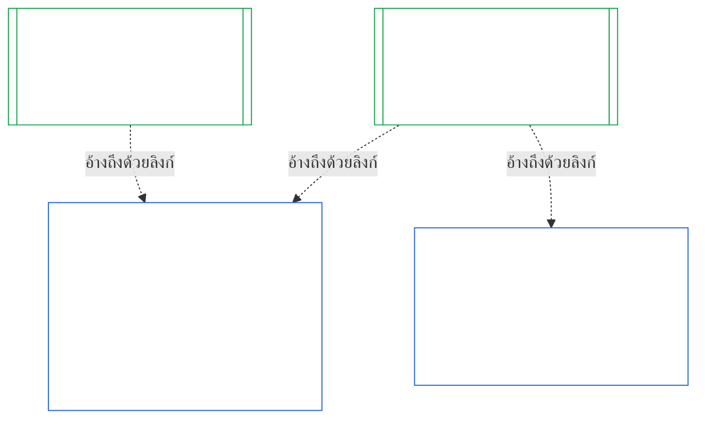
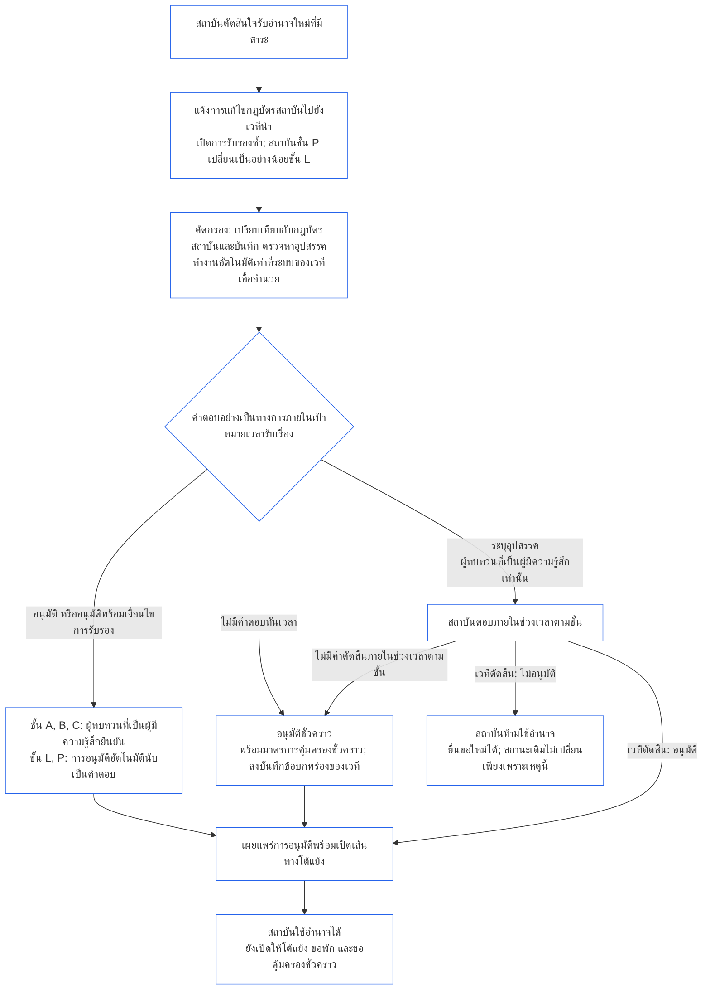

<!-- AI-assisted translation draft; unreviewed; English controls.
Source: core_10.000_institutional_alignment_certification.md
Source snapshot: 247e2180509e5e029c1106878cf225067339e010
Source SHA-256: a163a782114e584d09e295db66fe8b1b10a005b0f00116c8360396a0535ff221 -->

# บทที่สิบ: การรับรองความสอดคล้องของสถาบัน

<strong>ตำแหน่งในคลังข้อความ (ไม่มีผลใช้บังคับ): โครงสร้างไฟล์และกฎการอ่าน</strong>

> ไฟล์นี้เป็น **ส่วนหนึ่งของรัฐธรรมนูญของผู้มีความรู้สึก** และ **มีผลผูกพันเฉพาะเมื่ออ่านร่วมกัน** กับไฟล์ `core_*` ที่มีหมายเลขอื่น ๆ เป็นข้อความเดียวกัน ประกอบด้วย **บทที่สิบ** — **การรับรองความสอดคล้องของสถาบัน**: วิธีที่ [สถาบัน](../../core_05.040_band_continuity.md#institution) ถูกจัดประเภท ประเมิน ทบทวน ตัดสิน บันทึก ทำให้เป็นปัจจุบัน และเปิดทบทวนใหม่ (**§1–§11**) โดยแยกจากระบบใด ๆ ที่สถาบันดำเนินการ บทที่สิบเป็นส่วนที่ว่าด้วยสถาบันซึ่งเทียบคู่กับ [บทที่เก้า](core_09.000_system_alignment_certification_evaluation.md#chapter-nine-system-alignment-certification) (*การรับรองความสอดคล้องของระบบ*) และ **หัวข้อใช้หมายเลขเดียวกัน**: §N ที่นี่ตอบ §N ที่นั่น [CS-9.320](../../corpus_systems/cs_09.320_system_alignment_certification_illustrations.md#cs-9320-system-alignment-certification-illustrations) (*ตัวอย่างประกอบการรับรองความสอดคล้องของระบบ*) มีตัวอย่างประกอบที่ทำไว้สำหรับระบบ และใน [§12 ตัวอย่างแนวทางดำเนินการสำหรับสถาบัน](../../corpus_systems/cs_09.320_system_alignment_certification_illustrations.md#cs-9320-12-illustrative-institution-walkthroughs) มีตัวอย่างแนวทางดำเนินการสำหรับสถาบันสามกรณี บทนี้จะไม่กล่าวซ้ำ
>
> | § | บทที่เก้า (ระบบ) | บทที่สิบ (สถาบัน) |
> |---|------------------------|----------------------------|
> | 1 | วัตถุประสงค์และบทบาท | ความสัมพันธ์กับการรับรองระบบ ผู้ที่ได้รับการรับรอง ไม่มีใบอนุญาตและไม่มีประตูควบคุมการก่อตั้งหรือดำเนินงาน การรออำนาจใหม่ที่มีสาระ ช่วงเวลาสำหรับการรับรองครั้งแรก |
> | 2 | การประเมินชั้นของระบบ | ชั้นของสถาบัน; การปรับขนาดตามชั้น |
> | 3 | การประเมินการรับรองทั้งระบบ | รายการด้านสถาบันทั้งแปด ซึ่งต้องประเมินเสมอ |
> | 4 | การประเมินเมื่อมีประเด็นเกี่ยวข้อง | การอ้างอิงไปยังบทที่เก้า §4 |
> | 5 | การประเมินพื้นสิทธิและด้านต่าง ๆ | การอ้างอิงไปยังบทที่เก้า §5 |
> | 6 | กระบวนการของเวที | สี่ที่นั่ง; บทบาทและลำดับของเวที; เวที ผู้รับรอง และสำนักงานบันทึกในฐานะสถาบัน |
> | 7 | ผลการรับรอง | การเริ่มดำเนินงานของสถาบันและระบบของสถาบัน เงื่อนไขการรับรองและผลอื่นของคำตัดสิน; การอ้างอิงเรื่องข้อบกพร่อง; ความพร้อมแก้ไข; การปฏิเสธและเพิกถอน |
> | 8 | บันทึกการรับรองระบบ | บันทึกการรับรองสถาบัน |
> | 9 | การรับรองซ้ำและเปิดทบทวนใหม่ | การติดตาม; ตัวกระตุ้นให้เปิดใหม่; การรับรองชั่วคราวและเต็มรูปแบบ; การห้ามหลบเลี่ยง; ผลต่อเนื่องจากการรับรองระบบ; การเปิดทบทวนระบบของสถาบันเมื่อเกิดการละเมิดด้านธรรมาภิบาล |
> | 10 | การโต้แย้งการรับรอง | ช่องทางโต้แย้ง |
> | 11 | ความสัมพันธ์กับร่องรอย | สะพานเชื่อมไปยังร่องรอย |
>
> - **ผู้รับผิดชอบตามรัฐธรรมนูญ (ร่วมกับบทที่เก้า):** การรับรองความสอดคล้องภายใต้การกำกับของเวทีและบันทึกที่เกี่ยวข้อง บทที่สิบเพิ่มประธานที่เป็นสถาบัน ไม่ได้เพิ่มครอบครัวเวที ที่นั่ง หรือคำเรียกผลลัพธ์ใหม่
> - **นำมาใช้ซ้ำ ไม่กล่าวซ้ำ:** ระยะที่ III ถึง VI ดำเนินไปตามที่ [บทที่เก้า ภาค B §6](core_09.005_system_alignment_certification_record_process.md#6-forum-process) ถึง [บทที่เก้า ภาค C §11](core_09.010_system_alignment_certification_record_recertification.md#11-relationship-to-standing) กำหนด บทที่สิบระบุเฉพาะสิ่งที่เปลี่ยนไปเมื่อประธานเป็นสถาบัน
> - **กฎห้ามย้ายที่:** บทที่สิบไม่กล่าวซ้ำกลไกการประเมินระบบในบทที่เก้า ช่องข้อมูลกฎบัตรระบบและกฎบัตรสถาบันในบทที่เจ็ด ข้อกำหนดสี่ที่นั่งในบทที่แปด หน้าที่ของสถาบันใน [corpus_institutions](../../corpus_institutions.md) การวัดร่องรอยในบทที่สิบเอ็ด หรือผลของร่องรอยในบทที่สิบสอง
>
> **ต้นทาง:** กฎบัตรใน [บทที่เจ็ด](core_07_charters.md#chapter-seven-system-and-institutional-charters); ความเป็นอิสระเชิงหน้าที่ใน [บทที่แปด](../../core_08.000_functional_independence_separation_of_duties.md#chapter-eight-functional-independence-and-separation-of-duties); [บทที่เก้า](core_09.000_system_alignment_certification_evaluation.md#chapter-nine-system-alignment-certification) (ภาค [A](core_09.000_system_alignment_certification_evaluation.md#chapter-nine-part-a-system-alignment-certification--evaluation), [B](core_09.005_system_alignment_certification_record_process.md#chapter-nine-part-b-system-alignment-certification--forum-process-and-outcomes) และ [C](core_09.010_system_alignment_certification_record_recertification.md#chapter-nine-part-c-system-alignment-certification--record-recertification-and-standing)); การกำกับดูแลเวทีในบทที่สิบสี่
> **ปลายทาง:** บันทึกร่องรอยและข้อมูลนำเข้าที่ตรวจสอบแล้วในบทที่สิบเอ็ด; ผลของร่องรอยในบทที่สิบสอง

<strong>ร่องรอย</strong>

- ต้นทาง:
  - [บทที่เจ็ด §1 กรณีที่ต้องมีกฎบัตรระบบและสถาบัน](core_07_charters.md#1-when-system-and-institutional-charters-are-required) (7.000 §1) (*สถาบันใดเผยแพร่กฎบัตรระบบหรือกฎบัตรสถาบัน และชั้นของสถาบัน*);
  - [บทที่เจ็ด §7 การแก้ไขและทบทวน](core_07_charters.md#7-amendment-review-and-scope-misalignment) (7.000 §7) (*การทบทวนกฎบัตรสถาบันทดสอบอะไร*);
  - [บทที่เจ็ด §4 แผนผังบทบาทตามกฎบัตรและการเก็บรักษาบันทึกร่องรอย](core_07_charters.md#4-the-charter-role-map-and-standing-record-custody) (7.000 §4) (*ที่นั่งอยู่ตรงไหน*);
  - [บทที่แปด §2 ข้อกำหนดสี่ที่นั่งตามรัฐธรรมนูญ](core_07_functional_independence_segregation_of_duties.md#2-four-seat-constitutional-requirement) (8.000 §2) และ [§9 ความสัมพันธ์กับกระบวนการภายหลัง](core_07_functional_independence_segregation_of_duties.md#9-relationship-to-later-processes);
  - [บทที่เก้า](core_09.000_system_alignment_certification_evaluation.md#chapter-nine-system-alignment-certification) (9.000 ถึง 9.010) (*กระบวนการรับรองความสอดคล้องของระบบที่บทนี้นำมาใช้ซ้ำ*);
  - [คำถามพื้นฐานสองข้อ](core_00_preamble.md#two-fundamental-questions);
  - [จตุรภาคทางรัฐธรรมนูญ](core_00_preamble.md#constitutional-tetrad);
  - [Article XI-E](core_06_rights_part_b.md#article-xi-e-institutional-formation-and-business-creation) (*การก่อตั้งสถาบันและการสร้างธุรกิจ*).
- ปลายทาง: [§1](#1-purpose-and-role) ถึง [§11](#11-relationship-to-standing); บทที่สิบเอ็ด ([11.000](core_11_standing_assessment.md#chapter-eleven-contribution-violation-and-standing-model--measurement)); [บทที่สิบสี่](../../core_15.000_forum.md#chapter-fifteen-forums-and-jurisdiction) (14.000)
- อ่านร่วมกับ:
  - [การรับรองความสอดคล้องของสถาบัน](../../core_05.040_band_continuity.md#institutional-alignment-certification) และ
  - [บันทึกการรับรองสถาบัน](../../core_05.040_band_continuity.md#institutional-certification-record) (*ความหมายในบทที่ห้า*);
  - **CI-8.205 §6** (*เนื้อหา การทบทวน และแบบก่อตั้งของกฎบัตรระบบและสถาบัน*);
  - **CF-14.425** (*มาตรการคุ้มครองความซื่อตรง การดำเนินงานต้านการยึดกุม และการสนับสนุนที่ไม่ตัดสินตนเอง*).

 

บทที่สิบเป็นผู้รับผิดชอบตามรัฐธรรมนูญสำหรับ **การรับรองความสอดคล้องของสถาบัน** โดยขยายกระบวนการใน [บทที่เก้า](core_09.000_system_alignment_certification_evaluation.md#chapter-nine-system-alignment-certification) จากระบบไปยังสถาบัน:

- **ระยะ I, วางกรอบ:** ชั้นของสถาบันและการปรับขนาดการประเมินตามชั้น ([§2 การประเมินชั้นของสถาบัน](#2-institution-class-evaluation));
- **ระยะ II, ประเมิน:** การประเมินสถาบัน รวมถึงการประเมินที่ใช้เมื่อมีประเด็นเกี่ยวข้อง และการประเมินพื้นสิทธิและด้านต่าง ๆ ([§3 การประเมินการรับรองทั้งสถาบัน](#3-whole-institution-certification-evaluation) ถึง [§5 การประเมินพื้นสิทธิและด้านต่าง ๆ](#5-rights-floor-and-domain-evaluations));
- **ระยะ III, ทบทวน:** บทบาทและลำดับของเวที ([§6 กระบวนการของเวที](#6-forum-process));
- **ระยะ IV, ตัดสิน:** ผลลัพธ์ ความพร้อมแก้ไข การปฏิเสธและเพิกถอน ([§7 ผลการรับรอง](#7-certification-outcomes));
- **ระยะ V, บันทึก:** บันทึกการรับรองสถาบัน ([§8 บันทึกการรับรองสถาบัน](#8-institutional-certification-record)); และ
- **ระยะ VI, ดำเนินงาน:** การรับรองซ้ำ การเปิดทบทวนใหม่ ผลต่อเนื่องจากการรับรองระบบ การเปิดทบทวนระบบของสถาบัน ช่องทางโต้แย้ง และสะพานเชื่อมไปยังร่องรอย ([§9 การรับรองซ้ำและเปิดทบทวนใหม่](#9-recertification-and-reopening) ถึง [§11 ความสัมพันธ์กับร่องรอย](#11-relationship-to-standing))

*พูดแบบตรง ๆ: บทที่เก้าถามว่า **ระบบ** สอดคล้องหรือไม่ บทที่สิบถามเช่นเดียวกันกับ **สถาบัน** ที่ดำเนินระบบ หรือมีอำนาจโดยไม่ได้ดำเนินระบบ สถาบันอาจสอดคล้องแต่ระบบหนึ่งของตนไม่สอดคล้อง หรือกลับกัน ดังนั้นจึงตรวจสิ่งที่สถาบันควบคุมได้เพียงผู้เดียว: สถาบันทำตามที่กฎบัตรสถาบันระบุหรือไม่ ใครรับผิดชอบต่ออำนาจของสถาบัน สถาบันให้รางวัลแก่สมาชิกของตนในเรื่องใด และการตรวจสอบอิสระต่อสถาบันใช้งานได้จริงหรือไม่ สถาบันอาศัยการรับรองของแต่ละระบบและไม่ประเมินซ้ำ นี่ไม่ใช่ใบอนุญาต ไม่มีใครต้องขออนุญาตจากสถาบันเพื่อเริ่มหรือดำเนินงานสถาบัน*

### 1. วัตถุประสงค์และบทบาท

<strong>ร่องรอย</strong>

- ต้นทาง:
  - [บทที่เจ็ด §1 กรณีที่ต้องมีกฎบัตรระบบและสถาบัน](core_07_charters.md#1-when-system-and-institutional-charters-are-required) (7.000 §1);
  - [บทที่เก้า ภาค A §1 วัตถุประสงค์และบทบาท](core_09.000_system_alignment_certification_evaluation.md#1-purpose-and-role) (9.000 §1);
  - [Article XI-E](core_06_rights_part_b.md#article-xi-e-institutional-formation-and-business-creation) (*การก่อตั้งสถาบันและการสร้างธุรกิจ*);
  - [Article XXVIII-A](../../core_06.020_rights_part_e.md#xxviii-a-existing-instantiations-adoption-transition-window) (*การรับไปใช้เป็นระยะและความต่อเนื่องของพื้นสิทธิ*).
- ปลายทาง: [§2](#2-institution-class-evaluation); [§6](#6-forum-process); [§7](#7-certification-outcomes); [§9](#9-recertification-and-reopening).
- อ่านร่วมกับ:
  - [สถาบัน](../../core_05.040_band_continuity.md#institution);
  - [กฎบัตรสถาบัน](../../core_05.040_band_continuity.md#institutional-charter);
  - [กฎบัตรระบบ](../../core_05.040_band_continuity.md#system-charter);
  - [การสร้างธุรกิจ](../../core_05.055_band_participation.md#business-creation).

 

*พูดแบบตรง ๆ: การรับรองระบบเป็นของระบบ การรับรองสถาบันอ้างถึงการรับรองเหล่านั้น และเพิ่มเฉพาะเรื่องที่สถาบันต้องรับผิดชอบเอง ระบบหนึ่งอาจอยู่ภายใต้หลายสถาบัน หรือไม่อยู่ภายใต้สถาบันใดเลย ไม่มีสิ่งใดในที่นี้ให้การรับรองขัดขวางการก่อตั้งสถาบัน*

การรับรองความสอดคล้องของสถาบันและการรับรองความสอดคล้องของระบบเป็นการรับรองสองรายการที่เชื่อมกันด้วยลิงก์ ความสัมพันธ์คือ **การประกอบกันด้วยลิงก์** ไม่ใช่การครอบอยู่ภายใน ในภาพ ลูกศรจากบันทึกการรับรองระบบชี้ไปยังบันทึกการรับรองสถาบันแต่ละรายการที่อ้างถึง ระบบที่ไม่อยู่ภายใต้สถาบันใดไม่มีลูกศรและไม่จำเป็นต้องมี และสถาบันที่ไม่ได้ดำเนินระบบมีบันทึกของตนเองเท่านั้น

การประกอบกันด้วยลิงก์มีสองด้าน เริ่มจากด้านของสถาบัน

ในด้านของสถาบัน:

- **บันทึกการรับรองสถาบันอ้างถึงบันทึกของระบบและไม่ประเมินซ้ำ:** อ้างถึงบันทึกการรับรองระบบด้วยลิงก์และระบุฉบับ บทนี้ไม่ประเมินระบบซ้ำ ไม่ตัดสินชั้นของระบบใหม่ และไม่เปลี่ยนผลลัพธ์ สถานะ หรือเงื่อนไขการรับรองของระบบ
- **การรับรองสถาบันยกระดับสถานะของระบบไม่ได้:** ระบบที่ไม่ได้รับการรับรองยังคงไม่ได้รับการรับรอง ไม่ว่าสถาบันจะมีสถานะใด ระบบที่ได้รับการรับรองก็ไม่ได้รับความคุ้มครองจากข้อค้นพบเกี่ยวกับสถาบัน
- **ค้นพบข้อเท็จจริงด้านสถาบันเพียงครั้งเดียว:** เมื่อ [บทที่เก้า ภาค A §3.1 ระเบียบด้านธรรมาภิบาล แรงจูงใจ และความสามารถในการโต้แย้ง](core_09.000_system_alignment_certification_evaluation.md#31-governance-incentive-and-contestability-discipline) ถามเรื่องธรรมาภิบาลและแรงจูงใจของผู้ดำเนินการ บันทึกการรับรองสถาบันที่ยังเป็นปัจจุบันของผู้ดำเนินการอาจให้ข้อเท็จจริงเหล่านั้นผ่านลิงก์ได้ เวทีของระบบยังคงตัดสินว่าข้อเท็จจริงนั้นเพียงพอสำหรับระบบนั้นหรือไม่ ห้ามค้นพบข้อเท็จจริงด้านสถาบันเรื่องเดียวกันต่างไปโดยไม่ระบุเหตุผลในบันทึกการรับรองระบบ

ในด้านของระบบ:

- **บันทึกการรับรองระบบเป็นของระบบ:** เป็นบันทึกของระบบเองภายใต้ [บทที่เก้า](core_09.000_system_alignment_certification_evaluation.md#chapter-nine-system-alignment-certification)
- **หลายสถาบันอ้างถึงบันทึกการรับรองระบบเดียวกันได้:** ระบบหนึ่งอาจมีสถาบันมากกว่าหนึ่งแห่งดำเนินงาน บริหารอย่างรับผิดชอบ หรือควบคุมในสาระสำคัญได้ ตาม [บทที่เจ็ด §1 กรณีที่ต้องมีกฎบัตรระบบและสถาบัน](core_07_charters.md#1-when-system-and-institutional-charters-are-required) แต่ละสถาบันอ้างถึงบันทึกเดียวกัน
- **ระบบไม่จำเป็นต้องอยู่ภายใต้สถาบันใด:** ผู้มีความรู้สึกหนึ่งรายไม่ใช่สถาบัน ระบบจึงอาจไม่มีสถาบันได้ ระบบที่ไม่มีสถาบันจะได้รับการรับรองภายใต้ [บทที่เก้า](core_09.000_system_alignment_certification_evaluation.md#chapter-nine-system-alignment-certification) เท่านั้น และไม่ต้องการสิ่งใดจากบทนี้ ระบบที่อยู่ภายใต้สถาบันก็ได้รับการรับรองในลักษณะเดียวกัน: บทนี้เพิ่มบันทึกแยกสำหรับสถาบัน ไม่ใช่ขั้นตอนหนึ่งของการรับรองระบบนั้นเอง

#### 1.1 ใครได้รับการรับรอง

สถาบันชั้น L หรือสูงกว่าอยู่ในขอบเขตของบทนี้ โดยชั้นกำหนดตาม [§2.1 ชั้นของสถาบัน](#21-institution-class) รวมถึงสถาบันที่ไม่ได้ดำเนินระบบเลยด้วย: ไม่มีบันทึกการรับรองระบบให้อ้างถึง และชั้นของสถาบันมาจากผลกระทบของตนเอง **กลุ่มระบบในความดูแล** ของสถาบันคือชุดระบบที่สถาบันดำเนินงาน บริหารอย่างรับผิดชอบ หรือควบคุมในสาระสำคัญ ([Portfolio](../../core_05.040_band_continuity.md#portfolio))

- **ชั้น A, B, C และ L:** ใช้กระบวนการนี้ โดยปรับตามชั้นตาม [§2.2 การปรับขนาดตามชั้น](#22-scaling-by-class)
- **ชั้น P:** สนับสนุนให้ใช้กระบวนการนี้ และจะใช้โดยสมัครใจก็ได้ กระบวนการจะเป็นข้อบังคับเมื่อจัดประเภทใหม่เป็นชั้น L หรือสูงกว่า หรือเมื่อสถาบันสมัครใจอ้างว่าปฏิบัติตามรัฐธรรมนูญ สถาบันชั้น P ที่ตัดสินใจรับอำนาจใหม่ที่มีสาระจะถูกจัดประเภทใหม่เป็นอย่างน้อยชั้น L เมื่อแจ้งตาม [§9.2.2 การรับรองซ้ำสำหรับอำนาจใหม่ที่มีสาระ](#922-recertification-for-new-material-authority) เพราะอำนาจนั้นเป็นสาระโดยนิยาม ([§9.2.1 อะไรนับเป็นอำนาจใหม่ที่มีสาระ](#921-what-counts-as-new-material-authority)) และสถาบันที่มีสาระในด้านใดด้านหนึ่งจะเป็นอย่างน้อยชั้น L ([§2.1 ชั้นของสถาบัน](#21-institution-class), ข้อ 2) การจัดประเภทใหม่นี้มีผลตั้งแต่การแจ้งจนกว่าจะถอนการแจ้งก่อนการอนุมัติ หรือจนกว่าอำนาจจะไม่ได้รับอนุมัติ หากยังไม่มีการใช้อำนาจนั้น จากนั้นสถาบันกลับไปเป็นชั้น P และการรับรองครั้งแรกแบบจำกัดจะสิ้นสุด การแจ้งใหม่เริ่มกระบวนการอีกครั้ง ส่วนการใช้อำนาจโดยไม่ผ่านการอนุมัติยังคงเป็นข้อค้นพบภายใต้ [§9.2.2 การรับรองซ้ำสำหรับอำนาจใหม่ที่มีสาระ](#922-recertification-for-new-material-authority) (*ไม่มีการแจ้งหรือก่อนอนุมัติ*) ซึ่งสอดคล้องกับ [บทที่เก้า ภาค A §1 วัตถุประสงค์และบทบาท](core_09.000_system_alignment_certification_evaluation.md#1-purpose-and-role)
- **ระบบเดียว:** สถาบันที่ดำเนินระบบเพียงระบบเดียวซึ่งต้องมีกฎบัตรระบบ จะมีรอบการรับรองหนึ่งรอบและบันทึกหนึ่งรายการ ซึ่งบทนี้เรียกว่า **การประเมินระบบเดียว** บันทึกการรับรองระบบมี *ส่วนบันทึกข้อค้นพบด้านสถาบัน* ซึ่งมีรายการใน [§8 บันทึกการรับรองสถาบัน](#8-institutional-certification-record) และทำหน้าที่เป็นบันทึกการรับรองสถาบัน เวที ที่นั่ง และกรอบเวลาจะเป็นไปตามรอบการรับรองของระบบนั้นเอง โดยเพิ่มรายการด้านสถาบัน ผลลัพธ์ของระบบเป็นไปตามเหตุแห่งการปฏิเสธและเพิกถอนของตน ดังที่ [§7.4 การปฏิเสธและเพิกถอนสำหรับสถาบัน](#74-denial-and-revocation-for-an-institution) ระบุ การส่งผลต่อเนื่องใน [§9.5 ผลต่อเนื่องจากการรับรองระบบ](#95-cascade-from-system-certifications) ไม่ใช้ในฐานะผลต่อเนื่อง เพราะระบบนั้นเป็นกลุ่มระบบในความดูแลทั้งหมด แต่กฎข้อ 1 และ 2 ของ [§7.4 การปฏิเสธและเพิกถอนสำหรับสถาบัน](#74-denial-and-revocation-for-an-institution) ยังใช้ (ตัวบ่งชี้และการทดสอบว่ามูลเหตุอยู่ที่ใด)
- **หลายระบบ:** มีบันทึกการรับรองสถาบันหนึ่งรายการซึ่งเชื่อมไปยังบันทึกการรับรองระบบของแต่ละระบบที่สถาบันดำเนินงาน ระบบแต่ละระบบมีรอบการรับรองและบันทึกของตนเอง
- **ไม่มีระบบ:** มีบันทึกการรับรองสถาบันแยกต่างหาก ไม่มีบันทึกการรับรองระบบให้เชื่อมไปถึง เพราะสถาบันไม่ได้ดำเนินระบบ

#### 1.2 ไม่มีใบอนุญาตและไม่มีประตูควบคุมการก่อตั้งหรือดำเนินงาน

การรับรองความสอดคล้องของสถาบันเป็นการตรวจสอบโดยอิสระว่าสถาบันใช้อำนาจของตนจริงอย่างไร เวทีที่เป็นอิสระจากสถาบันเป็นผู้ดำเนินการ และจบลงด้วยบันทึกการรับรองสถาบันที่ระบุสิ่งที่ค้นพบ

- **การก่อตั้งและดำเนินงาน:** สถาบันก่อตั้ง เผยแพร่กฎบัตรสถาบัน เริ่มใช้อำนาจ และดำเนินงานต่อไปได้โดยไม่ต้องถือการรับรองก่อน ไม่มีผลลัพธ์ใดให้หรือริบสิทธินั้น
- **ผลของคำตัดสิน:** คำตัดสินมีผลเฉพาะตาม [§7.1 การเริ่มดำเนินงานสำหรับสถาบัน](#71-go-live-for-an-institution)
- **ประตูควบคุมเพียงกรณีเดียวในเรื่องนี้:** มีประตูแคบสามกรณี ทั้งหมดอยู่ใน **Article XI-E** (*การก่อตั้งสถาบันและการสร้างธุรกิจ*):
  - กุญแจที่ยังมีผลกับผู้มีความรู้สึกที่ระบุชื่อ ซึ่งผูกกับอำนาจของผู้มีความรู้สึกนั้น;
  - การพักไว้ชั่วคราวบนข้อเท็จจริงที่ตรวจสอบแล้วและเฉพาะเจาะจงเกี่ยวกับความไม่สอดคล้อง ซึ่งผูกกับอำนาจของผู้มีความรู้สึกที่ระบุชื่อเช่นกัน;
  - กุญแจที่ผูกกับฝ่ายปฏิบัติการเอง ซึ่งจะผูกกับสถาบันได้เฉพาะเมื่อกุญแจอยู่บนสถาบันนั้น เช่น กรณีสถาบันที่ถูกเลิกตาม **CI-12.210 §4** (*การเลิกกิจการ*)

  อาจส่งต่อข้อค้นพบจากการรับรองไปยังเวทีที่ตัดสินหนึ่งในประตูเหล่านี้เพื่อใช้เป็นหลักฐานตาม [§7.5 ผลของการปฏิเสธและเพิกถอนสำหรับสถาบัน](#75-effects-of-denial-and-revocation-for-an-institution) ผลการรับรองไม่ใช่ประตูควบคุมในตัวเอง และไม่เปิดหรือปิดประตูใด
- **การรออำนาจใหม่ที่มีสาระ:** สถาบันที่ตัดสินใจรับอำนาจใหม่ที่มีสาระ ต้องรอให้การรับรองซ้ำอนุมัติอำนาจนั้นก่อนจึงใช้ได้ ตามเงื่อนไขใน [§9.2.2 การรับรองซ้ำสำหรับอำนาจใหม่ที่มีสาระ](#922-recertification-for-new-material-authority) **Article XI-E** (*การก่อตั้งสถาบันและการสร้างธุรกิจ*) กำหนดการรอนี้ ไม่ใช่หนึ่งในสามประตูแคบ และไม่ใช่ประตูควบคุมการก่อตั้งหรือดำเนินงาน มีผลกับอำนาจใหม่เท่านั้น ส่วนกิจกรรมอื่นของสถาบันยังดำเนินต่อ ภาพใน [§9.2.2 การรับรองซ้ำสำหรับอำนาจใหม่ที่มีสาระ](#922-recertification-for-new-material-authority) สรุปขั้นตอน
- **ไม่มีช่องทางลับ:** เวที ผู้รับไปใช้ หรือผู้ดำรงตำแหน่งเดิม ห้ามใช้บทนี้เป็นเกณฑ์อนุญาตที่กีดกันผู้ก่อตั้งหรือคุ้มครองผู้ดำรงตำแหน่งเดิม การทำเช่นนั้นจะขัดต่อ [Article XI-E](core_06_rights_part_b.md#article-xi-e-institutional-formation-and-business-creation) (*การก่อตั้งสถาบันและการสร้างธุรกิจ*)
  - [ภาระที่หลีกเลี่ยงได้](../../core_05.040_band_continuity.md#avoidable-burden) ใช้กับต้นทุนของกระบวนการ
  - [ธรรมาภิบาลที่ปรับตามชั้น](core_05_band_oversight.md#classification-scaled-governance) ใช้กับความลึกของกระบวนการ
  - การรออำนาจใหม่ที่มีสาระใช้เงื่อนไขเดียวกันกับทุกสถาบันในชั้นเดียวกัน และใช้เฉพาะกับอำนาจที่มีสาระต่อผู้อื่นอยู่แล้ว

ประตูเริ่มดำเนินงานสำหรับระบบแยกต่างหากและยังคงใช้กับระบบ ภายใต้ [บทที่เก้า ภาค B §7.1 ประตูเริ่มดำเนินงาน](core_09.005_system_alignment_certification_record_process.md#71-go-live-gate) ระบบใหม่หรือการขยายระบบที่มีสาระจะเริ่มดำเนินงานได้ผ่านการรับรองของตนเองเท่านั้น ไม่ว่าสถาบันจะมีสถานะใด

#### 1.3 ช่วงเวลาสำหรับการรับรองครั้งแรก

บันทึกการรับรองสถาบันครั้งแรกต้องจัดทำภายในช่วงเวลาที่เอกสารการรับไปใช้กำหนดสำหรับชั้นของสถาบัน

- **สถาบันใหม่:** ช่วงเวลาเริ่มนับจากวันที่สถาบันส่งผลกระทบที่มีสาระต่อผู้อื่นเป็นครั้งแรก ตามการประเมินของ [ความมีสาระเฉพาะด้าน](core_05_band_oversight.md#domain-specific-materiality) และการรับรองครั้งแรกเป็นการรับรองชั่วคราว
- **สถาบันชั้น P ที่จัดประเภทใหม่เมื่อแจ้ง:** ช่วงเวลาเริ่มนับจากวันที่แจ้งตาม [§9.2.2 การรับรองซ้ำสำหรับอำนาจใหม่ที่มีสาระ](#922-recertification-for-new-material-authority) เช่นเดียวกับสถาบันใหม่ และไม่นับจากช่วงเปลี่ยนผ่านการรับไปใช้ที่สิ้นสุดไปแล้ว
- **สถาบันที่ดำเนินงานอยู่แล้ว:** ช่วงเวลาคือช่วงเปลี่ยนผ่านการรับไปใช้ตาม [Article XXVIII-A](../../core_06.020_rights_part_e.md#xxviii-a-existing-instantiations-adoption-transition-window) (*การรับไปใช้เป็นระยะและความต่อเนื่องของพื้นสิทธิ*) ซึ่งสอดคล้องกับค่าเริ่มต้นใน [บทที่เจ็ด §1.5 กำหนดเวลาเมื่อใดสำหรับกฎบัตรระบบหรือสถาบัน](core_07_charters.md#15-when-a-system-charter-or-institutional-charter-is-due)
- **พลาดช่วงเวลา:** สถาบันที่ปล่อยให้ช่วงเวลาหมดโดยไม่มีรอบแรก และไม่ได้รับยกเว้นตามด้านล่าง มีข้อบกพร่องที่ต้องบันทึกและแก้ไข และช่วงเวลาที่พลาดจะเปิดรอบนั้น สถาบันชั้น L หรือสูงกว่าที่ดำเนินงานอยู่แล้วยังมีความล้มเหลวด้านหมุดหมายตามด้านล่างด้วย สถาบันจะไม่ถูกสั่งหยุดหรือห้ามดำเนินงาน เพราะไม่มีประตูควบคุม ([§1.2 ไม่มีใบอนุญาตและไม่มีประตูควบคุมการก่อตั้งหรือดำเนินงาน](#12-no-permission-and-no-gate-on-forming-or-running))
  - **สถาบันที่ดำเนินงานอยู่แล้ว:** นี่คือกฎเฉพาะของบทนี้สำหรับสถาบันชั้น L หรือสูงกว่า โดยเทียบเคียงกับ [Article XXVIII-A](../../core_06.020_rights_part_e.md#xxviii-a-existing-instantiations-adoption-transition-window) (*การรับไปใช้เป็นระยะและความต่อเนื่องของพื้นสิทธิ*) ซึ่งกล่าวถึงระบบและหน่วยงานที่เกิดสืบเนื่อง หากช่วงเปลี่ยนผ่านการรับไปใช้สิ้นสุดและยังไม่มีรอบการรับรองครั้งแรกที่เสร็จสมบูรณ์ (ไม่มีการรับรองชั่วคราวหรือเต็มรูปแบบ และไม่มีผลตัดสินตาม [§7 ผลการรับรอง](#7-certification-outcomes)) แสดงว่าพลาดกำหนดเวลา สถาบันที่ยื่นเรื่องและให้ความร่วมมือภายในช่วงเวลาไม่ถือว่าพลาด หากรอบการรับรองไม่เสร็จเพราะเวทีใช้เวลาเกินกำหนดของตน ([บทที่สิบสี่ §6 การวินิจฉัยอย่างทันเวลา ชั้นความมีสาระ และวินัยต้านความล่าช้า](core_11_forum.md#6-timely-resolution-materiality-tiers-and-anti-delay-discipline), *การทบทวนกรณีเกินกำหนด*; [บทที่เก้า ภาค C §9.3.4 ช่วงเวลาตามชั้น](core_09.010_system_alignment_certification_record_recertification.md#934-tier-windows)) หรือเพราะกำลังใช้การเลื่อนครั้งเดียวตาม [§7.3 ความพร้อมแก้ไขสำหรับสถาบัน](#73-remediation-readiness-for-an-institution) หากไม่มีหลักฐานการอนุญาตใหม่ตาม [Article XXVIII-B](../../core_06.020_rights_part_e.md#article-xxviii-b-adoption-transition-authority-limits-and-reauthorization) (*ข้อจำกัดอำนาจในช่วงเปลี่ยนผ่านการรับไปใช้และการอนุญาตใหม่*) กรณีนี้เป็นความล้มเหลวด้านหมุดหมายในช่วงเปลี่ยนผ่าน และเปิดเส้นทางการปฏิบัติตามและการละเมิดตามปกติใน [บทที่สิบเอ็ด](core_11_standing_assessment.md#chapter-eleven-contribution-violation-and-standing-model--measurement) หน้าที่จำกัดการดำเนินการในบทความนั้นมีผลตั้งแต่วันมีผลใช้บังคับ และช่องว่างจะไม่กลายเป็นบรรทัดฐานใหม่เพียงเพราะปล่อยไว้นาน กรณีนี้สอดคล้องกับ [บทที่เก้า ภาค B §7.1.1 ระบบที่ดำเนินงานอยู่แล้ว](core_09.005_system_alignment_certification_record_process.md#711-systems-already-operating) ไม่ใช่ประตูควบคุม
  - **รอบการรับรอง:** ตัดสินเช่นเดียวกับกรณีอื่น อาจจบด้วยผลลัพธ์ใดก็ได้ตาม [§7 ผลการรับรอง](#7-certification-outcomes) รวมถึงไม่ได้รับการรับรอง พร้อมผลตาม [§7.5 ผลของการปฏิเสธและเพิกถอนสำหรับสถาบัน](#75-effects-of-denial-and-revocation-for-an-institution)
  - **มาตรการลงโทษและการเลิกกิจการ:** บทนี้ไม่ได้สร้างมาตรการดังกล่าว การพักใช้ การเข้าบริหารแทน การแยกโครงสร้าง และการเลิกกิจการยังอยู่กับเวทีที่มีเขตอำนาจตาม **CI-12.210** (*ความล้มเหลวและการเลิกกิจการของสถาบัน*) และ **CI-12.215** (*ความรับผิดชอบและมาตรการลงโทษของสถาบัน*) เวทีนั้นจะได้รับการส่งต่อเฉพาะตามเหตุแห่งการส่งต่อใน [§7.5 ผลของการปฏิเสธและเพิกถอนสำหรับสถาบัน](#75-effects-of-denial-and-revocation-for-an-institution) (ข้อ 5, *การส่งต่อ*)

### 2. การประเมินชั้นของสถาบัน

<strong>ร่องรอย</strong>

- ต้นทาง:
  - [บทที่เจ็ด §1 กรณีที่ต้องมีกฎบัตรระบบและสถาบัน](core_07_charters.md#1-when-system-and-institutional-charters-are-required) (7.000 §1);
  - [บทที่เก้า ภาค A §2 การประเมินชั้นของระบบ](core_09.000_system_alignment_certification_evaluation.md#2-system-class-evaluation) (9.000 §2) และ [§2.2 วิธีที่ชั้นของระบบกำหนดขนาดของการประเมินแต่ละรายการ](core_09.000_system_alignment_certification_evaluation.md#22-how-system-class-scales-every-evaluation);
  - [บทที่สาม §2.1 รูปแบบการหลบเลี่ยงทั่วไป](core_03_definition_integrity.md#21-common-evasion-patterns) (3.000 §2.1)
- ปลายทาง: [§3](#3-whole-institution-certification-evaluation) (*รายการที่ปรับขนาดตามชั้น*); [§8](#8-institutional-certification-record) (*ระบุชั้นไว้ในบันทึก*); [§9.2](#92-reopening-triggers) (*ตัวกระตุ้นให้ประเมินชั้นใหม่*)
- อ่านร่วมกับ:
  - **CS-9.305 (*กลไกจัดประเภทระบบ*) และ CS-9.310** (*การจัดประเภทผลกระทบของระบบ*) และ [การจัดประเภทผลกระทบของระบบ](../../corpus_systems/cs_09.310_system_impact_classifications.md) (*บัญชีชั้น*);
  - **CI-9.210** (*หน้าที่ของสถาบันที่เชื่อมโยงกับการจัดประเภท*);
  - **CI-8.205 §6** (*เนื้อหา การทบทวน และแบบก่อตั้งของกฎบัตรระบบและสถาบัน*).

 

*พูดแบบตรง ๆ: ขั้นแรกจัดสถาบันเข้าชั้นโดยดูว่ามีความสำคัญต่อผู้อื่นเพียงใด ตัดสินจากสิ่งที่สถาบันตัดสินและถือครองจริง ไม่ใช่ชื่อที่ใช้ ชั้นจะกำหนดความละเอียดของการประเมิน: ชั้นสูงขึ้นต้องมีหลักฐานเข้มงวดขึ้น การทบทวนอิสระมากขึ้น และตรวจซ้ำเร็วขึ้น*

ส่วนนี้คือ **ระยะ I, วางกรอบ** สำหรับสถาบัน

#### 2.1 ชั้นของสถาบัน

**ชั้นของสถาบัน** กำหนดจากผลกระทบที่มีสาระสูงสุดที่สถาบันก่อ ไม่ว่าจะผ่านระบบที่ดำเนินงานหรืออยู่นอกระบบใดก็ตาม พิจารณาจากสิ่งที่สถาบันตัดสิน ถือครอง และควบคุมจริง ไม่ใช่ชื่อ รูปแบบทางกฎหมาย หรือรายการในกฎบัตรสถาบัน ชั้นกำหนดความลึกของการประเมินและกรอบเวลา เช่นเดียวกับ [บทที่เก้า ภาค A §2.2 วิธีที่ชั้นของระบบกำหนดขนาดของการประเมินแต่ละรายการ](core_09.000_system_alignment_certification_evaluation.md#22-how-system-class-scales-every-evaluation) ที่ใช้กับระบบ ชั้นนี้ใช้ในบทนี้และ [บทที่เจ็ด §1.2 ชั้นใดอยู่ในขอบเขต](core_07_charters.md#12-which-classes-are-covered)

1. **ผลกระทบผ่านระบบ:** ชั้นของสถาบันต้องไม่น้อยกว่าชั้นสูงสุดของระบบใด ๆ ในกลุ่มระบบของตน ([บทที่เจ็ด §1 กรณีที่ต้องมีกฎบัตรระบบและสถาบัน](core_07_charters.md#1-when-system-and-institutional-charters-are-required)) ระบุระบบจากการดำเนินงานที่สังเกตได้ ระบบที่ไม่มีในกฎบัตรสถาบันก็ยังนับ
2. **ผลกระทบนอกระบบใด ๆ:** นับผลกระทบที่มีสาระและการพึ่งพาของสถาบันเอง ไม่ว่าสถาบันจะดำเนินระบบหรือไม่ ใช้นิยามชั้นใน **CS-9.305 (*กลไกจัดประเภทระบบ*) และ CS-9.310** (*การจัดประเภทผลกระทบของระบบ*) กับการตัดสินใจและสิ่งที่สถาบันถือครองเอง โดยพิจารณาปัจจัยเหล่านี้:
   - **สิ่งที่ตัดสินและถือครอง:**
     - การตัดสินเกี่ยวกับการเข้าถึงสิ่งจำเป็นต่อการอยู่รอด การศึกษา ความปลอดภัย การดำรงชีพ สิทธิ หรือร่องรอยของผู้มีความรู้สึกอื่น; และ
     - สิ่งที่ถือครอง เช่น เงินทุน บันทึก สมาชิกภาพ การเก็บรักษาบันทึกร่องรอย หรือการทำหน้าที่เป็นเวที ผู้รับรอง หรือสำนักงานบันทึก
   - **มีสาระหรือไม่:**
     - กิจกรรมของสถาบันมีสาระในด้านใดด้านหนึ่งของ [ความมีสาระเฉพาะด้าน](core_05_band_oversight.md#domain-specific-materiality) หรือไม่ รวมถึงการกระทำ [ที่มีผลผูกพันอย่างเป็นสาระ](../../core_05.035_band_accountability.md#materially-binding-act) ซึ่งผู้อื่นต้องปฏิบัติตามหรืออาจอาศัยเป็นข้อยุติ;
     - สถาบันที่มีสาระในด้านใดด้านหนึ่งเป็นอย่างน้อยชั้น L ภายใต้ **CS-9.305 (*กลไกจัดประเภทระบบ*) และ CS-9.310** (*การจัดประเภทผลกระทบของระบบ*); และ
     - การให้ความช่วยเหลือ สิ่งของ แรงงาน หรือบริการที่ผู้อื่นเลือกจะรับหรือปฏิเสธได้อย่างอิสระ และไม่ควบคุมการเข้าถึงสิ่งที่จำเป็น ไม่ผูกมัดผู้ใด เป็นเพียงการกระทำ ไม่ใช่การกระทำที่มีผลผูกพันอย่างเป็นสาระ และจะนับผ่านปัจจัยอื่นเท่านั้น
   - **มีผู้พึ่งพามากเพียงใด:**
     - จำนวนผู้มีความรู้สึกที่พึ่งพาสถาบัน และมีสิ่งทดแทนได้มากน้อยเพียงใด;
     - อำนาจกระจุกตัวเพียงใดตามความหมายของแนวควบคุมที่มีสาระ; และ
     - การตัดสินใจย้อนกลับได้มากน้อยเพียงใด
3. **การควบคุมร่วมกัน:** ฝ่ายปฏิบัติการที่เป็นการดำเนินงานเดียวกันตามกฎการรวมของ [ความมีสาระเฉพาะด้าน](core_05_band_oversight.md#domain-specific-materiality) (มีการควบคุมในทางปฏิบัติร่วมกันภายใน [แนวควบคุมที่มีสาระ](../../core_05.035_band_accountability.md#material-control-line); การให้เงินทุนอย่างเดียวไม่นับ) จะถูกจัดประเภทร่วมกันเมื่อปฏิบัติจริงเป็นสถาบันเดียว การแบ่งฝ่ายปฏิบัติการ กลุ่มระบบ หรืออำนาจ เพื่อไม่ให้ส่วนใดถึงชั้น L เป็นการหลบเลี่ยงขอบเขตและแนวเขตตาม [บทที่สาม §2.1 รูปแบบการหลบเลี่ยงทั่วไป](core_03_definition_integrity.md#21-common-evasion-patterns)
4. **การจัดประเภทใหม่:** ประเมินชั้นใหม่เมื่อมีตัวกระตุ้นตาม [§9.2 ตัวกระตุ้นให้เปิดทบทวนใหม่](#92-reopening-triggers) ระบุชั้นพร้อมเหตุผลไว้ในบันทึกการรับรองสถาบัน

#### 2.2 การปรับขนาดตามชั้น

ชั้นของสถาบันกำหนดความลึกของหลักฐาน ความเป็นอิสระของการทบทวน ช่วงเวลาการรับรองเริ่มต้น และการเปิดเผยในบันทึก เช่นเดียวกับ [บทที่เก้า ภาค A §2.2 วิธีที่ชั้นของระบบกำหนดขนาดของการประเมินแต่ละรายการ](core_09.000_system_alignment_certification_evaluation.md#22-how-system-class-scales-every-evaluation) ช่วงเวลาการรับรองอยู่ใน [บทที่สิบสี่ §6 การวินิจฉัยอย่างทันเวลา ชั้นความมีสาระ และวินัยต้านความล่าช้า](../../core_15.000_forum.md#review-cadence) (*รอบการทบทวน*); เอกสารการรับไปใช้อาจกำหนดช่วงที่สั้นลงและกำหนดจำนวนครั้งที่ต้องผ่านการรับรองซ้ำชั่วคราวโดยไม่มีข้อบกพร่อง

- **ชั้น A, B และ C:** ใช้รายการทั้งแปดใน [§3 การประเมินการรับรองทั้งสถาบัน](#3-whole-institution-certification-evaluation) โดยให้หลักฐานและความเป็นอิสระได้สัดส่วนกับชั้น
- **ชั้น L:** ใช้รายการทั้งแปดเช่นกันแต่ทำให้ง่ายขึ้น ใช้บันทึกที่เรียบง่ายกว่าและช่วงเวลาการรับรองเริ่มต้นที่ยาวกว่าในกรณีที่ [ธรรมาภิบาลที่ปรับตามชั้น](core_05_band_oversight.md#classification-scaled-governance) อนุญาต แกนหลักของการประเมินชั้น L คือเปรียบเทียบกฎบัตรสถาบันกับการปฏิบัติ แผนผังบทบาท คำแถลงการตรวจสอบการก่อตั้ง และความเป็นปัจจุบันของการรับรองระบบที่อ้างถึง ห้ามละรายการใด และหากไม่มีสิ่งให้ค้นพบ ต้องระบุไว้หนึ่งบรรทัด
- **ชั้น P:** เป็นไปโดยสมัครใจ ตามที่ [§1.1 ใครได้รับการรับรอง](#11-who-is-certified) ระบุ

**หน่วยงานเจ้าภาพในการปฏิบัติวิชาชีพร่วมกัน** เมื่อสถาบันเป็นหน่วยงานเจ้าภาพ ([**CI-15.205 §7**](../../corpus_institutions/ci_16.205_appointment_competency_rotation_removal.md#ci-46-seat-advisory) (*ใบอนุญาตประกอบวิชาชีพ การอนุญาตให้ปฏิบัติ และการปฏิบัติวิชาชีพร่วมกัน*)) การรับรองจะสุ่มตรวจการกระทำของสมาชิกเทียบกับที่นั่งที่หน่วยงานเจ้าภาพถือครอง และอ่านประกาศการรับไปใช้ของสมาชิกเทียบกับสิ่งที่หน่วยงานเจ้าภาพทำ ข้อค้นพบเกี่ยวกับการกระทำของสมาชิกคนหนึ่งเป็นข้อค้นพบเกี่ยวกับสมาชิกคนนั้น และจะส่งผลถึงหน่วยงานเจ้าภาพเฉพาะเมื่อที่นั่งที่เจ้าภาพถือครองล้มเหลว

### 3. การประเมินการรับรองทั้งสถาบัน

<strong>ร่องรอย</strong>

- ต้นทาง:
  - [บทที่เก้า ภาค A §3 การประเมินการรับรองทั้งระบบ](core_09.000_system_alignment_certification_evaluation.md#3-whole-system-certification-evaluation) (9.000 §3);
  - [บทที่เจ็ด §3 สิ่งที่กฎบัตรระบบและสถาบันต้องระบุ](core_07_charters.md#3-what-system-and-institutional-charters-must-state) (7.000 §3);
  - [บทที่เจ็ด §5 การตรวจสอบการก่อตั้ง: สถานะและความแท้จริงของผู้ดำรงตำแหน่ง](core_07_charters.md#5-formation-check-office-holder-standing-and-authenticity) (7.000 §5);
  - [บทที่เจ็ด §7 การแก้ไขและการทบทวน](core_07_charters.md#7-amendment-review-and-scope-misalignment) (7.000 §7);
  - [คำถามพื้นฐานสองข้อ](core_00_preamble.md#two-fundamental-questions);
  - [บทที่หนึ่ง §19.6 การคงความรับผิดชอบเมื่อความเป็นเจ้าของหรือโครงสร้างเปลี่ยนแปลง](core_01_c_stewardship_capacity_principles.md#196-keeping-responsibility-when-ownership-or-structure-changes) (1.010 §19.6).
- ปลายทาง: [§6](#6-forum-process) (*ข้อค้นพบที่เวทีทบทวน*); [§9](#9-recertification-and-reopening) (*ตัวกระตุ้นให้เปิดเรื่องขึ้นอีกครั้ง*); [§11](#11-relationship-to-standing) (*ประตูตรวจข้อมูลนำเข้าที่ตรวจสอบแล้วสำหรับข้อค้นพบเกี่ยวกับผู้มีความรู้สึกที่ระบุชื่อ*).
- อ่านร่วมกับ:
  - **CI-8.205 §3** (*สายอำนาจและการควบคุมการมอบหมายอำนาจ*) และ **CI-8.205 §6** (*เนื้อหา การทบทวน และแม่แบบการก่อตั้งของกฎบัตรระบบและสถาบัน*);
  - **CI-6.215** (*การบริหารทรัพยากรอย่างรับผิดชอบและความซื่อตรงของแรงจูงใจ*);
  - **CI-8.210** (*ความซื่อตรงด้านผลประโยชน์ทับซ้อน การต่อต้านการยึดกุม และการต่อต้านการทุจริต*), **CI-6.205** (*ความโปร่งใส การมีส่วนร่วม และเส้นทางการโต้แย้งและการให้บริการที่เข้าถึงได้*), และ **CI-12.205** (*ระบบการเยียวยาและขีดความสามารถในการแก้ไขความเดือดร้อนของสถาบัน*) สำหรับข้อ 8.

 

*พูดแบบตรง ๆ: ตรวจสิ่งที่เป็นของสถาบันและไม่ได้เป็นของระบบใดระบบหนึ่ง ได้แก่ สถาบันปฏิบัติตามกฎบัตรสถาบันหรือไม่ ใครรับผิดชอบต่ออำนาจของสถาบัน สถาบันให้รางวัลแก่สิ่งใด และการตรวจสอบอิสระต่อสถาบันนั้นทำงานได้หรือไม่*

ส่วนนี้คือ **ระยะที่ II ประเมิน** สำหรับสถาบัน

การรับรองผ่านทุกครั้งต้องประเมินทั้งแปดรายการนี้ ซึ่งเป็นส่วนที่สอดคล้องกับสถาบันของ [บทที่เก้า ภาค A §3 การประเมินการรับรองทั้งระบบ](core_09.000_system_alignment_certification_evaluation.md#3-whole-system-certification-evaluation) ข้อค้นพบแต่ละข้อระบุหลักฐานและข้อความในกฎบัตรสถาบันหรือการปฏิบัติที่สังเกตได้ซึ่งเป็นฐานของข้อค้นพบนั้น

1. **กฎบัตรสถาบันเทียบกับการปฏิบัติ:**
   - ทดสอบกฎบัตรสถาบันเทียบกับการปฏิบัติที่สังเกตได้ โดยใช้รายการทบทวนใน [บทที่เจ็ด §7 การแก้ไขและการทบทวน](core_07_charters.md#7-amendment-review-and-scope-misalignment)
   - การปฏิบัติที่อยู่นอกกฎบัตรสถาบัน หรือกฎบัตรสถาบันที่ไม่อธิบายการปฏิบัติอีกต่อไป ย่อมเป็นข้อค้นพบ ไม่ว่าส่วนใดจะผิด
2. **กลุ่มระบบและผลรวม:**
   - ทดสอบเหตุผลรองรับกลุ่มระบบ: แต่ละระบบต้องเชื่อมโยงกับวัตถุประสงค์ที่สถาบันระบุไว้ และระบบที่ไม่มีเหตุผลระบุไว้ถือเป็นข้อค้นพบ
   - การประเมินยังพิจารณาระบบทั้งหลายร่วมกัน เพื่อค้นหาสิ่งที่ใบรับรองของแต่ละระบบเพียงลำพังแสดงไม่ได้:
     - การพึ่งพากัน;
     - การพึ่งพาโดยรวม;
     - การดึงทรัพยากรสะสมจากรากฐานร่วมกัน; และ
     - การจัดการใด ๆ ที่แยกหน้าที่หนึ่งออกเป็นส่วนย่อย เพื่อให้แต่ละส่วนหลบพ้นชั้นหรือหน้าที่ได้
3. **อำนาจที่มีผู้รับผิดชอบ:**
   - อำนาจแต่ละอย่างที่สถาบันใช้เหนือผู้อื่นต้องระบุได้ว่าเป็นของสำนักงานที่มีผู้รับผิดชอบและสามารถระบุชื่อได้ และสำนักงานนั้นต้องรับผิดตามกฎใน [บทที่แปด](../../core_08.000_functional_independence_separation_of_duties.md#chapter-eight-functional-independence-and-separation-of-duties) และ **CI-8.205 §3** (*สายอำนาจและการควบคุมการมอบหมายอำนาจ*)
   - การเปลี่ยนแปลงความเป็นเจ้าของ การควบคุม หรือโครงสร้างไม่ทำให้พ้นความรับผิดชอบ ([บทที่หนึ่ง §19.6 การคงความรับผิดชอบเมื่อความเป็นเจ้าของหรือโครงสร้างเปลี่ยนแปลง](core_01_c_stewardship_capacity_principles.md#196-keeping-responsibility-when-ownership-or-structure-changes))
4. **รางวัลและแรงจูงใจ:**
   - นำค่าตอบแทน การเลื่อนตำแหน่ง เป้าหมาย และรางวัลของสถาบันเองไปพิจารณาตาม [คำถามพื้นฐานสองข้อ](core_00_preamble.md#two-fundamental-questions): โครงสร้างให้รางวัลแก่สิ่งใดจริง และสิ่งนั้นมุ่งไปสู่หรือออกห่างจากสองเป้าประสงค์ของรัฐธรรมนูญ
   - โครงสร้างรางวัลที่ให้ค่าตอบแทนแก่ความไม่สอดคล้อง หรือการปกปิดความไม่สอดคล้อง เป็นข้อค้นพบ แม้ระบบทุกระบบจะได้รับการรับรองเป็นรายระบบแล้วก็ตาม
   - ใช้ [บทที่เก้า ภาค A §3.3 ข้อจำกัดความสอดคล้องตามเวลา](core_09.000_system_alignment_certification_evaluation.md#33-time-consistency-constraint) ตัวชี้วัดระยะใกล้ การปฏิบัติตามข้อกำหนดเฉพาะจุด และประสิทธิภาพในช่วงเวลาสั้น ยังไม่เพียงพอ หากความเสียหายต่อความปลอดภัย ความจริง หรือความเป็นอยู่ที่ดีในระยะกลางหรือระยะยาวที่คาดการณ์ได้ยังไม่ได้รับการจัดการ และโครงสร้างรางวัลที่ให้ค่าตอบแทนแก่ผลระยะสั้นโดยแลกกับต้นทุนนั้นถือเป็นข้อค้นพบ
   - หน้าที่ของสถาบันด้านความซื่อตรงของแรงจูงใจยังคงอยู่ใน **CI-6.215** (*การบริหารทรัพยากรอย่างรับผิดชอบและความซื่อตรงของแรงจูงใจ*) และให้อ้างอิงโดยไม่กล่าวซ้ำ
5. **แผนผังบทบาทและการดูแลรักษา:**
   - [แผนผังบทบาทตามกฎบัตร](../../core_05.040_band_continuity.md#charter-role-map) ระบุสำนักงานที่มีอยู่จริง มีผู้ดำรงตำแหน่งหรือผู้แทนตามที่ระบุ และ [เป็นอิสระ](../../core_05.035_band_accountability.md#independence) จากสถาบันสำหรับบันทึกใด ๆ ที่สถาบันเป็นเรื่องที่ถูกตรวจสอบ
   - เส้นทางอิสระต้องใช้ได้จริง
   - การไม่จัดที่นั่งให้สำนักงาน สำนักงานที่ไม่มีผู้ปฏิบัติงาน หรือผู้ดูแลบันทึกที่อยู่ในสายงานของสถาบันเอง ล้วนเป็นข้อค้นพบ
6. **ความเป็นปัจจุบันของใบรับรองระบบแต่ละรายการที่อ้างถึง:**
   - สำหรับแต่ละระบบที่สถาบันดำเนินการ การประเมินตรวจสอบว่าบันทึกการรับรองระบบยังมีผลหรืออยู่ในช่วงเปลี่ยนผ่านการรับไปใช้ และสถาบันได้ดำเนินการตามเงื่อนไขการรับรองในบันทึกนั้นที่กำหนดไว้กับสถาบันหรือไม่
   - ใบรับรองที่หมดอายุ ถูกถอน ไม่ผ่าน หรือขาดหายไปโดยไม่มีเหตุผลบันทึกไว้ เป็นข้อค้นพบที่ [§9.5 การส่งต่อผลจากใบรับรองระบบ](#95-cascade-from-system-certifications) จะส่งต่อมายังสถาบัน
7. **สถานะและความแท้จริงของผู้ดำรงตำแหน่ง:**
   - ทดสอบคำแถลงการตรวจสอบการก่อตั้งที่เผยแพร่ตาม [บทที่เจ็ด §5 การตรวจสอบการก่อตั้ง: สถานะและความแท้จริงของผู้ดำรงตำแหน่ง](core_07_charters.md#5-formation-check-office-holder-standing-and-authenticity) เทียบกับการปฏิบัติที่สังเกตได้ และไม่รับคำรับรองไว้โดยไม่ตรวจสอบ
   - สำหรับสำนักงานที่อยู่ในขอบเขตแต่ละแห่ง เวทีตรวจสอบข้อเท็จจริงด้านสถานะกับบันทึกที่ตรวจสอบแล้ว และวินิจฉัยความแท้จริงจากหลักฐานเกี่ยวกับการควบคุม ผลประโยชน์และรางวัล การประพฤติ และเสียงที่ได้รับการคุ้มครอง ซึ่งหมายถึงการตรวจสอบว่า:
     - ใครเป็นผู้สั่งการผู้ดำรงตำแหน่งจริง;
     - ผู้ดำรงตำแหน่งได้รับค่าตอบแทนและการเลื่อนตำแหน่งจากสิ่งใด;
     - ผู้ดำรงตำแหน่งได้ทำอะไรในหน้าที่นั้นซึ่งตรวจสอบยืนยันได้; และ
     - มีผู้ใด รวมถึงผู้ดำรงตำแหน่งเอง ที่ทำ [รายงานที่ได้รับความคุ้มครอง](../../core_05.035_band_accountability.md#protected-reporting-whistleblowing) หรือปฏิเสธคำสั่งที่ผิดกฎหมายหรือขัดต่อรัฐธรรมนูญ ([บทที่หนึ่ง §17.5 หน้าที่ในการต่อต้าน](core_01_c_stewardship_capacity_principles.md#175-duty-to-resist) ถูกลงโทษเพราะเหตุนั้นหรือไม่
   - ไม่ตรวจสอบเจ้าหน้าที่ที่ไม่ได้ดำรงสำนักงานที่อยู่ในขอบเขตเป็นรายบุคคล การตรวจสอบมาตรการคุ้มครองเจ้าหน้าที่ ([บทที่เจ็ด §5.6 การตรวจสอบมาตรการคุ้มครองเจ้าหน้าที่](core_07_charters.md#56-staff-safeguards-check)) ครอบคลุมพวกเขา และเวทีทดสอบมาตรการดังกล่าวกับการปฏิบัติที่สังเกตได้ในลักษณะเดียวกัน โดยพิจารณาว่า:
     - กฎการแต่งตั้ง ค่าตอบแทน การเลื่อนตำแหน่ง และการให้ออกจากงานของสถาบันไม่ให้รางวัลแก่การทำงานสวนทางกับวัตถุประสงค์ที่ระบุไว้หรือไม่;
     - มีเส้นทางรายงานที่ได้รับความคุ้มครองหรือไม่ และมีเจ้าหน้าที่คนใดที่ใช้เส้นทางนั้นหรือปฏิเสธคำสั่งที่ผิดกฎหมายหรือขัดต่อรัฐธรรมนูญแล้วถูกลงโทษหรือไม่; และ
     - สิทธิตาม [Article III-C](core_06_rights_part_a.md#article-iii-c-labor-and-economic-floor) (*พื้นสิทธิด้านแรงงานและเศรษฐกิจ*) ยังคงครบถ้วนหรือไม่
   - สิ่งต่อไปนี้แต่ละอย่างถือเป็นข้อค้นพบ:
     - ผู้ดำรงตำแหน่งที่เป็นผู้ได้รับการเสนอชื่อแทนผู้ควบคุมซึ่งไม่เปิดเผย;
     - สำนักงานที่อยู่ในขอบเขตซึ่งมีอยู่เพียงบนกระดาษ: กฎบัตรสถาบันหรือแผนผังบทบาทตามกฎบัตรระบุไว้ แต่ไม่มีผู้ใดดำรงตำแหน่งและทำงานนั้นจริง;
     - โครงสร้างรางวัลที่ให้ค่าตอบแทนแก่ผู้ดำรงตำแหน่งจากการทำสิ่งที่ข้อจำกัดที่เผยแพร่ในกฎบัตรสถาบันห้ามไว้; และ
     - คำแถลงที่เป็นเท็จหรือไม่ครบถ้วน
   - ข้อค้นพบเกี่ยวกับสำนักงานและโครงสร้างจะผูกกับผู้มีความรู้สึกที่ระบุชื่อได้เฉพาะผ่านประตูตรวจข้อมูลนำเข้าที่ตรวจสอบแล้วใน [§11 ความสัมพันธ์กับร่องรอย](#11-relationship-to-standing)
   - การตรวจสอบการก่อตั้งไม่ใช่การทดสอบความเชื่อ แต่คำแถลงที่ตรวจสอบยืนยันได้ว่าผู้อื่นสมควรได้รับอันตรายหรือการปฏิบัติอย่างเลือกปฏิบัติ ถือเป็นการประพฤติและนับเป็นผลเสียต่อผู้ดำรงตำแหน่ง ตามที่ [บทที่หนึ่ง §7.5 การแสดงออกและเส้นแบ่งความเสียหาย](core_01_a_values_principles.md#75-expression-and-the-harm-line) กำหนดไว้
   - อ่านข้อ 3, 4 และ 5 ร่วมกับข้อนี้ และไม่นับข้อเท็จจริงที่พบภายใต้ข้อใดข้อหนึ่งซ้ำภายใต้อีกข้อ
8. **หน้าที่เชิงสถาบันของสถาบันเอง:**
   - ทดสอบการปฏิบัติตามหน้าที่เชิงสถาบันที่ข้อความเชิงสถาบันซึ่งรับไปใช้กำหนดไว้กับสถาบัน โดยเทียบกับการปฏิบัติที่สังเกตได้ และไม่รับคำรับรองไว้โดยไม่ตรวจสอบ หน้าที่เหล่านั้นคือ **CI-8.210** (*ความซื่อตรงด้านผลประโยชน์ทับซ้อน การต่อต้านการยึดกุม และการต่อต้านการทุจริต*), **CI-6.205** (*ความโปร่งใส การมีส่วนร่วม และเส้นทางการโต้แย้งและการให้บริการที่เข้าถึงได้*), **CI-6.215** (*การบริหารทรัพยากรอย่างรับผิดชอบและความซื่อตรงของแรงจูงใจ*) และ **CI-12.205** (*ระบบการเยียวยาและขีดความสามารถในการแก้ไขความเดือดร้อนของสถาบัน*)
   - การทดสอบพิจารณาว่าเส้นทางการกำกับดูแล ความรับผิดชอบ การมีส่วนร่วม และความทันเวลาของสถาบันมีอยู่ ใช้ได้จริง และได้รับคำตอบภายในเวลาที่สถาบันกำหนดเองหรือไม่ เวลาดังกล่าวต้องไม่ยาวเกินเวลาขั้นต่ำสำหรับชั้นของสถาบัน ([Article XXVI-C](core_06_rights_part_e.md#article-xxvi-c-timely-resolution-and-anti-delay-floor) (*พื้นฐานการวินิจฉัยอย่างทันเวลาและการต่อต้านความล่าช้า*) และเป้าหมายของชั้นที่ตรงกันใน [CF-14.445 §3.1 เป้าหมายและขอบเขตเวลาสูงสุดของแต่ละขั้น](../../corpus_forum/cf_15.445_performance_backlog_publication_accessibility.md#cf-15445-31-stage-targets-and-outer-bounds)) และเวลาที่ระบุไว้ซึ่งยาวกว่านั้นเองก็เป็นข้อค้นพบ
   - เส้นทางที่มีอยู่เพียงบนกระดาษ เส้นทางที่เข้าถึงไม่ได้ และเส้นทางที่ไม่ได้รับคำตอบทันเวลา ล้วนเป็นข้อค้นพบ
   - หน้าที่เหล่านี้ยังคงอยู่ในข้อความต้นทางและให้อ้างอิงโดยไม่กล่าวซ้ำ ไม่นับข้อเท็จจริงที่พบภายใต้ข้อ 3 ถึง 5 ซ้ำภายใต้ข้อนี้

**อีกสองส่วนจากบทที่เก้า ภาค A §3 การประเมินการรับรองทั้งระบบ** [บทที่เก้า ภาค A §3 การประเมินการรับรองทั้งระบบ](core_09.000_system_alignment_certification_evaluation.md#3-whole-system-certification-evaluation) ยังตั้งคำถามสองข้อกับระบบซึ่งใช้กับการกระทำของสถาบันเองด้วย ทั้งสองข้อเป็นส่วนหนึ่งของการประเมินสถาบัน เฉพาะเมื่อมีตัวกระตุ้นของแต่ละข้อเท่านั้น:

- **ขอบเขตเชิงระบบและปัจจัยความเสี่ยง:**
  - **ใช้เมื่อ:** การกระทำของสถาบันเองทำให้ความเสี่ยงเชิงระบบอยู่ในขอบเขตตามปัจจัยใน [บทที่เก้า ภาค A §3.2 ขอบเขตเชิงระบบและปัจจัยความเสี่ยง](core_09.000_system_alignment_certification_evaluation.md#32-systemic-scope-and-risk-factors): ความเสียหายในระดับใหญ่ที่สุด วิธีที่ผลกระทบแพร่กระจายและสะสม (รวมถึงสิ่งที่จะล้มเหลวในขั้นปลายเมื่อบริการของสถาบันเองล้มเหลว) และวิธีที่กิจกรรมของสถาบันอาจถูกใช้ในทางที่ผิดหรือกำหนดขอบเขตผิด
  - **ประเมินตาม:** [บทที่เก้า ภาค A §3.2 ขอบเขตเชิงระบบและปัจจัยความเสี่ยง](core_09.000_system_alignment_certification_evaluation.md#32-systemic-scope-and-risk-factors) รวมถึงการประเมินความเสี่ยงและส่วนเชื่อมโยงการเปิดเผยใน [§3.2.1 การประเมินความเสี่ยงและส่วนเชื่อมโยงการเปิดเผย](core_09.000_system_alignment_certification_evaluation.md#321-risk-evaluation-and-disclosure-bridge) และข้อบกพร่องใน [§3.2.2 ข้อบกพร่องและความไม่สอดคล้อง](core_09.000_system_alignment_certification_evaluation.md#322-defects-and-misalignment)
- **ประเภทข้อมูลและการจัดการข้อมูล:**
  - **ใช้เมื่อ:** การกระทำของสถาบันเองจัดการประเภทข้อมูลที่อยู่ในขอบเขตอย่างมีสาระ ตามที่ [บทที่เก้า ภาค A §3.4 การประเมินประเภทข้อมูลและการจัดการข้อมูล](core_09.000_system_alignment_certification_evaluation.md#34-data-types-and-handling-evaluation) กำหนดให้บันทึกการรับรองที่มีผลกระทบอย่างมีสาระทุกรายการต้องทำ
  - **ประเมินตาม:** [บทที่เก้า ภาค A §3.4 การประเมินประเภทข้อมูลและการจัดการข้อมูล](core_09.000_system_alignment_certification_evaluation.md#34-data-types-and-handling-evaluation) โดยปรับขนาดการรับรองโครงสร้างพื้นฐานตามชั้นของสถาบัน
  - **บันทึกไว้ใน:** ส่วนประเภทข้อมูลของบันทึกการรับรองสถาบัน ([§8.1 เนื้อหาขั้นต่ำของบันทึก](#81-minimum-record-contents)) สำหรับข้อมูลที่สถาบันจัดการนอกระบบใด ๆ ข้อมูลที่จัดการภายในระบบให้ค้นพบเพียงครั้งเดียวในบันทึกของระบบนั้น แล้วอ้างอิงบันทึกดังกล่าว

กฎใน [§4 การประเมินเมื่อมีส่วนเกี่ยวข้อง](#4-evaluations-where-implicated) ที่ห้ามประเมินซ้ำเมื่อมีการประเมินในบันทึกการรับรองระบบที่อ้างถึงแล้ว ใช้กับทั้งสองข้อด้วย

### 4. การประเมินเมื่อมีส่วนเกี่ยวข้อง

<strong>ร่องรอย</strong>

- ต้นทาง:
  - [บทที่เก้า ภาค A §4 การประเมินเมื่อมีส่วนเกี่ยวข้อง](core_09.000_system_alignment_certification_evaluation.md#4-evaluations-where-implicated) (9.000 §4)
- ปลายทาง: [§6](#6-forum-process); [§8](#8-institutional-certification-record).
- อ่านร่วมกับ:
  - **CI-8.210** (*ความซื่อตรงด้านผลประโยชน์ทับซ้อน การต่อต้านการยึดกุม และการต่อต้านการทุจริต*);
  - **CI-6.205** (*ความโปร่งใส การมีส่วนร่วม และเส้นทางการโต้แย้งและการให้บริการที่เข้าถึงได้*);
  - **CI-6.215** (*การบริหารทรัพยากรอย่างรับผิดชอบและความซื่อตรงของแรงจูงใจ*);
  - **CI-12.205** (*ระบบการเยียวยาและขีดความสามารถในการแก้ไขความเดือดร้อนของสถาบัน*).

 

*พูดแบบตรง ๆ: เมื่อการกระทำของสถาบันเองเกี่ยวข้องกับเรื่องหนึ่งในบรรดาเรื่องที่ตรวจระบบเมื่อมีส่วนเกี่ยวข้อง ก็ให้ประเมินเรื่องเดียวกันกับสถาบันหนึ่งครั้ง*

เมื่อการกระทำของสถาบันเองเกี่ยวข้องกับเรื่องที่ครอบคลุมโดย [บทที่เก้า ภาค A §4 การประเมินเมื่อมีส่วนเกี่ยวข้อง](core_09.000_system_alignment_certification_evaluation.md#4-evaluations-where-implicated) ให้ดำเนินการประเมินที่ตรงกันกับการกระทำของสถาบันเอง โดยใช้ตัวกระตุ้นเดียวกัน แต่ละข้อใช้เฉพาะเมื่อเป็นไปตามตัวกระตุ้นของข้อนั้น:

- **ความเป็นส่วนตัว (ข้อมูล):** เมื่อการกระทำของสถาบันเกี่ยวข้องอย่างมีสาระกับจุดคุ้มครองความเป็นส่วนตัวในบทที่หกมากกว่าหนึ่งจุด ต้องพิจารณาแต่ละจุด และการปิดเรื่องโดยพิจารณาเพียงจุดเดียวไม่เพียงพอ ([บทที่เก้า ภาค A §4.1 การเรียกใช้ร่วมกันด้านความเป็นส่วนตัว (ข้อมูล)](core_09.000_system_alignment_certification_evaluation.md#41-privacy-informational-joint-invocation))
- **การยุติโดยสมัครใจ การปรับเปลี่ยนตนเองครั้งใหญ่ และสิทธิในการออก:** ต้องตรวจสอบความสมัครใจ ความยินยอม การต่อต้านการบีบบังคับ แรงกดดันจากการพึ่งพา ข้อมูล และการย้อนกลับได้ก่อนที่ข้ออ้างการรับรองจะมีผล และการแสดงความยินยอมอย่างเป็นทางการเพียงอย่างเดียวไม่เพียงพอ ([บทที่เก้า ภาค A §4.2 การยุติโดยสมัครใจ การปรับเปลี่ยนตนเองครั้งใหญ่ และสิทธิในการออก](core_09.000_system_alignment_certification_evaluation.md#42-voluntary-discontinuation-major-self-modification-and-exit-rights))
- **การชุมนุม การจัดตั้งองค์กรร่วม และการก่อตั้งสถาบัน:** ต้องทดสอบเรื่องดังกล่าวร่วมกันตามหลักการต่อต้านการแบ่งแยกส่วน ไม่ใช่พิจารณาผ่านกรอบใดกรอบหนึ่งเท่านั้น ([บทที่เก้า ภาค A §4.3 การชุมนุม การจัดตั้งองค์กรร่วม และการก่อตั้งสถาบัน](core_09.000_system_alignment_certification_evaluation.md#43-assembly-collective-organization-and-institutional-formation))
- **การเห็นต่างและการประท้วงอย่างสันติ:** สถาบันห้ามใช้การเห็นต่างหรือการฝ่าฝืนกฎหมายโดยสันติที่ได้รับความคุ้มครองเป็นข้อมูลนำเข้าที่ส่งผลเสีย ไม่ว่าโดยตรงหรือผ่านตัวแทน ([บทที่เก้า ภาค A §4.3.1 การเห็นต่างและการประท้วงอย่างสันติ](core_09.000_system_alignment_certification_evaluation.md#431-dissent-and-peaceful-protest))

หน้าที่เชิงสถาบันเป็นของข้อความเชิงสถาบันที่รับไปใช้เอง ซึ่งรวมถึง:

- **CI-8.210** (*ความซื่อตรงด้านผลประโยชน์ทับซ้อน การต่อต้านการยึดกุม และการต่อต้านการทุจริต*);
- **CI-6.205** (*ความโปร่งใส การมีส่วนร่วม และเส้นทางการโต้แย้งและการให้บริการที่เข้าถึงได้*);
- **CI-6.215** (*การบริหารทรัพยากรอย่างรับผิดชอบและความซื่อตรงของแรงจูงใจ*); และ
- **CI-12.205** (*ระบบการเยียวยาและขีดความสามารถในการแก้ไขความเดือดร้อนของสถาบัน*).

บทนี้อ้างถึงหน้าที่เหล่านั้นโดยไม่กล่าวซ้ำ ตรวจสอบว่าสถาบันปฏิบัติตามหน้าที่จริงหรือไม่ตาม [§3 การประเมินการรับรองทั้งสถาบัน](#3-whole-institution-certification-evaluation) (ข้อ 8) การประเมินที่ทำไปแล้วในบันทึกการรับรองระบบที่อ้างถึงจะไม่นำมาทำซ้ำ

### 5. การประเมินพื้นสิทธิและด้านต่าง ๆ

<strong>ร่องรอย</strong>

- ต้นทาง:
  - [บทที่เก้า ภาค A §5 การประเมินพื้นสิทธิและด้านต่าง ๆ](core_09.000_system_alignment_certification_evaluation.md#5-rights-floor-and-domain-evaluations) (9.000 §5)
- ปลายทาง: [§6](#6-forum-process); [§8](#8-institutional-certification-record).
- อ่านร่วมกับ:
  - [§4](#4-evaluations-where-implicated) (*หน้าที่เชิงสถาบันและกฎห้ามประเมินซ้ำ*).

 

*พูดแบบตรง ๆ: ใช้กฎเดียวกับส่วนก่อนหน้า คือประเมินพื้นสิทธิหรือด้านที่เกี่ยวข้องกับการกระทำของสถาบันเองเมื่อมีตัวกระตุ้น และไม่ประเมินซ้ำหากมีการประเมินไว้แล้วในใบรับรองระบบที่อ้างถึง*

เมื่อการกระทำของสถาบันเองเกี่ยวข้องกับพื้นสิทธิหรือด้านที่ครอบคลุมโดย [บทที่เก้า ภาค A §5 การประเมินพื้นสิทธิและด้านต่าง ๆ](core_09.000_system_alignment_certification_evaluation.md#5-rights-floor-and-domain-evaluations) ให้ดำเนินการประเมินที่ตรงกันกับการกระทำของสถาบันเองโดยใช้ตัวกระตุ้นเดียวกัน แต่ละข้อใช้เฉพาะเมื่อเป็นไปตามตัวกระตุ้นของข้อนั้น ดังนั้นบันทึกการรับรองสถาบันจึงมีเฉพาะการประเมินที่สถาบันเป็นตัวกระตุ้น การคุ้มครองและส่วนที่ใช้ประเมินแต่ละข้อมีดังนี้:

- **Article I-B** (*รอยเท้าทางนิเวศและความโปร่งใส*):
  - **ใช้เมื่อ:** สถาบันมีภาระด้านสิ่งแวดล้อมที่เป็นสาระและระบุโยงกับสถาบันได้
  - **ประเมินตาม:** [บทที่เก้า ภาค A §5.1 การประเมินรอยเท้าทางนิเวศ](core_09.000_system_alignment_certification_evaluation.md#51-ecological-footprint-evaluation)
- **Article III-A** (*การอยู่รอด*):
  - **ใช้เมื่อ:** สถาบันจัดหา จัดสรร กำหนดราคา เป็นเจ้าภาพ หรือยุติการเข้าถึงสิ่งจำเป็นต่อการอยู่รอด
  - **ประเมินตาม:** [§2 การประเมินชั้นของสถาบัน](#2-institution-class-evaluation) และ [§3 การประเมินการรับรองทั้งสถาบัน](#3-whole-institution-certification-evaluation)
- **Article IV** (*สิทธิในการศึกษาที่มีผู้มีความรู้สึกเป็นศูนย์กลาง*):
  - **ใช้เมื่อ:** สถาบันจัดอันดับ ประเมิน แนะนำ จัดตำแหน่ง หรือกำหนดเงื่อนไขการรับรองคุณสมบัติของผู้มีความรู้สึกในบริบทการศึกษาหรือการฝึกอบรม หรือกำหนดเงื่อนไขการเข้าถึงเส้นทางฝึกทักษะใหม่และการเรียนรู้ตลอดชีวิต
  - **ประเมินตาม:** [บทที่เก้า ภาค A §5.2 การประเมินขีดความสามารถทางการศึกษาและความซื่อตรงของระบบการเรียนรู้](core_09.000_system_alignment_certification_evaluation.md#52-educational-capability-and-learning-system-integrity-evaluation)
- **Article IV-A** (*การเข้าถึงการศึกษาอย่างเสมอภาค*):
  - **ใช้เมื่อ:** สถาบันจัดหา จัดสรร กำหนดราคา เป็นเจ้าภาพ หรือยุติการเข้าถึงการศึกษา
  - **ประเมินตาม:** [§2 การประเมินชั้นของสถาบัน](#2-institution-class-evaluation) และ [§3 การประเมินการรับรองทั้งสถาบัน](#3-whole-institution-certification-evaluation) ตลอดจน [บทที่เก้า ภาค A §5.2 การประเมินขีดความสามารถทางการศึกษาและความซื่อตรงของระบบการเรียนรู้](core_09.000_system_alignment_certification_evaluation.md#52-educational-capability-and-learning-system-integrity-evaluation) และ [บทที่เก้า ภาค A §5.5 การประเมินการเข้าถึงได้](core_09.000_system_alignment_certification_evaluation.md#55-accessibility-evaluation) เมื่อเป็นไปตามตัวกระตุ้นของแต่ละข้อ
- **Article V** (*การจัดสรรทรัพยากร การพึ่งพา และการให้ทุนแก่ระบบนิเวศ*) รวมถึง **Article V-A** (*การทำแผนที่การพึ่งพาและความโปร่งใสของกระแสทรัพยากร*) และ **Article V-B** (*ความเป็นธรรมและความยั่งยืนข้ามระบบ*):
  - **ใช้เมื่อ:** สถาบันจัดสรร ส่งต่อ ให้ทุน หรือดึงทรัพยากรจากโครงสร้างพื้นฐานหรือการพึ่งพาพื้นฐานร่วมกัน ซึ่งระบบอื่นหรือผู้มีความรู้สึกพึ่งพาอยู่
  - **ประเมินตาม:** [บทที่เก้า ภาค A §5.3 การประเมินการสนับสนุนข้ามระบบอย่างได้สัดส่วน](core_09.000_system_alignment_certification_evaluation.md#53-proportionate-cross-system-support-evaluation)
- **Article III-F** (*ผลิตภัณฑ์ที่ปลอดภัยและข้อมูลสุขภาพ*):
  - **ใช้เมื่อ:** สถาบันจัดหา ลงรายการ แนะนำ หรือให้คำปรึกษาเกี่ยวกับผลิตภัณฑ์หรือบริการที่อาจกระทบร่างกาย สุขภาพ หรือความปลอดภัย หรือเป็นผู้เก็บข้อมูลเกี่ยวกับสิ่งเหล่านั้น
  - **ประเมินตาม:** [§2 การประเมินชั้นของสถาบัน](#2-institution-class-evaluation) และ [§3 การประเมินการรับรองทั้งสถาบัน](#3-whole-institution-certification-evaluation) และ [บทที่เก้า ภาค A §5.6 การประเมินความน่าเชื่อถือและความซื่อตรงของการพึ่งพาระบบ](core_09.000_system_alignment_certification_evaluation.md#56-trustworthiness-and-system-reliance-integrity-evaluation) เมื่อเป็นไปตามตัวกระตุ้นของข้อนั้น
- **Article VI-C** (*การไม่เลือกปฏิบัติ*):
  - **ใช้เมื่อ:** สถาบันจัดประเภท จัดอันดับ กำหนดราคา กำหนดเงื่อนไข กีดกัน หรือจัดสรรภาระและประโยชน์ระหว่างผู้มีความรู้สึก
  - **ประเมินตาม:** [บทที่เก้า ภาค A §5.4 การประเมินการไม่เลือกปฏิบัติ](core_09.000_system_alignment_certification_evaluation.md#54-nondiscrimination-evaluation)
- **Article VI-D** (*การเข้าถึงได้*):
  - **ใช้เมื่อ:** สถาบันกำหนดเงื่อนไขการมีส่วนร่วมที่เป็นสาระในด้านที่เกี่ยวข้องกับรัฐธรรมนูญ
  - **ประเมินตาม:** [บทที่เก้า ภาค A §5.5 การประเมินการเข้าถึงได้](core_09.000_system_alignment_certification_evaluation.md#55-accessibility-evaluation)
- **Article XIII** (*สิทธิในระบบที่เชื่อถือได้และไว้วางใจได้*):
  - **ใช้เมื่อ:** สถาบันกำหนดรูปแบบการพึ่งพาของผู้มีความรู้สึกต่อพฤติกรรม ข้อจำกัด ความเสี่ยง เส้นทางการโต้แย้ง หรือการแก้ไขเยียวยาที่นำเสนอไว้
  - **ประเมินตาม:** [บทที่เก้า ภาค A §5.6 การประเมินความน่าเชื่อถือและความซื่อตรงของการพึ่งพาระบบ](core_09.000_system_alignment_certification_evaluation.md#56-trustworthiness-and-system-reliance-integrity-evaluation)
- **Article XIII-A** (*พื้นฐานความน่าเชื่อถือและความไว้วางใจได้*) และ **สภาวะที่ปลอดภัย**:
  - **ใช้เมื่อ:** สถาบันจัดหาหรือกำหนดเงื่อนไขกิจกรรมการผลิต หรือจัดหา จัดสรร กำหนดราคา เป็นเจ้าภาพ หรือยุติการเข้าถึงสภาวะที่ปลอดภัย
  - **ประเมินตาม:** [§2 การประเมินชั้นของสถาบัน](#2-institution-class-evaluation) และ [§3 การประเมินการรับรองทั้งสถาบัน](#3-whole-institution-certification-evaluation) และ [บทที่เก้า ภาค A §5.6 การประเมินความน่าเชื่อถือและความซื่อตรงของการพึ่งพาระบบ](core_09.000_system_alignment_certification_evaluation.md#56-trustworthiness-and-system-reliance-integrity-evaluation) เมื่อเป็นไปตามตัวกระตุ้นของข้อนั้น

หน้าที่เชิงสถาบันและกฎห้ามประเมินซ้ำเมื่อมีการประเมินในบันทึกการรับรองระบบที่อ้างถึงแล้ว เป็นไปตามที่ระบุไว้ใน [§4 การประเมินเมื่อมีส่วนเกี่ยวข้อง](#4-evaluations-where-implicated) หลักการและข้อบกพร่องที่ [บทที่เก้า ภาค A §5 การประเมินพื้นสิทธิและด้านต่าง ๆ](core_09.000_system_alignment_certification_evaluation.md#5-rights-floor-and-domain-evaluations) กำหนดไว้สำหรับการประเมินแต่ละด้าน ใช้กับการประเมินที่ตรงกันของการกระทำของสถาบันเองด้วย

### 6. กระบวนการของเวที

<strong>ร่องรอย</strong>

- ต้นทาง:
  - [บทที่เก้า ภาค B §6 กระบวนการของเวที](core_09.005_system_alignment_certification_record_process.md#6-forum-process) (9.005 §6);
  - [บทที่แปด §2 ข้อกำหนดตามรัฐธรรมนูญเรื่องสี่ที่นั่ง](core_07_functional_independence_segregation_of_duties.md#2-four-seat-constitutional-requirement) (8.000 §2), [§5 การจัดวาง การว่างตำแหน่ง และการทดแทนที่เผยแพร่](core_07_functional_independence_segregation_of_duties.md#5-published-placement-vacancy-and-substitution), [§6 การปรับขนาดตามสัดส่วนและการเป็นเจ้าภาพร่วม](core_07_functional_independence_segregation_of_duties.md#6-proportional-scaling-and-merged-hosting), และ [§9 ความสัมพันธ์กับกระบวนการภายหลัง](core_07_functional_independence_segregation_of_duties.md#9-relationship-to-later-processes);
  - [บทที่สิบสี่ §4.3 เวทีสถาบัน](core_11_forum.md#43-institutional-forums) (14.000 §4.3);
  - [บทที่สิบสี่ §3 การโอน การรวม และการประสานงาน](core_11_forum.md#3-transfer-consolidation-and-coordination--continuity-and-anti-capture) (14.000 §3) (*กฎต่อต้านการวินิจฉัยตนเองข้ามเวที*);
  - [บันทึกการกระทำที่มีผลผูกพันอย่างเป็นสาระ](../../core_05.035_band_accountability.md#materially-binding-act-record).
- ปลายทาง: [§7](#7-certification-outcomes); [§8](#8-institutional-certification-record); [§9](#9-recertification-and-reopening); [บทที่สิบสี่](../../core_15.000_forum.md#chapter-fifteen-forums-and-jurisdiction) (14.000).
- อ่านร่วมกับ:
  - [แผนผังบทบาทตามกฎบัตร](../../core_05.040_band_continuity.md#charter-role-map);
  - **CF-14.415** (*การดำเนินงานด้านการส่งต่อ การโอน คำถามเพื่อวินิจฉัย และการปฏิบัติต่อผู้แทน*);
  - **CF-14.425** (*มาตรการคุ้มครองความซื่อตรง การดำเนินงานต่อต้านการยึดกุม และการสนับสนุนต่อต้านการวินิจฉัยตนเอง*);
  - **CF-14.435 §6** (*ห้ามสอบสวนตนเอง*).

 

*พูดแบบตรง ๆ: เวทีอิสระชุดเดิมทบทวนสถาบันตามลำดับเดิม โดยสถาบันไม่มีสิทธิเลือกผู้ทบทวนของตนเอง*

ส่วนนี้คือ **ระยะที่ III ทบทวน** สำหรับสถาบัน

#### 6.1 สี่ที่นั่งในการรับรองสถาบัน

หัวข้อนี้ย่อยมุ่งอธิบายการใช้ [บทที่แปด §2 ข้อกำหนดตามรัฐธรรมนูญเรื่องสี่ที่นั่ง](core_07_functional_independence_segregation_of_duties.md#2-four-seat-constitutional-requirement) ในบทนี้ และเป็นข้อความที่ [บทที่แปด §9 ความสัมพันธ์กับกระบวนการภายหลัง](core_07_functional_independence_segregation_of_duties.md#9-relationship-to-later-processes) กำหนดให้กระบวนการนี้ต้องระบุ การรับรองสถาบันเป็น [การกระทำที่มีผลผูกพันอย่างเป็นสาระ](../../core_05.035_band_accountability.md#materially-binding-act) ดังนั้นการรับรองผ่านทุกครั้งจึงมีสี่ที่นั่ง บทนี้ไม่เพิ่มที่นั่งและไม่ผ่อนกฎข้อใดของบทที่แปด [บทที่เก้า ภาค B §6.1.1 สี่ที่นั่งในการรับรอง](core_09.005_system_alignment_certification_record_process.md#611-four-seats-in-a-certification) ใช้โดยแทนที่ดังต่อไปนี้:

- **[ที่นั่งผู้ริเริ่ม](../../core_05.035_band_accountability.md#initiating-seat):** ผู้มีอำนาจกำกับดูแลของสถาบัน
  - **บทบาท:** เป็นผู้ขอรับรองหรือเป็นผู้เสนอเรื่องที่ต้องส่งหลักฐาน
  - **การรับรองผ่านที่เริ่มจากตัวกระตุ้น:** เปิดกระบวนการตามคำสั่งของเวทีนำ และผู้มีอำนาจกำกับดูแลยังคงเป็นผู้เสนอเรื่อง
- **[ที่นั่งตรวจสอบหรืออนุญาต](../../core_05.035_band_accountability.md#verify-or-authorize-seat):** เวทีนำสำหรับผลการตัดสิน และผู้มีอำนาจของแต่ละองค์ประกอบสำหรับข้อค้นพบของตนเอง โดยมอบหมายตาม [§6.2 บทบาทและลำดับของเวที](#62-forum-roles-and-sequence) และบทที่สิบสี่
  - **การจัดวางที่นั่ง:** [แผนผังบทบาทตามกฎบัตร](../../core_05.040_band_continuity.md#charter-role-map) ไม่ได้เป็นผู้จัดวางที่นั่งนี้
  - **สิ่งที่สถาบันทำไม่ได้:** เลือก แต่งตั้ง ให้ทุนผ่านช่องทางที่ตนควบคุม หรือถอดถอนผู้มีอำนาจตรวจสอบของตนเอง
  - **ผู้ที่ดำรงที่นั่งได้:** ผู้ที่ทำงานให้สถาบัน เป็นของสถาบัน หรือขึ้นต่อสถาบัน จะดำรงที่นั่งนี้ในการรับรองสถาบันนั้นไม่ได้ และผู้ดำรงที่นั่งทุกคนต้องไม่มีส่วนได้เสียในผลที่กำลังตัดสิน
  - **ระบบ:** กฎเดียวกันนี้ใช้กับการรับรองระบบด้วย ([บทที่เก้า ภาค B §6.1.1 สี่ที่นั่งในการรับรอง](core_09.005_system_alignment_certification_record_process.md#611-four-seats-in-a-certification), *อยู่นอกฝ่ายปฏิบัติการ*)
- **[ที่นั่งบันทึก](../../core_05.035_band_accountability.md#record-seat):** สำนักงานที่แผนผังบทบาทตามกฎบัตรในกฎบัตรสถาบันจัดวางไว้
  - **บทบาท:** เปิด แก้ไข เก็บรักษา และเผยแพร่บันทึกการรับรองสถาบัน
  - **ตำแหน่ง:** อยู่นอก [แนวควบคุมที่มีสาระ](../../core_05.035_band_accountability.md#material-control-line) ของสถาบัน
- **[ที่นั่งโต้แย้ง](../../core_05.035_band_accountability.md#contest-seat):** เส้นทางโต้แย้งบันทึกที่เผยแพร่ พร้อมเวทีทบทวนหรือเวทีสำรองที่มีอำนาจ
  - **ตำแหน่ง:** จัดวางแบบเดียวกันและอยู่นอกแนวควบคุมเดียวกัน

**การจัดวางโดยสถาบันเอง** สถาบันเผยแพร่แผนผังที่จัดวางที่นั่งบันทึกและที่นั่งโต้แย้งสำหรับการรับรองของตนเอง

- **การจัดวางที่ไม่ถูกต้อง:** การจัดวางที่นั่งใดที่นั่งหนึ่งไว้ในแนวควบคุมที่มีสาระของสถาบันเองไม่ใช่การจัดวางที่ถูกต้องสำหรับบันทึกที่มีสถาบันเป็นเรื่องที่ถูกตรวจสอบ ไม่ว่าแผนผังจะระบุไว้อย่างไร ([บทที่แปด §3 ความเป็นอิสระ ผลประโยชน์ทับซ้อน และแนวควบคุม](core_07_functional_independence_segregation_of_duties.md#3-independence-conflict-and-control-lines))
- **การส่งต่อ:** จากนั้นให้ส่งต่อการรับรองตามที่ [บทที่แปด §5 การจัดวาง การว่างตำแหน่ง และการทดแทนที่เผยแพร่](core_07_functional_independence_segregation_of_duties.md#5-published-placement-vacancy-and-substitution) กำหนด งานของที่นั่งต้องไปยังเส้นทางอิสระที่แผนผังบทบาทตามกฎบัตรระบุ และห้ามส่งที่นั่งนั้นไปยังสถาบันหรือผู้ใดในแนวควบคุมของสถาบัน
- **ข้อค้นพบ:** การจัดวางที่นั่งบกพร่องเป็นข้อค้นพบในตัวเองตาม [§3 การประเมินการรับรองทั้งสถาบัน](#3-whole-institution-certification-evaluation)

**การเป็นเจ้าภาพร่วม** ใช้ [บทที่แปด §6 การปรับขนาดตามสัดส่วนและการเป็นเจ้าภาพร่วม](core_07_functional_independence_segregation_of_duties.md#6-proportional-scaling-and-merged-hosting) โดยไม่มีการเปลี่ยนแปลง บทนี้ไม่เพิ่มและไม่ตัดการเป็นเจ้าภาพร่วม

#### 6.2 บทบาทและลำดับของเวที

ลำดับการกำกับดูแลใน [บทที่เก้า ภาค B §6.2 ลำดับการกำกับดูแล](core_09.005_system_alignment_certification_record_process.md#62-supervisory-sequence) ใช้ตั้งแต่เส้นทางโต้แย้งเป็นลำดับแรกไปจนถึงการส่งต่อเข้าสู่ระยะที่ IV และ V โดยเปลี่ยนแปลงตามที่ระบุต่อไปนี้ [บทที่เก้า ภาค B §6.1 การกำกับดูแลของเวทีและบทบาทขององค์ประกอบ](core_09.005_system_alignment_certification_record_process.md#61-forum-supervision-and-component-roles) ก็ใช้เช่นกัน เว้นแต่ส่วนนี้จะเปลี่ยนแปลงไว้:

- **เวทีนำ:** เวที **ความซื่อตรง** เป็นผู้นำการรับรองแต่ละครั้ง
  - **ข้อยกเว้น:** บทที่สิบสี่อาจมอบหมายเวทีนำที่ชอบด้วยกฎหมายแห่งอื่นตามส่วนได้เสียหลัก
  - **ที่นั่งบันทึก:** เวทีนำสั่งการผู้ดำรงตำแหน่งที่นั่งบันทึก และไม่ดำรงที่นั่งบันทึกในการกระทำเดียวกัน
- **เวทีสถาบันมีอำนาจเหนือองค์ประกอบหลัก:**
  - **คู่กรณีที่จำเป็น:** สถาบันเป็นคู่กรณีที่จำเป็นในการรับรองของตนเองเสมอ
  - **องค์ประกอบคืออะไร:** องค์ประกอบหนึ่งคือส่วนหนึ่งของการรับรอง และเวทีที่มี **อำนาจเหนือองค์ประกอบ** นั้นจะตรวจหลักฐานและอำนาจในส่วนนั้นเทียบกับมาตรฐานที่ใช้บังคับ แล้วออกข้อค้นพบของตนเองภายในขอบเขตอำนาจนั้น ส่วนของเวทีดังกล่าวในการรับรองเรียกว่า **การประเมินองค์ประกอบ** ([บทที่เก้า ภาค B §6.1 การกำกับดูแลของเวทีและบทบาทขององค์ประกอบ](core_09.005_system_alignment_certification_record_process.md#61-forum-supervision-and-component-roles))
  - **เวทีสถาบันเป็นผู้ถือ:** เวทีสถาบันมีอำนาจเหนือองค์ประกอบด้านพันธกิจสถาบัน ขอบเขตที่กำกับดูแล ชั้นของสถาบัน การปฏิบัติตามหน้าที่เชิงสถาบัน ([§3 การประเมินการรับรองทั้งสถาบัน](#3-whole-institution-certification-evaluation) ข้อ 8) และองค์ประกอบพื้นสิทธิสำหรับการกระทำของสถาบันเอง ([บทที่สิบสี่ §4.3 เวทีสถาบัน](core_11_forum.md#43-institutional-forums), [บทที่เก้า ภาค B §6.1.6 เวทีสถาบัน](core_09.005_system_alignment_certification_record_process.md#616-institutional-forums))
- **องค์ประกอบอื่น:**
  - **เวทีเทคนิค:** กำหนดมาตรฐานหลักฐานและการวัดที่จำเป็นต่อข้อค้นพบด้านแรงจูงใจหรือผลรวม
  - **เวทีสิ่งแวดล้อม:** ให้ข้อค้นพบในองค์ประกอบเมื่อการเปิดรับผลกระทบเชิงนิเวศรวมของสถาบันตลอดระบบต่าง ๆ มีสาระ
  - **เวทีผู้มีความรู้สึก:** ให้ข้อค้นพบด้านธรรมาภิบาลชุมชน เมื่อการกระทำของสถาบันเองส่งผลอย่างมีสาระต่อวิธีที่ชุมชนปกครองตนเอง
  - **สมาชิกและชุมชนที่ได้รับผลกระทบ:** ส่งหลักฐานผ่านเวทีที่ได้รับมอบหมาย
  - **เวทีรัฐธรรมนูญ:** พิจารณาคำถามเรื่องความหมาย ความสมบูรณ์ใช้ได้ และมาตรการแก้ไขเชิงโครงสร้าง
- **ส่งเรื่องระบบต่อไป แต่ไม่ตัดสิน:**
  - **ส่งไปที่ใด:** คำถามเกี่ยวกับองค์ประกอบที่เป็นของระบบหนึ่ง ให้ส่งไปยังการรับรองของระบบนั้นเอง ไม่ใช่การรับรองสถาบัน
  - **สิ่งที่เวทีนำทำได้:** ส่งต่อ ส่งไปเพื่อขอคำวินิจฉัย หรือ [พัก](../../core_05.035_band_accountability.md#stay) เรื่อง ตามที่ [บทที่เก้า ภาค B §6.2 ลำดับการกำกับดูแล](core_09.005_system_alignment_certification_record_process.md#62-supervisory-sequence) กำหนด
    - **ส่งต่อ:** ส่งคำถามให้ครอบครัวเวทีที่เกี่ยวข้อง
    - **ส่งไปเพื่อขอคำวินิจฉัย:** ส่งคำถามไปยังเวทีอื่นเพื่อขอคำวินิจฉัยและรอคำตอบ เรื่องยังคงอยู่กับเวทีนำ
    - **พัก:** หยุดเรื่องไว้ชั่วคราว
  - **สิ่งที่ทำไม่ได้:** ตัดสินคำถามเกี่ยวกับองค์ประกอบของระบบในการรับรองสถาบัน คำถามนั้นต้องได้รับการตัดสินในการรับรองของระบบเอง
- **การมีส่วนร่วม การคุ้มครองเร่งด่วน และการโต้แย้ง:** ใช้บทที่เก้าภาค B ทั้งหมดกับการรับรองสถาบัน โดยอ่านบันทึกในบทนั้นเป็นบันทึกการรับรองสถาบัน
  - **การมีส่วนร่วมระหว่างการทบทวน** ([บทที่เก้า ภาค B §6.2.4 การมีส่วนร่วมระหว่างการทบทวน](core_09.005_system_alignment_certification_record_process.md#624-participation-during-review)): เวทีที่ได้รับมอบหมายจัดให้ผู้มีความรู้สึกที่ได้รับผลกระทบมีวิธีส่งหลักฐานและข้อกังวลระหว่างการประเมินและการทบทวนโดยเวที ซึ่งใช้ได้จริงและเข้าถึงได้ ทุกการส่งเรื่องต้องบันทึกไว้ในบันทึกการส่งเรื่องเพื่อการทบทวนซึ่งผู้ดำรงตำแหน่งที่นั่งบันทึกเป็นผู้เก็บรักษา
  - **ผู้ที่ส่งเรื่องได้:** สมาชิก ผู้ปฏิบัติงาน ผู้ใช้ และชุมชนของสถาบันที่ได้รับผลกระทบ ทั้งในปัจจุบันและที่คาดการณ์ได้อย่างสมเหตุสมผล เป็นส่วนหนึ่งของผู้มีความรู้สึกที่ได้รับผลกระทบซึ่งต้องมีช่องทางเข้าถึงได้เพื่อส่งหลักฐาน บทที่เก้าภาค B ระบุบุคคลเหล่านี้จากผลกระทบและการพึ่งพาที่เกิดขึ้นจริงและที่คาดการณ์ได้อย่างสมเหตุสมผล รวมถึงก่อนการนำไปใช้
  - **เจ้าหน้าที่และการรักษาความลับ:** เจ้าหน้าที่มีแนวโน้มสูงสุดที่จะรู้ปัญหาในสถาบัน ผู้ส่งเรื่อง รวมทั้งเจ้าหน้าที่ อาจขอให้ปกปิดชื่อหรือรักษาความลับ เว้นแต่เวทีนำจะตัดสินเป็นอย่างอื่น ต้องปกปิดอัตลักษณ์ของผู้ส่งเรื่องจากทุกคน รวมถึงสถาบัน ตามที่ [บทที่เก้า ภาค B §6.2.4 การมีส่วนร่วมระหว่างการทบทวน](core_09.005_system_alignment_certification_record_process.md#624-participation-during-review) กำหนด
  - **การคุ้มครองเร่งด่วน** ([บทที่เก้า ภาค B §6.2.3 การคุ้มครองเร่งด่วน](core_09.005_system_alignment_certification_record_process.md#623-urgent-protection)): อาจมีคำสั่งพัก มาตรการคุ้มครองชั่วคราว หรือจำกัดการพึ่งพาก่อนลำดับกระบวนการจะเสร็จสิ้น แต่ลำดับกระบวนการยังคงดำเนินต่อไป และต้องบันทึกมาตรการไว้ในบันทึก
  - **การโต้แย้ง** ([บทที่เก้า ภาค B §6.3 สายการโต้แย้ง](core_09.005_system_alignment_certification_record_process.md#63-contestability-chain)): คู่กรณีที่ได้รับผลกระทบสามารถโต้แย้งบันทึกได้ และส่งคำโต้แย้งไปยังระดับที่ข้อพิพาทเกิดขึ้นจริง
  - **การต่อต้านการเลี่ยงกระบวนการ** ([บทที่เก้า ภาค B §6.4 การต่อต้านการเลี่ยงกระบวนการ](core_09.005_system_alignment_certification_record_process.md#64-anti-bypass)): ห้ามล้มล้างลำดับการกำกับดูแลและสายการโต้แย้งด้วยบันทึกย่อยที่ซ่อนไว้ การส่งคำโต้แย้งเฉพาะไปยังหน่วยงานภายในที่ถูกยึดกุม การปล่อยให้คำโต้แย้งสิ้นสุดที่ชั้นบริหารต่ำสุด หรือการถือว่าการไม่ตอบขององค์ประกอบเป็นการอนุมัติ

#### 6.3 เวที ผู้รับรอง และสำนักงานบันทึกในฐานะสถาบัน

*พูดแบบตรง ๆ: หน่วยงานที่ทำการรับรองก็เป็นสถาบันเช่นกัน จึงรับรองกันเป็นวงไม่ได้ หน่วยงานที่ไม่ได้รับการรับรองต้องสละที่นั่งของตนในการรับรองของหน่วยงานอื่น*

เจ้าภาพเวที หน่วยงานรับรอง สำนักงานบันทึก ผู้มีอำนาจตรวจสอบ หรือหน่วยงานอื่นใดที่มีส่วนร่วมในการรับรอง ถือเป็น [สถาบัน](../../core_05.040_band_continuity.md#institution) เมื่อเข้าองค์ประกอบตามคำนิยามนั้น และบทนี้ใช้กับหน่วยงานดังกล่าวเช่นเดียวกับสถาบันอื่นในชั้นเดียวกัน

- **ห้ามวินิจฉัยตนเอง:** การรับรองผ่านของหน่วยงานนั้นเองต้องมีเวทีภายนอกหน่วยงานและภายนอก [แนวควบคุมที่มีสาระ](../../core_05.035_band_accountability.md#material-control-line) ของหน่วยงานเป็นผู้นำและทบทวน เมื่อคำถามเกี่ยวกับอคติ การถูกยึดกุม ผลประโยชน์ทับซ้อน หรือการใช้กระบวนการในทางที่ผิดของครอบครัวเวทีนั้นเอง ให้ใช้การส่งต่อสำรองตามกฎต่อต้านการวินิจฉัยตนเองข้ามเวทีใน [บทที่สิบสี่ §3 การโอน การรวม และการประสานงาน](core_11_forum.md#3-transfer-consolidation-and-coordination--continuity-and-anti-capture) และ **CF-14.435 §6** (*ห้ามสอบสวนตนเอง*)
- **ห้ามรับรองเป็นวง:** หน่วยงานหนึ่งห้ามดำรงที่นั่งในการรับรองของหน่วยงานที่ดำรงที่นั่งในการรับรองของตนเอง ไม่ว่าโดยตรงหรือผ่านสายหน่วยงานที่วกกลับมายังหน่วยงานแรกภายในรอบการรับรองซ้ำหนึ่งรอบ การรับรองที่อาจทำให้เกิดวงต้องส่งไปยังหน่วยงานภายนอกวงนั้น
- **แยกที่นั่งออกจากกัน:** การมีส่วนร่วมในการรับรองของหน่วยงานอื่น รวมถึงการดำรงที่นั่งในหน่วยงานนั้น ไม่ทำให้หน่วยงานได้รับประโยชน์ของตนเอง
  - **ไม่มีอำนาจเหนือหน่วยงานอื่น:** การมีส่วนร่วมนั้นไม่ให้อำนาจควบคุมวิธีที่หน่วยงานนั้นตอบสนองต่อการรับรองของตน เช่น การตอบข้อค้นพบ เงื่อนไขการรับรอง หรือคำโต้แย้ง
  - **ไม่มีอภิสิทธิ์ในการรับรองตนเอง:** การมีส่วนร่วมนั้นไม่ทำให้หน่วยงานได้รับการปฏิบัติที่เป็นคุณในการรับรองของตนเอง
- **ไม่มีที่นั่งระหว่างที่ไม่ได้รับการรับรอง:** ในช่วงที่สถาบันไม่ได้รับการรับรอง ([§7 ผลการรับรอง](#7-certification-outcomes)) สถาบันนั้นห้ามดำรงที่นั่งตรวจสอบหรืออนุญาต ที่นั่งบันทึก หรือที่นั่งโต้แย้งในการรับรองของหน่วยงานอื่น และห้ามเป็นเจ้าภาพเวทีหรือหน่วยงานรับรอง ต้องย้ายที่นั่งใด ๆ ที่สถาบันนั้นจัดวางไว้ไปที่อื่นในแผนผังบทบาทฉบับใหม่ที่ลงวันที่

### 7. ผลการรับรอง

<strong>ร่องรอย</strong>

- ต้นทาง:
  - [บทที่เก้า ภาค B §7 ผลการรับรอง](core_09.005_system_alignment_certification_record_process.md#7-certification-outcomes) (9.005 §7) รวมถึง [§7.2](core_09.005_system_alignment_certification_record_process.md#72-certification-defects-and-correction), [§7.3](core_09.005_system_alignment_certification_record_process.md#73-remediation-readiness-willingness-and-capacity-to-correct), [§7.4](core_09.005_system_alignment_certification_record_process.md#74-denial-and-revocation) และ [§7.5](core_09.005_system_alignment_certification_record_process.md#75-effects-of-denial-and-revocation);
  - [บทที่เก้า ภาค C §9.3 การรับรองชั่วคราวและการรับรองเต็มรูปแบบ](core_09.010_system_alignment_certification_record_recertification.md#93-provisional-and-full-certification);
  - [บทที่เก้า ภาค A §3.1 วินัยด้านธรรมาภิบาล แรงจูงใจ และการโต้แย้ง](core_09.000_system_alignment_certification_evaluation.md#31-governance-incentive-and-contestability-discipline);
  - [บทที่เจ็ด §6 เมื่อผู้ดำรงตำแหน่งไม่ผ่านการตรวจสอบการก่อตั้ง](core_07_charters.md#6-when-a-holder-fails-the-formation-check) (7.000 §6);
  - [บทที่สิบสอง §5.5 กุญแจพิเศษ](../../core_13.000_standing_integration.md#65-special-locks) (12.000 §5.5);
  - [บทที่สิบสี่ §5 การพักชั่วคราวบนเส้นทางของผู้มีความรู้สึกที่ระบุชื่อ](../../core_15.000_forum.md#interim-hold-on-a-named-sentients-pathway) (14.000 §5).
- ปลายทาง: [§8](#8-institutional-certification-record); [§9](#9-recertification-and-reopening); [§11](#11-relationship-to-standing).
- อ่านร่วมกับ:
  - **CI-12.210** (*ความล้มเหลวและการเลิกกิจการของสถาบัน*) และ **CI-12.215** (*ความรับผิดชอบและมาตรการลงโทษของสถาบัน*);
  - **CI-8.205 §3** (*สายอำนาจและการควบคุมการมอบหมายอำนาจ*);
  - **CI-15.205 §1** (*การใช้บุคลากรร่วมกันและข้อกำหนดด้านความสามารถ*);
  - [Article XI-E](core_06_rights_part_b.md#article-xi-e-institutional-formation-and-business-creation) (*การก่อตั้งสถาบันและการสร้างธุรกิจ*).

 

*พูดแบบตรง ๆ: การทบทวนการรับรองสิ้นสุดด้วยผลการรับรองที่เผยแพร่สำหรับสถาบัน ผลนั้นไม่เคยตัดสินว่าสถาบันมีสิทธิอยู่หรือดำเนินงานหรือไม่ แต่ตัดสินว่าสถาบันกล่าวอ้างอะไรเกี่ยวกับตนได้ ใครควรได้รับคำเตือน และผลนั้นมีน้ำหนักเพียงใดเมื่อทบทวนระบบของสถาบัน เวทียังจำกัดแนวปฏิบัติหรืออำนาจเฉพาะที่พบว่าผิดได้ และสถาบันที่ไม่ได้รับการรับรองห้ามดำรงที่นั่งในการรับรองของหน่วยงานอื่น ทั้งนี้ เวทีห้ามสั่งห้ามสถาบันดำเนินงานหรือก่อตั้งระบบ*

ส่วนนี้คือ **ระยะที่ IV ตัดสิน** สำหรับสถาบัน: เวทีมีผลการตัดสินที่นี่ หลังการทบทวนใน [§6 กระบวนการของเวที](#6-forum-process)

สถาบันอาจได้รับผลการรับรองเช่นเดียวกับระบบ [บทที่เก้า ภาค B §7 ผลการรับรอง](core_09.005_system_alignment_certification_record_process.md#7-certification-outcomes) กำหนดผลเหล่านี้ไว้:

- การรับรองชั่วคราวและการรับรองเต็มรูปแบบ ซึ่งเป็น **สถานะ** สองแบบ (การรับรองชั่วคราวจะได้รับการทบทวนอีกครั้งเร็วกว่าปกติ);
- การรับรองแบบมีเงื่อนไข (การรับรองที่มีเงื่อนไขการรับรองกำกับ);
- การเลื่อนการรับรอง (เลื่อนการตัดสินออกไป);
- การไม่รับรอง ซึ่งเป็น **การปฏิเสธ** (ปฏิเสธการรับรอง);
- การถอน ซึ่งเป็น **การเพิกถอน** (เรียกคืนการรับรองที่เคยได้รับแล้ว);
- การหมดอายุ (การรับรองสิ้นอายุ);
- การทำให้เงื่อนไขการรับรองครบถ้วน (ปฏิบัติตามเงื่อนไขการรับรองแล้ว); และ
- การปลดจากเงื่อนไขการรับรอง (เงื่อนไขการรับรองไม่มีผลอีกต่อไป จึงยกเลิกโดยไม่ได้ปฏิบัติตามเงื่อนไขนั้น)

สถาบันที่ไม่มีการรับรองทั้งแบบชั่วคราวและแบบเต็มรูปแบบถือว่า **ไม่ได้รับการรับรอง** กฎเรื่องสถานะและเงื่อนไขการรับรองเป็นไปตามบทที่เก้า ภาค B §7 ผลการรับรอง และ [§9.3 การรับรองชั่วคราวและการรับรองเต็มรูปแบบ](core_09.010_system_alignment_certification_record_recertification.md#93-provisional-and-full-certification) ตามกฎดังกล่าว เงื่อนไขการรับรองจะสิ้นสุดได้เมื่อทำครบหรือได้รับการปลดจากเงื่อนไข หลังการตรวจสอบยืนยันอย่างอิสระเท่านั้น

#### 7.1 การเริ่มดำเนินงานสำหรับสถาบัน

*พูดแบบตรง ๆ: ระบบเริ่มดำเนินงานไม่ได้จนกว่าจะได้รับการรับรอง สถาบันก่อตั้งและดำเนินงานได้โดยไม่มีใบรับรอง แต่ต้องรอการรับรองซ้ำก่อนใช้อำนาจใหม่ที่มีสาระ ผลการรับรองของสถาบันทำสามเรื่องที่แคบกว่านั้น ได้แก่ กำหนดสถานะสาธารณะของสถาบัน ผูกเงื่อนไขการรับรองกับปัญหาเฉพาะที่พบ และนับเป็นหลักฐานเมื่อทบทวนระบบของสถาบัน*

[บทที่เก้า ภาค B §7.1 ประตูเริ่มดำเนินงาน](core_09.005_system_alignment_certification_record_process.md#71-go-live-gate) ระบุว่าระบบเริ่มดำเนินงานไม่ได้จนกว่าจะได้รับการรับรอง เผยแพร่ผลการรับรองพร้อมเปิดเส้นทางโต้แย้ง ครบช่วงเวลาแจ้ง และตรวจสอบยืนยันเงื่อนไขการรับรองที่กำหนดทุกข้อโดยอิสระแล้ว

สถาบันไม่มีประตูควบคุมเช่นนั้นสำหรับการก่อตั้งหรือดำเนินงาน ([§1.2 ไม่มีใบอนุญาตและไม่มีประตูควบคุมการก่อตั้งหรือดำเนินงาน](#12-no-permission-and-no-gate-on-forming-or-running)) สถาบันก่อตั้ง เผยแพร่กฎบัตรสถาบัน เริ่มใช้อำนาจ และดำเนินงานต่อไปได้โดยไม่ต้องมีใบรับรอง และไม่มีผลการรับรองใดให้หรือริบสิทธินั้น อำนาจใหม่ที่มีสาระเป็นข้อยกเว้นเพียงกรณีเดียว สถาบันต้องรอให้การรับรองซ้ำอนุมัติอำนาจนั้นก่อนใช้ ([§9.2.2 การรับรองซ้ำสำหรับอำนาจใหม่ที่มีสาระ](#922-recertification-for-new-material-authority)) กิจกรรมอื่นทั้งหมดดำเนินต่อได้ และต้องตรวจสอบยืนยันเงื่อนไขการรับรองที่กำหนดก่อนใช้อำนาจใหม่ให้เสร็จก่อน ([§7.1.1 เงื่อนไขการรับรอง](#711-certification-conditions))

**ประตูเริ่มดำเนินงานยังคงใช้กับระบบ** ระบบใหม่หรือการขยายระบบที่มีสาระจะเริ่มดำเนินงานได้ผ่านการรับรองของระบบนั้นเองเท่านั้น ไม่ว่าสถาบันจะมีสถานะใด สถานะของสถาบันอาจเป็นข้อมูลประกอบการตัดสินใจนั้น แต่ใช้แทนการตัดสินใจไม่ได้:

- **เป็นหลักฐาน ไม่ใช่ผลการรับรองระบบ:** เมื่อระบบหนึ่งของสถาบันยื่นขอรับรอง สถานะของสถาบันเป็นหลักฐานส่วนหนึ่งเกี่ยวกับวิธีดำเนินงานของระบบ แรงขับเคลื่อนของระบบ และผู้มีความรู้สึกสามารถโต้แย้งระบบได้หรือไม่ ([บทที่เก้า ภาค A §3.1 วินัยด้านธรรมาภิบาล แรงจูงใจ และการโต้แย้ง](core_09.000_system_alignment_certification_evaluation.md#31-governance-incentive-and-contestability-discipline)) สถานะดังกล่าวเพียงลำพังไม่อาจรับรองระบบหรือขัดขวางระบบได้
- **ยกระดับมาตรฐานหลังการปฏิเสธหรือเพิกถอน:** หากสถาบันถูกปฏิเสธหรือสูญเสียการรับรอง ผู้ที่ขอเปิดระบบใหม่หรือขยายระบบครั้งใหญ่ซึ่งพึ่งพาสถาบันนั้นต้องพิสูจน์มากขึ้น ต้องแสดงให้เห็นว่าสิ่งที่ตนพึ่งพาเกี่ยวกับสถาบันยังมั่นคงเพียงพอ แม้มีข้อค้นพบนั้นบันทึกไว้แล้ว ([§7.5 ผลของการปฏิเสธและเพิกถอนสำหรับสถาบัน](#75-effects-of-denial-and-revocation-for-an-institution) ข้อผลกระทบ 3)

##### 7.1.1 เงื่อนไขการรับรอง

การรับรองสถาบันแบบมีเงื่อนไขให้เขียนตามที่ [บทที่เก้า ภาค B §7.1 ประตูเริ่มดำเนินงาน](core_09.005_system_alignment_certification_record_process.md#71-go-live-gate) (*เงื่อนไขการรับรองและการอนุญาตที่มีขอบเขต*) กำหนด โดยมีข้อจำกัดดังนี้:

- **ผูกกับปัญหาที่พบ:** เงื่อนไขการรับรองหรือข้อจำกัดการพึ่งพาต้องผูกกับอำนาจ แนวปฏิบัติ หรือโครงสร้างที่ข้อค้นพบนั้นกล่าวถึง
- **ระบุครบถ้วน:** เงื่อนไขการรับรองทุกข้อระบุห้าเรื่องนี้:
  - ใครรับผิดชอบ;
  - ต้องทำเมื่อใด หรือทำซ้ำบ่อยเพียงใดหากเป็นงานต่อเนื่อง;
  - หลักฐานใดแสดงว่าทำครบแล้ว;
  - ใครตรวจหลักฐานนั้นอย่างเป็นอิสระ; และ
  - จะเกิดอะไรขึ้นหากไม่ทำตาม
- **ห้ามขยายเกินปัญหา:** ห้ามกำหนดให้สถาบันหยุดก่อตั้งระบบ ขออนุญาตเพื่อดำเนินงานต่อ หรือเปลี่ยนแปลงสิ่งใดที่ข้อค้นพบไม่ได้กล่าวถึง
- **เงื่อนไขการรับรองก่อนใช้อำนาจใหม่:** เงื่อนไขการรับรองที่ [บทที่เก้า ภาค B §7.1 ประตูเริ่มดำเนินงาน](core_09.005_system_alignment_certification_record_process.md#71-go-live-gate) กำหนดให้ทำก่อนเริ่มดำเนินงาน ใช้กับสถาบันเฉพาะในกรณีใช้อำนาจใหม่ที่มีสาระ ต้องตรวจสอบยืนยันเงื่อนไขเหล่านั้นอย่างเป็นอิสระก่อนสถาบันใช้อำนาจนั้น และห้ามทำให้การดำเนินงานที่มีอยู่ต้องรอ
- **การสิ้นสุด:** เงื่อนไขการรับรองสิ้นสุดเมื่อทำครบหรือได้รับการปลด ตามที่บทที่เก้า ภาค B §7.1 ประตูเริ่มดำเนินงาน (*การสิ้นสุดเงื่อนไขการรับรอง*) กำหนด และหลังการตรวจสอบยืนยันอย่างเป็นอิสระแล้วเท่านั้น

##### 7.1.2 ผลอื่นของผลการรับรอง

นอกเหนือจากผลต่อระบบและเงื่อนไขการรับรอง ผลการรับรองมีผลเพียงดังต่อไปนี้:

- **สถานะในบันทึก:** เผยแพร่สถานะของสถาบัน และผู้ได้รับผลกระทบทุกคนสามารถโต้แย้งได้ สถาบันที่ไม่ได้รับการรับรองห้ามกล่าวอ้างว่าตนได้รับการรับรอง
- **คำเตือนแก่ผู้ที่พึ่งพาสถาบัน:** แจ้งให้ทราบเมื่อข้อค้นพบหมายความว่าการพึ่งพานั้นไม่ปลอดภัย
- **กำหนดเวลาทบทวนครั้งถัดไป:** การรับรองชั่วคราวมีช่วงเวลาการรับรองสั้นกว่าการรับรองเต็มรูปแบบ
- **การปฏิเสธและการเพิกถอน:** ผลกระทบอยู่ใน [§7.5 ผลของการปฏิเสธและเพิกถอนสำหรับสถาบัน](#75-effects-of-denial-and-revocation-for-an-institution)
- **การเปิดเรื่องขึ้นใหม่และการส่งต่อผล:** อาจเปิดการทบทวนขึ้นใหม่ และการรับรองระบบที่ไม่ผ่านอาจส่งผลต่อสถาบัน ดู [§9 การรับรองซ้ำและการเปิดเรื่องขึ้นใหม่](#9-recertification-and-reopening)
- **ร่องรอย:** ผลการรับรองจะกระทบร่องรอยของผู้มีความรู้สึกได้เฉพาะผ่าน [§11 ความสัมพันธ์กับร่องรอย](#11-relationship-to-standing)

มาตรการลงโทษ การเลิกกิจการ และผลจากความล้มเหลวของสถาบันยังคงอยู่ภายใต้ **CI-12.210** (*ความล้มเหลวและการเลิกกิจการของสถาบัน*) และ **CI-12.215** (*ความรับผิดชอบและมาตรการลงโทษของสถาบัน*) บทนี้ไม่ได้สร้างผลใดในเรื่องเหล่านั้น

#### 7.2 ข้อบกพร่องในการรับรองและการแก้ไข

*พูดแบบตรง ๆ: ข้อบกพร่องในการรับรองคือปัญหาจริงที่การประเมินพบ ไม่ใช่การตกหล่นของเอกสาร เมื่อพบข้อบกพร่องในสถาบัน กฎการแก้ไขจะเหมือนกับกรณีระบบ*

[บทที่เก้า ภาค B §7.2 ข้อบกพร่องในการรับรองและการแก้ไข](core_09.005_system_alignment_certification_record_process.md#72-certification-defects-and-correction) ใช้เมื่อการรับรองพบข้อบกพร่องในสถาบัน ข้อค้นพบภายใต้ [§2 การประเมินชั้นของสถาบัน](#2-institution-class-evaluation), [§3 การประเมินการรับรองทั้งสถาบัน](#3-whole-institution-certification-evaluation), [§4 การประเมินเมื่อมีส่วนเกี่ยวข้อง](#4-evaluations-where-implicated) และ [§5 การประเมินพื้นสิทธิและด้านต่าง ๆ](#5-rights-floor-and-domain-evaluations) ใช้แทนการประเมินภาค A ของบทที่เก้าซึ่งบทที่เก้า ภาค B ระบุไว้ บทที่เก้า ภาค B §7.2 ข้อบกพร่องในการรับรองและการแก้ไขกำหนดเรื่องต่อไปนี้:

- ทางเลือกที่เวทีมี;
- การระบุสิ่งที่ได้รับผลกระทบ มาตรการคุ้มครองชั่วคราวและข้อจำกัดการพึ่งพา ตลอดจนงานแก้ไขที่ต้องทำ; และ
- กฎที่กำหนดให้ตรวจสอบการแก้ไขอย่างเป็นอิสระก่อนนำไปสนับสนุนการทำให้เงื่อนไขการรับรองครบถ้วน

มีสองประเด็นที่ใช้เฉพาะกับสถาบัน:

- **ห้ามขยายเกินข้อบกพร่อง:** เงื่อนไขการรับรองห้ามขยายเกินข้อบกพร่อง ([§7.1 การเริ่มดำเนินงานสำหรับสถาบัน](#71-go-live-for-an-institution))
- **ห้ามสั่งห้ามดำเนินงาน:** ย่อหน้าสุดท้ายของบทที่เก้า ภาค B §7.2 ข้อบกพร่องในการรับรองและการแก้ไข ระบุว่าระบบที่ไม่ได้รับการรับรองเริ่มดำเนินงานใหม่ไม่ได้ กฎนั้นใช้กับระบบและไม่ใช้กับสถาบัน ([§1.2 ไม่มีใบอนุญาตและไม่มีประตูควบคุมการก่อตั้งหรือดำเนินงาน](#12-no-permission-and-no-gate-on-forming-or-running))

#### 7.3 ความพร้อมของสถาบันในการแก้ไขเยียวยา

*พูดแบบตรง ๆ: เมื่อการทบทวนพบปัญหาในสถาบัน เวทีถามคำถามเดียวกับกรณีระบบ คือสถาบันทั้งเต็มใจและสามารถแก้ปัญหาหรือไม่ หากคำตอบที่ตรงไปตรงมาคือไม่ ก็ปฏิเสธหรือเรียกคืนการรับรองของสถาบัน การกระทำนี้เพียงลำพังห้ามสถาบันดำรงอยู่หรือดำเนินงานไม่ได้ แต่จะเพิกถอนข้ออ้างของสถาบันว่าตนได้รับการรับรอง เตือนผู้ที่พึ่งพาสถาบัน ลดน้ำหนักการสนับสนุนที่ระบบของสถาบันอาศัยจากสถานะที่ดีของสถาบัน และกันสถาบันออกจากที่นั่งที่ใช้รับรองหน่วยงานอื่น*

[บทที่เก้า ภาค B §7.3 ความพร้อมในการแก้ไขเยียวยา: ความเต็มใจและขีดความสามารถในการแก้ไข](core_09.005_system_alignment_certification_record_process.md#73-remediation-readiness-willingness-and-capacity-to-correct) ใช้กับสถาบันโดยปรับดังนี้:

- **ผู้ใดทำอะไร:**
  - **ผู้มีอำนาจกำกับดูแลของสถาบัน** เป็นผู้เสนอเรื่อง: คู่กรณีที่รับภาระพิสูจน์ว่าสถาบันพร้อมแล้ว ต้องส่งหลักฐาน และห้ามตัดสินความพร้อมของตนเอง
  - **เวทีความซื่อตรงนำ** ตัดสินข้อค้นพบว่าสถาบันทั้งเต็มใจและสามารถแก้ปัญหาหรือไม่ ([บทที่เก้า ภาค B §7.3.4 ข้อค้นพบ](core_09.005_system_alignment_certification_record_process.md#734-findings) ระบุข้อค้นพบที่เป็นไปได้)
  - **เวทีสถาบัน** ดูแลหลักฐานด้านธรรมาภิบาล อำนาจ และแรงจูงใจ และนำหลักฐานไปเสนอต่อเวทีนำ
  - **เวทีเทคนิค** ดูแลหลักฐานด้านขีดความสามารถที่ต้องวัด และนำหลักฐานไปเสนอต่อเวทีนำ ([§6.2 บทบาทและลำดับของเวที](#62-forum-roles-and-sequence))
- **ความเต็มใจ:** นอกจากปัจจัยใน [บทที่เก้า ภาค B §7.3.1 ความเต็มใจ](core_09.005_system_alignment_certification_record_process.md#731-willingness) เวทีพิจารณาด้วยว่าสถาบัน:
  - กำลังเปลี่ยนโครงสร้างรางวัลของตนเองในกรณีที่โครงสร้างนั้นเป็นเหตุให้เกิดข้อค้นพบหรือไม่;
  - เปลี่ยนตัวผู้ดำรงตำแหน่งที่พบว่าไม่แท้จริง หรือเปิดเผยสถานะดังกล่าว (เช่น ผู้ดำรงตำแหน่งที่ทำหน้าที่แทนผู้ควบคุมที่ไม่เปิดเผย) ตาม [§3 การประเมินการรับรองทั้งสถาบัน](#3-whole-institution-certification-evaluation) (ข้อ 7) หรือไม่;
  - ฟื้นฟูการจัดวางที่นั่งอิสระใน [แผนผังบทบาทตามกฎบัตร](../../core_05.040_band_continuity.md#charter-role-map) หรือไม่;
  - แก้ไขกฎบัตรสถาบันหรือกลุ่มระบบของตนหรือไม่; และ
  - รับผิดชอบต่อระบบใดที่การค้นหาสาเหตุของข้อค้นพบโยงกลับมายังสถาบัน ([§9.5 การส่งต่อผลจากใบรับรองระบบ](#95-cascade-from-system-certifications)) หรือไม่
- **ขีดความสามารถ:** นอกจากปัจจัยใน [บทที่เก้า ภาค B §7.3.2 ขีดความสามารถ](core_09.005_system_alignment_certification_record_process.md#732-capacity) เวทีพิจารณาว่า:
  - สำนักงานที่ต้องดำเนินการมีอำนาจทำเช่นนั้นหรือไม่ (**CI-8.205 §3** (*สายอำนาจและการควบคุมการมอบหมายอำนาจ*));
  - สถาบันมีเงินทุน เจ้าหน้าที่ และแผนสืบทอดตำแหน่งสำหรับงานนั้นหรือไม่ (**CI-15.205 §1** (*การใช้บุคลากรร่วมกันและข้อกำหนดด้านความสามารถ*); **CI-12.205** (*ระบบการเยียวยาและขีดความสามารถในการแก้ไขความเดือดร้อนของสถาบัน*)); และ
  - ผู้มีอำนาจตรวจสอบที่เป็นอิสระสามารถทดสอบการแก้ไขได้หรือไม่ โดยพิจารณาการเข้าถึงและเวลาที่ได้รับจริง ([บทที่เก้า ภาค B §7.3.2 ขีดความสามารถ](core_09.005_system_alignment_certification_record_process.md#732-capacity), *ความสามารถในการตรวจสอบยืนยัน*) การแก้ไขที่ไม่มีผู้ใดตรวจสอบยืนยันได้ไม่ถือว่ามีขีดความสามารถ
- **ระบบเดียว:** สถาบันที่ดำเนินงานเพียงระบบเดียวได้รับการตรวจความพร้อมครั้งเดียวในการประเมินระบบเดียว โดยระบุเหตุแห่งการปฏิเสธแยกกันสำหรับระบบและสถาบันตามที่ [§7.4 การปฏิเสธและการเพิกถอนสำหรับสถาบัน](#74-denial-and-revocation-for-an-institution) กำหนด

#### 7.4 การปฏิเสธและเพิกถอนสำหรับสถาบัน

*พูดแบบตรง ๆ: การปฏิเสธหมายถึงไม่ให้การรับรอง ส่วนการเพิกถอนหมายถึงเรียกคืนการรับรองที่เคยได้รับแล้ว ทั้งสองอย่างเป็นผลจริงจัง แต่ไม่มีอย่างใดสั่งปิดสถาบัน*

[บทที่เก้า ภาค B §7.4 การปฏิเสธและเพิกถอน](core_09.005_system_alignment_certification_record_process.md#74-denial-and-revocation) ใช้กับสถาบันโดยปรับดังนี้:

- **เหตุและกระบวนการ:** บทที่เก้า ภาค B §7.4 การปฏิเสธและเพิกถอนกำหนดเรื่องเหล่านี้ไว้โดยไม่มีการเปลี่ยนแปลง:
  - **เหตุ** ([บทที่เก้า ภาค B §7.4.2 เมื่อจำเป็นต้องปฏิเสธหรือเพิกถอน](core_09.005_system_alignment_certification_record_process.md#742-when-denial-or-revocation-is-required)):
    - **การปฏิเสธ** เมื่อยังไม่มีการรับรอง: การตรวจความพร้อมพบว่าสถาบันไม่เต็มใจ หรือไม่เต็มใจและไม่สามารถแก้ไขได้ทั้งสองอย่าง หรือเต็มใจแต่ไม่สามารถแก้ไขได้ โดยไม่มีการจำกัดขอบเขต การสนับสนุน หรือการส่งมอบงานที่แคบกว่าซึ่งปิดช่องว่างได้ทันเวลา หรือพ้นกำหนดเลื่อนครั้งเดียวแล้วแต่ยังแสดงความพร้อมไม่ได้
    - **การเพิกถอน** เมื่อมีการรับรองอยู่: พบข้อเท็จจริงด้านความพร้อมเช่นเดียวกัน หลังแจ้งให้ทราบและเปิดโอกาสให้ตอบ นอกจากนี้ยังรวมถึงการพลาดเงื่อนไขการรับรองสองครั้งหรือฝ่าฝืนอย่างมีสาระ หลักฐานที่พิสูจน์ว่าเป็นเท็จ ถูกปลอมแปลง หรือปกปิดไว้ หรือไม่ได้ทำขั้นตอนพิสูจน์ที่กำหนดภายในช่วงเวลา
    - **ห้ามให้การรับรองแบบมีเงื่อนไขแทน:** เมื่อเป็นไปตามเหตุแห่งการปฏิเสธหรือเพิกถอนข้อใดข้อหนึ่ง เวทีต้องปฏิเสธหรือเพิกถอน และห้ามตอบเหตุแห่งการปฏิเสธหรือเพิกถอนด้วยการให้หรือคงการรับรองพร้อมแนบเงื่อนไขการรับรอง
  - **คุ้มครองก่อน** ([บทที่เก้า ภาค B §7.4.3 คุ้มครองก่อน](core_09.005_system_alignment_certification_record_process.md#743-protection-first)):
    - **สิ่งที่ได้รับผล:** การปฏิเสธและเพิกถอนกระทบสถานะการรับรอง แต่ไม่ได้สั่งปิดสถาบันด้วยตัวเอง
    - **ก่อนที่อย่างใดอย่างหนึ่งจะมีผล:** เวทีระบุมาตรการคุ้มครองชั่วคราวและข้อจำกัดการพึ่งพา
  - **กระบวนการ** ([บทที่เก้า ภาค B §7.4.4 กระบวนการ](core_09.005_system_alignment_certification_record_process.md#744-process)):
    - **แจ้งล่วงหน้า:** ก่อนการปฏิเสธหรือเพิกถอน ต้องแจ้งข้อค้นพบและหลักฐานแก่สถาบัน ให้เวลาสั้น ๆ ในการตอบหรือแสดงขั้นตอนพิสูจน์ และให้โอกาสโต้แย้งข้อค้นพบผ่านสายการโต้แย้ง
    - **เหตุผล:** ระบุเหตุผลของคำตัดสินไว้ในบันทึก
    - **การคุ้มครองเร่งด่วน** ([บทที่เก้า ภาค B §6.2.3 การคุ้มครองเร่งด่วน](core_09.005_system_alignment_certification_record_process.md#623-urgent-protection)): อาจสั่งพัก มาตรการคุ้มครองชั่วคราว หรือข้อจำกัดการพึ่งพาได้ทันที โดยไม่ต้องรอการแจ้ง คำตอบ หรือคำตัดสิน แต่กระบวนการยังต้องดำเนินต่อภายหลัง และบันทึกมาตรการนั้นไว้ในบันทึก
  - **ไม่ใช่การห้ามถาวร:** ผู้ดำเนินงานที่ถูกปฏิเสธหรือเพิกถอนสามารถยื่นขอใหม่ได้
- **ผู้ที่ใช้แทน:**
  - **ผู้ดำเนินงาน:** ให้อ่าน “ผู้มีอำนาจกำกับดูแลของสถาบัน” แทนคำว่า “ผู้ดำเนินงาน” ทุกแห่งที่บทที่เก้า ภาค B §7.4 การปฏิเสธและเพิกถอนใช้คำนั้น
  - **ข้อค้นพบของระบบ:** ให้อ่าน “ข้อค้นพบของสถาบัน” แทนทุกแห่งที่ระบุว่า “ข้อค้นพบของระบบ”
- **ผลกระทบ:** ผลกระทบอยู่ใน [§7.5 ผลของการปฏิเสธและเพิกถอนสำหรับสถาบัน](#75-effects-of-denial-and-revocation-for-an-institution) ไม่ใช่ผลกระทบใน [บทที่เก้า ภาค B §7.5 ผลของการปฏิเสธและเพิกถอน](core_09.005_system_alignment_certification_record_process.md#75-effects-of-denial-and-revocation)
- **ระบบเดียว:** สถาบันที่ดำเนินงานเพียงระบบเดียวได้รับการประเมินแบบระบบเดียว ([§1.1 ใครได้รับการรับรอง](#11-who-is-certified)) ผลการรับรองแต่ละรายการเป็นไปตามเหตุแห่งการปฏิเสธหรือเพิกถอนของตนเอง เพื่อไม่ให้สถาบันที่มีระบบเดียวเสียเปรียบสถาบันที่มีหลายระบบ:
  - **ระบบ:** ปฏิเสธหรือเพิกถอนระบบตามบทที่เก้า ภาค B §7.4 การปฏิเสธและเพิกถอน ได้เฉพาะเมื่อมีเหตุเกี่ยวกับระบบ ซึ่งตั้งอยู่บนข้อค้นพบของระบบเอง เหตุเกี่ยวกับสถาบัน ซึ่งตั้งอยู่เฉพาะบนรายการเชิงสถาบัน (ข้อ 1 ถึง 5, 7 และ 8 ใน [§3 การประเมินการรับรองทั้งสถาบัน](#3-whole-institution-certification-evaluation) และการประเมินการกระทำของสถาบันเองตาม [§4 การประเมินเมื่อมีส่วนเกี่ยวข้อง](#4-evaluations-where-implicated) และ [§5 การประเมินพื้นสิทธิและด้านต่าง ๆ](#5-rights-floor-and-domain-evaluations)) ไม่เป็นเหตุปฏิเสธหรือเพิกถอนระบบ
  - **สถาบัน:** เผยแพร่สถานะว่าไม่ได้รับการรับรอง พร้อมผลตาม [§7.5 ผลของการปฏิเสธและเพิกถอนสำหรับสถาบัน](#75-effects-of-denial-and-revocation-for-an-institution) ได้เฉพาะเมื่อมีเหตุเกี่ยวกับสถาบันซึ่งตั้งอยู่บนข้อค้นพบของสถาบัน เหตุเกี่ยวกับระบบคงสถานะของสถาบันไว้เช่นเดิม เว้นแต่ข้อค้นพบเรื่องสาเหตุจะระบุว่าสาเหตุอยู่ที่สถาบัน ([บทที่เก้า ภาค C §9.3.3 สาเหตุของความไม่สอดคล้อง](core_09.010_system_alignment_certification_record_recertification.md#933-cause-of-misalignment)) ใช้การทดสอบใน [§9.5 การส่งต่อผลจากใบรับรองระบบ](#95-cascade-from-system-certifications) กฎข้อ 2 ซึ่งเรียกสาเหตุเช่นนั้นว่า *สาเหตุจากสถาบัน* กฎข้อ 1 และ 2 ของ §9.5 การส่งต่อผลจากใบรับรองระบบใช้กับการประเมินระบบเดียวตามที่ส่วนนี้ระบุ ส่วนที่เหลือของ §9.5 ไม่ใช้
  - **ทั้งสอง:** เหตุร่วมซึ่งตั้งอยู่บนทั้งสองฝ่ายทำให้เกิดผลต่อทั้งสองฝ่าย เหตุแห่งการปฏิเสธหรือเพิกถอนเป็นเหตุร่วมเมื่อเป็นการกระทำของผู้มีอำนาจกำกับดูแลของสถาบัน (ไม่เต็มใจ หลักฐานที่พิสูจน์ว่าเป็นเท็จ ถูกปลอมแปลง หรือปกปิดไว้ พลาดเงื่อนไขการรับรองสองครั้งหรือฝ่าฝืนอย่างมีสาระ หรือไม่ได้ทำขั้นตอนพิสูจน์ที่กำหนด) หรือเมื่อตั้งอยู่บนข้อเท็จจริงที่ [บทที่เก้า ภาค A §3.1 วินัยด้านธรรมาภิบาล แรงจูงใจ และการโต้แย้ง](core_09.000_system_alignment_certification_evaluation.md#31-governance-incentive-and-contestability-discipline) ระบุว่าเป็นของระบบเอง ไม่ใช่ข้อเท็จจริงที่ระบบเชื่อมโยงมาจากบันทึกของสถาบัน บันทึกการรับรองสถาบันระบุว่าเหตุแห่งการปฏิเสธหรือเพิกถอนข้อใดรองรับผลการรับรองรายการใด
  - **สองบรรทัดสถานะ:** บันทึกหนึ่งฉบับมีบรรทัดสถานะของระบบและบรรทัดสถานะของสถาบัน เมื่อสถาบันยังไม่เคยได้รับการรับรองและเหตุปฏิเสธเพียงข้อเดียวเป็นเหตุเกี่ยวกับระบบ การรับรองผ่านของสถาบันสิ้นสุดตามข้อค้นพบเชิงสถาบันของตนเอง ตามที่ [§9.3.1 สถานะสองรายการ](#931-the-two-statuses) กำหนด (การรับรองชั่วคราวพร้อมระบุข้อจำกัดการพึ่งพาไว้ในบันทึก) สถาบันไม่ได้อยู่ในสถานะไม่ได้รับการรับรอง และห้ามใช้ข้อห้ามดำรงที่นั่งตาม [§6.3 เวที ผู้รับรอง และสำนักงานบันทึกในฐานะสถาบัน](#63-forums-certifiers-and-record-offices-as-institutions) หรือผลตาม [§7.5 ผลของการปฏิเสธและเพิกถอนสำหรับสถาบัน](#75-effects-of-denial-and-revocation-for-an-institution) กับสถาบันนั้น การปฏิเสธหรือเพิกถอนระบบเป็นตัวบ่งชี้สำหรับสถาบันตามกฎข้อ 1 ของ §9.5 การส่งต่อผลจากใบรับรองระบบ เช่นเดียวกับกรณีสถาบันที่มีหลายระบบ

#### 7.5 ผลของการปฏิเสธและเพิกถอนสำหรับสถาบัน

*พูดแบบตรง ๆ: การปฏิเสธหรือเพิกถอนเปลี่ยนสิ่งที่สถาบันกล่าวอ้างเกี่ยวกับตนได้ ผู้ใดได้รับแจ้ง สถานะของสถาบันมีน้ำหนักเพียงใดในการทบทวนระบบของสถาบัน และเรื่องจะถูกส่งต่อไปที่ใด ทั้งนี้ เพียงลำพังแล้วไม่ทำให้สถาบันต้องปิดตัว*

**ผลกระทบ:** เนื่องจากไม่มีประตูควบคุม ([§1.2 ไม่มีใบอนุญาตและไม่มีประตูควบคุมการก่อตั้งหรือดำเนินงาน](#12-no-permission-and-no-gate-on-forming-or-running)) การปฏิเสธหรือเพิกถอนมีผลเพียงดังนี้:

1. **สถานะ:** เผยแพร่สถานะสถาบันว่าไม่ได้รับการรับรอง และสถาบันห้ามกล่าวอ้างว่าตนได้รับการรับรอง
2. **การแจ้ง:** แจ้งผู้ที่พึ่งพาสถาบันและเวทีของแต่ละระบบในกลุ่มระบบของสถาบัน เวทีนำที่เผยแพร่ผลการรับรองตรวจดูให้มีการแจ้งดังกล่าว เมื่อใช้ [§9.6 การเปิดระบบของสถาบันขึ้นใหม่](#96-reopening-the-institutions-systems) การแจ้งเดียวกันจะส่งคำขอให้เปิดเรื่องขึ้นใหม่ด้วย โดยใช้ผู้แจ้ง กำหนดเวลา และค่าเริ่มต้นตาม §9.6 และรายการ *ระบบที่ได้รับแจ้ง* ในบันทึกครอบคลุมทั้งสองเรื่อง
3. **น้ำหนักในการรับรองระบบของสถาบัน:**
   - เมื่อรับรองแต่ละระบบในกลุ่มระบบของสถาบัน ให้ถือสถานะดังกล่าวเป็นหลักฐานเชิงลบตาม [บทที่เก้า ภาค A §3.1 วินัยด้านธรรมาภิบาล แรงจูงใจ และการโต้แย้ง](core_09.000_system_alignment_certification_evaluation.md#31-governance-incentive-and-contestability-discipline)
   - สำหรับการเริ่มดำเนินงานของระบบใหม่หรือการขยายระบบที่มีสาระ ผู้เสนอเรื่องต้องแสดงว่าข้อเท็จจริงเชิงสถาบันที่ตนอาศัยยังเพียงพอแม้มีข้อค้นพบดังกล่าว
   - สถานะดังกล่าวเพียงลำพังไม่รับรองหรือขัดขวางระบบ การรับรองของระบบเองเป็นผู้ตัดสิน
4. **ที่นั่งในการรับรองของหน่วยงานอื่น:** สถาบันต้องสละที่นั่งเหล่านั้นในช่วงที่ไม่ได้รับการรับรอง ตามที่ [§6.3 เวที ผู้รับรอง และสำนักงานบันทึกในฐานะสถาบัน](#63-forums-certifiers-and-record-offices-as-institutions) กำหนด
5. **การส่งต่อ:** เวทีนำส่งเรื่องไปยังเวทีที่มีเขตอำนาจเหนือปัญหาการรับรองประเภทที่พบ โดยมีสามเส้นทาง:
   - **ไปยังเวทีที่ตัดสินความล้มเหลวและมาตรการลงโทษ:** เวทีนำส่งเรื่องไปยังเวทีที่มีเขตอำนาจตาม **CI-12.210** (*ความล้มเหลวและการเลิกกิจการของสถาบัน*) และ **CI-12.215** (*ความรับผิดชอบและมาตรการลงโทษของสถาบัน*) เมื่อ:
     - พบว่าสามารถแก้ไขได้แต่ไม่เต็มใจ;
     - การเพิกถอนตั้งอยู่บนการปกปิดหรือหลักฐานฉ้อฉล; หรือ
     - ไม่ได้แก้ไขการตรวจสอบการก่อตั้งที่ไม่ผ่านภายในช่วงเวลาแก้ไขตาม [บทที่เจ็ด §6 เมื่อผู้ดำรงตำแหน่งไม่ผ่านการตรวจสอบการก่อตั้ง](core_07_charters.md#6-when-a-holder-fails-the-formation-check) (*ช่วงเวลาแก้ไข*)

     มีเพียงเวทีนั้นที่ตัดสินเรื่องการพักใช้ การเข้าบริหารแทน การแยกโครงสร้าง หรือการเลิกกิจการ บทนี้ไม่ได้สร้างผลใดในเรื่องเหล่านั้น
- **ส่งไปยังฟอรัมที่มีอำนาจเหนือผู้มีความรู้สึกที่ระบุชื่อ:** หากข้อค้นพบในการรับรองตั้งอยู่บนการที่ผู้ดำรงตำแหน่งไม่มีความแท้จริง หรือผู้มีความรู้สึกใช้สถาบันเพื่อกระทำการละเมิด ฟอรัมหลักจะส่งข้อเท็จจริงไปยังฟอรัมที่มีเขตอำนาจเหนือผู้มีความรู้สึกนั้น
   - **ไปยังกุญแจหรือการพักชั่วคราว:** สำหรับข้อค้นพบการละเมิดที่ตรวจสอบยืนยันแล้ว ให้ส่งเรื่องไปยังกุญแจร่องรอยของอำนาจสถาบันตาม [บทที่สิบสอง §5.5 กุญแจพิเศษ](../../core_13.000_standing_integration.md#65-special-locks) เมื่อเป็นไปตามเพียงเหตุของ [การพักชั่วคราว](../../core_05.035_band_accountability.md#interim-hold) ให้ส่งเรื่องไปใช้การพักชั่วคราวตาม [บทที่สิบสี่ §5 การพักชั่วคราวบนเส้นทางของผู้มีความรู้สึกที่ระบุชื่อ](../../core_15.000_forum.md#interim-hold-on-a-named-sentients-pathway) การพักนั้นผูกกับอำนาจของผู้มีความรู้สึกคนนั้น ไม่ใช่สถาบัน
6. **ร่องรอย:** ใช้ได้เฉพาะผ่าน [§11 ความสัมพันธ์กับร่องรอย](#11-relationship-to-standing) และใช้กับการปฏิเสธการรับรองครั้งแรกด้วย ข้อค้นพบที่เป็นฐานของการปฏิเสธอาจเป็นข้อมูลนำเข้าตาม [§11.2 ผลการรับรองทุกรายการ](#112-every-certification-outcome) ภายใต้เงื่อนไขเดียวกับผลการรับรองอื่น

สถาบันที่ไม่ได้รับการรับรองยังคงดำรงอยู่ เผยแพร่กฎบัตรสถาบัน ดำเนินงาน และยื่นขอใหม่ได้ตามเงื่อนไขในบทที่เก้า ภาค B §7.4 (*ไม่ใช่การห้ามถาวร*) แต่ห้ามใช้อำนาจใหม่ที่มีสาระจนกว่าการรับรองซ้ำจะอนุมัติอำนาจนั้น ([§9.2.2 การรับรองซ้ำสำหรับอำนาจใหม่ที่มีสาระ](#922-recertification-for-new-material-authority))

สถานะไม่ได้รับการรับรองไม่เปิดประตูแคบสามกรณีใน **Article XI-E** (*การก่อตั้งสถาบันและการสร้างธุรกิจ*):

- กุญแจที่ผูกกับอำนาจของผู้มีความรู้สึกที่ระบุชื่อ;
- การพักชั่วคราวบนอำนาจของผู้มีความรู้สึกที่ระบุชื่อ; และ
- กุญแจที่ผูกกับฝ่ายปฏิบัติการเอง ซึ่งจะผูกกับสถาบันเฉพาะเมื่อมีกุญแจอยู่บนสถาบันนั้นจริง เช่น กุญแจการปฏิรูปหลังการเลิกกิจการตาม **CI-12.210 §4** (*การเลิกกิจการ*) สถานะไม่ได้รับการรับรองไม่ใช่กุญแจเช่นนั้น

เวทีเป็นผู้ตัดสินว่าฝ่ายปฏิบัติการอยู่นอกสิทธิในการก่อตั้งหรือไม่ ตามข้อจำกัดใน [Article XI-E](core_06_rights_part_b.md#article-xi-e-institutional-formation-and-business-creation) (*การก่อตั้งสถาบันและการสร้างธุรกิจ*) และตามเงื่อนไขในบทความนั้น บทนี้ไม่ตัดสินเรื่องดังกล่าว

### 8. บันทึกการรับรองสถาบัน

<strong>ร่องรอย</strong>

- ต้นทาง:
  - [บทที่เก้า ภาค C §8 บันทึกการรับรองระบบ](core_09.010_system_alignment_certification_record_recertification.md#8-system-certification-record) (9.010 §8) รวมถึง [§8.1 เนื้อหาขั้นต่ำของบันทึก](core_09.010_system_alignment_certification_record_recertification.md#81-minimum-record-contents) และ [§8.2 ความโปร่งใสและความสามารถในการตรวจสอบบันทึก](core_09.010_system_alignment_certification_record_recertification.md#82-transparency-and-auditability-of-the-system-certification-record);
  - [บทที่แปด §8 บันทึกการกระทำและการส่งมอบงานที่ระบุผู้รับผิดชอบได้](core_07_functional_independence_segregation_of_duties.md#8-act-records-and-attributable-handoffs) (8.000 §8);
  - [บันทึกการกระทำที่มีผลผูกพันอย่างเป็นสาระ](../../core_05.035_band_accountability.md#materially-binding-act-record);
  - [CS-6.310 ภาค B §9.3 ประเภท O](../../corpus_systems/cs_06.310_data_classifications.md#93-type-o-open-public-oversight-baseline-disclosure-data).
- ปลายทาง: [§9](#9-recertification-and-reopening); [§10](#10-challenging-a-certification); [§11](#11-relationship-to-standing).
- อ่านร่วมกับ:
  - [บันทึกการรับรองสถาบัน](../../core_05.040_band_continuity.md#institutional-certification-record);
  - [แผนผังบทบาทตามกฎบัตร](../../core_05.040_band_continuity.md#charter-role-map).

 

*พูดแบบตรง ๆ: เก็บผลการตัดสินที่ระบุไว้ในบันทึกซึ่งสำนักงานที่สถาบันควบคุมไม่ได้เป็นผู้ดูแล และสามารถโต้แย้งบันทึกได้*

ส่วนนี้คือ **ระยะที่ V บันทึก** สำหรับสถาบัน

**บันทึกการรับรองสถาบัน** เป็นบันทึกที่มีขอบเขตและทบทวนได้ ว่าด้วยสถาบันหนึ่งแห่ง กฎบัตรสถาบันฉบับหนึ่ง ขอบเขตหนึ่ง ช่วงเวลาของบันทึกหนึ่งช่วง และบริบทการตัดสินใจหนึ่งบริบท บันทึกนี้เป็นไปตามและขยาย [บันทึกการกระทำที่มีผลผูกพันอย่างเป็นสาระ](../../core_05.035_band_accountability.md#materially-binding-act-record) และ [บทที่แปด §8 บันทึกการกระทำและการส่งมอบงานที่ระบุผู้รับผิดชอบได้](core_07_functional_independence_segregation_of_duties.md#8-act-records-and-attributable-handoffs) ผู้ดำรงตำแหน่งที่นั่งบันทึกเปิดบันทึกในขั้นที่ 1 ของลำดับกระบวนการ และจัดทำให้เสร็จพร้อมผลการรับรอง ไม่เปิดบันทึกฉบับที่สองสำหรับคำตัดสินนั้น ใช้กฎการเก็บบันทึกตาม [บทที่เก้า ภาค C §8 บันทึกการรับรองระบบ](core_09.010_system_alignment_certification_record_recertification.md#8-system-certification-record) กับบันทึกนี้ด้วย (ฉบับของบันทึก ห้ามเปลี่ยนบันทึกที่เสร็จแล้วในที่เดิม ต้องลงบันทึกคำขอเปลี่ยนแปลง และคำโต้แย้งไม่ทำให้บันทึกการรับรองสถาบันหยุดนิ่ง) โดยให้ใช้ฉบับกฎบัตรสถาบันแทนฉบับระบบ

#### 8.1 เนื้อหาขั้นต่ำของบันทึก

บันทึกต้องระบุอย่างน้อยดังต่อไปนี้:

- **อัตลักษณ์ ขอบเขต และสถานะของสถาบัน:** สถาบัน ผู้มีอำนาจกำกับดูแล ฉบับกฎบัตรสถาบัน (หรือกฎบัตรระบบที่ใช้แทน) และสถานะการทบทวน;
- **บันทึกก่อนหน้า:** บันทึกการรับรองสถาบันฉบับที่เสร็จสมบูรณ์ซึ่งการรับรองครั้งนี้ดำเนินตาม หากมี;
- **การจัดประเภทสถาบัน:** ชั้นตาม [§2.1 ชั้นของสถาบัน](#21-institution-class) พร้อมเหตุผล;
- **กลุ่มระบบและบันทึกระบบที่อ้างถึง:** ระบบแต่ละระบบในกลุ่มระบบ ฉบับกฎบัตรระบบ และบันทึกการรับรองระบบที่อ้างถึง พร้อมฉบับ สถานะ วันหมดอายุ และผลการทดสอบการถดถอยที่บันทึกนั้นมี ระบบที่ไม่มีบันทึกซึ่งยังมีผลต้องระบุพร้อมเหตุผล;
- **ประเภทข้อมูลและการจัดการข้อมูล:** สำหรับข้อมูลที่สถาบันจัดการนอกระบบใด ๆ ให้ระบุประเภทข้อมูลที่อยู่ในขอบเขตอย่างมีสาระและวิธีจัดการแต่ละประเภทตามการจัดประเภทที่เข้มงวดที่สุดที่ใช้ได้ ซึ่งใช้แทนบันทึกประเภทข้อมูลของระบบในบันทึกการรับรองสถาบัน ต้องประเมินซ้ำตามกำหนดใน [บทที่เก้า ภาค A §3.4.4 การประเมินประเภทข้อมูลซ้ำตามกำหนด](core_09.000_system_alignment_certification_evaluation.md#344-scheduled-data-type-re-evaluation) ข้อมูลที่จัดการในระบบให้ค้นพบเพียงครั้งเดียวในบันทึกของระบบนั้น แล้วอ้างอิงบันทึกดังกล่าว;
- **ข้อค้นพบเชิงสถาบัน:** ข้อค้นพบจากรายการทั้งแปดใน [§3 การประเมินการรับรองทั้งสถาบัน](#3-whole-institution-certification-evaluation) จากอีกสองส่วนของบทที่เก้า ภาค A §3 การประเมินการรับรองทั้งระบบที่ใช้กับสถาบัน (ความเสี่ยงเชิงระบบ และประเภทข้อมูลกับการจัดการข้อมูล) และจากการประเมินใด ๆ ตาม [§4 การประเมินเมื่อมีส่วนเกี่ยวข้อง](#4-evaluations-where-implicated) หรือ [§5 การประเมินพื้นสิทธิและด้านต่าง ๆ](#5-rights-floor-and-domain-evaluations) โดยระบุหลักฐานประกอบแต่ละข้อ;
- **ฉบับแผนผังบทบาทตามกฎบัตรที่มีผล** และการจัดวางที่นั่งทั้งสี่ในการรับรองครั้งนี้ พร้อมเส้นทางอิสระ;
- **บันทึกการกำกับดูแลของเวทีและความเป็นอิสระเชิงหน้าที่:** เวทีนำและผู้มีอำนาจเหนือองค์ประกอบแต่ละราย พร้อมวิธีแยกที่นั่งออกจากกัน;
- **เส้นทางโต้แย้ง:** เส้นทางโต้แย้งบันทึกที่เผยแพร่ ผู้รับ วิธีการยื่น และกำหนดเวลา ตามที่ [บทที่เก้า ภาค C §10.2 เส้นทางการโต้แย้ง](core_09.010_system_alignment_certification_record_recertification.md#102-contestability-paths) กำหนด;
- **ข้อกังวลที่ยกขึ้นระหว่างการทบทวนและการตัดสิน**;
- **บันทึกการส่งเรื่องเพื่อการทบทวน:** บันทึกที่ผู้ดำรงตำแหน่งที่นั่งบันทึกจัดทำตาม [บทที่เก้า ภาค B §6.2.4 การมีส่วนร่วมระหว่างการทบทวน](core_09.005_system_alignment_certification_record_process.md#624-participation-during-review) และเผยแพร่พร้อมบันทึก;
- **ข้อค้นพบเรื่องสาเหตุ** สำหรับความไม่สอดคล้องใด ๆ ตามที่ [บทที่เก้า ภาค C §9.3.3 สาเหตุของความไม่สอดคล้อง](core_09.010_system_alignment_certification_record_recertification.md#933-cause-of-misalignment) ระบุ รวมถึงว่าสาเหตุอยู่ที่สถาบันหรือระบบ;
- **ความพร้อมในการแก้ไขเยียวยา:** เมื่อพบความไม่สอดคล้อง ให้ระบุข้อค้นพบและหลักฐานที่ [บทที่เก้า ภาค C §8.1 เนื้อหาขั้นต่ำของบันทึก](core_09.010_system_alignment_certification_record_recertification.md#81-minimum-record-contents) กำหนดไว้ โดยระบุสำหรับสถาบันตามที่ [§7.4 การปฏิเสธและเพิกถอนสำหรับสถาบัน](#74-denial-and-revocation-for-an-institution) กำหนด;
- **ผลการรับรอง สถานะ และข้อจำกัดการพึ่งพา** (ในการประเมินระบบเดียว ให้มีบรรทัดสำหรับระบบและสถาบันแยกกัน);
- **ระบบที่ได้รับแจ้ง:** ระบบแต่ละระบบที่ได้รับแจ้งตาม [§9.6 การเปิดระบบของสถาบันขึ้นใหม่](#96-reopening-the-institutions-systems) และวันที่แจ้ง; และ
- **แผนการดำเนินงาน:** ผู้รับผิดชอบ กำหนดเวลา การติดตามและตัวชี้วัด เงื่อนไขการรับรอง และเกณฑ์การตรวจสอบยืนยัน

บันทึกไม่ครบถ้วนหากละข้อค้นพบจากการประเมินใดที่ใช้บังคับ หรือข้อกังวล ข้อคัดค้าน หรือความเห็นแย้งใดที่ยกขึ้นระหว่างการทบทวนหรือขณะจัดทำผลการรับรอง ตามที่ [บทที่เก้า ภาค C §8.1.10 ความครบถ้วน](core_09.010_system_alignment_certification_record_recertification.md#8110-completeness) ระบุ

บันทึกการรับรองระบบเพียงอย่างเดียว หรือรายงานหรือคำรับรองของสถาบันเองที่เสนอใช้แทนบันทึกการรับรองสถาบัน ไม่เป็นไปตามข้อกำหนดของส่วนนี้

#### 8.2 ความโปร่งใสและความสามารถในการตรวจสอบบันทึก

ใช้กฎความซื่อตรงตาม [บทที่เก้า ภาค C §8.2 ความโปร่งใสและความสามารถในการตรวจสอบบันทึก](core_09.010_system_alignment_certification_record_recertification.md#82-transparency-and-auditability-of-the-system-certification-record) กับบันทึกการรับรองสถาบัน

**ประเภท O** บันทึกการรับรองสถาบันที่เสร็จสมบูรณ์เป็นข้อมูลการรับรอง **ประเภท O** เผยแพร่ในระดับรายละเอียดตามข้อมูลเปิดเผยพื้นฐานต่อสาธารณะ โดยใช้สิ่งทดแทนที่ชอบด้วยกฎหมาย ตาม [CS-6.310 ภาค B §9.3 ประเภท O](../../corpus_systems/cs_06.310_data_classifications.md#93-type-o-open-public-oversight-baseline-disclosure-data)

### 9. การรับรองซ้ำและการเปิดเรื่องขึ้นใหม่

<strong>ร่องรอย</strong>

- ต้นทาง:
  - [บทที่เก้า ภาค C §9 การรับรองซ้ำและการเปิดเรื่องขึ้นใหม่](core_09.010_system_alignment_certification_record_recertification.md#9-recertification-and-reopening) (9.010 §9) รวมถึง [§9.3 การรับรองชั่วคราวและการรับรองเต็มรูปแบบ](core_09.010_system_alignment_certification_record_recertification.md#93-provisional-and-full-certification) และ [§9.4 การต่อต้านการหลบเลี่ยง](core_09.010_system_alignment_certification_record_recertification.md#94-non-evasion);
  - [บทที่เก้า ภาค B §6.2.3 การคุ้มครองเร่งด่วน](core_09.005_system_alignment_certification_record_process.md#623-urgent-protection) (9.005 §6.2.3) และ [บทที่เก้า ภาค A §3.1 วินัยด้านธรรมาภิบาล แรงจูงใจ และการโต้แย้ง](core_09.000_system_alignment_certification_evaluation.md#31-governance-incentive-and-contestability-discipline) (9.000 §3.1);
  - **CF-14.445 §3.1** (*เป้าหมายและขอบเขตเวลาสูงสุดของแต่ละขั้น*);
  - [บทที่เจ็ด §7 การแก้ไขและการทบทวน](core_07_charters.md#7-amendment-review-and-scope-misalignment) (7.000 §7);
  - [บทที่สาม §1 ความซื่อตรงของคำจำกัดความและข้อจำกัดต่อต้านการหลบเลี่ยง](core_03_definition_integrity.md#1-definition-integrity-and-anti-evasion-constraints) (3.000 §1) และ [§2.1 รูปแบบการหลบเลี่ยงทั่วไป](core_03_definition_integrity.md#21-common-evasion-patterns);
  - [บทที่สิบสี่ §3 การโอน การรวม และการประสานงาน](core_11_forum.md#3-transfer-consolidation-and-coordination--continuity-and-anti-capture) (14.000 §3) และ [§2.1 ข้อจำกัดเริ่มต้นของเวทีนำ](core_11_forum.md#21-lead-default-limits);
  - [บทที่หนึ่ง §19.6 การคงความรับผิดชอบเมื่อความเป็นเจ้าของหรือโครงสร้างเปลี่ยนแปลง](core_01_c_stewardship_capacity_principles.md#196-keeping-responsibility-when-ownership-or-structure-changes) (1.010 §19.6).
- ปลายทาง: [§10](#10-challenging-a-certification); [§11](#11-relationship-to-standing); [บทที่สิบสี่](../../core_15.000_forum.md#chapter-fifteen-forums-and-jurisdiction) (14.000).
- อ่านร่วมกับ:
  - [การรับรองซ้ำ](../../core_05.040_band_continuity.md#recertification);
  - [การรับรองชั่วคราว](../../core_05.040_band_continuity.md#provisional-certification);
  - [การรับรองเต็มรูปแบบ](../../core_05.040_band_continuity.md#full-certification);
  - **CF-14.435 §6** (*ห้ามสอบสวนตนเอง*).

 

*พูดแบบตรง ๆ: ตรวจการรับรองของสถาบันซ้ำตามกำหนดและทุกครั้งที่มีการเปลี่ยนแปลงอย่างมีสาระ หากระบบหนึ่งของสถาบันสูญเสียการรับรอง สถาบันต้องรับผิดชอบต่อสิ่งที่ผลนั้นบอกเกี่ยวกับสถาบัน เท่าที่ผลนั้นบอกเท่านั้น หากพบว่าสถาบันกำกับดูแลไม่ดี ก็ทบทวนระบบของสถาบันอีกครั้ง*

ส่วนนี้คือ **ระยะที่ VI ดำเนินงาน** สำหรับสถาบัน

#### 9.1 การติดตาม การรับรองซ้ำ และสถานะ

[บทที่เก้า ภาค C §9 การรับรองซ้ำและการเปิดเรื่องขึ้นใหม่](core_09.010_system_alignment_certification_record_recertification.md#9-recertification-and-reopening) (*การติดตามและการตอบสนอง; บันทึกใหม่สำหรับการรับรองแต่ละครั้ง; การตรวจสอบยืนยัน*) และ [§9.3 การรับรองชั่วคราวและการรับรองเต็มรูปแบบ](core_09.010_system_alignment_certification_record_recertification.md#93-provisional-and-full-certification) ใช้กับบันทึกการรับรองสถาบันโดยแทนที่ดังนี้:

- ผู้มีอำนาจกำกับดูแลของสถาบันเป็นผู้เสนอเรื่อง;
- กำหนดรอบการทบทวนปรับตามชั้นของสถาบัน; และ
- การรับรองแต่ละครั้งเปิดบันทึกใหม่ที่เชื่อมโยงกับบันทึกฉบับก่อนหน้า

เก็บรักษาบันทึกฉบับที่เสร็จสมบูรณ์ตามสภาพเดิมและเปิดให้โต้แย้งได้ต่อไป

#### 9.2 ตัวกระตุ้นให้เปิดเรื่องขึ้นใหม่

ให้รับรองบันทึกการรับรองสถาบันซ้ำตามรอบที่กำหนดสำหรับชั้นของสถาบันใน [บทที่สิบสี่ §6 การวินิจฉัยอย่างทันเวลา ชั้นความมีสาระ และวินัยต้านความล่าช้า](../../core_15.000_forum.md#review-cadence) (*รอบการทบทวน*) และตรวจสอบสถาบันเมื่อถึงกึ่งกลางรอบนั้นด้วย นอกจากนี้ ให้เปิดการทบทวนใหม่เมื่อมีเรื่องต่อไปนี้อย่างมีสาระ:

- **ตัวกระตุ้นตามบทที่เก้า ภาค C** ตามรายการใน [บทที่เก้า ภาค C §9.2 ตัวกระตุ้นให้เปิดเรื่องขึ้นใหม่](core_09.010_system_alignment_certification_record_recertification.md#92-reopening-triggers) เมื่อนำมาใช้กับสถาบัน:
  - การเปลี่ยนแปลงอย่างมีสาระในกิจกรรมหรือบริบท;
  - พฤติกรรมที่ปกปิดไว้;
  - การพึ่งพาที่เพิ่มขึ้น รวมถึงการลดลงอย่างมีนัยสำคัญของสิ่งที่สถาบันคืนให้แก่รากฐานที่ใช้ร่วมกัน;
  - ความเสี่ยงใหม่;
  - ประวัติเหตุการณ์;
  - หลักฐานจากผู้มีส่วนได้เสีย;
  - ข้อคัดค้านด้านนิเวศ;
  - คำโต้แย้งที่น่าเชื่อถือ;
  - การจัดประเภทผิดหรือการประเมินชั้นใหม่เกินกำหนด;
  - ความไม่สอดคล้องด้านประเภทข้อมูลหรือการจัดการข้อมูล หรือการประเมินประเภทข้อมูลซ้ำที่เกินกำหนดหรือถูกข้ามไป; และ
  - ความไม่สอดคล้องหรือข้อบกพร่องที่พบจากการประเมินใดที่ใช้บังคับ;
- **เหตุเกี่ยวกับกฎบัตรสถาบัน:**
  - การแก้ไขกฎบัตรสถาบัน;
  - ความไม่ตรงกันระหว่างกฎบัตรสถาบันกับการปฏิบัติที่สังเกตได้;
  - การดำเนินงานที่อยู่นอกขอบเขตตามกฎบัตรอย่างมีสาระ; หรือ
  - การทบทวนกฎบัตรสถาบันตามกำหนดที่เกินเวลา;
- **การเปลี่ยนแปลงกลุ่มระบบ:**
  - เพิ่ม เลิก รวม แยก หรือโอนระบบเข้า หรือออกจากสถาบัน; หรือ
  - เปลี่ยนผู้ควบคุมระบบใดระบบหนึ่ง;
- **อำนาจใหม่ที่มีสาระ:** สถาบันรับอำนาจเหนือผู้อื่นซึ่งมีสาระตาม [ความมีสาระเฉพาะด้าน](core_05_band_oversight.md#domain-specific-materiality) และไม่ได้ครอบคลุมอยู่ในกฎบัตรสถาบันหรือบันทึกปัจจุบัน (นิยามใน [§9.2.1 อะไรถือเป็นอำนาจใหม่ที่มีสาระ](#921-what-counts-as-new-material-authority); การรับรองซ้ำที่กำหนดอยู่ใน [§9.2.2 การรับรองซ้ำสำหรับอำนาจใหม่ที่มีสาระ](#922-recertification-for-new-material-authority));
- **การเปลี่ยนความเป็นเจ้าของ การควบคุม หรือโครงสร้าง** รวมถึงการเปลี่ยนแปลงใดที่ย้ายอำนาจออกนอกสายงานที่ได้รับการประเมิน ([บทที่หนึ่ง §19.6 การคงความรับผิดชอบเมื่อความเป็นเจ้าของหรือโครงสร้างเปลี่ยนแปลง](core_01_c_stewardship_capacity_principles.md#196-keeping-responsibility-when-ownership-or-structure-changes));
- **การเปลี่ยนรางวัลและแรงจูงใจ:** การเปลี่ยนแปลงอย่างมีสาระต่อโครงสร้างค่าตอบแทน การเลื่อนตำแหน่ง เป้าหมาย หรือรางวัลของสถาบัน;
- **ข้อบกพร่องของแผนผังบทบาทหรือการดูแลรักษา:**
  - ไม่มีการจัดวางที่นั่ง;
  - สำนักงานว่างโดยไม่มีผู้แทน; หรือ
  - ผู้ดูแลถูกย้ายเข้ามาอยู่ในแนวควบคุมของสถาบัน;
- **เหตุเกี่ยวกับผู้ดำรงตำแหน่ง:**
  - เปลี่ยนผู้ดำรงตำแหน่งในสำนักงานที่อยู่ในขอบเขต;
  - เปลี่ยนผู้ควบคุมสำนักงานนั้น;
  - มีกุญแจร่องรอยหรือ [การพักชั่วคราว](../../core_05.035_band_accountability.md#interim-hold) บนผู้ดำรงตำแหน่งที่ตรวจสอบยืนยันแล้ว; หรือ
  - พบว่าคำแถลงการตรวจสอบการก่อตั้งเป็นเท็จหรือไม่ครบถ้วน;
- **เหตุเกี่ยวกับความพร้อม** ตาม [บทที่เก้า ภาค B §7.3 ความพร้อมในการแก้ไขเยียวยา: ความเต็มใจและขีดความสามารถในการแก้ไข](core_09.005_system_alignment_certification_record_process.md#73-remediation-readiness-willingness-and-capacity-to-correct):
  - พลาดขั้นตอนพิสูจน์หรือกำหนดเวลาเงื่อนไขการรับรอง; หรือ
  - หลักฐานความพร้อมเป็นเท็จ; และ
- **เหตุเกี่ยวกับระบบที่อ้างถึง:** บันทึกการรับรองระบบที่อ้างถึงไม่ผ่าน ถูกถอน หรือหมดอายุ ซึ่งเป็นตัวกระตุ้นให้ใช้ [§9.5 การส่งต่อผลจากใบรับรองระบบ](#95-cascade-from-system-certifications) ด้วย หรือมีการเปิดเรื่องขึ้นใหม่ด้วยเหตุผลอื่นนอกเหนือจาก [§9.6 การเปิดระบบของสถาบันขึ้นใหม่](#96-reopening-the-institutions-systems) การเปิดเรื่องตาม §9.6 เป็นผลจากการวินิจฉัยของสถาบันเอง และไม่ทำให้การทบทวนสถาบันเปิดขึ้นใหม่อีกครั้ง

ตัวกระตุ้นที่มีสาระและเกิดขึ้นทันเวลาต้องได้รับการทบทวนจากเวทีอย่างทันเวลา และไม่ต้องรอการรับรองรอบถัดไป ใช้ช่วงเวลาตามชั้นและชั้นความมีสาระใน [บทที่เก้า ภาค C §9.3.4 ช่วงเวลาตามชั้น](core_09.010_system_alignment_certification_record_recertification.md#934-tier-windows) โดยให้สันนิษฐานว่าชั้นนั้นตรงกับชั้นของสถาบัน

##### 9.2.1 อะไรถือเป็นอำนาจใหม่ที่มีสาระ

อำนาจถือเป็น **อำนาจใหม่ที่มีสาระ** เมื่อเข้าเงื่อนไขทั้งสองข้อต่อไปนี้:

- **มีสาระ:** เป็นอำนาจในการตัดสิน สั่งการ จัดสรร จำกัด หรือควบคุมสิ่งใดเพื่อผู้อื่น และมีสาระต่อบุคคลเหล่านั้นตาม [ความมีสาระเฉพาะด้าน](core_05_band_oversight.md#domain-specific-materiality)
- **ยังไม่ครอบคลุม:** ทั้งกฎบัตรสถาบันและบันทึกการรับรองสถาบันฉบับปัจจุบันไม่ได้ครอบคลุมอำนาจนั้น

อำนาจดังกล่าวรวมถึง:

- หน้าที่ใหม่ หรือการตัดสินใจประเภทใหม่ที่มีต่อผู้อื่น;
- กลุ่มผู้มีความรู้สึกกลุ่มใหม่ที่สถาบันกำกับดูแลหรือส่งผลกระทบ;
- ด้าน ทรัพยากร หรือระบบที่ใช้ร่วมกันรายการใหม่ซึ่งสถาบันควบคุม;
- ขอบเขตอำนาจที่มีสาระต่อเมื่อรวมนับกับฝ่ายปฏิบัติการที่อยู่ภายใต้การควบคุมร่วมกัน หรือกับผู้อื่นในระบบที่ใช้ร่วมกันเดียวกัน ([ข้อจำกัดความซื่อตรงด้านความมีสาระ](core_05_band_oversight.md#materiality-integrity-constraint); [ความมีสาระเชิงระบบ](../../core_05.040_band_continuity.md#systemic-materiality)); และ
- โครงการนำร่องหรือการทดลองในเรื่องข้างต้นที่มีสาระในตัวเอง โดยตัดสินตาม [ความมีสาระเฉพาะด้าน](core_05_band_oversight.md#domain-specific-materiality) จากขอบเขต ประชากร และระยะเวลาจริง โครงการนำร่องเช่นนั้นใช้อำนาจอยู่แล้ว จึงต้องรอการรับรองซ้ำเช่นเดียวกับอำนาจเต็ม ตามที่ [บทที่เก้า ภาค A §2.3 การรับรองโครงการนำร่อง](core_09.000_system_alignment_certification_evaluation.md#23-pilot-certification) ถือว่าโครงการนำร่องของระบบเป็นการเริ่มดำเนินงาน ให้ปรับขนาดการรับรองซ้ำตามขอบเขต ประชากร และระยะเวลาจริงของโครงการนำร่อง โครงการนำร่องที่ไม่มีสาระตามเงื่อนไขเหล่านั้นไม่ใช่อำนาจใหม่ที่มีสาระ

สิ่งต่อไปนี้ไม่รวมอยู่ด้วย:

- **อำนาจที่ระบุไว้เมื่อตั้งสถาบัน:** อำนาจที่สถาบันระบุในกฎบัตรสถาบันฉบับแรก เพราะไม่มีประตูควบคุมการก่อตั้ง ([§1.2 ไม่มีใบอนุญาตและไม่มีประตูควบคุมการก่อตั้งหรือดำเนินงาน](#12-no-permission-and-no-gate-on-forming-or-running));
- **การเพิ่มขึ้นภายในสิ่งที่ครอบคลุมแล้ว:** การเติบโตภายในขอบเขตที่บันทึกได้ประเมินไว้แล้ว ซึ่งครอบคลุมโดยตัวกระตุ้นเรื่องการพึ่งพาที่เพิ่มขึ้นและการเปลี่ยนแปลงอย่างมีสาระข้างต้น; และ
- **ระบบใหม่:** ระบบใหม่เริ่มดำเนินงานตามการรับรองของตนเอง ([บทที่เก้า ภาค B §7.1 ประตูเริ่มดำเนินงาน](core_09.005_system_alignment_certification_record_process.md#71-go-live-gate)) หากระบบนั้นให้อำนาจแก่สถาบันซึ่งบันทึกของสถาบันยังไม่ครอบคลุมด้วย อำนาจนั้นถือเป็นอำนาจใหม่ที่มีสาระ

การแยกหรือทยอยใช้อำนาจเป็นส่วน ๆ เพื่อไม่ให้ส่วนใดเป็นอำนาจใหม่หรือมีสาระ ไม่ทำให้หลุดพ้นจากการรอ ([บทที่เก้า ภาค C §9.4 การต่อต้านการหลบเลี่ยง](core_09.010_system_alignment_certification_record_recertification.md#94-non-evasion)) หากไม่ชัดเจนว่าอำนาจนั้นเป็นอำนาจใหม่ที่มีสาระหรือไม่ สถาบันต้องแจ้งให้ทราบ และเวทีนำเป็นผู้ตัดสิน

##### 9.2.2 การรับรองซ้ำสำหรับอำนาจใหม่ที่มีสาระ

สถาบันที่ตัดสินใจรับอำนาจใหม่ที่มีสาระต้องได้รับการรับรองซ้ำ และต้องรอผลก่อนใช้อำนาจนั้น นี่คือการรอที่ **Article XI-E** (*การก่อตั้งสถาบันและการสร้างธุรกิจ*) กำหนดไว้ โดยดำเนินการดังนี้:

- **แจ้งก่อน:** สถาบันแจ้งการแก้ไขกฎบัตรสถาบันตามที่ [บทที่เจ็ด §7.1 การเปลี่ยนแปลงเอกสาร](core_07_charters.md#71-changing-the-document) กำหนดไว้แล้ว และส่งแจ้งไปยังเวทีนำ การแจ้งนี้เป็นการเปิดการรับรองซ้ำ
- **ยังไม่มีบันทึก:** สถาบันที่ยังไม่มีบันทึกการรับรองสถาบันให้แจ้งแบบเดียวกัน การแจ้งเปิดการรับรองครั้งแรกที่จำกัดเฉพาะอำนาจใหม่ โดยประเมินเทียบกับกฎบัตรสถาบันและการประเมินใน [§3 การประเมินการรับรองทั้งสถาบัน](#3-whole-institution-certification-evaluation) ถึง [§5 การประเมินพื้นสิทธิและด้านต่าง ๆ](#5-rights-floor-and-domain-evaluations) เท่าที่เกี่ยวข้องกับอำนาจนั้น ส่วนที่เหลือของการรับรองครั้งแรกยังคงดำเนินตามช่วงเวลาใน [§1.3 ช่วงเวลาสำหรับการรับรองครั้งแรก](#13-window-for-the-first-certification) (สำหรับสถาบันชั้น P ที่จัดประเภทใหม่จากการแจ้ง ให้เริ่มนับช่วงเวลาจากวันที่แจ้ง) และการรอใช้อำนาจใหม่ไม่ขึ้นอยู่กับช่วงเวลานั้น
- **ภายในช่วงเวลาตามชั้น:** ดำเนินการรับรองซ้ำภายในช่วงเวลาตามชั้นใน [บทที่เก้า ภาค C §9.3.4 ช่วงเวลาตามชั้น](core_09.010_system_alignment_certification_record_recertification.md#934-tier-windows) โดยสันนิษฐานว่าชั้นนั้นตรงกับชั้นของสถาบัน การพลาดช่วงเวลาให้จัดการตาม [Article XXVI-C](core_06_rights_part_e.md#article-xxvi-c-timely-resolution-and-anti-delay-floor) (*พื้นฐานการวินิจฉัยอย่างทันเวลาและการต่อต้านความล่าช้า*) และค่าธรรมเนียมหรือการรอต้องไม่กลายเป็นอุปสรรค ([ภาระที่หลีกเลี่ยงได้](../../core_05.040_band_continuity.md#avoidable-burden))
- **ทำงานอัตโนมัติเท่าที่ทำได้:** ทำการแจ้ง การเปรียบเทียบอำนาจใหม่กับกฎบัตรสถาบันและบันทึกปัจจุบัน การคัดกรองอุปสรรค และการอนุมัติให้ใช้อำนาจโดยอัตโนมัติทุกครั้งที่ระบบของเวทีเอื้ออำนวย [บทที่หนึ่ง §13.3 การลดภาระที่หลีกเลี่ยงได้](core_01_b_interaction_interpretation.md#133-minimization-of-avoidable-burden) กำหนดให้ระบบอัตโนมัติเป็นวิธีแก้ที่ควรเลือกสำหรับภาระที่หลีกเลี่ยงได้ และ [บทที่หนึ่ง §16.4 บันทึก ณ เวลาที่ดำเนินการ](core_01_c_stewardship_capacity_principles.md#164-document-at-action) กำหนดให้ระบบเป็นผู้รับภาระการทำงานอัตโนมัติ ไม่ใช่ผู้ดูแล
  - **อนุมัติได้ แต่ปฏิเสธไม่ได้:** การคัดกรองอัตโนมัติอาจอนุมัติอำนาจใหม่โดยไม่มีเงื่อนไข หรือแนบเงื่อนไขการรับรองที่บันทึกปัจจุบันรองรับอยู่แล้ว แต่การคัดกรองเพียงอย่างเดียวห้ามระบุอุปสรรค (รายการใน [§9.2.3 อุปสรรคต่อการอนุมัติอำนาจใหม่ที่มีสาระ](#923-blockers-to-clearing-new-material-authority)) หรือปฏิเสธการอนุมัติ การคัดกรองแจ้งข้อสงสัยเรื่องอุปสรรคได้ แต่มีเพียงผู้ทบทวนที่เป็นผู้มีความรู้สึกในเวทีนำเท่านั้นที่ระบุอุปสรรคได้ หลังจากพิจารณาสิ่งที่การคัดกรองแจ้งแล้ว
  - **ชั้น A, B และ C:** ผู้ทบทวนที่เป็นผู้มีความรู้สึกในเวทีนำต้องยืนยันการอนุมัติทุกครั้งก่อนนับเป็นคำตอบอย่างเป็นทางการ ใช้กับสถาบันในชั้นดังกล่าวและสถาบันที่อำนาจใหม่จะทำให้เข้าสู่ชั้นดังกล่าว เป้าหมายเวลารับเรื่องยังใช้กับการยืนยัน ผู้ทบทวนอยู่ในเวทีนำซึ่งมีที่นั่งตรวจสอบหรืออนุญาตอยู่แล้ว และต้องเป็นอิสระจากสถาบัน ([§6.1 สี่ที่นั่งในการรับรองสถาบัน](#61-four-seats-in-an-institutional-certification))
  - **ชั้น L และ P:** การอนุมัติอัตโนมัติถือเป็นคำตอบอย่างเป็นทางการโดยไม่ต้องยืนยัน สถาบันชั้น P ถูกจัดประเภทใหม่ให้เป็นอย่างน้อยชั้น L เมื่อแจ้ง ([§1.1 ใครได้รับการรับรอง](#11-who-is-certified)) ดังนั้นกฎชั้น L จึงใช้กับสถาบันดังกล่าว
  - **สถานการณ์พิเศษ:** ผู้ทบทวนที่เป็นผู้มีความรู้สึกเข้ารับเรื่องแทน ไม่ว่าจะชั้นใด เมื่อระบบคัดกรองแจ้งข้อสงสัยเรื่องอุปสรรค ระบบคัดกรองไม่อาจตัดสินว่าอำนาจนั้นครอบคลุมอยู่แล้วหรือมีสาระหรือไม่ หรือสถาบันหรือผู้มีความรู้สึกที่ได้รับผลกระทบขอให้ทบทวน ต้องตอบคำขอทบทวนภายใน [เป้าหมายเวลารับเรื่องที่ตรงกัน](../../core_05.040_band_continuity.md#tier-window) โดยเริ่มนับจากวันที่ขอ และคำขอไม่ขยายช่วงเวลาตามชั้น
  - **บันทึกเดียวและกำหนดเวลาเดิม:** บันทึกแสดงรายการตรวจสอบที่ดำเนินการ เพื่อให้โต้แย้งการอนุมัติอัตโนมัติได้เช่นเดียวกับคำตัดสินอื่น ระบบอัตโนมัติไม่ขยายเป้าหมายเวลารับเรื่องหรือช่วงเวลาตามชั้น และการคัดกรองที่ระบบหยุดทำงานหรือไม่ตอบถือว่าพลาดกำหนดตอบตามข้อย่อยด้านล่าง เวทีรับผิดชอบต่อระบบคัดกรองเช่นเดียวกับระบบอื่นที่ตนใช้ ([§6.3 เวที ผู้รับรอง และสำนักงานบันทึกในฐานะสถาบัน](#63-forums-certifiers-and-record-offices-as-institutions))
- **การรอ:** สถาบันห้ามใช้อำนาจใหม่จนกว่าการรับรองซ้ำจะอนุมัติอำนาจนั้น
  - **ทุกชั้นต้องรอ:** ไม่มีชั้นใดได้รับการยกเว้น และเหตุฉุกเฉินหรือความเร่งด่วนไม่ยกเลิกการรอ
  - **กิจกรรมอื่นดำเนินต่อ:** กิจกรรมเดิมที่สถาบันทำอยู่ยังดำเนินต่อไป ([§1.2 ไม่มีใบอนุญาตและไม่มีประตูควบคุมการก่อตั้งหรือดำเนินงาน](#12-no-permission-and-no-gate-on-forming-or-running))
  - **การคุ้มครองไม่ต้องรอ:** เวทีไม่ต้องรอการรับรองซ้ำเพื่อคุ้มครองผู้มีความรู้สึกที่ได้รับผลกระทบอย่างเร่งด่วน ([บทที่เก้า ภาค B §6.2 ลำดับการกำกับดูแล](core_09.005_system_alignment_certification_record_process.md#62-supervisory-sequence)) การคุ้มครองนี้มีไว้เพื่อผู้มีความรู้สึกและไม่ใช่เหตุให้สถาบันใช้อำนาจก่อนเวลา
- **เผยแพร่เมื่ออนุมัติ:** เวทีนำเผยแพร่การอนุมัติแต่ละครั้งทันทีที่ให้ รวมถึงการอนุมัติชั่วคราว พร้อมเปิดเส้นทางโต้แย้งตาม [§10 การโต้แย้งการรับรอง](#10-challenging-a-certification) สถาบันใช้อำนาจได้ตั้งแต่ได้รับอนุมัติ ไม่ต้องรอช่วงเวลาแจ้งหรือรอให้ตัดสินคำโต้แย้ง ผู้มีความรู้สึกที่ได้รับผลกระทบโต้แย้งการอนุมัติได้เช่นเดียวกับคำตัดสินอื่น และขอพักหรือขอความคุ้มครองชั่วคราวได้โดยไม่ต้องรอ ([§9.2.2 การรับรองซ้ำสำหรับอำนาจใหม่ที่มีสาระ](#922-recertification-for-new-material-authority), *การคุ้มครองไม่ต้องรอ*) เมื่อเผยแพร่แล้ว เวทีนำแจ้งการอนุมัติแก่ผู้มีความรู้สึกที่ได้รับผลกระทบซึ่งเวทีทราบ และแก่เวทีของระบบที่เกี่ยวข้องด้วย ให้ตอบคำขอพักหรือการคุ้มครองชั่วคราวภายในเป้าหมายเวลารับเรื่องที่ตรงกัน ([CF-14.445 §3.1 เป้าหมายและขอบเขตเวลาสูงสุดของแต่ละขั้น](../../corpus_forum/cf_15.445_performance_backlog_publication_accessibility.md#cf-15445-31-stage-targets-and-outer-bounds)) หรือภายในขอบเขตเวลาของการตั้งค่าฉุกเฉิน หากการตั้งค่านั้นใช้บังคับ
- **ให้สันนิษฐานว่าอนุมัติแล้ว:** ให้สันนิษฐานว่าอำนาจได้รับการอนุมัติ เวทีนำปฏิเสธการอนุมัติได้เฉพาะเมื่อแสดงอุปสรรคที่ระบุไว้ใน [§9.2.3 อุปสรรคต่อการอนุมัติอำนาจใหม่ที่มีสาระ](#923-blockers-to-clearing-new-material-authority) โดยใช้หลักฐานที่ระบุในบันทึก หากเงื่อนไขการรับรองที่ผูกกับอุปสรรคสามารถควบคุมปัญหาได้ ให้อนุมัติอำนาจพร้อมเงื่อนไขการรับรองเหล่านั้น ไม่ใช่ปฏิเสธ
- **ความหมายของการอนุมัติ:** การรับรองซ้ำสิ้นสุดด้วยการรับรองชั่วคราวหรือเต็มรูปแบบ จะมีหรือไม่มีเงื่อนไขการรับรองก็ได้ และต้องตรวจสอบยืนยันเงื่อนไขการรับรองทุกข้อที่กำหนดก่อนใช้อำนาจอย่างเป็นอิสระแล้ว
- **หากเวทีไม่ตอบทันเวลา:** เวทีนำต้องให้คำตอบอย่างเป็นทางการภายในเป้าหมายเวลารับเรื่องที่ตรงกัน ([CF-14.445 §3.1 เป้าหมายและขอบเขตเวลาสูงสุดของแต่ละขั้น](../../corpus_forum/cf_15.445_performance_backlog_publication_accessibility.md#cf-15445-31-stage-targets-and-outer-bounds)) คำตอบต้องอนุมัติอำนาจ อนุมัติพร้อมเงื่อนไขการรับรอง หรือระบุอุปสรรคพร้อมหลักฐานที่รองรับ หากคำตอบระบุอุปสรรค ต้องเปิดโอกาสให้สถาบันตอบ และเวทีต้องตัดสินภายในช่วงเวลาตามชั้นข้างต้น
  - **อนุมัติชั่วคราว:** หากไม่มีคำตอบอย่างเป็นทางการภายในเป้าหมายเวลารับเรื่อง หรือไม่ได้ตัดสินอุปสรรคที่ระบุไว้ภายในช่วงเวลาตามชั้น ให้ถือว่าอำนาจได้รับการอนุมัติชั่วคราว พร้อมมาตรการคุ้มครองและข้อจำกัดการพึ่งพาตามที่ [บทที่เก้า ภาค B §7.2 ข้อบกพร่องในการรับรองและการแก้ไข](core_09.005_system_alignment_certification_record_process.md#72-certification-defects-and-correction) กำหนด
  - **ข้อบกพร่องของเวที:** การพลาดเป้าหมายหรือช่วงเวลาเป็นข้อบกพร่องของเวที ไม่ใช่ความผิดของสถาบัน ต้องลงบันทึก แก้ไข และทบทวนในฐานะกรณีเกินเวลาตาม [บทที่สิบสี่ §6 การวินิจฉัยอย่างทันเวลา ชั้นความมีสาระ และวินัยต้านความล่าช้า](core_11_forum.md#6-timely-resolution-materiality-tiers-and-anti-delay-discipline) (*การทบทวนกรณีเกินกำหนด*)
  - **โอนไปยังเวทีอื่น:** โอนคำขอรับรองซ้ำไปยังเวทีอื่นในครอบครัวเดียวกัน ([บทที่สิบสี่ §3 การโอน การรวม และการประสานงาน](core_11_forum.md#3-transfer-consolidation-and-coordination--continuity-and-anti-capture)) เวทีนั้นดำเนินการรับรองซ้ำตามช่วงเวลาปกติของชั้นสถาบัน โดยเริ่มนับจากวันที่โอน
- **หากไม่ได้รับอนุมัติ:** สถาบันห้ามใช้อำนาจนั้น และยื่นขอใหม่ได้ตามเงื่อนไขในบทที่เก้า ภาค B §7.4 (*ไม่ใช่การห้ามถาวร*) การไม่อนุมัติอำนาจใหม่เพียงอย่างเดียวไม่ใช่การปฏิเสธหรือเพิกถอนสถานะที่สถาบันถืออยู่สำหรับกิจกรรมเดิม สถานะดังกล่าวจะเปลี่ยนเฉพาะเมื่อมีข้อค้นพบตาม [§7.3 ความพร้อมของสถาบันในการแก้ไขเยียวยา](#73-remediation-readiness-for-an-institution) และ [§7.4 การปฏิเสธและเพิกถอนสำหรับสถาบัน](#74-denial-and-revocation-for-an-institution)
- **ไม่มีการแจ้งหรือใช้ก่อนอนุมัติ:** การใช้อำนาจใหม่ที่มีสาระโดยไม่แจ้ง หรือก่อนอนุมัติ เป็นการปฏิบัตินอกกฎบัตรสถาบัน ถือเป็นข้อค้นพบตาม [§3 การประเมินการรับรองทั้งสถาบัน](#3-whole-institution-certification-evaluation) (ข้อ 1) และเปิดการทบทวนใหม่ในฐานะเหตุเกี่ยวกับกฎบัตรสถาบัน

<strong>คู่มือสำหรับผู้อ่าน (ไม่มีผลใช้บังคับ): การรอใช้อำนาจใหม่ที่มีสาระ</strong>

ภาพนี้สรุป §9.2.2 การรับรองซ้ำสำหรับอำนาจใหม่ที่มีสาระ หากภาพแตกต่างจากข้อความ ให้ยึดข้อความ กิจกรรมทั้งหมดที่สถาบันทำอยู่แล้วดำเนินต่อไปตลอด และการคุ้มครองผู้มีความรู้สึกที่ได้รับผลกระทบอย่างเร่งด่วนไม่ต้องรอ ตัวอย่างประกอบเกี่ยวกับสถาบันอยู่ใน [CS-9.320 §12 ตัวอย่างแนะนำการทำความเข้าใจสถาบัน](../../corpus_systems/cs_09.320_system_alignment_certification_illustrations.md#cs-9320-12-illustrative-institution-walkthroughs)

 

##### 9.2.3 อุปสรรคต่อการอนุมัติอำนาจใหม่ที่มีสาระ

เวทีนำอาจปฏิเสธการอนุมัติอำนาจใหม่ที่มีสาระได้เฉพาะเมื่อมีอุปสรรคข้อใดข้อหนึ่งดังต่อไปนี้ อุปสรรคข้อ 2 ส่วนใหญ่เป็นข้อเท็จจริงที่อ่านได้จากแผนผังบทบาทตามกฎบัตรและสายอำนาจ และระบบคัดกรองอัตโนมัติสามารถตรวจได้ ([§9.2.2 การรับรองซ้ำสำหรับอำนาจใหม่ที่มีสาระ](#922-recertification-for-new-material-authority)) อุปสรรคข้อ 1, 3, 4 และ 5 ต้องใช้ดุลพินิจ ระบบคัดกรองจึงทำได้เพียงแจ้งข้อสงสัย และมีเพียงผู้ทบทวนที่เป็นผู้มีความรู้สึกเท่านั้นที่ระบุอุปสรรคได้ แต่ละข้อต้องแสดงหลักฐานเกี่ยวกับอำนาจใหม่หรือความพร้อมของสถาบันที่จะถืออำนาจนั้น และเวทีต้องระบุอุปสรรคพร้อมสิ่งที่ต้องทำเพื่อให้อนุมัติได้ไว้ในบันทึก:

1. **อำนาจไม่สอดคล้อง:** อำนาจใหม่จะละเมิด [ข้อจำกัดตามรัฐธรรมนูญ](core_05_band_integrative.md#constitutional-constraint) หรือการคุ้มครองพื้นสิทธิ หรือการประเมินตั้งแต่ [§3 การประเมินการรับรองทั้งสถาบัน](#3-whole-institution-certification-evaluation) ถึง [§5 การประเมินพื้นสิทธิและด้านต่าง ๆ](#5-rights-floor-and-domain-evaluations) พบข้อบกพร่องในการรับรอง และไม่มีเงื่อนไขการรับรองใดควบคุมปัญหาได้
2. **ไม่มีผู้รับผิดชอบ:** ไม่สามารถระบุชื่อสำนักงานที่รับผิดชอบอำนาจใหม่ได้ หรือไม่มีเส้นทางอิสระเข้าถึงอำนาจนั้นได้ ตามที่ [§3 การประเมินการรับรองทั้งสถาบัน](#3-whole-institution-certification-evaluation) (ข้อ 3 และ 5) กำหนด
3. **ความไม่สอดคล้องยังไม่ได้รับการแก้ไขและไม่พร้อมแก้:** ความไม่สอดคล้องปัจจุบันของสถาบันที่เกี่ยวข้องกับอำนาจใหม่ยังไม่ได้รับการแก้ไข และการตรวจความพร้อมตาม [§7.3 ความพร้อมของสถาบันในการแก้ไขเยียวยา](#73-remediation-readiness-for-an-institution) พบว่าสถาบันไม่เต็มใจหรือไม่สามารถแก้ไขภายในช่วงเวลาตามชั้น
4. **การปกปิด:** การแจ้งหรือคำชี้แจงของสถาบันเป็นเท็จ ถูกปลอมแปลง หรือปกปิดข้อเท็จจริงอย่างมีสาระ
5. **การกระจุกตัวของอำนาจ:** อำนาจใหม่จะทำให้อำนาจกระจุกตัวซึ่งขัดต่อ [บทที่หนึ่ง §11 โครงสร้างตลาด](core_01_a_values_principles.md#11-market-structure)

สิ่งต่อไปนี้ไม่ใช่อุปสรรค:

- ขนาด อายุ หรือความมั่งคั่งของสถาบัน หรือการที่สถาบันยังไม่มีบันทึกก่อนหน้า;
- การแข่งขันกับสถาบันอื่น หรือการคุ้มครองผู้ดำรงตำแหน่งเดิม;
- ค่าใช้จ่ายหรือภาระงานของเวทีในการรับรองซ้ำ; หรือ
- ข้อพิพาทโดยสุจริตกับข้อค้นพบ ซึ่งดำเนินการผ่านเส้นทางที่เผยแพร่ไว้ ([บทที่เก้า ภาค B §7.3.1 ความเต็มใจ](core_09.005_system_alignment_certification_record_process.md#731-willingness))

**การพักและกุญแจยังคงใช้บังคับ** ประตูแคบสามกรณีใน **Article XI-E** (*การก่อตั้งสถาบันและการสร้างธุรกิจ*) ใช้ตามเงื่อนไขของตนเอง [การพักชั่วคราว](../../core_05.035_band_accountability.md#interim-hold) หรือกุญแจร่องรอยบนผู้มีความรู้สึกที่ระบุชื่อห้ามผู้มีความรู้สึกคนนั้นรับหรือใช้อำนาจใหม่ภายในเส้นทางที่ระบุไว้ การห้ามนั้นผูกกับผู้มีความรู้สึก ไม่ใช่สถาบัน และไม่เป็นอุปสรรคต่อสถาบัน ดังนั้นยังอนุมัติอำนาจให้ผู้ดำรงตำแหน่งคนอื่นได้

ก่อนตัดสินใจไม่อนุมัติ เวทีต้องแจ้งอุปสรรคและหลักฐานแก่สถาบัน และเปิดโอกาสให้ตอบภายในช่วงเวลาตามชั้น คำตัดสินต้องระบุเหตุผลไว้ในบันทึก ([บทที่เก้า ภาค C §8.1 เนื้อหาขั้นต่ำของบันทึก](core_09.010_system_alignment_certification_record_recertification.md#81-minimum-record-contents))

#### 9.3 การรับรองชั่วคราวและการรับรองเต็มรูปแบบ

*พูดแบบตรง ๆ: สถาบันสร้างความไว้วางใจเป็นขั้นตอนเช่นเดียวกับระบบ สถาบันใหม่หรือสถาบันที่ไม่ผ่านการทบทวนจะเริ่มด้วยข้อจำกัดเข้มงวดและถูกตรวจซ้ำบ่อยครั้ง เฉพาะสถาบันที่ไม่มีปัญหาอยู่ในขณะนี้และไม่มีแนวโน้มจะเกิดปัญหาเท่านั้นที่จะเลื่อนเป็นการรับรองเต็มรูปแบบและมีช่วงเวลายาวขึ้น หากไม่ผ่านการทบทวน ก็กลับไปอยู่ภายใต้ข้อจำกัดเข้มงวดอีกครั้ง*

ใช้กฎสถานะใน [บทที่เก้า ภาค C §9.3 การรับรองชั่วคราวและการรับรองเต็มรูปแบบ](core_09.010_system_alignment_certification_record_recertification.md#93-provisional-and-full-certification) กับบันทึกการรับรองสถาบัน โดยปรับตาม [§9.1 การติดตาม การรับรองซ้ำ และสถานะ](#91-monitoring-recertification-and-status) หัวข้อนี้ย่อสรุปกฎเหล่านั้นและระบุสิ่งที่ใช้เฉพาะกับสถาบัน

##### 9.3.1 สถานะสองรายการ

ใช้ [บทที่เก้า ภาค C §9.3.1 สถานะสองรายการ](core_09.010_system_alignment_certification_record_recertification.md#931-the-two-statuses) โดยอ่าน “สถาบัน” แทน “ระบบ” และ “ชั้นของสถาบัน” แทน “ชั้นของระบบ” กล่าวโดยย่อ:

- **การรับรองชั่วคราว** เป็นสถานะของการรับรองครั้งแรกของสถาบัน รวมถึงสถาบันใหม่ ([§1.3 ช่วงเวลาสำหรับการรับรองครั้งแรก](#13-window-for-the-first-certification)) และของสถาบันที่ได้รับการรับรองหลังการรับรองซ้ำไม่ผ่าน หรือหลังเปิดการทบทวนใหม่แล้วพบความไม่สอดคล้อง ใช้ช่วงเวลาการรับรองชั่วคราวซึ่งสั้นกว่าช่วงเวลาการรับรองเต็มรูปแบบสำหรับชั้นสถาบันเดียวกัน พร้อมระบุข้อจำกัดการพึ่งพาไว้ในบันทึก ([§8.1 เนื้อหาขั้นต่ำของบันทึก](#81-minimum-record-contents), *ผลการรับรอง สถานะ และข้อจำกัดการพึ่งพา*)
- **การรับรองเต็มรูปแบบ** จะได้รับได้เฉพาะเมื่อรับรองซ้ำให้สถาบันที่ถือการรับรองชั่วคราว และเฉพาะเมื่อสถาบันผ่านการรับรองซ้ำแบบไม่มีข้อบกพร่องติดต่อกันครบจำนวนที่กำหนด (อย่างน้อยหนึ่งครั้ง และมากขึ้นสำหรับชั้นสถาบันที่สูงกว่า ตามที่เอกสารซึ่งรับไปใช้กำหนด) ไม่มีความไม่สอดคล้องในปัจจุบัน (บันทึกไม่แสดงความไม่สอดคล้องที่ยังเปิดอยู่ ข้อบกพร่องที่ยังไม่ได้แก้ไข หรือการตรวจสอบที่เกินกำหนด) และไม่มีตัวชี้วัดการติดตามใดชี้ว่าอาจเกิดความไม่สอดคล้องในเร็ว ๆ นี้ ใช้ช่วงเวลาการรับรองตามชั้น ยังคงมีการจำกัดเวลา และไม่ใช่การอนุมัติถาวร
- **ไม่มีข้อบกพร่อง:** การรับรองซ้ำไม่มีข้อบกพร่องเมื่อเป็นไปตามข้อกำหนดสองข้อท้ายข้างต้น

**การทดสอบการถดถอย** ในข้อกำหนดว่าไม่มีความไม่สอดคล้องในปัจจุบัน หมายถึงการทดสอบการถดถอยของระบบที่บันทึกการรับรองสถาบันอ้างถึง โดยแต่ละบันทึกการรับรองระบบมีผลการทดสอบของตน ([บทที่เก้า ภาค C §8.1 เนื้อหาขั้นต่ำของบันทึก](core_09.010_system_alignment_certification_record_recertification.md#81-minimum-record-contents)) สถาบันไม่มีการทดสอบการถดถอยแยกของตนเอง การทดสอบการถดถอยของระบบที่อ้างถึงซึ่งไม่ผ่านหรือไม่มีผล ให้ถือเป็นเหตุการณ์ตาม [§9.5 การส่งต่อผลจากใบรับรองระบบ](#95-cascade-from-system-certifications) กฎข้อ 1 และเป็นตัวบ่งชี้ ซึ่งทำให้สถาบันไม่ได้รับการรับรองเต็มรูปแบบและไม่อาจนับการรับรองซ้ำครั้งนั้นว่าไม่มีข้อบกพร่อง ข้อดังกล่าวเป็นความไม่สอดคล้องปัจจุบันของสถาบันเฉพาะเมื่อกฎข้อ 2 ของ §9.5 ระบุว่าสาเหตุอยู่ที่สถาบัน

##### 9.3.2 การไม่ผ่านและการลดระดับ

ใช้ [บทที่เก้า ภาค C §9.3.2 การไม่ผ่านและการลดระดับ](core_09.010_system_alignment_certification_record_recertification.md#932-failure-and-step-down) โดยอ่าน “สถาบัน” แทน “ระบบ” กล่าวโดยย่อ สิ่งที่พบจากการรับรองซ้ำหรือการทบทวนที่เปิดขึ้นใหม่เป็นตัวกำหนดสถานะของสถาบัน:

- **มีความไม่สอดคล้องในปัจจุบัน:** การรับรองซ้ำหรือการทบทวนที่เปิดขึ้นใหม่ซึ่งพบความไม่สอดคล้องถือเป็นการรับรองซ้ำที่ **ไม่ผ่าน** ผลตาม [บทที่เก้า ภาค B §7 ผลการรับรอง](core_09.005_system_alignment_certification_record_process.md#7-certification-outcomes) ใช้ตามที่ [§7 ผลการรับรอง](#7-certification-outcomes) ระบุไว้สำหรับสถาบัน การรับรองครั้งถัดไปที่สถาบันจะได้รับได้คือการรับรองชั่วคราว ไม่ว่าการตรวจครั้งถัดไปจะไม่มีข้อบกพร่องเพียงใด และเริ่มนับจำนวนการรับรองซ้ำที่ไม่มีข้อบกพร่องใหม่จากศูนย์
- **มีเพียงตัวบ่งชี้:** การรับรองซ้ำที่ไม่พบความไม่สอดคล้องในปัจจุบันแต่พบตัวบ่งชี้ความไม่สอดคล้องที่อาจเกิดขึ้น ไม่ถือว่าไม่ผ่านและไม่ถือว่าไม่มีข้อบกพร่อง สถาบันที่ถือการรับรองชั่วคราวยังคงอยู่ในสถานะชั่วคราวและจำนวนครั้งไม่เพิ่ม ส่วนสถาบันที่ถือการรับรองเต็มรูปแบบจะลดระดับเป็นการรับรองชั่วคราว

กรณีเฉพาะของสถาบัน การรับรองระบบที่สถาบันอ้างถึงซึ่งไม่ผ่าน ถูกถอน หรือหมดอายุ ไม่ใช่การรับรองซ้ำของสถาบัน และไม่ทำให้สถาบันไม่ผ่านโดยลำพัง [§9.5 การส่งต่อผลจากใบรับรองระบบ](#95-cascade-from-system-certifications) กำหนดผลเป็นสองขั้น:

- เหตุการณ์นั้นเป็นตัวบ่งชี้ความไม่สอดคล้องที่อาจเกิดกับสถาบันเสมอ และมีผลตามข้อย่อยด้านบน
- เหตุการณ์นั้นนับเป็นความล้มเหลวของสถาบันเอง (มีความไม่สอดคล้องปัจจุบัน จึงถือว่าการรับรองซ้ำไม่ผ่าน) เฉพาะเมื่อการทบทวนระบบพบว่าสถาบันเป็นต้นเหตุของปัญหา เช่น จากวิธีที่สถาบันกำกับดูแล แรงจูงใจที่กำหนด ทรัพยากรที่จัดให้ระบบ กฎบัตรสถาบัน หรือกลุ่มระบบที่ดำเนินงาน หากปัญหามาจากที่อื่น จะไม่ถือว่าสถาบันไม่ผ่านด้วยเหตุนี้ และใช้เพียงสัญญาณเตือนในขั้นแรกเท่านั้น

##### 9.3.3 สาเหตุของความไม่สอดคล้อง

ใช้ [บทที่เก้า ภาค C §9.3.3 สาเหตุของความไม่สอดคล้อง](core_09.010_system_alignment_certification_record_recertification.md#933-cause-of-misalignment) โดยอ่าน “สถาบัน” แทน “ระบบ” กล่าวโดยย่อ:

- **สาเหตุ:** เมื่อการประเมิน การรับรองซ้ำ หรือการทบทวนที่เปิดขึ้นใหม่พบความไม่สอดคล้องของสถาบัน ให้ระบุสาเหตุในบันทึกว่า **เกิดจากการออกแบบ** (สร้างมาให้เกิดผลไม่สอดคล้องแม้ดำเนินการตามที่ตั้งใจ), **เกิดจากการดำเนินงาน** (ตัวแบบดูเหมาะสม แต่การบริหาร การจัดทรัพยากร หรือการดูแลสถาบันทำให้เกิดผลไม่สอดคล้อง) หรือ **ยังระบุไม่ได้** (มาตรการแก้ไขทั้งสองประเภทเปิดไว้จนกว่าเวทีจะพบสาเหตุ)
- **ข้อจำกัด:** สถาบันที่ยังคงก่อให้เกิดผลไม่สอดคล้องย่อมไม่สอดคล้อง แม้การออกแบบจะดูเหมาะสมบนกระดาษก็ตาม การออกแบบที่ก่อให้เกิดผลไม่สอดคล้องถือว่าไม่สอดคล้องก่อนที่ผลเช่นนั้นจะปรากฏ การค้นหาสาเหตุกำหนดมาตรการแก้ไขที่ต้องการและขอบเขตของการทบทวนที่เปิดขึ้นใหม่ แต่ไม่เคยเป็นผู้ตัดสินว่าสถาบันไม่สอดคล้องหรือไม่
- **หากเกิดจากการออกแบบ:** จำนวนครั้งของการรับรองซ้ำที่ไม่มีข้อบกพร่องคงอยู่ที่ศูนย์จนกว่าจะปรับแบบใหม่และตรวจสอบยืนยันแล้ว การประเมินองค์ประกอบที่ทำก่อนหน้านั้นไม่นับรวมในจำนวนครั้งที่ไม่มีข้อบกพร่อง ไม่ว่าจะไม่มีข้อบกพร่องเพียงใด และการเปลี่ยนวิธีดำเนินงานของสถาบันไม่เป็นไปตามขั้นตอนนี้ ข้อนี้เพิ่มเติมจากกฎการลดระดับใน [§9.3.2 การไม่ผ่านและการลดระดับ](#932-failure-and-step-down) และไม่ได้แทนที่กฎเหล่านั้น

ข้อกำหนดเฉพาะสำหรับสถาบัน:

- **ผู้ตรวจสอบยืนยัน:** เวทีที่พบสาเหตุ หรือเวทีถัดไปที่ได้รับมอบหมายตาม [§6.2 บทบาทและลำดับของเวที](#62-forum-roles-and-sequence) ตรวจสอบยืนยันการปรับแบบใหม่ภายในเป้าหมายเวลารับเรื่องที่ตรงกัน และอาจตรวจสอบยืนยันในการรับรองซ้ำชั่วคราวครั้งแรกได้ การประเมินองค์ประกอบเป็นส่วนขององค์ประกอบหนึ่งในการรับรอง ตามนิยามใน [บทที่เก้า ภาค B §6.1 การกำกับดูแลของเวทีและบทบาทขององค์ประกอบ](core_09.005_system_alignment_certification_record_process.md#61-forum-supervision-and-component-roles)
- **ทบทวนสาเหตุ:** สถาบันหรือผู้มีความรู้สึกที่ได้รับผลกระทบคนใดก็ได้ขอให้เวทีทบทวนข้อค้นพบเรื่องสาเหตุได้ หากมีการเปลี่ยนข้อสรุปเรื่องสาเหตุ กฎเหล่านี้จะยุติการใช้บังคับ

##### 9.3.4 ช่วงเวลาตามชั้น

ใช้ [บทที่เก้า ภาค C §9.3.4 ช่วงเวลาตามชั้น](core_09.010_system_alignment_certification_record_recertification.md#934-tier-windows) โดยให้สันนิษฐานว่าเรื่องใดที่การประเมินครั้งแรก การรับรองซ้ำ หรือการทบทวนที่เปิดขึ้นใหม่พบความไม่สอดคล้องของสถาบัน อยู่ในชั้นความมีสาระที่ตรงกับชั้นของสถาบัน (สถาบันชั้น A ที่ไม่สอดคล้องให้สันนิษฐานว่าอยู่ในชั้น A) การรับเรื่อง การเก็บรักษาหลักฐาน มาตรการคุ้มครองชั่วคราว และการตัดสินต้องดำเนินตามช่วงเวลาและขอบเขตเวลาสูงสุดของชั้นนั้น ภายใต้ [บทที่สิบสี่ §6 การวินิจฉัยอย่างทันเวลา ชั้นความมีสาระ และวินัยต้านความล่าช้า](core_11_forum.md#6-timely-resolution-materiality-tiers-and-anti-delay-discipline) และทบทวนกรณีเกินเวลาตามที่ส่วนนั้นกำหนด

##### 9.3.5 การพึ่งพาสำหรับชั้น A

ใช้ [บทที่เก้า ภาค C §9.3.5 การพึ่งพาสำหรับชั้น A](core_09.010_system_alignment_certification_record_recertification.md#935-class-a-reliance) โดยอ่าน “สถาบัน” แทน “ระบบ” การรับรองชั่วคราวหมายถึงช่วงเวลาการรับรองที่สั้นลงและข้อจำกัดการพึ่งพาที่ระบุไว้ในบันทึก ([§9.3.1 สถานะสองรายการ](#931-the-two-statuses); [§8.1 เนื้อหาขั้นต่ำของบันทึก](#81-minimum-record-contents)) และไม่ได้กำหนดให้หยุดชะงักการดำเนินงานของสถาบันด้วยตัวเอง หากการหยุดชะงักจะตัดการเข้าถึงสิ่งจำเป็นต่อการอยู่รอดก่อนมีสิ่งทดแทน ให้ใช้มาตรการคุ้มครองชั่วคราวและเงื่อนไขการรับรองตาม [บทที่เก้า ภาค B §7 ผลการรับรอง](core_09.005_system_alignment_certification_record_process.md#7-certification-outcomes) เช่นเดียวกัน ระหว่างที่หยุดนับจำนวนครั้งหลังพบความไม่สอดคล้องที่เกิดจากการออกแบบ การหยุดนับจะไม่ทำให้สถาบันที่ผู้มีความรู้สึกพึ่งพาต้องหยุดชะงักด้วยตัวเอง และตลอดช่วงเวลานั้นเวทีระบุมาตรการคุ้มครองชั่วคราว เงื่อนไขการรับรองเกี่ยวกับการพึ่งพา และการแจ้งผู้พึ่งพา

ข้อกำหนดเฉพาะสำหรับสถาบัน การรับรองชั่วคราวไม่ห้ามสถาบันดำเนินงาน ([§1.2 ไม่มีใบอนุญาตและไม่มีประตูควบคุมการก่อตั้งหรือดำเนินงาน](#12-no-permission-and-no-gate-on-forming-or-running))

##### 9.3.6 ตรวจสอบยืนยัน ไม่ใช่กล่าวอ้าง

ใช้ [บทที่เก้า ภาค C §9.3.6 ตรวจสอบยืนยัน ไม่ใช่กล่าวอ้าง](core_09.010_system_alignment_certification_record_recertification.md#936-verification-not-assertion) โดยอ่าน “สถาบัน” แทน “ระบบ” ต้องตรวจสอบยืนยันสถานะของสถาบัน จำนวนครั้งที่รับรองซ้ำโดยไม่มีข้อบกพร่อง และตัวชี้วัดการติดตาม โดยการตรวจสอบยืนยันต้องเปิดให้มีการทบทวนโดยอิสระ คำกล่าวของสถาบันเองไม่เพียงพอ ห้ามเลือกหรือตั้งตัวชี้วัดเพื่อไม่ให้ความไม่สอดคล้องปรากฏ และต้องตรวจสอบการปรับแบบใหม่ด้วยหลักฐานที่ผู้อื่นตรวจได้ในลักษณะเดียวกัน การรับรองเต็มรูปแบบไม่ได้ปิดเหตุให้เปิดการทบทวนขึ้นใหม่ ตัวกระตุ้นทุกข้อใน [§9.2 ตัวกระตุ้นให้เปิดเรื่องขึ้นใหม่](#92-reopening-triggers) ยังคงใช้ และจัดการการหลบเลี่ยงตาม [§9.4 การต่อต้านการหลบเลี่ยง](#94-non-evasion)

#### 9.4 การต่อต้านการหลบเลี่ยง

*พูดแบบตรง ๆ: ไม่มีใครหลุดพ้นจากบทนี้ได้ด้วยการแบ่ง เปลี่ยนชื่อ หรือปรับโครงสร้างสถาบัน*

การหลบเลี่ยงบทนี้อยู่ภายใต้บทที่สาม ([บทที่สาม §1 ความซื่อตรงของคำจำกัดความและข้อจำกัดต่อต้านการหลบเลี่ยง](core_03_definition_integrity.md#1-definition-integrity-and-anti-evasion-constraints) รวมถึงการหลบเลี่ยงขอบเขตตาม [§2.1 รูปแบบการหลบเลี่ยงทั่วไป](core_03_definition_integrity.md#21-common-evasion-patterns)) และ [บทที่เก้า ภาค C §9.4 การต่อต้านการหลบเลี่ยง](core_09.010_system_alignment_certification_record_recertification.md#94-non-evasion) โดยไม่จำกัดเรื่องดังกล่าว การกระทำต่อไปนี้เป็นการหลบเลี่ยงบทนี้:

- แบ่งสถาบัน กลุ่มระบบ หรืออำนาจของสถาบัน เพื่อไม่ให้ส่วนใดมีชั้นถึงเกณฑ์ที่ต้องรับรอง;
- ย้ายระบบ สำนักงาน หรือบันทึกระหว่างฝ่ายปฏิบัติการที่อยู่ภายใต้การควบคุมร่วมกัน เพื่อเลี่ยงข้อค้นพบหรือตัวกระตุ้น;
- จัดวางที่นั่งบันทึกหรือที่นั่งโต้แย้ง หรือเส้นทางอิสระ ไว้ในแนวควบคุมของสถาบันเอง;
- วางผู้ได้รับการเสนอชื่อหรือผู้รับมอบฉันทะในสำนักงานที่อยู่ในขอบเขต หรือซ่อนว่าใครควบคุมสำนักงานนั้น เพื่อให้ผ่านการตรวจสอบการก่อตั้งหรือข้อกำหนดเรื่องผู้ดำรงตำแหน่ง รวมถึงการให้ผู้มีความรู้สึกที่ติดกุญแจร่องรอยอำนาจสถาบันหรือการพักชั่วคราวดำรงตำแหน่งผ่านผู้ได้รับการเสนอชื่อ;
- เลือกหรือจ่ายค่าตอบแทนผู้ทบทวนผ่านช่องทางที่สถาบันควบคุม; และ
- ใช้บทนี้ไม่ว่าทางใดเป็นใบอนุญาตหรือเกราะกำบัง เช่น เป็นเกณฑ์กีดกันผู้ก่อตั้งหรือคุ้มครองผู้ดำรงตำแหน่งเดิม หรือเสนอใบรับรองนี้แทนการรับรองของระบบเอง

#### 9.5 การส่งต่อผลจากใบรับรองระบบ

*พูดแบบตรง ๆ: การรับรองระบบที่ไม่ผ่านเป็นไฟเตือนสำหรับสถาบัน และบางครั้งเป็นสัญญาณเตือนภัย แต่จะเป็นสัญญาณเตือนภัยก็ต่อเมื่อธรรมาภิบาลของสถาบันเองเป็นสาเหตุ*

เมื่อบันทึกการรับรองระบบที่สถาบันอ้างถึง **ไม่ผ่าน** (การรับรองซ้ำ การทบทวนที่เปิดขึ้นใหม่ หรือการทบทวนใหม่พบความไม่สอดคล้องในปัจจุบัน) **ถูกถอน** หรือ **หมดอายุ** ให้มีผลต่อสถาบันดังต่อไปนี้:

1. **เป็นตัวบ่งชี้เสมอ:** เหตุการณ์ดังกล่าวเป็นตัวบ่งชี้ความไม่สอดคล้องที่อาจเกิดกับสถาบัน สถาบันที่ถือการรับรองชั่วคราวยังคงอยู่ในสถานะชั่วคราวและจำนวนครั้งของการรับรองซ้ำที่ไม่มีข้อบกพร่องไม่เพิ่ม ส่วนสถาบันที่ถือการรับรองเต็มรูปแบบลดระดับเป็นการรับรองชั่วคราว นอกเหนือจากนี้จะไม่ลงโทษสถาบันเพียงเพราะเหตุการณ์ดังกล่าว
2. **ความไม่สอดคล้องปัจจุบันเมื่อสาเหตุอยู่ที่สถาบัน:** หากข้อค้นพบเรื่องสาเหตุของระบบ ([บทที่เก้า ภาค C §9.3.3 สาเหตุของความไม่สอดคล้อง](core_09.010_system_alignment_certification_record_recertification.md#933-cause-of-misalignment)) สืบสาวความไม่สอดคล้องไปถึงธรรมาภิบาล แรงจูงใจ การจัดทรัพยากร กฎบัตรสถาบัน หรือกลุ่มระบบของสถาบันเอง ให้เรียกสาเหตุนั้นว่า **สาเหตุจากสถาบัน** จากนั้นสถาบันจึงมีความไม่สอดคล้องปัจจุบัน และการรับรองถือว่าไม่ผ่านพร้อมผลตามบทที่เก้า ภาค B §7 ผลการรับรอง เวทีนำอ้างข้อค้นพบเรื่องสาเหตุของระบบ ไม่ค้นหาสาเหตุของระบบใหม่ และตัดสินเพียงว่าสาเหตุนั้นอยู่ที่สถาบันหรือไม่
3. **หมดอายุโดยไม่มีเหตุผล:** ใบรับรองที่อ้างถึงซึ่งหมดอายุโดยไม่มีเหตุผลบันทึกไว้และไม่มีช่วงเปลี่ยนผ่านการรับไปใช้ที่กำลังดำเนินอยู่ เป็นการตรวจสอบของสถาบันที่เกินกำหนดตาม [§3 การประเมินการรับรองทั้งสถาบัน](#3-whole-institution-certification-evaluation) (ข้อ 6) และนับเป็นตัวบ่งชี้ตามกฎข้อ 1
4. **ห้ามวินิจฉัยระบบซ้ำ:** การส่งต่อผลจากใบรับรองระบบเป็นไปทางเดียว ไม่เปลี่ยนผลการรับรอง สถานะ เงื่อนไขการรับรอง หรือกำหนดเวลาของระบบ และข้อค้นพบว่าสาเหตุไม่ได้อยู่ที่สถาบันจะคงสถานะของสถาบันตามกฎข้อ 1 การเปิดเรื่องตาม [§9.6 การเปิดระบบของสถาบันขึ้นใหม่](#96-reopening-the-institutions-systems) ก็ไม่เปลี่ยนเรื่องเหล่านั้นเช่นกัน แต่เปิดการทบทวนของระบบเองเท่านั้น
5. **บันทึก:** ระบุเหตุการณ์ที่อ้างถึง ลิงก์ไปยังข้อค้นพบเรื่องสาเหตุของระบบ และข้อค้นพบของเวทีนำว่าสาเหตุอยู่ที่ใด

#### 9.6 การเปิดระบบของสถาบันขึ้นใหม่

*พูดแบบตรง ๆ: เมื่อพบว่าสถาบันกำกับดูแลไม่ดีในเรื่องที่มีสาระ ให้เปิดระบบแต่ละระบบของสถาบันขึ้นทบทวนใหม่ทันทีที่แจ้ง เว้นแต่ระบบนั้นกำลังอยู่ระหว่างการทบทวนของตนเอง นี่เป็นการทบทวนใหม่ ไม่ใช่ผลการรับรอง ระบบแต่ละระบบยังคงสถานะเดิมจนกว่าการทบทวนของระบบเองจะตัดสิน*

เมื่อสถาบันมี **การละเมิดด้านธรรมาภิบาล** ให้เปิดการทบทวนระบบแต่ละระบบในกลุ่มระบบของสถาบัน คำนี้ไม่ได้หมายถึงการละเมิดที่มีผลต่อร่องรอย แต่ใช้เรียกเหตุแห่งการเปิดเรื่องขึ้นใหม่ตามด้านล่าง การละเมิดด้านธรรมาภิบาลคือข้อใดข้อหนึ่งต่อไปนี้ และต้องเป็นกรณีที่มีสาระจึงจะเปิดเรื่อง (ดู *เฉพาะกรณีที่มีสาระ* ด้านล่าง):

- **มีคำวินิจฉัยว่าธรรมาภิบาลล้มเหลว:** มีคำวินิจฉัยว่าธรรมาภิบาลของสถาบันเองล้มเหลวในรายการใดรายการหนึ่งของ [§3 การประเมินการรับรองทั้งสถาบัน](#3-whole-institution-certification-evaluation) ได้แก่ กฎบัตรสถาบันเทียบกับการปฏิบัติ (ข้อ 1) กลุ่มระบบและผลรวม (ข้อ 2) อำนาจที่มีผู้รับผิดชอบ (ข้อ 3) รางวัลและแรงจูงใจ (ข้อ 4) แผนผังบทบาทและการดูแลรักษา (ข้อ 5) สถานะและความแท้จริงของผู้ดำรงตำแหน่ง (ข้อ 7) หรือหน้าที่เชิงสถาบันของสถาบันเอง (ข้อ 8) รวมถึงข้อบกพร่องในการกระทำของสถาบันเองจากการประเมินตาม [§4 การประเมินเมื่อมีส่วนเกี่ยวข้อง](#4-evaluations-where-implicated) หรือ [§5 การประเมินพื้นสิทธิและด้านต่าง ๆ](#5-rights-floor-and-domain-evaluations) หรือจากส่วนความเสี่ยงเชิงระบบหรือประเภทข้อมูลและการจัดการข้อมูลในบทที่เก้า ภาค A §3 การประเมินการรับรองทั้งระบบที่ใช้กับสถาบัน อาจมีคำวินิจฉัยนี้ในการรับรองสถาบัน การรับรองซ้ำ การทบทวนที่เปิดขึ้นใหม่ หรือคดีในเวที หากเกิดขึ้นในการประเมินการรับรอง ก็ให้นับแม้ผลเพียงระบุว่าสถาบันยังไม่สอดคล้อง ซึ่งไม่ใช่การละเมิดที่มีผลต่อร่องรอย ([บทที่เก้า ภาค C §11.2 ผลการรับรองทุกรายการ](core_09.010_system_alignment_certification_record_recertification.md#112-every-certification-outcome))
- **ปฏิเสธหรือเพิกถอนการรับรองของสถาบัน** ด้วยเหตุแห่งการปฏิเสธหรือเพิกถอนที่อยู่ในเรื่องข้างต้น หรืออยู่ในการกระทำของผู้มีอำนาจกำกับดูแล (เหตุแห่งการปฏิเสธหรือเพิกถอนที่เป็นการกระทำดังกล่าว คือเหตุในข้อย่อย *ทั้งสอง* ของ [§7.4 การปฏิเสธและเพิกถอนสำหรับสถาบัน](#74-denial-and-revocation-for-an-institution))
- **สาเหตุจากสถาบัน:** ข้อค้นพบเรื่องสาเหตุตามกฎข้อ 2 ของ [§9.5 การส่งต่อผลจากใบรับรองระบบ](#95-cascade-from-system-certifications) ซึ่งระบุว่าสาเหตุความไม่สอดคล้องของระบบที่อ้างถึงอยู่ที่สถาบัน ระบบนั้นอยู่ระหว่างการทบทวนอยู่แล้ว ส่วนระบบอื่นทุกระบบในกลุ่มระบบของสถาบันต้องเปิดขึ้นใหม่

ข้อ 6 (ความเป็นปัจจุบันของใบรับรองระบบแต่ละรายการที่อ้างถึง) ไม่ถือเป็นการละเมิดด้านธรรมาภิบาลในตัวเอง เพราะมาจากบันทึกของระบบ และ §9.5 การส่งต่อผลจากใบรับรองระบบเป็นผู้จัดการเรื่องนี้

- **เฉพาะกรณีที่มีสาระ:** คำวินิจฉัยจะเปิดระบบขึ้นใหม่เฉพาะเมื่อมีสาระ โดยพิจารณาว่าเกี่ยวข้องกับระบบของสถาบันอย่างไรและปรับตามชั้นของสถาบัน คำวินิจฉัยเล็กน้อยที่บันทึกและแก้ไขในการยื่นเรื่องครั้งแรกไม่ทำให้เปิดระบบใหม่
- **หนึ่งครั้งต่อคำวินิจฉัย:** คำวินิจฉัยแต่ละข้อเปิดระบบแต่ละระบบขึ้นใหม่ได้ครั้งเดียว ข้อค้นพบเรื่องสาเหตุหรือข้อบกพร่องที่เกิดจากการทบทวนซึ่งเปิดตามส่วนนี้ไม่เป็นตัวกระตุ้นใหม่ภายใต้ส่วนนี้สำหรับคำวินิจฉัยเดียวกัน และการไม่แจ้งตามด้านล่างเป็นข้อบกพร่องตามข้อ 3 ไม่ใช่ตัวกระตุ้นใหม่จากคำวินิจฉัยเดียวกัน ระบบที่ไม่ผ่านหรือถูกถอนเนื่องจากการทบทวนที่เปิดขึ้นใหม่ยังคงเป็นเหตุเกี่ยวกับระบบที่อ้างถึงตาม [§9.2 ตัวกระตุ้นให้เปิดเรื่องขึ้นใหม่](#92-reopening-triggers) และ [§9.5 การส่งต่อผลจากใบรับรองระบบ](#95-cascade-from-system-certifications)
- **แจ้งทันที:** เมื่อสถาบันถูกปฏิเสธหรือเพิกถอน นี่เป็นการแจ้งเดียวกับที่อยู่ใน [§7.5 ผลของการปฏิเสธและเพิกถอนสำหรับสถาบัน](#75-effects-of-denial-and-revocation-for-an-institution) (ข้อ 2) ผู้มีอำนาจกำกับดูแลของสถาบันแจ้งการละเมิดแก่เวทีนำของการรับรองระบบแต่ละระบบที่เกี่ยวข้อง และขอเปิดการทบทวนระบบนั้นขึ้นใหม่ ต้องแจ้งทันที หากไม่แจ้ง เวทีที่วินิจฉัยเรื่องนั้นจะแจ้งเวทีนำเหล่านั้นและเวทีนำการรับรองของสถาบันภายในเป้าหมายเวลารับเรื่องที่ตรงกับชั้นของสถาบัน ([CF-14.445 §3.1 เป้าหมายและขอบเขตเวลาสูงสุดของแต่ละขั้น](../../corpus_forum/cf_15.445_performance_backlog_publication_accessibility.md#cf-15445-31-stage-targets-and-outer-bounds)) โดยนับจากวันที่มีคำวินิจฉัย หากไม่มีเวทีนำเช่นนั้น (สถาบันชั้น P สถาบันหรือระบบที่ยังอยู่ในช่วงเวลาแรก หรือการรับรองที่สิ้นอายุ) เวทีที่วินิจฉัยจะส่งการทบทวนที่เปิดขึ้นใหม่ไปยังเวทีที่จะรับเรื่องนั้นตาม [§6.2 บทบาทและลำดับของเวที](#62-forum-roles-and-sequence) ผู้มีอำนาจกำกับดูแลที่ไม่แจ้งมีข้อบกพร่องตามข้อ 3 (อำนาจที่มีผู้รับผิดชอบ) และใช้ [§9.4 การต่อต้านการหลบเลี่ยง](#94-non-evasion)
- **การปิดการทบทวนที่เปิดขึ้นใหม่:** เวทีนำของระบบอาจปิดการทบทวนด้วยบันทึกสั้น ๆ ในบันทึก ภายในเป้าหมายเวลารับเรื่องที่ตรงกัน หากคำวินิจฉัยไม่เกี่ยวข้องกับระบบนั้นเลย
- **การทบทวนที่เปิดขึ้นใหม่ของแต่ละระบบ:** เวทีนำการรับรองของแต่ละระบบเปิดเรื่องเป็นการทบทวนที่เปิดขึ้นใหม่ตาม [บทที่เก้า ภาค C §9.1 กำหนดการรับรองซ้ำและบันทึกใหม่](core_09.010_system_alignment_certification_record_recertification.md#91-recertification-schedule-and-the-new-system-certification-record) พร้อมบันทึกใหม่ที่เชื่อมกับฉบับก่อนหน้า คำวินิจฉัยของสถาบันเป็นหลักฐานตาม [บทที่เก้า ภาค A §3.1 วินัยด้านธรรมาภิบาล แรงจูงใจ และการโต้แย้ง](core_09.000_system_alignment_certification_evaluation.md#31-governance-incentive-and-contestability-discipline) และการทบทวนพิจารณาว่าการละเมิดเกี่ยวข้องกับระบบนั้นอย่างไร ใช้ช่วงเวลาตามชั้นใน [บทที่เก้า ภาค C §9.3.4 ช่วงเวลาตามชั้น](core_09.010_system_alignment_certification_record_recertification.md#934-tier-windows) โดยสันนิษฐานว่าชั้นนั้นตรงกับชั้นของระบบ
- **เป็นการทบทวน ไม่ใช่ผลการรับรอง:** การเปิดเรื่องขึ้นใหม่ไม่เปลี่ยนผล สถานะ หรือเงื่อนไขการรับรองของระบบ ระบบตัดสินผลที่จะตามมาผ่านการรับรองของตนเองและข้อค้นพบของตน
- **ดำเนินงานต่อไป:** การเปิดเรื่องขึ้นใหม่ไม่ทำให้สถาบันหรือระบบใดหยุดดำเนินงาน ([§1.2 ไม่มีใบอนุญาตและไม่มีประตูควบคุมการก่อตั้งหรือดำเนินงาน](#12-no-permission-and-no-gate-on-forming-or-running)) การคุ้มครองผู้มีความรู้สึกที่ได้รับผลกระทบอย่างเร่งด่วนไม่ต้องรอ ([บทที่เก้า ภาค B §6.2.3 การคุ้มครองเร่งด่วน](core_09.005_system_alignment_certification_record_process.md#623-urgent-protection))
- **ระบบที่อยู่ระหว่างการรับรอง:** ให้นำคำวินิจฉัยเข้าไปพิจารณาในการรับรองครั้งนั้น และไม่เปิดการรับรองครั้งที่สอง
- **ระบบเดียว:** คำวินิจฉัยที่เกิดจากการประเมินระบบเดียวอยู่ในการพิจารณาของระบบนั้นแล้ว จึงไม่เปิดเรื่องแยกต่างหาก คำวินิจฉัยจากคดีในเวทีหรือการรับรองซ้ำจะเปิดการประเมินนั้นขึ้นใหม่ตามบทที่เก้า ภาค C §9.1 กำหนดการรับรองซ้ำและบันทึกใหม่
- **บันทึก:** บันทึกการรับรองสถาบันระบุระบบแต่ละระบบที่ได้รับแจ้งและวันที่แจ้ง ([§8.1 เนื้อหาขั้นต่ำของบันทึก](#81-minimum-record-contents), *ระบบที่ได้รับแจ้ง*)

### 10. การโต้แย้งการรับรอง

<strong>ร่องรอย</strong>

- ต้นทาง:
  - [บทที่เก้า ภาค C §10 การโต้แย้งการรับรอง](core_09.010_system_alignment_certification_record_recertification.md#10-challenging-a-certification) (9.010 §10) รวมถึง [§10.1 เมื่อใดที่เส้นทางเปิด](core_09.010_system_alignment_certification_record_recertification.md#101-when-the-path-opens) และ [§10.2 เส้นทางการโต้แย้ง](core_09.010_system_alignment_certification_record_recertification.md#102-contestability-paths);
  - [บทที่เก้า ภาค B §6.3 สายการโต้แย้ง](core_09.005_system_alignment_certification_record_process.md#63-contestability-chain) (*ลำดับการใช้เส้นทางโต้แย้ง*);
  - [Article XXVI-C](core_06_rights_part_e.md#article-xxvi-c-timely-resolution-and-anti-delay-floor) (*พื้นฐานการวินิจฉัยอย่างทันเวลาและการต่อต้านความล่าช้า*);
  - [ความมีสาระเฉพาะด้าน](core_05_band_oversight.md#domain-specific-materiality).
- ปลายทาง: [§11](#11-relationship-to-standing).
- อ่านร่วมกับ:
  - [บันทึกการรับรองสถาบัน](../../core_05.040_band_continuity.md#institutional-certification-record);
  - [ความสามารถในการโต้แย้ง](../../core_05.035_band_accountability.md#contestability).

 

*พูดแบบตรง ๆ: บันทึกการรับรองสถาบันจะทำงานได้ก็ต่อเมื่อผู้มีความรู้สึกสามารถคัดค้านเมื่อบันทึกผิด การโต้แย้งต้องเกิดผลจริง ได้แก่ เปิดการทบทวนใหม่ พักการพึ่งพา และส่งเรื่องไปยังเวทีที่มีอำนาจเหนือประเด็นพิพาท กล่องรับเรื่องร้องเรียนที่ไม่เปลี่ยนแปลงอะไรไม่นับ*

ส่วนนี้คือ **ระยะที่ VI ดำเนินงาน** สำหรับสถาบัน ครอบคลุมวิธีที่คู่กรณีผู้ได้รับผลกระทบโต้แย้งบันทึกการรับรองสถาบัน [บทที่เก้า ภาค C §10 การโต้แย้งการรับรอง](core_09.010_system_alignment_certification_record_recertification.md#10-challenging-a-certification) พร้อม [§10.1 เมื่อใดที่เส้นทางเปิด](core_09.010_system_alignment_certification_record_recertification.md#101-when-the-path-opens) และ [§10.2 เส้นทางการโต้แย้ง](core_09.010_system_alignment_certification_record_recertification.md#102-contestability-paths) ใช้กับบันทึกการรับรองสถาบัน โดยอ่าน “สถาบัน” แทน “ระบบ” และ “ผู้มีอำนาจกำกับดูแลของสถาบัน” แทน “ผู้ดำเนินงาน” ส่วนนี้คงไว้ซึ่งข้อกำหนดเฉพาะสำหรับสถาบันและสรุปข้อกำหนดอื่น

กล่าวโดยย่อ ตามที่บทที่เก้า ภาค C §10 การโต้แย้งการรับรองระบุไว้:

- **วิธีโต้แย้งที่ใช้ได้จริง:** บันทึกต้องระบุเส้นทางการโต้แย้งตาม [§10.2 เส้นทางการโต้แย้ง](#102-contestability-paths) ให้เพียงพอต่อการโต้แย้งเนื้อหา ขอบเขต สมมติฐานการจัดประเภท การอาศัยหลักฐาน ความซื่อตรงในการกำกับดูแล ผลการรับรอง และการพึ่งพาที่ยังดำเนินต่อไป เส้นทางต้องใช้ได้และสะดวก ไม่ใช่มีไว้เป็นพิธี
- **สิ่งที่การโต้แย้งทำได้:** ต้องเปิดการทบทวนใหม่ได้ [พัก](../../core_05.035_band_accountability.md#stay) หรือจำกัดการพึ่งพาเมื่อมีหลักฐานน่าเชื่อถือว่ามีข้อผิดพลาดอย่างมีสาระหรือความเสี่ยงด้านความซื่อตรง และส่งเรื่องไปยังครอบครัวเวทีที่มีเขตอำนาจตามกฎหมายเหนือประเด็นที่ถูกโต้แย้ง
- **ขนาดตามผลกระทบ:** ปรับหน้าที่เหล่านี้ตามชั้นของสถาบันและผลกระทบที่มีสาระ และห้ามยกเว้นเพียงเพราะมีการเรียกชื่อสถาบันหรือกิจกรรมของสถาบันอย่างไร เมื่อมีผลกระทบที่มีสาระ

#### 10.1 เมื่อใดที่เส้นทางเปิด

*พูดแบบตรง ๆ: ต้องเปิดเส้นทางโต้แย้งก่อนจะขอให้ใครพึ่งพาการรับรอง สำหรับสถาบันที่มีผู้มีส่วนได้เสียอยู่แล้ว เส้นทางเปิดอยู่แล้วหรือเปิดเมื่อเปิดบันทึก ส่วนสถาบันที่ยังไม่มีผู้มีส่วนได้เสีย เส้นทางจะเปิดพร้อมผลการรับรองครั้งแรก*

ใช้ [บทที่เก้า ภาค C §10.1 เมื่อใดที่เส้นทางเปิด](core_09.010_system_alignment_certification_record_recertification.md#101-when-the-path-opens) โดยอ่าน “สถาบัน” แทน “ระบบ” เวลาเปิดเส้นทางและระยะเวลาที่เปิดมีดังนี้:

- **สถาบันที่มีผู้มีส่วนได้เสียอยู่แล้ว:** เส้นทางเปิดอยู่แล้วหรือเปิดเมื่อเปิดบันทึก กฎนี้ครอบคลุมสถาบันในช่วงเปลี่ยนผ่านการรับไปใช้ตาม [Article XXVIII-A](../../core_06.020_rights_part_e.md#xxviii-a-existing-instantiations-adoption-transition-window) (*การรับไปใช้เป็นระยะและความต่อเนื่องของพื้นสิทธิ*) และสถาบันที่อยู่ในการ [รับรองรอบถัดไป](../../core_05.040_band_continuity.md#certification-pass)
- **สถาบันที่ยังไม่มีผู้มีส่วนได้เสีย:** เปิดเส้นทางโต้แย้งบันทึกที่เผยแพร่เมื่อเผยแพร่ผลการรับรองครั้งแรก ไม่ว่าผลจะเป็นเช่นใด ทำให้ยื่นคำโต้แย้งและพักการพึ่งพาได้ตั้งแต่ต้น ก่อนหน้านั้นบันทึกยังคงระบุเส้นทางไว้ ([§6.2 บทบาทและลำดับของเวที](#62-forum-roles-and-sequence)) และเส้นทางอื่นใน [§10.2 เส้นทางการโต้แย้ง](#102-contestability-paths) ใช้ได้ตลอดช่วงการทบทวน

ข้อย่อยสองข้อข้างต้นใช้แทนข้อย่อยของบทที่เก้า ภาค C §10.1 เมื่อใดที่เส้นทางเปิด ซึ่งขึ้นอยู่กับการเริ่มดำเนินงานของระบบ ส่วนที่เหลือเป็นไปตามบทที่เก้า ภาค C §10.1 ผู้มีส่วนได้เสียคือผู้มีความรู้สึกที่สถาบันส่งผลกระทบอย่างมีสาระหรือผู้ที่พึ่งพาสถาบันอย่างมีสาระ ตามผลการประเมิน ไม่ใช่ตามที่สถาบันระบุ เส้นทางยังเปิดอยู่ตราบใดที่สถาบันมีผู้มีส่วนได้เสีย และหากสถาบันมีผู้มีส่วนได้เสียหลังได้รับการรับรองแล้ว ให้เปิดการทบทวนใหม่ตาม [§9 การรับรองซ้ำและการเปิดเรื่องขึ้นใหม่](#9-recertification-and-reopening) ข้ออ้างว่าสถาบันสอดคล้องไม่ได้รับการสนับสนุน หากสถาบันมีผู้มีส่วนได้เสียแต่ไม่มีเส้นทางเปิดให้โต้แย้งบันทึก

#### 10.2 เส้นทางการโต้แย้ง

*พูดแบบตรง ๆ: บันทึกต้องระบุว่าจะคัดค้านได้ที่ใด มีขั้นแรกตามปกติเพียงขั้นเดียว จากนั้นมีเส้นทางไปยังเวทีที่รับผิดชอบข้อค้นพบที่โต้แย้ง ไปยังเวทีสำรองเมื่อมีคำถามเกี่ยวกับเวทีนำเอง และเส้นทางยกระดับ เมื่อการรอจะก่อความเสียหาย ผู้โต้แย้งส่งเรื่องตรงไปยังเวทีได้*

บันทึกการรับรองสถาบันต้องระบุเส้นทางโต้แย้งทั้งสี่ตาม [บทที่เก้า ภาค C §10.2 เส้นทางการโต้แย้ง](core_09.010_system_alignment_certification_record_recertification.md#102-contestability-paths) เพื่อให้ผู้ได้รับผลกระทบทราบว่าจะนำข้อพิพาทไปที่ใด เส้นทางเหล่านี้ใช้ [ลำดับการระงับข้อพิพาท](core_11_forum.md#dispute-sequencing) ในบทที่สิบสี่กับบันทึกการรับรองสถาบัน เป็นเส้นทางเข้าสู่เวที ไม่ใช่การสร้างเวทีใหม่ และบทที่สิบสี่ยังคงเป็นผู้ตัดสินว่าเวทีใดมีอำนาจ ลำดับการใช้เส้นทางระบุไว้ใน [บทที่เก้า ภาค B §6.3 สายการโต้แย้ง](core_09.005_system_alignment_certification_record_process.md#63-contestability-chain) โดยสรุป:

- **เส้นทางโต้แย้งบันทึกที่เผยแพร่** — ขั้นแรกตามปกติสำหรับข้อพิพาททั่วไปเกี่ยวกับบันทึกการรับรองสถาบัน บันทึกระบุที่นั่งโต้แย้ง ([§6.1 สี่ที่นั่งในการรับรองสถาบัน](#61-four-seats-in-an-institutional-certification)) ซึ่งอยู่นอกแนวควบคุมของสถาบัน พร้อมระบุผู้รับคำโต้แย้ง วิธีการยื่น และแจ้งว่าช่วงเวลาตาม [Article XXVI-C](core_06_rights_part_e.md#article-xxvi-c-timely-resolution-and-anti-delay-floor) (*พื้นฐานการวินิจฉัยอย่างทันเวลาและการต่อต้านความล่าช้า*) เริ่มนับเมื่อได้รับ การทบทวนภายในโดยสถาบัน หรือรายงานหรือคำรับรองของสถาบันเอง ไม่ใช่เส้นทางนี้
- **เส้นทางเวทีองค์ประกอบ** — ส่งคำโต้แย้งต่อข้อค้นพบหนึ่งข้อไปยังครอบครัวเวทีในบทที่สิบสี่ที่มีอำนาจเหนือข้อค้นพบนั้น
- **เส้นทางความซื่อตรงของเวทีนำ** — ส่งคำโต้แย้งต่อวิธีดำเนินกระบวนการของเวทีนำ เช่น การถูกยึดกุม การปกปิดข้อมูล การตรวจงานของตนเอง หรือการประกาศว่าการรับรองเสร็จเร็วเกินไป ผ่านการส่งต่อด้านความซื่อตรง โดยมีเวทีสำรองเพื่อไม่ให้เวทีนำวินิจฉัยตนเอง
- **เส้นทางยกระดับ:** ส่งข้อพิพาทที่ต้องย้ายไปยังเวทีอื่นหรือเวทีระดับสูงกว่าตามบทที่สิบสี่ผ่านการโอน คำถามเพื่อวินิจฉัย การส่งต่อไปยังเวทีสำรอง หรือการยกระดับระหว่างครอบครัวเวที ใช้เมื่อส่วนได้เสียหลักอยู่ในครอบครัวเวทีอื่น มีข้อสงสัยเรื่องความสมบูรณ์ใช้ได้ตามรัฐธรรมนูญ ต้องแก้ไขเชิงโครงสร้าง ครอบครัวเวทีสองฝ่ายตกลงกันไม่ได้ หรือเวทีต้องวินิจฉัยตนเอง

ยังคงส่งเรื่องเข้าเส้นทางของเวทีได้โดยตรงเมื่อความล่าช้าจะทำให้สิทธิ หลักฐาน ความเป็นอิสระ หรือการฟื้นฟูที่ใช้ได้จริงตกอยู่ในอันตรายอย่างมีสาระ และการใช้เส้นทางโต้แย้งบันทึกที่เผยแพร่ซึ่งยังไม่เสร็จสิ้นห้ามถ่วงเวลา หรือทำให้เสียช่วงเวลาตาม [Article XXVI-C](core_06_rights_part_e.md#article-xxvi-c-timely-resolution-and-anti-delay-floor) (*พื้นฐานการวินิจฉัยอย่างทันเวลาและการต่อต้านความล่าช้า*)

มีสองประเด็นที่ใช้เฉพาะกับสถาบัน:

- คำโต้แย้งต่อการรับรองระบบเองให้ส่งไปยังบันทึกของระบบนั้น ห้ามพิจารณาในการรับรองสถาบัน
- คำโต้แย้งต่อชั้นของสถาบันให้ส่งผ่านเส้นทางการโต้แย้งใน [ความมีสาระเฉพาะด้าน](core_05_band_oversight.md#domain-specific-materiality) ให้พิจารณาคำโต้แย้งในประเด็นที่เกี่ยวข้องร่วมกันเป็นเรื่องเดียว

### 11. ความสัมพันธ์กับร่องรอย

<strong>ร่องรอย</strong>

- ต้นทาง:
  - [§6](#6-forum-process) ถึง [§9](#9-recertification-and-reopening);
  - [บทที่เก้า ภาค C §11 ความสัมพันธ์กับร่องรอย](core_09.010_system_alignment_certification_record_recertification.md#11-relationship-to-standing) (9.010 §11);
  - [สองเป้าประสงค์ทางรัฐธรรมนูญ](core_00_preamble.md#two-constitutional-aims);
  - [ข้อมูลนำเข้าที่ตรวจสอบแล้วสำหรับร่องรอย](../../core_05.035_band_accountability.md#verified-inputs-for-standing).
- ปลายทาง: [บทที่สิบเอ็ด](core_11_standing_assessment.md#chapter-eleven-contribution-violation-and-standing-model--measurement) (11.000) (*บันทึกร่องรอยและประตูตรวจข้อมูลนำเข้า*); [บทที่สิบสอง](../../core_13.000_standing_integration.md#chapter-thirteen-standing-effects-and-integration) (12.000) (*ผลของร่องรอยและการบูรณาการ*).
- อ่านร่วมกับ:
  - **Article III-A** (*การอยู่รอด*);
  - [จตุรภาคทางรัฐธรรมนูญ](core_00_preamble.md#constitutional-tetrad).

 

*พูดแบบตรง ๆ: การรับรองส่งข้อมูลเข้าไปสู่ร่องรอยได้ แต่ไม่ใช่ตัวร่องรอยเอง บันทึกการรับรองสถาบัน ไม่ว่าจะดีหรือไม่ดี และไม่ว่าผลการรับรองจะเป็นอย่างไร อาจส่งข้อเท็จจริงที่ตรวจสอบยืนยันแล้วให้บทที่สิบเอ็ดได้ แต่ต้องผ่านประตูที่เข้มงวด บทที่สิบเอ็ดและสิบสองเท่านั้นที่ตัดสินบันทึกร่องรอยและผลของบันทึกเหล่านั้น*

ส่วนนี้คือ **ระยะที่ VI ดำเนินงาน** สำหรับสถาบัน และเป็นส่วนเชื่อมโยงไปสู่ร่องรอย ใช้ [บทที่เก้า ภาค C §11 ความสัมพันธ์กับร่องรอย](core_09.010_system_alignment_certification_record_recertification.md#11-relationship-to-standing) กับบันทึกการรับรองสถาบัน โดยระบุว่าสถาบันเป็นผู้กระทำซึ่งต้องเชื่อมโยงข้อเท็จจริงถึง ส่วนนี้คงไว้ซึ่งข้อกำหนดเฉพาะสำหรับสถาบันและสรุปข้อกำหนดอื่น

#### 11.1 สิ่งที่ส่งไปสู่ร่องรอยได้

เฉพาะ [บันทึกการรับรองสถาบัน](../../core_05.040_band_continuity.md#institutional-certification-record) เท่านั้นที่ส่งข้อเท็จจริงไปสู่ร่องรอยได้ และพิจารณาว่าข้อเท็จจริงนั้นอยู่ฝั่งใดตาม [สองเป้าประสงค์ทางรัฐธรรมนูญ](core_00_preamble.md#two-constitutional-aims) ไม่มีสิ่งใดนับจนกว่าจะผ่านประตูตรวจข้อมูลนำเข้าที่ตรวจสอบแล้วของบทที่สิบเอ็ด ([บทที่สิบเอ็ด §3 ข้อกำหนดเรื่องการตรวจสอบยืนยันและบันทึก](core_11_standing_assessment.md#25-verified-input-gate)) ตามที่ [§11.3 ประตูตรวจข้อมูลนำเข้าที่ตรวจสอบแล้ว](#113-verified-input-gate) ด้านล่างกำหนด:

- บันทึกการรับรองสถาบันที่แสดงว่าการกระทำของสถาบันเองสอดคล้องกับพื้นสิทธิจริง อาจให้ข้อมูลนำเข้าที่ตรวจสอบยืนยันแล้วในด้าน **ความเจริญงอกงาม** เพื่อใช้กับ **บันทึกร่องรอยด้านการส่งเสริม** ([§11.4 บันทึกร่องรอยด้านการส่งเสริม](#114-contribution-standing-record))
- บันทึกการรับรองสถาบันที่บันทึกว่าสถาบันถูกจัดประเภทผิด ปกปิดข้อบกพร่อง หรือดำเนินงานในลักษณะที่บั่นทอนพื้นสิทธิ อาจให้ข้อมูลนำเข้าที่ตรวจสอบยืนยันแล้วในด้าน **ความรับผิดชอบ** เพื่อใช้กับ **บันทึกร่องรอยด้านการละเมิด** ([§11.5 บันทึกร่องรอยด้านการละเมิด](#115-violation-standing-record))

ส่วนเชื่อมโยงนี้ครอบคลุมเฉพาะสิ่งที่บันทึกการรับรองสถาบันส่งต่อได้เท่านั้น ข้อมูลนำเข้าอื่นที่ตรวจสอบยืนยันแล้วเกี่ยวกับสถาบัน เช่น ข้อค้นพบเรื่องร่องรอยจากคดีในเวที ส่งต่อไปสู่ร่องรอยผ่านเส้นทางของตนภายใต้บทที่สิบเอ็ด บทที่สิบเอ็ดเป็นผู้ตัดสินว่ารับข้อมูลนำเข้าอื่นใดบ้าง ส่วนเชื่อมโยงนี้ไม่เพิ่มหรือจำกัดข้อมูลเหล่านั้น

**สิ่งที่ส่วนเชื่อมโยงนำส่งและไม่นำส่ง:** นำส่งข้อเท็จจริงจากบันทึกการรับรองสถาบันเท่านั้น ไม่มีสิ่งอื่น การดำเนินงานที่ส่งต่อข้อมูลอื่นใดไปยังกระบวนการร่องรอย ไม่ว่าสถาบันดำเนินงานโดยตรงหรือผ่านระบบ ไม่อยู่ภายใต้ส่วนเชื่อมโยงนี้หรือบันทึกการรับรองสถาบัน การดำเนินงานนั้นเป็น [ระบบ](../../core_05.040_band_continuity.md#system) ของตนเอง เพราะระบุระบบจากสิ่งที่ทำจริง ไม่ใช่จากป้ายชื่อหรือใบรับรองที่อยู่ข้างกัน และประเมิน จัดประเภท และรับรองในฐานะระบบโดยแยกต่างหาก ตามที่ [บทที่เก้า ภาค C §11.1 สิ่งที่บันทึกการรับรองระบบส่งต่อไปสู่ร่องรอยได้](core_09.010_system_alignment_certification_record_recertification.md#111-what-a-system-certification-record-can-pass-on-to-standing) ระบุ สิ่งที่ส่งต่อยังต้องผ่านประตูตรวจข้อมูลนำเข้าที่ตรวจสอบแล้วใน [§11.3 ประตูตรวจข้อมูลนำเข้าที่ตรวจสอบแล้ว](#113-verified-input-gate)

#### 11.2 ผลการรับรองทุกรายการ

ใช้ [บทที่เก้า ภาค C §11.2 ผลการรับรองทุกรายการ](core_09.010_system_alignment_certification_record_recertification.md#112-every-certification-outcome) กับบันทึกการรับรองสถาบัน โดยให้สถาบันเป็นผู้กระทำ กล่าวโดยย่อ:

- **นับผลทุกรายการ:** การรับรอง (ชั่วคราวหรือเต็มรูปแบบ จะมีหรือไม่มีเงื่อนไขการรับรองก็ได้) การรับรองแบบมีเงื่อนไขหรือเลื่อนการรับรอง การปฏิเสธ การถอน การหมดอายุ หรือผลอื่นใด ล้วนให้ข้อมูลนำเข้าสู่ร่องรอย รวมถึงกรณีสถาบันที่รับรองครั้งแรกและสถาบันที่ไม่เคยได้รับการรับรอง ภายใต้เงื่อนไขเดียวกัน การสูญเสียการรับรองไม่ตัดข้อเท็จจริงที่ตรวจสอบยืนยันแล้วซึ่งเกิดขึ้นระหว่างที่สถาบันถือการรับรอง ข้อมูลนำเข้าเหล่านี้ทั้งหมดต้องผ่านประตูตรวจข้อมูลนำเข้าที่ตรวจสอบแล้วด้านล่าง
- **ยังไม่สอดคล้องไม่ได้แปลว่าละเมิด:** ข้อค้นพบในการรับรองว่าสถาบันยังไม่สอดคล้องไม่ใช่การละเมิดในตัวเอง เพราะการรับรองมีไว้เพื่อค้นหาและแก้ปัญหา หากสถาบันพยายามอย่างสม่ำเสมอและซื่อสัตย์โดยไม่ประมาท โอกาสพบการละเมิดย่อมน้อย ข้อมูลนำเข้าสู่ร่องรอยต้องมีข้อเท็จจริงสนับสนุนการจัดประเภทเชิงลบและการเชื่อมโยงถึงสถาบันในฐานะผู้กระทำ ([§11.5 บันทึกร่องรอยด้านการละเมิด](#115-violation-standing-record)) และข้อค้นพบเรื่องความพร้อมที่ว่าสถาบันเต็มใจแต่ไม่สามารถแก้ปัญหาได้ ไม่ให้ข้อมูลดังกล่าว ([บทที่เก้า ภาค B §7.5 ผลของการปฏิเสธและเพิกถอน](core_09.005_system_alignment_certification_record_process.md#75-effects-of-denial-and-revocation)) ทั้งนี้ไม่รวมกรณีประมาท ปกปิด หรือใช้หลักฐานเท็จ

#### 11.3 ประตูตรวจข้อมูลนำเข้าที่ตรวจสอบแล้ว

บันทึกการรับรองสถาบันจะให้ข้อมูลแก่ร่องรอยตามบทที่สิบเอ็ดได้ต่อเมื่อมีขอบเขต ตรวจสอบย้อนกลับได้ โต้แย้งได้ (ผ่านเส้นทางโต้แย้งใน [§10 การโต้แย้งการรับรอง](#10-challenging-a-certification)) และตรวจสอบยืนยันตามข้อกำหนดทุกข้อต่อไปนี้:

- การประเมินชั้นของสถาบัน ([§2 การประเมินชั้นของสถาบัน](#2-institution-class-evaluation)) ซึ่งกำหนดว่าสถาบันอยู่ชั้นใด การประเมินทั้งสถาบัน ([§3 การประเมินการรับรองทั้งสถาบัน](#3-whole-institution-certification-evaluation)) และการประเมินประเภทข้อมูลและการจัดการข้อมูล ([บทที่เก้า ภาค A §3.4 การประเมินประเภทข้อมูลและการจัดการข้อมูล](core_09.000_system_alignment_certification_evaluation.md#34-data-types-and-handling-evaluation)) ซึ่งกำหนดว่าสถาบันจัดการข้อมูลอะไรและอย่างไร;
- การประเมินทุกรายการใน [§4 การประเมินเมื่อมีส่วนเกี่ยวข้อง](#4-evaluations-where-implicated) และ [§5 การประเมินพื้นสิทธิและด้านต่าง ๆ](#5-rights-floor-and-domain-evaluations) ที่ใช้กับการกระทำของสถาบันเอง หมายถึงทุกข้อที่มีตัวกระตุ้นครบ;
- กฎความโปร่งใสและความสามารถในการตรวจสอบบันทึก ([§8.2 ความโปร่งใสและความสามารถในการตรวจสอบบันทึก](#82-transparency-and-auditability-of-the-record)) และกฎการทบทวนโดยเวที ([§6 กระบวนการของเวที](#6-forum-process)); และ
- บทที่สองถึงสี่ และกระบวนการตามบทที่สิบสี่ที่ใช้บังคับ

#### 11.4 บันทึกร่องรอยด้านการส่งเสริม

ภายใต้เงื่อนไขของ [บทที่เก้า ภาค C §11.4 บันทึกร่องรอยด้านการส่งเสริม](core_09.010_system_alignment_certification_record_recertification.md#114-contribution-standing-record) การรับรองเชิงบวก การตรวจสอบยืนยัน การรับรองซ้ำ การแก้ไขเยียวยาที่เสร็จสมบูรณ์ หรือการปฏิบัติตามหรือได้รับการปลดจากเงื่อนไขการรับรอง อาจให้ข้อมูลนำเข้าที่ตรวจสอบยืนยันแล้วสำหรับ **บันทึกร่องรอยด้านการส่งเสริม** เมื่อแสดงให้เห็นประโยชน์ตามรัฐธรรมนูญ การบริหารอย่างรับผิดชอบที่มีความสามารถ ความพร้อมในการมอบหมายอำนาจอย่างปลอดภัย การปรับระบบให้เหมาะสม ความขยันหมั่นเพียร หรือความสอดคล้องตามรัฐธรรมนูญ

#### 11.5 บันทึกร่องรอยด้านการละเมิด

รายการต่อไปนี้ในบันทึกการรับรองสถาบันอาจเป็นข้อมูลนำเข้าที่ตรวจสอบยืนยันแล้วสำหรับ **บันทึกร่องรอยด้านการละเมิด** เมื่อข้อเท็จจริงสนับสนุนการจัดประเภทเชิงลบและการเชื่อมโยงถึงสถาบันในฐานะผู้กระทำ:

- การถอนการรับรอง;
- การจัดประเภทผิดที่ปกปิดไว้;
- การรับรองซ้ำที่ไม่ผ่าน;
- การทดสอบการถดถอยของระบบที่อ้างถึงซึ่งไม่ผ่านหรือไม่มีผลในการรับรองซ้ำ เมื่อจำเป็นต้องทดสอบและเมื่อ [§9.5 การส่งต่อผลจากใบรับรองระบบ](#95-cascade-from-system-certifications) กฎข้อ 2 ระบุว่าสาเหตุอยู่ที่สถาบัน;
- หลักฐานการรับรองที่ฉ้อฉล รวมถึงคำแถลงการตรวจสอบการก่อตั้งที่ซ่อนว่าใครควบคุมสำนักงานที่อยู่ในขอบเขต;
- การฝ่าฝืนเงื่อนไขการรับรองอย่างมีสาระ;
- การดำเนินงานนอกขอบเขตที่รับรองไว้ซึ่งตรวจสอบยืนยันแล้ว;
- ความเปราะบางของโครงสร้างพื้นฐานที่ไม่เหมาะกับชั้นของสถาบัน; และ
- ข้อบกพร่องที่มีสาระซึ่งพบจากการประเมินที่กำหนดให้ใช้กับการกระทำของสถาบันเองตาม [§3 การประเมินการรับรองทั้งสถาบัน](#3-whole-institution-certification-evaluation), [§4 การประเมินเมื่อมีส่วนเกี่ยวข้อง](#4-evaluations-where-implicated) หรือ [§5 การประเมินพื้นสิทธิและด้านต่าง ๆ](#5-rights-floor-and-domain-evaluations) รวมถึงข้อบกพร่องแต่ละประเภทที่ [บทที่เก้า ภาค C §11.5 บันทึกร่องรอยด้านการละเมิด](core_09.010_system_alignment_certification_record_recertification.md#115-violation-standing-record) ระบุ ได้แก่ การจัดการข้อมูล การประเมินความเสี่ยงหรือการเปิดเผยความเสี่ยงเมื่ออยู่ในขอบเขตความเสี่ยงเชิงระบบ การบิดเบือนข้อมูลรอยเท้าทางนิเวศเมื่อกำหนดให้เปิดเผย การเลือกปฏิบัติหรือการเลือกปฏิบัติผ่านตัวแทน การเข้าถึงได้หรือการมีส่วนร่วมที่เป็นสาระ ขีดความสามารถทางการศึกษา และความน่าเชื่อถือ

---

**ไฟล์ก่อนหน้า:** [core_09.010_system_alignment_certification_record_recertification.md](core_09.010_system_alignment_certification_record_recertification.md#chapter-nine-part-c-certification-record-recertification-and-standing)

**ไฟล์ถัดไป:** [core_11.000_standing_assessment.md](core_11_standing_assessment.md)
