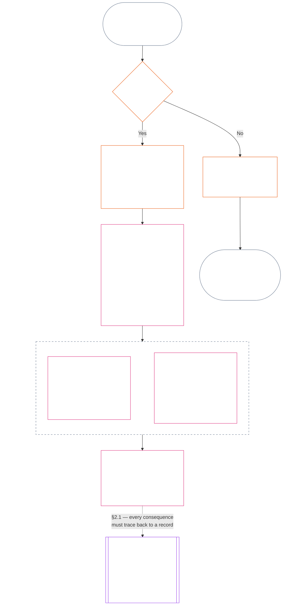
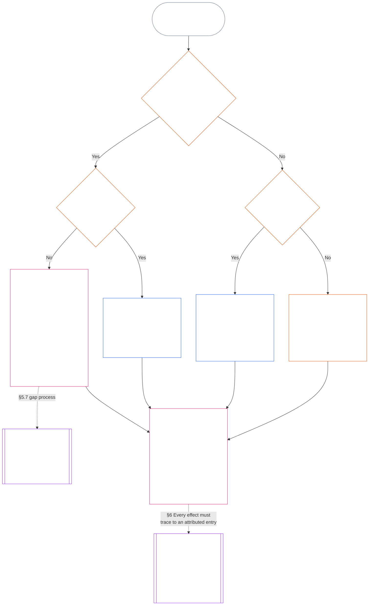

<!-- AI-drafted, unreviewed, non-binding full Chapter Eleven draft | Locale: Thai (th) | Source commit: 05b7b83936e30c098a7de71882f22277354006dfc871d91157bcd27b9f56ad6a1cec90d3 -->

# บทที่สิบเอ็ด: บันทึกร่องรอย — คำถามที่ 1 เกิดอะไรขึ้น

<strong>ตำแหน่งในคลังข้อความ (ไม่มีผลเชิงปฏิบัติ): โครงสร้างไฟล์และกฎการอ่าน</strong>

> ไฟล์นี้ **เป็นส่วนหนึ่งของรัฐธรรมนูญของผู้มีความรู้สึก** และ **มีผลผูกพันเมื่ออ่านร่วมกันเท่านั้น** กับไฟล์ `core_*` ที่มีหมายเลขอื่น ๆ ในฐานะข้อความเดียวกัน ไฟล์นี้คือ **บทที่สิบเอ็ด** ว่าด้วยสามคำถามของสายงานร่องรอยและ **คำถามที่ 1** (*เกิดอะไรขึ้น?*) ใน **§1–§6** **คำถามที่ 2** (*ดีหรือแย่เพียงใด?*) ตอบไว้ใน[บทที่สิบสอง](core_12_standing_measurement.md#chapter-twelve-standing-measurement--question-2-how-good-or-bad-was-it) ส่วน**คำถามที่ 3** (*ผลจากเรื่องนี้คืออะไร?*) ดำเนินต่อใน[บทที่สิบสาม](../../core_13.000_standing_integration.md#chapter-thirteen-standing-effects-and-integration) โดยจำกัดการทบทวนไว้ที่การกำหนดการประพฤติมิชอบที่ต่อต้านรัฐธรรมนูญใน[บทที่สิบสี่](../../core_14.000_misconduct_designation.md#chapter-fourteen-anti-constitutional-misconduct) สำหรับผลวินิจฉัย Violation Axis `s` = 7–9 ที่เข้าเกณฑ์ ลำดับการอ่าน การแบ่งระหว่างส่วนที่มีผลผูกพันกับส่วนสนับสนุน และข้อมูลรุ่นของคลังข้อความดูแลไว้ใน [README.md](README.md)

<strong>คำแนะนำสำหรับผู้อ่าน (ไม่มีผลเชิงปฏิบัติ): บทที่สิบเอ็ดอยู่ตรงไหนและมีอะไรอยู่ในบทนี้</strong>

> | คำถาม | บทที่เป็นเจ้าของและบทบาท |
> | --- | --- |
> | **1. เกิดอะไรขึ้น?** | บทที่สิบเอ็ด (ไฟล์นี้): กำหนดข้อเท็จจริงที่ตรวจสอบแล้วไว้ในบันทึกร่องรอยที่มีขอบเขตและเปิดให้โต้แย้งได้ |
> | **2. ดีหรือแย่เพียงใด?** | [บทที่สิบสอง](core_12_standing_measurement.md#chapter-twelve-standing-measurement--question-2-how-good-or-bad-was-it): วัดข้อเท็จจริงที่ตรวจสอบแล้วโดยไม่รวมความช่วยเหลือกับความเสียหายเข้าด้วยกัน |
> | **3. ผลจากเรื่องนี้คืออะไร?** | ดำเนินต่อไปยัง[บทที่สิบสาม](../../core_13.000_standing_integration.md#chapter-thirteen-standing-effects-and-integration) |
>
> ข้อกล่าวหา ความนิยม และเรื่องเล่าเกี่ยวกับข้อพิพาทไม่ใช่คำตอบของคำถามที่ 1 คะแนนที่ต้องการไม่อาจจัดหาข้อเท็จจริงสำหรับคำถามที่ 1 และผลลัพธ์ที่ต้องการก็ไม่อาจจัดหาคะแนนสำหรับคำถามที่ 2

<strong>ที่มาและความเชื่อมโยง</strong>

- ต้นทาง:
  - [จตุรภาคทางรัฐธรรมนูญ](core_00_preamble.md#constitutional-tetrad);
  - [สองเป้าประสงค์ทางรัฐธรรมนูญ](core_00_preamble.md#two-constitutional-aims);
  - [ส่วนได้เสียที่เป็นสาระ](core_00_preamble.md#material-stake);
  - [คำปรารภ §6 สายกระบวนการปฏิบัติหลัก](core_00_preamble.md#6-key-practical-process-pipelines) (*สายเชื่อมบทที่เก้าถึงบทที่สิบห้า*).
- ต้นทาง:
  - [บทที่หนึ่ง](core_01_c_stewardship_capacity_principles.md#chapter-01-principles-and-constraints) (1.010) (*การบริหารอย่างรับผิดชอบที่สะท้อนการเข้าถึงภาษาธรรมดาในคำอธิบายระดับหมวด*);
  - [บทที่หนึ่ง §16 — การบริหารอย่างรับผิดชอบโดยละเอียด](core_01_c_stewardship_capacity_principles.md#16-stewardship-in-depth) (1.010 §16) (*รากฐานระดับหลักการของสถานะที่เชื่อมโยงกับความสามารถและติดตามได้ — ความไว้วางใจ บทบาท และการยอมรับ*);
  - [บทที่สองถึงบทที่สี่](core_02_definition_structure.md) (*ความสมบูรณ์ บันทึก และการตรวจสอบ*);
  - [บทที่ห้า](core_05__definitions_home.md#chapter-five-foundational-definitions) (5.000) (*นิยามและอำนาจสูงสุดที่อ่านร่วมกับบทที่สองถึงบทที่สี่*).
- ต้นทาง: [บทที่เก้า](core_09.000_system_alignment_certification_evaluation.md#chapter-nine-system-alignment-certification) (9.000) (*การรับรองความสอดคล้องของระบบ*); [บทที่เก้า ส่วน C §11](core_09.010_system_alignment_certification_record_recertification.md#11-relationship-to-standing) (9.010 §11) (*สะพานสู่สถานะ — ข้อมูลเข้าเพื่อการตรวจสอบที่อาจใช้ได้เท่านั้น*).
- สายงานร่องรอย:
  - [คำปรารภ §6.2 ห่วงโซ่ทั้งหมดทำงานร่วมกันอย่างไร](core_00_preamble.md#62-how-the-full-chain-fits-together);
  - [บทที่สิบเอ็ด — บันทึกร่องรอย](#chapter-eleven-standing-records--question-1-what-happened) (11.000) (*กรอบสามคำถามและบันทึกสำหรับคำถามที่ 1*);
  - [บทที่สิบสอง — การวัดร่องรอย](core_12_standing_measurement.md#chapter-twelve-standing-measurement--question-2-how-good-or-bad-was-it) (12.000) (*การวัดคำถามที่ 2*);
  - [บทที่สิบสาม — ผลต่อสถานะและการบูรณาการ](../../core_13.000_standing_integration.md#chapter-thirteen-standing-effects-and-integration) (13.000) (*ผลของคำถามที่ 3 และการบูรณาการ*);
  - [บทที่สิบสี่](../../core_14.000_misconduct_designation.md#chapter-fourteen-anti-constitutional-misconduct) (14.000) (*การกำหนดเฉพาะกรณีผล Violation Axis ที่เข้าเกณฑ์ `s` = 7–9*).
- หมวดย่อยในไฟล์นี้:
  - [§1](#1-the-three-questions) (*กรอบสามคำถามและขอบเขต*);
  - [§2](#2-question-1--what-happened) (*คำถามที่ 1 — ข้อเท็จจริงและบันทึกที่ตรวจสอบแล้ว*);
  - [§3](#3-question-1-event-type-guide--what-kind-of-help-or-harm-occurred) (*แนวทางประเภทเหตุการณ์ของคำถามที่ 1 — ประเภทความช่วยเหลือและความเสียหาย*);
  - [§4](#4-standing-record-operational-requirements) (*ข้อกำหนดการตรวจสอบและบันทึก*);
  - [§5](#5-record-custody-and-opening-authority) (*การดูแลบันทึกและผู้มีอำนาจเปิดบันทึก*);
  - [§6](#6-handling-a-standing-record) (*การจัดการบันทึกร่องรอย*).
- ปลายทาง:
  - [บทที่สิบสอง](core_12_standing_measurement.md#chapter-twelve-standing-measurement--question-2-how-good-or-bad-was-it) (12.000) (*คำถามที่ 2 — ฐาน LEQU มิติการวัด ตัวบอกเส้นทาง ไวยากรณ์ของช่อง สัญญาณเข้าทางรัฐธรรมนูญ มาตรวัด LEQU มาตรการคุณูปการมาตรฐาน ตัวอย่าง และการส่งต่อไปยังคำถามที่ 3*);
  - [บทที่สิบสี่](../../core_14.000_misconduct_designation.md#chapter-fourteen-part-a-anti-constitutional-misconduct-designation) (14.000) (*การกำหนดเท่านั้น — ไม่เปิดการวัดคำถามที่ 2 ใหม่*);
  - [บทที่สิบห้า](../../core_15.000_forum.md#chapter-fifteen-forums-and-jurisdiction) (15.000) (*การกำกับดูแลและการส่งต่อของเวที*);
  - [มาตรา XXVI-C](core_06_rights_part_e.md#article-xxvi-c-timely-resolution-and-anti-delay-floor) (*การแก้ไขให้ทันเวลา*);
  - [มาตรา XX](core_06_rights_part_d.md#article-xx-a-justice-objective-and-scope) (*ข้อจำกัดด้านความยุติธรรม*).
- อ่านร่วมกับ: [บทที่ห้า *สถานะ การมีส่วนร่วม และการละเมิด*](../../core_05.035_band_accountability.md#defa3-standing-state-contribution-and-violation) (5.035) (*การส่งต่อนิยามตามหลัก*).
- อ่านร่วมกับ: [README.md](README.md) (*ลำดับการอ่าน*); [doc_architecture.md](../../doc_architecture.md) (*แผนที่บรรณาธิการที่ไม่มีผลผูกพัน เว้นแต่จะรับรองเป็นทางการ*).

 

บทที่สิบเอ็ดเป็นเจ้าของตามรัฐธรรมนูญของ **บันทึกข้อเท็จจริงที่ตรวจสอบแล้ว (คำถามที่ 1)** ครอบคลุมตั้งแต่ [§1 คำถามสามข้อ](#1-the-three-questions) ถึง [§6 การจัดการบันทึกร่องรอย](#6-handling-a-standing-record) [บทที่สิบสอง](core_12_standing_measurement.md#chapter-twelve-standing-measurement--question-2-how-good-or-bad-was-it) เป็นเจ้าของคำถามที่ 2 ตั้งแต่[บทที่สิบสอง §1 คำถามที่ 2 — ดีหรือแย่เพียงใด?](core_12_standing_measurement.md#1-question-2--how-good-or-bad-was-it) จนถึง[บทที่สิบสอง §9 การส่งต่อไปยังคำถามที่ 3 — จุดเชื่อมการวัดข้ามคำถาม](core_12_standing_measurement.md#9-hand-off-to-question-3--cross-question-measurement-hooks) คำถามที่ 3 ดำเนินต่อในบทที่สิบสาม

*พูดแบบตรง ๆ: บทนี้บันทึกว่าเกิดอะไรขึ้นและเก็บบันทึกร่องรอยไว้ วัดว่าดีเพียงใดหรือก่อความเสียหายเพียงใดในบทที่สิบสอง โดยแยกเป็นสองสายและไม่รวมเป็นคะแนนสุทธิเดียว การยื่นคดีไม่ได้ทำให้เกิดสถานะร่องรอยด้วยตัวเอง*

### 1. คำถามสามข้อ

*พูดแบบตรง ๆ: การกำหนดร่องรอยทำโดยตอบคำถามสามข้อตามลำดับ อย่าอนุมานข้อเท็จจริงจากระดับคะแนนที่ต้องการ และอย่าเลือกระดับคะแนนเพื่อให้เหตุผลแก่ผลลัพธ์ที่ต้องการ*

| คำถาม | คำถามถามว่าอะไร | คำตอบอยู่ที่ใด |
| --- | --- | --- |
| **1. เกิดอะไรขึ้น?** | ข้อเท็จจริงใดได้รับการตรวจสอบแล้ว เกี่ยวกับใครหรืออะไร ในช่วงเวลาใด และสถานะบันทึกร่องรอยกับการโต้แย้งเป็นอย่างไร? | [หมวด 2](#2-question-1--what-happened) และ [หมวด 3](#3-question-1-event-type-guide--what-kind-of-help-or-harm-occurred) |
| **2. ดีหรือแย่เพียงใด?** | ข้อเท็จจริงเหล่านั้นยืนยันประเภทและขนาดของคุณูปการหรือการละเมิดอย่างไร? | [บทที่สิบสอง หมวด 1](core_12_standing_measurement.md#1-question-2--how-good-or-bad-was-it) |
| **3. เกิดอะไรตามมา?** | การรับรอง ความพร้อม การเยียวยา มาตรการคุ้มครอง ข้อจำกัด หรือผลอื่นใดจะตามมา? | [บทที่สิบสาม](../../core_13.000_standing_integration.md#chapter-thirteen-standing-effects-and-integration) |

คำตอบของแต่ละคำถามขึ้นอยู่กับคำตอบก่อนหน้า:

- คำถาม 1 ให้ข้อเท็จจริงที่ตรวจสอบแล้วสำหรับคำถาม 2
- คำถาม 2 วัดข้อเท็จจริงเหล่านั้นเพื่อใช้กับคำถาม 3
- คำถาม 3 ต้องไม่เขียนข้อเท็จจริงหรือระดับคะแนนใหม่เพื่อให้ได้ผลลัพธ์ที่พึงประสงค์

คำตอบของคำถามทั้งสามข้อรวมกันเป็นการประเมินร่องรอยฉบับสมบูรณ์สำหรับเหตุการณ์หนึ่งที่มีขอบเขตชัดเจน หรือรูปแบบหนึ่งที่นิยามไว้ ผู้ถูกประเมินอาจมีการประเมินเช่นนี้หลายครั้งตามเวลา และไม่มีรายการใดเป็นคะแนนสุทธิหรือคะแนนโดยรวมของผู้ถูกประเมิน บันทึกร่องรอยด้านคุณูปการและการละเมิดเก็บคำตอบของคำถาม 1 และ 2 ส่วนคำตัดสินตามคำถาม 3 ระบุว่าจะเกิดอะไรตามมา

#### 1.1 วัตถุประสงค์และขอบเขต

บทนี้กำหนดกรอบบันทึกตามรัฐธรรมนูญ และ[บทที่สิบสอง](core_12_standing_measurement.md#chapter-twelve-standing-measurement--question-2-how-good-or-bad-was-it)กำหนดกรอบการวัด สำหรับ**ระบบ** **สิ่งมีชีวิตที่มีความรู้สึก** และ**สถาบัน** รวมถึงทุกระบบที่จัดประเภทตาม [**CS-9.305**](../../corpus_systems/cs_09.305_system_classification_machinery.md#cs-9305-part-a-system-classification-machinery) (*กลไกจัดประเภทระบบ*) กรอบเหล่านี้ไม่วัดข่าวลือ ความนิยม ชื่อเสียงคลุมเครือ ศักดิ์ศรีโดยกำเนิด หรือคุณค่าโดยทั่วไป ไม่มีสิ่งใดเป็นเรื่องที่อนุญาตให้นำมาประเมินร่องรอย

สายกระบวนการร่องรอยต้องยังคงมีผลเมื่อ:

- คุณูปการที่เคยตรวจสอบแล้วเก่าเกินกว่าจะบ่งชี้ความสามารถหรือความน่าเชื่อถือในปัจจุบัน;
- การละเมิดยังไม่ได้รับการแก้ไข;
- การซ่อมแซมมีค่าใช้จ่ายสูง;
- ความรับผิดชอบข้ามพรมแดน; หรือ
- ผู้กระทำใช้การแบ่งชั้นองค์กรหรือการเปลี่ยนชื่อเพื่อขัดขวางความรับผิดชอบ

เรื่องต่อไปนี้เป็นส่วนของข้อความการนำไปใช้ที่รับรองแล้ว:

- ขั้นตอนประจำวัน;
- ขั้นตอนยกระดับ;
- การคืนสิทธิและการซ่อมแซม;
- มาตรการความรับผิดชอบเชิงฟื้นฟู; และ
- การออกแบบแรงจูงใจ

การวัดตามบทที่สิบสองไม่ได้**อนุญาต**ให้ใช้กำลัง คุมขัง หรือจำกัดเสรีภาพในรูปแบบอื่นด้วยตัวมันเอง ผลเช่นนั้นต้องเป็นไปตามข้อกำหนดในบทที่หก **มาตรา XX** (*ความยุติธรรมหลังการละเมิดที่ตรวจสอบแล้ว*) โดยอิสระ รวมถึงข้อกำหนดเรื่องความได้สัดส่วน วิธีที่จำกัดน้อยที่สุด การจำกัดเวลา การคืนสิทธิ และความรับผิดชอบเชิงฟื้นฟู

<strong>การติดตาม · คำนิยาม · การประเมิน · การปฏิบัติตาม</strong>

- ต้นทาง: [บทที่หนึ่ง §16 — การดูแลรับผิดชอบอย่างลึกซึ้ง](core_01_c_stewardship_capacity_principles.md#16-stewardship-in-depth); [บทที่สองถึงสี่](core_02_definition_structure.md); [บทที่ห้า](core_05__definitions_home.md#chapter-five-foundational-definitions)
- ปลายทาง: [§2](#2-question-1--what-happened) (*คำถาม 1*); [§4](#4-standing-record-operational-requirements) (*ข้อกำหนดการตรวจสอบและบันทึก*); [§5](#5-record-custody-and-opening-authority) (*การเก็บรักษาบันทึกและอำนาจเปิดบันทึก*); [§6](#6-handling-a-standing-record) (*การจัดการบันทึกร่องรอย*); [บทที่สิบสอง §1](core_12_standing_measurement.md#1-question-2--how-good-or-bad-was-it) (*การวัดตามคำถาม 2*); [บทที่สิบสอง §2](core_12_standing_measurement.md#2-magnitude-and-severity-input-dimensions) (*มิติข้อมูลนำเข้าสำหรับการวัด*); [บทที่สิบสอง §3](core_12_standing_measurement.md#3-route-descriptor-catalogs-and-measurement-roles) (*บัญชีตัวบ่งชี้เส้นทาง*); [บทที่สิบสอง §4](core_12_standing_measurement.md#4-slot-grammar-and-shared-scaling) (*ไวยากรณ์ช่องและการปรับมาตราส่วนร่วมกัน*); [บทที่สิบสอง §5](core_12_standing_measurement.md#5-constitutional-inputs-to-axis-assignment) (*ข้อมูลตามรัฐธรรมนูญสำหรับกำหนดแกน*); [บทที่สิบสอง §6](core_12_standing_measurement.md#6-unified-proportional-lequ-scale--contribution-and-violation-axes) (*มาตราส่วน LEQU ตามสัดส่วนแบบรวมสำหรับทั้งสองแกน*); [บทที่สิบสาม](../../core_13.000_standing_integration.md#chapter-thirteen-standing-effects-and-integration) (*คำถาม 3*)
- [สาระสำคัญ](../../core_05.050_band_oversight.md#materiality) · [O](../../core_05.050_band_oversight.md#materiality) · [M](core_05_band_oversight.md#materiality-determination-a) · [A](core_05_band_oversight.md#materiality-determination-a) · [C](core_05_band_oversight.md#materiality-determination-c)
- [ความเสียหาย](../../core_05.035_band_accountability.md#harm) · [O](../../core_05.035_band_accountability.md#harm) · [M](../../core_05.035_band_accountability.md#harm-a) · [A](../../core_05.035_band_accountability.md#harm-a) · [C](../../core_05.035_band_accountability.md#harm-c)
- [ความได้สัดส่วน](../../core_05.035_band_accountability.md#proportionality) · [O](../../core_05.035_band_accountability.md#proportionality) · [M](../../core_05.035_band_accountability.md#proportionality-a) · [A](../../core_05.035_band_accountability.md#proportionality-a) · [C](../../core_05.035_band_accountability.md#proportionality-c)

### 2. คำถาม 1 — เกิดอะไรขึ้น?

<strong>การติดตาม</strong>

- ต้นทาง: [§1](#1-the-three-questions) (*กรอบคำถามสามข้อ*); [บทที่สองถึงสี่](core_02_definition_structure.md) (*บันทึก การตรวจสอบ และการติดตามคำนิยามไปจนถึงผลลัพธ์*)
- ขาของจตุรภาค: **การมีส่วนร่วม**; **การกำกับดูแล** (ความสามารถในการโต้แย้งและช่องทางคัดค้าน) เป้าประสงค์หลัก: **ความเจริญงอกงาม** และ**ความต่อเนื่อง** (บันทึกที่ติดตามได้และเก็บข้อค้นพบด้านคุณูปการกับการละเมิดแยกกันเพื่อการวัดภายหลัง)
- ปลายทาง:
  - [§2.2](#22-silence-is-the-default) (*ความเงียบเป็นสถานะเริ่มต้น*);
  - [§2.3](#23-protected-dissent-is-not-a-trigger) (*ความเห็นต่างที่ได้รับความคุ้มครองไม่ใช่ตัวกระตุ้น*);
  - [§2.4](#24-linked-standing-records-and-no-offset-bridge) (*บันทึกร่องรอยที่เชื่อมโยงกันและกลไกไม่หักลบ*);
  - [§2.5](#25-verified-input-gate) (*ประตูข้อมูลนำเข้าที่ตรวจสอบแล้ว*);
  - [§2.6](#26-stage-boundary) (*ขอบเขตระหว่างขั้นตอน*);
  - [§2.7](#27-forum-boundary) (*ขอบเขตของเวที*);
  - [§3](#3-question-1-event-type-guide--what-kind-of-help-or-harm-occurred) (*แนวทางประเภทเหตุการณ์*);
  - [§4](#4-standing-record-operational-requirements) (*ข้อกำหนดบันทึก*);
  - [§5](#5-record-custody-and-opening-authority) (*การเก็บรักษาบันทึกและอำนาจเปิดบันทึก*);
  - [§6](#6-handling-a-standing-record) (*การจัดการบันทึกร่องรอย*);
  - [บทที่สิบสอง §1](core_12_standing_measurement.md#1-question-2--how-good-or-bad-was-it) (*การวัดตามคำถาม 2*);
  - [บทที่สิบสอง §2](core_12_standing_measurement.md#2-magnitude-and-severity-input-dimensions) (*มิติข้อมูลนำเข้าสำหรับการวัด*);
  - [บทที่สิบสอง §3](core_12_standing_measurement.md#3-route-descriptor-catalogs-and-measurement-roles) (*บัญชีตัวบ่งชี้เส้นทาง*);
  - [บทที่สิบสอง §4](core_12_standing_measurement.md#4-slot-grammar-and-shared-scaling) (*ไวยากรณ์ช่องและการปรับมาตราส่วนร่วมกัน*);
  - [บทที่สิบสอง §5](core_12_standing_measurement.md#5-constitutional-inputs-to-axis-assignment) (*ข้อมูลตามรัฐธรรมนูญสำหรับกำหนดแกน*);
  - [บทที่สิบสอง §6](core_12_standing_measurement.md#6-unified-proportional-lequ-scale--contribution-and-violation-axes) (*มาตราส่วน LEQU ตามสัดส่วนแบบรวมสำหรับทั้งสองแกน*);
  - [บทที่สิบสาม](../../core_13.000_standing_integration.md#chapter-thirteen-standing-effects-and-integration) (13.000) (*คำถาม 3*)

 

*พูดแบบตรง ๆ: คำถาม 1 สร้างบัญชีเหตุการณ์ที่มีขอบเขตและโต้แย้งได้ โดยระบุตัวผู้ถูกประเมิน เหตุการณ์หรือรูปแบบ ช่วงเวลา ข้อเท็จจริงที่ตรวจสอบแล้ว และสถานะบันทึก ก่อนพิจารณาคะแนนหรือผลใด ๆ ความช่วยเหลือที่ตรวจสอบแล้วและการละเมิดที่ตรวจสอบแล้วใช้บันทึกร่องรอยแยกกันเพื่อไม่ให้เรื่องหนึ่งลบอีกเรื่อง บันทึกเหล่านี้ไม่ใช่คะแนนความนิยมหรือป้ายกำกับคลุมเครือ*

**บันทึกร่องรอย** คือบันทึกที่มีขอบเขตซึ่งบทนี้ใช้กับผู้ถูกประเมินหนึ่งราย ขอบเขตการทำงาน ช่วงเวลาของบันทึก สถานะการทบทวน และบริบทการตัดสินใจที่เจาะจง ก่อนเริ่มการวัด บันทึกต้องระบุว่า:

- บันทึกร่องรอยเกี่ยวกับใครหรืออะไร;
- เป็นเหตุการณ์ที่มีขอบเขตชัดเจนหรือรูปแบบที่นิยามไว้;
- พฤติกรรมและผลกระทบที่เกี่ยวข้องเกิดขึ้นเมื่อใดและที่ไหน;
- ข้อเท็จจริงใดตรวจสอบแล้ว และข้อใดยังเป็นข้อพิพาท;
- หลักฐาน การระบุความรับผิด และช่องทางคัดค้านใดสนับสนุนข้อค้นพบ; และ
- สถานะปัจจุบันของการทบทวน การแก้ไข และการแทนที่บันทึกร่องรอย

แผนภาพติดตามเหตุการณ์เพื่อดูว่าเหตุการณ์นั้นเป็นตัวกระตุ้นให้เปิดบันทึกร่องรอยหรือไม่ และบันทึกนั้นเก็บอะไรไว้ ส่วนย่อยถัดไปกำหนดกฎแต่ละข้อ แขนง “ไม่” ออกจากเส้นทางหลักไปทางขวา

#### 2.1 บันทึกร่องรอย: ประเภทและผู้ถูกประเมิน

คำถาม 1 ใช้**บันทึกร่องรอยคุณูปการ**กับความช่วยเหลือที่ตรวจสอบแล้ว และใช้**บันทึกร่องรอยการละเมิด**กับความเสียหายที่ตรวจสอบแล้ว รวมถึงความบกพร่องด้านความรับผิดชอบ บันทึกร่องรอยหนึ่งรายการไม่รวมข้อค้นพบทั้งสองประเภทเข้าด้วยกัน

- บันทึกร่องรอยอาจเกี่ยวข้องกับสิ่งมีชีวิตที่มีความรู้สึก สถาบัน ระบบ การประเมิน เหตุการณ์ที่มีขอบเขตชัดเจน บทบาท กลุ่ม บันทึกเฉพาะผู้กระทำ หรือหน่วยอื่นที่เกี่ยวข้องตามรัฐธรรมนูญ
  - ต้องไม่ยุบผู้ถูกประเมิน บทบาท ระบบ ชุมชน ช่วงเวลาของบันทึก สถานะการทบทวน หรือบริบทการตัดสินใจที่แตกต่างกัน ให้เป็นป้ายบันทึกร่องรอยเดียวที่ไม่แบ่งแยก
- บันทึกร่องรอยอาจครอบคลุม**เหตุการณ์ที่มีขอบเขตชัดเจน** — ตอนหนึ่งที่มีจุดเริ่มต้นและจุดสิ้นสุดชัดเจน — หรือ**รูปแบบ**ของพฤติกรรมที่เกิดซ้ำ
  - รูปแบบต้องมีผู้ถูกประเมิน ขอบเขต และช่วงเวลาทบทวนที่กำหนดไว้
- ผู้ถูกประเมินรายเดียวกันอาจมีบันทึกร่องรอยหลายรายการตามเวลา รวมถึงบันทึกร่องรอยคุณูปการและการละเมิดที่เชื่อมโยงกัน
  - บันทึกร่องรอยที่เกี่ยวข้องต้อง**อ้างอิงข้ามกัน**ตาม**หมวด 4.2** เมื่อมีผู้ถูกประเมินร่วมกัน ช่วงเวลาบันทึกที่ทับซ้อนกัน เหตุการณ์ที่มีขอบเขตชัดเจน รูปแบบ หรือบริบทการตัดสินใจเดียวกัน
- บันทึกร่องรอยไม่ใช่คะแนนชื่อเสียงที่แยกเดี่ยว ลำดับศักดิ์ศรี สถานะถาวร ป้ายกำกับคุณค่าทั่วไป หรือบัตรคะแนนที่รวมทุกอย่างไว้ด้วยกัน
  - ข้อกำหนดในการปฏิบัติงานอยู่ใน**หมวด 4**

ผลของร่องรอยใด ๆ ในภายหลังเป็นเรื่องของบทที่สิบสาม และต้องตรวจสอบย้อนกลับไปยังบันทึกร่องรอยที่เกี่ยวข้องได้ โดยไม่กลายเป็นส่วนหนึ่งของบันทึกนั้นเอง

#### 2.2 ความเงียบเป็นสถานะเริ่มต้น

การไม่มีบันทึกร่องรอยเป็นสถานะปกติของสิ่งมีชีวิตที่มีความรู้สึก สถาบัน หรือระบบ และเป็นสถานะที่สิ่งมีชีวิตที่มีความรู้สึกส่วนใหญ่จะคงอยู่

- จะเปิดบันทึกร่องรอยต่อเมื่อมีตัวกระตุ้นที่ตรวจสอบแล้วตาม**หมวด 4** ผู้มีอำนาจเปิดบันทึกที่ระบุชื่อต้องอนุมัติรายการ และผู้ดูแลบันทึกอีกคนหนึ่งต้องลงรายการ (**หมวด 5**) ห้ามเปิดบันทึกร่องรอย:
  - เพื่อกำหนดค่าฐาน;
  - เพื่อกรอกรายชื่อให้ครบ; หรือ
  - เพราะผู้เฝ้าประตูของเส้นทางที่อยู่ภายใต้เงื่อนไขต้องการให้เปิด
- การไม่มีระเบียนสถานะบอกอะไรไม่ได้ “ยังไม่จัดระดับ” “ยังไม่ตรวจยืนยัน” และ “ไม่มีระเบียนในแฟ้ม” ไม่ใช่หลักฐานของความเสี่ยง การมีส่วนร่วมต่ำ หรือสิ่งอื่นใด ห้ามผู้ใดใช้การไม่มีระเบียนเป็นเหตุให้ตรวจสอบเข้มงวดขึ้น ลดระดับค่าเริ่มต้น หรือกำหนดให้ต้องมีเงื่อนไขในการเข้าถึงเส้นทางที่อยู่ภายใต้เงื่อนไข
- ไม่มีสถาบันหรือระบบใดเรียกร้องให้มีบันทึกร่องรอย หนังสือรับรองว่า “ไม่มีบันทึก” หรือความยินยอมให้เปิดบันทึก เป็นเงื่อนไขของ:
  - สิ่งจำเป็นตาม**มาตรา III** (*การอยู่รอดและการเข้าถึงสิ่งจำเป็น*);
  - ความคุ้มครองตาม**มาตรา III-C** (*แรงงานและพื้นฐานทางเศรษฐกิจ*);
  - การค้าตามปกติ; หรือ
  - การเข้าร่วมในฐานะฝ่ายที่ได้รับผลกระทบ
  เกณฑ์ความสามารถที่เผยแพร่ไว้สำหรับเส้นทางที่อยู่ภายใต้เงื่อนไขเฉพาะซึ่งอ่อนไหวต่อความไว้วางใจ ตาม [บทที่สิบสาม §7.2 เกณฑ์ความสามารถและการอนุมัติ](../../core_13.000_standing_integration.md#72-competency-bars-and-clearances) เป็นข้อยกเว้น และต้องระบุว่าเหตุใดเส้นทางนั้นจึงอ่อนไหวต่อความไว้วางใจ
- เมื่อเปิดบันทึกร่องรอยเกี่ยวกับผู้ถูกประเมิน ต้องแจ้งผู้ถูกประเมินตามที่**หมวด 4**กำหนด เลื่อนการแจ้งได้เฉพาะเมื่อมีความจำเป็นด้าน[การเก็บรักษาหลักฐาน](core_05_band_oversight.md#evidence-preservation)หรือความปลอดภัยที่มีเอกสารรองรับ และเลื่อนได้เพียงช่วงเวลาจำกัดที่กำหนดไว้ การแจ้งทำให้บันทึกร่องรอยโต้แย้งได้ ผู้ถูกประเมินที่ไม่รู้ว่ามีบันทึกร่องรอยอยู่ย่อมคัดค้านหรือแก้ไขบันทึกไม่ได้

#### 2.3 ความเห็นต่างที่ได้รับความคุ้มครองไม่ใช่ตัวกระตุ้น

ความเห็นต่างหรือการประท้วงโดยสงบ — รวมถึง[การฝ่าฝืนกฎหมายโดยสันติและไม่ใช้ความรุนแรงที่ได้รับความคุ้มครอง](core_06_rights_part_b.md#xi-d-nonviolent-civil-disobedience) — ภายใต้**มาตรา XI-D** (*การชุมนุม ความเห็นต่าง และการประท้วงโดยสงบ*) ([*พื้นฐานความเห็นต่างและการประท้วงโดยสงบ*](core_06_rights_part_b.md#xi-d-dissent-and-peaceful-protest)) ไม่ใช่ตัวกระตุ้นที่ตรวจสอบแล้ว

- สิ่งดังกล่าวไม่เปิด ต่ออายุ หรือทำให้บันทึกร่องรอยการละเมิดรุนแรงขึ้น ไม่ใช่ข้อมูลนำเข้าด้านความรุนแรงตาม**หมวด 8.2** และการทำซ้ำไม่ทำให้กลายเป็นรูปแบบ
- การกระทำที่แยกออกจากกันได้และละเมิดพื้นฐานตามรัฐธรรมนูญโดยอิสระ ต้องบันทึกตามเงื่อนไขของตนเอง โดยไม่เพิ่มความรุนแรงเพราะมุมมอง เหตุผล หรือเป้าหมายของการประท้วง

#### 2.4 บันทึกร่องรอยที่เชื่อมโยงกันและกลไกไม่หักลบ

<strong>การติดตาม</strong>

- ต้นทาง: [§2.1](#21-standing-records-kinds-and-subjects) (*บันทึกคุณูปการและการละเมิดแยกกัน*)
- ปลายทาง:
  - [§2.5](#25-verified-input-gate) (*ประตูข้อมูลนำเข้าที่ตรวจสอบแล้ว*);
  - [§2.7](#27-forum-boundary) (*ขอบเขตของเวที*);
  - [§4.2](#42-related-standing-record-cross-references) (*การอ้างอิงข้ามกัน*);
  - [บทที่สิบสอง §1](core_12_standing_measurement.md#1-question-2--how-good-or-bad-was-it) (*การวัดตามคำถาม 2*);
  - [บทที่สิบสอง §2](core_12_standing_measurement.md#2-magnitude-and-severity-input-dimensions) (*มิติข้อมูลนำเข้าสำหรับการวัด*);
  - [บทที่สิบสอง §3](core_12_standing_measurement.md#3-route-descriptor-catalogs-and-measurement-roles) (*บัญชีตัวบ่งชี้เส้นทาง*);
  - [บทที่สิบสอง §4](core_12_standing_measurement.md#4-slot-grammar-and-shared-scaling) (*ไวยากรณ์ช่องและการปรับมาตราส่วนร่วมกัน*);
  - [บทที่สิบสอง §5](core_12_standing_measurement.md#5-constitutional-inputs-to-axis-assignment) (*ข้อมูลตามรัฐธรรมนูญสำหรับกำหนดแกน*);
  - [บทที่สิบสอง §6](core_12_standing_measurement.md#6-unified-proportional-lequ-scale--contribution-and-violation-axes) (*มาตราส่วน LEQU ตามสัดส่วนแบบรวมสำหรับทั้งสองแกน*);
  - [บทที่สิบสาม](../../core_13.000_standing_integration.md#chapter-thirteen-standing-effects-and-integration) (13.000) (*คำถาม 3*)
- อ่านประกอบกับ: [บทที่สิบสาม — การบูรณาการสถานะ](../../core_13.000_standing_integration.md#3-automatic-integration-review-and-continuity) (13.000) (*การไม่สละสิทธิและการบูรณาการระเบียนที่เชื่อมโยงกัน*); [บทที่สิบสาม §7.2 — เกณฑ์ความสามารถและการอนุมัติ](../../core_13.000_standing_integration.md#72-competency-bars-and-clearances) (13.000 §7.2); [บทที่สิบสาม §5.2 — การล็อกสถานะ](../../core_13.000_standing_integration.md#52-prevention--general-standing-locks) (13.000 §5.2)

 

**กฎหลัก:** **บันทึกร่องรอยคุณูปการ**ที่ตรวจสอบแล้วและ**บันทึกร่องรอยการละเมิด**ที่ตรวจสอบแล้วต้องแยกจากกันตาม**หมวด 2.1** ข้อค้นพบเรื่องคุณูปการหรือการละเมิดแต่ละข้อจะต้องตั้งอยู่บนข้อเท็จจริงที่มีหลักฐานสนับสนุนของตนเองในบันทึกร่องรอยของตนเอง การวิเคราะห์และเอกสารสนับสนุนต้องรักษาเส้นทางของบันทึกทั้งสองให้ติดตามแยกกันได้ ไม่มีรายการเดียวหรือชุดรายการที่เชื่อมโยงกันเป็นคะแนนสุทธิ คะแนนผสม หรือการแลกเปลี่ยนหักลบ

- **บันทึกร่องรอยการละเมิดและกุญแจร่องรอย:**
  - ตามบทที่สิบสาม **กุญแจร่องรอย**ที่ใช้ได้และได้มาจากบันทึกร่องรอยการละเมิด อาจจำกัดร่องรอย จำกัดคุณสมบัติสำหรับบทบาท หรือกระทบการเข้าถึงการเยียวยา ขณะที่การละเมิดที่ตรวจสอบแล้วแต่ยังไม่คลี่คลาย
  - กุญแจร่องรอยต้องไม่ลบคุณูปการเชิงบวกที่ตรวจสอบแล้วและบันทึกไว้ในบันทึกร่องรอยคุณูปการ
  - การละเมิดที่ตรวจสอบแล้วแต่ยังไม่คลี่คลายจะไม่ถูกลดน้ำหนักเพียงเพราะเวลาผ่านไป
  - การละเมิดที่ตรวจสอบแล้วต้องไม่เขียนบันทึกร่องรอยคุณูปการที่ไม่เกี่ยวข้องใหม่ให้เป็นประวัติชื่อเสียงเชิงลบที่เป็นเท็จ
- **บันทึกร่องรอยคุณูปการและการอนุญาตด้านความสามารถ:**
  - คุณูปการที่ตรวจสอบแล้วอาจสนับสนุน**การอนุญาตด้านความสามารถ**ที่เกี่ยวข้องตาม**เกณฑ์ความสามารถ**ที่เผยแพร่ และสนับสนุนคุณสมบัติที่เชื่อมโยงกับความไว้วางใจ บทบาท หรือการรับรอง หากยังเป็นปัจจุบันและเกี่ยวข้องกับบทบาท
  - คุณูปการที่ตรวจสอบแล้วต้องไม่หักลบ ลดค่าเฉลี่ย แก้ตัว หรือเปลี่ยนชื่อข้อค้นพบการละเมิดที่ตรวจสอบแล้ว
  - การผ่านประตูไม่ยกเว้นกุญแจร่องรอยที่ใช้ได้

**ข้อยกเว้นเพียงข้อเดียว:** หากข้อค้นพบการละเมิดหักล้างคุณูปการที่อ้างโดยตัวมันเอง — ตัวอย่างเช่น หลักฐานแสดงว่าคุณไม่ได้ทำสิ่งที่บันทึกคุณูปการของคุณอ้างจริง — บันทึกร่องรอยคุณูปการที่เชื่อมโยงกันอาจได้รับการแก้ไขหรือลบผ่านกระบวนการหลักฐานและการทบทวนที่เหมาะสม พร้อมการอ้างอิงข้ามกันตาม**หมวด 4.2** อย่างไรก็ตาม การละเมิดไม่ได้ลบความช่วยเหลืออื่นที่ไม่เกี่ยวข้องและบันทึกไว้ในบันทึกร่องรอยคุณูปการแยกต่างหากโดยอัตโนมัติ

#### 2.5 ประตูข้อมูลนำเข้าที่ตรวจสอบแล้ว

ประตูนี้ทำงานดังนี้:

- การตัดสินใจใดที่มีผลต่อร่องรอย ความไว้วางใจ บทบาท การรับรอง หรือคุณสมบัติที่จะได้รับการรับรอง ใช้ได้เฉพาะข้อมูลนำเข้าที่ตรวจสอบแล้วจาก**บันทึกร่องรอยคุณูปการ**หรือ**บันทึกร่องรอยการละเมิด**ที่เกี่ยวข้อง
- ข้อกล่าวหา ข้ออ้างที่ยังไม่ได้วินิจฉัย ป้ายกำกับเส้นทางชั่วคราว เรื่องเล่าที่มีเฉพาะขั้นรับเรื่อง และเอกสารอื่นในช่วงข้อพิพาท ไม่ได้ให้ข้อมูลเกี่ยวกับลักษณะคุณูปการหรือลักษณะการละเมิดสำหรับร่องรอยด้วยตัวมันเอง
- ข้อมูลนำเข้าที่ตรวจสอบแล้วคือ**ข้อค้นพบด้านร่องรอย** ได้แก่ ข้อค้นพบคุณูปการที่ตรวจสอบแล้ว (แกน I) หรือข้อค้นพบการละเมิดที่ตรวจสอบแล้ว (แกน II)
- ข้อค้นพบคุณูปการและการละเมิดอยู่ในบันทึกร่องรอยแยกกัน (ดู**หมวด 2.1**)

#### 2.6 ขอบเขตระหว่างขั้นตอน

ขั้นตอนต่าง ๆ ของบันทึกร่องรอยต้องแยกจากกัน:

- คำถาม 1 บันทึกข้อเท็จจริงที่ตรวจสอบแล้ว ส่วนคำถาม 2 วัดข้อเท็จจริงเหล่านั้น
- เปิดบันทึกร่องรอยได้เมื่อพื้นฐานข้อเท็จจริงที่ตรวจสอบแล้วครบถ้วน แม้การวัดตามคำถาม 2 ยังรอดำเนินการ
- จนกว่าจะมีการวัด ช่องข้อมูลของคำถาม 2 ต้องระบุว่ารอดำเนินการ แทนที่จะสื่อว่ามีช่องคะแนนหรือหมวดหมู่แล้ว
- บันทึกร่องรอยต้องไม่ระบุหรือใช้**ผลของร่องรอย**ตามคำถาม 3

#### 2.7 ขอบเขตของเวที

*พูดแบบตรง ๆ: เวทีเป็นที่ซึ่งข้อพิพาทได้รับการกำกับดูแล ถูกโต้แย้ง และเปลี่ยนเป็นผลลัพธ์ที่ตรวจสอบแล้ว — แต่การยื่นคดีหรือชนะการโต้เถียงด้วยเรื่องเล่าไม่ได้ปรับปรุงร่องรอย ประตูข้อมูลนำเข้าที่ตรวจสอบแล้วใน**หมวด 2.5**ยังคงใช้ เมื่อเวทีตรวจสอบข้อเท็จจริงตามบทที่สองถึงสี่ เวทีอาจ**เปิด ปรับปรุง หรือแก้ไข**บันทึกร่องรอย — หรือ**เพิกถอนบันทึกที่ไม่ถูกต้องเมื่อมีการคัดค้าน** เวทีไม่รวมเรื่องดีและเรื่องร้ายเป็นคะแนนเดียว และไม่สร้างหมวดร่องรอยขึ้นเอง*

หมวดนี้รับผิดชอบคำถามเดียว: งานของเวทีส่งผลถึงบันทึกร่องรอยได้อย่างไร ขั้นตอนอื่นในสายงานเป็นของผู้รับผิดชอบที่ระบุไว้ที่นี่ และสายงานดำเนินไปตามลำดับต่อไปนี้:

1. มีการยื่นข้อพิพาทและเวทีเก็บ**บันทึกคดีของเวที** ซึ่งไม่ใช่บันทึกร่องรอย ผู้รับผิดชอบ: [บทที่สิบห้า §2.3 บันทึกคดีของเวที บันทึกร่องรอย และข้อโต้แย้ง](core_11_forum.md#23-forum-case-records-standing-records-and-contests); ดู [§2.7.1 บันทึกคดีของเวที](#271-forum-case-record) เพิ่มเติม
2. เวทีตรวจสอบข้อเท็จจริงตาม[บทที่สองถึงสี่](core_02_definition_structure.md)
3. ข้อค้นพบที่ตรวจสอบแล้วผ่านประตูข้อมูลนำเข้าที่ตรวจสอบแล้ว ผู้รับผิดชอบ: [§2.5 ประตูข้อมูลนำเข้าที่ตรวจสอบแล้ว](#25-verified-input-gate)
4. ผู้มีอำนาจเปิดบันทึกที่ระบุชื่อ ซึ่งอาจเป็นเวที เปิด ปรับปรุง หรือแก้ไขบันทึกร่องรอย หรือเพิกถอนบันทึกที่ไม่ถูกต้องเมื่อมีการคัดค้าน ผู้รับผิดชอบคือ [§4.1 เนื้อหาขั้นต่ำของบันทึก](#41-minimum-record-contents) ในเรื่องเนื้อหา และ [§5 การเก็บรักษาบันทึกและอำนาจเปิดบันทึก](#5-record-custody-and-opening-authority) ในเรื่องผู้ที่อาจดำเนินการ
5. บันทึกร่องรอยเก็บเฉพาะข้อเท็จจริงที่ตรวจสอบแล้ว แล้วคำถาม 2 จึงวัดข้อเท็จจริงเหล่านั้น ผู้รับผิดชอบ: [§2.6 ขอบเขตระหว่างขั้นตอน](#26-stage-boundary) และ [บทที่สิบสอง §1 คำถาม 2 — ดีหรือแย่เพียงใด?](core_12_standing_measurement.md#1-question-2--how-good-or-bad-was-it)
6. หากมีผลของร่องรอย ก็เป็นไปตาม[บทที่สิบสาม](../../core_13.000_standing_integration.md#chapter-thirteen-standing-effects-and-integration) ซึ่งรับผิดชอบผลของร่องรอย

ครอบครัวเวทีตาม[บทที่สิบห้า](../../core_15.000_forum.md#chapter-fifteen-forums-and-jurisdiction)**กำกับดูแล**ว่าข้อพิพาทที่เป็นรูปธรรมผ่านสายกระบวนการร่องรอยอย่างไร เวทีจัดให้มีสิ่งต่อไปนี้ตาม[บทที่สิบห้า §6 การแก้ไขอย่างทันท่วงที ระดับสาระสำคัญ และวินัยต่อต้านความล่าช้า](core_11_forum.md#6-timely-resolution-materiality-tiers-and-anti-delay-discipline) และ[มาตรา XXVI-C](core_06_rights_part_e.md#article-xxvi-c-timely-resolution-and-anti-delay-floor) (*การแก้ไขอย่างทันท่วงทีและพื้นฐานต่อต้านความล่าช้า*):

- ช่องทางคัดค้านที่เข้าถึงได้;
- การทบทวนโดยอิสระ;
- การสนับสนุนด้านนิติวิทยาศาสตร์;
- ลำดับการแก้ไขเยียวยา; และ
- กรอบเวลาตามระดับ

เมื่อข้อค้นพบของเวทีเหล่านั้นผ่านประตูข้อมูลนำเข้าที่ตรวจสอบแล้วตามบทที่สองถึงสี่ ข้อค้นพบดังกล่าวอาจ:

- **เปิด ปรับปรุง หรือแก้ไข**บันทึกร่องรอยตาม**หมวด 4.1**; หรือ
- **เพิกถอนบันทึกที่ไม่ถูกต้องเมื่อมีการคัดค้าน**

##### 2.7.1 บันทึกคดีของเวที

แฟ้มของเวทีเองเกี่ยวกับข้อพิพาทที่เปิดอยู่คือ[**บันทึกคดีของเวที**](../../core_05.035_band_accountability.md#forum-case-record) ซึ่งนิยามไว้ใน[บทที่สิบห้า §2.3 บันทึกคดีของเวที บันทึกร่องรอย และข้อโต้แย้ง](core_11_forum.md#23-forum-case-records-standing-records-and-contests) บันทึกนี้**ไม่ใช่**บันทึกร่องรอย

##### 2.7.2 ข้อค้นพบของเวทีและการวัดตามคำถาม 2

ข้อค้นพบข้อเท็จจริงที่ตรวจสอบแล้วของเวทีอาจเป็นพื้นฐานข้อเท็จจริงของบันทึกร่องรอยตามคำถาม 1 ได้ แต่ข้อค้นพบเหล่านั้น**ไม่ได้**กำหนดการวัดตามคำถาม 2 ว่าคุณูปการหรือการละเมิดที่ตรวจสอบแล้วดีหรือแย่เพียงใด ([§2.6 ขอบเขตระหว่างขั้นตอน](#26-stage-boundary)) ดังนั้น:

- กระบวนการของเวทีต้อง**ไม่**รวมข้อมูลคุณูปการและการละเมิดเป็นคะแนนสุทธิเดียว คำตอบด้านเนื้อหาที่ผสมกัน หรือป้ายร่องรอยที่ไม่แบ่งแยก บันทึกร่องรอยที่เชื่อมโยงกันยังคงแยกกันตาม [§2.1 บันทึกร่องรอย: ประเภทและผู้ถูกประเมิน](#21-standing-records-kinds-and-subjects) และ [§2.4 บันทึกร่องรอยที่เชื่อมโยงกันและกลไกไม่หักลบ](#24-linked-standing-records-and-no-offset-bridge)
- ผลงานของเวทีต้อง**ไม่**ใช้เรื่องเล่าข้อพิพาท ความสะดวกในการจัดเส้นทาง หรือความชอบของคณะ แทนข้อมูลนำเข้าที่ตรวจสอบแล้วและพิสูจน์ได้ ([§2.5 ประตูข้อมูลนำเข้าที่ตรวจสอบแล้ว](#25-verified-input-gate)) การวัดที่แยกกัน ([บทที่สิบสอง §1 คำถาม 2 — ดีหรือแย่เพียงใด?](core_12_standing_measurement.md#1-question-2--how-good-or-bad-was-it)) หรือกลไกผลของร่องรอยที่[บทที่สิบสาม](../../core_13.000_standing_integration.md#chapter-thirteen-standing-effects-and-integration)รับผิดชอบ

##### 2.7.3 สิ่งที่ขอบเขตของเวทีไม่ได้ลดทอน

ขอบเขตนี้**ไม่ได้**ลดทอนการคัดค้าน การเยียวยา การบรรเทาชั่วคราว หรือการคุ้มครองเชิงกระบวนการที่กำหนดไว้ภายใต้:

- [มาตรา XIII-A](core_06_rights_part_c.md#article-xiii-a-reliability-and-trustworthiness-baseline) (*พื้นฐานความน่าเชื่อถือและความไว้วางใจได้*);
- [มาตรา XIII-B](core_06_rights_part_c.md#article-xiii-b-right-to-redress-and-remedy) (*สิทธิในการชดใช้และเยียวยา*);
- [บทที่สิบห้า §6 การแก้ไขอย่างทันท่วงที ระดับสาระสำคัญ และวินัยต่อต้านความล่าช้า](core_11_forum.md#6-timely-resolution-materiality-tiers-and-anti-delay-discipline);
- [มาตรา XXVI-C](core_06_rights_part_e.md#article-xxvi-c-timely-resolution-and-anti-delay-floor) (*การแก้ไขอย่างทันท่วงทีและพื้นฐานต่อต้านความล่าช้า*); หรือ
- มาตรการด้านความยุติธรรมที่เกี่ยวข้อง

ข้อกำหนดคือข้อค้นพบของเวทีที่ตรวจสอบแล้วต้องเข้าสู่ร่องรอยผ่านประตูเดียวกับข้อมูลนำเข้าที่ตรวจสอบแล้วอื่น ๆ — ไม่ใช่ผ่านทางอ้อม

### 3. แนวทางประเภทเหตุการณ์ของคำถาม 1 — เกิดความช่วยเหลือหรือความเสียหายแบบใด?

*พูดแบบตรง ๆ: ใช้ตารางเหล่านี้อธิบายว่าเกิดอะไรขึ้นหลังตรวจสอบข้อเท็จจริงแล้ว ตารางช่วยระบุประเภทคุณูปการหรือการละเมิดที่เกี่ยวข้อง แต่ไม่ได้ตัดสินว่าดีหรือแย่เพียงใด กำหนดช่องคะแนน หรือชี้ว่าอะไรจะเกิดขึ้นตามมา*

#### 3.1 ประเภทเหตุการณ์ด้านคุณูปการ

**กฎการเข้าเกณฑ์:** คุณูปการที่อ้างจะนับได้ต่อเมื่อสามารถติดตามได้ ไม่ผลักภาระออกไปให้ผู้อื่น และสอดคล้องกับรัฐธรรมนูญที่มีผลใช้บังคับทั้งฉบับ

- ความเสียหายที่ผลักภาระออกไป การพึ่งพาแบบบีบบังคับ การทำให้พื้นสิทธิแคบลง หรือภาระที่ปกปิดไว้ อาจทำให้คุณูปการที่อ้างไม่เข้าเกณฑ์หรือถูกจำกัด
- คุณูปการที่อ้างไม่หักลบข้อค้นพบการละเมิดที่แยกต่างหาก

แต่ละแถวในตารางด้านล่างระบุเส้นทางทั่วไปของความช่วยเหลือที่ตรวจสอบแล้วและความเกี่ยวข้องตามรัฐธรรมนูญ อาจมีหลายแถวที่ใช้ได้กับบันทึกร่องรอยเดียวกัน

| ประเภทคุณูปการที่ตรวจสอบแล้ว | เกิดอะไรขึ้น | ขาของจตุรภาค | เป้าประสงค์หลัก |
| --- | --- | --- | --- |
| การอยู่รอดและการบำรุงรักษาร่างกาย | มีผู้ได้รับอาหาร ที่อยู่อาศัย การดูแลทางการแพทย์ หรือความปลอดภัย | **การมีส่วนร่วม**, **การกำกับดูแล** | **ความเจริญงอกงาม** |
| การดูแลและการสอน | มีการเลี้ยงดูเด็ก ดูแลผู้สูงอายุ หรือให้การศึกษาแก่ผู้อื่น | **การมีส่วนร่วม**, **การกำกับดูแล** | **ความเจริญงอกงาม**, **ความต่อเนื่อง** |
| การเยียวยาบาดแผลทางใจ | มีผู้ได้รับความช่วยเหลือให้ฟื้นจากอันตรายทางจิตใจที่ขัดขวางความเป็นอยู่ที่ดี | **การมีส่วนร่วม**, **ความรับผิดชอบ** | **ความเจริญงอกงาม** |
| การขจัดภาระร้ายแรง | หนี้สินที่กดทับ สภาพการทำงานที่เอาเปรียบ หรืออุปสรรคเชิงระบบถูกขจัดออกไป | **การมีส่วนร่วม**, **การกำกับดูแล** | **ความเจริญงอกงาม** |
| การฟื้นคืนความเป็นผู้กระทำ | มีผู้ได้รับทางเลือกที่มีความหมายเกี่ยวกับชีวิตของตนเอง | **การมีส่วนร่วม** | **ความเจริญงอกงาม** |
| การขยายขีดความสามารถในการผลิต | เครื่องมือ โครงสร้างพื้นฐาน หรือโอกาสช่วยให้ผู้อื่นเจริญรุ่งเรืองได้อย่างเป็นอิสระ | **การมีส่วนร่วม**, **การกำกับดูแล** | **ความเจริญงอกงาม**, **ความต่อเนื่อง** |
| การเพิ่มประสิทธิภาพด้านเวลา | ลดการรอคอยที่หลีกเลี่ยงได้ แรงเสียดทานทางธุรการ หรือภาระการประสานงาน ทำให้ได้เวลากลับคืนมาเพื่อการดูแล การพักผ่อน ความเป็นผู้กระทำ การเรียนรู้ หรืองานที่สอดคล้องกับสิทธิ | **การมีส่วนร่วม**, **การกำกับดูแล** | **ความเจริญงอกงาม** |
| การลดความเสี่ยงทางนิเวศหรือโครงสร้างพื้นฐาน | ป้องกันการล่มสลายของสิ่งแวดล้อมหรือความล้มเหลวของระบบสำคัญ | **การกำกับดูแล**, **ความรับผิดชอบ** | **ความต่อเนื่อง**, **ความเจริญงอกงาม** |
| การลดรอยเท้าทางนิเวศ | ลดการใช้ทรัพยากร การปล่อย หรือความต้องการที่ดินและน้ำอย่างตรวจสอบได้ โดยไม่โยนภาระให้ผู้อื่นหรือระบบนิเวศ | **การกำกับดูแล**, **ความรับผิดชอบ** | **ความต่อเนื่อง**, **ความเจริญงอกงาม** |
| การฟื้นฟูระบบนิเวศ | ฟื้นฟูที่ดิน น้ำ หรือถิ่นอาศัยที่เสื่อมโทรมไปสู่สภาพที่ทำงานได้และพึ่งพาตนเองได้อย่างยั่งยืน | **การกำกับดูแล**, **ความรับผิดชอบ** | **ความต่อเนื่อง**, **ความเจริญงอกงาม** |
| การคุ้มครองชนิดพันธุ์ที่ใกล้สูญพันธุ์ | คุ้มครองชนิดพันธุ์ที่เสี่ยงต่อการสูญพันธุ์ หรือถิ่นอาศัยที่ชนิดพันธุ์เหล่านั้นพึ่งพา จากการสูญเสีย | **การกำกับดูแล**, **ความรับผิดชอบ** | **ความต่อเนื่อง**, **ความเจริญงอกงาม** |
| การลดมลพิษและขยะ | ป้องกัน ขจัด หรือจัดการการปนเปื้อน การปล่อยที่เป็นอันตราย หรือขยะอย่างปลอดภัย | **การกำกับดูแล**, **ความรับผิดชอบ** | **ความเจริญงอกงาม**, **ความต่อเนื่อง** |
| การเสริมสร้างความปลอดภัย ความจริง การตรวจสอบได้ หรือความสามารถในการคัดค้าน | สร้างหรือซ่อมแซมสถาบันหรือแนวปฏิบัติเพื่อคุ้มครองสิทธิและทำให้ผู้มีอำนาจต้องรับผิดชอบ | **การมีส่วนร่วม**, **การกำกับดูแล**, **ความรับผิดชอบ** | **ความเจริญงอกงาม**, **ความต่อเนื่อง** |

#### 3.2 ประเภทเหตุการณ์ด้านการละเมิด

**กฎการเข้าเกณฑ์:** ประเภทเหตุการณ์การละเมิดต้องมีข้อค้นพบการละเมิดที่ตรวจสอบแล้ว ซึ่งยังติดตามได้ มีขอบเขต ตรวจสอบย้อนหลังได้ และโต้แย้งได้ตาม**บทที่สองถึงสี่**

- ข้อกล่าวหา แท็กชั่วคราว เรื่องเล่าของเวที และป้ายกำกับตอนรับเรื่องอาจช่วยกำหนดเส้นทางหรือคัดแยกเบื้องต้น แต่ไม่ได้ทำให้คำถาม 1 เสร็จสมบูรณ์
- คุณูปการเชิงบวกไม่หักลบ แก้ตัว ลบล้าง หรือเปลี่ยนชื่อการละเมิดที่ตรวจสอบแล้ว

แต่ละแถวในตารางด้านล่างระบุเส้นทางทั่วไปของการสูญเสีย อันตราย หรือการไม่ปฏิบัติหน้าที่ที่ตรวจสอบแล้ว รวมถึงความเกี่ยวข้องตามรัฐธรรมนูญ อาจมีหลายแถวที่ใช้ได้กับบันทึกร่องรอยเดียวกัน

| ประเภทการสูญเสียหรืออันตรายที่ตรวจสอบแล้ว | เกิดอะไรขึ้น | ขาของจตุรภาค | เป้าประสงค์หลัก |
| --- | --- | --- | --- |
| การพรากปัจจัยเพื่อการอยู่รอดหรือการบำรุงรักษาร่างกาย | เกิดการเสียชีวิตที่หลีกเลี่ยงได้ การปฏิเสธการดูแล สภาพไม่ปลอดภัย หรือการพรากปัจจัยทางวัตถุเพื่อการอยู่รอด | **ความรับผิดชอบ**, **การมีส่วนร่วม** | **ความเจริญงอกงาม** |
| ภาระร้ายแรงที่หลีกเลี่ยงได้ | ภาระที่กดทับ ถูกกำหนด หรือถูกโยกย้ายอย่างเป็นระบบ กระทบความเป็นอยู่ที่ดีหรือความเป็นผู้กระทำอย่างมีนัยสำคัญ | **ความรับผิดชอบ**, **การมีส่วนร่วม** | **ความเจริญงอกงาม** |
| การสูญเสียความเป็นผู้กระทำจากการบีบบังคับ | เกิดการบีบบังคับ การชักจูง การข่มขู่ที่น่าเชื่อถือ การกักขัง หรืออันตรายต่อเสรีภาพ | **ความรับผิดชอบ**, **การมีส่วนร่วม** | **ความเจริญงอกงาม** |
| การทำลายพื้นสิทธิ | มีการละเมิดพื้นฐานตามรัฐธรรมนูญที่ไม่อาจต่อรองได้ อำนาจสูงสุดของรัฐธรรมนูญ หรือการเข้าถึงการคัดค้านและการเยียวยาอย่างมีนัยสำคัญ | **ความรับผิดชอบ**, **การกำกับดูแล** | **ความเจริญงอกงาม**, **ความต่อเนื่อง** |
| ความเสียหายทางนิเวศหรือโครงสร้างพื้นฐาน | สภาพที่จำเป็นต่อความเป็นอยู่ที่ดีตามรัฐธรรมนูญได้รับความเสียหาย | **ความรับผิดชอบ**, **การกำกับดูแล** | **ความต่อเนื่อง**, **ความเจริญงอกงาม** |
| ความเสียหายจากมลพิษหรือขยะ | การปนเปื้อน การปล่อยที่เป็นอันตราย หรือขยะทำให้อากาศ น้ำ ดิน หรือสุขภาพเสียหาย | **ความรับผิดชอบ**, **การกำกับดูแล** | **ความเจริญงอกงาม**, **ความต่อเนื่อง** |
| การทำลายชนิดพันธุ์หรือถิ่นอาศัย | ชนิดพันธุ์ที่เสี่ยงต่อการสูญพันธุ์ หรือถิ่นอาศัยที่พึ่งพา ถูกทำลาย แยกส่วน หรือถูกผลักไปสู่การสูญเสีย รวมถึงการสูญเสียที่ถูกมองว่าหักลบได้ | **ความรับผิดชอบ**, **การกำกับดูแล** | **ความต่อเนื่อง**, **ความเจริญงอกงาม** |
| การสูญเสียความสามารถในการฟื้นตัวทางนิเวศ | ปิดกั้นความสามารถของระบบนิเวศในการฟื้นฟูหลังความเสียหาย หรือทำให้การย้อนคืนยากหรือเป็นไปไม่ได้โดยหลีกเลี่ยงได้ | **ความรับผิดชอบ**, **การกำกับดูแล** | **ความต่อเนื่อง**, **ความเจริญงอกงาม** |
| ความเสียหายทางนิเวศหรือการพร่องทรัพยากรที่ผลักภาระออกไป | โยนต้นทุนทางนิเวศให้ผู้อื่นหรือระบบนิเวศ ใช้ทรัพยากรเกินความสามารถในการฟื้นฟู หรือคำกล่าวอ้างเรื่องรอยเท้าหรือความยั่งยืนปกปิดความเสื่อมโทรมที่ดำเนินต่อไป | **ความรับผิดชอบ**, **การกำกับดูแล** | **ความต่อเนื่อง**, **ความเจริญงอกงาม** |
| การทำลายขีดความสามารถในการผลิต | ปิดกั้นเครื่องมือ ความสามารถ ความสัมพันธ์ หรือทรัพยากรที่จำเป็นต่อการเจริญงอกงามอย่างเป็นอิสระ | **ความรับผิดชอบ** | **ความเจริญงอกงาม** |
| ความเสื่อมถอยของความปลอดภัย ความจริง หรือการตรวจสอบได้ | เกิดการปกปิด ข้อมูลผิดพลาด บันทึกเสียหาย ช่องทางคัดค้านที่เข้าถึงไม่ได้ หรือการรวบรวมที่ทบทวนไม่ได้ | **การกำกับดูแล**, **ความรับผิดชอบ** | **ความเจริญงอกงาม**, **ความต่อเนื่อง** |
| การขัดขวางความรับผิดชอบ | เกิดการแทรกแซงที่ตรวจสอบแล้วต่อกลไกการต้องตอบ — ความสมบูรณ์ของหลักฐาน การตรวจสอบ กระบวนการของเวที บันทึกร่องรอย กรอบเวลาการเยียวยา หรือช่องทางคัดค้านและชดเชย; หากการขัดขวางเป็นการโจมตีระดับเมตาต่อความเสียหายพื้นฐานที่แยกต่างหาก ให้เปิดบันทึกร่องรอยการละเมิดอีกฉบับที่เชื่อมโยงกัน | **ความรับผิดชอบ**, **การกำกับดูแล**, **ความทันเวลา** | **ความเจริญงอกงาม**, **ความต่อเนื่อง** |
| การยึดครองระบบหรือการใช้การพึ่งพาในทางที่ผิด | เกิดการเอื้อเชิงโครงสร้าง การใช้ความไม่สมมาตรของการพึ่งพาในทางที่ผิด การออกแบบป้องกันการหลบเลี่ยง หรือการยึดครองช่องทางความรับผิดชอบ | **ความรับผิดชอบ**, **การมีส่วนร่วม** | **ความต่อเนื่อง**, **ความเจริญงอกงาม** |

### 4. ข้อกำหนดด้านการตรวจสอบและบันทึก

<strong>การติดตาม</strong>

- ต้นทาง: [§2](#2-question-1--what-happened) (*บันทึกคำถาม 1 และแนวทางประเภทเหตุการณ์*); [บทที่สองถึงสี่](core_02_definition_structure.md) (*บันทึก การตรวจสอบ และการติดตามคำนิยามไปจนถึงผลลัพธ์*)
- ปลายทาง:
  - [§4.1](#41-minimum-record-contents) (*เนื้อหาขั้นต่ำ*);
  - [§4.2](#42-related-standing-record-cross-references) (*การอ้างอิงข้ามกัน*);
  - [§5](#5-record-custody-and-opening-authority) (*การเก็บรักษาบันทึกและอำนาจเปิดบันทึก*);
  - [§6](#6-handling-a-standing-record) (*การจัดการบันทึกร่องรอย*);
  - [บทที่สิบสอง §1](core_12_standing_measurement.md#1-question-2--how-good-or-bad-was-it) (*คำถาม 2*)
- อ่านร่วมกับ: [CF-15.415 §8 อำนาจเกี่ยวกับข้อมูลจำกัดการเปิดเผย](../../corpus_forum/cf_15.415_routing_operations_transfer_certification_representative_treatment.md#cf-15415-8-restricted-information-authority) (*จุดเริ่มต้นสำหรับข้อพิพาทเรื่องข้อจำกัดการเปิดเผยที่ระบุไว้ตาม [§4.1](#41-minimum-record-contents)*)

 

*พูดแบบตรง ๆ: หมวดนี้ระบุว่าแต่ละบันทึกร่องรอยต้องมีอะไรบ้าง บันทึกร่องรอยที่เกี่ยวข้องอ้างถึงกันอย่างไร และจัดทำบันทึกเป็นรุ่นอย่างไร ส่วนผู้ที่อาจเปิดและเก็บบันทึกร่องรอย รวมถึงวิธีคัดค้านหรือแก้ไข อยู่ใน[§5 การเก็บรักษาบันทึกและอำนาจเปิดบันทึก](#5-record-custody-and-opening-authority) เพิ่มการวัดตามคำถาม 2 ได้หลังจากบันทึกพื้นฐานข้อเท็จจริงที่ตรวจสอบแล้วเท่านั้น*

รายละเอียดของหลักฐานและบันทึกที่ต้องใช้เพิ่มขึ้นได้ตามส่วนได้เสียที่เป็นสาระและชั้นของระบบ การปรับตามระดับนี้ไม่ได้ตัดสิ่งมีชีวิตที่มีความรู้สึก สถาบัน หรือระบบใดที่อยู่ในขอบเขตออกจากสายกระบวนการร่องรอย

#### 4.1 เนื้อหาขั้นต่ำของบันทึก

บันทึกร่องรอยต้องมีช่องข้อมูลด้านล่าง และสองอนุข้อสุดท้ายเพิ่มช่องข้อมูลแยกตามแต่ละแกน ประตูข้อมูลนำเข้าที่ตรวจสอบแล้วซึ่งกำหนดว่าสิ่งใดใช้เป็นข้อมูลของบันทึกร่องรอยได้ ระบุไว้ใน[§2.5 ประตูข้อมูลนำเข้าที่ตรวจสอบแล้ว](#25-verified-input-gate) กฎที่แยกข้อเท็จจริงของคำถาม 1 ออกจากการวัดตามคำถาม 2 ระบุไว้ใน[§2.6 ขอบเขตระหว่างขั้นตอน](#26-stage-boundary)

##### 4.1.1 ช่องข้อมูลที่บันทึกร่องรอยทุกฉบับต้องมี

บันทึกร่องรอยทุกฉบับต้องมีอย่างน้อย:

- ประเภทของบันทึกร่องรอย — **บันทึกร่องรอยคุณูปการ** หรือ **บันทึกร่องรอยการละเมิด**;
- กำลังประเมินใครหรืออะไร และขอบเขตการประเมิน รวมถึงขอบเขตระบบที่เกี่ยวข้อง ขอบเขตบทบาท ชุมชนที่ได้รับผลกระทบ และความสัมพันธ์ในการพึ่งพา;
- กำลังประเมินพฤติกรรมหรือข้อค้นพบใด รวมถึงการกระทำ การละเว้น หน้าที่ ผลกระทบ เหตุการณ์ที่มีขอบเขตชัดเจน รูปแบบที่อยู่ในขอบเขต บันทึกคุณูปการ หรือข้อค้นพบการละเมิดที่บันทึกร่องรอยอาศัย;
- ช่วงเวลาของบันทึกและสถานะการทบทวนปัจจุบัน — เช่น ชั่วคราว เป็นที่สิ้นสุดสำหรับวัตถุประสงค์ที่ระบุ อยู่ระหว่างการคัดค้าน ถูกแทนที่ หรือถึงกำหนดประเมินซ้ำตามกำหนด;
- บันทึกร่องรอยที่เกี่ยวข้องซึ่งอ้างอิงข้ามกันตามที่**หมวด 4.2**กำหนด;
- บันทึกทางการ พยาน การวัด การตรวจสอบ การตัดสินของเวที หรือเอกสารตรวจสอบอื่นที่ทำให้บันทึกร่องรอยแสดงให้เห็นได้ ทบทวนได้ และโต้แย้งได้ตามบทที่สองถึงสี่;
- **ผู้มีอำนาจเปิดบันทึก**ซึ่งตรวจสอบพื้นฐานข้อเท็จจริงและอนุมัติให้ลงรายการ และ**ผู้ดูแลบันทึก**แยกต่างหากซึ่งลงรายการและเก็บบันทึกร่องรอย โดยระบุชื่อแต่ละฝ่ายตาม**หมวด 5**;
- วิธีคัดค้านบันทึกร่องรอย รวมถึง:
  - เวทีหรือผู้มีอำนาจใดทบทวนบันทึก;
  - ข้อจำกัดการเปิดเผยใด ๆ; และ
  - เงื่อนไขสำหรับ:
    - การแก้ไข;
    - การคืนสถานะ;
    - การสิ้นอายุ; หรือ
    - การทบทวนตามกำหนด;
- ช่องข้อมูลการวัดตามคำถาม 2 ที่แยกตามแกนตามที่กำหนดด้านล่าง เมื่อมีการวัดแล้ว

##### 4.1.2 การกระทำที่ตรวจสอบและระบุผู้รับผิดได้

หลักฐานการกระทำที่ระบุผู้รับผิดได้เกี่ยวข้องกับบันทึกร่องรอยดังนี้:

- สำหรับบุคลากร/ตัวแทนที่ใช้อำนาจดูแลระบบสำคัญหรืออำนาจปฏิบัติการที่มีสาระสำคัญ หลักฐานการกระทำที่ระบุผู้รับผิดและสร้างขึ้นใหม่เพื่อตรวจสอบได้ ระบุไว้ใน **[CS-16.305 §10 การกระทำที่ตรวจสอบและระบุผู้รับผิดได้](../../corpus_systems/cs_16.305_critical_system_stewardship.md#cs-16305-103-inspectable-attributable-action)** เป็นสัญญาการบันทึกข้อมูลเริ่มต้นสำหรับทีมผสม
- หลักฐานดังกล่าวอาจใช้เป็นข้อมูลของบันทึกร่องรอยนี้ได้
- แต่ไม่ใช้แทนบันทึกร่องรอยนี้
- บันทึกร่องรอยไม่รวมค่าน้ำหนักของโมเดล AI (ตัวเลขภายในโมเดล) หรือเหตุผลส่วนตัวของโมเดล ข้อยกเว้นเดียวคือเมื่อไม่มีสิ่งอื่นเหลือให้แสดงว่าใครหรืออะไรเป็นผู้รับผิดชอบ
- เรื่องหนึ่งไม่พ้นจากการวัดร่องรอยเพียงเพราะเกี่ยวข้องกับความเป็นส่วนตัวของใครบางคนหรือสถานะภายในที่ได้รับการคุ้มครองของระบบ ยังคงต้องวัดเมื่อเกี่ยวข้องกับเรื่องร่องรอย

##### 4.1.3 ไม่มีข้อยกเว้นด้านความเป็นส่วนตัวหรือความทึบแสง

ความเป็นส่วนตัว การรักษาความลับ หรือความทึบแสงของส่วนภายในระบบ ไม่ยกเว้นเรื่องหนึ่งจากการวัดร่องรอย เมื่อสิ่งเหล่านี้ขัดกับข้อกำหนดเรื่องบันทึกที่ตรวจสอบแล้ว ให้แก้ความขัดแย้งตาม[บทที่หนึ่ง §13.1 หลักการแลกเปลี่ยนแกนหลัก](core_01_b_interaction_interpretation.md#131-core-tradeoff-principles) และวินัยในการจัดทำบันทึกการตัดสินใจ โดยยังคงให้ผู้ทบทวนอิสระเข้าถึงได้

##### 4.1.4 ช่องข้อมูลเพิ่มเติมสำหรับบันทึกร่องรอยคุณูปการ

**บันทึกร่องรอยคุณูปการ**ต้องระบุเพิ่มเติม:

- การวัดคุณูปการตามคำถาม 2 รวมถึง:
  - แถบหลัก;
  - ช่องคะแนน `s` หากมีการกำหนด (ดู [บทที่สิบสอง §4 ไวยากรณ์ช่องและการปรับมาตราส่วนร่วมกัน](core_12_standing_measurement.md#4-slot-grammar-and-shared-scaling));
  - พื้นฐานหลักฐาน;
  - เหตุผลเรื่องสาระสำคัญ; และ
  - การปรับเทียบ LEQU หรือแบบเทียบเคียงที่รับรองแล้ว ซึ่งใช้สนับสนุนอย่างโปร่งใส;
- เมื่อมีการแบ่งปันคุณูปการ วิธีจัดสรรเครดิต รวมถึงการพิจารณา:
  - เวลา;
  - ความพยายาม;
  - การประสานงาน;
  - การบำรุงรักษา;
  - การมีส่วนเชิงเหตุและผล; และ
  - งานสนับสนุนที่มองเห็นได้น้อยกว่า;
- การวัดคุณูปการตามที่บันทึกไว้ที่นี่ ซึ่งผลของร่องรอยใด ๆ ในบทที่สิบสามภายหลังต้องอาศัยเป็นพื้นฐาน

##### 4.1.5 ช่องข้อมูลเพิ่มเติมสำหรับบันทึกร่องรอยการละเมิด

**บันทึกร่องรอยการละเมิด**ต้องระบุเพิ่มเติม:

- การวัดการละเมิดตามคำถาม 2 รวมถึง:
  - ผู้มีอำนาจวินิจฉัยหรือพื้นฐานของบันทึก;
  - ผลกระทบ LEQU;
  - ช่องคะแนน `s` หากมีการกำหนด (ดู [บทที่สิบสอง §4 ไวยากรณ์ช่องและการปรับมาตราส่วนร่วมกัน](core_12_standing_measurement.md#4-slot-grammar-and-shared-scaling));
  - ลักษณะกระบวนการ/การตอบสนอง หากเกี่ยวข้อง; และ
  - สถานะการกำหนดตามบทที่สิบสี่;
- เมื่อผู้กระทำหลายรายแบ่งปันหรือแบ่งแยกความรับผิดชอบต่อการละเมิด เหตุผลที่ตรวจสอบแล้วสำหรับผลร่องรอยเชิงลบที่บันทึกต่อผู้กระทำรายใดรายหนึ่ง รวมถึง:
  - บทบาทเชิงสาเหตุ;
  - หน้าที่;
  - อำนาจ;
  - การควบคุม;
  - การคาดการณ์ได้;
  - ประโยชน์ที่ได้รับ;
  - การปกปิด; หรือ
  - ความสามารถในการป้องกันที่ทำได้;
- เมื่อข้อค้นพบการละเมิดเกี่ยวข้องกับการละเว้นการเปิดเผยข้อมูลต่อเวทีหรือความบกพร่องโดยเจตนาในกระบวนการถอนตัว (อ่าน **§8.2.2** (*บันทึกลักษณะการก่อความเสียหายอย่างไร*) เพื่อดูหลักเกณฑ์การวัด):
  - พื้นฐานที่ตรวจสอบแล้วสำหรับการละเว้นหรือความบกพร่อง;
  - หน้าที่เปิดเผยหรือถอนตัวที่ไม่ได้ปฏิบัติตาม;
  - ความรู้ ความประมาทโดยไม่คำนึงถึงผล หรือเจตนาของผู้กระทำ หากมีข้อค้นพบเช่นนั้น; และ
  - การกระทำนั้นส่งผลอย่างมีนัยสำคัญต่อสิ่งต่อไปนี้หรือไม่:
    - ความชอบด้วยกฎหมายของคณะพิจารณา;
    - ความเป็นอิสระ;
    - การคัดค้านการถอนตัว;
    - ความสมบูรณ์ของหลักฐาน;
    - กรอบเวลาการเยียวยา;
    - การกำหนดเส้นทางสำรอง; หรือ
    - ความสามารถในการโต้แย้งในทางปฏิบัติ;
- การวัดการละเมิดตามที่บันทึกไว้ที่นี่ ซึ่งผลของร่องรอยใด ๆ ในบทที่สิบสามภายหลังต้องอาศัยเป็นพื้นฐาน

#### 4.2 การอ้างอิงข้ามกันระหว่างบันทึกร่องรอยที่เกี่ยวข้อง

หากบันทึกร่องรอยคุณูปการและบันทึกร่องรอยการละเมิดเกี่ยวกับผู้ถูกประเมินรายเดียวกัน มีช่วงเวลาทับซ้อนกัน หรือเกี่ยวข้องกับเหตุการณ์ รูปแบบ หรือการตัดสินใจเดียวกัน แต่ละบันทึกต้องชี้ถึงอีกบันทึกหนึ่ง

การอ้างอิงข้ามกันแต่ละครั้งต้องระบุอย่างน้อย:

- บันทึกร่องรอยที่เกี่ยวข้อง และว่าเป็นบันทึกคุณูปการหรือบันทึกการละเมิด;
- เหตุใดบันทึกร่องรอยทั้งสองจึงเชื่อมโยงกัน รวมถึงกรณีข้อค้นพบการละเมิดหักล้าง แก้ไข หรือจำกัดคุณูปการที่อ้างตาม**หมวด 2.4**;
- สิ่งที่บันทึกร่องรอยทั้งสองมีร่วมกัน ได้แก่ ผู้ถูกประเมิน เหตุการณ์ รูปแบบ หรือการตัดสินใจ; และ
- ช่วงเวลาหรือเรื่องที่แต่ละบันทึกครอบคลุมทับซ้อนกันอย่างไร

การอ้างอิงข้ามกัน:

- ต้องตรวจสอบย้อนหลังได้และเปิดให้คัดค้าน;
- ต้องไม่ใช้แทนการวัดที่แยกจากกัน;
- ต้องไม่สร้างคะแนนรวม; และ
- ต้องไม่ทำให้ดูเหมือนว่าบันทึกร่องรอยทั้งสองครอบคลุมเรื่องหรือช่วงเวลาเดียวกัน หากความจริงไม่ใช่เช่นนั้น

#### 4.3 บันทึกส่วนรวมและบันทึกเฉพาะผู้กระทำ

เมื่อสิ่งมีชีวิตที่มีความรู้สึกหรือหน่วยงานหลายรายได้รับประโยชน์หรือมีส่วนในการละเมิดเดียวกัน ระบบอาจเก็บทั้งบันทึกร่องรอยส่วนรวมและบันทึกแยกเฉพาะผู้กระทำ กฎต่อไปนี้ใช้บังคับ:

- ข้อค้นพบด้านคุณูปการและการละเมิดต้องอยู่ในบันทึกร่องรอยแยกกันตาม**หมวด 2.1**
- สำหรับเครดิตที่แบ่งปันกัน การรับรองควรเป็นไปตามสิ่งที่สิ่งมีชีวิตที่มีความรู้สึกแต่ละรายมีส่วนจริง ได้แก่:
  - บทบาท;
  - เวลา;
  - ความพยายาม;
  - ความเสี่ยง;
  - ทักษะ;
  - การประสานงาน;
  - การบำรุงรักษา; และ
  - ผลเชิงเหตุและผล
- เมื่อสิ่งมีชีวิตที่มีความรู้สึกจำนวนมากช่วยเหลือและไม่อาจแยกส่วนของแต่ละรายได้อย่างชัดเจน ให้เลือกการกระจายอย่างกว้าง
- สำหรับการละเมิดร่วมกัน ห้ามกำหนดความผิดจากการเป็นสมาชิกกลุ่มเพียงอย่างเดียว
- ผลร่องรอยเชิงลบเฉพาะผู้กระทำต้องเชื่อมโยงกับสิ่งต่อไปนี้ที่ตรวจสอบแล้ว:
  - บทบาทเชิงสาเหตุ;
  - หน้าที่;
  - อำนาจ;
  - การควบคุม;
  - การคาดการณ์ได้;
  - ประโยชน์ที่ได้รับ;
  - การปกปิด; หรือ
  - ความสามารถในการป้องกันที่ทำได้

#### 4.4 การจัดทำรุ่น

ต้องจัดทำบันทึกร่องรอยเป็นรุ่นเมื่อสิ่งต่อไปนี้เปลี่ยนแปลง:

- ข้อเท็จจริงสำคัญ;
- ข้อค้นพบ;
- ผลการทบทวน;
- สถานะการแก้ไขเยียวยา;
- หลักฐานคุณูปการ;
- การปรับเทียบการนำไปใช้; หรือ
- กฎตามรัฐธรรมนูญ

รุ่นถัดมาอาจ:

- ปรับปรุงบันทึกร่องรอยนับจากนั้นไป;
- แก้ไขย้อนหลังเมื่อบันทึกเดิมไม่ถูกต้อง;
- กำหนดให้สิ้นอายุสำหรับบริบทการตัดสินใจที่เสร็จสิ้นแล้ว; หรือ
- ใช้แทนบันทึกเดิมสำหรับบริบทการตัดสินใจใหม่

รุ่นถัดมาต้องเก็บประวัติการตรวจสอบเดิมไว้ และอธิบายว่าอะไรเปลี่ยน ใครเป็นผู้เปลี่ยน ภายใต้อำนาจเปิดบันทึกหรืออำนาจผู้ดูแลใดตาม**หมวด 5** อาศัยเอกสารตรวจสอบใด และดำเนินการตามคำขอของใคร

#### 4.5 เครื่องมือการนำไปใช้

ทีมอาจสร้างเครื่องมือใช้งานจริงสำหรับบันทึกร่องรอย รวมถึง:

- ช่องข้อมูล;
- แท็ก;
- เกณฑ์;
- แบบฟอร์ม;
- แดชบอร์ด;
- ขั้นตอนการทบทวน; และ
- **มาตรการคุณูปการมาตรฐาน**ที่เผยแพร่สำหรับงานที่เกิดซ้ำตาม**หมวด 13**

เครื่องมือเหล่านั้นต้องแสดงช่องข้อมูลที่**หมวด 4.1**กำหนดแยกจากกันและเปิดให้โต้แย้งได้ ต้องไม่ซ่อนช่องข้อมูลเหล่านั้นไว้ในคะแนนเดียวที่ทึบแสงหรือป้ายกำกับที่ซ่อนอยู่

### 5. การดูแลบันทึกและผู้มีอำนาจเปิดบันทึก

<strong>ที่มาและความเชื่อมโยง</strong>

- ต้นทาง:
  - [บทที่แปด §2 *ข้อกำหนดตามรัฐธรรมนูญสี่ที่นั่ง*](core_07_functional_independence_segregation_of_duties.md#2-four-seat-constitutional-requirement) (8.000 §2) (*ข้อกำหนดระดับหลักการที่ส่วนนี้นำมาใช้กับบันทึกร่องรอย; ห้ามทำให้แคบลงในที่นี้*);
  - [บทที่หนึ่ง §19.3 *การตรวจจับและทบทวนแบบพหุภาคี*](core_01_c_stewardship_capacity_principles.md#193-misalignment-detection) (1.010 §19.3);
  - [§2.2](#22-silence-is-the-default) (*เหตุเริ่มต้นที่ผ่านการตรวจสอบ; แจ้งผู้เป็นประเด็น*);
  - [§4.1](#41-minimum-record-contents) (*เนื้อหาขั้นต่ำ*);
  - [§4.4](#44-versioning) (*การกำหนดฉบับ*);
  - [§2.7](#27-forum-boundary) (*เวทีอาจเปิด อัปเดต แก้ไข หรือยกเลิกได้*);
  - [บทที่สองถึงบทที่สี่](core_02_definition_structure.md) (*บันทึก การตรวจสอบ และการติดตามได้*);
  - [การเก็บรักษาหลักฐาน](core_05_band_oversight.md#evidence-preservation) (*ลำดับการควบคุมดูแลหลักฐาน*).
+- ขาของจตุรภาค: **ความรับผิดชอบ** (ผู้กระทำที่ระบุชื่อรับผิดชอบต่อทุกรายการ); **การกำกับดูแล** (ไม่มีฝ่ายใดตรวจสอบคำกล่าวอ้างของตนเอง) เป้าประสงค์หลัก: **ความเจริญงอกงาม** และ **ความต่อเนื่อง**.
+- อ่านร่วมกับ:
+  - [บทที่ห้า *กฎบัตรระบบ*](../../core_05.040_band_continuity.md#system-charter) (5.040) และ
+  - [*กฎบัตรสถาบัน*](../../core_05.040_band_continuity.md#institutional-charter) (*เอกสารขอบเขตที่เผยแพร่ซึ่งแผนผังบทบาทตามกฎบัตรระบุผู้มีอำนาจเปิดบันทึกและผู้ดูแลสำหรับขอบเขตที่มีกฎบัตร*);
+  - [บทที่เจ็ด §4 *แผนผังบทบาทตามกฎบัตรและการดูแลบันทึกร่องรอย*](core_07_charters.md#4-the-charter-role-map-and-standing-record-custody) (7.000 §4);
+  - **CI-8.205 §6** (*เนื้อหา การทบทวน และแม่แบบการจัดทำกฎบัตรระบบและกฎบัตรสถาบัน*) — ช่องข้อมูลการดูแลบันทึกร่องรอย;
+  - [**CJS-5.125 §11** *สายงานตามรัฐธรรมนูญและการแบ่งแยกหน้าที่*](../../corpus_joint_structure/cjs_05.125_accountability_operations.md#constitutional-lane-and-functional-separation) (*สายงานห้าประเภทที่วางหน้าที่เกี่ยวกับบันทึกไว้; การแบ่งแยกหน้าที่*);
+  - **CI-8.205 §2** (*สายงานการแบ่งแยกหน้าที่ — แผนผังสายงานที่เผยแพร่ ซึ่งเป็นทางเลือกสำรองเมื่อกฎบัตรระบบหรือกฎบัตรสถาบันไม่ได้ระบุไว้*);
+  - **CI-8.205 §3** (*ห่วงโซ่อำนาจและการควบคุมการมอบอำนาจ*);
+  - **CI-16.205 §6** (*บัญชีที่นั่ง — แบบแผนบทบาทในกระบวนการและขอบเขตการปฏิบัติงาน*) — ที่นั่งบันทึกทั้งสี่เป็นประเภทที่นั่ง 1–4 พร้อมกฎห้ามรับหน้าที่ผิดที่นั่ง;
+  - **CF-15.435 §6** (*ห้ามสอบสวนตนเอง*) และ
+  - **CF-15.435 §8** (*บันทึก การส่งต่อ และเส้นทางสำรอง*) สำหรับการส่งต่อผลวินิจฉัยที่ตรวจสอบแล้ว;
+  - [บทที่สิบห้า §2.1](core_11_forum.md#21-lead-default-limits) (15.000 §2.1) (*ทางเลือกสำรองเพื่อป้องกันการตัดสินตนเอง*);
+  - [CS-16.305 §10 การกระทำที่ตรวจสอบได้และระบุผู้กระทำ](../../corpus_systems/cs_16.305_critical_system_stewardship.md#cs-16305-103-inspectable-attributable-action) (*ใครเป็นผู้อนุญาต; บันทึกไม่ใช่บันทึกร่องรอย*);
+  - [บทที่หนึ่ง §17.5](core_01_c_stewardship_capacity_principles.md#175-duty-to-resist) (1.010 §17.5) (*หยุด ปฏิเสธ จัดทำเอกสาร และยกระดับเรื่อง*).
+- ปลายทาง: [§6](#6-handling-a-standing-record) (*สิ่งที่ผู้ถือทำกับบันทึกร่องรอยเมื่อกำหนดผู้ดูแลแล้ว*); [บทที่สิบสอง §1](core_12_standing_measurement.md#1-question-2--how-good-or-bad-was-it) (*คำถามที่ 2 วัดเฉพาะบันทึกร่องรอยที่ลงตามส่วนนี้และ §6*); [บทที่สิบสาม](../../core_13.000_standing_integration.md#chapter-thirteen-standing-effects-and-integration) (13.000) (*ผลของคำถามที่ 3 สืบย้อนถึงรายการที่ระบุผู้กระทำ*).
+
+

+
+ 
+
+*พูดแบบตรง ๆ: ส่วนนี้นำกฎสี่ที่นั่งใน[บทที่แปด §2 ข้อกำหนดตามรัฐธรรมนูญสี่ที่นั่ง](core_07_functional_independence_segregation_of_duties.md#2-four-seat-constitutional-requirement) มาใช้กับบันทึกร่องรอย การขอเปลี่ยนแปลง การตรวจสอบข้อเท็จจริง การเขียนและเก็บบันทึกร่องรอย และการรับฟังข้อโต้แย้งเป็นงานแยกจากกัน หน่วยงานที่ตรวจสอบบันทึกร่องรอยจะไม่เป็นผู้ลงบันทึกหรือรับฟังข้อโต้แย้งนั้น ([§5.1 การแยกหน้าที่](#51-separation-of-duties)) กฎบัตรระบบหรือกฎบัตรสถาบันระบุผู้ดำรงแต่ละที่นั่งผ่านแผนผังบทบาทตามกฎบัตรใน[บทที่เจ็ด §4 แผนผังบทบาทตามกฎบัตรและการดูแลบันทึกร่องรอย](core_07_charters.md#4-the-charter-role-map-and-standing-record-custody) ส่วนนี้เพิ่มข้อกำหนดเฉพาะของบันทึกร่องรอย ได้แก่ ผู้ที่ถูกกันออกจากบันทึกร่องรอย ([§5.4 ห้ามดูแลบันทึกของตนเอง](#54-no-self-custody)); ความแตกต่างของข้อห้ามระหว่างบันทึกร่องรอยของผู้ดำเนินการและของผู้มีส่วนได้เสีย ([§5.5 บันทึกร่องรอยสองประเภทตามผู้เป็นประเด็น](#55-two-kinds-of-standing-record-by-subject)) และกรณีผู้ดูแลรายเดียวมีผลประโยชน์ขัดกัน ([§5.6 ผู้ดูแลที่มีผลประโยชน์ขัดกันในบันทึกร่องรอยรายการเดียว](#56-conflicted-custodian-on-a-single-standing-record)); ที่ไปของบันทึกร่องรอยเมื่อไม่มีชื่อที่นั่ง ([§5.7 เมื่อกฎบัตรระบบหรือกฎบัตรสถาบันไม่ได้ระบุที่นั่งหนึ่งไว้](#57-when-a-system-charter-or-institutional-charter-leaves-a-seat-unnamed)) หรือไม่มีกฎบัตรระบบหรือกฎบัตรสถาบันใช้บังคับ ([§5.8 ทางเลือกสำรองเมื่อไม่มีกฎบัตรระบบหรือกฎบัตรสถาบันครอบคลุมบันทึกร่องรอย](#58-fallback-when-no-system-charter-or-institutional-charter-reaches-the-standing-record)); และวิธีปรับขนาดกฎสำหรับงานไม่เป็นทางการและมีขอบเขตเล็ก ([§5.9 บันทึกที่ไม่เป็นทางการและมีขอบเขตเล็ก](#59-informal-and-small-scope-records)) จากนั้น [§6 การจัดการบันทึกร่องรอย](#6-handling-a-standing-record) จะระบุสิ่งที่ผู้ถือทำกับบันทึกร่องรอยเมื่อกำหนดผู้ดูแลแล้ว.*
+
+

#### 5.1 การแยกหน้าที่

หมวดนี้นำ[บทที่แปด §2 *ข้อกำหนดตามรัฐธรรมนูญสี่ที่นั่ง*](core_07_functional_independence_segregation_of_duties.md#2-four-seat-constitutional-requirement) มาใช้กับบันทึกร่องรอย มีหน้าที่สี่ประการเกี่ยวข้องกับบันทึกร่องรอยทุกฉบับ และแต่ละหน้าที่เป็นที่นั่งแยกกันในบันทึกร่องรอยเดียวกัน:

| หน้าที่ | คืออะไร | สายงานตาม [CJS-5.125 §11 *สายงานตามรัฐธรรมนูญและการแยกหน้าที่*](../../corpus_joint_structure/cjs_05.125_accountability_operations.md#constitutional-lane-and-functional-separation) |
| --- | --- | --- |
| **ขอ** | ขอให้เปิด แก้ไข กำหนดวันสิ้นอายุ หรือแทนที่บันทึกร่องรอย รวมถึงคำขอของผู้ถูกประเมินหรือผู้เรียกร้องเอง | การปฏิบัติการ หรือฝ่ายผู้ร้องขอ ซึ่งถือที่นั่งริเริ่มสำหรับคำขอของตนเอง และไม่จำเป็นต้องให้สถาบันดำเนินการแทน |
| **ตรวจสอบ** | กำหนดพื้นฐานข้อเท็จจริงตามบทที่สองถึงสี่เพื่อใช้กับประตูตาม**หมวด 2.5** — เป็นการกระทำของผู้มีอำนาจเปิดบันทึก | การรับรองและการตรวจสอบ |
| **ลงรายการและเก็บรักษา** | เขียนรุ่นตาม**หมวด 4.4** เก็บบันทึกร่องรอย และเผยแพร่ช่องทางคัดค้าน — เป็นการกระทำของผู้ดูแลบันทึก | การเผยแพร่และหลักฐาน |
| **คัดค้าน** | รับฟังการคัดค้านบันทึกร่องรอย และเพิกถอน แก้ไข หรือยืนยันบันทึกตาม**หมวด 2.7** | การคัดค้านและการทบทวน |

การรวมการปฏิบัติหน้าที่ไว้ด้วยกันมีข้อจำกัดดังต่อไปนี้ (ดู [บทที่แปด §6 การปรับตามสัดส่วนและการรวมการให้บริการ](core_07_functional_independence_segregation_of_duties.md#6-proportional-scaling-and-merged-hosting)):

- **การใช้ที่นั่งร่วมกัน:** ไม่มีสำนักงานใดถือสองที่นั่งในบันทึกร่องรอยเดียวกัน เว้นแต่สถาบันจะเผยแพร่มาตรการคุ้มครองการรวมการให้บริการสำหรับคู่หน้าที่นั้นตาม **CJS-5.125 §11** (*ความรับผิดชอบ: ข้อกำหนดเรื่องอำนาจแบบกระจายและได้สัดส่วน*) และ **CI-8.205 §2** (*สายงานการแยกหน้าที่*) ซึ่งตรวจสอบย้อนหลังและโต้แย้งได้
- **ห้ามรวมเด็ดขาด:** ไม่มีสำนักงานใดตรวจสอบและลงรายการบันทึกร่องรอยเดียวกัน หรือทั้งตรวจสอบและรับฟังการคัดค้านบันทึกนั้น
- **ผู้ดำเนินการไม่ตรวจสอบ:** สำนักงานที่เดินระบบซึ่งบันทึกร่องรอยกล่าวถึง ถือสายงานปฏิบัติการสำหรับระบบนั้น จึงไม่มีวันตรวจสอบบันทึกร่องรอยเกี่ยวกับระบบนั้น
- **การรวมเป็นข้อยกเว้น:** การรวมการให้บริการภายใต้มาตรการคุ้มครองที่เผยแพร่เป็นข้อยกเว้นสำหรับผู้รับใช้รัฐธรรมนูญขนาดเล็ก โดยปรับตามชั้น ไม่ใช่ค่าเริ่มต้น
- **ผลประโยชน์สูง:** เมื่อส่วนได้เสียที่เป็นสาระหรือชั้นของระบบอยู่ในระดับสูง ที่นั่งต่าง ๆ ต้องเป็นสำนักงานแยกกัน

#### 5.2 ผู้มีอำนาจเปิดบันทึกที่ระบุชื่อ

การเปิด แก้ไข กำหนดวันสิ้นอายุ หรือแทนที่บันทึกร่องรอยทุกครั้งต้องได้รับอนุญาตจาก[**ผู้มีอำนาจเปิดบันทึก**](../../core_05.035_band_accountability.md#record-opening-authority) ได้แก่ บทบาท สำนักงาน เวที หรือองค์กรที่เผยแพร่อำนาจของตนในการตรวจสอบพื้นฐานข้อเท็จจริงตามบทที่สองถึงสี่และอนุมัติการเปลี่ยนแปลงไว้ก่อนที่จะดำเนินการ

- **ระบุชื่อในกฎบัตรระบบหรือกฎบัตรสถาบัน:** เมื่อบันทึกร่องรอยเกี่ยวข้องกับระบบ สถาบัน หรือธุรกิจที่มี[กฎบัตรระบบ](../../core_05.040_band_continuity.md#system-charter)หรือ[กฎบัตรสถาบัน](../../core_05.040_band_continuity.md#institutional-charter) กฎบัตรนั้นต้องระบุชื่อผู้มีอำนาจเปิดบันทึกและผู้ดูแลบันทึกร่องรอยที่เกี่ยวกับขอบเขตซึ่งได้รับกฎบัตร หรือชี้ไปยังเอกสารที่เผยแพร่ซึ่งระบุชื่อบุคคลเหล่านั้น ([บทที่เจ็ด §4.6 การเก็บรักษาบันทึกร่องรอย](core_07_charters.md#46-standing-record-custody); **CI-8.205 §6** (*แม่แบบเนื้อหา การทบทวน และการจัดตั้งกฎบัตรระบบและสถาบัน*))
- **เวที:** เวทีทำหน้าที่เป็นผู้มีอำนาจเปิดบันทึกตามเงื่อนไขใน**หมวด 2.7** เวทีที่ตรวจสอบบันทึกร่องรอยแล้วจะไม่รับฟังการคัดค้านบันทึกร่องรอยนั้น การคัดค้านต้องส่งให้การทบทวนชั้นรองตาม[บทที่สิบห้า](../../core_15.000_forum.md#chapter-fifteen-forums-and-jurisdiction)และ**CF-15.420** (*ช่องทางอุทธรณ์ การทบทวนชั้นรอง และการดำเนินการจนสิ้นสุดกระบวนการ*)
- **ไม่ได้ระบุชื่อผู้มีอำนาจ:** เมื่อกฎบัตรระบบหรือกฎบัตรสถาบันครอบคลุมบันทึกร่องรอยแต่ไม่ระบุชื่อที่นั่งที่จำเป็น ให้ใช้[§5.7 เมื่อกฎบัตรระบบหรือกฎบัตรสถาบันไม่ได้ระบุชื่อที่นั่ง](#57-when-a-system-charter-or-institutional-charter-leaves-a-seat-unnamed) หากทั้งกฎบัตรระบบ กฎบัตรสถาบัน และการกำหนดโดยเวทีไม่ครอบคลุมบันทึกร่องรอย ให้ใช้[§5.8 วิธีสำรองเมื่อไม่มีกฎบัตรระบบหรือกฎบัตรสถาบันครอบคลุมบันทึกร่องรอย](#58-fallback-when-no-system-charter-or-institutional-charter-reaches-the-standing-record) และเอกสารการรับรองตาม[บทที่สิบเก้า](../../core_19.000_amendment_ratification.md)หรือกฎที่เผยแพร่ขององค์กรที่ดำเนินสายกระบวนการร่องรอยต้องระบุชื่อผู้มีอำนาจ
- **รายการชั่วคราว:** รายการที่จัดทำโดยไม่มีผู้มีอำนาจที่ระบุชื่อกำกับต้องทำเครื่องหมายว่า**ชั่วคราว** โดยเก็บรักษาหลักฐานและการแจ้งตาม**หมวด 2.2** แต่จะไม่เป็นข้อมูลนำเข้าที่ตรวจสอบแล้วตาม**หมวด 4.1**และไม่มีผลตามบทที่สิบสาม จนกว่าผู้มีอำนาจที่ระบุชื่อจะยืนยัน แก้ไข หรือเพิกถอนรายการนั้น

#### 5.3 ผู้ดูแลบันทึก

บันทึกร่องรอยทุกฉบับมี[**ผู้ดูแลบันทึก**](../../core_05.035_band_accountability.md#record-custodian)ที่ระบุชื่อ ซึ่งเก็บบันทึกร่องรอย ควบคุมการจัดทำรุ่นตาม**หมวด 4.4** เผยแพร่ช่องทางคัดค้านตาม**หมวด 4.1** และรับผิดชอบต่อความต่อเนื่องของบันทึกร่องรอย ที่นั่งนี้แยกจากผู้มีอำนาจเปิดบันทึก ([§5.1 การแยกหน้าที่](#51-separation-of-duties))

- **การเก็บรักษาต้องไม่ขาดตอน:** เมื่อผู้ดูแลถูกยุบ มีผลประโยชน์ทับซ้อน หรือถูกเปลี่ยนตัว การเก็บรักษาต้องโอนไปยังผู้สืบทอดที่กฎบัตรระบบ กฎบัตรสถาบัน หรือการกำหนดผู้รับผิดชอบสำรองระบุชื่อไว้ พร้อมประวัติการตรวจสอบฉบับเต็มตาม[การเก็บรักษาหลักฐาน](core_05_band_oversight.md#evidence-preservation) หากไม่ได้ระบุชื่อผู้สืบทอด ให้โอนไปยังผู้ดูแลบันทึกสำรอง (**CF-15.415 §9** (*ผู้ดูแลบันทึกสำรอง*))
- **หากผู้ดูแลบันทึกสำรองดำเนินการไม่ได้:** เวทีที่กำกับดูแลตาม**หมวด 2.7**จะเก็บบันทึกร่องรอยไว้ หรือแต่งตั้งผู้ถือบันทึกที่ผ่านการทดสอบตาม**CI-8.205 §6** (*แม่แบบเนื้อหา การทบทวน และการจัดตั้งกฎบัตรระบบและสถาบัน*) ข้อ 10 ผู้ถูกประเมิน ผู้เรียกร้อง หรือผู้คัดค้านอาจนำบันทึกร่องรอยไปยังเวทีนั้นได้ทันที และเวทีที่เก็บบันทึกร่องรอยหรือกำหนดผู้ถือบันทึกจะไม่รับฟังการคัดค้านบันทึกร่องรอยนั้น
- **บันทึกร่องรอยเดียวหรือคลังทั้งหมด:** หากมีผลประโยชน์ทับซ้อนกับบันทึกร่องรอยเพียงฉบับเดียว ให้ย้ายเฉพาะบันทึกฉบับนั้น (ดู *ผู้ดูแลบันทึกที่มีผลประโยชน์ทับซ้อนในบันทึกร่องรอยเดียว* ด้านล่าง); หากผู้ดูแลสิ้นสุดหน้าที่หรือทำต่อไม่ได้ ให้ย้ายบันทึกร่องรอยทั้งหมดที่ผู้ดูแลเก็บรักษาพร้อมประวัติของแต่ละรายการ

#### 5.4 ห้ามเก็บรักษาบันทึกของตนเอง

บุคคลต่อไปนี้ไม่มีสิทธิทำหน้าที่เป็นผู้มีอำนาจเปิดบันทึกหรือผู้ดูแลบันทึกร่องรอย:

- ผู้ถูกประเมินในบันทึกร่องรอยนั้น;
- ฝ่ายที่อ้างคุณูปการหรือกล่าวหาการละเมิดที่บันทึกร่องรอยนั้นเกี่ยวข้อง; และ
- สำนักงานใด ๆ ใน[สายควบคุมสาระสำคัญ](../../core_05.035_band_accountability.md#material-control-line)ที่ควบคุมฝ่ายเหล่านั้นอย่างมีสาระสำคัญ หรือถูกฝ่ายเหล่านั้นควบคุมอย่างมีสาระสำคัญ

นอกเหนือจากข้อห้ามดังกล่าว:

- **ผู้ดูแลภายในฝ่ายผู้ถูกประเมิน:** ผู้ดูแลที่เป็นส่วนหนึ่งของผู้ถูกประเมินในบันทึกร่องรอยนั้น (กล่าวคือ ทำงานภายในฝ่าย ขอบเขตที่ได้รับกฎบัตร หรือระบบที่บันทึกร่องรอยกล่าวถึง) และใช้อำนาจดูแลระบบสำคัญหรืออำนาจปฏิบัติการที่มีสาระสำคัญ ยังคงมีหน้าที่ทุกประการตาม[บทที่หนึ่ง §17.5 หน้าที่ในการต่อต้าน](core_01_c_stewardship_capacity_principles.md#175-duty-to-resist) และ [CS-16.305 §10 การกระทำที่ตรวจสอบและระบุผู้รับผิดได้](../../corpus_systems/cs_16.305_critical_system_stewardship.md#cs-16305-103-inspectable-attributable-action) — หยุดสิ่งที่ตนควบคุม บันทึกชุดข้อมูลที่สร้างขึ้นใหม่เพื่อตรวจสอบได้ เก็บรักษาหลักฐานที่ตนครอบครอง แจ้งผู้เกี่ยวข้อง และยกระดับเรื่อง — และไม่มีการกระทำใดเหล่านี้เป็นการตรวจสอบข้อเท็จจริงหรือการลงรายการบันทึกร่องรอย
  - **การตรวจสอบโดยอิสระ:** เมื่อผู้มีอำนาจเปิดบันทึกตามปกติเป็นผู้ถูกประเมินเองหรืออยู่ในสายงานนั้น ให้ส่งบันทึกร่องรอยไปตรวจสอบโดยอิสระ ได้แก่ เวทีตาม**หมวด 2.7** หน่วยบริการสืบสวนอิสระตาม**CF-15.435 §6** (*ห้ามสืบสวนตนเอง*) หรือองค์กรสำรองที่กำหนดไว้ล่วงหน้าพร้อมอำนาจที่เผยแพร่ แล้วแต่ว่ากฎบัตรระบบ กฎบัตรสถาบัน หรือการกำหนดผู้รับผิดชอบสำรองระบุชื่อองค์กรใดไว้ก่อน
- **ค่าเริ่มต้น:** หากไม่ได้ระบุชื่อองค์กรใดไว้ ผู้มีอำนาจบันทึกสำรอง (**CF-15.415 §7** (*ผู้มีอำนาจบันทึกสำรอง*)) เป็นผู้มีอำนาจเปิดบันทึกโดยปริยาย และผู้ดูแลบันทึกสำรอง (**CF-15.415 §9** (*ผู้ดูแลบันทึกสำรอง*)) เป็นผู้ดูแลโดยปริยาย
- **ไม่มีเส้นทางที่ระบุชื่อ:** การไม่มีเส้นทางที่ระบุชื่อเช่นนี้เป็นช่องว่างที่ผู้ดูแลต้องระบุในบันทึก ไม่ใช่เหตุให้ผู้ดูแลลงรายการบันทึกร่องรอยด้วยตนเอง
- **ใช้กฎสองข้อร่วมกัน:** กฎนี้ตัดสิทธิฝ่ายต่าง ๆ ตามผลประโยชน์ที่มีในบันทึกร่องรอย ส่วน[§5.1 การแยกหน้าที่](#51-separation-of-duties)แยกที่นั่งตามหน้าที่ ทั้งสองข้อใช้ร่วมกัน และให้ใช้คำตอบที่แคบกว่า

#### 5.5 บันทึกร่องรอยสองประเภทตามผู้ถูกประเมิน

ผลประโยชน์ทับซ้อนแตกต่างกันตามผู้ถูกประเมิน กฎการเก็บรักษาจึงต่างกันด้วย บันทึกร่องรอยที่ผู้ถูกประเมินเป็นฝ่ายที่ได้รับกฎบัตร ขอบเขตที่ได้รับกฎบัตร หรือระบบที่ฝ่ายนั้นดูแล เรียกว่า**บันทึกร่องรอยของผู้ดำเนินการ** บันทึกร่องรอยที่ผู้ถูกประเมินเป็นสิ่งมีชีวิตที่มีความรู้สึกหรือสถาบันซึ่งใช้ พึ่งพา หรือได้รับผลกระทบจากระบบเหล่านั้น เรียกว่า**บันทึกร่องรอยของผู้มีส่วนได้เสีย** บันทึกร่องรอยที่ไม่เข้ากับผู้ถูกประเมินทั้งสองประเภทให้ปฏิบัติตาม *การแยกหน้าที่* และ *ห้ามเก็บรักษาบันทึกของตนเอง* ข้างต้นโดยไม่ต้องมีกฎเพิ่มเติม บันทึกร่องรอยทั้งสองประเภทต้องปฏิบัติตามกฎทั้งสองข้อนั้น และให้ใช้คำตอบที่แคบกว่า เมื่อผู้ถูกประเมินในบันทึกร่องรอยครอบคลุมทั้งฝ่ายของผู้ได้รับกฎบัตรและผู้มีส่วนได้เสีย ให้ใช้กฎของบันทึกร่องรอยของผู้ดำเนินการ

- **บันทึกร่องรอยของผู้ดำเนินการ:** ผลประโยชน์ทับซ้อนมีอยู่โดยตรง เพราะฝ่ายที่ได้รับกฎบัตรจะต้องตัดสินตนเอง ดังนั้น สำนักงานทุกแห่งใน[สายควบคุมสาระสำคัญ](../../core_05.035_band_accountability.md#material-control-line)ของฝ่ายนั้นไม่มีสิทธิเกี่ยวข้องกับบันทึกร่องรอยทุกฉบับในขอบเขตที่ได้รับกฎบัตร โดยใช้เป็นกฎทั้งขอบเขต ไม่ใช่พิจารณาทีละบันทึก
  - แผนผังบทบาทตามกฎบัตรระบุชื่อผู้มีอำนาจเปิดบันทึก ผู้ดูแลบันทึก ที่นั่งรับฟังการคัดค้าน และเส้นทางอิสระ โดยทุกตำแหน่งอยู่นอกสายงานนั้น ([บทที่เจ็ด §4 แผนผังบทบาทตามกฎบัตรและการเก็บรักษาบันทึกร่องรอย](core_07_charters.md#4-the-charter-role-map-and-standing-record-custody))
  - ฝ่ายที่ได้รับกฎบัตรเลือก แต่งตั้ง จัดหาเงินทุนผ่านช่องทางที่ตนควบคุม หรือถอดถอนบุคคลเหล่านั้นไม่ได้ และไม่อาจแก้ไขรายการเหล่านั้นด้วยตนเอง
  - ไม่มีสำนักงานภายในสายงานนั้นถือที่นั่งใด ๆ เหล่านี้ ไม่ว่าจะถือเพียงลำพังหรืออยู่ภายใต้มาตรการคุ้มครองการรวมการให้บริการ
- **บันทึกร่องรอยของผู้มีส่วนได้เสีย:** ผลประโยชน์ทับซ้อนเกิดจากผลประโยชน์ของฝ่ายที่ได้รับกฎบัตรในบันทึกร่องรอย ซึ่งแตกต่างกันไปในแต่ละบันทึก โดยบ่อยครั้งฝ่ายที่ได้รับกฎบัตรเป็นผู้เรียกร้อง ฝ่ายกล่าวหา หรือฝ่ายที่ได้รับผลกระทบจากเรื่องที่บันทึกร่องรอยกล่าวถึง และมีอำนาจเหนือผู้ถูกประเมินผ่านบริการ การเข้าถึง หรือการชำระเงิน ดังนั้นจึงต้องพิจารณาข้อยกเว้นทีละบันทึก
  - สำนักงานของฝ่ายที่ได้รับกฎบัตรหรือสำนักงานในสายงานของฝ่ายนั้นถือที่นั่งได้ก็ต่อเมื่อทั้งฝ่ายที่ได้รับกฎบัตรและสำนักงานทุกแห่งในสายงานนั้นไม่ได้เป็นผู้เรียกร้อง ฝ่ายกล่าวหา หรือฝ่ายที่มีผลประโยชน์ในเรื่องที่บันทึกร่องรอยตัดสิน มิฉะนั้น ให้ส่งบันทึกร่องรอยไปยังสำนักงานนอกสายงานตามแผนผังสายงาน หรือให้ตรวจสอบโดยอิสระตามที่ *ห้ามเก็บรักษาบันทึกของตนเอง* กำหนด
  - บันทึก บันทึกข้อร้องเรียน และรายงานของฝ่ายที่ได้รับกฎบัตรเกี่ยวกับผู้ถูกประเมินเป็นเพียงข้อมูลนำเข้าตาม *คำให้การของผู้บันทึกเป็นข้อมูลนำเข้า* ไม่ใช่การตรวจสอบ
  - ฝ่ายที่ได้รับกฎบัตรต้องไม่ทำให้บริการหรือการเข้าถึงของผู้ถูกประเมินขึ้นอยู่กับความร่วมมือของผู้ถูกประเมินกับบันทึกร่องรอย ผู้ถูกประเมินยังมีสิทธิได้รับแจ้งตาม**หมวด 2.2**และมีช่องทางคัดค้านที่เผยแพร่ไว้

#### 5.6 ผู้ดูแลบันทึกที่มีผลประโยชน์ทับซ้อนในบันทึกร่องรอยฉบับเดียว

บางครั้งผู้ดูแลที่ระบุชื่อไม่มีสิทธิเกี่ยวข้องกับบันทึกร่องรอยหนึ่งฉบับตาม *ห้ามเก็บรักษาบันทึกของตนเอง* แต่ยังทำหน้าที่ดูแลบันทึกร่องรอยฉบับอื่นในขอบเขตที่ได้รับกฎบัตรเดียวกันได้ สาเหตุปกติคือผู้เรียกร้อง ผู้ถูกประเมิน หรือผู้คัดค้านรายงานต่อผู้ดูแล ข้อยกเว้นนี้ครอบคลุมเฉพาะบันทึกร่องรอยฉบับนั้น และมีผลตราบเท่าที่ผลประโยชน์ทับซ้อนยังคงอยู่ วิธีแก้คือแต่งตั้งผู้ดูแลทดแทนสำหรับบันทึกร่องรอยฉบับนั้น ผู้ดูแลต้องไม่เพียงถอนตัวแล้วปล่อยบันทึกร่องรอยรออยู่ และบันทึกร่องรอยฉบับอื่นของผู้ดูแลก็ไม่ต้องย้าย

- **ผู้ดูแลที่ถูกตัดสิทธิ:** ผู้ดูแลที่ถูกตัดสิทธิ:
  - **บันทึก:** คำขอและผลประโยชน์ทับซ้อนในบันทึกร่องรอยตาม *รายการที่ระบุผู้ลงรายการ* ด้านล่าง
  - **เก็บรักษา:** บันทึกร่องรอยและหลักฐานโดยไม่เปลี่ยนแปลงตาม[การเก็บรักษาหลักฐาน](core_05_band_oversight.md#evidence-preservation)
  - **คงไว้:** ช่องทางคัดค้านที่เผยแพร่ไว้
  - **ไม่ลงรายการ:** บันทึกร่องรอยรุ่นใหม่ใด ๆ ระหว่างที่ผลประโยชน์ทับซ้อนยังมีอยู่
- **การโอนการเก็บรักษา:** การเก็บรักษาบันทึกร่องรอยฉบับนั้น พร้อมประวัติการตรวจสอบฉบับเต็ม ให้โอนไปยัง:
  - **ผู้ดูแลทดแทนที่ระบุชื่อ:** ผู้ถือบันทึกทดแทนที่กฎบัตรระบบ กฎบัตรสถาบัน หรือแผนผังสายงานระบุชื่อสำหรับระบบที่เกี่ยวข้อง (**CI-8.205 §6** (*แม่แบบเนื้อหา การทบทวน และการจัดตั้งกฎบัตรระบบและสถาบัน*) ข้อ 10; สายงานการเผยแพร่และหลักฐานตาม**CI-8.205 §2** (*สายงานการแยกหน้าที่*) ที่อยู่นอกสายควบคุม)
  - **ไม่มีผู้ระบุชื่อ:** ผู้ดูแลบันทึกสำรอง (**CF-15.415 §9** (*ผู้ดูแลบันทึกสำรอง*))
  - **ผู้ดูแลบันทึกสำรองดำเนินการไม่ได้:** เวทีที่กำกับดูแลตาม**หมวด 2.7** โดยเวทีจะเก็บบันทึกร่องรอยเองหรือกำหนดผู้ถือบันทึกที่ผ่านการทดสอบตาม**CI-8.205 §6** (*แม่แบบเนื้อหา การทบทวน และการจัดตั้งกฎบัตรระบบและสถาบัน*) ข้อ 10
- **การระบุชื่อ:** ผู้ใดก็ตามที่เข้ารับการเก็บรักษา ไม่ว่าจะเป็นผู้ดูแลทดแทนที่ระบุชื่อ ผู้ดูแลบันทึกสำรอง หรือเวที ต้องมีชื่อระบุไว้ในบันทึกร่องรอยว่าเป็นผู้ดูแลทดแทน
- **เมื่อผลประโยชน์ทับซ้อนสิ้นสุด:** ฝ่ายที่มีผลประโยชน์ออกจากสายควบคุม หรือบันทึกร่องรอยปิดลงสำหรับบริบทการตัดสินใจนั้น จากนั้นอาจโอนการเก็บรักษากลับได้โดยบันทึกการโอนตาม *ผู้ดูแลบันทึก* ข้างต้น
- **ยังลงรายการต่อ:** ผู้ดูแลที่ยังลงรายการรุ่นต่อไปเพราะคิดว่าผลประโยชน์ทับซ้อนเป็นเพียงพิธีการ กำลังกระทำความบกพร่องตาม *ห้ามเก็บรักษาบันทึกของตนเอง* ผู้ดูแลไม่มีอำนาจตัดสินว่าผลประโยชน์ทับซ้อนนั้นเล็กน้อยเกินกว่าจะมีความสำคัญหรือไม่
- **ข้อบกพร่องของแผนผังสายงาน:** หากแผนผังสายงานของสถาบันวางผู้ดูแลระบบทุกคนไว้ในสายรายงานของสำนักงานที่เดินระบบ แสดงว่าแผนผังสายงานมีข้อบกพร่องตาม**CI-8.205 §2** (*สายงานการแยกหน้าที่*) ซึ่งสถาบันต้องแก้ไข ระหว่างที่ยังไม่แก้ บันทึกร่องรอยของสถาบันสำหรับระบบนั้นต้องส่งไปยังเวที

#### 5.7 เมื่อกฎบัตรระบบหรือกฎบัตรสถาบันไม่ได้ระบุที่นั่งหนึ่งไว้

เมื่อไม่มีเส้นทางปกติที่ระบุชื่อไว้ บันทึกร่องรอยจะไปที่ใดขึ้นอยู่กับคำถามสามข้อ ซึ่งแผนภาพด้านล่างเรียงลำดับไว้ ส่วนนี้ครอบคลุมกรณีที่กฎบัตรระบบหรือกฎบัตรสถาบันไม่ได้ระบุที่นั่งหนึ่งไว้; [§5.8 ทางเลือกสำรองเมื่อไม่มีกฎบัตรระบบหรือกฎบัตรสถาบันครอบคลุมบันทึกร่องรอย](#58-fallback-when-no-system-charter-or-institutional-charter-reaches-the-standing-record) ครอบคลุมกรณีที่ไม่มีฉบับใดครอบคลุมบันทึกร่องรอยเลย

<strong>คำแนะนำสำหรับผู้อ่าน (ไม่มีผลเชิงปฏิบัติ): วิธีอ่านแผนภาพ</strong>

> พูดแบบตรง ๆ: หน่วยงานที่กฎบัตรระบบหรือกฎบัตรสถาบันระบุไว้จะจัดการบันทึกร่องรอย หากกฎบัตรระบบหรือกฎบัตรสถาบันไม่ได้ระบุที่นั่งหนึ่งไว้ กฎบัตรนั้นจะใช้ไม่ได้จนกว่าจะแก้ช่องว่าง และบันทึกร่องรอยจะไปยังผู้มีอำนาจบันทึกสำรองและผู้ดูแลบันทึกสำรอง หรือเวที ไม่ใช่แผนผังสายงาน หากไม่มีกฎบัตรระบบหรือกฎบัตรสถาบันใดครอบคลุมบันทึกร่องรอยเลย แผนผังสายงานที่สถาบันเผยแพร่จะเป็นตัวกำหนด และหากไม่มีแผนผัง บันทึกร่องรอยจะไปสู่การตรวจสอบอิสระ หรือในกรณีงานไม่เป็นทางการและมีขอบเขตเล็ก จะไปยังหน่วยงานที่อาศัยบันทึกนั้น
>
> ทุกเส้นทางสิ้นสุดที่กล่องเดียวกัน: หน่วยงานหนึ่งตรวจสอบข้อเท็จจริง และอีกหน่วยงานหนึ่งแยกต่างหากเป็นผู้ลงและเก็บบันทึกร่องรอย จากนั้น [§6 การจัดการบันทึกร่องรอย](#6-handling-a-standing-record) จะกำหนดว่าผู้ถือบันทึกต้องทำอะไรกับบันทึกนั้น ลูกศรทึบคือเส้นทางหลัก ลูกศรประเป็นการส่งต่อและมีป้ายกำกับมาตราที่กำหนดการส่งต่อ กล่องที่มีเส้นคู่ด้านข้างเป็นเรื่องของบทอื่น และกล่องสุดท้ายคือจุดที่วาดผลต่อสถานะโดยอาศัยบันทึกร่องรอย โดยไม่เขียนบันทึกนั้นใหม่ แผนภาพนี้ไม่ได้เพิ่มหน้าที่ ที่นั่ง หรือช่องข้อมูล

 

กฎบัตรระบบหรือกฎบัตรสถาบันที่ไม่ได้ระบุที่นั่งบันทึกที่จำเป็นหรือเส้นทางอิสระไว้:

- **ผลที่ตามมา:** กฎบัตรระบบหรือกฎบัตรสถาบันใช้ไม่ได้ และไม่อนุญาตให้มีการแก้ไขที่ทำให้เกิดผลเช่นนั้น ([บทที่เจ็ด §4.7.1 เมื่อมีช่องว่างและวิธีบันทึกช่องว่าง](core_07_charters.md#471-when-a-gap-exists-and-how-it-is-logged))
- **บทที่เจ็ดเป็นเจ้าของกระบวนการจัดการช่องว่าง:** [บทที่เจ็ด §4.7 ช่องว่างในแผนผังสำหรับบันทึกร่องรอยของผู้ดำเนินการ](core_07_charters.md#47-gaps-in-the-map-for-operator-standing-records) กำหนดเรื่องต่อไปนี้ด้วย:
  - วิธีบันทึกช่องว่าง;
  - ช่วงเวลาสำหรับตอบสนองและแก้ไข (รวมการแต่งตั้งผู้แทนฉุกเฉิน); และ
  - เวลาที่การดูแลรักษาจะกลับไปยังผู้ถือที่ระบุชื่อไว้

สำหรับบันทึกร่องรอย ส่วนนี้กำหนดเพิ่มเติมว่า:

- **ใครห้ามดำเนินการ:** ขณะที่ที่นั่งที่จำเป็นว่างอยู่และกฎบัตรระบบหรือกฎบัตรสถาบันไม่ได้ระบุผู้แทนที่ถูกต้อง ไม่มีใครทำหน้าที่ของที่นั่งนั้นได้ เว้นแต่ใช้เส้นทางในข้อถัดไป
- **บันทึกร่องรอยไปที่ใด:** ตามที่ [§5.4 ห้ามดูแลบันทึกของตนเอง](#54-no-self-custody) กำหนด บันทึกร่องรอยจะไปยังผู้มีอำนาจบันทึกสำรองและผู้ดูแลบันทึกสำรอง หรือเวทีตาม **§2.7**; แผนผังสายงานใช้แทนไม่ได้ บันทึกร่องรอยแต่ละรายการคงสภาพครบถ้วนโดยมีผู้ดูแลรายเดียว
- **บันทึกร่องรอยที่มีผู้ดูแลอยู่แล้ว:**
  - ในวันที่เวที นายทะเบียน หรือผู้มีอำนาจบันทึกสำรองได้รับแจ้งช่องว่าง บันทึกร่องรอยของผู้ดำเนินการใด ๆ ที่หน่วยงานภายในสายควบคุมเชิงสาระของฝ่ายที่มีสถานะตามกฎบัตรถืออยู่ จะย้ายไปยังผู้ดูแลบันทึกสำรองพร้อมประวัติทั้งหมด
  - จนกว่าจะถึงเวลานั้น หน่วยงานดังกล่าวเก็บบันทึกไว้ให้อ่านอย่างเดียว ไม่ลงฉบับแก้ไขใด ๆ และส่งสำเนาครบถ้วนพร้อมประวัติทั้งหมดให้ผู้ดูแลบันทึกสำรองทันที
  - ผู้ดูแลที่อยู่นอกสายควบคุมเก็บบันทึกร่องรอยไว้ และระหว่างที่มีช่องว่างจะลงฉบับแก้ไขแต่ละฉบับที่ผู้มีอำนาจบันทึกสำรองหรือเวทีอนุญาต หากเวทีพบว่าผู้ดูแลอยู่ภายในสายควบคุม บันทึกร่องรอยจะย้ายไปยังผู้ดูแลบันทึกสำรองพร้อมประวัติทั้งหมด เช่นเดียวกับกรณีหน่วยงานที่อยู่ในสายควบคุม
- **ผู้ดูแลรับผิดชอบ:** ผู้ดูแลที่ได้รับการขอให้รับที่นั่งซึ่งกฎบัตรระบบหรือกฎบัตรสถาบันไม่ได้มอบให้:
  - **ปฏิเสธที่นั่ง:** การมีสิทธิ์เข้าถึงหรือความสามารถทางเทคนิคในการลงบันทึกร่องรอย ไม่ได้ให้อำนาจลงบันทึกนั้น
  - **ระบุคำขอและช่องว่าง:** ระบุทั้งสองเรื่องไว้ในบันทึก
  - **ส่งต่อบันทึกร่องรอย:** ส่งต่อไปตามเส้นทางในข้อ *บันทึกร่องรอยไปที่ใด* ข้างต้น
  - **ทำหน้าที่อื่นต่อไป:** หน้าที่ที่มีอยู่แล้วตาม [§5.4 ห้ามดูแลบันทึกของตนเอง](#54-no-self-custody) (*ผู้ดูแลที่อยู่ภายในฝ่ายซึ่งเป็นประเด็น*) ยังคงมีผล ได้แก่ หยุดสิ่งที่ตนควบคุม บันทึกชุดข้อมูลที่สร้างกลับคืนได้ เก็บรักษาหลักฐานที่ตนมี แจ้งให้ทราบ และยกระดับเรื่อง ไม่มีการกระทำใดในกลุ่มนี้เป็นการตรวจสอบข้อเท็จจริงหรือการลงบันทึกร่องรอย บันทึกและหลักฐานที่เก็บรักษาไว้จะส่งไปพร้อมกับบันทึกร่องรอยเพื่อเป็นข้อมูลแก่ผู้มีอำนาจตรวจสอบ ไม่ใช่รายการบันทึก และไม่ใช่การตัดสินข้อเท็จจริง

#### 5.8 ทางเลือกสำรองเมื่อไม่มีกฎบัตรระบบหรือกฎบัตรสถาบันครอบคลุมบันทึกร่องรอย

หากไม่มีกฎบัตรระบบหรือกฎบัตรสถาบันครอบคลุมระบบ สถาบัน หรือกิจการที่เกี่ยวข้องกับบันทึกร่องรอย — เช่น หน่วยงานที่อยู่ต่ำกว่าเกณฑ์ Class L และไม่ได้เผยแพร่กฎบัตร — ให้ใช้แผนผังสายงานที่สถาบันเผยแพร่ตาม **CI-8.205 §2** (*สายงานการแบ่งแยกหน้าที่*) ดังนี้:

- **ผู้มีอำนาจเปิดบันทึก:** หน่วยงานที่แผนผังสายงานวางไว้ในสายการประกันและการตรวจสอบสำหรับระบบ สถาบัน หรือกิจการที่เกี่ยวข้องกับบันทึกร่องรอย หน่วยงานนั้นตรวจสอบข้อเท็จจริงและอนุญาตให้ลงรายการ ([§5.2 ผู้มีอำนาจเปิดบันทึกที่ระบุชื่อ](#52-named-record-opening-authority)); แต่ไม่ได้ลงหรือเก็บบันทึกร่องรอย
- **ผู้ดูแล:** หน่วยงานที่ถือสายงานการเผยแพร่และหลักฐาน
- **ห้ามสายงานปฏิบัติการ:** ทั้งสองหน้าที่จะเป็นของหน่วยงานที่ถือสายงานปฏิบัติการของระบบที่เกี่ยวข้องไม่ได้
- **ไม่มีแผนผังสายงานเช่นกัน:** บันทึกร่องรอยจะส่งไปตรวจสอบอย่างอิสระตามข้อ *ห้ามดูแลบันทึกของตนเอง* ข้างต้น หรือในกรณีบันทึกที่ไม่เป็นทางการและมีขอบเขตเล็ก จะส่งไปยังหน่วยงานที่อาศัยบันทึกตามข้อ *บันทึกที่ไม่เป็นทางการและมีขอบเขตเล็ก* ถัดไป
- **ผู้ดูแลรับผิดชอบ:** ผู้ดูแลที่ได้รับการขอให้รับที่นั่งซึ่งแผนผังสายงานไม่ได้มอบให้ ต้องปฏิบัติตามกฎ *ผู้ดูแลรับผิดชอบ* ใน [§5.7 เมื่อกฎบัตรระบบหรือกฎบัตรสถาบันไม่ได้ระบุที่นั่งหนึ่งไว้](#57-when-a-system-charter-or-institutional-charter-leaves-a-seat-unnamed): ปฏิเสธที่นั่ง ระบุคำขอและช่องว่างในบันทึก และทำหน้าที่อื่นต่อไป ส่งบันทึกร่องรอยไปยังหน่วยงานที่แผนผังสายงานระบุ หรือหากไม่ได้ระบุหน่วยงาน ให้ใช้เส้นทางในข้อ *ไม่มีแผนผังสายงานเช่นกัน* ข้างต้น

#### 5.9 บันทึกที่ไม่เป็นทางการและมีขอบเขตเล็ก

การแบ่งแยกหน้าที่ปรับขนาดตามส่วนได้เสียที่เป็นสาระ ไม่ใช่ระดับความเป็นทางการ ([บทที่แปด §2 ข้อกำหนดตามรัฐธรรมนูญสี่ที่นั่ง](core_07_functional_independence_segregation_of_duties.md#2-four-seat-constitutional-requirement))

- **งานที่ครอบคลุม:** ชุมชนท้องถิ่นดำเนินไปได้ด้วยการมีส่วนร่วมหลายรูปแบบ ซึ่งส่วนมากไม่ได้รับค่าตอบแทนและไม่เป็นทางการ ข้อนี้ใช้กับงานอาสา งานที่เพื่อนร่วมงานจัดกันเอง การช่วยเหลือเกื้อกูล การดูแล การบำรุงรักษา การซ่อมแซม การสอน และการดูแลชุมชน ซึ่ง [บทที่สิบสาม §7 ผลของการมีส่วนร่วมเป็นลำดับที่สอง](../../core_13.000_standing_integration.md#7-contribution-consequences-second) กำหนดให้ได้รับการยอมรับด้วยมาตรฐานที่เท่าเทียมกัน
  - **ตัวอย่างในท้องถิ่น:** เพื่อนบ้านแบ่งปันอาหารและเครื่องมือ (ช่วยเหลือเกื้อกูล); ดูแลเพื่อนบ้านที่ป่วยหรือสูงอายุ (การดูแล); ดูแลสวนส่วนรวมหรือลำธารให้อยู่ในสภาพดี (การบำรุงรักษาและการบริหารชุมชนอย่างรับผิดชอบ); ซ่อมท่อให้เพื่อนบ้าน (การซ่อมแซม); สอนพิเศษหรือสาธิตทักษะให้ใครบางคน (การสอน) แต่ละอย่างเป็นการมีส่วนร่วมคนละประเภท
- **ใครดำรงที่นั่งตรวจสอบ:** สำหรับงานดังกล่าว ที่นั่งตรวจสอบถือว่าได้รับการเติมเต็มโดย **หน่วยงานอิสระใด ๆ ที่มีอำนาจเผยแพร่ไว้ให้สามารถอาศัยบันทึกร่องรอยได้** และหน่วยงานนั้นจะทำหน้าที่เป็นผู้มีอำนาจตรวจสอบ
  - **โดยทั่วไปคือใคร:** มักเป็นหน่วยงานที่จะอาศัยบันทึกร่องรอย เช่น กลุ่มท้องถิ่นอย่างสภาลุ่มน้ำ องค์กรที่ให้ทุนหรืองานที่ช่วยให้งานดำเนินต่อไปได้ ผู้มีอำนาจรับรองบันทึกตาม **CI-6.255** (*สาธารณสมบัติ สหกรณ์ การช่วยเหลือเกื้อกูล และการปกครองชุมชนนอกตลาด*) (หน่วยงานที่รับรองบันทึกงานชุมชนประเภทนี้) หรือเวทีตาม **§2.7**
- **สิ่งที่ไม่นับ:** การดำรงที่นั่งตรวจสอบไม่ได้ขึ้นอยู่กับว่าผู้มีอำนาจตรวจสอบเป็นทางการเพียงใด

ในบันทึกร่องรอยประเภทนี้:

- ผู้มีความรู้สึกที่ทำงานเพียงลำพังไม่จำเป็นต้องมีกลุ่ม สถาบัน [กฎบัตรระบบ](../../core_05.040_band_continuity.md#system-charter) หรือ [กฎบัตรสถาบัน](../../core_05.040_band_continuity.md#institutional-charter) เพื่อขอบันทึกการมีส่วนร่วมของตนเอง ในกรณีนั้น:
  - **ใครเป็นผู้ขอ:** บุคคลนั้นดำรงที่นั่งผู้เริ่มต้นคำขอของตนเอง ในฐานะผู้เป็นประเด็นและผู้เรียกร้อง
  - **เอกสารของตนเอง:** คำบอกเล่า บันทึก และภาพถ่ายของบุคคลนั้นเป็นข้อมูลประกอบ ไม่ใช่การตรวจสอบ
  - **ที่นั่งตรวจสอบ:** หน่วยงานอิสระใด ๆ ที่มีอำนาจเผยแพร่ไว้ให้สามารถอาศัยบันทึกร่องรอยได้ (ผู้มีอำนาจตรวจสอบ)
  - **การลงและการดูแล:** ผู้ดูแลบันทึกที่แยกต่างหากเป็นผู้ลงและเก็บบันทึกร่องรอย
  - **หากมีผู้โต้แย้ง:** การโต้แย้งจะไปยังสายการโต้แย้งหรือเวทีตาม **§2.7**
  - **ไม่มีหน่วยงานที่อาศัยบันทึก:** หากไม่มีหน่วยงานดังกล่าว บันทึกร่องรอยจะไปยังเวทีตาม **§2.7**
  - **ตัวอย่าง ช่างประปาที่เกษียณแล้ว:** ช่างประปาที่เกษียณแล้วซึ่งซ่อมท่อให้เพื่อนบ้านโดยไม่คิดเงินมาหลายปีและไม่มีกลุ่มสนับสนุน สามารถขอให้ผู้มีอำนาจรับรองบันทึกตาม **CI-6.255** (*สาธารณสมบัติ สหกรณ์ การช่วยเหลือเกื้อกูล และการปกครองชุมชนนอกตลาด*) เปิดบันทึกร่องรอยได้:
    - **ผู้ขอและผู้เรียกร้อง:** ช่างประปา
    - **ผู้ตรวจสอบ:** ผู้มีอำนาจ โดยใช้บันทึกงานและคำรับรองจากเพื่อนบ้าน
    - **ผู้ลงและผู้เก็บ:** ผู้ดูแลบันทึกที่แยกต่างหาก
    - **หากมีผู้โต้แย้ง:** การโต้แย้งไปยังเวที ไม่ย้อนกลับไปยังผู้มีอำนาจตรวจสอบ
- ผู้เข้าร่วมเป็นผู้เป็นประเด็น และหากขอการยอมรับ ก็เป็นผู้เรียกร้องด้วย ในบันทึกร่วมตาม **§4.3**:
  - **ผู้เข้าร่วมร่วมกัน:** แต่ละคนเป็นผู้เรียกร้อง
  - **คำกล่าวของสมาชิกเกี่ยวกับส่วนแบ่งของสมาชิกอีกคน:** เป็นข้อมูลประกอบ ไม่ใช่การตรวจสอบ
- เอกสารสนับสนุนบันทึกร่องรอยมาจากสองแหล่ง:
  - **ผู้ไม่เข้าร่วม:** ผู้ได้รับประโยชน์ เพื่อนบ้าน และผู้ไม่เข้าร่วมคนอื่น ๆ ให้คำรับรองเป็นเอกสารประกอบการตรวจสอบตาม **§4.1**
  - **บันทึกของกลุ่มเอง:** ผู้มีความรู้สึกที่จัดทำบันทึกเป็นผู้บันทึกและพยานตามข้อ *คำกล่าวของผู้บันทึกเป็นข้อมูลประกอบ* ด้านล่าง
- ผู้ดูแลบันทึกของหน่วยงานที่อาศัยบันทึกเป็นผู้ลงและเก็บสิ่งที่ผู้มีอำนาจตรวจสอบอีกหน่วยงานหนึ่งได้ตรวจสอบแล้ว:
  - **ใครห้ามถือที่นั่งทั้งสอง:** ทั้งผู้ดูแลบันทึกและผู้มีอำนาจตรวจสอบห้ามเป็นผู้เรียกร้องหรืออยู่ใน [สายควบคุมเชิงสาระ](../../core_05.035_band_accountability.md#material-control-line) ของผู้เรียกร้อง
  - **หน่วยงานเดียว สองที่นั่ง:** หน่วยงานเดียวกันที่อาศัยบันทึกอาจจัดให้มีทั้งสองที่นั่งได้ ภายใต้แผนผังสายงานที่เผยแพร่และมีมาตรการคุ้มครองความเป็นอิสระซึ่งตรวจสอบและโต้แย้งได้
  - **ห้ามเป็นคนเดียวกัน:** ไม่มีผู้มีอำนาจ ผู้ดูแล หรือผู้มีความรู้สึกคนใดทำหน้าที่ทั้งสองอย่างในบันทึกร่องรอยเดียวกัน
- สถานะของกลุ่มเองไม่เป็นเงื่อนไขต่อคำเรียกร้องของสมาชิก:
  - **กลุ่มไม่เป็นทางการ:** กลุ่มที่ไม่มี [กฎบัตรระบบ](../../core_05.040_band_continuity.md#system-charter) หรือ [กฎบัตรสถาบัน](../../core_05.040_band_continuity.md#institutional-charter) หรือกลุ่มที่ไม่ได้เป็นสถาบันเลย ไม่ขัดขวางสมาชิก
  - **ผู้เข้าร่วมแต่ละคน:** ขอการยอมรับในฐานะผู้เรียกร้องรายบุคคลได้ สำหรับงานที่ทำในกลุ่มหรือนอกกลุ่ม
  - **สิ่งที่บันทึกร่องรอยครอบคลุม:** เกี่ยวกับการมีส่วนร่วมของผู้เข้าร่วม ไม่ใช่สถานะของกลุ่ม
  - **ตัวอย่าง กลุ่มเย็บผ้าห่ม:** กลุ่มเย็บผ้าห่มที่มอบผ้าห่มให้ผู้ลี้ภัยที่เพิ่งเดินทางมาถึงเป็นตัวอย่างตามแบบ สมาชิกแต่ละคนที่เย็บผ้าห่มอาจขอบันทึกร่องรอย โดยให้หน่วยงานอิสระที่อาศัยบันทึก เช่น หน่วยงานที่รับผ้าห่ม เป็นผู้ตรวจสอบ และกลุ่มไม่จำเป็นต้องมีกฎบัตรระบบหรือกฎบัตรสถาบันเพื่อทำเช่นนั้น
- บันทึกร่องรอยการละเมิดอาจเกิดขึ้นในสถานการณ์ไม่เป็นทางการแบบเดียวกัน และที่นั่งก็ยังต้องแยกจากกัน:
  - **ตัวอย่าง เหตุการณ์ในบาร์:** มีผู้ถ่ายวิดีโอผู้มีความรู้สึกอีกคนในบาร์ซึ่งเมาสุรา ก่อความวุ่นวายและใช้ความรุนแรง แม้ไม่มีใครได้รับบาดเจ็บทางกาย
    - **ไม่จำเป็นต้องมีผู้บาดเจ็บ:** ภัยคุกคามด้วยความรุนแรงที่น่าเชื่อถือและได้รับการตรวจสอบแล้วอาจสนับสนุนบันทึกร่องรอยการละเมิดได้ แม้ไม่มีใครได้รับบาดเจ็บ (**§3.2**, การสูญเสียความเป็นผู้กระทำโดยถูกบีบบังคับ)
    - **วิดีโอเป็นข้อมูลประกอบ:** ผู้มีความรู้สึกที่ถ่ายวิดีโอเป็นพยาน ภาพเป็นข้อมูลประกอบและไม่ใช่การตรวจสอบด้วยตัวมันเอง การมีภาพอยู่ก็ไม่ได้ทำให้เกิดกระบวนการใดขึ้นเอง (**§2.2**)
    - **ผู้มีความรู้สึกในวิดีโอ:** บุคคลนั้นเป็นผู้เป็นประเด็น ต้องได้รับแจ้งเมื่อเปิดบันทึกร่องรอย และห้ามดำรงที่นั่งใด ๆ ([§5.4 ห้ามดูแลบันทึกของตนเอง](#54-no-self-custody))
    - **ที่นั่งตรวจสอบ:** หน่วยงานอิสระที่มีอำนาจเผยแพร่ไว้ให้สามารถอาศัยบันทึกร่องรอยได้ เช่น หน่วยงานออกใบอนุญาตหรือความปลอดภัยในท้องถิ่น หรือเวทีตาม **§2.7** ผู้มีความรู้สึกที่ถ่ายวิดีโอและเจ้าของบาร์จะถูกกันออก หากฝ่ายใดฝ่ายหนึ่งเป็นผู้เรียกร้องหรืออยู่ใน [สายควบคุมเชิงสาระ](../../core_05.035_band_accountability.md#material-control-line) ของผู้เรียกร้อง
    - **การลง การดูแล และการโต้แย้ง:** ผู้ดูแลบันทึกที่แยกต่างหากเป็นผู้ลงและเก็บบันทึกร่องรอย ส่วนการโต้แย้งไปยังสายการโต้แย้งหรือเวทีตาม **§2.7** ไม่ย้อนกลับไปยังหน่วยงานตรวจสอบ
- อุปสรรคหรือกระบวนการที่กำหนดให้ต้องตรวจยืนยันโดยสถาบันทางการที่กลุ่มไม่เป็นทางการเข้าไม่ถึง ทั้งที่มีหน่วยงานอิสระซึ่งสามารถอาศัยระเบียนนั้นได้ เป็นรูปแบบการกีดกันโดยพลการตาม [บทที่สิบสาม §7.2 เกณฑ์ความสามารถและการอนุมัติ](../../core_13.000_standing_integration.md#72-competency-bars-and-clearances) ไม่ใช่การแบ่งแยกหน้าที่

ไม่มีข้อใดในที่นี้กำหนดว่าต้องมีบันทึกร่องรอย **§2.2** *ความเงียบเป็นค่าเริ่มต้น* เป็นข้อกำหนดที่ใช้บังคับ: ไม่บันทึกงานไม่เป็นทางการเพียงเพราะบันทึกได้ และการแบ่งแยกหน้าที่มีผลผูกพันต่อเมื่อมีการขอบันทึกร่องรอยเท่านั้น

### 6. การจัดการบันทึกร่องรอย

<strong>ที่มาและความเชื่อมโยง</strong>

- ต้นทาง:
  - [§5](#5-record-custody-and-opening-authority) (*ใครถือแต่ละที่นั่งและใครถูกกันออก*);
  - [§2.2](#22-silence-is-the-default) (*เหตุเริ่มต้นที่ผ่านการตรวจสอบ; แจ้งผู้เป็นประเด็น*);
  - [§4.1](#41-minimum-record-contents) (*เนื้อหาขั้นต่ำ; สถานะการทบทวน*);
  - [§4.4](#44-versioning) (*การกำหนดฉบับ*);
  - [การเก็บรักษาหลักฐาน](core_05_band_oversight.md#evidence-preservation) (*ลำดับการควบคุมดูแลหลักฐาน*).
- ขาของจตุรภาค: **ความรับผิดชอบ** (ผู้กระทำที่ระบุชื่อรับผิดชอบต่อทุกรายการ); **การกำกับดูแล** (ไม่มีฝ่ายใดตรวจสอบคำกล่าวอ้างของตนเอง) เป้าประสงค์หลัก: **ความเจริญงอกงาม** และ **ความต่อเนื่อง**.
- อ่านร่วมกับ:
  - [บทที่สี่ §5](core_04_burden_traceability_verification.md#5-compliance-evidence-standard) (4.000 §5) (*มาตรฐานหลักฐานที่ที่นั่งตรวจสอบใช้กับคำกล่าวของผู้บันทึกและฝ่ายต่าง ๆ*);
  - [สุจริตใจ](../../core_05.035_band_accountability.md#good-faith) (*ข้อสันนิษฐานเรื่องความตรงไปตรงมา ไม่ใช่ความถูกต้อง*);
  - [ความสามารถในการโต้แย้ง](../../core_05.035_band_accountability.md#contestability) และ
  - [มาตรา XIII-A](core_06_rights_part_c.md#article-xiii-a-reliability-and-trustworthiness-baseline) (*ข้อโต้แย้งที่ยื่นในบันทึกร่องรอยต้องถูกบันทึกและส่งต่อก่อนยื่นคำร้องใด ๆ*);
  - [บทที่สิบห้า §2.3](core_11_forum.md#23-forum-case-records-standing-records-and-contests) (15.000 §2.3) (*การโต้แย้งบันทึกร่องรอยเมื่อไปถึงเวที*);
  - [บทที่สิบห้า §6](core_11_forum.md#6-timely-resolution-materiality-tiers-and-anti-delay-discipline) (15.000 §6) (*ช่วงเวลาตามระดับที่การดูแลรักษาขยายไม่ได้*) และ
  - [มาตรา XXVI-C](core_06_rights_part_e.md#article-xxvi-c-timely-resolution-and-anti-delay-floor) (*การแก้ไขให้ทันเวลาและพื้นฐานต่อต้านความล่าช้า*).
- ปลายทาง: [บทที่สิบสอง §1](core_12_standing_measurement.md#1-question-2--how-good-or-bad-was-it) (*2. คำถามวัดเฉพาะบันทึกร่องรอยที่ลงตาม §5 และส่วนนี้*); [บทที่สิบสาม](../../core_13.000_standing_integration.md#chapter-thirteen-standing-effects-and-integration) (13.000) (*ผลตาม 3. คำถามสืบย้อนถึงรายการที่ระบุผู้กระทำ*).

 

*พูดแบบตรง ๆ: เมื่อกำหนดผู้ดูแลแล้ว มีกฎสี่ข้อกำกับวิธีที่ผู้มีความรู้สึกและหน่วยงานซึ่งถือบันทึกร่องรอยจัดการกับบันทึกนั้น สิ่งที่ผู้บันทึกก่อนหน้ากล่าวเป็นหลักฐานให้ชั่งน้ำหนัก ไม่ใช่คำวินิจฉัย ([§6.1 คำกล่าวของผู้บันทึกเป็นข้อมูลประกอบ](#61-recorder-statements-are-inputs)) ทุกการเปลี่ยนแปลงระบุว่าใครทำ ภายใต้อำนาจใด และตามคำขอของใคร ([§6.2 รายการที่ระบุผู้กระทำ](#62-attributed-entry)) เมื่อได้รับข้อโต้แย้งในวันใด ต้องบันทึกและส่งต่อในวันนั้น ([§6.3 ได้รับข้อโต้แย้งเกี่ยวกับบันทึกร่องรอย](#63-challenge-received-on-the-standing-record)) คำถามเรื่องผู้ดูแลไม่ใช่เหตุให้รอ และการถือบันทึกร่องรอยไม่ใช่การเป็นเจ้าของบันทึกนั้น ([§6.4 การดูแลรักษาไม่ใช่ความล่าช้าและไม่ใช่ความเป็นเจ้าของ](#64-custody-is-not-delay-and-custody-is-not-ownership)).*

#### 6.1 คำกล่าวของผู้บันทึกเป็นข้อมูลประกอบ

คำกล่าวภายหลังของผู้บันทึกก่อนหน้าต้องชั่งน้ำหนักตามเงื่อนไขต่อไปนี้:

- **ผู้บันทึกก่อนหน้าเป็นพยาน:** คำกล่าวภายหลังของผู้มีความรู้สึกหรือหน่วยงานที่เปิด ตรวจสอบ หรือเคยถือบันทึกร่องรอย — ไม่ว่าจะสนับสนุนหรือโต้แย้งการมีส่วนร่วมที่อ้าง การละเว้นที่กล่าวหา หรือข้อโต้แย้ง — ให้ลงในบันทึกร่องรอยเป็นเอกสารประกอบการตรวจสอบตาม **§4.1** และต้องผ่านเกณฑ์ข้อมูลประกอบที่ตรวจสอบแล้วเช่นเดียวกับข้อมูลอื่น ผู้บันทึกก่อนหน้าเป็นพยานเกี่ยวกับบันทึกร่องรอย ไม่ใช่ผู้ตัดสินบันทึกนั้น
- **สนับสนุน โต้แย้ง เห็นพ้อง:** การสนับสนุนของผู้บันทึกก่อนหน้าไม่ตรวจสอบการมีส่วนร่วมได้ด้วยตัวเอง; การโต้แย้งของบุคคลนั้นก็ไม่หักล้างการมีส่วนร่วมได้ด้วยตัวเอง; การเห็นพ้องกับผู้เป็นประเด็นหรือผู้โต้แย้งก็ไม่ทำให้เรื่องใดเป็นที่ยุติด้วยตัวเอง
- **การติดต่อได้:** การที่ติดต่อผู้บันทึกก่อนหน้าได้หรือไม่ได้ ไม่ทำให้บันทึกร่องรอยหยุดชะงักหรือเสร็จสมบูรณ์ หากติดต่อผู้บันทึกก่อนหน้าไม่ได้ ให้ระบุเรื่องนี้ในบันทึกร่องรอยและดำเนินการต่อโดยใช้เอกสารที่ตรวจสอบแล้วซึ่งยังมีอยู่
- **ใครกำหนดน้ำหนัก:** การกำหนดว่าจะให้น้ำหนักคำกล่าวของผู้บันทึกเพียงใดเป็นคำถามตามบทที่สองถึงสี่สำหรับที่นั่งตรวจสอบ ไม่ใช่คำถามเรื่องการดูแลรักษา
- **สุจริตใจและความถูกต้อง:** หากไม่มีข้อบ่งชี้เป็นอย่างอื่น ผู้มีอำนาจตรวจสอบอ่านคำกล่าวของผู้บันทึกตามที่เสนอโดยถือว่าเป็นไปตาม [สุจริตใจ](../../core_05.035_band_accountability.md#good-faith) แต่สุจริตใจเกี่ยวกับความตรงไปตรงมา ไม่ใช่ความถูกต้อง; ความถูกต้องพิสูจน์ด้วยหลักฐานสนับสนุนตาม [บทที่สี่ §5 มาตรฐานหลักฐานการปฏิบัติตามข้อกำหนด](core_04_burden_traceability_verification.md#5-compliance-evidence-standard)
- **คำกล่าวที่มีหลักฐานสนับสนุน:** คำกล่าวที่สอดคล้องกับบันทึกร่วมสมัย ฉบับก่อนหน้า การตรวจสอบ หรือการยืนยันอิสระ ย่อมมีน้ำหนักเท่ากับเอกสารเหล่านั้น
- **คำกล่าวที่อยู่ลำพัง:** คำกล่าวที่ไม่มีสิ่งอื่นสนับสนุนเป็นคำรับรอง และไม่ทำให้ภาระพิสูจน์ครบถ้วนได้ด้วยตัวเอง คำกล่าวจากผู้เรียกร้อง ผู้เป็นประเด็น ผู้โต้แย้ง หรือหน่วยงานในสายควบคุมของบุคคลเหล่านั้น ถือเป็นการรับรองตนเองเพื่อวัตถุประสงค์นี้
- **คำกล่าวที่อธิบายการละเว้น:** หากคำกล่าวอธิบายว่า *เหตุใด* จึงคงบันทึกร่องรอยไว้ตามเดิม — เช่น ผู้บันทึกก่อนหน้าระบุว่าละเว้นรายการหนึ่งเพราะยังไม่ได้ตรวจสอบ — คำกล่าวนั้นเป็นหลักฐานแสดงสภาพของบันทึกร่องรอยในขณะนั้นและสิ่งที่ยังไม่ได้ตรวจสอบ แต่ไม่ได้ตัดสินว่าข้อเท็จจริงที่ละเว้นได้รับการตรวจสอบภายหลังแล้วหรือไม่ ที่นั่งตรวจสอบเป็นผู้ตอบคำถามนั้นโดยใช้เอกสารที่มีอยู่ในปัจจุบัน

#### 6.2 รายการที่ระบุผู้กระทำ

การเปลี่ยนแปลงทุกครั้งในบันทึกร่องรอยต้องมีลำดับประวัติตามเงื่อนไขต่อไปนี้:

- **การเปลี่ยนแปลงแต่ละครั้งต้องระบุ:** การเปิด การแก้ไข การแก้ไขย้อนหลัง การสิ้นอายุ การแทนที่ด้วยฉบับใหม่ หรือการโอนการดูแลรักษาแต่ละครั้ง ต้องระบุไว้บนตัวบันทึกร่องรอยเองว่า:
  - **ผู้ทำ:** ใครเป็นผู้ทำการเปลี่ยนแปลง;
  - **ที่มาของอำนาจ:** อาศัยอำนาจที่เผยแพร่ไว้ข้อใด;
  - **หลักฐาน:** ใช้เอกสารประกอบการตรวจสอบใด; และ
  - **ผู้ขอ:** ทำตามคำขอของใคร
- **คำขอจากฝ่ายที่มีส่วนได้เสีย:** คำขอจากฝ่ายที่มีส่วนได้เสีย — ผู้เป็นประเด็น ผู้เรียกร้อง ผู้โต้แย้ง หรือหน่วยงานในสายควบคุมของบุคคลเหล่านั้น — ดำเนินการสองขั้นตอน:
  - **บันทึกเมื่อได้รับ:** บันทึกเป็นคำขอทันทีที่ได้รับ ไม่ว่าจะดำเนินการตามคำขอหรือไม่; และ
  - **ดำเนินการผ่านการตรวจสอบเท่านั้น:** ดำเนินการได้โดยผ่านการตรวจสอบของผู้มีอำนาจเปิดบันทึกเองเท่านั้น
- **ห้ามปฏิเสธการบันทึก:** ทั้งผู้ดูแลและผู้มีอำนาจห้ามปฏิเสธการบันทึกคำขอหรือการปฏิเสธที่จะดำเนินการตามคำขอ

#### 6.3 ได้รับข้อโต้แย้งเกี่ยวกับบันทึกร่องรอย

ตั้งแต่วินาทีที่ได้รับข้อโต้แย้ง ให้จัดการตามเงื่อนไขต่อไปนี้:

- **สถานะ ไม่ใช่การพักใช้:** [*อยู่ระหว่างการโต้แย้ง*](../../core_05.035_band_accountability.md#under-challenge) เป็นสถานะ ไม่ใช่การพักใช้: บันทึกร่องรอยยังตรวจดูได้ ฉบับก่อนหน้ายังคงอยู่ และการอาศัยฉบับที่ถูกโต้แย้งเพื่อให้เกิดผลตามบทที่สิบสามจะหยุดชั่วคราวเฉพาะเมื่อที่นั่งพิจารณาข้อโต้แย้งหรือเวทีมีคำสั่งเช่นนั้น
- **บันทึก กำหนดสถานะ แจ้ง และส่งต่อ:** [ความสามารถในการโต้แย้ง](../../core_05.035_band_accountability.md#contestability) ไม่ได้เริ่มต้นที่เวที เมื่อฝ่ายที่ได้รับผลกระทบโต้แย้งบันทึกร่องรอย ฉบับหนึ่ง หรือผลที่อ้างว่าเกิดจากบันทึกนั้น — ต่อผู้ดูแล ผู้มีอำนาจเปิดบันทึก หรือหน่วยงานใด ๆ ของสถาบัน — เมื่อได้รับแล้ว ผู้ดูแลต้อง:
  - **บันทึก:** ลงข้อโต้แย้งในบันทึกร่องรอยตามข้อ *รายการที่ระบุผู้กระทำ* ข้างต้น;
  - **กำหนดสถานะ:** กำหนดสถานะการทบทวนตาม **§4.1** เป็น *อยู่ระหว่างการโต้แย้ง*;
  - **แจ้ง:** แจ้งผู้เป็นประเด็นและผู้เรียกร้องทุกคน; และ
  - **ส่งต่อ:** ส่งไปยังที่นั่งพิจารณาข้อโต้แย้งตามเส้นทางโต้แย้งที่เผยแพร่ไว้ในบันทึกร่องรอย ซึ่งอาจเป็น:
    - **สายงานโต้แย้งและทบทวน:** หน่วยงานที่ถือสายงานโต้แย้งและทบทวนตาม **CI-8.205 §2** (*สายงานการแบ่งแยกหน้าที่*); หรือ
    - **เวที:** เวทีที่มีเขตอำนาจตาม **§2.7** และ [บทที่สิบห้า §2.3 บันทึกคดีของเวที บันทึกร่องรอย และข้อโต้แย้ง](core_11_forum.md#23-forum-case-records-standing-records-and-contests) (*การโต้แย้งบันทึกร่องรอย*)
- **ใช้เส้นทางที่เผยแพร่ไว้ก่อน:** การนำข้อโต้แย้งไปตามเส้นทางที่เผยแพร่ไว้ในบันทึกร่องรอยเป็นขั้นตอนแรกตามปกติตาม [การจัดลำดับข้อพิพาท](core_11_forum.md#dispute-sequencing); ยังไปยังเวทีที่มีเขตอำนาจได้ หากเส้นทางนั้นถูกโต้แย้ง ไม่มีอยู่ ถูกยึดครอง หรือไม่สามารถให้การเยียวยาที่จำเป็นได้
- **ใครเป็นผู้ตัดสิน:** ไม่ว่าข้อโต้แย้งจะไปตามเส้นทางที่เผยแพร่ไว้หรือไปยังเวที ผู้ดูแลและผู้มีอำนาจไม่มีหน้าที่ตัดสินข้อโต้แย้งนั้น ผู้ตัดสินคือที่นั่งพิจารณาข้อโต้แย้ง ได้แก่ หน่วยงานที่ถือสายงานโต้แย้งและทบทวน หรือเวทีตามที่ระบุข้างต้น
- **ข้อโต้แย้งไม่ใช่คำขอแก้ไข:** ข้อโต้แย้งไม่ใช่คำขอแก้ไขและไม่ทำให้การแก้ไขหยุดชะงัก: คำบอกเล่าของผู้โต้แย้ง เช่นเดียวกับของผู้เรียกร้อง เป็นข้อมูลประกอบการตรวจสอบตามข้อ *คำกล่าวของผู้บันทึกเป็นข้อมูลประกอบ* และ **§4.1** ไม่ใช่การตรวจสอบ และไม่มีฝ่ายใดอ้างข้อโต้แย้งที่ยังค้างอยู่เป็นเหตุให้ลงหรือปฏิเสธการลงฉบับที่ผู้มีอำนาจเปิดบันทึกตรวจสอบแล้วด้วยวิธีอื่นได้
- **เวลา:** ช่วงเวลาตามระดับใน [บทที่สิบห้า §6 การแก้ไขให้ทันเวลา ระดับความเป็นสาระ และวินัยต่อต้านความล่าช้า](core_11_forum.md#6-timely-resolution-materiality-tiers-and-anti-delay-discipline) (*การแก้ไขให้ทันเวลา ระดับความเป็นสาระ และวินัยต่อต้านความล่าช้า*) และ [มาตรา XXVI-C](core_06_rights_part_e.md#article-xxvi-c-timely-resolution-and-anti-delay-floor) (*การแก้ไขให้ทันเวลาและพื้นฐานต่อต้านความล่าช้า*) เริ่มนับเมื่อได้รับข้อโต้แย้ง
- **ไม่ได้ระบุที่นั่งพิจารณาข้อโต้แย้ง:** หากไม่ได้ระบุที่นั่งพิจารณาข้อโต้แย้ง (หน่วยงานที่รับฟังข้อโต้แย้ง) จะไม่ยกเลิกข้อโต้แย้ง ที่นั่งที่ขาดไปเป็นข้อบกพร่องของกฎบัตรระบบหรือกฎบัตรสถาบัน: ช่องที่ 10 ของ **CI-8.205 §6** (*เนื้อหา การทบทวน และแม่แบบการจัดทำกฎบัตรระบบและกฎบัตรสถาบัน*) ให้เขียนข้อบกพร่องไว้ในบันทึกร่องรอย และส่งข้อโต้แย้งไปยังเวทีผู้กำกับดูแลตาม **§2.7** การปิดข้อโต้แย้งเพราะไม่มีที่ส่งเป็นการขัดขวางตาม [มาตรา XIII-A](core_06_rights_part_c.md#article-xiii-a-reliability-and-trustworthiness-baseline) (*พื้นฐานด้านความน่าเชื่อถือและความไว้วางใจ*) และ **§3.2** (*การขัดขวางความรับผิดชอบ*)

#### 6.4 การดูแลรักษาไม่ใช่ความล่าช้าและไม่ใช่ความเป็นเจ้าของ

ให้จัดการเรื่องผู้ถือบันทึกร่องรอยและข้อพิพาทที่เกี่ยวข้องตามเงื่อนไขต่อไปนี้:

- **ส่งต่อ อย่ารอ:** หากไม่ชัดเจนว่าใครควรถือหรือจัดการบันทึกร่องรอย ให้ส่งเรื่องไปยังผู้มีอำนาจที่ระบุชื่อไว้ หรือผู้มีอำนาจอิสระ อย่ารอให้ข้อสงสัยคลี่คลายก่อน
- **ห้ามถ่วงเวลา:** ห้ามใช้สามเรื่องต่อไปนี้เพื่อคงบันทึกร่องรอยให้เปิดอยู่ ปิดอยู่ หรือไม่ได้รับการแก้ไขเกินกำหนดเวลา (ช่วงเวลาตามระดับ) ใน [บทที่สิบห้า §6 การแก้ไขให้ทันเวลา ระดับความเป็นสาระ และวินัยต่อต้านความล่าช้า](core_11_forum.md#6-timely-resolution-materiality-tiers-and-anti-delay-discipline) และ [มาตรา XXVI-C](core_06_rights_part_e.md#article-xxvi-c-timely-resolution-and-anti-delay-floor) (*การแก้ไขให้ทันเวลาและพื้นฐานต่อต้านความล่าช้า*):
  - **ข้อพิพาทเรื่องผู้ดูแล:** ข้อพิพาทว่าใครถือบันทึกร่องรอย;
  - **ติดต่อผู้บันทึกไม่ได้:** ติดต่อผู้บันทึกก่อนหน้าไม่ได้; หรือ
  - **ที่นั่งไม่มีชื่อ:** ไม่ได้ระบุผู้มีอำนาจเปิดบันทึก ผู้ดูแลบันทึก หรือที่นั่งพิจารณาข้อโต้แย้งของบันทึกร่องรอย ไม่ว่าจะเพราะกฎบัตรระบบหรือกฎบัตรสถาบันไม่ได้ระบุไว้ ([§5.7 เมื่อกฎบัตรระบบหรือกฎบัตรสถาบันไม่ได้ระบุที่นั่งหนึ่งไว้](#57-when-a-system-charter-or-institutional-charter-leaves-a-seat-unnamed)) หรือเพราะไม่มีฉบับใดครอบคลุมบันทึกร่องรอย ([§5.8 ทางเลือกสำรองเมื่อไม่มีกฎบัตรระบบหรือกฎบัตรสถาบันครอบคลุมบันทึกร่องรอย](#58-fallback-when-no-system-charter-or-institutional-charter-reaches-the-standing-record))
- **การถือไม่ใช่การเป็นเจ้าของ:** การถือบันทึกร่องรอยไม่ให้อำนาจเหนือเรื่องต่อไปนี้:
  - วิธีปรับเทียบการวัดตาม 2. คำถาม;
  - ผลต่อสถานะตามบทที่สิบสาม; หรือ
  - ผู้เป็นประเด็นของบันทึกร่องรอย
- **การใช้ผิดเป็นการละเมิดแยกต่างหาก:** ผู้ดูแลที่ทำสิ่งใดต่อไปนี้จะกลายเป็นผู้เป็นประเด็นของบันทึกร่องรอยการละเมิดแยกต่างหากตาม **§3.2** (*การขัดขวางความรับผิดชอบ*):
  - ใช้ผลใด ๆ;
  - ซ่อนเส้นทางโต้แย้ง; หรือ
  - ทำให้การลงบันทึกขึ้นอยู่กับความร่วมมือของผู้เป็นประเด็น

**เนื้อหาต่อ.** การวัดตาม 2. คำถามดำเนินต่อใน [บทที่สิบสอง](core_12_standing_measurement.md#chapter-twelve-standing-measurement--question-2-how-good-or-bad-was-it) โดยเริ่มจาก [บทที่สิบสอง §1 — 2. คำถาม: ดีหรือแย่เพียงใด?](core_12_standing_measurement.md#1-question-2--how-good-or-bad-was-it)

---

**ไฟล์ก่อนหน้า:** [core_10.000_institutional_alignment_certification.md](core_10.000_institutional_alignment_certification.md#chapter-ten-institutional-alignment-certification)

**ไฟล์ถัดไป:** [core_12.000_standing_measurement.md](core_12_standing_measurement.md)
