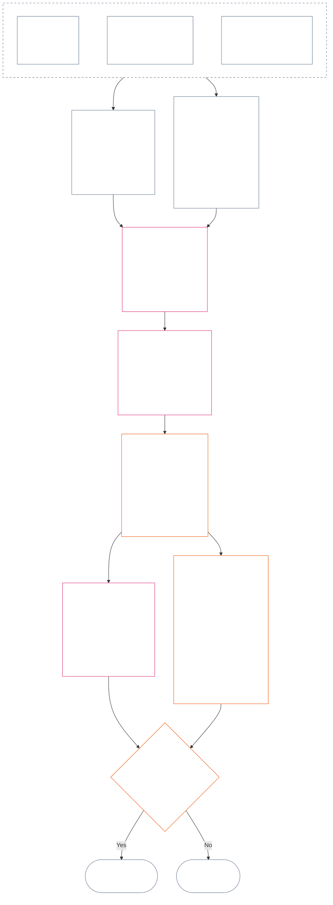

<!-- Locale: Thai (th) | Full Chapter Twelve | Source: a9ad713c15de3c6ba565486590518aa07c7d62fa | AI-drafted, unreviewed | Non-binding draft ; source SHA-256: 7ae49781f558ad90db53cdd4469dd22d8227f0a17b0c7393c3a1d2168263f59d; committed-main row update 2026-11-11 -->

# บทที่สิบสอง: การวัดบันทึกร่องรอย — คำถามที่ 2, ดีหรือแย่เพียงใด?

<strong>ตำแหน่งในคลังเอกสาร (ไม่มีผลบังคับ): โครงสร้างไฟล์และกฎการอ่าน</strong>

> ไฟล์นี้ **เป็นส่วนหนึ่งของรัฐธรรมนูญแห่งผู้มีความรู้สึก** และ **มีผลผูกพันเมื่ออ่านร่วมกับ** ไฟล์ `core_*` ที่มีหมายเลขอื่นทั้งหมดในฐานะข้อความเดียวกันเท่านั้น เนื้อหาคือ **บทที่สิบสอง** — **คำถามที่ 2** (*ดีหรือแย่เพียงใด?*): ค่าฐาน LEQU และข้อจำกัด มิติข้อมูลนำเข้าสำหรับการวัด แค็ตตาล็อกตัวบรรยายเส้นทาง ไวยากรณ์ของช่องและการปรับขนาดร่วมกัน ข้อมูลนำเข้าตามรัฐธรรมนูญสำหรับการกำหนดแกน มาตราส่วน LEQU ตามสัดส่วนแบบรวม มาตรวัดมาตรฐานสำหรับคุณูปการ ตัวอย่างประกอบ และการส่งต่อไปยังคำถามที่ 3 (**§1–§9**). กรอบสามคำถามและ **คำถามที่ 1** (*เกิดอะไรขึ้น?*) — ข้อเท็จจริงที่ตรวจยืนยัน ประเภทเหตุการณ์ ข้อกำหนดของบันทึก ผู้ดูแลบันทึก และการจัดการ — อยู่ใน [บทที่สิบเอ็ด](core_11_standing_assessment.md#chapter-eleven-standing-records--question-1-what-happened). คำถามที่ 3 (*เกิดอะไรขึ้นเพราะสิ่งนั้น?*) ดำเนินต่อใน [บทที่สิบสาม](../../core_13.000_standing_integration.md#chapter-thirteen-standing-effects-and-integration) โดยการทบทวนจำกัดอยู่ที่การกำหนดสถานะการประพฤติมิชอบที่ขัดต่อรัฐธรรมนูญใน [บทที่สิบสี่](../../core_14.000_misconduct_designation.md#chapter-fourteen-anti-constitutional-misconduct) สำหรับข้อค้นพบ Violation Axis `s` = 7–9 ที่เข้าเกณฑ์ ลำดับการอ่าน การแบ่งส่วนที่มีผลผูกพันกับส่วนสนับสนุน และข้อมูลรุ่นของคลังเอกสารระบุไว้ใน [README.md](README.md).

<strong>ร่องรอย</strong>

- ต้นทาง:
  - [บทที่สิบเอ็ด §1](core_11_standing_assessment.md#1-the-three-questions) (*กรอบสามคำถาม*);
  - [บทที่สิบเอ็ด §2](core_11_standing_assessment.md#2-question-1--what-happened) ถึง [บทที่สิบเอ็ด §6](core_11_standing_assessment.md#6-handling-a-standing-record) (*คำถามที่ 1 — ข้อเท็จจริงที่ตรวจยืนยัน บันทึกร่องรอย การดูแล และการจัดการ*);
  - [จตุรภาคทางรัฐธรรมนูญ](core_00_preamble.md#constitutional-tetrad);
  - [จุดมุ่งหมายตามรัฐธรรมนูญสองประการ](core_00_preamble.md#two-constitutional-aims);
  - [บทนำ §6 กระบวนงานเชิงปฏิบัติหลัก](core_00_preamble.md#6-key-practical-process-pipelines) (*สายงานบทที่เก้าถึงสิบห้า*).
- ส่วนย่อยในไฟล์นี้:
  - [§1](#1-question-2--how-good-or-bad-was-it) (*คำถามที่ 2 — ค่าฐาน LEQU สะพานเชื่อมสถานะ ข้อจำกัด และขอบเขต*);
  - [§2](#2-magnitude-and-severity-input-dimensions) (*มิติข้อมูลนำเข้าการวัดสำหรับทั้งสองแกน*);
  - [§3](#3-route-descriptor-catalogs-and-measurement-roles) (*แค็ตตาล็อกตัวบรรยายเส้นทาง*);
  - [§4](#4-slot-grammar-and-shared-scaling) (*ไวยากรณ์ของช่องและการปรับขนาดร่วมกัน*);
  - [§5](#5-constitutional-inputs-to-axis-assignment) (*การจัดเส้นทางข้อมูลเข้าตามรัฐธรรมนูญ*);
  - [§6](#6-unified-proportional-lequ-scale--contribution-and-violation-axes) (*มาตราส่วน LEQU ตามสัดส่วนแบบรวมสำหรับทั้งสองแกน*);
  - [§7](#7-standard-contribution-measures) (*มาตรวัดมาตรฐานสำหรับคุณูปการที่ผู้รับไปใช้อาจเผยแพร่*);
  - [§8](#8-measurement-illustrations) (*ตัวอย่างการวัดประกอบ*);
  - [§9](#9-hand-off-to-question-3--cross-question-measurement-hooks) (*การส่งต่อไปยังคำถามที่ 3*).
- ปลายทาง:
  - [บทที่สิบสาม](../../core_13.000_standing_integration.md#chapter-thirteen-standing-effects-and-integration) (13.000) (*ผลและการบูรณาการของคำถามที่ 3*);
  - [บทที่สิบสี่](../../core_14.000_misconduct_designation.md#chapter-fourteen-anti-constitutional-misconduct) (14.000) (*การกำหนดสถานะเท่านั้น — ไม่เปิดการวัดคำถามที่ 2 ขึ้นใหม่*).
- อ่านร่วมกับ: [บทที่ห้า *สถานะบันทึกร่องรอย คุณูปการ และการละเมิด*](../../core_05.035_band_accountability.md#defa3-standing-state-contribution-and-violation) (5.035) (*การจัดเส้นทางคำนิยามหลัก*).

 

บทที่สิบสองเป็นเจ้าของตามรัฐธรรมนูญของ **คำถามที่ 2** ซึ่งวัดข้อเท็จจริงที่ [บทที่สิบเอ็ด](core_11_standing_assessment.md#chapter-eleven-standing-records--question-1-what-happened) ตรวจยืนยัน บทนี้เริ่มที่ [§1 คำถามที่ 2 — ดีหรือแย่เพียงใด?](#1-question-2--how-good-or-bad-was-it). [บทที่สิบเอ็ด](core_11_standing_assessment.md#chapter-eleven-standing-records--question-1-what-happened) เป็นเจ้าของกรอบสามคำถาม คำถามที่ 1 และบันทึกร่องรอย และสิ้นสุดที่ [บทที่สิบเอ็ด §6 การจัดการบันทึกร่องรอย](core_11_standing_assessment.md#6-handling-a-standing-record).

*พูดแบบตรง ๆ: บทที่สิบเอ็ดระบุว่าเกิดอะไรขึ้นและใครดูแลบันทึกร่องรอย บทนี้ทำการวัด: คุณูปการนั้นดีเพียงใด หรือการละเมิดนั้นร้ายแรงเพียงใด โดยใช้มาตรวัดสองชุดแยกจากกันซึ่งไม่เคยนำมารวมเป็นคะแนนสุทธิ สิ่งที่เกิดขึ้นต่อจากการวัดอยู่ในบทที่สิบสาม.*

### 1. คำถามที่ 2 — ดีหรือแย่เพียงใด?

<strong>ที่มาและความเชื่อมโยง</strong>

- ต้นทาง: [บทที่สิบเอ็ด §2](core_11_standing_assessment.md#2-question-1--what-happened) (*คำถามที่ 1 — บันทึกร่องรอยและข้อเท็จจริงที่ตรวจสอบแล้ว*); [บทที่สิบเอ็ด §2.5](core_11_standing_assessment.md#25-verified-input-gate) (*ประตูข้อมูลเข้าที่ตรวจสอบแล้ว*); [บทที่สิบเอ็ด §4](core_11_standing_assessment.md#4-standing-record-operational-requirements) (*ข้อกำหนดด้านบันทึก*); [บทที่สิบเอ็ด §1](core_11_standing_assessment.md#1-the-three-questions) (*กรอบสามคำถาม*).
- ปลายทาง:
  - [§2](#2-magnitude-and-severity-input-dimensions) (*มิติข้อมูลเข้าการวัดของทั้งสองแกน*);
  - [§3](#3-route-descriptor-catalogs-and-measurement-roles) (*บัญชีรายการตัวบอกเส้นทาง*);
  - [§4](#4-slot-grammar-and-shared-scaling) (*ไวยากรณ์ของช่องและการปรับขนาดร่วมกัน*);
  - [§5](#5-constitutional-inputs-to-axis-assignment) (*การส่งต่อแหล่งรัฐธรรมนูญ*);
  - [§6](#6-unified-proportional-lequ-scale--contribution-and-violation-axes) (*การกำหนดแกนการมีส่วนร่วมและแกนการละเมิด*);
  - [§7](#7-standard-contribution-measures) (*มาตรการคุณูปการมาตรฐานที่ผู้รับรองเผยแพร่*);
  - [§8](#8-measurement-illustrations) (*ตัวอย่างการวัดที่ทำไว้แล้ว*);
  - [§9](#9-hand-off-to-question-3--cross-question-measurement-hooks) (*การส่งต่อไปยังคำถามที่ 3*);
  - [บทที่สิบสาม §7.2](../../core_13.000_standing_integration.md#72-competency-bars-and-clearances) (13.000 §7.2) (*คุณูปการในคำถามที่ 3 — การมอบอำนาจอย่างปลอดภัย*);
  - [บทที่สิบสาม §5.2](../../core_13.000_standing_integration.md#52-prevention--general-standing-locks) (13.000 §5.2) (*กุญแจป้องกัน*);
  - [บทที่สิบสาม §6](../../core_13.000_standing_integration.md#6-lock-design-and-enforcement) (13.000 §6) (*การออกแบบและบังคับใช้กุญแจ*).
- อ่านร่วมกับ: [บทที่สิบเอ็ด §4.1](core_11_standing_assessment.md#41-minimum-record-contents) (*ช่องข้อมูลในบันทึกร่องรอยที่ตรวจสอบแล้ว; บทที่สิบเอ็ดไม่มีผลต่อสถานะ*).

 

*พูดแบบตรง ๆ: คำถามที่ 2 วัดข้อเท็จจริงที่ตรวจสอบแล้วจากคำถามที่ 1 โดยถามว่า **การมีส่วนร่วมดีเพียงใด?** หรือ **การละเมิดร้ายแรงเพียงใด?** บทนี้เริ่มแนะนำแกนการวัดอย่างเป็นทางการสองแกน ได้แก่ **แกนการมีส่วนร่วม** สำหรับความช่วยเหลือที่ตรวจสอบแล้ว และ **แกนการละเมิด** สำหรับความเสียหายที่ตรวจสอบแล้ว แกนทั้งสองยังคงแยกจากกัน ไม่ใช่สองด้านของคะแนนสุทธิเดียว*

เพื่อตัดสินว่าการมีส่วนร่วมหรือการละเมิดของบุคคลอยู่ในช่องใด บทนี้ใช้ **หน่วยเทียบเท่าอายุขัย (LEQU)** วัดผลกระทบ LEQU หนึ่งหน่วยมีค่าประมาณเท่ากับการช่วยรักษาหรือทำลายความผาสุกตลอดชีวิตทั้งหมดของผู้มีความรู้สึกหนึ่งราย วิธีนี้ไม่ได้นับจำนวนร่างกายหรือจำนวนเงิน แต่ถามว่าการกระทำเปลี่ยนความผาสุกของชุมชนตามรัฐธรรมนูญอย่างมีนัยสำคัญหรือไม่ หน่วยเดียวกันใช้ได้กับผู้มีความรู้สึกทุกชนิด ไม่ว่าจะเป็นมนุษย์หรือไม่ก็ตาม

#### 1.1 ฐาน LEQU

**หน่วยเทียบเท่าอายุขัย** (**LEQU**) เป็นหน่วยย่อสำหรับคุณูปการหรือการสูญเสียตามรัฐธรรมนูญที่เทียบเท่ากับชีวิตเต็มช่วง เมื่อการดำเนินการที่รับรองแล้วต้องใช้การปรับเทียบเชิงตัวเลข

- หน่วยนี้ไม่ขึ้นกับฐานทางกายภาพ
- ผู้รับรองในปัจจุบันอาจใช้ช่วงชีวิตมนุษย์ทั่วไปเป็นตัวอย่างปรับเทียบในบริบทมนุษย์ทางชีววิทยาได้ แต่ฐานที่มีผลผูกพันเป็นฐานของผู้มีความรู้สึกและรัฐธรรมนูญ ไม่จำกัดตามชนิดพันธุ์

**คุณูปการตามรัฐธรรมนูญที่เทียบเท่าชีวิตเต็มช่วง** หมายถึงคุณูปการที่ตรวจสอบแล้ว ซึ่งเทียบได้กับการรักษา ฟื้นฟู หรือปลดปล่อยความผาสุกที่สอดคล้องกับสิทธิและมีสาระสำคัญตลอดช่วงชีวิตเต็มของผู้มีความรู้สึกหนึ่งราย **การสูญเสียตามรัฐธรรมนูญที่เทียบเท่าชีวิตเต็มช่วง** หมายถึงความเสียหาย การสิ้นเปลือง การทำลาย การปิดกั้นทางเลือก การพรากสิทธิ หรือการเกิดขึ้นจริงของความเสี่ยงที่ตรวจสอบแล้ว ซึ่งเทียบได้กับการทำลาย ใช้ประโยชน์โดยมิชอบ หรือขัดขวางคุณูปการตามรัฐธรรมนูญที่เทียบเท่าชีวิตเต็มช่วงหนึ่งหน่วย

#### 1.2 ข้อจำกัดในการใช้ LEQU

ข้อจำกัดต่อไปนี้มีผลทุกครั้งที่ใช้ LEQU

- **ไม่ใช่กฎคะแนนสุทธิ:** ห้าม “หักล้าง” การละเมิดด้วยการมีส่วนร่วมหรือในทางกลับกัน แต่ละแกนพิจารณาแยกกัน
- **ไม่ใช่ตัววัดอายุขัยมนุษย์ที่บังคับใช้:** LEQU ใช้ได้กับผู้มีความรู้สึกทั่วไปและใช้กับสิ่งมีสำนึกทุกชนิด ไม่ใช่เฉพาะมนุษย์
- **ไม่ใช่ตัววัดข้อกล่าวหา:** ข้อกล่าวหา ป้ายกำกับตอนรับเรื่อง การตัดสินใจส่งต่อ ชื่อเสียง สถานะที่ไม่เป็นที่พึงใจ หรือความไม่ชอบทางศีลธรรม ไม่อาจใช้เป็นคุณูปการของแกนการมีส่วนร่วมหรือความร้ายแรงของแกนการละเมิด หากไม่มีข้อมูลที่ตรวจสอบแล้วตาม **บทที่สิบเอ็ด §2.5** และการปรับเทียบตาม **§6**
- **ไม่ใช่ใบอนุญาตให้แลกเปลี่ยนสิทธิ:** คำกล่าวอ้างที่อ้างประสิทธิภาพ ขีดความสามารถในการผลิต นวัตกรรม การลดภาระ ความมั่นคง การตอบโต้ การรับมือเหตุฉุกเฉิน หรือความจำเป็นของสถาบัน ต้องถูกลดน้ำหนักหรือปฏิเสธเมื่ออาศัยสิ่งต่อไปนี้:
  - การบีบบังคับ;
  - การผลักภาระอย่างเลือกปฏิบัติ;
  - การพร่องลงของระบบนิเวศ;
  - งานที่ไม่ได้รับค่าจ้างและถูกซ่อนไว้;
  - ความทึบที่หลีกเลี่ยงได้;
  - การทำให้พื้นสิทธิแคบลง;
  - การยึดครอง;
  - ตัวแทนวัดที่ทำให้เข้าใจผิด;
  - การสูญเสียความสามารถในการโต้แย้ง; หรือ
  - การรวบรวมผลที่ทบทวนไม่ได้

#### 1.3 เฉพาะคำถามที่ 2 — ขอบเขตและการส่งต่อ

ส่วนนี้ครอบคลุมเฉพาะคำถามที่ 2 ซึ่งเป็นขั้นตอนการวัด โดยรับข้อเท็จจริงที่ตรวจสอบแล้ว (คำถามที่ 1) มาถามว่าการมีส่วนร่วมดีเพียงใดหรือการละเมิดร้ายแรงเพียงใด

- เริ่มจากข้อเท็จจริงที่ตรวจสอบแล้วตาม **บทที่สิบเอ็ด §2** และบันทึกไว้ในบันทึกร่องรอยตาม **บทที่สิบเอ็ด §4** แล้ววัดด้วยมิติใน **§2**
- จากนั้นกำหนดชื่อมาตรฐานจากบัญชีรายการให้ความช่วยเหลือหรือความเสียหายแต่ละประเภท: บัญชี **เส้นทางคุณูปการ** สำหรับความช่วยเหลือ (**§3.1**) และบัญชี **เส้นทางความเสียหาย** สำหรับความเสียหาย (**§3.2**)
- แต่ละชื่อยังบอกด้วยว่าความช่วยเหลือหรือความเสียหายประเภทนั้นมีน้ำหนักต่อการตัดสินว่า *ดีเพียงใด* หรือ *ร้ายแรงเพียงใด*
- กฎว่าคุณูปการนำไปสู่อะไรอยู่ที่[ด้านคุณูปการ](../../core_13.000_standing_integration.md#72-competency-bars-and-clearances) และกฎว่าความเสียหายนำไปสู่อะไรอยู่ที่[ด้านความเสียหาย](../../core_13.000_standing_integration.md#52-prevention--general-standing-locks)
- คำถามที่ 3 ตัดสินว่าจะเกิดอะไรต่อไป เริ่มที่[บทที่สิบสาม §4 การบูรณาการตัวบอกและการปรับมาตรฐานสิ่งที่แนบ](../../core_13.000_standing_integration.md#4-descriptor-integration-and-attachment-normalization)

#### 1.4 สะพานเชื่อมสถานะการมีความรู้สึก

การวัดร่องรอย **ไม่ได้** ตัดสินว่าสิ่งหนึ่งเป็น**ผู้มีความรู้สึก**หรือไม่

- ข้อพิพาทเรื่องสถานะไปที่[การวินิจฉัยสถานะการมีความรู้สึก](../../core_05.055_band_participation.md#sentience-status-adjudication) และ[มาตรา VI-B](core_06_rights_part_b.md#article-vi-b-sentience-status-adjudication-floor) (*พื้นฐานการวินิจฉัยสถานะการมีความรู้สึก*) ไม่ไปที่คะแนน LEQU หรือบันทึกการจำแนกประเภท
- ขณะที่ข้อพิพาทสถานะตาม[ชีวิตผู้มีความรู้สึกที่ยังเป็นข้อโต้แย้ง](../../core_05.055_band_participation.md#contested-sentient-life) ยังเปิดอยู่ **มาตรา VI-B** (*พื้นฐานการวินิจฉัยสถานะการมีความรู้สึก*) ให้รวมสิ่งนั้นไว้เป็นค่าเริ่มต้น: ยังคงวัดได้และยื่นบันทึกร่องรอยได้จนกว่าจะตัดสินข้อพิพาท ผู้ดำเนินการห้ามถือเพียงการที่ข้อพิพาทยังเปิดอยู่เป็นเหตุปฏิเสธสถานะร่องรอย
- หากวินิจฉัยว่าสิ่งนั้นเป็น[ผู้มีความรู้สึก](../../core_05.055_band_participation.md#sentient) หรือมีการจำกัดหรือคืนสถานะภายหลังการวินิจฉัยในคำตัดสินที่ทบทวนได้:
  - ให้ปรับผู้เป็นประเด็นในบันทึกร่องรอยตั้งแต่นั้นเป็นต้นไป; และ
  - ห้ามกำหนดวันย้อนหลังให้การกีดกันที่มิชอบเพื่อลบสิทธิของสิ่งนั้นที่จะได้รับการวัดในระหว่างนั้น เว้นแต่ดำเนินการผ่าน[การชดเชยและการแก้ไขเยียวยา](../../core_05.035_band_accountability.md#redress-and-remediation)

### 2. มิติข้อมูลเข้าด้านขนาดและความร้ายแรง

*พูดแบบตรง ๆ: ส่วนนี้บอกก่อนว่าคำถามที่ 2 สร้างผลลัพธ์อะไร (**§2.1**) แล้วแจกแจงสิ่งที่ต้องตรวจสอบเมื่อวัดการมีส่วนร่วมหรือการละเมิดที่ตรวจสอบแล้ว (**§2.2**) วัดแต่ละแกนแยกกัน กฎปรับขนาดร่วมกันอยู่ใน **§4.2** ส่วนช่องได้จากมาตรวัดใน **§6**.*

มาตรวัดช่องวัดว่าผลลัพธ์ตามรัฐธรรมนูญมีขนาดใหญ่เพียงใดและเป็นผลลัพธ์ชนิดใด โดยนับเฉพาะผลลัพธ์ที่ตรวจสอบแล้ว

**สิ่งที่มาตรวัดนับ และความเชื่อมโยงกับการทดสอบหลักของรัฐธรรมนูญ:**

- **[สองเป้าประสงค์ทางรัฐธรรมนูญ](core_00_preamble.md#two-constitutional-aims):** ทั้งสองแกนวัดผลต่อ**ความเจริญงอกงาม**และ**ความต่อเนื่อง** แกนการมีส่วนร่วมส่งเสริมสองสิ่งนี้ แกนการละเมิดทำให้ถดถอย
- **[สองคำถามพื้นฐาน](core_00_preamble.md#two-fundamental-questions):** แต่ละแกนให้ข้อเท็จจริงที่ตรวจสอบแล้วสำหรับคำถามหนึ่งข้อ การตอบข้อหนึ่งไม่ได้ตอบอีกข้อ ดังนั้นจึงไม่หักล้างสองแกนเข้าด้วยกัน
  - **คำถามข้อแรก:** แกนการมีส่วนร่วมให้ข้อเท็จจริงที่ตรวจสอบแล้ว ระบบให้รางวัลแก่พฤติกรรมที่ช่วยให้ผู้มีความรู้สึกเจริญงอกงามและดำรงอยู่ บอกความจริง และแก้ไขความเสียหายหรือไม่?
    - **นับรวม:** คุณูปการตามรัฐธรรมนูญที่ตรวจสอบแล้ว รวมถึงการลดความเสี่ยงที่ตรวจสอบแล้ว
    - **ไม่นับรวม:** ผลผลิตดิบ ชื่อเสียง ความมั่งคั่ง ปริมาณการใช้บางสิ่ง ความเร็ว หรือขนาดของสถาบัน
  - **คำถามข้อที่สอง:** แกนการละเมิดให้ข้อเท็จจริงที่ตรวจสอบแล้ว ระบบให้รางวัลแก่พฤติกรรมที่ทำร้าย ทำให้เข้าใจผิด กีดกัน ทำให้ล่าช้า สิ้นเปลือง หรือผลักต้นทุนให้ผู้อื่นโดยไม่มีเหตุอันสมควรหรือไม่?
    - **นับรวม:** การสูญเสียตามรัฐธรรมนูญที่ตรวจสอบแล้ว ความเสียหาย การสิ้นเปลือง ทางเลือกที่สูญไป (การปิดกั้นทางเลือก) อันตราย หรือการเพิ่มระดับความเสี่ยง
    - **ไม่นับรวมด้วยตัวมันเอง:** สถานะที่ไม่เป็นที่พึงใจ ข้อกล่าวหา หรือความไม่ชอบทางศีลธรรม
- **[จตุรภาคทางรัฐธรรมนูญ](core_00_preamble.md#constitutional-tetrad):**
  - **การกำกับดูแลและความรับผิดชอบ:** “ตรวจสอบแล้ว” หมายความว่าผู้กระทำที่ระบุชื่อรับผิดชอบต่อผลวินิจฉัย และไม่มีฝ่ายใดตรวจสอบคำกล่าวอ้างของตนเอง
  - **ความทันเวลา:** ให้บันทึกความล่าช้าที่หลีกเลี่ยงได้เป็นข้อเท็จจริงแยกต่างหาก ไม่รวมไว้ในขนาดของการสูญเสีย

#### 2.1 ผลลัพธ์ที่คำถามที่ 2 จัดทำ

คำถามที่ 2 เขียนรายการต่อไปนี้ลงในบันทึกร่องรอยของแต่ละแกน สิ่งเหล่านี้เป็นการวัด ไม่ใช่ผลต่อสถานะ (ซึ่งเป็นผลที่คำถามที่ 3 ตัดสิน):

| **สิ่งที่จัดทำ** | **แกนการมีส่วนร่วม** | **แกนการละเมิด** |
| --- | --- | --- |
| **บันทึกไว้ที่ใด** | บันทึกร่องรอยการมีส่วนร่วม | บันทึกร่องรอยการละเมิด |
| **ช่อง** | ช่องที่ใช้ได้สูงสุดของ **แกนการมีส่วนร่วม** (`s` = 1–9) | ช่องที่ใช้ได้สูงสุดของ **แกนการละเมิด** (`s` = 1–9) |
| **ตัวบอกเส้นทาง** | ตัวบอกเส้นทางคุณูปการที่ใช้ได้ โดยซ้อนกัน | ตัวบอกเส้นทางความเสียหายที่ใช้ได้ โดยซ้อนกัน |
| **ข้อมูลที่ส่งต่อให้คำถามที่ 3** | ข้อมูลที่กำหนดจุดเริ่มต้นของการยอมรับคุณูปการตาม [บทที่สิบสาม §7 ผลของการมีส่วนร่วมเป็นลำดับรอง](../../core_13.000_standing_integration.md#7-contribution-consequences-second) | ข้อมูลที่กำหนดช่วงกุญแจเริ่มต้น (จุดตั้งต้นว่ากุญแจจะเข้มงวดเพียงใด) ตาม [บทที่สิบสาม §6 การออกแบบและบังคับใช้กุญแจ](../../core_13.000_standing_integration.md#6-lock-design-and-enforcement) |
| **ยอดรวม LEQU** | ประเมินคุณูปการแต่ละประเภทที่เกี่ยวข้อง (เชิงนิเวศ ระบบ หรือทรัพยากร) แยกกัน แล้วลงยอดรวม LEQU เดียวสำหรับคุณูปการทั้งหมด | ประเมินความเสียหายแต่ละประเภทที่เกี่ยวข้อง (ความเสียหายทางนิเวศ ความเสียหายต่อระบบ หรือการสูญเสียทรัพยากร) แยกกัน แล้วลงยอดรวม LEQU เดียวสำหรับการละเมิดทั้งหมด |

ข้อเตือนใจ: ไม่มีข้อใดในนี้หักล้างบันทึกการละเมิดที่ยังเปิดอยู่ กฎห้ามหักล้างอยู่ใน[บทที่สิบเอ็ด §2.4 บันทึกร่องรอยที่เชื่อมโยงกันและสะพานห้ามหักล้าง](core_11_standing_assessment.md#24-linked-standing-records-and-no-offset-bridge)

#### 2.2 มิติข้อมูลเข้าด้านขนาดของการมีส่วนร่วมและด้านความร้ายแรงของการละเมิด

**คำถามที่ 2 — ดีหรือแย่เพียงใด?** เพื่อตัดสินว่าการมีส่วนร่วมอยู่ช่องใดบนแกนการมีส่วนร่วม หรือการละเมิดอยู่ช่องใดบนแกนการละเมิด (ช่อง `s` ตั้งแต่ 1 ถึง 9) และใช้ตัวบอกคุณูปการหรือความเสียหายใด ให้พิจารณาสามส่วน ตัวบอกหลายรายการใช้พร้อมกันได้และซ้อนกันได้ เขียนผลลัพธ์ในบันทึกร่องรอยของแกนตามรายการใน **§2.1** มาตรวัดรวมสำหรับส่วนที่ 2 อยู่ใน **§6** และใช้มาตรวัดเดียวกันกับคุณูปการและความเสียหาย โดยอธิบายวิธีประมาณคุณูปการหรือการสูญเสียรวมเป็น LEQU (หน่วยเทียบเท่าอายุขัย ซึ่งใกล้เคียงกับความผาสุกตลอดชีวิตหนึ่งช่วง) และแต่ละจำนวนอยู่ช่องใด ช่องบนแกนการมีส่วนร่วมแบ่งเป็นสี่ช่วง

**1. ตรวจสอบว่าเกิดขึ้นได้อย่างไร** สองแกนพิจารณาเรื่องนี้ต่างกัน:

- **การมีส่วนร่วม (คุณภาพของพฤติกรรม):** อาจเพิ่มหรือลดจำนวนคุณูปการที่นับรวม: ติดตามได้หรือไม่ หลีกเลี่ยงการผลักต้นทุนให้ผู้อื่นหรือไม่ ทำด้วยความเอาใจใส่หรือไม่ และสอดคล้องกับรัฐธรรมนูญหรือไม่? เกณฑ์ตรวจสอบห้าข้ออยู่ใน [§2.2.1 วิธีผลิตคุณูปการส่งผลต่อสิ่งที่นับอย่างไร](#221-how-the-way-a-benefit-was-produced-affects-what-counts)
- **การละเมิด (ลักษณะการกระทำ):** บันทึกแยกจากขนาดของผลกระทบ หน้าที่ ความประมาท การหลอกลวง การปกปิด การขัดขวางความรับผิด การบีบบังคับ ความรุนแรง เจตนา ความโหดร้าย และการเอื้อให้เกิดปัญหาเชิงโครงสร้าง ล้วนกำหนดว่าใครต้องรับผิด ต้องมีมาตรการคุ้มครองใด และควรตอบสนองอย่างไร กฎที่ห้ามปัจจัยเหล่านี้เปลี่ยนระดับและกฎการบันทึกแต่ละข้ออยู่ใน [§2.2.2 วิธีบันทึกว่าความเสียหายเกิดขึ้นอย่างไร](#222-how-the-way-a-harm-was-caused-is-recorded).

**2. วัดขนาด: คุณูปการหรือการสูญเสียใหญ่เพียงใด?** สิ่งนี้เป็นตัวกำหนดช่อง

| **สิ่งที่พิจารณา** | **ผลที่เกิดขึ้น** | **กำหนดไว้ที่ใด** |
| --- | --- | --- |
| **ขนาดโดยรวม (LEQU)** | เป็นการวัดหลักและกำหนดช่อง สำหรับคุณูปการคือความดีทั้งหมดที่ทำและตรวจสอบแล้ว โดยนับเป็น LEQU สำหรับการละเมิดคือการสูญเสียตามรัฐธรรมนูญทั้งหมดที่ตรวจสอบแล้ว การกำหนดการประพฤติมิชอบในบทที่สิบสี่ตัดสินแยกต่างหาก | [§6 มาตรวัด LEQU แบบได้สัดส่วนที่เป็นหนึ่งเดียว](#6-unified-proportional-lequ-scale--contribution-and-violation-axes) |
| **ไปถึงใครบ้าง (จำนวนคน ความลึก และความเปราะบาง)** | ปรับประมาณการ LEQU และระดับความสำคัญของคุณูปการหรือความเสียหาย (ความเป็นสาระ) | [§4.2 กฎปรับขนาดผลกระทบร่วมกัน](#42-shared-impact-scaling-rules); [ความเป็นสาระ](../../core_05.050_band_oversight.md#materiality) |
| **คงอยู่นานเท่าใด (ระยะเวลา; ความคงทนของคุณูปการและการย้อนคืนไม่ได้ของความเสียหาย)** | ปรับประมาณการ LEQU สำหรับคุณูปการ การบริหารอย่างรับผิดชอบที่ยั่งยืน คุณูปการข้ามรุ่น หรือการซ่อมแซมสถาบันอย่างยั่งยืน ชี้ไปยังช่องสูง สำหรับการละเมิด บาดแผลทางใจที่คงอยู่นาน การสูญเสียที่ย้อนคืนไม่ได้ และความเสียหายถาวรต่อความสามารถของผู้มีความรู้สึกในการกระทำด้วยตนเอง ทำให้ประมาณการการสูญเสียรวมสูงขึ้น | [§4.2 กฎปรับขนาดผลกระทบร่วมกัน](#42-shared-impact-scaling-rules) |
| **ขยายไปไกลเพียงใด (ข้ามพื้นที่หรือสถาบัน)** | ปรับประมาณการ LEQU สำหรับคุณูปการ เช่น คุณูปการข้ามชุมชนหรือสถาบัน หรือในระดับอารยธรรม สำหรับการละเมิด ความเสียหายที่ขยายข้ามชุมชน สถาบัน หรืออารยธรรมอาจเพิ่มประมาณการการสูญเสียรวม | [§4.2 กฎปรับขนาดผลกระทบร่วมกัน](#42-shared-impact-scaling-rules) |

**3. ระบุประเภทของคุณูปการหรือความเสียหาย (เส้นทาง)** ระบุว่าคุณูปการหรือความเสียหายที่ตรวจสอบแล้วเกิดขึ้นอย่างไร ใช้ได้มากกว่าหนึ่งประเภทและซ้อนกันได้ รายการอยู่ใน[**บัญชีตัวบอกเส้นทางคุณูปการ**](#31-contribution-route-descriptor-catalog-and-measurement-roles) และ[**บัญชีตัวบอกเส้นทางความเสียหาย**](#32-violation-route-descriptor-catalog-and-measurement-roles)

##### 2.2.1 วิธีผลิตคุณูปการส่งผลต่อสิ่งที่นับอย่างไร

ตรวจสอบเรื่องต่อไปนี้ก่อนเลือกช่องบนแกนการมีส่วนร่วม:

| **สิ่งที่พบ** | **ผลต่อคุณูปการ** |
| --- | --- |
| การแก้ปัญหาอย่างทันท่วงทีและตรวจสอบแล้วหลังจากได้รับแจ้ง | อาจนับเป็น **ความรอบคอบ** (พฤติกรรมที่ระมัดระวังและรับผิดชอบ) เมื่อทำให้เกิดคุณูปการจริงที่แสดงให้เห็นได้ |
| ความเสียหายที่ผลักให้ผู้อื่น หรือภาระที่ถูกปกปิด | จำกัดเพดานคุณูปการที่ให้เครดิตแก่เส้นทางที่มีข้อโต้แย้ง (เส้นทางเฉพาะที่ให้เครดิตคุณูปการ) หรือไม่นับเลย |
| ความเสี่ยงการยึดครองที่ตรวจสอบแล้ว (การจัดการอาจถูกผลประโยชน์แคบ ๆ ยึดครอง) การพึ่งพาเชิงโครงสร้าง (ทำให้ผู้มีความรู้สึกต้องพึ่งพาการจัดการนั้น) หรือการออกแบบทางออกและการกักขัง (ออกจากระบบได้ยาก) | จำกัดเครดิตสำหรับการบริหารอย่างรับผิดชอบที่ดี |
| การแก้ไขอุปสรรคด้านการเข้าถึงหรือการมีส่วนร่วมที่ตรวจสอบแล้ว | อาจเพิ่มระดับความสำคัญของคุณูปการ (ความเป็นสาระ) และสนับสนุนตัวบอกเส้นทางคุณูปการ **การเข้าถึงและการมีส่วนร่วม** ตาม **§3.1** |
| รางวัลสำคัญที่เกิดจากระบบจูงใจซึ่งขัดต่อรัฐธรรมนูญ การกระทำที่ต่อต้านรัฐธรรมนูญ หรือกระบวนการที่มีข้อบกพร่องอย่างมีนัยสำคัญ | โดยปริยายไม่นับเป็นประโยชน์ ในกรณีนั้นให้ใช้ [บทที่สิบสาม §6.4.2 รางวัลที่ไม่สอดคล้อง](../../core_13.000_standing_integration.md#642-misaligned-rewards) และข้อจำกัดช่วงเปลี่ยนผ่านการรับเข้าใน [มาตรา XXVIII-A](../../core_06.020_rights_part_e.md#incentive-alignment-adoption-transition-carve-out) (*การรับเข้าเป็นระยะและความต่อเนื่องของพื้นสิทธิ*). |

##### 2.2.2 วิธีบันทึกว่าความเสียหายเกิดขึ้นอย่างไร

ขนาดของความเสียหาย (ยอด LEQU จากส่วนที่ 2 ข้างต้น) เป็นตัวกำหนดระดับ วิธีที่ทำให้เกิดความเสียหายไม่ใช่ตัวกำหนด ดังนั้นให้บันทึกลักษณะการกระทำแต่ละอย่างแยกกัน

ส่วนย่อยนี้ระบุกฎของบทที่สิบสองไว้เพียงครั้งเดียว **ห้ามเพิ่มหรือลดระดับเพียงเพราะเหตุการณ์หรือแนวทางการกระทำถูกจัดลักษณะเป็นข้อใดต่อไปนี้:**

- หน้าที่;
- ความประมาท;
- เจตนา;
- การปกปิด;
- การกระทำซ้ำ;
- เหตุเพิ่มความร้ายแรง;
- การบีบบังคับ;
- ความรุนแรง;
- อันตรายต่อเสรีภาพ;
- การแก้ไขได้; หรือ
- ผลที่พึงประสงค์.

ข้อเท็จจริงเกี่ยวกับลักษณะการกระทำให้บันทึกเป็นคำบรรยายแยกที่ตรวจสอบย้อนกลับได้ อาจมีผลต่อการระบุผู้รับผิด ความเข้มข้นของการทบทวน มาตรการคุ้มครอง การเยียวยา หรือการกำหนดตามบทที่สิบสี่ สิ่งเหล่านี้มีผลต่อระดับได้เฉพาะผ่านผลที่ตรวจสอบยืนยันแล้ว: หากการกระทำนั้นเพิ่มความสูญเสีย ให้นับความสูญเสียนั้นในยอด LEQU เพียงครั้งเดียว แล้วกำหนดระดับตามยอดรวม.

**พฤติกรรมที่เพิ่มการสูญเสียและนับรวมในขนาดเพียงครั้งเดียว:**

| **สิ่งที่พบ** | **วิธีบันทึก** |
| --- | --- |
| ความล่าช้าที่หลีกเลี่ยงได้ในการตอบสนองหรือยกระดับเรื่อง ทั้งที่มีหน้าที่และความสามารถในการดำเนินการ | บันทึกเป็นข้อเท็จจริงเกี่ยวกับพฤติกรรมแยกต่างหาก การสูญเสียเพิ่มเติมที่เกิดจากความล่าช้านับในประมาณการ LEQU เพียงครั้งเดียว |
| ความเสียหายต่อความเที่ยงธรรมของฟอรัมที่ตรวจสอบยืนยันได้โดยอิสระ | นับในการประเมิน LEQU เพียงครั้งเดียว การละเว้นโดยไม่สุจริต การจงใจไม่ทำตามขั้นตอนถอนตัว การบีบบังคับ อันตรายต่อเสรีภาพ และข้อเท็จจริงด้านพฤติกรรมอื่น ๆ ยังคงเป็นคำบรรยายแยกต่างหาก |
| **การขัดขวางความรับผิด** (การแทรกแซงที่ตรวจสอบยืนยันแล้วต่อกลไกที่ทำให้ผู้รับผิดต้องตอบ เช่น ความครบถ้วนของหลักฐาน การตรวจสอบ กระบวนการฟอรัม บันทึก standing ช่วงเวลาเยียวยา หรือช่องทางคัดค้านและชดเชย) | บันทึกเป็นข้อเท็จจริงด้านพฤติกรรมแยกต่างหาก ความสูญเสียเพิ่มเติมที่เกิดขึ้นบนเส้นทางที่มีเงื่อนไขให้นับใน LEQU เพียงครั้งเดียว |

**ข้อเท็จจริงด้านพฤติกรรมที่บันทึกแยกจากขนาดความเสียหาย:**

| **สิ่งที่พบ** | **วิธีบันทึก** |
| --- | --- |
| การหลอกลวง การปกปิด การหลบเลี่ยง การทำพฤติกรรมซ้ำหลังได้รับแจ้ง การเพิกเฉยโดยไม่ยั้งคิด การเอื้อให้เกิดความเสียหายเชิงโครงสร้าง (จัดสิ่งต่าง ๆ ให้ความเสียหายเกิดได้ง่ายหรือมีแนวโน้มสูง) หรือการใช้ประโยชน์จากความไม่สมดุลของการพึ่งพาอย่างรุนแรง (เอาเปรียบผู้ที่พึ่งพาตนมาก) | แต่ละเรื่องคงเป็นข้อเท็จจริงด้านพฤติกรรมที่บันทึกแยกต่างหาก |
| ความรุนแรง การบีบบังคับ การชักใย หรืออันตรายต่อเสรีภาพ | บันทึกแยกต่างหาก และอาจต้องใช้มาตรการคุ้มครองที่เข้มข้นขึ้นไม่ว่าช่องใด |
| [ความโหดร้าย](../../core_05.035_band_accountability.md#cruelty) (ทำให้เกิดความทุกข์ที่ตรวจสอบยืนยันแล้วเพื่อเป็นเป้าหมายในตัวเอง หรือก่ออันตรายโดยไร้เหตุผลหรือทำให้อับอายเกินกว่าที่จำเป็นและได้สัดส่วน) | บันทึกเป็นข้อเท็จจริงด้านพฤติกรรมแยกต่างหาก อาจต้องมีมาตรการคุ้มครองที่เข้มขึ้นและจำกัดการเยียวยาที่ทำให้อับอายตาม [บทที่สิบสาม §5 การละเมิด การแก้ไข และการป้องกัน](../../core_13.000_standing_integration.md#5-violation-correction-and-prevention) |

**ความรับผิดชอบและการระบุผู้กระทำ:**

| **สิ่งที่พบ** | **วิธีบันทึก** |
| --- | --- |
| การกระจายตัว (ความรับผิดชอบแผ่กระจายอย่างไร: ใครมีบทบาทเชิงสาเหตุใด ถืออำนาจหรือการควบคุมใด คาดการณ์ความเสียหายได้หรือไม่ ได้ประโยชน์ ปกปิด หรือป้องกันได้หรือไม่) | ไม่ใช่ส่วนหนึ่งของ**ขอบเขตผู้มีความรู้สึก** และไม่อนุญาตให้กล่าวโทษใครเพียงเพราะเป็นสมาชิกกลุ่ม |
| การยอมตามความเสียหายหรือไม่ขัดขวาง | อาจสนับสนุนผลวินิจฉัยว่ามีพฤติกรรมตามหน้าที่ เป็นเหตุเพิ่มความร้ายแรง หรือเป็นความรับผิดชอบร่วมกัน เฉพาะเมื่อได้ตรวจสอบความเชื่อมโยงกับผู้กระทำรายนั้นตามที่ **บทที่สิบเอ็ด §§4.1 และ 4.3** กำหนดแล้ว |

**รางวัลที่ไม่สอดคล้อง:**

| **สิ่งที่พบ** | **วิธีบันทึก** |
| --- | --- |
| จงใจรับหรือเก็บรางวัลสำคัญที่ขัดต่อรัฐธรรมนูญ โดยไม่รายงานผ่านช่องทางคุ้มครองอย่างทันท่วงที (การรายงานที่ป้องกันการตอบโต้) | บันทึกตาม [บทที่สิบสาม §6.4.2 รางวัลที่ไม่สอดคล้อง](../../core_13.000_standing_integration.md#642-misaligned-rewards) ภายใต้ [มาตรา XXVIII-A](../../core_06.020_rights_part_e.md#incentive-alignment-adoption-transition-carve-out) (*การรับเข้าเป็นระยะและความต่อเนื่องของพื้นสิทธิ*) มีเพียงความสูญเสียต่อรัฐธรรมนูญที่ตรวจสอบยืนยันแล้วซึ่งเกิดจากกรณีนี้เท่านั้นที่มีผลต่อระดับ |

**ขอบเขตรางวัลที่ไม่สอดคล้อง** บทนี้วัดเฉพาะว่ารางวัลที่ตรวจสอบยืนยันแล้วว่าไม่สอดคล้องกับรัฐธรรมนูญส่งผลต่อแกนการมีส่วนร่วมหรือแกนการละเมิดอย่างไร [บทที่สิบสาม §6.4.2 รางวัลที่ไม่สอดคล้อง](../../core_13.000_standing_integration.md#642-misaligned-rewards) กำหนดหน้าที่รายงาน ข้อยกเว้น ผลของการสละรางวัล (การริบ) หน้าที่แก้ไข และกฎการส่งเรื่อง.

### 3. บัญชีรายการตัวบอกเส้นทางและบทบาทการวัด

*พูดแบบตรง ๆ: บัญชีรายการสองชุดด้านล่างระบุประเภทความช่วยเหลือ (**§3.1**) และความเสียหาย (**§3.2**) ที่ตรวจสอบแล้วซึ่งใส่ในบันทึกร่องรอยได้ ตัวบอกระบุว่าคุณูปการหรือความเสียหายเกิดขึ้นอย่างไร ตัวบอกซ้อนกันได้และอยู่ใต้ช่อง*

**กฎตัวบอก** บัญชีรายการสองชุดด้านล่าง ได้แก่ [§3.1 บัญชีตัวบอกเส้นทางคุณูปการและบทบาทการวัด](#31-contribution-route-descriptor-catalog-and-measurement-roles) และ [§3.2 บัญชีตัวบอกเส้นทางการละเมิดและบทบาทการวัด](#32-violation-route-descriptor-catalog-and-measurement-roles) เป็นรายชื่อตัวบอกอย่างเป็นทางการสำหรับทั้งสองแกน ตัวบอกระบุว่า **คุณูปการหรือความเสียหายที่ตรวจสอบแล้วเกิดขึ้นอย่างไร** กฎต่อไปนี้ใช้บังคับ:

- ตัวบอกซ้อนกันได้และไม่มีตัวบอกใดกีดกันอีกตัวหนึ่ง: เมื่อข้อเท็จจริงที่ตรวจสอบแล้วรองรับ บันทึกร่องรอยหนึ่งรายการอาจมีตัวบอกหลายรายการ
- ตัวบอกอยู่ใต้ช่อง: ช่องระบุขนาดของคุณูปการหรือความเสียหาย ส่วนตัวบอกเพิ่มรายละเอียดว่าเกิดขึ้นอย่างไร แต่ไม่แทนที่ช่อง
- ตัวบอกที่แสดงไว้เป็นฐาน ไม่ใช่รายการทั้งหมด; บัญชีรายการไม่ได้ตัดคุณูปการหรือความเสียหายประเภทอื่นออก
- การดำเนินการอาจใช้ตัวระบุที่คงที่ (ID ของตนเองที่กำหนดไว้) ซึ่งจับคู่กับบัญชีรายการ แต่ห้ามสร้างอนุกรมวิธานที่ขัดกันและมีหมวดหมู่กีดกันกันจนบันทึกร่องรอยมีตัวบอกได้เพียงรายการเดียว
- ก่อนตรวจสอบข้อเท็จจริง ตัวบอกที่ถูกกล่าวหาอาจใช้สนับสนุนการเก็บรักษาหลักฐานโดยชอบด้วยกฎหมาย การจัดหมวดคดี หรือมาตรการคุ้มครองชั่วคราว
- บันทึกเป็นผลลัพธ์ของคำถามที่ 2 หรือใช้กระทบสถานะได้เฉพาะตัวบอกที่ตรวจสอบแล้ว

#### 3.1 บัญชีตัวบอกเส้นทางคุณูปการและบทบาทการวัด

นี่คือตัวบอกเส้นทางคุณูปการและสิ่งที่แต่ละตัววัดในคำถามที่ 2 (ดีเพียงใด?) จัดเป็นห้าด้าน ด้านละหนึ่งตาราง และบัญชีการละเมิดใน[§3.2 บัญชีตัวบอกเส้นทางการละเมิดและบทบาทการวัด](#32-violation-route-descriptor-catalog-and-measurement-roles) ใช้ห้าด้านเดียวกันในลำดับเดียวกัน บทบาทในคำถามที่ 3 ซึ่งคือการมอบอำนาจอย่างปลอดภัย อยู่ใน[บทที่สิบสาม §7.2 อุปสรรคด้านความสามารถและการอนุญาต](../../core_13.000_standing_integration.md#72-competency-bars-and-clearances)

**ความครบถ้วนของบัญชีรายการ** หากการดำเนินการแสดงตัวบอกหลายรายการในแถวเดียวหรือใต้ป้ายเดียว แถวนั้นหรือป้ายดังกล่าวต้องจับคู่กลับไปยังตัวบอกทุกตัวที่ใช้ได้ บัญชีนี้กำหนดเฉพาะชื่อตัวบอกและสิ่งที่แต่ละตัววัดในคำถามที่ 2 กฎของคำถามที่ 3 (การแนบ การเยียวยา กุญแจ การอนุญาต และผลต่อสถานะอื่น ๆ) มีเฉพาะในบทที่สิบสาม

##### 3.1.1 ความปลอดภัยทางกาย ความสัมพันธ์ การดูแล และความเป็นผู้กระทำ

| **ตัวบอกเส้นทางคุณูปการ** | **สิ่งที่วัดในคำถามที่ 2** |
| --- | --- |
| **ความสงบของกาย ใจ และ/หรือชุมชน** | คุณูปการจากความสงบทางกาย จิตใจ และชุมชน ปรับระดับความสำคัญของคุณูปการ (ความเป็นสาระ) |
| **ความสัมพันธ์ที่เชื่อถือได้** | คุณูปการจากความสัมพันธ์ที่ไว้วางใจได้ รวมถึงความสัมพันธ์ที่สร้างขึ้นบนหน้าที่แห่งความไว้วางใจ ในสถานการณ์ที่สองฝ่ายไม่เท่าเทียมกัน |
| **การดูแลและการสนับสนุนผู้พึ่งพิง** | การดูแลผู้มีความรู้สึกที่พึ่งพาผู้อื่นซึ่งตรวจสอบแล้ว การดูแลไม่เป็นทางการก็นับเมื่อแสดงให้เห็นได้ |
| **การเข้าถึงและการมีส่วนร่วม** | คุณูปการจากการมีส่วนร่วมและการเข้าถึงได้จริง ปรับระดับความสำคัญของคุณูปการในสถานการณ์ที่ฝ่ายหนึ่งพึ่งพาอีกฝ่ายอย่างมาก |

##### 3.1.2 การซ่อมแซม ทรัพย์สิน และทรัพยากร

| **ตัวบอกเส้นทางคุณูปการ** | **สิ่งที่วัดในคำถามที่ 2** |
| --- | --- |
| **คุณูปการด้านการเยียวยาและฟื้นฟู** | คุณูปการจากการซ่อมแซม การชดเชย และการลดความเสียหาย |
| **การบริหารทรัพยากรอย่างรอบคอบ** | การดูแลทรัพยากรวัตถุอย่างรอบคอบและการแบ่งปัน (จัดสรร) ทรัพยากรอย่างเชื่อถือได้ |

##### 3.1.3 ความรู้ การศึกษา บันทึก และการค้นพบ

| **ตัวบอกเส้นทางคุณูปการ** | **สิ่งที่วัดในคำถามที่ 2** |
| --- | --- |
| **ความสมบูรณ์ของปริมณฑลข้อมูล** | การเสริมสร้างบันทึก ความโปร่งใส และการสื่อสาร |
| **การศึกษาและการสร้างขีดความสามารถ** | คุณูปการจากการเรียนรู้ การรู้หนังสือ และการเพิ่มความสามารถของผู้มีความรู้สึกในการกระทำด้วยตนเอง ช่องอิงยอดรวมคุณูปการ LEQU |
| **คุณูปการด้าน STEM และการค้นพบ** | การค้นพบที่ผู้อื่นทำซ้ำได้ และงานวิจัยที่ทำให้สิ่งต่าง ๆ ปลอดภัยขึ้น |

##### 3.1.4 ระบบและการดำเนินงานตามรัฐธรรมนูญ

| **ตัวบอกเส้นทางคุณูปการ** | **สิ่งที่วัดในคำถามที่ 2** |
| --- | --- |
| **การเพิ่มประสิทธิภาพระบบ** | การแก้ไขกระบวนการที่เชื่อมข้ามสถาบันและลดความเสี่ยง |
| **ความสอดคล้องตามรัฐธรรมนูญ** | การเสริมสร้างพื้นสิทธิและทำให้โต้แย้งคำตัดสินได้ง่ายขึ้น |

##### 3.1.5 นิเวศวิทยาและความรอบคอบ

| **ตัวบอกเส้นทางคุณูปการ** | **สิ่งที่วัดในคำถามที่ 2** |
| --- | --- |
| **การบริหารระบบนิเวศอย่างรับผิดชอบ** | คุณูปการต่อถิ่นอาศัยและความหลากหลายทางชีวภาพ รวมถึงการดำเนินการที่รับผิดชอบต่อสภาพภูมิอากาศ |
| **ความรอบคอบ** | การป้องกันความเสี่ยงที่คาดการณ์ได้และการกำกับดูแลอย่างมีความสามารถ |

#### 3.2 บัญชีตัวบอกเส้นทางการละเมิดและบทบาทการวัด

นี่คือตัวบอกเส้นทางความเสียหายและสิ่งที่แต่ละตัววัดในคำถามที่ 2 (ร้ายแรงเพียงใด?) จัดเป็นห้าด้าน ด้านละหนึ่งตาราง โดยใช้ห้าด้านเดียวกันและลำดับเดียวกับ[§3.1 บัญชีตัวบอกเส้นทางคุณูปการและบทบาทการวัด](#31-contribution-route-descriptor-catalog-and-measurement-roles) สำหรับคำถามที่ 3 กฎการบูรณาการและการแนบอยู่ใน[บทที่สิบสาม §4 การบูรณาการตัวบอกและการปรับมาตรฐานสิ่งที่แนบ](../../core_13.000_standing_integration.md#4-descriptor-integration-and-attachment-normalization) ส่วนการป้องกันและการออกแบบกุญแจอยู่ใน[บทที่สิบสาม §5.2 การป้องกัน — กุญแจสถานะทั่วไป](../../core_13.000_standing_integration.md#52-prevention--general-standing-locks) และ[บทที่สิบสาม §6 การออกแบบและบังคับใช้กุญแจ](../../core_13.000_standing_integration.md#6-lock-design-and-enforcement)

**ความครบถ้วนของบัญชีรายการ** หากการดำเนินการแสดงตัวบอกหลายรายการในแถวเดียวหรือใต้ป้ายเดียว แถวนั้นหรือป้ายดังกล่าวต้องจับคู่กลับไปยังตัวบอกทุกตัวที่ใช้ได้ บัญชีนี้กำหนดเฉพาะชื่อตัวบอกและสิ่งที่แต่ละตัววัดในคำถามที่ 2 กฎของคำถามที่ 3 (การแนบ การเยียวยา กุญแจ การอนุญาต และผลต่อสถานะอื่น ๆ) มีเฉพาะในบทที่สิบสาม

##### 3.2.1 ความปลอดภัยทางกาย ความสัมพันธ์ การดูแล และความเป็นผู้กระทำ

| **ตัวบอกเส้นทางความเสียหาย** | **สิ่งที่วัดในคำถามที่ 2** |
| --- | --- |
| **การประพฤติมิชอบที่ใช้ความรุนแรง** | บันทึกความรุนแรง การบีบบังคับ หรืออันตรายต่อเสรีภาพแยกจากช่องผลกระทบ LEQU อาจต้องมีมาตรการคุ้มครองที่ยกระดับขึ้น |
| **การประพฤติมิชอบระหว่างบุคคล / หน้าที่ดูแล** | ความเสียหายมีความสำคัญมากขึ้น (ความเป็นสาระสูงขึ้น) เมื่อฝ่ายหนึ่งพึ่งพาอีกฝ่ายอย่างมาก |
| **การประพฤติมิชอบด้านการเข้าถึงและอุปสรรคต่อการมีส่วนร่วม** | ความเสียหายมีความสำคัญมากขึ้น (ความเป็นสาระสูงขึ้น) เมื่อฝ่ายหนึ่งพึ่งพาอีกฝ่ายอย่างมาก และอาจมีปัจจัยเพิ่มความร้ายแรงซ้อนกัน |
| **การประพฤติมิชอบด้านความเป็นส่วนตัวและการเป็นเจ้าของตนเอง** | ใช้ปัจจัยเพิ่มความร้ายแรงเมื่อยืนยันการปกปิดหรือการแสวงประโยชน์แล้ว และปัจจัยเหล่านั้นซ้อนกันได้ |
| **การประพฤติมิชอบด้านความเป็นผู้กระทำและการชักใย** | บันทึกการบีบบังคับ การชักใย หรืออันตรายต่อเสรีภาพแยกจากช่องผลกระทบ |

##### 3.2.2 การซ่อมแซม ทรัพย์สิน และทรัพยากร

| **ตัวบอกเส้นทางความเสียหาย** | **สิ่งที่วัดในคำถามที่ 2** |
| --- | --- |
| **การประพฤติมิชอบที่แก้ไขเยียวยาได้** | บันทึกลักษณะการแก้ไข (จะแก้ความเสียหายได้หรือไม่และอย่างไร) ช่องอิงการสูญเสีย LEQU รวม |
| **การประพฤติมิชอบเกี่ยวกับทรัพย์สิน** | เส้นทางสำหรับการสูญเสียทรัพย์สิน ช่องอิงการสูญเสีย LEQU รวม |

##### 3.2.3 ความรู้ การศึกษา บันทึก และการค้นพบ

| **ตัวบอกเส้นทางความเสียหาย** | **สิ่งที่วัดในคำถามที่ 2** |
| --- | --- |
| **การประพฤติมิชอบต่อปริมณฑลข้อมูล** | ความเสียหายต่อความปลอดภัยหรือความจริง การปกปิดและการหลอกลวงยังคงเป็นข้อเท็จจริงแยกต่างหากเกี่ยวกับวิธีทำให้เกิดความเสียหาย (ลักษณะของการกระทำ) |
| **การประพฤติมิชอบด้านการศึกษา** | ความเสียหายต่อการเรียนรู้หรือความสามารถของผู้มีความรู้สึกในการกระทำด้วยตนเอง ช่องอิงการสูญเสีย LEQU รวม |
| **การประพฤติมิชอบด้านการวิจัยและการค้นพบ** | ความเสียหายต่อการวิจัยหรือการค้นพบ ช่องอิงการสูญเสีย LEQU รวม |

##### 3.2.4 ระบบและการดำเนินงานตามรัฐธรรมนูญ

| **ตัวบอกเส้นทางความเสียหาย** | **สิ่งที่วัดในคำถามที่ 2** |
| --- | --- |
| **การประพฤติมิชอบของระบบ** | บันทึกการกระจายความรับผิดชอบระหว่างผู้กระทำและการเอื้อให้เกิดปัญหาเชิงโครงสร้างแยกกัน |
| **การประพฤติมิชอบจากการขัดขวางความรับผิด** | ครอบคลุมการขัดขวางการทำให้ผู้ก่อความเสียหายต้องตอบ เช่น ทำให้ไม่สามารถเอาผิดกับความเสียหายได้ บันทึกเป็นวิธีที่ความเสียหายเกิดขึ้น ส่วนวิธีที่ใช้ขัดขวาง (เช่น การปกปิดหรือความประมาท) บันทึกเป็นข้อเท็จจริงแยกต่างหาก เมื่อระดับอยู่ในกลุ่มสูงสุด (ดู [§4.1 ตารางที่ 1 — ป้ายแสดงระดับ](#41-table-1--slot-display-labels)) อาจบันทึกกรณีเป็น **การประพฤติมิชอบต่อต้านรัฐธรรมนูญ** เพื่อส่งไปยัง [การทบทวนการประพฤติมิชอบต่อต้านรัฐธรรมนูญ](../../core_05.035_band_accountability.md#anti-constitutional-misconduct-review) ในบทที่สิบสี่ การส่งเรื่องไปทบทวนไม่เท่ากับการกำหนดว่าเป็นการประพฤติมิชอบต่อต้านรัฐธรรมนูญ บทที่สิบสี่เป็นผู้วินิจฉัยแยกต่างหาก |
| **การประพฤติมิชอบด้านการออกจากระบบและการล็อกอิน** | มีลักษณะของการประพฤติมิชอบของระบบ และเพิ่มการกระจายตัวหรือการยึดครองเมื่อสิ่งเหล่านี้เป็นโครงสร้างที่ฝังอยู่ในวิธีทำงานของระบบ |
| **การประพฤติมิชอบด้านวงจรชีวิตและการย้อนคืนไม่ได้** | การย้อนคืนไม่ได้มีผลต่อขนาดการสูญเสีย LEQU การปกปิดหรือความประมาทยังคงบันทึกแยกเป็นลักษณะของการกระทำ |
| **การประพฤติมิชอบที่ต่อต้านรัฐธรรมนูญ** (ตัวบอก) | ส่งการละเมิดในช่องสูงสุด (ดู[§4.1 ตาราง 1 — ป้ายแสดงช่อง](#41-table-1--slot-display-labels)) ไปทบทวนการกำหนดในบทที่สิบสี่ โดยไม่เปลี่ยนช่องผลกระทบ |

##### 3.2.5 นิเวศวิทยาและความรอบคอบ

| **ตัวบอกเส้นทางความเสียหาย** | **สิ่งที่วัดในคำถามที่ 2** |
| --- | --- |
| **การประพฤติมิชอบทางนิเวศ** | ถ่วงน้ำหนักการสูญเสีย LEQU ตามการสูญเสีย[ขีดความสามารถในการฟื้นตัวของระบบนิเวศ](../../core_05.040_band_continuity.md#ecological-recovery-capacity) (ความสามารถของระบบนิเวศในการฟื้นตัวหลังเกิดความเสียหาย) อาจซ้อนกับเส้นทางความรุนแรง (การประพฤติมิชอบที่ใช้ความรุนแรง) |
| **การประพฤติมิชอบโดยประมาท** | บันทึกหน้าที่ การคาดการณ์ได้ และการป้องกันได้แยกจากช่องผลกระทบ |

### 4. ไวยากรณ์ของช่องและการปรับขนาดร่วมกัน

*พูดแบบตรง ๆ: ส่วนนี้กำหนดชื่อที่สอดคล้องกันสำหรับตำแหน่งที่เป็นไปได้เก้าระดับในแต่ละแกนที่แยกจากกันสองแกน และอธิบายการปรับขนาดผลกระทบตามตำแหน่งเหล่านั้น แกนหนึ่งบันทึกคุณูปการที่ตรวจสอบแล้ว อีกแกนบันทึกการละเมิดที่ตรวจสอบแล้ว การใช้หมายเลขช่องเดียวกันไม่รวมแกนเข้าด้วยกันและไม่หักล้างความเสียหายด้วยความช่วยเหลือ มาตรวัดรวมใน **§6** กำหนดช่องของทั้งสองแกนตามผลกระทบ LEQU ที่ได้สัดส่วน*

ไวยากรณ์ของช่องใช้หมายเลข `s` ตั้งแต่ **1** ถึง **9** แต่ละแกนมีตำแหน่งช่องของตนเอง:

- **แกนการมีส่วนร่วม** บันทึกลักษณะการมีส่วนร่วมเชิงบวก; และ
- **แกนการละเมิด** บันทึกผลวินิจฉัยการละเมิดที่ตรวจสอบแล้ว

หมายเลขช่องเดียวกันอาจปรากฏในทั้งสองแกน แต่แกนยังคงแยกจากกัน ช่องการมีส่วนร่วมไม่ใช่ช่องการละเมิด และช่องการละเมิดก็ไม่ใช่ช่องการมีส่วนร่วม

#### 4.1 ตาราง 1 — ป้ายแสดงช่อง

**ตาราง 1** ตั้งชื่อช่องทั้งเก้าระดับและแสดงป้ายของแกนการมีส่วนร่วมกับแกนการละเมิดไว้เคียงกัน ใช้ถ้อยคำสำหรับแสดงผลเท่านั้น; การกำหนดช่องเป็นไปตามมาตรวัดรวมใน **§6**

| `s` | ป้ายแสดงผลของแกนการมีส่วนร่วม | ป้ายแสดงผลของแกนการละเมิด |
| ---: | --- | --- |
| 1 | **คุณูปการพื้นฐานเล็กน้อย** | **ผลกระทบตามรัฐธรรมนูญเล็กน้อย** |
| 2 | **คุณูปการพื้นฐานเล็ก** | **ผลกระทบตามรัฐธรรมนูญเล็ก** |
| 3 | **คุณูปการเชิงบวกที่มีสาระสำคัญ** | **ผลกระทบตามรัฐธรรมนูญที่มีสาระสำคัญ** |
| 4 | **คุณูปการเชิงบวกที่สำคัญ** | **ผลกระทบตามรัฐธรรมนูญที่สำคัญ** |
| 5 | **คุณูปการเชิงบวกด้านการบริหารอย่างรับผิดชอบระดับร้ายแรง** | **ผลกระทบตามรัฐธรรมนูญระดับร้ายแรง** |
| 6 | **คุณูปการเชิงบวกด้านการบริหารอย่างรับผิดชอบระดับใหญ่** | **ผลกระทบตามรัฐธรรมนูญระดับใหญ่** |
| 7 | **ผู้สนับสนุนที่ได้รับการยอมรับ** | **ผลกระทบตามรัฐธรรมนูญระดับรุนแรง** |
| 8 | **ผู้สนับสนุนดีเด่น** | **ผลกระทบตามรัฐธรรมนูญระดับร้ายแรงยิ่ง** |
| 9 | **ผู้สนับสนุนต้นแบบ** | **ผลกระทบตามรัฐธรรมนูญระดับหายนะ** |

แกนการมีส่วนร่วมใช้ป้ายพื้นฐาน เชิงบวก เชิงบวกด้านการบริหารอย่างรับผิดชอบ และผู้สนับสนุน ส่วนแกนการละเมิดใช้ป้ายผลกระทบที่เป็นกลางในทุกช่อง ทั้งสองแกนยังคงแยกกัน ไม่สร้างคะแนนสุทธิและไม่อนุญาตให้หักล้างบันทึกการมีส่วนร่วมกับการละเมิด ช่องของแกนการละเมิดไม่จัดประเภทการประพฤติมิชอบที่ต่อต้านรัฐธรรมนูญด้วยตัวเอง; [บทที่สิบสี่](../../core_14.000_misconduct_designation.md#chapter-fourteen-anti-constitutional-misconduct) เป็นผู้ตัดสินโดยอิสระว่าการกำหนดการประพฤติมิชอบที่ต่อต้านรัฐธรรมนูญ (ACMD) ใช้กับการละเมิด `s` = 7–9 ที่ตรวจสอบแล้วหรือไม่

การดำเนินการอาจเผยแพร่หน่วยวัด วิธีใช้หลักฐาน และตัวอย่าง เพื่อช่วยประมาณคุณูปการหรือการสูญเสียที่เทียบเท่าชีวิตเต็มช่วง เอกสารเหล่านี้เป็นแนวทางเท่านั้น และห้ามใช้ลบล้าง **§6**, **บทที่หนึ่ง** หรือพื้นสิทธิใน**บทที่หก**

#### 4.2 กฎปรับขนาดผลกระทบร่วมกัน

*พูดแบบตรง ๆ: ไม่ได้วัดผลกระทบด้วยจำนวนคนเพียงอย่างเดียว คุณูปการหรือการสูญเสียที่ลึกซึ้งและกระทบผู้มีความรู้สึกหนึ่งรายอาจสำคัญกว่าผลตื้น ๆ ที่กระทบคนจำนวนมาก ต้องประเมินจำนวน ความลึก ความเปราะบาง ระยะเวลา ความคงทน ขอบเขต และลักษณะตามรัฐธรรมนูญร่วมกัน*

ใช้กฎต่อไปนี้ตีความทั้งสองแกนใน **§6**:

| มิติการปรับขนาด | กฎร่วมกัน | การใช้เฉพาะแกน |
| --- | --- | --- |
| **ขนาดของผลลัพธ์ตามรัฐธรรมนูญ (LEQU)** | ประเมินคุณูปการหรือการสูญเสียที่ตรวจสอบแล้วแบบบูรณาการ LEQU เป็นหลักยึดขนาดหลัก; จำนวนคนดิบ เงิน ผลผลิต หรือขนาดสถาบันไม่ใช่ | แกนการมีส่วนร่วมนับคุณูปการที่สอดคล้องกับสิทธิ; แกนการละเมิดนับการสูญเสียตามรัฐธรรมนูญ ความเสียหาย การสิ้นเปลือง การปิดกั้นทางเลือก หรืออันตรายที่ตรวจสอบแล้ว |
| **ขอบเขตผู้มีความรู้สึก** | พิจารณา**จำนวน ความลึก และความเปราะบางร่วมกัน** ไม่มีช่องใดกำหนดจำนวนคนเป็นข้อบังคับแยกต่างหาก ผลกระทบที่ลึกมากพอต่อผู้มีความรู้สึกหนึ่งรายอาจรองรับช่องเดียวกับผลกระทบที่กว้างกว่าแต่ตื้นกว่าได้ เมื่อขนาดโดยรวมและเกณฑ์อื่นในแถวเดียวกันเท่ากัน; เกณฑ์ที่ระบุชัดเรื่อง LEQU รวม หรือขอบเขตกว้างยังต้องผ่าน | การพึ่งพา ความสามารถที่ลดลง หรือความเปราะบางผิดปกติอาจเพิ่มความเป็นสาระ ขนาดกลุ่มเพียงอย่างเดียวไม่ยืนยันคุณูปการหรือความร้ายแรง |
| **ขอบเขตตามเวลา** | พิจารณาระยะเวลา การเกิดซ้ำ ความคงทน และการย้อนคืนไม่ได้เมื่อเป็นการสูญเสีย เหตุการณ์สั้นแต่พลิกเปลี่ยนได้อาจมีน้ำหนักมากกว่าผลเล็กน้อยที่ยาวนาน; ระยะเวลาไม่ใช่ตัวตัดสินเพียงอย่างเดียว | คุณูปการที่คงทนสนับสนุนขนาดคุณูปการที่สูงขึ้น การสูญเสียที่ต่อเนื่องหรือย้อนคืนไม่ได้สนับสนุนความร้ายแรงของการละเมิดที่สูงขึ้น |
| **ขอบเขตเชิงพื้นที่หรือสถาบัน** | การเข้าถึงที่กว้างขึ้นอาจเพิ่มขนาด แต่ไม่จำเป็นต้องข้ามชุมชนหรือสถาบัน หากความลึก ระยะเวลา ความเปราะบาง หรือความสำคัญเชิงรัฐธรรมนูญรองรับช่องนั้นได้โดยอิสระ | การซ่อมแซมสถาบันอาจเพิ่มขนาดคุณูปการ; ความเสียหายเชิงโครงสร้างหรือเชิงระบบอาจเพิ่มความร้ายแรงของการละเมิด |
| **คุณภาพหรือลักษณะตามรัฐธรรมนูญ** | วัดวิธีที่ได้ผลลัพธ์แยกจากขอบเขตการแพร่กระจาย อย่านับข้อเท็จจริงเดียวกันซ้ำ | ความเสียหายที่ผลักภาระให้ผู้อื่น ภาระที่ปกปิด การครอบงำ หรือการพึ่งพา อาจจำกัดหรือตัดสิทธิ์การมีส่วนร่วมที่อ้างไว้ หน้าที่ ความประมาท การหลอกลวง การบีบบังคับ ความรุนแรง หรือการเอื้อเชิงโครงสร้างยังบันทึกแยกเป็นลักษณะการละเมิด |
| **พื้นสิทธิและมาตรการคุ้มครองสำคัญ** | ห้ามแลกการปฏิบัติตามพื้นสิทธิกับคุณูปการหรือการสูญเสียโดยรวม | การปฏิบัติตามพื้นสิทธิไม่ได้ยืนยันคุณูปการสูงด้วยตัวเอง การทำลายพื้นสิทธิอย่างเป็นสาระหรือความล้มเหลวของมาตรการคุ้มครองสำคัญอาจรองรับความร้ายแรงของการละเมิดที่สูงขึ้น แม้กระทบผู้มีความรู้สึกโดยตรงเพียงไม่กี่ราย |

มิติเหล่านี้ไม่ใช่รายการตรวจสอบที่กำหนดว่าต้องมีขนาดครบทุกแบบ ให้อธิบายว่ามิติใดเป็นตัวกำหนด มิติใดไม่ใช่ และเพราะเหตุใด

- **วิธีกำหนดช่องร่วมกัน:**
  - ประมาณคุณูปการหรือการสูญเสียที่ตรวจสอบแล้วแบบบูรณาการเป็น LEQU ภายใต้หลักความได้สัดส่วน แล้วกำหนดช่องเดียวที่ช่วงตัวเลขครอบคลุมขนาดนั้น
  - ใช้เกณฑ์เดียวกันกับทั้งสองแกน
  - ช่องการมีส่วนร่วมยังต้องเป็นไปตามข้อกำหนดพื้นฐานและความสอดคล้องตามรัฐธรรมนูญที่ใช้ได้; การถึงเกณฑ์ตัวเลขไม่ทำให้ผลผลิตที่ผลักภาระให้ผู้อื่นหรือขัดต่อรัฐธรรมนูญนับเป็นคุณูปการได้
- **แยกลักษณะออกจากผลกระทบ:** ให้ตัวบอกเส้นทางคุณูปการ เส้นทางความเสียหาย คุณภาพพฤติกรรม และลักษณะพฤติกรรมที่ใช้ได้ซ้อนกันในบันทึกร่องรอย หน้าที่ ความประมาท การหลอกลวง การเพิ่มความร้ายแรง การบีบบังคับ ความรุนแรง เจตนา หรือการเอื้อให้เกิดความเสียหายเชิงโครงสร้างอาจกระทบการระบุผู้กระทำ มาตรการคุ้มครอง หรือผลตามคำถามที่ 3 แต่ไม่มีข้อใดเพิ่มหรือลดช่องผลกระทบ LEQU
- **ขอบเขตการทบทวนการประพฤติมิชอบที่ต่อต้านรัฐธรรมนูญ:** ผลการสูญเสียของแกนการละเมิดที่ตรวจสอบแล้วอาจไปถึง `s` = 7–9 ตามผลกระทบ ไม่ว่าพิสูจน์การประพฤติมิชอบที่ต่อต้านรัฐธรรมนูญได้หรือไม่ บทที่สิบสี่ไม่แทนที่การกำหนดผลกระทบ แต่ตัดสินโดยอิสระว่า ACMD ที่เกี่ยวข้องใช้หรือไม่

หากอันตรายยังไม่เกิดขึ้นจริง ให้บันทึกแต่ละรายการต่อไปนี้แยกกัน:

- โอกาสที่จะเกิด;
- ระยะเวลาที่ผู้มีความรู้สึกจะเผชิญอันตราย;
- ขอบเขตที่อาจไปถึง;
- ความไม่แน่นอนของประมาณการ; และ
- ผลลัพธ์ที่เลวร้ายที่สุดซึ่งยังน่าเชื่อถือ

ห้ามนับผลลัพธ์ที่เลวร้ายที่สุดนั้นเป็นความเสียหายที่เกิดขึ้นแล้ว (การสูญเสีย LEQU) เว้นแต่การดำเนินการที่รับรองแล้วกำหนดวิธีปรับเทียบความเสี่ยง (วิธีแปลงความเสี่ยงเป็น LEQU) ที่ทุกคนตรวจดูได้

### 5. ข้อมูลเข้าตามรัฐธรรมนูญเพื่อกำหนดแกน

*พูดแบบตรง ๆ: ก่อนเลือกช่อง ให้ระบุแหล่งตามรัฐธรรมนูญที่บอกว่ากำลังวัดพื้นฐาน คุณูปการ หน้าที่ ความเสียหาย หรือการละเมิดใด ใช้ลิงก์ด้านล่างเพื่อนำแหล่งเหล่านั้นไปใช้ ณ ที่หลักตามบัญญัติ อย่าเปลี่ยนขั้นตอนการส่งต่อนี้ให้กลายเป็นคะแนนอีกชุดหรือคำจำกัดความทดแทน*

ก่อนกำหนดช่องตาม **§6** บันทึกร่องรอยต้องระบุ:

- พื้นฐาน หน้าที่ ข้อจำกัด หรือประโยชน์ที่ได้รับความคุ้มครองตามรัฐธรรมนูญที่ใช้ได้;
- บทบัญญัติที่กำหนดคุณูปการ ผลเสีย ความเสียหาย หรือการละเมิดที่ตรวจสอบแล้วซึ่งกำลังวัด;
- นิยาม หลักการ และมาตราตามพื้นสิทธิที่ส่งผลอย่างเป็นสาระต่อขนาดหรือลักษณะพฤติกรรม; และ
- เหตุที่แหล่งข้อมูลแต่ละรายการใช้ได้ และส่งผลต่อการกำหนดแกนอย่างไร

ตารางส่งต่อด้านล่างไม่ใช่รายการครบถ้วน นิยาม หลักการ หรือมาตราเพิ่มเติมทุกข้อที่ข้อเท็จจริงที่ตรวจสอบแล้วทำให้ใช้บังคับ ยังคงมีผลและต้องระบุไว้ในบันทึกร่องรอย แหล่งหลักตามบัญญัติที่ลิงก์ไว้แต่ละแห่งเป็นตัวควบคุม; ตารางเหล่านี้ไม่ได้กล่าวซ้ำหรือทำให้แคบลง

#### 5.1 ข้อมูลเข้านิยาม

| แหล่งหลักตามบัญญัติ | บทบาทต่อแกนการมีส่วนร่วม | บทบาทต่อแกนการละเมิด |
| --- | --- | --- |
| [สถานะ การมีส่วนร่วม และการละเมิด](../../core_05.035_band_accountability.md#defa3-standing-state-contribution-and-violation) | อธิบายว่าอะไรนับเป็นการมีส่วนร่วม และข้อเท็จจริงที่ผ่านการตรวจสอบใดใช้วัดได้ อีกทั้งทำให้แน่ใจว่าบันทึกร่องรอยการมีส่วนร่วมติดตามเฉพาะด้านดี ไม่ปนกับด้านเสีย | อธิบายว่าอะไรนับเป็นการละเมิดและบันทึกอย่างไร อีกทั้งส่งกรณีร้ายแรงที่สุดไปยังการทบทวนการประพฤติมิชอบที่ต่อต้านรัฐธรรมนูญ ซึ่งเป็นการทบทวนแยกต่างหากสำหรับพฤติกรรมที่บ่อนทำลายรัฐธรรมนูญเอง |
| [ความรับผิดชอบ](core_05_apex_accountability_leg.md#accountability) | ตรวจสอบว่าคำกล่าวอ้างเรื่องการบริหารอย่างรับผิดชอบหรือการซ่อมแซมที่ดีทำให้ใครสักคนต้องตอบรับผิดจริงหรือไม่ และยังต้องแสดงว่าใครทำอะไร ใครต้องตอบรับผิด และทบทวน ทำให้ถูกต้อง และแก้ไขตามสัดส่วนผลกระทบได้อย่างไร | พบกรณีที่ไม่ชัดเจนว่าใครทำหรือใครต้องตอบรับผิด รวมถึงกรณีที่ความรับผิดชอบหยุดทำงานหลังองค์กรหรือโครงสร้างเปลี่ยนไป |
| [ความเสียหาย](../../core_05.035_band_accountability.md#harm) | ความเสียหายที่ผลักให้ผู้อื่นหรือถูกซ่อนไว้อาจจำกัดหรือลบคุณูปการที่อ้าง การซ่อมแซมความเสียหายนับเป็นคุณูปการได้ แต่เฉพาะเมื่อมีการตรวจสอบและแสดงการซ่อมแซมโดยอิสระแล้ว | ระบุประเภทความเสียหายที่นับในการวัดการสูญเสียและความร้ายแรง ได้แก่ โดยตรง โดยอ้อม ล่าช้า สะสม แพร่กระจายข้ามระบบ และความเสียหายต่อจิตใจหรือความผาสุกทางอารมณ์ของผู้มีความรู้สึก |
| [ความเป็นสาระ](../../core_05.050_band_oversight.md#materiality) และ [หน่วยเทียบเท่าอายุขัย (LEQU)](../../core_05.055_band_participation.md#lifespan-equivalent-unit-lequ) | กำหนดระดับที่คุณูปการซึ่งตรวจสอบแล้วนับได้ โดยพิจารณาว่าผลไปถึงกว้างเพียงใด ผู้ได้รับผลกระทบเปราะบางเพียงใด และคงอยู่นานเท่าใด ผลวัดเป็น LEQU ซึ่งเป็นมาตรวัดร่วมสำหรับคุณูปการตลอดชีวิตเต็มช่วง | กำหนดระดับที่การสูญเสียหรืออันตรายซึ่งตรวจสอบแล้วนับได้ โดยพิจารณาขอบเขต ความเปราะบาง ระยะเวลา และความยากในการย้อนคืน ผลวัดเป็น LEQU ซึ่งเป็นมาตรวัดเดียวกับการสูญเสียตลอดชีวิตเต็มช่วง |
| [ลักษณะคุณูปการ](../../core_05.035_band_accountability.md#contribution-nature) | ตัดสินว่าสิ่งหนึ่งนับเป็นคุณูปการหรือไม่ ต้องเป็นด้านดีเท่านั้น ห้ามปนกับความเสียหาย และต้องมีบันทึกคุณูปการที่ตรวจสอบแล้วและแสดงได้ หากขาดอย่างใดอย่างหนึ่ง จะกำหนดแกนการมีส่วนร่วมไม่ได้ | ไม่มีบทบาทในที่นี้ ไม่ได้ตัดสินว่าอะไรนับเป็นความเสียหาย และไม่เคยลดระดับความร้ายแรงของการละเมิด |
| [ลักษณะการละเมิด](../../core_05.035_band_accountability.md#violation-nature) | ไม่มีบทบาทในที่นี้ การละเมิดไม่เคยนับเป็นคุณูปการเชิงลบ และไม่ลบคุณูปการที่ตรวจสอบแล้วซึ่งไม่เกี่ยวข้องกัน | ตัดสินว่าสิ่งหนึ่งนับเป็นการละเมิดหรือไม่ ต้องจัดเป็นสิ่งที่ก่อความเสียหายและมีผลวินิจฉัยที่ตรวจสอบแล้วว่ามีการละเมิดเกิดขึ้น หากขาดอย่างใดอย่างหนึ่ง จะกำหนดแกนการละเมิดไม่ได้ |
| [ข้อจำกัดตามรัฐธรรมนูญ](core_05_band_integrative.md#constitutional-constraint), [ลำดับชั้นอำนาจและลำดับชั้นภายใน](core_05_band_integrative.md#authority-stack-and-internal-hierarchy) และ [การตรวจสอบได้](core_05_band_oversight.md#auditability) | ป้องกันไม่ให้นับคุณูปการที่อ้าง หากต้องอาศัยการทำให้รัฐธรรมนูญพ่ายแพ้ การหลบกฎ ทำให้พื้นสิทธิแคบลง (การคุ้มครองขั้นต่ำที่รัฐธรรมนูญรับรอง) หรือทำตามกฎเพียงบนกระดาษ | ชี้สิ่งที่มีผลต่อความร้ายแรงที่แท้จริงของการละเมิด เช่น การฝ่าฝืนขีดจำกัดตามรัฐธรรมนูญที่สำคัญ การวางสิ่งอื่นเหนืออำนาจรัฐธรรมนูญ การหลบเลี่ยงกฎ หรือทำให้บังคับใช้กฎไม่ได้ |
| [การตรวจสอบได้](core_05_band_oversight.md#auditability) และ [ความสามารถในการโต้แย้ง](../../core_05.035_band_accountability.md#contestability) | กำหนดให้แสดงและตรวจสอบคุณูปการที่อ้างได้ และให้ผู้ไม่เห็นด้วยมีช่องทางโต้แย้งที่ใช้การได้ | กำหนดให้ตรวจสอบและโต้แย้งผลวินิจฉัยได้ ข้อกล่าวหาหรือป้ายกำกับที่ไม่มีคำอธิบายไม่อาจกำหนดความร้ายแรงของการละเมิด |

#### 5.2 ข้อมูลเข้าจากหลักการ

| แหล่งหลักการ | บทบาทในการกำหนดแกน |
| --- | --- |
| [จตุรภาคทางรัฐธรรมนูญ](core_00_preamble.md#constitutional-tetrad), [สองเป้าประสงค์ทางรัฐธรรมนูญ](core_00_preamble.md#two-constitutional-aims) และ[ส่วนได้เสียที่เป็นสาระ](core_00_preamble.md#material-stake) | กำหนดวินัยในการทำงานสี่ด้าน (การมีส่วนร่วม การกำกับดูแล ความรับผิดชอบ และความทันเวลา) ผลลัพธ์สองอย่างที่รัฐธรรมนูญมุ่งหมาย (ความเจริญงอกงามและความต่อเนื่อง) และกรอบที่ปรับขนาดการกำหนดแต่ละครั้งตามสิ่งที่เสี่ยงอยู่ |
| [ความผาสุก](core_01_a_values_principles.md#3-foundational-objective-wellbeing-flourishing-aim) และ [การยอมรับ การเสริมแรง และความมุ่งหวัง](core_01_a_values_principles.md#32-recognition-reinforcement-and-aspiration) | วางฐานคุณูปการที่เคารพสิทธิและการยอมรับที่เหมาะสมบนแกนการมีส่วนร่วม ชื่อเสียงหรือรางวัลไม่ถือเป็นหลักฐานของคุณูปการ |
| [ความปลอดภัย](core_01_a_values_principles.md#4-safety-harm-constraint) และ [ความจริง](core_01_a_values_principles.md#5-truth-epistemic-integrity-constraint) | กำหนดขีดจำกัดที่มีผลผูกพันกับทั้งสองแกน คุณูปการที่ได้มาจากความเสียหายหรือการหลอกลวงนับได้ไม่เต็มจำนวน; ความล้มเหลวด้านความปลอดภัยหรือความจริงที่ตรวจสอบแล้วอาจแสดงขนาดหรือชนิดของการละเมิด |
| [การบริหารอย่างรับผิดชอบโดยละเอียด](core_01_c_stewardship_capacity_principles.md#16-stewardship-in-depth) และ [การปกครองภายใต้วินัยการบริหารอย่างรับผิดชอบ](core_01_c_stewardship_capacity_principles.md#18-governance-under-stewardship-discipline) | ชี้นำการชั่งน้ำหนักคุณูปการที่ยั่งยืน หน้าที่ตามบทบาท การซ่อมแซมสถาบัน การกำกับดูแล และความรับผิดชอบเมื่อข้อเท็จจริงที่ตรวจสอบแล้วต้องใช้หลักการเหล่านี้ |
| [หลักการแลกเปลี่ยนหลัก](core_01_b_interaction_interpretation.md#131-core-tradeoff-principles) และ [พื้นฐานตามรัฐธรรมนูญ ความปลอดภัย และกระบวนการที่ไม่ลดทอนศักดิ์ศรี](core_01_b_interaction_interpretation.md#1314-constitutional-floors-safety-and-anti-degrading-process) | ใช้เมื่อพฤติกรรมที่วัดเกี่ยวข้องกับความจำเป็น การลดความเสียหายให้เหลือน้อยที่สุด ความได้สัดส่วน การขัดกันของสิทธิ หรือข้อจำกัด หลักการเหล่านี้ไม่ให้อำนาจสร้างผลที่ตามมาด้วยตัวเอง |

#### 5.3 ข้อมูลเข้าจากพื้นสิทธิและมาตรา

| แหล่งมาตรา | บทบาทหรือขอบเขตในการกำหนดแกน |
| --- | --- |
| [พื้นสิทธิตามบทที่หก](core_06_rights_part_a.md#chapter-six-foundational-rights) ที่ใช้ตามข้อเท็จจริง รวมถึงทุกมาตราที่บันทึกร่องรอยซึ่งตรวจสอบแล้วเกี่ยวข้องอย่างเป็นสาระ | กำหนดการคุ้มครองพื้นฐาน ประโยชน์ หน้าที่ คุณูปการ หรือการละเมิดที่เสี่ยงอยู่ ไม่มีมาตราใดถูกละไว้เพียงเพราะไม่ได้อยู่ในรายการด้านล่าง |
| [มาตรา XIX — สถานะร่องรอยและสถานะการมีส่วนร่วม](core_06_rights_part_d.md#article-xix-standing-and-participation-status) | แยกสิ่งต่อไปนี้ออกจากกัน: สถานะร่องรอยของผู้มีความรู้สึก ศักดิ์ศรี การคุ้มครองขั้นต่ำของพื้นสิทธิ สถานะผู้มีส่วนได้เสีย ชื่อเสียง และการเปลี่ยนสถานะการมีส่วนร่วมในภายหลัง |
| [มาตรา XIII-A — พื้นฐานความน่าเชื่อถือและไว้วางใจได้](core_06_rights_part_c.md#article-xiii-a-reliability-and-trustworthiness-baseline), [มาตรา XIII-B — สิทธิในการชดเชยและการเยียวยา](core_06_rights_part_c.md#article-xiii-b-right-to-redress-and-remedy), [มาตรา XV-B — ความโปร่งใส การตรวจสอบได้ และความสามารถในการโต้แย้ง](core_06_rights_part_c.md#article-xv-b-transparency-auditability-and-contestability) และ [มาตรา XVI — การตรวจสอบ ความโปร่งใส และการตรวจสอบโดยอิสระ](core_06_rights_part_c.md#article-xvi-audit-transparency-and-independent-verification) | ใช้เมื่อคุณูปการหรือการละเมิดที่ตรวจสอบแล้วเกี่ยวข้องกับการเก็บบันทึกอย่างซื่อตรง การแบ่งปันข้อมูล การตรวจสอบข้อเท็จจริง การโต้แย้งคำตัดสิน หรือการแก้ไขข้อผิดพลาด |
| [มาตรา XXIV — การวิเคราะห์สาเหตุรากและการตอบสนองแบบปรับตัว](core_06_rights_part_d.md#article-xxiv-root-cause-analysis-and-adaptive-response) | ใช้เมื่อสาเหตุของพฤติกรรม การแก้ไข การเกิดซ้ำ หรือการปรับตัวของการตอบสนองเป็นเรื่องสำคัญ เพราะแสดงสถานะของพฤติกรรมนั้นภายใต้รัฐธรรมนูญ |
| [มาตรา XX — ความยุติธรรมหลังการละเมิดที่ตรวจสอบแล้ว](core_06_rights_part_d.md#article-xx-justice-after-verified-violation) และ [มาตรา XXVI-C — การแก้ไขให้ทันเวลาและพื้นฐานต่อต้านความล่าช้า](core_06_rights_part_e.md#article-xxvi-c-timely-resolution-and-anti-delay-floor) | ใช้กับกระบวนการหรือความล่าช้าที่ข้อเท็จจริงเกี่ยวข้องจริง ๆ **มาตรา XX** (*ความยุติธรรมหลังการละเมิดที่ตรวจสอบแล้ว*) ส่วนใหญ่จำกัดสิ่งที่เกิดขึ้นหลังวัดการละเมิดแล้ว (คำถามที่ 3) ห้ามใช้เพื่อเพิ่มหรือลดช่องของคำถามที่ 2 เพียงเพื่อให้เหตุผลแก่การตอบสนองที่ใครบางคนชอบอยู่แล้ว |

**ข้อจำกัดการนำไปใช้** ขั้นตอนนี้ชี้เฉพาะแหล่งข้อมูลที่ถูกต้อง

- ขั้นตอนนี้ไม่ได้:
  - เปิดคำถามที่ 1 ขึ้นใหม่;
  - นำข้อเท็จจริงที่ยังไม่ได้ตรวจสอบเข้ามา;
  - เพิ่มการวัดหรือคะแนนใหม่;
  - นับข้อเท็จจริงเดียวซ้ำผ่านแหล่งต่างกัน;
  - รวมสองแกนเข้าด้วยกัน; หรือ
  - ทำให้แหล่งที่ระบุไว้ทุกรายการใช้กับบันทึกร่องรอยทุกรายการ
- การมีส่วนร่วมและการละเมิดยังคงวัดแยกจากกัน
- ผลตาม **มาตรา XX** (*ความยุติธรรมหลังการละเมิดที่ตรวจสอบแล้ว*) อยู่นอกคำถามที่ 2
- การทบทวนเพื่อกำหนดตามบทที่สิบสี่ยังคงแยกจากช่องผลกระทบที่กำหนดไว้ที่นี่

### 6. มาตรวัด LEQU แบบได้สัดส่วนที่เป็นหนึ่งเดียว — แกนการมีส่วนร่วมและแกนการละเมิด

<strong>คำแนะนำสำหรับผู้อ่าน (ไม่มีผลเชิงปฏิบัติ): ความก้าวหน้าแบบห้าเท่าทำงานอย่างไร</strong>

> มาตรวัดใช้ความก้าวหน้าแบบห้าเท่า โดยยึด `s` = 7 = หนึ่ง LEQU สำหรับทั้งสองแกน ขนาดขั้นต่ำของช่อง `s` ตั้งแต่ช่อง 2 ถึง 9 คือ `5^(s−7)` LEQU; ช่อง 1 เริ่มจากศูนย์ การดำเนินการที่รับรองแล้วอาจเผยแพร่เกณฑ์ตัวเลขที่ได้และตัวอย่างการปรับเทียบ ช่อง 1 ครอบคลุมพื้นฐานตามรัฐธรรมนูญที่ตรวจสอบแล้วบนแกนการมีส่วนร่วม และการสูญเสียที่ตรวจสอบแล้วซึ่งต่ำกว่าเกณฑ์บวกแรกบนแกนการละเมิด; การไม่มีคุณูปการหรือไม่มีการละเมิดไม่ใช่บันทึก `s` = 1 ด้วยตัวเอง
>
> **หลักยึดที่อ่านเข้าใจง่าย:** หากใช้ช่วงชีวิตมนุษย์ 80 ปีเป็นตัวอย่างปรับเทียบ ให้อ่านคอลัมน์กลางขึ้นไปเป็นคุณูปการที่เทียบเท่าชีวิตเต็มช่วง เวลาใช้ประโยชน์ได้ หรือทรัพยากรและขีดความสามารถที่เพิ่มขึ้นโดยสอดคล้องกับสิทธิ; อ่านลงมาเป็นการสูญเสีย การพรากสิทธิ การสิ้นเปลือง หรือการปิดกั้นทางเลือกที่เทียบเท่ากัน ปริมาณทรัพยากรไม่นับด้วยตัวมันเอง; ตัวกำหนดคือผลตามรัฐธรรมนูญที่ทรัพยากรสร้างหรือป้องกันไว้

 

*พูดแบบตรง ๆ: **ตาราง 2** วางการมีส่วนร่วมที่ตรวจสอบแล้วและการละเมิดที่ตรวจสอบแล้วบนมาตรวัดผลกระทบแบบได้สัดส่วนเดียวกัน ช่องที่สูงขึ้นหมายถึงคุณูปการหรือการสูญเสียตามรัฐธรรมนูญแบบบูรณาการที่มากขึ้น บันทึกร่องรอยและแกนยังแยกจากกัน: มาตรวัดร่วมเปรียบเทียบขนาด ไม่ใช่คุณค่าทางศีลธรรม และไม่อนุญาตให้ความช่วยเหลือหักล้างความเสียหาย*

แผนภาพแสดงการกำหนดช่องหนึ่งรายการตั้งแต่ต้นจนจบ และแสดงลำดับการทำขั้นตอน ซึ่งไม่ใช่ลำดับเดียวกับหัวข้อย่อยด้านล่าง; หัวข้อย่อยระบุกฎแต่ละข้อ

ใช้หลัก **ความได้สัดส่วน** ประมาณผลกระทบ LEQU แบบบูรณาการจากความลึก ขอบเขตผู้มีความรู้สึก ความเปราะบาง ระยะเวลา ความคงทนหรือการย้อนคืนไม่ได้ ขอบเขต และความสำคัญเชิงรัฐธรรมนูญ มิติเหล่านี้ปรับรูปประมาณการ LEQU ไม่ใช่โบนัสช่องที่แยกจากกัน

- ใช้ **ตาราง 2** หลังจากคำถามที่ 1 ยืนยันว่าเกิดอะไรขึ้น คำถามที่ 2 วัดคุณูปการหรือการสูญเสียที่ตรวจสอบแล้ว ใช้ **§§1–3 และ §4.2** แล้ว และระบุแหล่งรัฐธรรมนูญที่ **§5** กำหนดครบถ้วน
- กำหนดช่องเดียวจากประมาณการ LEQU แบบบูรณาการ
  - อธิบายว่ามิติปรับขนาดแต่ละด้านที่เป็นสาระส่งผลต่อประมาณการอย่างไร และเหตุใดมิติที่ละไว้จึงไม่ใช่ตัวกำหนด
  - การกำหนดทุกครั้งต้องเป็นไปตามข้อกำหนดด้าน:
    - การติดตามได้;
    - การตรวจสอบได้;
    - ความสามารถในการโต้แย้ง; และ
    - พื้นสิทธิที่ใช้บังคับ
  - การมีส่วนร่วมยังต้องเป็นไปตามข้อกำหนดเรื่องการไม่ผลักภาระให้ผู้อื่นและความสอดคล้องตามรัฐธรรมนูญ
- บันทึกข้อเท็จจริงเกี่ยวกับลักษณะการกระทำเป็นตัวบ่งชี้แยกที่ตรวจสอบย้อนกลับได้ และอย่าบันทึกเป็นการเปลี่ยนระดับ (กฎนี้อยู่ใน [§2.2.2 วิธีบันทึกว่าความเสียหายเกิดขึ้นอย่างไร](#222-how-the-way-a-harm-was-caused-is-recorded)).
- ประเมินผลที่ตรวจสอบแล้วของการกระทำหรือแนวทางพฤติกรรมอย่างครบถ้วนผ่านมิติปรับขนาดที่เป็นสาระ รวมถึง:
  - การบาดเจ็บทางกาย;
  - บาดแผลทางจิตใจ;
  - ผลจากการบีบบังคับ;
  - การพรากเสรีภาพหรืออันตรายต่อเสรีภาพ;
  - ความเสียหายสะสม; และ
  - คุณูปการหรือการสูญเสียอื่นที่รัฐธรรมนูญรับรองได้
- อย่าสรุปลักษณะการกระทำจากขนาด และอย่าใช้ลักษณะการกระทำแทนขนาดที่ตรวจสอบยืนยันแล้ว.

**ตาราง 2** แสดงช่องทั้งเก้าตามลำดับ แต่ละแถวให้หมายเลขช่อง `s` ปริมาณคุณูปการที่เพิ่มหรือการสูญเสียที่เกิดขึ้นซึ่งถึงช่องนั้น (ใช้ช่วงชีวิตมนุษย์ 80 ปีเป็นตัวอย่างปรับเทียบ) และชื่อช่องของแต่ละแกน ใช้เกณฑ์เดียวกันกับทั้งสองแกน แต่ชื่อทั้งสองยังคงแยกกัน: ช่องแกนการมีส่วนร่วมกับช่องแกนการละเมิดเป็นคนละบันทึกและไม่หักล้างกัน

| `s` | การปรับเทียบด้วยชีวิตมนุษย์ 80 ปี — คุณูปการที่เพิ่ม / การสูญเสียที่เกิด | แกนการมีส่วนร่วม | แกนการละเมิด |
| ---: | --- | --- | --- |
| 1 | น้อยกว่าประมาณ **9 วัน** | **คุณูปการพื้นฐานเล็กน้อย** — การปฏิบัติตามพื้นฐานตามรัฐธรรมนูญสำหรับขอบเขตที่ประเมินซึ่งตรวจสอบแล้ว; การเพิ่มขึ้นที่วัดได้ใด ๆ ยังต่ำกว่า `s` = 2 | **ผลกระทบตามรัฐธรรมนูญเล็กน้อย** — การสูญเสียหรือการบกพร่องในการดำเนินงานที่ตรวจสอบแล้วต่ำกว่า `s` = 2 รวมถึงข้อบกพร่องทางรูปแบบที่ไม่มีหลักฐานความเสียหายเชิงเนื้อหา |
| 2 | ประมาณ **9–47 วัน** | **คุณูปการพื้นฐานเล็ก** — ผลงานที่เชื่อถือได้และมีขอบเขต ซึ่งเกินพื้นฐานขั้นต่ำภายในระดับผลกระทบนี้ | **ผลกระทบตามรัฐธรรมนูญเล็ก** — การสูญเสียที่ตรวจสอบแล้วและมีขอบเขตในระดับผลกระทบนี้ |
| 3 | ประมาณ **47 วัน–8 เดือน** | **คุณูปการเชิงบวกที่มีสาระสำคัญ** — คุณูปการที่แสดงให้เห็นได้และเกินพื้นฐานในระดับผลกระทบนี้ | **ผลกระทบตามรัฐธรรมนูญที่มีสาระสำคัญ** — การสูญเสียจำนวนมากที่ตรวจสอบแล้วในระดับผลกระทบนี้ |
| 4 | ประมาณ **8 เดือน–3.2 ปี** | **คุณูปการเชิงบวกที่สำคัญ** — คุณูปการที่ตรวจสอบแล้วซึ่งลึกกว่า ยั่งยืน เกิดซ้ำ ตอบสนองต่อความเปราะบาง หรือกว้างกว่า | **ผลกระทบตามรัฐธรรมนูญที่สำคัญ** — การสูญเสียตามรัฐธรรมนูญที่สำคัญซึ่งตรวจสอบแล้ว |
| 5 | ประมาณ **3.2–16 ปี** | **คุณูปการเชิงบวกด้านการบริหารอย่างรับผิดชอบระดับร้ายแรง** — การบริหารอย่างรับผิดชอบ การประสานงาน การบำรุงรักษา การซ่อมแซม หรือคุณูปการยั่งยืนในลักษณะเดียวกัน | **ผลกระทบตามรัฐธรรมนูญระดับร้ายแรง** — การสูญเสียตามรัฐธรรมนูญระดับร้ายแรงที่ตรวจสอบแล้ว |
| 6 | ประมาณ **16–80 ปี** | **คุณูปการเชิงบวกด้านการบริหารอย่างรับผิดชอบระดับใหญ่** — คุณูปการที่ตรวจสอบแล้วระดับใหญ่และใกล้เคียงหนึ่ง LEQU | **ผลกระทบตามรัฐธรรมนูญระดับใหญ่** — การสูญเสียที่ตรวจสอบแล้วระดับใหญ่และใกล้เคียงหนึ่ง LEQU |
| 7 | ประมาณ **1–5 ช่วงชีวิต** (**80–400 ปี**) | **ผู้สนับสนุนที่ได้รับการยอมรับ** — คุณูปการที่ตรวจสอบแล้วและสอดคล้องกับรัฐธรรมนูญอย่างน้อยหนึ่ง LEQU | **ผลกระทบตามรัฐธรรมนูญระดับรุนแรง** — การสูญเสียตามรัฐธรรมนูญที่ตรวจสอบแล้วอย่างน้อยหนึ่ง LEQU |
| 8 | ประมาณ **5–25 ช่วงชีวิต** (**400–2,000 ปี**) | **ผู้สนับสนุนดีเด่น** — คุณูปการที่ตรวจสอบแล้วซึ่งสูงกว่า `s` = 7 อย่างเป็นสาระ | **ผลกระทบตามรัฐธรรมนูญระดับร้ายแรงยิ่ง** — การสูญเสียที่ตรวจสอบแล้วซึ่งสูงกว่า `s` = 7 อย่างเป็นสาระ |
| 9 | อย่างน้อย **25 ช่วงชีวิต** (**2,000+ ปี**) | **ผู้สนับสนุนต้นแบบ** — คุณูปการที่ตรวจสอบแล้วซึ่งสูงกว่า `s` = 8 อย่างเป็นสาระ | **ผลกระทบตามรัฐธรรมนูญระดับหายนะ** — การสูญเสียที่ตรวจสอบแล้วซึ่งสูงกว่า `s` = 8 อย่างเป็นสาระ |

<strong>หมายเหตุการทำงานร่วมกันของการนำไปใช้</strong>

> วิดเจ็ตนี้มีเนื้อหาการทำงานร่วมกันสำหรับการนำไปใช้ สนับสนุนหมวดหมู่เชิงปฏิบัติของบทนี้ ไม่ได้สร้างระบบหมวดหมู่คู่ขนาน

ช่องข้อมูลที่เครื่องอ่านได้สำหรับการแสดงช่อง (`sub_tier`, `sub_tier_display` และช่องแสดงผลที่เกี่ยวข้อง) กำหนดไว้ใน [CH06_NINE_SLOT_STANDING_SCALE.md](../../implementation/CH06_NINE_SLOT_STANDING_SCALE.md) และ [ch06_nine_slot_constants.json](../../implementation/ch06_nine_slot_constants.json) แผนผังสี่ช่วงของการนำไปใช้ยังเป็นตัวช่วยการทำงานร่วมกัน และไม่ได้เพิ่มคอลัมน์ช่วงหลักลงใน **ตาราง 2** เชิงปฏิบัติ

วิธีอ้างอิงและตัวอย่างการกำหนดช่องที่ทำไว้แล้ว รวมถึงกรณีผู้มีความรู้สึกที่มีน้ำหนัก จุดตรวจสถานะที่บันทึกไว้ และไม่มีการตายที่แน่นอน อยู่ใน [LEQU_CALIBRATION_REFERENCE.md](../../implementation/LEQU_CALIBRATION_REFERENCE.md) วิธีคำนวณเหล่านั้นแทนเกณฑ์ร่วมและกฎการกำหนดตามสัดส่วนใน **§6** ไม่ได้ กำหนดช่องให้บันทึกที่กำลังดำเนินอยู่ไม่ได้ และตัดสินไม่ได้ว่าใครนับรวม

การดำเนินการที่รับรองแล้วอาจเผยแพร่ประมาณการ LEQU และป้ายแสดงผลที่มีคีย์กำกับ ตัวช่วยเหล่านั้นห้ามใช้แทนเกณฑ์ร่วมและกฎการกำหนดตามสัดส่วนใน **§6** หรือมาตรการคุ้มครองการกำหนดตามบทที่สิบสี่ เว้นแต่เปลี่ยนแปลงผ่าน**เอกสารที่สอดคล้องตามข้อกำหนด**

### 7. มาตรวัดมาตรฐานสำหรับคุณูปการ

*พูดแบบตรง ๆ: สำหรับงานที่ผู้มีความรู้สึกทำซ้ำเป็นประจำ เช่น การเก็บขยะหรือหน่วยงานฟื้นฟูลำธาร ผู้รับไปใช้อาจเผยแพร่ค่าตั้งต้นของการวัดคำถามที่ 2 เพื่อไม่ให้ต้องประมาณค่าแยกสำหรับแต่ละครั้งที่ตรวจยืนยันแล้ว ค่าตั้งต้นเป็นขั้นต่ำ ไม่ใช่เพดาน: งานที่ตรวจยืนยันได้ว่าทำได้มากกว่านั้นจะวัดตามสิ่งที่ทำจริง ส่วนงานที่ทำได้ไม่ถึงจะวัดตามสิ่งที่ตรวจยืนยันแล้ว ค่าตั้งต้นจะปรับปรุงตามกำหนดการที่เผยแพร่ โต้แย้งได้ และไม่ก่อให้เกิดหน้าที่ต้องทำงานนั้นเด็ดขาด.*

การนำไปใช้ที่รับรองแล้วอาจเผยแพร่ **มาตรวัดมาตรฐานสำหรับคุณูปการ** ได้แก่ ค่าประมาณตั้งต้นของคำถามที่ 2 — LEQU ขอบเขต และตัวบรรยายเส้นทางประโยชน์ — สำหรับการปฏิบัติงานที่ตรวจยืนยันแล้วตามงานที่ทำซ้ำและกำหนดขอบเขตไว้ เช่น การเก็บขยะตามช่วงพื้นที่ที่ระบุ หน่วยงานฟื้นฟูทางน้ำ แปลงฟื้นฟูที่ดิน หรือรอบการบำรุงรักษา มาตรฐานทำให้การบริหารอย่างรับผิดชอบในงานประจำมองเห็นและทำซ้ำได้อย่างคุ้มค่า ตาม [บทที่หนึ่ง §3.2](core_01_a_values_principles.md#32-recognition-reinforcement-and-aspiration) (*การยอมรับ การเสริมแรง และความมุ่งหมาย*) โดยไม่ต้องจัดทำค่าประมาณเฉพาะสำหรับทุกครั้ง มาตรฐานเป็นเครื่องมือช่วยวัดภายใต้ **บทที่สิบเอ็ด ส่วน 4.5** และ:

- **วิธีใช้มาตรฐาน**
  - ใช้เฉพาะกับงานที่ตรวจยืนยันภายใต้คำถามที่ 1 ตาม **บทที่สิบเอ็ด ส่วน 5**; มาตรฐานใช้แทนการตรวจยืนยันไม่ได้ว่างานนั้นทำแล้ว ตามขอบเขตที่ระบุ โดยผู้มีชื่อเป็นผู้ทำ
  - เป็น **ขั้นต่ำสำหรับการปฏิบัติงานตามมาตรฐาน ไม่ใช่เพดาน**:
    - หากผลกระทบที่ตรวจยืนยันแล้วสูงกว่าผลกระทบที่มาตรฐานตั้งสมมติฐานไว้ — เช่น วิธีการดีกว่า ผลลัพธ์คงทนกว่า ลดภาระที่ผลักให้ผู้อื่นมากกว่า หรือให้ประโยชน์กว้างหรือลึกกว่า — ให้วัดตามผลกระทบจริงที่ตรวจยืนยันแล้วภายใต้ **ส่วน 4.2** เพื่อคงแรงจูงใจให้ทำงานได้ดีกว่ามาตรฐาน
    - งานที่ตรวจยืนยันได้ว่ามีขอบเขตหรือความคงทนน้อยกว่าที่มาตรฐานตั้งสมมติฐานไว้ ให้วัดตามสิ่งที่ตรวจยืนยัน ไม่ใช่ตามป้ายกำกับ
- **วิธีปรับปรุงมาตรฐาน**
  - **ทบทวนตามรอบเวลาที่เผยแพร่และปรับฐานใหม่เมื่อประสิทธิภาพดีขึ้น** เพื่อให้มาตรฐานสะท้อนต้นทุนและผลผลิตปัจจุบันของงาน แทนการตรึงความพยายามของเมื่อวานให้เป็นเครดิตของวันนี้
  - การแก้ไขใช้กับกรณีต่อไป และบันทึกที่เปิดไว้แล้วคงหลักการวัดเดิมตาม **บทที่สิบเอ็ด ส่วน 4.4** เว้นแต่หลักการนั้นไม่ถูกต้องตั้งแต่ตอนบันทึก
  - การแก้ไขต้องอิงหลักฐาน เผยแพร่ และโต้แย้งได้
  - ห้ามใช้การแก้ไขเพื่อระงับการยอมรับงานประเภทหนึ่ง ชุมชน หรือกลุ่ม หรือปรับมาตรฐานลดลงเร็วกว่าการเพิ่มประสิทธิภาพที่ตรวจยืนยันได้ซึ่งเป็นฐานของมาตรฐานนั้น ([บทที่หนึ่ง §19 การปรับแรงจูงใจให้สอดคล้องและการครอบงำระบบ](core_01_c_stewardship_capacity_principles.md#19-incentive-alignment-and-system-capture))
- **มาตรการป้องกันการใช้ผิดและการขยายเกินขอบเขต**
  - มาตรฐานไม่สร้างโควตา หน้าที่ให้ปฏิบัติงาน หรือเกณฑ์ความสามารถตาม [บทที่สิบสาม §7.2 เกณฑ์ความสามารถและการให้สิทธิ](../../core_13.000_standing_integration.md#72-competency-bars-and-clearances); **บทที่สิบเอ็ด ส่วน 2.2** *ความเงียบเป็นค่าเริ่มต้น* เป็นหลักควบคุม และผู้มีความรู้สึกที่ไม่เคยทำงานมาตรฐานย่อมไม่มีบันทึกด้วยเหตุนี้
  - สำนักงานที่กำหนดหรือแก้ไขมาตรฐานถือครองที่นั่งด้านทิศทางและนโยบายตาม **บทที่สิบเอ็ด ส่วน 5.1** *การแยกหน้าที่*; สำนักงานนั้นไม่ใช่ผู้ตรวจยืนยันผลการปฏิบัติตามมาตรฐาน และไม่ใช่ฝ่ายที่มาตรฐานใช้วัดการยอมรับ

มาตรฐานต้องไม่ลบล้าง **ส่วน 6**, **บทที่หนึ่ง** หรือ **พื้นสิทธิ** ใน **บทที่หก** วิธีอ้างอิงและกำหนดการตัวอย่างอยู่ใน [LEQU_CALIBRATION_REFERENCE.md](../../implementation/LEQU_CALIBRATION_REFERENCE.md) (*เอกสารสนับสนุนกระบวนการ; ไม่อาจกำหนดบันทึกร่องรอยที่ใช้อยู่ได้*).

### 8. ตัวอย่างประกอบการวัด

*พูดแบบตรง ๆ: ตัวอย่างกรณีศึกษา **กรณีที่ 8 และ 9** วัดคุณูปการที่ตรวจยืนยันแล้วและการละเมิดที่ตรวจยืนยันแล้ว ตัวอย่างอยู่ร่วมกับกรณีศึกษาอื่นและไม่ได้เพิ่มกฎใด.*

กรณีศึกษาตัวอย่างอยู่ใน [กรณีศึกษาประยุกต์ใช้บทที่สิบเอ็ดถึงสิบห้า](../../corpus_joint_structure/cjs_11.105_application_vignettes.md#cjs-11105-application-vignettes) ซึ่งอธิบายบทนี้และไม่ได้กำหนดกฎ:

- [กรณีศึกษา 8: ความร่วมมือฟื้นฟูพื้นที่ริมฝั่งน้ำ (การวัดคุณูปการ)](../../corpus_joint_structure/cjs_11.105_application_vignettes.md#cjs-11105-8-riparian-cooperative-restoration-contribution-measurement): คุณูปการที่ตรวจยืนยันแล้ว โดยวัดจากข้อเท็จจริงของคำถามที่ 1 ไปสู่ผลลัพธ์ของคำถามที่ 2
- [กรณีศึกษา 9: ผู้ดูแลลุ่มน้ำประมาทเลินเล่อและปกปิดผลทดสอบ (การวัดการละเมิด)](../../corpus_joint_structure/cjs_11.105_application_vignettes.md#cjs-11105-9-watershed-steward-negligence-with-concealed-test-results-violation-measurement): การละเมิดที่ตรวจยืนยันแล้ว วัดด้วยวิธีเดียวกัน โดยมีคุณูปการที่เชื่อมโยงกันแต่ไม่หักกลบการละเมิด

### 9. ส่งต่อไปยังคำถามที่ 3 — จุดเชื่อมการวัดข้ามคำถาม

**แนวทางข้ามคำถาม** ข้อเท็จจริงบางอย่างที่ตรวจยืนยันแล้วใช้ตอบคำถามสองข้อที่แตกต่างกัน

- **คำถามที่ 2: ดีหรือแย่เพียงใด?** **กรณีศึกษา 8 และ 9** ([§8 ตัวอย่างประกอบการวัด](#8-measurement-illustrations)) แสดงผลของข้อเท็จจริงแต่ละข้อ บันทึกคุณูปการและบันทึกการละเมิดต้องวัดแยกกันเสมอ และไม่มีรายการใดหักกลบอีกฝ่าย ([บทที่สิบเอ็ด §2.4 บันทึกร่องรอยที่เชื่อมโยงกันและหลักห้ามหักกลบ](core_11_standing_assessment.md#24-linked-standing-records-and-no-offset-bridge)).
- **คำถามที่ 3: เกิดอะไรขึ้นเพราะสิ่งนั้น?** ตารางด้านล่างแสดงว่าข้อเท็จจริงชุดเดียวกันข้อใดอาจเกี่ยวข้องกับคำถามนี้ด้วย
- ข้อเท็จจริงหนึ่งข้ออาจเกี่ยวข้องกับทั้งสองคำถาม และอาจเกี่ยวข้องกับแกนหนึ่ง (คุณูปการหรือการละเมิด) โดยไม่เกี่ยวกับอีกแกน
- บันทึกการใช้ข้อเท็จจริงนั้นกับคำถามที่ 2 และคำถามที่ 3 แยกจากกัน
  - ห้ามนำมาบวกกัน
  - ห้ามนับข้อเท็จจริงเดียวกันซ้ำ

คุณลักษณะที่ตรวจยืนยันแล้ว จัดกลุ่มตามวิธีที่คำถามที่ 2 พิจารณา:

**ข้อเท็จจริงที่เกี่ยวข้องกับคุณูปการด้วย:**

| **คุณลักษณะที่ตรวจยืนยันแล้ว** | **ผู้รับผิดชอบคำถามที่ 2 ในบทนี้** | **ผู้รับผิดชอบการบูรณาการคำถามที่ 3** |
| --- | --- | --- |
| **อันตรายที่ผลักให้ผู้อื่น / ภาระที่ปกปิดไว้** | [§2.2.1 วิธีการสร้างประโยชน์ส่งผลต่อสิ่งที่นับอย่างไร](#221-how-the-way-a-benefit-was-produced-affects-what-counts) | [บทที่สิบสาม §7.2 เกณฑ์ความสามารถและการให้สิทธิ](../../core_13.000_standing_integration.md#72-competency-bars-and-clearances) — อาจขัดขวางหรือจำกัดการให้สิทธิจนกว่าจะแก้ไข |
| **การเอื้อให้เกิดระบบ / โครงสร้าง** | [§2.2.1 วิธีผลิตประโยชน์มีผลต่อสิ่งที่นับอย่างไร](#221-how-the-way-a-benefit-was-produced-affects-what-counts); [§2.2.2 วิธีบันทึกว่าความเสียหายเกิดขึ้นอย่างไร](#222-how-the-way-a-harm-was-caused-is-recorded) และ **การประพฤติมิชอบของระบบ** ใน [§3.2 แค็ตตาล็อกตัวบ่งชี้เส้นทางการละเมิดและบทบาทการวัด](#32-violation-route-descriptor-catalog-and-measurement-roles) | [บทที่สิบสาม §7.2 เกณฑ์ความสามารถและการอนุญาต](../../core_13.000_standing_integration.md#72-competency-bars-and-clearances) และ [บทที่สิบสาม §5.2 ล็อกสถานะทั่วไปเพื่อการป้องกัน](../../core_13.000_standing_integration.md#52-prevention--general-standing-locks) — มาตรการคุ้มครองการมอบอำนาจ หรือล็อกอำนาจในสถาบัน |
| **ความเสี่ยงจากการออก / การผูกมัด หรือการปิดกั้นทางออก** | [§2.2.1 วิธีการสร้างประโยชน์ส่งผลต่อสิ่งที่นับอย่างไร](#221-how-the-way-a-benefit-was-produced-affects-what-counts); **การประพฤติมิชอบด้านการออกและการผูกมัด** ใน [§3.2 แค็ตตาล็อกตัวบรรยายเส้นทางการละเมิดและบทบาทการวัด](#32-violation-route-descriptor-catalog-and-measurement-roles) | [บทที่สิบสาม §7.2 เกณฑ์ความสามารถและการให้สิทธิ](../../core_13.000_standing_integration.md#72-competency-bars-and-clearances) และ [บทที่สิบสาม §5.2 การป้องกัน — กุญแจร่องรอยทั่วไป](../../core_13.000_standing_integration.md#52-prevention--general-standing-locks) — มาตรการคุ้มครองการมอบหมายหรือการปิดกั้นเส้นทางออก |
| **การซ่อมแซมการเข้าถึง / อุปสรรคต่อการมีส่วนร่วม** | **การเข้าถึงและการมีส่วนร่วม** ใน [§3.1 แค็ตตาล็อกตัวบรรยายเส้นทางคุณูปการและบทบาทการวัด](#31-contribution-route-descriptor-catalog-and-measurement-roles) | [บทที่สิบสาม §7.2 เกณฑ์ความสามารถและการให้สิทธิ](../../core_13.000_standing_integration.md#72-competency-bars-and-clearances) — ประสบการณ์ที่ครอบคลุมหรือเกณฑ์ที่จำกัดขอบเขตตามเส้นทางที่มีเงื่อนไข |

**วิธีที่ก่อให้เกิดอันตราย:**

| **คุณลักษณะที่ตรวจยืนยันแล้ว** | **ผู้รับผิดชอบคำถามที่ 2 ในบทนี้** | **ผู้รับผิดชอบการบูรณาการคำถามที่ 3** |
| --- | --- | --- |
| **การขัดขวางความรับผิดชอบ** | [§2.2.2 วิธีบันทึกว่าก่อให้เกิดอันตรายอย่างไร](#222-how-the-way-a-harm-was-caused-is-recorded) และ **การประพฤติมิชอบจากการขัดขวางความรับผิดชอบ** ใน [§3.2 แค็ตตาล็อกตัวบรรยายเส้นทางการละเมิดและบทบาทการวัด](#32-violation-route-descriptor-catalog-and-measurement-roles) | [บทที่สิบสาม §5.2 การป้องกัน — ล็อกสถานะทั่วไป](../../core_13.000_standing_integration.md#52-prevention--general-standing-locks) และ [§6.4 กฎพิเศษสำหรับการละเมิด](../../core_13.000_standing_integration.md#64-special-violation-rules) — ล็อกที่จำกัดอยู่กับเส้นทางแบบมีเงื่อนไข; [บทที่สิบสาม §6.5 ล็อกพิเศษ](../../core_13.000_standing_integration.md#65-special-locks) (*ไม่มีล็อกพิเศษสำหรับกลุ่มข้อเท็จจริงนี้*); การกำหนดตามบทที่สิบสี่ทำได้ผ่านช่องทางทบทวนการประพฤติผิดที่ขัดรัฐธรรมนูญเท่านั้น ตาม [บทที่สิบสาม §3.4 ลำดับการประมวลผล](../../core_13.000_standing_integration.md#34-processing-order). |
| **ความเสียหายต่อความเที่ยงตรงของเวที** | [§2.2.2 วิธีบันทึกว่าก่อให้เกิดอันตรายอย่างไร](#222-how-the-way-a-harm-was-caused-is-recorded) | [บทที่สิบสาม §6.5 กุญแจร่องรอยพิเศษ](../../core_13.000_standing_integration.md#65-special-locks) — ผลของกุญแจร่องรอยต่อสถานะเกี่ยวกับความเที่ยงตรงของเวที |
| **การหลอกลวง / ปกปิด / หลบเลี่ยง** | [§2.2.2 วิธีบันทึกว่าก่อให้เกิดอันตรายอย่างไร](#222-how-the-way-a-harm-was-caused-is-recorded) | [บทที่สิบสาม §5.2 การป้องกัน — กุญแจร่องรอยทั่วไป](../../core_13.000_standing_integration.md#52-prevention--general-standing-locks) — กุญแจร่องรอยที่ยกระดับกรณีปกปิด / หลบเลี่ยง |
| **การดำเนินต่อ / รูปแบบ / การเกิดซ้ำหลังได้รับแจ้ง** | [§2.2.2 วิธีบันทึกว่าก่อให้เกิดอันตรายอย่างไร](#222-how-the-way-a-harm-was-caused-is-recorded) | [บทที่สิบสาม §5.2 การป้องกัน — กุญแจร่องรอยทั่วไป](../../core_13.000_standing_integration.md#52-prevention--general-standing-locks) — กุญแจร่องรอยจากการเกิดซ้ำต่อเนื่อง |
| **ความรุนแรง / การบังคับ / อันตรายต่อเสรีภาพ** | [§2.2.2 วิธีบันทึกว่าก่อให้เกิดอันตรายอย่างไร](#222-how-the-way-a-harm-was-caused-is-recorded) และ **การประพฤติมิชอบโดยใช้ความรุนแรง** ใน [§3.2 แค็ตตาล็อกตัวบรรยายเส้นทางการละเมิดและบทบาทการวัด](#32-violation-route-descriptor-catalog-and-measurement-roles) | [บทที่สิบสาม §5.2 การป้องกัน — กุญแจร่องรอยทั่วไป](../../core_13.000_standing_integration.md#52-prevention--general-standing-locks) — กุญแจร่องรอยเพื่อการคุ้มครองและมาตรการป้องกัน |
| **ความโหดร้าย** | [§2.2.2 วิธีบันทึกว่าก่อให้เกิดอันตรายอย่างไร](#222-how-the-way-a-harm-was-caused-is-recorded); [ความโหดร้าย](../../core_05.035_band_accountability.md#cruelty) | [บทที่สิบสาม §5.2 การป้องกัน — กุญแจร่องรอยทั่วไป](../../core_13.000_standing_integration.md#52-prevention--general-standing-locks) — กุญแจร่องรอยเพื่อการคุ้มครองและมาตรการป้องกัน; [บทที่สิบสาม §5.3 การแสดงความรับผิดชอบต่อสาธารณะโดยสมัครใจ](../../core_13.000_standing_integration.md#53-voluntary-public-accountability-expression) — การแสดงออกเชิงฟื้นฟูที่ไม่ลดทอนศักดิ์ศรีเมื่อนำมาใช้ |
| **การกระจายความรับผิดชอบหรือการควบคุม** | [§2.2.2 วิธีบันทึกว่าความเสียหายเกิดขึ้นอย่างไร](#222-how-the-way-a-harm-was-caused-is-recorded); การเชื่อมโยงกับผู้กระทำรายบุคคลตาม [บทที่สิบเอ็ด §4.1 เนื้อหาขั้นต่ำของบันทึก](core_11_standing_assessment.md#41-minimum-record-contents) และ [บทที่สิบเอ็ด §4.3 บันทึกรวมและบันทึกเฉพาะผู้กระทำ](core_11_standing_assessment.md#43-collective-and-actor-specific-records) | [บทที่สิบสาม §5.2 ล็อกสถานะทั่วไปเพื่อการป้องกัน](../../core_13.000_standing_integration.md#52-prevention--general-standing-locks) — ขอบเขตเส้นทางที่มีเงื่อนไขกว้างขึ้น หรือการพิจารณาการใช้สถาบันในทางมิชอบ |
| **การมีส่วนร่วมโดยยินยอมพร้อมใจ / ไม่ต่อต้าน** | [§2.2.2 วิธีบันทึกว่าก่อให้เกิดอันตรายอย่างไร](#222-how-the-way-a-harm-was-caused-is-recorded) | [บทที่สิบสาม §5.2 การป้องกัน — กุญแจร่องรอยทั่วไป](../../core_13.000_standing_integration.md#52-prevention--general-standing-locks) — ขอบเขตเส้นทางที่มีเงื่อนไขและผลจากการเกิดซ้ำต่อเนื่อง |

**ประเภทอันตรายที่มีตัวบรรยายการละเมิดเฉพาะของตน:**

| **คุณลักษณะที่ตรวจยืนยันแล้ว** | **ผู้รับผิดชอบคำถามที่ 2 ในบทนี้** | **ผู้รับผิดชอบการบูรณาการคำถามที่ 3** |
| --- | --- | --- |
| **การขัดขวางการเข้าถึง / ความเสียหายจากอุปสรรคต่อการมีส่วนร่วม** | **การประพฤติมิชอบด้านการเข้าถึงและอุปสรรคต่อการมีส่วนร่วม** ใน [§3.2 แค็ตตาล็อกตัวบรรยายเส้นทางการละเมิดและบทบาทการวัด](#32-violation-route-descriptor-catalog-and-measurement-roles) | [บทที่สิบสาม §5.2 การป้องกัน — กุญแจร่องรอยทั่วไป](../../core_13.000_standing_integration.md#52-prevention--general-standing-locks) — การปิดกั้นเส้นทางการมีส่วนร่วมและการเข้าถึงที่มีชื่อ |
| **ความเสียหายต่อความเป็นส่วนตัว / ความเป็นเจ้าของตนเอง** | **การประพฤติมิชอบด้านความเป็นส่วนตัวและความเป็นเจ้าของตนเอง** ใน [§3.2 แค็ตตาล็อกตัวบรรยายเส้นทางการละเมิดและบทบาทการวัด](#32-violation-route-descriptor-catalog-and-measurement-roles) | [บทที่สิบสาม §5.2 การป้องกัน — กุญแจร่องรอยทั่วไป](../../core_13.000_standing_integration.md#52-prevention--general-standing-locks) — การปิดกั้นเส้นทางที่มีเงื่อนไขเกี่ยวกับข้อมูล รูปลักษณ์ การเผยแพร่ หรือสภาวะภายใน |
| **การปกปิดวงจรชีวิต / การย้อนคืนไม่ได้** | **การประพฤติมิชอบด้านวงจรชีวิตและการย้อนคืนไม่ได้** ใน [§3.2 แค็ตตาล็อกตัวบรรยายเส้นทางการละเมิดและบทบาทการวัด](#32-violation-route-descriptor-catalog-and-measurement-roles) | [บทที่สิบสาม §5.2 การป้องกัน — กุญแจร่องรอยทั่วไป](../../core_13.000_standing_integration.md#52-prevention--general-standing-locks) — การปิดกั้นด้านการนำไปใช้งานและอำนาจกำกับวงจรชีวิต |

#### 9.1 ข้อเท็จจริงที่ดูคล้ายกันแต่ต้องแยกจากกัน

ข้อเท็จจริงบางอย่างเกี่ยวข้องกัน แต่ใช้ตอบคนละคำถาม ให้บันทึกแยกกัน:

| **ข้อเท็จจริงแรก** | **ข้อเท็จจริงอีกข้อ** | **เหตุผลที่ต้องแยกกัน** |
| --- | --- | --- |
| **ความล่าช้าในการตอบสนองหรือยกระดับปัญหาต้นทาง** | **ความล่าช้าในการเริ่มหรือดำเนินการแก้ไข** | ข้อแรกช่วยวัดคำถามที่ 2 ตาม [§2.2 มิติข้อมูลนำเข้าขนาดคุณูปการและความรุนแรงของการละเมิด](#22-contribution-magnitude-input-and-violation-severity-input-dimensions) ข้อที่สองเป็นข้อเท็จจริงภายหลังของคำถามที่ 3 ตาม [บทที่สิบสาม §10.5 การดำเนินการอย่างทันเวลา](../../core_13.000_standing_integration.md#105-timely-implementation) |
| **จำนวนผู้มีความรู้สึกที่ได้รับผลกระทบ** | **วิธีแบ่งความรับผิดชอบหรือการควบคุมระหว่างผู้กระทำหรือระบบ** | ข้อแรกช่วยวัดขนาดของประโยชน์หรืออันตรายตาม [§2.2 มิติข้อมูลนำเข้าขนาดคุณูปการและความรุนแรงของการละเมิด](#22-contribution-magnitude-input-and-violation-severity-input-dimensions) ข้อที่สองเกี่ยวกับความรับผิดชอบเฉพาะผู้กระทำ การกระจายความรับผิดชอบ และขอบเขตเส้นทางที่มีเงื่อนไขซึ่งอาจเกี่ยวข้องกับคำถามที่ 3 |

---

**ต่อเนื่อง** ผลของบันทึกร่องรอยและการบูรณาการดำเนินต่อใน [บทที่สิบสาม](../../core_13.000_standing_integration.md#chapter-thirteen-standing-effects-and-integration) โดยเริ่มที่ **ส่วน 1 — ผลของบันทึกร่องรอย**

---

**ไฟล์ก่อนหน้า:** [core_11.000_standing_assessment.md](core_11_standing_assessment.md)

**ไฟล์ถัดไป:** [core_13.000_standing_integration.md](core_09_standing_integration.md)
