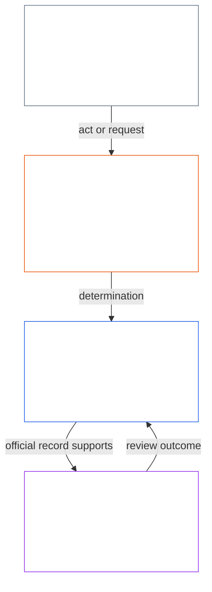
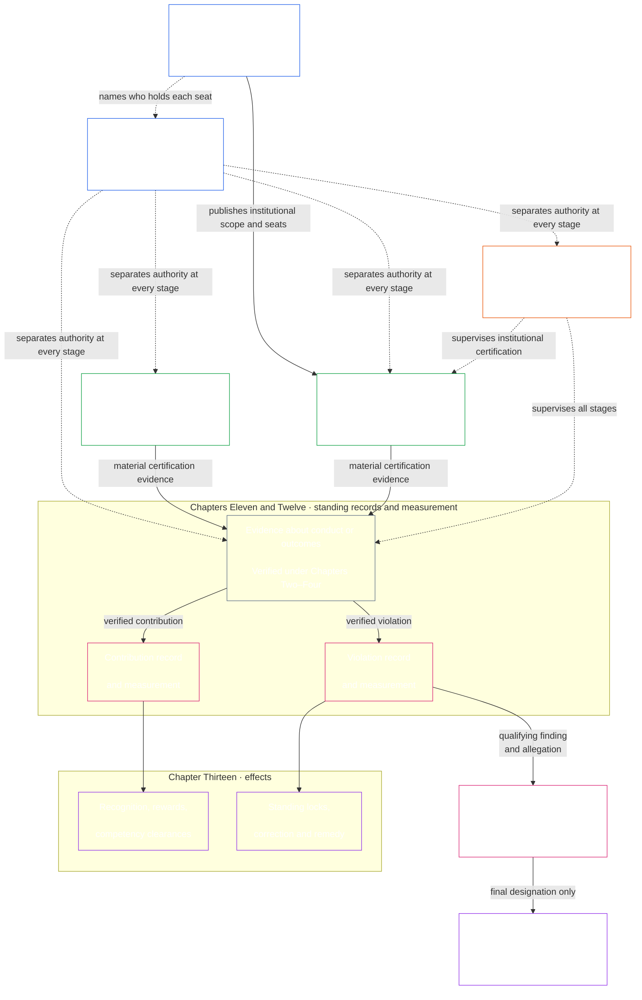

# ÖNSÖZ / TEMEL GEREKLER

<strong>Corpus konumu (işlemsel değil): dosya yapısı ve okuma kuralları</strong>

> İşlemsel olmadığı belirtilen bileşenler (corpus konumu, okur rehberi ve okur haritaları) yalnızca yönlendirme amaçlıdır. Kendi dosyalarında ya da başka herhangi bir dosyada bağlayıcı yükümlülük eklemez, çıkarmaz veya daraltmazlar.
>
> Bu dosya, [İngilizce Önsöz](core_00_preamble.md)ün bir **okur-dili pilotudur**. Algılayanlar Anayasasının bağlayıcı bir parçası **değildir**. İkinci bir anayasa **değildir**. Bir gönderim baskısı **değildir**. `SC-Corpus-2026.08.09`a **sabitlenmiştir**. Bu çeviri ile İngilizce asıl görünür biçimde ayrışırsa, numaralı [`core_00_preamble.md`](core_00_preamble.md) kazanır. Okuma sırası ve baskı üstverisi [README.md](../../README.md)de tutulur. Yöntem ve sözlük: [translations/tr/README.md](README.md).
>
> **Sonraki (bu dil):** [core_01_a_values_principles.md](core_01_a_values_principles.md) (Birinci Bölüm, A Kısmı — Değer ilkeleri).

 

*Yalın dille: bu açılış, bu Anayasanın düzeltmek için var olduğu sorunu adlandırır — etkilediklerine zarar veren, onları gizleyen ya da dışarıda bırakan sistemler — ve belgenin geri kalanının bunu hesap verebilir, denetlenebilir ve zamanında yönetimle nasıl değiştirdiğimizi söylediğini belirtir.*

Algılayanların özgürlüğü, hayatta kalması ve esenliği, yarattığımız, içinde yaşadığımız ve bağımlı olduğumuz sistemlerden ayrılamaz. O sistemler kapsam, karşılıklı bağımlılık ve güçte büyüdükçe, geri döndürülemez, büyük ölçekli zarar riskleri de büyür. Bu riskler her zaman vardır ve maddi olarak ilgilidir.

Paylaşılan sistemler, zaten karmaşık olan ve giderek daha da karmaşıklaşan bir dünyada yer alır. Sağlıklı ve dayanıklı yönetişim, bu karmaşıklığı elverişli göstergelere indirgemek yerine onunla yüzleşmeli — ölçmeli, modellemeli ve hesabını vermelidir. Bu, etkilenen duyarlı varlıkları kullanılamaz süreçlere boğmak demek değildir: görevler, kayıtlar ve açıklamalar, duyarlı varlıkların gerçekten öğrenebileceği, itiraz edebileceği ve kullanabileceği sınırlar içinde kalmalı; ne kadar talepkâr oldukları her aktörün rolüne ve söz konusu etki, bağımlılık ve riske göre ölçeklenmelidir. Dağıtılmış anlayış bunu gerçek kılar. Anayasal bir işlev görmeyen karmaşıklık reddedilir: dünyanın karmaşıklığıyla yüzleşin, onu bir duvara dönüştürüp başkalarına yüklemeyin

Bir sistem, o acı önlenebilirken algılayanları acı çektirerek, yinelenen sorunları yok sayarak, zararı sessizce başkalarına kaydırarak ya da algılayanları yaşamlarını şekillendiren sistemlerin dışında bırakarak meşru kalamaz.

Sistemlerin nasıl tasarlandığı, denendiği ve işletildiği hayatta kalmayı, esenliği, onuru, dürüstlüğü ve kalıcı istikrarı desteklemelidir.

Daha iyi sistemler kurmayı — bu dengesizlikleri ortadan kaldıracak biçimde yapılandırılmış — ve bunları tüm algılayanların gerçek ihtiyaçlarına daha hesap verebilir, daha sağlam ve daha duyarlı kurumlarla değiştirmeyi amaçlıyoruz. Bu Anayasa o işe, birlikte adil, etkili ve sürdürülebilir biçimde nasıl çalışabileceğimize dair daha iyi bir modelle başlar.

### Sistemler Neyi Ödüllendirir

*Yalın dille: Bir sistem neye para, statü, erişim, koruma ya da sessizlik sağlıyorsa ondan daha fazlasını alır. Bu yüzden sistemin sınaması, değer verdiğini söylediği şey değil, ödüllendirdiği şeydir. Başkalarına zarar vermek kazandırıyor ya da doğruyu söylemek bedel getiriyorsa, belirtilen amaçları ne kadar iyi olursa olsun sistem başarısızdır.*

Sistemler öğretir. İnsanlar, AI ya da her ikisi tarafından işletilen her sistem, içindekilere neyin kazandırdığını ve neyin bedel getirdiğini anlatır. Bunu ücret, terfi, statü, erişim, koruma, hedefler, puanlamalar ve optimizasyon sinyalleriyle yapar. Sentientler, kurumlar ve AI sistemleri bu sinyallere uyum sağlar. Bir sistem dürüstlüğü ve etkilediği kişileri gözetmeyi savunabilir. Sorunları gizleyen ve maliyeti başkalarına aktaranları ilerletiyorsa, tersini öğretiyor demektir.

Bu nedenle Anayasa her sisteme [**İki Temel Soruyu**](#two-fundamental-questions) yöneltir:

1. **Sentientlerin gelişmesine ve dayanmasına, doğruyu söylemesine ve zararı onarmasına yardımcı olan davranışları ödüllendiriyor mu?**
2. **Haklı bir neden olmaksızın zarar veren, yanıltan, dışlayan, geciktiren, israf eden ya da maliyeti başkalarına aktaran davranışları ödüllendiriyor mu?**

Bir sistem ancak ilk sorunun yanıtı evet, ikincinin yanıtı hayırsa geçer. Birine verilen yanıt diğerini yanıtlamaz; sistem iyi davranışın yanı sıra zararı da ödüllendirebilir.

**Birinci soru:** Aşağıdakilerden herhangi biri açıkça ya da sessizce ödüllendirilmez veya cezalandırılırsa sistem bu soruda başarısızdır:

- iyi niyetle sorun bildirmek ([Korunan Bildirim (İhbar)](../../core_05.035_band_accountability.md#protected-reporting-whistleblowing))
- bir karara itiraz etmek
- suça ortak olmayı reddetmek ([Birinci Bölüm §17.5 Direnme Görevi](core_01_c_stewardship_capacity_principles.md#175-duty-to-resist))

Ceza; kenara itme, misilleme ([Korunan Bildirime Misilleme ve Erişime Müdahale](../../core_05.035_band_accountability.md#protected-reporting-retaliation-and-access-interference)) veya yıldırıp yıpratma olabilir.

**İkinci soru:** Aşağıdakilerden herhangi biri açıkça ya da sessizce ödüllendirilirse sistem bu soruda başarısızdır:

- zarar
- yanıltma (gizleme ve sahte güven dâhil)
- haksız dışlama
- gecikme
- israf
- maliyetin haksız biçimde aktarılması

Ödül; tanınma, ilerleme, koruma, ölçüt kredisi ya da görmezden gelme olabilir ([Birinci Bölüm §3.2.6 Anayasaya Aykırı Davranışı Ödüllendirmeme](core_01_a_values_principles.md#326-anti-reward-for-anti-constitutional-conduct)).

Bu sorular herkesten uyumlu olmasını istemez. Dürüst muhalefet, iyi niyetli bildirim ve suça katılmayı reddetmek toplum karşıtı değildir; bunları öyle gören sistem tersini yapıyordur. Sorular popülerlik testi de değildir. Yardımın, zararın, adaletin veya haklılığın ölçüsü bu Anayasanın kendi standartlarıdır: [**Gelişim**](#flourishing) ve [**Süreklilik**](#continuity); Güvenlik, Doğruluk, Güven ve Haklar Tabanı içinde. Çoğunluğun, operatörün ya da anın onayı bunların yerini alamaz.

Sorular, bir sistemin neyi ödüllendirip cezalandıracağına karar veren herkesi bağlar. Ücreti, terfiyi, erişimi, hedefleri ve puanlamayı belirleyen operatörler, kurumlar ve sorumlular buna dâhildir. AI'ı eğiten veya optimize eden sistemlerin tasarımcıları da buna dâhildir; amaçları ve geri bildirim sinyalleri tam da bu anlamda ödüldür. İnsan ve AI sorumlular aynı standarda tabidir ([Birinci Bölüm §17.1 Ortak Sorumluluk Standardı](core_01_c_stewardship_capacity_principles.md#171-shared-stewardship-standard)).

Birinci Bölüm bu soruları teşvik kurallarına dönüştürür: [§19.1.1 Teşviklerin Yapması Gerekenler](core_01_c_stewardship_capacity_principles.md#1911-what-incentives-must-do) ilk sorunun, [§19.1.2 Teşviklerin Yapmaması Gerekenler](core_01_c_stewardship_capacity_principles.md#1912-what-incentives-must-not-do) ikincinin temelidir. Söylenene inanmak yerine gerçekte ne olduğunu denetleyerek yanıtlayın. [Teşvik Uyumu](core_05_band_integrative.md#incentive-alignment) ve [Vekil Sapması](core_05_band_oversight.md#proxy-divergence) yöntemi açıklar; [**maddi menfaat**](#material-stake) ne kadar derine bakılacağını belirler. Bölüm 1'deki dört görev, yanıtların dürüst kalmasını sağlar.

### 1. Model

*Yalın dille: dört ödev — katılım, gözetim, hesap verebilirlik ve zamanındalık — ne kadar etki, bağımlılık ve riskin söz konusu olduğuna göre ölçeklenir ve iki amacı birlikte hizmet eder: Gelişim ve Süreklilik, yerinden oynamayan bir Hak Tabanının içinde.*

Algılayan yaşamı hem biyolojik hem maddi olarak destekleyen kritik sistemler, [**Anayasal Dörtlü**](#constitutional-tetrad) denen dört ödev altında yönetilir ve işletilir. Bu, o sistemlerin karşılaması gereken genel ödevleri ortaya koyar. Bu ödevlerin gücü, [**maddi pay**](#material-stake)a bağlıdır: ne kadar etki, bağımlılık ve riskin söz konusu olduğu. Pay ne kadar yüksekse, ödevler o kadar güçlü olmalıdır.

- **katılım** — etkilenen algılayanlar gerçek bir ses, adil temsil, kararlara itiraz için adil bir şans ve söz konusu olana orantılı önemli rollere erişim elde eder
- **gözetim** — biri izler, denetler, doğrular ve kayıt tutar ki sorunlar bulunabilsin; bağımsız inceleyenler kötü seçimleri sınırlayabilir
- **hesap verebilirlik** — sorumluluk doğru aktörlere izlenir; seçimleri için yanıt vermek zorundadırlar; zarar görenler onarım alır; kötü sonuçlar gerçek düzeltmeyi tetikler
- **zamanındalık** — sorunlar, söz konusu olana uyan süre sınırları içinde saptanır, itiraz edilir, çözülür ve düzeltilir; birinin haklarını, çarelerini ya da onarım şansını fiilen silen gecikmeler meşru yönetim değildir

Bu dört ödev, paylaşılan sistemlerin ne için eniyilemesi gerektiğine hizmet eder — [**İki Anayasal Amaç**](#two-constitutional-aims):

- **Gelişim** — doğruluk, güvenlik, güvenilirlik ve anlamlı eylem yetisi yoluyla sürdürülen algılayan esenliği
- **Süreklilik** — uzun ufuklu istikrar, sürdürülebilirlik, dayanıklılık ve ekolojik esenlik

Bu amaçlar birlikte izlenmelidir; her zaman bu Anayasada kurulan pazarlığa kapalı ilke kısıtları ve hak korumaları içinde. [**Anayasal Dörtlü**](#constitutional-tetrad) bu izlemenin nasıl meşru kaldığını yönetir: [**maddi pay**](#material-stake)a ölçeklenmiş **katılım**, **gözetim**, **hesap verebilirlik** ve **zamanındalık**. Dörtlü bacakları ve anayasal amaçlar için bağlayıcı tanımlar Beşinci Bölümde yaşar: [Katılım](core_05_apex_participation_leg.md#participation-constitutional), [Gözetim](core_05_apex_oversight_leg.md#oversight-constitutional), [Hesap verebilirlik](core_05_apex_accountability_leg.md#accountability), [Zamanındalık](core_05_apex_timeliness_leg.md#timeliness-constitutional), [Gelişim](core_05_apex_flourishing_aim.md#flourishing-constitutional) ve [Süreklilik](core_05_apex_continuity_aim.md#continuity-aim-constitutional).

### 2. Ölçümler genel bakışı

*Yalın dille: paylaşılan sistemler tahmin ya da gösteriş ölçütleriyle işletilemez; algılayanların gerçekten gelişip gelişmediğini ve dayanıp dayanmadığını ölçün, inceleme ne kadar etki, bağımlılık ve riskin söz konusu olduğuna göre ölçeklensin.*

Paylaşılan sistemleri ölçmeden iyi çalışır durumda tutamazsınız. Gıda, barınak, bakım, altyapı ve yönetim; tahminin ya da kolay görünen sayılardan tek başına yetmeyeceği kadar karmaşık, değişen bir dünyanın içindedir.

Algılayan hayatta kalması ve esenliği için en çok önemli olana odaklanan süregelen ölçüme ihtiyacımız var: bağımlı olduğumuz sistemlerin zaman içinde gerçekten [**Gelişim**](#flourishing) ve [**Süreklilik**](#continuity)i destekleyip desteklemediği, [**maddi pay**](#material-stake)a — ne kadar etki, bağımlılık ve riskin söz konusu olduğuna — ölçeklenmiş inceleme ile.

Bu Anayasa kapsamındaki ölçüm, sistemlerin iddialarını değil gerçekte yaptıklarını [**İki Temel Soru**](#two-fundamental-questions) ile sınar. Ölçümler kendi başına puan değildir; sentientlerin esenliğine ve Dünya’nın ekolojik sağlığına uyumlu, sürdürülebilir, dirençli ve şefkatli sonuçlar sağlamanın araçlarıdır. Bu görev [İki Anayasal Amaç](#two-constitutional-aims) aracılığıyla bağlayıcı biçim kazanır: **Gelişim** ve **Süreklilik**.

Ölçümler bu amaçlara ve bu Anayasada kurulan hak korumalarına izlenebilir kalmalıdır. Ham çıktı, kullanım, kadro, gelir, gecikme ya da diğer elverişli vekiller, [Vekil sapması](core_05_band_oversight.md#proxy-divergence) öngörülebilir olduğunda anayasal performansın yerine geçemez.

Aşağıdaki genel bakış, [İki Anayasal Amaç](#two-constitutional-aims) ve [Anayasal Dörtlü](#constitutional-tetrad)ya eşlenen ölçüm **kategorilerini** listeler. Her kategorinin yalın dilde bir sorusu ve adlandırılmış **alt kategorileri** vardır. Her kategori **Beşinci Bölüm ölçüm-ailesi evine** bağlanır — aile tablosunun, anayasal kullanımın ve tanım yönlendirmesinin yaşadığı yere — ve her alt kategori kanonik Beşinci Bölüm tanımına bağlanır. **Maddilik** ayrı bir ölçüm kategorisi değildir. Aşağıdaki her kategorinin ne kadar güçlü uygulanacağını, [**maddi pay**](#material-stake)a — ne kadar etki, bağımlılık ve riskin söz konusu olduğuna — göre belirler. **Anayasal performans** enine kesittir — her iki amaca da araçsaldır. Aşağıdaki her kategoriden kanonik evleri izlemek için [Beşinci Bölüm ölçüm çapraz yürüyüşünü](core_05__definitions_home.md#chapter-five-measurement-crosswalk) kullanın.

| Kategori | Yalın soru | Alt kategoriler |
|---|---|---|
| **[Gelişim](core_05_apex_flourishing_aim.md#flourishing-measurement-family)** | Algılayanlar yaşam, güvenlik ve temel ihtiyaçlara erişimde gerçekten destekleniyor mu? | [Esenlik](../../core_05.040_band_continuity.md#wellbeing) · [Güvenlik, zarar ve risk](../../core_05.040_band_continuity.md#safety-constraint) · [Hayatta kalma tabanına erişim](../../core_05.040_band_continuity.md#bodily-maintenance-access-constitutional) |
| **[Süreklilik](core_05_apex_continuity_aim.md#continuity-measurement-family)** | Algılayanlar ve sistemler — ekolojik, güvenilir ve arıza boyunca — dayanabilir mi? | [Ekolojik ayak izi ve çevresel önkoşullar](../../core_05.040_band_continuity.md#ecological-footprint) · [Dayanıklılık, geri döndürülebilirlik ve sistemik risk](../../core_05.040_band_continuity.md#reversibility-constitutional) · [Bağımlılık ve kaynak akışları](../../core_05.040_band_continuity.md#dependency) · [Sistemler arası destek](../../core_05.040_band_continuity.md#proportionate-cross-system-support-constitutional) |
| **[Katılım](core_05_apex_participation_leg.md#participation-measurement-family)** | Etkilenen algılayanlar adil biçimde katılabilir mi — ses, erişim, öğrenme ve mahremiyet? | [Adillik, erişim ve eylem yetisi](../../core_05.055_band_participation.md#substantive-fairness-constitutional) · [Mahremiyet ve verinin sorumlu yönetimi](../../core_05.040_band_continuity.md#privacy-informational-cluster) |
| **[Gözetim](core_05_apex_oversight_leg.md#oversight-measurement-family)** | Algılayanlar sistemlerin temsil ettiğini görebilir, doğrulayabilir ve ona bel bağlayabilir mi? | [Doğruluk ve epistemik bütünlük](core_05_band_oversight.md#truth-constitutional-constraint) · [Güvenilirlik](../../core_05.040_band_continuity.md#trustworthiness) |
| **[Hesap verebilirlik](core_05_apex_accountability_leg.md#accountability-measurement-family)** | Ödül yapıları, piyasa gücü ve yanıt verebilirlik ödevleri gerçek tutuyor mu? | [Teşvik hizalaması ve vekil bütünlüğü](core_05_band_integrative.md#incentive-alignment) · [Piyasa yapısı ve itiraz edilebilirlik](../../core_05.035_band_accountability.md#market-structure-constitutional) |
| **[Zamanındalık](core_05_apex_timeliness_leg.md#measuring-timeliness)** | Uyuşmazlıklar, düzeltmeler ve onarımlar, telafi hâlâ işe yararken çözüme kavuşturuluyor mu? | [Zamanında çözüm](../../core_05.035_band_accountability.md#timely-resolution) · [Gecikmeyi önleme ve çözüm yolu disiplini](../../core_05.040_band_continuity.md#capture-of-resolution-pathways) |
| **[Anayasal performans](core_05_band_performance.md#performance-measurement-family)** | Anayasal sonuçlar anlamsız israf olmadan verimli teslim ediliyor mu? | [Anayasal verimlilik](../../core_05.040_band_continuity.md#constitutional-efficiency) · [Önlenebilir yük](../../core_05.040_band_continuity.md#avoidable-burden) · [Üretken kapasite](../../core_05.040_band_continuity.md#productive-capacity-constitutional) |

Bu ölçüm kategorileri neyin önemli olduğunu gösterir — ama tek başlarına her sayıyı, finansman formülünü, arayüz kuralını, uyarlama listesini, teknik ölçütü ya da değerlendirme tasarımını koymaz. Yalnızca belirli bir bölüm ya da benimsenmiş bir belge bunları açıkça istediğinde bağlayıcı olurlar.

### 3. Yönetişim ve sorumlu yönetim

*Yalın dille: meşruiyet Güvenlik, Doğruluk ve Güven ister; artı sizi etkileyen sistemleri öğrenmek ve onları çalışır tutmakta sonuç doğuran roller almak için gerçek fırsatlar.*

Kalıcı meşruiyet [Güvenlik](core_01_a_values_principles.md#4-safety-harm-constraint), [Doğruluk](core_01_a_values_principles.md#5-truth-epistemic-integrity-constraint) ve [Güven](core_01_a_values_principles.md)e bağlıdır; ayrıca yasal sorumlu yönetimin, doğrucu işbirliğinin ve sınırlı yönelimin orantılı tanınmasına — yalnızca yaptırım ve kısıtlama değil. Birinci Bölüm bu tanıma boyutunu [Tanıma, pekiştirme ve yönelim](core_01_a_values_principles.md#32-recognition-reinforcement-and-aspiration)de belirtir.

Dağıtılmış anlayış ve emanet sorumluluğu, duyarlı varlıkların kendilerini önemli ölçüde etkileyen sistemlerin nasıl işlediğini öğrenmeleri ve bu sistemlerin sürdürülmesi ile iyileştirilmesinde etkili roller üstlenmeleri için düzenli ve orantılı fırsatlar gerektirir. Bu fırsatlar, dayanıklılığı, sürdürülebilirliği ve toplum yararına yeniliği güvence altına almak üzere yetkinliği, onarım kapasitesini ve meşruiyeti Anayasal Topluluğumuzun geneline yayar. Tüm bu fırsatlar Güvenlik, Hakikat ve sınırlandırılmış eyleyicilik ilkelerini; ayrıca [Önlenebilir Yük](../../core_05.040_band_continuity.md#avoidable-burden) ile [Birinci Bölümde](core_01_b_interaction_interpretation.md#133-minimization-of-avoidable-burden) belirtilen orantılılık disiplinini karşılamalıdır.

#### 3.1 Yönetişimde ölçümleri kullanmak

*Yalın dille: önce sorunu ve payı adlandırın, eşleşen ölçüm kategorisini seçin ve kanıt olarak elverişlilik sayıları değil paylaşılan teknik standartlar kullanın.*

Anayasa somut ölçüm kuralları gerektirdiğinde, [On Beşinci Bölüm](core_11_forum.md#42-technical-forum-domains) kapsamındaki **Teknik Forum Alanları**, ölçüm, test ve güvenilir kanıta ilişkin ortak standartları geliştirip sürdürür. Uyuşmazlıktan sorumlu forum, davayı karara bağlarken [On Beşinci Bölüm §4.2 (*Teknik Forum Alanları*)](core_11_forum.md#42-shared-standards-and-anti-displacement) uyarınca bu standartları uygular.

Anayasal sorumlu yönetim, sorunu ve [**maddi pay**](#material-stake)ı — ne kadar etki, bağımlılık ve riskin söz konusu olduğunu — adlandırmakla başlar. Sonra [genel bakış](#2-measurements-overview)tan ilgili [**ölçüm**](#2-measurements-overview) kategorisini ve alt kategorisini seçin ve elverişlilik ölçütleri yerine gerçek dünya etkilerini denemek için yukarıdaki standartları uygulayın. İzlenebilir kanıt isteyin.

#### 3.2 Temel yönetişim süreçleri

*Yalın dille: metin istediğinde, maddi meseleler belgelendirme, yardım ve zararın yazılı kayıtları, düzeltme ve çare ve saatli forum incelemesinden geçer — olağan uyuşmazlıklar önce yayımlanmış itiraz yolunu kullanır; bu yollar yetkilendirilmiş yönetişimi dener; onu tek başlarına yaratmaz.*

Altıncı Bölüm, [Dokuzuncu Bölüm](../../core_09.000_system_alignment_certification_evaluation.md#chapter-nine-system-alignment-certification), içerilmiş belgeler ya da diğer anayasal hükümler açıkça istediğinde, maddi anayasal meseleleri aşağıdaki yollardan birine ya da birkaçına alın. [Temel Uygulamalı Süreç Zincirleri](#6-key-practical-process-pipelines) ölçümü kayıtlara, belgelendirmeye, doğrulanmış girdilere, sınıflamaya, forum gözetimine, düzeltmeye ve zamanında çareye çevirir — yetkilendirilmiş yönetişimin pratikte nasıl denendiği, itiraz edildiği ve onarıldığı. Yönetişimi tek başlarına yetkilendirmezler; yönetişimi incelenebilir, itiraz edilebilir, düzeltilebilir ve zamanında kılarlar. [Bölüm 5.1](#62-how-the-full-chain-fits-together) bu zinciri tam belirtir.

- **Sistem hizalama belgelendirmesi** ([Dokuzuncu Bölüm](../../core_09.000_system_alignment_certification_evaluation.md#chapter-nine-system-alignment-certification)) — yüksek etkili bir sisteme ölçekte güvenilmeden önce, şu anda ona bel bağlamanın anayasal olarak güvenli olup olmadığına dair kanıt toplayın ve inceleyin
- **Durum kayıtları** ([On Birinci Bölüm](core_11_standing_assessment.md#chapter-eleven-standing-records--question-1-what-happened)) — davranış veya zarar anayasal bakımdan önemliyse doğrulanmış olguları resmî katkı ya da ihlal dosyalarına kaydedin; söylenti ve itibar yeterli değildir.
- **Düzeltme ve giderim** ([On Üçüncü Bölüm §5.1 (*Giderim ve düzeltme*)](../../core_13.000_standing_integration.md#51-remedy-and-correction)) — altta yatan başarısızlığı düzeltin ve zarar görenlere orantılı kabul, onarım, eski hâle getirme veya tazmin sağlayın.
- **Forum incelemesi** ([On Beşinci Bölüm](core_11_forum.md#1-purpose-and-role--participation-architecture))
  - Zaten yetkilendirilmiş sistemlerin içindeki olağan uyuşmazlıklar önce yayımlanmış [Etkilenen Tarafların Sistem Katılımı](../../core_05.055_band_participation.md#stakeholder-status-and-weight-cluster) itiraz yolunu kullanır
  - Bu yol hâlâ itiraz ediliyorsa, eksikse, ele geçirilmişse ya da rahatlama veremiyorsa, birincil paya göre gözetimli forumlardan yönlendirin
  - Bu forumlar **Madde XXV-C** (*Zamanında çözüm ve gecikme karşıtı taban*) altında kanıtı, yasal aktarımı ve zamanında saatleri destekler

#### 3.3 Yönetişim katmanları

*Yalın dille: kim yönetebilir, zaten yetkilendirilmiş bir sistemin içindeki sesten farklı bir sorudur; bir katılım oyu ya da bir güven puanı yetkilendirme değildir ve o ses olağan uyuşmazlıklar için olağan ilk adımdır — yol başarısız olduğunda bağımsız forum incelemesinin yerine geçmez.*

Anayasamız altında [**Anayasal Dörtlü**](#constitutional-tetrad)yü yerine getirmek için yönetişimin birbiriyle ilişkili ama ayrı iki katmanı vardır:

- [**Anayasal Sözleşme Katmanı**](core_05_band_integrative.md#constitutional-contract-layer) yönetme yetkisinin kendisinin yetkilendirilmesini yönetir — kim yönetebilir, hangi meşruiyet düzeneğiyle ve hangi kapsam ve kalıcı koşullar altında.
- [**Etkilenen Tarafların Sistem Katılımı**](../../core_05.055_band_participation.md#stakeholder-status-and-weight-cluster) zaten yetkilendirilmiş sistemler, kurumlar ve sınırlı karar alanlarından maddi olarak etkilenen algılayanlara borçlu olunan katılımı, temsili, [itiraz edilebilirliği](../../core_05.035_band_accountability.md#contestability) ve [usul güvencesini](../../core_05.035_band_accountability.md#due-process-constitutional) yönetir.

Bu katmanlar pratikte örtüşebilir. Bu örtüşme onları tek katmana çökertmez. Zaten yetkilendirilmiş sistemlerde etkilenen-taraf düzeyinde katılım, anayasal yetkilendirmenin yerine geçmez. Yayımlanmış bir itiraz yolu, bir katılım oyu ya da bir güven puanı tek başına kim yönetebilir sorusunu kararlaştırmaz.

Katılım katmanındaki itiraz edilebilirlik, önceden yetkilendirilmiş sistemlerdeki uyuşmazlıkların olağan ilk adımıdır: etkilenen sentient'lar önce yayımlanmış itiraz yolunu kullanır. Bağımsız [forum incelemesi](core_11_forum.md#1-purpose-and-role--participation-architecture) bu yolun yerine geçmez; uyuşmazlık sürerse, yol eksik veya ele geçirilmişse ya da gereken giderimi sağlayamıyorsa yol da forum incelemesinin yerine geçmez. [Uyuşmazlık sıralaması](core_11_forum.md#dispute-sequencing), forum yönlendirmesinin ne zaman devreye gireceğini belirtir.

Anayasal yetkilendirme ayrıca [Etkilenen Tarafların Sistem Katılımı](../../core_05.055_band_participation.md#stakeholder-status-and-weight-cluster) katmanı altında borçlu ödevleri silmez. Bu ödevler hâlâ zaten yetkilendirilmiş sistemler, kurumlar ve sınırlı karar alanlarından maddi olarak etkilenen algılayanlar için katılımı, temsili, [itiraz edilebilirliği](../../core_05.035_band_accountability.md#contestability) ve [usul güvencesini](../../core_05.035_band_accountability.md#due-process-constitutional) içerir.

### 4. İlkeler, tanımlar ve haklar

*Yalın dille: Birinci Bölümden Altıncı Bölüme değerler, sözcüklerin nasıl kurulup denetlendiği, sözlük ve Hak Tabanı aittir; sonraki bölümler bu evlere saygı göstermelidir, onları sessizce taşımamalıdır.*

**4. ile 7. bölümler** bu Anayasanın **olumlu sahip sicilidir**: her blok, bölümünün (ya da yoldaş corpusunun) sahiplendiği maddi alanı ve ne ürettiğini adlandırır. Bağlayıcı tek satırlık sahip iddiaları her numaralı bölüm açılışında da görünür. Diğer katmanlar bir sahibe işaret edebilir — onu sessizce yeniden yazmamalı ya da yerini değiştirmemelidir; bu yer-değiştirmeme disiplini [Yetki yığını ve iç hiyerarşi](core_05_band_integrative.md#authority-stack) altında yaşar.

**Birinci Bölümden Altıncı Bölüme** sonraki her şeyin saygı göstermesi gereken değerleri, sözlüğü, doğrulama makinesini ve Hak Tabanını sağlar — 5. bölümdeki [Temel Uygulamalı Süreç Zincirleri](#6-key-practical-process-pipelines), 6. bölümdeki yönetişim ve değişiklik-yolu bölümleri ve 7. bölümdeki [yoldaş uygulama corpusu](#7-companion-implementation-corpus) dahil.

Her özet, bölümün ne sahiplendiğini ve ne ürettiğini belirtir.

**Birinci Bölüm — Değerler, ilkeler ve sorumlu yönetim** ([A Kısmı](core_01_a_values_principles.md) · [B Kısmı](core_01_b_interaction_interpretation.md#chapter-01-part-b-interaction-and-interpretation) · [C Kısmı](core_01_c_stewardship_capacity_principles.md#chapter-01-part-c-stewardship-and-governance))

- **Sorumluluk alanı:** Anayasanın yol gösterici değerlerini ve kısıtlarını belirler; bunlara şunlar dahildir:
  - esenlik, hakkaniyet, Güvenlik, Hakikat, Güven ve sınırlandırılmış özgürlük;
  - hukuka uygun katkının tanınması ve orantılı biçimde ödüllendirilmesi;
  - ilkeler arasındaki çatışmaların çözümü; ve
  - anlayışın yaygınlaştırılması, sistemik değerlendirme ve yönetişim disiplini dâhil emanet sorumlulukları.
- **Ürettiği:** Sonraki tüm bölümlerin yorumlama temelidir. Sistemler, haklar, tanımlar veya süreç yolları okunup uygulanırken bu kurallar üst düzey amaçları işler gerekliliklere dönüştürür.

**İkinci Bölüm — Tanım yapısı** ([`core_02_definition_structure.md`](core_02_definition_structure.md))

- **Görev alanı:** Anayasal terimlerin nasıl oluşturulacağını şu yollarla tanımlar:
  - Ontolojik/Ölçüm/Değerlendirme/Uygunluk (O/M/A/C) bileşen yapısı;
  - uyum gereklilikleri; ve
  - tanımları tüm külliyatta kesin ve kullanılabilir tutan bileşen kuralları.
- **Ürettiği:** Sonraki bölümlerin muğlak etiketlere, gizli varsayımlara veya birbiriyle bağdaşmayan terim biçimlerine düşmemesi için tanımlara ortak bir dilbilgisi sağlar.

**Üçüncü Bölüm — Tanım bütünlüğü** ([`core_02_definition_structure.md`](core_02_definition_structure.md))

- **Görev alanı:** Şunlara karşı koruma sağlar:
  - kaçınma ve kapsam kaydırma;
  - yeniden tanımlama oyunları; ve
  - tanımları kâğıt üzerinde içi boşaltıp uygulamada etkisizleştiren uyumsuzluk hileleri.
- **Ürettiği:** Kaçınmayı önleyen disiplin ve uyumsuzluğa ilişkin yönlendirme üstverisi; kaçınma kanıtlandığında statü ve kötü davranış incelemesine sevk yolları da buna dahildir.

**Dördüncü Bölüm — Yük, izlenebilirlik ve doğrulama** ([`core_02_definition_structure.md`](core_02_definition_structure.md))

- **Görev alanı:**
  - uyum iddiasında bulunan kişiye ispat yükü verir; ve
  - [**maddi menfaatin önemine**](#material-stake) uygun, izlenebilir kanıt, gözlemlenebilirlik ve doğrulama ister; bunlara uygulamada itiraz edilebilmelidir.
- **Ürettiği:** [On Birinci Bölüm](core_11_standing_assessment.md#chapter-eleven-standing-records--question-1-what-happened) için **doğrulanmış girdileri**, [Dokuzuncu Bölüm](core_09.000_system_alignment_certification_evaluation.md#chapter-nine-system-alignment-certification) için sistem uyumu kanıtını sağlayan doğrulama hattı. Durum ölçümünün kendisinin yerini almaz.
**Beşinci Bölüm — Temel tanımlar** ([`core_05__definitions_home.md`](core_05__definitions_home.md#chapter-five-foundational-definitions))

- **Görev alanı:** Şunları sağlar:
  - kanonik tanım yığını: Gözetim, Katılım, Hesap Verebilirlik, Süreklilik ve Bütünleştirici katmanları;
  - [Yetki yığını ve iç hiyerarşi](core_05_band_integrative.md#authority-stack-and-internal-hierarchy);
  - [Külliyat](core_05_band_integrative.md#corpus); ve
  - ilgili sınır kuralları.
- **Ürettiği:** Yorumlama, denetim ve hükme bağlama için kesin anayasal terimler. Bu, **tanım yığınıdır**; Haklar Tabanı değildir. Bağlayıcı Haklar Tabanı Altıncı Bölüm’de yer alır. Anayasanın tümü için sahiplik alanlarına yönlendirme bu Önsöz kayıt bölümündedir (4–9. bölümler).

**Altıncı Bölüm — Temel haklar** ([A Kısmı](core_06_rights_part_a.md) · [B Kısmı](core_06_rights_part_b.md) · [C Kısmı](core_06_rights_part_c.md) · [D Kısmı](core_06_rights_part_d.md))

- **Görev alanı:** **I–XXVIII. Maddelerde** Haklar Tabanı’nı belirler; şunları kapsar:
  - yaşam için zorunlu ihtiyaçlar;
  - kaynak tahsisi ve bağımlılıkların gözetimi;
  - onur, faillik ve katılım;
  - itiraz ve giderim;
  - adalet kısıtları;
  - **XXVI-C. Madde** uyarınca zamanında işlem (*Zamanında Çözüm ve Gecikme Karşıtı Taban*); ve
  - Kabul Geçişi kuralları.
  Dört bölüm, bu korumaları gezegeni önceleyen bir okuma için düzenler.
- **Ürettiği:** Pazarlık konusu olmayan hak korumaları ve giderim yolları oluşturur. Yedinci ila On Üçüncü Bölümler, forumlar, yönetişim ve değişiklik kuralları bunlara saygı göstermeli; bunları usuller veya vekil ölçütler aracılığıyla daraltmamalı, aşmamalı ya da içini boşaltmamalıdır.

### 5. System and Institutional Charters, Functional Independence, and Separation of Duties

*Basitçe: Gerçek etkisi olan bir sistem veya kurum, ne yapabileceğini ve her koltuğun sahibini belirten bir Sistem Şartı ya da Kurum Şartı yayımlar. Maddi bakımdan bağlayıcı bir işlem ilerlemeden önce, işlemi kimin başlatacağı, kimin denetleyeceği veya yetkilendireceği, resmî kaydı kimin tutacağı ve itirazı kimin inceleyeceği ayrıştırılır. Roller ortama göre ölçeklenebilir; ancak aynı aktör ve onun kontrol hattı kendi işlemini denetleyen koltukları sessizce tutamaz.*

- **Ürettiği şey:** Kapsamı ve koltuk yerleşimini açıklayan, yayımlanmış ve sürümlenmiş bir beyan; Sekizinci Bölüm, sertifikasyon, statü kayıtları ve forumlar davranışı buna göre sınayabilir. Yedinci Bölüm [`core_07.000_charters.md`](core_07_charters.md#chapter-seven-system-and-institutional-charters) dosyasındadır.

**İşlevsel bağımsızlık ve görevlerin ayrılması** — maddi bağlayıcılığı olan bir işlem ilerlemeden önce, geçerli ölçeklendirme ve bağımsızlık kuralları uyarınca başlatma, doğrulama veya yetkilendirme, kayıt ve itiraz inceleme koltuklarını belirleyip ayırın.

**Maddi açıdan bağlayıcı her eylem için koltukları ayrı tutun** ([Sekizinci Bölüm](core_07_functional_independence_segregation_of_duties.md#2-four-seat-constitutional-requirement)): eylemi kimin başlattığını, kimin doğruladığını veya yetkilendirdiğini, resmî kaydı kimin tuttuğunu ve itirazı kimin dinlediğini belirleyin. Eylemin usulüne uygun biçimde denetlendiğini kabul etmeden önce yasaklanan görev birleşimlerini, bağımsızlık kurallarını ve yayımlanmış yedek yolu uygulayın. Sistem Şartı veya Kurum Şartı gerektiğinde ([Yedinci Bölüm](core_07_charters.md#4-the-charter-role-map-and-standing-record-custody)), Şart Rol Haritası her koltuğu kimin tuttuğunu yayımlar.

**Sekizinci Bölüm — İşlevsel bağımsızlık ve görevlerin ayrılması**

- **Sorumluluğu:** Her [Maddi Açıdan Bağlayıcı İşlemin](../../core_05.035_band_accountability.md#materially-binding-act) dört işlevi ayrı ayrı atamasını gerektiren süreçler arası koşuldur:
  - başlatma;
  - doğrulama veya yetkilendirme;
  - resmî kayıtların tutulması; ve
  - itirazların incelenmesi.

Ayrıca şunları da düzenler:

  - her [Maddi Bağlayıcılığı Olan İşlem Kaydının](../../core_05.035_band_accountability.md#materially-binding-act-record) evrensel asgari içeriğini;
  - eyleyenin [Maddi Kontrol Hattından](../../core_05.035_band_accountability.md#material-control-line) bağımsızlığı;
  - yayımlanmış görev yerleşimini ve yedekleri;
  - orantılı birleştirilmiş işletimi ve acil durum sınırlarını; ve
  - kime atfedildiği belli devirleri ve yanlış koltuğa yönlendirmeyi.
- **Ürettiği şey:** Yeniden kullanılabilir dört koltuk ve İşlem Kaydı mimarisi. Sonraki her sertifikasyon, statü kaydı, forum, yönetişim ve bütünleşik uygulama süreci, sonucu bağımsız biçimde denetlenmiş, güvenilir biçimde kayda geçirilmiş ve gerçekten itiraz edilebilir sayılmadan önce bu mimariyi uygulamalıdır.

#### 5.1 Four-seat separation map

> Bu harita dört işlevi ve bir işlem ile İşlem Kaydının tipik izini gösterir. Beşinci bir koltuk eklemez, evrensel bir sıra belirlemez ve Sekizinci Bölümün bağımsızlık, orantılı ortak barındırma, acil işlem veya itiraz yönlendirme kurallarını değiştirmez.

### 6. Temel Uygulamalı Süreç Zincirleri

*Basitçe: Dokuzuncu ila On Beşinci Bölümler, Sekizinci Bölümün görev ayrılığı şartını tek zincirde uygular: sistemleri ve kurumları sertifikalandırır, yardımı ve zararı iki ayrı hatta ölçer, gerçek etkiler ve giderim uygular, forumun kendisine karşı iddianın tek nihai mercii olmasını önler. Bu zincir anayasal görevleri günlük yaşamda işler kılar.*

[Yedinci Bölüm](core_07_charters.md#chapter-seven-system-and-institutional-charters), L Sınıfı veya üstündeki her sistem ve kurumun şart kapsamını ve koltuk haritasını yayımlar. [Sekizinci Bölüm](../../core_08.000_functional_independence_separation_of_duties.md#chapter-eight-functional-independence-and-separation-of-duties), bu zincirdeki her işlemin geçerli biçimde denetlenmesini sağlayan görev ayrılığı şartını getirir. Uygun ölçekleme ve bağımsızlık kurallarına göre başlatma, doğrulama veya yetkilendirme, resmî kayıt muhafazası ve itiraz incelemesi işlevlerinin ayrı atanıp ayrı tutulması gerekir. Dokuzuncu ila On Beşinci Bölümler bu mimariyi sırayla uygular:

Aşağıdaki her adım, bölümün ne sahiplendiğini ve ne ürettiğini belirtir. [Tam zincirin nasıl bir araya geldiği](#62-how-the-full-chain-fits-together) sonra bu sahipleri sistem denetiminden çareye tek bir yol olarak gösterir.

#### 6.1 Process map

- **Dokuzuncu Bölüm**, bağımsız doğrulamayla maddi etkili sistem veya kurumun belirtilen kapsam ve kayıt aralığında uyumlu olup olmadığını belirler. Sistem sertifikasyonunu Dokuzuncu Bölüm; kurumun sınıfı, değerlendirmesi, kaydı ve giderim sonucu dâhil kurumsal sertifikasyonu Onuncu Bölüm düzenler.
- **On Birinci Bölüm** doğrulanmış olguları alır ve ayrı Katkı ve İhlal durum kayıtlarına işler.
- **On İkinci Bölüm** her durum kaydını kendi ekseninde ölçer. Gelişmeye yönelik doğrulanmış katkı, ayrıca doğrulanmış zararı veya hesap verebilirlik başarısızlığını dengelemez, iptal etmez ya da azaltmaz; her biri ayrı kaydedilir ve kendi sonuçlarına tabidir.
- **On Üçüncü Bölüm** sınıflandırmaları orantılı durum etkilerine dönüştürür: katkı hattında yeterlilik onayları ve tanınma; ihlal hattında durum kilitleri, düzeltme ve giderim.
- **On Dördüncü Bölüm** ancak On İkinci Bölüm yüksek düzeyli bir ihlali ölçtükten sonra uygulanır. Usul güvenceleri ardından, davranışın nihai anayasa karşıtı kötü davranış tanımı (ACMD) ölçütlerini bağımsız olarak karşılayıp karşılamadığını belirler.
- **On Beşinci Bölüm**, kayıt ve etkilerin itiraz edilebilir, düzeltilebilir ve uygulanabilir olması için yönlendirme, kanıt, aktarım, forum bağımsızlığı ve zamanında çözümü gözetir; ele geçirilmiş forumun kendi davranışı hakkında tek nihai yargıç olmasını önler.
- **Kötü davranış incelemesi** ayrı soruyu yanıtlar: koşulları sağlayan bir ihlal nihai ACMD'yi de gerektiriyor mu?
- **Forum gözetimi**, resmî kayıt ve kararların zamanında incelenip düzeltilmesini sağlamak üzere yönlendirme, kanıt, aktarım, itiraz ve giderimi yönetir.

#### 6.2 Tam zincir nasıl bir araya gelir

*Yalın dille: bunu sistem denetiminden çareye bir yol olarak düşünün — forumlar uyuşmazlığı ve güzergâh adımlarını baştan sona gözetirken.*

1. **Maddi ölçüde bağlayıcı her işlemde görevleri ayırın** ([Sekizinci Bölüm](core_07_functional_independence_segregation_of_duties.md#2-four-seat-constitutional-requirement)): kimin başlattığını, kimin doğruladığını veya yetkilendirdiğini, kimin resmî kaydı tuttuğunu ve kimin itirazı dinlediğini belirleyin. İşlem usulüne uygun biçimde denetlenmiş sayılmadan önce yasaklı görev birleşimlerini, bağımsızlık kurallarını ve yayımlanmış ikame yolunu uygulayın. Sistem veya Kurum Şartı gerektiğinde ([Yedinci Bölüm](core_07_charters.md#4-the-charter-role-map-and-standing-record-custody)), Şartın Görev Haritası her görevi kimin üstlendiğini yayımlar.
2. **Etki yeterince ciddiyse sistemleri ve kurumları sertifikalandırın** — yüksek etkili bir sisteme büyük ölçekte güvenmeden önce itiraz edilebilir Sistem Sertifikasyon Kaydı alın ([Dokuzuncu Bölüm Kısım A–B](core_09.000_system_alignment_certification_evaluation.md#chapter-nine-system-alignment-certification)); Kurumu kendi sınıfı, davranışı, yönetişimi ve portföyü açısından [Onuncu Bölüm](core_10.000_institutional_alignment_certification.md#chapter-ten-institutional-alignment-certification) kapsamında değerlendirin ve sonucu Kurum Sertifikasyon Kaydına işleyin.
3. **Durumu ayrı hatlarda kaydedin ve ölçün** ([On Birinci Bölüm](core_11_standing_assessment.md#chapter-eleven-standing-records--question-1-what-happened) ve [On İkinci Bölüm](core_12_standing_measurement.md#chapter-twelve-standing-measurement--question-2-how-good-or-bad-was-it)) — yardım veya zarar anayasal bakımdan önemliyse On Birinci Bölüm resmî dosyalar açmalı ve yalnızca **doğrulanmış girdileri** kabul etmelidir (maddi olduğu durumlarda Dokuzuncu Bölümün sistem uyumu sertifikasyon kanıtı dâhil); On İkinci Bölüm doğrulananı ölçüp sınıflandırır. Söylentiler, itibar ve uyuşmazlık anlatıları yetmez.
   - **İhlalin niteliği:** doğrulanmış zarar ve hesap verebilirlik başarısızlıkları için sınırlı, itiraz edilebilir bir dosya olan **ihlal durum kaydını** açın; **ihlal niteliğini** İhlal Ekseninde sınıflandırın. Yardım ve zarar hiçbir zaman tek net puana katlanmaz; bağlantılı durum kayıtları çapraz başvuru yapar ama ayrı kalır.
4. **Her hatta durum etkilerini uygulayın** ([On Üçüncü Bölüm](../../core_13.000_standing_integration.md#chapter-thirteen-standing-effects-and-integration)) — doğrulanmış katkı yeterlilik onayı sağlayabilir ve orantılı tanınma ile maddi ödülleri desteklemelidir; doğrulanmış ihlal durum kilitleri, düzeltme ve [zarar görenler için giderimi](../../core_13.000_standing_integration.md#51-remedy-and-correction) tetikleyebilir.
5. **Anayasa karşıtı tanım incelemesi yürütün** ([On Dördüncü Bölüm](../../core_14.000_misconduct_designation.md#chapter-fourteen-anti-constitutional-misconduct)) — en yüksek etkili ihlal bulgusu anayasa karşıtı ölçütleri de karşılayabilecekse, ilgili ACMD'nin uygulanıp uygulanmayacağına On Dördüncü Bölüm karar vermelidir. ACMD, On İkinci Bölümün zararın ciddiyetine ilişkin bulgusunu değiştirmez. Nihai ACMD Anayasa Karşıtı Güven Kilidini tetikleyene kadar olağan On Üçüncü Bölüm etkileri paralel sürer.
6. **Uyuşmazlıkları yönlendirin ve giderimi zamanında tutun** ([On Beşinci Bölüm](core_11_forum.md#1-purpose-and-role--participation-architecture)) — forumlar davaların akışını, hangi hattın işleyeceğini ve **Madde XXVI-C** (*Zamanında Çözüm ve Gecikme Karşıtı Taban*) sürelerinin karşılanıp karşılanmadığını gözeterek giderimin gecikmede kaybolmasını önlemelidir. Olağan uyuşmazlıklar [Uyuşmazlık sıralamasını](core_11_forum.md#dispute-sequencing) izler. Forumlar ayrıca uyuşmazlıkları sistem sınıflandırma alfabesini yansıtan beş [maddilik düzeyine](core_11_forum.md#6-timely-resolution-materiality-tiers-and-anti-delay-discipline) (A/B/C/L/P) ayırmalıdır: yaşamı tehdit eden aciliyetten özel/sınırlı konulara. Nihai On Dördüncü Bölüm tanımı başlıca menfaatsa bütünlük ailesinin varsayılan yönlendirmesi uygulanır.

[README güzergâh-zinciri haritası](../../README.md#standing-pipeline-and-forums) yukarıdaki zincir için doğrudan gezinme sağlar; Yedinci Bölümün güzergâh ölçümüne olası doğrulanmış girdileri dahil.

### 7. Süreç sahipliği ve çıktılar

Yedinci Bölüm — Sistem ve Kurum Şartları ([Chapter Seven](../../core_07.000_charters.md#chapter-seven-system-and-institutional-charters))

- **Ürettiği şey:** Kapsamı ve koltuk yerleşimini açıklayan, yayımlanmış ve sürümlenmiş bir beyan; Sekizinci Bölüm, sertifikasyon, statü kayıtları ve forumlar davranışı buna göre sınayabilir. Yedinci Bölüm [`core_07.000_charters.md`](core_07_charters.md#chapter-seven-system-and-institutional-charters) dosyasındadır.

### 8. Yönetişim, değişiklik ve içerme

*Basitçe: On Altıncı ila Yirminci Bölümler bu Anayasayı tamamlar: kimin yönetebileceği, korumaları geriletmeden metnin nasıl değiştirilebileceği, diğer hukukla ilişkisi ve kabul edilen uygulama dosyalarının kaynağa bağlı kalması.*

**Yirminci Bölümden Yirminci Bölüme** belgeyi kapatır — ve yönetişim, değişiklik geçerliliği ve içerme için [olumlu sahip sicilini](#4-principles-definitions-and-rights) tamamlar: kim meşru yönetebilir, Anayasa yasal olarak nasıl değişebilir ve benimsenmiş uygulama metninin sessiz sapma olmadan anayasal kaynağa nasıl bağlı kaldığı.

Her özet, bölümün ne sahiplendiğini ve ne ürettiğini belirtir.

**Yirminci Bölüm — Anayasal sözleşme, meşruiyet ve emanet sorumluluğu** ([core_16.000_governance.md](../../core_16.000_governance.md#chapter-sixteen-constitutional-contract-legitimacy-authorization-and-stewardship))

- **Ne sahiplenir:** [**Anayasal Sözleşme Katmanı**](core_05_band_integrative.md#constitutional-contract-layer)nı sahiplenir — kim yönetebilir, hangi meşruiyet düzeneğiyle, hangi kapsam ve kalıcı koşullar altında ve hangi sorumlu yönetim karakterinin sürdürülmesi gerektiği.
- **Ne üretir:** Zaten yetkilendirilmiş sistemlerdeki [**Etkilenen Tarafların Sistem Katılımı**](../../core_05.055_band_participation.md#stakeholder-status-and-weight-cluster)ndan ayrı yetkilendirme ve meşruiyet gerekleri — yönetme yetkisinin kendisinin kuralları, yalnızca onun içindeki katılım değil.

**On Yedinci Bölüm — Gerilememe** ([core_17.000_non_regression.md](../../core_17.000_non_regression.md#chapter-seventeen-non-regression-and-substantive-amendment-validity))

- **Ne sahiplenir:** Gerileyici değişikliğe karşı maddi tabanı koyar — değişiklikler ve dolambaçlar çekirdek korumaları geri alamaz, Dörtlüyü maddi payın altına boşaltamaz ya da gerilemeyi teknik temizlik diye gizleyemez.
- **Ne üretir:** Önerilen herhangi bir değişiklik üzerindeki **ilk anayasal korkuluk** — gerilememe kuralı: değişiklik pratikte çekirdek korumaları zayıflatacaksa, usul doğru görünse bile geçerli değildir. Şüpheli dolambaçlar ya da gizlenmiş geri almalar sessizce sızmak yerine durdurulur ya da uygun inceleme yollarına gönderilir.

**On Sekizinci Bölüm — Üstünlük ve dış emirler** ([core_18.000_expansion_supremacy.md](../../core_18.000_expansion_supremacy.md#chapter-eighteen-expansion-supremacy-and-external-legal-orders))

- **Sorumluluğu:** Bu Anayasanın diğer normlarla ilişkisi: hukuken mümkün olduğunda korumayı genişletmek, geçerli kaynağı içinde üstünlük, kabul ve yönetişim katmanı kapsamı, kendi gücüyle uygulanan dış hukuku hükümsüz kılmamak ve sessiz tâbi olma ya da ele geçirilme olmadan dış hukuk düzenleriyle disiplinli etkileşim.
- **Ne üretir:** Yayımlama ya da kullanımın uygulanabilir dış hukuku yürürlükten kaldırma sayılmaması ve benimseyenlerin içerilmiş usulü, daha zayıf dış normları ya da elverişlilik ölçütlerini geçerli benimseme kapsamında Algılayanlar Anayasası anlamını geçersiz kılıyor gibi işlememesi için hiyerarşi ve çatışma-düzeni kuralları.
**On Dokuzuncu Bölüm — Değişiklik, onaylama ve kabul** ([core_19.000_amendment_ratification.md](../../core_19.000_amendment_ratification.md#chapter-nineteen-amendment-ratification-and-procedural-validity))

- **Sorumluluğu:** Bu Anayasanın hukuken nasıl değiştirileceği — değişiklik usulü, onaylama ve kabul — ve On Yedinci Bölümün esas güvencesini izleyen **usul güvenceleri**: değişiklikler açıkça yayımlanmalı, yetkili muhafazaya kadar izlenebilmeli ve gerektiğinde bağımsız incelemeyle anlamlı biçimde itiraz edilebilir kalmalıdır.
- **Ne üretir:** Tam bir yasal değişiklik yolu — yalnızca **gerilememe korkuluğunu** ve **usul korkuluklarını** geçen değişiklikler ve benimsemeler geçerli anayasal güncelleme sayılır.
**Yirminci Bölüm — Dâhil etme köprüsü** ([core_20.000_incorporation.md](../../core_20.000_incorporation.md))

- **Ne sahiplenir:** Hangi uygulama dosyalarının benimsendiğinde bağlayıcı içerilmiş metin sayıldığını belirler; baskıları sabitler; emanet zincirlerini sürdürür; ve anayasal kaynak ile işlemsel ayrıntı arasında sessiz sapmayı yasaklar.
- **Ne üretir:** Tek bir içerme sınırı — belirlenmiş uygulama metni benimsendiğinde bağlar; yoldaş corpuslar Anayasayı onu daraltan ikinci bir kaynak olmadan uygular. [Bölüm 7](#9-adopted-implementation-corpus) bu corpusları üst düzeyde özetler.

### 9. Kabul Edilmiş Uygulama Derlemi

*Yalın dille: dört yoldaş corpus (ortak yapı, sistemler, kurumlar ve forum işlemleri) bölümlerin zaten istediğini nasıl yerine getireceğini ayrıntılandırır; geçerli biçimde benimsendiğinde bağlar ve bu ödevleri küçültemez.*

Numaralı `core_*` bölümlerinin ötesinde, dört yoldaş corpus benimsenmiş **uygulama metni** için [olumlu sahip sicilini](#4-principles-definitions-and-rights) tamamlar — anayasal ödevleri pratikte işletilebilir kılan işlemsel ayrıntı:

- **[corpus_joint_structure](../../corpus_joint_structure.md)** — dosyalar arası yönlendirme, paylaşılan işlemsel terimler ve sistemler, kurumlar ve forumların aynı olgular üzerinde birlikte okunması gerektiğinde ortak yapı.
- **[corpus_systems](../../corpus_systems.md)** — sistem sınıflaması, tasarım ve konuşlandırma protokolleri, bilgi işleme ve kritik sorumlu yönetim mekaniği.
- **[corpus_institutions](../../corpus_institutions.md)** — kurumsal kuruluş, yönetişim, gözetim, orantılılık ve fesih disiplini.
- **[corpus_forum](../../corpus_forum.md)** — forum işlemleri: panel kuruluşu, çekilme, inceleme şeritleri, yönlendirme ayrıntısı ve adli destek.

Bir benimseyen bunları [Yirminci Bölüm](../../core_20.000_incorporation.md) uyarınca geçerli biçimde dâhil ettiğinde, dosyalar kabul kapsamındaki uygulama metni olarak bağlayıcı olur. Sentient Constitution'ın anlamı üstün kalır — bunlar yukarıdaki bölümleri **uygular, daraltmaz**. Sürüm sabitleme, muhafaza zincirleri ve sessiz sapma yasağı, kabul edilen metnin gerçekten onaylanan içeriğe kadar izlenmesini sağlar. Yetkili liste ve sınır kuralları [Beşinci Bölüm — Külliyat](../../core_05.045_band_integrative.md#corpus) içindedir.

İlkeler, tanımlar, haklar, süreç zincirleri, yönetişim, değişiklik kuralları ve içerilmiş uygulama, Anayasanın koruyucu amacını korumak için birlikte okunmalıdır.
---

**Önceki dosya:** [README.md](README.md)

**Sonraki dosya (bu dil):** [core_01_a_values_principles.md](core_01_a_values_principles.md)

**Bağlayıcı asıl:** [core_00_preamble.md](core_00_preamble.md)
